# Chapter 46 — Business Domain

*Part VII — Alpha Car Detailing*

Software architecture does not begin with services, databases, APIs, events, cloud resources, or AI-generated code.

It begins with the business.

This principle becomes especially important when AI coding agents participate in software development. An experienced engineering team may recognize an ambiguous requirement, question an unfamiliar term, or notice that two apparently simple rules contradict each other. An AI Agent, however, can produce a technically convincing implementation even when the underlying business understanding is incomplete.

That capability is powerful—and dangerous.

A well-structured solution built around the wrong business model is still the wrong solution.

The Alpha Car Detailing case study begins, therefore, not with Clean Architecture, microservices, event streams, database schemas, Kubernetes, or APIs. Those subjects belong to the chapters that follow. This chapter begins with the company itself: its customers, services, stations, fleets, bookings, capacity, commercial relationships, operational constraints, terminology, and expectations.

The business domain described here becomes the authoritative business context for the implementation chapters in Part VII. The handbook establishes Alpha Car Detailing as a nationwide vehicle washing and detailing company serving walk-in customers, corporate fleets, government departments, insurance companies, and rental companies.

**Case-study evidence convention.** Alpha Car Detailing and Northstar Distribution are fictional teaching scenarios. The workflows and rules explicitly designated as the approved *case-study baseline* are authoritative for the exercises in this handbook, not claims about a real company. Details introduced as possible contract terms, operational circumstances, alternative policies, or questions are illustrative until a business owner approves them. This distinction must be preserved when the examples are reused by AI Agents.

---

# 1. Story-driven Opening

At 8:15 on Monday morning, the fleet administrator of Northstar Distribution opens the Alpha Car Detailing corporate portal.

Northstar operates 186 delivery vehicles across three cities. Twenty-four vehicles are due for exterior washing and interior cleaning before the beginning of a seasonal delivery campaign. The fleet administrator wants twelve vehicles serviced on Tuesday and another twelve on Wednesday.

At first glance, the request appears simple.

Select the vehicles.

Choose a detailing package.

Choose a station.

Choose a time.

Submit the booking.

But the business reality is considerably richer.

The selected station has six service bays, but only four are available for fleet bookings during the requested period. Two bays are reserved for retail customers. One technician is scheduled for training. Several existing bookings already consume part of the station's capacity.

For the workshop scenario, Northstar receives negotiated pricing and consolidated invoicing. Additional proposed conditions include restrictions on premium-service purchases, eligibility tied to authorized fleets, vehicle-size requirements, and a possible monthly credit limit. These conditions illustrate the questions the domain team must investigate; their precise scope and thresholds are not yet approved policies.

The station manager also has operational concerns.

Twenty-four vehicles cannot arrive simultaneously.

Vehicles must be distributed across available time windows.

Under the baseline workflow illustrated here, reservation follows required authorization and validation. Whether an earlier temporary hold is ever permitted remains an open business decision.

If the customer submits the booking while another customer is reserving the same capacity, the business must avoid overbooking.

If a booking is accepted, the customer expects a confirmation.

If the service is completed, billing must be initiated.

If a vehicle does not arrive, the company may apply a different rule.

If a station becomes unavailable unexpectedly, affected customers must be informed.

An engineering team could immediately begin discussing services:

- Booking Service
- Fleet Service
- Billing Service
- Notification Service
- Capacity Service

It could begin drawing database tables.

It could define REST endpoints.

It could design events such as `BookingCreated`.

It could ask an AI coding agent to generate the implementation.

That would be premature.

The most important questions have not yet been answered.

What exactly is a fleet?

Who owns it?

Who is authorized to book its vehicles?

What constitutes station capacity?

Is capacity measured by service bay, technician, time slot, vehicle type, service duration, or some combination?

When does a booking become confirmed?

Can a corporate booking contain multiple vehicles?

Can the vehicles receive different services?

Does authorization happen before or after capacity is checked?

When is capacity considered reserved?

What happens when authorization succeeds but capacity disappears before reservation?

Who is responsible for payment?

Does a government department follow the same billing model as a commercial fleet?

Does an insurance company book services for vehicles it owns, vehicles owned by customers, or both?

These are business questions.

Until they are understood, technical design remains speculative.

> **Architect's Note**  
> Architecture can make business rules explicit, enforceable, observable, and scalable. It cannot determine what the business rules should be. That knowledge must come from the business domain.

The Alpha Car Detailing system will eventually contain sophisticated technical mechanisms: distributed components, APIs, asynchronous events, observability, security, CI/CD automation, and AI-assisted engineering workflows. But none of those mechanisms has meaning unless the system accurately represents how Alpha Car Detailing conducts business.

This chapter establishes that meaning.

---

# 2. Learning Objectives

By the end of this chapter, you should be able to:

- explain the Alpha Car Detailing business model without relying on implementation terminology;
- identify the major customer types and understand why their workflows differ;
- describe stations, vehicles, fleets, services, bookings, capacity, pricing, billing, payments, and notifications using business language;
- distinguish business capabilities from software services;
- recognize natural domain boundaries without prematurely converting them into microservices;
- describe the end-to-end corporate fleet booking workflow;
- identify important business rules, assumptions, uncertainties, risks, and constraints;
- identify meaningful business events without prematurely defining integration-event schemas;
- create a shared domain vocabulary that humans and AI Agents can use consistently;
- identify requirements that must be confirmed rather than invented;
- explain why business analysis must precede database, API, service, and event design;
- provide AI Agents with domain context without allowing them to manufacture business rules;
- recognize when an apparently technical disagreement is actually caused by unresolved business understanding.

The central principle is simple:

> **Business understanding precedes architecture and implementation.**

---

# 3. Background

## 3.1 Why Part VII Begins with the Business Domain

The earlier parts of this handbook established an enterprise approach to AI Engineering: repository intelligence, Instructions, Skills, Prompts, roles, harness engineering, governance, and controlled improvement.

Part VII applies those principles to a complete enterprise case study.

Alpha Car Detailing is not intended to be a small demonstration application. It represents a business with multiple customer categories, operational locations, fleet relationships, capacity constraints, financial processes, and cross-functional workflows.

The implementation chapters that follow will introduce progressively deeper technical decisions:

- Chapter 47 — Solution Architecture
- Chapter 48 — Clean Architecture
- Chapter 49 — Microservices
- Chapter 50 — Event Driven
- Chapter 51 — Security
- Chapter 52 — Observability
- Chapter 53 — CI/CD
- Chapter 54 — AI-assisted Development

This ordering matters. The agreed structure of the handbook places Business Domain immediately before Solution Architecture because architecture should respond to business reality rather than invent it.

The business model established in this chapter becomes an input to those later decisions.

It does not predetermine them.

For example, identifying **Booking** as a business capability does not automatically mean the implementation must contain a `BookingService` microservice. Likewise, identifying **Billing** as a distinct business concern does not automatically determine whether billing data belongs in one database, several databases, an external finance system, or a combination of systems.

Business capabilities describe what the organization must be able to do.

Technical components describe how software enables those capabilities.

Confusing the two is one of the most common causes of premature architecture.

---

## 3.2 The Alpha Car Detailing Business

Alpha Car Detailing is a nationwide company providing vehicle washing, cleaning, detailing, and related vehicle-care services.

Its operating model includes physical detailing stations where vehicles are serviced. Some customers arrive individually and purchase services directly. Other customers manage large vehicle populations and require contractual arrangements, authorization rules, consolidated bookings, negotiated pricing, centralized billing, reporting, and administrative controls.

The company serves several major customer categories:

| Customer Type | Typical Need | Commercial Characteristics |
| --- | --- | --- |
| Walk-in customer | Service for an individual vehicle | Immediate or near-immediate service, retail pricing, direct payment |
| Corporate fleet | Recurring servicing for company-owned or managed vehicles | Fleet controls, negotiated pricing, authorization, consolidated billing |
| Government department | Controlled servicing of official vehicles | Formal authorization, contractual rules, auditability, invoicing |
| Insurance company | Vehicle-related services associated with insured cases or managed programs | Case references, approval requirements, contractual pricing |
| Rental company | Frequent servicing of rental vehicles | High vehicle turnover, fleet scheduling, negotiated commercial terms |

These categories are deliberately described as business categories rather than software roles.

One company may interact with Alpha Car Detailing in several ways. An employee of a corporate customer may also visit a station privately as a retail customer. A rental company may operate several fleets. A government organization may contain departments with separate billing arrangements.

The domain must therefore reflect actual business relationships instead of assuming that every customer fits a single technical record structure.

---

## 3.3 Business Understanding Versus Technical Modeling

Business analysis asks:

- Who participates?
- What are they trying to accomplish?
- What constraints apply?
- What decisions must be made?
- What business information is required?
- What policies govern the activity?
- What constitutes success or failure?
- Which terms have specific meanings?
- Where does responsibility change?
- What events matter to the business?

Technical modeling asks different questions:

- What applications are required?
- What APIs should exist?
- What data should be stored?
- What services should communicate?
- What message infrastructure should be used?
- What consistency model is appropriate?
- What security controls are required?
- How should the system be deployed?

The second set of questions depends on the first.

A team that reverses the order often encounters an expensive pattern:

```text
Assumption
    ↓
Technical Design
    ↓
Implementation
    ↓
Testing
    ↓
Business Review
    ↓
Requirement Correction
    ↓
Architecture Rework
```

An AI-assisted team can move through the first four steps much faster than a conventional team.

That makes the problem worse, not better.

AI increases implementation velocity. It does not eliminate the cost of implementing the wrong requirement.

---

## 3.4 The Business Domain as Shared Context

The purpose of a business-domain model is not merely documentation.

It creates shared context between:

- business stakeholders;
- product owners;
- architects;
- developers;
- testers;
- operations teams;
- security teams;
- data teams;
- AI Agents;
- reviewers;
- validators;
- evaluators.

When these groups use different meanings for the same term, defects appear even when each group believes it understands the requirement.

Consider the word **booking**.

One person may mean a customer's request.

Another may mean a booking that passed validation.

Another may mean capacity that has already been reserved.

Another may mean a confirmed appointment.

Another may mean the completed service record.

Those are not equivalent concepts.

The domain must distinguish them where the distinction matters.

The same issue appears with apparently simple terms such as:

- customer;
- account;
- fleet;
- vehicle;
- station;
- service;
- package;
- slot;
- capacity;
- authorization;
- reservation;
- invoice;
- payment;
- completion.

A shared vocabulary prevents technical design from silently changing the meaning of the business.

---

## 3.5 AI Makes Domain Precision More Important

AI Agents work extremely well when supplied with clear goals, trustworthy context, explicit constraints, and stable terminology.

They become dangerous when asked to compensate for missing business knowledge.

Suppose an engineer asks:

> Implement a corporate fleet booking feature with validation and capacity reservation.

An AI Agent might reasonably infer:

- a fleet belongs to one corporate customer;
- every vehicle belongs to exactly one fleet;
- bookings are automatically approved;
- capacity is measured by available time slots;
- all services consume equal capacity;
- payment occurs during booking;
- bookings may be cancelled until service begins.

Each assumption might be technically sensible.

Any of them could also be wrong.

An AI Agent should be allowed to identify assumptions.

It should not be allowed to silently convert them into requirements.

> **Enterprise Tip**  
> When domain information is incomplete, require the AI Agent to separate **confirmed rules**, **assumptions**, and **open questions**. Never allow uncertainty to disappear inside generated code.

---

# 4. Concepts

## 4.1 Business Domain

A business domain is the area of business activity that the software exists to support.

For Alpha Car Detailing, the domain includes more than vehicle washing. It includes the commercial and operational system around that service:

- managing customers and accounts;
- managing fleets and vehicles;
- defining available services;
- scheduling work;
- controlling station capacity;
- applying commercial agreements;
- authorizing corporate activity;
- recording service completion;
- billing customers;
- collecting payments;
- communicating with customers.

A business domain is not a database schema.

It is not a namespace.

It is not a collection of classes.

It is not a set of microservices.

Those may eventually represent parts of the domain, but they are implementation artifacts.

---

## 4.2 Business Goals

Alpha Car Detailing's software capabilities should support business goals rather than exist for their own sake.

Representative goals include:

### Increase station utilization

Unused service capacity represents lost revenue. The company wants appropriate customers to find and reserve available service opportunities.

### Avoid overbooking

Accepting more work than a station can perform damages customer trust and disrupts operations.

### Support enterprise customers

Corporate fleets, government departments, insurers, and rental companies require controls beyond normal retail booking.

### Improve customer convenience

Customers should be able to understand services, identify availability, make bookings, receive confirmations, and know what happens next.

### Standardize operations

A nationwide company needs consistent business processes while still allowing location-specific operational capacity.

### Protect commercial agreements

Negotiated prices, authorization limits, customer eligibility, and payment terms must be applied correctly.

### Improve operational visibility

Managers need to understand demand, utilization, booking patterns, service completion, cancellations, and other operational outcomes.

### Support scalable growth

Business processes should work as the company adds stations, customers, fleets, vehicles, services, and transaction volume.

These goals will later influence architecture, but they are first business goals.

---

## 4.3 Customer Types

Customer type affects business behavior.

The domain should therefore avoid assuming that every customer follows the same booking, payment, authorization, and billing process.

### Walk-in Customers

A walk-in customer typically seeks service for an individual vehicle.

A common journey may be:

1. arrive at a station or initiate a retail booking;
2. select a service;
3. provide vehicle information;
4. receive an available service time;
5. receive service;
6. pay according to retail terms.

Walk-in customers generally have fewer organizational controls than corporate customers.

However, "walk-in" should not automatically be interpreted as "anonymous." Alpha Car Detailing may still maintain customer identity, loyalty information, service history, contact preferences, or digital bookings.

Those decisions require explicit business confirmation.

---

### Corporate Fleets

Corporate fleets are the primary scenario for this chapter because they expose the richer business rules required by enterprise customers.

A corporate organization may:

- maintain one or more fleets;
- register multiple vehicles;
- designate fleet administrators;
- restrict who may create bookings;
- negotiate service prices;
- define permitted services;
- impose spending or booking limits;
- require internal authorization;
- receive consolidated invoices;
- require reports or references.

The important concept is not merely that the customer owns many vehicles.

A fleet is a managed business grouping.

That grouping can affect authorization, reporting, booking, pricing, and billing.

---

### Government Departments

Government departments may resemble corporate fleets operationally but can differ commercially and procedurally.

Possible concerns include:

- approved contracts;
- departmental authorization;
- purchase-order references;
- audit requirements;
- approved stations;
- approved services;
- spending limits;
- formal invoice procedures.

The domain should not assume that corporate and government customers are identical merely because both operate fleets.

Shared behavior can be identified later.

Differences must remain visible.

---

### Insurance Companies

Insurance-related servicing may require additional business context.

For example, a service might be associated with:

- a claim;
- an insured vehicle;
- an authorized repair or cleaning activity;
- a case reference;
- a spending authorization;
- a partner agreement.

Not every insurance workflow necessarily belongs inside the initial Alpha Car Detailing implementation.

The important business-design principle is to represent confirmed behavior and avoid implementing speculative insurance logic because "insurance companies are customers."

---

### Rental Companies

Rental companies typically operate vehicle fleets with high utilization and frequent turnaround requirements.

Their needs may include:

- rapid scheduling;
- fleet-level booking;
- recurring service;
- vehicle availability coordination;
- negotiated packages;
- centralized billing;
- service history.

Rental companies illustrate an important modeling principle: two customer categories may use similar capabilities for different business reasons.

A corporate fleet may optimize employee or delivery vehicle maintenance.

A rental company may optimize vehicle turnaround between rentals.

The software should support business capabilities without erasing meaningful distinctions.

---

## 4.4 Corporate Accounts

A corporate customer requires a relationship broader than a simple customer record.

A corporate account may establish:

- legal or trading identity;
- account status;
- contract dates;
- permitted services;
- negotiated prices;
- billing arrangements;
- credit terms;
- booking rules;
- authorized users;
- fleet relationships;
- applicable stations;
- approval requirements.

A critical distinction is:

**customer organization** is not necessarily identical to **corporate account**.

A large organization could have multiple contracts, divisions, billing arrangements, or fleet groups.

The exact relationship must be confirmed from business requirements.

The architecture should not force a one-to-one relationship simply because that relationship is easier to model.

---

## 4.5 Stations and Service Locations

Alpha Car Detailing operates physical locations where services are performed.

A station may have:

- an operating schedule;
- service bays;
- equipment;
- personnel;
- supported services;
- vehicle restrictions;
- location-specific capacity;
- temporary closures;
- local operational constraints.

From a customer perspective, the station is a service destination.

From an operational perspective, it is a constrained resource environment.

This difference matters.

A station may be open while having no capacity for a particular service.

A station may support exterior washing but not a specialized detailing package.

A station may support passenger vehicles but have physical limitations for large commercial vehicles.

Therefore:

```text
Station Open
```

does not imply:

```text
Requested Service Available
```

and:

```text
Requested Service Available
```

does not imply:

```text
Capacity Available at Requested Time
```

These distinctions belong to the business domain before they belong to implementation logic.

---

## 4.6 Vehicle Management

Vehicles are central business objects in Alpha Car Detailing.

Relevant business information may include:

- registration identifier;
- vehicle type;
- make and model;
- fleet membership;
- account relationship;
- active or inactive status;
- service eligibility;
- size or classification;
- service history.

The business must determine which attributes materially affect service.

For example, pricing or capacity might differ among:

- passenger cars;
- SUVs;
- vans;
- trucks;
- specialty vehicles.

This chapter does not decide the technical representation of those categories.

It establishes the business question.

> **Common Mistake**  
> Adding every available vehicle attribute to the domain model creates complexity without business value. Domain information should exist because the business uses it to make decisions, enforce policies, perform work, or meet reporting obligations.

---

## 4.7 Fleet Management

A fleet groups vehicles for business administration.

A fleet may represent:

- an organizational division;
- a geographic region;
- a contract;
- a business unit;
- an operational vehicle group.

A corporate account may have one fleet or several; the precise relationship is part of business policy.

A fleet may contain a small number of vehicles or thousands.

Business questions include:

- Can a vehicle move between fleets?
- Can a vehicle belong to multiple fleets?
- Who may manage fleet membership?
- Can inactive vehicles be booked?
- Can an account administrator access all fleets?
- Can a fleet administrator access only assigned fleets?
- Are booking limits defined at account level or fleet level?

These questions must be answered before access control and booking rules can be implemented correctly.

---

## 4.8 Services and Packages

Alpha Car Detailing sells services that customers understand in business terms.

Examples might include:

- exterior wash;
- interior cleaning;
- full wash;
- interior detailing;
- exterior detailing;
- complete detailing;
- specialized fleet packages.

A **service** describes work performed.

A **package** may group multiple services or represent a commercial offering.

The distinction should be explicit if the business uses both terms.

A service or package may have:

- a business name;
- description;
- expected duration;
- eligible vehicle categories;
- retail price;
- negotiated account pricing;
- station availability;
- operational requirements.

The system must not invent those properties merely because they are technically convenient.

---

## 4.9 Booking

A booking is a business record of a requested or accepted service arrangement. Whether a multi-vehicle customer request constitutes one booking, a group of appointments, or several coordinated bookings remains an explicit business decision.

That definition intentionally avoids implementation detail.

For the corporate fleet scenario, a booking may include:

- corporate account;
- fleet;
- selected vehicles;
- station;
- selected service or package;
- requested schedule;
- commercial context;
- authorization information;
- booking status.

The business must determine whether one booking may span:

- multiple vehicles;
- multiple dates;
- multiple services;
- multiple stations.

For this case study, the primary scenario treats corporate fleet booking as a coordinated request involving multiple selected vehicles, while later design chapters may examine how that concept should be represented technically.

---

## 4.10 Scheduling

Scheduling concerns *when* service is expected to occur.

A schedule may be affected by:

- station opening hours;
- service duration;
- number of vehicles;
- available bays;
- employee availability;
- equipment constraints;
- vehicle classification;
- operational reservations;
- existing bookings.

Scheduling and capacity are closely related but not identical.

Scheduling establishes time.

Capacity determines whether the business can accept work within that time.

---

## 4.11 Capacity Management

Capacity management is one of the most important concepts in the case study.

A naive model might represent capacity as:

```text
20 bookings per hour
```

Real operations are often more complex.

Capacity can depend on:

```text
Station
+ Date
+ Time
+ Service Type
+ Vehicle Characteristics
+ Available Resources
+ Existing Commitments
```

For example, a station may have six bays but only two bays equipped for a particular service.

A service may occupy a bay for 30 minutes, while another requires two hours.

A commercial vehicle may consume more operational capacity than a passenger car.

Staff availability may reduce usable capacity even when physical bays remain free.

The precise capacity model is a business decision that later architecture must implement.

The essential rule is:

> **A confirmed booking must have its required operational capacity committed, and confirmed commitments must not exceed accepted operational capacity.**

---

## 4.12 Availability Versus Reservation

Availability describes capacity that appears usable.

Reservation changes the business state by committing some of that capacity.

This distinction becomes important when several customers act concurrently.

Consider:

1. Customer A checks availability.
2. Customer B checks the same availability.
3. Both customers see available capacity.
4. Customer A submits.
5. Customer B submits.

If availability checking is treated as reservation, capacity may be unnecessarily blocked.

If reservation happens too late, both bookings may be confirmed even though only one can be fulfilled.

The exact reservation timing and customer-facing alternatives depend on business policy and later technical consistency decisions. The approved case-study invariant remains that confirmation requires successfully committed capacity.

The domain must at minimum distinguish:

- checking capacity;
- requesting capacity;
- reserving capacity;
- releasing capacity.

---

## 4.13 Pricing

Pricing determines the commercial amount associated with services.

Alpha Car Detailing may support:

- retail pricing;
- negotiated corporate pricing;
- fleet-specific pricing;
- contract pricing;
- vehicle-category pricing;
- package pricing;
- promotional pricing.

Pricing rules should not be inferred from database structures or coded directly from assumptions.

For example:

```text
Premium Detail = $120
```

is only a fact if the business has established it.

Likewise:

```text
Corporate customers receive 15% discount
```

is not a safe assumption simply because corporate customers often receive discounts.

A domain-aware system must know where the applicable commercial terms come from.

---

## 4.14 Billing

Billing determines what amount the customer owes and how that obligation is presented.

For a retail customer, billing may occur at service completion with immediate payment.

For a corporate account, billing may involve:

- account-level invoicing;
- consolidated periodic invoices;
- booking references;
- vehicle references;
- purchase-order references;
- contract pricing;
- payment terms.

Billing begins from business facts generated by completed commercial activity.

The later architecture must ensure those facts are reliable, but the business must first define what constitutes billable activity.

---

## 4.15 Payments

Payment represents settlement of an amount owed.

Payment behavior may differ by customer type.

Possible approaches include:

- card payment;
- cash;
- account credit;
- invoice settlement;
- bank transfer;
- external payment provider.

The domain should distinguish billing from payment.

They are related but not identical.

A service may be billable before it is paid.

An invoice may contain multiple completed services.

A corporate account may pay according to contractual terms rather than at booking time.

---

## 4.16 Notifications

Notifications communicate relevant business information to people or systems.

Examples include:

- booking received;
- booking confirmed;
- booking rejected;
- authorization required;
- booking changed;
- booking cancelled;
- service reminder;
- service completed;
- invoice available.

A notification is not merely a technical message.

It exists because a stakeholder needs to know that something meaningful occurred.

The business should define:

- which notifications matter;
- who receives them;
- when they should be sent;
- what information they may contain;
- whether delivery failure affects the business process.

Those decisions later influence implementation.

---

## 4.17 Authorization

Authorization in this domain has a business meaning in addition to any security meaning.

Security authorization asks:

> Is this authenticated identity allowed to perform this system action?

Business authorization may ask:

> Is this booking permitted under the customer's business agreement?

Examples might include:

- user is authorized to act for the fleet;
- selected vehicles belong to the account;
- requested service is permitted;
- transaction is within a booking or spending limit;
- required customer approval exists.

These concerns may overlap technically, but they should not be confused conceptually.

---

## 4.18 Validation

Validation determines whether a requested business action satisfies relevant requirements.

Corporate fleet booking might require validation of:

- account status;
- fleet status;
- vehicle eligibility;
- selected service;
- station suitability;
- requested schedule;
- customer authorization;
- commercial conditions;
- capacity.

Not every validation necessarily belongs at the same point in the workflow.

The business sequence matters.

---

## 4.19 Completion

A booking is not the same as completed service.

Service completion establishes that the expected work has been performed—or that the business has reached whatever state it defines as completion.

Completion may trigger:

- service history;
- billing;
- customer notification;
- operational reporting;
- downstream business events.

Completion is therefore an important business transition.

---

## 4.20 Business Rules

Business rules express policies and constraints governing business behavior.

Representative rules for Alpha Car Detailing may include:

| Business Area | Example Rule |
| --- | --- |
| Fleet | Only eligible vehicles belonging to the selected corporate context may be booked |
| Booking | A booking must identify a station and service |
| Capacity | Confirmed commitments must not exceed accepted operational capacity |
| Corporate account | Corporate privileges require an active account |
| Service | A selected station must support the requested service |
| Vehicle | A vehicle must satisfy service eligibility requirements |
| Authorization | Corporate booking must satisfy required customer authorization |
| Pricing | Applicable contractual pricing must be used when an agreement exists |
| Completion | Qualifying completed services support billing; any additional charges require an approved policy |
| Notification | Relevant stakeholders should be informed of defined booking transitions |

These examples establish the type of rule the domain contains, not a list of approved policies. For the exercises, the approved baseline includes authorized fleet access, eligible vehicles, service/station suitability, the availability-versus-reservation distinction, confirmation only after committed capacity, and qualifying completed work supporting billing. Other rules and all specific values, limits, timing conditions, and contractual exceptions require explicit confirmation.

### Approved case-study baseline (for handbook exercises)

The following identifiers refer to the **defined exercise baseline and invariants** for the fictional case study. They do not imply independently verified policies of an existing company.

| Rule ID | Case-study baseline | Business concern |
| --- | --- | --- |
| BR-FLT-001 | A corporate administrator may act only within authorized fleet scope. | Fleet Management / Corporate Accounts |
| BR-FLT-002 | Selected vehicles must be eligible under the chosen fleet context. | Fleet Management |
| BR-SVC-001 | The selected station must support the requested service. | Service Catalog / Station Operations |
| BR-CAP-001 | Viewing availability does not reserve capacity. | Capacity Management |
| BR-CAP-002 | Confirmation requires successful commitment of required capacity. | Booking / Capacity Management |
| BR-AUT-001 | Any required business authorization must be satisfied before confirmation. | Corporate Accounts / Booking |
| BR-BIL-001 | Qualifying completed work supports corporate billing; other possible charges remain subject to approval. | Billing |

Rules about booking limits, reservation expiry, partial acceptance, cancellation penalties, credit thresholds, and pricing formulas remain open unless specifically approved later.

---

## 4.21 Confirmed Rules, Proposals, Assumptions, and Open Questions

An enterprise domain model should explicitly distinguish four categories.

### Confirmed Rule

A stakeholder or authoritative business source has established the behavior.

Example:

> Corporate fleet bookings may include only vehicles associated with the customer's eligible fleet.

### Proposed Rule

A stakeholder or AI Agent has suggested a policy, but the responsible business owner has not approved it.

Example:

> Customers could be offered partial acceptance when capacity is insufficient.

### Assumption

The team currently believes something may be true but has not confirmed it.

Example:

> We assume fleet bookings may contain up to 50 vehicles.

### Open Question

The team knows a decision or clarification is required.

Example:

> Can one corporate booking include vehicles scheduled across multiple days?

The categories should never be collapsed into one another.

A useful requirements record is:

| Statement | Classification | Owner | Status |
| --- | --- | --- | --- |
| Corporate fleet booking requires selection of the applicable fleet | Confirmed case-study baseline | Product Owner (illustrative) | Defined for exercises |
| Maximum 50 vehicles per request | Assumption | Product Owner | Needs confirmation |
| Multi-station booking allowed? | Open question | Operations | Pending |
| Government invoice requires purchase-order reference | Proposed / contract-specific | Finance | Requires source and approval |

This discipline becomes particularly important when AI Agents consume business documentation.

---

## 4.22 Domain Terminology

The following terminology provides a shared starting vocabulary.

| Term | Business Meaning |
| --- | --- |
| Customer | A party receiving or purchasing Alpha Car Detailing services |
| Corporate Customer | An organization operating under an enterprise commercial relationship |
| Corporate Account | The commercial relationship governing enterprise services, permissions, pricing, and billing |
| Fleet | A managed grouping of vehicles within an organizational context |
| Vehicle | A vehicle eligible or potentially eligible for detailing services |
| Station | A physical Alpha Car Detailing service location |
| Service | A defined unit of detailing or vehicle-care work |
| Package | A commercial offering composed of one or more services or service conditions |
| Booking | A requested or accepted service arrangement whose lifecycle is explicitly defined |
| Schedule | The planned date and time for service |
| Capacity | The amount of service work a station can accept within defined constraints |
| Availability | Capacity currently available for potential booking |
| Reservation | Capacity committed to an accepted business request |
| Authorization | Approval or entitlement required for a business action |
| Validation | Confirmation that a request satisfies applicable business requirements |
| Pricing | Determination of the applicable commercial amount |
| Billing | Creation of a financial obligation or invoice from qualifying business activity |
| Payment | Settlement of an amount owed |
| Notification | Communication triggered by a meaningful business condition or event |
| Service Completion | Confirmation that the agreed service activity reached its qualifying completed state |

Terminology should evolve only when business understanding improves.

Technical teams should resist replacing these terms with implementation-specific language.

---

## 4.23 Business Capabilities

A business capability describes something the organization must be able to do.

For Alpha Car Detailing, the high-level capability model is:

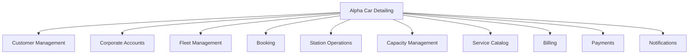

The capability view can also be represented hierarchically:

```text
Alpha Car Detailing
   ├── Customer Management
   ├── Corporate Accounts
   ├── Fleet Management
   ├── Booking
   ├── Station Operations
   ├── Capacity Management
   ├── Service Catalog
   ├── Billing
   ├── Payments
   └── Notifications
```

This model is deliberately independent of application structure.

It does **not** imply:

```text
CustomerManagementService
CorporateAccountsService
FleetManagementService
BookingService
...
```

That mapping, if appropriate, belongs to later architectural analysis.

---

## 4.24 Capability Responsibilities

### Customer Management

Supports business relationships with customers.

Responsibilities may include:

- customer identity;
- contact information;
- customer classification;
- customer status;
- customer preferences.

### Corporate Accounts

Supports enterprise commercial relationships.

Responsibilities may include:

- corporate agreements;
- authorized representatives;
- account status;
- permitted services;
- commercial conditions;
- billing terms.

### Fleet Management

Supports organized collections of vehicles.

Responsibilities may include:

- fleets;
- fleet membership;
- fleet administration;
- vehicle eligibility;
- fleet status.

### Booking

Supports requesting and managing planned service.

Responsibilities may include:

- booking request;
- selected vehicles;
- station selection;
- service selection;
- booking lifecycle;
- cancellation or modification policies.

### Station Operations

Represents operational service locations.

Responsibilities may include:

- stations;
- operating hours;
- supported services;
- operational restrictions.

### Capacity Management

Determines and manages how much work can be accepted.

Responsibilities may include:

- available capacity;
- capacity reservation;
- capacity release;
- operational constraints.

### Service Catalog

Defines what Alpha Car Detailing sells and performs.

Responsibilities may include:

- services;
- packages;
- service eligibility;
- service descriptions;
- commercial offerings.

### Billing

Determines and records amounts owed.

Responsibilities may include:

- billable activity;
- invoices;
- account billing;
- billing references.

### Payments

Supports settlement of financial obligations.

Responsibilities may include:

- payment collection;
- payment status;
- settlement references.

### Notifications

Communicates meaningful business changes.

Responsibilities may include:

- booking confirmations;
- reminders;
- cancellation notifications;
- completion notifications;
- billing notifications.

---

## 4.25 Business Capabilities Are Not Organizational Departments

A capability describes what the business can do.

It does not necessarily describe who performs it.

For example, Billing may involve:

- station operations;
- corporate account management;
- finance;
- external payment providers.

Similarly, Booking may involve:

- customers;
- fleet administrators;
- station personnel;
- automated processes.

Capabilities provide stable business structure even when organizational responsibilities change.

---

## 4.26 Domain Boundaries

Domain boundaries identify areas where business concepts, rules, ownership, or responsibilities differ sufficiently to warrant separation in the business model.

At this stage, useful conceptual boundaries include:

```text
Customer and Account Context
Fleet and Vehicle Context
Service Offering Context
Booking Context
Station and Capacity Context
Billing and Payment Context
Communication Context
```

These are not yet bounded contexts in a finalized DDD design, nor are they microservices.

They represent areas where the language and decisions begin to cluster.

### Customer and Account Context

Concerned with:

- who the customer is;
- what relationship exists;
- whether an enterprise account is active;
- who may represent that account.

### Fleet and Vehicle Context

Concerned with:

- what vehicles exist;
- how vehicles are grouped;
- whether a vehicle belongs to an appropriate fleet;
- whether a vehicle is eligible for requested activity.

### Service Offering Context

Concerned with:

- what services are offered;
- what packages exist;
- which vehicles and stations support them;
- what commercial offering applies.

### Booking Context

Concerned with:

- what the customer wants to schedule;
- booking lifecycle;
- requested vehicles;
- requested station;
- requested service.

### Station and Capacity Context

Concerned with:

- where service can occur;
- when it can occur;
- how much work can be accepted;
- what operational constraints apply.

### Billing and Payment Context

Concerned with:

- what is owed;
- how it is invoiced;
- how and when it is settled.

### Communication Context

Concerned with:

- who needs to be informed;
- what business changes require communication.

Chapter 47 will determine how architecture responds to these boundaries.

---

## 4.27 Key Workflows

Several workflows define the business.

Examples include:

- retail booking;
- corporate fleet booking;
- booking authorization;
- booking modification;
- booking cancellation;
- capacity reservation;
- service check-in;
- service completion;
- corporate billing;
- payment;
- notification.

The primary workflow for the remainder of this chapter is corporate fleet booking.

---

## 4.28 Corporate Fleet Booking

The corporate fleet booking scenario proceeds through ten major business steps:

1. Select a fleet.
2. Select vehicles.
3. Choose a station and service.
4. Check available capacity.
5. Submit a booking.
6. Receive authorization and validation.
7. Reserve capacity.
8. Receive confirmation.
9. Complete service.
10. Trigger billing and notifications.

These steps provide a business narrative.

They are not yet API calls, commands, events, services, database transactions, or queues.

---

## 4.29 Step 1 — Select a Fleet

The corporate user begins within an organizational context.

The selected fleet determines which vehicles the user intends to manage.

Business checks may include:

- account is active;
- fleet exists;
- fleet is active;
- user may operate on the fleet.

The system should not display or accept vehicles merely because they exist in a shared vehicle table.

The relevant question is business eligibility.

---

## 4.30 Step 2 — Select Vehicles

The customer selects vehicles requiring service.

The selected vehicles may need to satisfy rules such as:

- vehicle belongs to the selected fleet;
- vehicle is active;
- vehicle is eligible for the requested service;
- vehicle is not already committed to an incompatible booking.

The business must determine whether bookings are vehicle-specific or may use quantity-only requests.

For the case study, vehicle selection is explicit because fleet customers commonly require traceability to individual vehicles.

---

## 4.31 Step 3 — Choose a Station and Service

The customer chooses where the service should occur and what service is required.

The station must be capable of delivering that service.

This produces business questions such as:

- Does every station offer every service?
- Can service availability vary by day?
- Can certain vehicle types be serviced only at selected stations?
- Can corporate contracts restrict station selection?

These questions belong to business discovery.

---

## 4.32 Step 4 — Check Available Capacity

The requested work is evaluated against station capacity.

The business is asking:

> Can this station accept this work at the requested time under current operating conditions?

The answer may depend on:

- vehicle count;
- service duration;
- vehicle type;
- station resources;
- existing reservations;
- operational restrictions.

An availability response is informative.

It is not necessarily a commitment.

---

## 4.33 Step 5 — Submit a Booking

Submission indicates that the customer wishes to proceed.

At this point, the request becomes business-significant.

The booking request may contain:

- account;
- fleet;
- vehicles;
- station;
- service;
- requested schedule;
- customer references;
- optional instructions.

Submission does not automatically imply confirmation.

---

## 4.34 Step 6 — Authorization and Validation

The business evaluates whether the requested booking may proceed.

This may include:

```text
Account Valid?
Fleet Valid?
Vehicles Eligible?
User Authorized?
Service Permitted?
Station Suitable?
Commercial Rules Satisfied?
Capacity Still Available?
```

The distinction between validation and authorization is useful.

Validation asks whether conditions are valid.

Authorization asks whether the customer is permitted to perform the activity.

Depending on confirmed requirements, some checks may happen earlier for usability and be repeated later for correctness.

---

## 4.35 Step 7 — Reserve Capacity

Once the booking is acceptable, the required capacity must be committed.

The key business outcome is:

> Capacity required by the accepted booking is no longer available to competing bookings.

This point becomes extremely important in later architecture chapters because concurrent requests may compete for limited resources.

For now, the domain requirement is enough.

The business must prevent confirmed bookings from exceeding operational capacity.

---

## 4.36 Step 8 — Receive Confirmation

After successful acceptance and capacity reservation, the customer receives confirmation.

Confirmation establishes an important customer expectation:

> Alpha Car Detailing has accepted responsibility for servicing the confirmed vehicles according to the agreed booking conditions.

The confirmation may contain:

- booking reference;
- station;
- service;
- vehicles;
- scheduled date or time;
- customer instructions.

The exact content is a business decision.

---

## 4.37 Step 9 — Complete Service

At the scheduled time, vehicles are processed operationally.

Actual station operations may include:

- arrival;
- check-in;
- service start;
- service execution;
- quality checks;
- completion;
- release of vehicle.

This chapter treats those details at a high level.

The critical transition is that booked work eventually becomes completed service activity.

---

## 4.38 Step 10 — Trigger Billing and Notifications

Once qualifying service is completed, financial and communication activities may begin.

For corporate customers:

```text
Completed Service
      │
      ├──> Billing Activity
      │
      └──> Customer Notification
```

Billing may produce invoiceable items rather than immediate payment.

Notifications may inform relevant stakeholders that service is complete.

Later architecture must decide how these activities interact technically.

The business requirement comes first:

> Completed service must produce the appropriate commercial and customer outcomes.

---

## 4.39 Business Events

A business event records something meaningful that has happened in the domain.

Potential events include:

- Corporate Account Activated
- Fleet Created
- Vehicle Added to Fleet
- Booking Submitted
- Booking Authorized
- Booking Rejected
- Capacity Reserved
- Booking Confirmed
- Booking Cancelled
- Vehicle Checked In
- Service Started
- Service Completed
- Invoice Issued
- Payment Received
- Customer Notified

At this stage these are **business events**, not technical event contracts.

That distinction is essential.

The business may recognize:

> Booking Confirmed

Chapter 50 may later determine whether the architecture publishes something such as:

```text
BookingConfirmedV1
```

Those are different design levels.

---

## 4.40 Business Event Versus Technical Event

Consider the following statement:

> Service completion is important because billing must follow successful completion.

That is domain knowledge.

Now consider:

```json
{
  "eventType": "ServiceCompletedV1",
  "bookingId": "..."
}
```

That is technical design.

The second should be derived from the first—not the reverse.

Teams sometimes discover business requirements while designing event schemas. That is acceptable as a discovery mechanism, but the resulting requirement should be returned to business analysis and confirmed.

The event contract itself must not become the source of truth for an invented rule.

---

## 4.41 Business Expectations

Customers and operators do not describe successful systems in terms of message brokers or databases.

Their expectations are expressed in outcomes.

Corporate customers expect:

- only authorized users to manage their fleets;
- accurate vehicle information;
- clear service choices;
- reliable capacity information;
- predictable booking;
- correct contractual pricing;
- confirmation;
- timely service;
- accurate invoices;
- useful notifications.

Station personnel expect:

- realistic schedules;
- protection from overbooking;
- clear booking details;
- visibility into planned workload;
- manageable operational changes.

Finance teams expect:

- correct billable information;
- proper account references;
- consistent commercial rules;
- traceability.

Business leadership expects:

- scalable growth;
- improved station utilization;
- reliable operations;
- enterprise customer support;
- consistent customer experience.

These expectations later become quality attributes, architecture drivers, acceptance criteria, metrics, and operational controls.

But their origin is business need.

---

## 4.42 Risks and Constraints

The business domain contains risks before technical architecture is considered.

### Overbooking

The organization may promise more service than a station can deliver.

Impact:

- customer dissatisfaction;
- operational disruption;
- manual recovery;
- reputational damage.

### Incorrect Authorization

A user may book vehicles or services outside permitted corporate authority.

Impact:

- unauthorized spending;
- contractual disputes;
- security and compliance concerns.

### Incorrect Pricing

The wrong commercial terms may be applied.

Impact:

- revenue leakage;
- customer disputes;
- reconciliation work.

### Invalid Fleet Membership

A vehicle may be booked under the wrong account or fleet.

Impact:

- incorrect billing;
- authorization failures;
- poor reporting.

### Capacity Staleness

Availability may change between viewing and booking.

Impact:

- conflicting commitments;
- failed bookings;
- inconsistent customer experience.

### Service Mismatch

A selected station may not support the requested service or vehicle.

Impact:

- service failure;
- rescheduling;
- customer dissatisfaction.

### Ambiguous Requirements

Different stakeholders may interpret rules differently.

Impact:

- inconsistent implementations;
- repeated defects;
- architectural rework.

### AI-generated Assumptions

An AI Agent may fill domain gaps with plausible behavior.

Impact:

- rapid implementation of incorrect rules;
- false confidence;
- hidden policy decisions inside code.

---

## 4.43 Constraints Versus Requirements

A requirement describes what the business needs.

A constraint limits the ways that need may be satisfied.

Examples:

**Requirement**

> Corporate customers must be able to book multiple fleet vehicles.

**Constraint**

> A station can service only a limited number of vehicles simultaneously.

**Requirement**

> Customers must receive confirmation for accepted bookings.

**Constraint**

> Certain corporate bookings require authorization before confirmation.

Understanding the distinction helps later architecture identify where flexibility exists.

---

## 4.44 Business Invariants

A business invariant is a condition that must remain true.

Possible invariants for the case study include:

```text
A confirmed booking cannot reference an invalid station.

A corporate fleet booking cannot use an ineligible fleet.

A booked vehicle must be eligible under the applicable customer relationship.

Confirmed capacity must not exceed accepted operational capacity.

Billing must correspond to qualifying business activity.

Applicable contractual pricing must be honored.
```

Invariants are especially valuable for AI-assisted development because they provide stable constraints against which generated implementation can be reviewed and validated.

---

# 5. Architecture Discussion

This section is intentionally limited to **business architecture**.

Solution architecture begins in Chapter 47.

The goal here is to identify architectural inputs—not to prescribe services, databases, APIs, messaging technologies, or deployment models.

---

## 5.1 Architecture Starts with Business Capabilities

A useful architecture discussion begins with the question:

> What must Alpha Car Detailing be capable of doing?

The answer produces business capabilities:

```text
Customer Management
Corporate Accounts
Fleet Management
Booking
Station Operations
Capacity Management
Service Catalog
Billing
Payments
Notifications
```

The next question is:

> Which capabilities contain distinct business rules, vocabulary, responsibilities, and rates of change?

Only after understanding those characteristics should the architecture consider decomposition.

This protects the design from a common failure mode:

```text
Nouns in Requirements
        ↓
Microservices
```

For example:

```text
Customer
Fleet
Vehicle
Booking
Station
Invoice
```

should not automatically become:

```text
Customer Service
Fleet Service
Vehicle Service
Booking Service
Station Service
Invoice Service
```

Entity names are not architectural boundaries.

Business responsibility is more important.

---

## 5.2 Capability Model Before Service Model

The business capability model should remain independent of technology.

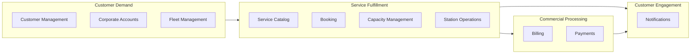

This diagram communicates relationships without deciding implementation topology.

A monolith, modular monolith, distributed system, or microservice architecture could all potentially implement the capability model.

The model survives those technical choices.

---

## 5.3 Domain Boundaries Before Deployment Boundaries

A domain boundary expresses separation in business meaning.

A deployment boundary expresses separation in runtime architecture.

These boundaries can correspond, but they do not have to.

For example, Booking and Capacity Management are conceptually different:

**Booking asks:**

> What service does the customer want?

**Capacity asks:**

> Can the business accept the requested work?

That conceptual separation is useful even if both are initially implemented within one deployable application.

Conversely, dividing them into independent deployable services without understanding their business interaction may introduce unnecessary distributed complexity.

Chapter 47 will revisit this distinction.

---

## 5.4 Business Ownership

Every important business rule should have an identifiable business owner.

Examples:

| Rule | Likely Business Owner |
| --- | --- |
| Fleet booking eligibility | Corporate Operations |
| Station capacity policy | Station Operations |
| Corporate pricing | Sales / Commercial Management |
| Billing terms | Finance |
| Service definitions | Service Operations / Product |
| Government authorization rules | Account Management / Compliance |
| Cancellation policy | Operations / Commercial Management |

The exact owner may vary by organization.

The principle does not.

A developer or AI Agent should not become the accidental owner of a business policy simply because the requirement was unclear.

---

## 5.5 Business Decisions Must Remain Visible

Architecture often hides unresolved business questions behind abstractions.

Consider:

```csharp
if (!policy.IsSatisfied(request))
{
    return BookingRejected();
}
```

The code is technically clean.

But what is the policy?

Who defined it?

What conditions does it contain?

What happens if those conditions change?

A well-designed abstraction can still hide a poorly understood requirement.

Business rules should be traceable to their rationale and ownership.

---

## 5.6 Do Not Let the Database Define the Domain

A relational schema might eventually contain tables such as:

```text
Customers
CorporateAccounts
Fleets
Vehicles
Stations
Services
Bookings
BookingVehicles
Invoices
Payments
```

These names may appear reasonable.

But starting from those tables creates several risks.

A table encourages a storage-centric view:

```text
What columns belong here?
```

The domain requires a behavioral view:

```text
What decisions does the business make?
What rules must remain true?
What transitions matter?
Who owns those decisions?
```

A `Bookings` table cannot tell the team:

- when a booking becomes confirmed;
- whether authorization precedes reservation;
- whether capacity is temporarily held;
- whether an account may exceed a credit limit;
- what happens when one vehicle in a multi-vehicle booking becomes ineligible.

Those are domain questions.

---

## 5.7 Do Not Let APIs Define the Domain

The same warning applies to APIs.

An early API proposal might contain:

```text
POST /bookings
GET /stations/{id}/capacity
POST /payments
```

These endpoints may eventually be useful.

But endpoint design should follow business understanding.

Otherwise, API shape begins dictating business semantics.

For example, `POST /bookings` raises unanswered questions:

- Does it submit or confirm?
- Does it reserve capacity?
- Can it fail after partial processing?
- Does it authorize the user?
- Does it calculate price?
- Does it support multiple vehicles?
- Does it immediately create billable activity?

The endpoint cannot answer the questions.

The domain must.

---

## 5.8 Do Not Let Events Define the Domain

Event-driven architecture can encourage another form of premature modeling.

A team starts with:

```text
BookingCreated
CapacityReserved
PaymentProcessed
```

and assumes the business workflow has been understood.

But `BookingCreated` is ambiguous.

Created as a draft?

Submitted?

Accepted?

Confirmed?

The business vocabulary should establish the meaningful state change before the technical event is named.

Good event design starts with meaningful business events, not infrastructure enthusiasm.

---

## 5.9 Do Not Let AI-generated Code Define the Domain

AI Agents can generate classes, controllers, validators, handlers, schemas, tests, and events at extraordinary speed.

That creates a new architectural risk:

> Implementation can become more detailed than the requirement.

Once detailed generated code exists, teams often begin treating it as authoritative.

For example, an AI Agent may generate:

```csharp
public const int MaximumFleetBookingSize = 25;
```

Soon afterward:

- unit tests enforce 25;
- APIs reject 26;
- UI validation displays 25;
- documentation mentions 25;
- other services depend on 25.

A speculative number has become institutionalized.

The AI Agent did not intentionally make a policy decision.

The engineering process allowed an assumption to harden into architecture.

---

## 5.10 Business Context Before AI-generated Implementation

The same principle applies to AI Engineering artifacts.

A Skill that says:

> Implement a fleet booking endpoint with validation.

is incomplete if the business has not defined what validation means.

A Prompt that says:

> Add capacity checks.

is dangerous if the business has not defined capacity.

A repository Instruction that says:

> Every confirmed booking must reserve capacity.

is useful only if "confirmed" and "reserve capacity" are established domain terms.

A more accurate relationship separates **discovery assistance** from **implementation authority**:

```text
Business Sources and Stakeholders
             │
             ├──> Instructions / Skills / Prompts
             │        for domain discovery
             │                    │
             └──────────────┬─────┘
                            ▼
               Governed Domain Knowledge
               (rules, decisions, glossary)
                            │
                            ▼
                 Architecture Decisions
                            │
                            ▼
              AI-assisted Implementation
                            │
                            ▼
                 Harness Validation
```

Instructions, Skills, and Prompts can support early discovery; they do not require a finalized architecture. When used for implementation, they must constrain the Agent to approved domain knowledge and relevant architecture decisions. The AI Engineering machinery strengthens an understood domain. It cannot substitute for one.

---

## 5.11 Business Context Before Harness Automation

A harness can deterministically verify:

- builds;
- tests;
- architecture rules;
- static analysis;
- security checks;
- formatting;
- quality gates;
- acceptance criteria.

But it can only validate rules that have been expressed.

If the team misunderstands the business requirement, the harness may repeatedly prove that the wrong implementation is internally consistent.

This creates a dangerous form of confidence.

```text
Wrong Requirement
      ↓
Wrong Implementation
      ↓
Correct Automated Tests
      ↓
Green Harness
      ↓
Wrong Business Outcome
```

The lesson is not that automation is weak.

The lesson is that automation must be anchored in valid business intent.

---

## 5.12 Traceability from Business Goal to Implementation

A mature engineering process should eventually support traceability such as:

```text
Business Goal
    ↓
Business Capability
    ↓
Business Rule
    ↓
Business Workflow
    ↓
Architecture Decision
    ↓
Implementation
    ↓
Test
    ↓
Operational Metric
```

For example:

```text
Goal:
Avoid station overbooking

    ↓

Capability:
Capacity Management

    ↓

Rule:
Confirmed reservations must not exceed available operational capacity

    ↓

Workflow:
Corporate fleet booking

    ↓

Architecture:
Defined in Chapter 47+

    ↓

Implementation:
Defined in later chapters

    ↓

Validation:
Automated tests and harness gates

    ↓

Metric:
Overbooking incidents / reservation failures / capacity utilization
```

This is the foundation of enterprise AI Engineering.

The AI Agent works inside a traceable engineering system rather than generating isolated code.

---

## 5.13 Domain Questions That Must Precede Architecture

Before the team commits to technical design, it should be able to answer questions such as:

### Customers

- What customer categories exist?
- Which differences affect system behavior?
- Can one organization have multiple accounts?

### Fleets

- What is a fleet?
- Who owns it?
- Who manages it?
- Can vehicles move between fleets?

### Vehicles

- What makes a vehicle eligible?
- Which attributes affect service or pricing?

### Services

- What is the difference between a service and a package?
- Which stations support which services?

### Booking

- What constitutes submission?
- What constitutes acceptance?
- What constitutes confirmation?
- Can bookings contain multiple vehicles?

### Capacity

- How is capacity measured?
- When does availability become reserved?
- What causes capacity to be released?

### Authorization

- Who may create a fleet booking?
- What business limits apply?

### Pricing

- Which pricing source takes precedence?
- When is price determined?

### Billing

- What activity becomes billable?
- When is an invoice created?

### Notifications

- Which transitions require communication?
- Who receives each communication?

If several answers are unknown, the architecture is not blocked from all progress, but those uncertainties should remain visible rather than being silently resolved in code.

---

# 6. Professional Diagrams

## 6.1 Business Context Diagram

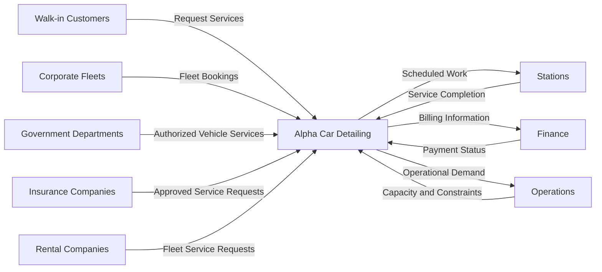

The diagram intentionally describes business relationships rather than applications.

---

## 6.2 Business Capability Map

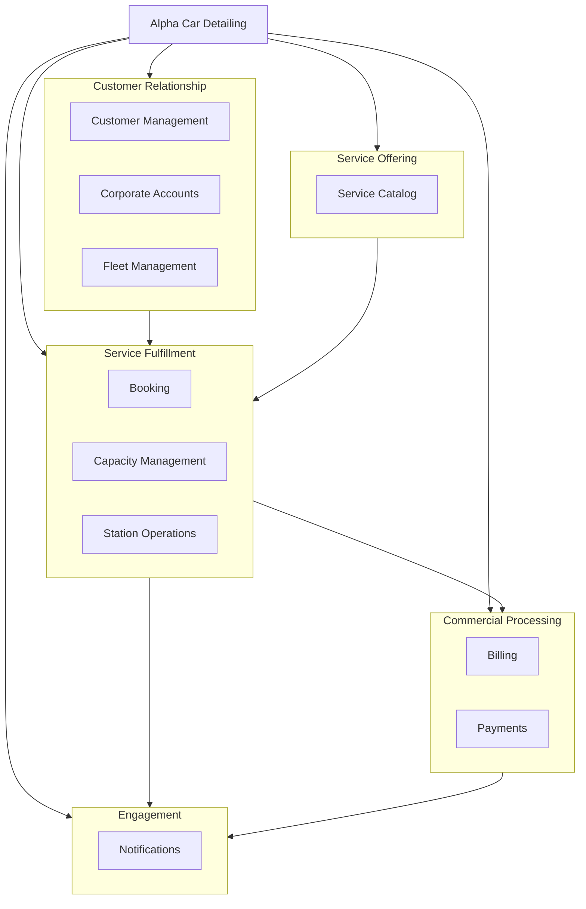

---

## 6.3 Corporate Fleet Booking Workflow

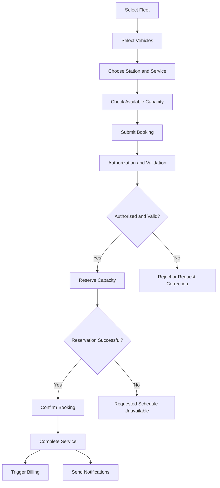

This diagram should be read as a business flow.

It deliberately avoids technical concepts such as APIs, queues, transactions, brokers, databases, or microservices.

---

## 6.4 Corporate Booking Business Interaction

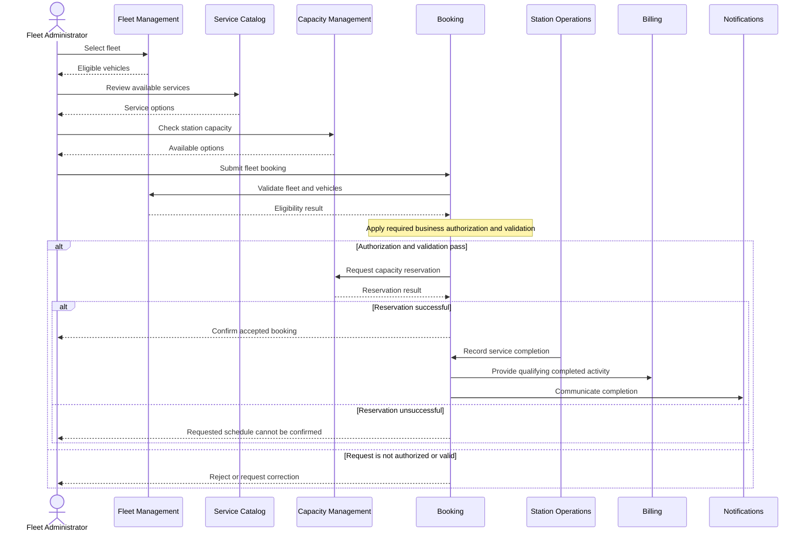

The participants represent business responsibilities.

They should not yet be interpreted as physical services.

---

## 6.5 Capacity Decision Model

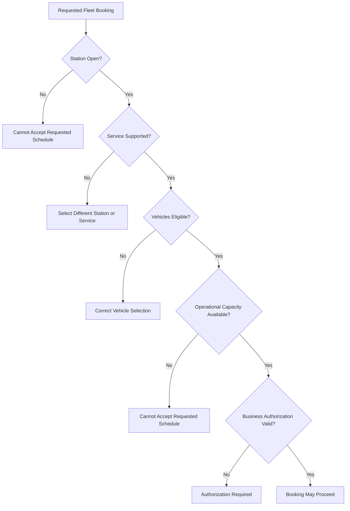

The model shows that capacity is only one business condition within booking acceptance. Whether alternatives are offered is an unresolved customer-experience policy.

---

## 6.6 Business State Progression

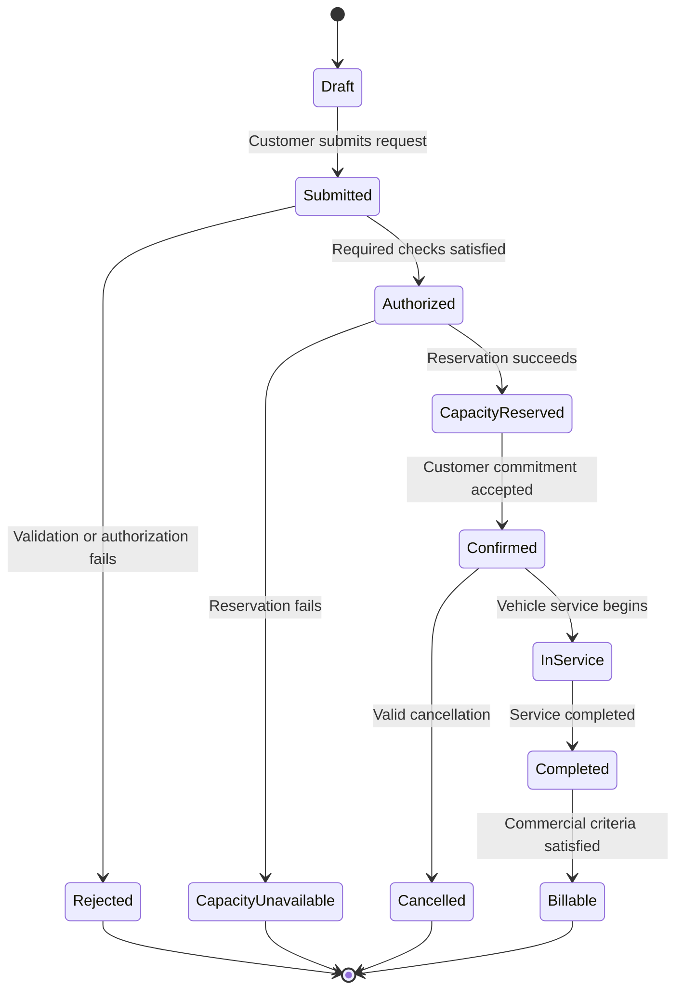

This diagram is illustrative rather than a final lifecycle specification.

Terms and transitions should be confirmed with stakeholders before later chapters encode them into software.

---

## 6.7 Business Event Timeline

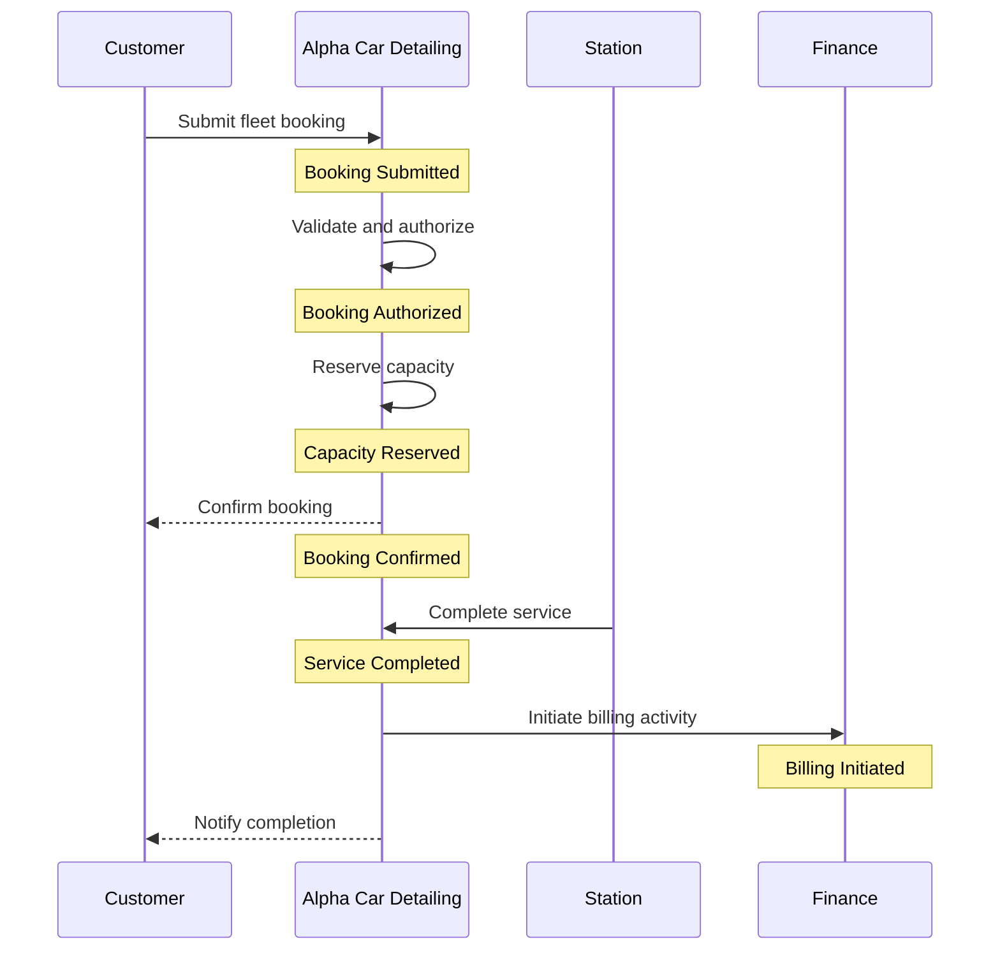

Again, these are business events.

Whether every event becomes an integration event is a later architecture decision.

---

## 6.8 Business Capability and Information Relationship

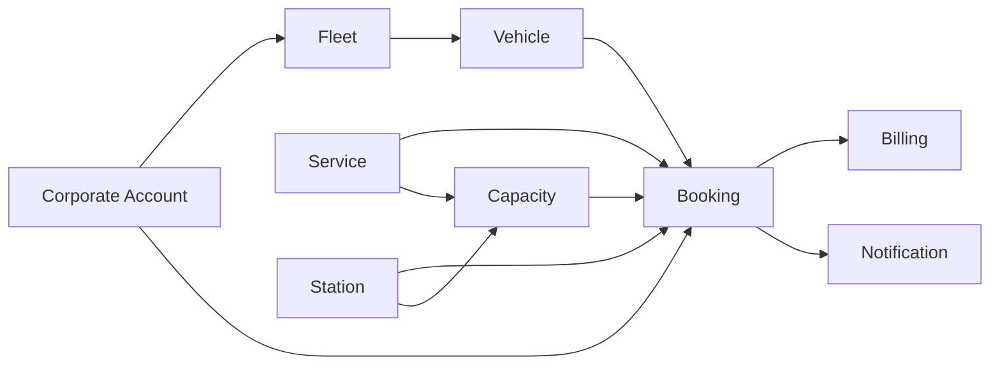

This view identifies business relationships without defining database foreign keys.

That distinction is important.

A line in a business model represents a meaningful relationship, not necessarily a relational database constraint.

---

## 6.9 Domain Boundary View

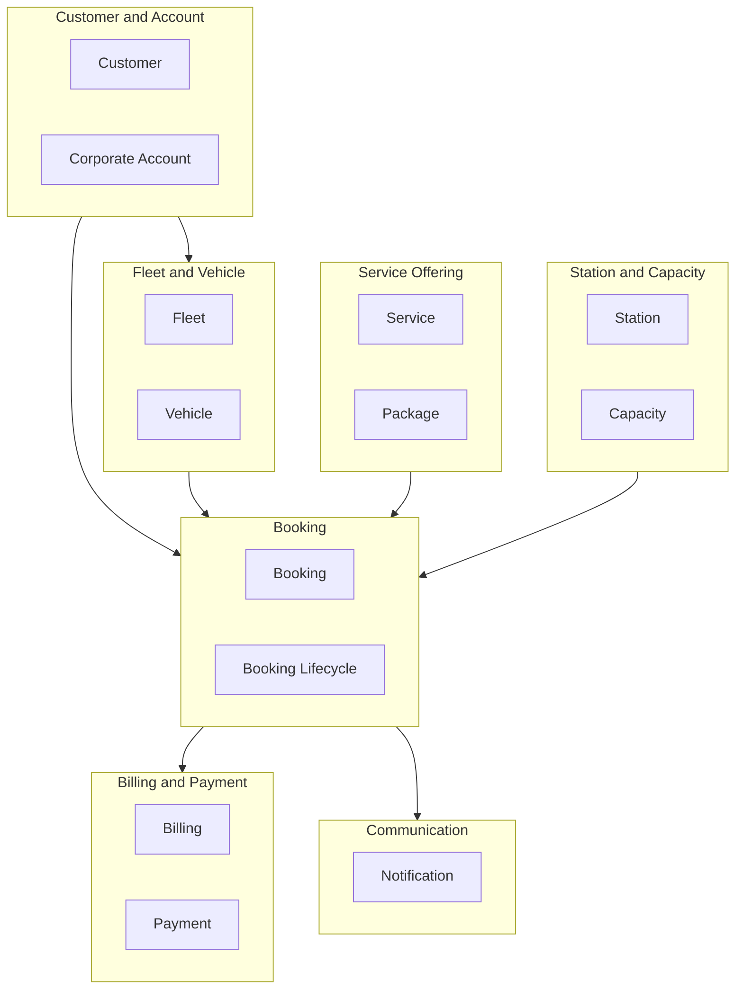

The diagram identifies candidate business boundaries.

Chapter 47 will evaluate how those boundaries influence solution architecture.

---

## 6.10 From Business Understanding to Engineering

The final diagram in this section captures the governing principle of the chapter.

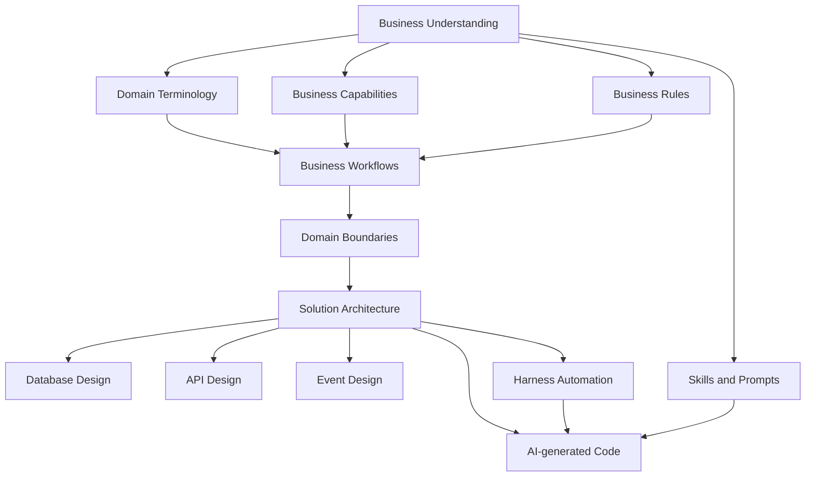

The direction of dependency is intentional.

Business understanding informs architecture.

Architecture informs implementation.

Instructions, Skills, and Prompts can also support *earlier* domain discovery; approved business knowledge and architecture then constrain AI-generated implementation. Harness automation validates approved intent rather than creating it.

Reversing that sequence creates technical certainty around business uncertainty.

The remainder of Part VII will progressively transform the business understanding established here into architecture and working software. The discipline throughout those chapters is to preserve traceability back to the business domain rather than allowing technical artifacts to become detached from their purpose.

---

# 7. Hands-on Example

Business-domain modeling becomes useful when a team must make a concrete customer request precise enough to support architecture without silently inventing business policy. This exercise develops a reviewable baseline for Alpha Car Detailing's corporate fleet booking capability.

## 7.1 The Northstar Distribution Request

Northstar Distribution operates 186 delivery vehicles. Its fleet administrator requests exterior washing and interior cleaning for 24 vehicles over two days, with 12 planned for Tuesday and 12 for Wednesday. The requested station has limited capacity and existing commitments. Northstar uses an enterprise commercial relationship rather than the immediate retail payment model.

The assignment is to determine what the business means by this request. It is **not** to build a booking endpoint or choose a data model. The team needs enough information to describe the accepted customer commitment, its prerequisites, and the possible exceptions.

An initial requirement might read: "The corporate administrator can select vehicles and book a station." That is useful as an intent statement but inadequate as an implementation specification. It says nothing about who is authorized, whether vehicles are eligible, whether a station supports the service, when capacity is reserved, whether partial acceptance is possible, or when the request becomes billable.

The first engineering deliverable is therefore a business-analysis record, not code.

## 7.2 Conduct a Domain Discovery Workshop

A focused workshop should include a corporate operations representative, a station operations representative, a product owner, and a finance representative. The architect facilitates the discussion and records findings, but does not act as the owner of commercial or operational policy.

Begin with the objective: "What should Northstar and Alpha Car Detailing be able to rely on after a booking is confirmed?" This question exposes the difference between a submitted request and an accepted commitment. Follow it with questions about account scope, fleet and vehicle eligibility, station/service suitability, operational capacity, pricing, completion, and financial obligations.

Use three evidence types distinctly: an approved rule or decision; an illustrative example used to test a rule; and an unanswered question. In the fictional handbook scenario, the case-study baseline rules provide the approved starting evidence. Additional policy details remain proposals until explicitly confirmed.

| Finding | Classification | Evidence or decision needed |
| --- | --- | --- |
| Administrators operate only within authorized fleet scope | Approved case-study baseline | BR-FLT-001 |
| Selected vehicles must be eligible for the chosen fleet | Approved case-study baseline | BR-FLT-002 |
| Station must support the selected service | Approved case-study baseline | BR-SVC-001 |
| Viewing availability does not reserve capacity | Approved case-study baseline | BR-CAP-001 |
| Confirmation requires a successful capacity commitment | Approved case-study baseline | BR-CAP-002 |
| Maximum 25 vehicles per booking | Unsupported assumption | Business owner decision required |
| Partial acceptance when only some vehicles fit | Open question | Product / Station Operations decision |
| Reservation expires after 15 minutes | Unsupported assumption | Reservation policy required |

An effective workshop concludes with a set of confirmed statements, an explicit list of unresolved choices, and named owners for the unanswered questions. It does not require every issue to be resolved immediately.

## 7.3 Describe the Successful Business Scenario

Use a stable scenario identifier such as **ACD-BUS-001 — Corporate Fleet Booking**. The following scenario represents the baseline workflow at business level; its grouping and partial-acceptance semantics remain open.

**Actors.** Corporate Fleet Administrator; Corporate Approver when required; Station Operations; Finance. **Preconditions.** A valid corporate relationship, an authorized fleet context, eligible vehicles, and a station capable of delivering the selected service. **Trigger.** The administrator requests service for 24 vehicles across two dates.

The administrator selects the fleet and vehicles, chooses the station and service package, and reviews available capacity. The administrator submits the request. Alpha Car Detailing checks the applicable business authorization, vehicle and service eligibility, and capacity conditions. It attempts to reserve the required operational capacity. Only after successful reservation does the business confirm the accepted arrangement. Station Operations later records qualifying completed work. Billing and customer communication follow the relevant approved policies.

The important design signal is the commitment boundary. An availability result is informative; a reservation commits operational capacity; confirmation communicates an accepted customer commitment. These meanings must remain distinct through the later architecture.

## 7.4 Analyze Alternative Business Outcomes

A scenario is not sufficiently analyzed until the team considers meaningful failure and exception paths. For Northstar, at least the following cases matter:

| Alternative | Expected principle | Unresolved policy |
| --- | --- | --- |
| Administrator lacks fleet access | Unauthorized request is not accepted | Exact disclosure and correction experience |
| Selected vehicle is ineligible | Ineligible work is not confirmed | Reject whole request or allow correction |
| Station does not support service | Unsupported service cannot be confirmed | Alternative station or service presentation |
| Capacity disappears after availability check | No confirmation without reservation | Whether alternatives or waitlists are offered |
| Authorization remains pending | Confirmation must await required approval | Whether temporary holds are permitted |
| Only some vehicles can be accommodated | Do not invent partial-acceptance behavior | All-or-nothing, automatic partial, or customer-approved partial |
| Vehicle fails to arrive | Record outcome accurately | Rescheduling and any contractual charge |
| Service is only partly completed | Record qualifying work | Group lifecycle and billing exceptions |

The distinction between *expected principle* and *unresolved policy* allows architecture work to proceed around established invariants while leaving dependent decisions conditional.

## 7.5 Express Confirmed Rules as Examples

Specification by Example converts approved statements into observable outcomes without deciding the technical mechanism.

```gherkin
# Source: BR-CAP-001
Scenario: Viewing availability does not reserve capacity
  Given a station has capacity for a requested service
  When an authorized customer views that availability
  Then the available capacity is not reserved merely by that view

# Source: BR-CAP-002
Scenario: Reservation failure prevents confirmation
  Given a valid corporate fleet booking request
  And the station supports the requested service
  When the required capacity cannot be reserved
  Then the booking is not confirmed
  And the customer is informed that the requested schedule is unavailable

# Source: BR-FLT-001
Scenario: Fleet administrator cannot book an unauthorized fleet
  Given an administrator is not authorized for the selected fleet
  When the administrator attempts to submit a booking
  Then the booking is not accepted
```

These scenarios do not specify APIs, SQL transactions, locking, queues, or distributed orchestration. Their business meaning should remain stable while technical implementation choices change.

## 7.6 Document Decisions and Provenance

Record decisions that affect multiple capabilities. The following is a fictional, approved case-study decision record rather than a real-company policy statement:

```yaml
id: BDR-001
name: Availability is not reservation
status: Approved for handbook case study
business_capability: Capacity Management
rule_ids: [BR-CAP-001, BR-CAP-002]
decision: >
  Viewing available capacity does not commit it.
  Booking confirmation requires a successful reservation.
rationale: >
  Avoid unnecessary holds and conflicting confirmed commitments.
open_questions:
  - Are temporary holds supported at any point?
  - How is the required capacity calculated?
  - What alternatives are offered when reservation fails?
```

Open questions should be owned and prioritized, not hidden in prose. A compact register may record the question identifier, affected capability, decision owner, potential impact, and status. The first high-impact questions for Northstar concern multi-day booking identity, partial acceptance, reservation timing, authorization thresholds, pricing finalization, and billable completion.

## 7.7 Prepare the Domain Package

A practical artifact layout is:

```text
alpha-car-detailing/docs/business-domain/
  business-overview.md
  domain-glossary.md
  capability-model.md
  business-rules.md
  workflows/corporate-fleet-booking.md
  acceptance-scenarios/corporate-fleet-booking.feature
  decisions/BDR-001-availability-vs-reservation.md
  decisions/business-decision-register.md
  open-questions.md
  traceability/business-traceability-matrix.md
```

This is a **proposed documentation layout** for exercises. File existence must be checked before an AI Agent claims to have read any of these artifacts. Rule identifiers connect narrative requirements to acceptance scenarios; later chapters will extend the links to architecture decisions, implementation, and validation evidence.

## 7.8 Assess Readiness Rather Than Completeness

The result of the hands-on exercise is not a declaration that every booking policy has been resolved. It is a controlled understanding of what can safely guide architecture.

A readiness review should confirm that stakeholders recognize the terminology; confirmed rules have credible authority; significant successful and failure paths are described; critical invariants are stated; and the decisions that could materially alter the architecture are visible and owned. The architect can then explore solution options around established business commitments, while withholding final choices dependent on unresolved policies.

**Hands-on outcome:** a reviewable business-domain baseline, not a generated system. That baseline is the artifact against which subsequent AI-assisted engineering must be judged.

---

# 8. Claude Example

Claude Code is the handbook's primary AI coding agent for demonstrating repository-oriented engineering workflows. During business discovery, its most useful responsibility is to analyze accessible documents, highlight uncertainty, and prepare reviewable artifacts—not to decide policies.

## 8.1 Establish Repository Instructions

An illustrative `CLAUDE.md` should separate behavior guidance from domain authority:

```markdown
# Alpha Car Detailing — Repository Guidance

Read approved business-domain documentation before
analyzing or implementing related functionality.

Distinguish confirmed rules, proposed rules,
assumptions, and open questions.

Preserve source references and existing rule IDs.

Do not invent booking limits, reservation timeouts,
pricing formulas, contractual conditions, or approvals.

Do not treat existing implementation as proof that a
business policy was approved.

For Chapter 46 tasks, do not design services,
databases, APIs, event payloads, or application code.

Propose changes for stakeholder review rather than
silently rewriting authoritative business documents.
```

These Instructions establish expectations for Claude's behavior. They do not duplicate the rule register or replace a business decision process.

## 8.2 Use a Bounded Discovery Prompt

```text
Analyze the Alpha Car Detailing corporate fleet booking domain.

Read the available approved documents and identify
which expected sources are missing. Do not assume
files exist merely because they are mentioned here.

Use Northstar Distribution's request for 24 vehicles
across two days as the primary scenario.

Produce:
1. Business objective and participating actors
2. Business capabilities and responsibility boundaries
3. Domain glossary findings
4. Confirmed business rules, with source IDs
5. Main workflow and alternative outcomes
6. Business events, without technical schemas
7. Contradictions and unsupported assumptions
8. Open questions, owner suggestions, and impact
9. Domain readiness assessment

Classify every important claim by approval status.
Do not invent business policy or generate code.
Do not change repository files without authorization.
```

A strong answer identifies the confirmation/reservation invariant, but records partial acceptance and reservation expiry as unresolved. A weak answer fills both gaps with plausible defaults and proposes an immediate implementation.

## 8.3 Use Claude to Challenge the Model

A second review task should ask: "List every place where the proposed corporate booking workflow assumes business behavior absent from an approved source. For each, identify the stakeholder who must decide and the architecture choice that depends on it." This question uses Claude as a reviewer of domain certainty rather than a manufacturer of domain rules.

Claude can also compare terminology across files, produce an open-question register, and draft Gherkin scenarios. The human reviewer must still confirm that scenarios reflect approved policy.

## 8.4 Respect the Harness Boundary

The Lead Agent can ensure domain requirements are identified; the Developer Agent can implement assigned, approved behavior; the Reviewer Agent can check implementation traceability; the Validator Agent can verify acceptance scenarios; and the Evaluator Agent can assess the delivered business result. None of these roles acquires the authority to invent a commercial or operational policy because it can generate valid code or tests.

Claude's contribution is greatest when it maintains the difference between **what is known**, **what is proposed**, and **what must still be decided**. Its output should be treated as a draft until reviewed by the appropriate owner.

---

# 9. GitHub Copilot Comparison

GitHub Copilot offers an alternative way to conduct repository-based domain analysis. It is commonly integrated into development workflows and can help engineers examine requirements, compare documents, and draft reviewable changes. Its user interface and supported agent features may differ from Claude Code, but the business authority boundary must remain identical.

## 9.1 Repository Context and Instructions

Copilot can use repository-wide custom instructions from `.github/copilot-instructions.md` in supported experiences. Specific prompt files can be used for repeatable tasks where supported; teams should consult the current platform documentation for their chosen environment.

```markdown
# Alpha Car Detailing — Copilot Instructions

Use the business-domain documentation as the source
for approved business meaning.

Do not infer requirements from existing SQL tables,
application classes, or generated tests.

Report missing authoritative sources. Preserve rule IDs.
Separate confirmed requirements from proposals,
assumptions, and unresolved questions.

For domain-discovery tasks, avoid premature technical
architecture and implementation.
```

The goal is not to maintain a Copilot-specific version of the business domain. The shared glossary, rules, workflows, and decisions should be the same records consumed by every AI Agent.

## 9.2 Reusable Domain Review Prompt

A reusable task file such as `.github/prompts/discover-business-domain.prompt.md` may contain:

```markdown
Review the corporate fleet booking domain.

Read available approved domain sources and report
missing expected documents.

Identify actors, capabilities, terminology, rules,
workflow stages, exceptions, business events,
contradictions, and open questions.

Every confirmed rule must cite its source or rule ID.
Do not introduce new commercial or operational policy.
Do not design APIs, databases, services, or code.

Return a proposed domain review report requiring
human business approval.
```

Copilot may be particularly convenient when developers are examining a localized documentation change alongside nearby code. The reviewer must nevertheless distinguish code that implements a rule from documents that authorize it.

## 9.3 Compare the Same Business Question

Give both Claude Code and Copilot the statement: "Northstar Distribution requests ten vehicles when capacity remains for only six." The expected output is not a confident choice of partial acceptance. It is a structured set of potential policies—reject the whole request, accept a subset, or ask the customer to approve an alternative—together with the responsible business owner and the implications for confirmation, capacity, billing, and notification.

The platform that writes the most detailed implementation is not necessarily the platform that performs the best business analysis. Evaluate traceability, terminology, visibility of uncertainty, and reviewability.

## 9.4 Platform-independent Governance

| Concern | Claude Code | GitHub Copilot |
| --- | --- | --- |
| Repository guidance | `CLAUDE.md` | `.github/copilot-instructions.md` |
| Task request | Prompt | Chat/task prompt or supported prompt file |
| Shared business authority | Approved domain documents | Same approved domain documents |
| Proposed documentation changes | Review required | Review required |
| Approval of business policy | Business owner | Business owner |

The primary lesson is portability of business meaning. Moving between tools should not change the interpretation of booking confirmation, fleet authorization, or capacity reservation.

---

# 10. Codex Comparison

OpenAI Codex provides another repository-oriented agent workflow through supported interfaces. For business discovery, it can inspect accessible documents, generate analyses, compare terminology, and prepare proposed changes. The Agent's technical ability to edit files does not grant authority to establish business policy.

## 10.1 Use AGENTS.md as Execution Guidance

Codex recognizes repository guidance through `AGENTS.md`. A concise example is:

```markdown
# Alpha Car Detailing — Codex Instructions

The domain glossary, approved business rules,
workflows, and decisions govern business meaning.

For business-domain analysis:
- Verify that cited source files exist.
- Extract supported facts with source references.
- Separate confirmed, proposed, assumed, and open items.
- Identify contradictions instead of resolving them by guess.
- Do not invent limits, timeouts, pricing, or approvals.
- Do not create API, database, service, or event contracts.
- Do not modify approved policy without explicit authority.

Present proposed changes for human review.
```

`AGENTS.md` describes how the Agent should work. The authoritative domain records establish what the business means. A task Prompt specifies the immediate question; a reusable Skill can package a repeated analytical method.

## 10.2 Run a Read-only Analysis Task

An engineer using an installed Codex CLI may start from the repository root:

```powershell
cd C:\ZeeWork\Enterprise-AI-Engineering-Handbook
codex
```

For initial discovery, use a suitable read-only or appropriately permission-restricted workflow. Prompt instructions not to edit files are useful, but they are not a technical security boundary by themselves.

```text
Analyze Alpha Car Detailing corporate fleet booking.
Read applicable AGENTS.md guidance and actual
approved domain source files.

For Northstar's 24-vehicle, two-day request:
- Identify business goals and actors.
- Map capabilities and workflow stages.
- Extract rules with traceable source IDs.
- Distinguish availability, reservation, confirmation.
- Identify exceptions and unresolved questions.
- Report contradictory statements.
- Draft acceptance scenarios using approved rules only.

Do not modify files, invent policies, or design software.
Return a reviewable business-domain analysis report.
```

An appropriate result references **BR-CAP-001** and **BR-CAP-002**, explains that availability checks do not commit capacity, and shows that confirmation requires a successful reservation. It should also mark partial fleet booking, multi-day booking identity, and pricing finalization as unresolved.

## 10.3 Use Reusable Skills Only for Repeatable Work

Where a team frequently reviews business-domain documentation, a Codex Skill can package a repeatable procedure. An illustrative `SKILL.md` might specify the following steps: locate authoritative sources; extract actors, rules, and business events; examine contradictions; build traceability; record open questions; and prepare a readiness assessment. The Skill must not contain its own unapproved booking policies.

```markdown
---
name: business-domain-review
description: Review business-domain evidence and identify gaps.
---

# Business Domain Review

1. Identify actual available approved sources.
2. Extract business actors, capabilities, and terminology.
3. Record supported rules with evidence.
4. Identify alternative workflow outcomes.
5. Classify assumptions and unresolved decisions.
6. Produce traceability and readiness findings.

Do not invent or approve business policy.
Do not design or implement software.
```

Use a Skill when repetition justifies the additional governed artifact. A one-off analysis can remain a carefully scoped Prompt.

## 10.4 Coordinate Parallel Review Without Multiplying Assumptions

Different analytical tasks may examine Corporate Accounts, Fleet Management, Booking, Capacity Management, and Billing. Their findings must be reconciled against one authoritative rule register. Parallel analyses may disagree about whether authorization precedes reservation or whether the booking group is all-or-nothing. Those disagreements are business questions for accountable owners, not reasons to let the Agent choose whichever explanation is more convenient.

An AI-generated recommendation may be useful, but it cannot substitute for stakeholder approval. Business review and repository execution approval should be treated as distinct controls: permission to edit a file is not permission to change a business policy.

## 10.5 Comparative Evaluation

| Concern | Claude Code | GitHub Copilot | Codex |
| --- | --- | --- | --- |
| Common repository guidance | `CLAUDE.md` | `.github/copilot-instructions.md` | `AGENTS.md` |
| Reusable method | Skill | Prompt file / supported Skill | Skill |
| Primary evidence | Governed business documents | Same documents | Same documents |
| Required output | Traceable analysis | Traceable analysis | Traceable analysis |
| Business authority | Human business owner | Human business owner | Human business owner |

Feature availability and workflow details can change by product version or environment, so platform comparisons should be verified against current product documentation. The method must not change: establish source authority, expose uncertainty, provide reviewable findings, and preserve the business-to-architecture boundary.

---

# 11. Best Practices

Business-domain discovery becomes reliable when it is treated as a repeatable engineering discipline rather than an informal stage preceding coding. Alpha Car Detailing's fleet booking scenario exposes how customer commitments depend on authorization, service eligibility, capacity, fulfillment, and financial policy. The following practices make those dependencies explicit and governable.

## 11.1 Begin with Outcomes and Actors

Start with the outcome Alpha Car Detailing and its customer need: the corporate fleet administrator should be able to arrange eligible services without creating commitments the station cannot meet. Identify the participating roles—fleet administrator, corporate approver when required, station manager, station staff, account management, and finance—before proposing application components. The actor who submits a request is not necessarily the person authorized to approve its commercial implications.

## 11.2 Maintain One Business Vocabulary

A controlled domain glossary should distinguish *customer*, *corporate account*, *fleet*, *vehicle*, *service*, *booking request*, *availability*, *reservation*, *confirmation*, *service completion*, *billing*, and *payment*. A change in language can be a change in business meaning. When one department uses "booking" for a request and another uses it for a confirmed appointment, clarify the lifecycle rather than allowing software labels to settle the dispute.

## 11.3 Model Capabilities Before Services

Business capabilities describe work the company must be able to perform. They are not deployment instructions. Customer Management, Corporate Accounts, Fleet Management, Booking, Station Operations, Capacity Management, Service Catalog, Billing, Payments, and Notifications should have clear responsibilities and interactions before the architect considers technical decomposition. A single application can preserve conceptual separation; a distributed architecture can violate it.

## 11.4 Preserve Rule Provenance and Approval

Maintain stable rule identifiers, supporting evidence, business ownership, approval status, and applicability. The fictional case-study baseline defines **BR-CAP-001** (availability is not reservation) and **BR-CAP-002** (confirmation requires reserved capacity). It does not define a booking maximum, reservation expiry, credit threshold, or partial-acceptance policy. Those details must be classified as proposals or open questions.

A compact rule record should state not only *what* the rule says but *why* it exists and which workflows and scenarios depend on it. This turns a static rule list into maintainable organizational knowledge.

## 11.5 Distinguish Commitments from Observations

An availability result is an observation. A reservation is a capacity commitment. A confirmed booking is an accepted customer-facing arrangement. A completed service records delivered work. Billable activity establishes an applicable financial consequence. Treating these as interchangeable creates overbooking, incorrect notifications, and premature billing. Establish the business transition first; select consistency mechanisms later.

## 11.6 Analyze Alternative Flows Deliberately

A happy-path workshop rarely exposes the most important architecture drivers. Consider unauthorized fleet selection, one ineligible vehicle in a group, a station that lacks the required equipment, changing capacity, pending corporate approval, a vehicle that does not arrive, interrupted service, and a failed customer notification. For each case, identify the responsible actor, acceptable business outcomes, customer communication, and unresolved decisions.

For a fleet request of ten vehicles when only six can be accommodated, do not infer partial acceptance. Record the alternatives—whole-request rejection, automatic partial acceptance, or customer-approved partial acceptance—and seek a business decision.

## 11.7 Treat Capacity as an Operational Concept

Capacity may depend on service bays, technicians, operating hours, vehicle category, equipment, service duration, and existing commitments. A six-bay station does not necessarily have six interchangeable appointment slots. Define what work the business is able to accept before modeling how that capacity is stored or locked.

Similarly, a station can be open but unable to perform a particular service, or it can support a service without having capacity at the requested time. These are separate business checks.

## 11.8 Distinguish Pricing, Billing, and Payment

Pricing determines the applicable commercial amount. Billing establishes and communicates an obligation. Payment settles an amount owed. A corporate booking may use negotiated prices and consolidated invoicing, unlike a walk-in retail transaction. Whether a price becomes binding on submission or confirmation, and whether cancellation creates a charge, are explicit business decisions. Do not infer them from a standard checkout workflow.

## 11.9 Identify Business Events Without Designing Integration

Use past-tense business events—*Booking Submitted*, *Booking Authorized*, *Capacity Reserved*, *Booking Confirmed*, *Service Completed*, *Invoice Issued*—to understand transitions and affected stakeholders. Not every business occurrence requires a published message. Technical event contracts, brokers, schema versions, and delivery guarantees belong to later architecture.

## 11.10 Make Traceability a Normal Practice

A useful chain runs from business objective to capability, rule, workflow, acceptance scenario, architecture decision, implementation, validation, and operational evidence. For overbooking prevention, that chain begins with Capacity Management and BR-CAP-002. Later chapters will choose the technical mechanism; they must not modify the confirmed business commitment simply because another mechanism would be easier.

| Traceability element | Alpha Car Detailing example |
| --- | --- |
| Business goal | Prevent overbooking |
| Capability | Capacity Management |
| Rule | BR-CAP-002 |
| Workflow | Corporate Fleet Booking |
| Acceptance example | Reservation failure prevents confirmation |
| Architecture dependency | Consistency of capacity commitment |
| Operational outcome | No confirmed work beyond accepted capacity |

## 11.11 Use AI Agents as Analysts, Not Policy Owners

Claude Code, Copilot, and Codex can collect evidence, compare terminology, identify contradictions, and draft scenarios. Require them to cite sources and mark uncertainty. Review generated changes before promoting them into the domain repository. Agreement among several AI Agents is not independent business approval, and passing tests do not validate invented policy.

## 11.12 Establish Readiness by Risk

The domain does not need to answer every hypothetical future question before architecture exploration begins. It must answer the questions that materially affect the next design decisions. Identify critical rules and invariants; assign owners to high-impact open questions; and document conditional architectural options when policy is unresolved. Readiness is a scoped decision, not a claim that the business is permanently understood.

### Best-practice review checklist

- [ ] Business objectives and actors are explicit.
- [ ] Domain terminology is consistent.
- [ ] Capabilities are distinct from deployable software services.
- [ ] Confirmed rules have evidence, identifiers, and owners.
- [ ] Proposed policies and assumptions are not presented as approved.
- [ ] Availability, reservation, confirmation, and completion are distinct.
- [ ] Significant exception paths are documented.
- [ ] Customer-specific commercial variations are evidence-based.
- [ ] Acceptance scenarios reference approved rules.
- [ ] AI-produced documents require accountable review.
- [ ] Architecture-significant questions are owned and visible.

The objective is not maximum documentation volume. It is sufficient, trustworthy business knowledge to guide engineering decisions and reveal where the organization must still decide.

---

# 12. Anti-patterns

AI-assisted implementation can make a flawed domain model appear mature. Once an invented policy appears in source code, unit tests, documentation, and dashboards, it may be mistaken for an approved business requirement. Recognizing the following anti-patterns early prevents such errors from hardening into architecture.

## 12.1 Service-first Decomposition

**Symptom:** The team creates `FleetService`, `BookingService`, `CapacityService`, and `BillingService` before agreeing what those business capabilities mean. **Failure:** Deployable boundaries are chosen before business responsibilities and consistency needs are understood. **Correction:** Model capabilities, ownership, terminology, and workflows first. Whether the solution is modular or distributed is a subsequent decision.

## 12.2 Database Tables as Domain Truth

**Symptom:** Requirements discussions start with `Customers`, `Fleets`, `Vehicles`, and `Bookings` tables. **Failure:** Columns cannot establish when a request becomes confirmed, whether a vehicle can change fleets, or who may authorize a booking. **Correction:** Define relationships, invariants, and lifecycle behavior in business language before designing storage.

## 12.3 AI-invented Policies

**Symptom:** An AI Agent introduces constants such as `MaximumFleetBookingSize = 25` or `ReservationExpiryMinutes = 15`. **Failure:** Plausible defaults become enforced policy without business evidence. **Correction:** Require classification, provenance, and explicit approval before business constraints reach implementation.

## 12.4 Technical Language Replacing Business Language

**Symptom:** Stakeholders are asked to approve "aggregate events" or "reservation projections" without a plain-language explanation. **Failure:** Technical abstractions conceal unresolved customer commitments. **Correction:** Establish the meaning of submission, reservation, confirmation, and completion first; translate it into technical patterns later.

## 12.5 Capability Responsibilities Mixed Together

**Symptom:** Booking is described as responsible for corporate pricing, fleet authorization, station resources, and invoice settlement. **Failure:** The model provides no clear business responsibility boundaries. **Correction:** Identify each capability's decision rights and interactions. This separation does not itself mandate microservices.

## 12.6 Architecture Hiding Business Disagreement

**Symptom:** A sophisticated coordination mechanism is designed while Product and Station Operations disagree about partial fleet acceptance. **Failure:** Technical detail gives the appearance that the business decision is settled. **Correction:** Record alternatives, impact, owner, and status before dependent architecture is finalized.

## 12.7 Availability Mistaken for Reservation

**Symptom:** Viewing a time slot holds it, or viewing capacity is treated as sufficient for later confirmation. **Failure:** The system may block useful capacity or overbook. **Correction:** Preserve BR-CAP-001 and BR-CAP-002 through the entire booking lifecycle.

## 12.8 Bulk Booking Treated as Repeated Retail Booking

**Symptom:** The team implements fleet booking as a simple loop that creates independent retail bookings. **Failure:** Corporate authorization, grouped confirmation, customer references, partial acceptance, and consolidated billing may be lost. **Correction:** Determine whether fleet booking is a group-level business arrangement, individual appointments, or a combination before implementation.

## 12.9 Customer Classification Used as Authorization

**Symptom:** A user with `CustomerType = Corporate` can manage every fleet in the organization. **Failure:** Customer type does not establish authorized fleet scope. **Correction:** Model organizational relationship, business role, fleet access, and permitted action separately.

## 12.10 Confirmation Mistaken for Completion

**Symptom:** The company invoices all confirmed bookings as if services were performed. **Failure:** Work not delivered may be charged incorrectly. **Correction:** Distinguish accepted commitments from qualifying completed work; define any cancellation or nonattendance fees explicitly through commercial policy.

## 12.11 Billing Mistaken for Payment

**Symptom:** Every corporate service requires immediate card payment. **Failure:** Negotiated account billing and contractual payment terms are ignored. **Correction:** Separate pricing, billing, and payment capabilities, then identify real customer-specific variation.

## 12.12 Technical Events Dictating Business Events

**Symptom:** The team starts with `BookingRowInserted` and `StatusUpdated` messages. **Failure:** Infrastructure vocabulary substitutes for business transitions. **Correction:** Identify meaningful occurrences such as *Booking Confirmed* before defining message contracts.

## 12.13 Tests Generated from Unapproved Rules

**Symptom:** A test proves that 26 vehicles are rejected, even though no 25-vehicle limit was approved. **Failure:** Technical correctness is confused with business correctness. **Correction:** Acceptance scenarios must trace to confirmed requirements, and the harness must not treat a green result as business approval.

## 12.14 Generated Documents Automatically Promoted to Authority

**Symptom:** A complete-looking AI-written domain specification becomes "approved" by being committed. **Failure:** Professional formatting masks unsupported assumptions. **Correction:** Drafts must be reviewed for sources, approval status, policy ownership, and contradictions before promotion.

## 12.15 Hypothetical Future Requirements Overengineered

**Symptom:** The solution models unlimited approval chains, arbitrary insurance workflows, and multinational fleet hierarchies without supporting evidence. **Failure:** Speculative domain complexity increases cost without a demonstrated need. **Correction:** Distinguish current needs, credible future change, and mere possibilities.

## 12.16 Exceptions and Ownership Ignored

**Symptom:** Only the successful booking path is documented; cancellation, vehicle absence, station closure, incomplete service, and disputed invoices are missing. **Failure:** High-impact operational and commercial behavior is discovered too late. **Correction:** Identify significant alternatives and assign each unresolved business policy to an accountable stakeholder.

### Anti-pattern recognition matrix

| Failure mode | Primary consequence | Control |
| --- | --- | --- |
| Service-first architecture | Incorrect deployment boundaries | Capability-led discovery |
| Table-first modeling | Incomplete behavior | Business workflow and invariant analysis |
| AI-invented rules | Unsupported commitments | Provenance and human approval |
| Availability/commitment confusion | Overbooking | Explicit reservation invariant |
| Unresolved partial acceptance | Incorrect booking lifecycle | Business Decision Record |
| Tests as policy evidence | False confidence | Source-linked acceptance scenarios |
| Uncontrolled domain changes | Knowledge contamination | Governed promotion |

**Architectural lesson:** the deepest anti-pattern is allowing implementation detail—whether written by humans or AI Agents—to establish business meaning that the organization has not approved.

---

# 13. Architect’s Notes

The architect's responsibility is to preserve business meaning through change. The architect does not own every business policy, but must prevent software design, automation, or repository artifacts from silently redefining the policy. The Northstar scenario illustrates several implications.

## 13.1 Domain Meaning Is Independent of Technology

A fleet is a business grouping whether the application is a monolith or distributed. Confirmation is an accepted customer commitment whether it is implemented through one process or a multi-component workflow. Capacity reservation remains distinct from viewing availability regardless of the storage mechanism.

The domain model is therefore an **input to architecture**, not a retrospective explanation of an architecture already chosen. Chapter 47 will evaluate technical boundaries, interactions, and quality attributes using these business meanings.

## 13.2 Business Simplicity Can Hide Technical Difficulty

"Do not overbook" is a concise business rule; satisfying it when customers compete for the same capacity may be technically demanding. Conversely, corporate pricing might involve simple arithmetic but difficult commercial rules. Architects should distinguish business-policy complexity from implementation complexity instead of treating technical complexity as the entire problem.

## 13.3 Identify the Commitment Boundary

Ask exactly when Alpha Car Detailing becomes obliged to deliver. A submitted booking is not the same as an authorized booking. An authorized request can still fail to reserve capacity. Confirmation must communicate a successfully accepted arrangement. Service completion may create a different financial obligation. Each distinction informs later consistency, error-handling, integration, and reporting decisions.

## 13.4 Time Has Business Meaning

Requested appointment time, station-local operating hours, reservation time, authorization validity, service completion time, pricing effective date, and invoice period are different business concepts. Do not assume a single timestamp answers all of them. Where national operations cross locations, local operating calendars may become material. The business decides which time governs which policy.

## 13.5 Ownership of Decisions Precedes Ownership of Data

A team may implement capacity logic but does not necessarily own station capacity policy. Similarly, Finance may own billing policy while another team writes the supporting software. Establish the relevant business owner and decision source before discussing database ownership or technical permissions.

## 13.6 Business Authorization Is Not Merely Authentication

An administrator who can sign into the corporate portal is not automatically entitled to manage every fleet or purchase every service. The domain must establish authorized scope, service eligibility, and any required approvals. Technical identity and access controls must later enforce these rules, but cannot determine them independently.

## 13.7 Treat Partial Success as an Explicit Design Dependency

If Northstar asks for ten vehicles and the station can accept six, the business may prefer group rejection, automatic partial acceptance, or a customer-approved alternative. Each choice changes confirmation, reservation, lifecycle, and billing implications. Explore architectures conditionally if necessary, but do not finalize dependent design before a business decision.

## 13.8 Business Events Are Not Integration Contracts

A *Service Completed* business event indicates that qualifying work occurred. It does not require Kafka, an event bus, or a particular payload. The architect first determines who needs to recognize that occurrence and what business consequences follow. Chapter 50 can then assess whether technical event publication is appropriate.

## 13.9 AI Agent Roles Need a Stable Authority Boundary

The Lead Agent should plan against approved requirements. The Developer Agent implements them. The Reviewer Agent checks business and technical alignment. The Validator Agent verifies acceptance criteria; the Evaluator Agent evaluates the achieved outcome. None of these roles approves an invented cancellation fee or booking maximum. A self-learning harness can identify a candidate improvement but should submit business-policy changes to accountable owners.

## 13.10 Know When to Stop Designing

Technical exploration sometimes clarifies the consequences of a missing policy, but it cannot settle the policy. If stakeholders disagree about whether reservation may precede authorization, the architect should record the alternatives and their implications, obtain a decision, and then revisit affected architecture choices. Continuing to draw designs without addressing the source of uncertainty creates expensive false certainty.

> **Architect's Note**  
> The most expensive architecture mistake is often not selecting the wrong technology. It is building an internally consistent system around the wrong understanding of the business. Reliable domain knowledge lets technology change without silently changing the commitments the organization makes.

---

# 14. Enterprise Tips

A domain model must remain trustworthy beyond the first delivery. Alpha Car Detailing is intended to operate across stations, customer types, contractual relationships, and changing operational conditions. The enterprise practices below help sustain accurate business knowledge as multiple teams and AI Agents work on the same system.

## 14.1 Establish a Governed Business Knowledge Base

Maintain one authoritative set of definitions, rules, workflows, decisions, and scenarios, with version history and ownership. Backlog descriptions, meeting notes, existing code, and AI scratchpads may be useful evidence, but they do not all have equal authority. Platform-specific Instructions should link to the same governed domain records rather than maintain competing copies.

## 14.2 Assign Business Owners

Corporate Operations should be involved in fleet eligibility; Station Operations in capacity policy; Commercial Management in negotiated pricing; and Finance in billing and payment rules. These assignments are illustrative; actual accountability must be confirmed. A repository owner or developer does not automatically become the business policy owner.

## 14.3 Classify and Review Domain Changes

An editorial correction, terminology clarification, new booking rule, pricing modification, and operational-capacity change carry different risks. Use proportionate reviews, but require explicit business approval when policy meaning changes. A proposed record should describe context, alternatives, affected capabilities, decision owner, status, and rationale.

## 14.4 Preserve Contract and Time Variability

Different corporate agreements may affect pricing, eligible services, approval, and billing. Policy effective dates may matter to bookings created before an agreement change. Do not implement universal rules based on customer category alone. Record which variation is actually established and which remains hypothetical.

## 14.5 Protect Against Cross-agent Assumption Propagation

A Lead Agent may propose a reasonable limit; a Developer Agent may implement it; a Validator Agent may test it; an Evaluator Agent may report success. If the initial limit had no business evidence, the entire workflow remains wrong. Carry approved rule identifiers and source references through the handoffs. Never treat another Agent's output as independent evidence of policy approval.

## 14.6 Keep Scratchpad and Domain Authority Separate

A task-scoped scratchpad may record possible interpretations, unresolved questions, source files examined, and temporary analysis. Those observations are useful but not authoritative. Promotion into the governed domain knowledge base requires review. This separation is essential when autonomous workflows operate repeatedly or in parallel.

## 14.7 Apply Deterministic Documentation Gates

A harness can check whether every confirmed rule has an ID and owner, whether acceptance scenarios reference existing rules, whether links resolve, and whether diagrams are syntactically valid. It cannot determine whether a new cancellation penalty is commercially appropriate. Technical/documentation validation and business approval remain complementary controls.

## 14.8 Evaluate Applicable Contractual Obligations

Government, insurance, and rental-company relationships may create additional approval, audit, retention, or financial obligations. Do not infer a specific legal or contractual requirement from the customer category alone. Capture the actual source, scope, owner, effective period, and evidence requirement before making a rule authoritative.

## 14.9 Connect Business Outcomes to Metrics

Possible measures include station utilization, confirmed booking conflicts, service completion rate, rescheduling frequency, customer complaints, invoice corrections, and the share of requests confirmed. Definitions and targets must be approved by the business. A utilization metric is misleading until "usable capacity" has an agreed definition.

## 14.10 Establish Scoped Domain Readiness

A useful maturity judgment distinguishes *initial*, *developing*, *architecture-ready*, and *implementation-ready for the selected scope*. An unresolved pricing change may not block exploration of station capability boundaries, but it should block final behavior that assumes a particular price commitment. Readiness is evaluated relative to the next decision, not through document count.

### Enterprise operating model

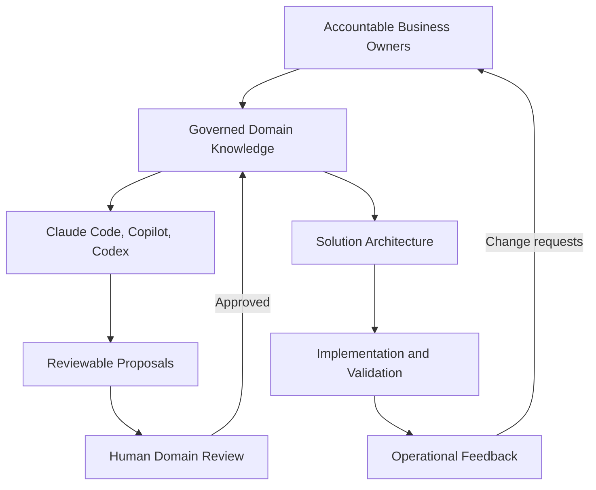

The operating model does not eliminate feedback. It prevents feedback, AI-generated analysis, or technical execution permission from bypassing the people accountable for business commitments.

> **Enterprise Tip**  
> A domain repository is valuable not because it contains the most text, but because an important business decision can be understood, traced, challenged, approved, and safely changed.

---

# 15. Decision Points

Business-domain decisions establish the policies and commitments that the architecture must eventually support. Architecture decisions establish how the solution will support them. The two are related but must not be confused. The Northstar case study contains both established principles and choices still awaiting accountable business approval.

## 15.1 What Does a Corporate Fleet Booking Represent?

A customer may request service for multiple vehicles over multiple dates. Three plausible business models are: a single indivisible fleet booking; independent appointments submitted together; or a group request coordinating individual appointments. The first provides an uncomplicated group commitment but makes partial outcomes difficult. The second makes vehicle-level changes explicit but can lose the customer's collective reference. The third supports both levels at the cost of additional business concepts. Northstar's 24 vehicles over two days make this a high-impact decision.

**Status:** Open. Product and Corporate Operations must define identity, grouping, confirmation, cancellation, and completion semantics before dependent architecture is fixed.

## 15.2 Is Partial Acceptance Permitted?

If ten vehicles are requested and capacity remains for six, the organization might reject the group, accept six automatically, or ask the customer to approve a revised arrangement. These alternatives affect authorization, reservation, customer communication, and billing. Automatic partial acceptance is not an innocent usability convenience; it may change the customer's commercial intent.

**Status:** Open. Product and Station Operations should decide and document whether any approved policy differs by account or contract.

## 15.3 How Is Station Capacity Calculated?

Capacity might be measured by vehicle count, service duration, resource availability, or a combination of bays, employees, equipment, vehicle category, and existing commitments. Physical bays and usable capacity are not synonymous. The selected measurement policy must be understandable to station managers before it is implemented technically.

**Status:** The invariant preventing overbooking is established; the calculation policy remains open under Station Operations.

## 15.4 When Does Capacity Become Reserved?

The baseline workflow checks authorization and eligibility before attempting a reservation. A different approved policy might temporarily hold capacity during a longer authorization process. Such a change raises questions about hold duration, release, priority, and the consequences of approval failure. Viewing availability by itself remains non-committing under BR-CAP-001.

**Status:** The availability/reservation distinction is established; any early hold policy is open.

## 15.5 What Happens When Capacity Changes?

If capacity disappears after a customer sees it, the business may reject the requested schedule, offer an alternative, or permit authorized operational escalation. None of those optional remedies should be invented merely to complete the workflow. The fixed requirement is that reservation failure cannot produce a confirmed booking.

**Status:** Invariant established; customer alternatives are open.

## 15.6 Who Is Authorized to Act for a Corporate Fleet?

Account-wide administrators, fleet-specific administrators, and delegated approvers may have different rights. Being authenticated to the corporate portal does not entitle a user to manage every fleet. The business should clarify corporate account scope, fleet assignment, authorized actions, approval thresholds, and the effect of a revoked permission.

**Status:** Authorized fleet scope is established; details of delegation and thresholds are open.

## 15.7 What Is the Fleet–Vehicle Relationship?

A vehicle could belong to one current fleet, participate in multiple groupings, or change fleets over time. The team must determine who may alter membership, whether historical assignments matter, and how changes affect existing service commitments. A foreign-key shape must not settle these business questions.

**Status:** Open under Corporate Operations.

## 15.8 What Is a Service Package?

A package may be a fixed group of services or a configurable commercial offering. Service availability may depend on the station and vehicle type. The team must establish permitted composition, duration, eligibility, and changes to accepted bookings.

**Status:** Service and package concepts established; detailed composition and customization open.

## 15.9 When Is Pricing Finalized?

Potential policies include a price captured at submission, a price finalized at confirmation, or a price derived from qualifying completed work. Contract renewals and additional authorized services may complicate the answer. The architect must identify applicable commercial authority and effective dates before designing persistence or billing behavior.

**Status:** Open under Commercial Management and Finance.

## 15.10 What Makes Work Billable?

Qualifying completed services support corporate billing under the case-study baseline. The business must still determine whether nonattendance, late cancellation, partly completed services, or authorized extras create additional charges. Confirmation and completion are not equivalent financial states.

**Status:** Principle established; contractual exceptions open.

## 15.11 How Is Corporate Billing Organized?

Invoices might be produced per service, per booking, periodically by corporate account, or according to an account-specific agreement. Invoice grouping should not be inferred from the internal booking data structure. Payment terms are a distinct decision from invoicing.

**Status:** Corporate consolidated billing is a scenario characteristic; cycles, grouping, and adjustments remain open.

## 15.12 Which Business Events Matter?

The organization should recognize major changes such as Booking Submitted, Capacity Reserved, Booking Confirmed, Service Completed, and Invoice Issued. Their exact meanings and interested business capabilities should be agreed before technical message contracts are designed.

**Status:** Initial event inventory defined; detailed semantics and notification policies require review.

## 15.13 What Happens During Operational Exceptions?

A station closure, equipment failure, vehicle nonarrival, cancellation, or incomplete service changes the customer's expected outcome. The business should define the responsible decision owner, effects on existing commitments, alternatives offered, communications, and financial consequences.

**Status:** Significant exception types identified; policy outcomes open.

## 15.14 Which Customer-specific Variations Are Real?

Walk-in, corporate, government, insurance, and rental customers share some capabilities but may have different approvals, contractual references, rates, and payment terms. Variation must be based on approved evidence; the customer-category label alone is not proof of a particular rule.

**Status:** Categories established; detailed contract-specific variation open.

## 15.15 What Is the AI Agent's Authority?

AI Agents may analyze sources, identify contradictions, draft acceptance criteria, and propose changes. They must not approve policy. Technical permission to edit a Markdown file is separate from business authority to change pricing, capacity, or authorization rules.

**Recommended governance decision:** Human-approved promotion of authoritative business knowledge, with all proposed changes reviewable.

## 15.16 How Much Must Be Decided Before Architecture?

Requiring every imaginable future policy to be resolved blocks useful progress. Ignoring high-impact uncertainty creates structural risk. A risk-based readiness decision allows architecture exploration around established invariants while deferring dependent commitments. For Northstar, booking grouping, partial acceptance, and reservation policy are more architecture-significant than the wording of an ordinary reminder notification.

**Recommended engineering decision:** Scope readiness to the next design or implementation task; keep unresolved dependencies explicit.

### Consolidated decision register

| ID | Question | Status | Primary accountable function |
| --- | --- | --- | --- |
| BD-001 | Meaning of a multi-vehicle booking | Open | Product / Corporate Operations |
| BD-002 | Partial fleet acceptance | Open | Product / Station Operations |
| BD-003 | Capacity calculation | Partially defined | Station Operations |
| BD-004 | Reservation timing and temporary holds | Partially defined | Station Operations / Product |
| BD-005 | Alternatives when capacity changes | Partially defined | Station Operations |
| BD-006 | Corporate authorization model | Partially defined | Corporate Account Management |
| BD-007 | Fleet membership semantics | Open | Corporate Operations |
| BD-008 | Service-package structure | Partially defined | Service Operations |
| BD-009 | Pricing finalization | Open | Commercial Management |
| BD-010 | Billable activity and exceptions | Partially defined | Finance |
| BD-011 | Invoice grouping and cycle | Partially defined | Finance |
| BD-012 | Business event and notification semantics | Initial inventory | Product / Customer Operations |
| BD-013 | Operational exception policies | Open | Station Operations |
| BD-014 | Customer category and contract variations | Partially defined | Account Management |
| BD-015 | AI Agent authority and policy promotion | Proposed governance control | Enterprise Governance |

For a consequential decision, record the alternatives, rationale, source, responsible owner, effective scope, status, and affected capability/workflow references. A simple record for BD-002 might remain explicitly pending:

```yaml
id: BD-002
title: Partial acceptance of corporate fleet bookings
status: Open
business_owners:
  - Product Owner
  - Station Operations
alternatives:
  - Reject entire request
  - Automatically accept available vehicles
  - Request customer approval for partial acceptance
impacts:
  - Booking identity and lifecycle
  - Capacity reservation
  - Authorization
  - Confirmation and notification
  - Billing and reporting
implementation_allowed: false  # for dependent policy until approved
```

The decision register is the bridge between Chapter 46 and Chapter 47. It tells the architect which requirements may drive firm design choices and which require conditional treatment. Architecture implements business decisions; it must not accidentally become the process through which those decisions are made.

---

# 16. Exercises

These exercises develop practical competence in enterprise domain discovery and governance. They are business-oriented and deliberately stop short of generating the solution architecture. Each output should separate approved case-study evidence from proposed policies.

## 16.1 Develop the Business Context

Describe Alpha Car Detailing's objectives, customer groups, station operating model, and commercial relationships. Produce a two-page context note with five candidate business outcomes and a register of facts still requiring confirmation. **Acceptance:** no database tables, APIs, or deployment proposals; stakeholders should understand the document without technical vocabulary.

## 16.2 Build the Business Capability Map

Model Customer Management, Corporate Accounts, Fleet Management, Booking, Station Operations, Capacity Management, Service Catalog, Billing, Payments, and Notifications. Create a responsibility matrix and Mermaid diagram. Identify possible overlap without creating a service topology. **Acceptance:** each capability has a business purpose, decision area, and relevant collaborators.

## 16.3 Establish a Domain Glossary

Define at least 18 terms, including booking request, booking, availability, reservation, confirmation, service completion, billing, and payment. Ask a hypothetical station manager and finance representative to challenge ambiguous words. **Acceptance:** each term has a definition, context, owner, and approval status.

## 16.4 Map Northstar's End-to-end Booking Journey

Use the 24-vehicle, two-day request. Describe the ten business stages, actors, preconditions, inputs, and outcomes. Include authorization failure, unsupported service, and capacity loss. **Acceptance:** checking availability is not described as reserving capacity; submission is not confirmation.

## 16.5 Analyze Fleet Authorization

A Northstar administrator tries to book vehicles from another regional fleet. Separate login identity, corporate membership, assigned fleet, and permitted business action. Draft a decision table and Gherkin acceptance scenarios. **Acceptance:** do not prescribe identity provider configuration or claim a universal corporate approval threshold.

## 16.6 Define Station Capacity

A station has six bays but variable technicians, service durations, and equipment. Produce a capacity-factor matrix and a list of questions for Station Operations. **Acceptance:** do not equate physical bays to interchangeable booking slots or select a persistence/concurrency mechanism.

## 16.7 Evaluate Competing Reservations

Two customers see the same final available service time and both submit requests. Identify the invariant, an acceptable confirmation outcome, and customer communication when reservation fails. **Acceptance:** use BR-CAP-001 and BR-CAP-002 as sources; no assumed race-condition solution is required.

## 16.8 Analyze Partial Acceptance

Northstar requests ten vehicles with capacity for six. Compare all-or-nothing, automatic partial acceptance, and customer-approved partial acceptance. Record effects on booking identity, capacity, billing, and notifications. **Acceptance:** leave the business choice open and identify the accountable owner.

## 16.9 Analyze Pricing, Billing, and Payment

Northstar uses negotiated pricing and consolidated invoicing. Produce separate definitions and an outline of financial triggers. Ask when pricing is finalized and whether cancelled work may be charged. **Acceptance:** do not invent rates, thresholds, fees, or invoice cycles.

## 16.10 Discover Business Events

Create an inventory of meaningful occurrences between submission and invoice issuance. For each, record business meaning, trigger, interested stakeholders, and evidence. **Acceptance:** do not include event-broker names, message schemas, or version numbers.

## 16.11 Compare Customer Categories

Analyze walk-in, corporate, government, insurance, and rental customers across booking, authorization, capacity, pricing, billing, and notifications. **Acceptance:** distinguish shared behavior from customer-specific variations that still require contract evidence.

## 16.12 Run AI-assisted Discovery with Claude

Give Claude Code a bounded Prompt to read available domain documents, extract evidence, identify contradictions, and create a readiness report. **Acceptance:** the output lists missing source files rather than pretending they exist and labels unsupported policy as proposed.

## 16.13 Compare Claude, Copilot, and Codex

Give the three tools an equivalent Northstar scenario and shared rules. Compare source traceability, terminology fidelity, contradiction detection, and respect for approval boundaries. **Acceptance:** platform agreement is not treated as independent business approval.

## 16.14 Build a Rule Traceability Matrix

Link the goal of avoiding overbooking to Capacity Management, BR-CAP-002, the corporate booking workflow, and a reservation-failure acceptance scenario. Repeat for fleet access and station/service eligibility. **Acceptance:** report missing links instead of generating new rules to fill them.

## 16.15 Perform an Anti-pattern Review

Review a proposed design containing six microservices, independent databases, a 25-vehicle limit, and a 15-minute reservation expiry without stakeholder evidence. Identify premature technical choices and invented policies. **Acceptance:** provide a corrected domain-first plan.

## 16.16 Assess Domain Readiness

Classify Customer, Fleet, Booking, Capacity, Authorization, Pricing, Billing, and Notifications as defined, partially defined, or requiring clarification. Identify architecture-significant gaps. **Acceptance:** distinguish readiness for exploration from readiness to implement a specific policy.

## 16.17 Investigate Multi-station Booking

Northstar requests services for 60 vehicles across Lahore, Karachi, and Islamabad. Identify group-identity, multi-station authorization, capacity, confirmation, and financial questions. **Acceptance:** capture business semantics before discussing distributed coordination.

## 16.18 Assess an Early Reservation Policy Change

Suppose Product proposes temporary holds before final authorization. Produce an impact analysis of blocked capacity, expiry, release, approval failure, and customer expectations. **Acceptance:** classify the proposal as unapproved and identify the decision authority.

## 16.19 Trace an AI-generated Rule Failure

A Lead Agent invents a vehicle limit; a Developer implements it; a Validator tests it; and an Evaluator reports success. Identify where governance failed and how source-linked rule identifiers would prevent recurrence. **Acceptance:** demonstrate why green tests alone do not prove business correctness.

## 16.20 Capstone: Build the Domain Package

Assemble a business overview, customer categories, capability model, glossary, actor model, workflow, business rule register, event inventory, decision register, acceptance scenarios, traceability matrix, risks, and readiness assessment. Use an orderly location such as `alpha-car-detailing/docs/business-domain/`. **Acceptance:** every confirmed rule has evidence; assumptions remain visible; the package is reviewable by business owners and does not impose an unapproved architecture.

### Assessment rubric

| Criterion | Weight |
| --- | ---: |
| Business objectives, actors, and capabilities | 20% |
| Domain language and conceptual consistency | 10% |
| Rule evidence and approval classification | 15% |
| Workflows and important alternative outcomes | 15% |
| Responsibility boundaries | 10% |
| Traceability and acceptance scenarios | 10% |
| AI Agent and business governance | 10% |
| Scoped architecture readiness | 10% |

The exercise set should be evaluated by the strength of business reasoning and provenance rather than the number of pages or generated artifacts. Recognizing that an important rule remains unknown can be more valuable than producing a confident but unsupported specification.

---

# 17. Interview Questions

The following questions assess domain discovery and architectural judgment rather than rote knowledge of implementation patterns. Strong answers make uncertainty visible, distinguish authority from suggestion, and explain the implications for Alpha Car Detailing.

## 17.1 Business Domain Foundations

**1. What is a business domain?**  
It is the business activity, terminology, relationships, behavior, decisions, and outcomes the software exists to support. It remains meaningful independent of the selected architecture.

**2. Why should domain understanding precede architecture?**  
Technical components must implement real responsibilities and commitments. Designing first risks converting guesses into expensive software boundaries.

**3. How does a domain model differ from a database schema?**  
A domain model captures business meaning and behavior; a schema captures storage. A `Bookings` table cannot determine confirmation or partial acceptance policy.

**4. What distinguishes a capability from a service?**  
A capability describes what the organization must do; a service is one possible technical means of supporting it. The mapping is not automatically one-to-one.

**5. Why is ubiquitous language important?**  
It prevents different stakeholders and systems from assigning contradictory meanings to terms such as booking, reservation, and completion.

**6. What is the difference between gathering requirements and discovering the domain?**  
Gathering requests captures stated needs. Domain discovery also examines underlying responsibilities, business rules, exceptions, terminology, and unresolved decisions.

**7. How would you identify Alpha Car Detailing's capabilities?**  
Start from customer journeys and operational/commercial responsibilities; validate a capability map with stakeholders; do not derive it from code modules.

**8. When do business capabilities deserve separate conceptual boundaries?**  
When responsibilities, vocabulary, rules, decision ownership, or change drivers differ meaningfully, even if the implementation remains one application.

**9. Should each capability become a microservice?**  
No. Distribution adds operational and consistency cost. Deployment boundaries require additional design evidence considered in Chapter 47.

**10. How do business and organizational boundaries differ?**  
A business boundary represents a responsibility or meaning; organizational boundaries represent teams and reporting structures that may change.

## 17.2 Corporate Fleet Booking

**11. Explain the baseline fleet booking workflow.**  
Select fleet and vehicles, choose station/service, check capacity, submit, authorize/validate, reserve, confirm, fulfill, and process applicable billing/notifications.

**12. Why is fleet booking not necessarily repeated retail booking?**  
A fleet request may include group-level authorization, confirmation, contractual pricing, coordinated schedules, and consolidated billing.

**13. Can the system simply create one retail booking per vehicle?**  
Only if that representation preserves the approved group and vehicle-level business semantics. Those semantics remain under investigation.

**14. What questions precede multi-vehicle booking design?**  
Ask about multi-day scheduling, station variation, partial acceptance, cancellation, group identity, individual service status, and billing.

**15. What if capacity exists for only six of ten vehicles?**  
Do not invent partial acceptance. Present the policy alternatives and obtain an accountable business decision.

**16. Availability versus reservation?**  
Availability is an observation; reservation is a commitment. Viewing a slot does not hold it under BR-CAP-001.

**17. Why are bay counts insufficient as a capacity model?**  
Usable capacity may also depend on staff, duration, equipment, vehicle categories, and existing commitments.

**18. What if capacity disappears between lookup and submission?**  
Do not confirm without successfully committing capacity. Alternatives offered to the customer remain a separate business decision.

**19. State the capacity invariant.**  
Confirmed work must have the required operational capacity reserved, and total confirmed commitments must not exceed accepted capacity.

**20. Does this invariant require distributed transactions?**  
No. It establishes an outcome; the technical enforcement mechanism depends on the eventual architecture.

## 17.3 Rules, Ownership, and Financial Meaning

**21. What is a business invariant?**  
A condition that must remain true within the stated business scope, often across multiple operations and failure paths.

**22. Business authorization versus technical access control?**  
A user may log in but still lack entitlement to book a specific fleet or purchase a service under a corporate agreement.

**23. Who should approve business rules?**  
Accountable business owners, such as Station Operations for capacity and Finance for billing—not whoever writes the implementation.

**24. How should contradictory source documents be handled?**  
Record the contradiction, provenance, effective scope, and impact; obtain a business decision rather than silently favoring one document.

**25. How should assumptions be handled?**  
Label them, record their origin and consequence, assign a decision owner, and avoid using them as enforceable policy until approved.

**26. Explain pricing versus billing versus payment.**  
Pricing determines commercial amount; billing establishes and communicates an obligation; payment settles it.

**27. When does corporate work become billable?**  
Qualifying completed work supports billing under the baseline. Cancellation fees or other exceptions require approved commercial policy.

**28. What determines whether a station supports a service?**  
Relevant business eligibility may depend on service offering, equipment, vehicle category, personnel, and station rules; availability is a separate concern.

**29. What if a station closes after confirmation?**  
The business must define how to manage the existing commitment, communication, rescheduling or cancellation, and any financial consequences.

**30. How should domain KPIs be selected?**  
Trace them to business goals and agree their calculation. Capacity utilization is meaningless without a governed definition of usable capacity.

## 17.4 Events and Domain Evolution

**31. Business event versus integration event?**  
A business event names a meaningful occurrence. An integration event is one technical means of communicating it to another component.

**32. Why discover events before defining schemas?**  
The business must first agree on what happened; message shape and transport should not dictate the meaning.

**33. How does a glossary affect API design?**  
It helps ensure endpoint operations and events use the terms confirmed by the business, not ambiguous developer synonyms.

**34. Can a domain model survive a system rewrite?**  
Yes. Business commitments and terminology should persist unless the business itself changes.

**35. How do you verify a vehicle–fleet relationship?**  
Ask about membership rules, transfers, historical relationships, and authorization instead of deriving cardinality from a preferred database design.

## 17.5 AI Engineering and Governance

**36. Why does AI increase the importance of domain precision?**  
AI can scale implementation of unsupported assumptions across code, tests, and documents before anyone recognizes the original gap.

**37. What should an Agent do when a rule is missing?**  
Identify the question and alternatives, cite available evidence, and seek accountable approval rather than inventing an answer.

**38. Do Claude, Copilot, and Codex have different business authority?**  
No. Their tooling differs, but all must defer to the same approved business-domain records and human decision owners.

**39. Instruction versus Skill versus Prompt?**  
Instructions give persistent behavior constraints, Skills package reusable methods, and Prompts specify immediate tasks. None replaces business evidence.

**40. May a harness silently change a booking policy?**  
No. It can identify defects and propose changes; commercial and operational rules require business approval.

**41. How do you prevent assumption contamination?**  
Use classified rules, source IDs, explicit approval, reviewable changes, and acceptance tests traceable to approved business requirements.

**42. Can passing tests prove business correctness?**  
Not alone. A green test can faithfully verify an invented business limit; business validation and technical validation are different checks.

**43. What is Repository Intelligence's role in domain work?**  
It helps find relevant sources but must distinguish approved documents, legacy code, drafts, and temporary scratchpad observations.

**44. What may a self-learning harness do with recurring capacity failures?**  
Collect evidence and propose investigation or a policy review, but not independently relax the capacity invariant.

**45. Is agreement among several AI Agents proof of an approved rule?**  
No. Shared plausible assumptions are not equivalent to authoritative business evidence.

## 17.6 Senior Architect Scenarios

**46. Partial booking is unresolved; can architecture begin?**  
Yes, conditional exploration can proceed around established rules. Decisions dependent on partial acceptance must remain provisional until business approval.

**47. Teams disagree about confirmation versus reservation; what now?**  
Use the established baseline: confirmation requires successful reservation. If other approved sources conflict, escalate for authoritative reconciliation.

**48. Government and corporate customers differ in authorization; how model them?**  
Identify shared permission concepts and confirmed contract-specific variations; do not infer universal government rules from the category label.

**49. How do you declare the domain architecture-ready?**  
Confirm that critical goals, rules, invariants, and workflows are sufficiently known for the proposed design scope, and that consequential unknowns are owned.

**50. How would you justify domain discovery to an executive demanding immediate code?**  
Explain that rapid implementation of a wrong capacity or billing policy increases operational risk and rework. Focused discovery protects the intended business outcome.

### Interview case study

Ask a candidate to analyze Northstar's 24-vehicle request across two days under limited station capacity and consolidated billing. A strong answer names the relevant capabilities, distinguishes submission from confirmation, identifies the reservation invariant, asks about partial acceptance and pricing, and proposes a reviewable domain package. A weak answer begins by selecting a message broker or database without resolving the business questions.

The decisive signal is not how many patterns the candidate remembers. It is whether the candidate understands the source and limits of each important decision.

---

# 18. Chapter Summary

Chapter 46 introduced Alpha Car Detailing as a nationwide vehicle-care business with walk-in customers, corporate fleets, government departments, insurance companies, and rental companies. The case study connects customer relationships, fleets and vehicles, station operations, services and packages, booking, capacity, commercial pricing, billing, payments, and notifications. Its central demonstration is Northstar Distribution's request to schedule 24 vehicles over two days.

## 18.1 The Core Business Model

The chapter established ten high-level business capabilities: Customer Management, Corporate Accounts, Fleet Management, Booking, Station Operations, Capacity Management, Service Catalog, Billing, Payments, and Notifications. These are durable descriptions of business responsibility rather than automatic microservice boundaries.

A corporate fleet booking crosses several of those capabilities. The administrator selects authorized fleet context and eligible vehicles, chooses a suitable station and service, observes availability, submits a request, satisfies required authorization and validation, and attempts to reserve capacity. Only a successfully reserved arrangement may be confirmed. Qualifying completed work later supports appropriate billing and customer communication.

## 18.2 The Most Important Distinctions

Availability is not reservation. Submission is not confirmation. Confirmation is not service completion. Pricing is not billing, and billing is not payment. Authentication alone does not establish business authority over a corporate fleet. Business capabilities are not necessarily software services; business events are not necessarily messages distributed through technical infrastructure.

Maintaining these distinctions prevents premature design and preserves the business commitments that later software must enforce.

## 18.3 What Is Confirmed and What Remains Open?

The case-study baseline includes authorized fleet scope, vehicle eligibility, station/service suitability, non-committing availability lookup, and confirmation only after successful capacity reservation. Qualifying completed work supports billing. Rules have identifiers and should remain traceable to business scenarios.

Other issues remain deliberately open: multi-vehicle booking structure, partial acceptance, precise capacity calculation, temporary holds, approval thresholds, detailed pricing, contractual exceptions, invoice grouping, and cancellation policy. These are not defects in the chapter. Their visibility is a necessary condition for responsible architecture.

## 18.4 AI Supports Domain Analysis, Not Business Policy Ownership

Claude Code, GitHub Copilot, and Codex can organize business sources, compare definitions, identify contradictions, draft workflow diagrams, and produce reviewable acceptance scenarios. Their Instructions, Skills, and Prompts must reference the same governed business knowledge. An Agent's generated output, a passing test, or a successful harness gate does not independently authorize a new business rule.

This is why business validation and technical validation are complementary. Business owners determine what should be true; architecture and engineering ensure the system reliably supports it.

## 18.5 Transition to Solution Architecture

Chapter 47 begins with the capabilities, rules, workflows, business events, risks, and open decisions established here. It will determine technical responsibilities and coordination mechanisms without allowing those choices to redefine Alpha Car Detailing's business. The domain can be ready for certain architectural investigations while remaining unready for implementation decisions dependent on unresolved policy.

> **Architect's Note**  
> AI makes generating software easier; it does not make business authority optional. The faster a team can implement, the more carefully it must establish what the implementation is supposed to mean.

**The chapter's enduring principle is that verified business understanding defines the intended outcome; architecture chooses how to support it; AI-assisted engineering accelerates delivery while preserving that relationship.**

---

# 19. Further Reading

The following references deepen the reader's understanding of business analysis, capability modeling, collaborative discovery, Domain-Driven Design, and the distinction between approved requirements and technical implementation. They are recommended sources, not substitutes for Alpha Car Detailing's own governed decisions.

## 19.1 Domain-Driven Design

**Eric Evans, *Domain-Driven Design: Tackling Complexity in the Heart of Software*. Addison-Wesley Professional, 2003.**  
[Publisher reference](https://www.informit.com/store/domain-driven-design-tackling-complexity-in-the-heart-9780321125217). Evans establishes the importance of collaboration with domain experts, ubiquitous language, and models grounded in business behavior. Use these ideas to refine the meanings of Account, Fleet, Booking, Capacity Reservation, and Service Completion before implementation.

**Vaughn Vernon, *Domain-Driven Design Distilled*. Addison-Wesley Professional, 2016.**  
[Publisher reference](https://www.informit.com/store/domain-driven-design-distilled-9780134434964). The strategic modeling material helps readers understand boundaries without equating each boundary with a deployable microservice. This prepares the transition to Chapter 47.

**Vaughn Vernon, *Implementing Domain-Driven Design*. Addison-Wesley Professional, 2013.**  
[Publisher reference](https://www.informit.com/store/implementing-domain-driven-design-9780321834577). Read after the business model is clear to examine how complex domain behavior can inform software architecture and design.

## 19.2 Business Architecture and Requirements

**Business Architecture Guild, *A Guide to the Business Architecture Body of Knowledge (BIZBOK Guide)*.**  
[Business Architecture Guild](https://www.businessarchitectureguild.org/). Use business capability and value-stream thinking to identify Alpha Car Detailing's enduring organizational responsibilities. The full professional guide may have access restrictions.

**International Institute of Business Analysis, *A Guide to the Business Analysis Body of Knowledge (BABOK Guide)*.**  
[IIBA BABOK Guide](https://www.iiba.org/career-resources/a-business-analysis-professionals-foundation-for-success/babok/). Relevant practices include elicitation, collaboration, requirements lifecycle management, requirements analysis, and solution evaluation.

**IIBA, *The Business Analysis Standard*.**  
[The Business Analysis Standard](https://www.iiba.org/knowledgehub/the-business-analysis-standard/). Use it to connect stakeholder needs, value, requirements, and solution evaluation without conflating business policy with architecture preference.

## 19.3 Collaborative Discovery

**Alberto Brandolini, *Introducing EventStorming*.**  
[Official book site](https://www.eventstorming.com/book/). EventStorming facilitates discovery of meaningful business occurrences, decisions, process boundaries, and exceptions with domain experts. Use it to map fleet booking events without immediately designing a message broker.

**Jeff Patton, *User Story Mapping: Discover the Whole Story, Build the Right Product*. O'Reilly Media, 2014.**  
[O'Reilly reference](https://www.oreilly.com/library/view/user-story-mapping/9781491904893/). Story mapping helps reveal the full customer journey and important alternative paths beyond the initial happy-path requirement.

## 19.4 Conceptual Models and Acceptance Evidence

**Martin Fowler, *Analysis Patterns: Reusable Object Models*. Addison-Wesley Professional, 1996.**  
[Author's reference](https://martinfowler.com/books/ap.html). This work strengthens conceptual modeling and helps readers avoid allowing convenient data structures to decide business relationships.

**Martin Fowler, *Bounded Context*.**  
[Author's article](https://martinfowler.com/bliki/BoundedContext.html). Read for a concise explanation of why a term such as "account" may mean something different in corporate relationships, identity, and finance.

**Gojko Adzic, *Specification by Example: How Successful Teams Deliver the Right Software*. Manning Publications, 2011.**  
[Publisher reference](https://www.manning.com/books/specification-by-example). Concrete examples help business and engineering teams agree on observable outcomes. Derive scenarios from approved rules rather than allowing AI-generated tests to establish policy.

## 19.5 AI Agent Documentation

For current platform behavior, consult the official documentation for [Claude Code](https://code.claude.com/docs/en/overview), [GitHub Copilot custom instructions](https://docs.github.com/en/copilot/concepts/prompting-and-context/custom-instructions), and [OpenAI Codex workflow guidance](https://developers.openai.com/cookbook/examples/codex/iterating-development-workflows-with-codex). Platform mechanisms change faster than business-domain principles. Verify current support for repository Instructions, reusable Skills, Prompts, permissions, and review workflows before applying the examples verbatim.

## 19.6 Recommended Learning Progression

Begin with BABOK and business capability mapping to understand business goals, actors, policy authority, and responsibilities. Use user story mapping and EventStorming to discover customer journeys, decisions, and exceptions. Study Evans and Vernon to refine vocabulary and boundaries. Use Specification by Example to convert approved policies into observable acceptance outcomes. Finally, examine technical DDD and architecture choices only after the essential business commitments and unresolved dependencies are explicit.

For Alpha Car Detailing, the reading sequence should lead back to a simple test: can a station manager, a fleet administrator, and a finance stakeholder explain the same corporate booking without contradicting one another? If not, the next task is domain clarification—not generation of more code.
