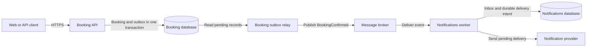
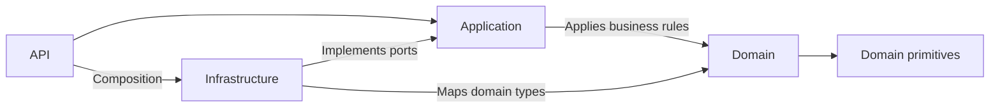

# Alpha Car Detailing Project Structure and Architecture

Architecture proposal for the .NET 10 companion to the *Enterprise AI Engineering Handbook*. The starting point is the Booking Service in `C:\AIHandbook\alpha-car-detailing`. The [chapter-to-code plan](<Chapter-to-Code Implementation Plan.md>) maps this project to the reader labs and their checkpoints.

## 1. Architecture at three levels

| Level | Decision for Alpha Car Detailing | Example |
| --- | --- | --- |
| System | Use microservices for business capabilities with a distinct owner, private data, and a reason to deploy separately. Start with Booking and add one integration at a time. | Booking owns appointments. Notifications owns dispatch and retries. |
| Service | Preserve the Clean Architecture dependency rules in the existing Booking solution. Apply the same rules to services that need a domain model. | The Booking aggregate can enforce its lifecycle without ASP.NET Core or EF Core. |
| Use case | Group code by the operation a reader is implementing, within the appropriate service projects. Mirror the feature name in the API, Application, and tests when each is needed. | `Features/Bookings/CreateBooking/` contains the endpoint in API and the use case in Application. |

This guide uses feature-oriented folders within Clean Architecture project boundaries. It adapts vertical slice ideas to the existing repository’s dependency rules. An operation can start as a direct method call. Defer application-wide CQRS, separate read stores, and mediator pipelines until there is a specific problem and an accepted architecture decision. [Microsoft guidance on Clean Architecture](https://learn.microsoft.com/en-us/dotnet/architecture/modern-web-apps-azure/common-web-application-architectures), [Jimmy Bogard’s vertical slice architecture article](https://www.jimmybogard.com/vertical-slice-architecture/).

### Starting point in the checkout

- The existing service has `Api`, `Application`, `Domain`, and `Infrastructure` projects. `BookingEndpoints` calls `IBookingService`. `BookingService` uses `IBookingRepository` and `TimeProvider`. EF Core persists locally to SQLite.
- The initial API creates a `Pending` Booking with `POST /api/bookings` and reads it with `GET /api/bookings/{bookingId}`. The aggregate validates required input and a future appointment, and records `BookingCreatedDomainEvent` in its local event collection.
- `global.json` defines the SDK policy. `Directory.Build.props` sets the framework and compilation conventions. `Directory.Packages.props` centralizes package versions. The baseline has xUnit domain tests and a `WebApplicationFactory` API test. The local startup currently calls `EnsureCreatedAsync` and maps generic health endpoints.
- `docs/adr/0001-use-clean-architecture.md` accepts the four service boundaries. `docs/adr/0002-defer-cqrs.md` establishes the direct application service approach. `docs/domain-overview.md` records the candidate business contexts.

## 2. Service boundaries and ownership

| Capability | Owns | Boundary and implementation order |
| --- | --- | --- |
| **Booking and Intake** | Appointment and walk-in intake, booking lifecycle, appointment references, Booking API, and published Booking events. | Existing service. Start here. Use IDs for customer, station, account, and vehicle identities owned elsewhere. |
| **Notifications** | Delivery requests, templates and provider routing, dispatch attempts, and delivery status. | First independently deployed consumer. Subscribe to a Booking event and demonstrate delivery with a fake provider locally. |
| **Fleet Management** | Fleet accounts’ enrolled vehicles, fleet membership, active status, and fleet-specific eligibility facts. | Add when corporate booking needs an independently owned vehicle roster. Keep the first eligibility fixtures deterministic. |
| Service Operations | Stations, service catalogue for delivery, bays, capacity and reservations, and work orders. | Candidate. Extract when appointment capacity or work-order operations require an authoritative owner. Establish who commits a reservation first. |
| Customer Management | Customer and organization records, account lifecycle, and contact preferences or references. | Candidate. Keep the authoritative personal data here. Publish only the fields downstream services require. |
| Pricing and Contracts | Price schedules, commercial agreements, discounts, quotas tied to contracts, and quotes. | Candidate. Store the applied quote reference and agreed terms needed for the booking. Establish which service enforces quota consumption before splitting it. |
| Billing and Payments | Invoices, payment references, refunds, reconciliation, and account billing state. | Candidate. Begin with a provider boundary and an explicit payment or invoicing workflow when required. |
| Identity and Access | External identity provider issues credentials. Each application service authorizes operations on the resources it owns. | Use the existing enterprise identity provider for a deployed system. Add a dedicated access service only if it owns real entitlement workflows. |
| Reporting and Analytics | Reporting projections and analytical datasets with their own freshness and retention expectations. | Candidate. Build from approved events or exports with replayable projections. |

The first distributed deployment is Booking plus Notifications. Add Fleet when ownership or integration requirements justify a third service. Extract later contexts only when their owner, consistency rules, API or event contracts, failure behavior, and deployment responsibilities are understood. Give each deployed service its own data boundary and credentials. Services may use the same database engine or server while keeping databases and privileges private. Cross-service access goes through published contracts. [Microsoft guidance on domain analysis](https://learn.microsoft.com/en-us/azure/architecture/microservices/model/domain-analysis), [Data considerations for microservices](https://learn.microsoft.com/en-us/azure/architecture/microservices/design/data-considerations).

### First two-service runtime



The relay belongs to Booking. The worker can host the consumer and dispatcher initially. The Notifications context can begin as a worker with a few projects and a database. Add an HTTP API when there is a real operation, such as an authorized delivery status query. A deployed gateway can route client traffic when more than one service needs public ingress.

## 3. Repository layout

Keep one repository and use `AlphaCarDetailing.sln` for the companion application. Give deploying services separate build artifacts and pipelines when the second service lands. The tree combines current paths and proposed additions. Introduce a folder in the milestone that uses it.

```text
Enterprise-AI-Engineering-Handbook/
├── book/                                # Manuscript and reader checkpoints
├── examples/
│   ├── ch08-prompts/                    # Proposed lab, synthetic input and verifier
│   └── ch45-improvement-engine/         # Proposed capstone replay
├── harness/                             # Engineering workflow, evidence and tests
├── prompts/                             # Governed task and Role Prompts
├── skills/                              # Reusable engineering procedures
├── .github/workflows/                   # Repository-level build and release workflows
└── alpha-car-detailing/
    ├── AlphaCarDetailing.sln
    ├── global.json
    ├── Directory.Build.props
    ├── Directory.Packages.props
    ├── src/
    │   ├── BuildingBlocks/
    │   │   └── AlphaCarDetailing.BuildingBlocks.Domain/
    │   └── Services/
    │       ├── Booking/                  # Existing, with proposed slices below
    │       ├── Notifications/            # Proposed worker and delivery storage
    │       └── Fleet/                    # Proposed when its ownership case is proven
    ├── tests/
    │   ├── Services/                    # Domain, API, persistence and contract tests
    │   └── System/                      # Proposed two-service workflow tests
    ├── docs/
    │   ├── architecture/                # Context map, flows and dependency rules
    │   ├── adr/                         # Accepted decisions and their consequences
    │   └── repository-discovery/        # Setup, repository map and known limitations
    ├── instructions/                    # Sample application engineering rules
    ├── deploy/                          # Proposed service-specific deployment assets
    └── scripts/                         # Local build, test and validation entry points
```

Keep the Harness outside the runtime dependency graph. It may run tests, inspect code, evaluate contract changes, and write evidence. Neither a Booking endpoint nor a Notifications worker should need a coding agent, Prompt, or Harness service to process user traffic. Keep `BuildingBlocks` small and technical. A business entity, EF Core context, repository implementation, or transport client belongs to its owning service. Share schema definitions or versioned generated clients only through explicit contracts.

## 4. Booking project and vertical slice layout

Each layer remains a project. Organize the API and Application by operation. Keep common domain rules with the aggregate and service-wide persistence with Infrastructure. The proposed `CreateBooking` and `GetBooking` folders are the first slice refactor. Add `ConfirmBooking` when the product defines that state transition.

```text
src/Services/Booking/
├── AlphaCarDetailing.Booking.Api/
│   ├── Program.cs                       # Composition and route registration
│   └── Features/Bookings/
│       ├── CreateBooking/
│       │   ├── Endpoint.cs              # Binding and HTTP result mapping
│       │   └── Request.cs               # HTTP contract when it differs from input
│       └── GetBooking/
│           └── Endpoint.cs
├── AlphaCarDetailing.Booking.Application/
│   ├── DependencyInjection.cs
│   ├── Features/Bookings/
│   │   ├── CreateBooking/
│   │   │   └── CreateBookingUseCase.cs  # Coordinates create behavior when extracted
│   │   └── GetBooking/
│   │       └── GetBookingUseCase.cs
│   └── Bookings/
│       └── IBookingRepository.cs       # Shared port when both slices use it
├── AlphaCarDetailing.Booking.Domain/
│   └── Bookings/
│       ├── Booking.cs
│       ├── BookingId.cs
│       ├── BookingStatus.cs
│       ├── VehicleRegistrationNumber.cs
│       └── Events/
│           └── BookingCreatedDomainEvent.cs
├── AlphaCarDetailing.Booking.Infrastructure/
│   ├── DependencyInjection.cs
│   └── Persistence/
│       ├── BookingDbContext.cs
│       ├── Configurations/BookingConfiguration.cs
│       ├── Repositories/BookingRepository.cs
│       └── Migrations/                  # Future managed deployment increment
└── Contracts/
    └── Events/BookingConfirmed/v1/      # Future schema, examples and change notes

tests/Services/Booking/
├── AlphaCarDetailing.Booking.Domain.Tests/
│   └── Bookings/BookingTests.cs
└── AlphaCarDetailing.Booking.IntegrationTests/
    └── Features/Bookings/
        ├── CreateBookingTests.cs
        └── GetBookingTests.cs
```

| Project | Responsibilities | Allowed dependencies |
| --- | --- | --- |
| `Api` | Route groups, request and response contracts, authentication, resource checks through the appropriate policy, HTTP status and Problem Details mapping, DI composition. | Application. Infrastructure from composition and host wiring. |
| `Application` | Use-case orchestration, typed input and results, port definitions, decision on transaction scope, coordination of authorization and side effects where required. | Domain and service-local abstractions. |
| `Domain` | Booking lifecycle, invariants, entities, value objects, and domain events. | Framework-independent domain primitives. |
| `Infrastructure` | EF Core, storage and migrations, broker or provider adapters, external API clients, and port implementations. | Application and Domain. |



Add a build check for forbidden layer and cross-service project references. The checked-out Domain and domain-primitives projects carry a native SQLite package reference. Verify why the reference is present and move it outward only after confirming any build and runtime implications. Match file and type names to existing conventions before moving them.

### How to implement a new slice

1. Name a user or business action. Identify its service owner, route or message, required permission, outcome, and acceptance criteria. Use `ConfirmBooking` or `CancelBooking` as names for actions with explicit state changes.
2. Define the boundary input and response. Put HTTP or message details at the edge. Keep an Application input or result type when it clarifies the operation or separates the public contract from internal state.
3. Implement one use case. Call it through direct injection. Reuse an existing port when it fits the operation. Add a dedicated query, adapter, or interface when the slice actually needs one.
4. Put reusable invariants in the Domain. In Create Booking, the API checks request shape, Application obtains the current time and invokes the aggregate, and the aggregate checks the booking rules. Infrastructure saves the result. Keep the transaction inside Booking.
5. Test the operation at the smallest useful boundary and through its API or message entry point. Add an independent test for the first meaningful failure, such as a past appointment or a missing booking ID.

For the first refactor, move `Create` and `Get` to feature-named endpoint files and keep the current `IBookingService` behind them. Verify the existing JSON, `201` and `Location`, `400` validation, and `200` or `404` lookup behavior. Extract the application use-case classes only when the feature work makes that separation worthwhile. Test both refactors at the normal route. Use separate changes for folder moves and behavior changes so readers can see what each step introduces.

## 5. API, data, and event design

### HTTP and service communication

- Keep OpenAPI with the owning service. Specify route, request schema, response shape, authorization, and documented errors. Use the current Booking routes for the first refactor. Add a versioning policy before publishing contracts to independent consumers.
- Use synchronous calls for decisions that need an authoritative answer now. Use one narrow Fleet operation to check multiple vehicles for an account when a live check is necessary. Name the timeout and the outcome when Fleet is unavailable. A local event-fed projection fits only after the business accepts a defined freshness limit and behavior for stale records.
- Use events for facts that other services can act on asynchronously, such as an appointment being confirmed. Optional downstream failure should leave the current booking state intact and visible. Retry transient failures with a budget. Retry writes only when the operation can be safely repeated.
- Separate transport validation from business rules and resource authorization. For an authenticated deployment, use standard Problem Details responses and a consistent policy for how `401`, `403`, `404`, `409`, and service-unavailable results are exposed. Confirm whether access denial should conceal existence of a specific resource.

### First event, from confirmation to notification

1. Add a `ConfirmBooking` use case after defining who may confirm, valid source states, and any capacity reservation rule. `POST /api/bookings` continues to create a `Pending` booking. `BookingCreatedDomainEvent` remains a local domain fact about creation. Publish `BookingConfirmed` only for a committed confirmation.
2. In the Booking database, write the state transition and an outbox record in the same transaction. Store the stable event ID and type/version with the serialized payload. The relay claims pending rows safely across instances, publishes, and records completion after broker acknowledgement. If delivery fails transiently, retry with bounded backoff and expose backlog age. Handle persistent failures through a documented operator path.
3. Treat redelivery as normal. The Notifications consumer records the event in its inbox and saves a durable delivery intent in one local transaction. Use a unique key for that consumer and event ID. Acknowledge the broker after the local commit. Test the crash window after publication and before the relay records success.
4. The dispatcher sends the durable intent using a stable delivery ID with the provider when supported. The provider call and local database update have separate failure outcomes. If the response is lost and the provider lacks deduplication, reconcile ambiguous sends before retrying. Record failure reason and attempts for controlled replay.
5. Test a confirmation, a repeat delivery, a transient send failure, and a permanent failure. The acceptance case ties one notification intent to the Booking event. The actual dispatch guarantee depends on the provider’s idempotency or reconciliation behavior.

The outbox pattern makes the Booking write and the obligation to publish atomic. The consumer still needs deduplication because a send can be repeated. The project can implement the pattern in its relational store and test it with the agreed local transport. [Microsoft transactional outbox example](https://learn.microsoft.com/en-us/azure/architecture/databases/guide/transactional-out-box-cosmos), [Microsoft idempotent consumer pattern](https://learn.microsoft.com/ga-ie/azure/architecture/patterns/idempotent-consumer).

### Event contracts and the handbook examples

| Item | Rule for this project |
| --- | --- |
| Ownership | Booking owns the `BookingConfirmed` schema and records which consumers use each supported version. Consumers maintain their subscriptions and test expectations. |
| Event envelope | Keep a stable event ID, event type and version, UTC occurrence time, producer, correlation ID, and payload. Carry ordering or causation metadata only where it serves a defined requirement. |
| Payload | The first contract should carry the booking ID and confirmation facts consumers need. Add an account, customer, or recipient reference only when justified by a consumer. Keep contact details and unrelated sensitive fields out of the shared event. Define how Notifications resolves the authorized recipient. |
| Compatibility | Validate serialization and each affected consumer. For Chapter 44’s optional `FleetAccountReference`, keep compatible behavior when the field is absent. Coordinate a new version when existing consumers would otherwise break. Pin the subscription version in the consumer fixture. |
| Book alignment | Chapters 15–17 use distinct route and event names, including `FleetBookingCreated`, `CorporateBookingCreated`, and `CorporateFleetBookingCreated`. Keep chapter-specific fixtures or record a deliberate mapping to the runnable contract. Chapter 45 should discover consumers from the relevant declarations and verify the checks at their actual versions. |

### Transactions, quotas, and idempotency

- Put each invariant under one authoritative writer. If the projected product limits a corporate account to a monthly booking allowance, decide what counts, when the count is released, and which service can commit usage. Protect concurrent increments with an enforceable database transaction and constraint or concurrency strategy. Test simultaneous attempts at the boundary.
- For retryable create operations, scope an idempotency record to the appropriate caller or account and the operation, persist a stable request fingerprint, and store the committed outcome with the write. Recheck caller authorization on replay. The same key and equivalent request should replay the prior result. Reusing the key for a different request should cause an explicit conflict. Use a unique constraint and define how a racing request gets the committed result or a retryable response.
- If Service Operations eventually owns reservations, specify pending state, timeout, and compensation rules before implementing the Booking-to-Operations workflow. Use a durable process only where independent transactions require coordination. Downstream read models should expose their freshness when it matters to users. [Microsoft data considerations for microservices](https://learn.microsoft.com/en-us/azure/architecture/microservices/design/data-considerations), [Microsoft microservice design patterns](https://learn.microsoft.com/en-us/azure/architecture/microservices/design/patterns).

## 6. Local development, quality, and operations

### Development and deployment profiles

| Profile | Start here | Add when required |
| --- | --- | --- |
| Reader baseline | .NET 10 SDK per `global.json`, Booking API, local SQLite, synthetic records, and documented PowerShell entry points. | Scripted seeds or disposable test databases as labs grow. |
| Two-service lab | Booking and Notifications with separate stores. Use a fake notification provider and a local harness fixture for event behavior. | Run a broker-backed integration profile when retries, acknowledgements, delivery order, or dead-letter behavior are under test. Script startup, readiness, and cleanup for the additional dependencies. |
| Deployed environment | Independently versioned service images, runtime identity and configuration, private stores, managed migrations, and service dashboards. | Justify the cloud broker, durable database, ingress, runtime platform, and any cache through ADRs. Add containers or Kubernetes when a deployment milestone calls for them. |

The repository roadmap mentions Event Hubs. If the deployed Notifications workflow needs managed topic subscriptions, retries, and dead-letter handling, evaluate Azure Service Bus against those requirements. Consider Event Hubs for ingestion or a reporting event stream. Choose the broker in an ADR that documents retention, replay, ordering, operational cost, and local test parity. [Microsoft comparison of Azure messaging services](https://learn.microsoft.com/en-us/azure/service-bus-messaging/compare-messaging-services).

From `alpha-car-detailing/`, the existing Booking baseline starts with these commands in PowerShell. Initial restore requires access to the configured package source. The [implementation plan](<Chapter-to-Code Implementation Plan.md#start-with-the-existing-booking-service>) records the prior restore blocker and the pending smoke test.

```powershell
dotnet restore AlphaCarDetailing.sln
dotnet build AlphaCarDetailing.sln --no-restore
dotnet test AlphaCarDetailing.sln --no-build
dotnet run --project src/Services/Booking/AlphaCarDetailing.Booking.Api
```

### Tests to add as capabilities land

| Test boundary | Examples | When |
| --- | --- | --- |
| Domain | Check future scheduling with a fixed clock, legal state transitions, and rule failures. | Every domain rule change. |
| Application | Verify policy outcomes and use-case sequencing with narrow fakes. Test the observable result and saved state. | When orchestration or decisions warrant it. |
| API integration | Use `WebApplicationFactory`, a test `TimeProvider`, and a disposable database. Check create-to-read, existing response shapes, invalid requests, and resource access once authentication is introduced. | First Booking refactor onward. |
| Persistence integration | Verify transactions, constraints, migrations, outbox atomicity, and concurrent updates using the deployment database engine when its behavior matters. | Before relying on storage behavior in a deployed service. |
| Contract | Pin producer schema and consumer subscription versions. Load existing and candidate payloads through the actual consumer adapter. | Every affected API or event change. |
| Workflow and recovery | Exercise confirmation to notification, broker redelivery, provider timeout, missing permissions, interrupted handoffs, and replay from known state. | When the corresponding boundary is introduced. |
| Architecture | Check project references, shared-code scope, and cross-service separation. | First feature-folder refactor onward. |

### Security and observability

- Validate token issuer, audience, lifetime, and applicable scopes in deployed APIs. Enforce resource-level access to the specific booking, organization, or fleet. Derive caller identity from the trusted principal and verify submitted IDs against the permitted scope. Test a caller who is authenticated but belongs to another account. [ASP.NET Core resource-based authorization](https://learn.microsoft.com/en-us/aspnet/core/security/authorization/resource-based).
- Give each service and its deployment job separate least-privilege credentials. Keep connection strings and provider secrets in local secret storage or the deployment secret manager. Limit broker permissions to the service’s topics or subscriptions. Use synthetic data in the reader labs, run logs, and replay fixtures.
- Use structured logs and OpenTelemetry traces and metrics. Correlate the HTTP request, database write, event publication, and consumer handling. Track request error rate and latency, outbox age, consumer lag, dead letters, and final delivery outcomes. Keep identifiers appropriate to the audience, and keep booking IDs, event IDs, and customer identifiers out of metric labels. [Microsoft microservices architecture guidance](https://learn.microsoft.com/en-us/azure/architecture/guide/architecture-styles/microservices).
- Split liveness from readiness when deploying. Liveness answers whether the process should be restarted. Readiness checks dependencies required to handle the work admitted to that service. For example, a broker outage can leave Booking writes available if its durable outbox and database are healthy. Use backlog indicators and alerts to make the degraded delivery path visible. [ASP.NET Core health checks](https://learn.microsoft.com/en-us/aspnet/core/host-and-deploy/health-checks?view=aspnetcore-10.0).

### Release and rollback

1. Run builds, focused tests, architecture checks, and affected contract checks in repository-level CI. Include dependent services when a shared build file or published contract changes. Build each deployable under an immutable image version. Record the source revision, tested contract versions, and migration revision in the release evidence.
2. For deployed databases, replace local startup creation with reviewed, versioned EF Core migrations and a controlled deployment job. Use an expand-and-contract sequence when old and new service versions may overlap. Decide how to handle an existing database created by `EnsureCreatedAsync` before the first migration. [EF Core migration deployment guidance](https://learn.microsoft.com/en-us/ef/core/managing-schemas/migrations/applying).
3. Deploy independently, verify health and workflow outcomes, and correlate the release with metrics. Before exposing a contract change, verify the active consumers and supported versions. Keep the previous compatible image and document how to stop or replay message handling during recovery.
4. Rehearse rollback with the schema and event versions present after deployment. Use an application rollback only with a compatible schema and contract. Where data changes cannot safely be reversed, prepare a forward fix or an explicit recovery procedure and verify it on a copy.

## 7. Build sequence and design decisions

| Implementation step | What to build | Ready to move on when |
| --- | --- | --- |
| 1. Verify the Chapter 7 baseline | Verify restore, build, tests, and a create/read run. Replace the expired sample appointment in the reader instructions with a future UTC value. | The same commands and outcomes work from a clean, documented checkout. |
| 2. Add Chapter 8 and refactor the first slices | Deliver the Prompt lab on the baseline as planned. In a focused code change, organize Create/Get endpoints and tests by feature. | The Prompt lab has a verifier. Both existing routes and the allowed layer references still pass review. |
| 3. Extend Booking by one business action | Agree on confirmation authority and state transitions. Add `ConfirmBooking`, persistence checks, and the outbox when an integration event is required. | State changes and outbox obligations commit together. Existing create/read consumers still work. |
| 4. Add Notifications | Add a separate worker and store, a versioned subscription, an inbox, and a fake-provider walkthrough. | The confirmation leads to one durable delivery intent. Redelivery, failure, and recovery behave as documented. |
| 5. Add Fleet as a separate owner | Confirm account and vehicle ownership, permission and freshness rules, and failure behavior. Build the narrow integration required by the corporate booking slice. | Fleet and Booking can evolve their internal data independently and pass their published contract checks. |
| 6. Harden and align with Chapters 44–45 | Enforce schema and release checks. Use real lab evidence or pinned fixtures for consumer impact, candidate validation, approval, and rollback. | Readers can trace the event from producer revision to consumer test and the release decision. |

Keep these decisions open until the milestone needs them.

| Decision | Resolve before |
| --- | --- |
| Who can confirm a booking, what reserves capacity, and how a reservation is revoked | The `ConfirmBooking` slice |
| Which account owns fleet entitlements, who can manage vehicles, and how stale eligibility is handled | The Fleet integration |
| How monthly limits are counted and whether a multi-vehicle request consumes one allowance or several | The applicable fleet booking use case |
| Who may receive a notification, where contact details are resolved, and how external sends are reconciled | The first Notifications release |
| Broker, deployed database engine, platform, acceptable downtime, data retention, and recovery objectives | An external or production deployment |

Record each accepted decision with its owner, rationale, implications, and verification. Add the corresponding source, fixture, and test links to the relevant chapter’s code companion. Keep the business decision separate from the mechanical step of moving a file or deploying a service so a reader can reproduce and review the change.
