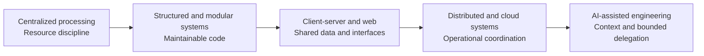
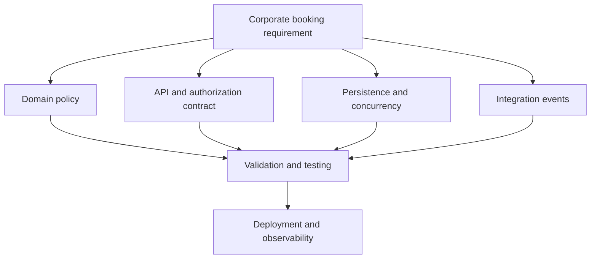
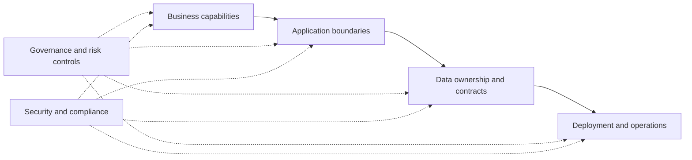
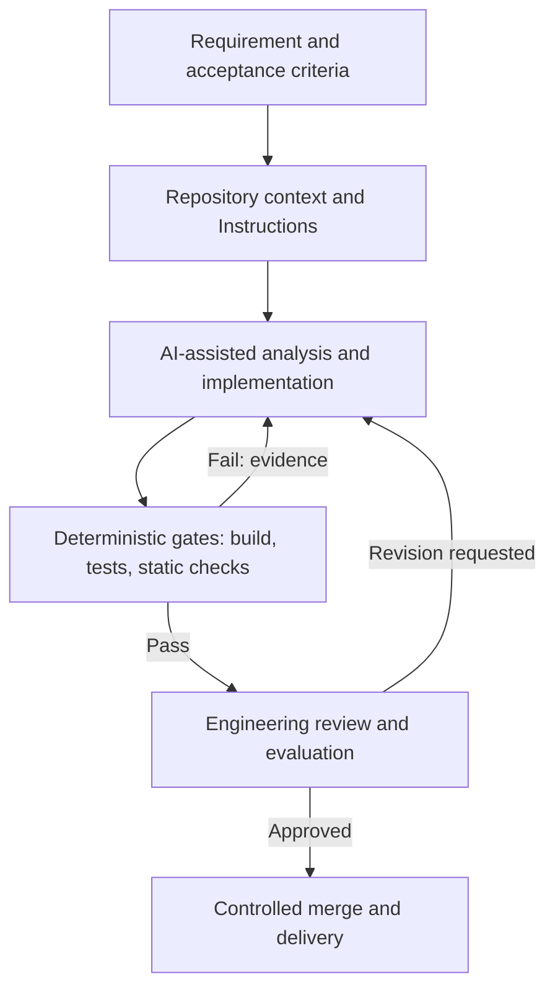
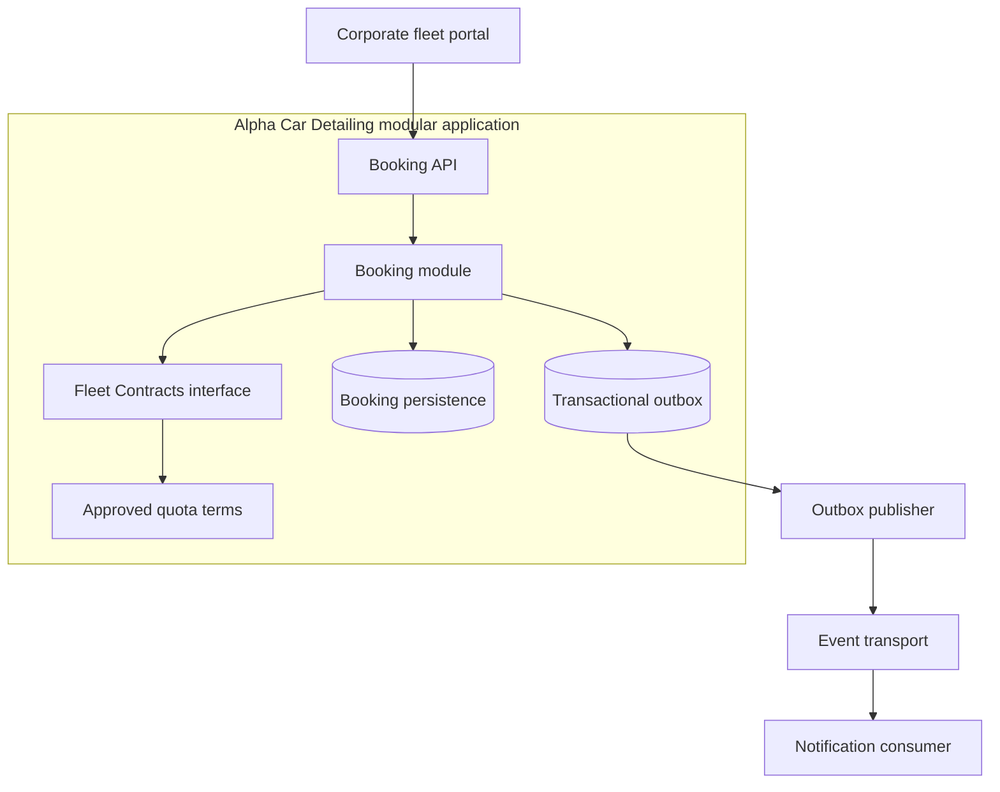
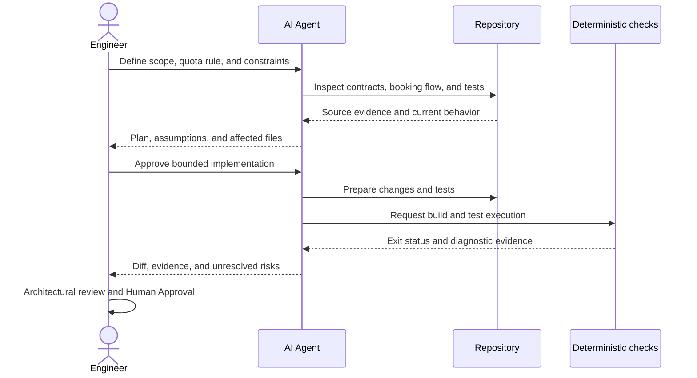

# Chapter 1 — The Evolution of Software Development

> Software engineering advances when the ways we organize knowledge, make decisions, and verify change can no longer keep pace with the systems we are responsible for delivering.

## Story-Driven Opening

At the end of the 1990s, a regional vehicle-service business could reasonably operate from a desktop application and a shared relational database. A clerk recorded bookings, a supervisor assigned technicians, and the accounts team reconciled payments at the end of the day. Releases were infrequent. When something failed, the engineer who had built the application often knew where to look.

Now imagine that business becoming **Alpha Car Detailing**, a nationwide provider serving walk-in customers, corporate fleets, government departments, insurers, and rental agencies. A corporate customer schedules hundreds of vehicles across several regions. Booking capacity must be respected at every location. Departments require cost-center invoices. Contract changes must be traceable. Mobile users expect timely updates, while operations teams require dependable reporting even when a payment processor or network connection is unavailable.

The central business questions are familiar: Can a customer book a service? Which package applies? Who will perform the work? How should the customer be charged? What has changed is the number of systems, teams, contracts, and operational conditions involved in producing a trustworthy answer.

An engineer assigned to add a corporate-fleet booking limit must understand more than a controller or a database table. The change may affect booking transactions, contract ownership, concurrent requests, existing customers, event consumers, observability, and deployment. A syntactically correct implementation can still be architecturally unsafe.

Each generation of software development has responded to this growing burden. Higher-level languages reduced the effort of expressing algorithms. Modular design and enterprise architecture organized increasing codebases and business capabilities. Continuous integration and DevOps made change more repeatable. Cloud platforms altered how systems were provisioned and operated. AI coding agents now offer another means of navigating engineering knowledge and preparing changes—but they do not make the underlying constraints disappear.

This chapter follows that progression. Alpha Car Detailing is a **fictional reference enterprise** used throughout the handbook; the scenarios represent plausible engineering decisions, not claims about a deployed production system. The objective is to understand why AI-assisted engineering emerged, where it can be useful, and why established engineering discipline remains indispensable.

## Learning Objectives

After completing this chapter, readers should be able to:

- Trace the major changes in software construction, architecture, and delivery practices.
- Identify the business and technical factors that increase enterprise software complexity.
- Explain how enterprise architecture coordinates capabilities, ownership, data, and technology choices.
- Distinguish deterministic development tools from probabilistic AI-assisted task execution.
- Compare traditional IDE features with AI coding agents without treating either as a replacement for the other.
- Analyze an Alpha Car Detailing feature across domain, application, infrastructure, and delivery concerns.
- Design an initial, bounded AI-assisted engineering workflow with explicit validation and Human Approval.
- Identify measures that would support or contradict a claim of improved engineering effectiveness.

## 1.1 The Evolution of Software Development

Software history is often told through languages and platforms. For enterprise teams, the more consequential story concerns **the coordination of change**: how engineers moved from controlling a single program to evolving systems whose behavior depends on multiple applications and organizations.

### From centralized computing to networked applications

Mainframe and minicomputer environments concentrated computing resources and operational control. Batch processing, transaction integrity, and disciplined change management were important long before cloud platforms existed. Structured programming and higher-level languages made programs easier to reason about, but operational reliability still required processes beyond individual code quality.

Personal computing and client-server applications placed software closer to business users. They also introduced distribution: client versions could diverge, data access could be shared by many users, and changes to a common schema could break multiple applications. Layering and better configuration management reduced some of this coupling without eliminating it.

Web applications centralized some client deployment concerns and broadened integration. Service-oriented architecture, APIs, and enterprise messaging enabled independent systems to collaborate. However, interfaces became long-lived commitments, and failures crossed process and organizational boundaries.

Cloud infrastructure, containers, and automation later expanded deployment choices. Continuous integration, infrastructure as code, and observability made frequent release practical for many teams. They also shifted more responsibility toward engineers: configuration, security, runtime dependencies, and failure recovery became daily design concerns.

Figure 1-1 summarizes these changes as overlapping engineering emphases, not as an assertion that one era completely replaced another.



**Figure 1-1 — Changing engineering emphasis.** Each transition changes what developers must coordinate; legacy systems and older practices continue to coexist with newer approaches.

| Engineering period | Typical coordination problem | Practices that became more important |
| --- | --- | --- |
| Centralized computing | Reliable access to scarce shared resources | Transaction management, disciplined operations |
| Structured and modular development | Controlling code complexity | Encapsulation, interfaces, reviews |
| Client-server and web systems | Multiple users and application versions | Layering, versioned contracts, database change control |
| Distributed and cloud-native systems | Partial failure across services and teams | Automated delivery, observability, resilience, security |
| AI-assisted engineering | Applying distributed repository knowledge to change | Instructions, Repository Intelligence, validation, Human Approval |

The final row does not suggest that AI creates a new runtime architecture. It describes a change to the **engineering process** used to understand and modify a system.

### From individual programming to team engineering

Enterprise change is usually the work of several disciplines. The Alpha Car Detailing booking capability may require a domain specialist to establish contract limits, an architect to confirm ownership, a backend engineer to implement the rule, security specialists to review authorization, and an operations team to assess rollout behavior. Coordination is not administrative overhead added after implementation; it is part of implementation correctness.

A team therefore needs more than source control. It needs discoverable design decisions, stable interface contracts, consistent quality gates, and a way to distinguish approved standards from temporary task assumptions. A developer and an AI Agent face the same basic constraint: neither can safely implement what the repository does not explain.

> **Architect's Note — Historical continuity**
>
> AI-assisted development does not remove the need for modularity, integration tests, release discipline, or operational ownership. It makes these existing investments more important because a faster change-production mechanism can also propagate mistakes more quickly.

### Alpha Car Detailing across generations

| Illustrative stage | Implementation approach | Consequence for the business |
| --- | --- | --- |
| Single-location operation | Desktop application and centralized database | Straightforward transactions, limited remote access |
| Multi-location organization | Centralized modular web application | Shared workflows, stronger release coordination |
| National operation | APIs and selective asynchronous integration | Regional scale, partner integration, partial-failure concerns |
| AI-assisted engineering team | Same business platform, with AI supported by governed workflows | Potentially faster discovery and change preparation; unchanged production accountability |

No generation implies that Alpha Car Detailing must adopt microservices. A modular monolith with explicit boundaries may remain the lower-risk choice until independent scaling, delivery autonomy, or organizational ownership justifies separation.

## 1.2 Software Complexity Explosion

Complexity is not adequately described by lines of code or the number of services. It grows when engineers must reason about more **interactions, constraints, and failure conditions** to make a safe change. A smaller distributed system can be harder to operate than a larger well-structured monolith.

For Alpha Car Detailing, five dimensions matter especially:

| Dimension | Example | Engineering consequence |
| --- | --- | --- |
| Business rules | Corporate booking quotas differ by contract and region | Domain invariants and policy versioning |
| Distribution | Booking depends on payment and notification systems | Timeouts, retries, eventual consistency |
| Organizational boundaries | Fleet and booking capabilities have separate owners | Contracts, decision rights, coordinated delivery |
| Operational requirements | Stations must continue during partner outages | Resilience, observability, recovery procedures |
| Regulatory and security requirements | Government contracts require audited access | Least privilege, retention, evidence, approvals |

### The cost of interactions

Suppose a fleet booking updates a reservation record and sends a notification. In a single database transaction, a local invariant may be straightforward to enforce. Once booking and notification become independently deployed services, the engineer must decide what happens if the booking commits but the message is not delivered, if the consumer receives the same message twice, or if a cancellation overtakes the original notification.

The relevant design concerns now include durable event publication, idempotent consumption, correlation identifiers, ordering assumptions, and operational replay. These are architectural properties, not programming-language features.

Figure 1-2 shows why a business change can have consequences beyond its immediate implementation.



**Figure 1-2 — The change-impact surface.** A single feature introduces separate decisions about business behavior, interfaces, state, integration, and production evidence.

Complexity is not inevitably exponential, nor does every business change require all these mechanisms. The purpose of architecture is to limit the part of the system that a team must understand and modify. Encapsulation, clear ownership, and automated evidence make that boundary smaller and more predictable.

### Complexity and engineering throughput

A team can reduce implementation time while increasing the time spent reviewing, debugging, or recovering from its changes. An AI Agent may draft five modified files quickly, but the result is not useful if it violates a contract or bypasses a transaction invariant. Engineering performance is therefore better assessed over the complete path from requirement to validated, operable change.

> **Common Mistake — Counting output instead of outcomes**
>
> More generated code is not evidence of higher engineering productivity. Evaluate cycle time together with escaped defects, rework, security findings, and operational impact.

## 1.3 Rise of Enterprise Architecture

Enterprise architecture addresses the alignment of business capabilities, information, applications, technologies, and organizational responsibilities. Software architecture makes the critical design decisions within and between systems. The two disciplines overlap, but they are not interchangeable.

Alpha Car Detailing may own several business capabilities: fleet contracts, booking, service execution, billing, inventory, identity, and reporting. Each capability has a business owner and must have an accountable technical owner. Architecture must explain which capability is authoritative for each rule and record.

### Boundaries before deployment units

A common mistake is to equate a business capability with a microservice. A capability is a unit of business responsibility; a service is one possible deployment arrangement. Booking and Fleet Contract Management can be separate modules in one deployable application while maintaining an explicit interface. A later split can be justified by scaling and team autonomy rather than by an initial preference for a technology.

Consider a fleet booking limit. Contract Management owns the approved limit, while Booking owns the lifecycle of reservations. Either subsystem may need a view of contract eligibility, but only one should own the authoritative contract terms. If every service independently stores and edits the limit, inconsistent decisions become likely.

### Architectural alternatives and their trade-offs

| Alternative | Advantages | Costs and risks | Appropriate conditions |
| --- | --- | --- | --- |
| Modular monolith | Simple transactions, unified deployment, less network complexity | Shared release cadence and scaling boundary | Modest team count, changing domain, manageable load |
| Selectively separated services | Independent scaling and ownership for high-change capabilities | Distributed transactions, network failures, contract management | Clear boundaries and proven autonomy needs |
| Broad microservice decomposition | Extensive deployment independence in theory | Significant platform, data, observability, and coordination cost | Demonstrated organizational maturity and compelling service-level drivers |

For an emerging Alpha Car Detailing implementation, **a modular core is the safer starting assumption** unless evidence establishes a stronger need for independent services. Architecture should preserve the option to separate a capability later without requiring that separation immediately.

### Cross-cutting enterprise responsibilities

Security and governance are not layers appended after operations. They apply to every architectural decision. Figure 1-3 represents this relationship more accurately than a simple top-to-bottom stack.



**Figure 1-3 — Architecture with cross-cutting controls.** Business, application, data, and operational decisions are all subject to governance, security, and compliance requirements.

### Failure modes and operational design

An architectural decision is incomplete until its failure behavior is understood. If a fleet contract system is unavailable, should a station decline new bookings, rely on a bounded cached eligibility view, or allow a supervised override? Each choice has a different business risk. For government vehicles, an override may require a stronger audit trail than for an ordinary retail booking.

The decision record should describe the business problem, competing options, selected approach, assumptions, failure behavior, telemetry, and conditions that would trigger reconsideration. Architectural Decision Records (ADRs) are one practical way to preserve that reasoning.

> **Real-World Scenario — Government contract rollout**
>
> In this fictional Alpha Car Detailing expansion, a government customer requests approval workflows, regional booking restrictions, and auditable billing. Rather than introducing a separate service for each requirement, the architecture team first identifies the authoritative contract, booking, authorization, and billing capabilities. It then documents which controls must be shared and which are specific to the contract. This reduces duplicate business rules while preserving evidence for future audits.

## 1.4 Why AI-Assisted Engineering Emerged

The emergence of AI-assisted engineering reflects advances in language models and development tooling alongside a longstanding difficulty: engineering work depends on information scattered across code, contracts, tests, documentation, incidents, and conversations. AI did not originate solely in response to developer cognitive load, and its value is not limited to code generation.

A developer changing Alpha Car Detailing's booking behavior may need to locate the contract model, understand current eligibility checks, inspect database uniqueness constraints, trace outgoing events, and confirm how failure is logged. Searching and interpreting those artifacts can take longer than writing the final method.

### Repository Intelligence and context

**Repository Intelligence** is the structured understanding derived from an engineering repository and its governed knowledge sources. It may include source code, interfaces, tests, Instructions, Skills, Steering Notes, architecture decisions, and relevant operational evidence. This knowledge must be discovered and checked; it cannot be assumed to be complete merely because an AI Agent has access to a repository.

A task-specific prompt describes what should be done. An **Instruction** defines enduring engineering expectations. A **Skill** captures a reusable workflow. A **Steering Note** conveys current priorities and constraints. A **Harness** coordinates execution, evidence collection, deterministic validation, evaluation, and approvals. These concepts are developed in later chapters; Chapter 1 introduces the distinctions because they explain how organizations can apply AI without abandoning engineering controls.

### A probabilistic participant in a deterministic process

A compiler enforces language rules. A test runner executes assertions with an observable result. An AI coding agent proposes interpretations and implementation steps from context, and those proposals can be incomplete or incorrect. Even a plausible explanation of the repository is a hypothesis until supported by source evidence.

The engineering response is not to demand perfect output from the model. It is to define boundaries:

1. The task identifies the desired behavior and acceptance criteria.
2. Repository evidence establishes existing contracts and constraints.
3. The AI Agent proposes or prepares a bounded change.
4. Deterministic checks verify properties that can be tested reproducibly.
5. Review and evaluation assess design quality and goal satisfaction.
6. Human Approval remains responsible for accepting governed changes.

Figure 1-4 presents this separation of responsibilities.



**Figure 1-4 — A bounded AI-assisted change workflow.** Generation and interpretation are separated from reproducible validation and accountable approval. A failed gate returns evidence for correction, not permission to bypass the gate.

### Expected benefits and limits

AI assistance may shorten codebase exploration, accelerate a repetitive change, improve the first draft of tests, or expose inconsistencies that a reviewer can investigate. These are **hypotheses to measure**, not guaranteed outcomes. An agent can also choose an obsolete pattern, miss a concurrency edge case, invent an API, or overfit its tests to its own implementation.

> **Architect's Note — Accountability does not transfer**
>
> Assigning work to an AI Agent does not transfer responsibility for security, contract correctness, architectural fitness, or production behavior. The organization retains those responsibilities and needs evidence that its controls were exercised.

## 1.5 Evolution of AI Coding Agents

Developer assistance has progressed from deterministic editor features to context-sensitive completion, conversational code support, and agents capable of working across files and invoking tools. These capabilities overlap rather than forming mutually exclusive product categories.

### Assistance, delegation, and authority

An AI coding agent differs from a completion system mainly in the **scope of work it can attempt**. Given suitable permissions and tools, an agent may inspect files, propose a plan, modify multiple modules, execute tests, and summarize findings. It still operates within the available environment and may require explicit authorization before changing files or invoking sensitive operations.

| Mode | Typical unit of work | Primary control |
| --- | --- | --- |
| Language-aware IDE | Symbol, statement, refactoring operation | Deterministic language tooling and developer action |
| AI code completion | A local suggestion or short implementation | Developer accepts or rejects the suggestion |
| Conversational development assistance | Explanation, design alternative, targeted code | Developer interprets and applies the output |
| Repository-aware AI Agent | Multi-file engineering task | Scope, tool permissions, gates, review |
| Harness-managed workflow | Coordinated tasks and evidence across defined roles | Orchestration policy, validation, evaluation, Human Approval |

The fact that an agent can run tests does not mean that tests are comprehensive. The fact that it can read documentation does not mean that the documentation is current. Increased tool access expands the agent's opportunity to act and the organization's need to constrain that action.

### What autonomy means in an enterprise

The useful definition of autonomy is bounded delegation. The engineer may authorize an agent to analyze an unfamiliar module and prepare a pull request, while prohibiting direct production deployment, secret retrieval, or modification of governed Instructions. A separate review and validation path determines whether the resulting change is acceptable.

An adaptive Harness may later recommend modifications to Skills or Instructions based on repeated evidence. Such recommendations remain **proposals** until authorized by a human owner; the system must not silently rewrite engineering standards.

## 1.6 Traditional IDE Assistance vs. AI Coding Agents

The distinction between an IDE and an AI coding agent is not a distinction between a tool that can edit one file and another that can edit many. Mature IDEs have supported solution-wide navigation, structural search, multi-file refactoring, debugging, and build integration for years. Nor is the distinction simply whether a tool uses AI: code completion and conversational assistance are now integrated into many development environments.

The practical difference is **who determines the sequence of actions and how those actions are verified**. In conventional development, an engineer chooses the next operation and usually knows its transformation semantics. In agent-assisted development, the engineer may delegate a goal and constrain the environment while the agent selects intermediate actions. That delegation can reduce repetitive navigation, but it introduces uncertainty about what the agent inferred, changed, and failed to examine.

| Engineering activity | Conventional IDE tooling | AI coding agent | Required engineering control |
| --- | --- | --- | --- |
| Rename a public symbol | Language-aware transformation with known scope | May propose a rename and related API changes | Compile, contract checks, compatibility review |
| Investigate an unfamiliar feature | Search, symbol navigation, call hierarchy | Hypothesize intent from code and documents | Confirm claims against repository evidence |
| Modify several modules | Explicit developer edits or deterministic refactoring | May coordinate a task across files | Change scope, diff review, tests |
| Diagnose a failing test | Debugger, traces, targeted execution | May analyze output and propose corrections | Reproduce the failure and rerun independent checks |
| Prepare a pull request | Developer commits and documents changes | May generate a description or prepare a change set | Human Approval and repository policy |

The first column often produces repeatable transformations. The agent column may generate useful but unverified interpretations. Neither is categorically superior. A symbol rename supported by the language server is usually preferable to asking an agent to rewrite all references textually. Conversely, an agent may help a developer identify which of several related abstractions should change before any refactoring begins.

### Task boundaries rather than unrestricted autonomy

Consider a requirement to enforce booking limits for corporate fleet contracts. A developer may ask an AI Agent to locate the relevant domain types, identify existing transaction boundaries, propose tests, and prepare a patch. The same developer should not automatically grant permission to modify production credentials, deploy the service, suppress failing tests, or revise approved engineering Instructions.

The choice of tool should follow the nature of the work. Use deterministic tools when the transformation is precisely defined and supported by language semantics. Use an AI Agent when the work requires contextual investigation, interpretation, or coordinated preparation that cannot be expressed as a straightforward deterministic command. Use both when an agent's proposal can be checked with independent tooling.

> **Decision Point — Delegation boundary**
>
> Before delegating a task, specify the files or capabilities in scope, the operations permitted, the evidence required, and the actions reserved for a human. Expanding the agent's access is an engineering decision with security and audit consequences, not merely a convenience setting.

## 1.7 Alpha Car Detailing Case Study

A corporate customer, Northline Fleet Services, negotiates a contract allowing up to five active detailing reservations per service day at a particular Alpha Car Detailing station. The fleet administrator can create and cancel reservations; ordinary drivers can view assignments but cannot change the corporate quota. The contract may be revised at renewal, and the approved terms must remain auditable.

The initial request appears modest: *reject the sixth reservation*. Its implementation depends on decisions that cannot safely be delegated to code generation alone.

### Establish the business invariant

For this example, the agreed business rule is: **a corporate fleet may hold at most five active reservations at one station on a given local service date**. Pending and confirmed reservations count toward the limit; cancelled reservations do not. The contract is authoritative for the quota and effective period. Booking is authoritative for reservation state. A new request must be evaluated against the contract version effective for its service date.

These definitions matter. A quota without a scope—per fleet, per location, per date, or per time interval—is not an implementable invariant. Similarly, a rule that ignores concurrent requests may appear correct in unit tests and fail under actual load.

| Concern | Accountable capability | Contract or evidence |
| --- | --- | --- |
| Approved daily quota and effective dates | Fleet Contracts | Versioned contract terms and approvals |
| Reservation creation, cancellation, and status | Booking | Booking domain model and persistence rules |
| Who may change a quota | Identity and authorization policy | Role/claim checks and audit records |
| External booking outcome notification | Integration boundary | Event contract, delivery and deduplication policy |
| Operability and investigation | Platform and operations | Trace identifiers, metrics, structured logs |

This table describes *logical ownership*, not a requirement to deploy five microservices. A modular application can enforce these responsibilities using separately owned modules and interfaces within one process.

### A baseline architecture

Figure 1-5 illustrates the initial modular architecture. It deliberately begins with a single deployable application and separates responsibilities through contracts rather than mandatory network calls. Booking owns the transactional write path; Fleet Contracts exposes approved quota terms through a read-only module interface. Direct cross-module table updates are prohibited.



**Figure 1-5 — Initial corporate-fleet booking architecture.** Module boundaries describe responsibility; they do not mandate separate deployments. A durable outbox is shown as an integration option when asynchronous notification is required.

The architecture places reservation state in the Booking module. It does not grant the notification consumer authority to determine whether a reservation exists. That distinction becomes important when messages are delayed or redelivered.

### Concurrency is part of the requirement

Suppose two requests arrive at the same time when four reservations are active. Both might read a count of four and independently conclude that a fifth reservation is allowed. A method that checks `count < limit` is necessary domain logic but is **not sufficient transactional enforcement**.

Booking must make the quota check and reservation write atomic under the chosen persistence strategy. In SQL Server, for example, a carefully designed transaction with an appropriate isolation strategy and supporting indexes, or a versioned reservation counter updated conditionally, can prevent competing requests from both succeeding. The exact method should be chosen after examining the physical schema, locking behavior, and expected contention. An application-level lock without durable coordination is not a reliable substitute when multiple instances serve requests.

The design must also address request retries. If a client resubmits the same booking command after a timeout, an idempotency key scoped to the caller and operation can prevent an accidental duplicate reservation. If a booking event is published asynchronously, storing the event in a transactional outbox with the reservation provides a recoverable publication path. Consumers must still tolerate redelivery, for example by retaining processed message identifiers.

| Failure condition | Required behavior | Verification approach |
| --- | --- | --- |
| Two requests compete for the last slot | At most one new active reservation succeeds | Concurrent integration test against the chosen database |
| Identical request is retried | No duplicate booking is created | Idempotency integration test |
| Contract is expired on service date | Booking is rejected with an explicit domain outcome | Contract-boundary test |
| Event publisher stops after commit | Reservation remains committed; outbox record is recoverable | Restart/replay test if an outbox is introduced |
| Notification message is redelivered | Consumer does not repeat the external effect | Deduplication test |
| Caller lacks fleet booking permission | No reservation or quota change occurs | Authorization test and audit verification |

The event and idempotency details are introduced here as consequences of the business requirement. Their full implementation belongs in later architecture and Harness chapters.

> **Architect's Note — Preserve options**
>
> A modular application can later separate Booking or Fleet Contracts into independently deployed services. Preserve that possibility through clear interfaces and ownership, but do not incur distributed-system costs before load, organizational autonomy, or release constraints justify them.

## 1.8 Claude-First Engineering Example

An AI Agent can help prepare this change, but the most useful first request is not “write the booking feature.” It is a bounded investigation of existing contracts, persistence, and tests. The engineer should supply the requirement and scope while expecting the agent to identify uncertainty rather than invent missing details.

### Establish the permitted context

Before initiating a Claude Code session, the engineer reviews the repository's current Instructions, relevant architectural decisions, and any active Steering Note. For the Alpha Car Detailing companion implementation, these may be represented by `CLAUDE.md`, domain documentation, and tests under `alpha-car-detailing/`; the example does not assume that particular files or classes already exist in the repository.

The task begins with an Instruction to **inspect before editing** and to stop if the authoritative quota contract or transaction owner cannot be identified. This is an important boundary: the agent should not choose a business rule merely because one seems conventional.

> **Illustrative Claude Code task request**
>
> Investigate how corporate fleet contracts and bookings are currently represented in `alpha-car-detailing/`. We need a limit of five active reservations per fleet, station, and local service date; pending and confirmed reservations count, cancellations do not. First identify the authoritative contract data, current booking transaction, authorization checks, and relevant tests. Cite repository paths for each finding and report unresolved assumptions. Do not edit files until I approve the proposed scope. Once approved, prepare the smallest implementation and tests. Do not change approved Instructions, deploy infrastructure, or weaken validation checks. Report commands executed and results observed.

The expected first deliverable is an evidence-backed plan, not code. A credible plan identifies the data owner, the booking write boundary, the handling of date and time zones, the concurrency risk, and the tests required to establish the invariant.

### A small domain policy, with an explicit limit

A policy can express the core capacity comparison without embedding database or HTTP concerns. Listing 1-1 shows a deliberately narrow, compile-ready .NET implementation. It is a **domain decision component**, not a complete reservation operation.

**Listing 1-1 — Pure capacity policy for corporate fleet bookings**

```csharp
using System;

namespace AlphaCarDetailing.Bookings.Domain;

public static class FleetBookingLimitPolicy
{
    public static bool HasCapacity(int activeReservations, int dailyLimit)
    {
        ArgumentOutOfRangeException.ThrowIfNegative(activeReservations);
        ArgumentOutOfRangeException.ThrowIfNegativeOrZero(dailyLimit);

        return activeReservations < dailyLimit;
    }
}
```

The method has intentionally limited authority. It can determine whether a supplied count is below the supplied quota. It cannot determine whether either input is current, whether the contract is valid for the service date, whether a caller is authorized, or whether a competing request is about to reserve the final slot. Those responsibilities remain with the application and persistence boundary.

Listing 1-2 shows the corresponding xUnit checks. They verify the pure comparison, including the transition from available to full, but they do not establish the absence of database races.

**Listing 1-2 — Unit tests for the capacity policy**

```csharp
using System;
using AlphaCarDetailing.Bookings.Domain;
using Xunit;

namespace AlphaCarDetailing.Bookings.Tests;

public sealed class FleetBookingLimitPolicyTests
{
    [Theory]
    [InlineData(4, 5, true)]
    [InlineData(5, 5, false)]
    [InlineData(6, 5, false)]
    public void HasCapacity_ReflectsActiveReservations(
        int activeReservations, int dailyLimit, bool expected)
    {
        bool actual = FleetBookingLimitPolicy.HasCapacity(
            activeReservations, dailyLimit);

        Assert.Equal(expected, actual);
    }

    [Fact]
    public void HasCapacity_RejectsInvalidDailyLimit()
    {
        Assert.Throws<ArgumentOutOfRangeException>(() =>
            FleetBookingLimitPolicy.HasCapacity(0, 0));
    }
}
```

These snippets require a test project referencing xUnit and the domain assembly. They illustrate the source-level contract and have not been executed against the companion repository. Production acceptance also requires a database-backed concurrency test, contract-effective-date tests, authorization checks, and evidence that retries do not create duplicate reservations.

### From proposal to verifiable change

Figure 1-6 shows the handoff between the engineer, the agent, and independent validation. A generated change does not pass because the agent reports that it is complete. It passes only when relevant checks actually run and their evidence is inspected.



**Figure 1-6 — Bounded agent-assisted change preparation.** The agent can inspect, propose, and execute authorized development steps. Recorded gate results and Human Approval remain separate from its assertions.

The acceptance record should distinguish evidence from inference. A useful engineering summary identifies modified paths, the reason for each change, the commands executed, actual pass or fail outcomes, skipped checks, and the remaining risks. The Reviewer assesses design and security; the Validator verifies objective gate evidence; the Evaluator assesses intended outcome and acceptance criteria. The roles are introduced here only to establish separation of concerns, with their full responsibilities covered in Part III.

> **Security Consideration — Tool permissions**
>
> Repository content, issue descriptions, and retrieved documents are untrusted input to an agent. They must not override approved Instructions or authorization boundaries. A workflow should restrict secrets, production credentials, external communications, and deployment actions according to least privilege, regardless of which coding platform executes the task.

## 1.9 Vendor Comparison

Claude Code, GitHub Copilot, and OpenAI Codex can all participate in modern AI-assisted software development. The meaningful comparison for this chapter is not a fixed ranking of model intelligence or feature completeness. It is how the product's available interaction model fits an enterprise's controlled engineering workflow.

Product functionality evolves, and features may vary by client, subscription, administrator policy, and deployment environment. A platform evaluation must therefore record the particular version and configuration being tested.

| Evaluation dimension | Claude Code | GitHub Copilot | OpenAI Codex |
| --- | --- | --- | --- |
| Common interaction surfaces | Terminal and integrated development environments | Editor, GitHub-hosted workflows, and agent interfaces | Terminal, editor, and delegated task environments |
| Repository investigation | Tool- and permission-dependent file exploration | Context and tools depend on selected Copilot experience | Context and tools depend on selected Codex experience |
| Change preparation | Agent-assisted edits and command execution where authorized | Suggestions or agent-assisted changes depending on mode | Agent-assisted edits and command execution where authorized |
| Enterprise evaluation focus | Instruction handling, tool permissions, local workflow controls | Repository/organization policies and pull-request integration | Workspace isolation, execution permissions, and review integration |
| Common requirement across all | Independent validation and Human Approval | Independent validation and Human Approval | Independent validation and Human Approval |

The table describes representative workflow categories rather than exclusive capabilities. It should not be used to infer that a given subscription or client implements a particular feature. Official product documentation is the appropriate source for a current capability inventory.

For Alpha Car Detailing, the same booking-limit task can be evaluated with each product under a common baseline: identical repository revision, identical acceptance criteria, equivalent permissions, and the same independent build, test, and review gates. Time-to-first-draft may be interesting, but it cannot compensate for a defect that allows a sixth reservation under concurrency.

> **Enterprise Tip — Evaluate the workflow, not the demonstration**
>
> A convincing enterprise pilot includes representative defects, ambiguous requirements, constrained permissions, integration tests, and failed gates. A demonstration that only generates a successful-looking change tells little about production readiness.

The detailed comparison of platform architecture, cost, governance, and selection criteria belongs in Chapter 3, *Comparing AI Coding Platforms*.

## 1.10 Best Practices

Successful AI adoption starts by making engineering context discoverable and validation repeatable. It is less effective to automate poorly understood work than to document the work and then introduce bounded delegation.

| Practice | Rationale | Evidence of adoption |
| --- | --- | --- |
| Define capability ownership | Prevents duplicated or contradictory business rules | Domain map, module interfaces, ADRs |
| Keep Instructions current | Makes persistent expectations explicit | Reviewed repository Instruction changes |
| Maintain task-scoped acceptance criteria | Prevents ambiguous or expanding agent scope | Issue contract and testable outcomes |
| Prefer deterministic transformations when available | Reduces uncertainty in mechanical edits | IDE refactoring, analyzers, reproducible commands |
| Validate independently of the agent | Separates generated assertions from objective evidence | CI logs, tests, static checks, security scans |
| Preserve review and approval boundaries | Retains accountability for architecture and business risk | Pull-request approvals and audit trail |
| Capture failed as well as successful attempts | Reveals rework and systematic errors | Run artifacts, review findings, corrective actions |
| Measure end-to-end results | Avoids rewarding output that increases downstream work | Lead time, rework, defects, reliability |

### Favor small, reviewable changes

An AI Agent may be capable of editing dozens of files, but breadth is not a quality objective. In the booking-limit scenario, a change limited to the quota contract, domain policy, reservation transaction, tests, and necessary documentation is easier to validate than a simultaneous restructuring of billing and scheduling. Smaller changes reduce review cost and improve the ability to identify the cause of a regression.

### Treat documentation as an engineering dependency

If the repository does not specify whether cancelled reservations consume quota, the appropriate action is to resolve the requirement, not ask an agent to infer it. Important decisions should be promoted into governed artifacts such as ADRs, contract documentation, and tests. Temporary task observations should not silently become authoritative Knowledge Base content.

### Keep measurement falsifiable

Before a pilot, record a baseline for comparable tasks. Track not only elapsed implementation time but also review effort, number of correction cycles, test quality, security findings, production defects, and recovery work. A faster first draft followed by significantly more rework may not represent improved engineering throughput.

## 1.11 Anti-patterns

### Generated code treated as proof

A repository diff and an agent's narrative are not evidence that the business invariant holds. For Alpha Car Detailing, a successful unit test of `HasCapacity` does not establish safe behavior under concurrent booking requests. The corrective practice is to identify each claim and the independent evidence needed to support it.

### Distributed architecture introduced by default

Dividing Booking, Fleet Contracts, and Notifications into services solely because microservices appear modern can increase latency, operational overhead, and failure modes. The corrective practice is to begin with ownership boundaries and select deployment boundaries only when justified by measured needs.

### Unbounded repository modification

A request such as “improve booking architecture” can invite unrelated changes to data models, framework versions, and common libraries. The corrective practice is a scoped task with an explicit change budget, prohibited operations, and a reviewable diff.

### Hidden validation failures

An agent may rationalize a failed test as unrelated, or attempt to edit a test so it passes. The corrective practice is to preserve the original failure, obtain independent diagnostics, and require authorization for any change to the test's intended assertion.

### Durable standards altered from temporary evidence

A single failed build does not justify rewriting an Instruction, Skill, or architectural standard. Adaptive systems may gather patterns and propose improvements, but governed updates require owner review and Human Approval. A run-scoped scratchpad is a workspace for observations and hypotheses, not a source of approved policy.

> **Common Mistake — Measuring lines of code**
>
> Lines generated or accepted can increase while business value falls. Choose measures that expose correctness, maintainability, review burden, and operational effects rather than treating generated volume as productivity.

## 1.12 Architect's Notes

> **Architect's Note — The unit of architecture is a decision**
>
> Choosing .NET, SQL Server, containers, or an AI Agent does not explain the system's architecture. The durable architectural information is why a boundary exists, which alternatives were rejected, how failure is handled, and when the decision should be revisited.

> **Architect's Note — Verification must match the claim**
>
> A build demonstrates that code compiles against its dependencies. A unit test demonstrates that specific assertions hold in a constrained context. Neither proves that a business workflow is secure, race-free, or operationally acceptable. Evidence must be proportionate to the risk of the claim.

> **Governance Note — Learning without self-authorization**
>
> An Adaptive Harness can learn from repeated builds, reviews, and pull requests, but should not silently promote its own observations into engineering standards. Evidence informs recommendations; accountable owners authorize durable changes.

## 1.13 Enterprise Tips

> **Enterprise Tip — Begin with one bounded business capability**
>
> A fleet-booking limit is a better first enterprise pilot than an unrestricted repository modernization. It has an identifiable owner, explicit invariants, observable failures, and testable acceptance criteria. This makes both AI assistance and conventional implementation easier to evaluate.

> **Enterprise Tip — Separate approval from execution**
>
> Where possible, use distinct permissions for analysis, source modification, pull-request preparation, and deployment. This provides stronger auditability than allowing one tool identity to perform every operation throughout delivery.

> **Enterprise Tip — Make operations part of acceptance**
>
> Define how a failed booking appears in traces and logs, how a duplicate request is identified, and how quota failures are distinguished from infrastructure failures. A feature that is difficult to diagnose in production is not complete merely because the API responds correctly in a development environment.

## 1.14 Decision Points

The following matrix helps an architect select the next engineering step rather than choosing a tool by habit.

| Situation | Preferred initial action | Reconsider when |
| --- | --- | --- |
| Business rule is not agreed | Clarify contract and acceptance criteria with owner | Invariant and scope are documented |
| Mechanical refactoring is supported by IDE | Use deterministic refactoring | Semantic design changes exceed the tool's capability |
| Repository behavior is unclear | Request evidence-backed discovery and trace call paths | Authoritative source or contract is found |
| One deployable application meets present requirements | Keep explicit modular boundaries | Independent scaling or organizational autonomy is demonstrated |
| AI proposes a multi-file change | Review scope, run objective gates, assess risks | Evidence supports approval or requires revision |
| Governance content needs revision | Create a proposal with supporting observations | Authorized owner approves the change |

### Decision record: extracting the Booking module

Suppose demand rises at a subset of Alpha Car Detailing stations while Fleet Contracts changes relatively rarely. The architecture team can retain a modular application, scale the full deployable unit, or extract Booking into a service. Extraction may reduce deployment coupling but introduces remote contract access, resilience requirements, data ownership changes, and integration versioning.

An ADR should capture measured transaction volume, deployment friction, failure impact, operational readiness, and estimated migration cost. The decision should not be based on whether an AI Agent can rapidly generate a service scaffold. Engineering feasibility is only one input to architectural fitness.

## 1.15 Hands-on Exercise

### Exercise: Evaluate a fleet-booking limit as an AI-assisted change

The exercise uses the fictional Alpha Car Detailing booking requirement from Section 1.7. It can be completed as a design-and-validation exercise even when the companion application is not yet fully implemented. Do not fabricate command output or represent proposed tests as passing tests.

**Business request.** A fleet with an approved contract limit of five active reservations per station per local service date must not acquire a sixth. Pending and confirmed reservations count; cancelled reservations do not. A repeated request must not create another reservation, and only authorized fleet administrators may create one.

**Work to perform:**

1. Identify domain ownership for approved quota terms, reservation state, and caller authorization. Record the reason for each boundary.
2. Describe the current or proposed repository context required for implementation: Instructions, contracts, code paths, tests, and the relevant Steering Note.
3. Write a bounded task request for an AI Agent. Require it to identify missing evidence before any file modification and to leave deployment and governed Instructions outside its authority.
4. Create a compact change-impact map covering API, domain, persistence, tests, events (if needed), and observability.
5. Propose a transaction strategy that remains correct when two requests compete for the final slot. Explain which database behavior must be verified rather than assumed.
6. Define independent verification for the quota boundary, contract dates, cancellation behavior, authorization, idempotency, and concurrent requests.
7. Produce a one-page ADR comparing a modular monolith with an independently deployed Booking service under the current business conditions.
8. Prepare a pull-request evidence checklist that distinguishes *executed and passed*, *executed and failed*, *not executed*, and *not applicable* checks.

**Required deliverables:** a domain ownership table, a task request, a change-impact diagram, an ADR, a test matrix, and a pull-request evidence checklist. A code patch is optional; unexecuted code must be explicitly labeled as illustrative.

**Acceptance criteria:**

- The quota's dimensions and the meaning of an active reservation are unambiguous.
- The proposed design identifies an authoritative owner for each business rule and persisted state.
- The concurrency strategy prevents two transactions from accepting the last available slot and is paired with a realistic verification method.
- The task request names permitted actions, prohibited actions, evidence requirements, and the Human Approval point.
- Every significant requirement maps to at least one validation or review activity.
- The ADR explains alternatives, costs, failure behavior, and a condition for revisiting the selected architecture.

An advanced team may execute the exercise twice—once with conventional IDE tooling and once with an authorized AI Agent—then compare total elapsed effort, independent gate results, review corrections, and retained architectural evidence. The result is a measured local observation, not a universal productivity claim.

## 1.16 Interview Questions

The questions are intended to elicit architectural reasoning rather than memorized product features.

1. **What changed most substantially as enterprise development moved from centralized applications to distributed platforms?** Discuss failure boundaries, interface ownership, operational responsibilities, and coordination costs.
2. **Why can a modular monolith be preferable to microservices for a growing enterprise application?** Explain transactions, deployment coupling, organizational scale, and the signals that might justify extraction.
3. **How does an AI coding agent differ from a deterministic IDE refactoring?** Identify the unit of work, uncertainty, permissions, and independent verification.
4. **Why does a passing capacity-policy unit test not prove that the booking limit is safe?** Describe the competing-request scenario and at least one durable transaction strategy.
5. **What information should an AI Agent read before modifying a mature repository?** Distinguish approved Instructions, relevant Skills, task-specific prompts, Steering Notes, and source evidence.
6. **How would you evaluate whether AI assistance improved the fleet-booking change?** Include quality, rework, review effort, operational consequences, and comparability of tasks.
7. **What happens when an AI Agent recommends changing a repository standard after repeated failures?** Explain proposal generation, independent evidence, owner review, and Human Approval.
8. **How should a team compare Claude Code, GitHub Copilot, and OpenAI Codex without making unsupported rankings?** Propose controlled tasks, equivalent permissions, measurable outcomes, and an evaluation date.
9. **Which architectural decisions should a fleet-booking service record before deployment?** Include ownership, idempotency, authorization, transaction integrity, telemetry, and failure recovery.
10. **What evidence would change your recommendation to keep Booking inside a modular application?** Explain concrete triggers involving scalability, release autonomy, team ownership, and platform maturity.

## 1.17 Chapter Summary

The history of software development is not a sequence of complete replacements. Centralized systems, modular applications, distributed services, and cloud platforms coexist because each serves different business and operational constraints. What has changed is the scope of responsibility that engineering teams must coordinate: code, data, interfaces, security, runtime behavior, and organizational decisions.

Enterprise architecture provides the language and evidence needed to manage those responsibilities. It identifies authoritative capabilities, makes trade-offs explicit, and records why a boundary or deployment model is appropriate. Those disciplines remain necessary when AI participates in implementation. In fact, a tool that can produce changes quickly makes explicit boundaries and reproducible validation more valuable.

AI coding agents add a new mechanism for repository discovery, contextual analysis, and bounded task execution. Their output is a proposal or artifact to be checked, not a transfer of architectural accountability. The Alpha Car Detailing booking-limit scenario demonstrates why a seemingly small business rule requires contract clarity, transaction integrity, authorization, integration decisions, and observable verification.

The next chapter, *Understanding AI Coding Agents*, examines the anatomy of these tools and the practical limits of their reasoning, context, tool use, and autonomy. Subsequent chapters develop the Repository Intelligence, Skills, Instructions, Harness roles, deterministic gates, and governance required to use them in enterprise software delivery.

## 1.18 Further Reading

The following references provide complementary perspectives on architecture, software delivery, and AI coding agents. Books are listed for their durable engineering principles; online product documentation should be checked again when performing an actual platform evaluation because capabilities and terminology change.

### Architecture and organizational design

- Eric Evans, *Domain-Driven Design: Tackling Complexity in the Heart of Software* (Addison-Wesley, 2003). For model boundaries and the language of business capabilities.
- Mark Richards and Neal Ford, *Fundamentals of Software Architecture: An Engineering Approach* (O'Reilly, 2020). For architectural characteristics, trade-offs, and decision-making.
- Neal Ford, Mark Richards, Pramod Sadalage, and Zhamak Dehghani, *Software Architecture: The Hard Parts* (O'Reilly, 2021). For distributed data and architectural trade-offs.
- Matthew Skelton and Manuel Pais, *Team Topologies* (IT Revolution, 2019). For the relationship between organizational interaction and software boundaries.

### Delivery and operational evidence

- Nicole Forsgren, Jez Humble, and Gene Kim, *Accelerate* (IT Revolution, 2018). For measuring software delivery outcomes and organizational performance.
- Martin Fowler, [*Patterns of Distributed Systems*](https://martinfowler.com/articles/patterns-of-distributed-systems/). For recurring mechanisms underlying distributed-system behavior.
- Microsoft, [*Azure Architecture Center*](https://learn.microsoft.com/en-us/azure/architecture/). For reference architectures, reliability guidance, and design trade-offs; principles are applicable beyond Azure.

### AI coding platform documentation

- Anthropic, [*Claude Code documentation*](https://code.claude.com/docs/en/overview). For current tool behavior, instructions, permissions, and supported workflows.
- GitHub, [*About GitHub Copilot*](https://docs.github.com/en/copilot/get-started/about-github-copilot). For current assistive and agentic experiences and organizational controls.
- OpenAI, [*Codex repository and documentation links*](https://github.com/openai/codex). For current Codex interfaces, setup, and execution options.

These materials inform different aspects of the engineering problem. None should replace examination of the specific codebase, acceptance criteria, and validation evidence for a production change.
