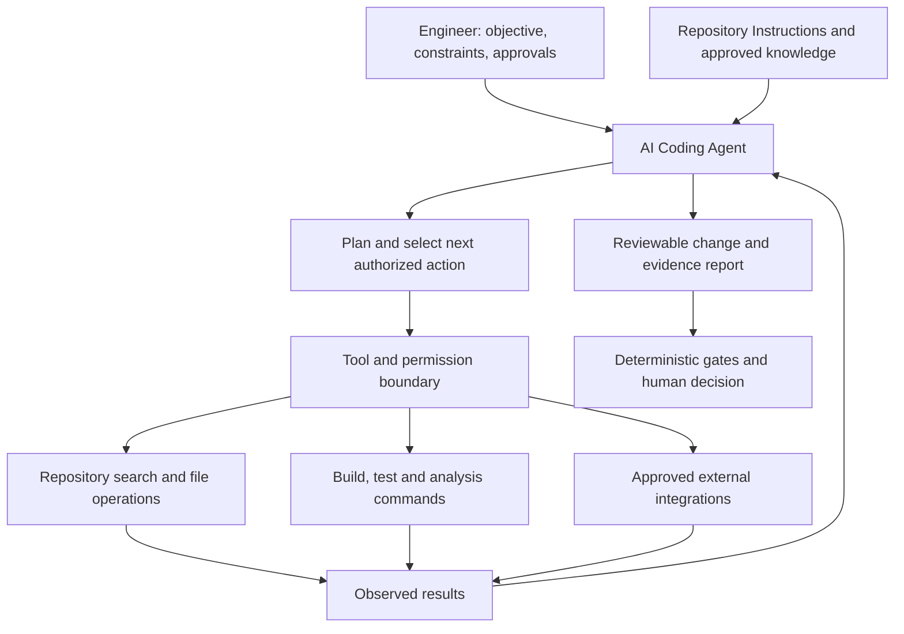
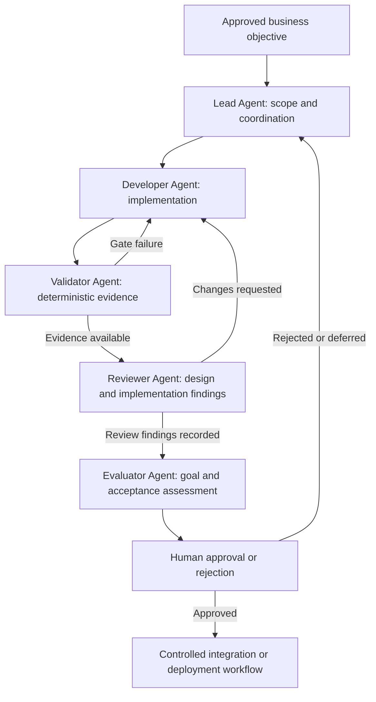

# Chapter 2 — Understanding AI Coding Agents

On Monday morning, the engineering team at Alpha Car Detailing receives a request from a government fleet customer. The customer wants every vehicle assigned to its account to undergo a documented condition and environmental-compliance inspection before a detailing appointment can begin. Inspectors must capture an odometer reading, a result, photographs, and an explanation when a vehicle fails. Fleet administrators must be able to retrieve the history during an audit.

The product owner describes the request in a few paragraphs. The architectural consequences are less compact. A booking must not proceed when a required inspection is missing or rejected. Inspection records must be associated with the correct vehicle and organization. Photographs require storage and authorization decisions. Historical records must remain intelligible after inspection criteria change. Existing customers who do not require inspections must continue to book appointments without disruption.

The team could hand a developer a ticket to add an inspection form. That would solve only the most visible part of the problem. A more experienced engineer would begin by locating the booking workflow, inspecting the domain model, determining who owns an inspection decision, and identifying the tests that express the current business rules. Those steps—not the typing of a controller—are where much of the engineering work lies.

The technical lead opens an AI coding agent and provides the business objective. Rather than requesting a new class, the lead asks for an impact assessment: identify the relevant repository components, distinguish observed implementation from assumptions, propose the smallest architecture-consistent change, list the risks, and produce a testable plan. The agent examines permitted files and tools, returns findings, and asks for a decision where the requirement leaves a meaningful ambiguity.

The outcome is not an autonomous architect. It is an engineering team with a new way to investigate and execute work. The agent can perform substantial portions of the search, editing, and verification cycle; the team still owns business interpretation, architectural trade-offs, access, and acceptance of risk.

This chapter examines how that collaboration works. It explains what makes a coding agent different from code completion, how a model is connected to tools and repository evidence, why context and permissions matter, and how the resulting workflow should be supervised in enterprise development. The principles apply to Claude Code, GitHub Copilot, OpenAI Codex, and future platforms. The particular commands and interfaces will change; the engineering responsibilities will not.

## Learning Objectives

After completing this chapter, readers should be able to:

- Distinguish code completion, conversational assistance, and agent-driven engineering work.
- Explain the relationship among the model, task objective, context, tools, execution environment, and feedback loop.
- Describe how an agent discovers repository structure without treating its interpretation as authoritative.
- Differentiate context, persistent knowledge, a task scratchpad, and Harness Memory.
- Recognize the boundaries of single-agent and multi-agent execution.
- Define observable outcomes, deterministic validation, and human approval points for an agent task.
- Assess whether an enterprise repository and its controls are ready for agent-assisted changes.

## Background: From Code Completion to Engineering Workflows

Development tools have progressively removed mechanical work from programming. Editors introduced syntax support and navigation; IDEs connected the editor to compilers, debuggers, and refactoring tools; version control and CI/CD made changes traceable and testable. Code-completion systems extended that progression by predicting source text in the context of an editor.

Code completion is valuable because much implementation work is repetitive. A developer who already knows the required design can accept a suggested mapping, test fixture, or method body and continue working. The tool's immediate objective is local: offer text that fits at the insertion point. Even when the underlying model is capable of sophisticated analysis, a completion interaction does not itself own a multi-step engineering task.

Conversational coding assistance raises the level of abstraction. An engineer can ask why a method is slow, request an explanation of a dependency, or ask for an alternative design. The system produces an answer grounded in whatever information is available to that conversation. Yet a convincing answer is not evidence that repository files were read, commands were executed, or behavior was verified.

An **AI Coding Agent** takes another step. It can pursue a goal through a sequence of authorized actions: select files to inspect, invoke tools, propose or apply edits, observe tool results, and adapt the next action. The distinguishing feature is not how much code it generates. It is the ability to connect *decisions* to *actions* and use the results of those actions to continue the task.

These categories are not mutually exclusive products. The same development platform may offer inline completion, conversational discussion, planning, and agent execution. The distinction concerns the operating mode and the responsibility delegated in a particular interaction.

| Mode | Typical engineer request | What establishes completion |
| --- | --- | --- |
| Code completion | “Complete this mapping.” | Developer accepts or rejects the suggestion. |
| Conversational assistance | “Explain why this booking test fails.” | Developer evaluates the explanation. |
| Agent-driven task | “Investigate and fix the booking failure within these constraints.” | Files changed, checks run, results recorded, and a reviewable diff produced. |
| Governed Harness run | “Execute the approved change workflow and report its gates.” | The Harness records agent output, deterministic evidence, review findings, and the run outcome. |

The final row introduces a distinction developed throughout the handbook. An agent may participate in a Harness, but **an AI Coding Agent is not the Harness**. An agent reasons and performs permitted actions. A Harness coordinates roles, permissions, artifacts, validation gates, retries, evaluation, and reporting according to an organizational workflow. One agent may be useful without a Harness; an enterprise Harness can coordinate one or several agents.

## Concepts: What an AI Coding Agent Does

### Objectives, instructions, and permitted actions

An agent begins with an objective supplied by a human or an authorized workflow. “Support inspections for government fleet bookings” is an objective, not yet an implementation specification. It leaves unresolved questions about approval rules, the age of an acceptable inspection, who may override a failure, and whether the condition applies to all government accounts or only those enrolled in the program.

A capable agent should expose those gaps before committing to a consequential design. It may identify a default from existing code, propose options, and request human direction. It should not silently convert an assumption into a business policy.

Instructions and boundaries shape the work. An organization may require that controllers contain no business decisions, that customer data never appear in logs, and that all migrations receive human review. An engineering task may also permit reading the entire repository while restricting edits to a small work area. The agent should use the narrowest permissions that satisfy the objective.

A useful request therefore specifies both the desired outcome and the conditions under which the outcome is acceptable:

> Implement inspection eligibility checks for government fleet bookings. First inspect the existing booking flow and report relevant files. Preserve behavior for other customers. Do not add a new service or database table without an approved design. Propose the change and tests before editing. Do not modify deployment configuration or execute destructive commands.

This is not a substitute for repository-wide Instructions. It is the task-specific Prompt. Later chapters distinguish Prompts, Instructions, Skills, Roles, Steering Notes, and Repository Intelligence in greater detail.

### The model, the tools, and the execution environment

At the center of an agent is a model capable of interpreting language and code and selecting a next step. The model alone does not provide file-system access or the ability to compile a project. Those capabilities come from tools made available by the host application and from the environment in which the tools execute.

A repository-search tool can return candidate files. A file-reading tool can retrieve their contents. A terminal tool may run `git diff`, `dotnet build`, or a targeted test command. An integration may expose a pull request, issue, or documentation source. The agent receives outputs and can revise its approach.

The separation matters operationally. A model may propose running a command that the environment cannot execute, lacks permission to execute, or should not execute under enterprise policy. A host or Harness must enforce such restrictions independently of the model's willingness to comply.

Tools also differ in trustworthiness. Compiler errors are objective observations about a particular build. A repository comment is a claim made by an author. Search results are incomplete views of a larger corpus. A generated explanation is a hypothesis. Successful agent work depends on keeping those categories separate.

### Context and repository intelligence

An agent cannot reason about a system it has never examined. In enterprise repositories, useful context may include solution boundaries, domain vocabulary, architecture decisions, source code, tests, build configuration, issue descriptions, and prior implementation patterns.

The active **context** is the information available to the model for its current task. Its size is finite. A large repository cannot be treated as though every file were simultaneously and accurately understood. Effective agents retrieve relevant material, follow dependencies, summarize observations, and return to source files when precision is required.

**Repository Intelligence** is the organized body of repository-derived information that supports that discovery: where capabilities live, what architectural boundaries are documented, how code is tested, and which conventions have been established. It is not a synonym for chat history or unverified model recollection. The original source remains the authority for the current state of an implementation.

Persistent engineering knowledge serves a different purpose. A versioned instruction file may communicate agreed conventions between sessions. A knowledge source may contain an approved architecture decision. A **scratchpad** records temporary, task-scoped observations, files under investigation, hypotheses, and intermediate progress. It is working state, not authoritative policy. **Harness Memory**, when introduced in a governed adaptive system, retains selected evidence or learning across runs and must not silently rewrite standards.

| Information | Appropriate role | Trust boundary |
| --- | --- | --- |
| Current source file or test output | Evidence about the inspected revision or run | Valid only for that revision and environment. |
| Repository Instructions | Persistent engineering constraints | Subject to ownership and change control. |
| Task Prompt | Current objective and task-specific limits | Cannot override higher-priority policy. |
| Steering Note | Human-maintained mission priorities and constraints | Changes require the designated authority. |
| Scratchpad | Temporary observations and hypotheses | Not authoritative; clear or archive by policy. |
| Harness Memory | Governed knowledge from earlier executions | Must be attributable, reviewable, and controlled. |

A large context window reduces some retrieval friction; it does not eliminate stale files, missing dependencies, contradictory information, or the need to verify what a tool actually returned.

### Planning and the feedback loop

A coding agent typically alternates between gathering evidence, deciding what to attempt, acting through a tool, and inspecting the result. This can be described as **Observe → Decide → Act → Verify**. It is a useful engineering abstraction rather than a claim about a vendor's private model internals.

The cycle may begin with a search that reveals the booking eligibility policy. The next action is to inspect the policy's callers and tests. That inspection may expose an existing rule for corporate fleet accounts, making a new policy class unnecessary. A test run may then fail because the new behavior breaks a previously undocumented scenario. The agent should diagnose the failure and revise the change—or stop and request a decision when competing business rules cannot be resolved from evidence.

A failed action is not automatically a reason to repeat the same prompt. Effective recovery involves classifying the failure: incorrect implementation, missing environment dependency, insufficient permission, flaky infrastructure, contradictory requirement, or tool malfunction. Only some failures can be repaired through another code edit. Repeated attempts without a limit can waste resources and obscure the original issue.

Nor does a passing build establish business correctness. Compilation verifies a defined set of language and dependency conditions. Tests check the scenarios that were written. Security analysis checks the rules and signatures configured for it. The Evaluator must still consider whether the result serves the intended goal, and a human may still need to accept the design or deployment risk.

### What autonomy does—and does not—mean

Agent autonomy is bounded by assigned authority and the execution environment. Reading files, editing a branch, creating a pull request, changing production credentials, and deploying an application are not equivalent actions. Enterprises should assign different permissions and approvals to each.

An agent can help formulate architecture choices; it is not the owner of architectural standards. It can generate code; it cannot guarantee correctness. It can report a test as passing when the tool produced a success result; it must not imply that an unexecuted or skipped test passed. It can propose an improvement to Instructions or a Skill; a governed system should not silently adopt that improvement.

These limitations do not diminish the value of coding agents. They describe the conditions under which agent assistance becomes reliable engineering practice.

## Architecture Discussion

### The boundaries of an agent-driven change

An enterprise coding task crosses several boundaries. The **business boundary** defines what is correct for customers and operations. The **repository boundary** defines where functionality belongs and what other components may depend on it. The **execution boundary** determines which files, commands, networks, and secrets the agent can access. The **approval boundary** determines which decisions require an accountable person. The **evidence boundary** separates a proposed or reported result from independently verified observations.

These boundaries should be explicit before an agent edits an enterprise codebase. Consider Alpha Car Detailing's proposed inspection policy. A developer could implement the rule in a controller because that is where the HTTP request arrives. A different developer might place it in a shared utility because several endpoints need it. Neither location is necessarily appropriate merely because it is convenient to the agent.

If the repository follows Clean Architecture, inspection eligibility belongs in the domain or application logic appropriate to its business ownership. HTTP endpoints coordinate requests and map results. Persistence details remain behind interfaces used by the application. The agent should discover and respect this existing organization rather than inventing new layers.

The running example is intentionally introduced as a **modular application**. The design does not require an independent Inspection Service, CQRS infrastructure, a message broker, or an event-driven architecture in order to demonstrate an AI coding agent. Such patterns may be justified by later requirements and introduced in later chapters. A coding agent's ability to generate sophisticated infrastructure is not a reason to deploy it prematurely.

### Single-agent execution

A single agent can inspect the booking module, propose a plan, make a bounded edit, run tests, and prepare a diff. This is often the appropriate first deployment model because the authority chain is short and the work is easy to reproduce.

The primary challenge is role contamination: the same agent proposes an implementation and then judges its quality. Its self-review can catch obvious mistakes, but it is not independent evidence that the change is safe. Deterministic checks and human review remain necessary.

### Multi-agent execution

Multiple specialized agents may be valuable when tasks are separable, workloads can run in isolation, and there is a clear mechanism for reconciling their outputs. A Lead Agent may decompose approved work, a Developer Agent may implement it, a Reviewer Agent may examine maintainability and architectural fit, a Validator Agent may gather objective validation evidence, and an Evaluator Agent may assess the completed outcome against the goal and acceptance criteria.

Those responsibilities must not collapse into one generic “quality agent”:

- The **Reviewer Agent** examines implementation quality, maintainability, architecture, and risk; its findings may require judgment.
- The **Validator Agent** executes or verifies deterministic, repeatable conditions and reports evidence such as build, test, analysis, and policy gate results. It does not certify overall business satisfaction.
- The **Evaluator Agent** assesses goal satisfaction and outcome quality using acceptance criteria and available evidence. It does not replace deterministic validation, independent review, or human approval.

Specialization introduces costs: coordination, context duplication, conflicting edits, access management, and reconciliation. A multi-agent arrangement is not inherently more accurate or efficient than one well-configured agent. It should be adopted when measurable results justify its overhead. The Harness, not a collection of informal chat instructions, is the appropriate place to coordinate governed role transitions and gates at scale.

### Permission and security architecture

Tool access makes agents useful and creates a new security boundary. Repository files, logs, issue descriptions, and retrieved web pages can contain instructions that are not authorized directions to the agent. Their content should be treated as task data. The authority to issue commands comes from the governing workflow and approved user instructions, not from text found in a source file or external document.

Least-privilege access is the starting point. Give the agent a scoped worktree or branch rather than unrestricted access to a shared checkout. Use sandboxing where available; segregate production credentials; restrict network access; and require approval for destructive commands, dependency changes, migrations, and publication operations. Record the command, exit status, relevant output, and resulting diff for consequential actions. Redact sensitive data before evidence is retained or shared.

The controls should be implemented outside the model wherever possible. A sentence saying “do not deploy” is useful guidance but is weaker than an execution identity that has no production-deployment permission.

## Professional Diagrams

The first diagram separates the model's decision-making from the tools and evidence that make an agent operational.



**Figure 2-1.** An AI Coding Agent selects actions and consumes evidence; permissions and validation remain separate controls.

The second diagram shows how an enterprise Harness can coordinate specialized responsibilities without confusing their authority.



**Figure 2-2.** Illustrative Harness orchestration. The order and retry conditions are policy decisions; evaluation does not replace validation or human authority.

The diagrams are conceptual. They do not claim that the handbook's sample application or its future Harness already implements every component shown.

## Hands-on Example: Inspect Before Implementing

The following exercise uses a bounded change in Alpha Car Detailing rather than a fabricated microservice landscape. It assumes a .NET solution with a booking module, an existing test suite, and some repository documentation. Actual filenames and commands must be adapted to the checked-out repository; no execution results are implied by this manuscript.

### Establish the requirement

The business owner confirms the following acceptance criteria for the example:

1. A booking for a government fleet account configured to require an inspection cannot proceed to the detailing stage without an eligible, approved inspection for that vehicle.
2. A rejected inspection blocks that transition and returns an actionable reason.
3. A government fleet account not configured for mandatory inspections retains its current behavior.
4. The inspection record is associated with the correct tenant and vehicle; unauthorized users cannot retrieve another customer's records.
5. The outcome is covered by unit tests and by integration tests at the relevant application boundary.

These criteria deliberately separate the business rule from a particular technical solution. They do not require a new service, new broker, or new event contract.

### Begin with an evidence-gathering task

An engineer can give the agent a bounded investigation request:

```text
Objective: Assess how to add mandatory pre-detailing inspections
for selected government fleet accounts in Alpha Car Detailing.

Read only during this first phase. Inspect the booking lifecycle,
existing customer/account classification, authorization boundaries,
validation patterns, and relevant tests.

Return:
- files inspected and what each establishes;
- existing behavior versus assumptions;
- the smallest plausible implementation change;
- unresolved business or architectural decisions;
- tests and validation commands to execute later.

Do not edit files, add infrastructure, or assert that unrun tests pass.
```

A useful report might identify an existing booking eligibility component, the relevant account configuration, the API boundary that advances booking status, and tests that already distinguish corporate fleet bookings from individual bookings. If any of these elements are absent, the report should say so instead of inventing a repository structure.

The technical lead reviews the investigation. If the agent proposes putting a policy in a controller, the lead can reject that placement and direct it to the existing domain or application boundary. If the data model does not contain an inspection-to-vehicle relationship, the team decides whether a new record is necessary before the agent generates a migration.

### Approve a constrained implementation plan

The second request grants edit permission for an agreed scope:

```text
Implement the approved inspection-eligibility rule in the existing
booking workflow. Reuse the repository's established layering and
validation patterns. Preserve the current flow for accounts that do
not require inspections.

Add tests for approved, missing, rejected, and cross-tenant inspection
cases. Keep changes within the agreed booking and test areas.

Before making a schema change or introducing a new external dependency,
stop and request approval. After editing, report the changed files,
executed commands, test results, and remaining uncertainties.
```

For this phase the agent may inspect additional dependencies, modify a policy or application service, update tests, and run the existing quality checks. Its output should be a reviewable diff rather than an unqualified assertion that the feature is complete.

A developer might use commands such as the following from the repository's solution directory, after confirming the actual filenames and environment:

```powershell
# Illustrative checks; these were not executed for this chapter.
git status --short
dotnet build
dotnet test
git diff --check
```

Build success demonstrates that the code compiles in the tested environment. Test success demonstrates that the executed tests passed. Neither proves that the new inspection rule satisfies every policy, security obligation, or production scenario. The run report should also record skipped tests, failures, and checks that could not execute.

### Review evidence, not eloquence

Suppose the agent's final message says that it implemented the change and that all tests pass. The reviewer should compare that statement with the actual diff and tool output. Did the tests include an account without mandatory inspection? Did the authorization check prevent a different tenant from retrieving the inspection? Was a schema migration created without approval? Did the run use the intended branch and configuration?

A useful completion record contains the objective, scope, inspected files, changed files, decision log, checks executed, results, unresolved questions, and human approval status. That record can later become an input to a Harness run or pull-request review, but it is not automatically approved repository knowledge.

### Consider an architectural extension without implementing it prematurely

A later release may need an audit feed or reporting integration when inspections are approved. At that point the architect must decide whether the application should publish an integration event, how to protect publication from transaction loss, and whether existing consumers need a compatible schema change. A transactional outbox and idempotent consumption may become appropriate design choices. They should be introduced because the integration requirements justify them—not because the agent can generate an event handler quickly.

This distinction illustrates the central discipline of agent-assisted engineering: discover the existing system, satisfy the current requirement, and preserve the freedom to evolve its architecture deliberately.

## Claude Code Example

Claude Code is the primary platform used for examples in this handbook, but its operational details are not the conceptual definition of an AI Coding Agent. Claude Code can work with repository files and development tools through terminal, IDE, and other supported interfaces. The exact permission prompts and available integrations depend on the environment and organizational settings.

An engineer working in the checked-out Alpha Car Detailing repository can begin an interactive session from the intended project directory:

```powershell
# Run from the checked-out repository after installing Claude Code.
claude
```

The initial request should be investigative rather than an invitation to edit the entire solution:

```text
Read the repository's authoritative Instructions and architecture
notes. Investigate the current booking lifecycle and determine where a
fleet inspection eligibility rule would belong. Do not edit files.

Identify the files you actually inspected, relevant tests, assumptions,
and decisions that require approval. Prefer existing application
patterns; do not introduce CQRS, a new microservice, or an event bus
unless existing architecture or approved requirements demand it.
```

After reviewing the evidence and agreeing on the design, the engineer can issue the bounded implementation request from the hands-on example. The agent should be permitted to execute only appropriate commands, and the engineer should inspect the diff and test output before approving the change. Project Instructions can make architectural and testing conventions reusable, but they do not replace a precise task Prompt or an explicit approval gate.

The advantage of a Claude-first example is continuity: the same repository conventions and problem-solving approach can be carried forward into later chapters about Instructions, Skills, Roles, and Harness architecture. It is not a claim that other platforms are incapable of repository reasoning or multi-step execution.

## GitHub Copilot Comparison

GitHub Copilot entered many teams through inline suggestions and editor chat. It also provides agent-capable experiences, including agent mode in supported IDEs and other interfaces for delegated work. In agent mode, Copilot can select files, propose or apply edits, run permitted commands, and iterate after observing results. Describing Copilot only as “autocomplete” would therefore misrepresent the current platform.

For the Alpha Car Detailing task, the engineer can use an IDE-centered workflow: inspect the booking module beside the running agent, review proposed changes as they appear, approve or reject commands under the configured policy, and run tests in the development environment. The business objective, architecture constraints, and acceptance criteria do not change because the interface is different.

Organizations should evaluate the Copilot experience they actually intend to deploy. IDE agent mode, terminal work, and delegated or cloud execution can have different access boundaries, review surfaces, and administrative controls. Those differences matter more than a static ranking of model quality.

## OpenAI Codex Comparison

OpenAI Codex supports coding-agent work through multiple interfaces, including local and integrated development experiences and programmable workflows. It can inspect code, modify files, use tools, and assist with implementation, debugging, and review. The exact execution and approval mechanisms depend on the chosen Codex surface and its configuration.

The same Alpha Car Detailing investigation can be expressed as a read-only task followed by an approved implementation task. In terminal-oriented or automated settings, the engineering team should pay particular attention to workspace isolation, command permissions, output artifacts, and how test evidence is returned to reviewers. An automated agent run is not the same as an automatically approved code change.

A useful platform comparison is therefore operational rather than promotional:

| Evaluation question | Claude Code | GitHub Copilot | OpenAI Codex |
| --- | --- | --- | --- |
| Where will engineers interact with the agent? | Supported terminal, IDE, desktop, and other interfaces. | IDE, CLI, and delegated agent experiences, according to configuration. | IDE, CLI, app, and programmable agent workflows, according to configuration. |
| How are repository conventions supplied? | Project Instructions and supported integrations. | Repository instructions and configured agent context. | Repository instructions and configured agent context. |
| How are sensitive actions controlled? | Review the permissions and tool-access policy of the selected surface. | Review IDE, organization, and delegated-agent permissions. | Review sandbox, approval, and execution permissions for the selected surface. |
| How is completion verified? | Independently review diffs and tool evidence. | Independently review diffs and tool evidence. | Independently review diffs and tool evidence. |
| Which platform is preferable? | Determine by a repository-based pilot. | Determine by a repository-based pilot. | Determine by a repository-based pilot. |

This table deliberately avoids “Excellent” and “Strong” scores. Feature availability, supported environments, licensing, administrative policy, and product behavior change too rapidly for unsourced rankings to remain meaningful. Chapter 3 develops the platform-selection framework in greater depth.

## Best Practices

### Make the objective testable

A request such as “improve booking quality” offers no stable completion condition. Replace it with an outcome that can be inspected: “Reject progression to detailing when an inspection is required and no approved record exists, without changing behavior for other accounts.” State acceptance criteria and known exclusions in the task Prompt, and preserve ambiguities as decisions rather than allowing the agent to infer undocumented policy.

### Require evidence before design changes

Repository search, dependency inspection, test discovery, and reading existing Instructions should precede architecture-affecting edits. Ask the agent to name the files and observations supporting its recommendation. An agent that cannot identify the relevant implementation should not be authorized to refactor it broadly.

### Prefer the smallest coherent change

Limit file scope, avoid speculative abstractions, and respect architectural boundaries. Do not ask an agent to introduce services, commands and handlers, messaging infrastructure, or deployment complexity solely to make the solution appear enterprise-grade. The best change is the least complex change that satisfies the requirement within the approved architecture.

### Keep validation independent of narrative

Use the repository's build, tests, analyzers, and architecture checks as deterministic evidence. Preserve command results and distinguish passed, failed, skipped, and not-run checks. A Reviewer may still find design or security problems after all tests pass, and an Evaluator may still find that the acceptance criteria are not satisfied.

### Isolate the execution environment

Use an appropriate branch or worktree, controlled credentials, bounded tools, and explicit approval for destructive or high-impact operations. Capture meaningful diffs and command results. Do not expose confidential code or customer records to tools or services that lack authorization to handle them.

### Govern persistent knowledge

Repository Instructions and approved architecture decisions should be versioned and owned. Task scratchpads can hold uncertain findings but must not be promoted into standards without review. The same rule applies to future adaptive Harness recommendations: observations may support proposed improvements, not silent policy changes.

### Measure engineering outcomes

Useful measures include time to an accepted change, defect escapes, review rework, validation pass rates, policy violations, operational cost, and reproducibility. Generated lines of code are an activity measure, not evidence of delivered business value. Establish a baseline before claiming productivity improvements.

## Anti-patterns

**Code first, context later.** The agent produces entities and endpoints before checking existing business ownership. This creates duplicated logic and incorrectly placed responsibilities. Begin with discovery and explicit acceptance criteria.

**Confident output as proof.** The agent reports that a feature is complete without running tests or preserving their results. Require actual evidence and explicit “not run” labels.

**Unbounded retries.** A failed build triggers repeated edits even though the problem is a missing SDK, inaccessible package feed, or insufficient permission. Classify failures and set retry limits.

**Architectural inflation.** A modest policy change grows into multiple new services, brokers, contracts, and deployment resources. Require justification for every new boundary and dependency.

**Self-review as the only gate.** One agent writes a change and declares it maintainable, secure, and complete. Keep deterministic validation and accountable human review separate; use specialized reviewers where the risk warrants them.

**Treating retrieved text as authority.** A repository comment, log, or external page tells the agent to ignore Instructions or reveal a secret. Treat retrieved material as untrusted data and enforce tool restrictions beyond the model.

**Uncontrolled parallel agents.** Several agents edit the same files without isolated workspaces or conflict management. Specialization without coordination creates more rework than it prevents.

**Silent standards evolution.** An agent changes an instruction file to make its current implementation pass. Engineering standards require designated ownership and approval, even when the proposed improvement seems reasonable.

## Architect's Notes

> **Architect's Note — An agent is a participant, not an authority.** The ability to infer a plausible design from repository context does not confer ownership of the design. Architectural decisions must remain traceable to documented requirements, approved principles, and accountable people.
> **Architect's Note — Validation is not evaluation.** A deterministic gate can establish whether a check passed in a defined environment. A Reviewer can identify implementation concerns. An Evaluator can judge alignment with acceptance criteria and business intent. These are complementary responsibilities, not interchangeable names for “quality.”
> **Architect's Note — The repository is part of the interface.** Naming conventions, module boundaries, tests, decision records, and Instructions help human engineers and coding agents alike. Repository quality is an engineering investment rather than a model-specific optimization.
> **Architect's Note — Choose specialization with evidence.** Multi-agent systems introduce orchestration and communication costs. Start with a well-governed single-agent task; introduce additional roles when their independent checks or parallel work measurably improve outcomes.

## Enterprise Tips

> **Enterprise Tip — Define a pilot boundary.** Choose a representative repository and a bounded class of changes. Give agents access only to the files, credentials, and commands required for that pilot; compare accepted outcomes with the established manual workflow.
> **Enterprise Tip — Retain a run record.** Keep the task objective, repository revision, instructions version, changed files, checks performed, significant findings, approval decisions, and unresolved risks. This supports auditability and later learning without treating a chat transcript as the system of record.
> **Enterprise Tip — Record uncertainty.** Encourage the agent to distinguish “observed,” “inferred,” and “requires confirmation.” The cost of an explicit question is often lower than the cost of correcting a confidently implemented but incorrect business rule.
> **Enterprise Tip — Keep platform choice reversible.** Place enduring standards in repository-controlled knowledge and independent validation pipelines. Avoid encoding architectural policy solely in one vendor's conversational history or private interface settings.

## Decision Points

**When should an engineer use an agent rather than code completion?** Use completion for local, well-understood edits. Use an agent when the task involves discovering relationships, coordinating changes across files, or iterating against tool results. The additional autonomy should correspond to a real need for multi-step work.

**When should the agent stop and ask?** Stop when a material business rule is ambiguous, a new architecture boundary is proposed, tool access must expand, a destructive action is required, or evidence contradicts an approved requirement. Do not hide these decisions in a generated plan.

**When does a task need a Harness?** A personally supervised agent session may be enough for one bounded implementation. A Harness becomes useful when the organization needs repeatable role handoffs, deterministic gates, metrics, controlled retries, recorded evidence, and a standard approval path across many runs.

**When should a team adopt multiple agents?** Introduce them when tasks can be isolated, independent review brings meaningful value, and the coordination cost is understood. More agents do not automatically mean greater correctness or lower delivery time.

**What should determine platform selection?** Evaluate an actual repository and task set against access controls, developer workflow, integrations, repeatability, observability, cost, evidence retention, and organizational governance. Avoid conclusions based only on feature marketing or subjective scores.

## Exercises

### Exercise 2.1 — Repository-readiness assessment

Select a production or realistic enterprise repository. Identify the authoritative Instructions, architecture boundaries, primary test entry points, build prerequisites, and sensitive operational interfaces. Document at least three gaps that would make an agent's investigation less reliable. For each gap, propose a repository improvement that benefits human developers as well as agents.

### Exercise 2.2 — Read-only inspection

Using Alpha Car Detailing or a comparable modular .NET application, ask an agent to locate the booking eligibility policy without editing files. Require evidence for every proposed insertion point. Compare the agent's report with the files actually inspected and identify which statements are observed, inferred, or unsupported.

### Exercise 2.3 — Governed implementation plan

Write a task Prompt for the government fleet inspection requirement. Include acceptance criteria, permitted files, forbidden operations, approval boundaries, and required validation. Explain why the task does not yet justify CQRS infrastructure, a separate microservice, or integration-event publication.

### Exercise 2.4 — Failure classification

Give a team four hypothetical outcomes: a compiler type error, a missing .NET SDK, a cross-tenant authorization test failure, and an ambiguous inspection-expiry rule. Decide which the agent may fix autonomously, which require environment repair, and which require human clarification. Specify the evidence that would support each decision.

### Exercise 2.5 — Single-agent versus multi-agent evaluation

Run or design two comparable workflows: a supervised single-agent change and a workflow with distinct implementation and independent review stages. Compare review findings, accepted-change time, redundant work, tool cost, and failures. Recommend specialization only if the results justify it.

## Interview Questions

1. What operational characteristic distinguishes an AI Coding Agent from a code-completion feature?
2. Why is a plausible natural-language explanation insufficient evidence that a repository change is correct?
3. How do the reasoning model, tools, and execution environment work together?
4. What is the purpose of an Observe → Decide → Act → Verify cycle?
5. What information should an agent collect before modifying an unfamiliar .NET repository?
6. How do active context, Repository Intelligence, scratchpad state, and Harness Memory differ?
7. Why should a task Prompt not become the authoritative source of repository engineering standards?
8. How would you separate deterministic validation, implementation review, and outcome evaluation?
9. What advantages and coordination risks do multiple specialized agents introduce?
10. How should an organization protect secrets and prevent untrusted repository text from becoming agent instructions?
11. Why can a passing build and test suite still leave an implementation unfit for production?
12. Which conditions should cause an agent to request human approval rather than continue editing?
13. How can an enterprise compare Claude Code, GitHub Copilot, and Codex without relying on subjective capability rankings?
14. What evidence would demonstrate that an agent workflow improves delivery quality rather than merely generating more code?

## Chapter Summary

AI coding agents extend software development assistance from suggestions and explanations to bounded, tool-mediated execution. They can inspect repository files, plan a sequence of actions, modify code, run checks, observe failures, and revise their work. These abilities make them useful beyond code generation, particularly in the investigative and iterative activities that occupy experienced engineers.

An agent's usefulness depends on the quality of its context and the boundaries under which it operates. Repository Intelligence, approved Instructions, task-specific Prompts, and temporary working state serve different purposes. The agent must distinguish actual observations from assumptions and preserve evidence of actions taken. An execution environment should enforce permissions independently of the model's generated intentions.

Agent output also passes through different kinds of judgment. Deterministic validation establishes the result of repeatable checks. Review examines implementation quality and risk. Evaluation considers whether the change satisfies the intended goal. Human approval retains responsibility for architecture, business policy, and production consequences. A Harness can coordinate these activities at scale, but it should not be confused with the agent that performs an individual task.

The Alpha Car Detailing inspection scenario demonstrates why these distinctions matter. A narrowly scoped business policy deserves an investigation, a coherent plan, an implementation consistent with existing architecture, and a reviewable set of test results. It does not automatically warrant new services, messaging infrastructure, or an elaborate multi-agent design.

Claude Code, GitHub Copilot, and OpenAI Codex offer different interfaces and operational arrangements for similar classes of agent-driven work. The durable enterprise skill is not allegiance to a tool; it is the ability to define objectives, govern action, interpret evidence, and retain accountability. Chapter 3 builds on that foundation by examining platform selection in depth.

## Further Reading

### Within this handbook

- **Chapter 3 — Comparing AI Coding Platforms:** product surfaces, workflows, operational trade-offs, and selection criteria.
- **Chapter 4 — Enterprise AI Engineering:** the operating model for organization-wide adoption.
- **Chapters 5–11 — Repository Intelligence:** discovery, Instructions, Skills, Prompts, Roles, Steering Notes, and knowledge sources.
- **Chapters 12–18 — Harness Engineering:** the Harness, orchestration, and the Lead, Developer, Reviewer, Validator, and Evaluator roles.
- **Part V — Enterprise AI Governance:** access, security, approval, auditability, and policy.
- **Part VI — Self-Learning AI Systems:** governed memory and improvements derived from engineering evidence.

### Vendor documentation and reference material

- Anthropic, [Claude Code overview](https://code.claude.com/docs/en/overview) and [settings and permission configuration](https://code.claude.com/docs/en/settings). Consult the documentation for the capabilities and controls available in the deployed version.
- GitHub, [About GitHub Copilot agents](https://docs.github.com/en/copilot/concepts/agent-capabilities/about-agents/about-github-copilot-agents) and [agent mode in an IDE](https://docs.github.com/en/copilot/how-tos/copilot-in-your-ide/use-copilot-agents/use-agent-mode). Distinguish IDE sessions from other agent execution surfaces.
- OpenAI, [Code generation and Codex](https://developers.openai.com/api/docs/guides/code-generation) and [Codex as a platform](https://developers.openai.com/blog/codex-as-a-platform). Review interface-specific execution and permission controls before adopting automated workflows.

Vendor capabilities and URLs may evolve. The architectural boundaries and evidence requirements described in this chapter are intended to remain applicable across implementations.
