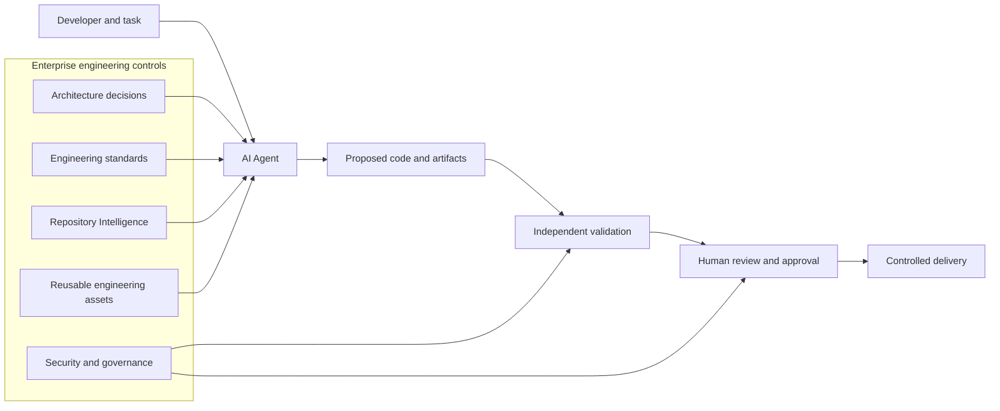
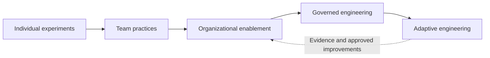
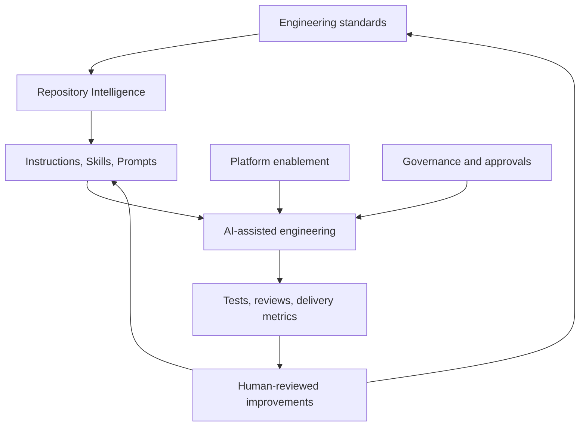
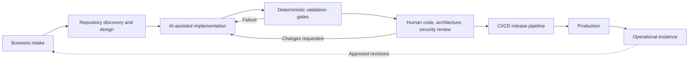
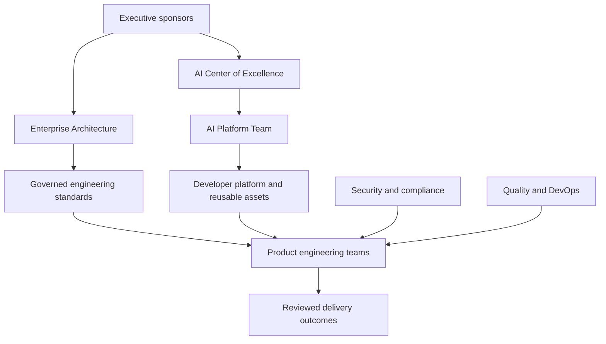
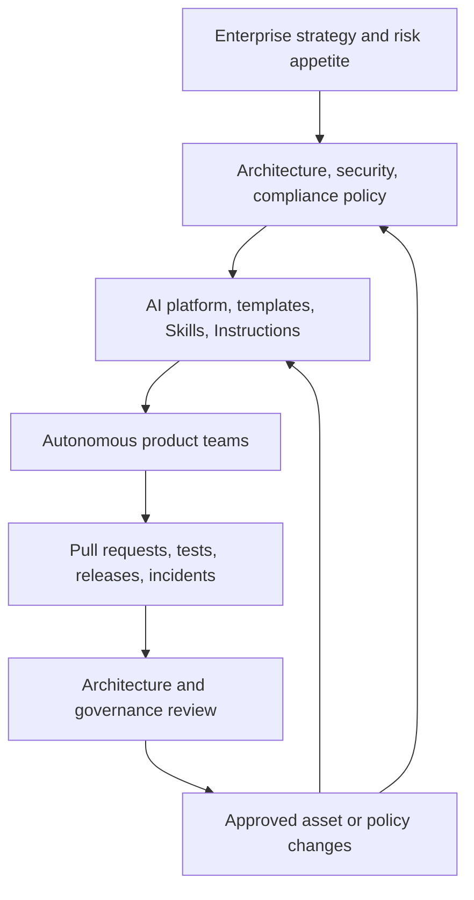
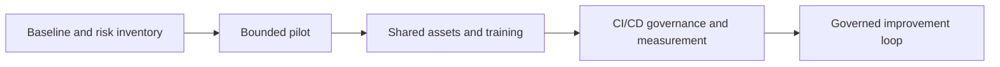
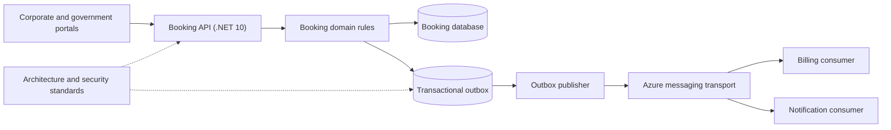

# Chapter 4 — Enterprise AI Engineering

> *Organizations do not become AI-enabled merely by deploying AI tools. They become AI-enabled when they build repeatable, governed, and measurable systems in which people and AI can engineer software together.*

## Story-Driven Opening

On a Monday morning, Alpha Car Detailing's engineering dashboard appeared to confirm the success of its new development strategy. More than 120 engineers across six product teams had begun using AI coding agents. Pull requests were arriving sooner, repetitive implementation work had declined, and feature demonstrations were easier to prepare. The Customer Portal team accelerated its ASP.NET Core endpoints; Fleet Management used agents to draft persistence code and tests; Government Contracts reduced repetitive data-mapping work; and Mobile Services generated initial API specifications from existing service contracts. Leadership saw visible evidence of increased activity and assumed delivery capacity had improved.

The architecture reviews told a more complicated story. Two services implementing similar account rules had adopted incompatible validation patterns. One team preserved the established application and domain boundaries; another let an agent insert data access directly into an API controller. Some services emitted correlated telemetry through the standard observability pipeline, while others logged only exception messages. None of these differences necessarily caused an immediate outage. Collectively, they made the platform harder to understand, maintain, and operate.

The security review queue exposed a related problem. Authentication and authorization were implemented differently across teams, even where the business requirement was substantially the same. A generated configuration change had introduced a credential into a file before an automated check and a reviewer caught it. Government customer workflows required additional scrutiny because their data classification and contractual obligations differed from those of ordinary retail bookings. Each team could explain its individual decisions; the enterprise could no longer explain why equivalent risks were addressed inconsistently.

Code review data showed that AI proficiency was also unevenly distributed. A senior engineer had refined a reliable procedure for creating resilient Azure messaging consumers. Another maintained an excellent set of Kubernetes deployment prompts. A third had personal instructions for applying OpenTelemetry consistently to new services. These were valuable engineering assets, but they existed in private notes. A developer assigned the same task without access to those assets would begin from first principles. AI had increased the influence of individual expertise without making that expertise reusable.

An internal engineering assessment reached a conclusion that initially surprised the leadership team: the principal issue was not the selection of Claude Code, GitHub Copilot, or OpenAI Codex. Those products offered different interaction models and execution capabilities, but no platform could supply the organization's missing architectural authority, ownership model, and validation standards. Alpha Car Detailing had purchased assistance for individual developers without designing a system for organizational AI engineering.

The response was deliberately broader than a new prompt library. Enterprise Architecture documented service boundaries and decision rights. An AI Platform Team established maintained Instructions, Skills, and repository templates. Security specified the approved data and tool-access boundaries. Product teams retained responsibility for business requirements and implementation quality. CI/CD enforced checks that did not depend on an agent's description of its own work. Human reviewers remained accountable for merging and releasing changes. Successful patterns could now move from an engineer's private workflow into a reviewed, versioned organizational asset.

The resulting change was not simply faster code generation. It was the ability to produce software with greater consistency, traceability, and confidence across teams and across tools. That transition—from individual AI assistance to an organizational engineering capability—is the subject of this chapter.

## Learning Objectives

After completing this chapter, the reader should be able to:

- Distinguish local AI-assisted productivity from enterprise-wide engineering effectiveness.
- Define Enterprise AI Engineering and its relationship to architecture, platform engineering, security, and DevOps.
- Explain the roles of Repository Intelligence, Instructions, Skills, Prompts, Steering Notes, and a Harness.
- Design an AI-enabled software development lifecycle that preserves deterministic validation and human approval.
- Define decision rights and an operating model for enterprise-scale adoption.
- Evaluate AI adoption using engineering outcomes and a capability-based maturity model.
- Identify architecture drift, security exposure, knowledge silos, and misleading productivity measures.
- Apply these principles to the Alpha Car Detailing platform without creating a parallel or ungoverned delivery process.

## Why AI-Assisted Development Is Not Enough

AI-assisted development can improve the efficiency of an individual engineering activity. An agent may draft a .NET API endpoint, summarize an unfamiliar repository, generate tests, or prepare a refactoring proposal in a fraction of the time required for the first manual pass. These advantages are real, but they do not by themselves establish that the resulting change is architecturally sound, secure, supportable, or economical over its lifecycle.

The distinction is between **local optimization** and **system optimization**. A developer may save an hour creating a service implementation while several reviewers subsequently spend days correcting the new dependency boundary, repairing integration assumptions, and reconstructing missing acceptance criteria. The code was generated quickly; the software was not delivered efficiently. In a large enterprise, the total cost of a change includes design, review, testing, deployment, support, incident risk, and future maintenance.

When each developer supplies a different set of prompts and assumptions, the same functional requirement may produce incompatible implementations. One agent may use an existing messaging abstraction; another may introduce a new integration client. One may honor service-owned data boundaries; another may use a direct database shortcut. Both changes can compile. Only one may comply with the established enterprise architecture.

### Individual optimization versus organizational optimization

Individual optimization asks whether a developer can complete a task with less immediate effort. Organizational optimization asks whether teams can repeatedly deliver correct changes within an acceptable level of risk and maintenance cost. The latter requires shared engineering context, consistent review expectations, secure environments, and evidence that improvements survive changes in personnel and tools.

These objectives reinforce each other when the organization supplies useful defaults. A developer should not need to rediscover the approved pattern for an idempotent consumer or the correct telemetry configuration for every new service. The organization's engineering platform should make these patterns discoverable, reusable, and verifiable.

### Organizational variance and architectural drift

Consider two Alpha Car Detailing teams asked to add an API for a fleet account. Both receive an equivalent feature description. The first agent also receives current architectural decisions, service boundaries, tenant-isolation requirements, event conventions, and testing expectations. The second receives only the feature description and a directory of existing code. The second implementation may appear plausible, but it is more likely to reproduce outdated examples or infer a pattern that conflicts with the intended architecture.

This does not imply that repository context guarantees correctness. Agents can overlook instructions or misinterpret examples. It does mean that the organization can reduce avoidable variance by making its engineering knowledge available at the point of implementation and independently verifying adherence.

### Enterprise architecture discussion

Enterprise architecture already establishes boundaries between services, governs technology choices, and records consequential design decisions. AI does not remove these responsibilities. It changes how rapidly proposed changes can appear and how widely a mistaken assumption can propagate. A weak pattern inserted into a shared Skill can influence hundreds of future changes; a well-governed Skill can save those same teams from repeatedly solving an established problem.

The engineering system must therefore connect the agent's work to architecture standards, Repository Intelligence, reusable assets, deterministic checks, and human authorization. Governance belongs within the delivery workflow rather than in an optional review performed after implementation.



> **Architect's Note — Evaluate outcomes, not authorship**
>
> The relevant engineering question is not whether code was produced by an AI Agent or a human developer. It is whether the organization has sufficient evidence that the proposed change satisfies its requirements, architecture, operational obligations, and risk controls.

## What Is Enterprise AI Engineering?

**Enterprise AI Engineering** is the discipline of designing, operating, governing, and improving the organizational capabilities that enable AI-assisted software development at scale. It combines established practices from software architecture, platform engineering, DevOps, security engineering, quality assurance, knowledge management, and organizational change. Its object is the engineering system—not the conversational interaction with a particular AI product.

A capability-based definition has important consequences. Enterprise AI Engineering needs accountable owners, versioned assets, accessible context, policy enforcement, review mechanisms, and measurable outcomes. It must work across multiple repositories and teams. It must also survive tool replacement: an architecture decision remains valid when an organization changes AI coding platforms, even though the instructions used to expose that decision may differ.

The primary objective is to produce useful software predictably, not to maximize generated source code. A responsible organization seeks faster learning and delivery while preserving reliability, security, maintainability, and human decision rights. It understands that some work is better performed manually, some benefits from interactive assistance, and some bounded workflows can be automated more extensively.

### Enterprise AI Engineering defined

In operational terms, the capability includes several connected elements: governed engineering standards; Repository Intelligence; reusable Instructions, Skills, Prompts, and templates; a secure agent execution environment; an AI-enabled SDLC; deterministic validation gates; review and approval policies; platform enablement; quality and productivity measurement; and a process for approving improvements to shared assets. These are not independent checkboxes. A shared instruction without a maintainer becomes stale; a validation gate without a clear policy becomes arbitrary; a metric without a baseline becomes misleading.

> **Enterprise Tip — Manage guidance as production assets**
>
> If an Instruction or Skill can change how software is written, treat it as version-controlled engineering material: assign an owner, review proposed edits, test representative examples, publish versions, and retire obsolete guidance.

### AI as an engineering participant

Engineering organizations traditionally coordinate people, processes, and technology. AI Agents add another active participant capable of proposing designs, editing files, invoking tools, creating tests, reviewing differences, and preparing deployment artifacts. This participation does not confer ownership. Business owners define intended outcomes; architects establish boundaries; developers and reviewers assess implementations; security and compliance define obligations; release authorities control production promotion.

AI Agents can automate some of these activities within approved limits, but the authority to accept risk remains with the responsible human roles and their governing processes. Autonomous execution is a technical capability, not a delegation of organizational accountability.

### Real-World Scenario

When Alpha Car Detailing introduces a new Fleet Pricing capability, its repository starter supplies the approved .NET 10 project structure, architecture decisions, security defaults, observability requirements, build steps, and deployment conventions. Claude Code can use this context to prepare an implementation plan and propose changes. Engineers using GitHub Copilot or OpenAI Codex can work from the same canonical standards through appropriately configured platform-specific guidance. Tool behavior still needs verification, and every submitted change still passes the same independent checks and human review.

## Evolution of Enterprise AI Adoption

Enterprise AI adoption ordinarily begins with an individual experiment rather than an enterprise program. A developer discovers that an AI Agent can explain an unfamiliar service, prepare a refactoring proposal, or generate tests for a difficult integration. The immediate benefit is local and visible. The costs of inconsistency, by contrast, appear later and are distributed across reviewers, architects, security teams, and operations.

The progression from local success to organizational capability can be understood through five stages. These stages describe common operating patterns, not an industry-certified maturity scale. Organizations may exhibit characteristics of several stages at once.

### Individual experimentation

Developers select tools and invent their own workflows. Useful prompts and context remain on local machines or in private notes. Teams can demonstrate compelling improvements, but outcomes are difficult to reproduce. This stage is useful for discovery; it is unsuitable as a permanent operating model for a regulated, multi-team platform.

### Team-level practices

Engineering managers establish shared practices within a product team. A repository begins to contain basic instructions, example prompts, and review expectations. Developers discuss which tasks are suitable for AI assistance and which require direct specialist involvement. Results become more consistent within the team, although divergent conventions still emerge across products.

### Organizational enablement

Platform engineering begins distributing reusable capabilities. Architecture and security teams publish governed standards, while product teams contribute proven patterns. Repository templates, onboarding guidance, prompt libraries, and reusable skills become accessible across teams. Successful pilots are evaluated against delivery and quality baselines before expansion.

### Governed enterprise engineering

AI-assisted work becomes an explicit part of the software development lifecycle. Policies define authorized data access, permitted tool use, verification requirements, accountable owners, and release controls. Continuous integration enforces deterministic checks. Human reviewers examine business intent and architectural trade-offs that automated tests cannot establish conclusively.

### Adaptive engineering

The organization begins learning systematically from test failures, production incidents, architectural reviews, and pull-request outcomes. An adaptive Harness may identify recurring problems and propose changes to instructions, skills, or validation rules. Proposed changes remain version-controlled and require human review before they become authoritative. Adaptation improves the operating system of engineering; it does not grant AI unilateral authority over standards.



> **Decision Point — When to scale**
>
> Expand a pilot only when teams can reproduce its results, security controls have been exercised, and quality has not deteriorated. License activation is evidence of access, not evidence of engineering maturity.

## Core Pillars of Enterprise AI Engineering

A durable capability requires more than a standardized model or an approved editor extension. Six pillars establish the conditions under which AI can contribute reliably to software delivery.

### Engineering standards and architecture boundaries

The first pillar is an explicit account of how the enterprise builds software. Standards describe service boundaries, domain ownership, layering, dependency rules, API contracts, event contracts, observability, testing, security, and operational readiness. They should distinguish mandatory constraints from recommended patterns and examples. Otherwise, agents may treat architectural preferences as unqualified commands—or miss an important prohibition embedded in a lengthy document.

At Alpha Car Detailing, a corporate-fleet feature must not update Government Contracts data simply because the relevant tables are visible. It must use an approved application contract or integration event. That boundary is an architectural rule, not a prompt-writing preference.

### Repository Intelligence

Repository Intelligence is the structured, discoverable context an AI Agent needs to understand a particular codebase. It includes the repository's purpose, service map, business vocabulary, architecture decisions, existing APIs, data ownership, test commands, deployment structure, and known constraints. Context must be kept current with the code it describes. A stale architectural diagram can be more dangerous than no diagram because it conveys false confidence.

Repository Intelligence is not synonymous with persistent AI memory. The repository remains a governed source of engineering truth. Working observations gathered during one task belong in a task-scoped scratchpad or run workspace until reviewed and deliberately promoted.

### Reusable engineering assets

Enterprise AI Engineering separates four assets that are sometimes incorrectly treated as interchangeable:

| Asset | Primary purpose | Typical owner | Example |
|---|---|---|---|
| **Instruction** | Persistent engineering constraints and conventions | Architecture or repository maintainers | Service dependency boundaries and testing requirements |
| **Skill** | Repeatable workflow for a recurring engineering task | Platform or specialist team | Introduce an idempotent event consumer |
| **Prompt** | Task-specific request and desired outcome | Requesting developer or team | Implement corporate fleet booking limits |
| **Steering Note** | Current mission context, priorities, and acceptance constraints | Technical lead or authorized task owner | This sprint's API compatibility and rollout restrictions |

A **Harness** coordinates execution and evidence: it invokes agents and tools, preserves task state, runs validation, evaluates outcomes, and prepares changes for review. It is not a substitute for these assets and does not turn a prompt into policy. The distinction becomes operationally important when a task request conflicts with a security instruction or an architecture decision.

### Governance and human accountability

Governance establishes who may authorize an action and which evidence must exist before it is accepted. It covers identity, access control, data classification, model and tool permissions, third-party processing, architecture decisions, verification, auditability, and release approval. An agent may propose a change or collect validation evidence; designated humans remain accountable for accepting business risk and authorizing releases.

### Platform enablement and developer experience

The platform team makes approved practices easy to use. It supplies repository starters, secure agent environments, approved integration methods, repeatable skills, build templates, observability, and documentation. Product teams should not need to rediscover the correct way to run tests or construct a container image every time they start a feature.

### Measurement and continuous improvement

Measurement determines whether assistance improves the complete delivery system. Organizations should observe lead time, review effort, rework, escaped defects, production reliability, policy violations, and reuse of shared assets. The question is not how much code AI generated. It is whether teams delivered the intended change with less effort and equal or better quality.



> **Architect's Note — Standardize decisions, not incidental implementation**
>
> A good standard protects a design property: isolation of domain state, traceability, availability, or confidentiality. It should not force identical code into services with different requirements. Excessively prescriptive instructions make the engineering organization brittle and produce repetitive AI-generated solutions.

## Enterprise AI Software Development Lifecycle (AI-SDLC)

An AI-enabled SDLC extends the existing delivery lifecycle; it does not introduce a parallel route around it. The same definition of done, security obligations, architecture rules, and operational acceptance criteria apply whether implementation is handwritten, AI-assisted, or produced by an automated agent workflow.

The important architectural change is that the lifecycle must now manage *machine-proposed changes* and the evidence used to assess them.

### Requirements and intake

Business owners define the outcome, constraints, and acceptance criteria. An AI Agent may identify affected modules, summarize previous decisions, or propose edge cases. It must not silently redefine the requested business behavior. For regulated customers, the intake record should identify data classification, contractual constraints, relevant retention rules, and required approvals.

### Discovery and design

Developers and architects examine the existing repository and its integration contracts. The agent can map dependencies, find similar implementations, and produce candidate designs. An architecture decision record is appropriate when the proposed change affects cross-service boundaries, data ownership, public contracts, or the deployment topology. A human decision maker approves the chosen design before high-risk implementation begins.

### Implementation

The developer supplies a bounded task, relevant repository context, and acceptance criteria. The agent may edit application code, tests, documentation, and configuration within an authorized workspace. The change must remain inspectable as a diff. Tool invocation, file access, and credentials should be limited to the capabilities necessary for the task.

### Deterministic validation

Deterministic gates evaluate properties that can be checked repeatably. Typical checks include compilation, unit and integration tests, formatting, dependency and secret scans, contract tests, policy checks, and architecture dependency rules. A failed gate cannot be overridden merely because an AI Agent describes the result as safe. The failure requires correction or a documented exception authorized by the appropriate owner.

### Review and approval

Human reviewers assess domain correctness, architectural fitness, security impact, migration safety, operational implications, and whether generated tests genuinely exercise the expected behavior. AI-assisted review may help find omissions, but it does not discharge the reviewer's responsibility. Approval authority must be independent of the agent that generated the change where segregation of duties is required.

### Release and operations

Approved changes proceed through the organization's CI/CD and environment controls. The pipeline produces deployable artifacts, attestation or provenance evidence where required, vulnerability results, and release records. Production promotion follows the normal authorization process. Telemetry, incidents, and customer outcomes provide the evidence for subsequent improvement.



This sequence does not mean every change needs a separate meeting with the architecture board. A low-risk refactoring can use previously approved patterns and standard reviewers. A new government-data integration may require formal architecture, privacy, and security decisions. Governance should be proportional to risk and enforceable at predictable points.

> **Common Mistake — Confusing generated tests with independent proof**
>
> An agent can misunderstand a requirement and generate both an incorrect implementation and tests that confirm the same misunderstanding. Acceptance tests, reviewed business examples, and independent checks help prevent a self-validating error.

## Enterprise Roles and Responsibilities

AI changes the distribution of effort but not the allocation of engineering accountability. Responsibilities should be explicit enough to survive staff turnover, vendor changes, and incidents.

**Executive sponsors** fund the capability and define business outcomes. They assess total delivery impact rather than requiring blanket tool adoption.

**Enterprise architects** own cross-cutting architecture standards, service boundaries, exceptions, and consequential architecture decisions. They review changes to reusable patterns that can influence many repositories.

**AI Platform Team** engineers maintain approved agent environments, instruction distribution, reusable skills, prompt catalogs, developer onboarding, evaluation infrastructure, and integration with the engineering toolchain.

**AI Center of Excellence (AI CoE)** coordinates communities of practice, adoption guidance, training, knowledge sharing, and measurement. The CoE may be a federated forum rather than a second command hierarchy.

**Product teams** own requirements, implementations, tests, on-call implications, and the quality of their changes. A developer remains responsible for understanding the diff submitted for review.

**Security and compliance** define data handling requirements, access restrictions, audit expectations, threat models, and controls for sensitive or regulated workloads.

**DevOps and quality engineering** maintain trustworthy pipelines, environments, test infrastructure, deployment policy, and operational feedback mechanisms.

| Decision or artifact | Accountable owner | Key contributors |
|---|---|---|
| Enterprise architecture standard | Enterprise Architecture | Product architects, security, platform |
| Shared Skill or repository template | AI Platform Team | Product teams, architecture, security |
| Business feature and acceptance criteria | Product owner / engineering lead | Developers, QA, domain specialists |
| Sensitive-data access policy | Security / compliance | Legal, privacy, platform |
| Production release authorization | Designated release authority | Product team, operations, security as required |
| Improvement to AI instructions | Owner of the governed asset | Reviewers, platform, impacted teams |

These assignments are illustrative; the organization's formal decision-rights matrix is authoritative. Consulted parties must not be mistaken for approvers, and shared responsibility must not become an absence of ownership.



## Organizational Standards as Engineering Assets

Standards are useful only when they reach the point of decision. A policy stored in a distant knowledge portal may be formally correct while remaining operationally invisible. Enterprise AI Engineering therefore packages standards for humans, agents, and validation systems without confusing those representations.

For example, Alpha Car Detailing may maintain a canonical source under `engineering/standards/` and provide small, tool-specific instruction entry points in individual repositories. An entry point tells an agent where to find architecture decisions and how to verify compliance. Tests and build gates enforce constraints that can be checked mechanically.

```text
engineering/
  standards/
    architecture.md
    security.md
    testing.md
    observability.md
  decisions/
    ADR-0012-service-data-ownership.md
  skills/
    add-http-endpoint/
    implement-outbox-publisher/
  prompts/
    feature-implementation.prompt.md
CLAUDE.md
AGENTS.md
.github/
  copilot-instructions.md
```

The file names are illustrative adapters, not a guarantee that every coding platform discovers or interprets the same instruction files in the same way. Each platform's current instruction-loading behavior must be tested. **Authoritative standards should remain tool-independent even when their presentation is tool-specific.**

A compact repository instruction can point to the relevant standard and identify required verification commands:

```markdown
# Engineering instructions — Alpha Car Detailing

- Preserve existing service and Clean Architecture boundaries.
- Read `engineering/standards/architecture.md` before changing
  application dependencies or public contracts.
- Never place secrets or customer data in prompts, logs, or fixtures.
- Add tests for changed business rules and failure paths.
- Run `dotnet test` for affected .NET 10 solutions.
- Do not alter deployment or production policies without approval.
- If a standard conflicts with the requested task, report the conflict.
```

Instructions describe expected behavior, but they cannot guarantee it. Enforcement comes from repository permissions, secure execution environments, deterministic checks, review, and deployment controls.

> **Enterprise Tip — Prefer one source of policy truth**
>
> Duplicate and conflicting instruction files create ambiguous guidance. Maintain a governed canonical standard, generate or synchronize platform-specific entry points where practical, and test whether each supported agent can locate and correctly apply the intended constraint.

## Enterprise AI Operating Model

An operating model connects policy and ownership to the way work actually moves through the organization. The most sustainable model combines centralized control of nonnegotiable obligations with decentralized implementation responsibility.

The central function establishes security baselines, architecture principles, platform contracts, evaluation methods, and reusable assets. Product teams retain autonomy over bounded business implementation choices. Exception requests are visible, time-bounded when appropriate, and linked to accountable decision makers.



### Centralized control, federated execution

A central-only model can become an approval bottleneck; an entirely decentralized model can fragment into incompatible practices. Federated ownership avoids both extremes. The platform team provides maintained, documented defaults. Product teams can extend those defaults in their own domain, provided they preserve enterprise invariants and contribute generally useful improvements upstream.

### Governance at the point of work

The strongest controls operate at the moment risk is introduced. A protected branch prevents unauthorized merging. A secret scanner detects accidental credential exposure. An architecture test detects an illegal project reference. A deployment environment requires authorization before promoting to production. These controls are more reliable than relying on an agent to remember a lengthy policy statement.

### Exceptions and auditability

An organization must provide a path for justified exceptions. Each exception should identify the constraint, reason, approver, compensating controls, expiration or review date, and associated work item. Audit evidence should record relevant versions of instructions, skills, build artifacts, test results, and approvals without retaining secrets or unnecessary prompt content.

## AI Engineering Maturity Model

A practical maturity model measures repeatable capabilities, not enthusiasm for new tools. The five levels below form a diagnostic framework for this handbook; they are not a formal industry accreditation.

| Level | Operating pattern | Observable evidence | Primary investment |
|---|---|---|---|
| **1 — Ad hoc** | Personal experimentation | Isolated prompts; inconsistent reviews | Establish baseline policy and pilot scope |
| **2 — Team managed** | Local conventions | Team instructions; shared examples; initial measurements | Curate working practices |
| **3 — Enterprise standardized** | Reusable assets across teams | Governed templates, Skills, policy ownership | Platform and repository enablement |
| **4 — Governed delivery** | Controls integrated into SDLC | Validated gates, approvals, audit trail, exception process | Risk-based enforcement and evidence |
| **5 — Adaptive** | Learning from delivery evidence | Proposed, evaluated, human-approved asset improvements | Controlled feedback and evaluation |

Maturity should be assessed by capability. A team may have exemplary CI/CD gates yet poor Repository Intelligence. Another may have shared instructions but no reliable way to determine whether agents followed them. An aggregate number must not hide a critical weakness in security or release authorization.

### A staged adoption roadmap

A workable roadmap begins with evidence from one or two representative services rather than a broad directive to use AI. The first phase establishes an inventory of workflows, risks, and baseline measures. The second introduces a controlled pilot with canonical instructions, a small Skill library, and unchanged release controls. The third expands proven assets to adjacent teams. The fourth establishes systematic review and learning from delivery evidence.



A phase is completed when its acceptance conditions are met, not when a calendar deadline passes. For example, a pilot should demonstrate that the same workflow can be executed by several developers and reviewed without excessive manual reconstruction of context.

## Enterprise Adoption Challenges

The most persistent obstacles are socio-technical: they arise where tools, knowledge, incentives, and authority intersect.

**Fragmented context.** Repositories lack clear service maps and current design decisions. Agents infer behavior from nearby code, including legacy workarounds. The remedy is maintained Repository Intelligence with explicit precedence between current standards and historical examples.

**Architecture drift.** AI-generated code is locally functional but violates a service boundary or introduces a new integration pattern. Architecture tests, dependency checks, and review of cross-cutting decisions provide defense in depth.

**Prompt and Skill silos.** Individual experts maintain valuable private assets. Teams need a contribution process, maintainers, versions, evaluation examples, and retirement policies so successful workflows become organizational knowledge without turning the shared catalog into an uncurated collection.

**Security exposure.** Source code, credentials, production data, and confidential documents can be transferred or acted on by agent tooling. Organizations need clear data classifications, approved providers, sandboxing, least-privilege tool permissions, and controls against prompt injection originating in repositories, tickets, retrieved pages, or tool results.

**Change fatigue.** Developers resist processes that add work without clear benefit. Training should be based on real tasks, approved defaults should be easier than workarounds, and feedback should be routed into platform backlog priorities.

**Misleading productivity claims.** Faster first drafts can increase review and rework effort. Organizations need comparative measurements of completed work, quality, and operational outcomes, rather than screenshots of generated code or self-reported time savings alone.

**Cost and capacity uncertainty.** Tool subscriptions, model usage, secure execution infrastructure, evaluation runs, and reviewer time all contribute to total cost. Cost controls should be considered alongside task success and lead-time improvements.

> **Common Mistake — Deploying AI before data boundaries are defined**
>
> A general instruction not to expose sensitive information is insufficient. Define which repositories, environments, tickets, telemetry, and datasets an AI Agent may access; enforce that decision through identity, network, workspace, and provider controls.

## Alpha Car Detailing Case Study: Corporate Fleet Booking Limits

Alpha Car Detailing serves nationwide branches, corporate fleets, and government customers through several domain-aligned services. The company needs a corporate booking-limit feature: each fleet account may schedule vehicle services up to a contracted allowance within a defined billing period. Government contracts impose additional audit and data-access obligations.

The change seems straightforward at first. A development team can add a counter, check the limit, and reject requests beyond the threshold. In a distributed system, that implementation is incomplete. Concurrent requests may exceed the allowance; retries may create duplicate reservations; event delivery may be repeated; and contractual changes must not silently affect past booking decisions.

### Cross-team architectural contract

Enterprise Architecture approves three invariants before implementation begins:

1. **Booking ownership:** the Booking Service owns reservation creation and its transactional state; other domains do not directly update its tables.
2. **Deterministic business outcomes:** repeated requests using the same authorized idempotency key return the existing booking outcome rather than creating duplicate reservations; concurrency protection enforces the applicable limit.
3. **Reliable publication:** a booking-confirmed integration event is persisted transactionally with the booking state through an outbox; downstream consumers handle duplicates safely.

The baseline implementation uses .NET 10, Clean Architecture, SQL Server, asynchronous events, and the existing service API. It does **not** introduce CQRS merely to satisfy a fashionable pattern. CQRS may be adopted later if the read and write workloads justify the additional complexity.



The diagram is intentionally conceptual. The outbox records and booking state must commit in the same database transaction; the event transport and consumers operate asynchronously. Exactly-once delivery is not assumed.

### The AI-assisted feature workflow

The technical lead records the request in a Steering Note with acceptance criteria: reject bookings above the contracted limit, prevent concurrent overbooking, return the same result for an idempotent retry, publish an event reliably, and preserve tenant isolation. Repository instructions identify service ownership and test commands. A reusable Skill guides the agent through API changes, domain rules, persistence, outbox registration, tests, and documentation.

The developer asks Claude Code to investigate existing booking behavior before editing files. The agent proposes a design and lists affected projects and contracts. Reviewers validate the proposal against the established architecture. Implementation then proceeds in a restricted workspace, with a diff and tests available for inspection.

The CI pipeline compiles and tests the .NET 10 solution, runs architecture checks and security scans, and validates relevant event schemas. Human reviewers check that concurrency control and tenant authorization are correct. A designated release owner approves production promotion after environment-specific checks.

A realistic acceptance test verifies that two concurrent requests targeting the final available fleet slot cannot both commit successful bookings. Another verifies that a retry with the same key cannot double-count the allowance or produce a second booking. A consumer test verifies that replaying a booking-confirmed event does not create duplicate billing records.

### Governance and delivery evidence

For a government customer, security reviewers additionally verify that the API scopes access to the correct organization and that logs and AI task artifacts do not contain protected customer data. The pull request records the architecture decision, affected services, gate results, and human approvals. When a post-release incident reveals a missing retry case, the team adds a regression test and proposes an update to the shared Skill. The Skill owner evaluates and approves the revision; the Harness does not silently rewrite organizational guidance.

This sequence illustrates the desired enterprise outcome: a feature completed under recognizable standards with preserved accountability, portable engineering context, and evidence that can improve future work.

## Claude Code Enterprise Perspective

Alpha Car Detailing uses Claude Code as its primary implementation agent, but the engineering contract remains independent of its commands and interface. A typical repository gives Claude Code a compact `CLAUDE.md` entry point, relevant architecture documentation, and task-specific instructions. The engineer uses Claude Code to discover dependencies, propose a change, modify authorized files, and execute available verification commands.

Effective use is not measured by the size of a generated diff. It is measured by the quality of the proposed design, the correctness of the resulting behavior, and the evidence reviewers can independently assess. Enterprise deployment must also configure identities, tool permissions, execution boundaries, and data-handling controls rather than relying on text instructions alone.

A concise task request for the running example might be:

```text
Implement corporate fleet booking limits in the existing Booking Service.
Read the repository architecture decisions and engineering instructions first.
Preserve service ownership and existing public contracts.
Support concurrent requests, idempotent retries, tenant authorization,
and reliable publication through the existing transactional outbox.
Add tests for boundary, concurrency, retry, and duplicate-event cases.
Do not change deployment permissions or introduce CQRS.
Return an implementation summary, tests run, and unresolved risks.
```

A response to this request is still only a proposal and implementation attempt. Human engineering judgment and executable validation determine whether it can be accepted.

## GitHub Copilot Enterprise Comparison

GitHub Copilot can support IDE-centered development and broader agentic workflows, depending on the environment and enabled capabilities. For an enterprise, the central distinction is **how organizational context and execution permissions are supplied**, not a blanket claim that one platform reasons more effectively than another. Copilot-specific instruction files and organization policies should be tested against the approved engineering standards, and CI/CD should continue to enforce the same quality and security requirements.

Developers working in Visual Studio or other supported environments may prefer an IDE-integrated workflow. That choice should not change the Booking Service's transactional invariants, code review obligations, or release controls.

## OpenAI Codex Enterprise Comparison

OpenAI Codex can participate in repository-centric implementation and review workflows in supported environments. Its enterprise integration must likewise address repository instructions, secure execution, permitted actions, change review, and evidence capture. The availability and behavior of particular execution modes may change; organizations should verify current product capabilities during platform evaluation rather than treating vendor feature lists as durable architecture facts.

The governing requirement remains constant: any agent must work within the same authorized repository boundaries, produce inspectable changes, and pass the same independent checks before merge or release.

### Comparing platforms through enterprise requirements

| Enterprise concern | Claude Code | GitHub Copilot | OpenAI Codex |
|---|---|---|---|
| Engineering standards | Repository guidance and approved tool configuration | Repository/organization guidance and approved tool configuration | Repository guidance and approved tool configuration |
| Typical interaction | Agent-led repository workflow | IDE and supported agent workflows | Repository-oriented agent workflows |
| Organizational control | Permissions, environment isolation, policy and CI/CD | Permissions, environment isolation, policy and CI/CD | Permissions, environment isolation, policy and CI/CD |
| Release authority | Human-governed pipeline | Human-governed pipeline | Human-governed pipeline |

This is a design comparison, not a vendor feature certification. Teams should validate product-specific capabilities, enterprise licensing, security settings, supported instruction conventions, and data processing terms at the time of procurement.

## Enterprise Best Practices

Establish a small set of practices that can be demonstrated in a real repository and independently checked:

1. **Keep architecture decisions authoritative.** Record service boundaries and significant trade-offs in maintained documents and decision records. Do not permit a task prompt to override an approved architecture decision without review.
2. **Make shared assets discoverable and versioned.** Instructions, Skills, prompt libraries, and templates need owners, change histories, examples, and retirement procedures.
3. **Bound every agent task.** Specify expected files or services, acceptance criteria, excluded actions, and required verification. Grant only the permissions necessary for the work.
4. **Use deterministic gates wherever feasible.** Build, test, scan, and policy checks should run independently of the agent's narrative about its own work.
5. **Apply risk-based human review.** A dependency update, a cross-service contract change, and a new government-data export require different levels of scrutiny.
6. **Measure the whole delivery path.** Record review and rework effort alongside lead time, defects, incident outcomes, cost, and developer experience.
7. **Improve the platform from verified evidence.** Promote a lesson from a single incident into a shared Skill only after checking generality, regression examples, ownership, and approval.

For productivity measurement, compare similar work types and teams over meaningful windows. Changes in task complexity, staffing, review standards, and incident load can distort apparent gains. Do not use individual AI adoption counts as a proxy for employee performance.

## Common Anti-Patterns

**Tool-first transformation.** Procurement precedes engineering policy, ownership, and baseline measures. The organization confuses access with capability.

**Prompt hoarding.** Valuable prompts and workflows stay with individual experts. Outcomes vary by developer, and institutional knowledge disappears when people move teams.

**Context dumping.** Every agent is supplied enormous, contradictory documents. Relevant constraints are buried. Curated Repository Intelligence is usually more useful than indiscriminate context volume.

**Architecture by generated precedent.** The agent copies an outdated pattern because similar code already exists. Reviewers accept it because the implementation resembles familiar code, even though it violates current decisions.

**Self-certifying implementation.** The same agent generates requirements interpretations, implementation, and superficial passing tests; no independent acceptance evidence exists.

**Governance by prompt alone.** Security obligations appear only in natural-language instructions and have no corresponding identity, scanning, review, or pipeline enforcement.

**Autonomous policy mutation.** A learning system modifies shared standards after observing a failure without an accountable owner assessing the change.

**Velocity without quality.** Leaders celebrate code volume or faster draft creation while ignoring rework, reliability, and cost.

## Architect's Notes

> **Architect's Note — Architecture as organizational memory**
>
> Design decisions, interface contracts, and operational constraints are accumulated organizational knowledge. Making them accessible to AI is useful only if their authority, freshness, and ownership remain clear.

> **Architect's Note — Governance is a system property**
>
> A repository instruction can remind an agent that authorization is required. Only the identity system, review policy, protected branch, and deployment platform can actually enforce that authorization.

> **Architect's Note — Avoid premature orchestration**
>
> A multi-agent Harness may eventually coordinate lead, developer, reviewer, validator, and evaluator roles. Introduce additional roles because they provide separation, evidence, or scale—not merely because multiple agents are possible.

## Enterprise Tips

> **Enterprise Tip — Reuse at the workflow level**
>
> A stable Skill for introducing an HTTP endpoint is more valuable than hundreds of near-identical prompts. Design the Skill around inputs, constraints, verification, and failure recovery.

> **Enterprise Tip — Start with representative services**
>
> Pilot across at least one business-critical .NET service and one integration-heavy service. This reveals whether standards survive both conventional API work and asynchronous failure modes.

> **Enterprise Tip — Preserve the human learning loop**
>
> Require developers to explain consequential generated changes during review. A team that cannot explain its AI-assisted implementation cannot safely own its production behavior.

## Decision Points

An enterprise architecture review of the AI capability should answer several questions before broad rollout.

| Decision | Viable choices | Recommended basis |
|---|---|---|
| Where are engineering standards authoritative? | Individual prompts, team wikis, governed repository assets | Prefer versioned, owned assets linked to executable controls |
| Who maintains reusable Skills? | Individual contributors, product teams, central platform team | Use federated contribution with accountable maintainers |
| When is formal architecture approval required? | Every change, selected high-risk changes | Choose risk-based thresholds and record exceptions |
| How should agents execute? | Developer workstation, isolated workspace, managed agent environment | Match workspace isolation and permissions to task sensitivity |
| What defines a successful pilot? | Usage, time saved, completed quality-assured changes | Prefer delivery outcomes and safety evidence |
| Can adaptive systems revise instructions automatically? | Unrestricted, recommendation-only, approval-gated | Require governed approval for authoritative changes |

> **Decision Point — Centralization versus autonomy**
>
> Centralize the obligations that must be uniform: access control, data handling, public interface governance, and release policy. Federate choices that are legitimately domain-specific, including internal implementation patterns within approved boundaries.

## Hands-on Exercise: Design the Alpha Car Detailing AI Capability

Alpha Car Detailing has multiple teams working on customer portals, corporate fleet booking, government contracts, billing, scheduling, and event-driven integrations. The organization needs a documented AI engineering operating model that can be applied to its existing .NET 10, Azure, Docker, Kubernetes, and CI/CD environments.

Prepare an architecture package containing the following deliverables:

1. **Capability map.** Show the relationships between architecture governance, the AI Platform Team, product teams, security, repository assets, CI/CD, and production feedback.
2. **Asset catalog.** Identify at least three Instructions, three Skills, and three Prompt examples. Assign owners and explain where each asset is stored and reviewed.
3. **Repository context design.** Specify how a developer or agent discovers the Booking Service's domain ownership, existing outbox implementation, test commands, and relevant architecture decisions.
4. **Workflow and approvals.** Trace the corporate fleet booking-limit change from requirements through a pull request, deterministic gates, human review, and production promotion. Mark which decisions are irreversible or require elevated approval.
5. **Quality evidence.** Define tests for concurrent booking, idempotent retry, duplicate event delivery, authorization across tenants, and safe rollback or recovery.
6. **Measurement plan.** Choose a baseline and a small set of paired delivery and quality metrics. Describe how results will be interpreted without rewarding generated code volume.
7. **Maturity assessment.** Score the current organization by capability, identify its weakest control, and propose the next two governed improvements.

### Acceptance criteria

A strong submission distinguishes task prompts from persistent instructions, explains how a Skill is governed, separates AI proposals from human approvals, and identifies which constraints are enforced by software rather than text alone. It should make clear how an architect or security engineer could reconstruct why a change was approved and which checks ran.

## Interview Questions

1. What changes when an organization moves from individual AI assistance to Enterprise AI Engineering?
2. Why must Repository Intelligence remain governed rather than relying on an agent's accumulated observations?
3. How do Instructions, Skills, Prompts, Steering Notes, and a Harness differ?
4. Which architecture decisions should be enforced through deterministic checks, and which require human judgment?
5. How would you prevent concurrent fleet bookings from exceeding a contractual limit?
6. What evidence would convince you that an AI-assisted delivery process improved enterprise outcomes?
7. How should architecture and security responsibilities be divided among the AI Platform Team, product teams, and governance functions?
8. Why is passing a set of AI-generated unit tests insufficient evidence of business correctness?
9. How can a federated operating model preserve organizational standards without creating an approval bottleneck?
10. What controls prevent an adaptive Harness from silently changing authoritative instructions?
11. What questions should inform a comparison of Claude Code, GitHub Copilot, and OpenAI Codex for enterprise deployment?
12. How would you design an adoption roadmap for services with different risk classifications?

## Chapter Summary

Enterprise AI Engineering is the discipline of making AI-assisted development repeatable, governed, and measurable across an engineering organization. It extends software architecture, platform engineering, DevOps, and security rather than replacing them. Its success depends less on the choice of coding platform than on the quality of the organization's engineering context and decision system.

Shared standards and Repository Intelligence make architectural intent available at the point of implementation. Instructions establish persistent constraints; Skills describe reusable engineering workflows; Prompts express bounded tasks; Steering Notes communicate mission-specific priorities; and a Harness can coordinate execution, validation, evidence, and review. These assets are useful only when maintained and governed.

The AI-enabled SDLC preserves existing accountability. Agents can discover, propose, implement, and evaluate changes, but deterministic gates and accountable human reviewers determine whether those changes satisfy technical, business, security, and operational requirements. The Alpha Car Detailing fleet-booking scenario demonstrates why an apparently simple AI-generated feature must still address concurrency, idempotency, data ownership, event delivery, and production control.

Enterprise maturity progresses through repeatable practices, not tool adoption counts. A governed operating model combines central standards with product-team autonomy and learns from evidence without allowing unreviewed policy changes. The next part of the handbook turns to **Repository Intelligence**, beginning with Chapter 5, where these principles become concrete repository discovery and context practices.

## Further Reading

- Nicole Forsgren, Jez Humble, and Gene Kim, *Accelerate: The Science of Lean Software and DevOps*.
- Matthew Skelton and Manuel Pais, *Team Topologies*.
- Neal Ford, Rebecca Parsons, and Patrick Kua, *Building Evolutionary Architectures*.
- Neal Ford, Mark Richards, Pramod Sadalage, and Zhamak Dehghani, *Software Architecture: The Hard Parts*.
- Eric Evans, *Domain-Driven Design: Tackling Complexity in the Heart of Software*.
- Martin Kleppmann, *Designing Data-Intensive Applications*.
- National Institute of Standards and Technology, *AI Risk Management Framework (AI RMF 1.0)*.
- OWASP, *Top 10 for Large Language Model Applications* and related GenAI security guidance.
- Microsoft, *Azure Well-Architected Framework* and *Azure Architecture Center* documentation.
- DORA research and documentation on software delivery performance and organizational outcomes.

---

*The distinguishing achievement of Enterprise AI Engineering is not the speed at which an agent can generate software. It is the confidence with which an organization can understand, validate, govern, and operate the software it delivers.*
