# Chapter 7 — Skills

## Part II — Repository Intelligence

## 1. Story-Driven Opening

On Monday morning, the Alpha Car Detailing engineering team receives a new enterprise requirement.

One of the company's largest corporate customers wants to manage thousands of company-owned vehicles across multiple regional offices. Instead of booking detailing appointments individually, fleet managers need to schedule services for entire vehicle groups, approve recurring maintenance plans, monitor utilization, and receive completion notifications through their fleet management system.

The Product Owner creates a work item:

> **Implement Corporate Fleet Booking.**

A developer opens Claude Code and submits the request.

> *"Add corporate fleet booking capability."*

The request appears deceptively simple.

The repository already contains comprehensive Instructions that define the organization's engineering standards.

The repository Instructions state that applicable changes must:

* follow Clean Architecture
* use CQRS
* publish integration events
* write through a transactional outbox
* expose OpenTelemetry traces
* implement authorization
* produce structured logging
* include unit and integration tests
* satisfy repository validation rules

These repository-wide standards are not part of today's task. They predate the feature request and can guide agent behavior. Where the organization needs assurance, it must implement corresponding validation gates; merely placing a requirement in an Instruction file does not enforce compliance.

The prompt identifies *what* must be built.

The Instructions define *which engineering standards and constraints apply*.

Neither explains *how to implement* recurring engineering work.

When the AI reaches the point of creating a new endpoint, it should not improvise.

Instead, it invokes the organization's reusable engineering Skill:

> **Create API Endpoint**

That Skill defines an endpoint-focused procedure: discover the API conventions, verify the application operation exists, create the route and request/response contracts, connect authorization and instrumentation hooks, then run endpoint checks. It coordinates with separate Skills for domain behavior, persistence, and testing rather than silently implementing those concerns itself.

When persistence is required, the agent invokes another Skill.

> **Add EF Core Persistence**

When an event must be published:

> **Add Integration Event**

When reliable messaging is required:

> **Add Transactional Outbox**

When another service consumes events:

> **Add Idempotent Consumer**

Each Skill represents proven engineering knowledge captured by the organization after years of production experience.

The AI agent is no longer inventing implementation steps.

It can follow standardized engineering workflows that have been reviewed, approved, versioned, tested, and governed. The workflow is guidance; verification and approval still establish whether an execution succeeded.

This distinction transforms AI-assisted development from prompt-driven code generation into disciplined enterprise engineering.

Skills are not shortcuts.

They are actionable engineering playbooks, optionally supplemented by scripts, templates, and enforceable gates.

---

## 2. Learning Objectives

After completing this chapter, you will be able to:

* Define a Skill within an enterprise AI engineering environment.
* Distinguish Skills from Instructions, Prompts, Roles, and Steering Notes.
* Understand why Skills should capture reusable engineering procedures instead of repository policies.
* Design Skills with well-defined inputs, outputs, execution steps, validation, and approval points.
* Build modular Skills that remain reusable across repositories and AI coding platforms.
* Organize Skill libraries suitable for enterprise governance.
* Compose multiple Skills to implement complex software features.
* Measure Skill effectiveness using engineering metrics rather than code generation success alone.
* Integrate Skills into AI harnesses while maintaining human oversight.
* Establish processes for Skill ownership, versioning, testing, and continuous improvement.

---

## 3. Background

Chapter 5 introduced Repository Discovery as the process by which an AI agent develops an evidence-based understanding of an unfamiliar codebase before making changes.

Chapter 6 introduced Instructions, which capture the enduring engineering standards that every change must satisfy regardless of who performs the work.

This chapter introduces the next layer of Repository Intelligence: **Skills**.

If Instructions answer the question,

> **"What standards must always be followed?"**

Skills answer a different question:

> **"How is this recurring engineering activity consistently performed?"**

Modern enterprise software development is dominated by repetition.

Developers repeatedly:

* create APIs
* implement commands
* add repositories
* introduce database migrations
* publish events
* configure authentication
* add health checks
* implement telemetry
* write tests
* review pull requests

Although each feature is unique, the engineering workflow behind these activities is remarkably consistent.

Experienced developers internalize these procedures over years of practice.

AI agents cannot rely on tacit organizational knowledge.

Unless these recurring workflows are explicitly captured, every execution becomes a new interpretation of the task. Different prompts may produce different implementations, varying quality, and inconsistent architectural outcomes.

Skills address this challenge by converting organizational engineering experience into reusable, governed workflows.

Rather than relying on increasingly detailed prompts, enterprise teams encode recurring implementation procedures into Skills that can be invoked repeatedly across projects, repositories, and AI platforms.

This separation allows organizations to evolve engineering workflows independently from repository standards and independently from the day-to-day tasks assigned to AI agents.

As a result:

* Instructions remain stable.
* Skills evolve as engineering practices mature.
* Prompts remain focused on the immediate business objective.

This layered model is fundamental to scalable AI-assisted software development and forms one of the central architectural patterns of Enterprise AI Engineering.

---

## 4. Concepts

### What Is a Skill?

A **Skill** is a reusable, governed engineering workflow that defines the procedure an AI coding agent follows to complete a recurring software development activity.

Unlike a prompt, which describes a single task, a Skill captures the organization's preferred implementation process for a class of work.

Unlike Instructions, which define mandatory engineering standards, a Skill defines the sequence of activities required to complete a recurring engineering operation.

A well-designed Skill is:

* reusable
* designed for repeatable procedures, with deterministic checks where possible
* validated
* versioned
* independently testable
* owned by the engineering organization
* applicable across many repositories

The emphasis is not on generating code.

The emphasis is on executing an engineering process.

---

### Skills as Organizational Knowledge

Consider two organizations implementing the same requirement:

> Add a secured REST endpoint.

The first organization relies entirely on prompts.

Each developer writes a different request.

Each AI agent interprets the prompt independently.

Small differences accumulate:

* inconsistent validation
* missing authorization
* inconsistent telemetry
* different testing approaches
* varying documentation quality

The second organization invokes a single Skill:

```
Create API Endpoint
```

When the host discovers and applies the Skill, developers and AI platforms can follow the same documented workflow; their generated code is not necessarily identical.

Implementations may differ materially; governance, independent tests, and architecture checks constrain acceptable outcomes.

Over time, this consistency becomes one of the organization's competitive advantages.

---

### The Relationship Between Instructions, Skills, and Prompts

One of the most common sources of confusion in enterprise AI engineering is the tendency to blur repository standards, reusable workflows, and task requests into a single artifact.

They serve fundamentally different purposes.

| Artifact     | Primary Purpose                              | Scope                      | Frequency of Change |
| ------------ | -------------------------------------------- | -------------------------- | ------------------- |
| Instructions | Define engineering standards and constraints | Repository-wide            | Infrequent          |
| Skills       | Define reusable implementation procedures    | Organization or repository | Periodic            |
| Prompts      | Describe today's engineering objective       | Individual task            | Every execution     |

Returning to the Alpha Car Detailing example:

**Prompt**

> Add corporate fleet booking support.

**Instructions**

* Use Clean Architecture.
* All commands require validation.
* Every externally visible API requires authorization.
* Publish integration events through the transactional outbox.
* Instrument distributed tracing.

**Skills**

* Create API Endpoint
* Add Command Handler
* Add EF Core Persistence
* Add Authorization
* Add Integration Event
* Add Unit Tests

Each artifact addresses a different concern.

Combining them weakens all three.

---

### Skills Versus Instructions

Instructions express policy.

Skills express procedure.

Instructions rarely describe implementation sequences.

For example:

> "Every API must expose OpenTelemetry traces."

This is an Instruction.

It specifies a mandatory engineering outcome.

The corresponding Skill defines the implementation procedure:

1. Register ActivitySource.
2. Start an activity.
3. Record business attributes.
4. Record exception details.
5. Propagate context.
6. Validate exported traces.

The Instruction remains unchanged even if the implementation Skill evolves.

---

### Skills Versus Prompts

Prompts communicate intent.

Skills execute repeatable engineering workflows.

The prompt:

> Add fleet booking.

contains no implementation detail.

The Skill determines how that request is fulfilled within the architectural constraints established by the repository.

A longer prompt can be useful for exceptional work, but it should not substitute for a missing Skill when a procedure is repeated across tasks.

If developers repeatedly extend prompts with implementation instructions, the organization has identified an engineering workflow that should instead be formalized as a reusable Skill.

---

### Skills Versus Roles

Roles define **who** performs an activity.

Skills define **how** the activity is performed.

For example:

| Role            | Possible Skills                                      |
| --------------- | ---------------------------------------------------- |
| Developer Agent | Create API Endpoint, Add Domain Behavior             |
| Reviewer Agent  | Review Architecture Compliance, Review Security      |
| Validator Agent | Validate Build, Execute Test Suite                   |
| Evaluator Agent | Measure Skill Effectiveness, Analyze Quality Metrics |

Multiple Roles may execute the same Skill.

Likewise, a single Role may invoke many different Skills during a workflow.

The separation keeps organizational responsibilities independent from engineering procedures.

---

### Skills Versus Steering Notes

Steering Notes communicate temporary priorities, project context, or sprint-specific guidance.

Examples include:

* prioritize fleet booking work
* avoid schema changes this sprint
* optimize for performance
* defer caching implementation

A Skill should not contain temporary project direction.

Instead, it should remain reusable regardless of the current sprint or business priority.

If a Skill depends on temporary project direction, read it from the Steering Note or task context rather than copying it into the reusable definition.

---

### Characteristics of High-Quality Skills

Effective Skills exhibit several defining characteristics:

* They solve one recurring engineering problem.
* They produce predictable outcomes.
* They include explicit entry criteria.
* They define measurable completion criteria.
* They validate their own work.
* They fail safely when prerequisites are not satisfied.
* They evolve through governance rather than ad hoc modification.

Organizations that invest in these qualities build Skill libraries that remain valuable across many years of software evolution.

---

### Anatomy of a Governed Skill

A Skill is more than its display name. At the point of execution, the AI agent needs enough information to determine *when* the procedure applies, *what* it is allowed to change, and *what evidence* proves completion. The Skill owner needs enough metadata to trace the procedure back to a reviewed version.

| Element | Engineering contract |
| --- | --- |
| Identity | Stable name, description, owner, and version or source revision |
| Applicability | Supported architectures, technologies, use cases, and exclusions |
| Inputs | Task parameters, repository evidence, and required decisions |
| Preconditions | Files, dependencies, permissions, and prior capabilities that must exist |
| Procedure | Ordered engineering activities and permitted tools |
| Outputs | Files changed, generated artifacts, and a summarized change record |
| Validation | Automated checks and manual inspection criteria |
| Failure handling | Stop conditions, clean-up, retry limits, and escalation |
| Approval | Human decisions required before irreversible or sensitive actions |
| Evidence | Executed version, gate results, artifacts, and review disposition |

For portability, the Skill's core definition can use the [Agent Skills](https://agentskills.io/) convention: a directory containing a `SKILL.md` file with `name` and `description` in YAML frontmatter. Supporting `references/`, `scripts/`, and `assets/` directories may be present. Owners and compatible versions can be managed in a reviewed registry or in clearly labeled Skill documentation; they are *governance fields*, not universal requirements imposed by every agent platform.

A useful description identifies both the operation and its trigger: *"Create a secured HTTP API endpoint in an existing .NET service. Use when adding a route that delegates to an existing application operation."* A description consisting only of *"API helper"* does not give an agent enough information to select it reliably.

The Skill's body should then describe how the agent confirms architecture conventions, determines the correct project, discovers the relevant policy, records changes, and validates results. An agent should refuse or escalate an incompatible request instead of creating a plausible-looking implementation in the wrong repository.

### Skill Selection, Invocation, and Applicability

Selection is not the same as execution. The agent may select a Skill by matching the task against its description, but must still check that the repository, project structure, technologies, and dependency versions satisfy its entry conditions. An agent should expose its intended Skill choice in the execution plan when the task is high risk or cross-cutting.

Invocation can be explicit (a developer selects a named Skill), agent-driven (the host discovers an applicable Skill), or harness-directed (an orchestrator resolves an approved Skill version). These approaches can coexist. For regulated changes, the harness may pin the exact source revision and require an approval before allowing the Skill to modify security-sensitive files.

A reusable Skill is not an executable program simply because it contains steps. The AI interprets its prose; optional scripts implement deterministic operations. The organization should distinguish *the intended procedure* from *the observable execution*, and it should not assume the agent loaded, obeyed, or completed every step without execution evidence.

---

## 5. Architecture Discussion

The introduction of Skills fundamentally changes the architecture of AI-assisted software development.

Without Skills, every prompt becomes a miniature engineering specification. Developers repeatedly explain implementation details that should already be institutional knowledge. AI agents repeatedly rediscover the same engineering process, often producing inconsistent results despite following the same repository Instructions.

Enterprise organizations cannot scale this approach.

Instead, they separate engineering knowledge into distinct architectural layers.

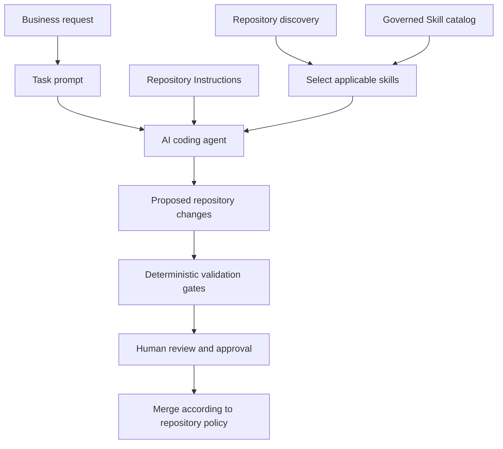

This layered architecture has several important properties.

The Prompt remains focused on business intent.

The Instructions continue to enforce repository-wide engineering standards.

The Skill provides the implementation workflow.

The AI agent combines all three while producing code.

As a result, organizations can improve engineering quality without rewriting prompts or modifying repository Instructions.

---

### Skills as Reusable Engineering Assets

Enterprise software organizations already treat many artifacts as reusable assets.

Examples include:

* Architecture decision records
* Shared libraries
* Infrastructure modules
* CI/CD pipelines
* Terraform modules
* Coding standards

Skills belong in the same category.

They are not temporary prompt snippets.

They are reusable engineering assets that encapsulate proven implementation knowledge.

Just as infrastructure engineers avoid rewriting Terraform modules for every deployment, AI engineering teams should avoid rewriting implementation procedures for recurring development tasks.

For Alpha Car Detailing, the engineering organization may maintain Skills such as:

| Skill                    | Purpose                                          |
| ------------------------ | ------------------------------------------------ |
| Create API Endpoint      | Add REST endpoint following repository standards |
| Create Query             | Add CQRS query workflow                          |
| Create Command           | Add CQRS command workflow                        |
| Add Domain Behavior      | Implement aggregate behavior                     |
| Add Repository           | Extend persistence layer                         |
| Add Integration Event    | Publish business event                           |
| Add Transactional Outbox | Ensure reliable messaging                        |
| Add Idempotent Consumer  | Safely process duplicate messages                |
| Add Authorization        | Apply security policies                          |
| Add OpenTelemetry        | Instrument distributed tracing                   |
| Add Health Check         | Extend platform monitoring                       |
| Add Unit Tests           | Verify application behavior                      |
| Add Integration Tests    | Validate end-to-end functionality                |

Each Skill represents engineering knowledge accumulated over many successful implementations.

---

### Skill Invocation During Feature Development

Consider the fleet booking feature.

The developer submits the prompt:

> Add Fleet Booking capability.

The AI agent begins planning.

Repository discovery identifies that:

* Fleet Booking belongs to the Booking Service.
* CQRS is mandatory.
* EF Core is the persistence mechanism.
* Integration events use the transactional outbox.
* OpenTelemetry is required.
* Authorization policies are repository-wide.

Instead of implementing everything from scratch, the AI invokes multiple Skills.

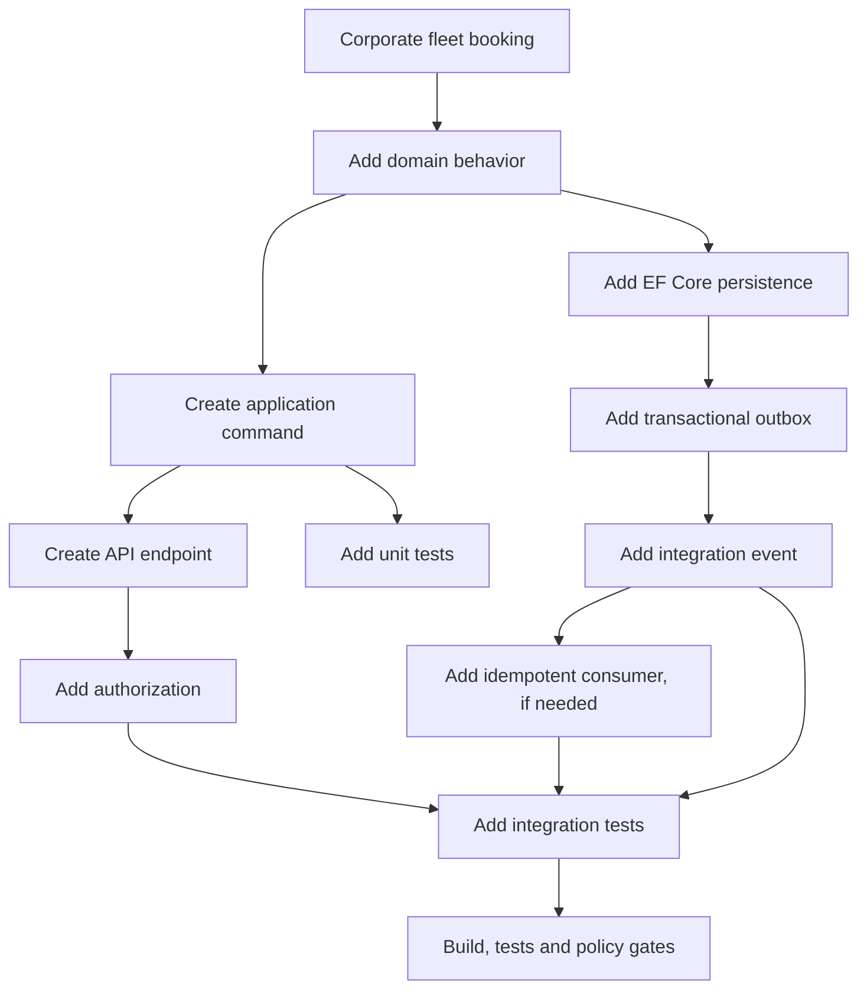

The feature becomes a composition of reusable engineering workflows. The diagram illustrates dependencies, not an unconditional one-pass sequence: an existing outbox may be reused, some tasks can be parallelized, and no consumer is needed if the change does not include a downstream subscriber.

---

### Skill Composition

Enterprise features rarely require only one Skill.

Instead, complex changes emerge from composing multiple smaller Skills.

For example:

```text
Corporate Fleet Booking

├── Create API Endpoint
├── Create Booking Command
├── Add Validation
├── Add Authorization
├── Add Domain Behavior
├── Add Repository
├── Add EF Core Mapping
├── Add Integration Event
├── Add Transactional Outbox
├── Add Consumer
├── Add OpenTelemetry
├── Add Logging
├── Add Unit Tests
└── Add Integration Tests
```

None of these Skills understands Fleet Booking.

Each understands a recurring engineering activity.

This distinction keeps Skills reusable across many unrelated features.

Domain-specific Skills are reasonable when the organization deliberately governs reusable processes within that domain; they should not be the default for a general engineering Skill catalog.

---

### Skill Granularity

One of the most difficult architectural decisions concerns Skill size.

Skills that are too large become difficult to maintain.

Skills that are too small become difficult to compose.

Consider these examples.

#### Poorly Scoped Skill

```text
Implement Complete Booking System
```

This Skill attempts to:

* create APIs
* create commands
* update persistence
* publish events
* create tests
* update documentation

It spans multiple architectural layers and business concerns.

Changing one part risks destabilizing everything else.

---

#### Overly Fragmented Skills

```text
Create Controller Constructor

Create Endpoint Attribute

Register Dependency

Create DTO

Register Mapper

Add Route

Add Parameter
```

Each Skill performs almost no meaningful engineering work.

Feature implementation now requires invoking dozens of tiny Skills, increasing orchestration complexity without improving reuse.

---

#### Appropriate Skill Scope

```text
Create API Endpoint
```

The Skill can reasonably check or coordinate:

* Endpoint
* DTO
* Validation
* Dependency Injection
* Mapping
* Authorization
* Logging
* Telemetry
* Tests

These concerns may be checked as part of an endpoint workflow, but ownership should remain clear. For example, the endpoint Skill may verify that authorization is present while a separate authorization Skill implements the policy. Likewise, its smoke tests do not replace the full integration-test Skill.

This balance maximizes reuse while keeping governance manageable.

---

### Skill Dependencies

Many Skills depend on the successful completion of others.

For example:

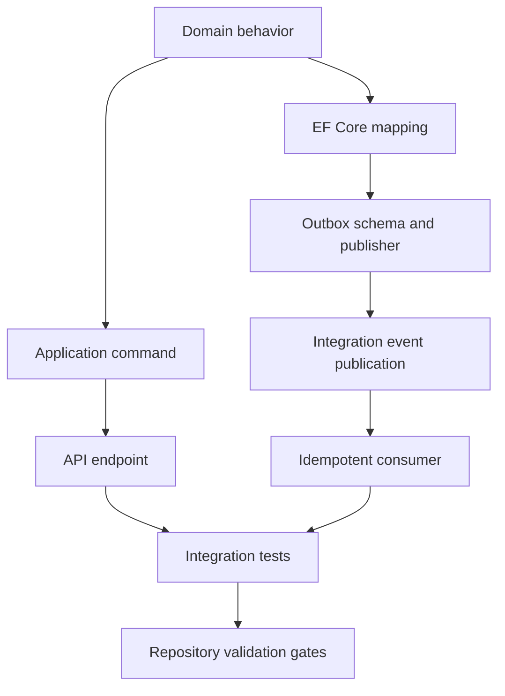

Dependency management prevents invalid execution sequences.

An AI harness should resolve declared prerequisites and detect missing dependencies or cycles rather than relying on prompt wording.

For example, invoking **Add Transactional Outbox** before persistence exists should immediately fail the Skill's precondition checks instead of attempting partial implementation.

---

### Skill Selection

A recurring question is:

**Who decides which Skills should execute?**

Several strategies exist.

#### Prompt-Driven Selection

The prompt explicitly names the required Skills.

Example:

> Add Fleet Booking using Create API Endpoint and Add Integration Event Skills.

This approach provides complete control but increases prompt complexity.

---

#### Agent-Driven Selection

The AI agent analyzes the requested change and automatically selects applicable Skills based on repository structure, feature type, and engineering context.

For example:

Fleet Booking requires:

* API
* Command
* Persistence
* Event
* Authorization

The agent selects the appropriate Skill chain automatically.

This model reduces prompt maintenance, provided applicability checks and review make the selections visible and contestable.

---

#### Harness-Orchestrated Selection

The AI harness becomes responsible for Skill orchestration.

The prompt only states:

> Implement Fleet Booking.

The harness determines:

* required repository Instructions
* applicable Skills
* execution order
* validation sequence
* approval checkpoints

This model can produce stronger consistency across teams and platforms when the harness resolves known versions and enforces independent validation gates.

---

### Skill Execution Lifecycle

Regardless of the AI platform, enterprise Skill execution should follow a consistent lifecycle.

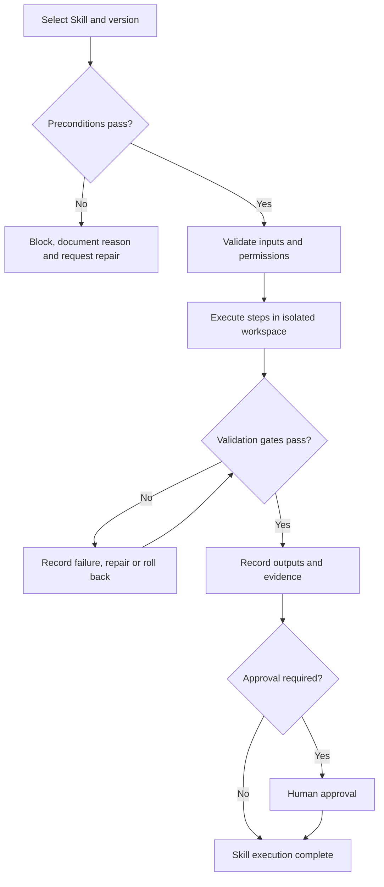

Every phase should emit observable evidence, although agent-native runtimes may expose different levels of detail.

The harness can identify exactly where failures occur, which Skills require improvement, and whether the resulting implementation satisfied engineering expectations.

This lifecycle transforms Skills from static documentation into governed, measurable engineering workflows.

---

### Failure Handling and Recovery

A Skill must say what to do when its preconditions fail, a tool call times out, a build is broken, or a generated migration conflicts with an existing one. The safe default is to stop on a failed prerequisite, identify the affected files, preserve diagnostic evidence, and request repair or escalation. Continuing to generate code after a prerequisite failure compounds uncertainty.

For task-scoped changes, a harness may use a temporary worktree or isolated run workspace. It should retain the base revision, the Skill revision, the patch, validation output, and the decisions that affect recovery. A failed attempt can then be retried from a known state, without discarding unrelated human edits. Destructive commands, database migration application, production deployments, and modifications to governing Instructions require separately authorized operations. Retry policies must be bounded and should distinguish environmental failures from failures of the implementation.

In Alpha Car Detailing, a failed migration validation must not be bypassed just because the fleet-booking endpoint compiles. The correct recovery may involve revising the mapping, removing only the migration created in the task, and rerunning the persistence tests. In a shared database, an already-applied migration needs a different, explicitly approved remediation plan.

### Deterministic Validation Gates

Skills tell the agent how to work; **deterministic gates** decide whether defined conditions have been satisfied. A Skill may request `dotnet build`, but an independently executed build gate—not the agent's statement that compilation succeeded—provides evidence. The same distinction applies to unit tests, security scanning, migration checks, architecture tests, and contract validation.

A mature harness separates at least three outcomes: **execution complete**, **technical validation passed**, and **change accepted**. A Skill can finish its procedure while the PR is still awaiting review. Conversely, an implementation may pass a build gate but fail business acceptance, tenant isolation, or audit requirements. All three states belong in the run record.

### Security and Trust Boundary

A Skill is also a source of instructions and potentially executable scripts. Before installation, the organization should review it for destructive behavior, unnecessary network access, untrusted dependencies, prompt injection, secret access, and permission escalation. Restrict filesystem and tool access to the task's needs. Third-party Skill content must not override repository policy or request broad credentials merely to complete routine engineering work.

---

## 6. Professional Diagrams

### Enterprise Skill Architecture

The relationship between repository artifacts can be summarized as follows.

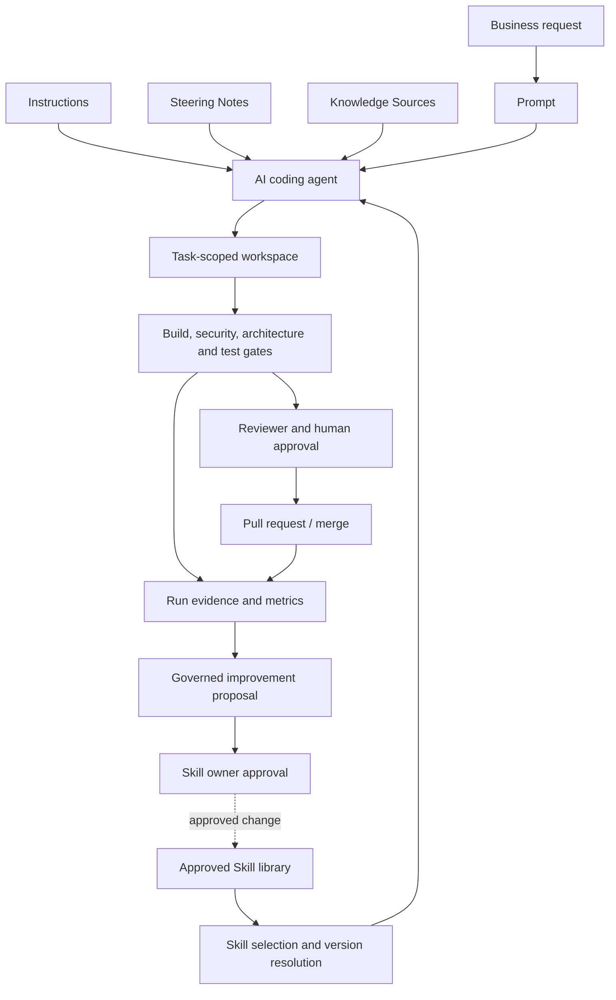

Each artifact contributes a distinct responsibility.

* **Prompt** communicates business intent.
* **Instructions** enforce repository-wide standards.
* **Skills** define reusable implementation workflows.
* **Steering Notes** provide temporary project guidance.
* **Knowledge Sources** supply contextual information.
* **The AI agent** synthesizes all inputs into repository changes.
* **Validation and review** ensure engineering quality before integration.
* **The learning harness** captures execution metrics and recommendations for future improvement.

---

## 7. Hands-on Example

Throughout this handbook, Alpha Car Detailing has evolved from a simple vehicle detailing application into a nationwide enterprise platform serving walk-in customers, corporate fleets, government agencies, insurance companies, and rental organizations.

The Product Owner has approved a new feature:

> **Corporate Fleet Booking**

The business requirement is straightforward.

Corporate customers should be able to submit a single booking request for multiple company-owned vehicles rather than scheduling appointments individually.

The engineering work, however, affects multiple architectural layers.

The repository Instructions already require:

* Clean Architecture
* CQRS
* Domain-Driven Design
* Authorization
* OpenTelemetry
* Transactional Outbox
* Structured Logging
* Unit Tests
* Integration Tests

Those standards guide the work; the associated build, security, and architecture gates enforce the checks that can be expressed mechanically.

The AI agent now needs reusable implementation procedures, an applicability check, and an execution plan tied to the acceptance criteria.

This is where Skills become the primary engineering mechanism.

---

### Feature Request

The Product Owner creates the following work item.

```text
Implement Corporate Fleet Booking.

Requirements

• Fleet manager creates booking for multiple vehicles
• Booking requires approval workflow
• Publish FleetBookingCreated integration event
• Persist using EF Core
• Require FleetManager role
• Expose REST endpoint
• Include telemetry
• Include unit tests
• Include integration tests
```

The developer links the work item and submits a concise prompt:

```text
Implement corporate fleet booking in the Booking Service.
Use the linked work item's acceptance criteria and the approved repository Skills.
Do not apply database migrations to shared environments or create a PR without review.
```

The task provides business intent and a reference to the acceptance criteria. It does not restate implementation standards that already belong in Instructions. The agent must still examine the work item and resolve ambiguities: in this example, creating a fleet booking begins in `PendingApproval`, and `FleetBookingCreated` records creation rather than approval.

---

### Skills Selected by the Agent

After repository discovery, the AI determines which Skills apply.

| Skill | Applicability in the feature |
| --- | --- |
| Add Domain Behavior | Establish booking invariants and approval state |
| Create Application Command | Coordinate the use case and transaction boundary |
| Add EF Core Persistence | Persist fleet booking and related records |
| Add Transactional Outbox | Persist event records atomically with the booking |
| Add Integration Event | Define and emit `FleetBookingCreatedV1` |
| Create API Endpoint | Expose the command through `POST /api/fleet-bookings` |
| Add Authorization | Require a fleet-management policy and tenant scope |
| Add Idempotent Consumer | Implement downstream handling if a subscriber is in scope |
| Add OpenTelemetry | Trace command, outbox dispatch, and consumption |
| Add Unit Tests | Validate booking and approval invariants |
| Add Integration Tests | Verify persistence, delivery, security, and duplicate handling |

The Skills are domain-independent. The Fleet Booking names, endpoint route, event schema, and authorization policy are *inputs determined from the work item and repository*, not hard-coded into the Skill library. The table is a set of applicable procedures, not a required serial execution order; existing infrastructure and Skill dependencies determine the plan.

---

### Skill 1 — Create API Endpoint

The following descriptions are catalog entries, not a prescribed execution order. Dependencies may require the application command or persistence infrastructure to be created before an endpoint is implemented. The endpoint Skill begins by validating its preconditions.

#### Inputs

| Input                 | Description               |
| --------------------- | ------------------------- |
| Service               | Booking Service           |
| Endpoint Type         | POST                      |
| Feature               | Fleet Booking             |
| Authentication Policy | Fleet Manager             |
| Command Name          | CreateFleetBookingCommand |

#### Preconditions

Before execution, the Skill verifies:

* The target API project exists and repository discovery has identified its routing style.
* The application command or equivalent operation exists, or a dependency is scheduled to create it.
* Authentication middleware and the intended policy are registered or explicitly delegated to the authorization Skill.
* The API project and application layer conventions are understood.
* The requested route does not conflict with an existing endpoint.

A failed precondition blocks this Skill. The agent records the reason and either executes an approved prerequisite Skill or requests a decision. Precondition checking must occur *before the Skill changes files*; a pre-existing partial implementation is not evidence that all prerequisites are satisfied.

---

#### Execution Steps

The Skill performs the following workflow.

1. Create request DTO.
2. Create response DTO.
3. Create endpoint.
4. Register route.
5. Bind the endpoint to the existing application operation.
6. Apply the resolved authorization policy and tenant context.
7. Attach request validation according to repository conventions.
8. Document the request, responses, and error contracts in OpenAPI.
9. Add the required tracing/logging integration points.
10. Record the files changed and run endpoint-focused checks.

These steps come from the reviewed Skill definition; the AI agent must still resolve repository-specific decisions and record the results.

---

#### Validation

The Skill concludes by verifying:

* Endpoint builds successfully.
* Route matches repository conventions.
* Authorization attribute exists.
* Request validation is registered.
* OpenAPI generation succeeds.
* Repository architecture validation passes.

Only after the expected endpoint checks succeed should the Skill report a *validated local execution*. Feature acceptance and PR approval remain separate outcomes.

---

### Skill 2 — Create Application Command

The next Skill extends the application layer.

#### Inputs

```text
Command Name

CreateFleetBookingCommand
```

#### Outputs

```text
CreateFleetBookingCommand

CreateFleetBookingHandler

Validator

Mapping Registration

Dependency Injection
```

---

#### Execution Workflow

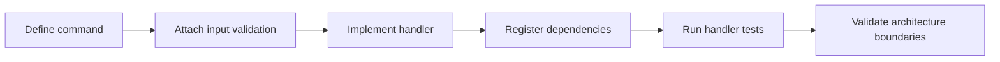

The Skill standardizes the intended command structure; architecture tests and code review determine whether the generated command follows the conventions.

---

### Skill 3 — Add Domain Behavior

The Domain layer is responsible for enforcing business rules.

The Skill verifies:

* aggregate boundaries
* invariants
* domain events
* business validation
* transactional consistency

Rather than allowing AI to scatter business logic across controllers and repositories, the Skill ensures that behavior remains inside the aggregate.

Example responsibilities include:

* maximum fleet size
* duplicate vehicle prevention
* booking status transitions
* approval workflow initialization

Because these checks are encoded in the Skill, agent executions share a reviewed procedure. The domain tests must still verify identical business behavior across implementations.

---

### Skill 4 — Add EF Core Persistence

The repository Instructions already specify EF Core as the persistence technology.

The Skill defines how persistence is implemented.

#### Execution Steps

```text
Create Entity Configuration

↓

Update DbContext

↓

Configure Relationships

↓

Configure Indexes

↓

Create Migration

↓

Execute Migration Validation

↓

Verify Repository Rules
```

The Skill should test model mappings and migration creation, inspect the generated schema changes, and record the migration artifacts. Applying migrations to shared or production databases is a separate, approval-controlled operation.

---

### Skill 5 — Add Authorization

Security implementation should never depend on prompt quality.

Instead, the Authorization Skill standardizes every implementation.

#### Inputs

| Property       | Value        |
| -------------- | ------------ |
| Policy         | FleetManager |
| Authentication | JWT          |
| Scope          | Booking APIs |

---

#### Execution

The Skill:

* applies authorization attributes
* validates policy registration
* verifies middleware configuration
* checks endpoint accessibility
* confirms anonymous access is denied

Security tests must additionally verify the authenticated principal is authorized for the *correct corporate tenant*. A valid FleetManager claim must never grant access to another company's bookings.

---

### Skill 6 — Add Integration Event

Fleet Booking must notify downstream services.

The implementation plan includes the **Add Integration Event** Skill after the transactional-outbox prerequisite has been confirmed.

Outputs include:

* FleetBookingCreated event
* Event schema
* Publisher
* Registration
* Serialization validation

The Skill also checks event schema versioning, required tenant identifiers, correlation IDs, and serialization compatibility. The event describes booking creation in `PendingApproval`; a future approval transition would require a distinct event.

---

### Skill 7 — Add Transactional Outbox

The outbox infrastructure is established before publishing a new integration event. Publishing an event directly from application code risks message loss.

The repository Instructions require reliable messaging.

The Skill implements the approved pattern.

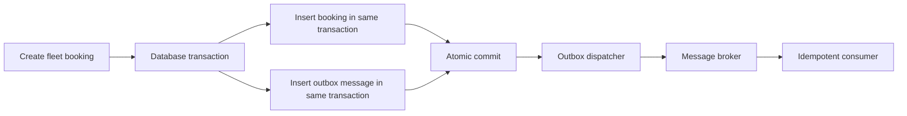

Both the fleet-booking row and the pending outbox message must be inserted within the **same database transaction**. The dispatcher publishes *after* commit and marks delivery state separately. Because the broker and database do not share one atomic transaction, retries and duplicate delivery remain possible; downstream consumers must be idempotent.

An illustrative event contract is:

```csharp
public sealed record FleetBookingCreatedV1(
    Guid EventId,
    Guid TenantId,
    Guid FleetBookingId,
    DateTimeOffset OccurredAtUtc,
    int VehicleCount,
    string CorrelationId);
```

The contract is representative, not a claim that these classes already exist in the repository. The event should be built from committed aggregate state, not from untrusted request fields, and the outbox must preserve its identifier and schema version.

---

### Skill 8 — Add Idempotent Consumer

A fleet-notification service may subscribe to `FleetBookingCreatedV1` to notify the corporate customer's fleet management system. At-least-once delivery means the same message can reach the consumer more than once, including when the broker retries after a timeout.

The **Add Idempotent Consumer** Skill verifies the consumer's event contract, identifies an immutable `EventId`, and checks for an existing inbox or processed-message store. It creates a unique constraint on `(ConsumerName, EventId)` and requires the *business side effect and message-processing marker* to commit atomically wherever the transactional boundary allows. Replayed events should be acknowledged without repeating a notification or mutation.

The Skill must also define retry classification, dead-letter handling, and telemetry attributes for duplicate deliveries. An in-memory cache alone is insufficient protection across service restarts. Its validation suite should deliberately deliver the same event twice and assert that the externally visible effect occurs once. If the downstream service does not form part of this change, the Skill is deferred and the integration contract is handed to its owning team.

---

### Skill 9 — Add OpenTelemetry

Observability is another recurring engineering activity.

Instead of prompting:

> Remember to add tracing.

the agent invokes:

```text
Add OpenTelemetry
```

The Skill performs:

* Activity creation
* Context propagation
* Trace attributes
* Exception recording
* Metrics registration
* Export validation

The instrumentation procedure becomes consistent across services, while emitted span names and attributes are checked against the service's telemetry contract.

---

### Skill 10 — Add Unit Tests

Testing is treated as part of implementation rather than a follow-up task.

The testing Skill guides the agent to implement and run tests covering:

* successful booking creation
* unauthorized or cross-tenant access where test boundaries permit
* validation failure
* duplicate fleet booking
* business rule violations

Validation confirms the tests compile and execute; the expected scenarios are asserted rather than inferred from test names. Domain behavior tests verify duplicate vehicle rejection and approval-state invariants. Authorization and tenant isolation require endpoint or integration tests, not merely aggregate unit tests.

---

### Skill 11 — Add Integration Tests

Finally, the AI executes the integration testing Skill.

Typical workflow:

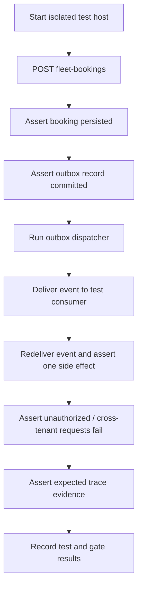

The integration suite validates the interactions between components, not merely whether they compile. Tests should use an isolated database and controlled message transport; trace-export assertions require a test collector or in-memory exporter. A failure must identify whether the defect is in the Skill, repository-specific integration, or infrastructure.

---

### Complete Feature Workflow

The complete implementation is now visible as a composition of reusable Skills.

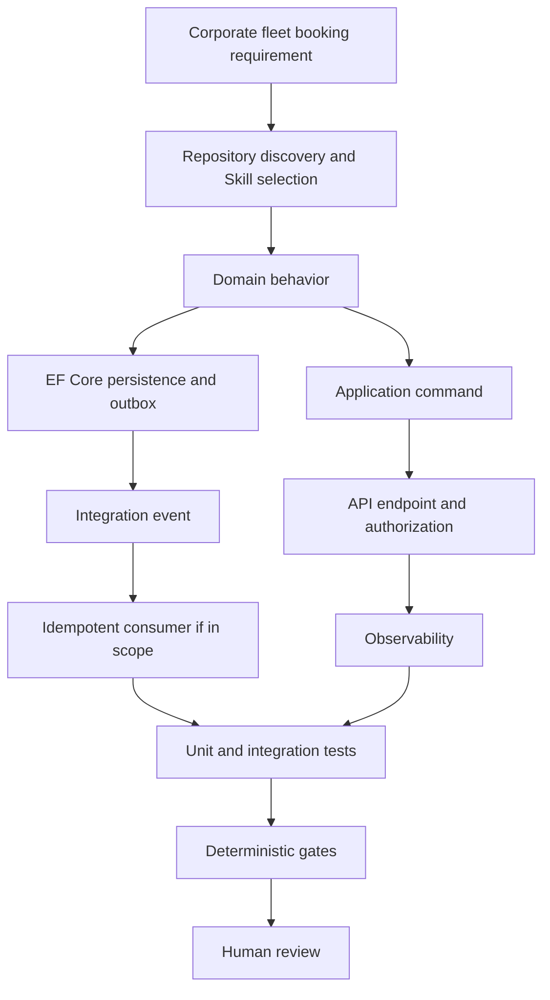

The agent uses the approved Skill library to structure its work, but the actual execution must be evidenced by the patch, the gate results, and the review record. Skill selection alone is not proof that all applicable procedures were followed.

This demonstrates the central principle of Enterprise AI Engineering:

> **Prompts express business intent. Instructions enforce engineering standards. Skills execute reusable engineering workflows.**

---

## 8. Claude Code Example

Claude Code is the primary implementation platform in Alpha Car Detailing, but the engineering contract remains independent of its runtime. Claude Code discovers project Skills from `.claude/skills/<skill-name>/SKILL.md` and personal Skills from `~/.claude/skills/`. A Skill can be selected when relevant or invoked explicitly by its slash-command name. A plain Markdown file placed under the handbook's top-level `skills/` catalog is **not automatically a discoverable Claude Code Skill** unless an installation or discovery mechanism exposes it through a supported location.

### Package a Real Skill

The engineering organization maintains an approved source of truth for its Skills, then publishes reviewed versions into the repositories that use them. For this example, the Booking Service consumes the following package:

```text
alpha-car-detailing/
├── CLAUDE.md
├── .claude/
│   └── skills/
│       ├── create-api-endpoint/
│       │   ├── SKILL.md
│       │   └── references/
│       │       └── api-contract-checklist.md
│       ├── add-transactional-outbox/
│       │   └── SKILL.md
│       └── add-idempotent-consumer/
│           └── SKILL.md
└── src/
    └── ...
```

The following is a practical, abbreviated `create-api-endpoint/SKILL.md` definition. Its metadata identifies when the Skill should be considered; the body defines its procedure. The conventions and package names must be confirmed against the actual repository before executing the commands.

````markdown
---
name: create-api-endpoint
description: Add a secured HTTP endpoint to an existing .NET service. Use when a task requires a new API route that delegates to an application operation.
---

# Create API Endpoint

## Inputs
- Target service and endpoint operation, from the task.
- Route, request and response contract, and expected status codes.
- Existing application command/query or equivalent operation.
- Authorization policy and tenant-context rules resolved from repository Instructions.

## Preconditions
1. Discover the API project, route conventions, solution, and test projects.
2. Verify the application operation exists or stop with a declared dependency.
3. Confirm authentication, authorization policy and tenant resolution.
4. Stop if the route conflicts with an existing endpoint.

## Procedure
1. Inspect a representative endpoint; follow its established style.
2. Add request and response contracts without exposing domain entities.
3. Bind the route to the application operation; preserve cancellation.
4. Attach validation and the resolved authorization policy.
5. Confirm tenant scope is derived from a trusted identity/context.
6. Add OpenAPI response/error contracts and telemetry integration points.
7. Add focused endpoint tests; summarize the changed files.

## Validate
- From the discovered solution directory, run `dotnet build`.
- Run the relevant endpoint test project with `dotnet test`.
- Verify 201/400/401/403 responses as applicable.
- Verify a fleet manager cannot address another tenant's booking.
- Report results; do not claim success if tests were not executed.

## Failure and approval
- Stop on missing policy, unresolved tenant mapping, or failing gates.
- Do not weaken authorization or bypass validation to obtain a pass.
- Do not publish, deploy, or modify protected policy files without approval.
- Return created files, test evidence, blockers and any requested decisions.
````

This definition is an executable *procedure in the sense of being actionable by an agent*, not a script that guarantees the model's behavior. The build and test commands must run, and the results must be captured. Exact tool permissions and the repository's CI policy still govern what the agent may execute.

### Invoke and Verify

A developer can request the work through a business task:

```text
Implement corporate fleet booking using the repository's approved Skills.
Read the linked acceptance criteria. Stop before applying a shared database migration.
```

Or the developer can invoke a specific Skill explicitly when the implementation has already reached the endpoint stage:

```text
/create-api-endpoint
```

The command is an example of Claude Code's Skill invocation form; it is not a substitute for the Skill's required inputs. Claude must still inspect the repository, select other applicable Skills, and validate the results. A useful run report identifies the Skill name and revision, the files changed, the commands actually run, gate results, and unresolved decisions.

### What Belongs in `CLAUDE.md`?

`CLAUDE.md` should retain stable project constraints: architectural boundaries, mandatory validation, security obligations, and where approved Skills are installed. It should not reproduce the entire endpoint procedure. Keeping the two artifacts separate prevents procedure changes from silently rewriting organizational policy.

---

## 9. GitHub Copilot Comparison

GitHub Copilot supports agent Skills in selected agent surfaces. Its repository Skill folders can include `.github/skills/<skill-name>/SKILL.md`; GitHub also documents compatible `.claude/skills/` and `.agents/skills/` locations for project Skills. A Skill can contain supporting scripts and references, and Copilot uses its description to decide when the procedure is relevant. Support and invocation behavior depend on the Copilot surface in use, so teams should verify the expected host in CI and developer onboarding documentation.

### Repository Layout

The Alpha Car Detailing repository can provide the same endpoint workflow to Copilot without embedding it in task prompts:

```text
alpha-car-detailing/
├── .github/
│   ├── copilot-instructions.md
│   └── skills/
│       └── create-api-endpoint/
│           ├── SKILL.md
│           └── references/
│               └── api-contract-checklist.md
└── src/
    └── ...
```

The `SKILL.md` can use the portable `name` and `description` frontmatter shown in the Claude example. The repository Instructions and the Skill are separate assets; the `.github/copilot-instructions.md` file should state the required security and architecture constraints, while `SKILL.md` describes the endpoint implementation procedure.

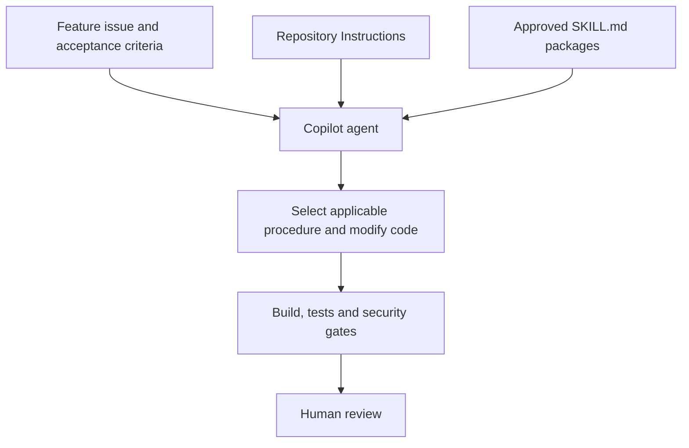

**Operational distinction.** Merely storing a Markdown file in `skills/` does not prove the host discovered it, and discovery does not prove that each procedure step was followed. Inspect the agent's plan and resulting patch. If a Skill is required for a change, the task or harness should explicitly reference it and require corresponding validation evidence.

Copilot is useful when teams work primarily in GitHub-based development and review workflows. Its agent behavior can follow the same engineering contract as Claude Code, but platform-specific permission settings, tool availability, and agent execution modes remain distinct. Portability belongs to the Skill's *procedure and acceptance contract*, not to an assumption of identical runtime behavior.

---

## 10. OpenAI Codex Comparison

OpenAI Codex can also work with reusable agent Skills. A typical repository location is `.agents/skills/<skill-name>/SKILL.md`, with `~/.agents/skills/` available for personal Skills in supported environments. `AGENTS.md` carries durable repository guidance. Codex must still resolve which Skills are applicable, check repository prerequisites, and produce verifiable outputs.

### Skill-Aware Implementation

```text
alpha-car-detailing/
├── AGENTS.md
├── .agents/
│   └── skills/
│       ├── create-api-endpoint/
│       │   └── SKILL.md
│       ├── add-transactional-outbox/
│       │   └── SKILL.md
│       └── add-idempotent-consumer/
│           └── SKILL.md
└── src/
    └── ...
```

The Codex implementation uses the same contract as the Claude-first Skill. The developer asks for corporate fleet booking and points to acceptance criteria. The agent reads the repository guidance, discovers applicable Skill definitions, proposes the work plan, changes the repository, and executes appropriate checks. Whether Skill selection is automatic or explicit, the approved version and the executed commands should be recorded in the run evidence.

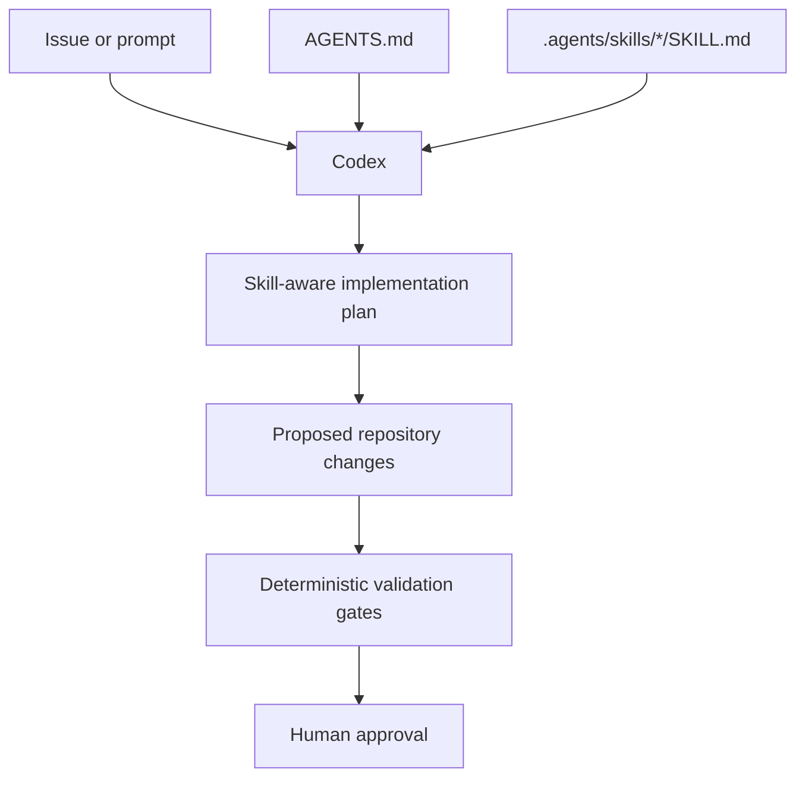

### Planning, Execution and Approval

Codex can be asked to plan before modifying a large codebase. The plan should identify any domain behavior, data migration, outbox modification, or downstream consumer affected by the change. It should not assume that the availability of a Skill makes an unsupported repository architecture valid. An EF Core Skill, for example, must not be applied to an unrelated persistence technology without first evaluating compatibility.

The governing design is unchanged: the agent proposes and implements a change; deterministic checks independently verify technical requirements; an authorized reviewer accepts or rejects the change. The harness can make this workflow repeatable without granting the model authority to rewrite approved Skills.

### Cross-Platform Engineering Contract

| Concern | Claude Code | GitHub Copilot | OpenAI Codex |
| --- | --- | --- | --- |
| Project repository guidance | `CLAUDE.md` | `.github/copilot-instructions.md` | `AGENTS.md` |
| Common project Skill location | `.claude/skills/<name>/SKILL.md` | `.github/skills/<name>/SKILL.md` | `.agents/skills/<name>/SKILL.md` |
| Portable Skill core | `name`, `description`, Markdown procedure | Same portable core | Same portable core |
| Invocation | Relevance-based or explicit `/skill-name` | Host-dependent agent selection | Host-dependent agent selection |
| Enforcement | External gates, permissions, review | External gates, permissions, review | External gates, permissions, review |
| Governance | Version-pinned approved source | Version-pinned approved source | Version-pinned approved source |

The exact locations and capabilities should be rechecked when upgrading tooling. For a multi-platform enterprise, maintain one reviewed canonical definition wherever possible and publish it through a repeatable distribution process to the host-specific location. Audit the distributed revision; a copied Skill that silently diverges from the canonical version defeats centralized governance.

---

## 11. Best Practices

Enterprise AI engineering succeeds when Skills are treated as long-lived engineering assets rather than collections of useful prompts. Organizations that invest in well-designed Skill libraries consistently achieve higher implementation quality, greater architectural consistency, and reduced onboarding effort for both developers and AI coding agents.

The following practices have proven effective across large software engineering organizations.

---

### Design Skills Around Recurring Engineering Activities

A Skill should represent a recurring engineering workflow rather than a specific business feature.

Good examples include:

* Create API Endpoint
* Add CQRS Command
* Add Domain Behavior
* Add EF Core Persistence
* Configure Authorization
* Add OpenTelemetry
* Add Transactional Outbox

Poor examples include:

* Implement Fleet Booking
* Build Insurance Dashboard
* Add Government Customer Module

Business features change frequently.

Engineering workflows change much less often.

Organizations maximize reuse by centering Skills around engineering activities rather than business requirements.

---

### Keep Skills Focused

Each Skill should have a clearly defined responsibility.

For example, the **Add OpenTelemetry** Skill should concern itself only with observability.

It should not also implement unrelated concerns such as authorization policy creation, database schema migrations, or event publication. It may document the instrumentation changes it makes.

Keeping responsibilities focused produces Skills that are easier to understand, test, govern, and compose.

---

### Define Explicit Inputs and Outputs

Every Skill should clearly specify:

#### Required Inputs

* repository location
* service name
* project type
* architectural layer
* technology selection
* configuration options

#### Expected Outputs

* generated source files
* modified files
* tests
* configuration changes
* validation results

For example:

| Skill                   | Inputs                  | Outputs                        |
| ----------------------- | ----------------------- | ------------------------------ |
| Create API Endpoint     | Service, Route, Command | Controller, DTOs, Registration |
| Add EF Core Persistence | Entity, DbContext       | Configuration, Migration       |
| Add Integration Event   | Event Name              | Event Contract, Publisher      |
| Add Authorization       | Policy Name             | Attributes, Registration       |

Well-defined interfaces allow Skills to be composed predictably.

---

### Always Validate Preconditions

A Skill should never assume the repository is ready.

Before execution, it should verify all prerequisites.

Examples include:

* required project exists
* correct architectural layer exists
* dependencies are available
* repository Instructions have been loaded
* required NuGet packages are installed
* supporting Skills have already completed

For example, the **Add Transactional Outbox** Skill should verify that:

* persistence already exists
* event publishing infrastructure is available
* messaging configuration has been completed

If these conditions are not met, execution should stop immediately.

---

### Include Validation as Part of the Skill

Successful code generation does not mean successful Skill execution.

Every Skill should verify its own results.

Typical validation includes:

* project builds
* tests compile
* architecture validation passes
* naming conventions are satisfied
* dependency injection is correctly registered
* generated code follows repository standards

Validation should be considered an integral part of the Skill rather than a separate activity.

---

### Design Skills for Composition

Enterprise features usually require multiple Skills working together.

A well-designed Skill should integrate cleanly with others.

For example:

```text
Create API Endpoint

↓

Create Command

↓

Add Domain Behavior

↓

Add Persistence

↓

Publish Event

↓

Add Tests
```

Each Skill performs one meaningful engineering workflow while remaining compatible with adjacent Skills.

---

### Avoid Repository-Specific Assumptions

Reusable Skills should minimize hard-coded assumptions about individual repositories.

Instead of assuming:

```text
BookingService\Application\Commands\
```

prefer configuration such as:

```text
<Application Command Folder>
```

or

```text
Configured CQRS Command Location
```

This allows the same Skill to operate across multiple repositories with minimal adaptation.

---

### Treat Skills as Versioned Assets

Skills evolve over time.

New architectural patterns emerge.

Frameworks change.

Security standards improve.

Organizations should place Skills under version control and publish reviewed releases; semantic version identifiers are useful when compatibility is explicitly managed.

Example:

```text
Create API Endpoint

Version 1.0

↓

Version 1.1

• Added OpenTelemetry

↓

Version 1.2

• Added Endpoint Filters

↓

Version 2.0

• Added Native AOT support
```

Version history provides transparency and enables controlled adoption across engineering teams. A change in the Skill version does not by itself update every consuming repository; a controlled distribution step must pin and record the new revision.

---

### Review Skills Like Production Code

Every Skill should undergo the same engineering governance as application source code.

Recommended review criteria include:

* correctness
* architectural compliance
* maintainability
* security
* performance
* reusability
* clarity

Pull requests that modify Skills should receive careful architectural review because changes may affect hundreds of future implementations.

---

### Measure Engineering Outcomes

Organizations often evaluate AI solely by code generation speed.

A more meaningful measure is Skill effectiveness.

Useful metrics include:

| Metric                 | Description                              |
| ---------------------- | ---------------------------------------- |
| Success Rate           | Percentage of successful executions      |
| Validation Pass Rate   | Percentage passing all validation steps  |
| Human Rework           | Average changes required after execution |
| Reuse Frequency        | Number of executions across repositories |
| Failure Categories     | Common causes of Skill failure           |
| Average Execution Time | End-to-end workflow duration             |

For comparability, define denominators. **Technical pass rate** is the number of applicable executions that pass all required gates divided by all applicable attempted executions. **Acceptance rate** is the number of reviewed changes accepted divided by reviewed changes, not all generated patches. Report blocked preconditions, environmental failures, and abandoned runs separately rather than burying them in one success percentage. Attribute post-merge defects cautiously: correlation with a Skill revision does not establish that the Skill caused the defect.

These metrics provide actionable insight into engineering quality rather than AI productivity alone.

---

### Test the Skill, Not Just the Generated Code

A Skill must be validated before it is promoted to the enterprise catalog. A useful evaluation set includes a representative repository, an atypical but supported repository, and deliberately incompatible repositories. For `create-api-endpoint`, regression scenarios should cover an already-existing route, missing policy, a mismatched project convention, an endpoint in a different .NET service, and a cross-tenant request. Test that the Skill correctly *refuses* invalid work—not only that it produces valid code on a happy path.

Skill tests can combine metadata/schema checks, repository fixture runs, architecture tests, security tests, and reviewer assessment. Record the model/host version because apparent Skill regressions may reflect changes in agent behavior rather than changes in the Skill text. Where agent output varies, use behavioral assertions and quality rubrics rather than exact text matching. Separate Skill-level failures from failures caused by unavailable tools, rate limits, or an unhealthy CI environment.

### Capture Execution Evidence and Reproducibility

The run record should capture the task ID, repository commit, Skill name and revision, agent/host version, accepted inputs, changed files, commands executed, gate outcomes, durations, and reviewer disposition. Never store credentials, customer identifiers, or sensitive payloads in the evidence store. Redact logs and apply access control and retention rules. This record supports incident investigation, reproducible evaluations, and justified Skill improvements.

---

## 12. Anti-patterns

As organizations adopt Skills, several recurring mistakes appear repeatedly.

Recognizing these anti-patterns early prevents significant maintenance and governance problems.

---

### Anti-pattern: Mixing Skills with Instructions

One of the most common mistakes is embedding repository policy inside implementation workflows.

Example:

```text
Skill

Every API must use JWT authentication.
```

This is not a Skill.

It is a repository-wide Instruction.

The corresponding Skill should instead describe how authorization is implemented after that policy has already been established.

A simple guideline is:

* **Instructions define mandatory standards.**
* **Skills define reusable procedures.**

Mixing the two makes both harder to maintain.

---

### Anti-pattern: Writing Skills as Large Prompts

Some organizations create Skills that resemble conversational requests.

Example:

```text
Please build a REST API using Clean Architecture,
follow best practices,
write tests,
use logging,
add telemetry,
make everything production ready.
```

This is simply a verbose prompt.

A professional Skill should instead define:

* inputs
* preconditions
* execution workflow
* validation
* outputs
* failure handling

Structured workflows are significantly more reliable than conversational descriptions.

---

### Anti-pattern: Missing Preconditions

Skipping prerequisite validation frequently produces incomplete or inconsistent implementations.

For example:

```text
Add Transactional Outbox
```

without verifying that persistence infrastructure already exists often results in partially generated code that requires extensive manual repair.

Every Skill should fail early rather than proceed with invalid assumptions.

---

### Anti-pattern: Missing Validation

Many organizations incorrectly assume that generated code is automatically correct.

Generation alone proves nothing.

Every Skill should validate:

* compilation
* architecture compliance
* tests
* repository conventions
* dependency registration
* runtime behavior where appropriate

Only validated execution should be considered successful.

---

### Anti-pattern: Overly Large Skills

Skills that attempt to implement an entire business feature become difficult to understand, review, version, and reuse.

For example:

```text
Implement Complete Fleet Management System
```

Such Skills inevitably combine unrelated engineering concerns and become tightly coupled to a single business domain.

Smaller, well-scoped engineering workflows are far more maintainable.

---

### Anti-pattern: Excessive Skill Fragmentation

The opposite problem occurs when organizations divide workflows into dozens of trivial Skills.

For example:

```text
Create DTO

Create Controller

Register Service

Add Route

Configure Mapping

Create Validator
```

Each performs too little useful work.

Complex features then require orchestrating an unnecessarily large number of tiny Skills, increasing operational complexity without improving reuse.

---

### Anti-pattern: Hard-Coded Repository Assumptions

Embedding repository paths, project names, or folder structures directly into Skills limits portability.

Instead, Skills should rely on repository discovery and configuration wherever possible.

This enables the same Skill library to support multiple repositories and future architectural changes.

---

### Anti-pattern: Uncontrolled Skill Changes

Because Skills influence many future implementations, modifying them without governance introduces significant organizational risk.

Changes should always be:

* reviewed
* versioned
* tested
* approved
* documented

A Skill library deserves the same change management discipline as production source code.

---

### Anti-pattern: Allowing the Harness to Silently Rewrite Skills

A self-learning AI harness may identify opportunities to improve engineering workflows.

However, it should **never** modify approved Skills automatically.

Instead, the harness should generate recommendations such as:

```text
Suggested Improvement

Create API Endpoint v1.4

Recommendation:

Automatically register endpoint filters for all new APIs.

Evidence:

For example: multiple reviewed PRs needed manual registration of endpoint filters. Include links to those PRs in the proposal.
```

A human architect should evaluate the proposal before the Skill is updated.

Autonomous learning should support governance—not replace it.

---

### Anti-pattern: Reusing Skills Without Verifying Applicability

Not every Skill is appropriate for every repository.

For example, invoking an EF Core persistence Skill within a repository that uses MongoDB or Cosmos DB is unlikely to produce correct results.

Skill selection should consider:

* repository architecture
* technology stack
* Instructions
* project conventions
* current engineering context

Reuse should always be informed rather than automatic.

---

### Anti-pattern: Equating Code Generation with Skill Success

The final and perhaps most important mistake is assuming that successful code generation equals validated Skill execution or feature acceptance.

A Skill's technical execution is validated when:

* applicable preconditions were satisfied;
* its procedure was followed, or justified deviations were recorded;
* the relevant independent build, architecture, security and test gates passed;
* expected artifacts and evidence were produced.

The associated feature is **accepted** only when the required reviewer or business approvals are also recorded.

Engineering quality—not generated source code—is the true measure of Skill effectiveness.

---

## 13. Architect's Notes

> **Architect's Note**
>
> One of the biggest misconceptions in AI-assisted software development is treating Skills as a collection of useful prompts. They are not.
>
> A Skill is an engineering asset that deserves the same architectural discipline as a shared framework, a reusable library, or a CI/CD pipeline.
>
> Organizations that govern Skills as first-class engineering artifacts consistently achieve better architectural consistency, lower maintenance costs, and significantly higher AI reliability.

---

### Skills Capture Organizational Engineering Knowledge

Experienced architects make thousands of engineering decisions over their careers.

Examples include:

* where validation belongs
* how aggregates enforce invariants
* how events are published
* how persistence is structured
* how observability is implemented
* how failures are handled

Traditionally, this knowledge exists only in the minds of senior engineers.

As organizations grow, this creates several challenges.

New developers require months of mentoring.

Engineering approaches vary across teams.

Architecture gradually drifts away from established standards.

AI coding agents encounter exactly the same problem.

Unless organizational engineering knowledge is explicitly captured, every implementation becomes a new interpretation of the same engineering activity.

Skills solve this problem by transforming implicit architectural knowledge into explicit, executable engineering workflows.

---

### Skills Should Be Stable but Evolvable

A mature Skill library changes much less frequently than application code.

Daily feature development should consume Skills rather than modify them.

Skill evolution should occur only when there is sufficient engineering evidence that the workflow itself requires improvement.

Typical reasons include:

* introduction of new architectural patterns
* framework upgrades
* security improvements
* observability enhancements
* lessons learned from production incidents
* recurring review comments
* automation opportunities

This separation allows application development to move quickly while preserving the stability of engineering workflows.

---

### Think Beyond Individual Repositories

Many organizations initially design Skills specifically for one repository.

For example:

```text
Create Booking API
```

Although useful, this Skill has limited long-term value.

Architects should instead ask:

"What engineering activity is actually being repeated?"

The answer is usually something broader.

For example:

```text
Create REST API Endpoint
```

This Skill immediately becomes reusable across:

* Booking Service
* Customer Service
* Payment Service
* Notification Service
* Inventory Service

The broader engineering abstraction significantly increases return on investment.

---

### Skill Libraries Become Enterprise Standards

As organizations mature, Skill libraries begin to resemble internal engineering frameworks.

Different repositories consume the same Skills.

Different AI platforms execute the same workflows.

Different development teams produce similar implementations.

Eventually, Skills become part of the organization's engineering standards alongside:

* coding standards
* architecture guidelines
* deployment pipelines
* security policies
* testing frameworks

This consistency reduces architectural drift while improving onboarding for both developers and AI coding agents.

---

### Reuse Contracts Without Hiding Technology Differences

A Skill should understand the engineering technologies used by a repository.

For example:

* EF Core
* MongoDB
* Event Hub
* Kafka
* OpenTelemetry

Shared Skill contracts can express common responsibilities such as checking prerequisites, capturing outputs, and running tests. Implementation Skills should nevertheless remain technology-specific when the guarantees differ. An EF Core migration workflow is not interchangeable with MongoDB schema/index management. Architects should reuse the *engineering contract* while retaining dedicated, verified provider-specific procedures and applicability checks.

---

### Enterprise Architecture Emerges from Reusable Skills

One of the most powerful observations in Enterprise AI Engineering is that architecture becomes increasingly consistent as organizations expand their Skill libraries.

Rather than relying solely on architecture documents and code reviews, organizations continuously reinforce architectural decisions through reusable implementation workflows.

Every successful Skill execution strengthens architectural consistency.

Over thousands of executions, this produces measurable improvements in engineering quality.

---

### Separate Skill Guidance from Non-Negotiable Gates

Architecture review should establish which requirements may rely on agent judgment and which must be enforced by automation. A Skill can describe how to add policy-based authorization; integration tests and access-control scans must verify that authorization is actually applied. A Skill can request an outbox; a transactional integration test must prove that creating a booking and recording its event are atomic. The distinction is particularly important for security, financial, and multi-tenant boundaries.

---

## 14. Enterprise Tips

> **Enterprise Tip**
>
> Do not measure the maturity of your AI adoption by the number of prompts your developers write.
>
> Measure it by the quality, governance, and reuse of your organization's Skill library.

---

### Build an Enterprise Skill Catalog

Treat Skills as discoverable engineering assets.

An enterprise catalog should classify Skills by engineering discipline.

Example:

```text
API

├── Create Endpoint
├── Version Endpoint
├── Secure Endpoint

Application

├── Create Command
├── Create Query
├── Register Validation

Domain

├── Add Aggregate
├── Add Domain Event

Persistence

├── EF Core
├── MongoDB
├── Redis

Messaging

├── Integration Event
├── Transactional Outbox
├── Kafka Consumer

Observability

├── OpenTelemetry
├── Logging
├── Metrics

Testing

├── Unit Tests
├── Integration Tests
├── Performance Tests
```

This organization makes Skill discovery significantly easier for both humans and AI agents.

---

### Assign Clear Ownership

Every Skill should have an identifiable owner.

Typical ownership may include:

| Skill Category       | Recommended Owner          |
| -------------------- | -------------------------- |
| Architecture Skills  | Software Architecture Team |
| Security Skills      | Security Engineering       |
| Observability Skills | Platform Engineering       |
| CI/CD Skills         | DevOps Team                |
| Testing Skills       | Quality Engineering        |
| Messaging Skills     | Integration Team           |

Ownership ensures that improvements, bug fixes, and architectural changes follow a controlled governance process.

---

### Maintain Backward Compatibility

When improving a Skill, avoid introducing breaking behavior without careful planning.

Instead:

* introduce new versions
* deprecate old versions
* document migration guidance
* communicate adoption timelines

This approach mirrors API versioning and reduces disruption across repositories.

---

### Continuously Measure Skill Effectiveness

Enterprise Skill libraries should be monitored like production systems.

Useful operational dashboards include:

* execution frequency
* success rate
* validation failures
* average execution time
* review acceptance rate
* rollback rate
* post-merge defects
* developer satisfaction

These metrics identify where engineering workflows need refinement.

---

### Encourage Cross-Team Contributions

The best Skill libraries evolve through contributions from multiple engineering disciplines.

For example:

* architects improve design workflows
* platform engineers enhance deployment Skills
* security teams strengthen authorization workflows
* QA engineers improve testing Skills
* operations teams refine observability Skills

A collaborative governance model produces more comprehensive and resilient engineering assets.

---

### Document Skill Dependencies

As the Skill catalog grows, dependencies become increasingly important.

Maintaining explicit dependency information enables:

* reliable orchestration
* parallel execution where appropriate
* early prerequisite validation
* simplified troubleshooting
* automated planning by AI harnesses

Dependency documentation should be maintained alongside each Skill definition.

---

### Establish a Governed Improvement Loop

A self-learning harness may correlate repeated failed gates, reviewer change requests, and post-merge incidents with a specific Skill revision. Suppose the endpoint Skill repeatedly omits tenant-isolation tests in corporate fleet features. The harness should retain the affected run IDs and propose a change to the Skill's validation instructions, accompanied by a failing fixture, expected outcome, and impact assessment. The Skill owner reviews the proposal, evaluates it against the existing fixture suite, approves a versioned release, and rolls it out in controlled stages. Rejected recommendations should be retained with the decision rationale; they must not be silently reapplied.

An improved success rate is useful evidence, but only when measured against comparable task types and checked for regressions in security, correctness, review effort, and cost. The learning system produces recommendations, not new policy authority.

---

## 15. Decision Points

Enterprise architects should establish clear organizational decisions before introducing Skills at scale.

The following questions help guide those decisions.

---

### Decision Point 1 — Where Should Skills Be Stored?

Possible approaches include:

* repository-local Skill library
* organization-wide shared repository
* centralized AI engineering platform
* hybrid model

For most enterprises, a hybrid approach is recommended.

Core engineering Skills remain centrally governed, while repository-specific Skills reside alongside the source code.

---

### Decision Point 2 — Who Owns Skill Governance?

Potential owners include:

* Enterprise Architecture
* Platform Engineering
* AI Engineering Center of Excellence
* Technical Leads

Whatever model is chosen, ownership should be explicit.

Unowned Skill libraries inevitably drift in quality and consistency.

---

### Decision Point 3 — How Should Skills Be Versioned?

Possible strategies include:

* semantic versioning
* repository release alignment
* annual engineering baselines

Semantic versioning is generally the most flexible because it communicates compatibility expectations clearly.

---

### Decision Point 4 — Can AI Modify Skills?

This handbook recommends a clear governance policy: **AI may draft proposed changes, but it must not silently modify the approved Skill catalog or publish changes without authorized human review.**

AI agents may:

* recommend improvements
* generate proposed revisions
* analyze effectiveness
* identify recurring implementation issues

AI agents should **not** silently update approved Skills.

Every Skill modification should follow normal engineering review and approval processes.

---

### Decision Point 5 — What Defines Successful Skill Execution?

Organizations should define success using measurable engineering outcomes rather than code generation alone.

Recommended criteria include:

* all preconditions satisfied
* workflow completed successfully
* validation passed
* repository Instructions followed
* tests passed
* reviewer approval obtained
* production quality achieved

This defines an **accepted feature change**. For reporting precision, distinguish completion of Skill steps, technical gate pass, and final human acceptance as separate outcomes.

---

### Decision Point 6 — Should Skills Be Shared Across AI Platforms?

The answer is generally **yes**.

Skills represent organizational engineering knowledge, not platform-specific capabilities.

By keeping Skills vendor-neutral, organizations preserve their engineering investment even as AI coding platforms evolve.

---

## 16. Exercises

### Exercise 1 — Classify Repository Artifacts

For each of the following, identify whether it should be implemented as an **Instruction**, **Skill**, or **Prompt**.

1. Every externally accessible API must require JWT authentication.
2. Add a REST endpoint for Fleet Booking.
3. Create an EF Core migration.
4. Implement Corporate Fleet Booking.
5. Every integration event must use the transactional outbox.
6. Configure OpenTelemetry tracing for a new service.

Discuss why each classification supports long-term maintainability.

---

### Exercise 2 — Design a Reusable Skill

Design a Skill named **Add Background Worker** for the Alpha Car Detailing platform.

Your design should include:

* purpose
* inputs
* outputs
* preconditions
* execution steps
* validation steps
* failure handling
* approval requirements

---

### Exercise 3 — Evaluate Skill Granularity

Review the following proposed Skills.

* Implement Booking Module
* Create Controller
* Create API Endpoint
* Configure Route Attribute
* Implement Complete Customer Service

Identify which Skills are:

* appropriately scoped
* too large
* too fragmented

Explain your reasoning.

---

### Exercise 4 — Create a Skill Composition

Using the Alpha Car Detailing architecture, define the sequence of Skills required to implement a **Corporate Fleet Maintenance Schedule** feature.

Include:

* dependency order
* validation points
* approval checkpoints

---

### Exercise 5 — Improve a Skill

Assume the **Add OpenTelemetry** Skill has a 72% validation success rate.

Identify:

* possible causes
* required metrics
* proposed improvements
* governance process for updating the Skill

---

## 17. Interview Questions

The following questions are intended for software architects, senior developers, AI engineering leads, and platform engineers. They focus on conceptual understanding, architectural reasoning, and enterprise-scale implementation rather than memorization.

---

### Conceptual Questions

#### 1. What is a Skill in Enterprise AI Engineering?

**Expected discussion points**

* Reusable engineering workflow
* Defines implementation procedure
* Independent of individual business features
* Governed and versioned
* Executable by AI coding agents

---

#### 2. How do Skills differ from Instructions?

Candidates should explain that:

| Instructions                 | Skills                                 |
| ---------------------------- | -------------------------------------- |
| Define engineering standards | Define engineering workflows           |
| Repository-wide              | Reusable engineering activity          |
| Rarely change                | Evolve as engineering practices mature |
| Specify constraints          | Specify implementation procedures      |

A strong candidate should emphasize that Instructions answer *what must always be true*, while Skills answer *how recurring engineering work is performed*.

---

#### 3. How do Skills differ from Prompts?

Expected answer:

Prompts describe today's engineering task.

Skills describe reusable implementation procedures.

Example:

Prompt

> Implement Corporate Fleet Booking.

Skill

> Create API Endpoint

The prompt changes daily.

The Skill can be reused across many requests until the procedure needs a governed revision.

---

#### 4. Why shouldn't engineering knowledge be embedded inside prompts?

Look for discussion around:

* duplicated engineering knowledge
* inconsistent implementations
* prompt maintenance
* lack of governance
* architectural drift

Strong candidates should explain why reusable Skills improve consistency and maintainability.

---

#### 5. Why are Skills considered engineering assets?

A complete answer should include:

* version control
* ownership
* testing
* governance
* review
* reuse
* measurable quality improvements

---

### Architecture Questions

#### 6. How should Skills be organized in a large enterprise?

Expected topics:

* categorized Skill libraries
* ownership by engineering teams
* dependency management
* versioning
* repository discovery
* centralized governance

---

#### 7. What information belongs inside a Skill?

Expected answer:

* purpose
* inputs
* outputs
* preconditions
* execution workflow
* validation
* failure handling
* dependencies
* approval requirements

---

#### 8. Why should Skills validate preconditions?

Candidates should discuss:

* preventing partial implementations
* predictable execution
* improved diagnostics
* reduced recovery effort
* safer automation

---

#### 9. What is Skill composition?

Expected discussion:

Large software features are implemented by orchestrating multiple reusable Skills.

Example:

```text
Create API

↓

Create Command

↓

Add Domain Behavior

↓

Persistence

↓

Integration Event

↓

OpenTelemetry

↓

Testing
```

The candidate should recognize that complex engineering work emerges from coordinated execution of smaller reusable workflows.

---

#### 10. Should a Skill understand business requirements?

The preferable answer is **not by default**. A general-purpose Skill should capture reusable engineering activities rather than the details of one feature. Domain-specific reusable Skills can also be valid when they have a clear owner, bounded applicability, and repeated use cases. The Prompt and linked acceptance criteria supply the current business intent.

---

### Governance Questions

#### 11. Who should own enterprise Skills?

Possible answers include:

* Architecture Team
* Platform Engineering
* AI Engineering Center of Excellence
* Domain Engineering Teams

The important point is that ownership should be explicit.

---

#### 12. Should AI agents modify Skills automatically?

The expected answer is: **not in the governed, approved catalog without explicit review and authorization**. They can prepare drafts and open a proposed Skill change for human consideration.

AI agents may:

* identify improvement opportunities
* generate proposed revisions
* recommend optimizations

Human approval should always be required before modifying governed engineering assets.

---

#### 13. How should Skill effectiveness be measured?

Candidates should discuss metrics such as:

* execution success rate
* validation success
* review acceptance
* human rework
* defect rate
* reuse frequency
* execution time

Engineering quality—not generation speed—should be the primary objective.

---

#### 14. What are the risks of poorly designed Skills?

A comprehensive answer may include:

* architectural inconsistency
* duplicated engineering logic
* increased maintenance
* difficult governance
* reduced AI reliability
* higher onboarding costs

---

#### 15. How do Skills contribute to Enterprise AI Engineering?

Strong candidates should conclude that Skills transform engineering experience into reusable organizational knowledge, enabling AI coding agents to execute proven implementation workflows consistently across repositories and teams.

---

## 18. Chapter Summary

This chapter introduced **Skills** as one of the foundational building blocks of Repository Intelligence.

While Instructions define the engineering standards that govern a repository, Skills define the reusable implementation procedures that AI coding agents follow when performing recurring development activities.

This distinction is fundamental to Enterprise AI Engineering.

Without Skills, AI agents rely heavily on increasingly detailed prompts, leading to duplicated engineering knowledge, inconsistent implementations, and greater architectural drift.

With Skills, organizations capture proven engineering workflows once and reuse them across repositories, projects, teams, and AI coding platforms.

Using the Alpha Car Detailing application as a running example, this chapter demonstrated how a single business request—implementing Corporate Fleet Booking—can be realized through the composition of reusable Skills such as:

* Create API Endpoint
* Create Application Command
* Add Domain Behavior
* Add EF Core Persistence
* Add Authorization
* Add Integration Event
* Add Transactional Outbox
* Add OpenTelemetry
* Add Unit Tests
* Add Integration Tests

Each Skill encapsulates organizational engineering knowledge rather than business logic.

The chapter also explored the complete lifecycle of enterprise Skills, including:

* Skill anatomy
* inputs and outputs
* preconditions
* execution workflows
* validation
* failure handling
* ownership
* versioning
* governance
* testing
* composition
* dependency management
* execution within AI harnesses

A recurring theme throughout the chapter has been that **successful code generation is not equivalent to successful Skill execution**.

A Skill is successful only when:

* prerequisites are satisfied
* the workflow executes correctly
* validation passes
* repository standards are maintained
* reviewers approve the implementation

Finally, the chapter introduced the concept of **self-learning AI harnesses**.

Rather than silently modifying approved Skills, an enterprise harness should continuously measure Skill effectiveness, analyze engineering outcomes, identify recurring improvement opportunities, and generate evidence-based recommendations for human review.

In this model, AI augments engineering governance without replacing it.

As AI-assisted software development continues to mature, organizations that invest in governed, reusable Skill libraries will achieve greater consistency, stronger architectural alignment, and higher engineering quality across every AI coding platform.

---

## 19. Further Reading

The concepts introduced in this chapter provide the foundation for the remaining chapters in Part II and later sections of this handbook.

Recommended continuation within this handbook:

* **Chapter 6 — Instructions** — Repository-wide engineering standards that govern every AI-assisted change.
* **Chapter 8 — Prompts** — Task-specific requests that express business intent while remaining independent of engineering implementation details.
* **Chapter 9 — Roles** — Specialized AI engineering responsibilities such as Developer, Reviewer, Validator, and Architect.
* **Chapter 10 — Steering Notes** — Temporary project guidance that influences current priorities without changing repository standards.
* **Chapter 11 — Knowledge Sources** — How AI coding agents discover and use repository documentation, architecture records, and engineering references.
* **Part III — Harness Engineering** — Orchestrating Skills, Instructions, Roles, and Prompts within automated AI engineering workflows.
* **Part VI — Self-Learning AI Systems** — Measuring Skill effectiveness, recommending improvements, and evolving engineering workflows through governed feedback loops.

For implementation details and evolving host-specific behavior, consult the primary documentation:

- [Agent Skills open format](https://agentskills.io/) — Skill package anatomy and portable metadata.
- [Claude Code: Extend Claude with Skills](https://code.claude.com/docs/en/skills) — Discovery, invocation, and package conventions.
- [GitHub: Adding Agent Skills for GitHub Copilot](https://docs.github.com/en/copilot/how-tos/copilot-on-github/customize-copilot/customize-cloud-agent/add-skills) — Supported repository locations and agent behavior.
- [OpenAI: Skills](https://developers.openai.com/api/docs/guides/tools-skills) — Portable Skills and runtime execution concepts.
- [OpenAI: Codex workflow and repository guidance](https://developers.openai.com/cookbook/examples/codex/iterating-development-workflows-with-codex) — `AGENTS.md` and repeatable development workflows.

By progressing through these chapters, readers will move from understanding individual repository intelligence artifacts to designing complete enterprise AI engineering systems capable of delivering reliable, repeatable, and governable software development at scale.

---
