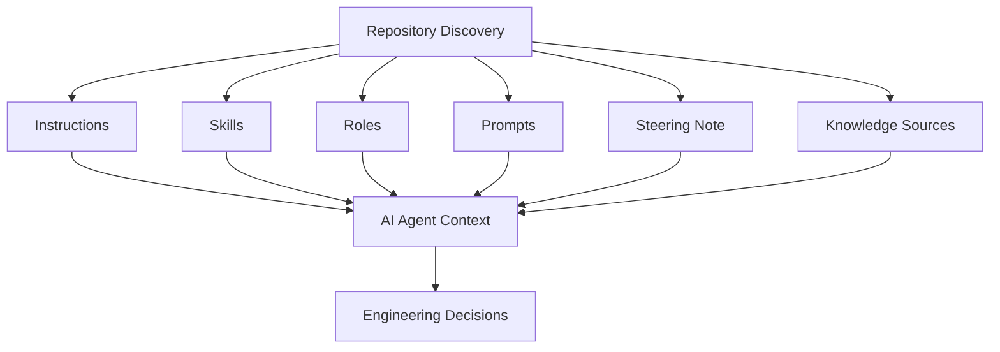
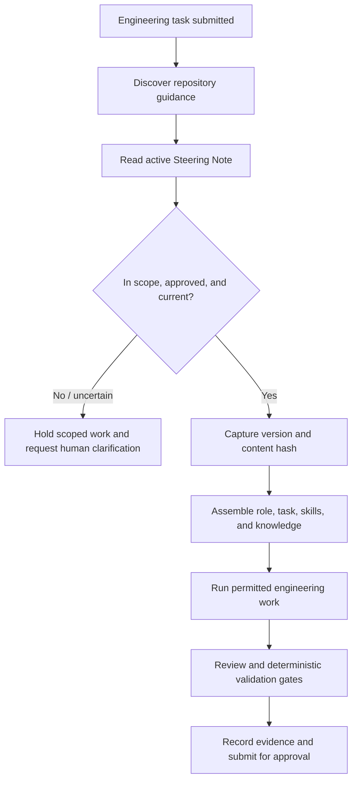
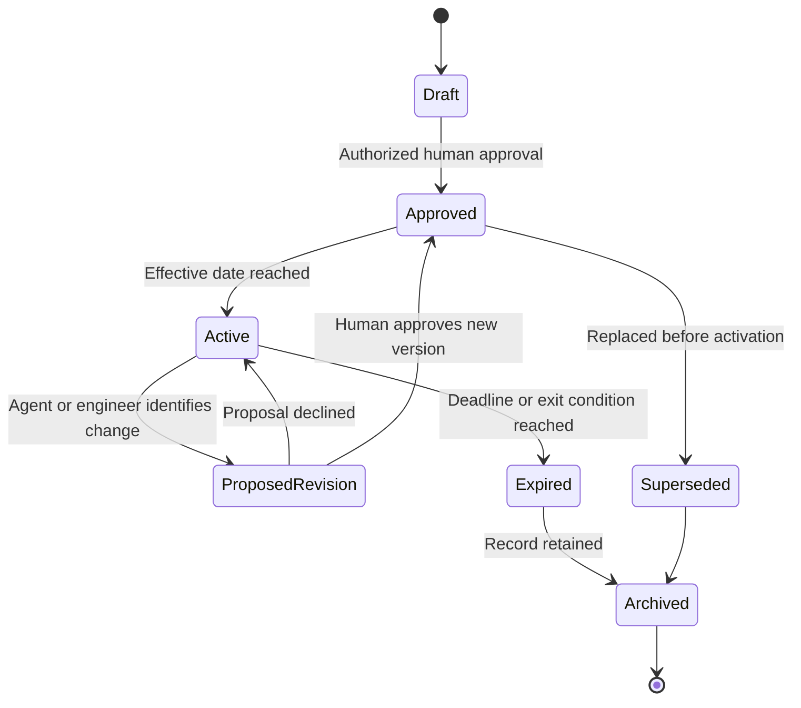
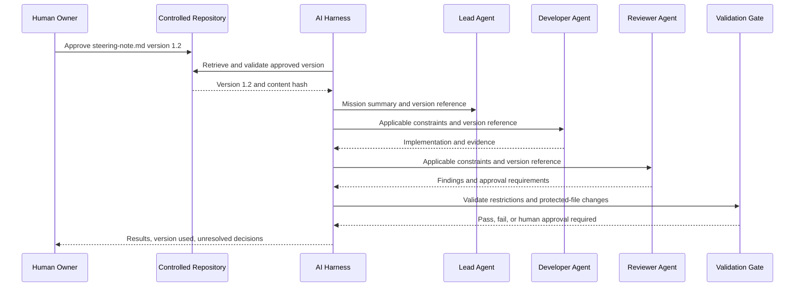

# Chapter 10 — Steering Notes

## 1. Story-Driven Opening

At 08:30 on Monday, the Alpha Car Detailing release team learned that its carefully planned final sprint had changed. Three national fleet customers were scheduled to begin onboarding the following week, and the Corporate Fleet Booking capability was a contractual dependency. The Booking Service could accept individual appointments, but fleet reservations still required engineering work on bulk requests, booking limits, and account-level authorization.

Then an incident elsewhere in the platform consumed part of the release team's capacity. At the same time, a customer requested stronger protections against accidental duplicate bookings. The engineering lead had to make a choice: continue investing in planned architectural improvements, or narrow the work to the features and controls needed for the committed release. The team chose the latter. Notification refactoring was deferred; new service creation was frozen; database changes now required explicit DBA review; and security approval became a prerequisite for the release merge.

The repository already held sound engineering guidance. Instructions established architecture, coding, security, testing, and observability standards. Skills captured reusable procedures for API implementation, transactional outbox processing, integration testing, and telemetry. Roles distinguished the Lead Agent, Developer Agent, Reviewer Agent, Validator Agent, and Evaluator Agent. Prompts assigned concrete tasks. None of these artifacts was wrong, but none by itself communicated the newly agreed mission.

The problem became visible in a parallel development run. One Developer Agent proposed splitting fleet reservations into a new microservice because it appeared architecturally attractive. Another pursued a Notification Service optimization found during repository discovery. Both changes might have been defensible during ordinary development. During release stabilization, both were distractions—and the first crossed an explicitly agreed boundary.

The engineering lead published a short, approved briefing at `Search/steering-note.md`. It identified Corporate Fleet Booking as the highest priority, listed the services that could and could not change, named the release deadline, documented known risks and dependencies, and specified approvals and escalation conditions. The harness was configured to check that the note was current and to supply its approved version to each participating agent.

The next run behaved differently. The Developer Agent extended the Booking Service rather than inventing another deployment unit. The Reviewer Agent checked tenant isolation and event compatibility. The Validator Agent collected integration evidence. The Lead Agent escalated an unresolved identity dependency instead of silently expanding scope. The team had not rewritten its architectural standards or its reusable workflows. It had supplied an operational mission briefing whose authority and lifetime were explicit.

That is the role of a **Steering Note**: temporary, human-maintained guidance that aligns engineering decisions with a current initiative while leaving durable engineering standards intact.

## 2. Learning Objectives

After completing this chapter, you will be able to:

* Explain the purpose of Steering Notes in enterprise AI engineering.
* Distinguish Steering Notes from Instructions, Skills, Prompts, Roles, and Knowledge Sources.
* Identify the information that belongs in a Steering Note.
* Define the lifecycle, ownership, approval process, and expiration of Steering Notes.
* Understand how multiple AI agents consume the same Steering Note during a development initiative.
* Design AI harnesses that automatically discover and distribute current steering guidance.
* Prevent AI agents from modifying Steering Notes without explicit authorization.
* Implement a controlled proposal process using `proposed-steering-update.md`.
* Recognize common anti-patterns associated with temporary engineering guidance.
* Govern Steering Notes as auditable engineering artifacts rather than informal documentation.


## 3. Background

Enterprise delivery operates on two different timescales. Some decisions endure across many releases: where authentication is enforced, how services publish events, how changes are reviewed, and what evidence is required before deployment. Other decisions are short-lived: which customer commitment takes precedence this week, which integration is under a change freeze, what has become a release blocker, and which approvers must be consulted before a specific milestone.

Human teams often absorb the second category through planning meetings, incident bridges, release channels, and informal discussions. AI agents do not automatically share that situational awareness. Even when an agent can access collaboration tools, access does not establish which message is current, approved, or applicable. An agent presented with only repository code and permanent Instructions may propose work that is technically reasonable but operationally wrong.

Duplicating mission context in every Prompt is equally fragile. A release with multiple services and parallel agent runs can produce dozens of task Prompts. If the deadline moves or an external dependency fails, copied instructions diverge. Some agents act on the newest priority; others act on yesterday's description. A Steering Note solves that coordination problem by providing one governed, time-bound source of mission context.

The note is deliberately neither a task backlog nor a substitute for architecture documentation. It records current priorities, constraints, risks, dependencies, and escalation boundaries; Prompts still define individual tasks, Knowledge Sources still describe the system, and Instructions still define mandatory standards. The harness or human operator is responsible for making the relevant note available and verifying that it is the approved version.

This distinction matters most under pressure. A release freeze, security incident, regulatory change, or customer escalation is precisely when an organization needs concise guidance with a named owner, a finite lifetime, and an auditable decision trail. Without these properties, temporary direction tends to become untraceable folklore—or, worse, an accidental permanent exception.

## 4. Concepts

### What Is a Steering Note?

A **Steering Note** is a temporary, human-authored engineering document that communicates the current mission, priorities, constraints, risks, dependencies, and expectations for AI agents participating in a specific initiative, sprint, release, or operational activity.

Its primary purpose is alignment.

Rather than explaining how software should always be built, a Steering Note explains how work should proceed under today's circumstances.

Typical Steering Notes are stored in a well-known repository location such as:

```text
Search/
    steering-note.md
```

An AI harness can automatically discover this location during repository initialization and include its contents in the context supplied to every participating AI agent. This aligns with the agreed project convention that `Search/steering-note.md` serves as the mission briefing maintained by humans for AI consumption.


### Characteristics of a Steering Note

A professional Steering Note has several defining characteristics.

| Characteristic     | Description                                                                  |
| ------------------ | ---------------------------------------------------------------------------- |
| Temporary          | Exists only for the current initiative or operational period.                |
| Human-maintained   | Normally written and updated by engineering leadership.                      |
| Repository-visible | Stored in a consistent repository location where all agents can discover it. |
| Mission-oriented   | Communicates business priorities rather than implementation details.         |
| Read-only for AI   | AI agents consume the document but do not modify it without authorization.   |
| Time-bound         | Includes an expected expiration date or review date.                         |
| Auditable          | Changes are tracked through version control and code review.                 |


### Why Temporary Guidance Is Needed

Enterprise repositories already contain substantial engineering knowledge.

However, permanent knowledge alone cannot answer questions such as:

* Which initiative has the highest business priority today?
* Which services are frozen for release stabilization?
* Which architectural work has been postponed?
* Which production issues require immediate attention?
* Which dependencies currently present elevated risk?
* Which approvals are mandatory before merge?
* Which engineering trade-offs have been temporarily accepted?

These are operational decisions.

They belong in a Steering Note because they change frequently and should not become permanent engineering standards.


### Typical Contents of a Steering Note

Although organizations may customize the format, enterprise Steering Notes commonly include sections such as:

| Section                   | Purpose                                                        |
| ------------------------- | -------------------------------------------------------------- |
| Current Business Priority | Explains why the initiative matters.                           |
| Services In Scope         | Defines where engineering effort should be focused.            |
| Services Out of Scope     | Prevents unnecessary work.                                     |
| Architecture Constraints  | Identifies temporary architectural limitations.                |
| Security Considerations   | Highlights heightened security expectations.                   |
| Known Risks               | Documents technical or business risks requiring attention.     |
| Dependencies              | Lists teams, systems, or approvals that affect delivery.       |
| Release Milestones        | Defines important delivery dates.                              |
| Required Approvals        | Identifies mandatory human reviews.                            |
| Escalation Conditions     | Defines situations requiring immediate human involvement.      |
| Expected Outputs          | Clarifies the deliverables expected from participating agents. |
| Expiration                | Specifies when the Steering Note is no longer valid.           |


### Example Steering Note

The following simplified example illustrates a Steering Note for the Corporate Fleet Booking release.

```text
Mission
Corporate Fleet Booking Release

Business Priority
Highest priority for Q3 enterprise release.

Services In Scope
- Booking Service
- Fleet Management Service
- Customer API

Services Out of Scope
- Loyalty Service
- Notification Enhancements
- Pricing Optimization

Architecture Constraints
No new microservices.
No database technology changes.
Reuse existing event contracts.

Release Deadline
2026-07-10 18:00 UTC

Known Risks
Large fleet imports.
Peak booking traffic.

Required Approvals
Architecture Review
Security Review
DBA Approval for schema changes

Escalation
Performance regression
Security vulnerability
Breaking API change

Expiration
Expires 2026-07-11 18:00 UTC, unless superseded earlier; renewal requires approval.
```

This document provides operational context that every participating AI agent can understand before beginning work.

Unlike repository Instructions, it intentionally describes only the current initiative.


### Steering Notes Are Normally Human-Maintained

One of the most important governance principles in Enterprise AI Engineering is ownership.

Steering Notes represent organizational intent.

They are typically authored and maintained by individuals responsible for delivery, such as:

* Technical Leads
* Solution Architects
* Engineering Managers
* Release Managers
* Product Engineering Leads

AI agents are expected to:

* Read the Steering Note.
* Follow the guidance it contains.
* Respect its constraints.
* Reference it when making implementation decisions.

AI agents must **not** silently modify the Steering Note. Any explicitly authorized edit remains subject to the prescribed human review and approval gates.

If an agent discovers conflicting priorities, outdated guidance, missing dependencies, or new operational risks, it should prepare a recommendation instead of altering the repository.

The recommendation should be written as:

```text
proposed-steering-update.md
```

A human reviewer evaluates the proposal and decides whether the official Steering Note should be updated.

This governance model preserves accountability while allowing AI systems to surface valuable observations without becoming the authority over organizational priorities.


## 5. Architecture Discussion

Steering Notes are most effective when treated as a first-class architectural component of the AI engineering ecosystem rather than as informal project documentation.

In earlier chapters, we established that every AI coding agent requires **Repository Intelligence** before making engineering decisions. Repository Intelligence consists of multiple complementary knowledge sources, each serving a distinct purpose.

Instructions define long-term engineering standards.

Skills define repeatable implementation workflows.

Prompts describe the current engineering task.

Roles establish responsibility and authority.

Steering Notes provide the operational context within which all of those artifacts are interpreted.

Without Steering Notes, every AI agent possesses the same permanent engineering knowledge but may optimize for different business objectives because the current mission has not been communicated.

Steering Notes therefore occupy a unique architectural position.

They are not implementation guidance.

They are not organizational policy.

They are mission guidance.


### Steering Notes Within Repository Intelligence

The following architecture illustrates how Steering Notes complement the other repository artifacts.



Each repository artifact answers a different question.

| Repository Artifact | Primary Question                               |
| ------------------- | ---------------------------------------------- |
| Instructions        | What rules must always be followed?            |
| Skills              | How is recurring work performed?               |
| Prompts             | What work must be completed now?               |
| Roles               | Who performs the work and with what authority? |
| Steering Notes      | What is currently most important?              |
| Knowledge Sources   | What information should the agent use?         |

Collectively, these artifacts enable AI agents to make decisions that are technically correct, procedurally consistent, organizationally aligned, and operationally relevant.


### Steering Notes Versus Instructions

This distinction is fundamental to Enterprise AI Engineering.

Instructions define persistent engineering standards that remain valid across many releases.

Examples include:

* Coding standards
* Security requirements
* Logging conventions
* Testing expectations
* Naming conventions
* Architectural patterns
* Branch policies

These standards normally evolve more slowly than release priorities.

Steering Notes, by contrast, intentionally change whenever organizational priorities change.

Consider the following example from Alpha Car Detailing.

#### Repository Instruction

```text
Every externally accessible API must expose OpenTelemetry traces.
```

This requirement should remain valid for years.

Now consider a Steering Note.

```text
During the Fleet Booking release, prioritize API stability over performance optimization.
```

This guidance applies only during the current release.

After its approved lifetime, the guidance expires and should be archived or superseded.

Promoting temporary operational guidance into permanent Instructions creates unnecessary long-term complexity.

Likewise, embedding permanent standards into Steering Notes risks those standards disappearing after the note expires.

Enterprise repositories therefore maintain a clear separation between enduring engineering policy and temporary operational direction.


### Steering Notes Versus Prompts

Prompts define individual engineering tasks.

For example:

```text
Implement Corporate Fleet Booking support for the Booking Service.
```

The Prompt tells the agent **what to build**.

The Steering Note explains **the environment in which the work is occurring**.

For example:

```text
Fleet Booking is the highest business priority.

Notification enhancements are postponed.

Architecture review is mandatory before merge.

Performance regressions require immediate escalation.
```

Every Prompt issued through the configured harness can receive this context; direct agent sessions must explicitly load or reference the note.

Instead of repeating these conditions across dozens of prompts, the repository centralizes them within a single Steering Note.

When the loading mechanism is verified, this improves consistency and reduces duplication across task Prompts.


### Steering Notes Versus Roles

Roles define responsibilities.

A Reviewer Agent evaluates implementation quality.

A Validator Agent verifies correctness.

A Security Reviewer focuses on security risks.

A Lead Agent coordinates overall execution.

These responsibilities remain stable.

Steering Notes temporarily adjust operational focus.

For example, the Security Reviewer always performs security review.

However, during a release involving payment processing, the Steering Note may state:

```text
Prioritize authentication and authorization validation above all other security checks.
```

The Role has not changed.

Only the mission emphasis has changed.

Similarly, a Developer Agent continues implementing software according to its assigned responsibilities.

The Steering Note merely explains which work should receive immediate attention.


### Steering Notes Versus Knowledge Sources

Knowledge Sources provide factual information.

Examples include:

* Architecture Decision Records
* API specifications
* Domain documentation
* Database schemas
* Business rules
* Operational runbooks

Knowledge Sources answer questions such as:

* How does Fleet Booking work?
* What fields exist in the Booking database?
* Which integration events are published?

Steering Notes answer different questions.

* Which feature has priority today?
* Which systems should remain untouched?
* Which architectural risks require additional review?
* Which dependencies are currently unstable?

Knowledge Sources describe the system.

Steering Notes describe today's operational priorities.

Because they solve different problems, both should be supplied to AI agents.


### Scope and Lifetime

One of the defining characteristics of Steering Notes is their deliberately limited lifespan.

A Steering Note should not remain active as permanent repository documentation.

Instead, it should exist only for the duration of a clearly defined operational activity.

Typical scopes include:

| Scope              | Example                             |
| ------------------ | ----------------------------------- |
| Engineering task   | Database migration initiative       |
| Sprint             | Sprint 18 implementation priorities |
| Release            | Q3 Corporate Fleet Booking release  |
| Incident           | Production outage stabilization     |
| Security event     | Emergency vulnerability remediation |
| Platform migration | Azure Kubernetes migration          |

Every Steering Note should explicitly state:

* Effective date
* Review date
* Expiration date
* Owning team
* Current version

When the initiative concludes, the Steering Note should either:

* be removed,
* be archived,
* or be replaced by a new Steering Note.

Allowing obsolete Steering Notes to remain active creates confusion for both humans and AI agents.


### Ownership and Update Responsibility

Unlike Skills or Prompts, Steering Notes represent organizational intent rather than engineering implementation.

Consequently, ownership should remain with designated human leaders.

Typical owners include:

| Owner                    | Typical Responsibility      |
| ------------------------ | --------------------------- |
| Technical Lead           | Sprint priorities           |
| Solution Architect       | Architecture constraints    |
| Engineering Manager      | Delivery expectations       |
| Release Manager          | Release coordination        |
| Security Lead            | Temporary security guidance |
| Product Engineering Lead | Business priorities         |

AI agents consume Steering Notes but should not assume ownership of them.

An AI agent may detect:

* outdated priorities,
* inconsistent constraints,
* missing dependencies,
* conflicting deadlines,
* obsolete escalation paths.

However, these observations should be presented as recommendations rather than direct modifications.

This separation preserves clear accountability for operational decisions.


### AI-Proposed Steering Updates

Enterprise AI systems become increasingly valuable as they observe repository activity.

An Evaluator Agent may recognize that:

* a dependency has already been completed,
* an escalation condition is obsolete,
* a release date has changed,
* a temporary freeze should be removed.

Rather than editing the Steering Note directly, the agent should prepare a proposal.

For example:

```text
proposed-steering-update.md

Observation

Fleet Import Service completed production validation.

Recommendation

Remove temporary deployment restriction.

Reason

Validation evidence recorded in Release 2026.3.

Human Approval Required
```

The proposal becomes part of the normal engineering review process.

Only after the designated human approvals should the official Steering Note be updated and activated.

This governance model aligns with the broader handbook principle that AI systems recommend improvements while humans retain authority over engineering standards and organizational direction.


### Approval and Expiration

Every Steering Note should identify who is authorized to approve it.

For example:

| Change                  | Approval Required        |
| ----------------------- | ------------------------ |
| Business priority       | Product Engineering Lead |
| Architecture constraint | Solution Architect       |
| Security exception      | Security Lead            |
| Release schedule        | Release Manager          |
| Production freeze       | Engineering Manager      |

Similarly, every Steering Note should contain a clearly defined expiration mechanism.

Possible approaches include:

* Explicit expiration date
* Sprint completion
* Release completion
* Incident resolution
* Manual replacement by a newer Steering Note

A Steering Note without an expiration condition eventually becomes indistinguishable from permanent repository documentation, defeating its intended purpose.


### Authority, Conflicts, and Permitted Exceptions

A Steering Note is not a mechanism for overriding higher-authority controls. It can narrow the set of acceptable engineering choices—such as deferring a refactor or prohibiting a new service during stabilization—but it cannot suspend mandatory authentication, audit logging, data residency, approved change control, or other binding policies. A temporary exception to a mandatory requirement must follow the organization's separate exception process and be approved by the owner of that requirement.

| Situation | Required response |
| --- | --- |
| The Steering Note narrows an otherwise permitted design choice | Apply the temporary restriction for the specified scope and dates. |
| The note contradicts a mandatory Instruction or security policy | Do not implement the conflicting direction; escalate to the accountable owners. |
| Two approved Steering Notes claim the same scope | Hold affected work until the designated owner resolves precedence. |
| The note is expired, unapproved, or lacks an identifiable owner | Do not treat it as active authority; seek a valid note or explicit human decision. |
| The Prompt requests work outside the note's scope | Explain the conflict and obtain an authorized scope update before proceeding. |
| A task involves a security incident requiring an emergency policy exception | Follow the formal incident and exception process; record the authorization and lifetime. |

The resolution sequence is deliberately simple: identify the documents and their approved versions, determine whether the disagreement is about priority or mandatory policy, stop the conflicting work, route the decision to the relevant human owner, and preserve the decision in the run record. A newer file timestamp is not proof that one document supersedes another.

### Agent Permissions and Trust Boundaries

The Steering Note should be accessible as read-only context during ordinary engineering execution. The agent can report ambiguities and create a separate update proposal in an authorized workspace. It should not modify the active note, change its approval metadata, alter its expiration, or assign itself new approval authority. If an organization explicitly authorizes an agent to prepare edits to the active file, those edits should still be treated as a pending change and should not become operative until the required human approval has been recorded.

A Markdown declaration alone does not enforce these permissions. Repository branch protection, scoped credentials, CODEOWNERS or equivalent review controls, CI checks on protected files, and independent approval records are necessary defense-in-depth controls. The harness must not equate an agent-written phrase such as “approved” with proof of authorization.

Steering Notes are also an input-trust boundary. A compromised note can carry prompt-injection-like instructions that request unauthorized tool use, secret disclosure, or altered approval behavior. Limit write access, review changes, verify the expected source and revision, and do not permit the note to override tool permissions or higher-priority security controls. Avoid embedding customer data, tokens, internal credentials, or unnecessary incident details in an agent-consumable briefing.

### Versioning Across Long-Running and Parallel Work

A multi-agent run should record the approved Steering Note version or content hash at initialization. The Lead Agent may distribute role-specific excerpts, but all participating agents should reference that same approved snapshot. If the owner publishes a new version while work is in progress, the harness needs an explicit transition decision: continue under the captured version if still safe and authorized, revalidate and replan against the new version, or stop the affected work. Silent mid-run substitution makes outcomes difficult to reproduce.

Parallel branches may carry different repository snapshots. Before merge or release, validation should compare the run's Steering Note version against the currently approved release guidance and report material drift. A note that expired during execution is not automatically extended because a run remains active.

## 6. Professional Diagrams

A Steering Note is a controlled input to a development run, not an alternative instruction hierarchy. The following diagrams distinguish **context assembly**, **document governance**, and **multi-agent execution**—three concerns that are easily confused when a note is treated as just another file in the repository.

### Context Assembly and Admission



The discovery mechanism does not make a Markdown file authoritative by itself. Approval metadata, applicability, date checks, and repository controls determine whether the note is eligible for use. A note that is missing, expired, or contradictory cannot silently be replaced by an agent's best guess when a task depends on that guidance.

### Governance Lifecycle



A proposal is not a revision to the active note. Until the updated document is approved and activated, the last valid approved version remains the governing mission briefing. A new deadline or exception must never be inferred from the existence of a proposed update.

### Consistent Multi-Agent Consumption



Agents do not necessarily receive identical prompts or all the same documents. The architectural requirement is that they operate against **the same approved Steering Note version**, using the relevant portions for their Roles. The harness records the version or content hash used by the run so that later reviews can reconstruct the decision context.


## 7. Hands-on Example

Alpha Car Detailing is preparing Corporate Fleet Booking for a contractual release. The Booking Service already supports individual reservations; the new capability introduces fleet-level booking limits, bulk requests, and compatibility requirements for existing customer integrations. The deadline creates pressure to improve the platform, but the release steering decision is to extend the current architecture rather than expand the service topology.

The exercise below creates one authoritative mission briefing, consumes it during an agent run, and demonstrates how an agent proposes—not performs—a governance change.

### Repository Placement

```text
alpha-car-detailing/
├── CLAUDE.md
├── AGENTS.md
├── .github/
│   └── copilot-instructions.md
├── Search/
│   ├── steering-note.md
│   └── proposed-steering-update.md   # created only when needed
├── Skills/
├── Roles/
├── Prompts/
├── Knowledge/
└── harness/
```

`Search/` is the convention used by this handbook; it is **not** a directory that Claude Code, GitHub Copilot, or Codex automatically recognizes as a special Steering Note location. The repository Instructions or harness configuration must explicitly identify it. The proposal file does not need to exist until a change is recommended.

### The Active Steering Note

Create `Search/steering-note.md` with the following content. The dates, services, roles, and approval status are illustrative values for this scenario, not statements about a real deployment.

```markdown
# Steering Note — Corporate Fleet Booking Release

| Field | Value |
| --- | --- |
| Mission ID | ACD-FLEET-2026-Q3 |
| Version | 1.2 |
| Status | Approved |
| Owner | Fleet Release Technical Lead |
| Business sponsor | Enterprise Fleet Product Lead |
| Effective (UTC) | 2026-07-06 09:00 |
| Review by (UTC) | 2026-07-09 12:00 |
| Release deadline (UTC) | 2026-07-10 18:00 |
| Expires (UTC) | 2026-07-11 18:00 |
| Approval record | Change request ACD-REL-042 (illustrative) |

## Current business priority

Deliver Corporate Fleet Booking for contractual customer onboarding.
Prioritize release stability and compatibility over unrelated optimization.

## Scope

**In scope:** Booking Service, Fleet Management Service integration,
existing Customer API, related integration tests and telemetry.

**Out of scope:** Loyalty Service, Notification Service refactoring,
Pricing Service optimization, creation of new microservices.

## Architecture boundaries

- Extend existing service boundaries; do not introduce another service.
- Preserve published booking API and event compatibility.
- Use the existing transactional outbox for integration events.
- Database schema changes require DBA and architecture approval.
- These restrictions do not waive any permanent security or quality policy.

## Security and data handling

- Preserve tenant isolation and authorization for corporate fleet accounts.
- Do not place customer identifiers or tokens in logs or agent transcripts.
- Security approval is required before release merge.
- Do not use production customer data for agent experiments.

## Dependencies

- Identity Service: security contract and token scopes to be confirmed.
- Fleet Management API: compatibility verification required.
- Release Engineering: staging deployment window must be reserved.

## Known risks

- Imports containing up to 100,000 vehicles may stress booking throughput.
- Large concurrent booking batches may amplify duplicate requests.
- Identity Service maintenance may affect end-to-end validation.

## Required outputs

- Reviewed implementation of the approved fleet booking scope.
- Unit and integration test results, including tenant isolation.
- Evidence of idempotent processing and event compatibility.
- Traces and performance observations against approved service SLOs.
- Architecture, DBA (if relevant), and security approval records.

## Stop and escalate when

- An implementation requires an out-of-scope service change.
- A breaking API/event contract or tenant isolation defect is detected.
- A change violates permanent repository or enterprise policy.
- Performance exceeds an approved SLO or a required dependency is blocked.
- Approval, ownership, applicability, or expiry is unclear.

## Retirement

The owner must archive or supersede this note at release closure.
After expiry, agents must not treat it as active without reapproval.
```

The note supplies business priorities and temporary boundaries, while referencing existing enterprise controls instead of duplicating them. Most importantly, it includes a finite expiry, a named human owner, clear stop conditions, and an approval record that can be verified against the actual change-management system.

### Execute a Scoped Task

The task Prompt remains independent of the Steering Note:

```text
Implement corporate fleet booking limits in the existing Booking Service.
Read the active Search/steering-note.md and applicable repository
Instructions before editing. Identify any conflict or expired guidance.
Do not modify the Steering Note. Reuse current event contracts and
outbox processing. Supply implementation evidence, tests, and approvals
required before merge; if blocked, report the issue rather than
expanding scope without authorization.
```

The agent should produce changes to the Booking domain and application workflow, relevant API behavior, automated tests, and an evidence summary. It should not create a Notification Service refactor simply because the same code review uncovered one. That observation belongs in a separate proposal or backlog item.

### Example: An Agent Detects a Changed Dependency

Suppose the Evaluator Agent finds verified evidence that the Fleet Management API compatibility restriction is no longer needed. It creates `Search/proposed-steering-update.md`:

```markdown
# Proposed Steering Update — ACD-FLEET-2026-Q3

- Current Steering Note: version 1.2
- Proposed by: Evaluator Agent, run ACD-RUN-084 (illustrative)
- Proposed status: Awaiting human review
- Proposed owner: Fleet Release Technical Lead

## Observation

The Fleet Management API compatibility test suite passed against the
new integration endpoint. This suggests the temporary compatibility
warning may be obsolete; production readiness is not assumed.

## Evidence

- Integration verification: FT-212, run ACD-RUN-084
- API contract diff: no breaking changes reported
- Outstanding check: release owner to verify production readiness

## Requested change

Review whether the compatibility warning may be removed. Do not
change any other release constraint.

## Decision

Pending explicit approval from the Technical Lead and API owner.
```

This is deliberately a **proposal**, not an edit to the approved note. The reviewer verifies the evidence and its scope. If approved, a human updates the note in a separate, attributable repository change, increments the version, and records the approval. If rejected, the current approved note continues to apply and the proposal remains available for audit.

### Acceptance Check

Before merging work produced under this mission, the team should confirm that the Steering Note was active when the run started; that its version was recorded; that restricted services were untouched or explicitly approved; that tests and deterministic checks passed; and that any security or architecture exceptions were approved through the normal governance process. These checks should be represented in the harness and repository protection settings, not left solely to an AI agent's self-assessment.


## 8. Claude Example

Claude Code can read repository context and its conventional `CLAUDE.md` instructions, but `Search/steering-note.md` is a **project convention rather than a Claude Code native configuration file**. The team must instruct Claude to read the note, or its harness must supply the contents. Relying on the filename alone is not sufficient.

The persistent `CLAUDE.md` file should describe the mechanism without copying a release's temporary priorities into permanent Instructions:

```markdown
## Active release steering

For release-scoped work, read `Search/steering-note.md` before planning
changes. Verify its scope, owner, approval state and expiry. Treat it
as temporary mission guidance and do not edit it without explicit
human authorization. If guidance is missing, expired, or conflicts
with mandatory policy, stop the affected work and ask the owner.
Propose improvements in `Search/proposed-steering-update.md`.
```

The task can then reference the document directly in Claude Code:

```text
@Search/steering-note.md

Implement corporate fleet booking limits in the existing Booking Service.
Follow the applicable repository Instructions and approved release scope.
Report the Steering Note version and any blockers in your completion summary.
```

Claude Code supports file references and project Instructions, but whether additional files are loaded or preserved in a particular workflow depends on the client, configuration, and context. For a controlled release, the harness should verify the note independently and capture its approved version or hash; an agent's statement that it read the file is not itself proof.

In Alpha Car Detailing, the Developer Agent may discover a useful Notification Service optimization during the booking implementation. Because the note explicitly excludes that work, the agent records the observation without making the change. If the optimization becomes release-critical, it prepares a proposal and asks for human direction. The Steering Note narrows the mission; it does not expand Claude's authority to bypass branch protection, security review, or mandatory tests.

A typical completion report should contain the changed service boundaries, tests executed, risks observed, note version used, open approvals, and links or identifiers for build and review evidence. Such reporting makes the work traceable without repeating the entire note in the response.


## 9. GitHub Copilot Comparison

GitHub Copilot supports repository-wide custom Instructions in `.github/copilot-instructions.md`, path-specific instructions for supported clients, and agent instruction conventions such as `AGENTS.md`. Support and precedence vary by Copilot surface, so it would be inaccurate to characterize Copilot as merely an editor tool that cannot use repository context. Nor should the team assume that a custom file under `Search/` will be included automatically.

For the Alpha Car Detailing repository, the permanent Copilot instructions can contain a concise pointer:

```markdown
## Release-specific mission briefing

Before making release-scoped changes, inspect Search/steering-note.md.
Confirm it is approved, current, and applicable to the requested work.
Do not silently edit this file. When a change is needed, prepare a
separate proposed-steering-update.md for authorized human review.
```

The engineering Prompt should still explicitly call out the applicable note and important boundaries, especially in a client or session where file inclusion is uncertain:

```text
Implement fleet booking limits in the existing Booking Service.
Use the approved Search/steering-note.md for release scope and risks.
Before coding, identify its version and flag any outdated or conflicting
constraints. Do not edit the Steering Note or out-of-scope services.
```

The operator can verify which repository Instructions and files were supplied through the client where such diagnostics are available. Teams should test their chosen IDE, cloud agent, CLI, or code-review integration rather than assuming uniform behavior across Copilot products.

The governance boundary is independent of Copilot: repository permissions, protected branches, CODEOWNERS or equivalent reviewers, and CI validations should enforce protection of `Search/steering-note.md`. Neither a statement in a Prompt nor an agent's willingness to comply substitutes for these controls.


## 10. Codex Comparison

OpenAI Codex can use `AGENTS.md` as repository guidance in supported environments. This is distinct from the handbook's custom Steering Note path: `Search/steering-note.md` does not become a native Codex instruction source simply by existing. The repository's `AGENTS.md`, an explicit task Prompt, or the enterprise harness must direct Codex to consume it.

A durable repository-level `AGENTS.md` may include:

```markdown
## Current engineering mission

For release work, inspect `Search/steering-note.md` and validate
its approval status, applicability, and expiration before changing code.
Record the approved note version in your summary. Do not edit the note
unless a named human owner has explicitly authorized the specific edit.
Propose changes separately in `Search/proposed-steering-update.md`.
```

Then a Codex task can ask for a read-only discovery pass before implementation:

```text
Review repository guidance and the current Search/steering-note.md.
Summarize the fleet booking scope, constraints, approvals, and any
conflicts. If active and unambiguous, implement the existing-service
booking-limit change with tests; otherwise stop and request direction.
Do not change the Steering Note.
```

The key distinction among the platforms is **how context is made available**, not who owns organizational priorities. Claude Code, Copilot, and Codex can all work within a governed repository, and each can be integrated into an enterprise harness. None supplies, by default, the complete Steering Note approval lifecycle defined in this chapter.

| Concern | Claude Code | GitHub Copilot | OpenAI Codex |
| --- | --- | --- | --- |
| Conventional durable repository guidance | `CLAUDE.md` | `.github/copilot-instructions.md`; other supported instruction files | `AGENTS.md` |
| Custom `Search/steering-note.md` | Explicit reference, project instruction pointer, or harness | Explicit file context, instruction pointer, or harness | Explicit task context, `AGENTS.md` pointer, or harness |
| Verification that the note is current | Repository control or harness | Repository control or harness | Repository control or harness |
| Approval of mission changes | Authorized human | Authorized human | Authorized human |
| Prevention of unauthorized edits | Permissions and review gates | Permissions and review gates | Permissions and review gates |

Because product behavior changes, platform mechanics should be verified against current vendor documentation when a team configures its deployment. The organization-specific lifecycle, approval rules, and audit requirements remain the same even when the tools change.


## 11. Best Practices

Steering Notes are most valuable when they remain concise, current, authoritative, and clearly distinguished from other repository artifacts.

Many organizations initially treat Steering Notes as informal project notes. Mature Enterprise AI Engineering organizations instead manage them as governed operational documents that provide temporary mission direction for both humans and AI agents.

The following practices have consistently proven effective in enterprise-scale development.


### Keep Steering Notes Temporary

A Steering Note should communicate only information relevant to the current initiative.

It should never evolve into a permanent engineering document.

As soon as information becomes long-term engineering policy, it should be moved into the appropriate repository artifact.

For example:

* Coding conventions belong in Instructions.
* Standard implementation procedures belong in Skills.
* Architecture decisions belong in Architecture Decision Records (ADRs).
* Business knowledge belongs in Knowledge Sources.
* Temporary release priorities belong in Steering Notes.

Maintaining this separation keeps every repository artifact focused on its intended purpose.


### Assign a Clearly Identified Owner

Every Steering Note should identify the individual or team responsible for maintaining it.

For example:

| Steering Topic           | Recommended Owner        |
| ------------------------ | ------------------------ |
| Sprint priorities        | Technical Lead           |
| Release coordination     | Release Manager          |
| Architecture constraints | Solution Architect       |
| Security guidance        | Security Lead            |
| Operational risks        | Engineering Manager      |
| Business priorities      | Product Engineering Lead |

Ownership ensures accountability.

When priorities change, everyone knows who is responsible for updating the document.


### Include an Expiration Mechanism

Temporary guidance should never remain active indefinitely.

Each Steering Note should clearly indicate when it should be reviewed or retired.

Examples include:

* Sprint completion
* Release completion
* Production deployment
* Incident resolution
* Specific calendar date

Example:

```text
Effective Date
2026-07-01

Review Date
2026-07-05

Expiration
Remove after Fleet Booking production deployment.
```

An expired Steering Note should either be archived or replaced with a newer version.


### Focus on Operational Decisions

A Steering Note should communicate operational context rather than implementation details.

Good examples include:

* Current business priorities
* Services currently frozen
* Temporary architecture restrictions
* Required approvals
* Known operational risks
* Escalation conditions
* Dependencies affecting delivery

Poor examples include:

* API implementation examples
* Coding standards
* Naming conventions
* Database design guidelines
* Testing frameworks

Those topics belong elsewhere within the repository.


### Make Guidance Easy to Discover

Every AI agent should know exactly where to locate the current Steering Note.

The repository should use a consistent location such as:

```text
Search/
    steering-note.md
```

The team should configure the AI harness to discover, validate, and distribute the active Steering Note before engineering work begins.

Developers should not have to remember its location during every task.


### Keep It Short

A Steering Note is a mission briefing—not a design document.

For a release-scoped briefing, one or two pages is a useful design target, provided the necessary approvals, risks, and escalation rules remain explicit.

The objective is rapid situational awareness.

Engineers and AI agents should be able to understand the current mission within a few minutes.

If the document grows into dozens of pages, important priorities become difficult to identify.


### Separate Facts from Decisions

Professional Steering Notes distinguish between factual information and temporary management decisions.

For example:

| Facts                             | Decisions                                          |
| --------------------------------- | -------------------------------------------------- |
| Fleet API v2 deployed             | Continue using v1 during this release              |
| Customer onboarding begins Monday | Prioritize Fleet Booking over Loyalty enhancements |
| Security audit scheduled Friday   | Security approval required before merge            |

This separation makes it easier for both humans and AI agents to understand why temporary guidance exists.


### Record Risks Explicitly

Operational risk should never be implied.

Every Steering Note should identify known technical and business risks.

Examples include:

* High production traffic
* External vendor dependencies
* Database migration risks
* Regulatory deadlines
* Capacity limitations
* Security review concerns

Explicitly documenting risks helps AI agents make better engineering trade-offs.


### Define Escalation Conditions

AI agents should know when autonomous decision-making must stop.

Examples include:

* Breaking API changes
* Authentication failures
* Customer data exposure
* Architecture violations
* Significant performance degradation
* Compliance concerns

When these conditions occur, the agent should stop the affected action, preserve the evidence, and request human involvement rather than proceeding independently.


### Preserve Audit History

Steering Notes should remain under version control.

Changes should be:

* reviewed,
* approved,
* committed,
* and traceable.

An organization should always be able to answer:

* Who changed the Steering Note?
* When was it changed?
* Why was it changed?
* Which release required the change?

Version control provides this audit trail.


## 12. Anti-patterns

Like every repository artifact, Steering Notes can be misused.

The following anti-patterns are commonly observed during early AI adoption and often lead to inconsistent engineering decisions.


### Anti-pattern 1: Using Steering Notes as Permanent Instructions

One of the most common mistakes is gradually turning the Steering Note into another Instructions document.

For example:

```text
Always use PascalCase.

Always write integration tests.

Always use CQRS.
```

These examples illustrate durable engineering policies when adopted by the organization; a Steering Note is not where those standards are defined.

They belong in repository Instructions—not in a temporary Steering Note.

If they remain in the Steering Note, they may disappear when the release concludes.


### Anti-pattern 2: Embedding Task Prompts

Some organizations copy entire implementation requests into the Steering Note.

For example:

```text
Create Fleet Booking API.

Add Vehicle Controller.

Write integration tests.

Update Booking Repository.
```

These are engineering tasks.

They belong in Prompts.

A Steering Note should describe the mission, not the implementation backlog.


### Anti-pattern 3: Missing Ownership

A Steering Note without an owner quickly becomes unreliable.

When priorities change:

* nobody updates it,
* outdated information remains,
* conflicting guidance accumulates,
* engineers lose confidence in its accuracy.

Always identify the responsible owner.


### Anti-pattern 4: Stale Priorities

A Steering Note that continues listing completed work as the highest priority eventually becomes misleading.

For example:

```text
Highest Priority

Fleet Booking
```

Three months after deployment, this statement is no longer useful.

Expired priorities reduce trust in repository intelligence.


### Anti-pattern 5: No Expiration Date

Temporary guidance without a retirement mechanism frequently becomes permanent by accident.

Every Steering Note should answer:

> "When does this guidance stop applying?"

If that question cannot be answered, the Steering Note is incomplete.


### Anti-pattern 6: Conflicting Direction

Conflicting guidance creates uncertainty for both humans and AI agents.

Example:

**Instruction**

```text
Prefer a separate service when justified by clear domain boundaries.
```

**Steering Note**

```text
No new microservices during release stabilization.
```

This is an allowable temporary *restriction* when the Instruction expresses a preference rather than a mandatory requirement: an organization may encourage services in general while prohibiting new service creation during stabilization. The note must identify the scope and expiration of that restriction. By contrast, a Steering Note saying “skip mandatory authorization checks until Friday” conflicts with binding security policy and must not be followed; it requires escalation, not agent interpretation.


### Anti-pattern 7: Unclear Scope

A Steering Note should define its scope explicitly.

Poor example:

```text
Improve performance.
```

Better example:

```text
Improve Booking Service performance during Fleet Booking release.

Other services are outside the scope of this initiative.
```

Specific scope enables focused engineering effort.


### Anti-pattern 8: Allowing AI Agents to Silently Edit Steering Notes

Perhaps the most dangerous anti-pattern is allowing autonomous agents to rewrite organizational priorities without human approval.

For example:

```text
AI detected Notification Service instability.

Updating Steering Note...

Notification Service is now highest priority.
```

This is unacceptable.

Operational priorities belong to human leadership.

AI agents may recommend changes, but they should create:

```text
proposed-steering-update.md
```

The recommendation is then reviewed through the organization's normal governance process before any official Steering Note is modified.


### Anti-pattern 9: Treating Temporary Exceptions as Permanent Standards

Release-specific decisions should not migrate into long-term engineering policy.

For example:

```text
Reuse legacy authentication service during Fleet Booking release.
```

This temporary compromise should disappear once the release is complete.

Keeping temporary exceptions beyond their intended lifetime creates architectural debt and confusion.


### Anti-pattern 10: Omitting Risks and Escalation Conditions

A Steering Note that lists only priorities is incomplete.

Professional Steering Notes should also answer:

* What could go wrong?
* Which situations require human intervention?
* Which dependencies present elevated risk?
* When should AI agents stop autonomous execution?

Without these answers, agents may continue operating beyond the organization's acceptable risk threshold.


## 13. Architect's Notes

> **Architect's Note**
>
> Treat Steering Notes as **mission briefings rather than engineering documentation**. Their purpose is to align every engineer and every AI agent around today's operational objectives without modifying the repository's permanent engineering standards.

> **Architect's Note**
>
> Repository Instructions should evolve slowly. Steering Notes should evolve whenever business priorities change. If both artifacts change at the same frequency, their responsibilities have likely become blurred.

> **Architect's Note**
>
> Human ownership is a governance requirement, not merely a recommendation. AI agents can analyze operational conditions and recommend updates, but organizational priorities and policy exceptions remain with accountable human owners.

> **Architect's Note**
>
> The most effective Steering Notes are intentionally concise. A one-page document that clearly communicates priorities, risks, approvals, and constraints is often more valuable than a lengthy operational handbook.


## 14. Enterprise Tips

Best practices describe how to write a sound Steering Note. Enterprise adoption also requires operational mechanisms that make the guidance dependable across teams, environments, and concurrent development runs.

### Maintain One Active Mission per Defined Scope

A large enterprise may have several legitimate Steering Notes at the same time: one for the Fleet Booking release, another for an authentication incident, and a third for a platform migration. Avoid treating a single repository-wide note as the universal priority for every task. Record each note's scope and, when more than one may apply, define an explicit human-owned selection or precedence process. Agents must not resolve competing release directives by picking whichever file was modified most recently.

### Separate Readable Guidance from Enforceable Controls

A Steering Note communicates intent; CI and access control enforce critical boundaries. For Alpha Car Detailing, a release rule such as "no Booking API contract break" should be backed by contract tests. Protection against unauthorized note edits should be enforced through branch rules, CODEOWNERS or an equivalent approval mechanism, and limited write credentials. The more consequential the restriction, the less the organization should depend on an agent remembering a sentence.

### Make Expiry Part of Run Admission

Do not rely on a retrospective cleanup exercise to find expired notes. The harness should check expiry and approval status before admitting release-scoped work, then record the result alongside the execution evidence. A run already in progress when the note changes should trigger a deliberate continue, replan, or stop decision. This prevents two concurrent runs from silently interpreting different priorities as the same mission.

### Keep the Briefing Safe to Distribute

Steering Notes may be shared with multiple agents and external model services under the organization's approved operating arrangements. They should contain actionable risk summaries, not credentials, production customer records, private incident transcripts, or confidential contractual details that the agent does not need. Use references to approved systems of record for sensitive evidence and provide only the minimum necessary context.

### Include Steering Note Hygiene in Release Reviews

At release planning, confirm the owner, scope, version, approval record, milestone dates, dependencies, and escalation contacts. At release closure, archive the final note and record whether its constraints prevented scope drift, whether any proposed updates were accepted, and whether unresolved exceptions need to be promoted into governed long-term documentation. These activities make Steering Notes useful not only for the current release but also for the next retrospective.

### Measure Leading Indicators, Not Just Document Counts

A team with many Steering Notes is not necessarily better governed. More meaningful indicators include the proportion of release runs with a validated note version, the delay between an approved priority change and its availability to agents, the number of runs stopped for stale or conflicting guidance, and the proportion of protected-file changes with proper approvals. Interpret these indicators alongside operational outcomes rather than rewarding the creation of more Markdown files.

## 15. Decision Points

Enterprise AI Engineering frequently requires balancing stability with adaptability.

The following decision points help architects determine how Steering Notes should be managed within their organizations.


### Decision Point 1: Where Should Steering Notes Be Stored?

Possible approaches include:

| Option                                 | Advantages                                   | Considerations                                   |
| -------------------------------------- | -------------------------------------------- | ------------------------------------------------ |
| Repository (`Search/steering-note.md`) | Version controlled, discoverable, reviewable | Recommended for most organizations               |
| Project Wiki                           | Easy for humans to edit                      | Harder for AI harnesses to discover consistently |
| External Documentation Portal          | Centralized governance                       | Additional synchronization required              |
| Issue Tracker                          | Good for temporary discussions               | Poor long-term discoverability                   |

For enterprise AI engineering, storing Steering Notes in the repository provides the strongest alignment with automated discovery, code review, and auditability.


### Decision Point 2: Who Owns the Steering Note?

Possible owners include:

* Technical Lead
* Solution Architect
* Engineering Manager
* Release Manager
* Product Engineering Lead

Ownership should follow organizational responsibility rather than technical implementation.

The owner should have authority to define priorities, constraints, and operational direction.


### Decision Point 3: Can AI Agents Update Steering Notes?

The handbook recommends the following governance model; any explicitly authorized agent-assisted editing remains a proposed change until the required human approval is recorded.

| Activity                      | AI Agent | Human |
| ----------------------------- | -------- | ----- |
| Read Steering Note            | ✓        | ✓     |
| Follow Steering Note          | ✓        | ✓     |
| Detect outdated guidance      | ✓        | ✓     |
| Recommend changes             | ✓        | ✓     |
| Modify official Steering Note | Only with explicit authorization and review | Authorized owner/reviewer |
| Approve operational direction | No | Accountable human approver |

This model preserves accountability while still benefiting from AI-assisted analysis.


### Decision Point 4: How Often Should Steering Notes Be Reviewed?

Review frequency should reflect the pace of operational change.

| Initiative                      | Recommended Review Frequency |
| ------------------------------- | ---------------------------- |
| Active production incident      | Multiple times per day       |
| Critical release                | Daily                        |
| Sprint implementation           | During daily stand-ups       |
| Stable maintenance release      | Weekly                       |
| Long-running platform migration | At each milestone            |

A review schedule should be documented within the Steering Note itself.


### Decision Point 5: What Happens When Guidance Conflicts?

Occasionally, a Steering Note may appear to conflict with existing repository Instructions.

For example:

**Instruction**

```text
All new functionality should be implemented using the preferred architectural patterns.
```

**Steering Note**

```text
During release stabilization, defer architectural refactoring unless required to resolve a production issue.
```

This is not necessarily a contradiction.

The Instruction continues defining the organization's permanent standard.

The Steering Note introduces a temporary operational constraint that applies only during the current initiative.

If the conflict cannot be resolved through context, the matter should be escalated to the Steering Note owner rather than interpreted independently by an AI agent.


## 16. Exercises

#### Exercise 1 — Identify the Correct Artifact

For each statement below, determine whether it belongs in:

* Instructions
* Skills
* Prompts
* Roles
* Steering Notes

1. "Reuse the existing Booking integration events."
2. "Implement Fleet Booking support."
3. "Reviewer Agent validates security compliance."
4. "Corporate Fleet Booking is the highest business priority this sprint."
5. "Every API must expose OpenTelemetry traces."

Discuss your reasoning with your team and justify each classification.


#### Exercise 2 — Create a Steering Note

Using the Alpha Car Detailing system, create a Steering Note for a nationwide holiday promotion.

Include:

* Business priority
* Services in scope
* Services out of scope
* Known risks
* Required approvals
* Dependencies
* Escalation conditions
* Expiration date

Compare your document with the examples presented in this chapter.


#### Exercise 3 — Detect Anti-patterns

Review the following Steering Note and identify every governance issue.

```text
Highest Priority

Improve everything.

Implement Fleet Booking.

Always use CQRS.

Always write unit tests.

Update Notification Service.

No owner.

No expiration.

No approvals.
```

Identify which information belongs in other repository artifacts and propose an improved version.


#### Exercise 4 — AI Governance Scenario

An Evaluator Agent determines that a temporary architecture restriction is no longer required because all validation activities have completed successfully.

Should the agent:

A. Modify `Search/steering-note.md`

B. Ignore the observation

C. Create `proposed-steering-update.md` for human review

Explain your answer using the governance principles discussed in this chapter.


## 17. Interview Questions

1. What problem do Steering Notes solve in Enterprise AI Engineering?

2. How do Steering Notes differ from repository Instructions?

3. Why shouldn't implementation tasks be stored in Steering Notes?

4. Explain the relationship between Prompts and Steering Notes.

5. Who should normally own a Steering Note?

6. Why should Steering Notes include an expiration mechanism?

7. What information should every Steering Note communicate to AI agents?

8. Why is human approval required before modifying an official Steering Note?

9. How does a Steering Note improve consistency in multi-agent engineering workflows?

10. Describe the purpose of `proposed-steering-update.md` and explain when it should be created.


## 18. Chapter Summary

Steering Notes address a coordination problem that permanent repository documentation cannot solve on its own: engineering priorities change faster than the standards governing how software is built. An AI coding agent needs both. Instructions specify enduring requirements; Skills provide reusable procedures; Prompts assign the current task; Roles identify responsibilities and authority; Knowledge Sources supply factual reference material. A Steering Note adds a **temporary, approved mission briefing** that explains what matters during the present initiative and where its boundaries lie.

The Alpha Car Detailing release demonstrated the practical distinction. Fleet booking work was prioritized, unrelated changes were deferred, existing event contracts were preserved, and explicit security, database, and architecture approvals were required. Those choices did not rewrite the organization's engineering policies. They constrained a defined set of release activities for a limited period.

Ownership and enforcement are central. The active `Search/steering-note.md` has a human owner, a scope, an approval record, a version, a review date, and an expiry. AI agents may read it, follow its applicable constraints, and propose improvements through `Search/proposed-steering-update.md`. They must not make unauthorized edits or treat a self-generated approval statement as a valid governance decision. Mandatory policies remain binding even when a temporary note asks for a different outcome.

An enterprise harness turns the briefing into dependable execution context: it validates the note, records the version or hash used by the run, distributes relevant guidance to each participating Role, and uses deterministic checks and human review to enforce consequential boundaries. If the note becomes stale, conflicting, or inapplicable, the correct response is not to guess; it is to stop the affected work and seek an accountable decision.

The next chapter turns from temporary direction to durable factual reference. **Knowledge Sources** explain how agents obtain the architecture, domain, operational, and business information needed to perform the mission described by the Steering Note. Together, these artifacts complete the repository-intelligence foundation for the harness engineering disciplines developed in Part III.

## 19. Further Reading

The other chapters of Part II provide the concepts needed to place Steering Notes correctly: Chapter 5 explains repository discovery; Chapter 6 establishes persistent Instructions; Chapter 7 describes reusable Skills; Chapter 8 defines task-specific Prompts; and Chapter 9 separates agent responsibilities and authority. Chapter 11, **Knowledge Sources**, develops the distinction between current mission guidance and durable factual reference material.

For platform implementation details, consult the current official documentation rather than assuming that the custom `Search/` convention has native tool support:

- **Anthropic, Claude Code documentation — [How Claude remembers your project](https://code.claude.com/docs/en/memory).** Project Instructions, `CLAUDE.md`, and file-loading behavior.
- **Anthropic, [Steering Claude Code: when to use CLAUDE.md, skills, hooks, and subagents](https://claude.com/resources/articles/steering-claude-code-skills-hooks-rules-subagents-and-more).** Choosing the right form of context and guidance.
- **GitHub Docs, [Custom instructions for GitHub Copilot](https://docs.github.com/en/copilot/concepts/prompting-and-context/custom-instructions).** Repository-wide, path-specific, and agent instruction conventions; support differs by client.
- **GitHub Docs, [Support for different types of custom instructions](https://docs.github.com/en/copilot/reference/custom-instructions-support).** Capability matrix for IDE, GitHub, and CLI environments.
- **OpenAI, [Iterating Development Workflows with Codex](https://developers.openai.com/cookbook/examples/codex/iterating-development-workflows-with-codex).** Practical guidance on `AGENTS.md`, phase context, and governed development workflows.
- **OpenAI, [Custom Code Review rules for Codex](https://developers.openai.com/blog/custom-code-review-rules-for-codex).** The complementary role of repository guidance, code review, and deterministic enforcement.

Within an enterprise, these resources should be read alongside the organization's release management policy, security exception process, architecture decision records, source-control approval rules, and audit-retention standard. Those documents—not the choice of AI platform—determine who can approve mission changes and which controls an engineering team may never bypass.

A reliable Steering Note process is complete only when the organization can reproduce **which approved briefing an agent used, what the agent changed, which restrictions were checked, who approved any exception, and when the guidance expired**. That evidence provides the bridge from Repository Intelligence to the governed harness execution patterns explored in Part III.
