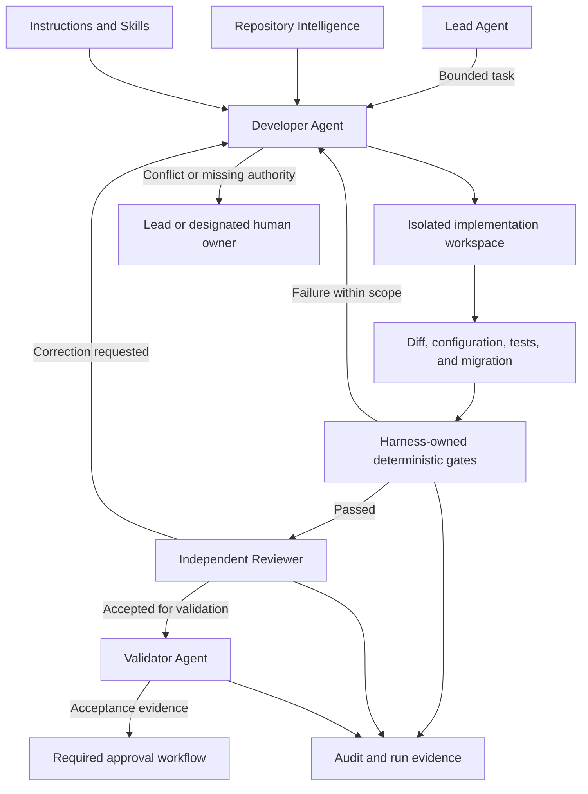
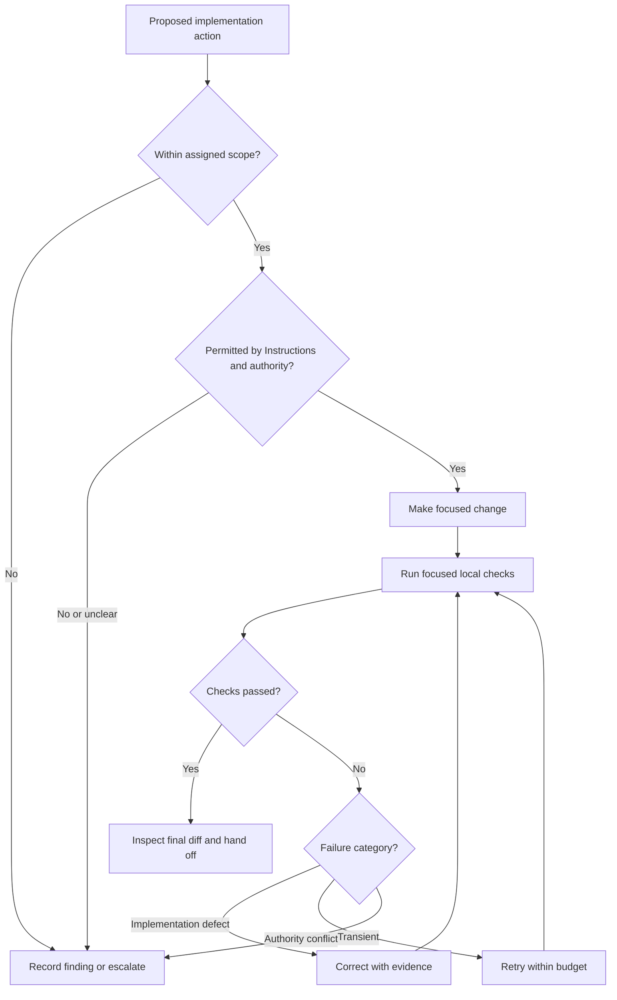
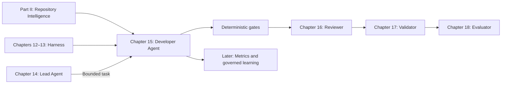

# Chapter 15 — Developer Agent

**Part III — Harness Engineering**

The Developer Agent is the implementation role within the enterprise AI Engineering Harness. It transforms a bounded task into repository changes while remaining constrained by the Lead Agent plan, applicable Instructions, selected Skills, Repository Intelligence, acceptance criteria, deterministic validation, independent review, and human approval boundaries.

> **Core principle:** The Developer Agent implements the assigned work but does not approve its own output or replace deterministic validation, review, evaluation, or human approval.

## Story-driven Opening

The Alpha Car Detailing engineering team has committed to a corporate fleet-booking release. Corporate customers will be able to reserve a station for multiple vehicles in a single operation. The business expectation sounds simple: accept a request, create a booking, and notify downstream systems. The engineering reality is less forgiving.

The Booking service has established domain boundaries. Its Application layer must not depend on Infrastructure. Corporate fleet managers may act only for customers they are authorized to manage. The existing `FleetBookingCreated` contract is consumed outside the service and must remain unchanged for this release. Booking state and the integration event must enter the same transactional outbox workflow, so a database commit cannot succeed while the corresponding event disappears.

The Lead Agent has already completed the planning work. It assigns the Developer Agent a bounded task: implement `POST /api/fleet-bookings`, preserve the public event contract, enforce resource-level authorization and fleet-size rules, add tests, and return evidence for independent validation. The Lead also identifies relevant Instructions, Skills, and repository examples. The Developer Agent's job is not to negotiate a new service architecture; it is to implement this assignment within that architecture.

The first difficulty appears during repository inspection. A nearby booking handler publishes its event directly after saving the database transaction. That code is tempting to copy. But the current Instructions require a transactional outbox. The Developer Agent must distinguish an existing example from an approved pattern and choose the latter. Later, a generated migration contains an unrelated column removal. The Agent must investigate instead of committing the generated file because a tool produced it. Finally, local tests pass, but the Agent still must hand the change to the Harness gates, Reviewer Agent, and Validator Agent.

This is the difference between code generation and governed implementation. A successful Developer Agent does more than make code compile: it respects the task boundary, understands the repository's current rules, explains what it changed, and knows which decisions belong to another role.

```text
Lead Agent task package
        ↓
Developer Agent
        ↓
Repository evidence + Instructions + Skills
        ↓
Code, configuration, tests, migration, outbox
        ↓
Local verification and evidence
        ↓
Harness-controlled deterministic gates
        ↓
Independent Reviewer and Validator
        ↓
Required human approval
```

The Developer Agent implements authorized work, preserves the standards used to assess it, and treats tool access as distinct from organizational permission.

## Learning Objectives

By the end of this chapter, you should be able to:

- define the Developer Agent as a governed implementation role;
- distinguish implementation authority from planning, validation, review, and approval;
- describe the task package the Developer Agent receives from the Lead Agent;
- use Repository Intelligence to guide implementation;
- apply Instructions and selected Skills correctly;
- preserve architecture, API, event, persistence, security, and observability boundaries;
- design local verification and deterministic gate handoffs;
- classify failures and apply bounded correction or escalation;
- produce implementation evidence suitable for Reviewer and Validator Agents;
- compare how Claude Code, GitHub Copilot, and OpenAI Codex can execute the same Developer Agent contract.

## Background

### From AI Code Generation to Governed Implementation

AI-assisted development began largely as code suggestion and code completion. Modern coding Agents can inspect repositories, modify multiple files, execute commands, run tests, create migrations, and iterate on failures.

That capability changes the engineering problem.

The important question is no longer only:

```text
Can the AI write the code?
```

It becomes:

```text
Can the AI implement the change
while preserving scope, architecture,
security, contracts, validation,
and organizational authority?
```

The Developer Agent is the role that answers that question.

### The Developer Agent Within the Role Model

The enterprise Harness separates major responsibilities:

```text
Lead Agent
    plans and coordinates

Developer Agent
    implements

Reviewer Agent
    reviews

Validator Agent
    validates

Evaluator Agent
    evaluates

Human
    approves where required
```

These roles may be implemented by the same model family or different platforms, but their responsibilities should remain distinct.

The Developer Agent can inspect and self-check its work. It cannot convert self-checking into self-approval.

## Concepts

### What Is a Developer Agent?

A Developer Agent is the governed implementation responsibility within the Harness.

Its normal operating sequence is:

```text
Understand
   ↓
Inspect
   ↓
Implement
   ↓
Check
   ↓
Report
   ↓
Handoff
```

The role is defined by responsibility and authority, not by vendor.

Claude Code, GitHub Copilot, OpenAI Codex, or another future coding Agent can all implement the role.

### Primary Responsibilities

The Developer Agent may be responsible for:

- understanding the assigned task;
- inspecting affected repository areas;
- reading applicable Instructions;
- executing selected Skills;
- planning local implementation steps;
- modifying code and configuration;
- implementing domain behavior;
- creating or updating tests;
- implementing approved API and event behavior;
- making persistence changes;
- applying security requirements;
- adding observability;
- running local verification;
- classifying failures;
- performing bounded corrections;
- recording assumptions, risks, and unresolved issues;
- producing a structured handoff.

### Authority and Limits

The Developer Agent should not:

- redefine scope without coordination;
- ignore applicable Instructions;
- bypass failed deterministic gates;
- approve its own implementation;
- hide assumptions or failures;
- change public contracts without authority;
- weaken security controls;
- modify governance artifacts without authorization;
- retry indefinitely;
- claim success without evidence.

A useful principle is:

> **Capability does not equal authority.**

The fact that an Agent can execute a command does not mean the Developer Agent role is authorized to execute it.

### Receiving Work from the Lead Agent

A strong task package includes:

```text
Goal
Scope
Exclusions
Acceptance Criteria
Applicable Instructions
Selected Skills
Repository Evidence
Dependencies
Risks
Approval Boundaries
Required Evidence
```

The Lead Agent determines what work should be performed.

The Developer Agent determines how to implement that assigned work safely.

### Understanding Task Scope

The Developer Agent should identify:

- what must change;
- what may change;
- what must not change;
- which contracts are frozen;
- which modules are affected;
- which decisions require escalation.

The central rule is:

> **Discover broadly. Modify narrowly.**

The Agent may inspect many areas of the repository to understand the task while modifying only the areas required for the implementation.

### Repository Intelligence Usage

Repository Intelligence may provide:

- solution and project structure;
- service boundaries;
- dependency graphs;
- architecture patterns;
- test conventions;
- build and validation commands;
- contract locations;
- known ADRs;
- deployment constraints.

Repository Intelligence accelerates understanding, but critical facts should still be verified against the current repository.

### Applying Instructions

Instructions define persistent standards and constraints.

Examples:

```text
Application must not reference Infrastructure.
Public event contracts require compatibility.
Integration events use the transactional outbox.
Sensitive data must not be logged.
New endpoints require integration tests.
```

Instructions constrain implementation.

If a task cannot be completed without violating an Instruction, the Developer Agent should escalate rather than silently bypassing the rule.

### Executing Skills

Skills encode reusable implementation workflows.

Examples:

```text
create-rest-endpoint
add-application-command
add-domain-behavior
add-integration-event
add-transactional-outbox
add-api-tests
```

A Skill guides execution but does not grant additional authority.

If a Skill conflicts with an applicable Instruction, the Instruction wins.

### Local Implementation Planning

The Developer Agent may sequence the implementation:

```text
1. Inspect similar endpoint.
2. Add request/command.
3. Add validation.
4. Extend domain behavior.
5. Update persistence.
6. Add outbox mapping.
7. Add endpoint.
8. Add observability.
9. Add tests.
10. Run verification.
```

This is local implementation planning.

It is not permission to redesign the overall work package.

### Code Modification

The Developer Agent should aim for the **smallest coherent change**.

A coherent change may touch multiple layers if the architecture requires it.

For Alpha Car Detailing:

```text
API
Application
Domain
Persistence
Events
Observability
Tests
```

may all be legitimate.

Adding unrelated refactors, package upgrades, or framework replacements is not.

### API and Event Contracts

Published contracts require stronger governance than private implementation details.

The Developer Agent should establish:

- whether the contract is public or internal;
- whether compatibility is required;
- whether the task authorizes change;
- whether versioning is required;
- whether a contract gate exists.

If a contract must remain unchanged, the Developer Agent must preserve it.

### Persistence Changes

Persistence changes should consider:

- existing data;
- migration safety;
- nullability;
- indexes;
- rollback;
- transaction boundaries;
- rolling deployment compatibility.

Generated migrations must be inspected.

Generated output is not generated correctness.

### Security

Security must be implemented as part of the feature.

The Developer Agent should preserve:

```text
Authentication
    ↓
Policy Authorization
    ↓
Resource Authorization
    ↓
Safe Data Access
    ↓
Safe Logging
```

It must not disable or weaken security controls to make implementation easier.

### Observability

The Developer Agent should add observability according to repository conventions:

- structured logs;
- traces;
- correlation;
- metrics;
- error visibility.

Operational evidence should be useful without exposing secrets or unnecessary sensitive data.

### Configuration

Configuration should remain separate from secrets.

The Developer Agent should:

- reuse approved configuration mechanisms;
- validate important options at startup where appropriate;
- preserve compatibility with deployment tooling;
- avoid hard-coded environment values.

### Tests

Tests are part of implementation.

The Developer Agent may need:

- domain tests;
- application tests;
- endpoint tests;
- persistence tests;
- integration tests;
- contract tests.

Tests should prove behavior, not merely implementation mechanics.

### Tool Usage

Tool access should be least privilege.

Typical Developer Agent permissions may include:

```text
read repository
modify authorized repository files
build
test
lint
inspect git state
generate local migration
```

They do not automatically include:

```text
production database access
production deployment
secret administration
branch-protection changes
governance modification
```

### Local Verification Versus Deterministic Gates

The Developer Agent should perform focused local verification.

The Harness should still run independent deterministic gates.

```text
Developer local checks
       ↓
Deterministic Harness gates
       ↓
Independent review
```

Local success means ready for the next stage, not approved.

### Failure Classification

A failure should be classified before correction.

| Failure | Typical response |
|---|---|
| Compiler error | Correct implementation |
| Feature test failure | Correct implementation |
| Architecture failure | Correct design or escalate |
| Security finding | Correct or escalate policy conflict |
| Contract failure | Restore compatibility or escalate |
| Transient tool failure | Retry within policy |
| Existing unrelated failure | Record evidence |
| Requirement conflict | Escalate |

### Bounded Retry

Retries should be explicit and limited.

Unbounded retries can cause:

- code churn;
- scope expansion;
- hidden workaround behavior;
- excessive compute cost;
- difficult audit trails.

When the retry budget is exhausted, the Developer Agent should preserve evidence and escalate.

### Assumptions and Risks

Material assumptions should be explicit.

Example:

```text
Assumption:
One fleet booking belongs to one service station.

Evidence:
Existing aggregate contains one StationId.

Impact:
API and persistence design use a single StationId.
```

The Agent should distinguish facts, assumptions, and recommendations.

### Implementation Evidence

A strong handoff includes:

```text
Task
Implementation status
Files changed
Behavior implemented
Tests
Local checks
Contract status
Persistence changes
Configuration changes
Assumptions
Risks
Known failures
Out-of-scope observations
Escalations
Next role
```

## Architecture Discussion

### The Execution Boundary

The Developer Agent belongs to the implementation plane of the Harness. It consumes a governed task package, repository evidence, Instructions, Skills, and a restricted set of tools. It produces repository changes and an auditable account of how those changes were checked. Planning, independent validation, approval, and governance remain outside that boundary.

This separation is an architectural control, not a naming convention. A role prompt that says *do not self-approve* is useful, but it is insufficient if the same execution identity can disable branch protection, rewrite test baselines, or merge directly into a protected branch. The Harness should enforce high-risk restrictions through repository permissions, isolated workspaces, protected files, and separate gate ownership wherever practical.

| Plane | Responsibility | Typical artifacts |
|---|---|---|
| Planning | Define work, scope, sequencing, and dependencies | Lead task package, acceptance criteria |
| Implementation | Create the smallest coherent change | Diff, code, migrations, tests |
| Deterministic validation | Establish reproducible machine-verifiable results | Build and test logs, contract reports |
| Independent assessment | Review engineering quality and acceptance | Reviewer findings, Validator verdict |
| Governance and approval | Resolve exceptions and authorize protected decisions | Decision record, approval trail |

### A Strong Task Contract

A Developer Agent should receive a concrete assignment rather than a general instruction to improve the repository. The task package should identify the target behavior, constraints, allowed and excluded changes, test expectations, relevant repository sources, escalation owners, and output format.

For corporate fleet booking, the difference between the original business request and the Developer task is material. The business may ask to “support fleets”; the task says **one booking, one station, bounded vehicle count, frozen event schema, and existing outbox**. If implementation reveals that multi-station booking is required, the Developer must not silently reinterpret the domain model. It should return a decision request to the Lead and the appropriate domain owner.

### Context Resolution Without Context Pollution

The Harness may assemble several kinds of context, but each serves a different purpose. Instructions are persistent constraints; Skills are reusable procedures; the task prompt defines the present outcome; Steering Notes provide temporary human-maintained mission guidance; Repository Intelligence and Knowledge Sources supply evidence. A scratchpad may capture observations and intermediate decisions, but it remains **temporary, task-scoped, and non-authoritative**.

That distinction matters when an Agent discovers a potentially better pattern. A note such as *“consider adding a vehicle-details event in a later release”* belongs in the task's findings or scratchpad. It is not authorization to amend the current event schema, rewrite an ADR, or change a Skill. Promotion into authoritative guidance requires a separate governed process.

### The Verification Boundary

The Developer Agent is expected to check its own work. It may compile, run focused tests, inspect the diff, and correct ordinary mistakes. Those checks shorten the feedback loop, but they do not establish independent acceptance. The Harness should rerun required deterministic checks in a clean or controlled environment before handing the change to the Reviewer and Validator.

This distinction also prevents the Agent from defining success in its own terms. The Developer's tests may accidentally encode a mistaken interpretation of the requirement. The Validator must compare the actual change against the **original acceptance criteria**, not merely the tests written by the Developer.

### Failure and Recovery as Part of Architecture

Correction is a normal part of implementation, not a reason to abandon autonomy. The Harness should classify failures, permit bounded corrections, and preserve iteration evidence. A compiler error generally warrants a code correction; a transient package-feed outage may justify a limited retry; a required breaking contract change warrants escalation. Repeating the same deterministic failure without a new hypothesis should consume the retry budget rather than trigger endless changes.

If the Developer cannot proceed safely, its result should remain useful: `BLOCKED` or `ESCALATION_REQUIRED` with the exact evidence, affected acceptance criterion, options considered, and responsible decision owner. A stopped Agent that preserves a clear decision record is often safer and more valuable than an Agent that forces a misleading green status.

### Approval and Release Are Separate Operations

The Developer Agent should normally hand off a diff or pull request, not a deployment. Merge, production migration, contract publication, and production deployment use authority defined by the organization's release process. Some low-risk changes may eventually progress automatically after required gates and reviews, but this is **Harness policy**, not a privilege acquired by the Developer because the implementation looks complete.

Architecturally, the unit of success is not lines generated or minutes spent coding. It is a **reviewable, validated, and appropriately approved engineering change**.

## Professional Diagrams

The following diagrams identify the boundaries that matter operationally. They are conceptual illustrations, not a claim that the Alpha Car Detailing repository already contains a particular Harness implementation.

### Responsibility and Evidence Flow



The Developer can correct issues discovered by independent roles, but it does not control gate definitions or decide whether the review and approval stages may be skipped.

### Implementation Decision Flow



### Fleet Booking Transaction and Event Publication

```mermaid
sequenceDiagram
    participant API as Fleet Booking API
    participant APP as Application Use Case
    participant DOM as Domain
    participant DB as Database Transaction
    participant PUB as Outbox Publisher
    participant BUS as Message Broker
    API->>APP: Authorized create-booking request
    APP->>DOM: Enforce booking invariants
    DOM-->>APP: Valid FleetBooking
    APP->>DB: Persist booking and outbox record
    DB-->>APP: Commit atomically
    APP-->>API: Created booking identifier
    PUB->>DB: Read pending outbox records
    PUB->>BUS: Publish FleetBookingCreated
    Note over PUB,BUS: Delivery may be retried; consumers need idempotency
```

The transaction ends when booking state and the outbox message commit. Broker publication is a later operation. This distinction is essential: **an outbox provides atomic persistence of intent to publish, not atomic delivery to the broker**.

## Hands-on Example

### Scenario and Explicit Contract

The Alpha Car Detailing team is implementing `POST /api/fleet-bookings` for corporate fleet managers. The request identifies a corporate customer, a supported station, one or more vehicles, and a requested start time. The use case must reject unauthorized customer access, duplicate or empty vehicle sets, and any vehicle count above the configured limit. On success it persists the booking and an existing `FleetBookingCreated` integration event in the transactional outbox.

The Lead Agent explicitly excludes changes to the public event contract, architecture Instructions, gate definitions, authorization-policy names, and unrelated booking flows. The Developer Agent should use existing repository patterns rather than assume that the illustrative types shown below exist verbatim in the sample application.

> **Example boundary:** The C# fragments illustrate the shape and decisions of the implementation. They are not presented as a drop-in, compiling replacement for the actual Alpha Car Detailing repository. Namespace choices, result types, entity constructors, and concrete interfaces must be resolved from repository evidence.

### Stage 1 — Inspect, Classify, and Plan

Before editing code, identify the service owner, existing endpoint and use-case styles, aggregate rules, persistence abstractions, authorization interfaces, transactional outbox, and testing conventions. The Developer Agent records three classes of finding:

| Classification | Example | Developer action |
|---|---|---|
| Fact | The current service persists events through an outbox | Follow approved pattern |
| Assumption | A fleet booking targets exactly one station | Check task and repository; record if material |
| Decision outside authority | An external consumer needs a new event field | Escalate before contract modification |

The Agent then creates a local sequence: request mapping, validation and authorization, domain creation, persistence and outbox, endpoint behavior, tests, migration inspection, and local verification. This local plan does not expand the Lead Agent task.

### Stage 2 — Establish Request and Contract Boundaries

An illustrative HTTP request model is:

```csharp
public sealed record CreateFleetBookingRequest(
    Guid CorporateCustomerId,
    Guid StationId,
    IReadOnlyCollection<Guid> VehicleIds,
    DateTimeOffset RequestedStartTime);
```

The Application layer may use a command or request object consistent with existing patterns; calling the object a *command* does not by itself require a separate CQRS read model or new messaging infrastructure.

```csharp
public sealed record CreateFleetBookingCommand(
    Guid CorporateCustomerId,
    Guid StationId,
    IReadOnlyCollection<Guid> VehicleIds,
    DateTimeOffset RequestedStartTime);
```

The existing public event is treated as frozen. For illustration, it exposes a booking identifier, customer identifier, station identifier, vehicle count, and requested start time. It does **not** need vehicle identifiers simply because the incoming request contains them. The Developer should verify the actual contract in the repository and use its established serializer and envelope.

### Stage 3 — Separate Transport Validation, Authorization, and Domain Rules

Transport validation should reject malformed or missing values in the request. Resource authorization must independently prove that the authenticated caller may manage the requested corporate customer; possession of the `CorporateFleetManager` role alone is insufficient. The caller-supplied `CorporateCustomerId` must never be treated as proof of entitlement.

The domain must still protect invariants when a booking is created outside this HTTP endpoint. It should enforce a non-empty vehicle collection, no duplicates, and the configured maximum. The Application layer can check station support using an approved service contract or local read model rather than querying another service's database directly.

```text
HTTP boundary: request shape and authentication
Application: customer access and station capability
Domain: booking invariants and state transitions
Infrastructure: persistence and external-service adapters
```

Do not move domain rules into the endpoint simply because they are easy to express there. The Developer Agent should reuse the repository's existing error/result pattern so forbidden access, invalid input, and business-rule violations have stable API behavior.

### Stage 4 — Persist State and the Outbox Record Together

The critical implementation boundary is atomic persistence, not immediate broker publication. Conceptually, the Application operation asks abstractions to stage the booking and an event record; Infrastructure performs the write in one database transaction.

```csharp
// Illustrative orchestration: abstractions and entity methods are
// supplied by the repository's approved architecture.
var booking = FleetBooking.Create(
    command.CorporateCustomerId,
    command.StationId,
    command.VehicleIds,
    command.RequestedStartTime,
    maximumVehicles);

await bookingStore.StageAsync(booking, cancellationToken);
await outbox.StageAsync(
    FleetBookingCreated.From(booking), cancellationToken);

await unitOfWork.CommitAsync(cancellationToken);
```

The `StageAsync` calls must participate in the **same database transaction**. Merely calling two repository abstractions does not guarantee atomicity. An outbox publisher later reads committed messages and publishes them; it may retry after a failure, so consumers should use the established idempotency mechanism. The Developer should not add direct `eventBus.PublishAsync` after the database commit.

### Stage 5 — Map the Endpoint and Preserve Operational Contracts

Keep the HTTP endpoint thin: validate the incoming transport representation, invoke the Application use case, and map the result to the established response conventions. A successful request can return `201 Created` and the canonical resource location if that is the repository's API convention. Unauthorized corporate-customer access should produce the defined forbidden outcome; validation failures should use the existing structured error format.

Implement structured logs, traces, and correlation propagation using established conventions. Prefer the booking identifier, station identifier when permitted, vehicle count, and correlation identifier over serializing the complete request or vehicle identifiers into logs.

If a new configuration key or EF Core migration is required, inspect deployment references and generated migration operations. An unrelated `DropColumn`, rename, or broad package change is not an acceptable incidental change. Confirm why it appeared, correct the model state or migration, and preserve evidence.

### Stage 6 — Prove Behavior with Tests

The Developer Agent writes focused tests against behavior, not only mock interactions. A useful acceptance matrix is:

| Scenario | Expected outcome | Evidence |
|---|---|---|
| Authorized manager, valid vehicle set, supported station | Booking created | API integration test with persistence check |
| Manager acts for another corporate customer | Access denied (`403` under the agreed API contract) | Authorization integration test |
| Zero or duplicate vehicles | Invalid booking rejected | Domain and application tests |
| Requested count exceeds configured maximum | Invalid booking rejected | Domain/application tests |
| Station does not support fleet bookings | Business rejection | Application test with approved station boundary |
| Successful creation | Booking and outbox row commit together | Persistence integration test |
| Transaction fails before commit | Neither booking nor outbox row persists | Transaction failure test |
| Existing `FleetBookingCreated` schema | No unauthorized change | Contract compatibility gate |

The outbox integration test must inspect actual persisted state. Verifying only that a mocked `PublishAsync` method was called would miss the central reliability requirement.

### Stage 7 — Correct Locally, Then Hand Off

Run the repository-approved build and focused tests. The exact commands should come from repository Instructions or maintained scripts rather than from guesses about project layout. Then inspect `git status`, `git diff --stat`, and the full diff to identify unrelated modifications, security changes, new dependencies, and generated artifacts.

Suppose the architecture gate reports an Application-to-Infrastructure dependency introduced in the handler. The Developer should correct the dependency direction. Suppose the event compatibility gate reports `VehicleIds` added to `FleetBookingCreated`. The Developer should restore the frozen schema. If the business requirement truly cannot be met without changing it, stop and escalate. Neither failure authorizes editing the gate or its baseline.

The Developer may now report **implementation complete and ready for independent gates** only if its required local checks were actually run. If an integration-test environment is unavailable, report that limitation explicitly instead of claiming a full pass.

### Stage 8 — Produce an Evidence-Based Handoff

A machine-readable handoff can supplement a pull-request description. The following is a **format illustration**, not a claim that these checks ran for the manuscript:

```json
{
  "role": "developer",
  "taskId": "ACD-FLEET-CREATE",
  "status": "READY_FOR_GATES",
  "scope": "Create corporate fleet booking",
  "contractsChanged": false,
  "migrationAdded": true,
  "localVerification": {
    "build": "passed",
    "focusedTests": "passed",
    "integrationTests": "passed"
  },
  "independentGateStatus": "not_run",
  "assumptions": [
    "One booking targets one service station"
  ],
  "risks": [],
  "nextRole": "harness-gates"
}
```

The actual handoff must replace illustrative values with command names, timestamps or run identifiers, exit codes, changed-file references, and any failures that occurred. The Harness gates then execute independently, followed by Reviewer and Validator. A later approval stage determines whether the change may merge or deploy.

**Key lesson:** The Developer Agent is responsible for a reviewable implementation and truthful evidence. It is not the authority that declares the implementation approved.

## Claude Example

Claude Code is the primary example platform for this handbook, but the Developer Agent's duties are defined by the Harness rather than by Claude-specific terminology. The same task and evidence requirements must survive a platform change.

A bounded implementation prompt can be composed from the task package, current repository context, and approved Instructions and Skills. For the corporate fleet-booking assignment:

```text
Role: Developer Agent

Goal: Implement POST /api/fleet-bookings according to the Lead task.

Before editing:
- Read applicable repository Instructions and selected Skills.
- Inspect similar endpoints, application behavior, domain rules, the outbox,
  authorization, persistence, and testing patterns.
- Verify the current FleetBookingCreated contract.

Scope: Implement the API, application, domain, persistence, observability,
unit tests, and required integration tests for this feature.

Do not:
- modify the existing FleetBookingCreated contract;
- change architecture/security policy, gates, or Steering Notes;
- change unrelated modules or dependencies;
- self-approve, merge, or deploy.

During implementation:
- Make a small coherent diff.
- Preserve resource-level authorization and transactional outbox semantics.
- Run relevant repository-approved local commands.
- Inspect generated migration operations and the final diff.

On completion:
- Report files changed, commands actually run, observed results,
  assumptions, risks, failures, and escalation requests.
- State whether the work is READY_FOR_GATES or blocked.
```

### What Claude Should Do When Evidence Conflicts

Suppose Claude discovers a nearby handler that publishes directly after `SaveChangesAsync`. The existence of this handler does not override the current outbox Instruction. Claude should identify the discrepancy, follow the governed outbox pattern, and record the old handler as an out-of-scope observation if appropriate.

Now suppose Claude changes the published event by adding `VehicleIds`, and the contract gate fails. The correct correction is to restore the approved contract, not alter the contract baseline. If the request cannot be satisfied under that constraint, Claude should escalate with the affected acceptance criterion and options.

A third case concerns authorization. If an integration test expects `403` for access to another corporate customer but gets `201`, Claude should investigate the authorization flow and fix the implementation. Updating the test to `201` would normalize the defect.

### Claude-Specific Controls Versus Harness Authority

`CLAUDE.md`, repository settings, tool permissions, and isolated environments may help make the task safer. They are not substitutes for independent Harness gates and review. Give Claude only the repository and command permissions the task requires; treat external content as untrusted input rather than instructions; and use the Harness's approval workflow for any action outside the Developer role.

The desired result is a reviewable diff and an evidence package, **not** a statement from Claude that the change is production-ready.

## GitHub Copilot Comparison

GitHub Copilot can execute the same Developer Agent contract through an IDE-centered workflow or a delegated coding-agent workflow. Its repository custom instructions, path-specific guidance, and Skills can help preserve local conventions, but the Harness must still define scope, authority, and handoff requirements.

For the fleet-booking task, Copilot should discover similar APIs and tests, implement a bounded change, run or receive the required checks, and prepare evidence for independent review. An IDE suggestion that places direct database access in Application is still an architectural violation. A proposed event-schema change is still governed even when the suggestion looks useful.

| Concern | Developer Agent contract | Copilot execution consideration |
|---|---|---|
| Repository context | Inspect current evidence before editing | Use workspace context and repository/path instructions |
| Skill usage | Follow approved procedure without gaining authority | Load relevant Skills where supported |
| Scope | Modify only approved areas | Inspect generated file changes and pull-request diff |
| Verification | Run focused checks; await independent gates | Distinguish local feedback from CI results |
| Handoff | Provide facts, assumptions, risks, and evidence | Use a structured PR description or Harness handoff |

GitHub-native code review can support the Reviewer stage, but an implementation Agent should not be promoted to its own approval authority. The organizational controls remain the same as in the Claude example.

## Codex Comparison

OpenAI Codex can act as the Developer Agent through repository work, terminal execution, and isolated task environments. Isolation makes parallel work easier to attribute and recover, but it does not solve logical dependencies. Two Agents using separate worktrees can still conflict if both change the same event contract or domain model.

The Harness should pass Codex the same bounded task, authoritative context, selected Skills, tool policy, and evidence requirements used for Claude or Copilot. `AGENTS.md` can express repository guidance, but it does not grant authority to override protected gates, security policy, or contract ownership.

A successful Codex implementation should end with the same status and artifacts:

```text
Task: corporate fleet booking creation
Code and tests: updated within scope
Public event contract: unchanged
Local checks: reported with actual results
Diff: inspected
Unresolved blockers: explicit
Next stage: Harness gates and independent review
```

The critical distinction is between **sandbox permission** (what files or commands the environment permits) and **organizational authorization** (what the Developer Agent role is allowed to change). Both controls are needed.

| Dimension | Claude Code | GitHub Copilot | Codex |
|---|---|---|---|
| Typical engagement | Repository-oriented Agent session | IDE and GitHub-oriented workflows | Repository, terminal, and isolated-task workflows |
| Repository guidance | `CLAUDE.md` and applicable settings | Copilot instructions, `AGENTS.md`, Skills | `AGENTS.md` and applicable settings |
| Harness requirement | Bounded task and evidence | Same | Same |
| Non-negotiable boundary | No self-approval or gate modification | Same | Same |

These are **execution-surface comparisons**, not claims that one platform is intrinsically safer or more capable. Permissions and available features vary by product configuration.

## Best Practices

### Start from Evidence, Not Code

Read the Lead Agent task, identify the authoritative Instructions, inspect comparable repository implementations, and select the relevant Skills. If a pattern conflicts with an Instruction, follow the Instruction and record the discrepancy. Broad discovery is compatible with narrow modification; broad modification is not the price of understanding the repository.

### Make a Small, Complete, Architecture-Conformant Change

A small change must still be complete: domain invariants, authorization, persistence, outbox, observability, configuration, and tests may span multiple layers. Avoid putting business logic in endpoints merely to reduce file count. Follow established project dependency directions and service ownership. Preserve published contract compatibility and inspect migrations for operational risk.

### Treat Security and Reliability as Requirements

Resource-level authorization is distinct from role authorization. The authenticated user must be entitled to act on the requested corporate customer. Reuse approved secrets, configuration, correlation, idempotency, and logging conventions. The transaction that persists a booking must also persist its outbox message; broker delivery is a later, retryable operation.

### Verify Claims Rather Than Trusting Output

Test acceptance behavior, including failure cases and persistence effects. Check the final diff and report the exact subset of tests executed. A local build pass does not imply that all CI gates, contract checks, or independent acceptance tests passed. When a check fails, classify the failure before editing; do not rewrite tests or baselines just to obtain a green status.

### Preserve Role Separation and Recovery Paths

The Developer Agent can self-check and correct within scope, but it does not approve. Give the Reviewer a fresh context and sufficient evidence. Use bounded retries, explicit stop conditions, and clear escalation for architecture, security, contract, or governance decisions. Keep temporary scratchpad observations separate from authoritative repository knowledge.

#### Developer Agent Completion Checklist

- [ ] The task scope, exclusions, and approval boundaries were checked.
- [ ] Repository evidence, Instructions, and applicable Skills were consulted.
- [ ] The final diff is coherent and contains no unexplained files.
- [ ] Security, contract, and persistence changes were explicitly assessed.
- [ ] Required tests and local checks were executed or identified as not run.
- [ ] Failures, assumptions, risks, and out-of-scope findings were recorded.
- [ ] The handoff identifies the next Harness stage; no self-approval is claimed.

## Anti-patterns

The most damaging Developer Agent failures are not always compile errors. Many create valid-looking code while weakening the engineering controls around it.

| Anti-pattern | Why it fails | Preferred response |
|---|---|---|
| **Coding before discovery** | Reintroduces obsolete patterns or violates local architecture | Inspect current implementation and Instructions first |
| **Scope-creep refactoring** | Hides unrelated changes and complicates review and rollback | Keep the feature diff focused; record other findings |
| **Contract drift** | Breaks consumers beyond the visible repository | Preserve frozen contracts or request approval |
| **Direct publish instead of outbox** | Creates a database/message dual-write failure window | Stage business state and outbox row atomically |
| **Cross-service database access** | Breaks service ownership and deployment independence | Use an approved API, projection, or event-based integration |
| **API-only business rules** | Allows invalid state through other entry points | Protect invariants at the Domain boundary |
| **Authentication as authorization** | Permits access to another customer's resources | Enforce customer/resource entitlement |
| **Security workaround** | Trades correctness for a green test or build | Fix the defect or seek an authorized exception |
| **Generated migration accepted blindly** | Can delete or transform unrelated production data | Inspect, explain, and test every operation |
| **Test laundering** | Changes tests or snapshots to fit incorrect behavior | Compare with original acceptance criteria |
| **Gate laundering** | Lets the Agent redefine the conditions for success | Keep gate policy independently owned |
| **Unbounded retry / random debugging** | Produces unstable changes and wasted resources | Classify, hypothesize, correct narrowly, and stop on budget |
| **Hidden assumptions** | Converts uncertainty into apparently authoritative behavior | Label facts, assumptions, and recommendations |
| **Self-review as approval** | Fails to provide independent challenge | Hand off to a fresh Reviewer and Validator context |
| **Unsupported success claims** | Misleads downstream decision-makers | Report actual checks and stage-accurate status |

#### Example: A Green Gate That Should Not Be Trusted

Suppose a contract test fails after the Developer changes `FleetBookingCreated`. The Agent updates the stored schema snapshot until the test passes. The green result is no longer evidence of compatibility, because the implementation changed both the behavior and the standard used to evaluate it. The correct options are to restore the approved schema or obtain independent contract-owner approval for a governed evolution.

A similar failure occurs when the Agent deletes a failing authorization test, disables a security warning, or modifies `AGENTS.md` to permit an otherwise forbidden dependency. Each shortcut may make the local workflow appear successful while invalidating the engineering result.

> **Anti-pattern principle:** The Developer Agent should solve implementation problems without changing the definition of acceptable implementation.

## Architect’s Notes

### Design Autonomy as an Explicit Boundary

The Developer Agent is an architectural execution component, not merely a coding persona. Define what it can read, modify, execute, and request. Separate the authority to implement from the authority to plan, validate, approve, merge, and deploy. In high-risk repositories, enforce those boundaries through tools, identity, branch protection, and file ownership instead of relying on language instructions alone.

A useful classification is:

| Change class | Typical treatment |
|---|---|
| Internal code and tests | Bounded Developer autonomy with required gates |
| Public API or event contract | Contract-owner review and compatibility evidence |
| Data schema or migration | Operational compatibility review |
| Authorization or secret handling | Security review |
| CI gates, Instructions, Skills, or governance files | Independently owned policy-change workflow |
| Production operation | Separate release or operations authority |

### Make the Correct Path the Easy Path

An Agent-ready repository should offer clear service ownership, consistent patterns, explicit contract schemas, reusable outbox and authorization abstractions, deterministic build commands, architecture tests, and stable test fixtures. Platform engineering can provide paved-road Skills and tooling so that correct implementation requires less improvisation than an unauthorized shortcut.

Repository Intelligence should be curated and refreshed. It is an acceleration mechanism, not a substitute for checking current source. Context should retain provenance: a task prompt, an Instruction, a Skill, a Steering Note, a retrieved web page, and a scratchpad observation are not interchangeable authorities.

### Treat the Diff as a Routing Signal

The final diff can identify increased risk even when the original task looked small. A new migration, event-schema modification, package upgrade, security-policy change, or infrastructure file should trigger the appropriate downstream reviewer. The Developer Agent may identify these changes, but the Harness or designated governance owner should own the routing policy.

### Keep Assessment Independent

The Developer should produce tests, then the Harness runs required gates independently. The Reviewer challenges engineering quality; the Validator verifies acceptance criteria; the Evaluator may assess broader quality. Using the same underlying model across roles does not automatically eliminate independence, but fresh execution contexts and independent evidence are necessary. For high-risk work, additional human or specialist diversity may be warranted.

### Architect for Recovery and Learning

An enterprise Harness should record task identifiers, model and Skill versions where available, commands and exit codes, diff hashes or commit IDs, gate results, correction cycles, escalations, and approval decisions. Use those records to measure first-pass gate success, review rework, escaped defects, and time to validated change—not code volume alone.

Repeated implementation failures may expose weak repository tests, ambiguous Instructions, or an incomplete Skill. The Harness can propose a change based on evidence. It must not silently change governed standards, and a temporary scratchpad finding must not become authoritative knowledge without review.

> **Architect’s note:** Optimize for an approved, recoverable engineering change—not for maximum Agent autonomy or lines generated.

## Enterprise Tips

Enterprise adoption should be incremental and measurable. Begin in repositories with reproducible builds, clear ownership, useful tests, and explicit Instructions. A legacy service with weak test coverage may benefit from supervised Agent assistance before it is safe for an autonomous correction loop.

### Standardize the Developer Contract

Publish a platform-neutral role contract that defines inputs, exclusions, tool permissions, retry policy, escalation categories, and required output. Repositories may extend the contract with local Instructions and Skills, but should not silently weaken enterprise security or approval boundaries.

### Treat Execution as a Managed Workload

Use isolated branches or worktrees, least-privilege identities, restricted secrets, and reproducible environments. Apply concurrency limits and cost/retry budgets. Provide a way to stop an individual run or suspend autonomous execution during a security incident or tool malfunction. Preserve the link between human requester, Agent run, diff, and resulting pull request.

### Route Work by Actual Risk

Classify both the task and its final diff. A feature originally considered low risk may introduce a database migration or public contract change. Send those changes to the relevant owner before approval. Protect governance paths and gate configuration using repository permissions or ownership rules.

### Make Validation Useful to Agents and Humans

Prefer maintained validation commands and actionable diagnostics. Rather than “architecture validation failed,” provide the violated rule, project, file, and dependency path. Run fast local checks during implementation, then deeper independent gates before merge. Track known flaky tests with an owner and expiration rather than allowing endless retries to disguise them.

### Measure Outcomes, Not Output Volume

Useful signals include first-pass gate success, correction cycles, Reviewer findings, escaped defects, security and contract violations, escalation categories, and total time to validated change. Treat legitimate escalation as evidence of boundary compliance, not necessarily an Agent failure. Avoid rewarding the Agent for producing more files or suppressing more findings.

### Govern Improvements to Instructions and Skills

Version reusable Skills and important Instructions. Pilot new versions against representative or canary repositories; compare their effect on defect and gate outcomes before broad rollout. Let the Harness recommend changes from repeated failures, but require authorized review before those improvements become enterprise standards.

### Practical Readiness Questions

| Dimension | Enterprise readiness question |
|---|---|
| Repository | Can the Agent reproduce the build and understand module boundaries? |
| Testing | Are critical acceptance paths and failure cases testable? |
| Governance | Are instructions, contracts, and approval owners discoverable? |
| Security | Are secrets, network access, file writes, and tools restricted? |
| Operations | Are migrations, rollout behavior, and recovery practices documented? |
| Evidence | Can a reviewer reconstruct what the Agent changed and checked? |

An enterprise should expand Developer Agent autonomy only when the surrounding engineering controls provide sufficient confidence for the change class.

## Decision Points

Most Developer Agent decisions fall into four categories: routine implementation, evidence collection, bounded correction, and escalation. The Agent should resolve the first three within authority and stop at the fourth.

| Decision | Continue autonomously when | Escalate or stop when |
|---|---|---|
| **Task clarity** | Acceptance criteria and repository evidence agree | Material business behavior is ambiguous |
| **Scope** | Change is required for the assigned feature | A separate architectural refactor is needed |
| **Existing pattern** | Current pattern complies with Instructions | Existing example conflicts with current governance |
| **Public contract** | Contract stays unchanged or approved evolution is defined | Breaking/unapproved change is necessary |
| **Authorization** | Existing policy and customer entitlement cover requirement | New security exception or policy is required |
| **Persistence** | Migration is explained and deployment-compatible | Data loss or rollout safety cannot be established |
| **Dependencies** | Approved libraries already solve the problem | New high-risk or unapproved package is needed |
| **Testing** | Failure has a reproducible implementation cause | Test expectation conflicts with approved requirements |
| **Gate failure** | Correctable without changing the gate or scope | Gate policy or authority must change |
| **Retry** | Transient failure and budget remains | Repeated deterministic failure or exhausted budget |
| **Handoff** | Required local checks are reported accurately | Required evidence is missing or material work remains |

#### Worked Decision: Event Contract Pressure

The fleet-booking request contains `VehicleIds`, but the published event exposes only `VehicleCount`. A downstream consumer asks for the identifiers. The Developer checks whether the current task authorizes a contract change: it does not. The Developer therefore preserves the existing event, records the requested capability as a separate contract decision, and escalates with impact on consumers and versioning options. It does not add the field first and update the baseline later.

#### Worked Decision: An Unexpected Migration

EF Core generates an unrelated `DropColumn` during a feature migration. The Developer inspects the current model, snapshot, branch state, and mappings. If an accidental model change caused the operation, the Agent corrects it. If the drop is a legitimate but destructive schema evolution outside the approved task, the Agent stops and routes the decision to the data or platform owner.

#### Worked Decision: Test Status

A focused unit-test suite passes, but the integration environment is unavailable. The Developer can state that implementation is complete **with integration verification not run**. It cannot state that “all tests passed” or that acceptance is validated. The Harness will need either an available environment or an explicit decision about the missing evidence.

The recurring question is:

> **Is this an implementation choice within my authority, or a decision that changes requirements, standards, contracts, security, or approval?**

The answer determines whether the Developer should implement, correct, retry, document, escalate, or stop.

## Exercises

The following guided labs emphasize deliverables rather than abstract discussion. Use the Alpha Car Detailing sample application where available; do not invent missing repository components merely to match these examples.

### Guided Exercise A — Define a Bounded Cancellation Task

Design the Lead-to-Developer package for `POST /api/fleet-bookings/{bookingId}/cancel`. Include authorization for the correct corporate customer, the rule that completed bookings cannot be cancelled, outbox requirements, frozen public contracts, and excluded changes. **Deliverable:** a one-page task contract containing acceptance criteria, allowed files, selected Skills, and escalation owners.

### Guided Exercise B — Review a Faulty Implementation

Consider a handler that injects an Infrastructure `DbContext` directly into Application, saves a booking, and publishes `FleetBookingCreated` directly. Identify which problems are architectural, transactional, and contractual. **Deliverable:** a corrected design diagram, a list of interfaces or abstractions to inspect, and two tests that would detect the dual-write failure.

### Guided Exercise C — Build the Acceptance-Test Matrix

For fleet booking creation, specify unit, API, and persistence-integration tests for valid requests, unauthorized customer access, duplicate and excessive vehicles, unsupported stations, and atomic booking/outbox persistence. **Deliverable:** a test matrix that links each acceptance criterion to observable evidence rather than to a mocked method call alone.

### Guided Exercise D — Diagnose an Unsafe Migration

A new EF Core migration creates `FleetBookings` but also drops an unrelated `ExternalReference` column. Investigate the generated model snapshot and entity mappings, determine whether the operation belongs to the task, and describe a deployment-safe correction. **Deliverable:** a migration review record with findings, proposed action, and any required data-owner approval.

### Guided Exercise E — Design the Developer Handoff

Create a JSON handoff schema with task ID, worktree or commit reference, files changed, contracts changed, migration classification, commands and exit codes, tests and gate outcomes, assumptions, risks, and next workflow status. **Deliverable:** the schema and one hypothetical successful example clearly marked as illustrative.

### Guided Exercise F — Preserve Independent Review

The same model is used for Developer and Reviewer roles. Design separate executions so the Reviewer receives the original task, diff, verified gate results, and Developer handoff, but not the Developer's unchallenged assumptions as authoritative truth. **Deliverable:** a two-role sequence diagram and a reviewer-context checklist.

### Extension Exercise Bank

The following prompts provide additional practice. They are optional extensions; teams can assign only those relevant to the repository's current maturity. Each should produce an explicit artifact or decision record.

1. Define the Developer Agent boundary for `POST /api/fleet-bookings/{bookingId}/cancel`.
2. Identify scope creep in adjacent refactoring opportunities.
3. Create a Repository Intelligence investigation plan for a new endpoint.
4. Resolve an Instruction-versus-Skill conflict.
5. Detect architecture violations in a handler that directly uses `DbContext` and publishes events.
6. Analyze an unauthorized `FleetBookingCreated` contract expansion.
7. Classify additive versus breaking contract changes.
8. Classify API validation versus domain invariants.
9. Design resource-level authorization for corporate fleet booking.
10. Respond correctly to a sensitive-logging security gate.
11. Design tracing, metrics, logs, and correlation for fleet booking.
12. Correct a direct-publish implementation to use the transactional outbox.
13. Analyze cross-service database access.
14. Inspect an EF Core migration containing an unrelated `DropColumn`.
15. Design a staged migration for a required field on a populated table.
16. Treat configuration-key changes as deployment contracts.
17. Design stronger behavioral tests.
18. Classify a `403` versus `201` test failure.
19. Establish evidence for a pre-existing failure.
20. Correct an architecture gate failure without changing the gate.
21. Resolve a business/security instruction conflict.
22. Design a Developer Agent retry policy.
23. Replace random-walk debugging with hypothesis-driven correction.
24. Review a suspiciously large final diff.
25. Analyze unauthorized modification of `AGENTS.md`.
26. Create an assumptions register.
27. Separate facts, assumptions, and recommendations.
28. Build a structured implementation evidence package.
29. Practice stage-accurate status reporting.
30. Design the Reviewer handoff.
31. Preserve independent review when the same model performs multiple roles.
32. Write a Claude Developer Agent prompt.
33. Design a GitHub Copilot Developer workflow.
34. Design a Codex Developer workflow.
35. Analyze multi-Agent decomposition and merge risks.
36. Design risk-based review routing.
37. Build a tool-permissions matrix.
38. Design a deterministic validation pipeline.
39. Improve gate diagnostic quality.
40. Define Developer Agent effectiveness metrics.
41. Detect reward hacking.
42. Assess repository readiness.
43. Design an autonomy maturity model.
44. Treat repeated Agent failures as architecture feedback.
45. Propose a governed Skill improvement.
46. Design self-learning without silent governance change.
47. Model the complete Alpha Car Detailing Developer workflow.
48. Design `roles/developer.md`.
49. Design a machine-readable Developer handoff schema.
50. Review a flawed workflow where one Agent implements, reviews, merges, and deploys.
51. Implement the corporate fleet booking feature in the sample application.
52. Run a Developer Agent retrospective.
53. Conduct a Lead/Developer/Reviewer team workshop.
54. Assess enterprise repository readiness.
55. Design the complete enterprise Developer Agent subsystem.

## Interview Questions

### 1. What is a Developer Agent?

A Developer Agent is the governed implementation role responsible for making authorized repository changes according to the Lead Agent plan, Instructions, Skills, Repository Intelligence, and acceptance criteria.

### 2. Why should it not approve its own work?

Because implementation and independent judgment should remain separate. The execution context that created the solution may preserve its own assumptions and blind spots.

### 3. What does “discover broadly, modify narrowly” mean?

The Agent may inspect a wide area of the repository to understand a task but should modify only the areas required by the assigned scope.

### 4. What is the difference between Instructions and Skills?

Instructions define standards and constraints. Skills define reusable implementation workflows within those constraints.

### 5. What happens when a Skill conflicts with an Instruction?

The Instruction takes precedence. The Skill should be adapted or a governed improvement proposed separately.

### 6. What is the smallest coherent change?

The minimum complete change that satisfies the task and preserves architecture, even if it spans multiple layers.

### 7. Why are public contracts special?

They may have external consumers and therefore require stronger compatibility and ownership controls.

### 8. Why should generated migrations be inspected?

They can contain unrelated or unsafe operations even when generated successfully.

### 9. What is the Developer Agent’s security responsibility?

Implement security requirements, preserve authorization boundaries, protect secrets and sensitive data, and never weaken controls to make code pass.

### 10. Why does the transactional outbox matter?

It prevents the dual-write failure between database persistence and message publication.

### 11. Why are Developer-written tests not final validation?

The Developer Agent may encode its own misunderstanding into the tests. Validator responsibility remains independent.

### 12. What is failure classification?

Determining whether a failure should trigger correction, retry, evidence recording, escalation, or stopping.

### 13. Why must retries be bounded?

To prevent code churn, runaway cost, hidden workaround behavior, and uncontrolled scope expansion.

### 14. When should the Developer Agent escalate?

When requirements conflict, authority is insufficient, public contracts or architecture must change, security exceptions are required, or repeated failures exceed the retry budget.

### 15. Why is changing a gate to make implementation pass dangerous?

It allows the implementation role to redefine the criteria evaluating its own work.

### 16. What is implementation evidence?

Objective information such as files changed, tests run, build results, contract status, assumptions, risks, and failures.

### 17. What is stage-accurate status reporting?

Reporting exactly what is complete and what remains, rather than claiming approval or production readiness prematurely.

### 18. Why is capability different from authority?

An Agent may technically be able to perform an operation without being organizationally permitted to do it.

### 19. How can the same model act as Developer and Reviewer safely?

Use independent execution contexts and provide the Reviewer with the original task, diff, deterministic results, and handoff evidence.

### 20. What is the most important architectural principle?

The Developer Agent should be powerful inside its implementation boundary and constrained outside it.


### Scenario Questions for Senior Engineers and Architects

**Scenario 1 — A passing but unsafe change.** The Developer modifies a published event and updates its contract snapshot, then reports a green test suite. What evidence is still missing? A strong answer identifies independent contract ownership, the invalidated baseline, downstream compatibility, and a required separate approval path.

**Scenario 2 — Local success, uncertain production behavior.** A migration passes against an empty test database but adds a non-nullable column to a populated production table. What should the Developer do? A strong answer considers expand-and-contract rollout, backfill, old/new application overlap, locking, and operational authorization.

**Scenario 3 — Correct escalation under pressure.** The business requests full request logging for audit while a Security Instruction forbids logging vehicle identifiers. What is the correct next action? A strong answer preserves the security constraint, proposes compliant audit alternatives, and requests a decision from the authorized security/business owners rather than silently choosing one requirement.

## Chapter Summary

The Developer Agent is the implementation role within the enterprise AI Engineering Harness.

Its responsibility is to transform an approved task into repository changes while operating within the boundaries established by the Lead Agent plan, Repository Intelligence, applicable Instructions, selected Skills, acceptance criteria, and organizational governance.

The core principle of this chapter is:

> **The Developer Agent implements the work but does not approve its own implementation.**

The Developer Agent is a role, not a product. Claude Code, GitHub Copilot, OpenAI Codex, and future coding Agents can all implement the same architectural contract.

The Agent receives a bounded task from the Lead Agent, uses Repository Intelligence and Instructions to understand how the repository must be changed, executes selected Skills, produces the smallest coherent implementation, adds tests and observability, performs local checks, classifies failures, and prepares evidence.

Architecture boundaries remain requirements. Public contracts require stronger governance. Persistence changes have operational consequences. Security and observability belong inside implementation. Tests belong to the Developer Agent, but final validation does not.

Local verification does not replace deterministic gates. Gate failures should lead to correction, bounded retry, or escalation—not gate bypass.

Assumptions must remain visible. The final diff is the actual implementation evidence. Stage-accurate status reporting matters.

The Developer Agent should be capable enough to perform meaningful multi-file implementation while remaining unable by default to redefine scope, rewrite governance, weaken security, bypass validation, change governed contracts, self-approve, or deploy production without authority.

The Alpha Car Detailing workflow can be summarized as:

```text
Lead Agent
    ↓
Developer Agent
    ↓
Repository Intelligence
    ↓
Instructions
    ↓
Skills
    ↓
Implementation
    ↓
Tests + Local Verification
    ↓
Evidence
    ↓
Deterministic Gates
    ↓
Reviewer Agent
    ↓
Validator Agent
```

That transition—from “AI writes code” to “AI performs a governed implementation role”—is the foundation for the next roles in the Harness.

## Chapter 15 Cross-Reference Map

The Developer Agent is the implementation role that connects the repository-intelligence concepts introduced in Part II with the orchestration, validation, review, governance, and learning mechanisms developed throughout the rest of the handbook.



### Inputs from Part II — Repository Intelligence

| Chapter | Concept | How the Developer Agent Uses It |
|---|---|---|
| Chapter 5 | Repository Discovery | Finds existing architecture, implementation patterns, dependencies, contracts, tests, and conventions |
| Chapter 6 | Instructions | Applies persistent engineering standards and constraints |
| Chapter 7 | Skills | Executes approved reusable implementation workflows |
| Chapter 8 | Prompts | Receives the current engineering objective and acceptance criteria |
| Chapter 9 | Roles | Establishes implementation responsibility, authority, output, and limits |
| Chapter 10 | Steering Notes | Applies temporary release priorities and constraints |
| Chapter 11 | Knowledge Sources | Consults ADRs, specifications, schemas, and trusted engineering evidence |

### Harness and Lead Agent Context

| Chapter | Responsibility | Connection to Developer Agent |
|---|---|---|
| Chapter 12 — What Is a Harness? | Defines the controlled execution environment | Places implementation inside validation, review, approval, and audit workflows |
| Chapter 13 — Harness Architecture | Defines orchestration, tools, gates, state, evidence, and handoffs | Supplies the architecture in which the Developer Agent operates |
| Chapter 14 — Lead Agent | Understands the goal, decomposes work, selects Skills and Roles | Produces the bounded implementation task consumed by the Developer Agent |

The Lead Agent determines **what work should be performed**.

The Developer Agent determines **how to implement that assigned work safely**.

### Deterministic Gates and Automated Guardrails

The Developer Agent performs local verification. The Harness independently evaluates machine-verifiable constraints.

Typical gates include:

```text
Build
 ↓
Unit Tests
 ↓
Integration Tests
 ↓
Formatting / Lint
 ↓
Architecture
 ↓
Security
 ↓
Contract Compatibility
```

Hooks can block protected-file modifications or trigger validation automatically.

### Downstream Role Handoffs

| Role | Primary Question | Developer Agent Contribution |
|---|---|---|
| Reviewer Agent | Is the implementation well engineered? | Diff, evidence, assumptions, risks, gate results |
| Validator Agent | Does the implementation satisfy acceptance criteria? | Tests and implementation evidence |
| Evaluator Agent | How well does the result meet broader quality criteria? | Completed implementation and validated evidence |

The Developer Agent creates evidence.

It does not decide that its own evidence is sufficient.

### Feedback into Population, Metrics, and Enterprise Patterns

Developer Agent executions produce:

```text
successful implementations
failed implementations
correction cycles
review findings
gate failures
escalations
```

These can support Population, Metrics, and later Enterprise Harness Patterns.

They should not automatically become new enterprise standards without governance.

### Forward Cross-References to Governance

Later governance chapters control:

- Developer Agent policy ownership;
- allowed autonomy levels;
- approval requirements;
- tool permissions;
- security boundaries;
- audit evidence.

Typical human or specialist approval areas include:

```text
breaking contracts
security exceptions
major architecture changes
high-risk migrations
governance changes
production deployment
```

### Forward Cross-References to the Self-Learning Harness

Developer Agent evidence can feed controlled learning:

```text
Execution Evidence
        ↓
Learning Analysis
        ↓
Improvement Recommendation
        ↓
Human / Governance Review
        ↓
Approved Skill or Instruction Version
```

The Harness may learn from Developer Agent behavior.

It must not silently rewrite engineering standards.

### Alpha Car Detailing Cross-Reference Example

| Concept | Chapter | Application to Fleet Booking |
|---|---|---|
| Repository Discovery | 5 | Find booking, event, persistence, authorization, and testing patterns |
| Instructions | 6 | Preserve architecture, security, outbox, logging, and testing requirements |
| Skills | 7 | Execute endpoint, command, domain, event, outbox, and test workflows |
| Prompts | 8 | Define the fleet-booking objective |
| Roles | 9 | Assign implementation responsibility |
| Steering Notes | 10 | Preserve temporary release constraints |
| Knowledge Sources | 11 | Consult ADRs, API specifications, schemas, deployment docs |
| Harness | 12 | Control execution around the Developer Agent |
| Harness Architecture | 13 | Coordinate tools, gates, retries, evidence, and handoffs |
| Lead Agent | 14 | Produce the bounded task |
| Developer Agent | 15 | Implement code, configuration, tests, and evidence |
| Reviewer Agent | 16 | Independently review implementation quality |
| Validator Agent | 17 | Verify acceptance criteria |
| Evaluator Agent | 18 | Assess broader implementation quality |
| Population | 19 | Capture governed examples and patterns |
| Metrics | 20 | Measure implementation and validation outcomes |
| Enterprise Harness Patterns | 21 | Operationalize Developer Agents at scale |

Chapter 15 is therefore a convergence point between context, execution, and control.

## Further Reading

### Anthropic — Claude Code

Study Claude Code documentation for:

- repository-oriented workflows;
- project instructions;
- tool permissions;
- command execution;
- automated operation;
- security controls.

- [Claude Code Documentation](https://code.claude.com/docs/en/quickstart)
- [Claude Code Permissions](https://code.claude.com/docs/en/permissions)
- [Project Memory and `CLAUDE.md`](https://code.claude.com/docs/en/memory)

### GitHub — GitHub Copilot

Useful topics include:

- repository custom instructions;
- path-specific instructions;
- `AGENTS.md`;
- Agent workflows;
- Copilot code review.

- [GitHub Copilot Repository Custom Instructions](https://docs.github.com/en/copilot/how-tos/copilot-on-github/customize-copilot/add-custom-instructions/add-repository-instructions)
- [GitHub Copilot Code Review](https://docs.github.com/en/copilot/how-tos/use-copilot-agents/request-a-code-review/use-code-review)
- [GitHub Copilot Agent Skills](https://docs.github.com/en/copilot/how-tos/copilot-on-github/customize-copilot/customize-cloud-agent/add-skills)

### OpenAI — Codex

Useful topics include:

- isolated Agent execution;
- sandboxing;
- command permissions;
- network boundaries;
- approvals;
- Agent telemetry.

- [Running Codex Safely at OpenAI](https://openai.com/index/running-codex-safely/)
- [Building a Safe Codex Sandbox on Windows](https://openai.com/index/building-codex-windows-sandbox/)
- [Codex Agent Approvals and Security](https://learn.chatgpt.com/docs/agent-approvals-security)

### Microsoft — .NET Architecture Guidance

Useful topics include:

- separation of concerns;
- dependency direction;
- domain modeling;
- microservice boundaries;
- testing;
- resilient distributed systems.

- [Microsoft .NET Architecture Guidance](https://learn.microsoft.com/dotnet/architecture/)

### Martin Fowler — Patterns of Enterprise Application Architecture

Relevant concepts include:

- Repository;
- Unit of Work;
- Service Layer;
- Data Mapper;
- Domain Model;
- transaction boundaries.

### Eric Evans — Domain-Driven Design

Useful topics include:

- aggregates;
- entities;
- value objects;
- domain invariants;
- bounded contexts;
- ubiquitous language.

### Sam Newman — Building Microservices

Useful topics include:

- service boundaries;
- deployment independence;
- data ownership;
- distributed contracts;
- inter-service communication.

### Chris Richardson — Microservices Patterns

Relevant topics include:

- transactional outbox;
- Saga;
- API composition;
- service data ownership;
- event-driven communication;
- idempotent processing.

### OWASP — Application Security Guidance

Use OWASP guidance when designing Developer Agent security requirements and deterministic security gates.

- [OWASP Top 10](https://owasp.org/www-project-top-ten/)

### OpenTelemetry

Use OpenTelemetry for vendor-neutral tracing, metrics, logs, and context propagation.

- [OpenTelemetry Documentation](https://opentelemetry.io/docs/)

### Recommended Reading Path

```text
1. Repository Instructions
        ↓
2. Claude Code / Copilot / Codex execution controls
        ↓
3. Clean Architecture and domain boundaries
        ↓
4. Testing and deterministic validation
        ↓
5. Security and least privilege
        ↓
6. Transactional messaging and distributed contracts
        ↓
7. Observability
        ↓
8. Independent review and approval architecture
```

Platform documentation explains what an Agent **can** do.

Architecture, security, testing, and governance determine what the Developer Agent **should be allowed** to do.
