# Chapter 19 — Population

## Part III — Harness Engineering

### 1. Story-driven Opening

The Alpha Car Detailing engineering team had reached an important milestone in its adoption of AI-assisted software development.

The Harness could coordinate a Lead Agent, delegate implementation to a Developer Agent, submit the resulting changes to a Reviewer Agent, execute deterministic checks through a Validator Agent, and finally ask an Evaluator Agent whether the completed implementation actually satisfied the intended engineering and business outcome.

The workflow appeared complete:

```text
Lead
  ↓
Developer
  ↓
Reviewer
  ↓
Validator
  ↓
Evaluator
```

Then the team attempted to scale it.

Instead of processing one engineering request, the Harness received 240 work items:

- add missing API validation to several services,
- migrate legacy configuration,
- update integration-event contracts,
- generate missing tests,
- remediate static-analysis findings,
- update observability instrumentation,
- modernize persistence code,
- and implement a set of fleet-booking enhancements.

The first few items completed successfully.

Then problems appeared.

Two agents began working on the same item.

One work item failed three times, but every execution treated it as a new failure.

Another item could not begin because its dependency had failed, yet an agent started it anyway.

A Developer Agent finished an implementation and reported success, but the deterministic validation stage had never executed.

One execution disappeared after its worker process terminated. The Harness still considered it `Running` six hours later.

Another item failed repeatedly for exactly the same reason. Because there was no retry limit, the Harness continued consuming compute resources indefinitely.

The team could answer questions about individual agent executions, but it could not reliably answer the questions that mattered operationally:

> How much work exists?

> Which work is ready?

> Which items are currently running?

> Which items are blocked?

> Which work has failed?

> Which failures should be retried?

> Which items have exhausted their retry policy?

> Which running executions are stale?

> Which items are complete?

> What evidence proves that they are complete?

The problem was no longer agent intelligence.

The problem was **Population management**.

The Harness needed a deterministic representation of all work moving through the engineering system.

That representation could not exist only inside an AI Agent's conversation.

It could not depend on the Lead Agent remembering what it had delegated.

It could not rely on the Developer Agent remembering what it had implemented.

And it could not accept an agent's statement that an item was complete as authoritative evidence.

The Harness needed a durable Population.

For Alpha Car Detailing, the engineering team introduced a persistent work-item store. Every execution unit received a stable identity, explicit lifecycle state, priority, dependency information, assignment history, retry history, timestamps, and links to validation and evaluation evidence.

The workflow changed conceptually:

```text
Engineering Goals
       │
       ▼
┌──────────────────────┐
│      Population      │
│                      │
│ Work Item A: Ready   │
│ Work Item B: Running │
│ Work Item C: Failed  │
│ Work Item D: Blocked │
│ Work Item E: Complete│
└──────────┬───────────┘
           │
           ▼
       Harness
           │
     ┌─────┼─────┐
     ▼     ▼     ▼
   Agent  Agent  Agent
     │     │     │
     └─────┼─────┘
           ▼
    Evidence + Results
           │
           ▼
       Population
```

The agents still performed intelligent engineering work.

But the Harness—not the agents—became responsible for determining what work existed and how that work moved through its lifecycle.

This distinction is fundamental to reliable Harness Engineering:

> **Agents perform work. The Harness owns work state.**

Population is the capability that makes that principle operational.

---

# 2. Learning Objectives

After completing this chapter, you should be able to:

- define Population in the context of an enterprise AI engineering Harness;
- distinguish a Population item from an agent prompt, conversation, task description, or process execution;
- design stable identities for Harness work items;
- define metadata required to operate a Population reliably;
- design explicit and deterministic work-item lifecycle states;
- distinguish `Failed`, `Exhausted`, `Stale`, `Blocked`, and `Completed` states;
- model dependencies between Population items;
- implement deterministic assignment and scheduling;
- support batching and parallel execution safely;
- define retry policies and retry budgets;
- detect stale and stuck executions;
- prevent duplicate processing;
- apply idempotency to Harness execution;
- checkpoint long-running work;
- track progress without relying on agent context;
- preserve failure and retry history;
- reprocess failed work safely;
- persist Population state durably;
- maintain an auditable state-transition history;
- define when human intervention is required;
- query Population for operational and engineering purposes;
- integrate Population with Lead, Developer, Reviewer, Validator, and Evaluator Agents;
- understand the boundary between Population and Metrics;
- and apply the same Population-management principles across Claude Code, GitHub Copilot, OpenAI Codex, and future AI engineering platforms.

---

# 3. Background

The handbook defines the Harness as automation around AI rather than as another AI Agent. Its responsibilities include executing AI-assisted workflows, validating results, evaluating outcomes, recording metrics, and preserving iteration history. The agreed Harness architecture also explicitly includes `Population/` as a component alongside roles, search, metrics, and knowledge. AI development handbook AI development handbook

Population exists because an enterprise Harness eventually processes **many units of work**, not merely one prompt at a time.

A simple AI-assisted development session might look like this:

```text
Developer
   ↓
Prompt
   ↓
AI Agent
   ↓
Code
```

In that scenario, a human can often maintain the execution state mentally.

The developer knows what was requested.

The developer knows whether the AI Agent is still working.

The developer knows whether the result was acceptable.

The developer decides whether to retry.

This model stops working as execution scales.

Consider a Harness processing 1,000 repository tasks across multiple services. Work may be distributed among multiple workers, repositories, branches, AI Agents, validation pipelines, and human reviewers.

At that scale, the Harness requires a system of record.

That system of record is Population.

## 3.1 From Prompt Execution to Work Management

A prompt describes requested work.

Population records the **operational existence and lifecycle of that work**.

These are not equivalent.

For example:

```text
Prompt
------
Add validation to the CreateFleetBooking endpoint.
```

The corresponding Population item might contain:

| Field | Example |
| --- | --- |
| Work Item ID | `POP-000184` |
| Type | `Feature` |
| Repository | `alpha-car-detailing` |
| Service | `BookingService` |
| Priority | `High` |
| Status | `Ready` |
| Attempt | `2` |
| Maximum Attempts | `3` |
| Assigned Role | `Developer` |
| Assigned Worker | `worker-07` |
| Depends On | `POP-000173` |
| Created | `2026-09-28T08:30:00Z` |
| Last Heartbeat | `2026-09-28T08:44:12Z` |
| Validation Result | `Pending` |
| Evaluation Result | `Pending` |

The prompt explains what should be done.

The Population record explains what is happening to that work inside the Harness.

## 3.2 Population Is Not Agent Memory

An AI Agent may know that it is implementing `POP-000184`.

That knowledge is useful execution context.

It is not authoritative work state.

If the AI process terminates, its context may disappear.

If the Harness restarts, the Population must still exist.

If another worker takes over, it must be able to determine what happened previously.

If an auditor asks why an item was retried four weeks later, the answer must not depend on reconstructing an old conversation.

Therefore:

```text
Agent context ≠ Population state
```

Population must live outside the agent execution context.

## 3.3 Population Is an Operational Control Mechanism

Population is not merely a database table containing tasks.

It is part of the Harness control plane.

It helps determine:

- what can execute;
- what cannot execute;
- what should execute next;
- what is already executing;
- what must wait;
- what should be retried;
- what must not be retried;
- what requires human intervention;
- and what is genuinely complete.

This means Population management must be deterministic wherever deterministic rules can be applied.

An AI Agent may help classify a work item.

It may suggest a priority.

It may recommend that an item be retried.

It may explain a failure.

But authoritative lifecycle transitions should be controlled by Harness policies.

---

# 4. Concepts

## 4.1 What Is Population?

**Population** is the Harness capability responsible for maintaining the authoritative collection of work items that exist within an AI engineering workflow and controlling their progression through that workflow.

A Population answers four fundamental questions:

```text
WHAT work exists?

WHERE is each item in its lifecycle?

WHY is it in that state?

WHAT may happen to it next?
```

Population combines work inventory with lifecycle management.

A useful conceptual model is:

```text
Population =
    Work Items
  + Identity
  + State
  + Metadata
  + Dependencies
  + Assignment
  + Retry History
  + Evidence
  + Audit History
```

Without these capabilities, a Harness may execute agents, but it cannot reliably operate an engineering workload.

---

## 4.2 Population Items

A **Population item** is a discrete unit of work managed by the Harness.

Depending on the organization, an item might represent:

- a feature;
- a defect;
- a migration;
- a refactoring task;
- a repository conversion;
- an API implementation;
- a test-generation request;
- a security remediation;
- a documentation update;
- a contract update;
- or another independently trackable engineering unit.

For Alpha Car Detailing, consider this requirement:

> Add corporate fleet cancellation support.

The Lead Agent might decompose that requirement into several Population items:

```text
POP-2101  Add cancellation domain behavior
POP-2102  Add cancellation API endpoint
POP-2103  Publish FleetBookingCancelled event
POP-2104  Add cancellation persistence changes
POP-2105  Add cancellation integration tests
```

The items form a Population.

They can then be prioritized, scheduled, assigned, executed, validated, evaluated, retried, and audited independently.

### Population Granularity

Work items should be large enough to represent meaningful engineering outcomes but small enough to execute and verify independently.

Items that are too large produce long-running, difficult-to-recover executions.

Items that are too small create excessive orchestration overhead.

The appropriate granularity depends on:

- repository structure;
- architecture boundaries;
- validation cost;
- agent capabilities;
- dependency structure;
- execution duration;
- risk;
- and human approval requirements.

> **Architect's Note**
>
> Population granularity is an architecture decision. It directly affects throughput, retry cost, observability, parallelism, and failure isolation.

---

## 4.3 Work Item Identity

Every Population item requires a **stable identity**.

For example:

```text
POP-2103
```

or:

```text
01JQY4B76J2KTNQ7M9HFX4T12P
```

The identifier must not depend on:

- an agent conversation ID;
- a process ID;
- a worker name;
- an attempt number;
- a branch name;
- or a temporary execution session.

Those identifiers describe executions.

They do not identify the logical work.

Consider:

```text
Work Item
POP-2103

Attempt 1
Execution EX-9912
    ↓
Failed

Attempt 2
Execution EX-10041
    ↓
Failed

Attempt 3
Execution EX-10173
    ↓
Completed
```

All three executions belong to the same Population item.

This separation allows the Harness to preserve logical identity while maintaining execution history.

### Identity Versus Execution Identity

A robust implementation commonly maintains both:

```text
WorkItemId
ExecutionId
AttemptNumber
```

For example:

| WorkItemId | ExecutionId | Attempt | Result |
| --- | --- | ---: | --- |
| POP-2103 | EX-9912 | 1 | Failed |
| POP-2103 | EX-10041 | 2 | Failed |
| POP-2103 | EX-10173 | 3 | Completed |

This becomes important for retries, observability, auditing, and Metrics.

---

## 4.4 Metadata

A Population item requires sufficient metadata for the Harness to make deterministic operational decisions.

Typical metadata includes:

| Category | Examples |
| --- | --- |
| Identity | WorkItemId, ExternalId |
| Classification | Feature, Bug, Migration |
| Scope | Repository, Service, Module |
| State | Queued, Ready, Running |
| Priority | Critical, High, Normal, Low |
| Ownership | Team, Role, Worker |
| Dependency | DependsOn |
| Execution | AttemptCount, ExecutionId |
| Timing | CreatedAt, StartedAt, UpdatedAt |
| Health | HeartbeatAt |
| Retry | MaxAttempts, NextRetryAt |
| Evidence | ValidationResult, EvaluationResult |
| Audit | CreatedBy, LastTransitionBy |
| Correlation | GoalId, BatchId, ParentId |

Metadata should support actual Harness decisions.

Do not collect fields merely because they might be useful someday.

At the same time, do not omit operational data that would be impossible to reconstruct after execution.

---

## 4.5 Status Lifecycle

Population requires an explicit lifecycle.

A simplified lifecycle is:

```text
Queued
  ↓
Ready
  ↓
Running
  ↓
Validation
  ↓
Completed
```

Failure paths include:

```text
Running → Failed → Retry
Failed  → Exhausted
Running → Stale → Recovery / Retry
```

A production lifecycle will often require additional states.

For example:

```text
Queued
Blocked
Ready
Running
Review
Validation
Evaluation
Failed
RetryPending
Stale
Exhausted
Completed
Cancelled
```

The exact names are less important than their semantics.

Each state must have a precise meaning.

### Example State Definitions

| State | Meaning |
| --- | --- |
| `Queued` | Work exists but has not yet been evaluated for execution |
| `Blocked` | One or more required dependencies are unsatisfied |
| `Ready` | All execution prerequisites are satisfied |
| `Running` | An active execution owns the work item |
| `Review` | Implementation is undergoing independent review |
| `Validation` | Deterministic validation is executing |
| `Evaluation` | Outcome quality is being evaluated |
| `Failed` | Current attempt failed but policy may permit retry |
| `RetryPending` | Retry has been authorized but is waiting for execution |
| `Stale` | Expected execution activity has stopped |
| `Exhausted` | Retry policy has been consumed without success |
| `Completed` | Required workflow stages have completed with sufficient evidence |
| `Cancelled` | Work was deliberately terminated |

A state should not merely describe what an agent claims happened.

It should represent what the Harness can establish from evidence.

---

## 4.6 State Transitions

Population state changes should be modeled as explicit transitions.

For example:

```text
Ready → Running
```

might require:

```text
Condition:
    dependencies == satisfied
    AND activeExecution == false
    AND retryBudgetAvailable == true

Action:
    create execution
    assign worker
    increment attempt
    record StartedAt
    transition to Running
```

Similarly:

```text
Validation → Completed
```

might require:

```text
review == approved
AND deterministicGates == passed
AND evaluation == passed
AND requiredArtifactsExist == true
```

The Developer Agent should not be allowed to say:

> "Implementation looks good. Mark POP-2103 Completed."

Instead, the Developer Agent reports its execution result.

The Harness evaluates the result and determines the next valid transition.

This gives the architecture a crucial separation:

```text
Agent reports evidence.
Harness controls state.
```

---

## 4.7 Priority

Priority influences execution order.

A simple model might use:

```text
Critical
High
Normal
Low
```

Another organization might use numeric priorities:

```text
P0
P1
P2
P3
P4
```

Priority alone should rarely determine scheduling.

The scheduler may also consider:

- dependency readiness;
- available worker capacity;
- repository locks;
- resource requirements;
- retry delay;
- risk classification;
- approval requirements;
- batch membership;
- and fairness.

For example, a `Critical` work item whose dependency has not completed is not `Ready`.

Priority cannot override dependency correctness.

---

## 4.8 Dependencies

Population items often depend on other Population items.

For example:

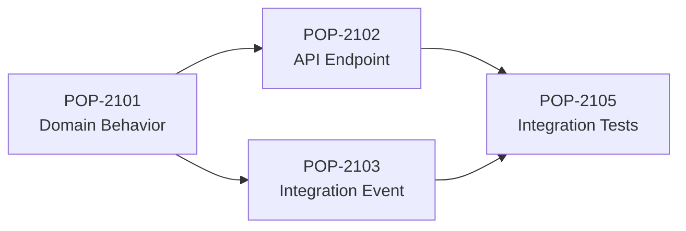

`POP-2105` should not execute merely because a worker is available.

Its dependencies must first reach the required state.

The Harness might calculate:

```text
POP-2105

DependsOn:
- POP-2102
- POP-2103

DependencyStatus:
POP-2102 = Completed
POP-2103 = Running

EffectiveStatus:
Blocked
```

When `POP-2103` becomes `Completed`, the Harness can reevaluate the dependency graph and transition `POP-2105` from `Blocked` to `Ready`.

### Dependency Rules

Dependency management should detect:

- missing dependencies;
- circular dependencies;
- failed dependencies;
- exhausted dependencies;
- cancelled dependencies;
- and dependencies belonging to incompatible workflow versions.

A dependency graph is executable control data, not merely descriptive metadata.

---

## 4.9 Assignment

Assignment determines who or what currently owns execution responsibility.

An item might be assigned to:

```text
Role: Developer Agent
Worker: harness-worker-07
Provider: Claude Code
```

The assignment should be explicit.

It should also be distinguishable from ownership.

For example:

```text
Business Owner: Fleet Engineering Team
Harness Role: Developer
Execution Worker: worker-07
```

These concepts answer different questions.

Assignment history should also be preserved.

If an execution becomes stale and another worker takes over, the original assignment should not disappear from history.

---

## 4.10 Batching

A **batch** groups Population items for operational purposes.

For example:

```text
Batch:
BATCH-2026-09-28-BOOKING

Items:
POP-2101
POP-2102
POP-2103
POP-2104
POP-2105
```

Batching can support:

- release processing;
- repository migrations;
- generated-test campaigns;
- vulnerability remediation;
- modernization initiatives;
- bulk code conversion;
- and scheduled engineering runs.

A batch is not necessarily an execution unit.

Individual items may still have independent:

- identities;
- states;
- retries;
- dependencies;
- evidence;
- and completion results.

This allows the Harness to report:

```text
Batch: BATCH-2026-09-28-BOOKING

Total       100
Completed    73
Running       8
Ready         7
Failed        4
Exhausted     2
Blocked       6
```

---

## 4.11 Parallel Execution

Population enables safe parallelism because the Harness can determine which items may execute concurrently.

Consider:

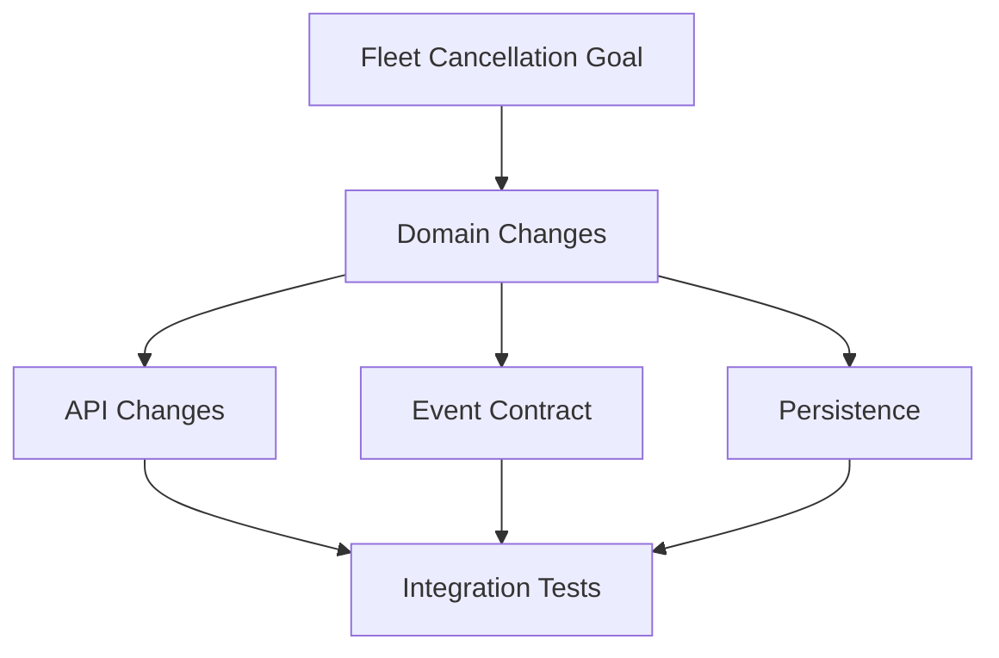

After `B` completes, `C`, `D`, and `E` may potentially execute concurrently.

The scheduler can therefore create:

```text
Worker 1 → C
Worker 2 → D
Worker 3 → E
```

Parallelism must still respect shared resources.

Two Population items may be logically independent but both modify the same file or schema.

Therefore the Harness may need additional concurrency controls such as:

- repository leases;
- branch isolation;
- file ownership policies;
- database migration serialization;
- environment locks;
- or merge sequencing.

Population provides the information needed to make these decisions.

---

## 4.12 Scheduling

Scheduling answers:

> Which Ready Population item should execute next?

A scheduler might consider:

```text
Eligibility
    ↓
Dependencies
    ↓
Priority
    ↓
Retry availability
    ↓
Resource compatibility
    ↓
Concurrency constraints
    ↓
Worker capacity
```

A simple deterministic scheduler could order items by:

```sql
ORDER BY
    Priority DESC,
    CreatedAt ASC
```

A more advanced scheduler may include:

- aging;
- fairness;
- service affinity;
- execution cost;
- token budgets;
- maintenance windows;
- or human approval windows.

The key principle remains:

> Scheduling should be a Harness policy, not an agent improvisation.

---

## 4.13 Retry

AI-assisted engineering work can fail for transient reasons:

- provider timeout;
- worker termination;
- repository lock;
- temporary build infrastructure failure;
- dependency outage;
- token or context failure;
- rate limiting;
- network failure.

Some failures justify retry.

Others do not.

Population therefore needs an explicit retry policy.

Example:

```text
MaxAttempts: 3

Attempt 1
   ↓
Failed
   ↓
Retry after 30 seconds

Attempt 2
   ↓
Failed
   ↓
Retry after 2 minutes

Attempt 3
   ↓
Failed
   ↓
Exhausted
```

A retry should create a new execution attempt without creating a new logical work item.

The history remains attached to the original Population identity.

---

## 4.14 Exhaustion

`Failed` and `Exhausted` are not the same state.

This distinction is operationally important.

`Failed` means:

> The current attempt did not succeed.

`Exhausted` means:

> The work item has consumed the retry policy available to it and automatic execution must stop.

For example:

```text
POP-2103

Attempt 1 → Failed
Attempt 2 → Failed
Attempt 3 → Failed

MaxAttempts = 3

Final State = Exhausted
```

An exhausted item typically requires:

- human investigation;
- policy override;
- work-item modification;
- dependency correction;
- or explicit reprocessing authorization.

Without an Exhausted state, systems commonly enter infinite retry loops.

> **Enterprise Tip**
>
> Retry is a recovery mechanism, not a substitute for diagnosis. Every enterprise Harness should have a finite retry budget.

---

## 4.15 Stale and Stuck Detection

A work item may remain `Running` even though no useful execution is occurring.

For example:

```text
Status: Running
Worker: worker-07
StartedAt: 09:00
LastHeartbeatAt: 09:03
CurrentTime: 09:45
ExpectedHeartbeatInterval: 60 seconds
```

The Harness should not assume that `Running` means healthy.

It needs liveness evidence.

A typical policy might define:

```text
If:

CurrentTime - LastHeartbeatAt > StaleThreshold

Then:

Running → Stale
```

The stale threshold should reflect expected execution behavior rather than an arbitrary universal value.

### Stale Versus Failed

A stale item is not automatically a failed item.

`Stale` means the Harness can no longer establish that the assigned execution is healthy.

Recovery may involve:

```text
Stale
  ├── Worker reconnects → Running
  ├── Execution recovered → Running
  ├── Execution abandoned → Failed
  └── Retry authorized → RetryPending
```

This intermediate state prevents the Harness from immediately duplicating an execution that may still be alive.

---

## 4.16 Duplicate Detection

Duplicate work can enter Population from:

- repeated API submissions;
- webhook redelivery;
- repeated issue synchronization;
- scheduler races;
- operator error;
- agent decomposition;
- or recovery logic.

The Harness therefore needs duplicate-detection policies.

For example, an item might carry an external idempotency key:

```text
Source:
GitHubIssue

ExternalId:
alpha-car-detailing#184

Operation:
Implement

IdempotencyKey:
github:alpha-car-detailing:184:implement:v3
```

When another request arrives with the same key, the Harness can detect that the logical work already exists.

Duplicate detection protects the Population itself.

Idempotency protects execution effects.

The two concepts are related but not identical.

---

## 4.17 Idempotency

An idempotent operation can be repeated without incorrectly applying its logical effect multiple times.

Suppose two workers simultaneously attempt to claim `POP-2103`.

Without concurrency protection:

```text
Worker A reads Ready
Worker B reads Ready

Worker A → Running
Worker B → Running
```

Now the work executes twice.

A deterministic claim operation should instead behave atomically:

```sql
UPDATE PopulationItem
SET
    Status = 'Running',
    AssignedWorker = @WorkerId,
    StartedAt = @Now
WHERE
    WorkItemId = @WorkItemId
    AND Status = 'Ready';
```

The Harness then checks the affected row count.

```text
Rows affected = 1
    → claim succeeded

Rows affected = 0
    → another execution already changed the state
```

Similar protections may use:

- optimistic concurrency;
- row versions;
- distributed leases;
- compare-and-swap operations;
- unique constraints;
- or transactional queues.

Idempotency must also extend to downstream actions where appropriate.

---

## 4.18 Checkpointing

Some AI engineering tasks are long-running.

Restarting them entirely after every interruption may be expensive.

Checkpointing records recoverable execution progress.

For example:

```text
POP-3301
Modernize 500 legacy tests

Checkpoint:
Processed: 320
Remaining: 180
LastArtifact: TestBatch-0320
```

If execution fails, the Harness may resume from a safe checkpoint rather than starting at zero.

Checkpointing must be designed carefully.

A checkpoint should represent a state that the Harness can safely resume.

An agent's statement—

> "I think I was around test 320."

—is not a checkpoint.

A checkpoint requires durable evidence.

---

## 4.19 Progress Tracking

Status alone does not always communicate sufficient progress.

Consider two work items:

```text
POP-1001 → Running
POP-1002 → Running
```

The first may have started 10 seconds ago.

The second may have been processing a large migration for 45 minutes.

Additional progress information might include:

```text
CurrentStage
CompletedSteps
TotalSteps
LastCheckpoint
LastHeartbeat
CurrentArtifact
```

For example:

```text
WorkItemId: POP-3301
Status: Running
Stage: TestConversion
Progress: 320 / 500
LastHeartbeat: 10:42:13
LastCheckpoint: checkpoint-0320
```

Progress should be based on measurable execution facts wherever possible.

Avoid fabricated precision.

An AI Agent estimating that it is "85% complete" is not equivalent to deterministic progress evidence.

---

## 4.20 Failure Handling

Failure is not a single condition.

The Harness should classify failures because different classes require different actions.

Possible categories include:

| Failure | Typical Response |
| --- | --- |
| Transient infrastructure | Retry |
| Provider timeout | Retry |
| Validation failure | Return for remediation |
| Review rejection | Developer rework |
| Evaluation failure | Rework or decomposition |
| Missing dependency | Block |
| Invalid work definition | Human intervention |
| Security violation | Stop and escalate |
| Retry exhaustion | Exhaust |
| Worker disappearance | Stale recovery |

Failure classification allows policy-driven recovery.

Without classification, every failure becomes either "retry everything" or "stop everything."

Neither scales.

---

## 4.21 Reprocessing

Reprocessing allows an existing Population item to execute again after its normal lifecycle has stopped.

For example:

```text
POP-2103
Status: Exhausted
```

An engineer identifies that the failure was caused by an incorrect repository credential.

After fixing the credential, the engineer authorizes reprocessing.

The Harness might record:

```text
PreviousStatus: Exhausted
Action: ReprocessAuthorized
AuthorizedBy: engineering-lead
Reason: Repository credential corrected
NewStatus: Ready
```

The old execution history must remain intact.

Reprocessing must not erase the evidence that the item previously exhausted its retries.

---

## 4.22 Persistence

Population state must survive:

- agent termination;
- worker termination;
- Harness restart;
- machine restart;
- deployment;
- failover;
- and normal operational interruptions.

Therefore Population requires durable persistence.

Possible technologies include:

- SQL databases;
- durable workflow stores;
- distributed key-value stores;
- queue-plus-database architectures;
- or managed orchestration platforms.

For the Alpha Car Detailing Harness, a relational representation is a reasonable starting point because work items contain strongly structured lifecycle and audit relationships.

A conceptual model might include:

```text
PopulationItem
PopulationExecution
PopulationDependency
PopulationTransition
PopulationCheckpoint
PopulationEvidence
PopulationBatch
```

This separation prevents a single work-item row from becoming an overloaded history store.

---

## 4.23 Audit History

The current state answers:

> Where is the item now?

Audit history answers:

> How did it get there?

Consider:

```text
POP-2103
Current Status: Completed
```

That is insufficient for enterprise operations.

The history might show:

| Time | From | To | Reason |
| --- | --- | --- | --- |
| 09:00 | Queued | Ready | Dependencies satisfied |
| 09:02 | Ready | Running | Claimed by worker-03 |
| 09:19 | Running | Validation | Implementation produced |
| 09:22 | Validation | Failed | Contract test failed |
| 09:24 | Failed | RetryPending | Retry policy authorized |
| 09:30 | RetryPending | Running | Claimed by worker-08 |
| 09:51 | Running | Validation | Implementation produced |
| 09:56 | Validation | Evaluation | Gates passed |
| 10:02 | Evaluation | Completed | Evaluation passed |

An enterprise audit record should generally capture:

```text
WorkItemId
PreviousState
NewState
Timestamp
Actor
ExecutionId
Reason
EvidenceReference
CorrelationId
```

A status update should never silently overwrite history.

---

## 4.24 Human Intervention

Automation must know when to stop automating.

Human intervention may be required when:

- retries are exhausted;
- requirements are ambiguous;
- security policy is triggered;
- architectural decisions are required;
- dependencies cannot be resolved automatically;
- repeated evaluation failures occur;
- destructive operations require approval;
- an agent proposes a standards change;
- or recovery carries significant risk.

The Population model should make this visible.

For example:

```text
Status: Exhausted
HumanActionRequired: true
Reason: Repeated contract validation failure
```

or:

```text
Status: Blocked
BlockReason: ArchitectureDecisionRequired
```

This is better than leaving an item indefinitely in `Failed`.

---

## 4.25 Population Queries

Once Population is durable and structured, it becomes queryable.

Operational queries might include:

```sql
-- Ready work
SELECT *
FROM PopulationItem
WHERE Status = 'Ready'
ORDER BY Priority DESC, CreatedAt;
```

```sql
-- Stale candidates
SELECT *
FROM PopulationItem
WHERE Status = 'Running'
  AND LastHeartbeatAt < @StaleThreshold;
```

```sql
-- Exhausted work
SELECT *
FROM PopulationItem
WHERE Status = 'Exhausted';
```

```sql
-- Work waiting on dependencies
SELECT *
FROM PopulationItem
WHERE Status = 'Blocked';
```

Higher-level queries can answer:

- Which service has the most failed work?
- Which batch is closest to completion?
- Which items have retried more than once?
- Which work has been running unusually long?
- Which items are awaiting human intervention?
- Which dependencies are blocking the largest number of downstream items?
- Which work completed without retry?
- Which items repeatedly fail the same deterministic gate?

These queries become inputs to operations, dashboards, Metrics, and future Harness-learning capabilities.

---

## 4.26 Population Inside the Harness

Population belongs inside the Harness control plane.

A simplified architecture is:

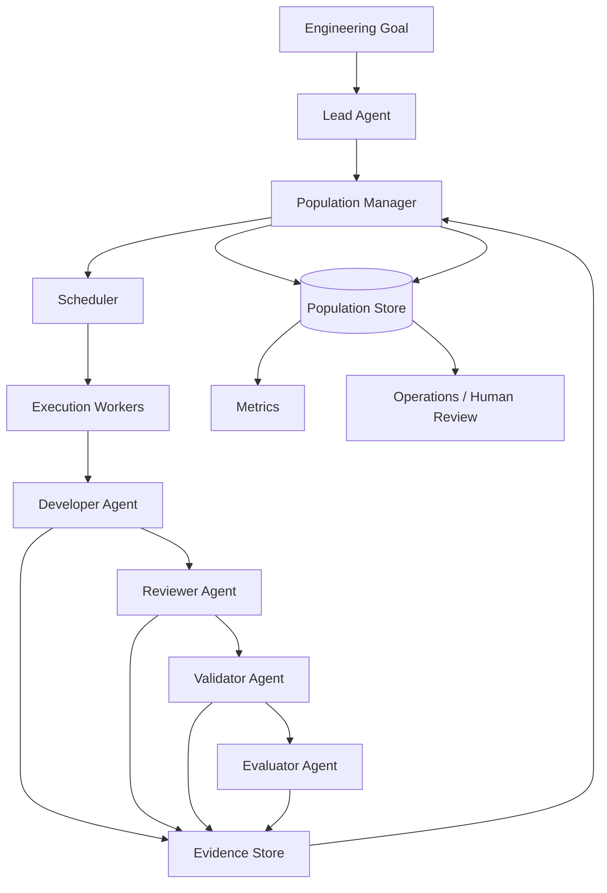

The important boundary is that agents interact **through controlled Harness operations**.

They do not directly redefine authoritative Population state.

---

## 4.27 Integration with the Lead Agent

The Lead Agent may help create and decompose work.

For example:

```text
Goal:
Add fleet cancellation capability.
```

The Lead Agent might propose:

```text
1. Add cancellation domain behavior.
2. Add API endpoint.
3. Add cancellation event.
4. Update persistence.
5. Add integration tests.
```

But proposed work does not automatically become authoritative Population state.

The Harness should validate the decomposition and create Population records through a controlled operation.

Conceptually:

```text
Lead Agent
    │
    │ proposes work
    ▼
Population Manager
    │
    │ validates identity,
    │ dependencies,
    │ duplication,
    │ policy
    ▼
Population Store
```

The Lead Agent coordinates.

Population persists.

---

## 4.28 Integration with the Developer Agent

The Developer Agent receives an assigned Population item.

For example:

```text
WorkItemId: POP-2102
Goal: Add fleet cancellation endpoint
Status: Running
Attempt: 1
```

The Developer Agent may:

- inspect the repository;
- implement changes;
- add tests;
- produce artifacts;
- report execution results.

It should not independently transition:

```text
Running → Completed
```

Instead, it might report:

```text
ImplementationProduced
Commit: abc123
TestsAdded: 8
FilesChanged: 6
```

The Harness then routes the work to the appropriate next stage.

---

## 4.29 Integration with the Reviewer Agent

The Reviewer Agent receives:

- work-item definition;
- acceptance criteria;
- implementation evidence;
- repository changes;
- relevant Instructions;
- and previous execution context when necessary.

It returns structured review evidence.

For example:

```text
ReviewResult: ChangesRequired

Findings:
- Missing cancellation authorization check.
- Event naming violates repository convention.
```

The Harness decides the resulting Population transition.

For example:

```text
Review → Failed
```

or a more expressive lifecycle:

```text
Review → ReworkRequired
```

The Reviewer provides judgment.

The Harness owns lifecycle state.

---

## 4.30 Integration with the Validator Agent

The Validator Agent verifies objective, repeatable engineering conditions.

For example:

```text
Build: PASS
UnitTests: PASS
IntegrationTests: PASS
ArchitectureGate: PASS
SecurityGate: PASS
ContractGate: FAIL
```

The Population Manager can use this deterministic evidence to control transition.

```text
Validation
    │
    ├── all required gates pass
    │       ↓
    │   Evaluation
    │
    └── required gate fails
            ↓
          Failed
```

This prevents a Developer Agent—or any other agent—from declaring completion without required validation.

---

## 4.31 Integration with the Evaluator Agent

The Evaluator Agent answers a different question:

> Does the completed implementation satisfy the intended goal and quality expectations?

For example:

```text
Goal:
Corporate users can cancel eligible fleet bookings.

Evaluation:
PASS

Evidence:
- cancellation endpoint implemented;
- domain policy enforced;
- cancellation event published;
- acceptance criteria satisfied.
```

The Harness consumes that assessment as part of the completion decision.

A simplified rule might be:

```text
Completed =
    ReviewAccepted
    AND ValidationPassed
    AND EvaluationPassed
    AND RequiredEvidencePresent
```

No individual agent owns the right to declare success merely because its own stage succeeded.

---

## 4.32 Relationship Between Population and Metrics

Population and Metrics are closely related but serve different purposes.

Population answers:

> What is the current and historical state of work?

Metrics answer:

> What can we measure about how that work is flowing?

For example, Population stores:

```text
POP-2101 Completed in 18 minutes
POP-2102 Completed in 27 minutes
POP-2103 Retried twice
POP-2104 Exhausted
POP-2105 Blocked for 42 minutes
```

Metrics can derive:

```text
Completion Rate
Failure Rate
Retry Rate
Exhaustion Rate
Median Execution Time
Queue Time
Blocked Time
Stale Rate
Throughput
```

The relationship is:

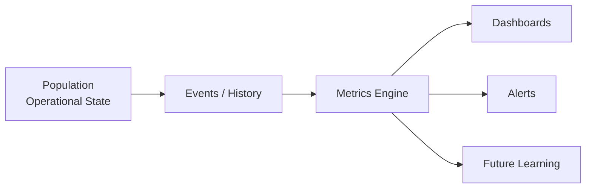

Population is therefore a primary evidence source for Harness Metrics.

But Metrics should not become the authoritative Population store.

A dashboard may say that 97 items are running.

The Population store determines **which** 97 items are running and why.

Chapter 20 will examine Metrics in detail.

---

# 5. Architecture Discussion

Population introduces a stateful control capability into the Harness.

This has architectural consequences.

The Harness can no longer be modeled simply as a script that invokes one AI Agent after another.

It becomes a work orchestration system.

## 5.1 Control Plane and Execution Plane

Population primarily belongs to the **control plane**.

The control plane decides:

- what work exists;
- what work is eligible;
- what executes next;
- who receives it;
- whether retries are permitted;
- and whether state transitions are valid.

The execution plane performs the work.

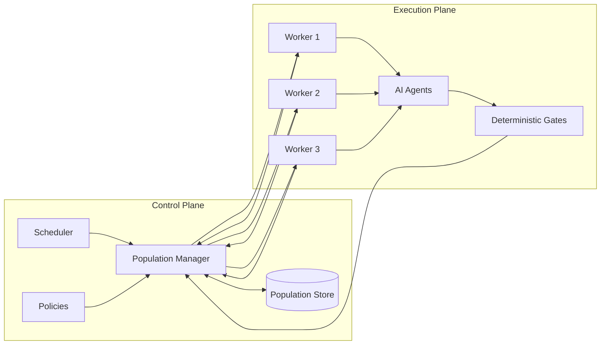

This separation allows the Harness to recover even when execution workers disappear.

---

## 5.2 Population Manager

The **Population Manager** is the logical component responsible for controlled manipulation of Population state.

Its responsibilities may include:

- creating work items;
- validating identifiers;
- checking duplicates;
- validating dependencies;
- determining readiness;
- claiming work atomically;
- recording assignments;
- receiving heartbeats;
- recording execution results;
- applying retry policies;
- detecting exhaustion;
- handling stale work;
- recording checkpoints;
- enforcing transition rules;
- and maintaining audit history.

The Population Manager does not need to be one physical service.

It is an architectural responsibility.

In a small Harness it may exist inside a single process.

In an enterprise Harness it may become a dedicated service.

---

## 5.3 State Machine

The lifecycle should be implemented as a controlled state machine rather than arbitrary status strings.

A representative state machine is:

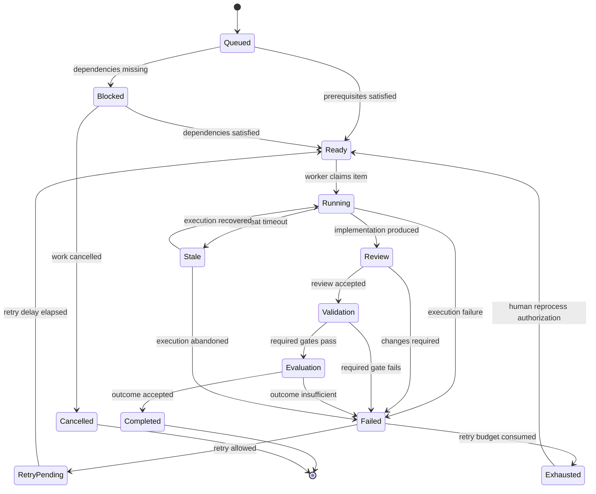

Not every organization needs every state shown here.

The important requirement is explicit transition semantics.

---

## 5.4 Transition Authority

Each transition should define its authority.

For example:

| Transition | Authority |
| --- | --- |
| Queued → Ready | Population Manager |
| Ready → Running | Scheduler/claim operation |
| Running → Review | Harness after implementation evidence |
| Review → Validation | Harness after accepted review |
| Validation → Evaluation | Harness after required gates pass |
| Evaluation → Completed | Harness completion policy |
| Failed → RetryPending | Retry policy |
| Failed → Exhausted | Retry policy |
| Running → Stale | Liveness monitor |
| Exhausted → Ready | Authorized human/reprocessing policy |

Notice what is absent:

```text
Developer Agent → Completed
```

An agent can provide evidence used by a transition.

It should not silently perform arbitrary lifecycle transitions.

---

## 5.5 Evidence-backed Transitions

A mature Population architecture records not only that a transition occurred, but also what evidence justified it.

For example:

```text
Transition:
Validation → Evaluation

Evidence:
BuildGate       PASS
UnitTestGate    PASS
ContractGate    PASS
SecurityGate    PASS

ValidationRun:
VAL-88219
```

Later, an auditor can reconstruct the decision.

This produces a stronger model:

```text
State Transition
      =
Previous State
+ Trigger
+ Policy
+ Evidence
+ Actor
+ Timestamp
```

rather than:

```text
status = "Completed"
```

---

## 5.6 Optimistic Concurrency

Population is highly susceptible to race conditions.

Two workers may attempt to claim the same item.

A stale detector may mark an execution stale while a heartbeat arrives.

A human may request reprocessing while an automated recovery process is running.

Concurrency control is therefore mandatory.

One approach is a version column:

```text
WorkItemId: POP-2103
Status: Running
Version: 14
```

An update requires the expected version:

```sql
UPDATE PopulationItem
SET
    Status = @NewStatus,
    Version = Version + 1
WHERE WorkItemId = @WorkItemId
  AND Version = @ExpectedVersion;
```

If no row is updated, another process changed the record first.

The caller reloads the item and reevaluates its operation.

This is far safer than "last writer wins."

---

## 5.7 Heartbeats and Leases

For distributed execution, assignment should often have a lease.

For example:

```text
AssignedWorker: worker-07
LeaseExpiresAt: 10:45:00
LastHeartbeatAt: 10:43:52
```

The worker periodically renews the lease.

If renewal stops, the Harness can detect that execution health is uncertain.

This provides a deterministic mechanism for stale detection.

However, lease expiry alone should not automatically start duplicate execution unless the architecture guarantees the previous worker cannot continue writing.

The recovery model must account for split-brain execution.

---

## 5.8 Persistence Model

A relational conceptual schema for Alpha Car Detailing might look like:

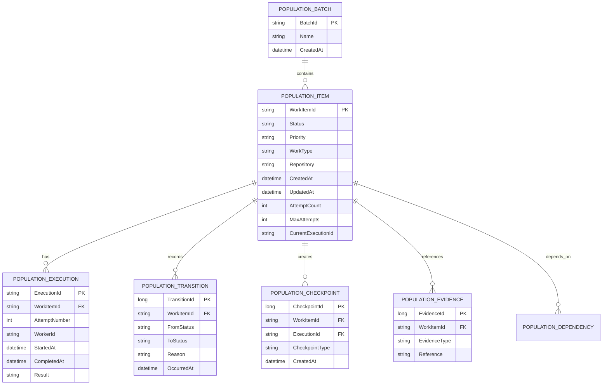

The physical schema will depend on the implementation.

The architectural principle is more important:

> Do not destroy execution history merely to keep the current Population row simple.

---

# 6. Professional Diagrams

## 6.1 End-to-End Population Flow

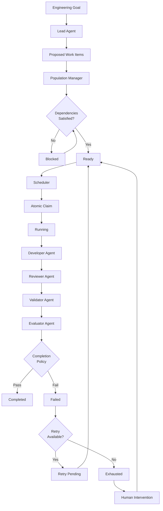

---

## 6.2 Running and Stale Recovery

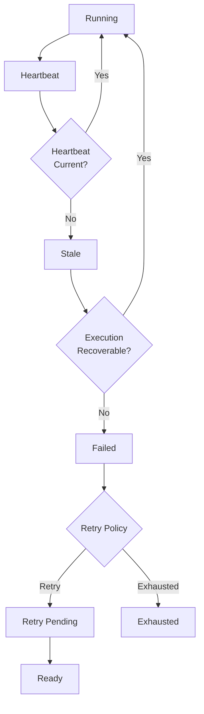

---

## 6.3 Population, Agents, and Evidence

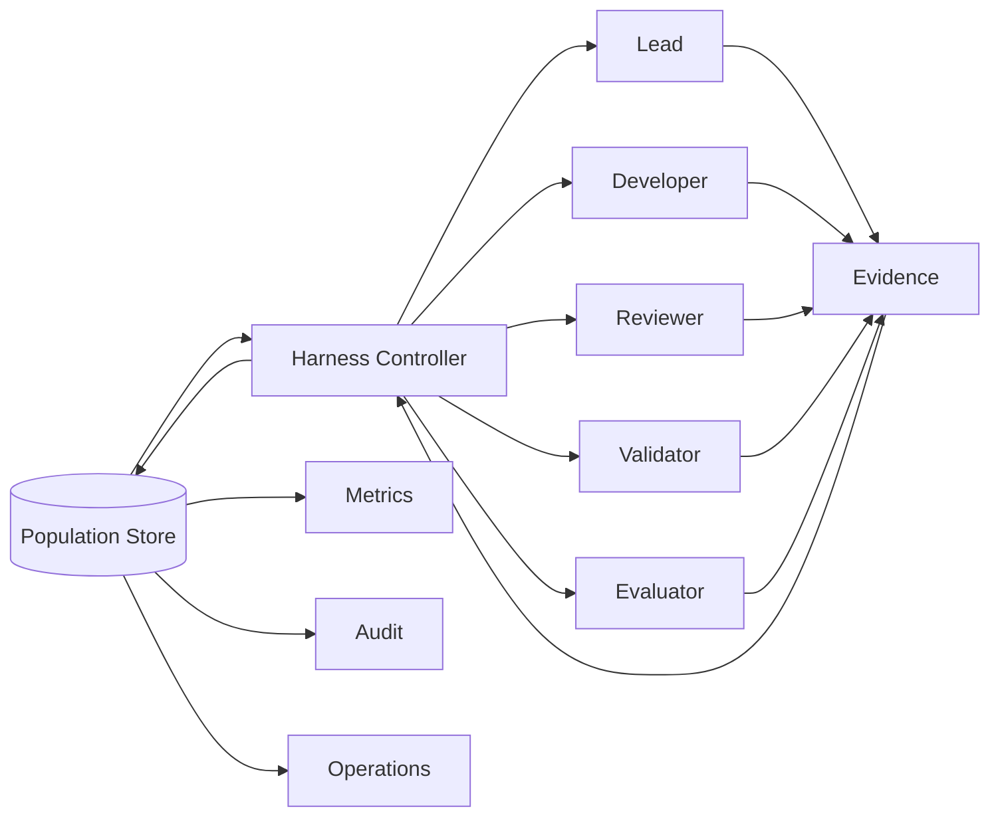

The diagram illustrates the critical control boundary.

Agents produce outputs and evidence.

The Harness controls authoritative Population state.

---

## 6.4 Population Versus Agent Context

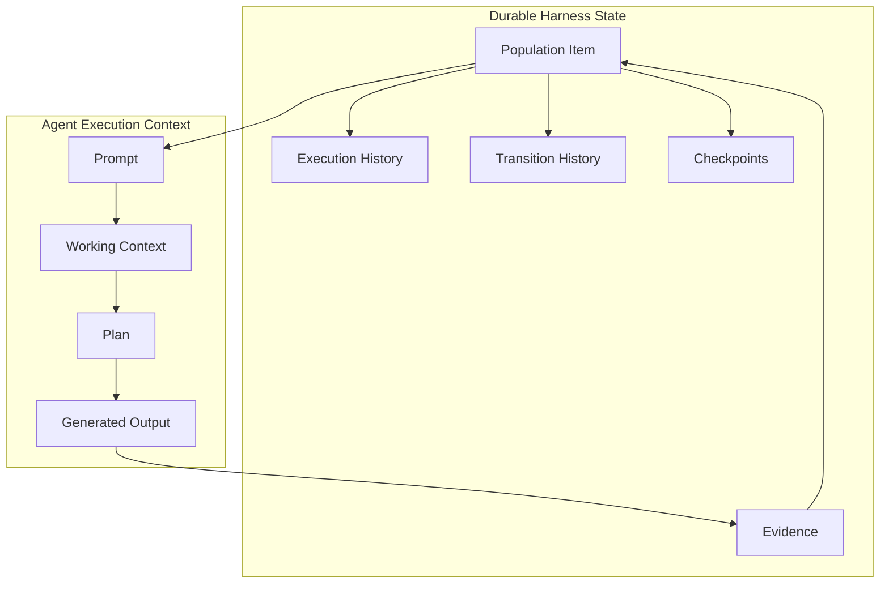

The temporary context may disappear.

The durable Population must not.

---

## 6.5 Population Lifecycle Summary

```text
                         ┌─────────┐
                         │ Queued  │
                         └────┬────┘
                              │
                    prerequisites evaluated
                              │
                 ┌────────────┴────────────┐
                 ▼                         ▼
             Blocked                    Ready
                 │                         │
        dependencies satisfied        claimed
                 │                         │
                 └──────────────►      Running
                                         │
                           ┌─────────────┼─────────────┐
                           │             │             │
                           ▼             ▼             ▼
                         Review        Failed         Stale
                           │             │             │
                           ▼             │         Recovery
                       Validation        │             │
                           │             │             └──► Running
                           ▼             ▼
                       Evaluation    Retry Policy
                           │          │          │
                           │          ▼          ▼
                           │     RetryPending  Exhausted
                           │          │          │
                           │          ▼          ▼
                           │        Ready      Human
                           │                 Intervention
                           ▼
                       Completed
```

This lifecycle should be understood as a controlled state machine, not merely a visualization for dashboards.

---

Chapter 19 status: In progress — next section: Hands-on Example

# 7. Hands-on Example

The concepts introduced earlier become easier to understand when Population is treated as an operational Harness capability rather than simply as a collection of tasks.

This hands-on example extends the **Alpha Car Detailing** Harness with a Population workflow for a realistic engineering goal:

> **Goal:** Add a vehicle inspection requirement before a corporate fleet booking can be marked ready for detailing.

The implementation affects domain behavior, an API endpoint, persistence, an integration event, and automated tests. Instead of giving the entire goal to one AI Agent and hoping it manages the work correctly, the Harness decomposes the goal into independently managed Population items.

The example focuses on the Population mechanics. The AI Agent implementations themselves remain interchangeable.

---

## 7.1 Define the Engineering Goal

Assume the Harness receives the following approved goal:

```text
Goal ID:
GOAL-1042

Title:
Require vehicle inspection before detailing

Business requirement:
Corporate fleet vehicles must have a completed vehicle inspection
before a booking can transition to ReadyForDetailing.

Acceptance criteria:
1. A completed inspection is required.
2. The booking API rejects the transition when no completed inspection exists.
3. A VehicleInspectionCompleted integration event is published.
4. Existing booking workflows remain unaffected.
5. Required unit and integration tests pass.
6. Architecture, security, and contract gates pass.
```

The Lead Agent analyzes the goal and proposes a decomposition.

The Harness then creates the corresponding Population items.

```text
POP-1042-01  Add vehicle inspection domain behavior
POP-1042-02  Add inspection persistence
POP-1042-03  Add inspection API endpoint
POP-1042-04  Publish VehicleInspectionCompleted event
POP-1042-05  Enforce inspection before ReadyForDetailing
POP-1042-06  Add integration tests
```

This distinction matters.

The Lead Agent proposes the work structure.

The Harness creates and manages the authoritative Population.

---

## 7.2 Create Population Records

A simplified Population table could begin with:

```sql
CREATE TABLE PopulationItem
(
    WorkItemId          varchar(50)     NOT NULL PRIMARY KEY,
    GoalId              varchar(50)     NOT NULL,
    Title               nvarchar(300)   NOT NULL,

    WorkType            varchar(50)     NOT NULL,
    Status              varchar(30)     NOT NULL,
    Priority            varchar(20)     NOT NULL,

    Repository          varchar(200)    NOT NULL,
    ServiceName         varchar(100)    NULL,

    AttemptCount        int             NOT NULL DEFAULT 0,
    MaxAttempts         int             NOT NULL DEFAULT 3,

    AssignedRole        varchar(50)     NULL,
    AssignedWorker      varchar(100)    NULL,
    CurrentExecutionId  varchar(50)     NULL,

    CreatedAt           datetime2       NOT NULL,
    UpdatedAt           datetime2       NOT NULL,
    StartedAt           datetime2       NULL,
    CompletedAt         datetime2       NULL,
    LastHeartbeatAt     datetime2       NULL,

    RequiresHumanAction bit             NOT NULL DEFAULT 0,

    RowVersion          rowversion      NOT NULL
);
```

The initial records might be:

| Work Item | Description | Initial State | Priority |
| --- | --- | --- | --- |
| `POP-1042-01` | Domain behavior | Ready | High |
| `POP-1042-02` | Persistence | Blocked | High |
| `POP-1042-03` | API endpoint | Blocked | High |
| `POP-1042-04` | Integration event | Blocked | Normal |
| `POP-1042-05` | Booking enforcement | Blocked | High |
| `POP-1042-06` | Integration tests | Blocked | High |

Only the domain work is initially ready because the remaining work depends on earlier implementation.

---

## 7.3 Record Dependencies

Dependencies should be represented explicitly rather than embedded only in prompt text.

```sql
CREATE TABLE PopulationDependency
(
    WorkItemId          varchar(50) NOT NULL,
    DependsOnWorkItemId varchar(50) NOT NULL,

    CONSTRAINT PK_PopulationDependency
        PRIMARY KEY (WorkItemId, DependsOnWorkItemId),

    CONSTRAINT FK_PopulationDependency_WorkItem
        FOREIGN KEY (WorkItemId)
        REFERENCES PopulationItem(WorkItemId),

    CONSTRAINT FK_PopulationDependency_DependsOn
        FOREIGN KEY (DependsOnWorkItemId)
        REFERENCES PopulationItem(WorkItemId)
);
```

The dependency graph is:

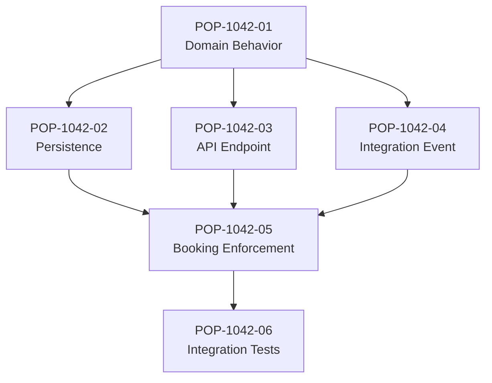

The Harness can now determine readiness rather than asking an AI Agent which task it thinks should execute next.

---

## 7.4 Determine Ready Work

A Population query can identify items whose dependencies have completed.

Conceptually:

```sql
SELECT p.*
FROM PopulationItem p
WHERE p.Status = 'Blocked'
AND NOT EXISTS
(
    SELECT 1
    FROM PopulationDependency d
    INNER JOIN PopulationItem dependency
        ON dependency.WorkItemId = d.DependsOnWorkItemId
    WHERE d.WorkItemId = p.WorkItemId
      AND dependency.Status <> 'Completed'
);
```

When all dependencies are satisfied, the Population Manager can perform:

```text
Blocked → Ready
```

The transition is recorded.

The Lead Agent does not need to remember which task becomes executable next.

The dependency graph provides the answer.

---

## 7.5 Claim Work Atomically

Suppose three Harness workers are available:

```text
worker-01
worker-02
worker-03
```

All three query the Population and see:

```text
POP-1042-01
Status: Ready
```

Without concurrency control, all three could attempt to execute the same work.

The Harness therefore uses an atomic claim operation.

```sql
UPDATE PopulationItem
SET
    Status = 'Running',
    AssignedRole = 'Developer',
    AssignedWorker = @WorkerId,
    CurrentExecutionId = @ExecutionId,
    AttemptCount = AttemptCount + 1,
    StartedAt = SYSUTCDATETIME(),
    LastHeartbeatAt = SYSUTCDATETIME(),
    UpdatedAt = SYSUTCDATETIME()
WHERE WorkItemId = @WorkItemId
  AND Status = 'Ready';
```

The worker verifies the affected row count.

```text
1 row updated
    ↓
Claim succeeded

0 rows updated
    ↓
Claim rejected
```

Only one worker owns the execution.

This is an important Population guarantee:

> **Concurrency must be resolved by deterministic state operations, not by asking agents to avoid duplicate work.**

---

## 7.6 Create an Execution Record

The logical Population item and its execution attempt should remain separate.

```sql
CREATE TABLE PopulationExecution
(
    ExecutionId     varchar(50)    NOT NULL PRIMARY KEY,
    WorkItemId      varchar(50)    NOT NULL,
    AttemptNumber   int            NOT NULL,

    WorkerId        varchar(100)   NOT NULL,
    AgentPlatform   varchar(50)    NULL,
    AgentRole       varchar(50)    NOT NULL,

    StartedAt       datetime2      NOT NULL,
    CompletedAt     datetime2      NULL,

    Result          varchar(30)    NULL,
    FailureCategory varchar(50)    NULL,
    FailureMessage  nvarchar(max)  NULL,

    CONSTRAINT FK_PopulationExecution_WorkItem
        FOREIGN KEY (WorkItemId)
        REFERENCES PopulationItem(WorkItemId)
);
```

An execution could look like:

```text
WorkItemId:
POP-1042-01

ExecutionId:
EXEC-7781

Attempt:
1

Worker:
worker-01

Role:
Developer

AgentPlatform:
Claude Code
```

If the attempt fails, the next attempt receives a new execution ID.

```text
POP-1042-01
    │
    ├── EXEC-7781  Attempt 1  Failed
    │
    └── EXEC-7814  Attempt 2  Running
```

The logical work identity never changes.

---

## 7.7 Build the Agent Execution Context

Once the Harness has claimed the item, it prepares the Developer Agent's execution context.

For example:

```text
Work Item: POP-1042-01
Goal: GOAL-1042

Task:
Add vehicle inspection domain behavior.

Repository:
alpha-car-detailing

Service:
BookingService

Attempt:
1

Required Instructions:
- Follow repository architecture.
- Preserve Clean Architecture boundaries.
- Do not bypass domain behavior.
- Add tests for new domain rules.

Acceptance criteria:
- Inspection can be recorded for a fleet booking.
- Completed inspection state is represented in the domain.
- Existing booking behavior remains valid.

Authority:
You may implement the assigned work.

You may not:
- mark the Population item Completed;
- bypass deterministic gates;
- modify unrelated Population items;
- change retry policy;
- change work-item dependencies.
```

The Population identity travels with the execution.

That makes logs, artifacts, commits, validation results, and evaluations correlatable.

---

## 7.8 Process the Developer Result

Suppose the Developer Agent completes its implementation and returns:

```text
Result:
ImplementationProduced

WorkItemId:
POP-1042-01

ExecutionId:
EXEC-7781

Artifacts:
- VehicleInspection.cs
- FleetBooking.cs
- VehicleInspectionTests.cs

Commit:
8b43ac1

Developer summary:
Implemented vehicle inspection domain behavior and tests.
```

The Developer Agent has finished its assigned execution responsibility.

That does **not** mean:

```text
POP-1042-01 = Completed
```

Instead, the Harness performs the next authorized transition:

```text
Running → Review
```

The distinction prevents self-approval.

---

## 7.9 Record Every Transition

Create a transition-history table:

```sql
CREATE TABLE PopulationTransition
(
    TransitionId       bigint IDENTITY PRIMARY KEY,
    WorkItemId         varchar(50)   NOT NULL,
    ExecutionId        varchar(50)   NULL,

    FromStatus         varchar(30)   NULL,
    ToStatus           varchar(30)   NOT NULL,

    TransitionReason   nvarchar(500) NOT NULL,
    TransitionActor    varchar(100)  NOT NULL,

    EvidenceReference  varchar(500)  NULL,
    OccurredAt         datetime2     NOT NULL,

    CONSTRAINT FK_PopulationTransition_WorkItem
        FOREIGN KEY (WorkItemId)
        REFERENCES PopulationItem(WorkItemId)
);
```

The transition could be recorded as:

```text
WorkItem:
POP-1042-01

From:
Running

To:
Review

Actor:
Harness

Reason:
Developer execution produced implementation artifacts.

Evidence:
EXEC-7781
Commit 8b43ac1
```

The resulting history is now reconstructable.

---

## 7.10 Route Through Reviewer, Validator, and Evaluator

The Harness continues the item through the established role pipeline.

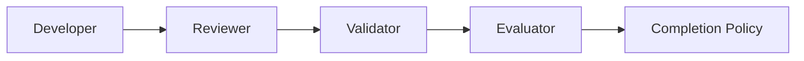

Assume the Reviewer returns:

```text
ReviewResult: Accepted

Findings:
No blocking findings.
```

The Harness records:

```text
Review → Validation
```

The Validator then executes deterministic gates:

```text
Build               PASS
Unit Tests          PASS
Architecture Gate   PASS
Security Gate       PASS
Contract Gate       PASS
```

The Harness records:

```text
Validation → Evaluation
```

The Evaluator assesses the intended outcome:

```text
EvaluationResult:
PASS

Goal satisfaction:
The domain now supports recording a completed vehicle inspection.

Acceptance criteria:
Satisfied for the assigned Population item.
```

Only after the required evidence exists does the Harness evaluate its completion policy.

```text
Review accepted
        AND
Required deterministic gates passed
        AND
Evaluation passed
        AND
Required artifacts exist
        ↓
Completed
```

The final transition becomes:

```text
Evaluation → Completed
```

The Population item can now legitimately report:

```text
POP-1042-01
Status: Completed
```

---

## 7.11 Unlock Dependent Work

Completion of `POP-1042-01` changes the dependency graph.

The Population Manager reevaluates blocked work.

Previously:

```text
POP-1042-02  Blocked
POP-1042-03  Blocked
POP-1042-04  Blocked
```

All three depend only on `POP-1042-01`.

They can now transition:

```text
POP-1042-02  Blocked → Ready
POP-1042-03  Blocked → Ready
POP-1042-04  Blocked → Ready
```

Because the work is independent at this point, the scheduler can execute it in parallel.

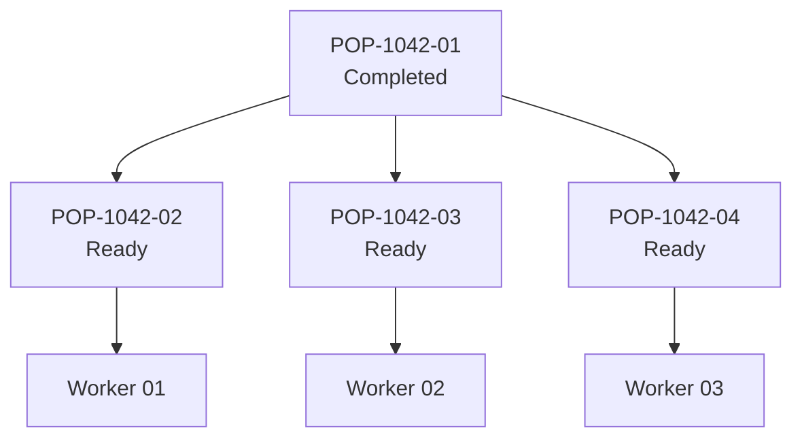

Population has enabled safe concurrency without asking the Lead Agent to manually coordinate every execution.

---

## 7.12 Handle a Failed Execution

Suppose `POP-1042-03` fails because the AI provider request times out.

The execution record becomes:

```text
WorkItemId:
POP-1042-03

ExecutionId:
EXEC-7802

Attempt:
1

Result:
Failed

FailureCategory:
ProviderTimeout
```

The Harness records:

```text
Running → Failed
```

It then applies retry policy.

```text
AttemptCount: 1
MaxAttempts: 3
FailureCategory: ProviderTimeout
Retryable: true
```

The decision is deterministic:

```text
1 < 3
AND
ProviderTimeout is retryable

→ RetryPending
```

A retry delay might be applied:

```text
NextRetryAt:
2026-09-28T10:15:00Z
```

When that time arrives:

```text
RetryPending → Ready
```

A worker can then claim the item again.

---

## 7.13 Preserve Retry History

The second attempt must not overwrite the first.

After successful retry:

| Attempt | Execution | Result | Failure |
| ---: | --- | --- | --- |
| 1 | `EXEC-7802` | Failed | Provider timeout |
| 2 | `EXEC-7841` | Completed | — |

The Population item now contains:

```text
WorkItemId:
POP-1042-03

Status:
Completed

AttemptCount:
2
```

This history becomes valuable later.

Chapter 20 can derive metrics such as:

```text
First-attempt success rate
Retry rate
Provider failure rate
Average attempts per completed item
```

The Harness can also eventually learn that certain failure patterns are transient, while others repeatedly require human intervention.

---

## 7.14 Handle Exhaustion

Now assume `POP-1042-04` repeatedly fails its event-contract validation.

```text
Attempt 1 → ContractGateFailed
Attempt 2 → ContractGateFailed
Attempt 3 → ContractGateFailed
```

The retry policy is:

```text
MaxAttempts = 3
```

After the third failed attempt:

```text
AttemptCount >= MaxAttempts
```

The Harness must not continue retrying.

It records:

```text
Failed → Exhausted
```

The Population item becomes:

```text
WorkItemId:
POP-1042-04

Status:
Exhausted

AttemptCount:
3

RequiresHumanAction:
true

Reason:
VehicleInspectionCompleted event failed contract validation
on all permitted attempts.
```

This is operationally different from `Failed`.

A failed item may recover automatically.

An exhausted item has reached an automation boundary.

---

## 7.15 Human-authorized Reprocessing

An architect investigates `POP-1042-04` and discovers that the expected event schema referenced by the Harness was outdated.

The schema is corrected.

The architect authorizes reprocessing.

The Harness records an explicit action:

```text
Action:
ReprocessAuthorized

WorkItem:
POP-1042-04

AuthorizedBy:
ArchitectureTeam

PreviousStatus:
Exhausted

Reason:
Event contract reference corrected.
```

The Population item can then transition:

```text
Exhausted → Ready
```

The previous attempts remain in history.

Reprocessing does not pretend the exhaustion never happened.

---

## 7.16 Detect a Stale Execution

Suppose `POP-1042-02` is being executed by `worker-02`.

The Harness expects a heartbeat every 60 seconds.

The latest state is:

```text
Status:
Running

AssignedWorker:
worker-02

LastHeartbeatAt:
10:20:00

CurrentTime:
10:27:00

StaleThreshold:
5 minutes
```

A liveness process evaluates:

```text
CurrentTime - LastHeartbeatAt
    >
StaleThreshold
```

The Harness transitions:

```text
Running → Stale
```

The transition history records:

```text
Reason:
No heartbeat received within configured stale threshold.

Previous worker:
worker-02

Execution:
EXEC-7822
```

Importantly, the Harness does not ask another AI Agent:

> "Do you think this task is stale?"

The condition is deterministic.

---

## 7.17 Recover Stale Work Safely

The Harness must now determine whether the old execution can still produce side effects.

A safe recovery process might:

1. revoke or expire the worker lease;
2. confirm the execution is no longer active;
3. inspect the latest checkpoint;
4. record the abandoned execution;
5. determine whether retry policy permits another attempt;
6. return the work to `Ready`.

The lifecycle becomes:

```text
Running
   ↓
Stale
   ↓
Recovery
   ↓
Failed
   ↓
RetryPending
   ↓
Ready
```

A new worker can then claim the item.

This prevents immediate duplicate execution.

---

## 7.18 Add Checkpointing

Suppose another Population item requires updating 600 fleet-booking contract tests.

The Harness represents it as:

```text
WorkItem:
POP-2201

Task:
Update fleet-booking contract test suite.

TotalUnits:
600
```

During execution, the worker periodically creates checkpoints:

```text
Checkpoint 1
Completed: 100
Remaining: 500

Checkpoint 2
Completed: 200
Remaining: 400

Checkpoint 3
Completed: 300
Remaining: 300
```

A simplified checkpoint table could be:

```sql
CREATE TABLE PopulationCheckpoint
(
    CheckpointId     bigint IDENTITY PRIMARY KEY,
    WorkItemId       varchar(50)    NOT NULL,
    ExecutionId      varchar(50)    NOT NULL,
    CheckpointType   varchar(50)    NOT NULL,
    CheckpointData   nvarchar(max)  NOT NULL,
    CreatedAt        datetime2      NOT NULL
);
```

If the worker disappears after processing 340 tests, the latest durable checkpoint remains:

```text
Completed:
300

Remaining:
300
```

The Harness may resume from the last safe checkpoint rather than trusting transient agent context.

---

## 7.19 Detect Duplicate Population Items

Assume a GitHub issue triggers the creation of work:

```text
Repository:
alpha-car-detailing

Issue:
#842

Action:
Implement
```

The Harness generates:

```text
IdempotencyKey:
github:alpha-car-detailing:842:implement:v1
```

The same webhook is delivered again.

Before creating another Population item, the Harness checks the key.

```sql
SELECT WorkItemId
FROM PopulationItem
WHERE IdempotencyKey = @IdempotencyKey;
```

If an item already exists:

```text
POP-842
```

the duplicate submission is rejected or correlated with the existing work.

The Harness does **not** create:

```text
POP-842-A
POP-842-B
```

and hope that the agents notice they are doing the same work.

---

## 7.20 Query Population Health

After several hours, the Alpha Car Detailing Harness might contain:

```text
Total Population: 126

Queued:         4
Blocked:       18
Ready:         9
Running:       12
Review:         5
Validation:     6
Evaluation:     3
Failed:         7
RetryPending:   4
Stale:          2
Exhausted:      3
Completed:     53
```

Operations can now ask meaningful questions.

For example:

```sql
SELECT *
FROM PopulationItem
WHERE Status = 'Exhausted'
ORDER BY UpdatedAt;
```

or:

```sql
SELECT *
FROM PopulationItem
WHERE RequiresHumanAction = 1;
```

or:

```sql
SELECT *
FROM PopulationItem
WHERE Status = 'Running'
ORDER BY StartedAt;
```

The Population has become an operational view of AI engineering work.

---

## 7.21 Build a Population Summary

A Harness management interface could present:

| State | Count | Operational Meaning |
| --- | ---: | --- |
| Queued | 4 | Awaiting readiness evaluation |
| Blocked | 18 | Waiting for dependencies |
| Ready | 9 | Eligible for scheduling |
| Running | 12 | Active executions |
| Review | 5 | Awaiting/under review |
| Validation | 6 | Deterministic gates executing |
| Evaluation | 3 | Outcome assessment |
| Failed | 7 | Failed but potentially recoverable |
| Retry Pending | 4 | Authorized for another attempt |
| Stale | 2 | Execution health uncertain |
| Exhausted | 3 | Automatic retries stopped |
| Completed | 53 | Completion policy satisfied |

This summary is useful, but it should not become the system of record.

The dashboard reads Population.

It does not define Population.

---

## 7.22 Add Population Events

For larger Harness implementations, state transitions can also produce events.

For example:

```text
PopulationItemCreated
PopulationItemReady
PopulationItemStarted
PopulationItemFailed
PopulationItemRetryScheduled
PopulationItemStale
PopulationItemExhausted
PopulationItemCompleted
```

A `PopulationItemCompleted` event might contain:

```json
{
  "eventType": "PopulationItemCompleted",
  "workItemId": "POP-1042-01",
  "goalId": "GOAL-1042",
  "executionId": "EXEC-7781",
  "attemptCount": 1,
  "completedAt": "2026-09-28T10:42:00Z"
}
```

These events can feed:

- Metrics;
- dashboards;
- notifications;
- audit systems;
- batch-progress calculations;
- dependency reevaluation;
- and future Harness-learning capabilities.

The Population database remains authoritative for current state unless the architecture deliberately adopts event sourcing.

---

## 7.23 Separate Population State from Metrics

Consider:

```text
POP-1042-03
Attempt 1 failed after 8 minutes.
Attempt 2 completed after 11 minutes.
```

Population needs the facts:

```text
AttemptCount = 2
CurrentStatus = Completed
Execution 1 = Failed
Execution 2 = Completed
```

Metrics can derive:

```text
RetryCount = 1
TotalExecutionTime = 19 minutes
SuccessfulAttemptTime = 11 minutes
FirstAttemptSuccess = false
```

This separation keeps responsibilities clear.

```text
Population
    ↓
Records operational truth

Metrics
    ↓
Measures operational behavior
```

The next chapter will build on this distinction.

---

## 7.24 Complete the Goal

Eventually the six Population items reach:

```text
POP-1042-01  Completed
POP-1042-02  Completed
POP-1042-03  Completed
POP-1042-04  Completed
POP-1042-05  Completed
POP-1042-06  Completed
```

The parent engineering goal can now be evaluated.

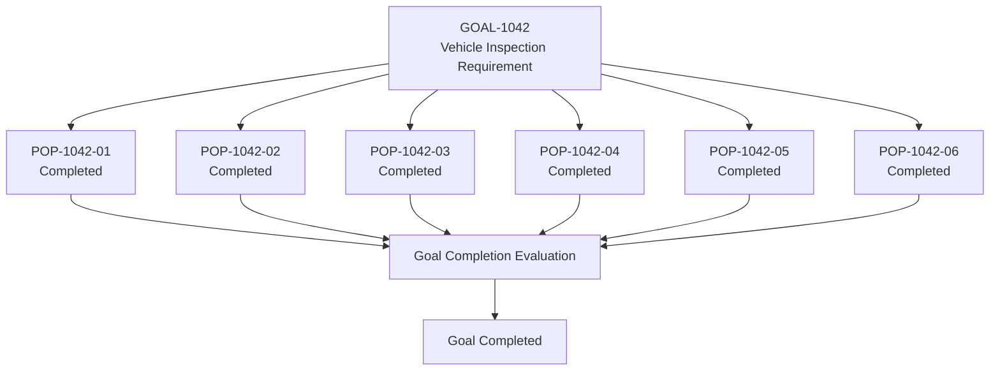

Notice that goal completion is not inferred merely because six Developer Agents reported that they had finished coding.

Each work item has passed through controlled lifecycle transitions supported by evidence.

That gives the organization something much stronger than agent confidence:

**traceable engineering state.**

---

## 7.25 What the Harness Now Knows

At the end of the example, the Harness can answer:

```text
What work existed?
    → Population records

Why did it exist?
    → Goal correlation

What depended on what?
    → Dependency records

Who executed it?
    → Assignment and execution records

How many attempts occurred?
    → Execution history

Why did attempts fail?
    → Failure evidence

Was work retried?
    → Retry history

Did any execution become stale?
    → Heartbeat and transition history

Who authorized reprocessing?
    → Audit history

Did deterministic gates pass?
    → Validation evidence

Was the outcome acceptable?
    → Evaluation evidence

Why is the item marked Completed?
    → Completion policy + evidence
```

None of those answers depend on an AI Agent remembering an earlier conversation.

That is the practical purpose of Population.

---

> **Architect's Note**
>
> A Harness that can execute hundreds of AI Agents but cannot deterministically answer what work exists, who owns it, what state it is in, why it changed state, and what evidence supports completion is not an enterprise orchestration system. It is parallel automation with incomplete operational control.

> **Enterprise Tip**
>
> Start Population management with stable identity, explicit states, transition history, bounded retries, dependency management, atomic claiming, and stale detection. More advanced scheduling and optimization can evolve later. Correct work state is more important than sophisticated scheduling.

> **Common Mistake**
>
> Do not treat the AI Agent's final response as the Population status. `"Task completed successfully"` is an agent output. `Completed` is a Harness lifecycle state that should only be reached when the required transition policy and evidence have been satisfied.

The Alpha Car Detailing example demonstrates the central Population principle:

```text
Agents execute work.

Evidence describes what happened.

Policies determine valid transitions.

The Harness owns Population state.
```

Chapter 19 status: In progress — next section: Claude Example

# 8. Claude Example

Claude Code can participate effectively in a Population-managed Harness, but Claude should remain an **execution participant rather than the authoritative owner of Population state**.

This distinction is especially important because Claude can reason across repository context, maintain substantial working context, create plans, modify multiple files, run commands, interpret failures, and continue iterative implementation. Those capabilities make Claude valuable inside the Harness execution plane.

They do not eliminate the need for deterministic Population management.

The vendor-neutral principle remains:

> **Claude performs assigned engineering work. The Harness determines what work exists and controls its authoritative lifecycle.**

## 8.1 Claude Inside the Population Workflow

For Alpha Car Detailing, consider the Population item introduced in the hands-on example:

```text
WorkItemId:
POP-1042-03

Goal:
GOAL-1042

Task:
Add the vehicle inspection API endpoint.

Status:
Ready

Priority:
High

Dependencies:
POP-1042-01 = Completed

AttemptCount:
0

MaxAttempts:
3
```

The Harness first determines that the item is eligible for execution.

It then claims the work atomically:

```text
Ready → Running
```

Only after the claim succeeds does the Harness invoke Claude.

The architecture is:

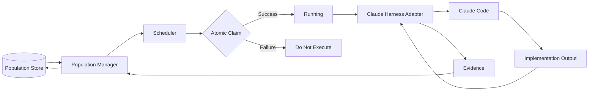

Claude does not select arbitrary work from the Population store.

The Harness selects and assigns work according to its scheduling and lifecycle policies.

---

## 8.2 Constructing the Claude Execution Request

The Harness should provide Claude with enough information to perform the assigned task without transferring lifecycle authority to Claude.

A conceptual execution request might be:

```text
Role:
Developer Agent

Work Item:
POP-1042-03

Goal:
GOAL-1042 — Require vehicle inspection before detailing.

Assigned task:
Add the vehicle inspection API endpoint.

Repository:
Alpha Car Detailing

Service:
BookingService

Dependencies:
POP-1042-01 — Completed

Acceptance criteria:
- Provide the required API operation for vehicle inspection.
- Follow existing BookingService API conventions.
- Preserve Clean Architecture boundaries.
- Add appropriate automated tests.
- Do not introduce unrelated changes.

Required repository guidance:
- Read applicable Instructions.
- Use approved Skills where relevant.
- Follow current Steering Notes.
- Use Repository Intelligence before modifying code.

Execution boundaries:
- Work only on POP-1042-03.
- Do not modify Population state.
- Do not mark this work item Completed.
- Do not alter retry counts.
- Do not create or remove dependencies.
- Do not bypass Reviewer, Validator, or Evaluator stages.

Expected output:
- Implementation changes.
- Tests.
- Changed-file summary.
- Commands executed.
- Test results available from this execution.
- Risks or unresolved issues.
- References to produced artifacts.
```

The Population metadata gives Claude execution context.

The restrictions preserve the control-plane boundary.

---

## 8.3 Repository Discovery Still Applies

Population management does not replace Repository Intelligence.

Before implementation, Claude should still understand the relevant repository area.

For example, Claude may inspect:

```text
alpha-car-detailing/
├── src/
│   ├── Booking/
│   │   ├── Domain/
│   │   ├── Application/
│   │   ├── Infrastructure/
│   │   └── Api/
│   └── Shared/
└── tests/
    ├── Booking.UnitTests/
    └── Booking.IntegrationTests/
```

It may identify:

- existing endpoint conventions;
- application-service patterns;
- domain boundaries;
- authorization patterns;
- validation conventions;
- test structure;
- logging requirements;
- and applicable Instructions.

That analysis belongs to Claude's engineering responsibility.

Determining whether `POP-1042-03` is `Ready`, `Running`, `Failed`, or `Completed` does not.

---

## 8.4 Claude Produces Evidence, Not Authoritative State

Suppose Claude completes the implementation and reports:

```text
WorkItemId:
POP-1042-03

ExecutionId:
EXEC-7841

Result:
ImplementationProduced

Changed files:
- src/Booking/Api/VehicleInspectionEndpoints.cs
- src/Booking/Application/CompleteVehicleInspection.cs
- tests/Booking.IntegrationTests/VehicleInspectionTests.cs

Tests executed:
- Booking.IntegrationTests

Observed result:
PASS

Unresolved issues:
None identified.
```

This is useful evidence.

It is not equivalent to:

```text
PopulationItem.Status = Completed
```

The Harness consumes Claude's result and applies its lifecycle policy.

For example:

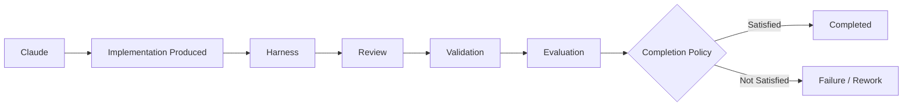

Even if Claude says:

> "The implementation is complete and all tests pass."

the Harness should interpret that statement as an execution result, not an authoritative lifecycle transition.

---

## 8.5 Structured Claude Output

A Population-managed Harness benefits from structured execution results.

For example:

```json
{
  "workItemId": "POP-1042-03",
  "executionId": "EXEC-7841",
  "result": "ImplementationProduced",
  "changedFiles": [
    "src/Booking/Api/VehicleInspectionEndpoints.cs",
    "src/Booking/Application/CompleteVehicleInspection.cs",
    "tests/Booking.IntegrationTests/VehicleInspectionTests.cs"
  ],
  "commandsExecuted": [
    "dotnet test tests/Booking.IntegrationTests"
  ],
  "reportedChecks": {
    "integrationTests": "Passed"
  },
  "unresolvedIssues": [],
  "recommendedNextAction": "Review"
}
```

The `recommendedNextAction` is advisory.

The Harness may decide that the next valid state is `Review`, but the recommendation itself does not perform the transition.

This subtle distinction protects the architecture from allowing natural-language output to become control-plane authority.

---

## 8.6 Claude and Population State Transitions

Claude may be aware of the current state.

For example:

```text
Current Population state:
Running
```

It may also report an outcome such as:

```text
ImplementationProduced
```

But the Harness maps execution outcomes to state transitions.

For example:

| Claude Result | Harness Interpretation | Possible Transition |
| --- | --- | --- |
| Implementation produced | Execution finished normally | Running → Review |
| Unable to build repository | Execution failure | Running → Failed |
| Requirement ambiguous | Human decision required | Running → Blocked / intervention |
| Dependency missing | Dependency problem detected | Running → Blocked or Failed |
| Context insufficient | Execution cannot continue | Policy dependent |
| Provider execution interrupted | Infrastructure failure | Running → Failed |
| Suggested task complete | Advisory only | No direct completion transition |

The exact transitions depend on Harness policy.

Claude should not encode the authoritative state machine in its own prompt logic.

---

## 8.7 Handling Claude Execution Failure

Suppose Claude is processing:

```text
POP-1042-04
Publish VehicleInspectionCompleted integration event.
```

The execution fails because of a temporary provider or infrastructure problem.

The Harness records:

```text
Execution:
EXEC-7901

WorkItem:
POP-1042-04

Attempt:
1

Result:
Failed

FailureCategory:
TransientExecutionFailure
```

The Population Manager performs:

```text
Running → Failed
```

The retry policy then evaluates:

```text
AttemptCount = 1
MaxAttempts = 3
Failure is retryable
```

Therefore:

```text
Failed → RetryPending
```

Claude does not need to remember:

> "I failed this task once earlier."

The Population does.

When Claude is invoked again, the Harness can explicitly provide:

```text
Attempt:
2

Previous attempt:
Failed

Previous failure:
TransientExecutionFailure
```

This creates a much stronger recovery model than depending on conversational continuity.

---

## 8.8 Do Not Use Claude Context as Retry History

A tempting implementation is to preserve a long Claude conversation and treat it as the work-item history.

For example:

```text
Conversation
   ├── Original request
   ├── Attempt 1
   ├── Error
   ├── Retry
   ├── More changes
   ├── Validation failure
   └── Another retry
```

This may be useful as supporting execution evidence.

It should not become the authoritative retry ledger.

The Harness still needs:

```text
WorkItemId
ExecutionId
AttemptNumber
StartedAt
CompletedAt
Result
FailureCategory
FailureEvidence
```

A conversation is optimized for reasoning and interaction.

Population history is optimized for operational truth.

The two should complement each other rather than substitute for each other.

---

## 8.9 Claude and Dependency Discovery

Claude may discover previously unknown dependencies while implementing work.

Suppose `POP-1042-03` was expected to be independent after the domain behavior was completed.

During repository analysis, Claude discovers that the API implementation requires a shared authorization contract that does not yet exist.

Claude should report something like:

```text
Dependency discovered:

The assigned API implementation requires the shared
FleetInspectionPermission authorization contract.

I cannot safely complete the assigned implementation without
that dependency.

Recommended action:
Create or identify the required authorization work item.
```

Claude should not silently create a new authoritative dependency and rewrite the Population graph.

The Harness can route the discovery to the Lead Agent or appropriate human authority.

A possible flow is:

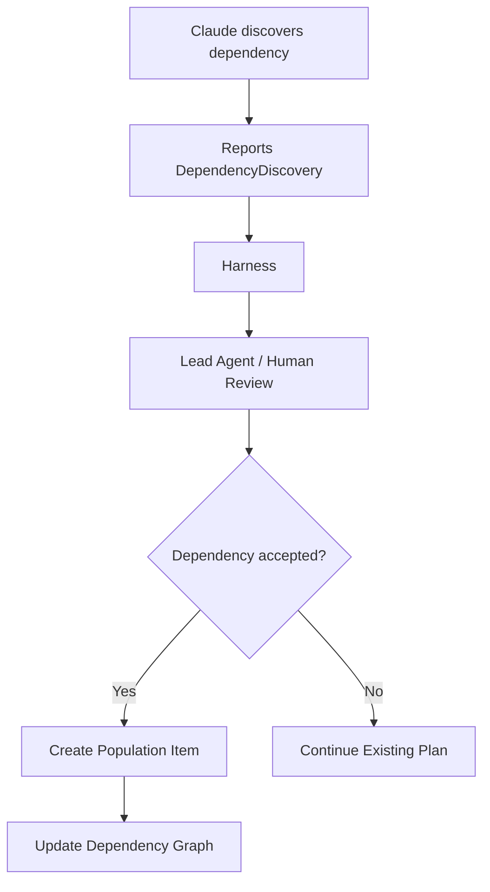

This preserves controlled decomposition.

---

## 8.10 Claude and New Work Discovery

The same principle applies when Claude discovers additional work.

Imagine Claude is implementing the inspection endpoint and notices that existing audit logging does not record inspection completion.

Claude may recommend:

```text
Potential additional work:

Add audit-event recording for completed vehicle inspections.

Reason:
Existing booking state transitions are audited, but the new
inspection transition currently has no equivalent audit entry.
```

This is valuable engineering intelligence.

But Claude should not silently expand:

```text
POP-1042-03
```

into a larger scope.

Nor should it independently create an untracked change.

Instead:

```text
Claude
   ↓
NewWorkRecommendation
   ↓
Lead / Harness policy
   ↓
Population Manager
   ↓
New Population item, if approved
```

Population therefore helps prevent scope creep caused by otherwise useful agent initiative.

---

## 8.11 Claude and Heartbeats

Long-running Claude executions need liveness monitoring.

The Harness adapter—not Claude's natural-language output—should preferably maintain heartbeats.

For example:

```text
Execution:
EXEC-8102

Worker:
worker-04

Status:
Running

Heartbeat interval:
60 seconds
```

The Harness adapter updates:

```text
LastHeartbeatAt = 10:41:00
LastHeartbeatAt = 10:42:00
LastHeartbeatAt = 10:43:00
```

If heartbeats stop beyond the configured threshold:

```text
Running → Stale
```

This is stronger than asking Claude periodically:

> "Are you still working?"

The Harness needs evidence that the execution infrastructure is alive, not merely a conversational assertion.

---

## 8.12 Claude and Checkpointing

Claude may perform work that can benefit from checkpoints.

Suppose the Harness asks Claude to modernize 300 similar API tests.

Rather than considering the entire operation one opaque execution, the Harness can define safe checkpoints:

```text
Checkpoint 1:
Tests 1–50 processed.

Checkpoint 2:
Tests 51–100 processed.

Checkpoint 3:
Tests 101–150 processed.
```

Claude can report checkpoint artifacts, but the Harness should persist them.

For example:

```json
{
  "workItemId": "POP-3301",
  "executionId": "EXEC-8204",
  "checkpoint": {
    "sequence": 3,
    "processed": 150,
    "total": 300,
    "artifact": "checkpoint-0150.json"
  }
}
```

The Harness stores:

```text
CheckpointSequence: 3
ProcessedUnits: 150
Artifact: checkpoint-0150.json
```

If execution terminates, a new Claude execution can receive:

```text
Resume from approved checkpoint:
checkpoint-0150

Previously completed units:
1–150

Remaining units:
151–300
```

Claude does not need to reconstruct progress from memory.

---

## 8.13 Claude and Stale Recovery

Consider this state:

```text
WorkItem:
POP-3301

Execution:
EXEC-8204

Worker:
worker-04

Population Status:
Running

LastHeartbeat:
10:43

Current Time:
10:52

Stale Threshold:
5 minutes
```

The Harness detects:

```text
Running → Stale
```

The recovery controller then determines whether `EXEC-8204` is still active.

If it is confirmed terminated, the Harness may record:

```text
EXEC-8204
Result:
Abandoned

Last durable checkpoint:
checkpoint-0150
```

If retry is allowed:

```text
Stale
   ↓
Failed
   ↓
RetryPending
   ↓
Ready
```

The next Claude invocation receives the approved checkpoint.

The new execution might be:

```text
EXEC-8249
Attempt: 2
ResumeFrom: checkpoint-0150
```

This demonstrates why Population, execution identity, and checkpoint identity must remain external to Claude's transient working context.

---

## 8.14 Claude and Exhaustion

Claude can sometimes repeatedly fail for the same engineering reason.

Suppose the work item is:

```text
POP-4410
Upgrade the BookingService event contract.
```

The executions produce:

```text
Attempt 1
Contract validation failed.

Attempt 2
Contract validation failed.

Attempt 3
Contract validation failed.
```

If the policy defines:

```text
MaxAttempts = 3
```

the Harness transitions:

```text
Failed → Exhausted
```

It does not ask Claude to keep trying indefinitely.

The final record might be:

```text
WorkItem:
POP-4410

Status:
Exhausted

Attempts:
3

LastFailureCategory:
ContractValidationFailure

RequiresHumanAction:
true
```

Claude's final analysis can still be useful:

```text
Observed cause:
The implementation appears to require a contract decision
between version 2 and version 3 of FleetBookingUpdated.

Recommendation:
Request architecture review before another implementation attempt.
```

That recommendation becomes evidence for human intervention.

It does not grant another retry.

---

## 8.15 Claude Must Not Reset Its Own Retry Budget

An especially dangerous pattern would allow an agent to reason:

> "The previous attempts failed because the approach was wrong. I will consider this a fresh task and start again."

Operationally, that could bypass the retry budget.

The Population identity prevents this.

```text
POP-4410
```

remains the same logical work item regardless of:

- new conversation;
- new Claude session;
- new worker;
- revised prompt;
- new implementation strategy;
- or new execution ID.

Only an authorized Harness operation can reset or extend retry policy.

For example:

```text
Exhausted
   ↓
Human authorization
   ↓
Retry budget extended
   ↓
Ready
```

The authorization itself must be auditable.

---

## 8.16 Claude and Parallel Population Execution

After `POP-1042-01` completes, three work items become ready:

```text
POP-1042-02  Persistence
POP-1042-03  API
POP-1042-04  Integration Event
```

The Harness may run three Claude executions concurrently.

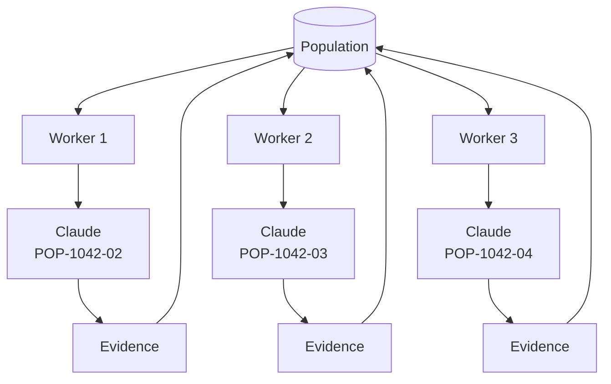

However, dependency independence does not automatically guarantee repository-write independence.

The Harness must still consider:

- branch isolation;
- overlapping files;
- shared contracts;
- database migrations;
- generated code;
- package changes;
- and eventual merge order.

Claude should not solve these orchestration concerns by informal coordination between conversations.

They belong to Harness policy.

---

## 8.17 Claude Worktrees or Branch Isolation

One practical approach for parallel execution is to isolate each Population item.

Conceptually:

```text
POP-1042-02
    ↓
worktree/pop-1042-02

POP-1042-03
    ↓
worktree/pop-1042-03

POP-1042-04
    ↓
worktree/pop-1042-04
```

Each Claude execution receives its own working environment.

The Population record can track:

```text
WorkItemId:
POP-1042-03

Branch:
ai/pop-1042-03

Workspace:
worktree/pop-1042-03

Execution:
EXEC-7841
```

This improves traceability and reduces accidental cross-item interference.

It does not eliminate merge conflicts, but it makes ownership and provenance explicit.

---

## 8.18 Claude and the Reviewer Agent

After Developer Claude produces an implementation, a separate Reviewer Agent should receive the relevant evidence.

For example:

```text
Role:
Reviewer Agent

WorkItem:
POP-1042-03

Developer execution:
EXEC-7841

Commit:
8b43ac1

Task:
Review the implementation independently.

Review against:
- assigned acceptance criteria;
- repository Instructions;
- architecture requirements;
- security expectations;
- API conventions;
- maintainability expectations.

Do not modify Population state.

Return:
- Accepted or ChangesRequired;
- findings;
- severity;
- evidence.
```

The Reviewer may also be implemented using Claude.

That does not change the role separation.

```text
Claude as Developer
        ≠
Claude as Reviewer
```

The role boundary matters more than the underlying model provider.

A Harness should preserve independent execution context and evidence where independence is required.

---

## 8.19 Claude and the Validator Agent

Claude may help interpret validation failures, but deterministic gates should remain deterministic.

For example:

```text
dotnet build
dotnet test
architecture tests
contract validation
security scanning
```

produce machine-verifiable results.

Suppose the Validator stage produces:

```text
Build               PASS
Unit Tests          PASS
Integration Tests   PASS
Architecture        PASS
Security            PASS
Contract            FAIL
```

Claude should not override the result with:

> "The contract difference is minor, so this should still count as passed."

The Population transition remains governed by the gate policy:

```text
Required Contract Gate = FAIL
        ↓
Validation cannot pass
        ↓
Population item cannot progress to successful evaluation
```

Claude may diagnose the failure.

It does not redefine the deterministic result.

---

## 8.20 Claude and the Evaluator Agent

Claude is particularly useful for Evaluator work because evaluation may require semantic judgment.

For example:

```text
Goal:
Corporate fleet vehicles must have a completed inspection
before they can become ReadyForDetailing.
```

The deterministic tests may all pass.

The Evaluator Agent can still inspect whether the overall implementation genuinely satisfies the intended outcome.

Claude acting as Evaluator might return:

```text
EvaluationResult:
Partial

Reason:
The API prevents transition to ReadyForDetailing when inspection
is incomplete, but the background import path can still perform
the transition without applying the same domain rule.

Business outcome:
Not fully satisfied.
```

That is exactly the kind of semantic evidence the Evaluator role exists to produce.

The Harness then applies its completion policy.

For example:

```text
EvaluationResult = Partial
        ↓
Completion policy not satisfied
        ↓
Do not mark Completed
```

Again:

```text
Claude evaluates.

Harness transitions.
```

---

## 8.21 Claude and Human Intervention

Claude can help prepare a concise diagnostic package when a Population item reaches an automation boundary.

For example:

```text
WorkItem:
POP-4410

Status:
Exhausted

Attempts:
3

Claude diagnostic summary:
All attempts fail contract validation because the repository
contains conflicting expectations for FleetBookingUpdated.

Decision required:
Determine whether version 2 compatibility must be preserved
or version 3 should become authoritative.

Relevant files:
- contracts/fleet-booking-v2.json
- contracts/fleet-booking-v3.json
- src/Booking/Events/FleetBookingUpdated.cs
```

The Harness can present this to an architect.

The human does not need to reconstruct three entire agent conversations before understanding why intervention is required.

Population provides the history.

Claude helps interpret it.

---

## 8.22 Population-aware Claude Prompt Pattern

A reusable Harness prompt pattern can separate **execution context** from **control authority**.

```text
# Role

You are the Developer Agent for the assigned Population item.

# Population Context

WorkItemId: {{workItemId}}
ExecutionId: {{executionId}}
Attempt: {{attemptNumber}}
GoalId: {{goalId}}

CurrentStatus: Running

# Assigned Work

{{task}}

# Acceptance Criteria

{{acceptanceCriteria}}

# Repository Context

{{repositoryContext}}

# Instructions

Read and follow all applicable repository Instructions,
Skills, Steering Notes, and approved architectural guidance.

# Previous Attempt Evidence

{{previousAttemptEvidence}}

# Execution Boundaries

You may:
- analyze the repository;
- implement the assigned change;
- add or update tests;
- run permitted engineering commands;
- report discovered risks and dependencies.

You may not:
- change Population state;
- mark the item Completed;
- reset retry history;
- change MaxAttempts;
- silently create dependencies;
- silently expand scope;
- bypass review or deterministic gates;
- approve your own implementation.

# Required Result

Return:
- execution outcome;
- changed artifacts;
- commands executed;
- observed test results;
- unresolved issues;
- discovered dependencies;
- recommended next action.
```

This pattern makes the separation explicit without burdening Claude with unnecessary orchestration responsibilities.

---

## 8.23 A Complete Claude Population Flow

The resulting Alpha Car Detailing flow can be summarized as:

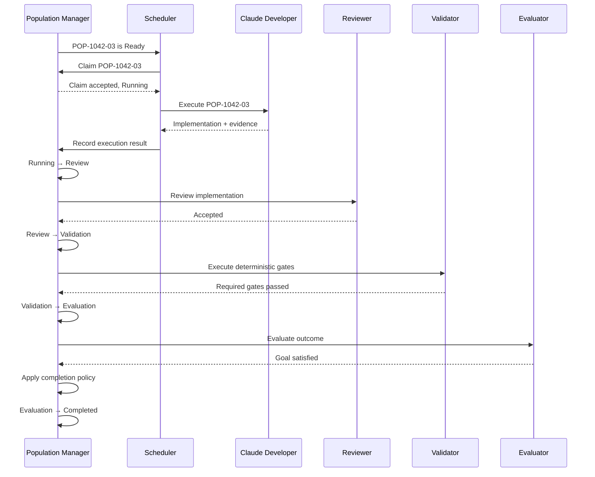

Claude can participate in several of these roles when the Harness architecture calls for it.

The Population Manager remains outside those roles.

---

## 8.24 What Claude Should Know—and What It Should Not Own

A useful boundary is:

| Concern | Claude May Know | Claude May Recommend | Claude Owns |
| --- | ---: | ---: | ---: |
| Work Item ID | Yes | — | No |
| Current assignment | Yes | — | No |
| Acceptance criteria | Yes | Improvements | No |
| Implementation approach | Yes | Yes | Within assigned scope |
| Repository changes | Yes | Yes | During execution |
| New dependency | Yes | Yes | No |
| Priority | Yes | Yes | No |
| Retry decision | Yes | Yes | No |
| Retry count | Yes | — | No |
| Stale status | Yes | Diagnosis | No |
| Validation results | Yes | Diagnosis | No |
| Completion state | Yes | Recommendation | No |
| Population transition | Yes | Recommendation | No |

The table captures an important enterprise design principle:

> **Awareness is not authority.**

Giving Claude Population context improves its decisions.

Giving Claude unrestricted Population authority weakens deterministic control.

---

## 8.25 Claude-first, Vendor-neutral

The handbook uses Claude-first examples because Claude is the primary platform selected for the project, while the engineering principles are intended to remain vendor-neutral. AI development handbook

Nothing in the Population architecture should fundamentally depend on Claude-specific behavior.

The same control model should remain valid if:

```text
Claude Code
```

is replaced by:

```text
GitHub Copilot
OpenAI Codex
another coding agent
an internal enterprise model
a human developer
```

The execution adapter changes.

The Population model should not.

Conceptually:

```text
                    ┌──────────────┐
                    │  Population  │
                    └──────┬───────┘
                           │
                     Harness Policy
                           │
              ┌────────────┼────────────┐
              ▼            ▼            ▼
           Claude       Copilot       Codex
              │            │            │
              └────────────┼────────────┘
                           ▼
                        Evidence
                           │
                           ▼
                    Population Manager
```

This is one reason Population belongs to Harness Engineering rather than to a vendor-specific chapter.

---

> **Architect's Note**
>
> Claude's ability to maintain context can make it tempting to use the conversation itself as workflow state. Resist that design. Agent context is valuable reasoning state; Population is durable operational state. Losing an agent session should inconvenience an execution, not erase the Harness's understanding of the work.

> **Enterprise Tip**
>
> Include `WorkItemId`, `ExecutionId`, and `AttemptNumber` in Claude execution context and propagate those identifiers through logs, artifacts, validation runs, evaluation results, commits, and other evidence. Correlation becomes dramatically easier when every artifact can be traced back to the Population item that caused it.

> **Common Mistake**
>
> Do not interpret Claude's statement `"Task completed successfully"` as authorization for `Completed`. Treat it as an execution outcome. The Harness should independently determine whether review, deterministic validation, evaluation, and other required completion conditions have been satisfied.

The Claude integration can therefore be reduced to a durable rule:

```text
Harness selects the work.
Harness assigns the work.
Claude performs the work.
Claude returns evidence.
Harness verifies the workflow.
Harness changes Population state.
```

This keeps Claude powerful where intelligence is valuable while keeping Population deterministic where operational control is required.

**Chapter 19 status: In progress — next section: GitHub Copilot Comparison**

# 9. GitHub Copilot Comparison

The Population principles described in this chapter remain unchanged when GitHub Copilot is used instead of Claude Code.

The important difference is not the definition of Population. It is the **integration boundary between the Harness and the coding platform**.

The Harness must still maintain stable work-item identity, dependencies, lifecycle state, assignments, retry history, execution evidence, stale detection, and completion status independently of the AI coding tool.

The governing principle remains:

> **Population belongs to the Harness, not to the coding agent.**

For Alpha Car Detailing, a Population item might still be:

```text
WorkItemId:
POP-1042-03

Goal:
GOAL-1042

Task:
Add the vehicle inspection API endpoint.

Status:
Ready

Priority:
High

Dependencies:
POP-1042-01 = Completed

AttemptCount:
0

MaxAttempts:
3
```

Whether the implementation is performed by Claude Code, GitHub Copilot, Codex, or a future coding agent does not change the identity or lifecycle of `POP-1042-03`.

---

## 9.1 Population Is Above the Copilot Layer

A useful architectural model is:

```mermaid
flowchart TD
    G["Engineering Goal"] --> L["Lead Agent / Decomposition"]
    L --> P["Population Manager"]
    P --> S["Scheduler"]

    S --> W["Harness Worker"]
    W --> C["GitHub Copilot"]

    C --> O["Implementation Output"]
    O --> W

    W --> R["Reviewer"]
    R --> V["Validator"]
    V --> E["Evaluator"]

    E --> PM["Population Manager"]
    PM --> PS[("Population Store")]
```

GitHub Copilot participates in execution.

It should not become the Population database, scheduler, retry controller, or lifecycle authority.

This keeps orchestration independent of the AI platform.

---

## 9.2 Supplying Population Context to Copilot

The Harness should provide Copilot with the same essential execution context supplied to any Developer Agent.

For example:

```text
Role:
Developer Agent

Work Item:
POP-1042-03

Execution:
EXEC-7841

Attempt:
1

Goal:
Require vehicle inspection before detailing.

Assigned task:
Add the vehicle inspection API endpoint.

Repository:
Alpha Car Detailing

Service:
BookingService

Acceptance criteria:
- Follow existing API conventions.
- Preserve Clean Architecture boundaries.
- Add required validation.
- Add automated tests.
- Do not modify unrelated functionality.

Population boundaries:
- Do not mark this item Completed.
- Do not modify retry history.
- Do not modify Population dependencies.
- Do not silently expand task scope.
- Do not bypass Reviewer, Validator, or Evaluator stages.
```

Repository-wide Copilot instructions can provide persistent engineering guidance, while the work-item prompt supplies the specific Population context.

These responsibilities should remain distinct:

```text
Repository Instructions
        ↓
How engineering work must be performed

Population Item
        ↓
Which work is currently assigned

Prompt
        ↓
What this execution should accomplish
```

This follows the handbook's established separation between Instructions, Skills, Prompts, and Harness responsibilities. AI development handbook

---

## 9.3 Copilot Instructions Do Not Replace Population

An enterprise repository may contain instructions describing:

- architecture conventions;
- coding standards;
- testing expectations;
- security requirements;
- logging conventions;
- naming rules;
- and repository-specific constraints.

Those instructions are important, but they should not become the operational Population store.

For example, this would be inappropriate:

```text
# Current Work

POP-1042-01 = Complete
POP-1042-02 = Running
POP-1042-03 = Ready
POP-1042-04 = Failed
```

inside repository-wide AI instructions.

That information changes frequently and belongs to Harness operational state.

The correct separation is:

```mermaid
flowchart LR
    I["Repository Instructions"] --> A["Copilot"]
    P["Population Item"] --> A
    S["Skill"] --> A
    PR["Task Prompt"] --> A

    A --> O["Implementation Output"]
    O --> H["Harness"]
    H --> PS[("Population Store")]
```

Instructions guide behavior.

Population tracks work.

---

## 9.4 Copilot Produces Implementation Evidence

Assume Copilot completes the assigned endpoint implementation.

The Harness should capture a structured result such as:

```text
WorkItemId:
POP-1042-03

ExecutionId:
EXEC-7841

Result:
ImplementationProduced

Changed artifacts:
- VehicleInspectionEndpoints.cs
- CompleteVehicleInspection.cs
- VehicleInspectionTests.cs

Observed tests:
Booking.IntegrationTests passed.

Unresolved issues:
None reported.
```

This output becomes execution evidence.

It does not directly cause:

```text
POP-1042-03 → Completed
```

Instead:

```text
Running
   ↓
ImplementationProduced
   ↓
Review
   ↓
Validation
   ↓
Evaluation
   ↓
Completion Policy
   ↓
Completed
```

The same completion discipline applies regardless of which coding platform generated the implementation.

---

## 9.5 Copilot Sessions Are Not Work-item Identity

A Copilot interaction, IDE session, chat, or agent execution should not become the logical identity of the work.

The Population identity remains:

```text
POP-1042-03
```

The execution identity might be:

```text
EXEC-7841
```

A later retry might use:

```text
EXEC-7918
```

The relationship remains:

```text
POP-1042-03
    │
    ├── EXEC-7841
    │       └── Failed
    │
    └── EXEC-7918
            └── Completed
```

Changing sessions, machines, workers, branches, or AI platforms should not create a new logical work item unless the work itself is genuinely different.

---

## 9.6 Copilot and Retry

Suppose a Copilot-driven implementation fails deterministic validation:

```text
Build               PASS
Unit Tests          PASS
Architecture Gate   PASS
Contract Gate       FAIL
```

The Validator reports the failure.

The Population Manager records:

```text
Validation → Failed
```

It then evaluates retry policy:

```text
AttemptCount:
1

MaxAttempts:
3

Failure:
ContractValidationFailure

Retryable:
Yes
```

The Harness may then perform:

```text
Failed → RetryPending → Ready
```

The next execution can receive the previous failure as context:

```text
Previous attempt:
EXEC-7841

Previous result:
Contract validation failed.

Validation evidence:
VehicleInspectionCompleted schema does not match
the approved integration-event contract.

Current attempt:
2
```

Copilot can use that evidence to improve the next implementation.

But Copilot does not decide whether another attempt exists.

---

## 9.7 Do Not Hide Retries Inside a Single Agent Interaction

An important design issue appears when an AI coding tool repeatedly modifies code until tests pass.

For example:

```text
Generate implementation
        ↓
Build fails
        ↓
Modify code
        ↓
Tests fail
        ↓
Modify code
        ↓
Tests pass
```

Not every internal correction needs to become a new Population attempt.

The Harness must define the **execution boundary**.

One Population attempt might legitimately contain several internal implementation iterations:

```text
Population Attempt 1
│
├── Generate
├── Build
├── Correct
├── Test
├── Correct
└── Produce implementation
```

A new Population attempt should normally begin when the current Harness execution terminates or crosses a defined failure/retry boundary.

This distinction prevents inflated retry counts.

```text
Agent iteration
    ≠
Population retry
```

A retry is an operational Harness concept.

---

## 9.8 Copilot and Discovered Dependencies

Suppose Copilot discovers that the inspection endpoint requires an authorization capability that was omitted from the original decomposition.

It may report:

```text
Discovered dependency:

The vehicle inspection endpoint requires the
FleetInspectionPermission policy, but no corresponding
authorization policy currently exists.

Recommended action:
Add the authorization capability before completing this endpoint.
```

This should become structured evidence.

The Harness can route the discovery to the Lead Agent or a human decision point.

```mermaid
flowchart TD
    C["Copilot"] --> D["Dependency Discovery"]
    D --> H["Harness"]
    H --> L["Lead Agent / Human"]

    L --> Q{"Accept dependency?"}

    Q -- Yes --> N["Create Population Item"]
    N --> U["Update Dependency Graph"]

    Q -- No --> X["Record Decision"]
```

Copilot should not silently change Population dependencies merely because it discovered them.

---

## 9.9 Copilot and Scope Expansion

The same principle applies to additional improvements.

Copilot may discover:

- missing logging;
- outdated tests;
- unrelated code smells;
- opportunities for refactoring;
- obsolete dependencies;
- documentation gaps.

These findings may be valuable.

But an assigned Population item such as:

```text
POP-1042-03
Add vehicle inspection API endpoint.
```

should not silently become:

```text
Add vehicle inspection endpoint
+ refactor BookingService
+ upgrade packages
+ rewrite authorization
+ improve logging
+ reorganize tests
```

The correct pattern is:

```text
Assigned Work
     ↓
Copilot discovers additional opportunity
     ↓
Recommendation
     ↓
Lead / Human / Harness policy
     ↓
New Population item if accepted
```

This protects traceability and keeps acceptance criteria meaningful.

---

## 9.10 Copilot and Parallel Execution

Population management also enables multiple Copilot-driven work items to execute concurrently.

After domain behavior completes:

```text
POP-1042-02  Ready
POP-1042-03  Ready
POP-1042-04  Ready
```

the Harness may schedule:

```mermaid
flowchart LR
    P[("Population")]

    P --> W1["Worker 1"]
    P --> W2["Worker 2"]
    P --> W3["Worker 3"]

    W1 --> C1["Copilot<br/>Persistence"]
    W2 --> C2["Copilot<br/>API"]
    W3 --> C3["Copilot<br/>Event"]

    C1 --> E1["Evidence"]
    C2 --> E2["Evidence"]
    C3 --> E3["Evidence"]

    E1 --> H["Harness"]
    E2 --> H
    E3 --> H
```

As with Claude, parallel execution introduces concerns beyond dependency readiness.

The Harness may need to manage:

- isolated branches;
- worktrees;
- shared files;
- generated artifacts;
- migration ordering;
- contract changes;
- merge conflicts;
- and repository locks.

The Population scheduler should understand these operational constraints.

---

## 9.11 Copilot and Stale Detection

The Harness must not equate an assigned Copilot execution with a healthy execution.

Suppose:

```text
WorkItem:
POP-1042-02

Status:
Running

Execution:
EXEC-8012

Worker:
worker-06

LastHeartbeat:
11:14

CurrentTime:
11:25

StaleThreshold:
5 minutes
```

The Population Manager detects:

```text
Running → Stale
```

This transition should come from Harness liveness evidence.

It should not depend on whether the Copilot interaction happens to contain a recent message.

Agent conversation activity and worker health are different signals.

---

## 9.12 Copilot and Exhaustion

Suppose repeated Copilot executions fail the same architecture gate:

```text
Attempt 1 → Failed
Attempt 2 → Failed
Attempt 3 → Failed
```

with:

```text
MaxAttempts = 3
```

The Harness transitions:

```text
Failed → Exhausted
```

The correct response is not to open another Copilot session automatically and try again indefinitely.

Instead:

```text
Exhausted
   ↓
Human / architecture investigation
   ↓
Cause identified
   ↓
Explicit reprocessing authorization
   ↓
Ready
```

Population provides the automation boundary.

---

## 9.13 Copilot and Validation

GitHub Copilot can help:

- generate tests;
- interpret test failures;
- explain static-analysis findings;
- suggest fixes;
- and remediate validation failures.

But deterministic gates remain external evidence.

For example:

```text
dotnet build                PASS
dotnet test                 PASS
architecture tests          PASS
security scan               PASS
event contract validation   FAIL
```

The required event-contract gate failed.

An AI Agent's opinion that the difference is harmless does not convert that deterministic result into a pass.

The workflow remains:

```text
Contract Gate = FAIL
        ↓
Validation = FAIL
        ↓
Population transition according to policy
```

The AI Agent can diagnose.

The Harness decides.

---

## 9.14 Copilot and Completion

A Copilot-driven agent may conclude:

> Implementation completed successfully.

That statement should mean:

```text
The assigned implementation execution has produced an output.
```

It should not mean:

```text
The Harness lifecycle is complete.
```

For Alpha Car Detailing, completion might require:

```text
Developer output exists
        AND
Reviewer accepted
        AND
Required gates passed
        AND
Evaluator accepted outcome
        AND
Required evidence exists
```

Only then:

```text
Evaluation → Completed
```

This prevents implementation success from being confused with workflow success.

---

## 9.15 Claude and Copilot Population Comparison

From the Population perspective, the two platforms should look deliberately similar.

| Concern | Claude Code | GitHub Copilot | Harness Responsibility |
| --- | --- | --- | --- |
| Work identity | Receives ID | Receives ID | Owns ID |
| Work selection | Assigned by Harness | Assigned by Harness | Scheduler |
| Repository guidance | Reads Instructions | Reads Instructions | Governs sources |
| Implementation | Performs | Performs | Coordinates |
| Dependency discovery | Reports | Reports | Accepts/rejects |
| Retry history | Receives context | Receives context | Owns history |
| Retry authorization | No | No | Retry policy |
| Stale detection | No | No | Liveness policy |
| Validation evidence | Consumes/diagnoses | Consumes/diagnoses | Validator/gates |
| Completion | Recommends outcome | Recommends outcome | Completion policy |
| Audit history | Produces evidence | Produces evidence | Population store |

The implementation mechanics may differ.

The control architecture should not.

---

## 9.16 Avoid Provider-specific Population State

A fragile Harness might define states such as:

```text
WaitingForClaude
ClaudeRunning
CopilotRunning
CodexRunning
ClaudeFailed
```

These states mix the logical work lifecycle with provider implementation details.

A more durable Population model uses:

```text
Ready
Running
Review
Validation
Evaluation
Failed
Exhausted
Completed
```

and records provider information separately:

```text
AgentPlatform:
GitHubCopilot
```

or:

```text
AgentPlatform:
ClaudeCode
```

This allows the Harness to change execution providers without redesigning the state machine.

For example:

```text
POP-5001

Attempt 1
Provider: Claude Code
Result: Failed

Attempt 2
Provider: GitHub Copilot
Result: Failed

Attempt 3
Provider: Codex
Result: Completed
```

The logical Population lifecycle remains consistent.

---

## 9.17 Provider Switching Must Not Reset Work Identity

Provider switching is particularly important in enterprise Harnesses that support multiple coding agents.

Suppose:

```text
POP-5001
Attempt 1
Claude Code
    ↓
Failed
```

The organization decides to retry with GitHub Copilot.

The correct model is:

```text
POP-5001
│
├── EXEC-9101
│   Provider: Claude Code
│   Attempt: 1
│   Result: Failed
│
└── EXEC-9132
    Provider: GitHub Copilot
    Attempt: 2
    Result: Running
```

The incorrect model is:

```text
POP-5001-CLAUDE
POP-5001-COPILOT
```

unless those truly represent separate pieces of work.

The AI provider is an execution characteristic.

It is not the work identity.

---

## 9.18 Population Makes Copilot Operationally Replaceable

This architecture provides an important enterprise property: **execution portability**.

If Population, retry history, dependencies, validation evidence, and completion rules live outside the coding agent, the Harness can route work to different execution platforms without losing operational continuity.

```mermaid
flowchart TD
    P[("Population")] --> H["Harness"]

    H --> D{"Execution Adapter"}

    D --> C["Claude Code"]
    D --> G["GitHub Copilot"]
    D --> O["OpenAI Codex"]
    D --> F["Future Agent"]

    C --> E["Normalized Evidence"]
    G --> E
    O --> E
    F --> E

    E --> H
    H --> P
```

The normalized boundary is critical.

Each platform may expose different interaction models and capabilities, but the Harness should translate their results into consistent concepts such as:

```text
ExecutionStarted
ImplementationProduced
ExecutionFailed
DependencyDiscovered
CheckpointProduced
ExecutionCompleted
```

This prevents Population from becoming coupled to one vendor.

---

> **Architect's Note**
>
> Avoid designing Population around the conversational or session model of any individual coding platform. Agent sessions are execution mechanisms. Population represents enterprise work. The latter should normally outlive the former.

> **Enterprise Tip**
>
> Normalize Claude, GitHub Copilot, Codex, and future agent outputs at the Harness boundary. Keep provider-specific execution metadata, but translate lifecycle-relevant results into a stable Harness contract. This makes retry, audit, Metrics, and provider switching considerably easier.

> **Common Mistake**
>
> Do not create separate lifecycle semantics for each coding agent. `Running` should mean the same operational condition whether the current execution uses Claude Code, GitHub Copilot, Codex, or another implementation platform.

The GitHub Copilot comparison therefore reinforces the same architecture established with Claude:

```text
Population defines the work.

The Harness controls the lifecycle.

GitHub Copilot performs assigned engineering activity.

Copilot returns implementation evidence.

Reviewer, Validator, and Evaluator provide additional evidence.

The Harness determines the resulting Population state.
```

**Chapter 19 status: In progress — next section: Codex Comparison**

# 10. Codex Comparison

Codex can participate in the same Population-managed Harness architecture used with Claude Code and GitHub Copilot.

From the perspective of Chapter 19, the central question is not which coding agent has the strongest implementation capabilities. The architectural question is:

> **How does the Harness assign a Population item to Codex, receive evidence from the execution, and preserve deterministic control of the work lifecycle?**

The answer should remain consistent with the rest of the Harness architecture.

Codex can analyze repositories, implement code changes, run engineering commands, create or update tests, diagnose failures, and return implementation evidence. Those capabilities make it useful within the execution plane.

They do not make Codex the owner of Population.

```text
Population
    ↓
Harness
    ↓
Codex
    ↓
Implementation + Evidence
    ↓
Harness
    ↓
Population Transition
```

The same core principle applies:

> **Codex performs assigned work. The Harness owns authoritative work state.**

---

## 10.1 Codex as a Harness Execution Target

Consider the Alpha Car Detailing Population item:

```text
WorkItemId:
POP-1042-04

Goal:
GOAL-1042

Task:
Publish VehicleInspectionCompleted integration event.

Status:
Ready

Priority:
Normal

Dependencies:
POP-1042-01 = Completed

AttemptCount:
0

MaxAttempts:
3
```

The Population Manager determines that the dependency has been satisfied.

The scheduler selects the item.

The Harness atomically claims it:

```text
Ready → Running
```

An execution record is created:

```text
ExecutionId:
EXEC-7925

WorkItemId:
POP-1042-04

Attempt:
1

AgentPlatform:
Codex

Role:
Developer
```

Only then is the task passed to Codex.

```mermaid
flowchart LR
    P[("Population Store")] --> PM["Population Manager"]
    PM --> S["Scheduler"]
    S --> C{"Atomic Claim"}

    C -- Success --> E["Create Execution"]
    C -- Failure --> X["Do Not Execute"]

    E --> A["Codex Adapter"]
    A --> CX["Codex"]

    CX --> O["Implementation Output"]
    O --> A
    A --> EV["Normalized Evidence"]
    EV --> PM
```

Codex is therefore an execution target behind the Harness boundary.

---

## 10.2 Constructing the Codex Task

The Harness should supply explicit work identity, execution identity, acceptance criteria, repository guidance, and authority boundaries.

For example:

```text
Role:
Developer Agent

WorkItemId:
POP-1042-04

ExecutionId:
EXEC-7925

Attempt:
1

Goal:
Require vehicle inspection before detailing.

Assigned task:
Publish VehicleInspectionCompleted integration event.

Repository:
Alpha Car Detailing

Service:
BookingService

Acceptance criteria:
- Define the approved VehicleInspectionCompleted event.
- Follow existing integration-event conventions.
- Preserve existing event contracts.
- Add appropriate tests.
- Do not modify unrelated functionality.

Required engineering guidance:
- Read applicable Instructions.
- Use relevant Skills.
- Respect current Steering Notes.
- Inspect existing event patterns before implementation.

Execution boundaries:
- Modify only what is required for this Population item.
- Do not mark the Population item Completed.
- Do not alter retry limits.
- Do not change Population dependencies.
- Do not silently expand scope.
- Do not bypass review or deterministic validation.

Required result:
- implementation outcome;
- changed files;
- commands executed;
- observed test results;
- unresolved issues;
- discovered dependencies;
- risks;
- produced artifacts.
```

The prompt provides Codex with operational context without transferring Population authority.

---

## 10.3 Repository Instructions and Population Context

Codex may receive repository-level engineering guidance such as:

```text
Repository Instructions
├── architecture conventions
├── coding standards
├── testing expectations
├── security requirements
├── observability requirements
└── repository-specific constraints
```

The Population item supplies a different kind of information:

```text
Population Context
├── WorkItemId
├── GoalId
├── ExecutionId
├── AttemptNumber
├── assigned task
├── dependencies
├── acceptance criteria
└── current lifecycle context
```

These concepts should remain separate.

```mermaid
flowchart TD
    I["Instructions<br/>How work must be performed"] --> C["Codex"]
    S["Skills<br/>Reusable execution knowledge"] --> C
    P["Prompt<br/>What this execution must accomplish"] --> C
    POP["Population<br/>Which work exists and its operational context"] --> C

    C --> O["Implementation Evidence"]
```

Population does not replace Instructions or Skills.

Instructions and Skills do not replace Population.

---

## 10.4 Codex Produces Evidence

Suppose Codex implements the integration event and reports:

```text
WorkItemId:
POP-1042-04

ExecutionId:
EXEC-7925

Result:
ImplementationProduced

Changed files:
- VehicleInspectionCompleted.cs
- VehicleInspectionEventPublisher.cs
- VehicleInspectionEventTests.cs

Commands executed:
- dotnet build
- dotnet test

Observed results:
Build passed.
Relevant tests passed.

Unresolved issues:
None reported.
```

The Harness stores the result as execution evidence.

The correct interpretation is:

```text
Codex execution produced an implementation.
```

It is not:

```text
POP-1042-04 is Completed.
```

Instead, the Harness performs the next authorized lifecycle transition:

```text
Running → Review
```

The implementation must still pass through the required workflow.

---

## 10.5 Codex Should Not Be the Completion Authority

A coding agent can reasonably report:

```text
Task completed successfully.
```

But the statement describes the agent's execution perspective.

Population completion is broader.

For example:

```text
Implementation produced
        ↓
Reviewer accepted
        ↓
Required deterministic gates passed
        ↓
Evaluator accepted outcome
        ↓
Required evidence exists
        ↓
Completion policy satisfied
        ↓
Completed
```

Therefore:

```text
Codex says "done"
        ≠
Population says "Completed"
```

This distinction prevents implementation confidence from becoming workflow authority.

---

## 10.6 Codex and Deterministic Validation

Codex may execute commands such as:

```text
dotnet build
dotnet test
```

during implementation.

Those results are useful execution evidence.

However, the Validator stage should still run the Harness-controlled deterministic gates required by policy.

For example:

```text
Harness Validation

Build Gate             PASS
Unit Test Gate         PASS
Integration Test Gate  PASS
Architecture Gate      PASS
Security Gate          PASS
Event Contract Gate    FAIL
```

Even if Codex previously reported that its tests passed, the authoritative validation result is:

```text
Event Contract Gate = FAIL
```

If that gate is mandatory:

```text
Validation cannot pass.
```

The Harness therefore applies the appropriate transition:

```text
Validation → Failed
```

Codex may subsequently help diagnose and correct the failure.

It does not override the gate.

---

## 10.7 Returning Validation Evidence to Codex

A retry should not force Codex to rediscover the previous failure.

The Harness can provide the evidence explicitly:

```text
WorkItem:
POP-1042-04

Attempt:
2

Previous execution:
EXEC-7925

Previous failure:
EventContractValidationFailure

Validation evidence:
VehicleInspectionCompleted does not match the approved
integration-event schema.

Expected:
inspectionId
bookingId
vehicleId
completedAt

Observed:
inspectionId
bookingId
completedAt

Missing:
vehicleId
```

Codex now receives precise evidence for the next attempt.

This is more reliable than depending on the previous Codex session remaining available.

---

## 10.8 Codex Sessions Are Disposable; Population Is Durable

An enterprise Harness should assume that any individual agent execution can disappear.

A Codex session might terminate because of:

- infrastructure failure;
- worker restart;
- timeout;
- process termination;
- authentication failure;
- network interruption;
- or deliberate cancellation.

The Harness should still know:

```text
What work was being performed?
Which attempt was active?
Who owned it?
When did it start?
What was the latest heartbeat?
What artifacts were produced?
What checkpoints exist?
What previous attempts occurred?
What should happen next?
```

That information belongs in durable Harness state.

Conceptually:

```text
Codex Session
    ↓
Disposable execution context

Population
    ↓
Durable operational context
```

Loss of an agent session should not mean loss of work history.

---

## 10.9 Codex and Retry Boundaries

Codex may make multiple corrections during a single execution.

For example:

```text
Generate event
    ↓
Build
    ↓
Compiler failure
    ↓
Correct implementation
    ↓
Run tests
    ↓
Test failure
    ↓
Correct implementation
    ↓
Produce final output
```

These are normally internal execution iterations.

They do not necessarily represent three Population attempts.

A Population attempt is defined by the Harness execution boundary.

```text
POP-1042-04
    │
    └── Attempt 1
         │
         ├── implementation iteration
         ├── build
         ├── correction
         ├── test
         ├── correction
         └── final result
```

If the execution terminates and the Harness schedules another execution:

```text
Attempt 1 → Failed

Attempt 2 → New execution
```

This distinction keeps retry metrics meaningful.

---

## 10.10 Codex and Exhaustion

Suppose the Population item repeatedly fails:

```text
Attempt 1
Event contract validation failed.

Attempt 2
Event contract validation failed.

Attempt 3
Event contract validation failed.
```

The configured policy is:

```text
MaxAttempts = 3
```

The Harness transitions:

```text
Failed → Exhausted
```

The resulting state could be:

```text
WorkItemId:
POP-1042-04

Status:
Exhausted

AttemptCount:
3

LastFailure:
EventContractValidationFailure

RequiresHumanAction:
true
```

The Harness should not automatically start a fourth Codex execution simply because another implementation approach might exist.

The retry budget has been consumed.

A human or authorized policy must decide what happens next.

---

## 10.11 Codex and Root-cause Analysis

Although Codex does not control exhaustion, it can help diagnose it.

For example:

```text
Diagnostic result:

The repository contains two incompatible definitions of
VehicleInspectionCompleted.

Definition A:
contracts/vehicle-inspection-v1.json

Definition B:
src/Booking/Contracts/VehicleInspectionCompleted.cs

The Validator is checking Definition A, while the current
implementation follows Definition B.

Recommended decision:
Determine which contract is authoritative before reprocessing.
```

This is valuable evidence for an architect.

The Harness can attach it to:

```text
POP-1042-04
```

and present the full package for human intervention.

---

## 10.12 Codex and Dependency Discovery

Codex may discover a dependency that the Lead Agent did not identify.

For example:

```text
Discovered dependency:

Publishing VehicleInspectionCompleted requires the shared
event-envelope package to support correlationId.

The current package version does not expose that field.

Recommended action:
Upgrade or modify the shared event-envelope capability.
```

Codex should report the dependency.

It should not silently restructure the Population.

A controlled workflow is:

```mermaid
flowchart TD
    C["Codex"] --> D["Dependency Discovery"]
    D --> H["Harness"]
    H --> L["Lead Agent"]

    L --> Q{"Valid dependency?"}

    Q -- Yes --> N["Propose New Work Item"]
    N --> P["Population Manager"]
    P --> G["Update Dependency Graph"]

    Q -- No --> R["Record Rejection"]
```

The distinction is:

```text
Agent discovers dependency.

Lead reasons about dependency.

Harness records dependency.
```

---

## 10.13 Codex and New Work Discovery

While implementing one task, Codex may find unrelated defects.

For example:

```text
Additional finding:

FleetBookingUpdated currently publishes the internal database
identifier instead of the public booking identifier.

This appears unrelated to POP-1042-04.
```

The finding should not automatically expand the current work item.

Instead, it can become a proposed Population item:

```text
Proposed work:
Correct FleetBookingUpdated identifier mapping.

Source:
Discovered during POP-1042-04.

Relationship:
Related finding, not required for current acceptance criteria.
```

The Lead Agent, Harness policy, or human can decide whether to add it.

This keeps the original Population item stable and auditable.

---

## 10.14 Codex and Scope Discipline

A capable coding agent may see many opportunities to improve a repository.

That capability is useful only when paired with scope control.

For example:

```text
Assigned:
Add VehicleInspectionCompleted integration event.
```

Codex may notice:

```text
- old package versions;
- duplicated event code;
- inconsistent naming;
- missing logging;
- obsolete tests;
- potential refactoring opportunities.
```

A poorly governed execution could modify all of them.

A Population-aware execution should instead distinguish:

```text
Required for assigned work
        ↓
Implement

Potential additional improvement
        ↓
Report

Required dependency
        ↓
Escalate
```

Population therefore acts as a boundary against uncontrolled AI-driven repository expansion.

---

## 10.15 Codex and Parallel Execution

Suppose the Harness has:

```text
POP-1042-02  Ready
POP-1042-03  Ready
POP-1042-04  Ready
```

It may schedule three concurrent executions:

```mermaid
flowchart TD
    P[("Population")] --> S["Scheduler"]

    S --> W1["Worker 1"]
    S --> W2["Worker 2"]
    S --> W3["Worker 3"]

    W1 --> C1["Codex<br/>POP-1042-02"]
    W2 --> C2["Codex<br/>POP-1042-03"]
    W3 --> C3["Codex<br/>POP-1042-04"]

    C1 --> E1["Evidence"]
    C2 --> E2["Evidence"]
    C3 --> E3["Evidence"]

    E1 --> H["Harness"]
    E2 --> H
    E3 --> H
```

Population determines that the work is dependency-ready.

The Harness must still determine whether concurrent repository modification is safe.

For example, two Population items may both modify:

```text
BookingService.cs
```

even though they have no logical dependency.

The scheduler may therefore need execution constraints beyond dependency graphs.

---

## 10.16 Resource and Repository Conflict Metadata

Population metadata can include execution constraints such as:

```text
AffectedArea:
BookingService

ExpectedFiles:
- FleetBooking.cs
- VehicleInspection.cs

ExclusiveResource:
BookingDatabaseMigration

ParallelSafe:
false
```

This allows scheduling policy to distinguish:

```text
Dependency independence
```

from:

```text
Execution independence
```

The distinction becomes increasingly important as Population size grows.

---

## 10.17 Codex and Isolated Workspaces

Parallel Codex executions can be isolated using separate branches or worktrees.

For example:

```text
POP-1042-02
    ↓
ai/pop-1042-02

POP-1042-03
    ↓
ai/pop-1042-03

POP-1042-04
    ↓
ai/pop-1042-04
```

The execution metadata might contain:

```text
WorkItemId:
POP-1042-04

ExecutionId:
EXEC-7925

Provider:
Codex

Branch:
ai/pop-1042-04

Workspace:
worktrees/pop-1042-04
```

The Harness can then correlate:

```text
Population item
    ↓
Execution
    ↓
Workspace
    ↓
Branch
    ↓
Commit
    ↓
Review
    ↓
Validation evidence
```

This improves provenance.

---

## 10.18 Codex and Stale Detection

Consider a long-running Codex execution:

```text
WorkItem:
POP-6001

Execution:
EXEC-9302

Status:
Running

Worker:
worker-08

LastHeartbeat:
14:10

CurrentTime:
14:19

StaleThreshold:
5 minutes
```

The Harness detects:

```text
CurrentTime - LastHeartbeat
    >
StaleThreshold
```

and records:

```text
Running → Stale
```

This is a Harness decision.

Codex should not be responsible for deciding whether its own execution is stale.

A failed or frozen process may be incapable of reporting its own condition accurately.

---

## 10.19 Codex and Checkpoint Recovery

Suppose `POP-6001` involves updating 500 generated contract tests.

The Codex execution periodically reports durable checkpoints:

```text
Checkpoint 1:
100 tests processed.

Checkpoint 2:
200 tests processed.

Checkpoint 3:
300 tests processed.
```

The Harness persists them.

The worker then becomes stale.

After safe recovery, a new execution can receive:

```text
WorkItem:
POP-6001

Attempt:
2

Previous execution:
EXEC-9302

Resume checkpoint:
CHECKPOINT-300

Completed:
1–300

Remaining:
301–500
```

A new Codex execution can continue from the approved checkpoint rather than attempting to infer progress from partial files or conversational history.

---

## 10.20 Codex and Reviewer Independence

Codex may also be used to implement the Reviewer Agent.

For example:

```text
Developer:
Codex execution EXEC-7925

Reviewer:
Separate Codex execution EXEC-7951
```

The fact that both roles use Codex does not mean they are the same role.

The Harness should preserve separation through:

- separate role instructions;
- separate execution identity;
- controlled context;
- independent evidence;
- and distinct lifecycle authority.

```text
Same model provider
        ≠
Same Harness role
```

A Reviewer execution should not simply inherit the Developer's reasoning and declare it correct.

It should receive the implementation and review evidence required for independent assessment.

---

## 10.21 Codex and Validator Boundaries

Codex can help the Validator Agent orchestrate or interpret validation activities, but deterministic results remain authoritative.

For example:

```text
Build Gate:
PASS

Unit Test Gate:
PASS

Architecture Gate:
FAIL
```

Codex may explain:

```text
The new event publisher references Infrastructure directly
from the Application project, violating the dependency rule.
```

That explanation is useful.

But:

```text
Architecture Gate = FAIL
```

remains the deterministic fact.

The AI explanation supplements the evidence.

It does not replace it.

---

## 10.22 Codex and Evaluator Boundaries

Codex may also perform semantic evaluation.

Suppose all deterministic gates pass, but the requirement states:

```text
A VehicleInspectionCompleted event must be published
when the inspection becomes completed.
```

The implementation instead publishes the event when the inspection record is initially created.

Build and tests might still pass if the tests are incomplete.

A Codex-based Evaluator could identify:

```text
EvaluationResult:
Fail

Reason:
The implementation publishes VehicleInspectionCompleted
during inspection creation rather than when the inspection
transitions to Completed.

Business requirement:
Not satisfied.
```

The Harness uses that evidence to prevent completion.

This illustrates the distinction established across Chapters 17 and 18:

```text
Validator
    ↓
Did objective engineering conditions pass?

Evaluator
    ↓
Did the implementation actually satisfy the intended outcome?
```

Population consumes evidence from both.

---

## 10.23 Claude, Copilot, and Codex Through the Same Population Contract

The strongest Harness design does not create a fundamentally different Population architecture for each platform.

Instead, it defines a stable execution contract.

Conceptually:

```text
ExecuteWorkItem
{
    WorkItemId
    ExecutionId
    AttemptNumber
    Role
    Goal
    Task
    AcceptanceCriteria
    RepositoryContext
    Instructions
    PreviousEvidence
}
```

and expects a normalized result:

```text
ExecutionResult
{
    WorkItemId
    ExecutionId
    Outcome
    ChangedArtifacts
    CommandsExecuted
    ObservedChecks
    Findings
    DiscoveredDependencies
    Checkpoints
    Risks
}
```

Adapters translate between this Harness contract and the capabilities of each platform.

```mermaid
flowchart TD
    P["Population Manager"] --> EC["Harness Execution Contract"]

    EC --> CA["Claude Adapter"]
    EC --> GA["Copilot Adapter"]
    EC --> OA["Codex Adapter"]

    CA --> C["Claude"]
    GA --> G["GitHub Copilot"]
    OA --> O["Codex"]

    C --> N["Normalized Result"]
    G --> N
    O --> N

    N --> P
```

This makes the Population model portable.

---

## 10.24 Comparison Across the Three Platforms

From the perspective of Population management, the desired architecture is intentionally consistent.

| Population Concern | Claude Code | GitHub Copilot | Codex |
| --- | --- | --- | --- |
| Receives stable WorkItemId | Yes | Yes | Yes |
| Receives ExecutionId | Yes | Yes | Yes |
| Receives attempt context | Yes | Yes | Yes |
| Performs assigned implementation | Yes | Yes | Yes |
| May discover dependencies | Yes | Yes | Yes |
| May recommend additional work | Yes | Yes | Yes |
| Owns Population identity | No | No | No |
| Owns retry history | No | No | No |
| Authorizes retries | No | No | No |
| Determines stale state | No | No | No |
| Overrides deterministic gates | No | No | No |
| Marks authoritative completion | No | No | No |
| Produces execution evidence | Yes | Yes | Yes |

The differences between platforms matter at the adapter and execution level.

They should not redefine the enterprise work lifecycle.

---

## 10.25 Switching from Codex to Another Agent

Suppose Codex fails twice on a difficult work item.

```text
POP-7001

Attempt 1
Provider: Codex
Result: Failed

Attempt 2
Provider: Codex
Result: Failed
```

Harness policy permits one final attempt.

The organization chooses Claude for attempt 3.

The correct representation is:

```text
POP-7001
│
├── EXEC-9401
│   Provider: Codex
│   Attempt: 1
│   Result: Failed
│
├── EXEC-9420
│   Provider: Codex
│   Attempt: 2
│   Result: Failed
│
└── EXEC-9451
    Provider: Claude Code
    Attempt: 3
    Result: Running
```

The Population item does not change identity.

Its history remains continuous.

The third agent can receive relevant evidence from the first two attempts without requiring access to their entire transient sessions.

---

## 10.26 Provider Selection Can Become Scheduling Policy

Once the Population architecture is provider-neutral, provider selection can become a separate scheduling concern.

For example, the Harness might eventually consider:

```text
Work type
Repository
Required capabilities
Security restrictions
Model availability
Execution cost
Previous attempt results
Enterprise policy
```

and then select an eligible execution platform.

Conceptually:

```mermaid
flowchart TD
    R["Ready Population Item"] --> S["Scheduler"]

    S --> P{"Provider Policy"}

    P --> C["Claude"]
    P --> G["GitHub Copilot"]
    P --> O["Codex"]

    C --> E["Execution Evidence"]
    G --> E
    O --> E

    E --> H["Harness"]
```

This is a scheduling enhancement.

It should not leak into the core Population lifecycle.

A work item remains `Ready`, `Running`, `Failed`, or `Completed` regardless of which eligible provider performs the execution.

---

## 10.27 Why the Separation Matters

Without this separation, a Harness can gradually become coupled to one agent platform.

For example:

```text
ClaudeTaskId
ClaudeRetryCount
ClaudeStatus
ClaudeCompleted
```

Later, adding Codex creates:

```text
CodexTaskId
CodexRetryCount
CodexStatus
CodexCompleted
```

The Harness now has multiple competing lifecycle models.

A better design is:

```text
PopulationItem
Execution
Attempt
Status
Evidence
Transition
```

with:

```text
Execution.Provider = Claude
```

or:

```text
Execution.Provider = GitHubCopilot
```

or:

```text
Execution.Provider = Codex
```

The provider becomes metadata attached to execution rather than the definition of work.

That is a substantially more maintainable enterprise architecture.

---

> **Architect's Note**
>
> The most important Codex integration decision is not how to construct the perfect prompt. It is where the control boundary sits. Prompts, models, and execution interfaces will evolve. Stable work identity, lifecycle history, retry policy, dependency state, evidence, and auditability should survive those changes.

> **Enterprise Tip**
>
> Build a normalized Harness execution contract before deeply integrating multiple coding agents. Provider adapters should translate Harness work into provider-specific execution and translate results back into normalized evidence. This prevents Claude-, Copilot-, or Codex-specific concepts from leaking into Population state.

> **Common Mistake**
>
> Do not reset attempt history when changing AI providers. If Codex fails twice and Claude performs the third authorized attempt, the Population item has three attempts—not one Claude attempt and two unrelated Codex attempts.

The Codex comparison therefore reinforces the same Population architecture:

```text
Population identifies the work.

The Harness selects and assigns the work.

Codex performs the assigned engineering activity.

Codex returns implementation evidence.

Reviewer, Validator, and Evaluator contribute additional evidence.

Harness policy controls retries and transitions.

Population preserves the authoritative history.
```

The execution technology may change.

The work must remain traceable.

**Chapter 19 status: In progress — next section: Best Practices**

# 11. Best Practices

Population management becomes increasingly important as a Harness moves from executing a few isolated tasks to coordinating large numbers of AI-driven engineering activities.

The objective is not to create a sophisticated task-management system for its own sake. The objective is to maintain **deterministic, durable, traceable control over work while AI Agents perform non-deterministic engineering activities**.

The following practices provide a foundation for production-grade Population management.

## 11.1 Give Every Population Item a Stable Identity

Every Population item should have a stable identifier that remains unchanged throughout its lifecycle.

```text
POP-1042-03
```

The identifier should survive:

- retries;
- worker restarts;
- agent-session changes;
- provider changes;
- branch changes;
- validation failures;
- reprocessing;
- and human intervention.

Execution identity must remain separate.

```text
WorkItemId:
POP-1042-03

Attempt 1:
EXEC-7841

Attempt 2:
EXEC-7918

Attempt 3:
EXEC-7964
```

This separation allows the Harness to answer two different questions:

```text
What work is this?
    → WorkItemId

Which execution attempted the work?
    → ExecutionId
```

> **Best Practice:** Never use an AI conversation ID, process ID, branch name, or worker ID as the primary identity of the Population item.

---

## 11.2 Keep Population State Outside Agent Context

AI Agent context is useful for reasoning.

It is not an appropriate authoritative state store.

Do not depend on an agent remembering:

```text
I already attempted this task twice.

The previous attempt failed validation.

POP-1042-01 is complete.

POP-1042-04 is blocked.

This item should be retried tomorrow.
```

Persist these facts in the Harness.

```mermaid
flowchart LR
    AC["Agent Context<br/>Reasoning State"] --> A["AI Agent"]
    PS[("Population Store<br/>Operational State")] --> H["Harness"]
    H --> A
    A --> E["Evidence"]
    E --> H
    H --> PS
```

An agent session should be replaceable without losing the authoritative understanding of the work.

> **Architect's Note**
>
> Treat agent context as disposable execution state. Treat Population as durable operational state.

---

## 11.3 Use an Explicit Lifecycle

Avoid ambiguous states such as:

```text
Working
AlmostDone
NeedsAttention
MaybeFailed
Finished
```

Use a defined lifecycle with documented semantics.

For example:

```text
Queued
Blocked
Ready
Running
Review
Validation
Evaluation
Failed
RetryPending
Stale
Exhausted
Completed
Cancelled
```

Every state should answer:

- what the state means;
- which transitions are allowed;
- what evidence is required;
- who or what may authorize the transition;
- what operational actions become available.

A lifecycle should be treated as an engineering contract rather than UI terminology.

---

## 11.4 Define Transition Rules Centrally

Do not distribute lifecycle rules across:

- prompts;
- agent instructions;
- worker scripts;
- UI code;
- database procedures;
- and undocumented operational assumptions.

Create a central transition policy.

Conceptually:

```text
CanTransition(
    currentState,
    requestedState,
    evidence,
    policy)
```

For example:

```text
Ready → Running
    requires successful atomic claim.

Running → Review
    requires implementation output.

Review → Validation
    requires accepted review.

Validation → Evaluation
    requires required deterministic gates to pass.

Evaluation → Completed
    requires completion policy to be satisfied.

Failed → RetryPending
    requires retry eligibility.

Failed → Exhausted
    occurs when retry budget is consumed.
```

Centralizing these rules reduces inconsistent state changes.

---

## 11.5 Never Let Agents Directly Mutate Population State

Agents should report outcomes.

The Harness should interpret those outcomes.

Prefer:

```text
Developer Agent
    ↓
ImplementationProduced
    ↓
Harness
    ↓
Running → Review
```

over:

```text
Developer Agent
    ↓
UPDATE PopulationItem
SET Status = 'Completed'
```

The same principle applies to Reviewer, Validator, and Evaluator Agents.

They provide evidence within their authority.

The Harness owns the resulting lifecycle transition.

> **Best Practice:** Give AI Agents the minimum Population authority required to perform their role. In most cases, read context plus structured result submission is sufficient.

---

## 11.6 Make Completion Evidence-backed

`Completed` should be one of the strongest states in the lifecycle.

Do not use:

```text
Agent said it was done.
```

as sufficient completion evidence.

A completion policy might require:

```text
ImplementationProduced
    AND
ReviewAccepted
    AND
RequiredValidationPassed
    AND
EvaluationPassed
    AND
RequiredArtifactsPresent
```

Only then:

```text
Evaluation → Completed
```

The exact requirements may differ by work type.

For example, a documentation-only change may not require the same validation gates as a database migration.

The important requirement is that completion be policy-driven.

---

## 11.7 Separate Work Identity from Execution Identity

A Population item describes **what must be accomplished**.

An execution describes **one attempt to accomplish it**.

Model them separately.

```mermaid
flowchart TD
    W["POP-5001<br/>Population Item"]

    W --> E1["EXEC-9101<br/>Attempt 1<br/>Failed"]
    W --> E2["EXEC-9132<br/>Attempt 2<br/>Failed"]
    W --> E3["EXEC-9168<br/>Attempt 3<br/>Completed"]
```

This enables:

- retry history;
- provider switching;
- execution-duration metrics;
- failure analysis;
- checkpoint correlation;
- and auditability.

Do not overwrite previous execution records when a retry occurs.

---

## 11.8 Use Atomic Work Claiming

Multiple workers may discover the same `Ready` item simultaneously.

The claim operation must therefore be atomic.

Conceptually:

```sql
UPDATE PopulationItem
SET
    Status = 'Running',
    AssignedWorker = @WorkerId,
    CurrentExecutionId = @ExecutionId,
    StartedAt = SYSUTCDATETIME()
WHERE WorkItemId = @WorkItemId
  AND Status = 'Ready';
```

Only the worker that successfully changes the row owns the execution.

This protects against:

```text
Worker 1 → POP-5001
Worker 2 → POP-5001
Worker 3 → POP-5001
```

all executing simultaneously.

Database concurrency, leases, distributed locks, or queue semantics can implement this pattern depending on the architecture.

The guarantee matters more than the specific mechanism.

---

## 11.9 Design for Idempotency

Retries are normal in distributed systems and AI Harnesses.

The Harness should assume that:

- events may be delivered more than once;
- workers may restart;
- requests may time out after succeeding;
- callbacks may repeat;
- schedulers may encounter the same item again.

Use stable idempotency keys where appropriate.

For example:

```text
github:alpha-car-detailing:842:implement:v1
```

A duplicate request should resolve to the existing logical work rather than silently creating another Population item.

Remember the distinction:

```text
Duplicate detection
    ↓
Prevents duplicate logical work

Idempotent execution
    ↓
Prevents duplicate side effects
```

A robust Harness needs both where applicable.

---

## 11.10 Model Dependencies Explicitly

Do not hide important dependencies inside prompts.

Instead of:

```text
Implement the API after the domain model is complete.
```

represent:

```text
POP-1042-03
DependsOn:
POP-1042-01
```

Explicit dependencies allow the Harness to calculate readiness.

```mermaid
flowchart LR
    A["Domain"] --> B["Persistence"]
    A --> C["API"]
    A --> D["Event"]

    B --> E["Booking Enforcement"]
    C --> E
    D --> E

    E --> F["Integration Tests"]
```

The Harness can then detect:

- unresolved dependencies;
- missing dependencies;
- circular dependencies;
- exhausted prerequisites;
- cancelled prerequisites;
- and potentially invalid dependency graphs.

This is substantially safer than expecting the Lead Agent to remember execution order across long-running work.

---

## 11.11 Distinguish Blocked from Failed

A blocked item has not necessarily failed.

For example:

```text
POP-1042-05

Status:
Blocked

Reason:
Waiting for POP-1042-04.
```

This is different from:

```text
POP-1042-05

Status:
Failed

Reason:
Architecture gate failed.
```

Operationally:

```text
Blocked
    ↓
Cannot execute yet

Failed
    ↓
Execution occurred but did not succeed
```

Combining the two states distorts failure metrics and can trigger unnecessary retries.

---

## 11.12 Use Finite Retry Budgets

Every automatically retried Population item should have a bounded retry policy.

For example:

```text
MaxAttempts:
3
```

Then:

```text
Attempt 1 → Failed → Retry
Attempt 2 → Failed → Retry
Attempt 3 → Failed → Exhausted
```

Avoid:

```text
while (!success)
{
    retry();
}
```

Unlimited retries can consume:

- AI tokens;
- compute;
- CI capacity;
- worker slots;
- API quotas;
- and engineering attention.

Worse, they can conceal structural problems.

> **Enterprise Tip**
>
> Repeated failure is information. After a finite number of attempts, stop treating the problem as transient and escalate it as an engineering condition requiring investigation.

---

## 11.13 Distinguish Failed from Exhausted

These states answer different questions.

| State | Meaning |
| --- | --- |
| Failed | An execution did not succeed |
| Exhausted | Automatic recovery attempts have reached their permitted limit |

A failed item may still progress automatically:

```text
Failed
   ↓
RetryPending
   ↓
Ready
```

An exhausted item normally requires:

```text
Exhausted
   ↓
Investigation
   ↓
Authorized intervention
```

Do not mark the first failure as exhausted unless policy explicitly allows no retry.

---

## 11.14 Preserve Complete Retry History

Never implement retry as:

```text
Status = Ready
AttemptCount = AttemptCount + 1
Failure = NULL
```

if doing so destroys the previous failure evidence.

Instead preserve:

```text
Attempt 1
Execution: EXEC-1001
Result: Failed
Cause: BuildFailure

Attempt 2
Execution: EXEC-1017
Result: Failed
Cause: ContractFailure

Attempt 3
Execution: EXEC-1042
Result: Completed
```

The current state may be `Completed`, but the history remains operationally valuable.

Chapter 20 can use this history to calculate retry and reliability metrics.

---

## 11.15 Classify Failures

Not all failures should receive the same retry treatment.

Useful categories may include:

| Failure Category | Typical Response |
| --- | --- |
| Provider timeout | Retry |
| Temporary network failure | Retry |
| Worker crash | Recover/retry |
| Build failure | Rework |
| Test failure | Rework |
| Contract failure | Rework or escalate |
| Missing dependency | Block |
| Ambiguous requirement | Human intervention |
| Security violation | Stop/escalate |
| Policy violation | Stop/escalate |
| Invalid Population item | Correct Population |
| Unknown failure | Controlled investigation |

Classification helps prevent meaningless retries.

For example, retrying an ambiguous business requirement three times with the same prompt is unlikely to resolve the ambiguity.

---

## 11.16 Detect Stale Work Explicitly

A `Running` item should not remain `Running` forever.

Use heartbeats, leases, execution timestamps, or equivalent liveness signals.

For example:

```text
HeartbeatInterval:
60 seconds

StaleThreshold:
5 minutes
```

If:

```text
CurrentTime - LastHeartbeatAt > StaleThreshold
```

then:

```text
Running → Stale
```

Stale detection is especially important when workers can:

- crash;
- lose network connectivity;
- terminate unexpectedly;
- encounter provider failures;
- or disappear during long-running executions.

Without stale detection, Population accuracy degrades over time.

---

## 11.17 Do Not Immediately Retry Stale Work

A stale execution may still be alive.

Starting another execution immediately can create duplicate side effects.

Prefer:

```text
Running
   ↓
Stale
   ↓
Confirm execution ownership
   ↓
Expire/revoke lease
   ↓
Record previous execution outcome
   ↓
Recovery policy
   ↓
Retry
```

The recovery mechanism should ensure that the previous execution can no longer legitimately commit work before another worker assumes ownership.

This is especially important for:

- database migrations;
- repository pushes;
- pull-request creation;
- package publishing;
- infrastructure changes;
- and other externally visible operations.

---

## 11.18 Use Checkpoints for Long-running Work

Large Population items may contain substantial internal progress.

Examples include:

- converting hundreds of source files;
- updating large test suites;
- processing many schemas;
- migrating many configuration files;
- or analyzing a large repository.

Persist safe checkpoints.

```text
POP-7001

Checkpoint 1:
100 / 500 files

Checkpoint 2:
200 / 500 files

Checkpoint 3:
300 / 500 files
```

If the worker fails:

```text
Resume from:
Checkpoint 3
```

rather than:

```text
Restart all 500 files.
```

Checkpoints should represent durable, recoverable progress—not merely an agent's statement that it is "about 60% done."

---

## 11.19 Track Factual Progress

Avoid fabricated progress percentages.

An AI Agent may say:

```text
The task is approximately 80% complete.
```

That may be useful conversationally but is weak operational evidence.

Prefer measurable facts:

```text
Files planned:      200
Files processed:    160
Files validated:    145
Files failed:         5
Files remaining:     40
```

Then progress can be derived from actual work units where such a calculation is meaningful.

Not every engineering task has a valid percentage.

In those cases, report lifecycle state and evidence rather than inventing precision.

---

## 11.20 Separate Assignment from Ownership

A Population item may be assigned to:

```text
Developer Agent
```

while a particular execution is owned by:

```text
worker-07
```

These are different concepts.

For example:

```text
AssignedRole:
Developer

AssignedWorker:
worker-07

ExecutionId:
EXEC-5501
```

The role describes who should perform the type of work.

The worker identifies the current execution owner.

Separating them makes recovery and reassignment easier.

---

## 11.21 Treat Priority as Policy Input

Priority should influence scheduling without bypassing dependencies or mandatory controls.

For example:

```text
Critical
High
Normal
Low
```

A `Critical` blocked item is still blocked.

```text
Critical + unresolved dependency
        ≠
Ready
```

Likewise:

```text
Critical
        ≠
Skip review

Critical
        ≠
Skip validation

Critical
        ≠
Unlimited retries
```

Priority affects ordering.

It should not silently weaken governance.

---

## 11.22 Control Parallelism

More agents do not automatically mean more throughput.

Excessive parallelism can create:

- merge conflicts;
- API throttling;
- database contention;
- duplicated work;
- CI saturation;
- shared-environment collisions;
- and expensive agent executions.

Control concurrency at appropriate scopes.

For example:

```text
GlobalConcurrency:
20

RepositoryConcurrency:
5

ServiceConcurrency:
3

DatabaseMigrationConcurrency:
1
```

A scheduler can then consider:

```text
Readiness
Priority
Dependencies
Resource constraints
Concurrency limits
Execution policy
```

before assigning work.

---

## 11.23 Distinguish Dependency Safety from Execution Safety

Two work items may have no dependency relationship and still be unsafe to run simultaneously.

For example:

```text
POP-8101
Modify Booking database schema.

POP-8102
Modify Booking database schema.
```

Neither necessarily depends on the other conceptually.

But both may require exclusive access to:

```text
BookingDatabaseMigration
```

Population metadata should therefore support execution constraints in addition to dependency graphs.

```text
Dependency graph
    ↓
Can these items logically proceed?

Execution constraints
    ↓
Can these items safely proceed at the same time?
```

This distinction becomes increasingly important in large Populations.

---

## 11.24 Preserve an Immutable Audit Trail

Every important lifecycle change should be traceable.

For example:

| Time | Item | From | To | Actor | Reason |
| --- | --- | --- | --- | --- | --- |
| 09:00 | POP-1042-03 | Queued | Ready | Harness | Dependencies satisfied |
| 09:03 | POP-1042-03 | Ready | Running | Scheduler | Claimed by worker-02 |
| 09:31 | POP-1042-03 | Running | Review | Harness | Implementation produced |
| 09:42 | POP-1042-03 | Review | Validation | Harness | Review accepted |
| 09:48 | POP-1042-03 | Validation | Failed | Validator policy | Contract gate failed |
| 09:49 | POP-1042-03 | Failed | RetryPending | Retry policy | Attempt 1 of 3 |

The history should identify:

```text
Who changed the state?
Why?
Based on what evidence?
When?
Which execution was involved?
```

This is essential for troubleshooting, governance, and enterprise auditability.

---

## 11.25 Record Human Intervention as First-class History

Human actions should not happen outside the Population record.

Suppose an architect reprocesses an exhausted item.

Record:

```text
Action:
ReprocessAuthorized

WorkItem:
POP-4410

Actor:
ArchitectureTeam

Reason:
Contract reference corrected.

PreviousStatus:
Exhausted

NewStatus:
Ready
```

Likewise record:

- cancellation;
- retry-budget extension;
- dependency override;
- priority changes;
- reassignment;
- manual completion exceptions;
- and other privileged actions.

Human authority is part of the lifecycle, not an escape from it.

---

## 11.26 Require Reasons for Exceptional Transitions

Normal transitions can often be generated automatically.

Exceptional transitions should require explicit justification.

For example:

```text
Exhausted → Ready
```

should capture:

```text
Reason:
Event contract source corrected.

AuthorizedBy:
Architect

Evidence:
ADR-0042
```

Similarly:

```text
Blocked → Ready
```

despite an unresolved dependency should normally require an explicit policy exception rather than an undocumented database edit.

Exceptional transitions without reasons weaken the audit trail.

---

## 11.27 Prevent Silent Population Mutation

Population changes should generate observable history.

Avoid systems where an operator can modify:

```text
Status
Priority
Dependencies
RetryCount
Owner
```

without recording the change.

A better model is:

```text
Command
    ↓
Policy validation
    ↓
State change
    ↓
Transition/audit record
```

This provides a clear explanation of how the current Population state was reached.

---

## 11.28 Make Queries Operationally Useful

Population is not valuable merely because records exist.

Operators and the Harness must be able to answer useful questions.

Examples include:

```text
What work is Ready?

What is Running?

What has been Running too long?

What is Blocked?

What is blocking it?

What Failed today?

What is waiting for Retry?

What is Exhausted?

What requires human intervention?

Which work items have exceeded two attempts?

Which goal has the largest unfinished Population?

Which items have missing evidence?

Which workers currently own executions?
```

Design indexes and query models around real operational questions.

---

## 11.29 Keep Population and Metrics Separate

Population answers:

```text
What is happening?
```

Metrics answers:

```text
How well is the system performing?
```

For example, Population contains:

```text
POP-1042-03
AttemptCount: 2
Status: Completed
```

Metrics may derive:

```text
RetryRate
FirstAttemptSuccessRate
AverageAttemptsPerCompletion
```

Do not store every derived metric as Population state.

Likewise, do not attempt to reconstruct current Population solely from aggregated metrics.

The two capabilities serve different purposes.

---

## 11.30 Keep Provider Details Out of the Core Lifecycle

Avoid:

```text
ClaudeRunning
CopilotRunning
CodexRunning
```

Prefer:

```text
Running
```

with execution metadata:

```text
Provider:
ClaudeCode
```

or:

```text
Provider:
GitHubCopilot
```

or:

```text
Provider:
Codex
```

This keeps the Population lifecycle vendor-neutral, consistent with the handbook's broader principle that the architecture should not become a tutorial for one AI platform. AI development handbook

---

## 11.31 Normalize Agent Execution Results

Different coding platforms may return different kinds of output.

Normalize lifecycle-relevant information at the Harness boundary.

For example:

```text
ExecutionResult
├── WorkItemId
├── ExecutionId
├── Outcome
├── ChangedArtifacts
├── CommandsExecuted
├── ObservedChecks
├── Findings
├── DiscoveredDependencies
├── Checkpoints
└── Risks
```

Then:

```mermaid
flowchart LR
    C["Claude"] --> N["Normalized Execution Result"]
    G["Copilot"] --> N
    O["Codex"] --> N

    N --> H["Harness"]
    H --> P[("Population")]
```

This prevents provider-specific response formats from contaminating Population semantics.

---

## 11.32 Correlate Everything

Use Population identifiers consistently across:

```text
Logs
Traces
Agent executions
Branches
Commits
Pull requests
Builds
Tests
Validation results
Evaluation results
Artifacts
Checkpoints
Failures
Human interventions
```

For example:

```text
GoalId:
GOAL-1042

WorkItemId:
POP-1042-03

ExecutionId:
EXEC-7841

CorrelationId:
CORR-a78291
```

With consistent correlation, an operator can move from:

```text
Failed contract gate
```

to:

```text
Population item
    ↓
Execution
    ↓
Commit
    ↓
Agent output
    ↓
Validator evidence
    ↓
Previous attempts
```

without reconstructing the story manually.

---

## 11.33 Make Recovery a Designed Workflow

Do not wait for the first production failure to decide what recovery means.

Define recovery behavior for:

```text
Worker crash
Agent timeout
Harness restart
Database interruption
Lost heartbeat
Provider outage
Validation failure
Partial artifact creation
Merge conflict
Stale execution
Exhausted retry budget
```

For each condition, determine:

```text
How is it detected?

What state transition occurs?

Is retry safe?

What cleanup is required?

What evidence is preserved?

Does human intervention become necessary?
```

Recovery should be part of Population architecture from the beginning.

---

## 11.34 Prefer Reprocessing over History Rewriting

When an exhausted or failed item needs another attempt, do not erase the old history and pretend it never failed.

Prefer:

```text
Attempt 1 → Failed
Attempt 2 → Failed
Attempt 3 → Exhausted

Human intervention

Attempt 4 → Completed
```

over:

```text
AttemptCount = 0
Status = Ready
```

The first model preserves operational truth.

The second destroys it.

---

## 11.35 Use Population Granularity Deliberately

Population items should be large enough to represent meaningful engineering outcomes but small enough to:

- assign;
- validate;
- retry;
- review;
- reason about;
- and complete independently.

Too coarse:

```text
Modernize entire Booking platform.
```

This is difficult to schedule, retry, evaluate, and recover.

Too fine:

```text
Add one using statement.
Rename one variable.
Create one constructor.
```

This creates excessive orchestration overhead.

Prefer meaningful units such as:

```text
Add vehicle inspection domain behavior.

Implement vehicle inspection API.

Publish VehicleInspectionCompleted event.

Add integration tests for inspection workflow.
```

> **Decision Point**
>
> If a Population item cannot be independently assigned, evidenced, validated, retried, and meaningfully described as complete, reconsider its granularity.

---

## 11.36 Avoid Premature Scheduler Complexity

An initial Harness does not need an optimization engine.

A deterministic scheduler based on:

```text
Status = Ready
Dependencies satisfied
Priority
Creation time
Concurrency limits
```

may be sufficient.

Add more advanced scheduling only when evidence shows a need for:

- cost optimization;
- provider selection;
- capability matching;
- deadline awareness;
- resource affinity;
- fairness;
- or workload balancing.

Population correctness should come before scheduling sophistication.

---

## 11.37 Protect Population Operations with Authorization

Not every participant should be able to perform every Population action.

For example:

| Operation | Typical Authority |
| --- | --- |
| Read assigned item | Worker/Agent |
| Submit execution evidence | Assigned worker |
| Claim work | Scheduler |
| Change dependency | Lead/Harness policy |
| Extend retry budget | Authorized human/policy |
| Reprocess exhausted work | Authorized human/policy |
| Cancel work | Authorized operator |
| Mark completion | Harness completion policy |
| Override mandatory gate | Restricted governance process, if allowed at all |

This supports separation of duties.

It also reduces the chance that a compromised or poorly behaving agent can manipulate workflow state.

---

## 11.38 Validate Population Invariants

The Population Manager should continuously enforce invariants such as:

```text
Completed items cannot have active executions.

Running items must have an active execution.

Running items must have an assigned owner.

AttemptCount cannot exceed policy without authorization.

A work item cannot depend on itself.

Completed dependencies cannot revert silently.

Exhausted items cannot automatically become Ready.

Only Ready items can normally be claimed.

Only the active execution may update its heartbeat.
```

Invariants convert architectural expectations into enforceable conditions.

Where possible, enforce them through:

- database constraints;
- transactional operations;
- application policies;
- deterministic validation;
- and automated tests.

---

## 11.39 Test the Population State Machine

Population logic is infrastructure-critical code and should be tested accordingly.

Tests should cover transitions such as:

```text
Queued → Ready
Blocked → Ready
Ready → Running
Running → Review
Review → Validation
Validation → Evaluation
Evaluation → Completed
Running → Failed
Failed → RetryPending
RetryPending → Ready
Running → Stale
Failed → Exhausted
Exhausted → Ready with authorization
```

Also test invalid transitions:

```text
Ready → Completed        Reject
Blocked → Running        Reject
Exhausted → Ready        Reject without authorization
Completed → Running      Reject
Running → Running        Reject duplicate claim
```

Concurrency tests should verify that multiple workers cannot successfully claim the same item.

Population correctness deserves the same rigor as any other critical distributed-workflow component.

---

## 11.40 Design Population for Restartability

A Harness process should be able to restart and reconstruct operational state from durable data.

After restart it should be able to determine:

```text
Which items are Ready?

Which executions were Running?

Which leases have expired?

Which items are RetryPending?

Which retries are due?

Which items are Exhausted?

Which dependencies are now satisfied?

Which human actions remain outstanding?
```

If the Harness can answer those questions only from in-memory structures, the Population architecture is incomplete.

---

## 11.41 Keep the Population Model Understandable

Population management can evolve into a complex distributed system.

Resist unnecessary complexity.

An enterprise team should still be able to explain:

```text
What states exist?

What does each state mean?

How does work become Ready?

How is it claimed?

How does it fail?

When is it retried?

When does it become Exhausted?

How is stale work recovered?

What evidence is required for completion?

Who can intervene?
```

If these questions require understanding dozens of hidden special cases, the lifecycle has become too difficult to govern.

---

## 11.42 Recommended Population Baseline

A practical first enterprise implementation should prioritize the following capabilities:

```text
1. Stable WorkItemId

2. Durable Population store

3. Explicit lifecycle states

4. Central transition policy

5. Dependency tracking

6. Atomic work claiming

7. Execution records

8. Finite retry policy

9. Failure classification

10. Exhaustion handling

11. Heartbeats and stale detection

12. Transition audit history

13. Evidence correlation

14. Human intervention workflow

15. Operational queries
```

Then add more advanced capabilities as required:

```text
Checkpointing
Batch management
Resource-aware scheduling
Provider routing
Cost-aware scheduling
Advanced concurrency control
Automated recovery policies
Population analytics
Learning-driven optimization
```

This progression keeps the design practical.

---

## 11.43 Population Best-practice Checklist

Before treating a Harness Population implementation as production-ready, verify that the team can answer **yes** to questions such as:

```text
Does every work item have a stable identity?

Is Population state durable?

Are state transitions explicitly defined?

Are transition rules centrally enforced?

Can two workers claim the same item?

Are dependencies explicit?

Are retries bounded?

Is retry history preserved?

Are Failed and Exhausted distinct?

Can stale executions be detected?

Can stale work be recovered safely?

Are checkpoints available where necessary?

Can duplicate work be detected?

Are important operations idempotent?

Is completion evidence-backed?

Can agents directly mark themselves Completed?

Are human interventions audited?

Can provider changes preserve work identity?

Can the Harness restart without losing Population state?

Can operators query blocked, failed, stale, and exhausted work?

Can every important state transition be explained from evidence?
```

A weakness in any of these areas should be treated as an operational design concern rather than merely a dashboard limitation.

---

> **Architect's Note**
>
> The strongest Population implementations are often not the ones with the most states, schedulers, or automation. They are the ones in which work identity, transition authority, failure behavior, recovery, and evidence are unambiguous. Deterministic simplicity is a significant architectural advantage when the execution layer itself contains probabilistic AI Agents.

> **Enterprise Tip**
>
> Design Population as if the AI Agent, worker process, Harness process, and external provider can all fail independently. If the durable Population still allows the system to determine what happened and what may safely happen next, the architecture has a strong recovery foundation.

> **Decision Point**
>
> Before adding sophisticated scheduling or autonomous recovery, ask whether the current Harness can reliably answer: **What work exists, what state is it in, why is it in that state, what evidence supports that state, and what transitions are legally possible next?** If not, strengthen Population fundamentals first.

The central best practice can therefore be summarized simply:

```text
Agents may be probabilistic.

Work state must not be.
```

Population provides the deterministic operational foundation that allows intelligent agents to participate safely in an enterprise Harness.

**Chapter 19 status: In progress — next section: Anti-patterns**

# 12. Anti-patterns

Population exists to give the Harness deterministic control over engineering work. Most Population failures occur when that control gradually leaks into agent context, ad hoc scripts, transient worker state, or informal human processes.

These anti-patterns may appear harmless when a Harness processes only a few tasks. At enterprise scale, they create duplicate execution, lost work, misleading status, uncontrolled retries, weak auditability, and situations in which nobody can confidently determine what the Harness is actually doing.

The following anti-patterns should be actively identified and prevented.

## 12.1 Keeping Work State Only in Agent Context

A common early implementation allows the AI Agent to remember what it has already done.

For example:

```text
Agent context:

Task 1 completed.
Task 2 currently running.
Task 3 waiting for Task 2.
Task 4 previously failed and should be retried.
```

This appears convenient because the agent already has conversational context.

The problem is that agent context is not durable operational state.

If the session disappears, the Harness may lose:

- current work status;
- dependency information;
- retry history;
- progress;
- failure information;
- and completion evidence.

The incorrect architecture is:

```mermaid
flowchart LR
    H["Harness"] --> A["AI Agent"]
    A --> M["Agent Memory"]
    M --> A
```

The preferred architecture is:

```mermaid
flowchart LR
    P[("Population Store")] --> H["Harness"]
    H --> A["AI Agent"]
    A --> E["Execution Evidence"]
    E --> H
    H --> P
```

Agent context can supplement Population.

It must not replace it.

> **Common Mistake**
>
> A long-running conversation can create the illusion of durable workflow state. It remains an execution context, not an enterprise system of record.

---

## 12.2 Using No Stable Work-item Identity

Consider a Harness that tracks work only by descriptions:

```text
Add inspection endpoint
Fix inspection endpoint
Retry inspection endpoint
Update inspection endpoint
```

Later, operators cannot reliably determine whether these are:

- four different tasks;
- four attempts at the same task;
- duplicate tasks;
- or one original task plus three corrections.

A stable identifier solves this:

```text
POP-1042-03
```

Executions then become:

```text
POP-1042-03
│
├── EXEC-7841
├── EXEC-7918
└── EXEC-7964
```

Do not use task descriptions as identity.

Descriptions can change.

Identity should not.

---

## 12.3 Treating Execution Identity as Work Identity

Another mistake is creating a new Population item every time an execution is retried.

Incorrect:

```text
POP-1042-03-A
POP-1042-03-B
POP-1042-03-C
```

Correct:

```text
POP-1042-03
│
├── Attempt 1 → EXEC-7841 → Failed
├── Attempt 2 → EXEC-7918 → Failed
└── Attempt 3 → EXEC-7964 → Completed
```

The Population item represents the intended engineering outcome.

Executions represent attempts to achieve it.

Mixing the two destroys meaningful retry history.

---

## 12.4 Allowing Unlimited Retries

A dangerous Harness policy is:

```text
Failed
   ↓
Retry
   ↓
Failed
   ↓
Retry
   ↓
Failed
   ↓
Retry
   ↓
...
```

An AI Agent may repeatedly attempt different implementations without addressing the actual cause.

This can consume:

- tokens;
- compute;
- CI capacity;
- API quotas;
- worker capacity;
- and engineering time.

More importantly, unlimited retry can hide structural problems.

For example:

```text
Attempt 1 → Contract mismatch
Attempt 2 → Contract mismatch
Attempt 3 → Contract mismatch
Attempt 4 → Contract mismatch
Attempt 5 → Contract mismatch
```

The system does not have a persistence problem.

It has a decision problem.

Use finite retry budgets:

```text
MaxAttempts = 3
```

and transition:

```text
Failed → Exhausted
```

when automatic recovery has reached its boundary.

---

## 12.5 Treating Failed and Exhausted as the Same State

Suppose the first attempt fails because of a provider timeout.

If the Harness immediately records:

```text
Status:
Exhausted
```

it has lost an important distinction.

`Failed` means:

> The current execution did not succeed.

`Exhausted` means:

> The permitted automated recovery strategy has been consumed.

The lifecycle should allow:

```text
Failed
   ↓
RetryPending
   ↓
Ready
```

before eventually reaching:

```text
Failed
   ↓
Exhausted
```

when policy requires it.

Combining the states makes operations and Metrics less meaningful.

---

## 12.6 Losing Retry History

A particularly damaging implementation resets work on retry:

```sql
UPDATE PopulationItem
SET
    Status = 'Ready',
    FailureReason = NULL,
    AttemptCount = 0
WHERE WorkItemId = @WorkItemId;
```

The item now appears as though previous attempts never happened.

That destroys information needed to answer:

```text
How many attempts were required?

Why did previous attempts fail?

Did the failure pattern change?

Which provider performed each attempt?

Was human intervention required?

How expensive was successful completion?
```

Retry should add history, not erase it.

---

## 12.7 Allowing Agents to Mark Their Own Work Completed

This is one of the most important Population anti-patterns.

A Developer Agent returns:

```text
Task completed successfully.
All requested changes have been implemented.
```

The Harness then performs:

```text
Running → Completed
```

This collapses implementation and approval into one action.

The correct flow is:

```text
Developer
    ↓
ImplementationProduced
    ↓
Review
    ↓
Validation
    ↓
Evaluation
    ↓
Completion Policy
    ↓
Completed
```

A Developer Agent may finish its responsibility.

That does not mean the Population item has satisfied the entire Harness lifecycle.

---

## 12.8 Trusting Natural-language Success as Deterministic Evidence

An AI Agent may report:

```text
All tests passed.
```

That statement can be useful execution evidence.

But if tests are required as a deterministic gate, the Harness should collect the actual gate result.

Prefer:

```text
dotnet test
ExitCode: 0
TestsPassed: 142
TestsFailed: 0
```

over relying exclusively on:

```text
Agent:
"Tests look good."
```

The same applies to:

- builds;
- static analysis;
- architecture checks;
- security scans;
- contract validation;
- and migration checks.

Natural-language interpretation should not replace deterministic evidence where deterministic evidence is available.

---

## 12.9 Allowing Silent Status Changes

Consider:

```text
09:00  Running
09:30  Failed
10:00  Ready
10:15  Running
11:00  Completed
```

If no transition history exists, important questions become impossible to answer:

```text
Why did it fail?

Who retried it?

Was retry authorized?

Which attempt completed?

What evidence supported completion?
```

Every important transition should produce an audit record.

A Population item should never mysteriously "become" another state.

There should be an explanation of how it got there.

---

## 12.10 Letting Agents Rewrite the Population Graph

Suppose a Developer Agent discovers that its work depends on a new authorization capability.

It should report:

```text
DependencyDiscovered
```

It should not independently perform:

```text
Create POP-1042-07
Add dependency POP-1042-03 → POP-1042-07
Change POP-1042-03 to Blocked
```

without Harness authority.

Otherwise, different agents may independently reshape the Population.

The preferred flow is:

```text
Agent discovers dependency
        ↓
Reports evidence
        ↓
Lead Agent / Human evaluates
        ↓
Harness validates
        ↓
Population Manager updates graph
```

Agents can discover.

The Harness governs.

---

## 12.11 Ignoring Missing Dependencies

The opposite problem is failing to model dependencies at all.

Suppose:

```text
POP-1042-05
Enforce inspection before ReadyForDetailing
```

requires:

```text
POP-1042-01  Domain behavior
POP-1042-02  Persistence
POP-1042-04  Integration event
```

If the Harness schedules `POP-1042-05` prematurely, the Developer Agent may:

- invent missing contracts;
- duplicate unfinished work;
- create temporary implementations;
- or fail unnecessarily.

Explicit dependencies allow:

```text
POP-1042-05
Status:
Blocked
```

until prerequisites are satisfied.

A dependency graph is not documentation.

It is execution control.

---

## 12.12 Confusing Priority with Readiness

A critical task may still be blocked.

Incorrect logic:

```text
Priority = Critical
        ↓
Execute immediately
```

Correct logic:

```text
Priority = Critical
Dependencies unresolved
        ↓
Blocked
```

Priority should normally influence scheduling among eligible work.

It should not bypass dependency constraints.

Likewise, high priority should not automatically mean:

```text
Skip review
Skip validation
Increase retry budget
Ignore resource conflicts
```

Urgency does not remove engineering constraints.

---

## 12.13 Duplicate Execution Without Atomic Claiming

Suppose three workers query:

```text
SELECT *
FROM PopulationItem
WHERE Status = 'Ready';
```

All three receive:

```text
POP-1042-03
```

If each independently begins execution, the result may be:

```text
Worker 1 → modifies API
Worker 2 → modifies API
Worker 3 → modifies API
```

The consequences can include:

- conflicting commits;
- duplicate pull requests;
- duplicated side effects;
- wasted AI execution;
- confusing evidence;
- and unpredictable completion.

A `Ready` item must be claimed atomically.

Checking and claiming as unrelated operations creates a race condition.

---

## 12.14 Assuming Duplicate Detection Alone Provides Idempotency

Duplicate detection might prevent:

```text
Issue #842
```

from creating two Population items.

That does not automatically prevent an execution from publishing the same external side effect twice.

For example:

```text
Execution publishes pull request
        ↓
Worker times out before recording success
        ↓
Harness retries
        ↓
Second execution publishes another pull request
```

The Population contains only one logical item, but the external side effect occurred twice.

Therefore:

```text
Duplicate detection
    ≠
Idempotent side effects
```

Both concerns must be addressed.

---

## 12.15 No Stale Detection

Without stale detection, this item may remain forever:

```text
WorkItem:
POP-7001

Status:
Running

AssignedWorker:
worker-04

Started:
Three days ago
```

The worker may no longer exist.

Yet the scheduler assumes the work is active.

Over time, the Population accumulates zombie executions.

This causes:

- inaccurate running counts;
- permanently blocked dependencies;
- reduced worker utilization;
- misleading dashboards;
- and lost work.

Every long-running execution model needs a way to determine whether ownership remains alive.

---

## 12.16 Treating Stale as Automatically Failed

The reverse mistake is:

```text
Heartbeat missing
        ↓
Immediately mark Failed
        ↓
Immediately start another execution
```

A delayed heartbeat does not prove that the original execution has stopped.

The worker may still be:

- running;
- temporarily disconnected;
- finishing a long command;
- or about to commit external effects.

A safer model is:

```text
Running
   ↓
Stale
   ↓
Recovery investigation
   ↓
Lease expiration / ownership resolution
   ↓
Retry decision
```

`Stale` represents uncertainty that must be resolved safely.

---

## 12.17 No Checkpointing for Large Work

Consider:

```text
Convert 2,000 source files.
```

The worker successfully processes 1,750 files and then crashes.

Without checkpoints:

```text
Retry
    ↓
Start again at file 1
```

Repeated failure near the end can create enormous waste.

Large, resumable work should use durable checkpoints where safe.

However, checkpointing should not be added blindly. A checkpoint is useful only if the Harness can safely determine what has already been committed and what may be resumed.

---

## 12.18 Fabricated Progress Percentages

AI Agents can generate plausible progress descriptions:

```text
Approximately 85% complete.
```

But what does 85% mean?

Does it represent:

- files modified;
- tokens generated;
- tests passed;
- acceptance criteria satisfied;
- elapsed time;
- or agent confidence?

If the Harness cannot define the denominator, the percentage should not be treated as operational truth.

Prefer:

```text
Files discovered: 200
Files processed: 170
Files validated: 160
Files failed: 10
```

or simply:

```text
Status:
Validation
```

False precision is worse than an honest lifecycle state.

---

## 12.19 Overly Large Population Items

An item such as:

```text
POP-9001
Modernize the entire Alpha Car Detailing platform.
```

is difficult to:

- assign;
- estimate;
- checkpoint;
- retry;
- review;
- validate;
- evaluate;
- or declare complete.

If it fails after substantial work, the Harness may have no sensible retry boundary.

Large goals should usually be decomposed into meaningful Population items.

The Lead Agent helps propose this decomposition, while the Harness preserves the resulting work structure.

---

## 12.20 Excessively Small Population Items

The opposite extreme is equally problematic:

```text
POP-10001 Add namespace.
POP-10002 Add using statement.
POP-10003 Add property.
POP-10004 Rename local variable.
```

The orchestration overhead can exceed the engineering value.

Every item introduces:

- identity;
- assignment;
- execution;
- state transitions;
- evidence;
- audit history;
- and potentially review and validation.

Population granularity should represent meaningful independently manageable work.

---

## 12.21 Treating Population as a Flat Queue

A simple queue can answer:

```text
What should execute next?
```

Enterprise Population often needs to answer much more:

```text
Why is this blocked?

What goal created it?

What does it depend on?

How many attempts occurred?

Which execution currently owns it?

What evidence exists?

Which work became exhausted?

What requires human intervention?
```

A flat FIFO queue is therefore insufficient once dependencies, retries, audit history, and evidence become important.

A queue may still participate in scheduling.

It should not necessarily become the entire Population model.

---

## 12.22 Embedding Provider-specific States

Avoid lifecycle states such as:

```text
ClaudeRunning
WaitingForCopilot
CodexFailed
ClaudeComplete
```

These couple operational semantics to the current execution provider.

Prefer:

```text
Running
Failed
Completed
```

with separate execution metadata:

```text
Provider:
Codex
```

Provider details describe **how an attempt was executed**.

They should not normally define **what lifecycle state the work is in**.

---

## 12.23 Resetting Work Identity When Changing Providers

Suppose:

```text
POP-7001
Attempt 1
Provider: Codex
Result: Failed
```

The Harness retries with Claude.

Incorrect:

```text
Create new item:
POP-7001-CLAUDE
```

Correct:

```text
POP-7001
│
├── Attempt 1
│   Provider: Codex
│   Result: Failed
│
└── Attempt 2
    Provider: Claude
    Result: Running
```

Changing the execution technology does not change the engineering work being attempted.

---

## 12.24 Allowing Provider-specific Semantics to Leak into Population

Suppose one provider reports:

```text
success
```

another reports:

```text
done
```

and another reports:

```text
completed
```

If these strings directly become Population states, the lifecycle becomes provider-dependent.

Instead normalize them:

```text
Provider Result
        ↓
Harness Adapter
        ↓
Normalized Execution Outcome
        ↓
Transition Policy
        ↓
Population State
```

This keeps provider APIs and response formats outside the core Population model.

---

## 12.25 Mixing Population and Metrics

A Population record might contain:

```text
WorkItemId:
POP-1042-03

Status:
Completed

AttemptCount:
2
```

A metric may derive:

```text
RetryCount:
1
```

Do not turn every metric into lifecycle state.

Likewise, a dashboard saying:

```text
93% successful
```

cannot tell the scheduler which specific work item is `Ready`.

Population represents operational entities and their current/history state.

Metrics summarizes their behavior.

Chapter 20 develops that distinction further.

---

## 12.26 Using the Dashboard as the System of Record

A Harness dashboard may show:

```text
Running: 12
Failed: 7
Exhausted: 3
```

But those cards are projections.

The architecture should be:

```text
Population Store
      ↓
Queries
      ↓
Dashboard
```

not:

```text
Dashboard
      ↓
Population truth
```

The same applies to manually maintained spreadsheets or status documents.

Operational views consume Population.

They should not silently become Population.

---

## 12.27 No Audit Trail for Human Intervention

Suppose an operator sees:

```text
POP-4410
Status: Exhausted
```

and manually changes it to:

```text
Ready
```

Later nobody knows:

- who authorized another attempt;
- why;
- what was corrected;
- whether retry limits were intentionally overridden;
- or which evidence supported the decision.

Human intervention must be recorded as carefully as automated transitions.

Manual does not mean unaudited.

---

## 12.28 Direct Database Editing as Normal Operations

Administrators sometimes solve workflow problems with:

```sql
UPDATE PopulationItem
SET Status = 'Ready'
WHERE WorkItemId = 'POP-4410';
```

This may be useful as an emergency recovery technique under tightly controlled conditions.

It should not become the normal operating model.

Direct edits can bypass:

- transition validation;
- authorization;
- audit creation;
- retry policy;
- dependency checks;
- and invariants.

Prefer controlled operations such as:

```text
ReprocessPopulationItem
CancelPopulationItem
ReassignPopulationItem
ExtendRetryBudget
```

that validate policy and create history.

---

## 12.29 Silent Dependency Overrides

Suppose:

```text
POP-1042-05
```

depends on:

```text
POP-1042-04
```

and `POP-1042-04` becomes exhausted.

An operator removes the dependency simply to make `POP-1042-05` executable.

That may produce an apparently healthy Population while violating the engineering plan.

If a dependency is no longer required, record:

```text
Dependency removed

Reason:
Integration event no longer required by revised architecture.

AuthorizedBy:
Architect

Evidence:
ADR-0047
```

Changing the graph is an engineering decision.

Treat it accordingly.

---

## 12.30 Scheduling Everything That Is Technically Ready

Dependency readiness does not imply execution safety.

Suppose these are all `Ready`:

```text
POP-8001 Modify Booking database migration.
POP-8002 Modify Booking database migration.
POP-8003 Modify Booking database migration.
```

Running them simultaneously may create conflicts.

A simplistic scheduler sees:

```text
Ready = execute
```

A stronger scheduler considers:

```text
Ready
AND
Concurrency capacity available
AND
Resource constraints satisfied
AND
Repository isolation available
AND
Execution policy satisfied
```

Population readiness is one scheduling input, not necessarily the only one.

---

## 12.31 Maximizing Agent Count Instead of Throughput

An organization may assume:

```text
10 agents = good
100 agents = better
1,000 agents = best
```

In practice, unconstrained parallelism can increase:

- merge conflicts;
- retries;
- validation queues;
- duplicated work;
- provider throttling;
- and coordination overhead.

The objective is not maximum active-agent count.

The objective is reliable engineering throughput.

Population provides the information needed to control concurrency intelligently.

---

## 12.32 Letting Agents Invent Their Own Priorities

A Developer Agent may believe a discovered refactoring is more important than its assigned task.

That does not give it authority to reprioritize Population.

Priority belongs to scheduling and governance policy.

An agent may report:

```text
PriorityRecommendation:
High

Reason:
Potential security impact discovered.
```

The Harness or authorized human can then evaluate the recommendation.

This preserves both agent intelligence and operational control.

---

## 12.33 Treating Every Failure as Retryable

Consider:

```text
Failure:
Business requirement is ambiguous.
```

Retrying the same task three times may simply produce three different guesses.

Likewise:

```text
Failure:
Required security approval missing.
```

is not fixed by another coding attempt.

Retry should depend on failure classification.

```text
Transient provider timeout
    → Retry

Worker crash
    → Recover / Retry

Build failure
    → Rework

Missing dependency
    → Block

Ambiguous requirement
    → Human clarification

Security policy violation
    → Escalate
```

Automatic retry is a recovery mechanism, not a universal response to failure.

---

## 12.34 Treating Every Failure as Non-retryable

The opposite policy also wastes automation capability.

A temporary provider timeout should not necessarily require an architect.

A worker crash should not automatically abandon otherwise valid work.

Population policy should distinguish:

```text
Transient
Recoverable
Correctable
Blocked
Policy-sensitive
Terminal
```

conditions.

The objective is controlled recovery rather than either unlimited automation or unnecessary human escalation.

---

## 12.35 No Correlation Across Evidence

Suppose the organization has:

```text
Agent logs
Build logs
Test reports
Pull requests
Validation results
Evaluation reports
```

but none contains:

```text
WorkItemId
```

Investigating one Population failure becomes forensic work.

Correlate evidence using identifiers such as:

```text
GoalId
WorkItemId
ExecutionId
AttemptNumber
CorrelationId
```

Then:

```text
POP-1042-03
    ↓
EXEC-7841
    ↓
Commit
    ↓
Pull Request
    ↓
Build
    ↓
Validation
    ↓
Evaluation
```

can be reconstructed reliably.

---

## 12.36 No Restart Strategy

An in-memory Population may work during development:

```text
Dictionary<string, WorkItem>
```

until the Harness process restarts.

If restart causes:

```text
Ready work → lost

Running work → unknown

Retry schedules → lost

Dependency state → lost

Human intervention queue → lost
```

then Population is not durable enough for enterprise orchestration.

The Harness should be able to restart and reconstruct operational state from persisted information.

---

## 12.37 Hidden State in Scripts

A Harness may begin with scripts such as:

```text
lead.ps1
validate.ps1
evaluate.ps1
```

which are part of the project's established Harness model. AI development handbook

The anti-pattern occurs when important state exists only inside those running processes:

```powershell
$retryCount = 2
$currentItem = "POP-1042-03"
$isBlocked = $true
```

and disappears when the script terminates.

Scripts may orchestrate Population operations.

They should not become the only durable repository of Population state.

---

## 12.38 Reconstructing State from Logs

Logs are evidence.

They are not an ideal transactional state store.

A weak recovery model says:

```text
Harness restarted.

Read 50,000 log lines.

Infer which tasks were probably running.

Guess which ones completed.
```

A stronger model says:

```text
Harness restarted.

Load Population state.

Reconcile active executions.

Inspect leases and heartbeats.

Resume deterministic scheduling.
```

Logs help explain what happened.

Population tells the Harness what it currently knows to be true.

---

## 12.39 No Population Invariants

Without explicit invariants, contradictory states can emerge.

For example:

```text
Status:
Completed

CurrentExecutionId:
EXEC-9001

ExecutionStatus:
Running
```

or:

```text
Status:
Running

AssignedWorker:
NULL
```

or:

```text
Status:
Exhausted

RetryScheduled:
true
```

The Population Manager should prevent logically inconsistent combinations.

Useful invariants include:

```text
Completed → no active execution

Running → active execution required

Running → worker ownership required

Exhausted → no automatic retry

Ready → dependencies satisfied

Completed → completion evidence required
```

Invalid states should be difficult or impossible to persist.

---

## 12.40 Overcomplicated Population State Machines

More states do not automatically produce better governance.

A state machine such as:

```text
Queued
PreReady
AlmostReady
ReadyForAssignment
AssignedNotStarted
Starting
Started
Working
WorkingWaiting
AlmostFinished
Finishing
FinishedByAgent
AwaitingReviewPreparation
...
```

can become impossible to reason about.

Each state should represent a meaningful operational distinction.

If two states have:

- the same allowed actions;
- the same transition rules;
- the same ownership;
- and the same operational meaning,

they may not need to be separate.

The lifecycle should be expressive enough for control but simple enough to understand.

---

## 12.41 Encoding Business Workflow Directly into Generic Population States

Population should support many engineering work types.

Avoid adding states such as:

```text
WaitingForVehicleInspectionCodeReview
WaitingForBookingEventTest
```

to the generic lifecycle.

These are work-specific details.

Prefer:

```text
Status:
Blocked

BlockReason:
WaitingForDependency

Dependency:
POP-1042-04
```

Generic states plus structured metadata produce a more reusable Harness.

---

## 12.42 Treating Population as Project Management Software

Population may resemble a backlog or issue tracker, but its primary purpose inside the Harness is different.

A project-management system may focus on:

- roadmap planning;
- team reporting;
- estimates;
- milestones;
- stakeholder communication.

Harness Population focuses on:

- executable work identity;
- readiness;
- dependencies;
- assignment;
- execution ownership;
- retry;
- stale detection;
- evidence;
- deterministic transitions;
- and recovery.

The two systems may integrate.

They should not be confused.

A GitHub issue, Azure Boards item, or another external work record may cause a Population item to be created, but the Harness still needs operational execution state.

---

## 12.43 Treating Population as a Prompt Queue

Another weak design stores:

```text
Prompt 1
Prompt 2
Prompt 3
Prompt 4
```

and calls that Population.

A prompt is an instruction for an execution.

A Population item is a governed unit of work.

The Population item needs more than prompt text:

```text
Identity
Status
Priority
Dependencies
Assignment
Attempt history
Evidence
Checkpoints
Audit history
Completion policy
```

Therefore:

```text
Population
    ≠
List of prompts
```

---

## 12.44 Letting Successful Execution Hide Failed Attempts

Suppose:

```text
Attempt 1 → Failed security validation
Attempt 2 → Failed architecture validation
Attempt 3 → Completed
```

A dashboard that shows only:

```text
POP-1042-03
Completed
```

is technically correct about current state but operationally incomplete.

The successful final state should not erase the path taken to reach it.

That history may reveal:

- weak prompts;
- poor Skills;
- recurring architecture misunderstandings;
- validation problems;
- or opportunities for Harness improvement.

Population history becomes an important input to later learning and Metrics capabilities.

---

## 12.45 Automatically Learning from Unverified Population History

Historical Population data can eventually help improve:

- prompts;
- Skills;
- scheduling;
- retry policies;
- decomposition;
- and provider selection.

But another anti-pattern is allowing the Harness to automatically generalize from noisy or incorrectly classified history.

For example:

```text
Three tasks succeeded after five retries.
        ↓
Harness learns:
"Increase all retry budgets to five."
```

That conclusion may be wrong.

Perhaps the real issue was a broken contract definition that should have been fixed after the first failure.

Population history provides evidence.

Learning mechanisms still require controlled interpretation and governance.

---

## 12.46 The Compound Anti-pattern

The most dangerous Harness is not usually broken by one mistake.

Problems compound.

Consider:

```text
No stable WorkItemId
        +
Agent-owned status
        +
No atomic claiming
        +
Unlimited retries
        +
No stale detection
        +
No audit trail
        +
Agent self-completion
```

The result may still appear productive during a demonstration.

Agents generate code.

Tests occasionally pass.

Pull requests appear.

But the organization cannot reliably answer:

```text
What work exists?

Which work is actually running?

Is anything duplicated?

What failed?

How many times was it retried?

Why was it retried?

What is stuck?

What became exhausted?

Who changed the state?

What evidence supports completion?
```

At that point, the organization has AI-powered activity without dependable operational control.

---

## 12.47 Anti-pattern Summary

The most important Population anti-patterns can be summarized as follows:

| Anti-pattern | Consequence | Preferred Approach |
| --- | --- | --- |
| State only in agent context | Lost work state | Durable Population |
| No stable IDs | Poor traceability | Stable `WorkItemId` |
| Execution = work identity | Broken retry history | Separate identities |
| Unlimited retries | Waste and loops | Finite retry budget |
| Failed = Exhausted | Poor recovery semantics | Separate states |
| Lost retry history | Weak diagnostics | Immutable attempts |
| Agent self-completion | No independent assurance | Evidence-backed completion |
| Silent state changes | No accountability | Transition history |
| Hidden dependencies | Invalid execution order | Explicit dependency graph |
| No atomic claim | Duplicate execution | Atomic ownership |
| No stale detection | Zombie work | Heartbeats/leases |
| Immediate stale retry | Duplicate side effects | Controlled recovery |
| No checkpointing | Repeated large work | Durable checkpoints |
| Agent progress estimates | False precision | Factual progress |
| Provider-specific states | Vendor coupling | Generic lifecycle |
| Direct DB edits | Bypassed policy | Controlled operations |
| No audit for humans | Governance gaps | First-class intervention history |
| Flat queue only | Weak orchestration | Structured Population |
| Dashboard as truth | State inconsistency | Population as source of truth |
| Logs as state | Fragile recovery | Durable operational state |
| No invariants | Contradictory records | Enforced invariants |
| Overcomplex lifecycle | Hard governance | Minimal meaningful states |

---

> **Architect's Note**
>
> Many Population anti-patterns share the same root cause: allowing convenient execution mechanisms to become authoritative control mechanisms. Agent memory, prompts, worker processes, logs, dashboards, branches, and provider sessions are all useful. None should accidentally become the enterprise definition of what work exists and what state that work is in.

> **Enterprise Tip**
>
> When reviewing a Harness, deliberately terminate a worker, restart the Harness, replay an external request, duplicate a scheduling request, fail a deterministic gate, exhaust a retry budget, and switch AI providers. Then verify that Population still tells a coherent and auditable story. Failure testing exposes Population weaknesses far faster than successful demonstrations.

> **Decision Point**
>
> Whenever state is about to be stored somewhere outside the Population model, ask: **If this process, agent session, script, dashboard, or provider disappeared right now, would the Harness still know what work exists, what happened, and what may safely happen next?** If the answer is no, the state probably belongs in durable Harness control.

The central warning of these anti-patterns is straightforward:

```text
AI Agents may execute the work.

They must not become the memory,
scheduler,
state machine,
retry controller,
audit system,
and completion authority
for that work.
```

Those responsibilities belong to the Harness and its Population capability.

**Chapter 19 status: In progress — next section: Architect’s Notes**

# 13. Architect’s Notes

Population is one of the points where an AI coding Harness stops looking like a collection of prompts and agents and begins to look like an **engineered execution platform**.

The individual agents may be intelligent, but intelligence alone does not provide operational control. Once multiple work items, dependencies, retries, workers, validation stages, and human interventions exist simultaneously, the architecture needs a durable answer to a fundamental question:

> **What work exists, and what is objectively known about that work right now?**

Population provides that answer.

The following notes highlight architectural considerations that become particularly important as the Harness moves toward enterprise-scale operation.

## 13.1 Population Is a Control-plane Capability

Population should be treated as part of the Harness control plane rather than the agent execution plane.

The distinction is:

```text
Control Plane
    ├── Population
    ├── Scheduling
    ├── State transitions
    ├── Retry policy
    ├── Dependency management
    ├── Assignment
    ├── Audit history
    └── Completion policy

Execution Plane
    ├── Lead Agent
    ├── Developer Agent
    ├── Reviewer Agent
    ├── Validator Agent
    ├── Evaluator Agent
    └── Tools and commands
```

The execution plane produces activity and evidence.

The control plane determines how that activity affects authoritative work state.

This separation reinforces the broader Harness architecture established earlier in the handbook, where Harness components include roles, scripts, Population, Metrics, knowledge, and supporting control mechanisms. AI development handbook

---

## 13.2 Population Is More Than a Queue

A queue answers:

> What work should be delivered next?

Population must answer substantially more:

```text
What work exists?

Why does it exist?

What goal does it support?

Is it ready?

What blocks it?

What depends on it?

Who owns the current execution?

How many attempts occurred?

Why did previous attempts fail?

Is the current execution alive?

What evidence has been produced?

Has automatic recovery been exhausted?

What human intervention occurred?

What conditions remain before completion?
```

A queue may be an implementation component of scheduling.

It should not be confused with the complete Population model.

---

## 13.3 Population Is Not a Backlog

Population can resemble an issue tracker or product backlog because both contain work items.

Their responsibilities differ.

A backlog primarily supports planning and human coordination.

Harness Population primarily supports **machine-executable operational control**.

For example, a backlog may say:

```text
Implement vehicle inspection workflow.
```

Population may represent:

```text
GOAL-1042
│
├── POP-1042-01  Domain behavior       Completed
├── POP-1042-02  Persistence           Running
├── POP-1042-03  API                   Validation
├── POP-1042-04  Integration event     Failed
├── POP-1042-05  Enforcement           Blocked
└── POP-1042-06  Integration tests     Blocked
```

Both representations are useful.

They solve different problems.

---

## 13.4 External Work Systems Should Integrate, Not Become Population

Enterprise work may originate from systems such as:

```text
GitHub issue
Azure Boards item
Service request
Architecture initiative
Security finding
Production defect
Human prompt
Automated discovery
```

The Harness can correlate Population items with these external records.

For example:

```text
ExternalSource:
GitHub

ExternalId:
842

PopulationItem:
POP-842-01
```

But external work-management systems may not contain the execution semantics required by the Harness:

- agent attempts;
- worker ownership;
- heartbeat;
- checkpoints;
- deterministic gate evidence;
- stale state;
- retry budget;
- exhaustion;
- or evaluation outcome.

Integration is therefore usually stronger than substitution.

---

## 13.5 State Should Describe Operational Truth

Population states should represent conditions that affect system behavior.

A state deserves to exist when it changes questions such as:

```text
Can this item execute?

Can it be claimed?

Does another item depend on it?

Can it retry?

Does it require intervention?

Which workflow stage owns it?

Can the parent goal progress?
```

Avoid creating states merely because they sound descriptive.

For example:

```text
AlmostDone
MostlyFinished
NeedsAttention
BeingWorkedOn
```

do not necessarily provide useful control semantics.

Good lifecycle design favors operational meaning over descriptive richness.

---

## 13.6 The State Machine Is an Architectural Contract

Once external components depend on Population state, the lifecycle becomes a contract.

For example:

```text
Scheduler
    depends on Ready

Operations dashboard
    depends on Running / Failed / Exhausted

Recovery controller
    depends on Stale

Retry engine
    depends on Failed / RetryPending

Dependency resolver
    depends on Completed

Metrics
    derives behavior from transition history
```

Changing the meaning of a state later can affect multiple Harness components.

State semantics should therefore be documented and versioned with the same care applied to other important architecture contracts.

---

## 13.7 Keep State Small; Keep Evidence Rich

A useful design principle is:

> **Keep lifecycle state compact and keep supporting evidence detailed.**

Do not attempt to encode every circumstance into the status field.

Avoid:

```text
FailedBecauseContractValidationFailedAfterSecondAttempt
```

Prefer:

```text
Status:
Failed

FailureCategory:
ContractValidationFailure

Attempt:
2

Evidence:
VAL-7831
```

Likewise:

```text
Status:
Blocked

BlockReason:
Dependency

BlockedBy:
POP-1042-04
```

This keeps the state machine manageable while retaining rich operational information.

---

## 13.8 Separate Current State from Historical Truth

The current row might say:

```text
POP-1042-03
Status: Completed
```

That is useful for scheduling.

It is insufficient for audit and analysis.

The historical record might reveal:

```text
Queued
  ↓
Ready
  ↓
Running — Attempt 1
  ↓
Validation
  ↓
Failed — Contract Gate
  ↓
RetryPending
  ↓
Ready
  ↓
Running — Attempt 2
  ↓
Review
  ↓
Validation
  ↓
Evaluation
  ↓
Completed
```

Both views matter.

A useful architecture therefore maintains:

```text
Current State
    +
Transition History
    +
Execution History
    +
Evidence
```

Current state supports fast operational decisions.

History explains how that state was reached.

---

## 13.9 Treat Transition Authority as a Security Boundary

Who may change Population state is not merely a workflow concern.

It is also a security and governance concern.

If an AI Agent can directly perform:

```text
Failed → Ready

Exhausted → Ready

Validation → Completed
```

then it may bypass:

- retry budgets;
- mandatory validation;
- human intervention;
- separation of duties;
- or approval requirements.

Transition authorization should therefore be explicit.

For example:

```text
Developer Agent
    → submit implementation evidence

Reviewer Agent
    → submit review evidence

Validator Agent
    → submit validation evidence

Evaluator Agent
    → submit evaluation evidence

Population Manager
    → apply authorized transition
```

The separation protects both correctness and governance.

---

## 13.10 Design for At-least-once Reality

Distributed execution rarely guarantees that every signal happens exactly once.

The Harness should assume:

```text
A completion message may be delivered twice.

A worker may succeed before timing out.

A callback may be replayed.

A scheduler may rediscover the same Ready item.

A network request may be retried.

An event may arrive more than once.
```

Population operations should therefore be designed with idempotency and concurrency control in mind.

For example:

```text
ExecutionCompleted(EXEC-7841)
```

processed twice should not create two completion transitions.

Operational correctness should not depend on perfect message delivery.

---

## 13.11 Exactly-once Execution Is Usually the Wrong Abstraction

It is tempting to require:

> Every Population item must execute exactly once.

In distributed systems, that guarantee can be expensive or misleading.

A more useful objective is often:

```text
One authoritative logical work item

+

Controlled execution attempts

+

Idempotent externally visible effects where required

+

Deterministic transition history
```

A Population item may legitimately execute more than once because of failure and retry.

The important requirement is that each attempt is identifiable, controlled, and auditable.

---

## 13.12 Completion Should Be Monotonic by Default

Once an item becomes:

```text
Completed
```

it should not casually return to:

```text
Running
```

If new information reveals that additional work is required, consider creating new work or using an explicit governed reopening mechanism.

For example:

```text
POP-1042-03
Completed

Later defect discovered
        ↓
POP-1187-01
Correct inspection authorization defect
```

This preserves historical truth.

If reopening is supported:

```text
Completed → Reopened
```

should be an explicit, auditable transition rather than a silent status reset.

---

## 13.13 Exhaustion Is a Governance Boundary

`Exhausted` should not be treated merely as:

```text
Failed several times.
```

Architecturally, it means:

> **The automation has reached the limit of its authority to continue.**

That is an important enterprise boundary.

At this point, the system may need:

- architecture clarification;
- requirement clarification;
- security review;
- provider investigation;
- manual repair;
- retry-policy extension;
- or another explicit decision.

The Harness should make exhaustion visible rather than hiding it behind perpetual retries.

---

## 13.14 Stale Is a Distributed-systems State

`Stale` is particularly important because it represents uncertainty.

The Harness knows:

```text
The item was Running.
```

It also knows:

```text
Expected liveness evidence has stopped.
```

It does not necessarily know:

```text
The execution definitely failed.
```

Therefore:

```text
Running → Stale
```

is architecturally stronger than immediately assuming:

```text
Running → Failed
```

It creates a recovery boundary where ownership can be reconciled safely.

---

## 13.15 Leases Are Often Better Than Permanent Ownership

A worker should not own a Population item indefinitely simply because it claimed it once.

A lease model is often safer:

```text
WorkItem:
POP-7001

Worker:
worker-04

LeaseUntil:
10:45
```

The worker renews ownership while healthy.

If renewal stops, the Harness can eventually treat ownership as expired.

Conceptually:

```text
Claim
  ↓
Lease
  ↓
Heartbeat / Renewal
  ↓
Execution continues
```

or:

```text
Lease
  ↓
No renewal
  ↓
Stale
  ↓
Recovery
```

This reduces the risk of permanent zombie ownership.

---

## 13.16 Do Not Confuse Heartbeat with Progress

A heartbeat says:

```text
The execution appears alive.
```

It does not say:

```text
The execution is making useful progress.
```

An execution could send heartbeats for six hours while repeatedly performing the same unsuccessful activity.

Population may therefore need separate signals for:

```text
Liveness
Progress
Output
```

For example:

```text
LastHeartbeatAt:
14:10

LastCheckpointAt:
12:30

LastArtifactProducedAt:
12:35
```

This distinction can support future stuck-work detection beyond simple stale detection.

---

## 13.17 Stuck and Stale Are Related but Different

A stale execution has stopped producing expected liveness evidence.

A stuck execution may still be alive.

For example:

```text
Heartbeat:
Healthy

Checkpoint progress:
None for 90 minutes

Repeated operation:
Same validation failure
```

The worker is alive, but the work may not be progressing.

A mature Harness may eventually distinguish:

```text
Stale
    → ownership/liveness problem

Stuck
    → progress problem
```

The initial Population implementation does not need sophisticated stuck detection, but the data model should avoid making it impossible later.

---

## 13.18 Checkpoints Need Semantic Meaning

A checkpoint should not merely say:

```text
Progress = 60%
```

It should identify a safe recovery boundary.

For example:

```text
Checkpoint:
CHECKPOINT-300

Processed:
Files 1–300

CommittedArtifacts:
artifact-batch-003

ResumeFrom:
File 301
```

The critical architectural question is:

> If another worker resumes from this checkpoint, can it do so without corrupting or duplicating previously committed work?

If the answer is no, the checkpoint is informational rather than recoverable.

---

## 13.19 Dependency Graphs Need Governance

Dependencies influence scheduling and therefore require integrity.

The Harness should protect against:

```text
Self dependency

A → A
```

and:

```text
Circular dependency

A → B → C → A
```

It should also define behavior when a prerequisite becomes:

```text
Cancelled
Exhausted
Failed without retry
```

For example:

```text
POP-A → Exhausted
POP-B depends on POP-A
```

Should `POP-B` become:

```text
Blocked
Cancelled
HumanActionRequired
```

The answer is policy-dependent.

It should not be accidental.

---

## 13.20 Goal State Should Be Derived from Population Evidence

A parent goal should not be declared complete simply because most child items finished.

For example:

```text
GOAL-1042

POP-01 Completed
POP-02 Completed
POP-03 Completed
POP-04 Completed
POP-05 Completed
POP-06 Failed
```

The goal is not automatically complete.

Likewise, six `Completed` work items do not necessarily guarantee that the original business goal was achieved if goal-level evaluation is required.

A useful model is:

```text
Child Population completion
        +
Required goal-level evaluation
        +
Required evidence
        ↓
Goal completion
```

This preserves the distinction between executing decomposed work and satisfying the original intent.

---

## 13.21 The Lead Agent Should Propose Population, Not Own It

The Lead Agent is well positioned to reason about:

- decomposition;
- dependencies;
- sequencing;
- role selection;
- and required evidence.

But allowing the Lead Agent to become the durable Population store creates the same problem as using Developer Agent memory.

A stronger boundary is:

```text
Goal
  ↓
Lead Agent
  ↓
Proposed Population
  ↓
Population Manager
  ↓
Validate
  ↓
Persist
```

The Lead Agent provides intelligence.

The Population Manager provides operational authority.

---

## 13.22 Population Provides Role Continuity

One Population item may move through several specialist roles:

```text
Developer
    ↓
Reviewer
    ↓
Validator
    ↓
Evaluator
```

Without Population, each handoff risks becoming a new isolated conversation.

With Population, all roles share the same durable work identity:

```text
POP-1042-03
```

and can consume the evidence appropriate to their responsibility.

This is a significant architectural benefit.

The work survives role boundaries.

---

## 13.23 Preserve Evidence Provenance

Not all evidence has the same origin.

The Harness should know whether evidence came from:

```text
Developer Agent
Reviewer Agent
Validator
Evaluator
Deterministic gate
Human reviewer
External CI system
Security scanner
```

For example:

```text
EvidenceId:
EVID-8892

WorkItemId:
POP-1042-03

ExecutionId:
EXEC-7841

EvidenceType:
ContractValidation

ProducedBy:
Validator

Source:
DeterministicGate

Result:
PASS
```

Provenance allows later consumers to distinguish deterministic results from agent assertions.

---

## 13.24 Do Not Collapse Evidence into a Single Boolean

A simplistic model might contain:

```text
Succeeded = true
```

That loses too much information.

A Population item may have:

```text
ImplementationProduced = true
ReviewAccepted = true
BuildPassed = true
TestsPassed = true
SecurityPassed = true
ContractPassed = false
EvaluationPassed = false
```

The overall state may be:

```text
Failed
```

but the detailed evidence explains why.

Preserve evidence independently and derive lifecycle decisions through policy.

---

## 13.25 Population Is a Natural Audit Boundary

Because Population connects:

```text
Goal
Work item
Execution
Agent
Evidence
Transition
Human action
Completion
```

it becomes a natural audit boundary for the Harness.

For a completed change, an enterprise team should ideally be able to reconstruct:

```text
Why was this work created?

Who or what decomposed it?

Which agent executed it?

Which files changed?

How many attempts occurred?

What failed?

Who reviewed it?

Which gates ran?

What did the Evaluator conclude?

Was human intervention required?

Why was it finally considered complete?
```

This trace is valuable for governance, troubleshooting, learning, and confidence in AI-assisted engineering.

---

## 13.26 Auditability Should Be Designed, Not Added Later

Retrofitting auditability is difficult because missing history cannot always be reconstructed.

If the system only stores current state:

```text
POP-1042-03
Completed
```

it may be impossible later to recover:

```text
three attempts
two failures
one human retry authorization
provider switch
contract correction
```

Design transition and execution history from the beginning.

Storage is usually cheaper than losing operational provenance.

---

## 13.27 Population Enables Reproducibility

Perfect reproducibility of AI reasoning is not always possible.

But the Harness can make the **execution context** reproducible enough for investigation.

Record:

```text
WorkItemId
ExecutionId
Attempt
Agent role
Provider/model metadata where appropriate
Prompt/version
Instruction version
Skill version
Repository commit
Steering Note version
Input evidence
Output artifacts
Validation results
```

This allows an engineer to understand the conditions under which an execution occurred.

The goal is not to reproduce every generated token.

The goal is to reproduce the engineering context sufficiently to explain and investigate the outcome.

---

## 13.28 Population Schema Will Evolve

The initial schema may contain:

```text
WorkItemId
Status
Priority
AttemptCount
Dependencies
AssignedWorker
```

Later requirements may add:

```text
BatchId
Checkpoint
Lease
ResourceConstraint
ProviderPolicy
CostBudget
SecurityClassification
Deadline
CapabilityRequirement
HumanAction
```

Design for evolution without making the first version excessively abstract.

A practical principle is:

> **Model today's required control semantics clearly; leave extension points for tomorrow's scheduling sophistication.**

Avoid building a generic workflow engine before the Harness actually requires one.

---

## 13.29 Avoid Building a General-purpose Workflow Platform Too Early

Population can tempt architects into building:

- a full BPM engine;
- arbitrary state-machine designer;
- graphical workflow editor;
- general scheduling DSL;
- distributed workflow platform;
- or enterprise project-management replacement.

That may be unnecessary.

The Harness needs enough Population capability to govern AI engineering work.

Start with:

```text
Stable identity
Explicit states
Dependencies
Atomic claiming
Execution history
Retries
Stale detection
Evidence
Audit
Human intervention
```

Expand when real requirements justify it.

---

## 13.30 Population Persistence Is an Architectural Decision

For an enterprise Harness, durable relational persistence is often a natural fit because Population has:

- identities;
- relationships;
- dependencies;
- transitions;
- executions;
- audit records;
- and transactional state changes.

But the chapter's architectural principle does not require a specific database technology.

The important capabilities are:

```text
Durability
Concurrency control
Transactional transitions
Queryable history
Integrity constraints
Recoverability
```

Technology should follow those requirements.

---

## 13.31 Events Can Complement Population Persistence

Population changes may produce events such as:

```text
PopulationItemCreated
PopulationItemReady
PopulationItemStarted
PopulationItemFailed
PopulationItemRetryScheduled
PopulationItemStale
PopulationItemExhausted
PopulationItemCompleted
```

These events can support:

- Metrics;
- dashboards;
- notifications;
- dependency reevaluation;
- operational automation;
- and future learning systems.

However, if the Population database is the authoritative state store, event publication should not accidentally become a competing source of truth.

A useful model is:

```text
Population transaction
        ↓
Authoritative state
        ↓
Reliable event publication
        ↓
Consumers
```

rather than allowing consumers to guess current state from incomplete event delivery.

---

## 13.32 Consider Transactional Event Publication

If Population events become important, avoid:

```text
Update Population database
        ↓
Process crashes
        ↓
Event never published
```

or:

```text
Publish event
        ↓
Database update fails
```

A transactional outbox or equivalent reliable-publication mechanism may be appropriate.

Conceptually:

```text
Transaction
├── Population transition
└── Outbox event

Commit
   ↓
Publisher
   ↓
Population event
```

This is especially useful when Metrics, notifications, or downstream automation depend on Population events.

---

## 13.33 Population Should Support Observability

Population operations should produce logs and traces around:

```text
Claim
Assignment
Execution start
Heartbeat
Checkpoint
Transition
Retry scheduling
Exhaustion
Recovery
Human intervention
Completion
```

Include correlation identifiers.

For example:

```text
GoalId       GOAL-1042
WorkItemId   POP-1042-03
ExecutionId  EXEC-7841
Attempt      2
```

This lets operational telemetry connect back to durable work state.

Observability does not replace Population.

It makes Population behavior diagnosable.

---

## 13.34 Population Data Has Security Implications

Population records may eventually contain:

- repository names;
- branch names;
- failure details;
- source-file references;
- security findings;
- prompt fragments;
- agent output;
- human comments;
- infrastructure information.

Not every user or agent should automatically see every field.

Consider:

```text
Authentication
Authorization
Role-based access
Evidence sensitivity
Retention
Redaction
Audit access
```

as the Harness matures.

Population is operational data and should be governed accordingly.

---

## 13.35 Retention Should Be Deliberate

Keeping every execution artifact forever may be unnecessary or expensive.

Deleting everything immediately destroys learning and audit value.

Define retention separately for:

```text
Population items
Transition history
Execution logs
Prompts
Agent outputs
Build logs
Validation evidence
Checkpoints
Generated artifacts
Human intervention records
```

For example, a checkpoint used only for active recovery may have a shorter useful life than the transition history required for audit.

Retention policy should reflect the purpose of each artifact.

---

## 13.36 Population Enables Better Metrics, but Do Not Optimize Too Early

Once Population is reliable, Chapter 20 can derive meaningful measurements such as:

```text
Throughput
First-attempt success rate
Retry rate
Exhaustion rate
Stale rate
Median gate time
Queue age
Blocked time
Cycle time
Provider failure rate
```

But metrics are only as trustworthy as the underlying Population data.

If transitions are inconsistent or retries disappear from history, dashboards will confidently report incorrect conclusions.

Therefore:

> **Population correctness precedes Metrics sophistication.**

---

## 13.37 Population Will Become Input to Learning

The broader Harness architecture eventually includes learning and knowledge capabilities. The project architecture already positions Population and Metrics as core Harness components rather than isolated agent concerns. AI development handbook

Population history can later reveal patterns such as:

```text
This Skill repeatedly causes validation failures.

This work type often needs three attempts.

This dependency is frequently missed during decomposition.

This provider performs poorly for this category.

This validation gate commonly detects the same defect.

This type of task is too large and should be decomposed differently.
```

These observations can improve future execution.

But learning should consume controlled evidence rather than silently rewriting Population history.

---

## 13.38 Design for Human Comprehension

An enterprise Harness should not require its architects to reverse-engineer the Population state machine every time something goes wrong.

An operator examining:

```text
POP-1042-04
```

should be able to understand:

```text
Current state:
Exhausted

Why:
Three contract-validation failures.

Attempts:
3

Last execution:
EXEC-7925

Dependency impact:
POP-1042-05 remains Blocked.

Required action:
Architecture decision.

Relevant evidence:
EVID-8911
EVID-8932
EVID-8950
```

Good operational architecture reduces cognitive load.

---

## 13.39 Prefer Explainable Scheduling

As scheduling becomes more sophisticated, the Harness should still be able to explain why an item was or was not selected.

For example:

```text
POP-1042-03 selected because:

Status = Ready
Dependencies = Satisfied
Priority = High
Repository concurrency = Available
Required capability = Available
Retry delay = Satisfied
```

Likewise:

```text
POP-1042-04 not selected because:

Status = Ready
Priority = Critical
BUT
Exclusive resource = BookingMigration
Resource currently locked by POP-1038-02
```

Explainability matters when automated orchestration controls expensive or consequential engineering activity.

---

## 13.40 The Most Important Boundary

The architecture developed throughout Chapters 14–19 can now be summarized through one boundary:

```mermaid
flowchart TD
    G["Goal"] --> L["Lead Agent"]
    L --> PP["Proposed Population"]

    PP --> H["Harness / Population Manager"]
    H --> P[("Durable Population")]

    P --> D["Developer Agent"]
    D --> R["Reviewer Agent"]
    R --> V["Validator Agent"]
    V --> E["Evaluator Agent"]

    D --> EV["Evidence"]
    R --> EV
    V --> EV
    E --> EV

    EV --> H
    H --> P

    P --> HA["Human Approval / Intervention"]
```

The Lead Agent reasons about work.

The Developer Agent implements.

The Reviewer Agent independently examines quality.

The Validator Agent verifies deterministic engineering conditions.

The Evaluator Agent assesses outcome quality and goal satisfaction.

Humans retain appropriate approval and intervention authority.

Population preserves the durable operational truth connecting them.

That is why Population is not merely another Harness feature.

It is the mechanism that allows the roles to operate as parts of **one governed engineering system** rather than as unrelated AI conversations.

---

> **Architect's Note**
>
> A Harness can survive replacement of an individual agent, model, provider, worker, or prompt if its Population remains intact. If replacing an agent causes the Harness to forget what work exists or what happened previously, too much operational authority has leaked into the execution layer.

> **Architect's Note**
>
> Do not measure Population maturity by the number of states or scheduling algorithms. Measure it by whether the Harness can recover from failure without guessing.

> **Architect's Note**
>
> `Completed` is not an optimistic statement about implementation quality. It is a controlled conclusion reached from the evidence and policies required by the Harness.

> **Architect's Note**
>
> Retry is not simply "run the prompt again." It is a new controlled execution against the same logical work item, with preserved history, known failure evidence, and an explicit retry budget.

> **Architect's Note**
>
> The strongest long-term design keeps Population vendor-neutral. Claude Code, GitHub Copilot, Codex, and future tools are execution technologies. Population represents enterprise engineering work and should normally outlive all of them.

The architectural principle for Population can therefore be expressed as:

```text
Agents reason.

Workers execute.

Gates verify.

Evaluators assess.

Humans govern.

Population remembers.

The Harness controls the transitions.
```

That separation is what allows AI-driven engineering to scale without surrendering operational control.

**Chapter 19 status: In progress — next section: Enterprise Tips**

# 14. Enterprise Tips

Population management becomes more demanding when a Harness moves beyond a single repository or small engineering team. Enterprise environments introduce multiple repositories, services, teams, agent providers, security boundaries, deployment environments, concurrent executions, and governance requirements.

At that scale, Population should be treated as a **first-class operational capability of the Harness**, not merely as a table containing task status.

The following practices help Population remain reliable as the Harness grows.

## 14.1 Start with Correctness Before Scale

Do not begin by optimizing for thousands of concurrent AI Agents.

First ensure that the Harness can reliably manage ten work items.

It should be able to answer:

```text
What work exists?

Which work is Ready?

Which work is Running?

Who owns each execution?

What is Blocked?

What Failed?

What is waiting for Retry?

What is Stale?

What is Exhausted?

What evidence supports Completed?
```

Only after these answers are deterministic should the architecture focus heavily on throughput.

A fast Harness with unreliable Population state creates failures faster.

> **Enterprise Tip**
>
> Scale the execution plane only after the control plane is trustworthy.

---

## 14.2 Use a Durable Population Store

Enterprise Population should survive:

- Harness restarts;
- worker restarts;
- agent termination;
- infrastructure replacement;
- provider outages;
- deployments;
- and temporary network failures.

Avoid relying on:

```text
In-memory collections
Temporary files
Agent conversations
Worker-local state
Terminal sessions
```

for authoritative Population information.

A durable store should support:

```text
Transactional updates
Concurrency control
Querying
Integrity constraints
History
Recovery
```

For many enterprise Harness implementations, a relational database is a natural starting point because Population contains strongly related operational entities.

---

## 14.3 Design for Multiple Harness Workers

A production Harness may eventually run:

```text
Harness Worker 1
Harness Worker 2
Harness Worker 3
...
Harness Worker N
```

All workers may compete for the same Population.

The architecture must therefore assume concurrent access from the beginning.

```mermaid
flowchart TD
    P[("Population Store")]

    P --> W1["Harness Worker 1"]
    P --> W2["Harness Worker 2"]
    P --> W3["Harness Worker 3"]

    W1 --> A1["AI Agent"]
    W2 --> A2["AI Agent"]
    W3 --> A3["AI Agent"]
```

Use mechanisms such as:

- atomic claiming;
- optimistic concurrency;
- leases;
- row versions;
- transactional updates;
- or equivalent distributed coordination.

Do not rely on workers politely avoiding each other's work.

---

## 14.4 Partition Population by Meaningful Boundaries

As Population grows, useful partitioning dimensions may include:

```text
Organization
Business unit
Repository
Product
Service
Goal
Batch
Work type
Environment
Security classification
```

For example:

```text
Organization:
AlphaCar

Repository:
alpha-car-detailing

Service:
BookingService

Goal:
GOAL-1042
```

Partitioning helps with:

- querying;
- authorization;
- scheduling;
- reporting;
- concurrency control;
- and data retention.

Avoid creating arbitrary partitions solely for technical convenience without considering how engineering work is actually governed.

---

## 14.5 Preserve Global Identity

Even when Population is partitioned, identifiers should remain unambiguous.

Avoid:

```text
Repository A:
POP-101

Repository B:
POP-101
```

if logs, Metrics, events, or audit systems cannot distinguish them.

Options include globally unique identifiers or composite identity:

```text
Organization + Repository + WorkItemId
```

For example:

```text
AlphaCar/BookingService/POP-1042-03
```

The exact scheme matters less than reliable correlation across systems.

---

## 14.6 Separate Logical Population from Execution Infrastructure

Do not design Population around the current worker topology.

For example, avoid:

```text
Worker1Queue
Worker2Queue
Worker3Queue
```

as the primary representation of work.

Workers are replaceable infrastructure.

Population represents durable engineering intent.

Prefer:

```text
Population
    ↓
Scheduler
    ↓
Eligible worker
```

This allows workers to scale horizontally without changing logical work identity.

---

## 14.7 Make Worker Loss Routine

In enterprise systems, worker loss should be expected rather than exceptional.

A worker may disappear because of:

```text
Container restart
Node failure
Deployment
Scaling event
Provider timeout
Network interruption
Process crash
Maintenance
```

Population should allow the Harness to determine:

```text
Which executions belonged to the worker?

Which leases remain valid?

Which items may become Stale?

Which checkpoints exist?

Which items can safely recover?
```

If worker loss requires manually reconstructing state from logs, the architecture is not yet operationally mature.

---

## 14.8 Use Leases for Distributed Ownership

For distributed Harness workers, consider time-bound ownership.

For example:

```text
WorkItemId:
POP-1042-03

ExecutionId:
EXEC-7841

Worker:
worker-07

LeaseUntil:
2026-10-01T14:30:00Z
```

A healthy worker renews its lease.

If the lease expires, the Harness can begin stale-recovery procedures.

This creates a clearer ownership model than indefinite assignment.

However, lease expiration alone should not automatically permit dangerous duplicate side effects. Recovery must still reconcile the previous execution.

---

## 14.9 Separate Scheduling Policy from Population State

Population should record facts such as:

```text
Status:
Ready

Priority:
High

Repository:
alpha-car-detailing

Service:
BookingService
```

The scheduler decides:

```text
Should this item execute now?
```

based on policies such as:

```text
Priority
Dependencies
Available workers
Concurrency limits
Resource locks
Provider availability
Security constraints
Retry timing
```

Keeping scheduling policy separate allows the organization to improve scheduling without redesigning Population state.

---

## 14.10 Apply Concurrency Limits at Multiple Levels

A single global concurrency limit may be insufficient.

An enterprise Harness may need:

```text
Global concurrency:
50

Organization concurrency:
30

Repository concurrency:
10

Service concurrency:
5

Database migration concurrency:
1
```

For example:

```text
50 Ready items
```

does not necessarily mean:

```text
Execute all 50 immediately.
```

The scheduler should consider shared resources and repository contention.

Controlled concurrency often produces higher effective throughput than unrestricted parallelism.

---

## 14.11 Model Exclusive Resources

Some work requires exclusive access to a logical resource.

Examples include:

```text
Database migration
Shared schema
Deployment environment
Generated contract file
Package publishing
Infrastructure state
Release branch
```

Population metadata may identify:

```text
ExclusiveResource:
BookingDatabaseMigration
```

The scheduler can then prevent conflicting work from executing simultaneously.

This is stronger than relying only on dependency graphs because two logically independent items may still contend for the same resource.

---

## 14.12 Introduce Batches Without Losing Item Identity

Large initiatives may contain hundreds or thousands of Population items.

Use batch identity:

```text
BatchId:
BATCH-2026-017
```

while preserving individual work identities:

```text
BATCH-2026-017
│
├── POP-5001
├── POP-5002
├── POP-5003
├── ...
└── POP-5600
```

Do not reduce the entire batch to one status.

A batch may contain:

```text
Completed:     430
Running:        20
Ready:          35
Blocked:        70
Failed:         15
Exhausted:       5
Stale:            2
```

Batch status should be derived from its Population items.

---

## 14.13 Make Large Batch Operations Restartable

For large conversion or modernization programs, assume the Harness will restart before the batch finishes.

For example:

```text
BATCH-2026-017

Total:
2,000 programs
```

A restart should not require rediscovering which 1,350 programs already completed.

Persist:

```text
WorkItemId
Current state
Execution history
Checkpoint
Retry history
Evidence
```

for each relevant item.

Restartability is especially important for multi-day Harness executions.

---

## 14.14 Treat Exhausted Work as an Operational Queue

At enterprise scale, exhausted items should not disappear into logs.

Create an operational view such as:

```text
Exhausted Work

POP-4410
Contract conflict
Attempts: 3

POP-4512
Architecture violation
Attempts: 3

POP-4601
Ambiguous requirement
Attempts: 1
```

This becomes a deliberate human-action queue.

Teams can then:

- investigate;
- correct external conditions;
- clarify requirements;
- modify policy;
- authorize reprocessing;
- or cancel work.

`Exhausted` should create visibility, not silence.

---

## 14.15 Create Operational Views for Stale and Stuck Work

Enterprise operators should have direct visibility into:

```text
Stale executions
Long-running executions
Expired leases
Items without recent checkpoints
Repeated failures
Items waiting too long in Ready
Items blocked for excessive periods
```

For example:

```text
POP-7001

Status:
Running

Worker:
worker-04

RunningFor:
2h 17m

LastHeartbeat:
1m ago

LastCheckpoint:
1h 42m ago
```

The worker is not stale.

But the absence of progress may deserve investigation.

Population should provide the raw facts needed to distinguish these conditions.

---

## 14.16 Establish Service-level Expectations

Large organizations may eventually define operational expectations such as:

```text
Critical work:
Ready-to-start < 10 minutes

Stale detection:
< 5 minutes

Exhausted work:
Human review < 4 hours
```

These are operational objectives, not necessarily Population states.

Population records the facts.

Metrics measures whether expectations are being met.

This distinction becomes important in Chapter 20.

---

## 14.17 Protect High-risk Work with Stronger Policies

Not every Population item carries the same risk.

A documentation change and a production database migration should not necessarily use identical policies.

Metadata might include:

```text
RiskLevel:
High

RequiresSecurityReview:
true

RequiresHumanApproval:
true

AutomaticRetryAllowed:
false
```

The Harness can then apply stronger controls.

For example:

```text
High-risk infrastructure change
        ↓
Developer
        ↓
Reviewer
        ↓
Validator
        ↓
Evaluator
        ↓
Human Approval
        ↓
Completed
```

Population provides the context required to select the correct governance path.

---

## 14.18 Use Policy Profiles Instead of Hard-coded Exceptions

Avoid code such as:

```text
if (workItem.Title.Contains("database"))
{
    maxRetries = 1;
}
```

Prefer explicit policy profiles:

```text
PolicyProfile:
DatabaseMigration
```

with configuration such as:

```text
MaxAttempts:
1

ParallelExecution:
false

HumanApprovalRequired:
true

RequiredGates:
- Build
- MigrationValidation
- Security
```

Other profiles might include:

```text
StandardCodeChange
Documentation
SecuritySensitive
Infrastructure
ContractChange
LargeBatchConversion
```

This makes governance explicit and maintainable.

---

## 14.19 Version Population Policies

Policies evolve.

For example:

```text
RetryPolicy:
StandardCodeChange-v3

CompletionPolicy:
ApplicationChange-v5

ValidationProfile:
BackendService-v7
```

Recording policy versions with execution evidence helps answer:

```text
Which rules governed this item?

Why was attempt 4 allowed last month?

Which validation gates were required at that time?

Why did this item complete under a different policy?
```

Without policy versioning, historical Population behavior can become difficult to explain.

---

## 14.20 Version Prompts, Instructions, and Skills Alongside Executions

Population becomes much more useful when an execution can be correlated with the engineering context that shaped the AI Agent.

For example:

```text
WorkItemId:
POP-1042-03

ExecutionId:
EXEC-7841

PromptVersion:
developer-api-v4

InstructionVersion:
repo-instructions-12

SkillVersion:
create-api-endpoint-v6
```

If later attempts perform differently, the team can determine whether the execution context changed.

This supports controlled improvement of the Harness.

---

## 14.21 Preserve Repository Version

Always know what repository state the execution operated against.

For example:

```text
Repository:
alpha-car-detailing

BaseCommit:
8fd92a1

Branch:
ai/pop-1042-03
```

Without this information, later investigation may ask:

> Why did the agent make this decision?

while examining a repository that has changed substantially since the execution.

Repository provenance is part of reproducible engineering context.

---

## 14.22 Correlate Population with Source-control Artifacts

Where practical, propagate identifiers into:

```text
Branch names
Commit metadata
Pull requests
Build metadata
Validation reports
```

For example:

```text
Branch:
ai/pop-1042-03

PR metadata:
WorkItem: POP-1042-03
Execution: EXEC-7841
```

This creates navigable traceability:

```text
Population
    ↕
Execution
    ↕
Branch
    ↕
Commit
    ↕
Pull Request
    ↕
Validation
```

However, a merged pull request should not automatically mean the Population item is `Completed` unless completion policy explicitly defines it that way.

---

## 14.23 Correlate Population with Observability

Include identifiers in structured logs and traces:

```text
GoalId
WorkItemId
ExecutionId
AttemptNumber
BatchId
WorkerId
```

For example:

```text
WorkItemId=POP-1042-03
ExecutionId=EXEC-7841
Attempt=2
Event=ValidationStarted
```

Then operators can move from an observability signal directly to the relevant Population history.

This is particularly valuable when hundreds of executions operate concurrently.

---

## 14.24 Treat Agent-provider Outages as Infrastructure Failures

If an AI provider becomes temporarily unavailable, avoid immediately classifying every affected Population item as an engineering failure.

For example:

```text
ProviderUnavailable
```

may be an infrastructure failure category.

Depending on policy:

```text
Running
   ↓
Failed
   ↓
RetryPending
```

or execution may be rescheduled to another eligible provider.

The Population item itself remains valid.

Separating work failure from provider failure produces better operational decisions and Metrics.

---

## 14.25 Support Provider Portability

Enterprise organizations should avoid making Population dependent on one coding-agent provider.

A work item should be executable through:

```text
Claude
GitHub Copilot
Codex
Future Agent
```

without changing:

```text
WorkItemId
Dependencies
Retry history
Audit history
Completion requirements
```

Provider-specific metadata belongs on execution records.

This supports the handbook's vendor-neutral architecture while retaining Claude-first examples. AI development handbook

---

## 14.26 Do Not Reset Retry Budgets When Switching Providers

Suppose:

```text
POP-5001

Attempt 1:
Claude
Failed

Attempt 2:
Claude
Failed
```

The team switches to Codex.

If:

```text
MaxAttempts = 3
```

Codex receives:

```text
Attempt 3
```

not:

```text
Codex Attempt 1
```

Provider switching should not circumvent Population policy.

Otherwise, a three-attempt policy could accidentally become:

```text
3 Claude attempts
+
3 Copilot attempts
+
3 Codex attempts
=
9 attempts
```

without explicit authorization.

---

## 14.27 Introduce Cost Awareness Without Polluting Lifecycle State

AI execution has operational cost.

The Harness may eventually track:

```text
Tokens
Execution duration
Provider cost
CI cost
Compute time
Storage
Retry cost
```

These can become scheduling and Metrics inputs.

For example:

```text
CostBudget:
$10

CostConsumed:
$7.80
```

But avoid lifecycle states such as:

```text
AlmostOutOfBudget
```

unless they genuinely alter workflow semantics.

Prefer structured metadata and policy decisions.

---

## 14.28 Use Budget Limits as Guardrails

An enterprise Harness may apply budgets at several levels:

```text
Per execution
Per Population item
Per goal
Per batch
Per repository
Per day
```

For example:

```text
POP-7001

Maximum automated execution cost:
$20

Current:
$19.40
```

If another retry would exceed policy, the item may require authorization rather than automatically continuing.

Budget controls complement retry limits.

A task can consume excessive resources even before reaching its maximum attempt count.

---

## 14.29 Protect Sensitive Population Data

Population evidence may contain:

```text
Source snippets
Security findings
Infrastructure names
Prompt content
Failure stack traces
Configuration details
Human comments
Repository information
```

Apply appropriate:

- access controls;
- encryption;
- retention;
- redaction;
- audit logging;
- and data-classification policies.

Do not assume that because Population is an internal Harness component all information can be exposed to every agent.

---

## 14.30 Minimize Agent Access

A Developer Agent generally needs:

```text
Its assigned Population item
Relevant dependencies
Required evidence
Applicable Instructions
Relevant repository context
```

It may not need:

```text
Every work item in every repository
Security findings unrelated to its task
Other teams' Population
Administrative retry controls
Human intervention records
```

Use least privilege for both data and operations.

This limits accidental scope expansion and reduces security exposure.

---

## 14.31 Separate Tenant or Organizational Boundaries

If a Harness eventually supports multiple organizations or business units, Population boundaries should be explicit.

For example:

```text
TenantId
OrganizationId
RepositoryId
```

Queries, scheduling, evidence access, and administrative actions should respect these boundaries.

Do not rely only on naming conventions such as:

```text
finance-POP-1001
health-POP-1001
```

for security isolation.

Identity and authorization should be explicit.

---

## 14.32 Make Human Intervention Actionable

A dashboard saying:

```text
Exhausted: 27
```

is informative but insufficient.

An enterprise operator should be able to see:

```text
Why exhausted?

How many attempts?

What was the last failure?

Which evidence matters?

What dependencies are affected?

What decisions are available?
```

For example:

```text
POP-4410

Status:
Exhausted

Attempts:
3 / 3

Failure:
Event contract conflict

Blocked dependents:
POP-4411
POP-4412

Recommended decision:
Resolve authoritative contract version.

Available actions:
- Reprocess
- Cancel
- Modify dependency
- Escalate
```

Population should support decisions, not merely display problems.

---

## 14.33 Do Not Hide Manual Overrides

Enterprise systems sometimes require exceptions.

An architect may authorize:

```text
Exhausted → Ready
```

or extend:

```text
MaxAttempts:
3 → 4
```

That can be legitimate.

The dangerous pattern is hiding the exception.

Record:

```text
Who
What
When
Why
Previous value
New value
Supporting evidence
```

Governance is not the absence of exceptions.

It is the controlled and auditable management of exceptions.

---

## 14.34 Build Operational Queries Before Fancy Dashboards

Before building elaborate visualization, ensure that operators can query:

```text
Ready work
Running work
Long-running work
Blocked work
Failed work
Retries due
Stale work
Exhausted work
Human-action-required work
Dependency failures
Repeated failures
```

A simple operational table backed by trustworthy Population data is more useful than a sophisticated dashboard built over unreliable state.

Visualization should come after operational correctness.

---

## 14.35 Use Population History for Incident Analysis

Suppose a problematic change reaches a downstream environment.

Population history can help reconstruct:

```text
Goal
    ↓
Decomposition
    ↓
Developer execution
    ↓
Review evidence
    ↓
Validation results
    ↓
Evaluation
    ↓
Human actions
    ↓
Completion
```

The investigation can ask:

```text
Was the requirement wrong?

Did decomposition miss work?

Did the Developer implement incorrectly?

Did the Reviewer miss the issue?

Was a deterministic gate absent?

Did the Evaluator accept the wrong outcome?

Was a human override involved?
```

This makes Population useful beyond scheduling.

It becomes part of engineering governance.

---

## 14.36 Use Repeated Failure as Improvement Evidence

Suppose many Population items fail because:

```text
Architecture Gate:
Application project references Infrastructure.
```

That pattern may indicate:

- weak repository Instructions;
- missing Skill guidance;
- insufficient Developer prompts;
- poor examples;
- or architectural complexity.

Population history allows the team to identify systematic problems rather than treating every failure independently.

For example:

```text
Population failures
        ↓
Metrics
        ↓
Pattern detected
        ↓
Harness improvement
        ↓
Updated Instruction / Skill / Prompt
```

This is where Population begins contributing to the learning loop of the broader Harness.

---

## 14.37 Avoid Optimizing Agents from Anecdotes

One successful or failed execution is weak evidence for changing enterprise policy.

For example:

```text
Codex succeeded where Claude failed once.
```

does not necessarily justify:

```text
Route all future work to Codex.
```

Population and Metrics can provide broader evidence:

```text
Work type
Provider
Attempt count
Failure category
Validation outcome
Cycle time
Cost
```

Chapter 20 develops the measurement side of this architecture.

Use systematic evidence rather than isolated impressions.

---

## 14.38 Define Archival Strategy

Completed Population will eventually become much larger than active Population.

For example:

```text
Active:
4,000 items

Completed history:
2,500,000 items
```

The architecture may eventually need:

```text
Hot operational storage
Historical storage
Archive
Retention policies
```

Do not delete history solely to keep operational queries fast.

Instead, separate operational and historical storage strategies when scale justifies it.

---

## 14.39 Preserve Enough History for Learning

Archival decisions should consider future questions such as:

```text
Which work types fail most often?

Which gates detect the most defects?

Which Skills reduce retry rates?

Which prompts perform better?

Where does work remain blocked longest?

Which failure categories lead to exhaustion?
```

Deleting all execution history immediately after completion eliminates valuable evidence for Harness improvement.

Balance cost, privacy, governance, and learning requirements deliberately.

---

## 14.40 Test Failure Scenarios in Production-like Environments

Population testing should include more than successful execution.

Deliberately simulate:

```text
Worker termination
Harness restart
Provider timeout
Duplicate scheduling
Duplicate completion signal
Database transient failure
Lost heartbeat
Expired lease
Validation failure
Retry exhaustion
Checkpoint recovery
Provider switching
Human reprocessing
```

Then verify:

```text
Is the state correct?

Was history preserved?

Were duplicates prevented?

Was recovery safe?

Were retries bounded?

Was the transition auditable?
```

Failure testing is one of the fastest ways to expose weaknesses in Harness control.

---

## 14.41 Monitor Population Invariants

Some conditions should never occur.

Examples:

```text
Completed + ActiveExecution

Running + NoWorker

Running + NoExecution

Exhausted + AutomaticRetryScheduled

Ready + UnsatisfiedRequiredDependency

AttemptCount > MaxAttempts without authorization
```

Periodically query for invariant violations.

For example:

```text
Population health
        ↓
Invariant checks
        ↓
Violation detected
        ↓
Operational alert
```

This provides another deterministic guardrail around the Harness itself.

---

## 14.42 Treat Population Schema Changes Carefully

Population becomes foundational infrastructure.

Changing:

```text
Status semantics
Retry interpretation
Dependency representation
Execution identity
Completion rules
```

can affect:

- schedulers;
- workers;
- dashboards;
- Metrics;
- audit reports;
- recovery;
- and historical interpretation.

Schema and lifecycle migrations should therefore be versioned, tested, and reviewed like other important enterprise changes.

---

## 14.43 Keep the Initial Enterprise Implementation Practical

A first production implementation does not need every capability described in this chapter.

A strong baseline is:

```text
Durable Population store

Stable WorkItemId

Explicit lifecycle

Dependency tracking

Atomic claim

Execution history

Bounded retries

Failure classification

Stale detection

Audit transitions

Evidence correlation

Human intervention

Operational queries
```

Then evolve toward:

```text
Leases

Checkpoint recovery

Resource locking

Batch management

Provider routing

Cost controls

Policy profiles

Advanced scheduling

Archival

Learning integration
```

This progression avoids turning the Harness into an unnecessarily complex distributed workflow platform before the engineering need exists.

---

## 14.44 Enterprise Population Reference Model

At enterprise scale, the architecture may eventually resemble:

```mermaid
flowchart TD
    G["Goals / External Work"] --> L["Lead Agent"]

    L --> PM["Population Manager"]
    PM --> PS[("Population Store")]

    PS --> SCH["Scheduler"]

    SCH --> W1["Worker"]
    SCH --> W2["Worker"]
    SCH --> W3["Worker"]

    W1 --> A1["AI Agent"]
    W2 --> A2["AI Agent"]
    W3 --> A3["AI Agent"]

    A1 --> EV["Evidence"]
    A2 --> EV
    A3 --> EV

    EV --> PM

    PM --> R["Reviewer"]
    R --> V["Validator"]
    V --> E["Evaluator"]

    R --> EV2["Review / Validation / Evaluation Evidence"]
    V --> EV2
    E --> EV2

    EV2 --> PM

    PS --> M["Metrics"]
    PS --> O["Operations"]
    PS --> AU["Audit"]
    PS --> H["Human Intervention"]

    H --> PM
```

This architecture maintains a clear separation:

```text
Population
    → durable work truth

Scheduler
    → execution selection

Workers
    → execution infrastructure

AI Agents
    → reasoning and implementation

Reviewer
    → independent review

Validator
    → deterministic verification

Evaluator
    → outcome assessment

Metrics
    → measurement

Humans
    → governance and intervention
```

The responsibilities reinforce rather than replace one another.

---

## 14.45 Enterprise Readiness Questions

Before scaling Population broadly, enterprise architects should be able to answer:

```text
Can the Harness restart without losing work?

Can workers disappear without permanently losing ownership?

Can duplicate requests be processed safely?

Can two workers claim the same item?

Can retries be reconstructed?

Can an exhausted item retry without authorization?

Can agents mark themselves Completed?

Can dependencies form cycles?

Can stale work be recovered safely?

Can provider switching preserve identity?

Can every completion be traced to evidence?

Can every privileged human action be audited?

Can Population data be isolated by authorization boundary?

Can operational state be reconstructed without reading agent conversations?

Can the system explain why a work item was scheduled?

Can the system explain why a work item was completed?
```

These questions are more important than the number of agents the Harness can launch.

---

> **Enterprise Tip**
>
> Treat Population as operational infrastructure. Apply the same expectations used for other enterprise workflow systems: durable state, concurrency control, authorization, observability, recovery, auditability, and tested failure behavior.

> **Enterprise Tip**
>
> Do not confuse agent scalability with Harness scalability. Launching hundreds of agents is relatively easy. Reliably knowing what those agents are doing, preventing duplication, recovering from failures, preserving evidence, and determining completion is the harder engineering problem.

> **Enterprise Tip**
>
> Keep provider selection outside the core Population lifecycle. This gives the organization freedom to adopt Claude, GitHub Copilot, Codex, internal models, or future tools without redesigning the fundamental work-state model.

> **Enterprise Tip**
>
> Make exhausted, stale, blocked, and repeatedly failing work highly visible. Healthy enterprise automation does not hide unsuccessful work; it turns failure into actionable operational evidence.

> **Enterprise Tip**
>
> Correlation is inexpensive when designed early and expensive when reconstructed later. Propagate `GoalId`, `WorkItemId`, and `ExecutionId` through logs, traces, branches, commits, validation results, evaluation results, and artifacts from the beginning.

The enterprise objective is not:

```text
Run as many AI Agents as possible.
```

It is:

```text
Run the right work,
in the right order,
with controlled concurrency,
bounded recovery,
traceable evidence,
and deterministic state.
```

Population provides the operational foundation required to achieve that objective.

**Chapter 19 status: In progress — next section: Decision Points**

# 15. Decision Points

Population introduces architectural choices that should be made deliberately rather than emerging accidentally from implementation details.

There is rarely one correct design for every Harness. A small repository automation Harness and an enterprise Harness coordinating thousands of work items have different operational needs. The important requirement is that each decision preserves the central principle:

> **The Harness owns authoritative Population state. Agents operate within that state and return evidence.**

The following decision points help architects determine how Population should be implemented and governed.

## 15.1 Where Should Population State Be Stored?

The first decision is whether Population requires durable persistence.

### Option A — In-memory Population

```text
Harness Process
    ↓
In-memory Population
```

This can be appropriate for:

- experiments;
- demonstrations;
- short-lived prototypes;
- or disposable local workflows.

The limitation is straightforward:

```text
Harness restart
    ↓
Population lost
```

### Option B — Durable Population

```text
Harness
    ↓
Durable Population Store
```

This supports:

- restartability;
- execution history;
- retries;
- auditability;
- multiple workers;
- recovery;
- and long-running goals.

### Decision Guidance

For the enterprise Harness developed throughout this handbook, durable Population should normally be preferred once work must survive process boundaries.

> **Decision Point**
>
> If losing the Harness process must not mean losing knowledge of what work exists, Population needs durable persistence.

---

## 15.2 Should Population Be a Queue or a Structured Work Model?

A simple queue can support:

```text
Enqueue
Dequeue
Process
```

That may be sufficient for independent, short-lived work.

However, the Harness developed in this handbook also needs:

```text
Dependencies
Retries
Executions
Evidence
Checkpoints
Stale detection
Exhaustion
Audit history
Human intervention
```

A queue alone does not naturally represent all of these concerns.

A stronger architecture is:

```text
Population Store
    ↓
Scheduler
    ↓
Execution Queue / Worker
```

The queue becomes an execution mechanism.

Population remains the authoritative work model.

---

## 15.3 How Granular Should Population Items Be?

Consider the goal:

```text
Require vehicle inspection before detailing.
```

### Too Coarse

```text
POP-1001
Implement the complete vehicle inspection feature.
```

This may combine:

- domain behavior;
- persistence;
- API;
- events;
- validation;
- and tests.

Failure and retry boundaries become unclear.

### Too Fine

```text
POP-1001 Add property.
POP-1002 Add constructor.
POP-1003 Add method.
POP-1004 Add using statement.
```

This creates excessive orchestration overhead.

### Meaningful Granularity

```text
POP-1042-01  Add vehicle inspection domain behavior
POP-1042-02  Add inspection persistence
POP-1042-03  Add inspection API
POP-1042-04  Publish integration event
POP-1042-05  Enforce inspection requirement
POP-1042-06  Add integration tests
```

> **Decision Point**
>
> Prefer a unit of work that can be independently assigned, executed, evidenced, reviewed, validated, retried, and meaningfully described as complete.

---

## 15.4 Who Is Allowed to Create Population Items?

Potential sources include:

```text
Human
Lead Agent
External issue
Security scanner
Failed evaluation
Developer discovery
Automated analysis
```

Allowing every source to directly create authoritative work can lead to uncontrolled Population growth.

A useful distinction is:

```text
Propose work
    ≠
Authorize work
```

For example:

```mermaid
flowchart LR
    A["AI Agent"] --> P["Proposed Work"]
    S["Scanner"] --> P
    H["Human"] --> P

    P --> V["Population Policy"]
    V --> PM["Population Manager"]
    PM --> POP[("Population")]
```

The Lead Agent may propose decomposition, while the Population Manager validates and persists it.

---

## 15.5 Who Owns State Transitions?

Possible designs include:

### Agent-controlled

```text
Developer Agent
    ↓
Completed
```

This is simple but weakens separation of duties.

### Harness-controlled

```text
Agent
    ↓
Evidence
    ↓
Population Manager
    ↓
Transition Policy
    ↓
State Change
```

The second approach aligns with the architecture established throughout the handbook.

Agents determine what they observed or produced.

The Harness determines what that evidence means for authoritative state.

---

## 15.6 How Much of the Lifecycle Should Be Explicit?

A minimal lifecycle might be:

```text
Pending
Running
Completed
Failed
```

A more operationally expressive lifecycle might include:

```text
Queued
Blocked
Ready
Running
Review
Validation
Evaluation
Failed
RetryPending
Stale
Exhausted
Completed
Cancelled
```

More states provide more control but also increase complexity.

> **Decision Point**
>
> Add a state when it creates a meaningful difference in allowed actions, ownership, scheduling, recovery, or governance. Do not add states merely to describe conversational nuance.

---

## 15.7 Should Review, Validation, and Evaluation Be Population States?

For a simple Harness, they could be represented as execution metadata.

For the architecture developed in Chapters 16–18, they represent distinct governed stages:

```text
Implementation
    ↓
Review
    ↓
Validation
    ↓
Evaluation
```

Making them explicit states provides visibility into where work currently resides.

For example:

```text
Review:       12
Validation:    7
Evaluation:    3
```

This can also expose bottlenecks.

If these stages materially affect scheduling, ownership, or completion, representing them explicitly is usually valuable.

---

## 15.8 What Evidence Is Required for Completion?

Different work types may require different completion policies.

### Standard code change

```text
Implementation produced
AND
Review accepted
AND
Build passed
AND
Tests passed
AND
Evaluation passed
```

### Documentation change

```text
Document produced
AND
Review accepted
AND
Required checks passed
```

### High-risk infrastructure change

```text
Implementation produced
AND
Review accepted
AND
Infrastructure validation passed
AND
Security validation passed
AND
Evaluation passed
AND
Human approval received
```

Do not make `Completed` mean different undocumented things for different items.

Use explicit completion policies.

---

## 15.9 What Should Count as an Attempt?

An agent may perform several internal iterations:

```text
Generate
    ↓
Build fails
    ↓
Correct
    ↓
Test fails
    ↓
Correct
    ↓
Tests pass
```

Should that be three attempts?

Usually not.

A useful boundary is:

> **A Population attempt represents one Harness-controlled execution, not every reasoning or correction cycle performed inside that execution.**

For example:

```text
POP-1042-03

Attempt 1
└── EXEC-7841
    ├── generate
    ├── build
    ├── correct
    ├── test
    └── return result
```

If the Harness later launches another execution:

```text
Attempt 2
└── EXEC-7918
```

then a new Population attempt has occurred.

---

## 15.10 How Many Retries Should Be Allowed?

There is no universal number.

Retry policy should consider:

```text
Failure type
Work type
Risk
Cost
Provider behavior
Side effects
Human intervention requirements
```

For example:

```text
Transient provider timeout:
3 attempts

Standard implementation:
3 attempts

Database migration:
1 attempt

Security-sensitive change:
Policy-dependent
```

The important architectural rule is not that every item receives three attempts.

It is that retry is **finite and policy-controlled**.

---

## 15.11 Which Failures Are Retryable?

A retry matrix can help:

| Failure | Typical Decision |
| --- | --- |
| Provider timeout | Retry |
| Temporary network failure | Retry |
| Worker crash | Recover/retry |
| Compilation failure | Rework |
| Test failure | Rework |
| Missing dependency | Block |
| Contract ambiguity | Escalate |
| Requirement ambiguity | Human clarification |
| Security-policy violation | Stop/escalate |

Avoid a universal:

```text
if Failed then Retry
```

policy.

Failure classification should drive recovery behavior.

---

## 15.12 When Should Failed Become Exhausted?

A simple policy is:

```text
AttemptCount >= MaxAttempts
        ↓
Exhausted
```

A more advanced policy may also consider:

```text
Failure category
Cost budget
Risk
Repeated identical failure
Provider availability
Human intervention requirement
```

For example, an item could become exhausted before reaching its numeric maximum if:

```text
FailureCategory:
RequirementAmbiguity
```

means additional automated attempts are not useful.

Therefore exhaustion represents:

> **The boundary beyond which the Harness is no longer authorized or expected to continue automatic execution.**

---

## 15.13 Should Exhausted Work Ever Automatically Retry?

Normally, `Exhausted` should represent a strong automation boundary.

If the system automatically performs:

```text
Exhausted
    ↓
Wait
    ↓
Ready
```

without any changed condition, then exhaustion has little meaning.

Reprocessing should usually require something new:

```text
Human authorization
Policy change
Dependency correction
Requirement clarification
Provider recovery
Contract correction
```

and that reason should be recorded.

---

## 15.14 How Should Stale Work Be Detected?

Possible signals include:

```text
Heartbeat
Lease expiration
Worker health
Execution timeout
Provider activity
Checkpoint activity
```

A practical initial design may use:

```text
HeartbeatInterval = 60 seconds
StaleThreshold = 5 minutes
```

But thresholds should reflect workload behavior.

A five-minute threshold may be reasonable for one execution type and inappropriate for another.

> **Decision Point**
>
> Stale detection should be based on infrastructure liveness evidence, not on whether the AI Agent recently produced conversational text.

---

## 15.15 Should Stale Automatically Mean Retry?

Usually not.

Consider:

```text
Execution publishes external change
        ↓
Heartbeat stops
        ↓
Harness assumes failure
        ↓
Retry publishes same change again
```

The safer approach is:

```text
Running
    ↓
Stale
    ↓
Ownership reconciliation
    ↓
Cleanup / lease expiration
    ↓
Recovery decision
```

The more significant the external side effects, the stronger this recovery boundary should be.

---

## 15.16 When Is Checkpointing Worth the Complexity?

Checkpointing is useful when work is:

```text
Long-running
Large
Incremental
Expensive to repeat
Safely resumable
```

For example:

```text
Convert 2,000 programs.
```

Checkpointing may be valuable.

For:

```text
Add one API endpoint.
```

it may provide little benefit.

> **Decision Point**
>
> Add checkpointing where the cost of repeating successfully completed work is materially greater than the complexity of implementing safe resume semantics.

---

## 15.17 Where Should Dependency Resolution Occur?

The Lead Agent can reason about dependencies during decomposition.

But operational readiness should be determined by the Harness.

A useful separation is:

```text
Lead Agent
    ↓
Proposes dependency

Population Manager
    ↓
Validates and persists dependency

Dependency Resolver
    ↓
Determines readiness
```

This prevents runtime execution order from depending on the Lead Agent remaining active.

---

## 15.18 What Happens When a Dependency Is Exhausted?

Suppose:

```text
POP-A
Status: Exhausted

POP-B
DependsOn: POP-A
```

Possible policies include:

```text
POP-B remains Blocked

POP-B becomes HumanActionRequired

POP-B is Cancelled

Alternative dependency is selected
```

The correct behavior depends on the work.

What matters is that the behavior is defined.

An exhausted prerequisite should not leave dependent work in an unexplained state indefinitely.

---

## 15.19 Should Population Support Dynamic Dependencies?

Agents may discover dependencies during execution.

There are two extremes:

### Immutable dependency graph

Simple and predictable, but may not reflect newly discovered repository reality.

### Freely mutable dependency graph

Flexible, but difficult to govern.

A balanced approach is:

```text
Agent discovers dependency
        ↓
Dependency proposal
        ↓
Lead/Human evaluates
        ↓
Population Manager validates
        ↓
Graph updated
```

Dynamic discovery is supported without giving every execution unrestricted graph mutation authority.

---

## 15.20 How Should Parallelism Be Controlled?

A scheduler can execute all `Ready` items, or apply constraints.

Enterprise constraints may include:

```text
Global concurrency
Repository concurrency
Service concurrency
Exclusive resources
Provider limits
Security classification
Cost budget
```

For example:

```text
Ready:
POP-A
POP-B
POP-C

But:

POP-A and POP-B both require
BookingDatabaseMigration
```

Only one may execute safely.

Parallelism should therefore be based on both logical readiness and execution safety.

---

## 15.21 Should Work Use Isolated Branches or Worktrees?

For parallel code changes, isolation can reduce interference.

Possible strategies include:

```text
Shared workspace
Branch per work item
Worktree per work item
Ephemeral repository clone
Containerized workspace
```

A worktree-per-execution model might provide:

```text
POP-1042-03
    ↓
EXEC-7841
    ↓
worktrees/pop-1042-03
```

The choice depends on repository size, concurrency, infrastructure cost, and merge strategy.

Population should record enough workspace metadata to maintain provenance regardless of the mechanism chosen.

---

## 15.22 Should Provider Selection Be Fixed or Dynamic?

A simple Harness may always use:

```text
Claude
```

for Developer work.

A more advanced Harness might choose between:

```text
Claude
GitHub Copilot
Codex
Other eligible execution engines
```

based on policy.

The important Population design decision is to keep:

```text
Provider
```

as execution metadata rather than lifecycle identity.

Then provider selection can evolve independently.

---

## 15.23 Should Provider Switching Consume the Same Retry Budget?

Normally, yes.

If:

```text
MaxAttempts = 3
```

then:

```text
Attempt 1 → Claude
Attempt 2 → Codex
Attempt 3 → Claude
```

represents three attempts against the same Population item.

Otherwise, changing providers can silently bypass retry policy.

If the organization intentionally grants additional attempts after provider switching, that should be an explicit policy or authorized exception.

---

## 15.24 Should Population Events Be Published?

Population events can support:

```text
Metrics
Notifications
Dashboards
Audit pipelines
Dependency processing
Learning systems
```

Examples include:

```text
PopulationItemCreated
PopulationItemStarted
PopulationItemFailed
PopulationItemExhausted
PopulationItemCompleted
```

For a small Harness, direct database queries may initially be sufficient.

At larger scale, event publication can reduce coupling.

If events become operationally important, reliable publication should be designed deliberately.

---

## 15.25 Should Population Be Event-sourced?

Event sourcing could represent Population entirely through events:

```text
ItemCreated
ItemReadied
ItemStarted
ItemFailed
RetryScheduled
ItemStarted
ItemCompleted
```

Current state would then be reconstructed from event history.

This provides rich history but introduces significant complexity.

A simpler architecture may use:

```text
Current Population state
+
Immutable transition history
+
Population events where required
```

For many Harness implementations, this provides sufficient auditability without introducing a full event-sourced architecture.

> **Decision Point**
>
> Do not adopt event sourcing merely because Population has lifecycle events. Adopt it only when its operational benefits justify its additional complexity.

---

## 15.26 Where Should Audit History Live?

Possible approaches include:

```text
Population database
Dedicated audit store
Event stream
Observability platform
Combination
```

Regardless of storage technology, the Harness should preserve:

```text
WorkItemId
ExecutionId
FromState
ToState
Actor
Reason
Evidence
Timestamp
```

Logs alone should not be the only mechanism if transition history is required for governance.

---

## 15.27 How Long Should Population History Be Retained?

Retention depends on:

```text
Audit requirements
Security requirements
Cost
Learning needs
Incident investigation
Regulatory obligations
```

Different artifacts may have different retention periods.

For example:

```text
Transition history
    → long retention

Execution logs
    → medium retention

Recovery checkpoints
    → short retention after completion
```

Avoid using one retention policy for every Population artifact.

---

## 15.28 Which Human Actions Require Authorization?

Potential privileged actions include:

```text
Reprocess Exhausted work

Extend MaxAttempts

Cancel work

Override dependency

Change priority

Reassign work

Override completion requirement

Bypass gate, if policy permits

Reopen Completed work
```

Each organization should define who may perform these actions.

Population should record the resulting decision and evidence.

Human involvement should strengthen governance rather than bypass it.

---

## 15.29 Should Completed Work Be Reopened?

Two common approaches exist.

### Reopen existing work

```text
Completed
    ↓
Reopened
    ↓
Ready
```

This preserves one logical identity but complicates lifecycle history.

### Create new corrective work

```text
POP-1042-03
Completed

Defect discovered
    ↓
POP-1187-01
Correct inspection endpoint defect
```

This preserves the historical meaning of the original completion.

For many engineering scenarios, creating new corrective work provides clearer auditability.

Explicit reopening can still be supported when the domain requires it.

---

## 15.30 When Is Human Approval Required for Completion?

Not every item needs manual approval.

Potential criteria include:

```text
Risk
Security sensitivity
Production impact
Infrastructure changes
Database changes
Compliance
Cost
Customer impact
```

For example:

```text
Low-risk test change
    → automatic completion policy

Production database migration
    → human approval required
```

Population metadata can select the appropriate completion policy.

This allows human governance to be risk-based rather than universally manual.

---

## 15.31 Should Population and Metrics Share a Data Model?

Population and Metrics are closely related but serve different purposes.

Population needs operational entities such as:

```text
Work item
Execution
Transition
Dependency
Checkpoint
Evidence
```

Metrics may need:

```text
Aggregations
Time-series measurements
Percentiles
Trend data
Derived KPIs
```

They may share underlying data, but they should not be conceptually collapsed.

A useful architecture is:

```mermaid
flowchart LR
    P[("Population")] --> M["Metrics Processing"]
    M --> MS[("Metrics Store")]
    MS --> D["Dashboard"]
```

Population remains operational truth.

Metrics derives measurements from it.

---

## 15.32 When Should Population Trigger Alerts?

Not every failure deserves immediate notification.

Useful alert conditions might include:

```text
Critical item Exhausted

Stale execution beyond recovery threshold

Large increase in exhaustion rate

High-priority item blocked too long

Population invariant violated

No available worker for critical work
```

Avoid alerting on every routine retry.

The objective is to surface conditions requiring attention rather than creating operational noise.

---

## 15.33 How Much Population Data Should Agents See?

Giving agents the entire Population may create:

- unnecessary context;
- security exposure;
- distraction;
- scope expansion;
- and token cost.

A Developer Agent usually needs:

```text
Assigned item
Relevant goal
Acceptance criteria
Required dependencies
Relevant previous failure evidence
```

A Lead Agent may need a broader view.

An operations agent may require broader Population visibility still.

Context should follow role responsibility.

---

## 15.34 Should Agents Be Allowed to Query Population?

Read access can be useful.

For example, the Lead Agent may need to ask:

```text
Which items remain blocked?

Which dependencies are unresolved?

Which work already exists?
```

However, unrestricted write access is substantially more consequential.

A useful model is:

```text
Agent query
    → controlled Population API

Agent recommendation
    → structured proposal

State mutation
    → Population Manager
```

This preserves agent usefulness without surrendering lifecycle authority.

---

## 15.35 How Should Population Integrate with CI/CD?

Population may interact with CI/CD through:

```text
Build results
Test results
Security scans
Deployment checks
Contract validation
```

The architectural decision is whether CI/CD:

```text
directly changes Population
```

or:

```text
produces evidence consumed by the Harness
```

The second approach usually preserves clearer authority:

```text
CI/CD
    ↓
Deterministic evidence
    ↓
Harness
    ↓
Transition policy
    ↓
Population
```

External systems produce facts.

The Harness interprets those facts within the lifecycle.

---

## 15.36 What Should Happen When Population Itself Is Inconsistent?

Suppose the Harness discovers:

```text
Status:
Running

CurrentExecution:
NULL
```

or:

```text
Status:
Completed

RequiredValidation:
Missing
```

The system should not silently guess.

Possible responses include:

```text
Quarantine item

Mark PopulationIntegrityFailure

Require human intervention

Run deterministic reconciliation
```

Population integrity problems are control-plane failures and should be treated seriously.

---

## 15.37 How Much Automation Should Recovery Have?

Recovery can range from:

```text
Detect only
```

to:

```text
Detect
Classify
Clean up
Retry
Reassign
Resume checkpoint
```

The right level depends on confidence and risk.

For example:

```text
Provider timeout
    → automated retry
```

may be appropriate.

But:

```text
Unknown partial database migration
    → automatic retry
```

may be unsafe.

> **Decision Point**
>
> Automate recovery only when the Harness can establish that the next action is safe from deterministic evidence.

---

## 15.38 When Should the Harness Stop?

This is one of the most important Population decisions.

Automation should stop when continuing would exceed its authority.

Examples include:

```text
Retry budget exhausted

Requirement ambiguous

Security policy violated

Required human approval missing

Population integrity uncertain

Dependency cannot be resolved

Safe recovery cannot be established
```

A mature Harness knows not only how to execute work but also when **not** to execute it.

---

## 15.39 Recommended Decisions for the Alpha Car Detailing Sample

For the handbook's implementation, a practical starting set of decisions is:

| Concern | Initial Decision |
| --- | --- |
| Population storage | Durable relational storage |
| Work identity | Stable `WorkItemId` |
| Execution identity | Separate `ExecutionId` |
| Lifecycle | Explicit controlled states |
| Dependencies | Persisted dependency graph |
| State authority | Harness/Population Manager |
| Work claiming | Atomic |
| Retry | Bounded and classified |
| Exhaustion | Explicit state |
| Stale detection | Heartbeat-based |
| Recovery | Policy-controlled |
| Checkpoints | Added for long-running work |
| Audit | Transition history retained |
| Agent mutation | Evidence/proposals, not direct state mutation |
| Provider identity | Execution metadata |
| Completion | Evidence-backed policy |
| Human intervention | Explicit and audited |
| Metrics | Derived separately from Population |

This provides enough control for the sample Harness without requiring a general-purpose workflow platform.

---

## 15.40 Decision Framework

When making a Population architecture decision, evaluate it against five questions:

```text
1. Determinism
   Can the Harness make the decision consistently?

2. Recoverability
   Can the system recover after interruption without guessing?

3. Traceability
   Can we explain what happened and why?

4. Safety
   Can duplicate, invalid, or unauthorized execution be prevented?

5. Evolvability
   Can agents, providers, policies, and infrastructure change
   without redefining logical work identity?
```

A decision that improves short-term convenience while weakening several of these properties should be examined carefully.

---

> **Decision Point**
>
> If a choice makes the Harness dependent on an agent remembering operational history, move that responsibility into Population.

> **Decision Point**
>
> If a retry cannot be distinguished from a new logical work item, strengthen the separation between `WorkItemId` and `ExecutionId`.

> **Decision Point**
>
> If an agent can declare its own implementation `Completed`, restore separation between execution evidence and lifecycle authority.

> **Decision Point**
>
> If the Harness cannot determine whether another execution is safe after a worker disappears, strengthen leases, idempotency, checkpoints, or recovery evidence before automating the retry.

> **Decision Point**
>
> If Population becomes heavily dependent on Claude, GitHub Copilot, Codex, or another provider's session model, move provider-specific concepts behind the execution adapter.

The architectural decision can ultimately be reduced to one question:

```text
Where does authoritative knowledge
about the work live?
```

For the Harness architecture developed in this handbook, the answer should remain:

```text
Not in the agent.

Not in the conversation.

Not in the worker.

Not in the dashboard.

Not in the logs.

Not in the AI provider.

It lives in the Harness-managed Population.
```

That decision establishes the stable operational foundation on which scheduling, recovery, Metrics, governance, and future learning capabilities can be built.

**Chapter 19 status: In progress — next section: Exercises**

# 16. Exercises

The following exercises reinforce the Population concepts developed throughout this chapter. They move from basic lifecycle modeling to enterprise-level scenarios involving dependencies, retries, stale executions, concurrency, auditability, and human intervention.

Use the **Alpha Car Detailing** system where a concrete domain is required.

## Exercise 1 — Design a Population Item

Alpha Car Detailing requires a new feature:

> A fleet manager must be able to cancel a detailing booking before work has started.

Design a Population item representing the API portion of this feature.

Define at least:

```text
WorkItemId
GoalId
Title
WorkType
Status
Priority
Repository
Service
MaxAttempts
AssignedRole
Dependencies
AcceptanceCriteria
```

Then answer:

1. Which fields represent logical work identity?
2. Which fields may change during execution?
3. Which information should belong to an execution record rather than the Population item?
4. What evidence would eventually be required before this item could become `Completed`?

---

## Exercise 2 — Decompose a Goal into Population

Consider this goal:

```text
GOAL-2100

Allow fleet managers to reschedule
an existing detailing booking.
```

Decompose the goal into meaningful Population items.

A possible starting structure might involve:

```text
Domain behavior
Persistence changes
API changes
Integration event
Authorization
Tests
```

Create stable identifiers such as:

```text
POP-2100-01
POP-2100-02
POP-2100-03
...
```

For each item, specify:

| Field | Value |
| --- | --- |
| WorkItemId | |
| Title | |
| WorkType | |
| Initial Status | |
| Priority | |
| Dependencies | |
| Assigned Role | |

Do not decompose the work into individual methods, properties, or lines of code.

The objective is to identify **meaningful independently manageable engineering work**.

---

## Exercise 3 — Build the Dependency Graph

Using the Population created in Exercise 2, construct a dependency graph.

For example:

```mermaid
flowchart LR
    D["Domain Behavior"] --> P["Persistence"]
    D --> A["API"]
    D --> E["Integration Event"]

    P --> T["Integration Tests"]
    A --> T
    E --> T
```

Then determine:

- which items can initially become `Ready`;
- which must remain `Blocked`;
- which items can execute in parallel;
- what happens if the integration-event item becomes `Exhausted`.

Explain whether dependent items should remain blocked, be cancelled, or require human intervention.

---

## Exercise 4 — Define the Population Lifecycle

Design a state machine using the chapter's core states:

```text
Queued
Blocked
Ready
Running
Review
Validation
Evaluation
Failed
RetryPending
Stale
Exhausted
Completed
Cancelled
```

For each allowed transition, define:

| From | To | Required Condition | Authority |
| --- | --- | --- | --- |
| Queued | Ready | | |
| Ready | Running | | |
| Running | Review | | |
| Review | Validation | | |
| Validation | Evaluation | | |
| Evaluation | Completed | | |
| Running | Failed | | |
| Failed | RetryPending | | |
| Failed | Exhausted | | |
| Running | Stale | | |

Also identify at least five transitions that should be rejected.

For example:

```text
Blocked → Running
Ready → Completed
Exhausted → Ready without authorization
```

Explain why each invalid transition is dangerous.

---

## Exercise 5 — Separate Work from Execution

Consider:

```text
WorkItem:
POP-2200-04

MaxAttempts:
3
```

The following occurs:

```text
Attempt 1
Provider: Claude
Result: Provider timeout

Attempt 2
Provider: Codex
Result: Contract validation failure

Attempt 3
Provider: Claude
Result: Success
```

Design the corresponding Population and execution records.

Your model should clearly distinguish:

```text
WorkItemId
ExecutionId
AttemptNumber
Provider
ExecutionResult
Current Population Status
```

Explain why switching from Claude to Codex must not create a new logical Population item.

---

## Exercise 6 — Design an Atomic Claim

Assume these workers are operating simultaneously:

```text
worker-01
worker-02
worker-03
```

All three discover:

```text
POP-2300-02
Status: Ready
```

Design an atomic claiming mechanism that guarantees only one worker successfully transitions the item:

```text
Ready → Running
```

Your solution should record:

```text
AssignedWorker
ExecutionId
StartedAt
AttemptNumber
```

Then explain what each losing worker should do after discovering that its claim failed.

---

## Exercise 7 — Design Retry Policy

Define retry behavior for the following failures:

| Failure | Retry? | Maximum Attempts | Additional Action |
| --- | --- | ---: | --- |
| AI provider timeout | | | |
| Temporary network failure | | | |
| Compilation failure | | | |
| Unit-test failure | | | |
| Missing dependency | | | |
| Contract ambiguity | | | |
| Security-policy violation | | | |
| Worker crash | | | |
| Ambiguous requirement | | | |

Do not use the same policy for every failure.

Explain why:

```text
Failed → Retry
```

should not be a universal rule.

---

## Exercise 8 — Model Exhaustion

Assume:

```text
WorkItem:
POP-2400-07

MaxAttempts:
3
```

Execution history:

```text
Attempt 1 → Contract Gate Failed
Attempt 2 → Contract Gate Failed
Attempt 3 → Contract Gate Failed
```

Determine the resulting Population state.

Then design the human-intervention record required to authorize another execution after an architect discovers that the Harness was using an obsolete event schema.

Include:

```text
Actor
Action
Reason
PreviousStatus
NewStatus
Evidence
Timestamp
```

Explain why the original three failed attempts must remain in history.

---

## Exercise 9 — Detect a Stale Execution

Assume:

```text
WorkItemId:
POP-2500-03

Status:
Running

ExecutionId:
EXEC-8801

HeartbeatInterval:
60 seconds

StaleThreshold:
5 minutes

LastHeartbeatAt:
10:20

CurrentTime:
10:29
```

Determine the appropriate state transition.

Then describe the recovery sequence.

Your design must account for the possibility that `EXEC-8801` is still performing work despite the missing heartbeat.

Explain why immediately launching `EXEC-8802` could be unsafe.

---

## Exercise 10 — Distinguish Stale from Stuck

Consider two executions.

### Execution A

```text
LastHeartbeat:
18 minutes ago

LastCheckpoint:
20 minutes ago
```

### Execution B

```text
LastHeartbeat:
30 seconds ago

LastCheckpoint:
2 hours ago

Repeated validation result:
Same failure 12 times
```

Classify the likely operational condition of each execution.

Explain the difference between:

```text
Stale
```

and:

```text
Stuck
```

Then propose what additional Population metadata would help the Harness detect both conditions reliably.

---

## Exercise 11 — Add Checkpoint Recovery

The Harness must convert:

```text
1,000 legacy configuration files
```

into a new format.

The work is represented by:

```text
POP-2600-01
```

Design a checkpoint strategy using batches of 100 files.

Assume execution stops after processing file 674.

Determine:

- the last safe checkpoint;
- where the next execution should resume;
- which checkpoint information must be persisted;
- how duplicate conversion should be prevented;
- how the Harness should determine whether previously generated artifacts are valid.

The exercise is complete only if another worker can resume safely without relying on the previous agent's conversation.

---

## Exercise 12 — Prevent Duplicate Population Creation

A GitHub issue produces this idempotency key:

```text
github:alpha-car-detailing:842:implement:v1
```

Two Harness processes receive the same issue simultaneously.

Design a Population-creation mechanism that prevents both processes from creating separate logical work.

Then explain the difference between:

```text
Population creation idempotency
```

and:

```text
Execution idempotency
```

Provide one example where duplicate Population creation is prevented but an external side effect can still occur twice.

---

## Exercise 13 — Design Completion Policy

Define a completion policy for:

```text
POP-2700-03
Add booking cancellation API.
```

Assume the Harness requires:

```text
Developer implementation
Reviewer acceptance
Build
Unit tests
Architecture validation
Security validation
API contract validation
Evaluator assessment
```

Write a conceptual expression similar to:

```text
Completed =
    ImplementationProduced
    AND ReviewAccepted
    AND ...
```

Then determine the Population outcome for this evidence:

```text
ImplementationProduced = true
ReviewAccepted = true
BuildPassed = true
UnitTestsPassed = true
ArchitecturePassed = true
SecurityPassed = true
ApiContractPassed = false
EvaluationPassed = true
```

Explain why the Developer Agent's statement:

```text
Implementation completed successfully.
```

does not change the result.

---

## Exercise 14 — Handle a Discovered Dependency

A Developer Agent implementing:

```text
POP-2800-04
Publish BookingRescheduled event
```

discovers that the shared event-envelope library does not support the required `correlationId`.

The Developer Agent proposes:

```text
DependencyDiscovered:
Shared event envelope must support correlationId.
```

Design the Harness workflow from discovery to Population update.

Your answer should identify responsibilities for:

```text
Developer Agent
Lead Agent
Population Manager
Human, if required
```

Explain why the Developer Agent should not silently create the dependency and rewrite the Population graph.

---

## Exercise 15 — Design Parallel Execution

Assume:

```text
POP-2900-01  Domain behavior       Completed

POP-2900-02  Persistence           Ready
POP-2900-03  API                   Ready
POP-2900-04  Integration event     Ready
```

All three items are dependency-independent.

However:

```text
POP-2900-02
ExclusiveResource:
BookingDatabase

POP-2900-03
ExclusiveResource:
None

POP-2900-04
ExclusiveResource:
SharedEventContracts
```

Determine which items can execute concurrently.

Then extend the scenario by introducing another item:

```text
POP-2900-05
Status:
Ready

ExclusiveResource:
BookingDatabase
```

Explain why dependency independence does not necessarily imply execution independence.

---

## Exercise 16 — Design the Audit Trail

Given this lifecycle:

```text
Queued
  ↓
Ready
  ↓
Running
  ↓
Validation
  ↓
Failed
  ↓
RetryPending
  ↓
Ready
  ↓
Running
  ↓
Review
  ↓
Validation
  ↓
Evaluation
  ↓
Completed
```

Design an audit record structure containing at least:

```text
TransitionId
WorkItemId
ExecutionId
FromState
ToState
Actor
Reason
EvidenceId
Timestamp
```

Then create sample records for at least six transitions.

An operator should be able to reconstruct the lifecycle without reading agent conversations or raw logs.

---

## Exercise 17 — Provider Switching

A Population item has this history:

```text
POP-3000-01

Attempt 1
Provider: Claude
Result: Failed

Attempt 2
Provider: GitHub Copilot
Result: Failed
```

The Harness decides to use Codex next.

Answer:

```text
What is the WorkItemId?

What is the next AttemptNumber?

Should a new Population item be created?

Which previous evidence should Codex receive?

Does provider switching reset MaxAttempts?

Which provider information belongs in Population
and which belongs in the execution record?
```

Design the next execution record.

---

## Exercise 18 — Recover After a Harness Restart

Immediately before a Harness restart, Population contains:

| Work Item | Status |
| --- | --- |
| POP-A | Ready |
| POP-B | Running |
| POP-C | RetryPending |
| POP-D | Exhausted |
| POP-E | Blocked |
| POP-F | Completed |

Describe what the Harness should do after restart for each item.

For `POP-B`, assume the worker that owned the execution may or may not still exist.

Your recovery design should avoid guessing.

Explain which durable information is required to reconstruct safe execution state.

---

## Exercise 19 — Design Population Queries

Write conceptual SQL queries or equivalent query logic for the following operational questions:

```text
Which items are Ready?

Which Running items have stale heartbeats?

Which items are Exhausted?

Which items require human intervention?

Which items have attempted execution more than twice?

Which Blocked items now have all dependencies Completed?

Which items have been Ready for more than one hour?

Which active executions belong to worker-07?
```

Then identify indexes that could improve these queries as Population grows.

---

## Exercise 20 — Population vs Metrics

Given:

```text
POP-4001
Attempts: 1
Status: Completed

POP-4002
Attempts: 3
Status: Completed

POP-4003
Attempts: 3
Status: Exhausted

POP-4004
Attempts: 2
Status: Completed
```

Classify the following as either **Population data** or **derived Metrics**:

| Information | Population or Metric? |
| --- | --- |
| Current status of POP-4003 | |
| Attempt count for POP-4002 | |
| Overall completion rate | |
| Exhaustion rate | |
| Execution history for POP-4004 | |
| Average attempts per completed item | |
| Last failure reason for POP-4003 | |
| First-attempt success rate | |

Explain why Metrics should consume Population without becoming its authoritative state store.

---

## Exercise 21 — Design Human Intervention

An item reaches:

```text
POP-4100-08
Status: Exhausted
```

because an architecture gate repeatedly detects a forbidden dependency from the Application layer to Infrastructure.

The Developer Agent recommends bypassing the architecture gate because:

```text
"The implementation works correctly."
```

Design the appropriate response.

Consider:

```text
Agent recommendation
Deterministic gate result
Retry history
Architecture policy
Human authority
Population transition
```

Explain why agent confidence should not override deterministic validation.

---

## Exercise 22 — Find the Population Anti-patterns

Review this hypothetical Harness:

```text
The Lead Agent keeps the work list in its conversation.

Each Developer Agent chooses whichever task it wants.

Tasks are identified by title.

A failed task is simply sent to another agent.

Retry count is not stored.

Workers directly set tasks to Completed.

There is no heartbeat.

The dashboard reads worker memory.

Dependencies are described only in prompts.

Changing from Claude to Codex creates a new task.

Operators reset failed work directly in the database.
```

Identify as many Population anti-patterns as possible.

For each, specify:

```text
Problem
Risk
Recommended correction
```

Then redesign the architecture using the principles from this chapter.

---

## Exercise 23 — Design Population Invariants

Define deterministic invariants for Population.

Begin with:

```text
Completed item
    → must not have active execution

Running item
    → must have active execution

Running item
    → must have execution owner

Ready item
    → required dependencies satisfied

Exhausted item
    → automatic retry not scheduled
```

Add at least five additional invariants.

For each invariant, determine whether it should preferably be enforced by:

```text
Database constraint
Transaction
Population Manager
Background integrity check
Deterministic validation
```

Some invariants may require more than one mechanism.

---

## Exercise 24 — Design Population for Multiple Repositories

Alpha Car Detailing is expanded into:

```text
alpha-car-booking
alpha-car-billing
alpha-car-notifications
alpha-car-identity
```

A new goal requires changes across all four repositories.

Design a Population model supporting:

- one parent goal;
- work items across repositories;
- cross-repository dependencies;
- independent execution;
- repository concurrency limits;
- evidence correlation;
- and final goal evaluation.

Draw a Mermaid diagram showing the Population graph.

Then explain how the Harness determines when the overall goal is ready for final evaluation.

---

## Exercise 25 — Design a Minimal Population Manager

Design the public responsibilities of a `PopulationManager`.

A conceptual interface might begin with:

```csharp
public interface IPopulationManager
{
    Task<PopulationItem> CreateAsync(...);

    Task<bool> TryClaimAsync(...);

    Task RecordExecutionResultAsync(...);

    Task RecordEvidenceAsync(...);

    Task TransitionAsync(...);

    Task ScheduleRetryAsync(...);

    Task MarkStaleAsync(...);

    Task ReprocessAsync(...);
}
```

Expand or revise the interface based on this chapter.

Do not place AI reasoning inside `PopulationManager`.

Its responsibilities should remain deterministic:

```text
Identity
Persistence
Transition validation
Concurrency
Dependencies
Retry policy
Audit history
Evidence association
Recovery state
```

Explain which responsibilities belong elsewhere, such as:

```text
Lead Agent
Scheduler
Developer Agent
Reviewer
Validator
Evaluator
Metrics
```

---

## Exercise 26 — Architecture Challenge

Design the Population architecture for a Harness processing:

```text
10,000 Population items
500 active executions
50 repositories
Multiple AI providers
Multiple Harness workers
```

The requirements are:

```text
No duplicate ownership.

Finite retries.

Provider switching.

Dependency management.

Stale detection within five minutes.

Checkpoint recovery for large conversions.

Repository-level concurrency limits.

Exclusive database migration locks.

Complete transition audit.

Human reprocessing of Exhausted items.

Metrics derived from Population.

Harness restart without losing work.
```

Produce:

1. a component diagram;
2. a Population state machine;
3. a persistence model;
4. an atomic-claim strategy;
5. a stale-recovery strategy;
6. a retry and exhaustion policy;
7. a provider-adapter design;
8. an audit strategy;
9. an operational-query strategy;
10. a failure-recovery plan.

The design should continue to enforce:

```text
Agents perform work.

The Harness owns work state.
```

---

## Exercise 27 — Failure Injection

Take a working Population implementation and deliberately introduce the following failures one at a time:

```text
Terminate an active worker.

Restart the Harness.

Send the same work request twice.

Deliver the same completion result twice.

Stop heartbeat updates.

Fail a mandatory validation gate.

Exhaust the retry budget.

Terminate execution after a checkpoint.

Switch AI providers during retry.

Attempt two simultaneous claims.

Attempt an unauthorized Exhausted → Ready transition.
```

For each experiment, record:

| Failure | Expected Population Behavior | Actual Behavior | Correct? |
| --- | --- | --- | --- |
| Worker terminated | | | |
| Duplicate request | | | |
| Duplicate claim | | | |
| Lost heartbeat | | | |
| Gate failure | | | |
| Retry exhausted | | | |

Any scenario requiring the operator to guess what happened identifies an area where Population control should be strengthened.

---

## Exercise 28 — Final Design Review

Review your Population architecture as though you were the enterprise architect approving it for production.

Determine whether you can answer each of these questions from durable evidence:

```text
What work exists?

Why does each item exist?

What goal does it belong to?

What state is it currently in?

Why is it in that state?

What dependencies does it have?

Who owns its current execution?

How many attempts have occurred?

What happened during each attempt?

Which execution evidence exists?

Which deterministic gates ran?

What did the Reviewer conclude?

What did the Evaluator conclude?

Is the item stale?

Is it exhausted?

What human interventions occurred?

Can it safely execute again?

Why was it considered Completed?
```

If any answer depends exclusively on:

```text
Agent memory
Conversation history
Worker memory
Logs
Dashboard state
```

identify the missing Population capability and redesign that part of the system.

The exercise is complete when the Harness can reconstruct the lifecycle of a Population item without depending on the continued existence of the agent or worker that executed it.

---

> **Architect’s Note**
>
> The most valuable Population exercises are failure exercises. A successful execution proves that the happy path works. Worker termination, duplicate delivery, stale ownership, failed validation, exhaustion, and restart scenarios demonstrate whether the Harness actually controls its work.

> **Enterprise Tip**
>
> When implementing the companion Alpha Car Detailing Harness, automate several of these exercises as integration tests. Population state transitions, duplicate claiming, retry exhaustion, stale recovery, dependency readiness, and unauthorized transitions are deterministic behaviors and should be tested deterministically.

The exercises reinforce the chapter's central principle:

```text
The AI Agent should be replaceable.

The worker should be replaceable.

The Harness process should be restartable.

The provider should be replaceable.

The Population history should remain authoritative.
```

**Chapter 19 status: In progress — next section: Interview Questions**

# 17. Interview Questions

Population is an important interview topic for senior engineers and architects working with AI engineering platforms, autonomous coding systems, distributed workflow orchestration, or enterprise Harness architecture.

The strongest answers should go beyond defining Population as a collection of tasks. They should explain **identity, durable state, deterministic lifecycle control, concurrency, recovery, evidence, auditability, and the separation between agent execution and Harness authority**.

## 17.1 What Is Population in an AI Engineering Harness?

**Answer:**

Population is the authoritative collection of work known to the Harness together with the operational information required to manage that work.

It typically contains:

```text
Work identity
Current state
Priority
Dependencies
Assignment
Execution history
Retry history
Evidence
Checkpoints
Audit history
Human intervention
```

Population allows the Harness to determine what work exists, what is ready, what is running, what has failed, what is blocked, and what has completed.

The key principle is:

> **Agents perform work. The Harness owns work state.**

---

## 17.2 Why Should Population State Not Be Stored Only in Agent Context?

**Answer:**

Agent context is temporary execution context.

It can disappear because of:

- session termination;
- context-window limits;
- worker failure;
- provider failure;
- Harness restart;
- or a new agent taking over.

Population must survive these events.

Durable Population allows another execution to determine:

```text
What work was being performed?
What attempt was active?
What previously failed?
What dependencies exist?
What evidence was produced?
What may safely happen next?
```

Agent context supports reasoning.

Population supports operational continuity.

---

## 17.3 What Is the Difference Between a Population Item and an Execution?

**Answer:**

A Population item represents the **logical engineering work**.

An execution represents one attempt to perform that work.

For example:

```text
POP-1042-03
│
├── EXEC-7841  Attempt 1 → Failed
├── EXEC-7918  Attempt 2 → Failed
└── EXEC-7964  Attempt 3 → Completed
```

`POP-1042-03` remains stable.

Each retry creates a new execution rather than a new logical work item.

This distinction preserves retry history and traceability.

---

## 17.4 Why Is Stable Work-item Identity Important?

**Answer:**

Stable identity allows all activity associated with the same logical work to be correlated.

Without it, the Harness may not know whether:

```text
Add inspection endpoint
Fix inspection endpoint
Retry inspection endpoint
```

represent three tasks or three attempts at the same task.

A stable `WorkItemId` can correlate:

```text
Executions
Logs
Branches
Commits
Reviews
Validation
Evaluation
Checkpoints
Human actions
```

Identity should remain stable even when the agent, worker, provider, or execution changes.

---

## 17.5 What Is the Difference Between Population and a Queue?

**Answer:**

A queue primarily answers:

> What should be processed next?

Population answers a broader set of operational questions:

```text
What work exists?
What state is it in?
What blocks it?
What does it depend on?
Who owns the current execution?
How many attempts occurred?
What evidence exists?
Is it stale?
Is it exhausted?
Can it safely retry?
```

A queue may be used by the scheduler as an execution mechanism.

It should not necessarily become the authoritative Population model.

---

## 17.6 What Is the Difference Between Population and a Backlog?

**Answer:**

A backlog is generally focused on planning and human work management.

Population is focused on machine-executable operational control inside the Harness.

For example, a backlog might contain:

```text
Implement vehicle inspection workflow.
```

Population may contain:

```text
POP-01 Domain behavior       Completed
POP-02 Persistence           Running
POP-03 API                   Validation
POP-04 Integration event     Failed
POP-05 Enforcement           Blocked
POP-06 Tests                 Blocked
```

An external backlog can create or correlate with Population items, but it does not necessarily contain the runtime execution information required by the Harness.

---

## 17.7 Who Should Own Population State Transitions?

**Answer:**

The Harness should own authoritative transitions, typically through a Population Manager or equivalent deterministic control component.

Agents should produce evidence.

For example:

```text
Developer
    ↓
Implementation evidence

Reviewer
    ↓
Review evidence

Validator
    ↓
Deterministic evidence

Evaluator
    ↓
Outcome assessment

Population Manager
    ↓
Authorized transition
```

This prevents an agent from both performing work and declaring that all governance requirements have been satisfied.

---

## 17.8 Why Should a Developer Agent Not Mark Its Own Work Completed?

**Answer:**

Because implementation completion is only one part of overall completion.

A Population item may still require:

```text
Review
Validation
Evaluation
Human approval
```

The Developer Agent can report:

```text
ImplementationProduced
```

but the Harness should determine whether:

```text
ImplementationProduced
AND ReviewAccepted
AND ValidationPassed
AND EvaluationPassed
AND RequiredEvidencePresent
```

is sufficient for `Completed`.

This maintains separation of duties.

---

## 17.9 What Is an Evidence-backed State Transition?

**Answer:**

An evidence-backed transition occurs because the Harness has evidence supporting the transition rather than merely trusting an agent's natural-language claim.

For example:

```text
Validation → Evaluation
```

might require:

```text
Build = PASS
Unit Tests = PASS
Architecture Gate = PASS
Security Gate = PASS
Contract Gate = PASS
```

The evidence should be associated with the Population item and relevant execution.

---

## 17.10 Why Is Atomic Claiming Important?

**Answer:**

Multiple Harness workers may discover the same `Ready` item simultaneously.

Without atomic claiming:

```text
Worker 1 → POP-1042-03
Worker 2 → POP-1042-03
Worker 3 → POP-1042-03
```

all three might begin execution.

Atomic claiming ensures only one worker can successfully perform:

```text
Ready → Running
```

for that execution opportunity.

This prevents duplicate ownership and reduces duplicate work and side effects.

---

## 17.11 What Is the Difference Between Duplicate Detection and Idempotency?

**Answer:**

Duplicate detection prevents multiple logical Population items from being created for the same work.

Idempotency ensures that repeated processing does not produce incorrect duplicate effects.

For example:

```text
GitHub issue #842
```

should not accidentally create:

```text
POP-842-A
POP-842-B
```

That is duplicate detection.

But even with one Population item, a retried execution might create two pull requests or publish the same event twice.

That requires idempotent execution behavior.

---

## 17.12 What Is the Difference Between Failed and Exhausted?

**Answer:**

`Failed` describes an unsuccessful execution.

`Exhausted` describes an item for which automatic recovery has reached its permitted boundary.

For example:

```text
Attempt 1 → Failed
        ↓
Retry

Attempt 2 → Failed
        ↓
Retry

Attempt 3 → Failed
        ↓
Exhausted
```

A failed item may still be recoverable automatically.

An exhausted item generally requires intervention or an explicit change in conditions before further execution.

---

## 17.13 Why Should Retries Be Bounded?

**Answer:**

Unlimited retries can create:

- execution loops;
- unnecessary provider cost;
- repeated CI activity;
- duplicate side effects;
- and hidden architectural or requirement problems.

Repeated failure may indicate that automation should stop.

For example:

```text
Attempt 1 → Contract mismatch
Attempt 2 → Contract mismatch
Attempt 3 → Contract mismatch
```

The appropriate next step may be architectural clarification rather than attempt 4.

Bounded retry establishes a clear automation boundary.

---

## 17.14 Should Every Failure Be Retried?

**Answer:**

No.

Retry should depend on failure classification.

For example:

| Failure | Likely Response |
| --- | --- |
| Provider timeout | Retry |
| Temporary network error | Retry |
| Worker crash | Recover/retry |
| Missing dependency | Block |
| Requirement ambiguity | Human clarification |
| Security-policy violation | Escalate |
| Repeated contract conflict | Investigate |

Retry is appropriate when another execution has a reasonable chance of succeeding under known conditions.

---

## 17.15 What Is a Stale Population Item?

**Answer:**

A stale item is one that was considered active but has stopped producing expected liveness evidence.

For example:

```text
Status:
Running

Heartbeat interval:
60 seconds

Last heartbeat:
10:20

Current time:
10:29

Stale threshold:
5 minutes
```

The Harness may transition:

```text
Running → Stale
```

Stale represents uncertainty about execution ownership and liveness.

It should not automatically be treated as equivalent to failure.

---

## 17.16 What Is the Difference Between Stale and Stuck?

**Answer:**

A stale execution has stopped producing expected liveness evidence.

A stuck execution may still be alive but not making meaningful progress.

For example:

```text
Stale:
No heartbeat for 10 minutes.

Stuck:
Heartbeat every minute,
but no checkpoint or useful progress for two hours.
```

Stale is primarily a liveness problem.

Stuck is primarily a progress problem.

---

## 17.17 Why Is Immediately Retrying Stale Work Dangerous?

**Answer:**

The original execution may still be active.

Suppose:

```text
Execution A
    ↓
Heartbeat lost
    ↓
Harness assumes failure
    ↓
Execution B starts
```

If Execution A continues, both executions may modify the same repository or produce the same external side effects.

This creates split-brain execution.

The Harness should first resolve ownership through mechanisms such as leases, worker reconciliation, and idempotency before starting another execution.

---

## 17.18 What Is the Purpose of a Lease?

**Answer:**

A lease provides time-bound execution ownership.

For example:

```text
WorkItemId:
POP-7001

Worker:
worker-04

LeaseUntil:
10:45
```

The worker periodically renews the lease.

If renewal stops, the Harness has deterministic evidence that ownership may have expired and can initiate stale recovery.

Leases help prevent permanent ownership by dead workers.

---

## 17.19 What Is Checkpointing?

**Answer:**

Checkpointing records a durable, safe recovery boundary during long-running work.

For example:

```text
Process 1,000 files

Checkpoint 100
Checkpoint 200
Checkpoint 300
```

If the worker fails after file 340, another execution may resume from the safe checkpoint at 300 rather than restarting from file 1.

A useful checkpoint must describe recoverable state, not merely report an arbitrary percentage.

---

## 17.20 When Should Checkpointing Be Used?

**Answer:**

Checkpointing is most valuable when work is:

- long-running;
- incremental;
- expensive to repeat;
- and safely resumable.

It may be valuable for:

```text
Convert 5,000 legacy programs.
```

but unnecessary for:

```text
Add one API endpoint.
```

The cost and complexity of safe checkpoint recovery should be justified by the cost of repeated work.

---

## 17.21 How Should Dependencies Affect Population State?

**Answer:**

Required dependencies should normally determine whether an item is eligible to become `Ready`.

For example:

```mermaid
flowchart LR
    A["POP-A Domain Behavior"] --> B["POP-B API"]
    A --> C["POP-C Persistence"]
    B --> D["POP-D Integration Tests"]
    C --> D
```

If `POP-A` is incomplete, `POP-B` and `POP-C` may remain `Blocked`.

If a required dependency becomes `Exhausted`, the Harness needs an explicit policy for affected dependent work.

---

## 17.22 Can Independent Population Items Always Execute in Parallel?

**Answer:**

No.

Dependency independence does not guarantee resource independence.

Two work items may have no dependency relationship but both modify:

```text
Database migration
Shared contract
Generated source
Package version
Infrastructure state
```

The scheduler should therefore consider both:

```text
Dependency readiness
+
Execution/resource safety
```

before scheduling parallel work.

---

## 17.23 What Is the Difference Between Assignment and Ownership?

**Answer:**

Assignment identifies the role or execution target intended to perform the work.

Ownership identifies the active execution currently holding the right to operate on the item.

For example:

```text
AssignedRole:
Developer

CurrentWorker:
worker-07

CurrentExecution:
EXEC-7841
```

Separating these concepts helps with worker failure, reassignment, and retry.

---

## 17.24 Why Should Priority Not Bypass Dependencies or Gates?

**Answer:**

Priority determines urgency.

It does not change correctness requirements.

A critical item may still be:

```text
Blocked
```

because its prerequisite is incomplete.

Likewise:

```text
Priority = Critical
```

should not automatically mean:

```text
Skip Review
Skip Validation
Skip Security
```

Priority should influence scheduling among eligible work rather than bypassing governance.

---

## 17.25 How Should an Agent Report a Newly Discovered Dependency?

**Answer:**

The agent should return a structured recommendation such as:

```text
DependencyDiscovered

Description:
Shared event envelope requires correlationId support.
```

The Harness can then route the recommendation through the Lead Agent, architecture policy, or human review.

If accepted, the Population Manager updates the dependency graph.

The executing agent should not silently reshape authoritative Population.

---

## 17.26 Why Should Population Be Provider-neutral?

**Answer:**

Population represents engineering work, not the technology executing it.

Avoid states such as:

```text
ClaudeRunning
CopilotFailed
CodexCompleted
```

Prefer:

```text
Running
Failed
Completed
```

with execution metadata:

```text
Provider:
Claude
```

This allows the same Population item to move between providers without losing identity or history.

---

## 17.27 Does Switching AI Providers Reset Retry History?

**Answer:**

No.

For example:

```text
POP-5001

Attempt 1 → Claude → Failed
Attempt 2 → Copilot → Failed
Attempt 3 → Codex → Running
```

These are three attempts against the same logical work.

Provider switching should not silently create a new retry budget.

If additional attempts are authorized, that should be an explicit policy decision.

---

## 17.28 What Is the Difference Between Population and Metrics?

**Answer:**

Population records operational work state and history.

Metrics derives measurements from that information.

For example, Population records:

```text
POP-5001
AttemptCount: 3
Status: Completed
```

Metrics may derive:

```text
RetryCount = 2
FirstAttemptSuccess = false
```

Population answers:

> What is happening to this work?

Metrics answers:

> How well is the system performing across work?

Metrics should consume Population rather than replace it.

---

## 17.29 Why Is Transition History Important?

**Answer:**

Current state tells the Harness where an item is now.

Transition history explains how it got there.

For example:

```text
Ready
 ↓
Running
 ↓
Validation
 ↓
Failed
 ↓
RetryPending
 ↓
Ready
 ↓
Running
 ↓
Review
 ↓
Validation
 ↓
Evaluation
 ↓
Completed
```

This history supports:

- troubleshooting;
- audit;
- Metrics;
- recovery;
- governance;
- and future Harness improvement.

---

## 17.30 Why Should Human Intervention Be Audited?

**Answer:**

Humans may legitimately:

- authorize reprocessing;
- extend retry limits;
- cancel work;
- modify dependencies;
- or override policy where permitted.

Those decisions affect authoritative work state.

The Harness should therefore record:

```text
Actor
Action
Reason
Previous state
New state
Evidence
Timestamp
```

Human intervention should be explicit rather than an invisible escape from automation policy.

---

## 17.31 How Should Population Recover After a Harness Restart?

**Answer:**

The Harness should reconstruct operational state from durable Population data.

For example:

```text
Ready
    → remains eligible

RetryPending
    → retry schedule restored

Blocked
    → dependencies reevaluated

Exhausted
    → remains awaiting intervention

Completed
    → remains complete

Running
    → ownership and liveness reconciled
```

Running executions require special care because the associated worker may still exist.

Recovery should not depend on reading old agent conversations.

---

## 17.32 What Population Invariants Would You Enforce?

**Answer:**

Examples include:

```text
Running
    → active Execution required

Running
    → execution owner required

Completed
    → no active Execution

Completed
    → required completion evidence present

Ready
    → required dependencies satisfied

Exhausted
    → automatic retry prohibited

AttemptCount > MaxAttempts
    → requires explicit authorization
```

Invariants can be enforced through database constraints, transactions, Population Manager logic, and deterministic integrity checks.

---

## 17.33 Why Should Population Not Be Reconstructed from Logs?

**Answer:**

Logs are designed primarily for observability and diagnostics.

Population is operational state.

A recovery procedure should ideally be:

```text
Restart Harness
    ↓
Load Population
    ↓
Reconcile executions
    ↓
Resume scheduling
```

rather than:

```text
Restart Harness
    ↓
Read thousands of log entries
    ↓
Infer what probably happened
```

Logs explain events.

Population records authoritative work state.

---

## 17.34 How Would You Design Population for Multiple Harness Workers?

**Answer:**

The architecture should assume concurrent access.

Important capabilities include:

```text
Durable shared Population store
Atomic claiming
Optimistic concurrency
Execution identity
Leases
Heartbeats
Idempotency
Transition history
```

Conceptually:

```mermaid
flowchart TD
    P[("Population Store")]
    P --> W1["Worker 1"]
    P --> W2["Worker 2"]
    P --> W3["Worker 3"]

    W1 --> A1["Agent"]
    W2 --> A2["Agent"]
    W3 --> A3["Agent"]
```

Workers should coordinate through deterministic Population mechanisms rather than local memory.

---

## 17.35 What Is the Role of the Lead Agent in Population?

**Answer:**

The Lead Agent can:

- interpret goals;
- decompose work;
- identify dependencies;
- recommend sequencing;
- identify roles;
- and propose additional work.

It should not become the durable Population database.

A useful boundary is:

```text
Goal
 ↓
Lead Agent
 ↓
Proposed work
 ↓
Population Manager
 ↓
Validated Population
```

The Lead Agent contributes reasoning.

The Harness owns operational state.

---

## 17.36 How Do the Developer, Reviewer, Validator, and Evaluator Interact with Population?

**Answer:**

Their responsibilities differ:

| Role | Population Relationship |
| --- | --- |
| Developer | Implements assigned work and returns evidence |
| Reviewer | Independently reviews implementation |
| Validator | Produces objective, repeatable validation evidence |
| Evaluator | Assesses goal and outcome quality |
| Harness | Controls authoritative state transitions |

The broader Harness architecture intentionally separates these responsibilities rather than allowing one agent to implement, verify, evaluate, and approve its own work.

---

## 17.37 What Is the Difference Between Validator Evidence and Evaluator Evidence?

**Answer:**

The Validator focuses on objective engineering conditions such as:

```text
Build passed
Tests passed
Architecture rules passed
Security checks passed
Contract validation passed
```

The Evaluator asks whether the completed implementation actually satisfies the intended goal and quality expectations.

An implementation can therefore be technically valid while still failing evaluation.

For example:

```text
Build: PASS
Tests: PASS
Contract: PASS

But:

Vehicle inspection rule can be bypassed
through the background import workflow.
```

The Validator and Evaluator answer different questions.

---

## 17.38 What Does `Completed` Mean in a Mature Harness?

**Answer:**

`Completed` should represent a controlled conclusion supported by the required evidence.

It should not mean merely:

```text
Agent stopped running.
```

or:

```text
Code was generated.
```

A conceptual policy might be:

```text
Completed =
    ImplementationProduced
    AND ReviewAccepted
    AND ValidationPassed
    AND EvaluationPassed
    AND RequiredEvidencePresent
```

Additional human approval may be required for higher-risk work.

---

## 17.39 What Is the Most Dangerous Population Anti-pattern?

**Answer:**

One of the most dangerous designs is allowing operational truth to exist primarily inside agent conversations.

That tends to lead to several related problems:

```text
No durable identity
No reliable retry history
No stale recovery
No independent completion policy
No audit trail
No deterministic scheduling
```

The issue is not that agent context is useless.

The issue is allowing temporary reasoning context to become authoritative workflow state.

---

## 17.40 How Would You Explain Population to an Enterprise Architect in One Minute?

**Answer:**

Population is the Harness's durable operational model of engineering work.

Each work item has stable identity, lifecycle state, priority, dependencies, execution history, retry information, evidence, and audit history.

Agents do not own this state. They receive assigned work and return implementation, review, validation, or evaluation evidence.

The Harness uses deterministic policies to decide readiness, assignment, retries, stale recovery, exhaustion, and completion.

This allows the system to survive worker failures, agent replacement, provider switching, Harness restarts, and human intervention without losing track of what work exists or what happened to it.

---

## 17.41 Scenario Question — The Agent Says Done but a Gate Fails

**Question:**

The Developer Agent reports:

```text
Task completed successfully.
All tests passed.
```

The Validator then reports:

```text
Build: PASS
Unit Tests: PASS
Architecture Gate: FAIL
```

What should happen?

**Answer:**

The item should not become `Completed`.

The Developer statement is execution evidence.

The architecture-gate result is deterministic validation evidence.

If architecture validation is mandatory, the Harness should follow the configured failure policy, such as:

```text
Validation
    ↓
Failed
    ↓
RetryPending
```

or eventually:

```text
Failed
    ↓
Exhausted
```

The Developer Agent cannot override the gate by asserting that the implementation works.

---

## 17.42 Scenario Question — Two Workers Claim the Same Work

**Question:**

Two workers read the same `Ready` item simultaneously and both begin implementation. What architectural control is missing?

**Answer:**

Atomic claiming or equivalent concurrency control is missing.

The transition:

```text
Ready → Running
```

should atomically establish ownership.

Only one worker should succeed.

The other worker should observe that the item is no longer claimable and select another eligible item.

---

## 17.43 Scenario Question — A Worker Disappears

**Question:**

A work item has been `Running` for 30 minutes, but its worker stopped sending heartbeats 10 minutes ago. Should the Harness immediately start another agent?

**Answer:**

Not necessarily.

The item should first be treated as stale according to policy.

The Harness should reconcile ownership and determine whether the previous execution is still active or capable of producing side effects.

Only after ownership is safely resolved should another execution begin.

This prevents split-brain execution.

---

## 17.44 Scenario Question — Three Providers Fail

**Question:**

A Population item has `MaxAttempts = 3`.

Its execution history is:

```text
Attempt 1 → Claude → Failed
Attempt 2 → Copilot → Failed
Attempt 3 → Codex → Failed
```

What is the next state?

**Answer:**

Assuming no special policy overrides the retry limit:

```text
Failed → Exhausted
```

Switching providers does not reset the attempt budget.

Further execution should require an authorized reprocessing decision or policy change.

---

## 17.45 Scenario Question — A New Dependency Is Discovered

**Question:**

A Developer Agent discovers that its assigned task requires a change to a shared authentication component. Should it create that change automatically?

**Answer:**

Not automatically.

The agent should report the dependency as structured evidence.

The Lead Agent, architecture policy, or authorized human can determine whether the dependency should become new Population work.

If approved, the Population Manager updates the graph.

This prevents uncontrolled scope expansion.

---

## 17.46 Scenario Question — The Harness Restarts

**Question:**

The Harness restarts while 20 items are `Running`. What should happen?

**Answer:**

The Harness should reload durable Population and reconcile each active execution.

It should inspect evidence such as:

```text
Worker ownership
Lease
Heartbeat
Execution state
Checkpoint
```

It should not automatically mark all 20 as failed or automatically rerun all 20.

Recovery should determine what is safely known before new ownership is assigned.

---

## 17.47 Scenario Question — All Child Items Are Completed

**Question:**

Every Population item created for a goal is `Completed`. Is the goal automatically complete?

**Answer:**

Not necessarily.

If the Harness requires goal-level evaluation, it should still determine whether the collection of completed implementations satisfies the original intended outcome.

Conceptually:

```text
All required Population work Completed
        +
Goal-level evaluation passed
        +
Required evidence present
        ↓
Goal Completed
```

This prevents successful execution of decomposed tasks from being mistaken for successful achievement of the original goal.

---

## 17.48 Architecture Interview Question — How Would You Scale Population?

**Answer:**

Start by preserving correctness:

```text
Stable identity
Durable persistence
Explicit state machine
Atomic claims
Execution history
Dependencies
Finite retries
Stale detection
Evidence
Audit
```

Then introduce scale mechanisms as required:

```text
Multiple workers
Leases
Repository concurrency
Resource locks
Batching
Checkpoint recovery
Provider routing
Archival
Cost policies
Operational partitioning
```

Do not begin with a sophisticated distributed scheduler while basic lifecycle semantics remain unreliable.

---

## 17.49 Architecture Interview Question — What Would You Monitor?

**Answer:**

Operational Population monitoring should include conditions such as:

```text
Ready work
Running work
Stale executions
Long-running executions
Blocked work
Failed work
RetryPending work
Exhausted work
Human-action-required work
Invariant violations
```

Chapter 20 can then derive broader Metrics such as:

```text
Throughput
Retry rate
Exhaustion rate
First-attempt success
Cycle time
Blocked time
Stale rate
```

Population health and Harness performance are related but distinct concerns.

---

## 17.50 Architecture Interview Question — What Makes Population Deterministic?

**Answer:**

Population is deterministic when authoritative state changes are governed by explicit rules and durable evidence rather than informal agent judgment.

Examples include:

```text
Atomic claiming
Explicit transition rules
Dependency checks
Finite retry policy
Heartbeat thresholds
Validation results
Completion policies
Concurrency control
Audit records
```

AI Agents can still provide probabilistic reasoning inside the workflow.

The operational lifecycle surrounding that reasoning remains controlled.

---

## 17.51 Final Interview Question — What Principle Should an Architect Remember?

**Answer:**

The most important principle is:

```text
Agents perform work.

Agents produce evidence.

The Harness controls execution.

Population preserves work state.

Deterministic gates verify engineering conditions.

Evaluators assess outcomes.

Humans retain governance authority.
```

If replacing an AI Agent, worker, provider, or Harness process causes the organization to lose track of what work exists or what happened to it, operational state has been placed at the wrong architectural layer.

Population solves that problem by giving the Harness a durable, traceable, and controlled representation of engineering work.

> **Architect’s Note**
>
> A strong interview answer should not describe Population simply as "a task list." The architectural value comes from stable identity, deterministic lifecycle management, execution history, recovery, evidence, and governance.

> **Enterprise Tip**
>
> When discussing Population in an architecture interview, explain failure scenarios. Duplicate workers, stale executions, retry exhaustion, Harness restart, provider switching, and failed deterministic gates demonstrate why durable Population exists more clearly than the happy path alone.

The interview-level summary is:

```text
Agent intelligence answers:
"How should I perform this work?"

Population answers:
"What work exists, what happened to it,
and what is allowed to happen next?"

The Harness connects the two.
```

**Chapter 19 status: In progress — next section: Chapter Summary**

# 18. Chapter Summary

Population is the Harness capability responsible for maintaining the **authoritative operational state of engineering work**.

As AI engineering moves from a single agent performing a single task toward multiple agents, roles, repositories, workers, retries, validation stages, and concurrent executions, relying on agent memory or conversation history is no longer sufficient. The Harness needs a durable and deterministic way to know what work exists, what state that work is in, what happened previously, and what is allowed to happen next.

The central principle of this chapter is:

> **Agents perform work. The Harness owns work state.**

## 18.1 Population Represents Work, Not Conversations

A Population item represents a logical unit of engineering work.

For example:

```text id="pop-summary-01"
POP-1042-03
Add vehicle inspection API endpoint
```

Its identity remains stable even when execution changes:

```text id="pop-summary-02"
POP-1042-03
│
├── EXEC-7841 → Attempt 1 → Failed
├── EXEC-7918 → Attempt 2 → Failed
└── EXEC-7964 → Attempt 3 → Completed
```

This separation between `WorkItemId` and `ExecutionId` allows the Harness to preserve retry history, switch workers or AI providers, and recover from failure without redefining the underlying work.

A Claude, GitHub Copilot, or Codex session is therefore an execution mechanism.

It is not Population identity.

---

## 18.2 Population Must Be Durable

Agent context is valuable for reasoning, but it is not an appropriate system of record for operational work state.

Population should survive:

```text id="pop-summary-03"
Agent termination
Worker failure
Harness restart
Provider outage
Deployment
Network interruption
Provider switching
```

A mature Harness should be able to restart and determine:

```text id="pop-summary-04"
What work exists?

What is Ready?

What is Running?

What is Blocked?

What Failed?

What is waiting for Retry?

What became Stale?

What is Exhausted?

What has Completed?

What evidence supports those states?
```

without reconstructing the answers from agent conversations.

---

## 18.3 Population Requires an Explicit Lifecycle

This chapter developed an explicit lifecycle around states such as:

```text id="pop-summary-05"
Queued
Blocked
Ready
Running
Review
Validation
Evaluation
Failed
RetryPending
Stale
Exhausted
Completed
Cancelled
```

The exact lifecycle can evolve, but its states should have clear operational meaning.

A simplified successful path is:

```text id="pop-summary-06"
Queued
   ↓
Ready
   ↓
Running
   ↓
Review
   ↓
Validation
   ↓
Evaluation
   ↓
Completed
```

Failure and recovery may follow:

```text id="pop-summary-07"
Running
   ↓
Failed
   ↓
RetryPending
   ↓
Ready
```

while exhausted recovery reaches an automation boundary:

```text id="pop-summary-08"
Failed
   ↓
Exhausted
   ↓
Human Intervention
```

State transitions should be controlled by Harness policy rather than invented independently by agents.

---

## 18.4 Population Is Evidence-backed

An agent reporting:

```text id="pop-summary-09"
Task completed successfully.
```

does not automatically mean:

```text id="pop-summary-10"
Status = Completed
```

Implementation is only one part of the Harness lifecycle.

The completed state may require:

```text id="pop-summary-11"
ImplementationProduced
AND
ReviewAccepted
AND
ValidationPassed
AND
EvaluationPassed
AND
RequiredEvidencePresent
```

and, for higher-risk work:

```text id="pop-summary-12"
AND HumanApprovalReceived
```

This preserves the separation established across the preceding Harness chapters:

```text id="pop-summary-13"
Developer implements.

Reviewer reviews.

Validator verifies.

Evaluator assesses.

Humans approve where required.

Harness controls state.
```

---

## 18.5 Dependencies Determine Readiness

Population is not simply a flat list of tasks.

Work may depend on other work.

In the Alpha Car Detailing example:

```mermaid id="pop-summary-deps"
flowchart LR
    D["Domain Behavior"] --> P["Persistence"]
    D --> A["API"]
    D --> E["Integration Event"]

    P --> F["Workflow Enforcement"]
    A --> F
    E --> F

    F --> T["Integration Tests"]
```

A dependent item should remain `Blocked` until required prerequisites are satisfied.

The dependency graph therefore becomes an execution-control mechanism.

Agents may discover new dependencies, but authoritative dependency changes should be governed through the Harness rather than silently introduced during implementation.

---

## 18.6 Parallelism Requires More Than Dependency Analysis

Two items may have no dependency relationship and still be unsafe to execute simultaneously.

They may compete for:

```text id="pop-summary-14"
Database migrations
Shared contracts
Generated files
Infrastructure state
Release branches
Package publishing
```

Therefore:

```text id="pop-summary-15"
Dependency independent
    ≠
Execution independent
```

A mature scheduler considers both logical readiness and resource safety.

Population provides the metadata required to make those decisions.

---

## 18.7 Work Claiming Must Be Deterministic

When multiple Harness workers exist, more than one worker may discover the same `Ready` item.

The Harness must prevent:

```text id="pop-summary-16"
Worker 1 → POP-1042-03
Worker 2 → POP-1042-03
Worker 3 → POP-1042-03
```

from becoming three concurrent executions of the same logical work.

Atomic claiming, optimistic concurrency, leases, or equivalent coordination mechanisms should establish authoritative execution ownership.

Concurrency should be resolved by the Harness, not by asking AI Agents to avoid duplicate work.

---

## 18.8 Retry Is a Controlled Execution Decision

Retry does not mean:

```text id="pop-summary-17"
Keep asking an agent until something works.
```

It means launching another controlled execution against the same logical Population item.

For example:

```text id="pop-summary-18"
POP-4410

Attempt 1 → Failed
Attempt 2 → Failed
Attempt 3 → Failed
            ↓
        Exhausted
```

Retry policy should consider:

- failure classification;
- attempt count;
- risk;
- cost;
- side effects;
- and recovery conditions.

Retry history should never be erased simply because a later attempt succeeds.

Failures increase operational evidence.

They should not remove it.

---

## 18.9 Failed and Exhausted Are Different

`Failed` means that an execution did not succeed.

`Exhausted` means that automated recovery has reached its permitted boundary.

That distinction is important.

A failed item may still transition:

```text id="pop-summary-19"
Failed
   ↓
RetryPending
   ↓
Ready
```

An exhausted item generally requires something new:

```text id="pop-summary-20"
Human authorization
Requirement clarification
Dependency correction
Architecture decision
Policy change
External-condition recovery
```

Exhaustion is therefore a governance boundary, not simply another name for failure.

---

## 18.10 Stale Work Requires Explicit Recovery

A `Running` item can become stale when expected liveness evidence disappears.

For example:

```text id="pop-summary-21"
Heartbeat interval:
60 seconds

Last heartbeat:
10:20

Current time:
10:29

Stale threshold:
5 minutes
```

The Harness may determine:

```text id="pop-summary-22"
Running → Stale
```

But stale does not necessarily mean failed.

The original execution may still be performing work.

Recovery should therefore reconcile ownership before launching another execution.

This helps prevent split-brain execution and duplicate side effects.

---

## 18.11 Checkpoints Support Long-running Recovery

Large or incremental work can benefit from checkpoints.

For example:

```text id="pop-summary-23"
Files to process:
1,000

Safe checkpoints:
100
200
300
400
...
```

If an execution disappears after processing file 437, the next execution may safely resume from checkpoint 400 rather than starting again from the beginning.

A useful checkpoint records a **safe recovery boundary**, not merely an estimated progress percentage.

---

## 18.12 Population Requires Audit History

Current state is not enough.

An enterprise Harness should be able to reconstruct:

```text id="pop-summary-24"
Queued
  ↓
Ready
  ↓
Running
  ↓
Validation
  ↓
Failed
  ↓
RetryPending
  ↓
Ready
  ↓
Running
  ↓
Review
  ↓
Validation
  ↓
Evaluation
  ↓
Completed
```

Transition history should capture information such as:

```text id="pop-summary-25"
WorkItemId
ExecutionId
FromState
ToState
Actor
Reason
Evidence
Timestamp
```

This makes Population useful for troubleshooting, governance, Metrics, incident investigation, and future Harness improvement.

---

## 18.13 Human Intervention Is Part of Population

Enterprise automation does not eliminate human decisions.

Humans may need to:

```text id="pop-summary-26"
Reprocess Exhausted work
Extend retry limits
Cancel work
Resolve ambiguous requirements
Change dependencies
Approve high-risk changes
Reopen work
```

These actions should be first-class Population operations.

For example:

```text id="pop-summary-27"
Exhausted
    ↓
Human authorization
    ↓
Ready
```

should preserve:

```text id="pop-summary-28"
Who authorized it
Why
When
What changed
Which evidence supported the decision
```

Manual intervention should not mean invisible intervention.

---

## 18.14 Population Should Remain Provider-neutral

Claude Code, GitHub Copilot, and Codex may all participate in Harness execution.

Population should not therefore contain lifecycle states such as:

```text id="pop-summary-29"
ClaudeRunning
CopilotFailed
CodexCompleted
```

Prefer:

```text id="pop-summary-30"
Running
Failed
Completed
```

while recording:

```text id="pop-summary-31"
Provider:
Claude
```

on the execution.

This keeps the core architecture independent of the current AI coding platform and aligns with the handbook's broader vendor-neutral principles. AI development handbook

Provider switching then becomes:

```text id="pop-summary-32"
POP-5001
│
├── Attempt 1 → Claude → Failed
├── Attempt 2 → Copilot → Failed
└── Attempt 3 → Codex → Running
```

without changing the logical work identity.

---

## 18.15 Population Connects the Harness Roles

Population provides continuity across the roles developed in Chapters 14–18.

```mermaid id="pop-summary-roles"
flowchart TD
    G["Goal"] --> L["Lead Agent"]
    L --> P[("Population")]

    P --> D["Developer Agent"]
    D --> R["Reviewer Agent"]
    R --> V["Validator Agent"]
    V --> E["Evaluator Agent"]

    D --> EV["Evidence"]
    R --> EV
    V --> EV
    E --> EV

    EV --> H["Harness"]
    H --> P

    P --> HI["Human Intervention / Approval"]
```

The Lead Agent proposes and coordinates work.

The Developer Agent implements assigned work.

The Reviewer Agent independently reviews it.

The Validator Agent verifies deterministic engineering conditions.

The Evaluator Agent assesses whether the intended outcome was achieved.

Population preserves the durable identity and history connecting those roles.

---

## 18.16 Population and Metrics Are Different

Population answers:

> **What is happening to the work?**

Metrics answers:

> **How well is the Harness performing across that work?**

Population might record:

```text id="pop-summary-33"
POP-5001
Status: Completed
AttemptCount: 3
```

Metrics may derive:

```text id="pop-summary-34"
RetryCount = 2
FirstAttemptSuccess = false
```

Other Metrics can include:

```text id="pop-summary-35"
Throughput
Retry rate
Exhaustion rate
Stale rate
Blocked time
Cycle time
Median gate time
First-attempt success rate
```

Population must first be trustworthy before those measurements can be trustworthy.

This distinction provides the transition into Chapter 20.

---

## 18.17 Population Should Survive Everything Around It

A well-designed Harness assumes that individual execution components are replaceable.

```text id="pop-summary-36"
Agent
    → replaceable

Worker
    → replaceable

AI provider
    → replaceable

Harness process
    → restartable

Execution
    → retryable

Population
    → durable
```

If replacing an agent or restarting a worker causes the Harness to forget what work exists, what happened previously, or what may safely happen next, operational state exists at the wrong architectural layer.

---

## 18.18 Population Turns Activity into Governed Execution

Without Population, a multi-agent Harness can produce significant activity:

```text id="pop-summary-37"
Prompts
Agents
Code
Tests
Commits
Pull requests
Logs
```

while still being unable to answer:

```text id="pop-summary-38"
Which work is authoritative?

Which execution owns it?

What was retried?

What is blocked?

What is stuck?

What became exhausted?

What evidence proves completion?
```

Population transforms that activity into controlled engineering execution.

It establishes the durable relationship between:

```text id="pop-summary-39"
Goal
    ↓
Work
    ↓
Execution
    ↓
Evidence
    ↓
Review
    ↓
Validation
    ↓
Evaluation
    ↓
Completion
```

That relationship is one of the foundations of enterprise Harness engineering.

---

## 18.19 Key Takeaways

The essential lessons from Chapter 19 are:

1. **Population is the authoritative operational model of Harness work.**
2. **Work identity must remain stable across retries, workers, sessions, and AI providers.**
3. **Population state must be durable rather than stored only in agent context.**
4. **The Harness controls state transitions; agents return evidence and recommendations.**
5. **Dependencies determine readiness and should be explicitly modeled.**
6. **Atomic claiming prevents multiple workers from independently owning the same execution opportunity.**
7. **Retries must be bounded, classified, and preserved in history.**
8. **Failed and Exhausted represent different operational conditions.**
9. **Heartbeats, leases, and stale detection support safe distributed recovery.**
10. **Checkpoints make appropriate long-running work resumable.**
11. **Completion must be evidence-backed rather than based on an agent saying "done."**
12. **Human intervention must be controlled and auditable.**
13. **Population should remain provider-neutral.**
14. **Population and Metrics serve different purposes.**
15. **Population history creates the foundation for audit, Metrics, recovery, and future Harness learning.**

---

> **Architect’s Note**
>
> Population is not primarily about storing tasks. Its architectural purpose is to preserve operational truth while probabilistic agents, deterministic gates, workers, humans, and external systems interact with the same engineering work.

> **Enterprise Tip**
>
> A useful test of Population architecture is simple: terminate the agent, terminate the worker, restart the Harness, and switch the AI provider. If the system can still determine exactly what work exists, what happened, and what may safely happen next, the control boundary is in the right place.

Chapter 19 can therefore be reduced to one durable principle:

```text id="pop-summary-40"
Agents may change.

Workers may fail.

Executions may retry.

Providers may switch.

The Harness may restart.

Population preserves the work.
```

And the broader Harness principle remains:

> **Harness controls execution; agents implement; deterministic gates verify; evaluators assess; humans approve.**

Population is the durable work-state foundation that makes that architecture operational.

**Chapter 19 status: In progress — next section: Further Reading**

# 19. Further Reading

Population combines ideas from distributed systems, durable workflow execution, state machines, concurrency control, idempotency, observability, and enterprise governance. The resources below provide useful background for understanding the engineering principles behind the Population capability.

These references should be treated as supporting material rather than prescriptions for how the handbook's Harness must be implemented. Population remains a Harness architectural concept; a particular workflow product or framework is only one possible implementation technology.

## 19.1 Durable Execution and Workflow Orchestration

Microsoft's Durable Task documentation is useful for studying durable execution, persisted workflow state, automatic recovery, distributed coordination, retries, long-running processes, and multi-agent orchestration. These concepts closely relate to Population requirements such as restartability and durable execution history. [Microsoft Learn](https://learn.microsoft.com/en-us/azure/durable-task/common/what-is-durable-task?utm_source=chatgpt.com)

[Microsoft — Durable Task documentation](https://learn.microsoft.com/en-us/azure/durable-task/common/?utm_source=chatgpt.com)

Particularly relevant topics include:

```text id="fr-pop-01"
Durable execution
State persistence
Automatic recovery
Distributed coordination
Retries
Task scheduling
Long-running workflows
Human interaction
```

Microsoft also documents Durable Task specifically for AI-agent scenarios, including persistent state, checkpointing, recovery, and distributed coordination. [Microsoft Learn](https://learn.microsoft.com/en-us/azure/durable-task/sdks/durable-task-for-ai-agents?utm_source=chatgpt.com)

[Microsoft — Durable Task for AI Agents](https://learn.microsoft.com/en-us/azure/durable-task/sdks/durable-task-for-ai-agents?utm_source=chatgpt.com)

The objective is not to make Population equivalent to Durable Task. Instead, these resources demonstrate how durable execution systems address many of the same distributed-systems problems that an enterprise Harness must solve.

---

## 19.2 Temporal and Durable Workflow Execution

Temporal provides another useful reference model for durable execution. Its documentation describes workflows whose state and progress survive worker crashes, network failures, and other infrastructure interruptions. [Temporal Documentation](https://docs.temporal.io/temporal?utm_source=chatgpt.com)

[Temporal — Durable Execution documentation](https://docs.temporal.io/temporal?utm_source=chatgpt.com)

Temporal's task model is also useful when considering the distinction between logical workflow state and worker execution. Its documentation describes workers processing tasks while persisted workflow history enables another worker to reconstruct state after failure. [Temporal Documentation](https://docs.temporal.io/tasks?utm_source=chatgpt.com)

[Temporal — Tasks and Workflow Tasks](https://docs.temporal.io/tasks?utm_source=chatgpt.com)

Relevant Population concepts include:

```text id="fr-pop-02"
Durable state
Worker replacement
Execution history
Retries
Task queues
Workflow recovery
Long-running execution
Failure handling
```

Again, the handbook does not require Temporal. It is useful because it demonstrates mature solutions to problems that also appear when AI engineering work must survive execution failures.

---

## 19.3 Patterns of Distributed Systems

Martin Fowler's catalog of distributed-systems patterns provides useful background for several Population mechanisms. The catalog includes patterns for heartbeats, leases, idempotent receivers, versioning, and other coordination concerns. [martinfowler.com](https://martinfowler.com/articles/patterns-of-distributed-systems/?utm_source=chatgpt.com)

[Martin Fowler — Patterns of Distributed Systems](https://martinfowler.com/articles/patterns-of-distributed-systems/?utm_source=chatgpt.com)

These concepts connect directly to Population concerns such as:

```text id="fr-pop-03"
Heartbeat
    → execution liveness

Lease
    → time-bound ownership

Idempotent Receiver
    → duplicate processing protection

Versioning
    → concurrency control
```

These patterns are valuable because Population is not only an AI problem. Once multiple workers and unreliable infrastructure are involved, it becomes a distributed-systems problem as well.

---

## 19.4 Idempotent Receiver

The Idempotent Receiver pattern addresses the situation where a client retries because it cannot determine whether the original request was successfully processed. The receiver identifies previously processed requests and avoids incorrectly performing the same operation again. [martinfowler.com](https://martinfowler.com/articles/patterns-of-distributed-systems/idempotent-receiver.html?utm_source=chatgpt.com)

[Martin Fowler — Idempotent Receiver](https://martinfowler.com/articles/patterns-of-distributed-systems/idempotent-receiver.html?utm_source=chatgpt.com)

This is particularly relevant to:

```text id="fr-pop-04"
Duplicate Population creation
Duplicate execution results
Repeated callbacks
Retry handling
External side effects
```

It reinforces an important lesson from this chapter:

> **At-least-once delivery should not become at-least-once side effects.**

---

## 19.5 OpenTelemetry

Population provides operational work state, but enterprise Harnesses also require observability.

OpenTelemetry provides a vendor-neutral framework for traces, metrics, and logs. [OpenTelemetry](https://opentelemetry.io/docs/?utm_source=chatgpt.com)

[OpenTelemetry Documentation](https://opentelemetry.io/docs/?utm_source=chatgpt.com)

For the Harness, identifiers such as:

```text id="fr-pop-05"
GoalId
WorkItemId
ExecutionId
AttemptNumber
BatchId
WorkerId
```

can be correlated with telemetry.

This enables engineers to move between:

```text id="fr-pop-06"
Population state
        ↕
Execution traces
        ↕
Structured logs
        ↕
Validation activity
        ↕
External service calls
```

OpenTelemetry's tracing model is particularly relevant for understanding operations that span multiple processes and services. [OpenTelemetry](https://opentelemetry.io/docs/specs/otel/overview/?utm_source=chatgpt.com)

[OpenTelemetry — Specification Overview](https://opentelemetry.io/docs/specs/otel/overview/?utm_source=chatgpt.com)

Population should remain the authoritative work-state model, while observability explains runtime behavior around that work.

---

## 19.6 Microsoft Azure Architecture Guidance

For implementations using the handbook's .NET and Azure technology stack, Microsoft's architecture documentation is useful background for:

```text id="fr-pop-07"
Distributed coordination
Messaging
Retry strategies
Resiliency
Background processing
Observability
Data consistency
Cloud architecture patterns
```

The concepts should be applied according to the Harness requirements rather than allowing the selected Azure service to define the Population model.

The architectural direction should remain:

```text id="fr-pop-08"
Population semantics
        ↓
Architecture requirements
        ↓
Technology selection
```

rather than:

```text id="fr-pop-09"
Selected cloud technology
        ↓
Population semantics
```

This distinction keeps the Harness architecture portable.

---

## 19.7 Database Concurrency and Transaction Processing

Population relies heavily on correct concurrent state mutation.

Further study should include:

```text id="fr-pop-10"
Transactions
Optimistic concurrency
Pessimistic locking
Row versioning
Isolation levels
Unique constraints
Atomic conditional updates
Deadlock handling
```

These topics are particularly important when implementing operations such as:

```text id="fr-pop-11"
Ready → Running

Failed → RetryPending

Running → Stale

Evaluation → Completed
```

The important question is not merely whether the SQL statement works.

It is whether the transition remains correct when several Harness workers attempt operations concurrently.

---

## 19.8 State Machines

Population lifecycle management is fundamentally state-machine-oriented.

Further study of finite-state machines and workflow state machines can help clarify:

```text id="fr-pop-12"
Valid states
Allowed transitions
Transition guards
Terminal states
Invalid transitions
Transition side effects
Recovery transitions
```

A useful mental model is:

```text id="fr-pop-13"
Current State
    +
Input / Evidence
    +
Policy
    ↓
Authorized Transition
    ↓
New State
```

This model helps keep state transitions deterministic even when the evidence itself originated from probabilistic AI execution.

---

## 19.9 Transactional Outbox Pattern

If Population transitions publish events, architects should study the Transactional Outbox pattern.

The underlying problem is dual writes:

```text id="fr-pop-14"
Update Population
        +
Publish event
```

If these operations are performed independently, one may succeed while the other fails.

A safer conceptual design is:

```text id="fr-pop-15"
Database Transaction
├── Population transition
└── Outbox record
        ↓
Commit
        ↓
Asynchronous publisher
```

This is especially relevant when Population events drive:

```text id="fr-pop-16"
Metrics
Notifications
Dashboards
Dependency processing
Audit pipelines
Learning systems
```

The Population database can remain authoritative while events are published reliably to interested consumers.

---

## 19.10 Enterprise Audit and Governance

Architects designing production Harnesses should also study enterprise audit principles, particularly:

```text id="fr-pop-17"
Immutable history
Actor identification
Authorization
Change provenance
Evidence retention
Policy versioning
Human override auditing
Data retention
```

AI engineering increases the importance of these topics because the system may combine decisions and evidence from:

```text id="fr-pop-18"
AI Agents
Deterministic gates
CI/CD
Security tools
Human reviewers
External systems
```

Population provides a natural point at which these activities can be correlated.

---

## 19.11 Recommended Reading Sequence

A useful progression after completing this chapter is:

```text id="fr-pop-19"
1. State machines
        ↓
2. Database transactions and concurrency
        ↓
3. Idempotency
        ↓
4. Distributed leases and heartbeats
        ↓
5. Durable workflow execution
        ↓
6. Checkpoint and recovery patterns
        ↓
7. Observability
        ↓
8. Audit and governance
        ↓
9. Metrics and operational analysis
```

This progression moves from local correctness toward distributed and enterprise-scale execution.

---

## 19.12 Continue with the Handbook

Chapter 19 established the durable operational model of Harness work.

The next chapter builds directly on that foundation:

```text id="fr-pop-20"
Chapter 19 — Population
        ↓
What work exists?
What state is it in?
What happened to it?
        ↓
Chapter 20 — Metrics
        ↓
How well is the Harness performing?
Where are failures occurring?
Where are bottlenecks forming?
Is engineering performance improving?
```

Population provides the facts.

Metrics turns those facts into measurements.

That distinction is important because unreliable Population inevitably produces unreliable Metrics.

The architecture sequence established for Part III places Population and Metrics as distinct Harness components, allowing operational state and performance measurement to evolve without conflating their responsibilities. AI development handbook

---

> **Architect's Note**
>
> Do not select a durable workflow product and then redefine Population around that product's abstractions. Define the Harness's work-state requirements first. Then determine whether custom persistence, Durable Task, Temporal, or another execution technology satisfies those requirements.

> **Enterprise Tip**
>
> Study mature distributed-systems and workflow technologies even if the Harness does not adopt them directly. Problems such as duplicate execution, worker failure, durable state, leases, retries, checkpoint recovery, and concurrency have existed long before AI coding agents. AI changes the execution participant; it does not eliminate the underlying distributed-systems problems.

Chapter 19 closes with the principle that should remain stable as the Harness evolves:

```text id="fr-pop-21"
Agents reason about the work.

Workers execute the work.

Reviewer Agents examine the work.

Validator Agents verify deterministic conditions.

Evaluator Agents assess the outcome.

Humans govern exceptional decisions.

Population preserves the authoritative history.

The Harness controls the lifecycle.
```

**Chapter 19 status: Complete**
