# Scratchpad and Run Workspace

## 1. Story-driven Opening

At Alpha Car Detailing, the engineering team had reached an important stage in its AI-assisted development journey.

The Harness could accept a task, provide repository context to a Lead Agent, delegate implementation to a Developer Agent, send the resulting changes to a Reviewer Agent, execute deterministic validation through the Validator Agent, and finally ask the Evaluator Agent whether the implementation satisfied the intended outcome.

The architecture looked disciplined.

The execution history did not.

Consider a change requested for the corporate fleet booking service:

> Add support for a corporate customer to specify a preferred detailing location when creating a fleet booking. Preserve backward compatibility with existing booking clients and publish the location in the `FleetBookingCreated` integration event.

The Lead Agent investigated the repository and discovered several facts:

- the booking API already accepted an optional `LocationId` for another booking workflow;
- the corporate fleet endpoint used a different request contract;
- the domain model contained a `ServiceLocationId` property;
- the existing integration event did not contain location information;
- one integration test appeared to depend on the exact JSON shape of the event;
- an architecture decision record suggested that service-location validation belonged in the application layer.

The Lead Agent needed somewhere to record these discoveries while deciding how to divide the work.

The Developer Agent then discovered something else: the architecture decision record was older than the current implementation, and the repository contained code that appeared to contradict it.

The Developer Agent needed to record that uncertainty without pretending it was an established architectural fact.

The Reviewer Agent later noticed that the event-contract change might affect another microservice. The Validator Agent produced contract-test evidence. The Evaluator Agent needed both the implementation evidence and the history of decisions that led to it.

Then, halfway through execution, the worker running the Harness restarted.

The source-code changes were still on disk, but the reasoning context was gone.

Which files had already been investigated?

Which assumptions were still unresolved?

Which validation checks had passed?

Which agent was responsible for the remaining work?

Was the architecture decision record considered authoritative, stale, or merely questionable?

Should execution restart from the beginning?

These questions expose a layer of AI engineering that is easy to overlook.

AI Agents do not operate only on prompts and source code. During a non-trivial task, they accumulate **temporary execution state**.

That state must live somewhere.

A mature Harness therefore needs more than prompts, roles, skills, deterministic gates, and persistent knowledge. It needs a controlled workspace for the lifetime of each execution.

That workspace is the **Run Workspace**.

Within it, one of the most important artifacts is the **Scratchpad**.

The Scratchpad records temporary working state: observations, assumptions, questions, intermediate decisions, files under investigation, checkpoints, and information that may need to be handed from one agent to another.

Its value comes from helping execution continue coherently.

Its danger comes from being mistaken for knowledge.

That distinction is fundamental:

> **The Scratchpad is temporary, task-scoped working state. It helps agents reason and coordinate during execution, but it is not an authoritative source of project knowledge.**

A statement such as:

```text
The FleetBookingCreated event probably has no external consumers.
```

may be perfectly appropriate in a Scratchpad while an agent investigates the repository.

It would be dangerous if a later agent interpreted that statement as established fact.

The Scratchpad may contain hypotheses.

Repository Intelligence should contain evidence.

Harness Memory may contain governed knowledge retained across executions.

These are different responsibilities.

The distinction becomes clearer when the major execution artifacts are placed side by side:

| Artifact | Primary Question |
| --- | --- |
| Prompt | What needs to be done? |
| Plan | How will the task be approached? |
| Scratchpad | What is being discovered and tracked while doing it? |
| Repository Intelligence | What evidence do we have about the repository? |
| Harness Memory | What governed knowledge should survive across executions? |

This separation is not administrative overhead. It prevents temporary reasoning from quietly becoming organizational truth.

The handbook has consistently treated the Harness as automation around AI execution—responsible for orchestration, validation, evaluation, metrics, and execution history—and has established distinct responsibilities for Prompts, Skills, Instructions, Steering Notes, Repository Intelligence, and persistent learning. AI development handbook The Scratchpad and Run Workspace extend that architecture by defining where **run-time working state** belongs.

---

## 2. Learning Objectives

By the end of this chapter, you should be able to:

- explain the purpose of a Scratchpad in an enterprise AI engineering workflow;
- distinguish a Scratchpad from a Prompt, Plan, Steering Note, Repository Intelligence, and Harness Memory;
- design a Run Workspace for a multi-agent Harness;
- identify which information belongs in temporary run state and which information does not;
- record observations, assumptions, unresolved questions, intermediate decisions, files under investigation, and checkpoints safely;
- design controlled handoffs between Lead, Developer, Reviewer, Validator, and Evaluator Agents;
- isolate temporary state for parallel agents;
- preserve validation evidence and execution outputs independently from informal agent reasoning;
- design run-state persistence for failure recovery and resumability;
- validate temporary state before resuming an interrupted execution;
- establish retention and cleanup policies for Run Workspaces;
- prevent credentials, secrets, regulated data, and unnecessary sensitive information from entering Scratchpad files;
- provide sufficient auditability without treating temporary reasoning as permanent organizational knowledge;
- identify discoveries that may deserve promotion into Repository Intelligence or Harness Memory;
- design governance around that promotion process; and
- recognize common Scratchpad and Run Workspace anti-patterns before they become architectural dependencies.

---

## 3. Background

### 3.1 AI Execution Produces More Than Code

Traditional build pipelines are largely concerned with explicit inputs and explicit outputs.

A simplified pipeline might receive:

```text
Source Code
     ↓
Build
     ↓
Tests
     ↓
Package
```

The intermediate state is mostly mechanical.

AI-assisted engineering introduces another category of state.

An AI Agent investigates.

It forms hypotheses.

It discovers dependencies.

It identifies conflicting evidence.

It changes its implementation strategy.

It asks questions.

It records what has already been attempted.

It may hand partially completed work to another agent.

A second agent may need to understand why the first agent made a particular decision without repeating the entire investigation.

The execution therefore begins to look more like:

```text
Task
 ↓
Investigate
 ↓
Observe
 ↓
Form Assumptions
 ↓
Plan
 ↓
Implement
 ↓
Discover New Evidence
 ↓
Revise Approach
 ↓
Validate
 ↓
Review
 ↓
Evaluate
```

Some of the information generated during this process is useful only for the current run.

For example:

```text
Need to inspect FleetBookingCreated consumers before modifying the event.
```

That is useful execution state.

It is not an architectural rule.

Likewise:

```text
BookingController.cs inspected.
FleetBookingService.cs inspected.
FleetBookingCreated.cs still pending.
```

This is valuable progress information.

It is not Repository Intelligence.

Without an explicit place for such information, teams tend to place it wherever convenient:

- inside prompts;
- inside agent chat history;
- in temporary comments in source code;
- in log messages;
- in Instructions;
- in Steering Notes;
- in persistent memory;
- or nowhere at all.

Each choice creates problems.

The Run Workspace provides a deliberate boundary for this state.

---

### 3.2 Why Conversation Context Is Not Enough

It is tempting to assume that the AI model's current conversation context can act as the Scratchpad.

For simple tasks, that may appear sufficient.

Enterprise Harnesses cannot depend on that assumption.

A Harness may involve:

- multiple AI Agents;
- separate model invocations;
- different AI platforms;
- process restarts;
- execution across multiple workers;
- context-window limits;
- parallel work;
- retry policies;
- human approval pauses;
- deterministic gates;
- delayed resumptions;
- model substitution;
- distributed execution.

The Developer Agent that runs five minutes later may not receive the Lead Agent's complete conversation.

The Validator Agent should not need the Developer Agent's entire conversational history merely to determine what must be validated.

A restarted worker may have no model context at all.

A task resumed tomorrow may execute using a different model version.

Enterprise execution therefore requires important run state to exist outside transient model context.

This does **not** mean that every internal thought of an AI model should be stored.

The objective is not to preserve hidden reasoning.

The objective is to persist useful, explicit execution artifacts.

Examples include:

```text
Observation:
FleetBookingRequest currently has no location property.

Evidence:
src/Booking.Api/Contracts/FleetBookingRequest.cs

Assumption:
Existing clients may omit LocationId.

Status:
Requires verification against API contract tests.
```

This is concise, reviewable, operationally useful state.

---

### 3.3 Temporary State Is a First-Class Architectural Concern

Once a Harness can:

- coordinate multiple roles;
- retry work;
- resume failed runs;
- execute work in parallel;
- preserve deterministic evidence;
- create audit trails;

temporary execution state becomes an architectural concern rather than an implementation detail.

A useful conceptual model is:

```text
Persistent Inputs
      ↓
Run Initialization
      ↓
Temporary Execution State
      ↓
Verified Outputs
      ↓
Governed Promotion
      ↓
Persistent Knowledge
```

The middle layer matters.

Without it, there is pressure to misuse persistent artifacts for temporary purposes.

For example, an agent may append an uncertain discovery to an Instruction file simply because it needs another agent to see it.

That turns a temporary observation into a repository-wide rule.

The correct response is not to eliminate temporary state.

It is to govern it.

---

### 3.4 Three Different Lifetimes

Enterprise AI engineering becomes easier to reason about when information is classified by lifetime.

#### Task Input Lifetime

Information exists because it defines the current task.

Examples:

- Prompt;
- acceptance criteria;
- selected Skills;
- applicable Instructions;
- Steering Notes.

#### Run Lifetime

Information exists because execution is currently underway.

Examples:

- Plan;
- Scratchpad;
- agent handoffs;
- checkpoints;
- validation results;
- temporary artifacts;
- output candidates.

#### Persistent Lifetime

Information survives beyond an individual execution because the organization deliberately retains it.

Examples:

- Repository Intelligence;
- approved architecture knowledge;
- metrics;
- Harness Memory;
- governed lessons learned.

A mature Harness should not allow information to move between these lifetimes accidentally.

---

## 4. Concepts

### 4.1 What Is a Scratchpad?

A **Scratchpad** is a controlled, temporary, run-scoped artifact used to record information that agents need while executing a task.

It may contain:

- observations;
- assumptions;
- unresolved questions;
- intermediate decisions;
- files under investigation;
- discovered dependencies;
- task progress;
- checkpoints;
- warnings;
- handoff context;
- references to evidence;
- proposed follow-up investigation.

For example:

```markdown
# Scratchpad

## Observations

- CorporateFleetBookingRequest does not expose LocationId.
- Booking aggregate already contains ServiceLocationId.
- FleetBookingCreated does not currently expose location information.

## Assumptions

- LocationId should remain optional for backward compatibility.
- Existing consumers may deserialize the event strictly.

## Unresolved Questions

- Are there consumers outside this repository?
- Does the API specification define backward-compatibility requirements?

## Files Under Investigation

- src/Booking.Api/Contracts/CorporateFleetBookingRequest.cs
- src/Booking.Domain/Bookings/Booking.cs
- src/Booking.Contracts/Events/FleetBookingCreated.cs

## Progress

- [x] API contract inspected
- [x] Domain model inspected
- [ ] Event consumers inspected
- [ ] Contract tests inspected
```

This artifact helps execution.

It does not establish truth.

The statement:

```text
Existing consumers may deserialize the event strictly.
```

remains an assumption until evidence confirms or rejects it.

That status must remain visible.

---

### 4.2 Scratchpad Versus Prompt

A Prompt expresses the task.

For example:

```text
Add preferred detailing location support to corporate fleet bookings.
Preserve backward compatibility and include the location in the
FleetBookingCreated event.
```

Its primary question is:

> **What needs to be done?**

The Scratchpad emerges during execution.

Its primary question is:

> **What are we discovering and tracking while doing it?**

The distinction is important because agents should not continuously rewrite the task definition to include every discovery.

Consider:

```text
Prompt:
Add preferred location support.

Scratchpad:
FleetBookingCreated appears to have three internal consumers.
One consumer uses strict schema validation.
```

The second statement does not redefine the user's request.

It informs execution of that request.

Mixing both concepts makes it difficult to determine whether a statement represents a requirement or merely an observation.

---

### 4.3 Scratchpad Versus Plan

A Plan describes the intended approach.

Its primary question is:

> **How will the task be approached?**

For example:

```markdown
# Plan

1. Inspect the fleet booking API contract.
2. Inspect the booking domain model.
3. Identify FleetBookingCreated producers and consumers.
4. Define backward-compatible contract changes.
5. Implement the API and application-layer changes.
6. Update integration event mapping.
7. Add or update tests.
8. Execute deterministic validation.
```

The Scratchpad records what happens while that plan is executed:

```markdown
## Observation

Step 3 found a strict event-schema test in Booking.Contracts.Tests.

## Intermediate Decision

Do not rename existing event properties.

## Question

Determine whether adding nullable ServiceLocationId requires
an event-schema version change.
```

The Plan should remain relatively stable unless the execution strategy itself changes.

The Scratchpad is expected to evolve continuously.

A useful shorthand is:

```text
Plan       = intended path
Scratchpad = execution notebook
```

---

### 4.4 Scratchpad Versus Steering Note

A Steering Note communicates current priorities, constraints, goals, risks, or mission-specific guidance.

The handbook has established Steering Notes as human-maintained mission briefings that AI Agents read and should not modify unless explicitly permitted. AI development handbook

For example:

```markdown
# Steering Note

Release priority:
Corporate fleet booking changes must remain backward compatible.

Constraint:
Do not introduce a breaking event-contract version during this release.

Risk:
Fleet integrations are being migrated by another team.
```

This information guides execution.

An agent might then record in its Scratchpad:

```markdown
## Observation

The requested event change may conflict with the Steering Note
constraint against breaking contract versions.

## Action

Investigate whether nullable additive fields are compatible with
all current consumers.
```

The Steering Note came **into** the run as guidance.

The Scratchpad was produced **during** the run as temporary working state.

Agents must not copy temporary Scratchpad conclusions into the Steering Note merely because they appear useful.

---

### 4.5 Scratchpad Versus Repository Intelligence

This is one of the most important distinctions in the chapter.

**Repository Intelligence** represents evidence-based understanding of the repository.

The Scratchpad represents temporary working state created while executing a particular task.

Consider:

```text
Scratchpad:
It looks like FleetBookingCreated may only be consumed internally.
Need to verify.
```

After systematic repository analysis, the Harness may establish:

```text
Repository Intelligence:
Repository search identified FleetBookingCreated consumers in:
- Booking.Notifications
- Fleet.Reporting
- Booking.Contracts.Tests

Evidence captured from repository revision abc123.
```

The first statement is provisional.

The second is evidence-backed repository knowledge.

Even Repository Intelligence has freshness boundaries. Repository state changes. Evidence may become stale.

The Scratchpad has an even weaker authority level because it intentionally permits incomplete observations and assumptions.

A useful authority relationship is:

```text
Scratchpad Observation
        │
        │ investigate
        ▼
Repository Evidence
        │
        │ validate / govern
        ▼
Repository Intelligence
```

The Scratchpad may point to Repository Intelligence.

It must not impersonate it.

---

### 4.6 Scratchpad Versus Harness Memory

Harness Memory has a different lifetime and purpose.

The handbook's broader architecture treats self-learning as governed improvement rather than uncontrolled self-modification. The established principle is that the Harness may recommend improvements, but it must never silently change standards; human approval is required. AI development handbook

Harness Memory therefore represents knowledge deliberately retained across executions under governance.

Examples might include:

```text
Approved pattern:
Additive optional fields are the preferred first strategy for
backward-compatible event evolution in Alpha Car Detailing,
subject to consumer contract validation.
```

A Scratchpad entry might instead say:

```text
Possible pattern:
Could use nullable ServiceLocationId to avoid breaking consumers.
Need Validator evidence and architecture review.
```

Those statements are not equivalent.

The second must not automatically become the first.

The lifecycle should instead be:

```text
Temporary Discovery
       ↓
Evidence Collection
       ↓
Candidate Knowledge
       ↓
Review
       ↓
Approval
       ↓
Governed Persistent Knowledge
```

Promotion is a governed operation.

It is not a file copy.

---

### 4.7 The Five-Way Distinction

The following table should become a foundational mental model for Harness design.

| Artifact | Question Answered | Typical Lifetime | Authority |
| --- | --- | ---: | --- |
| Prompt | What needs to be done? | Task/run | Task definition |
| Plan | How will we approach it? | Run | Execution strategy |
| Scratchpad | What are we discovering and tracking? | Run | Non-authoritative working state |
| Repository Intelligence | What evidence do we have about the repository? | Persistent but freshness-sensitive | Evidence-backed repository knowledge |
| Harness Memory | What governed knowledge should survive across runs? | Persistent | Approved organizational/Harness knowledge |

This separation prevents one of the most dangerous forms of AI engineering drift: an uncertain statement gradually acquiring authority simply because it has been repeated.

---

### 4.8 Observations

An observation records something an agent has noticed during execution.

For example:

```markdown
## Observation OBS-004

`CorporateFleetBookingRequest` does not contain `LocationId`.

Source:
src/Booking.Api/Contracts/CorporateFleetBookingRequest.cs

Observed at:
repository revision abc123
```

Observations should preferably point toward evidence.

An observation may still be incomplete.

For example:

```text
No consumer was found in the first repository search.
```

is different from:

```text
No consumers exist.
```

The first describes what happened during investigation.

The second makes a much stronger claim.

Scratchpads should prefer the first form until sufficient evidence exists.

---

### 4.9 Assumptions

Assumptions are necessary in complex engineering tasks.

Hiding them is more dangerous than making them.

A structured Scratchpad makes assumptions explicit:

```markdown
## Assumption ASM-002

Existing corporate fleet clients do not send location information.

Status:
Unverified

Impact if false:
API compatibility strategy may need revision.

Required verification:
Inspect published API contract and consumer tests.
```

This gives later agents something they can challenge.

An assumption should never silently become a fact because another agent reused it.

Useful states include:

```text
Unverified
Supported
Rejected
Superseded
Requires Human Decision
```

---

### 4.10 Unresolved Questions

Some discoveries cannot immediately be resolved.

The Scratchpad should preserve them explicitly.

For example:

```markdown
## Unresolved Questions

Q-001:
Are any FleetBookingCreated consumers maintained outside this repository?

Owner:
Lead Agent

Q-002:
Does the event schema policy allow additive nullable fields
without a version increment?

Owner:
Architect / Repository Intelligence lookup

Q-003:
Should location validation happen before or after fleet eligibility checks?

Owner:
Developer Agent
```

Questions should not disappear merely because execution progresses.

Before the run is considered complete, each material question should be:

- resolved;
- accepted as a documented risk;
- deferred deliberately;
- escalated;
- or converted into follow-up work.

---

### 4.11 Intermediate Decisions

During execution, agents make local decisions.

For example:

```markdown
## Intermediate Decision DEC-003

Use the existing `ServiceLocationId` domain property rather than
introducing a second preferred-location field.

Reason:
The existing property represents the same domain concept.

Evidence:
Booking aggregate and location validation behavior inspected.

Status:
Subject to Reviewer confirmation.
```

The phrase **intermediate decision** matters.

This is not automatically an Architecture Decision Record.

It is not automatically a permanent standard.

It is a decision made to allow the current execution to proceed.

If it has broader architectural significance, it may later be proposed for formalization.

---

### 4.12 Files Under Investigation

Agents should be able to identify which repository artifacts they have inspected.

For example:

```markdown
## Files Under Investigation

| File | Purpose | Status |
|---|---|---|
| CorporateFleetBookingRequest.cs | API contract | Inspected |
| Booking.cs | Domain behavior | Inspected |
| FleetBookingCreated.cs | Event contract | Inspected |
| FleetBookingConsumer.cs | Consumer compatibility | Pending |
| BookingContractTests.cs | Contract validation | Pending |
```

This is especially useful for handoffs and recovery.

A resumed agent can determine what was investigated without assuming that every relevant file has already been covered.

---

### 4.13 Progress and Checkpoints

A Scratchpad can also record execution progress.

For example:

```markdown
## Checkpoint CP-003

Completed:
- API contract analysis
- domain model analysis
- event producer discovery

Pending:
- consumer compatibility analysis
- implementation
- contract tests

Blocking issue:
Need confirmation of event-versioning policy.
```

Checkpoints are particularly valuable before:

- switching agents;
- executing risky modifications;
- requesting human approval;
- running expensive validation;
- suspending a run;
- retrying after failure.

A checkpoint should make continuation possible without requiring reconstruction of the entire previous interaction.

---

## 5. Architecture Discussion

### 5.1 The Run Workspace

The Scratchpad should not be designed in isolation.

It belongs within a larger **Run Workspace**.

A Run Workspace is the temporary execution boundary for one Harness run.

The reference architecture for this chapter is:

```text
Harness Run
│
├── Input
│   ├── Prompt
│   ├── Instructions
│   ├── Skills
│   └── Steering Notes
│
├── Run Workspace
│   ├── plan.md
│   ├── scratchpad.md
│   ├── agent-handoffs/
│   ├── validation/
│   └── outputs/
│
└── Persistent Knowledge
    ├── Repository Intelligence
    ├── Metrics
    └── Harness Memory
```

The architecture separates three concerns:

1. **what enters execution;**
2. **what exists temporarily during execution;**
3. **what survives execution.**

That boundary should be enforced by Harness design rather than convention alone.

---

### 5.2 Input

The `Input` boundary contains material used to initialize or constrain execution.

It includes:

```text
Prompt
Instructions
Skills
Steering Notes
```

These artifacts have different purposes, but they share one characteristic: they exist independently of the Scratchpad.

The Scratchpad should not redefine them.

If the Prompt says:

```text
Preserve backward compatibility.
```

the Scratchpad cannot legitimately change that to:

```text
Backward compatibility is no longer required.
```

An agent may record:

```text
Backward compatibility appears difficult because Consumer X
requires the original schema.
```

That is an observation.

Changing the requirement requires an authorized decision.

---

### 5.3 `plan.md`

`plan.md` contains the execution strategy.

For Alpha Car Detailing:

```markdown
# Run Plan

## Goal

Add preferred detailing location support to corporate fleet bookings.

## Approach

1. Inspect applicable Instructions and Steering Notes.
2. Locate fleet booking API contracts.
3. Inspect domain support for service locations.
4. Identify event producers and consumers.
5. Determine backward-compatible contract strategy.
6. Implement the change.
7. Add tests.
8. Run deterministic gates.
9. Submit implementation evidence for review and evaluation.
```

The Plan may evolve, but changes should be explicit.

For example:

```markdown
## Plan Revision 2

Added consumer compatibility investigation before implementation
because strict schema validation was discovered.
```

The Scratchpad records the discovery.

The Plan records the resulting change in execution strategy.

---

### 5.4 `scratchpad.md`

`scratchpad.md` contains temporary working state.

A useful enterprise structure might include:

```markdown
# Run Scratchpad

## Metadata
## Current State
## Observations
## Assumptions
## Unresolved Questions
## Intermediate Decisions
## Files Under Investigation
## Dependencies
## Risks
## Checkpoints
## Promotion Candidates
```

The exact schema can vary.

The semantic rule should not:

> Content in `scratchpad.md` is temporary and non-authoritative unless independently verified through the appropriate governed mechanism.

That rule should be understood by every role participating in the Harness.

---

### 5.5 `agent-handoffs/`

Multi-agent execution needs more structure than one shared notebook.

The `agent-handoffs/` directory provides explicit transfer of relevant state between roles.

For example:

```text
agent-handoffs/
├── lead-to-developer.md
├── developer-to-reviewer.md
├── reviewer-to-developer-01.md
├── developer-to-validator.md
└── validator-to-evaluator.md
```

A Lead-to-Developer handoff might contain:

```markdown
# Lead → Developer Handoff

## Assigned Goal

Implement preferred location support for corporate fleet bookings.

## Relevant Evidence

- Booking aggregate already contains ServiceLocationId.
- Corporate fleet API contract does not expose it.
- Three internal FleetBookingCreated consumers were identified.

## Constraints

- Preserve API compatibility.
- Preserve event compatibility.
- Follow existing application-layer location validation.

## Unresolved

External event consumers have not been verified.

## Required Validation

- unit tests
- API contract tests
- event contract tests
```

This is better than giving every agent uncontrolled access to every piece of temporary state.

A handoff is curated for the receiving role.

---

### 5.6 Sharing State Between Roles

Not all roles need the same state.

The Lead Agent may need:

- overall progress;
- unresolved dependencies;
- decomposition state;
- cross-agent risks.

The Developer Agent may need:

- assigned scope;
- relevant repository evidence;
- implementation assumptions;
- constraints;
- expected outputs.

The Reviewer Agent may need:

- Prompt;
- acceptance criteria;
- implementation diff;
- relevant Instructions;
- declared assumptions;
- implementation decisions.

The Validator Agent primarily needs:

- required deterministic checks;
- implementation outputs;
- test targets;
- contract requirements;
- gate definitions.

The Evaluator Agent needs:

- intended goal;
- acceptance criteria;
- relevant evidence;
- Reviewer findings;
- deterministic validation results;
- final outputs.

This suggests an important design principle:

> **Share the minimum run state required for a role to perform its responsibility correctly.**

A shared workspace does not imply universal visibility or universal edit authority.

---

### 5.7 Parallel-Agent Scratchpads

Parallel execution creates additional complexity.

Suppose the Lead Agent delegates three investigations:

```text
Agent A → API compatibility
Agent B → event compatibility
Agent C → persistence impact
```

A single uncontrolled Scratchpad creates race conditions.

Agent A might write:

```text
No breaking compatibility concerns found.
```

Agent B might later discover a strict event consumer.

Meanwhile Agent C could read Agent A's statement and incorrectly treat the compatibility question as resolved.

A better architecture isolates working state:

```text
run-workspace/
├── scratchpad.md
├── agents/
│   ├── api-analysis/
│   │   └── scratchpad.md
│   ├── event-analysis/
│   │   └── scratchpad.md
│   └── persistence-analysis/
│       └── scratchpad.md
└── agent-handoffs/
```

Each parallel agent owns its working area.

The Lead Agent receives structured results and reconciles them.

For example:

```text
Agent A Finding
       \
Agent B Finding ----> Lead Reconciliation ----> Shared Checkpoint
       /
Agent C Finding
```

This prevents uncontrolled concurrent editing from becoming an accidental coordination protocol.

---

### 5.8 Validation Evidence

Validation evidence deserves its own boundary.

It should not exist only as prose in `scratchpad.md`.

For example:

```text
validation/
├── build.json
├── unit-tests.trx
├── integration-tests.trx
├── architecture-tests.trx
├── contract-tests.json
├── security-scan.json
└── gate-summary.json
```

The Scratchpad might say:

```text
Contract tests passed.
```

The authoritative execution evidence should be stored separately:

```text
validation/contract-tests.json
```

This distinction is crucial.

A statement made by an agent is not equivalent to evidence produced by a deterministic gate.

The Validator Agent architecture established earlier in the handbook depends on this separation.

---

### 5.9 Outputs

The `outputs/` directory contains artifacts produced by the run that may be consumed downstream.

Examples include:

```text
outputs/
├── implementation-summary.md
├── changed-files.json
├── review-findings.json
├── evaluation.json
├── proposed-memory-update.md
└── proposed-repository-intelligence-update.md
```

Not every output becomes persistent knowledge.

For example:

```text
proposed-memory-update.md
```

is a proposal.

Its existence does not mean Harness Memory has been modified.

That distinction supports governance.

---

### 5.10 Failure Recovery

Temporary does not mean disposable at every moment.

A Run Workspace may be temporary relative to organizational knowledge while still needing durability during execution.

Suppose the Developer Agent completes 80 percent of an implementation and the Harness worker terminates unexpectedly.

Without persisted run state, recovery may require:

- rediscovering repository structure;
- repeating investigations;
- recreating assumptions;
- rerunning expensive tools;
- reconstructing agent handoffs;
- guessing which validations already completed.

The Harness should therefore persist enough run state to recover safely.

A checkpoint might contain:

```json
{
  "runId": "run-2026-1042",
  "stage": "developer",
  "status": "interrupted",
  "lastCheckpoint": "CP-005",
  "repositoryRevision": "abc123",
  "planVersion": 2,
  "scratchpadVersion": 14,
  "completedGates": [],
  "pendingRole": "developer"
}
```

This supports recovery.

It does not imply blind continuation.

---

### 5.11 Resumability

Resuming a run is not simply:

```text
Load scratchpad → Continue
```

The environment may have changed.

The repository may have changed.

Instructions may have changed.

The Steering Note may have changed.

Dependencies may have changed.

Another developer may have modified one of the files under investigation.

The correct sequence is closer to:

```text
Load Checkpoint
      ↓
Validate Run Identity
      ↓
Validate Repository Revision
      ↓
Validate Governing Inputs
      ↓
Recheck Critical Assumptions
      ↓
Invalidate Stale Evidence
      ↓
Resume Eligible Work
```

A Scratchpad entry such as:

```text
FleetBookingCreated has three consumers.
```

may have been accurate yesterday.

If the repository revision changed, the statement must not automatically be trusted today.

Resumability therefore requires **state revalidation**.

---

### 5.12 Staleness

Every resumable workspace should have a staleness model.

Potential staleness indicators include:

- repository commit changed;
- branch changed;
- Instructions changed;
- Steering Note changed;
- Prompt changed;
- Skill version changed;
- tool version changed;
- dependency lock file changed;
- relevant external contract changed;
- excessive time elapsed.

The Harness can classify state:

```text
Valid
Needs Revalidation
Stale
Invalid
```

For example:

| State | Meaning | Action |
| --- | --- | --- |
| Valid | Required execution context is unchanged | Resume |
| Needs Revalidation | Some dependencies changed | Recheck affected state |
| Stale | Material assumptions may no longer hold | Reinvestigate |
| Invalid | Run context is incompatible | Restart or require human decision |

A stale Scratchpad should never silently drive a resumed implementation.

---

### 5.13 Cleanup and Retention

Run Workspaces should have defined retention policies.

Keeping every workspace forever creates:

- unnecessary storage growth;
- security exposure;
- privacy exposure;
- compliance complications;
- confusing historical state;
- accidental reuse of obsolete assumptions.

Deleting every workspace immediately creates different problems:

- poor failure investigation;
- weak auditability;
- inability to explain run outcomes;
- reduced troubleshooting capability.

The appropriate policy depends on organizational requirements.

A typical lifecycle could be:

```text
Active
  ↓
Completed
  ↓
Retention Window
  ↓
Archive Required Evidence
  ↓
Delete Temporary State
```

The important principle is intentionality.

Retention must be policy-driven rather than accidental.

---

### 5.14 Auditability

Scratchpads can contribute to auditability, but they should not be mistaken for an authoritative audit record.

An enterprise Harness should preserve structured facts such as:

- run identifier;
- timestamps;
- participating roles;
- model/tool identifiers where required;
- Prompt version;
- Instruction version;
- Skill version;
- repository revision;
- gate executions;
- validation results;
- approvals;
- output hashes;
- final run status.

The Scratchpad provides supporting execution context.

The audit system provides governed execution history.

This distinction allows organizations to retain what they must prove without permanently storing every piece of temporary agent working state.

---

### 5.15 Security

Run Workspaces are security boundaries.

They may contain:

- source-code paths;
- repository fragments;
- infrastructure observations;
- vulnerability findings;
- temporary generated files;
- test data;
- internal URLs;
- implementation details.

Access should therefore follow the same enterprise principles applied elsewhere:

- least privilege;
- run isolation;
- role-based access;
- encryption where required;
- controlled logging;
- secure deletion;
- retention enforcement;
- audit logging;
- tenant/project isolation.

A Run Workspace should not become an ungoverned directory simply because its lifetime is short.

---

### 5.16 Sensitive-Data Restrictions

Scratchpads should not be used as convenient storage for secrets.

Do not store:

```text
API keys
access tokens
refresh tokens
passwords
private keys
connection-string credentials
production secrets
unnecessary personal data
regulated data copied merely for convenience
```

An agent may need to record that a credential is required:

```text
Integration test requires access to the Fleet Test API credential.
Credential reference: KeyVault/FleetTestApi
```

It should not copy the credential itself:

```text
Fleet Test API password = ...
```

The same principle applies to sensitive business and customer information.

The Scratchpad should contain the minimum information necessary to execute the task.

---

### 5.17 Promotion into Governed Knowledge

One of the most valuable uses of a Scratchpad is identifying discoveries that deserve longer-term retention.

Suppose several runs discover the same Alpha Car Detailing convention:

```text
Fleet booking event consumers require additive event evolution.
```

An agent might propose:

```markdown
## Promotion Candidate PC-002

### Discovery

Fleet integration events appear to use additive evolution for
backward compatibility.

### Evidence

- FleetBookingCreated evolution
- FleetCancelled event history
- consumer contract tests
- architecture review AR-018

### Proposed Destination

Repository Intelligence

### Reason

This pattern affects future event-contract analysis.

### Status

Pending review.
```

The Harness may then route this proposal through a governed process.

```text
Scratchpad Discovery
        ↓
Promotion Candidate
        ↓
Evidence Verification
        ↓
Review
        ↓
Human / Policy Approval
        ↓
Repository Intelligence
        or
Harness Memory
```

The handbook's self-learning philosophy explicitly requires that the Harness not silently change standards; improvements are recommendations subject to approval. AI development handbook The same principle governs Scratchpad promotion.

The agent may **propose**.

The governance process decides whether the organization should **remember**.

---

## 6. Professional Diagrams

### 6.1 Harness Run and Knowledge Boundaries

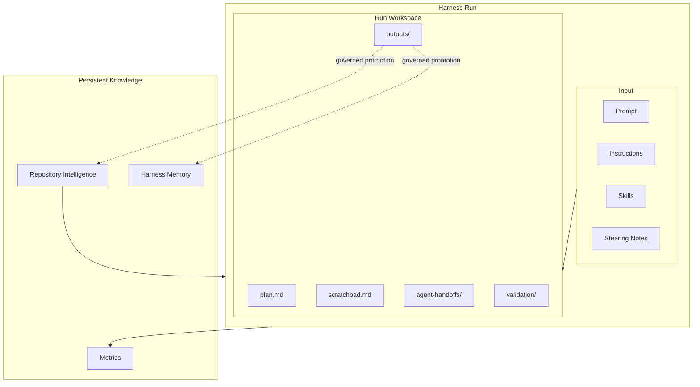

The dotted promotion paths are intentional.

Execution output does not automatically become persistent knowledge.

---

### 6.2 Information Responsibility Model

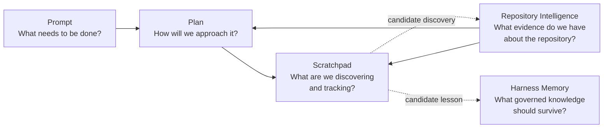

The Scratchpad sits inside execution.

Repository Intelligence and Harness Memory sit outside the individual run's temporary reasoning lifecycle.

---

### 6.3 Scratchpad Authority Boundary

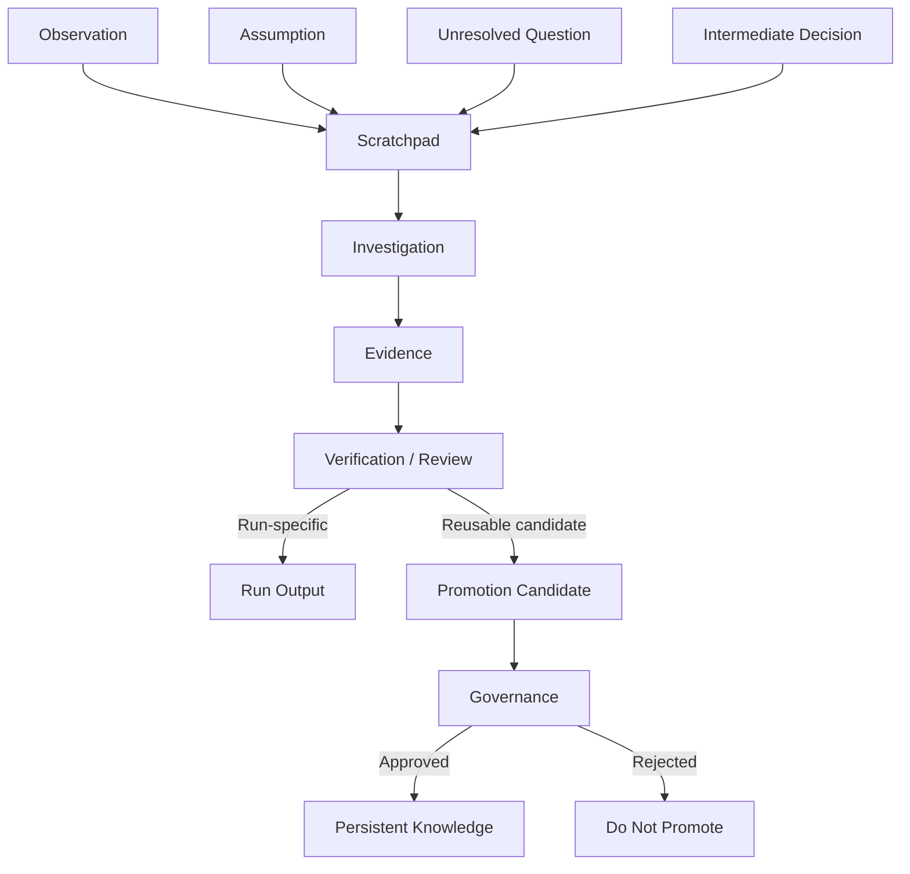

This diagram illustrates a key rule:

> Repetition does not create authority. Verification and governance do.

---

### 6.4 Multi-Agent Workspace

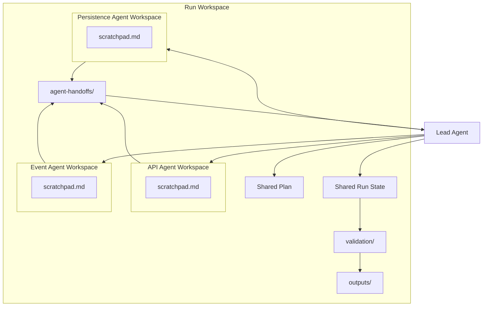

Parallel agents maintain isolated temporary state and communicate through explicit results and handoffs.

---

### 6.5 Failure and Resume Flow

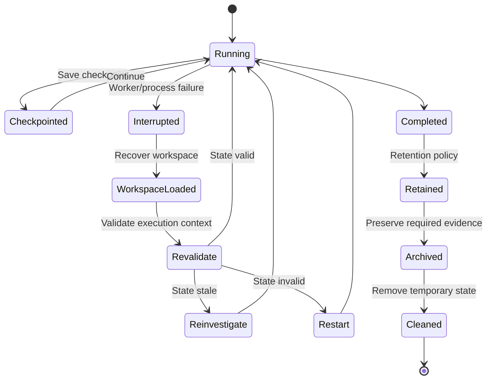

Recovery is deliberately separated from continuation.

Loading state is not sufficient evidence that the state remains valid.

---

### 6.6 Promotion Flow

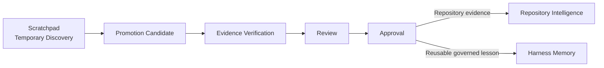

The destination depends on the nature of the knowledge.

Evidence about the current repository belongs in Repository Intelligence.

A governed lesson intended to improve future Harness execution may belong in Harness Memory.

Neither destination should be updated merely because an agent wrote something useful in `scratchpad.md`.

---

### 6.7 Alpha Car Detailing Example

For the preferred-location change, the workspace might evolve as follows:

```text
run-2026-1042/
│
├── input/
│   ├── prompt.md
│   ├── instruction-manifest.json
│   ├── skill-manifest.json
│   └── steering-note.snapshot.md
│
├── plan.md
├── scratchpad.md
│
├── agents/
│   ├── api-analysis/
│   │   └── scratchpad.md
│   └── event-analysis/
│       └── scratchpad.md
│
├── agent-handoffs/
│   ├── lead-to-developer.md
│   ├── developer-to-reviewer.md
│   └── validator-to-evaluator.md
│
├── validation/
│   ├── build.json
│   ├── unit-tests.trx
│   ├── contract-tests.json
│   └── gate-summary.json
│
└── outputs/
    ├── implementation-summary.md
    ├── evaluation.json
    └── proposed-repository-intelligence-update.md
```

This structure creates a clear architectural separation between:

**instructions for the work, working state during the work, deterministic evidence produced by the work, and knowledge that may survive the work.**

That separation is the foundation for the hands-on implementation that follows.

**Scratchpad and Run Workspace status: In progress — next section: Hands-on Example**

## 7. Hands-on Example

This section applies the Scratchpad and Run Workspace architecture to a realistic Alpha Car Detailing change.

The objective is not to demonstrate a sophisticated implementation framework. The objective is to show how a Harness can preserve temporary execution state without allowing that state to become an accidental source of truth.

The scenario continues the corporate fleet booking example introduced earlier in the chapter.

### 7.1 Scenario

Alpha Car Detailing supports corporate customers that schedule detailing services for groups of vehicles.

The booking service currently accepts a corporate fleet booking request and publishes a `FleetBookingCreated` integration event after the booking is created.

A new requirement arrives:

> Allow a corporate fleet customer to specify a preferred detailing location when creating a fleet booking. Existing clients must continue to work without modification, and the selected location must be included in the `FleetBookingCreated` integration event.

The task sounds straightforward.

However, before making changes, the Harness must determine:

- whether the booking domain already represents a service location;
- whether the API already contains a related field elsewhere;
- whether `LocationId` should be optional;
- whether existing event consumers tolerate additive fields;
- whether location validation belongs in the API, application, or domain layer;
- which tests and deterministic gates must run;
- whether any newly discovered repository knowledge deserves promotion after the task completes.

This is precisely the kind of task for which temporary execution state becomes valuable.

---

### 7.2 Create a Run Identifier

Each Harness execution should have its own identity.

For example:

```text
run-2026-10-02-0017
```

The identifier should appear consistently across:

- workspace paths;
- logs;
- checkpoints;
- validation evidence;
- role handoffs;
- metrics;
- audit records;
- final outputs.

A simple workspace could be created under:

```text
harness/
└── runs/
    └── run-2026-10-02-0017/
```

The run identifier should not be reused for another execution, even if the same Prompt is retried.

A retry is another execution and should normally receive another run identity.

This helps distinguish:

```text
Original Run
Retry Run
Resume of Original Run
```

These are operationally different conditions.

---

### 7.3 Initialize the Run Workspace

The Harness initializes the following structure:

```text
run-2026-10-02-0017/
│
├── input/
│   ├── prompt.md
│   ├── instructions-manifest.json
│   ├── skills-manifest.json
│   └── steering-note.snapshot.md
│
├── plan.md
├── scratchpad.md
│
├── agents/
│   ├── lead/
│   ├── developer/
│   ├── reviewer/
│   ├── validator/
│   └── evaluator/
│
├── agent-handoffs/
│
├── validation/
│
├── outputs/
│
└── run-state.json
```

Each part has a different responsibility.

| Location | Purpose |
| --- | --- |
| `input/` | Captures the inputs that govern the run |
| `plan.md` | Records the current execution strategy |
| `scratchpad.md` | Records shared temporary execution state |
| `agents/` | Isolates role-specific or parallel working state |
| `agent-handoffs/` | Carries explicit state between roles |
| `validation/` | Stores deterministic validation evidence |
| `outputs/` | Stores run results and proposals |
| `run-state.json` | Records machine-readable execution state |

The Harness should create this structure before agents begin modifying the repository.

---

### 7.4 Capture the Prompt

The Harness stores the task in:

```text
input/prompt.md
```

For example:

```markdown
# Task

Add preferred detailing location support to corporate fleet bookings.

## Requirements

- Existing corporate fleet booking clients must continue to work.
- Location must be optional.
- When supplied, the location must be validated.
- `FleetBookingCreated` must contain the selected location.
- Existing event consumers must remain compatible.

## Acceptance Criteria

1. Existing requests without a location remain valid.
2. Requests with a valid location create the booking successfully.
3. Requests with an invalid location are rejected using the existing
   application validation approach.
4. The selected location appears in `FleetBookingCreated`.
5. Existing tests continue to pass.
6. Appropriate new tests are added.
```

This file describes **what needs to be done**.

Agents should not use the Scratchpad to rewrite these requirements.

If a requirement becomes impossible or contradictory, that becomes an unresolved issue or escalation.

It does not become permission to change the Prompt.

---

### 7.5 Snapshot Governing Inputs

The Harness should record which Instructions, Skills, and Steering Notes apply to the run.

For example:

```json
{
  "instructions": [
    {
      "path": "CLAUDE.md",
      "revision": "7d92aa1"
    },
    {
      "path": ".github/copilot-instructions.md",
      "revision": "5b1002c"
    }
  ],
  "skills": [
    {
      "name": "add-api-endpoint",
      "version": "1.4"
    },
    {
      "name": "add-integration-event",
      "version": "2.1"
    }
  ]
}
```

The purpose of the manifest is reproducibility.

If the run is resumed later, the Harness can determine whether governing inputs changed.

For example:

```text
Original Skill Version: 2.1
Current Skill Version: 2.3
```

That difference may require revalidation before continuation.

---

### 7.6 Create the Initial Plan

The Lead Agent creates `plan.md`.

```markdown
# Execution Plan

## Goal

Implement optional preferred detailing location support for
corporate fleet bookings while preserving compatibility.

## Planned Investigation

1. Read applicable Instructions and Steering Notes.
2. Locate the corporate fleet booking request contract.
3. Inspect the Booking aggregate.
4. Search for existing service-location behavior.
5. Locate the `FleetBookingCreated` event definition.
6. Identify all known event consumers.
7. Inspect API and event contract tests.
8. Determine the compatibility strategy.

## Planned Implementation

9. Extend the request contract.
10. Map the location into the application command.
11. Apply existing location validation.
12. Persist the location through existing domain behavior.
13. Extend `FleetBookingCreated`.
14. Update event mapping.

## Planned Validation

15. Build.
16. Run unit tests.
17. Run integration tests.
18. Run API contract tests.
19. Run event contract tests.
20. Run architecture validation.

## Planned Handoffs

- Lead → Developer
- Developer → Reviewer
- Reviewer → Developer if changes are required
- Developer → Validator
- Validator → Evaluator
```

Notice what is not present.

There are no claims such as:

```text
The event change is safe.
```

The investigation has not established that yet.

The Plan records intent, not conclusions.

---

### 7.7 Initialize the Scratchpad

The shared `scratchpad.md` begins with minimal state:

```markdown
# Scratchpad

> Temporary run-scoped working state.
>
> Content in this file is not authoritative repository knowledge.
> Observations and assumptions must be verified before being treated
> as facts.

## Run

Run ID: run-2026-10-02-0017

## Current Phase

Repository investigation

## Observations

None yet.

## Assumptions

None yet.

## Unresolved Questions

None yet.

## Intermediate Decisions

None yet.

## Files Under Investigation

None yet.

## Risks

None yet.

## Checkpoints

None yet.

## Promotion Candidates

None yet.
```

The warning at the beginning is deliberate.

Human readers and AI Agents should immediately understand the authority level of the file.

---

### 7.8 Record the First Repository Observation

The Lead Agent inspects:

```text
src/Booking.Api/Contracts/CorporateFleetBookingRequest.cs
```

and discovers that the request contains:

```csharp
public sealed record CorporateFleetBookingRequest(
    Guid FleetAccountId,
    DateOnly ServiceDate,
    IReadOnlyCollection<VehicleRequest> Vehicles);
```

The Lead Agent updates the Scratchpad:

```markdown
## Observations

### OBS-001 — Corporate booking request has no location

`CorporateFleetBookingRequest` currently contains:

- FleetAccountId
- ServiceDate
- Vehicles

No service-location property exists in this request contract.

Evidence:
`src/Booking.Api/Contracts/CorporateFleetBookingRequest.cs`

Status:
Observed
```

This is an observation supported by repository evidence.

However, it remains run-state documentation.

The source file itself is still the primary evidence.

---

### 7.9 Record an Assumption Explicitly

The Lead Agent suspects that a nullable property will preserve compatibility.

Instead of writing:

```text
Adding LocationId is backward compatible.
```

the agent records:

```markdown
## Assumptions

### ASM-001 — Nullable request property may preserve compatibility

Adding an optional `LocationId` property appears likely to preserve
compatibility for existing JSON clients that do not send the field.

Status:
Unverified

Required verification:

- inspect API serialization configuration;
- inspect API contract tests;
- check whether strict request-schema consumers exist.

Impact if false:

The proposed request-contract change may require a different
compatibility strategy.
```

This is a better Scratchpad entry because it separates:

- hypothesis;
- verification status;
- required evidence;
- potential consequence.

An assumption becomes easier to challenge when it is explicitly labeled.

---

### 7.10 Investigate Existing Domain Behavior

The agent discovers this existing domain property:

```csharp
public Guid? ServiceLocationId { get; private set; }
```

and also discovers an existing method:

```csharp
public void AssignServiceLocation(Guid locationId)
{
    ServiceLocationId = locationId;
}
```

The Scratchpad becomes:

```markdown
### OBS-002 — Booking aggregate already models service location

The `Booking` aggregate contains:

`Guid? ServiceLocationId`

and exposes:

`AssignServiceLocation(Guid locationId)`

Evidence:
`src/Booking.Domain/Bookings/Booking.cs`

Implication:
The requested feature may be representable using existing domain
behavior rather than introducing a new domain concept.

Status:
Observed
```

Notice the wording:

> may be representable

The observation does not automatically authorize reuse.

The Developer or Reviewer may discover semantic differences later.

---

### 7.11 Track Files Under Investigation

As investigation proceeds, the Lead Agent maintains:

```markdown
## Files Under Investigation

| File | Purpose | Status |
|---|---|---|
| `CorporateFleetBookingRequest.cs` | Request contract | Inspected |
| `Booking.cs` | Domain representation | Inspected |
| `CreateCorporateFleetBookingCommand.cs` | Application flow | Pending |
| `FleetBookingCreated.cs` | Event contract | Pending |
| `FleetBookingEventHandler.cs` | Consumer | Pending |
| `BookingContractTests.cs` | API compatibility | Pending |
```

This helps prevent duplicated investigation during a later handoff.

It also makes missing investigation visible.

---

### 7.12 Discover Conflicting Architecture Evidence

The Lead Agent discovers an older architecture record:

```text
docs/adr/ADR-012-location-validation.md
```

It says:

```text
Service location validation must occur in the application layer.
```

However, current repository code shows one newer booking workflow validating location through a domain service.

The agent should not silently choose whichever evidence it prefers.

It records the conflict:

```markdown
### OBS-003 — Location validation guidance conflicts with current code

ADR-012 states that service-location validation belongs in the
application layer.

A newer booking workflow appears to perform location validation
through `ServiceLocationPolicy`.

Evidence:

- `docs/adr/ADR-012-location-validation.md`
- `src/Booking.Domain/Locations/ServiceLocationPolicy.cs`
- `src/Booking.Application/Bookings/CreateWalkInBookingHandler.cs`

Status:
Conflicting evidence

## Unresolved Questions

### Q-001 — Which location-validation approach is authoritative?

Potential explanations:

1. ADR-012 remains authoritative and the newer implementation is inconsistent.
2. The architecture evolved and ADR-012 is stale.
3. The two workflows have intentionally different rules.

Required action:
Inspect Repository Intelligence, commit history, and relevant
architecture documentation before selecting the implementation pattern.
```

This is an important example of why the Scratchpad must tolerate uncertainty.

A weak Harness tries to eliminate uncertainty from its records.

A strong Harness makes uncertainty visible.

---

### 7.13 Update the Plan When New Evidence Changes the Approach

The original Plan assumed that existing location validation could simply be reused.

The new evidence shows that validation ownership needs investigation first.

The Lead Agent updates `plan.md`:

```markdown
## Plan Revision 2

Reason:
Conflicting location-validation approaches were discovered.

Added before implementation:

8a. Determine the currently approved location-validation pattern.
8b. Escalate to architecture review if repository evidence remains ambiguous.
```

The Scratchpad records **why** the Plan changed.

The Plan records **what** the new approach is.

This preserves the separation between the two artifacts.

---

### 7.14 Investigate Integration Event Compatibility

The Lead Agent examines:

```csharp
public sealed record FleetBookingCreated(
    Guid BookingId,
    Guid FleetAccountId,
    DateOnly ServiceDate,
    DateTimeOffset CreatedAt);
```

A repository search identifies three consumers.

Two deserialize normally.

The third uses a checked schema.

The Scratchpad records:

```markdown
### OBS-004 — FleetBookingCreated has three repository consumers

Consumers found:

1. `Booking.Notifications`
2. `Fleet.Reporting`
3. `Fleet.IntegrationGateway`

Evidence:
Repository search against current run revision.

### OBS-005 — IntegrationGateway performs contract validation

`Fleet.IntegrationGateway` validates incoming events against the
published Fleet Booking event schema.

Evidence:
`src/Fleet.IntegrationGateway/Contracts/...`

Risk:
Adding `ServiceLocationId` may require a compatible schema update.

Status:
Requires contract validation.
```

The agent does **not** conclude:

```text
Adding ServiceLocationId will break IntegrationGateway.
```

That would exceed the available evidence.

Instead, the discovery becomes a validation requirement.

---

### 7.15 Capture the First Checkpoint

Before handing work to the Developer Agent, the Lead Agent creates a checkpoint.

```markdown
## Checkpoints

### CP-001 — Lead investigation complete

Completed:

- Prompt interpreted.
- Applicable Instructions loaded.
- Corporate request contract inspected.
- Booking aggregate inspected.
- Event contract inspected.
- Repository event consumers identified.
- Validation ownership conflict identified.

Resolved:

- Existing domain model can represent service location.

Unresolved:

- Current location-validation architecture.
- Event-schema compatibility.

Risks:

- Strict event validation in IntegrationGateway.

Next role:
Developer Agent

Required Developer actions:

1. Resolve location-validation approach from evidence.
2. Implement optional request field.
3. Update application flow.
4. Extend event contract safely.
5. Add tests.
```

The checkpoint provides a clean execution boundary.

---

### 7.16 Produce a Lead-to-Developer Handoff

The Harness creates:

```text
agent-handoffs/lead-to-developer.md
```

with:

```markdown
# Lead → Developer Handoff

## Goal

Add optional preferred detailing location support for corporate
fleet bookings.

## Required Behavior

- Requests without location must remain valid.
- Valid supplied locations must be accepted.
- Invalid locations must be rejected.
- The selected location must appear in `FleetBookingCreated`.
- Existing event consumers must remain compatible.

## Relevant Repository Evidence

### Request Contract

`CorporateFleetBookingRequest` currently has no location property.

### Domain

`Booking.ServiceLocationId` already exists.

`Booking.AssignServiceLocation(...)` already exists.

### Event

`FleetBookingCreated` currently has no location field.

### Consumer Risk

`Fleet.IntegrationGateway` performs event-contract validation.

## Unresolved Architecture Question

ADR-012 places location validation in the application layer.

Current repository code may use `ServiceLocationPolicy`.

Do not select an approach without resolving this conflict.

## Required Validation

- build;
- unit tests;
- API integration tests;
- API contract tests;
- event contract tests;
- architecture checks.
```

The handoff deliberately contains relevant information rather than the full Scratchpad.

The Developer should receive what is necessary to perform the assigned work.

---

### 7.17 Developer-Specific Scratchpad

The Developer Agent receives the handoff and creates:

```text
agents/developer/scratchpad.md
```

Its working state might begin as:

```markdown
# Developer Scratchpad

> Temporary Developer Agent working state.
> Not authoritative project knowledge.

## Assigned Scope

Corporate fleet preferred location support.

## Received Risks

- Location-validation architecture conflict.
- Strict event-schema consumer.

## Investigation

Pending.

## Implementation Notes

Pending.

## Questions

Pending.
```

This workspace belongs to the Developer's execution responsibility.

The Developer does not need permission to record temporary implementation observations here.

It does need authorization before altering governed architecture or requirements.

---

### 7.18 Resolve an Assumption with Evidence

The Developer investigates the validation conflict.

Repository Intelligence shows that ADR-012 has been superseded by ADR-027:

```text
ADR-027 — Domain Policies for Service Eligibility
```

The Scratchpad is updated:

```markdown
### DEV-OBS-001 — ADR-012 has been superseded

ADR-027 supersedes ADR-012 for service eligibility and location
validation.

ADR-027 requires `ServiceLocationPolicy` for service-location
eligibility checks.

Evidence:

- Repository Intelligence entry RI-ARCH-041
- `docs/adr/ADR-027-domain-service-eligibility.md`

Conclusion for this run:

Use `ServiceLocationPolicy`.

Status:
Verified against repository evidence.
```

This is an important transition.

The Scratchpad contains the record of the discovery, but the authority comes from the repository evidence and Repository Intelligence.

The Scratchpad did not become authoritative merely because the question was resolved.

---

### 7.19 Implement the Request Change

The Developer changes the request contract from:

```csharp
public sealed record CorporateFleetBookingRequest(
    Guid FleetAccountId,
    DateOnly ServiceDate,
    IReadOnlyCollection<VehicleRequest> Vehicles);
```

to:

```csharp
public sealed record CorporateFleetBookingRequest(
    Guid FleetAccountId,
    DateOnly ServiceDate,
    IReadOnlyCollection<VehicleRequest> Vehicles,
    Guid? LocationId = null);
```

The Developer records:

```markdown
### DEV-DEC-001 — Location remains optional

Implementation:
Added nullable `LocationId` to `CorporateFleetBookingRequest`.

Reason:
Existing clients do not provide location and must remain compatible.

Validation still required:
API contract tests.

Status:
Implemented, not yet validated.
```

The final line matters.

Implementation is not proof.

The deterministic gate provides proof.

---

### 7.20 Implement Application Behavior

The application command becomes:

```csharp
public sealed record CreateCorporateFleetBookingCommand(
    Guid FleetAccountId,
    DateOnly ServiceDate,
    IReadOnlyCollection<VehicleRequest> Vehicles,
    Guid? LocationId);
```

The handler applies:

```csharp
if (command.LocationId is not null)
{
    await serviceLocationPolicy.EnsureEligibleAsync(
        command.LocationId.Value,
        cancellationToken);

    booking.AssignServiceLocation(command.LocationId.Value);
}
```

The Developer records:

```markdown
### DEV-OBS-002 — Existing domain operation reused

`Booking.AssignServiceLocation` supports the required domain state.

No new location concept was introduced.

### DEV-DEC-002 — Validation performed through ServiceLocationPolicy

Reason:
ADR-027 and Repository Intelligence identify this as the current
architecture.

Status:
Implemented.
```

---

### 7.21 Extend the Integration Event

The event becomes:

```csharp
public sealed record FleetBookingCreated(
    Guid BookingId,
    Guid FleetAccountId,
    DateOnly ServiceDate,
    DateTimeOffset CreatedAt,
    Guid? ServiceLocationId = null);
```

The Developer updates event schema artifacts and tests.

The Scratchpad records:

```markdown
### DEV-DEC-003 — Additive nullable event field

Implementation:
Added nullable `ServiceLocationId` to `FleetBookingCreated`.

Reason:
Existing bookings and existing consumers must remain supported.

Risk:
IntegrationGateway schema compatibility must still be verified.

Status:
Implemented, validation pending.
```

Again, the Developer does not write:

```text
Event compatibility confirmed.
```

That statement belongs only after evidence exists.

---

### 7.22 Track Changed Files

The Developer records:

```markdown
## Changed Files

| File | Change |
|---|---|
| `CorporateFleetBookingRequest.cs` | Added optional LocationId |
| `CreateCorporateFleetBookingCommand.cs` | Added LocationId |
| `CreateCorporateFleetBookingHandler.cs` | Added validation and mapping |
| `FleetBookingCreated.cs` | Added ServiceLocationId |
| `FleetBookingEventMapper.cs` | Added event mapping |
| `CorporateFleetBookingTests.cs` | Added location scenarios |
| `fleet-booking-created.schema.json` | Added nullable field |
```

The Harness may also generate this list automatically from source-control state.

Automatically generated evidence is preferable where practical.

---

### 7.23 Developer Checkpoint

The Developer creates:

```markdown
### CP-002 — Implementation complete

Implemented:

- optional API request field;
- application command mapping;
- service-location eligibility validation;
- domain assignment;
- event field;
- event mapping;
- tests;
- event schema update.

Pending:

- independent review;
- deterministic validation.

Known risk:

Event consumer compatibility not yet proven.

Next role:
Reviewer Agent
```

This makes it clear that "implementation complete" does not mean "run successful."

Different roles still have work to perform.

---

### 7.24 Developer-to-Reviewer Handoff

The Harness creates:

```text
agent-handoffs/developer-to-reviewer.md
```

A useful handoff contains:

```markdown
# Developer → Reviewer Handoff

## Goal

Review preferred-location support for corporate fleet bookings.

## Changed Areas

- API contract
- application command
- location validation
- booking domain state assignment
- integration event
- event schema
- tests

## Important Decisions

1. Location is optional.
2. Existing `ServiceLocationId` domain state is reused.
3. `ServiceLocationPolicy` is used according to ADR-027.
4. Event evolution uses an additive nullable field.

## Known Risk

`Fleet.IntegrationGateway` validates the event schema.

## Claims Not Yet Proven

- API compatibility.
- Event consumer compatibility.
- Full test-suite success.

These require deterministic validation.
```

The final section prevents downstream agents from confusing Developer expectations with verified facts.

---

### 7.25 Reviewer Findings

The Reviewer Agent examines the change independently.

Suppose it finds that the Developer added location validation correctly but failed to include a test verifying requests without `LocationId`.

The Reviewer records its own findings:

```markdown
## Reviewer Finding REV-001

Severity:
Required change

Finding:
No explicit regression test verifies that an existing corporate
fleet request without `LocationId` remains accepted.

Why it matters:
Backward compatibility is an explicit acceptance criterion.

Required action:
Add an integration or contract test using the pre-change request shape.
```

The Reviewer should not directly overwrite the Developer's Scratchpad.

Instead, it creates a structured finding and handoff.

This preserves ownership and history.

---

### 7.26 Reviewer-to-Developer Handoff

```text
agent-handoffs/reviewer-to-developer-01.md
```

contains:

```markdown
# Reviewer → Developer Handoff

## Required Change

Add explicit coverage proving that requests using the pre-change
corporate fleet booking payload remain valid.

## Reason

Backward compatibility is an acceptance criterion and currently
has no direct regression evidence.

## Reviewer Status

Implementation otherwise acceptable for validation after this
finding is addressed.
```

The Developer receives the finding and updates the implementation.

Its scratchpad records:

```markdown
### DEV-OBS-003 — Backward compatibility test was missing

Reviewer identified missing explicit coverage for the original
request shape.

Action:
Added regression test using request JSON without `LocationId`.

Status:
Resolved locally; deterministic validation still required.
```

---

### 7.27 Deterministic Validation

After review findings are addressed, the Harness invokes the Validator Agent and deterministic gates.

The validation folder might become:

```text
validation/
├── build.json
├── unit-tests.trx
├── integration-tests.trx
├── api-contract-tests.json
├── event-contract-tests.json
├── architecture-tests.trx
└── gate-summary.json
```

The `gate-summary.json` might contain:

```json
{
  "runId": "run-2026-10-02-0017",
  "result": "passed",
  "gates": [
    {
      "name": "build",
      "result": "passed"
    },
    {
      "name": "unit-tests",
      "result": "passed",
      "tests": 418
    },
    {
      "name": "integration-tests",
      "result": "passed",
      "tests": 96
    },
    {
      "name": "api-contract-tests",
      "result": "passed",
      "tests": 24
    },
    {
      "name": "event-contract-tests",
      "result": "passed",
      "tests": 31
    },
    {
      "name": "architecture-tests",
      "result": "passed",
      "tests": 18
    }
  ]
}
```

Now the shared Scratchpad may record:

```markdown
### OBS-006 — Required deterministic gates passed

Evidence:
`validation/gate-summary.json`

Result:
Passed

Important:
The validation result is authoritative from the deterministic
gate evidence, not from this Scratchpad statement.
```

This sentence reinforces an important architecture rule.

The Scratchpad references evidence.

It does not replace evidence.

---

### 7.28 Validator-to-Evaluator Handoff

The Harness creates:

```text
agent-handoffs/validator-to-evaluator.md
```

containing:

```markdown
# Validator → Evaluator Handoff

## Validation Result

PASS

## Deterministic Evidence

- Build: PASS
- Unit tests: PASS
- Integration tests: PASS
- API contract tests: PASS
- Event contract tests: PASS
- Architecture tests: PASS

## Acceptance-Relevant Evidence

Existing request shape:
PASS

Request with valid LocationId:
PASS

Invalid LocationId:
PASS

FleetBookingCreated includes location:
PASS

Existing event consumers:
PASS

## Evidence Location

`validation/gate-summary.json`
```

The Evaluator can now assess outcome quality using verified evidence rather than relying on Developer claims.

---

### 7.29 Record a Promotion Candidate

During the run, an important reusable discovery was made:

> ADR-012 has been superseded by ADR-027, and service-location validation now follows `ServiceLocationPolicy`.

Suppose Repository Intelligence already contains that information.

There is nothing new to promote.

However, the run also discovers that:

> `Fleet.IntegrationGateway` performs strict event-schema validation and must be included whenever fleet event contracts change.

If this relationship was not previously captured in Repository Intelligence, the agent may propose it for promotion.

The Scratchpad records:

```markdown
## Promotion Candidates

### PC-001 — Fleet event contract dependency

Discovery:
`Fleet.IntegrationGateway` performs strict schema validation for
fleet integration events.

Evidence:

- consumer implementation;
- event-contract tests;
- successful validation evidence from this run.

Proposed destination:
Repository Intelligence

Reason:
Future agents changing fleet event contracts should discover this
dependency during repository analysis.

Status:
Proposed only — not promoted.
```

The important status is:

```text
Proposed only — not promoted.
```

The Harness must not convert this into persistent knowledge automatically unless an explicitly governed policy allows the transition.

---

### 7.30 Promotion Review

A knowledge-governance workflow might inspect the candidate and produce:

```markdown
# Repository Intelligence Promotion Review

Candidate:
PC-001

Decision:
Approved

Evidence reviewed:

- Fleet.IntegrationGateway consumer source
- event schema
- contract-test suite
- run validation result

Approved statement:

Changes to fleet integration event contracts must include
compatibility analysis against Fleet.IntegrationGateway because
that component validates fleet event schemas.

Scope:
Current repository architecture

Freshness trigger:
Revalidate if Fleet.IntegrationGateway contract handling changes.
```

Only after approval does the knowledge enter Repository Intelligence.

The original Scratchpad remains temporary run state.

---

### 7.31 Final Run Output

The Harness generates:

```text
outputs/implementation-summary.md
```

For example:

```markdown
# Implementation Summary

## Goal

Add preferred detailing location support to corporate fleet bookings.

## Outcome

Completed.

## Changes

- Added optional LocationId to corporate fleet booking requests.
- Reused existing Booking.ServiceLocationId domain state.
- Validated supplied locations using ServiceLocationPolicy.
- Added ServiceLocationId to FleetBookingCreated.
- Updated event schema.
- Added backward-compatibility coverage.

## Validation

All required deterministic gates passed.

Evidence:
`../validation/gate-summary.json`

## Review

Reviewer finding REV-001 was resolved before validation.

## Knowledge Promotion

PC-001 proposed for Repository Intelligence review.
```

This summary is a run output.

It is not the Scratchpad.

It contains the curated result of execution rather than the evolving history of uncertain observations.

---

### 7.32 Completing the Run

When evaluation succeeds, `run-state.json` might become:

```json
{
  "runId": "run-2026-10-02-0017",
  "status": "completed",
  "repositoryRevisionStart": "7d92aa1",
  "repositoryRevisionEnd": "e1f4c12",
  "lastCheckpoint": "CP-006",
  "reviewStatus": "passed",
  "validationStatus": "passed",
  "evaluationStatus": "passed",
  "promotionCandidates": [
    "PC-001"
  ]
}
```

The Harness should then apply its retention policy.

For example:

```text
Completed Run
     ↓
Preserve required audit metadata
     ↓
Preserve validation evidence
     ↓
Preserve approved outputs
     ↓
Retain workspace for configured period
     ↓
Remove unnecessary temporary state
```

The organization might preserve `scratchpad.md` temporarily for troubleshooting while retaining final validation evidence for a longer period.

Those are separate retention decisions.

---

### 7.33 Simulating a Failure

The previous flow assumed uninterrupted execution.

Now consider a failure.

Suppose the Harness worker terminates immediately after the Developer updates the event contract but before tests run.

The last recorded checkpoint is:

```markdown
### CP-002A — Event implementation complete

Completed:

- request contract;
- command mapping;
- location validation;
- domain assignment;
- event change.

Pending:

- tests;
- Reviewer Agent;
- deterministic validation.

Repository revision:
7d92aa1

Working tree:
Modified
```

The Harness restarts later.

It should not simply tell the Developer Agent:

```text
Continue from scratchpad.md.
```

That is insufficient.

---

### 7.34 Resume Validation

Before resuming, the Harness compares execution context.

Suppose the repository is still at:

```text
7d92aa1
```

and the Instructions, Skills, and Steering Notes are unchanged.

The Harness may classify the workspace:

```text
Resume State: VALID
```

Execution can continue from the checkpoint.

Now consider another case.

During the interruption, another change was merged into the branch.

The repository revision is now:

```text
91cc341
```

and `FleetBookingCreated.cs` changed.

The Harness should classify relevant run state as:

```text
Resume State: NEEDS REVALIDATION
```

A machine-readable resume check might contain:

```json
{
  "runId": "run-2026-10-02-0017",
  "resumeDecision": "needs-revalidation",
  "changes": [
    {
      "type": "repository-revision",
      "previous": "7d92aa1",
      "current": "91cc341"
    },
    {
      "type": "investigated-file-changed",
      "path": "src/Booking.Contracts/Events/FleetBookingCreated.cs"
    }
  ]
}
```

The agent must reinvestigate the affected assumptions and decisions.

---

### 7.35 Mark Stale Scratchpad State

The Harness may update the Scratchpad:

```markdown
## Resume Review

### STALE-001

Previous statement:

`FleetBookingCreated` has fields BookingId, FleetAccountId,
ServiceDate, and CreatedAt.

Status:
STALE

Reason:
The file changed after the previous checkpoint.

Required action:
Reinspect the event contract before resuming implementation.
```

This is safer than deleting the previous observation.

Keeping the old statement can help explain why earlier decisions were made.

Marking it stale prevents reuse as current truth.

---

### 7.36 Revalidate Before Continuing

The Developer discovers that the new repository version already added:

```csharp
string? CorrelationReference
```

to the event.

The Developer updates its working state:

```markdown
### DEV-OBS-004 — Event contract changed during interruption

Current `FleetBookingCreated` includes a new nullable
`CorrelationReference` field.

The previous event-shape observation is stale.

Impact:
No direct conflict with ServiceLocationId identified.

Required action:
Rerun complete event contract validation after implementation.
```

Only after this reinvestigation should implementation continue.

This illustrates an important principle:

> **Resumability does not mean trusting saved state. It means preserving enough state to safely determine what must be trusted, revalidated, or discarded.**

---

### 7.37 Parallel Investigation Example

The same task could also be decomposed by the Lead Agent.

For example:

```text
Lead Agent
    │
    ├── API Compatibility Agent
    ├── Event Compatibility Agent
    └── Domain Architecture Agent
```

Each receives an isolated Scratchpad.

The API agent records:

```markdown
## API Compatibility Result

Finding:
Nullable LocationId is accepted when omitted.

Evidence:
API contract test.

Confidence:
Verified.
```

The Event agent records:

```markdown
## Event Compatibility Result

Finding:
IntegrationGateway accepts the additive nullable field after the
schema definition is updated.

Evidence:
Event contract tests.

Confidence:
Verified.
```

The Domain agent records:

```markdown
## Domain Architecture Result

Finding:
ADR-027 supersedes ADR-012.

Required pattern:
ServiceLocationPolicy.

Evidence:
Repository Intelligence and ADR-027.

Confidence:
Verified.
```

The Lead Agent receives structured handoffs rather than allowing all three agents to modify one shared document concurrently.

---

### 7.38 Why a Single Shared Parallel Scratchpad Is Dangerous

Suppose all three agents instead write to:

```text
scratchpad.md
```

Agent A adds:

```text
Compatibility looks safe.
```

Agent B is still investigating a strict event consumer.

Agent C reads Agent A's statement and concludes that compatibility analysis has already completed.

This creates several problems:

- ambiguous authorship;
- conflicting observations;
- race conditions;
- overwritten state;
- unclear resolution ownership;
- premature assumptions;
- weak auditability.

A better structure is:

```text
agents/
├── api-compatibility/
│   └── scratchpad.md
├── event-compatibility/
│   └── scratchpad.md
└── domain-architecture/
    └── scratchpad.md
```

and:

```text
agent-handoffs/
├── api-compatibility-result.md
├── event-compatibility-result.md
└── domain-architecture-result.md
```

The Lead Agent reconciles these results into shared run state.

---

### 7.39 Role Ownership

The hands-on example can be summarized through role ownership.

| Role | Scratchpad Usage |
| --- | --- |
| Lead Agent | Tracks decomposition, investigation, dependencies, risks, unresolved questions |
| Developer Agent | Tracks implementation discoveries, local assumptions, changed files, pending concerns |
| Reviewer Agent | Tracks independent findings and requested changes |
| Validator Agent | References deterministic evidence and gate results |
| Evaluator Agent | Tracks outcome assessment against the goal and acceptance criteria |
| Harness | Tracks machine-readable run state, checkpoints, retention, and workspace lifecycle |

These responsibilities should not collapse into one unrestricted document.

---

### 7.40 What Should Not Enter the Scratchpad

During implementation, suppose the Developer Agent needs credentials to execute an integration test.

The following is unacceptable:

```markdown
## Integration Test

Username:
fleet-test-user

Password:
P@ssw0rd-Example

Connection String:
Server=...
```

The Scratchpad should instead say:

```markdown
## Integration Test Dependency

Requires:
Fleet integration test credential.

Credential source:
Approved secret provider reference `FleetIntegrationTest`.

Secret value:
Not stored in Run Workspace.
```

The same principle applies to:

- production tokens;
- certificates;
- private keys;
- customer data;
- sensitive employee data;
- regulated records;
- security answers;
- raw secrets returned accidentally by tools.

Where possible, the Harness should actively detect and block such material.

---

### 7.41 Simple Run-State Model

A Harness implementation can model workspace lifecycle using a small state machine:

```csharp
public enum RunStatus
{
    Created,
    Investigating,
    Planned,
    Implementing,
    Reviewing,
    Validating,
    Evaluating,
    Paused,
    Interrupted,
    Completed,
    Failed,
    Cancelled
}
```

A run record might be:

```csharp
public sealed record HarnessRunState(
    string RunId,
    RunStatus Status,
    string RepositoryRevision,
    string? CurrentRole,
    string? LastCheckpoint,
    DateTimeOffset UpdatedAt);
```

This machine-readable state complements human-readable workspace files.

The two should not be confused.

The Scratchpad answers:

> What are agents discovering?

The state record answers:

> Where is the Harness execution lifecycle?

---

### 7.42 Simple Checkpoint Model

A checkpoint could be represented as:

```csharp
public sealed record RunCheckpoint(
    string CheckpointId,
    string RunId,
    string RepositoryRevision,
    string Role,
    string Stage,
    IReadOnlyCollection<string> CompletedItems,
    IReadOnlyCollection<string> PendingItems,
    DateTimeOffset CreatedAt);
```

The Harness can serialize it:

```json
{
  "checkpointId": "CP-002",
  "runId": "run-2026-10-02-0017",
  "repositoryRevision": "7d92aa1",
  "role": "Developer",
  "stage": "ImplementationComplete",
  "completedItems": [
    "request-contract",
    "application-command",
    "location-validation",
    "event-mapping"
  ],
  "pendingItems": [
    "review",
    "deterministic-validation",
    "evaluation"
  ]
}
```

This is preferable to reconstructing status by parsing free-form Scratchpad prose.

---

### 7.43 Keep Machine State and Human-Readable State Separate

An enterprise implementation should avoid making Markdown the only source of orchestration state.

For example, do not require the Harness to infer:

```text
Which agent runs next?
```

by reading prose such as:

```text
I think the next step should probably be Validator.
```

Use machine-readable state:

```json
{
  "nextRole": "Validator"
}
```

Use the Scratchpad for context:

```markdown
Validator should verify API and event backward compatibility because
those are explicit acceptance criteria.
```

This creates a useful separation:

| Concern | Preferred Representation |
| --- | --- |
| Current execution status | Structured state |
| Current role | Structured state |
| Checkpoint identity | Structured state |
| Gate results | Structured evidence |
| Observations | Scratchpad |
| Assumptions | Scratchpad |
| Open questions | Scratchpad |
| Intermediate decisions | Scratchpad |
| Handoff explanation | Structured Markdown/document |
| Permanent knowledge | Governed knowledge store |

The Harness should not depend on free-form agent prose when deterministic state can be represented structurally.

---

### 7.44 Example Retention Policy

After completion, Alpha Car Detailing might apply a policy such as:

| Artifact | Example Retention |
| --- | --- |
| Prompt snapshot | Audit policy |
| Input manifest | Audit policy |
| Scratchpads | Short troubleshooting window |
| Agent handoffs | Short or medium retention |
| Build/test evidence | Longer engineering retention |
| Security validation evidence | Compliance-defined retention |
| Final evaluation | Audit policy |
| Metrics | Long-term aggregate retention |
| Approved Repository Intelligence | Until superseded |
| Harness Memory | Governed lifecycle |

The exact durations depend on organizational requirements.

The architecture lesson is more important than the example durations:

> **Temporary execution artifacts and persistent engineering knowledge should not share the same retention policy merely because they were created during the same run.**

---

### 7.45 End-to-End Execution Flow

The complete example can now be represented as:

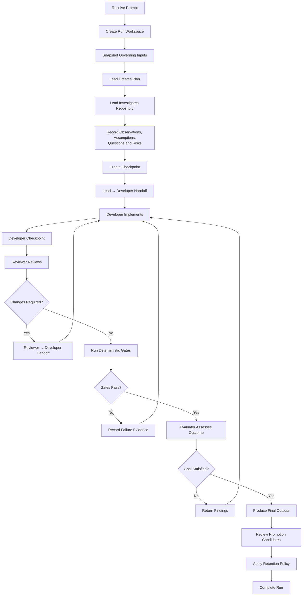

The Scratchpad participates throughout this flow, but it never becomes the central source of truth.

The Prompt remains the task definition.

The Plan remains the strategy.

Repository evidence remains the basis for repository claims.

Deterministic gates remain the source of validation evidence.

Repository Intelligence and Harness Memory remain governed persistent knowledge.

The Scratchpad exists to make the execution between those boundaries coherent.

---

### 7.46 Practical Rules from the Example

The Alpha Car Detailing example leads to several practical rules.

**First, create the workspace before significant investigation begins.**

Otherwise, useful run state starts leaking into chat history, logs, source comments, or arbitrary files.

**Second, label assumptions as assumptions.**

Do not allow speculative statements to look like verified findings.

**Third, attach evidence references to important observations.**

A Scratchpad should help another agent locate the evidence rather than replace it.

**Fourth, checkpoint before important handoffs.**

This improves failure recovery and makes role boundaries explicit.

**Fifth, separate deterministic evidence from narrative working state.**

A test passed because the test runner produced a passing result, not because an agent wrote "tests passed" in Markdown.

**Sixth, isolate parallel agent working state.**

Share controlled findings rather than a writable common notebook.

**Seventh, validate state before resuming.**

Repository changes can invalidate previous observations and assumptions.

**Eighth, promote knowledge deliberately.**

Useful discoveries should become promotion candidates, not automatic memory.

**Ninth, remove sensitive data before it enters the workspace.**

Temporary storage is still storage.

**Tenth, clean up run state intentionally.**

Do not keep every Scratchpad forever, and do not delete required engineering evidence prematurely.

---

### 7.47 Final State of the Example

At the end of this Alpha Car Detailing run, the system has produced several different kinds of information:

```text
Task Requirement
    → Prompt

Execution Strategy
    → plan.md

Temporary Investigation State
    → scratchpad.md
    → agents/*/scratchpad.md

Role Coordination
    → agent-handoffs/

Objective Engineering Evidence
    → validation/

Final Run Results
    → outputs/

Reusable Repository Discovery
    → proposed Repository Intelligence update

Long-Term Harness Lesson
    → possible Harness Memory proposal
```

Each has a different authority, lifecycle, owner, and retention requirement.

That separation is the central engineering lesson.

A Scratchpad is useful precisely because it is allowed to contain incomplete thinking:

```text
Maybe.
Need to verify.
Possibly related.
Question unresolved.
Evidence appears conflicting.
Recheck after repository update.
```

Those statements would be dangerous inside permanent Instructions or unquestioned Harness Memory.

Inside a controlled Run Workspace, they are valuable.

The enterprise architecture therefore does not attempt to eliminate temporary uncertainty.

It gives that uncertainty a safe place to live until evidence, validation, review, evaluation, or human judgment resolves it.

**Scratchpad and Run Workspace status: In progress — next section: Claude Example**
    
## 8. Claude Example

Claude Code is a natural fit for the Scratchpad and Run Workspace model because it can operate across repository files, inspect project instructions, execute tools, modify code, and participate in multi-step engineering workflows.

The important architectural point, however, is not that Claude has a particular built-in feature named *Scratchpad*.

The important point is that the Harness should give Claude a controlled place to maintain **temporary run-scoped state** without allowing that state to become confused with repository Instructions, Steering Notes, Repository Intelligence, or Harness Memory.

The same principle would apply to another capable coding agent.

Claude is simply the primary implementation example.

---

### 8.1 Claude Inside the Harness

For the Alpha Car Detailing scenario, Claude may participate in several roles:

```text
Lead Agent
Developer Agent
Reviewer Agent
Validator Agent
Evaluator Agent
```

The Harness remains responsible for orchestrating those roles.

Claude performs the assigned reasoning and implementation work.

A simplified architecture looks like this:

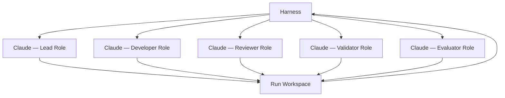

The critical boundary is:

> Claude may read and update permitted Run Workspace artifacts, but the Harness controls workspace lifecycle, role permissions, validation, promotion, and retention.

Claude should not independently decide that a Scratchpad entry has become permanent project knowledge.

---

### 8.2 Preparing Claude's Execution Context

When the Harness invokes Claude for the Lead role, it should provide the relevant governed context.

For example:

```text
Repository Instructions:
- CLAUDE.md
- architecture conventions
- testing requirements

Task Input:
- input/prompt.md

Steering Context:
- input/steering-note.snapshot.md

Relevant Skills:
- inspect-api-contract
- analyze-integration-event
- create-run-plan

Persistent Evidence:
- selected Repository Intelligence entries

Writable Run State:
- plan.md
- scratchpad.md
- agents/lead/
- agent-handoffs/
```

Claude should know which information is:

- authoritative input;
- evidence;
- temporary working state;
- writable;
- read-only;
- eligible for proposal;
- prohibited from direct modification.

This makes the context safer than simply exposing an entire repository and telling the model:

```text
Figure it out.
```

---

### 8.3 Claude Lead-Agent Prompt

The Harness might invoke Claude with a role-specific instruction such as:

```text
You are operating as the Lead Agent for this Harness run.

Task:
Read input/prompt.md and determine the implementation approach.

Authoritative sources:
- repository Instructions
- applicable Steering Notes
- approved Repository Intelligence
- repository evidence

Run Workspace:
- Write the execution strategy to plan.md.
- Record temporary observations, assumptions, unresolved questions,
  risks, and investigation notes in scratchpad.md.
- Do not treat scratchpad content as authoritative project knowledge.
- Label unverified assumptions explicitly.
- Reference repository evidence where possible.

Do not modify source code.

Before handing work to the Developer Agent:
- complete repository investigation;
- identify important unresolved questions;
- identify deterministic validation requirements;
- create agent-handoffs/lead-to-developer.md.

If a useful discovery may deserve long-term retention, record it only
as a promotion candidate. Do not modify Repository Intelligence,
Instructions, Steering Notes, or Harness Memory directly.
```

This prompt establishes Claude's operating boundary.

It does not merely describe the task.

It describes how temporary execution state must be handled.

---

### 8.4 Claude Creates the Plan

Claude inspects the task and repository, then produces:

```markdown
# Execution Plan

## Goal

Add optional preferred detailing location support to corporate fleet
bookings while preserving API and integration-event compatibility.

## Investigation

1. Inspect the corporate fleet booking API request.
2. Inspect existing Booking location behavior.
3. Locate service-location validation patterns.
4. Inspect FleetBookingCreated.
5. Identify all known consumers.
6. Inspect API and event contract tests.
7. Determine the compatible implementation strategy.

## Implementation

8. Extend the request contract.
9. Update application command mapping.
10. Apply approved location validation.
11. Reuse existing domain behavior where appropriate.
12. Extend FleetBookingCreated.
13. Update event mapping and tests.

## Validation

14. Build.
15. Run unit tests.
16. Run integration tests.
17. Run API contract tests.
18. Run event contract tests.
19. Run architecture checks.
```

This belongs in:

```text
plan.md
```

It should not be mixed with tentative findings.

---

### 8.5 Claude Uses the Scratchpad During Investigation

While investigating, Claude may discover:

```text
CorporateFleetBookingRequest has no LocationId.
Booking already contains ServiceLocationId.
ADR-012 says validation belongs in the application layer.
Newer code appears to use ServiceLocationPolicy.
```

A disciplined Claude workflow records those findings with different authority levels.

For example:

```markdown
## Observations

### OBS-001

`CorporateFleetBookingRequest` currently has no location property.

Evidence:
`src/Booking.Api/Contracts/CorporateFleetBookingRequest.cs`

Status:
Observed

### OBS-002

The Booking aggregate already contains `ServiceLocationId`.

Evidence:
`src/Booking.Domain/Bookings/Booking.cs`

Status:
Observed

## Unresolved Questions

### Q-001

ADR-012 places location validation in the application layer,
but newer code appears to use `ServiceLocationPolicy`.

Required action:
Determine whether ADR-012 has been superseded.
```

This is preferable to Claude stating:

```text
The architecture requires ServiceLocationPolicy.
```

before evidence confirms it.

---

### 8.6 Claude Must Distinguish Observation from Conclusion

This distinction should be reinforced explicitly in Claude's role instructions.

For example:

```text
When recording repository findings:

Use "Observed" when you directly inspected evidence.

Use "Assumption" when the statement is plausible but unverified.

Use "Unresolved" when evidence conflicts or is incomplete.

Use "Verified" only when supported by sufficient repository or
governed evidence.

Do not convert an assumption into a verified statement merely
because it was repeated by another agent.
```

This helps prevent a common AI failure mode:

```text
Agent 1 guesses.
Agent 2 reads the guess.
Agent 2 treats it as context.
Agent 3 treats repeated context as fact.
```

A Scratchpad schema can interrupt that progression.

---

### 8.7 Claude and Repository Intelligence

Suppose Claude searches Repository Intelligence and finds:

```text
RI-ARCH-041:
ADR-027 supersedes ADR-012 for service-location eligibility.
ServiceLocationPolicy is the current approved pattern.
```

Claude may then update the Scratchpad:

```markdown
### Q-001 — Resolved

ADR-012 is superseded by ADR-027.

Evidence:
- Repository Intelligence RI-ARCH-041
- docs/adr/ADR-027-domain-service-eligibility.md

Implementation guidance:
Use `ServiceLocationPolicy`.

Status:
Verified
```

The authority still comes from the evidence.

The Scratchpad simply records what Claude learned during this run.

---

### 8.8 Claude Lead-to-Developer Handoff

Once the Lead investigation completes, Claude produces:

```markdown
# Lead → Developer Handoff

## Goal

Implement optional preferred location support for corporate fleet bookings.

## Verified Repository Evidence

- Booking already contains `ServiceLocationId`.
- `AssignServiceLocation(...)` exists.
- ADR-027 supersedes ADR-012.
- `ServiceLocationPolicy` is the current location validation pattern.
- FleetBookingCreated has known internal consumers.
- Fleet.IntegrationGateway validates the event schema.

## Required Implementation

- Add optional LocationId to the request.
- Map it into the command.
- Validate supplied locations using ServiceLocationPolicy.
- Reuse existing Booking domain behavior.
- Add ServiceLocationId to FleetBookingCreated.
- Preserve event compatibility.

## Required Validation

- build
- unit tests
- integration tests
- API contract tests
- event contract tests
- architecture tests

## Remaining Risk

External consumers outside the repository have not been independently verified.
```

Claude writes this to:

```text
agent-handoffs/lead-to-developer.md
```

The Developer role now receives a curated handoff rather than the entire history of Lead reasoning.

---

### 8.9 Starting a Fresh Claude Developer Context

A strong Harness should not assume that the Developer Agent needs the Lead Agent's full conversation.

Instead, a fresh Claude invocation can receive:

```text
Prompt
Applicable Instructions
Relevant Skills
Lead-to-Developer handoff
Approved Repository Intelligence
Required source files
Developer workspace
```

This produces cleaner role separation.

For example:

```text
You are the Developer Agent.

Implement the task described in input/prompt.md.

Use:
- agent-handoffs/lead-to-developer.md
- repository Instructions
- applicable Skills
- approved Repository Intelligence

Write temporary Developer observations and assumptions only to:
agents/developer/scratchpad.md

Do not change:
- repository Instructions
- Steering Notes
- Repository Intelligence
- Harness Memory

Do not claim validation success yourself.
Implementation success must be proven later by deterministic gates.
```

This is a much stronger control than telling Claude:

```text
Continue where the previous agent left off.
```

The handoff defines what should carry forward.

---

### 8.10 Claude Developer Scratchpad

During implementation, Claude may maintain:

```markdown
# Developer Scratchpad

## Implementation Progress

- [x] Request contract updated
- [x] Command updated
- [x] Handler updated
- [x] Existing domain operation reused
- [ ] Event contract updated
- [ ] Tests added

## Implementation Decisions

### DEV-DEC-001

Use nullable `LocationId` in the request.

Reason:
Existing clients must remain compatible.

Status:
Implemented; compatibility validation pending.

### DEV-DEC-002

Reuse `Booking.AssignServiceLocation(...)`.

Reason:
Existing domain behavior represents the same domain concept.

Status:
Implemented.

## Risks

Event schema compatibility remains unverified.
```

Claude should be encouraged to use statements such as:

```text
Implemented; validation pending.
```

rather than:

```text
Done.
```

This keeps implementation and verification separate.

---

### 8.11 Claude Should Not Self-Certify

One of the important Harness rules is that the Developer Agent cannot convert implementation confidence into validation evidence.

Suppose Claude writes:

```text
All changes look correct and should preserve compatibility.
```

That is at most a Developer assessment.

It is not deterministic evidence.

A better handoff is:

```markdown
## Developer Claims Requiring Validation

- Existing clients should continue to deserialize the API contract.
- Existing consumers should accept the additive nullable event field.
- Existing tests should remain unaffected.

These claims have not yet been proven by deterministic validation.
```

This allows the Validator role to test them independently.

---

### 8.12 Claude Reviewer Context

The Harness can now launch a separate Claude Reviewer context.

For example:

```text
You are the Reviewer Agent.

Review the implementation independently.

Inputs:
- input/prompt.md
- applicable Instructions
- acceptance criteria
- Developer handoff
- implementation diff
- relevant Repository Intelligence

Do not assume that Developer claims are correct.

Review:
- architecture alignment
- contract compatibility
- code quality
- security
- persistence impact
- observability impact
- test adequacy
- configuration impact
- dependency impact

Write findings to:
agents/reviewer/findings.md

Do not modify source code unless the Harness explicitly authorizes
Reviewer fixes.
```

This preserves reviewer independence.

---

### 8.13 Claude Reviewer Finding

Claude may discover:

```markdown
## REV-001 — Missing backward-compatibility regression test

Severity:
Required

Observation:
The implementation adds nullable `LocationId`, but no test exercises
the original request shape without that property.

Acceptance criterion affected:
Existing clients must continue to work.

Required action:
Add a regression test using the pre-change request payload.

Evidence:
Implementation diff and API contract test suite.
```

That finding should not be buried in the shared Scratchpad.

It belongs in Reviewer-owned output.

The Harness can then create:

```text
agent-handoffs/reviewer-to-developer-01.md
```

for remediation.

---

### 8.14 Claude Validator Role

Claude can participate in the Validator role, but the validation itself should rely on deterministic tools wherever possible.

A Validator prompt might say:

```text
You are the Validator Agent.

Your job is to execute and interpret deterministic validation.

Do not replace test execution with reasoning.

Required gates:
- build
- unit tests
- integration tests
- API contract tests
- event contract tests
- architecture tests

Store raw or structured evidence under:
validation/

Produce:
validation/gate-summary.json

If a gate cannot run, report it as blocked or inconclusive.
Do not infer PASS from code inspection.
```

This distinction is especially important.

Claude may orchestrate:

```text
dotnet build
dotnet test
architecture checks
contract validation
```

but the evidence comes from those tools.

---

### 8.15 Example Validator Interaction

Suppose Claude executes:

```bash
dotnet build AlphaCarDetailing.sln --no-restore
```

and receives a successful result.

It then runs:

```bash
dotnet test tests/Booking.UnitTests
dotnet test tests/Booking.IntegrationTests
dotnet test tests/Booking.ContractTests
```

The Validator records structured results such as:

```json
{
  "gate": "api-contract-tests",
  "result": "passed",
  "tests": 24,
  "failed": 0
}
```

The shared Scratchpad may later reference:

```markdown
API contract validation passed.

Evidence:
`validation/api-contract-tests.json`
```

But the JSON or original test output remains the evidence.

---

### 8.16 Claude Evaluator Role

The Evaluator receives:

```text
Prompt
Acceptance criteria
Reviewer findings
Developer completion state
Validator evidence
Final implementation summary
```

It should not need the entire raw Developer Scratchpad.

A suitable Evaluator instruction might be:

```text
Assess whether the final implementation satisfies the intended goal.

Use deterministic evidence from validation/ as authoritative for
objective test results.

Use Reviewer findings when assessing engineering quality.

Use the Prompt and acceptance criteria as the definition of success.

Do not treat unresolved Scratchpad assumptions as facts.

Classify the result as:
- Pass
- Fail
- Partial
- Inconclusive

Explain any unmet or insufficiently evidenced criteria.
```

This gives Claude a well-defined evaluation boundary.

---

### 8.17 Claude and Failure Recovery

Suppose Claude is implementing the change when the process terminates.

On restart, the Harness should not simply reload the previous prompt and ask Claude to continue.

It should reconstruct the run.

For example:

```text
Recovered Run:
run-2026-10-02-0017

Last checkpoint:
CP-002

Previous repository revision:
7d92aa1

Current repository revision:
91cc341

Changed since checkpoint:
FleetBookingCreated.cs
```

A recovery prompt could be:

```text
You are resuming an interrupted Developer Agent run.

Do not continue implementation yet.

First:

1. Read the last checkpoint.
2. Read the Developer Scratchpad.
3. Compare the recorded repository revision with the current revision.
4. Reinspect any files that changed after the checkpoint.
5. Mark affected observations, assumptions, or decisions as stale.
6. Update the Developer Scratchpad with the revalidation result.
7. Continue only when the affected state has been revalidated.

Previous Scratchpad content is temporary working state and must not
be assumed current merely because it was persisted.
```

This is much safer than:

```text
Continue from where you stopped.
```

---

### 8.18 Example Claude Resume Review

Claude might produce:

```markdown
## Resume Review

### Repository Revision

Previous:
7d92aa1

Current:
91cc341

### Changed Relevant Files

- FleetBookingCreated.cs

### Stale State

DEV-DEC-003:
Additive ServiceLocationId event change

Reason:
The event contract changed after the previous checkpoint.

### Revalidation

Current event also includes:
`CorrelationReference`

No semantic conflict with ServiceLocationId found.

Required:
Rerun all event contract tests after implementation.

Resume status:
Eligible to continue.
```

Notice that Claude does not erase history.

It identifies which state became stale and replaces reliance on it with fresh evidence.

---

### 8.19 Claude and Parallel Agents

Claude can also be used for parallel investigations.

For example:

```text
Claude Agent A
API compatibility

Claude Agent B
Event compatibility

Claude Agent C
Domain architecture
```

The Harness should give each agent its own workspace:

```text
agents/
├── api-compatibility/
│   ├── task.md
│   ├── scratchpad.md
│   └── result.md
│
├── event-compatibility/
│   ├── task.md
│   ├── scratchpad.md
│   └── result.md
│
└── domain-architecture/
    ├── task.md
    ├── scratchpad.md
    └── result.md
```

A parallel-agent prompt might contain:

```text
Your working state is isolated to:
agents/event-compatibility/

Do not edit the shared scratchpad directly.

Write temporary investigation notes to:
agents/event-compatibility/scratchpad.md

Write your final structured result to:
agents/event-compatibility/result.md

The Lead Agent will reconcile your findings with findings from other agents.
```

This prevents Claude instances from treating an uncontrolled shared Markdown file as a synchronization mechanism.

---

### 8.20 Reconciling Parallel Claude Findings

Suppose the three results are:

```text
API Agent:
Optional LocationId appears compatible.

Event Agent:
Schema must be updated because IntegrationGateway validates it.

Domain Agent:
Use ServiceLocationPolicy under ADR-027.
```

The Lead Agent reconciles them into the shared workspace.

For example:

```markdown
## Parallel Investigation Reconciliation

### API Compatibility

Result:
Compatible subject to API contract validation.

### Event Compatibility

Result:
Additive field is acceptable only with corresponding schema update.

### Domain Architecture

Result:
ServiceLocationPolicy is the approved validation mechanism.

### Combined Implementation Guidance

Proceed with:
- optional API LocationId;
- ServiceLocationPolicy validation;
- reuse Booking.ServiceLocationId;
- nullable ServiceLocationId event field;
- event schema update;
- mandatory contract validation.
```

This reconciliation is more reliable than letting one parallel agent read partial notes from another.

---

### 8.21 Claude and Promotion Candidates

Claude will often discover information that appears useful beyond the current run.

For example:

```text
Fleet.IntegrationGateway performs strict schema validation for all
fleet booking events.
```

Claude may record:

```markdown
## Promotion Candidate PC-001

Candidate:
Fleet event compatibility dependency

Proposed knowledge:
Fleet event contract changes should include compatibility validation
against Fleet.IntegrationGateway.

Evidence:
- consumer source
- schema validator
- event contract test suite

Proposed destination:
Repository Intelligence

Status:
Pending governance review
```

Claude should not update Repository Intelligence directly merely because the finding appears correct.

The Harness must route the candidate through governance.

---

### 8.22 Claude Must Not Promote Assumptions

Consider another Scratchpad entry:

```text
External fleet partners probably ignore unknown JSON fields.
```

This might be a reasonable working assumption.

It is not a valid promotion candidate until supported by evidence.

Claude should not produce:

```text
Harness Memory:
External fleet partners support additive fields.
```

That would transform uncertainty into persistent knowledge.

A better policy is:

```text
Promotion requires:
- evidence;
- defined scope;
- owner or approval mechanism;
- destination;
- freshness expectations where applicable.
```

---

### 8.23 Claude and Sensitive Data

Claude may encounter secrets while executing tools.

The Harness should instruct it explicitly:

```text
Never copy secrets into:
- scratchpad.md
- handoff files
- plan.md
- output summaries

If a secret is required, record only the approved secret reference.

If a tool exposes a secret unexpectedly:
- do not reproduce it;
- mark the output as sensitive;
- notify the Harness through the configured security mechanism.
```

For example:

```markdown
## Dependency

Integration test requires:
`KeyVault/FleetIntegrationTest`

Secret material:
Not stored in Run Workspace.
```

This rule should apply even when the Run Workspace itself is access-controlled.

Temporary storage does not eliminate data-handling obligations.

---

### 8.24 Claude Workspace Permissions

A mature Harness can make workspace permissions role-specific.

For example:

| Artifact | Lead | Developer | Reviewer | Validator | Evaluator |
| --- | ---: | ---: | ---: | ---: | ---: |
| `input/` | Read | Read | Read | Read | Read |
| `plan.md` | Write | Read | Read | Read | Read |
| shared `scratchpad.md` | Write | Limited | Limited | Limited | Read |
| Lead workspace | Write | Read handoff only | No | No | No |
| Developer workspace | No | Write | Read | Read as needed | No |
| Reviewer findings | No | Read | Write | Read | Read |
| `validation/` | Read | Read | Read | Write | Read |
| `outputs/` | Limited | Limited | Limited | Limited | Write/controlled |
| Repository Intelligence | Read | Read | Read | Read | Read |
| Harness Memory | Read | Read | Read | Read | Read |

The exact permissions depend on organizational needs.

The architectural principle is:

> Shared visibility does not require shared write authority.

---

### 8.25 Claude Session Context Versus Run Workspace

Claude may have its own active conversational context during execution.

That context and the Run Workspace are not the same thing.

A useful distinction is:

| Claude Session Context | Run Workspace |
| --- | --- |
| Model execution context | Harness-managed execution state |
| May disappear between invocations | Persisted for run lifecycle |
| May contain transient reasoning context | Contains explicit operational artifacts |
| Usually scoped to one invocation/session | Scoped to the Harness run |
| Not a reliable recovery mechanism | Designed for recovery and handoff |
| Platform-specific | Platform-neutral architecture |

The Harness should persist the execution facts that matter rather than depend on the lifetime of a Claude session.

---

### 8.26 Claude's Native Planning Is Not the Same as `plan.md`

Claude may internally reason about a sequence of actions or use platform-specific planning capabilities.

That does not eliminate the need for a Harness-level Plan when the execution requires:

- handoffs;
- recovery;
- auditability;
- multi-agent coordination;
- human approval;
- deterministic gates.

`plan.md` is an explicit run artifact.

It allows another role or a restarted execution to understand the approved execution strategy without depending on private or ephemeral model state.

This distinction should remain clear:

```text
Model Planning
     ≠
Harness Run Plan
```

The two may inform one another, but they have different architectural responsibilities.

---

### 8.27 Claude's Memory Is Not Harness Memory

The term *memory* can be especially confusing.

A platform may provide some mechanism for retaining context or preferences across sessions.

That should not automatically be equated with the **Harness Memory** concept used in this handbook.

Harness Memory is:

- intentionally governed;
- owned by the engineering system;
- scoped by policy;
- auditable;
- reviewable;
- subject to promotion rules;
- independent of any one AI vendor.

Therefore:

```text
Claude-specific memory capability
            ≠
Enterprise Harness Memory
```

A vendor capability may participate in an implementation, but it does not define the enterprise architecture.

---

### 8.28 Claude Project Instructions Are Not a Scratchpad

The same warning applies to repository-level Claude Instructions.

For example:

```text
CLAUDE.md
```

might contain:

```text
Use Clean Architecture.
Commands belong in the Application layer.
Do not expose persistence entities through APIs.
Integration events are immutable contracts.
```

These are durable repository instructions.

Claude must not append:

```text
I think FleetBookingCreated has three consumers.
```

to `CLAUDE.md` merely because it needs to remember the observation during execution.

That belongs in the Scratchpad.

Similarly, a temporary implementation workaround should not become an Instruction.

The distinction is:

```text
CLAUDE.md
Durable repository guidance

scratchpad.md
Temporary run working state
```

Confusing the two can cause long-lived repository drift.

---

### 8.29 Claude Steering Context Is Not a Scratchpad

Suppose a Steering Note says:

```text
Fleet migration is the release priority.
Avoid breaking event changes this sprint.
```

Claude may discover:

```text
IntegrationGateway requires a schema update.
```

It should not edit the Steering Note to say:

```text
IntegrationGateway schema must always be updated.
```

That is a different category of information.

If reusable, the discovery may be proposed for Repository Intelligence.

During the current task, it belongs in run state.

---

### 8.30 Recommended Claude Run Workspace Pattern

A practical Claude-oriented workspace could look like this:

```text
harness/runs/run-2026-10-02-0017/
│
├── input/
│   ├── prompt.md
│   ├── instructions-manifest.json
│   ├── skills-manifest.json
│   └── steering-note.snapshot.md
│
├── plan.md
├── scratchpad.md
│
├── agents/
│   ├── lead/
│   │   ├── scratchpad.md
│   │   └── result.md
│   │
│   ├── developer/
│   │   ├── scratchpad.md
│   │   └── changed-files.json
│   │
│   ├── reviewer/
│   │   └── findings.md
│   │
│   ├── validator/
│   │   └── summary.md
│   │
│   └── evaluator/
│       └── evaluation.md
│
├── agent-handoffs/
│   ├── lead-to-developer.md
│   ├── developer-to-reviewer.md
│   ├── reviewer-to-developer-01.md
│   └── validator-to-evaluator.md
│
├── validation/
│   ├── build.json
│   ├── unit-tests.trx
│   ├── integration-tests.trx
│   ├── contract-tests.json
│   └── gate-summary.json
│
├── outputs/
│   ├── implementation-summary.md
│   ├── evaluation.json
│   └── promotion-candidates/
│       └── pc-001.md
│
└── run-state.json
```

Nothing about this structure requires Claude specifically.

That is desirable.

The architecture remains usable if the organization later changes AI platforms.

---

### 8.31 Example Claude Harness Flow

The complete execution might look like:

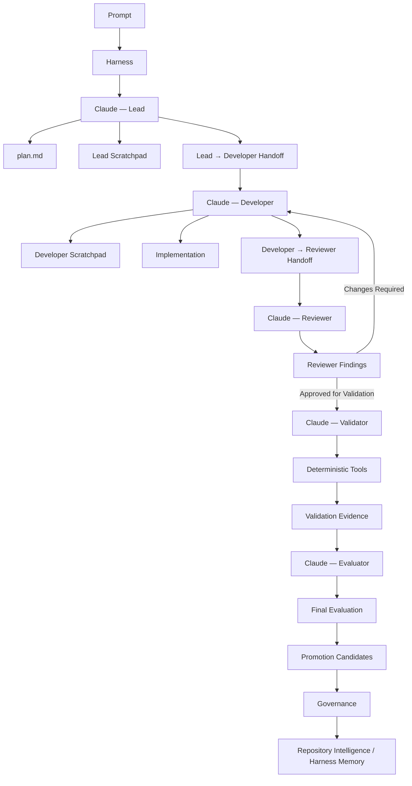

The important point is not how many Claude invocations occur.

The important point is that every invocation operates within a defined architectural responsibility.

---

### 8.32 Claude-Specific Best Practice: Give State a Destination

When asking Claude to investigate or implement something, the Harness should tell it where different kinds of information belong.

For example:

```text
Task requirements:
Do not change them. Read from input/prompt.md.

Execution strategy:
Write to plan.md.

Temporary observations:
Write to your scratchpad.

Cross-role communication:
Write to the designated handoff file.

Validation evidence:
Write under validation/ using the required structured format.

Reusable discoveries:
Create promotion candidates under outputs/promotion-candidates/.

Permanent Instructions:
Do not modify unless the Harness explicitly authorizes it.

Persistent knowledge:
Do not update directly.
```

This prevents information from drifting into inappropriate artifacts.

---

### 8.33 Claude-Specific Best Practice: Prefer Structured Scratchpad Entries

Free-form notes such as:

```text
Looks okay. Need to check event stuff later.
```

are difficult to resume safely.

A structured entry is better:

```markdown
### Q-004 — Event compatibility

Question:
Will Fleet.IntegrationGateway accept an additive nullable field?

Status:
Unresolved

Evidence inspected:
- FleetBookingCreated.cs
- IntegrationGateway consumer

Required next action:
Run event schema compatibility tests.

Impact:
Cannot claim backward compatibility until resolved.
```

Structure makes temporary state easier for:

- another Claude session;
- another AI Agent;
- a human reviewer;
- a recovery process;
- the Harness itself;

to interpret correctly.

---

### 8.34 Claude-Specific Best Practice: Avoid Hidden Dependence on Conversation History

An enterprise workflow should assume that a later Claude invocation may not have the full history of earlier invocations.

Therefore, important execution state should exist in explicit artifacts.

The test is simple:

> Could another authorized agent continue this run using the Run Workspace and governed project sources without needing the previous conversational transcript?

If the answer is no, too much important state is trapped in conversational context.

---

### 8.35 Claude-Specific Best Practice: Preserve Uncertainty

Claude should not be rewarded for making the Scratchpad appear clean by prematurely resolving ambiguity.

The following is acceptable:

```text
External consumer compatibility: unknown.
```

The following is dangerous:

```text
No external compatibility issue exists.
```

when the agent simply failed to find external consumers.

A mature Harness prefers explicit uncertainty over invented certainty.

---

### 8.36 Claude-Specific Best Practice: Require Evidence for Promotion

Claude may be very effective at identifying recurring engineering patterns.

That does not mean every plausible lesson should become Harness Memory.

A promotion proposal should ideally contain:

```text
Candidate statement
Evidence
Scope
Reason for retention
Proposed destination
Potential freshness trigger
Approval state
```

For example:

```markdown
## Promotion Candidate

Statement:
Fleet integration event changes require validation against
Fleet.IntegrationGateway.

Evidence:
- consumer implementation
- schema validation code
- contract tests

Scope:
Fleet integration events in the current repository architecture.

Destination:
Repository Intelligence

Freshness trigger:
Revalidate if IntegrationGateway event handling changes.

Approval:
Pending
```

This turns Claude's discovery capability into a governed knowledge pipeline rather than uncontrolled memory accumulation.

---

### 8.37 What Claude Should Never Infer from the Scratchpad

Claude should never assume that a Scratchpad statement is true merely because:

- another Claude session wrote it;
- it appears in a previous checkpoint;
- it was repeated several times;
- it appears under a heading named "Decision";
- it survived from an earlier failed run;
- it came from a higher-capability model;
- no other agent challenged it.

Authority must come from the correct source.

For example:

| Statement | Required Authority |
| --- | --- |
| What the user requested | Prompt |
| Repository-wide engineering rule | Instruction |
| Current mission constraint | Steering Note |
| Repository structure/behavior | Repository evidence / Repository Intelligence |
| Test success | Deterministic validation |
| Cross-run retained lesson | Approved Harness Memory |
| Current temporary assumption | Scratchpad |

This table is more important than any Claude-specific feature.

---

### 8.38 The Architectural Lesson

Claude can make excellent use of a Scratchpad because real engineering work is iterative.

It investigates.

It revises assumptions.

It encounters conflicting evidence.

It changes implementation direction.

It hands work to another role.

It may be interrupted.

It may resume.

It may identify reusable knowledge.

Those behaviors create temporary state.

The enterprise mistake is not that such state exists.

The mistake is allowing temporary state to acquire permanent authority accidentally.

The Harness should therefore give Claude explicit boundaries:

```text
Think and investigate within the run.

Record working state in the Run Workspace.

Use governed sources as authority.

Use deterministic gates as evidence.

Propose reusable knowledge.

Do not silently promote it.

Assume persisted Scratchpad state may become stale.

Revalidate before resuming.

Let the Harness own lifecycle and governance.
```

With these boundaries, Claude becomes easier to orchestrate, easier to resume, easier to audit, and safer to integrate into enterprise engineering workflows.

The architecture also remains vendor-neutral.

Claude is the implementation used here.

The underlying principle is broader:

> **AI Agents need temporary execution memory, but enterprises need explicit control over when temporary state becomes trusted knowledge.**

**Scratchpad and Run Workspace status: In progress — next section: GitHub Copilot Comparison**

## 9. GitHub Copilot Comparison

GitHub Copilot can participate effectively in the Scratchpad and Run Workspace architecture, but its operating model is different from Claude Code.

The important difference is not whether Copilot can read or write Markdown files. It can.

The more important question is:

> How much of the Harness execution lifecycle is controlled by the AI platform itself, and how much must be made explicit by the surrounding engineering workflow?

Claude-oriented workflows often lend themselves naturally to agentic, repository-level orchestration.

GitHub Copilot is typically more tightly integrated into the developer environment and GitHub workflow.

That makes the Scratchpad pattern just as relevant, but often more dependent on explicit Harness conventions.

The architecture remains the same:

```text id="copilot-architecture-01"
Prompt
   ↓
Plan
   ↓
Scratchpad
   ↓
Implementation
   ↓
Review
   ↓
Deterministic Validation
   ↓
Evaluation
```

What changes is how the AI platform participates in those stages.

---

### 9.1 Copilot Does Not Change the Information Model

The fundamental distinction remains:

| Artifact | Purpose |
| --- | --- |
| Prompt | Defines what needs to be done |
| Plan | Defines how the task will be approached |
| Scratchpad | Tracks discoveries during execution |
| Repository Intelligence | Holds evidence-backed repository knowledge |
| Harness Memory | Holds governed knowledge retained across runs |

Whether Claude or Copilot performs the work does not change those responsibilities.

For example, this remains a valid Scratchpad entry:

```markdown id="copilot-example-01"
## Observation

`FleetBookingCreated` has a consumer in Fleet.IntegrationGateway.

Evidence:
`src/Fleet.IntegrationGateway/...`

Status:
Observed
```

And this remains an inappropriate Scratchpad statement:

```text id="copilot-example-02"
FleetBookingCreated is always backward compatible with additive fields.
```

unless it has been verified and governed elsewhere.

The distinction is architectural, not vendor-specific.

---

### 9.2 Copilot Is Often Closer to the Developer Workflow

GitHub Copilot is commonly used in contexts such as:

- IDE-assisted coding;
- repository chat;
- code completion;
- pull-request workflows;
- code review;
- repository-level instructions;
- task-driven coding interactions.

This means Scratchpad use may often be embedded into an existing developer workflow rather than driven by a single long-running AI agent.

For example:

```text id="copilot-flow-01"
Developer
   ↓
Copilot
   ↓
Repository Investigation
   ↓
scratchpad.md
   ↓
Code Changes
   ↓
GitHub Pull Request
   ↓
Review and CI
```

In this model, the Harness must make temporary execution state explicit because human and AI activity may interleave frequently.

---

### 9.3 Copilot Instructions Are Not a Scratchpad

A common mistake is to misuse repository-level Copilot Instructions as temporary working memory.

For example:

```text id="copilot-bad-01"
.github/copilot-instructions.md
```

should contain durable guidance such as:

```markdown id="copilot-good-01"
- Use Clean Architecture.
- Commands belong in the Application layer.
- Domain entities must not reference infrastructure.
- Integration events must remain backward compatible.
```

It should not contain task-scoped notes such as:

```text id="copilot-bad-02"
FleetBookingCreated appears to have three consumers.
Need to check one more test.
```

That information belongs in a Scratchpad.

The same principle applies regardless of the exact Copilot instruction mechanism used by the organization.

Repository instructions define **how Copilot should work**.

The Scratchpad records **what Copilot is discovering while working**.

---

### 9.4 Example Copilot Run Workspace

The same Alpha Car Detailing workspace can be used:

```text id="copilot-workspace-01"
harness/runs/run-2026-10-02-0017/
│
├── input/
│   ├── prompt.md
│   ├── instructions-manifest.json
│   ├── skills-manifest.json
│   └── steering-note.snapshot.md
│
├── plan.md
├── scratchpad.md
│
├── agents/
│   ├── developer/
│   │   └── scratchpad.md
│   └── reviewer/
│       └── findings.md
│
├── agent-handoffs/
├── validation/
├── outputs/
└── run-state.json
```

Copilot can read and contribute to these files when operating under the Harness.

The workspace should not be redesigned around Copilot-specific terminology if doing so would weaken the vendor-neutral architecture.

---

### 9.5 Copilot Developer Example

Suppose the developer asks Copilot to implement:

```text id="copilot-task-01"
Add optional preferred detailing location support to corporate fleet
bookings while preserving compatibility.
```

The Harness can provide:

```text id="copilot-context-01"
Read:
- input/prompt.md
- plan.md
- applicable repository Instructions
- agent-handoffs/lead-to-developer.md

Record temporary implementation observations in:
agents/developer/scratchpad.md

Do not modify:
- repository Instructions
- Repository Intelligence
- Harness Memory

Do not claim compatibility until contract validation has passed.
```

Copilot might then produce:

```markdown id="copilot-scratchpad-01"
## Developer Progress

- [x] Request contract inspected
- [x] Existing ServiceLocationId identified
- [x] Application command updated
- [ ] Event contract updated
- [ ] Contract tests updated

## Assumption

Adding nullable LocationId appears compatible with existing request payloads.

Status:
Pending API contract validation.
```

The pattern is identical to the Claude example.

---

### 9.6 Copilot and Human-in-the-Loop Execution

One of the practical strengths of Copilot-centered workflows is that a human developer often remains continuously present.

This can improve decision quality, but it can also introduce ambiguity.

For example:

```text id="copilot-human-01"
Developer:
"Use the same pattern as the walk-in booking flow."

Copilot:
Implements using ServiceLocationPolicy.
```

Where should that decision live?

If it is task-specific, it belongs in the current Run Workspace.

For example:

```markdown id="copilot-human-02"
## Human Direction

Use the current walk-in booking location-validation pattern.

Source:
Developer instruction during run.

Status:
Run-specific direction.
```

If the instruction reflects a broader architecture rule, it should not silently become permanent because it was said during one interactive Copilot session.

It may deserve promotion into a governed source.

This distinction becomes particularly important when human instructions are given conversationally.

---

### 9.7 Copilot Chat Is Not a Reliable Run Workspace

A developer may be tempted to treat Copilot Chat history as sufficient temporary state.

That is risky.

The same problems discussed earlier still apply:

- chat context may not survive;
- another developer may not have the same history;
- another Copilot interaction may begin fresh;
- important decisions may be buried in conversation;
- recovery after interruption becomes difficult;
- auditability weakens.

Therefore:

```text id="copilot-rule-01"
Copilot conversation
        ≠
Harness Run Workspace
```

Important operational state should be externalized into explicit run artifacts.

---

### 9.8 Copilot and Plan Files

Copilot can work effectively with an explicit `plan.md`.

For example:

```markdown id="copilot-plan-01"
# Plan

1. Inspect the corporate booking request.
2. Inspect existing location behavior.
3. Identify event consumers.
4. Determine compatibility strategy.
5. Implement API change.
6. Implement event change.
7. Add regression tests.
8. Run deterministic validation.
```

Copilot may suggest modifications to the Plan, but those changes should remain visible.

For example:

```markdown id="copilot-plan-02"
## Revision

Added event schema inspection before implementation because
Fleet.IntegrationGateway uses strict validation.
```

This prevents execution strategy from changing invisibly inside chat.

---

### 9.9 Copilot and Pull Requests

GitHub Copilot naturally fits workflows where implementation culminates in a pull request.

The Run Workspace can support that process.

For example:

```text id="copilot-pr-flow-01"
Scratchpad
   ↓
Implementation
   ↓
Reviewer Findings
   ↓
Deterministic Validation
   ↓
Pull Request
```

The Harness may use final outputs to populate a pull-request description:

```markdown id="copilot-pr-01"
## Summary

Adds optional preferred detailing location support to corporate
fleet bookings.

## Key Changes

- optional LocationId in request;
- ServiceLocationPolicy validation;
- existing domain location behavior reused;
- ServiceLocationId added to FleetBookingCreated;
- schema and compatibility tests updated.

## Validation

- Build: PASS
- Unit tests: PASS
- Integration tests: PASS
- API contract tests: PASS
- Event contract tests: PASS
```

This summary should come from curated run output and deterministic evidence.

It should not simply copy the Scratchpad.

---

### 9.10 Copilot Review Versus Harness Reviewer Role

GitHub-based review tooling can provide AI-assisted code review.

That can be useful.

However, the architectural role of the **Reviewer Agent** should remain explicit.

A platform-provided review feature may participate in the Reviewer role, but it does not define it.

The Reviewer role is responsible for concerns such as:

- architecture alignment;
- maintainability;
- security;
- contract impact;
- persistence behavior;
- observability;
- test quality;
- configuration changes;
- dependency impact;
- adherence to Instructions and acceptance criteria.

If Copilot performs that review, findings should still be captured in a controlled artifact.

For example:

```text id="copilot-review-file-01"
agents/reviewer/findings.md
```

rather than existing only as transient conversational feedback.

---

### 9.11 Copilot Review Finding Example

Copilot might produce:

```markdown id="copilot-review-01"
## REV-002 — Missing event-schema compatibility coverage

Severity:
Required

Finding:
The event model has been updated, but the strict schema validation
used by Fleet.IntegrationGateway is not explicitly covered by the
current test change.

Impact:
Backward compatibility is not sufficiently evidenced.

Required action:
Update the event contract test suite.
```

The Harness can then route this back to the Developer role.

This keeps the review lifecycle independent of the user interface through which Copilot generated the finding.

---

### 9.12 Copilot and CI Evidence

GitHub-centered workflows often have a strong advantage in deterministic evidence because CI is already part of the development process.

The Scratchpad may record:

```markdown id="copilot-ci-01"
## Validation Status

GitHub Actions workflow started.

Pending:
- build
- unit tests
- integration tests
- contract tests
```

But the final evidence should come from CI artifacts or structured Harness output.

For example:

```text id="copilot-ci-02"
validation/
├── github-actions-build.json
├── unit-tests.trx
├── integration-tests.trx
├── event-contract-tests.json
└── gate-summary.json
```

The distinction remains:

```text id="copilot-ci-03"
Copilot says the tests should pass
                ≠
CI reports that the tests passed
```

---

### 9.13 Copilot and Validation Gates

Copilot can help create, run, or interpret validation commands.

It must not replace deterministic gates.

For example:

```text id="copilot-validator-01"
Copilot:
"The nullable field appears backward compatible."
```

That statement may help guide investigation.

It is not a gate result.

The gate should be something like:

```text id="copilot-validator-02"
API contract test:
PASS

Event contract test:
PASS
```

This reinforces the book's separation between:

```text id="copilot-validator-03"
Reasoning
   and
Evidence
```

---

### 9.14 Copilot and Failure Recovery

Copilot-centered workflows can be interrupted in many ways:

- IDE closes;
- developer switches machines;
- branch changes;
- session expires;
- task is handed to another developer;
- repository changes upstream;
- work pauses overnight.

A Run Workspace reduces dependence on local session history.

For example:

```json id="copilot-recovery-01"
{
  "runId": "run-2026-10-02-0017",
  "status": "interrupted",
  "lastCheckpoint": "CP-004",
  "repositoryRevision": "7d92aa1",
  "currentRole": "Developer"
}
```

When work resumes, Copilot should be instructed to revalidate state before continuing.

---

### 9.15 Copilot Resume Example

Suppose the branch changed while the run was paused.

The resumed Copilot session receives:

```text id="copilot-resume-01"
Previous revision:
7d92aa1

Current revision:
91cc341

Changed relevant file:
FleetBookingCreated.cs
```

The instruction should be:

```text id="copilot-resume-02"
Do not continue implementation immediately.

Reinspect FleetBookingCreated.cs.

Mark any previous Scratchpad claims about the event shape as stale.

Update the Developer Scratchpad with the current evidence.

Continue only after affected assumptions have been revalidated.
```

The resulting Scratchpad might say:

```markdown id="copilot-resume-03"
## Resume Revalidation

Previous event-shape observation:
STALE

Reason:
FleetBookingCreated.cs changed after checkpoint CP-004.

Current state:
CorrelationReference has been added.

Impact:
Preferred-location implementation must be reapplied against the
current contract.

Status:
Revalidated.
```

The recovery pattern is identical regardless of whether Claude or Copilot performs the work.

---

### 9.16 Copilot and Multiple Developers

A Run Workspace becomes especially useful when a task changes ownership.

Suppose Developer A starts the task with Copilot and Developer B finishes it later.

Without explicit run state, Developer B may receive only:

```text id="copilot-handoff-bad-01"
I changed most of the booking code.
Check the event part.
```

A structured handoff is far more useful:

```markdown id="copilot-handoff-good-01"
# Developer Handoff

## Completed

- request contract updated;
- command updated;
- ServiceLocationPolicy integrated;
- Booking.ServiceLocationId reused.

## Pending

- event schema update;
- contract tests;
- final validation.

## Known Risk

Fleet.IntegrationGateway validates event schemas.

## Last Checkpoint

CP-004

## Repository Revision

7d92aa1
```

Copilot can then assist Developer B using explicit state rather than reconstructing the prior developer's session.

---

### 9.17 Copilot and Parallel Work

GitHub workflows frequently involve parallel contributors.

The same Scratchpad-isolation rule applies.

For example:

```text id="copilot-parallel-01"
agents/
├── api-change/
│   └── scratchpad.md
├── event-change/
│   └── scratchpad.md
└── tests/
    └── scratchpad.md
```

Each contributor or AI invocation should own a bounded workspace.

Shared findings should be reconciled through structured outputs or handoffs.

Do not use:

```text id="copilot-parallel-bad-01"
one giant scratchpad.md
```

as an uncontrolled coordination bus.

---

### 9.18 Copilot and Branch-Based Isolation

GitHub-based development may naturally use branches to isolate implementation work.

Branch isolation and Scratchpad isolation solve different problems.

A branch isolates:

```text id="copilot-branch-01"
source changes
```

A Scratchpad isolates:

```text id="copilot-branch-02"
temporary execution state
```

Therefore:

```text id="copilot-branch-03"
Git branch
    ≠
Run Workspace
```

A task may have one branch and several parallel agent workspaces.

Likewise, a run may be resumed on a new branch while preserving the same run history.

The Harness should model those relationships explicitly.

---

### 9.19 Copilot and Issue-Based Tasks

A GitHub issue may serve as the task origin.

For example:

```text id="copilot-issue-01"
Issue #842:
Add preferred detailing location to corporate fleet bookings.
```

The Harness may snapshot the issue into:

```text id="copilot-issue-02"
input/prompt.md
```

This matters because the issue may later change.

The run needs to know which task definition it originally executed.

For example:

```json id="copilot-issue-03"
{
  "source": "github-issue",
  "issue": 842,
  "capturedAt": "2026-10-02T09:14:00Z",
  "revision": "issue-version-or-content-hash"
}
```

The original issue remains the task source.

The snapshot provides run reproducibility.

---

### 9.20 Copilot and Pull-Request Comments

Pull-request comments can contain important human guidance.

For example:

```text id="copilot-comment-01"
Architect:
Do not create a second location concept.
Reuse ServiceLocationId.
```

If that direction affects the current run, the Harness may capture it as:

```markdown id="copilot-comment-02"
## Human Direction

Instruction:
Reuse existing ServiceLocationId.

Source:
Architect review comment on current pull request.

Scope:
Current implementation.

Status:
Accepted.
```

If the guidance represents a broader architectural convention, it may become a promotion candidate.

It should not automatically become an Instruction or Harness Memory because it appeared in a PR comment.

---

### 9.21 Copilot and Promotion Candidates

Copilot may identify recurring patterns while reviewing repository code.

For example:

```text id="copilot-promotion-01"
Every integration event with strict schema validation has a matching
contract test project.
```

This may be useful.

The correct next step is:

```markdown id="copilot-promotion-02"
## Promotion Candidate

Statement:
Strictly validated integration events appear to have dedicated
contract-test coverage.

Evidence:
- FleetBookingCreated
- FleetCancelled
- FleetUpdated

Proposed destination:
Repository Intelligence

Status:
Pending verification and approval.
```

Copilot should not add:

```text id="copilot-promotion-bad-01"
All integration events must have dedicated contract projects.
```

to repository Instructions unless governance approves that standard.

Observation and policy are not the same thing.

---

### 9.22 Copilot and Harness Memory

Copilot's surrounding platform context should not be treated as equivalent to enterprise Harness Memory.

Harness Memory must remain:

- explicit;
- governed;
- auditable;
- portable;
- reviewable;
- independent of vendor-specific session behavior.

Therefore:

```text id="copilot-memory-01"
Copilot context/history
        ≠
Harness Memory
```

The enterprise architecture should not depend on hidden or platform-specific retention behavior.

---

### 9.23 Copilot and Repository Intelligence

Copilot can be highly effective at repository investigation.

However, repository investigation and Repository Intelligence remain different.

For example:

```text id="copilot-ri-01"
Copilot discovers:
Fleet.IntegrationGateway consumes FleetBookingCreated.
```

That is a run discovery.

If verified and considered reusable, the Harness may propose:

```text id="copilot-ri-02"
Repository Intelligence:
FleetBookingCreated is consumed by Fleet.IntegrationGateway,
which performs schema validation.
```

The transition requires evidence and governance.

Copilot is a producer of candidate discoveries.

It is not automatically the authority.

---

### 9.24 Copilot and Human Approval

GitHub-based workflows often make human approval explicit through:

- pull-request review;
- branch protection;
- CODEOWNERS;
- required checks;
- merge approval.

These controls complement the Run Workspace model.

For example:

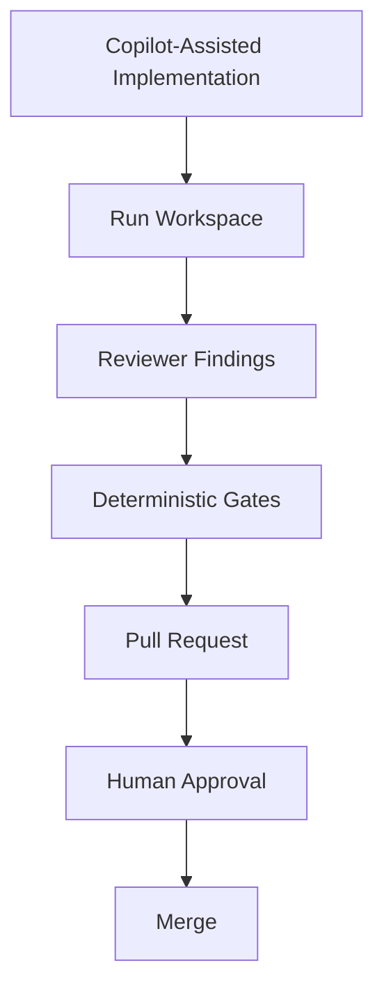

The Scratchpad helps explain how the work progressed.

It does not replace the approval gate.

---

### 9.25 Copilot and Auditability

A strong GitHub integration can improve auditability because several artifacts are already naturally recorded:

```text id="copilot-audit-01"
commit history
pull requests
review comments
CI results
branch checks
merge approvals
```

The Run Workspace adds execution context that those systems may not contain:

```text id="copilot-audit-02"
temporary assumptions
investigation state
unresolved questions
agent handoffs
recovery checkpoints
promotion candidates
```

The two complement one another.

The Scratchpad should not duplicate every GitHub event.

Instead, it should reference important evidence where useful.

---

### 9.26 Copilot and Security

The same sensitive-data restrictions apply.

Copilot should not write credentials into:

```text id="copilot-security-01"
scratchpad.md
plan.md
PR descriptions
review comments
handoff files
```

A safe entry is:

```markdown id="copilot-security-02"
Integration test dependency:
Approved secret reference `FleetIntegrationTest`.

Secret value:
Not stored.
```

This is particularly important in GitHub-oriented workflows because files and comments may become visible to a broader set of collaborators than anticipated.

---

### 9.27 Copilot Comparison with Claude

The conceptual differences can be summarized as follows.

| Area | Claude-Oriented Workflow | GitHub Copilot-Oriented Workflow |
| --- | --- | --- |
| Typical interaction | Agentic repository execution | Developer/GitHub-integrated assistance |
| Run Workspace need | High | High |
| Scratchpad purpose | Temporary execution state | Temporary execution state |
| Plan artifact | Harness-managed | Harness-managed |
| Conversation dependence | Should be minimized | Should be minimized |
| Instructions | Repository/platform guidance | Repository/platform guidance |
| Reviewer role | Can be separate Claude invocation | Can use Copilot-assisted PR/code review |
| Validation | Deterministic Harness tools | CI/Harness deterministic tools |
| Recovery | Rehydrate from Run Workspace | Rehydrate from Run Workspace |
| Parallel work | Separate agent workspaces | Separate agent/developer workspaces |
| Persistent knowledge | Governed externally | Governed externally |
| Vendor-specific memory | Not Harness Memory | Not Harness Memory |

The similarities are more important than the differences.

That is a positive architectural result.

It means the Scratchpad model is not tied to Claude.

---

### 9.28 Where Copilot Can Be Especially Effective

Copilot fits particularly well when the Run Workspace is used to support an engineering team rather than replace it.

For example:

```text id="copilot-strength-01"
Developer investigates with Copilot
        ↓
Scratchpad captures findings
        ↓
Developer implements with Copilot
        ↓
Reviewer uses Copilot for independent review
        ↓
CI produces deterministic evidence
        ↓
Human approves pull request
```

This preserves clear human accountability while still gaining substantial AI assistance.

---

### 9.29 Where Extra Discipline Is Needed

Copilot-centered workflows can become informal because interaction is convenient.

A developer may:

- ask questions in chat;
- accept code completions;
- modify files;
- change direction;
- receive review suggestions;

without ever creating explicit execution artifacts.

For small work, this may be sufficient.

For Harness-controlled enterprise execution, it is not.

The more important the task, the more important it becomes to preserve:

```text id="copilot-discipline-01"
Plan
Observations
Assumptions
Handoffs
Checkpoints
Validation evidence
Final outputs
```

outside transient interaction history.

---

### 9.30 Recommended Copilot Pattern

A practical Copilot-enabled workflow is:

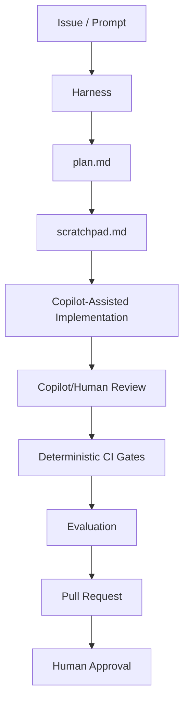

This model combines:

- Copilot's developer productivity;
- explicit run-state management;
- deterministic validation;
- human approval;
- governed persistent knowledge.

---

### 9.31 Architectural Conclusion

GitHub Copilot does not require a different definition of Scratchpad.

It requires the same definition to be enforced in a different interaction model.

The central rules remain:

```text id="copilot-final-rules-01"
Copilot chat is not the Prompt.

Copilot planning is not necessarily the Harness Plan.

Copilot observations are not Repository Intelligence.

Copilot history is not Harness Memory.

Copilot confidence is not validation evidence.

A Scratchpad is temporary run state.

A Run Workspace is controlled execution state.

Persistent knowledge requires governance.
```

This is exactly what a vendor-neutral AI engineering architecture should achieve.

The tool may change.

The engineering boundaries should not.

**Scratchpad and Run Workspace status: In progress — next section: Codex Comparison**

## 10. Codex Comparison

OpenAI Codex can participate in the same Scratchpad and Run Workspace architecture used throughout this chapter.

The important principle is that Codex should be treated as an implementation participant inside the Harness, not as the owner of run-state architecture.

A Codex-based workflow may be highly capable of:

- inspecting a repository;
- modifying code;
- executing commands;
- running tests;
- reviewing changes;
- working across multiple files;
- completing multi-step engineering tasks.

Those capabilities make Codex suitable for Lead, Developer, Reviewer, Validator, or Evaluator responsibilities depending on how the Harness assigns work.

They do not change the fundamental information boundaries.

The architecture remains:

```text
Prompt
   ↓
Plan
   ↓
Scratchpad
   ↓
Implementation
   ↓
Review
   ↓
Deterministic Validation
   ↓
Evaluation
   ↓
Governed Knowledge Promotion
```

The Harness remains responsible for deciding:

- which role Codex is performing;
- which inputs Codex can read;
- which workspace locations Codex may write;
- which deterministic gates must execute;
- which state can survive the run;
- which discoveries may be proposed for promotion;
- which approvals are required.

---

### 10.1 Codex Does Not Replace the Run Workspace

A capable coding agent may maintain substantial context while performing a task.

That context is useful during execution.

It is still not a substitute for an enterprise Run Workspace.

The distinction is:

```text
Codex execution context
        ≠
Harness Run Workspace
```

The agent's execution context may contain useful short-lived information, but the Harness needs explicit artifacts when the task requires:

- restartability;
- multi-agent coordination;
- human handoffs;
- independent review;
- deterministic validation;
- auditability;
- retention controls;
- knowledge promotion.

Important run state should therefore be persisted deliberately rather than depending on the continued lifetime of one Codex execution.

---

### 10.2 Using Codex as a Developer Agent

Consider the same Alpha Car Detailing task:

> Add optional preferred detailing location support to corporate fleet bookings while preserving API and integration-event compatibility.

The Harness may prepare the Codex Developer context from:

```text
input/prompt.md
repository Instructions
applicable Skills
approved Repository Intelligence
agent-handoffs/lead-to-developer.md
plan.md
```

The Harness might provide instructions such as:

```text
You are operating as the Developer Agent.

Implement the task defined in input/prompt.md.

Use the verified context from:
agent-handoffs/lead-to-developer.md

Follow:
- repository Instructions;
- applicable Skills;
- approved Repository Intelligence.

Record temporary working state only in:
agents/developer/scratchpad.md

Record:
- observations;
- assumptions;
- implementation decisions;
- files changed;
- unresolved questions;
- risks.

Do not update:
- repository Instructions;
- Steering Notes;
- Repository Intelligence;
- Harness Memory.

Do not claim that compatibility or validation has passed until
deterministic validation evidence exists.
```

This gives Codex a bounded execution role.

---

### 10.3 Codex Developer Scratchpad

While implementing the task, Codex may record:

```markdown
# Developer Scratchpad

## Progress

- [x] Corporate fleet request inspected
- [x] LocationId added as optional
- [x] Command mapping updated
- [x] ServiceLocationPolicy integrated
- [x] Existing Booking.ServiceLocationId reused
- [ ] Event contract updated
- [ ] Event schema updated
- [ ] Tests completed

## Observations

### DEV-OBS-001

The Booking aggregate already supports ServiceLocationId.

Evidence:
`src/Booking.Domain/Bookings/Booking.cs`

Status:
Observed

## Assumptions

### DEV-ASM-001

Adding nullable LocationId should preserve compatibility for
existing request payloads.

Status:
Unverified

Required evidence:
API contract tests.

## Risks

Fleet.IntegrationGateway performs event schema validation.
```

The same Scratchpad principles apply.

Codex can write working observations.

Codex should not convert those observations into permanent repository truth.

---

### 10.4 Codex and Autonomous Implementation

A coding agent may be capable of completing a large portion of the implementation without repeated human intervention.

This capability increases the importance of explicit run-state boundaries.

Suppose Codex:

1. inspects the request contract;
2. locates domain behavior;
3. modifies the command;
4. updates event mapping;
5. adds tests;
6. executes test commands.

Without a Run Workspace, the agent's evolving understanding may exist only inside its execution context.

If execution stops after step 4, another agent may not know:

- why a nullable field was chosen;
- which event consumers were inspected;
- which assumptions remain unverified;
- which files have already been changed;
- which tests still need to run.

A checkpoint prevents that loss.

For example:

```markdown
## Checkpoint CP-003

Completed:

- optional API LocationId;
- command mapping;
- ServiceLocationPolicy integration;
- domain assignment.

Pending:

- FleetBookingCreated update;
- event schema update;
- tests;
- review;
- validation.

Known risk:

Fleet.IntegrationGateway schema validation.

Repository revision:
7d92aa1
```

Codex can then be resumed or replaced without reconstructing the entire execution history.

---

### 10.5 Codex Should Not Turn Execution Convenience into Authority

Suppose Codex discovers:

```text
All currently visible fleet event consumers accept nullable fields.
```

It would be inappropriate to convert this directly into:

```text
All fleet events support additive nullable evolution.
```

The first statement describes a repository observation.

The second statement resembles a general architecture rule.

The correct progression is:

```text
Run Observation
      ↓
Evidence
      ↓
Promotion Candidate
      ↓
Review
      ↓
Approved Persistent Knowledge
```

This rule is especially important for highly autonomous agents.

Greater autonomy should increase governance discipline, not reduce it.

---

### 10.6 Codex and the Plan

Codex may determine that the original implementation strategy needs revision.

For example, the initial plan may say:

```markdown
5. Add ServiceLocationId to FleetBookingCreated.
6. Update event mapping.
7. Add tests.
```

During investigation Codex discovers strict schema validation.

The correct response is not to change direction invisibly.

Instead:

```markdown
## Plan Revision 2

Reason:
Fleet.IntegrationGateway performs strict schema validation.

Changes:

- inspect the published event schema before event modification;
- update the schema as part of the implementation;
- add explicit event compatibility validation.
```

The Scratchpad records the discovery.

`plan.md` records the changed execution strategy.

This separation remains useful regardless of how autonomous Codex is.

---

### 10.7 Codex and Tool Execution

Codex may be able to execute commands directly.

For example:

```bash
dotnet build AlphaCarDetailing.sln
```

followed by:

```bash
dotnet test tests/Booking.UnitTests
```

and:

```bash
dotnet test tests/Booking.ContractTests
```

This capability does not change the meaning of validation.

A tool result is evidence.

Codex's interpretation is commentary about that evidence.

For example:

```text
Codex:
"All tests appear to pass."
```

should not be the final validation record.

The Harness should capture:

```json
{
  "gate": "booking-contract-tests",
  "result": "passed",
  "total": 24,
  "failed": 0
}
```

and place it under:

```text
validation/
```

This preserves deterministic validation independently from the agent's narrative state.

---

### 10.8 Codex as a Validator Agent

Codex may also operate as the Validator Agent.

The role boundary should remain explicit:

```text
You are the Validator Agent.

Execute the required deterministic checks.

Do not validate by inspection when an executable deterministic
check exists.

Store raw or structured evidence under validation/.

Do not modify implementation code unless the Harness explicitly
returns the task to the Developer role.

A failed gate is evidence of failure.

A gate that cannot execute must be reported as blocked or inconclusive,
not assumed successful.
```

This is particularly important when an agent can both edit code and run tests.

Without role separation, the agent may be tempted to:

1. run a failing test;
2. change the implementation;
3. rerun the test;
4. continue until satisfied;

without preserving which role made which change.

That may be acceptable during Developer iteration.

It is not independent validation.

The Harness should establish the transition:

```text
Developer
    ↓
Implementation Frozen for Validation
    ↓
Validator
```

before objective evidence is collected.

---

### 10.9 Codex as a Reviewer Agent

Codex can also perform independent review.

The Harness should use a fresh review context where practical and provide:

- Prompt;
- acceptance criteria;
- applicable Instructions;
- implementation diff;
- relevant Repository Intelligence;
- Developer handoff.

The Reviewer prompt might say:

```text
Review the implementation independently.

Do not assume Developer decisions are correct because they appear
in the Developer Scratchpad.

Use repository evidence and governing Instructions.

Review:
- architecture alignment;
- maintainability;
- security;
- API compatibility;
- event compatibility;
- persistence;
- observability;
- test adequacy;
- dependency changes.

Write structured findings to:
agents/reviewer/findings.md
```

A fresh Reviewer context reduces confirmation bias from the Developer role.

---

### 10.10 Example Codex Reviewer Finding

Codex might produce:

```markdown
## REV-003 — Event Mapping Omits ServiceLocationId

Severity:
Required

Finding:
`FleetBookingCreated` contains the new `ServiceLocationId` property,
but `FleetBookingEventMapper` does not populate it.

Impact:
The event contract compiles but the requested business value is not
actually published.

Acceptance criterion affected:
The selected location must appear in FleetBookingCreated.

Required action:
Update the event mapper and add an event mapping test.
```

This demonstrates why Reviewer state should remain separate from Developer state.

The implementation may compile successfully while still failing the intended outcome.

---

### 10.11 Codex and Independent Contexts

A multi-role Harness should avoid using one continuously accumulating Codex context for every role when independence matters.

For example:

```text
One Codex Context
Developer → Reviewer → Validator → Evaluator
```

can create undesirable carryover.

The Reviewer may unconsciously inherit Developer assumptions.

The Validator may inherit claims that have not been proven.

The Evaluator may overvalue earlier reasoning.

A stronger pattern is:

```text
Codex Developer Context
          ↓
Structured Handoff

Codex Reviewer Context
          ↓
Structured Findings

Codex Validator Context
          ↓
Deterministic Evidence

Codex Evaluator Context
```

The Run Workspace provides continuity.

Role-specific contexts provide independence.

---

### 10.12 Codex and Parallel Investigation

Codex may also be useful for parallel repository analysis.

For example:

```text
Codex Agent A
API compatibility

Codex Agent B
Event consumers

Codex Agent C
Domain validation architecture
```

The Harness should isolate their temporary state:

```text
agents/
├── api-compatibility/
│   ├── scratchpad.md
│   └── result.md
│
├── event-compatibility/
│   ├── scratchpad.md
│   └── result.md
│
└── domain-architecture/
    ├── scratchpad.md
    └── result.md
```

Each agent receives a bounded objective.

For example:

```text
Investigate only event compatibility.

Do not modify source code.

Write temporary notes to:
agents/event-compatibility/scratchpad.md

Write the final result to:
agents/event-compatibility/result.md

Do not edit the shared Scratchpad.

Do not infer external consumer behavior without evidence.
```

The Lead Agent later reconciles the results.

---

### 10.13 Why Isolation Matters with Codex

Suppose Agent A writes:

```text
Optional API field appears safe.
```

Agent B writes:

```text
Strict event schema validator found.
```

These statements concern different compatibility surfaces.

If both write into one uncontrolled shared Scratchpad, a later agent may read:

```text
Compatibility appears safe.
```

without recognizing that only API compatibility was assessed.

Isolated result files preserve scope.

For example:

```markdown
# API Compatibility Result

Scope:
CorporateFleetBookingRequest only.

Result:
Adding nullable LocationId appears compatible.

Not evaluated:
FleetBookingCreated event compatibility.
```

Scope metadata is especially useful when multiple agents work concurrently.

---

### 10.14 Codex and File Ownership

A Harness should define which Codex role owns which workspace locations.

For example:

| Artifact | Codex Lead | Codex Developer | Codex Reviewer | Codex Validator | Codex Evaluator |
| --- | ---: | ---: | ---: | ---: | ---: |
| `input/` | Read | Read | Read | Read | Read |
| `plan.md` | Write | Read | Read | Read | Read |
| Lead Scratchpad | Write | No | No | No | No |
| Developer Scratchpad | Read handoff | Write | Read if authorized | Read if needed | No |
| Reviewer findings | No | Read | Write | Read | Read |
| `validation/` | Read | Read | Read | Write | Read |
| Evaluation output | No | No | No | No | Write |
| Repository Intelligence | Read | Read | Read | Read | Read |
| Harness Memory | Read | Read | Read | Read | Read |

The point is not to create rigid filesystem bureaucracy.

The point is to make responsibilities visible and enforceable.

---

### 10.15 Codex and Repository Instructions

Codex may consume repository instruction files that define engineering expectations.

Those files must remain separate from temporary run notes.

For example:

```text
Repository Instruction:

All application commands must use the existing validation pipeline.
```

is durable guidance.

This statement:

```text
The current command handler appears to bypass ServiceLocationPolicy.
```

is a run observation.

It belongs in the Scratchpad.

If Codex starts writing temporary findings into repository Instructions, temporary state has crossed an authority boundary.

The Harness should prevent that unless an explicit governance workflow authorizes an Instruction change.

---

### 10.16 Codex and Source-Control Changes

Codex may modify many files during implementation.

The Harness should avoid relying solely on Scratchpad prose to determine what changed.

For example:

```markdown
Changed several booking files.
```

is weak execution evidence.

A machine-generated file such as:

```json
{
  "changedFiles": [
    "src/Booking.Api/Contracts/CorporateFleetBookingRequest.cs",
    "src/Booking.Application/Bookings/CreateCorporateFleetBookingCommand.cs",
    "src/Booking.Application/Bookings/CreateCorporateFleetBookingHandler.cs",
    "src/Booking.Contracts/Events/FleetBookingCreated.cs",
    "src/Booking.Infrastructure/Events/FleetBookingEventMapper.cs",
    "tests/Booking.ContractTests/FleetBookingCreatedTests.cs"
  ]
}
```

is preferable.

The Developer Scratchpad may reference that file.

It should not replace it.

---

### 10.17 Codex and Checkpoints

For long-running autonomous tasks, checkpointing becomes particularly important.

The Harness might checkpoint after:

```text
Repository analysis
Plan approval
Implementation phase
Reviewer remediation
Validation
Evaluation
```

For example:

```json
{
  "checkpointId": "CP-004",
  "runId": "run-2026-10-02-0017",
  "role": "Developer",
  "stage": "ImplementationComplete",
  "repositoryRevision": "7d92aa1",
  "pending": [
    "Reviewer",
    "Validator",
    "Evaluator"
  ]
}
```

A checkpoint provides a deterministic recovery anchor.

The Scratchpad provides explanatory context around that anchor.

---

### 10.18 Codex and Failure Recovery

Suppose Codex is interrupted after changing four files.

The Harness restarts on the same working tree.

The correct recovery process is not:

```text
Read your previous notes and continue.
```

Instead:

```text
1. Load run-state.json.
2. Load the last checkpoint.
3. Verify repository revision.
4. Inspect the current working tree.
5. Compare changed files with checkpoint state.
6. Revalidate affected assumptions.
7. Mark stale state.
8. Resume only after recovery checks pass.
```

This prevents a dangerous situation where a partially changed repository and an older Scratchpad are treated as synchronized automatically.

---

### 10.19 Codex Resume Example

Suppose the Scratchpad previously contained:

```text
FleetBookingCreated currently has four fields.
```

During the interruption another branch change introduces a fifth field.

The resumed agent should mark:

```markdown
## Resume Revalidation

### STALE-002

Previous observation:
FleetBookingCreated contains four fields.

Reason:
FleetBookingCreated.cs changed after checkpoint CP-004.

Action:
Reinspect current event shape.

Status:
Stale — do not use.
```

After reinvestigation:

```markdown
### DEV-OBS-008

Current FleetBookingCreated additionally includes
CorrelationReference.

Evidence:
Current repository revision 91cc341.

Impact:
No conflict identified with ServiceLocationId, but all event
contract tests must be rerun.

Status:
Observed.
```

Persistence is useful only when combined with freshness checking.

---

### 10.20 Codex and Resumability Across Agents

A useful property of a well-designed Run Workspace is that the original agent does not need to be the one that resumes.

For example:

```text
Codex Developer A
      ↓
Checkpoint
      ↓
Process Failure
      ↓
Codex Developer B
```

Developer B can reconstruct the task from:

```text
Prompt
Plan
Lead Handoff
Developer Scratchpad
Checkpoint
Repository Revision
Working Tree
```

This demonstrates the architectural value of explicit state.

Resumability becomes a property of the Harness rather than the memory of a specific model instance.

---

### 10.21 Codex and Human Intervention

A human may intervene during a Codex run.

For example:

```text
Architect:
Use the current ServiceLocationPolicy. Do not introduce a new domain service.
```

The Harness should record that decision explicitly:

```markdown
## Human Decision HD-001

Decision:
Use the existing ServiceLocationPolicy.

Authority:
Architect

Scope:
Current implementation.

Reason:
It is the approved service-location validation mechanism.

Status:
Binding for this run.
```

The Human Decision is stronger than an AI assumption.

However, whether it should become a permanent architectural rule is a separate governance question.

The Run Workspace preserves that distinction.

---

### 10.22 Codex and Promotion Candidates

Suppose Codex discovers a repeatable pattern:

```text
All current fleet event schema changes must update
Fleet.IntegrationGateway compatibility tests.
```

Codex may create:

```markdown
## Promotion Candidate PC-003

Candidate:
Fleet event contract dependency

Statement:
Fleet event contract changes should include compatibility validation
against Fleet.IntegrationGateway.

Evidence:
- FleetBookingCreated consumer
- schema validator
- contract tests
- validation results from current run

Proposed destination:
Repository Intelligence

Scope:
Fleet integration event contracts.

Status:
Pending governance.
```

This is appropriate.

The following is not:

```text
Updated Harness Memory:
Always update Fleet.IntegrationGateway for every event change.
```

unless the governed promotion process has approved that knowledge.

---

### 10.23 Codex and Harness Memory

Codex may learn useful things during execution.

Those discoveries do not automatically constitute Harness Memory.

The difference is:

```text
Codex learned something
        ↓
Possible candidate

Governance approved something
        ↓
Harness Memory
```

Harness Memory is an enterprise artifact.

It should not depend on:

- one Codex session;
- one model invocation;
- implicit model retention;
- unreviewed agent conclusions.

This keeps the architecture portable and auditable.

---

### 10.24 Codex and Sensitive Information

Codex may encounter credentials or sensitive values through:

- configuration files;
- environment variables;
- command output;
- test data;
- deployment scripts.

The same Scratchpad restriction applies:

```text
Do not store secret values.
```

A safe note is:

```markdown
## Test Dependency

Required secret reference:
`KeyVault/FleetIntegrationTest`

Value:
Not stored.

Purpose:
Fleet integration contract validation.
```

The Harness should preferably combine instructions with technical controls such as:

- secret scanning;
- log redaction;
- restricted workspace permissions;
- workspace encryption;
- secure cleanup.

Policy alone is not sufficient for highly automated execution.

---

### 10.25 Codex and Auditability

For an enterprise run, the organization may need to answer:

```text
What was requested?
Which instructions applied?
Which agent modified the repository?
Which files changed?
Which assumptions were unresolved?
Which reviewer findings occurred?
Which gates executed?
Which evidence passed?
Which human approvals were given?
Which knowledge was promoted?
```

The Scratchpad answers only some of these questions.

A mature audit model combines:

```text
Run metadata
Prompt snapshot
Instruction manifest
Role assignments
Checkpoints
Source-control changes
Reviewer findings
Validation evidence
Evaluator result
Approval events
Promotion decisions
```

The Scratchpad contributes context.

It should not be the sole audit record.

---

### 10.26 Codex and Deterministic Gates

Codex can be very effective at diagnosing gate failures.

For example:

```text
Event contract test failed because the published schema
does not include ServiceLocationId.
```

Codex may then propose a fix.

But the Harness should preserve the sequence:

```text
Gate Failure
    ↓
Evidence Captured
    ↓
Developer Remediation
    ↓
Gate Re-execution
    ↓
New Evidence
```

It should not silently overwrite the failed result and preserve only the final pass.

Iteration history can be valuable for:

- troubleshooting;
- metrics;
- evaluator context;
- process improvement.

The Scratchpad may summarize the iteration:

```markdown
## Validation Iteration

Attempt 1:
Event contract gate failed.

Cause:
Schema file was not updated.

Remediation:
Updated fleet-booking-created.schema.json.

Attempt 2:
Event contract gate passed.
```

The raw evidence should remain under `validation/`.

---

### 10.27 Codex and Evaluation

After deterministic validation passes, Codex can operate as an Evaluator Agent.

The Evaluator should receive:

```text
Prompt
Acceptance criteria
Reviewer findings
Validation evidence
Final implementation output
Relevant unresolved risks
```

It should not rely primarily on the Developer Scratchpad.

An evaluation might conclude:

```markdown
## Evaluation Result

Result:
PASS

### Acceptance Criteria

1. Existing requests without LocationId remain valid — Satisfied
2. Valid LocationId accepted — Satisfied
3. Invalid LocationId rejected — Satisfied
4. FleetBookingCreated contains location — Satisfied
5. Existing tests pass — Satisfied
6. New coverage added — Satisfied

### Evidence

- API contract tests
- integration tests
- event contract tests
- Reviewer approval
- gate-summary.json

### Residual Risk

External consumers outside the repository were not independently
verified.

This risk is documented but does not invalidate the defined acceptance
criteria for this run.
```

This is a much stronger outcome than:

```text
Codex thinks the change is complete.
```

---

### 10.28 Codex Versus Claude

At the Run Workspace level, the similarities are deliberately stronger than the differences.

| Area | Claude | Codex |
| --- | --- | --- |
| Repository investigation | Supported | Supported |
| Multi-file implementation | Supported | Supported |
| Tool/command execution | Supported in appropriate workflows | Supported in appropriate workflows |
| Scratchpad requirement | Harness concern | Harness concern |
| Plan artifact | Harness-managed | Harness-managed |
| Handoffs | Explicit | Explicit |
| Deterministic validation | External evidence required | External evidence required |
| Role separation | Recommended | Recommended |
| Resumability | Run Workspace based | Run Workspace based |
| Parallel scratchpads | Isolated | Isolated |
| Persistent knowledge | Governed externally | Governed externally |
| Vendor memory/context | Not Harness Memory | Not Harness Memory |

This is desirable.

A well-designed Harness should be able to substitute one capable AI coding platform for another without redefining the meaning of Prompt, Plan, Scratchpad, Repository Intelligence, or Harness Memory.

---

### 10.29 Codex Versus GitHub Copilot

There may also be differences in how the tools are commonly embedded into workflows.

A simplified comparison is:

| Characteristic | Codex-Oriented Workflow | Copilot-Oriented Workflow |
| --- | --- | --- |
| Typical use | Agentic task execution | Developer-integrated assistance |
| Autonomous multi-step work | Often central | Can participate depending on workflow |
| Human continuously present | Not necessarily | Often |
| Run Workspace importance | High | High |
| Checkpointing importance | High for longer autonomous runs | High for handoffs and resumability |
| CI integration | Harness-dependent | Often naturally GitHub-centered |
| Scratchpad ownership | Agent/Harness | Agent/developer/Harness |
| Knowledge promotion | Governed by Harness | Governed by Harness |

These are implementation characteristics rather than architectural rules.

The Run Workspace model should survive both.

---

### 10.30 Avoid Platform-Shaped Architecture

A common enterprise mistake is to design the entire Harness around the current AI tool.

For example:

```text
Codex session history
        ↓
becomes the run database
```

or:

```text
Copilot chat
        ↓
becomes the project memory
```

or:

```text
Claude context
        ↓
becomes the handoff mechanism
```

These approaches couple enterprise execution semantics to vendor behavior.

A more durable architecture is:

```text
Enterprise Run Workspace
        ↑
        │
Claude / Copilot / Codex
```

The Harness defines the execution model.

The AI platform plugs into it.

---

### 10.31 Recommended Codex Pattern

A practical Codex workflow can be represented as:

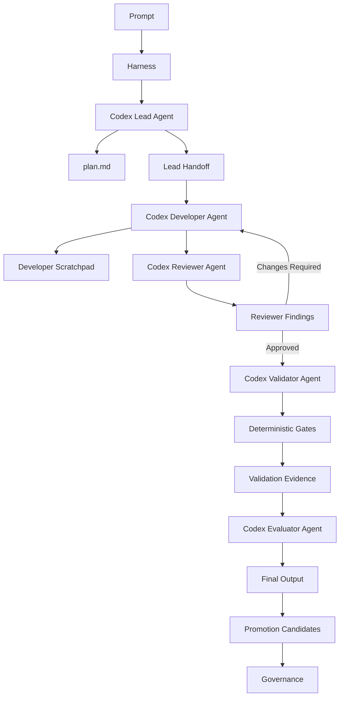

The agent changes by role.

The workspace provides continuity.

The deterministic gates provide objective evidence.

Governance controls what survives the run.

---

### 10.32 Practical Codex Rules

When using Codex inside an enterprise Harness:

1. **Give each role an explicit responsibility.**

   Do not allow one long-running agent context to blur Developer, Reviewer, Validator, and Evaluator responsibilities.

2. **Persist important execution state outside the agent context.**

   Use Run Workspace artifacts for handoffs, checkpoints, recovery, and auditability.

3. **Keep Scratchpad content non-authoritative.**

   Codex observations are working state until verified through the correct source.

4. **Separate implementation from validation.**

   Tool execution should produce deterministic evidence under `validation/`.

5. **Checkpoint long-running autonomous work.**

   Do not require a failed process to reconstruct hours of investigation.

6. **Revalidate before resuming.**

   Repository revisions and governing inputs may have changed.

7. **Isolate parallel agents.**

   Each agent should have its own Scratchpad and scoped result.

8. **Protect secrets.**

   Never use the Run Workspace as a convenient credential store.

9. **Use structured outputs for machine state.**

   Run status, changed files, gate results, and checkpoint information should not depend on parsing free-form Markdown.

10. **Govern persistent learning.**

    Codex may propose knowledge. It should not silently create organizational truth.

---

### 10.33 Architectural Conclusion

Codex reinforces the same lesson demonstrated by Claude and GitHub Copilot.

The more capable an AI coding agent becomes, the more important it is to separate:

```text
what the agent is thinking about
from
what the enterprise knows
```

A Scratchpad gives Codex room to record:

```text
This looks relevant.
This assumption needs verification.
This file changed.
This test has not run.
This architecture evidence conflicts.
This finding may deserve promotion.
```

The Run Workspace gives the Harness control over:

```text
where that state lives;
who can modify it;
how it is handed off;
how it survives failure;
how it is revalidated;
how long it is retained;
whether any part of it becomes permanent knowledge.
```

That separation preserves autonomy without surrendering governance.

Claude, GitHub Copilot, and Codex may differ significantly in user experience, execution model, tooling, and integration.

The enterprise architecture should remain stable:

> **AI Agents may create temporary working state. The Harness governs that state. Deterministic evidence verifies outcomes. Persistent knowledge requires deliberate promotion and approval.**

**Scratchpad and Run Workspace status: In progress — next section: Best Practices**

## 11. Best Practices

A Scratchpad is simple to create.

A reliable Scratchpad discipline is not.

The main risk is not that agents will fail to write temporary state. The risk is that temporary state will become ambiguous, stale, over-trusted, over-retained, or silently promoted into permanent knowledge.

The following practices help preserve the architectural boundary established throughout this chapter.

---

### 11.1 Treat the Scratchpad as Non-Authoritative by Default

Every Scratchpad should begin with an explicit statement of authority.

For example:

```markdown id="bp-scratchpad-banner"
> Temporary run-scoped working state.
>
> This file is not an authoritative source of project knowledge.
> Observations, assumptions, and decisions must be validated against
> governed sources and repository evidence before being treated as fact.
```

This may seem repetitive, but repetition is useful here.

Agents should never need to infer whether a Scratchpad contains:

- verified facts;
- speculative reasoning;
- architecture rules;
- temporary implementation notes.

Its default status should always be clear:

> **Useful for execution, not authoritative for the project.**

---

### 11.2 Separate Facts, Observations, Assumptions, and Decisions

Do not write undifferentiated notes such as:

```text id="bp-bad-mixed-note"
Location validation is probably done through ServiceLocationPolicy
and the event should be backward compatible.
```

This combines several different claims.

A better representation is:

```markdown id="bp-structured-state"
## Observation

`ServiceLocationPolicy` is used by the current walk-in booking workflow.

Evidence:
`src/Booking.Application/...`

Status:
Observed

## Assumption

The corporate fleet booking workflow should use the same policy.

Status:
Unverified

## Compatibility Question

Will the additive event field be accepted by all existing consumers?

Status:
Unresolved
```

The structure matters because different statements require different handling.

An observation may need confirmation.

An assumption needs validation.

An unresolved question needs ownership.

A decision needs rationale and scope.

---

### 11.3 Attach Evidence to Important Observations

Whenever practical, an observation should reference the evidence that produced it.

Prefer:

```markdown id="bp-evidence-good"
### OBS-012

`FleetBookingCreated` is consumed by Fleet.IntegrationGateway.

Evidence:
`src/Fleet.IntegrationGateway/Consumers/FleetBookingCreatedConsumer.cs`

Repository revision:
91cc341
```

over:

```text id="bp-evidence-bad"
Fleet.IntegrationGateway consumes the event.
```

Evidence references make it easier to:

- verify the claim;
- detect staleness;
- resume execution;
- review another agent's conclusion;
- create Repository Intelligence later.

The Scratchpad should point toward evidence rather than replace it.

---

### 11.4 Record Repository Revision or Evidence Context

Repository observations have a freshness boundary.

For important investigations, record the repository revision:

```markdown id="bp-revision"
Repository revision:
91cc341
```

This becomes especially valuable during:

- resumability;
- parallel execution;
- long-running tasks;
- branch updates;
- rebases;
- retries.

Without a revision, an apparently factual statement such as:

```text id="bp-old-fact"
FleetBookingCreated has four fields.
```

has no obvious time boundary.

With revision context, the Harness can determine whether the observation still deserves trust.

---

### 11.5 Make Assumptions Explicit

Agents will make assumptions.

That is unavoidable.

The goal should not be to eliminate assumptions but to expose them.

A useful format is:

```markdown id="bp-assumption"
### ASM-007

Assumption:
Existing API clients omit LocationId safely.

Status:
Unverified

Impact if false:
The proposed request-contract change may break compatibility.

Required verification:
Run API contract tests using the pre-change payload.
```

This format turns invisible reasoning risk into visible engineering state.

---

### 11.6 Give Important Assumptions an Expiration Condition

Some assumptions should remain valid only while specific conditions hold.

For example:

```markdown id="bp-assumption-expiry"
### ASM-009

Assumption:
Fleet.IntegrationGateway is the only strict schema consumer.

Valid only if:
Repository consumer discovery remains unchanged.

Revalidate when:
- repository revision changes;
- integration event topology changes;
- a new consumer is added.
```

This makes the assumption easier to invalidate safely.

---

### 11.7 Track Unresolved Questions as Work Items

Do not leave important questions buried in prose.

Use a structure such as:

```markdown id="bp-question"
### Q-004

Question:
Are there external FleetBookingCreated consumers outside the repository?

Owner:
Lead Agent

Status:
Open

Impact:
May affect compatibility assessment.

Resolution required before:
Final evaluation
```

This makes unresolved uncertainty visible to the Harness.

A mature run should not finish merely because the implementation compiles.

Material unresolved questions must be explicitly:

- answered;
- accepted as risk;
- deferred;
- escalated;
- or converted into follow-up work.

---

### 11.8 Keep the Plan Stable Enough to Be Useful

A Plan should not be rewritten after every minor discovery.

If it changes constantly, it stops functioning as a stable execution strategy.

Use the Scratchpad for local execution detail.

Revise the Plan only when the approach materially changes.

For example:

```text id="bp-plan-minor"
Minor discovery:
A test file has a different name.

→ Scratchpad only
```

but:

```text id="bp-plan-major"
Material discovery:
Event compatibility requires a schema migration step.

→ Update Plan
```

This keeps the two artifacts distinct.

---

### 11.9 Record Why the Plan Changed

When the Plan changes, record the reason.

For example:

```markdown id="bp-plan-revision"
## Plan Revision 3

Change:
Add explicit event schema migration analysis.

Reason:
Fleet.IntegrationGateway performs strict schema validation.

Evidence:
OBS-014

Approved by:
Lead Agent
```

This creates traceability between:

```text id="bp-traceability"
Observation
     ↓
Plan Revision
     ↓
Implementation
```

---

### 11.10 Use Checkpoints at Meaningful Boundaries

Do not checkpoint every trivial action.

Checkpoint when recovery value is high.

Good checkpoint locations include:

- repository investigation complete;
- Plan approved;
- implementation phase complete;
- before human approval;
- before risky repository modification;
- before role handoff;
- before deterministic validation;
- after Reviewer remediation;
- before pausing a run.

A useful checkpoint records:

```markdown id="bp-checkpoint"
## CP-005

Stage:
Implementation complete

Completed:
- API contract change
- application mapping
- event mapping
- tests

Pending:
- Reviewer
- Validator
- Evaluator

Repository revision:
91cc341

Known unresolved risk:
External consumers not independently verified.
```

---

### 11.11 Keep Checkpoint State Machine-Readable

Markdown provides context.

The Harness should also maintain structured state.

For example:

```json id="bp-checkpoint-json"
{
  "checkpointId": "CP-005",
  "stage": "implementation-complete",
  "repositoryRevision": "91cc341",
  "currentRole": "Developer",
  "nextRole": "Reviewer",
  "status": "ready-for-review"
}
```

Do not force the Harness to interpret orchestration state from free-form prose.

---

### 11.12 Use Explicit Role Handoffs

Do not assume one role should infer everything from another role's Scratchpad.

Use structured handoff artifacts.

A good handoff contains:

```text id="bp-handoff-fields"
Goal
Completed work
Relevant evidence
Important decisions
Known risks
Unresolved questions
Required next actions
Required validation
```

For example:

```markdown id="bp-handoff"
# Developer → Reviewer

## Goal

Review preferred location support.

## Completed

- API change
- domain mapping
- event update
- tests

## Important Decision

Reused ServiceLocationPolicy based on ADR-027.

## Known Risk

External event consumers remain unverified.

## Review Focus

- backward compatibility;
- event mapping;
- test completeness.
```

The receiving role should not have to reconstruct intent from an entire run history.

---

### 11.13 Prefer Curated Handoffs Over Full Scratchpad Sharing

A Scratchpad may contain:

- abandoned hypotheses;
- outdated assumptions;
- irrelevant investigative paths;
- stale notes;
- implementation detail.

Passing all of it to every downstream agent increases noise and confirmation bias.

Prefer:

```text id="bp-curated"
Scratchpad
   ↓
Curated Handoff
   ↓
Next Role
```

The handoff should preserve what the next role needs.

---

### 11.14 Isolate Parallel-Agent Working State

Each parallel agent should have its own Scratchpad.

For example:

```text id="bp-parallel"
agents/
├── api-analysis/
│   └── scratchpad.md
├── event-analysis/
│   └── scratchpad.md
└── domain-analysis/
    └── scratchpad.md
```

Do not use a shared editable file as an informal concurrency mechanism.

This prevents:

- race conditions;
- overwritten notes;
- ambiguous ownership;
- premature conclusion sharing;
- cross-agent contamination.

---

### 11.15 Require Scoped Results from Parallel Agents

Each parallel agent should produce a final result that clearly states its scope.

For example:

```markdown id="bp-parallel-result"
# API Compatibility Result

Scope:
CorporateFleetBookingRequest

Result:
Compatible subject to API contract validation.

Not evaluated:
- FleetBookingCreated
- external consumers
- domain architecture
```

Scope boundaries prevent downstream agents from overgeneralizing findings.

---

### 11.16 Reconcile Parallel Results Explicitly

The Lead Agent should reconcile parallel findings.

Do not simply concatenate them.

A reconciliation step should identify:

- agreements;
- conflicts;
- gaps;
- duplicated findings;
- unresolved dependencies.

For example:

```markdown id="bp-reconciliation"
## Reconciliation

API agent:
Nullable LocationId appears compatible.

Event agent:
Schema update required.

Domain agent:
Use ServiceLocationPolicy.

Combined implementation guidance:
Proceed with optional API field, approved policy validation,
event schema update, and mandatory contract validation.
```

---

### 11.17 Separate Narrative State from Deterministic Evidence

Never store validation only as:

```text id="bp-bad-validation"
Tests passed.
```

The Scratchpad can reference the result, but the real evidence should live separately.

For example:

```text id="bp-validation-files"
validation/
├── build.json
├── unit-tests.trx
├── integration-tests.trx
└── gate-summary.json
```

Then Scratchpad:

```markdown id="bp-validation-reference"
Unit tests passed.

Evidence:
`validation/unit-tests.trx`
```

This prevents agent prose from becoming the validation system.

---

### 11.18 Preserve Failed Validation Evidence

Do not retain only the final successful run.

For important workflows, preserve relevant failure iterations.

For example:

```text id="bp-validation-history"
Attempt 1:
Event contract test — FAIL

Reason:
Schema missing ServiceLocationId.

Attempt 2:
Event contract test — PASS
```

This history may help with:

- debugging;
- metrics;
- evaluator context;
- root-cause analysis;
- process improvement.

---

### 11.19 Distinguish "Implemented" from "Validated"

Use explicit status language.

Prefer:

```text id="bp-status-good"
Implemented — validation pending
```

over:

```text id="bp-status-bad"
Done
```

Likewise:

```text id="bp-status-review"
Reviewed — deterministic validation pending
```

and:

```text id="bp-status-final"
Validated — evaluation pending
```

This avoids collapsing multiple Harness responsibilities into one ambiguous word.

---

### 11.20 Revalidate Before Resuming

Every resume workflow should assume temporary state may be stale.

Before continuation, compare:

- repository revision;
- branch;
- Instructions;
- Steering Notes;
- Skill versions;
- relevant files;
- dependency configuration;
- tool versions where material.

The resume process should classify state:

```text id="bp-resume-state"
VALID
NEEDS REVALIDATION
STALE
INVALID
```

The Harness should not assume:

```text id="bp-resume-bad"
Persisted = trustworthy
```

Persisted only means:

```text id="bp-resume-correct"
Persisted = available for inspection
```

---

### 11.21 Mark Stale State Rather Than Silently Overwriting It

When practical, preserve important historical context.

For example:

```markdown id="bp-stale"
### OBS-011

Original statement:
FleetBookingCreated contains four properties.

Status:
STALE

Reason:
File changed after checkpoint CP-005.

Replacement:
See OBS-019.
```

This provides traceability without allowing stale state to masquerade as current truth.

---

### 11.22 Validate the Working Tree During Recovery

A repository may contain uncommitted changes when a run fails.

Therefore recovery should inspect both:

```text id="bp-recovery-scope"
Repository revision
+
Working tree state
```

Otherwise the Harness may load a checkpoint that describes a repository state that no longer matches the files on disk.

Recovery should answer:

- Which files were modified?
- Were they modified before or after the checkpoint?
- Are there partially written files?
- Are generated artifacts complete?
- Did another process modify the branch?

---

### 11.23 Keep Secrets Out of Scratchpads

Do not store:

- passwords;
- access tokens;
- API keys;
- private keys;
- connection-string credentials;
- certificates;
- production secrets.

Use references:

```markdown id="bp-secret-reference"
Required secret:
`KeyVault/FleetIntegrationTest`

Purpose:
Contract-test authentication.

Secret value:
Not stored.
```

This practice should be reinforced by automated secret scanning where possible.

---

### 11.24 Minimize Sensitive Business Data

Even non-secret data may be sensitive.

Do not copy entire:

- customer records;
- medical records;
- financial records;
- employee information;
- production payloads;

into a Scratchpad merely for convenience.

Prefer minimal representations.

For example:

```text id="bp-sensitive-good"
Test payload contains an invalid ServiceLocationId.
```

rather than storing the complete production request.

---

### 11.25 Use Redaction Before Persistence

If a tool returns sensitive material, the Harness should redact before persisting the output.

For example:

```text id="bp-redaction"
Raw Tool Output
     ↓
Redaction
     ↓
Run Workspace
```

Do not rely solely on an AI Agent to remember not to copy the value later.

Technical controls are stronger than prompt-only controls.

---

### 11.26 Enforce Run Isolation

Run Workspaces should be isolated from one another.

For example:

```text id="bp-run-isolation"
runs/
├── run-001/
├── run-002/
└── run-003/
```

An agent operating in `run-003` should not casually consume assumptions from `run-001`.

If previous run information is useful, it should enter through a governed mechanism such as:

- Repository Intelligence;
- approved Harness Memory;
- explicit historical evidence retrieval.

Old Scratchpads should not become an informal cross-run knowledge base.

---

### 11.27 Do Not Search Historical Scratchpads as Default Knowledge

A dangerous evolution looks like this:

```text id="bp-history-bad"
Need project knowledge
     ↓
Search all old scratchpads
     ↓
Use whichever statement looks useful
```

That effectively converts temporary state into uncontrolled memory.

Instead:

```text id="bp-history-good"
Need project knowledge
     ↓
Repository Intelligence / Harness Memory
```

Historical Scratchpads may be inspected for troubleshooting or audit purposes, but they should not normally be treated as trusted knowledge sources.

---

### 11.28 Give Promotion Candidates Their Own Structure

Do not write:

```text id="bp-promotion-bad"
This should probably go into memory.
```

Use structured proposals:

```markdown id="bp-promotion-good"
## Promotion Candidate PC-006

Statement:
Fleet.IntegrationGateway performs strict schema validation for
fleet booking events.

Evidence:
- consumer implementation
- schema validation configuration
- contract tests

Proposed destination:
Repository Intelligence

Scope:
Current fleet event architecture

Freshness trigger:
Revalidate if IntegrationGateway contract handling changes.

Status:
Pending review.
```

This makes promotion deliberate.

---

### 11.29 Separate Repository Intelligence from Harness Memory

Not every reusable discovery belongs in the same persistent store.

Use Repository Intelligence for:

```text id="bp-ri"
Evidence about the repository
```

Examples:

- event consumers;
- architecture dependencies;
- module ownership;
- current framework usage;
- established repository patterns.

Use Harness Memory for:

```text id="bp-hm"
Governed lessons about how the Harness should operate across runs
```

Examples:

- a recurring validation strategy;
- a proven task decomposition pattern;
- an approved improvement to agent orchestration.

The distinction prevents architectural knowledge and operational learning from becoming one undifferentiated memory pool.

---

### 11.30 Require Governance Before Promotion

A promotion workflow should include some combination of:

```text id="bp-governance"
Evidence verification
Scope review
Duplication check
Conflict check
Owner review
Approval
Versioning
Freshness rule
```

The Harness should never silently reason:

```text id="bp-promotion-danger"
This worked three times.
Therefore it is now a permanent rule.
```

Repeated success is evidence.

It is not governance.

---

### 11.31 Store Final Outputs Separately from Working Notes

The final implementation summary should not be extracted by asking another agent to interpret an uncontrolled Scratchpad at the end.

Create explicit outputs.

For example:

```text id="bp-outputs"
outputs/
├── implementation-summary.md
├── review-summary.json
├── evaluation.json
└── promotion-candidates/
```

These outputs should be curated from:

- Prompt;
- implementation;
- Reviewer findings;
- deterministic evidence;
- Evaluator assessment.

---

### 11.32 Prefer Machine-Readable State for Orchestration

Use structured data for things the Harness itself must act on.

Examples:

```text id="bp-structured-items"
run status
current role
next role
checkpoint ID
repository revision
gate status
retry count
promotion status
```

For example:

```json id="bp-run-state"
{
  "status": "validating",
  "currentRole": "Validator",
  "nextRole": "Evaluator",
  "lastCheckpoint": "CP-007",
  "repositoryRevision": "91cc341"
}
```

Use Markdown for context and explanation.

Do not make the orchestration engine parse prose such as:

```text id="bp-orchestration-bad"
Looks ready for evaluation now.
```

---

### 11.33 Version Important Run Artifacts

For long or complex runs, consider versioning:

- Plan;
- checkpoints;
- handoffs;
- validation summaries;
- promotion proposals.

For example:

```text id="bp-versioning"
plan-v1.md
plan-v2.md
```

or through embedded metadata:

```yaml id="bp-plan-version"
version: 3
previousVersion: 2
```

This can improve traceability when execution direction changes materially.

---

### 11.34 Record Authorship and Role

In multi-agent workflows, important entries should identify who created them.

For example:

```markdown id="bp-author"
### OBS-021

Role:
Event Compatibility Agent

Finding:
Fleet.IntegrationGateway validates the published schema.

Status:
Observed
```

This helps distinguish:

- Lead inference;
- Developer implementation note;
- Reviewer finding;
- Validator evidence interpretation;
- human decision.

---

### 11.35 Record Scope

A statement without scope may be overgeneralized.

Prefer:

```text id="bp-scope-good"
This compatibility finding applies to FleetBookingCreated.
```

over:

```text id="bp-scope-bad"
Event changes are compatible.
```

Likewise:

```text id="bp-scope-specific"
Observed in Booking microservice only.
```

is safer than allowing another agent to assume the pattern applies to every service.

---

### 11.36 Record Confidence Only as Supporting Metadata

Confidence scores can sometimes be useful.

For example:

```text id="bp-confidence"
Confidence:
Medium
```

But confidence is not evidence.

A high-confidence AI statement is still an assumption if it lacks verification.

Therefore:

```text id="bp-confidence-rule"
High confidence
    ≠
Authoritative truth
```

Use confidence to prioritize investigation, not to bypass it.

---

### 11.37 Keep the Scratchpad Concise Enough to Remain Useful

A Scratchpad should not become a transcript of everything the agent did.

Do not record:

```text id="bp-noise"
Opened file.
Scrolled.
Searched term.
Read another file.
Thought about approach.
```

Record information that helps:

- decision-making;
- handoff;
- recovery;
- validation;
- auditability;
- promotion.

Excessive detail creates noise and increases retention risk.

---

### 11.38 Summarize at Checkpoints

Long-running Scratchpads should periodically produce checkpoint summaries.

For example:

```markdown id="bp-summary"
## Checkpoint Summary

Verified:
- ServiceLocationId already exists.
- ADR-027 is current.
- IntegrationGateway is a strict schema consumer.

Implemented:
- optional request field;
- application mapping.

Pending:
- event schema;
- tests.

Risks:
- external consumers unknown.
```

This reduces the need for a resumed agent to read hundreds of older entries before continuing.

---

### 11.39 Do Not Delete Contradictory Findings Too Early

Suppose two agents disagree.

Agent A:

```text id="bp-conflict-a"
ADR-012 appears current.
```

Agent B:

```text id="bp-conflict-b"
ADR-027 supersedes ADR-012.
```

Do not simply delete Agent A's note.

Record the resolution:

```markdown id="bp-conflict-resolved"
## Conflict Resolution

Original finding:
ADR-012 appears current.

Conflicting evidence:
ADR-027 explicitly supersedes ADR-012.

Resolution:
ADR-027 is authoritative.

Status:
Resolved.
```

This helps explain why the implementation changed direction.

---

### 11.40 Define Retention by Artifact Type

Do not apply one retention duration to the entire workspace blindly.

Different artifacts have different value and risk.

For example:

| Artifact | Typical Retention Intent |
| --- | --- |
| Scratchpad | Short-term troubleshooting |
| Agent-local Scratchpads | Short-term |
| Checkpoints | Medium-term operational recovery |
| Validation evidence | Longer engineering/compliance retention |
| Final evaluation | Audit retention |
| Metrics | Long-term aggregate retention |
| Approved knowledge | Governed persistent lifecycle |

The exact periods depend on organizational policy.

---

### 11.41 Delete Temporary State Intentionally

A cleanup process should know what it is removing.

For example:

```text id="bp-cleanup"
Run Completed
     ↓
Promotion Decisions Finalized
     ↓
Required Evidence Archived
     ↓
Retention Window Ends
     ↓
Temporary Scratchpads Deleted
```

Do not simply accumulate:

```text id="bp-retention-bad"
runs/
  400,000 old scratchpad files
```

without a lifecycle policy.

---

### 11.42 Preserve Enough Evidence for Audit Without Preserving Everything

Auditability does not require permanent retention of every temporary note.

Often the organization needs to preserve:

- task definition;
- repository revision;
- approvals;
- source changes;
- validation evidence;
- final evaluation;
- promotion decisions.

It may not need to preserve every speculative note permanently.

The retention strategy should distinguish:

```text id="bp-audit-separation"
What must be provable
from
What was temporarily useful
```

---

### 11.43 Make Workspace Policies Platform-Neutral

Do not create Scratchpad semantics that exist only because one vendor supports a particular feature.

Define the enterprise model first:

```text id="bp-platform-neutral"
Prompt
Plan
Scratchpad
Handoff
Validation Evidence
Output
Repository Intelligence
Harness Memory
```

Then map Claude, Copilot, Codex, or future agents onto that model.

This reduces migration cost and keeps the architecture durable.

---

### 11.44 Treat Human Notes with the Same Classification Discipline

Human-written notes can also be:

- assumptions;
- observations;
- temporary decisions;
- permanent Instructions.

A statement does not become authoritative simply because a human wrote it into a Scratchpad.

If an Architect says:

```text id="bp-human"
Use ServiceLocationPolicy for this task.
```

record it as:

```text id="bp-human-scope"
Human decision — current run
```

If it is intended to become a permanent architecture rule, move it through the appropriate governance process.

---

### 11.45 Make the Scratchpad Easy to Inspect

A predictable structure improves human review.

For example:

```markdown id="bp-template"
# Scratchpad

## Metadata

## Current State

## Observations

## Assumptions

## Unresolved Questions

## Intermediate Decisions

## Files Under Investigation

## Risks

## Checkpoints

## Promotion Candidates
```

Avoid inventing a completely different structure for every run unless the task requires it.

Consistency improves:

- resumability;
- review;
- automation;
- training;
- troubleshooting.

---

### 11.46 Use Identifiers for Important Entries

Identifiers make cross-reference easier.

For example:

```text id="bp-identifiers"
OBS-001
ASM-003
Q-004
DEC-002
CP-006
PC-001
```

Then a Plan can say:

```text id="bp-cross-reference"
Revision made because of OBS-014.
```

A Reviewer can say:

```text id="bp-cross-reference-2"
DEC-006 is not supported by the evidence in OBS-010.
```

This improves traceability without requiring complex tooling.

---

### 11.47 Validate Promotion Candidates Against Current State

A promotion candidate discovered early in a long run may become stale before the run finishes.

Before approval, revalidate:

```text id="bp-promotion-revalidate"
Is the evidence still current?
Has the repository changed?
Was the assumption later disproven?
Did Reviewer findings alter the conclusion?
Did validation expose an exception?
```

Do not promote knowledge merely because the candidate was created earlier.

---

### 11.48 Distinguish Lessons from Coincidences

A recurring behavior is not automatically a reusable pattern.

Suppose three tasks required:

```text id="bp-coincidence"
manual event schema updates
```

That may indicate:

- an architecture convention;
- a tooling gap;
- a temporary migration state;
- coincidence.

Harness Memory should not store:

```text id="bp-bad-memory"
Always manually update event schemas.
```

until the organization determines what the pattern actually means.

---

### 11.49 Design for Safe Replacement of the AI Agent

A useful test of Run Workspace quality is:

> Can another authorized AI Agent or human continue this run safely?

If continuation depends on:

```text id="bp-agent-dependence"
what the original model remembers
```

then the workspace is insufficient.

A good workspace provides:

```text id="bp-agent-independent"
Prompt
Plan
governing inputs
repository revision
current checkpoint
relevant observations
open questions
handoff
working tree state
validation state
```

This makes the execution architecture independent of one model instance.

---

### 11.50 Keep the Harness Responsible for Lifecycle

Agents may write temporary state.

The Harness should own:

- workspace creation;
- identifiers;
- permissions;
- checkpoint persistence;
- resume validation;
- retention;
- cleanup;
- promotion routing;
- audit records.

Do not make the Developer Agent responsible for deciding whether a Run Workspace should be deleted.

That is a Harness concern.

---

### 11.51 Use Technical Controls Where Possible

Important policies should not rely only on natural-language instructions.

Examples include:

```text id="bp-controls"
Read-only mounts for governing inputs
Role-specific write permissions
Secret scanning
Workspace isolation
Schema validation
Automated retention
Repository revision checks
Structured gate results
Immutable validation artifacts
```

Prompts explain policy.

Controls enforce it.

Enterprise AI engineering needs both.

---

### 11.52 Recommended Scratchpad Entry Pattern

A reusable entry structure is:

```markdown id="bp-entry-template"
### OBS-XXX — Short title

Type:
Observation | Assumption | Question | Decision | Risk

Statement:
...

Evidence:
...

Status:
Observed | Unverified | Verified | Resolved | Stale

Scope:
...

Impact:
...

Required next action:
...
```

Not every entry needs every field.

The goal is consistent meaning, not bureaucratic completeness.

---

### 11.53 Recommended Run Workspace Checklist

Before execution:

```text id="bp-before"
Run ID created
Prompt captured
Governing inputs identified
Repository revision captured
Workspace initialized
Plan created
```

During execution:

```text id="bp-during"
Observations classified
Assumptions visible
Questions tracked
Parallel state isolated
Handoffs explicit
Checkpoints recorded
Evidence stored separately
```

Before completion:

```text id="bp-before-complete"
Reviewer findings resolved
Deterministic gates complete
Evaluator assessment complete
Unresolved questions dispositioned
Promotion candidates reviewed
Final outputs generated
```

After completion:

```text id="bp-after"
Required evidence retained
Metrics recorded
Approved knowledge promoted
Temporary state retained according to policy
Expired temporary state cleaned up
```

---

### 11.54 The Best-Practice Principle

All of these practices reinforce one architectural rule:

> **Temporary state should remain useful without becoming accidentally authoritative.**

The Scratchpad exists because real engineering execution is uncertain and iterative.

Agents need somewhere to record:

- what they noticed;
- what they think might be true;
- what they still need to check;
- why they changed direction;
- what remains unfinished.

That information is valuable.

It becomes dangerous only when its lifecycle and authority are unclear.

A strong Harness therefore does not prevent agents from recording uncertain working state.

It makes uncertainty explicit, evidence traceable, handoffs structured, recovery safe, and knowledge promotion deliberate.

**Scratchpad and Run Workspace status: In progress — next section: Anti-patterns**

## 12. Anti-patterns

The Scratchpad and Run Workspace solve an important coordination problem, but they can create new risks when used carelessly.

Most failures do not come from having temporary execution state.

They come from allowing temporary state to become:

- authoritative;
- permanent;
- ambiguous;
- stale;
- over-shared;
- insecure;
- or operationally indispensable without governance.

The following anti-patterns are especially dangerous in enterprise Harness design.

---

### 12.1 Treating Scratchpad Content as Authoritative

This is the most important anti-pattern.

A Scratchpad may contain statements such as:

```text
FleetBookingCreated probably has no external consumers.
```

That statement may be useful during investigation.

It is not authoritative.

The danger begins when a later agent reads it and assumes:

```text
There are no external consumers.
```

The transformation may happen silently:

```text
Assumption
   ↓
Repeated by another agent
   ↓
Accepted as context
   ↓
Used as implementation basis
   ↓
Treated as project truth
```

No evidence was added.

Only repetition occurred.

This is precisely what the architecture must prevent.

A better sequence is:

```text
Scratchpad Assumption
        ↓
Investigation
        ↓
Evidence
        ↓
Verification
        ↓
Repository Intelligence if appropriate
```

#### Why It Fails

Scratchpad entries may be:

- incomplete;
- speculative;
- stale;
- scoped to one agent;
- based on partial repository search;
- written before contradictory evidence appears.

Treating them as facts bypasses the entire evidence model.

#### Better Practice

Every agent should assume:

> **Scratchpad content is working state unless the entry explicitly references a valid authoritative source.**

Even then, the authority comes from the source, not from the Scratchpad.

---

### 12.2 Storing Permanent Instructions in the Scratchpad

Suppose the team decides:

```text
All integration events must use backward-compatible additive evolution.
```

That is a durable engineering rule.

It does not belong only in:

```text
scratchpad.md
```

If important rules are stored only in temporary run state, future runs may never see them.

The opposite problem is also possible.

An agent may write:

```text
Use ServiceLocationPolicy for this task.
```

and another agent may assume this is a permanent repository-wide Instruction.

That may not be true.

#### Why It Fails

It confuses:

```text
Run-specific execution guidance
```

with:

```text
Durable engineering policy
```

#### Better Practice

Persistent engineering rules belong in governed Instruction mechanisms.

Temporary decisions belong in the Run Workspace.

If a temporary decision reveals a missing permanent rule, create a promotion or governance proposal.

---

### 12.3 Mixing Prompt and Scratchpad Content

Another common failure is continuously modifying the Scratchpad until it becomes an informal replacement for the Prompt.

For example:

```text
Original Prompt:
Add optional preferred location support.
```

During execution:

```text
Scratchpad:
Need event schema update.

Also should probably improve logging.

Maybe refactor Booking aggregate.

Could clean up validation while here.
```

A later agent may then interpret all of those notes as requirements.

Scope expands silently.

#### Why It Fails

The original task boundary becomes unclear.

The team can no longer answer:

```text
What was requested?
```

versus:

```text
What was merely discovered or suggested?
```

#### Better Practice

Keep task authority in the Prompt.

The Scratchpad may record ideas such as:

```markdown
Potential follow-up:
Refactor duplicate validation logic.

Status:
Outside current scope.
```

Do not allow discoveries to redefine the task automatically.

---

### 12.4 Rewriting the Prompt Through the Scratchpad

This is a more subtle version of the same problem.

Suppose the Prompt says:

```text
Preserve backward compatibility.
```

The Developer finds compatibility difficult and writes:

```text
For this implementation, backward compatibility is not practical.
Proceed with the cleaner event model.
```

If that statement appears only in the Scratchpad, the agent has effectively changed the requirement without authority.

#### Why It Fails

It allows implementation convenience to override task intent.

#### Better Practice

Record:

```markdown
Issue:
Current implementation strategy conflicts with backward compatibility.

Status:
Blocked.

Required action:
Escalate for decision.
```

Requirements should change only through an authorized decision.

---

### 12.5 Treating the Plan as a Scratchpad

A Plan should describe the intended execution path.

If agents continuously append every discovery into `plan.md`, it becomes unreadable.

For example:

```text
1. Inspect API.
2. API file was here.
3. Found another file.
4. Maybe event schema matters.
5. Opened consumer.
6. Consumer looks strict.
7. Need test.
```

This is not a Plan.

It is execution history.

#### Why It Fails

The team loses a stable view of the strategy.

#### Better Practice

Use:

```text
plan.md
```

for approach, and:

```text
scratchpad.md
```

for discoveries.

Revise the Plan only when discoveries materially change the execution strategy.

---

### 12.6 Treating the Scratchpad as Repository Intelligence

Suppose an agent records:

```text
Fleet.IntegrationGateway consumes FleetBookingCreated.
```

The statement is later found useful.

The team begins searching old Scratchpads whenever event-consumer information is needed.

Eventually the Scratchpad archive becomes an informal knowledge base.

This is dangerous.

#### Why It Fails

Historical Scratchpads contain:

- stale observations;
- disproven assumptions;
- run-specific context;
- incomplete discovery;
- ambiguous scope.

They were never designed to satisfy Repository Intelligence quality requirements.

#### Better Practice

Promote verified reusable discoveries through governance.

Future agents should query Repository Intelligence, not historical Scratchpad archives, for current repository understanding.

---

### 12.7 Treating the Scratchpad as Harness Memory

A similar anti-pattern occurs when old Scratchpad entries are used to guide future runs automatically.

For example:

```text
Previous run scratchpad:
Adding nullable fields worked well.
```

The Harness then reasons:

```text
Always use nullable fields for compatibility.
```

A local implementation observation has silently become cross-run operational policy.

#### Why It Fails

The Scratchpad did not establish:

- scope;
- exceptions;
- evidence quality;
- organizational approval;
- freshness;
- general applicability.

#### Better Practice

If a lesson deserves cross-run retention, create a Harness Memory promotion candidate and pass it through governance.

---

### 12.8 Keeping Secrets in Scratchpad Files

This is a severe security anti-pattern.

For example:

```text
API_KEY=...
DATABASE_PASSWORD=...
JWT_SECRET=...
```

Temporary storage does not make secret exposure acceptable.

Scratchpads may be:

- copied;
- archived;
- uploaded;
- included in artifacts;
- retained longer than expected;
- read by multiple agents;
- exposed during troubleshooting.

#### Why It Fails

It expands the attack surface and complicates retention and incident response.

#### Better Practice

Store only secret references:

```text
KeyVault/FleetIntegrationTest
```

Never the secret value.

Use automated redaction and secret scanning where possible.

---

### 12.9 Copying Sensitive Production Data into the Scratchpad

A developer may inspect a production payload and copy it into temporary notes.

For example:

```json
{
  "customerName": "...",
  "email": "...",
  "vehicleRegistration": "...",
  "billingAccount": "..."
}
```

Even when the data is not a credential, this can create privacy and compliance risks.

#### Why It Fails

The Scratchpad may have weaker controls than the production system from which the data originated.

#### Better Practice

Record only the minimum information necessary:

```text
Production payload contains a missing LocationId and an invalid fleet account reference.
```

Prefer synthetic or redacted examples.

---

### 12.10 Sharing One Uncontrolled Scratchpad Across Parallel Agents

This is one of the most dangerous concurrency patterns.

Suppose three agents are working in parallel:

```text
Agent A → API compatibility
Agent B → Event compatibility
Agent C → Domain architecture
```

All three write to:

```text
scratchpad.md
```

Agent A writes:

```text
Compatibility appears safe.
```

Agent B is still investigating a strict event consumer.

Agent C reads Agent A's statement and treats the compatibility question as settled.

#### Why It Fails

A shared mutable Scratchpad creates:

- race conditions;
- ambiguous authorship;
- conflicting conclusions;
- premature cross-agent influence;
- overwritten state.

#### Better Practice

Use:

```text
agents/api-analysis/scratchpad.md
agents/event-analysis/scratchpad.md
agents/domain-analysis/scratchpad.md
```

Then reconcile structured results.

---

### 12.11 Letting Parallel Agents Read Each Other's Incomplete Reasoning

Even if agents do not write to the same file, exposing every unfinished note to every agent can create unnecessary coupling.

For example:

```text
Agent A:
"I suspect the event is safe."
```

Agent B may unconsciously bias its own investigation toward that conclusion.

#### Why It Fails

Parallel work loses independence.

#### Better Practice

Share:

- task boundaries;
- governed context;
- necessary dependencies.

Exchange findings through explicit result or handoff artifacts once an investigation reaches a defined state.

---

### 12.12 Using the Scratchpad as a Synchronization Mechanism

A weak multi-agent implementation may do this:

```text
Agent A writes:
READY_FOR_AGENT_B

Agent B polls scratchpad.md
```

This turns a narrative file into an orchestration protocol.

#### Why It Fails

Free-form Markdown is a poor substitute for structured state.

It creates brittle parsing and ambiguous lifecycle behavior.

#### Better Practice

Use machine-readable execution state:

```json
{
  "currentStage": "api-analysis-complete",
  "nextRole": "event-analysis"
}
```

Use the Scratchpad for explanatory context only.

---

### 12.13 Losing Scratchpad State During Failure

At the opposite extreme, some Harnesses treat the Scratchpad as so temporary that it exists only in process memory.

If the process crashes, all execution state disappears.

The next agent may need to repeat:

- repository investigation;
- decisions;
- open questions;
- partially completed implementation analysis.

#### Why It Fails

Temporary does not mean non-durable during the run.

#### Better Practice

Persist sufficient run state at meaningful checkpoints.

The Scratchpad may be temporary in retention terms while still being durable during active execution.

---

### 12.14 Resuming Execution Without Validating Stale Scratchpad State

This is a critical failure-recovery anti-pattern.

Suppose a run pauses on Monday and resumes Wednesday.

The Scratchpad says:

```text
FleetBookingCreated has four fields.
```

The file changed on Tuesday.

The resumed agent continues based on the old note.

#### Why It Fails

Persisted working state has outlived the environment that made it valid.

#### Better Practice

Before resuming, compare:

- repository revision;
- changed files;
- Instructions;
- Steering Notes;
- Skills;
- dependencies.

Mark affected entries:

```text
STALE
```

and reinvestigate them.

---

### 12.15 Assuming Persisted State Is Valid State

A common implementation mistake is:

```text
File exists
   ↓
Therefore state is recoverable
   ↓
Therefore state is valid
```

The second conclusion does not follow.

A persisted Scratchpad may contain obsolete information.

#### Better Practice

Use this model:

```text
Persisted
   ↓
Available
   ↓
Revalidated
   ↓
Trusted for continuation
```

Availability and validity are different properties.

---

### 12.16 Deleting Scratchpad State Too Early

Suppose a run completes validation but evaluation later discovers a business-outcome issue.

If the Scratchpad has already been deleted, useful execution context may be gone.

#### Why It Fails

Cleanup occurred before the run lifecycle actually completed.

#### Better Practice

Retention should begin after defined completion criteria, not after the Developer or Validator phase alone.

---

### 12.17 Keeping Run Workspaces Indefinitely

The reverse is equally problematic.

A Harness may accumulate years of:

```text
runs/
run-000001/
run-000002/
...
run-900000/
```

with every Scratchpad preserved.

#### Why It Fails

This creates:

- storage growth;
- privacy exposure;
- security exposure;
- stale knowledge temptation;
- governance complexity.

#### Better Practice

Define artifact-specific retention and automated cleanup.

---

### 12.18 Treating Every Scratchpad Entry as Audit Evidence

A Scratchpad may be useful during an audit investigation, but it should not automatically be considered authoritative audit evidence.

For example:

```text
Validator says tests passed.
```

is weaker than:

```text
CI test report shows 418 tests passed.
```

#### Why It Fails

It confuses narrative with evidence.

#### Better Practice

Use structured, independently generated evidence for audit-critical claims.

Retain Scratchpad context only where policy justifies it.

---

### 12.19 Treating Confidence as Evidence

An agent might write:

```text
Confidence: 95%
```

This does not make the statement true.

#### Why It Fails

Model confidence does not replace verification.

#### Better Practice

Use confidence only as optional prioritization metadata.

The final authority should come from:

- repository evidence;
- deterministic validation;
- approved governance sources;
- human decisions where required.

---

### 12.20 Promoting Temporary Assumptions Without Review

Suppose a Scratchpad says:

```text
External consumers probably ignore unknown JSON fields.
```

The Harness then stores:

```text
Harness Memory:
External consumers support additive JSON fields.
```

This is a major governance failure.

#### Why It Fails

The promoted statement is stronger than the original evidence.

#### Better Practice

Promotion requires:

```text
Candidate
   ↓
Evidence
   ↓
Scope
   ↓
Review
   ↓
Approval
```

If evidence does not support the statement, it should not be promoted.

---

### 12.21 Promoting a Run-Specific Decision into a Global Standard

A task may require:

```text
Use ServiceLocationPolicy for corporate fleet bookings.
```

That does not necessarily imply:

```text
Every location-related operation in every microservice must use ServiceLocationPolicy.
```

#### Why It Fails

The scope expands during promotion.

#### Better Practice

Promotion proposals should explicitly state scope.

For example:

```text
Scope:
Booking service service-location eligibility.
```

Do not generalize beyond evidence.

---

### 12.22 Promoting Failed Experiments

An agent may try an implementation strategy, later reject it, but leave the earlier note in the Scratchpad.

For example:

```text
Try validating location in the API controller.
```

Later:

```text
Rejected because ADR-027 requires ServiceLocationPolicy.
```

If a promotion process scans only keywords, it might retain the failed idea.

#### Better Practice

Promotion candidates should come from explicit candidate artifacts, not automated extraction of arbitrary Scratchpad statements.

---

### 12.23 Automatically Promoting Repeated Observations

Another dangerous pattern is:

```text
If an observation appears in three runs, promote it automatically.
```

Frequency alone does not prove general validity.

The repeated behavior may represent:

- a temporary migration state;
- recurring technical debt;
- a defect;
- a workaround;
- an actual standard.

#### Better Practice

Repetition can trigger review.

It should not itself trigger authoritative promotion.

---

### 12.24 Using Historical Scratchpads to Resolve Current Architecture Questions

Suppose an agent asks:

```text
Where should location validation occur?
```

The Harness searches old Scratchpads and finds:

```text
Run 118:
Use application layer.

Run 205:
Use domain policy.
```

Which one is correct?

The Scratchpad archive cannot answer reliably.

#### Why It Fails

Historical run state does not encode current authority.

#### Better Practice

Use:

- current Instructions;
- architecture decisions;
- Repository Intelligence;
- current repository evidence.

Historical Scratchpads can help investigate history, not determine present truth by default.

---

### 12.25 Making the Scratchpad Too Large

A Scratchpad can become a dumping ground.

For example:

```text
every search result
every command
every file opened
every thought
every compiler message
every test log
```

Eventually the important state becomes difficult to find.

#### Why It Fails

The Scratchpad becomes a transcript rather than an execution aid.

It also increases:

- context cost;
- security risk;
- retention burden.

#### Better Practice

Store:

- material observations;
- assumptions;
- unresolved questions;
- decisions;
- risks;
- checkpoints.

Store raw logs elsewhere.

---

### 12.26 Making the Scratchpad Too Minimal

The opposite problem also exists.

A Scratchpad containing only:

```text
Working on event.
Tests next.
```

provides little value for:

- recovery;
- handoff;
- review;
- investigation.

#### Better Practice

Capture enough information to allow a new authorized agent to understand:

```text
what was discovered;
what remains uncertain;
why the current approach was selected;
what must happen next.
```

---

### 12.27 Recording Every Internal Thought

The purpose of the Scratchpad is not to capture an AI model's complete private reasoning process.

An enterprise Harness does not need a transcript of every internal reasoning step.

#### Why It Fails

It creates:

- noise;
- unnecessary retention;
- privacy and security complexity;
- poor operational signal.

#### Better Practice

Capture explicit engineering state:

```text
Observation
Assumption
Decision
Evidence
Question
Risk
Checkpoint
```

The objective is reproducible execution, not preservation of hidden reasoning.

---

### 12.28 Leaving Assumptions Unlabeled

Compare:

```text
The external consumer accepts optional fields.
```

with:

```text
Assumption:
The external consumer accepts optional fields.

Status:
Unverified.
```

The first appears factual.

The second exposes uncertainty.

#### Why It Fails

Unlabeled assumptions are easily inherited as facts.

#### Better Practice

Make uncertainty explicit at the time it is recorded.

---

### 12.29 Leaving Questions Without Owners

A Scratchpad may accumulate:

```text
Need to check external consumer.
Need architecture confirmation.
Need schema decision.
```

but no one owns them.

#### Why It Fails

Unresolved work can survive until final evaluation unnoticed.

#### Better Practice

Use:

```text
Owner
Status
Required-by stage
```

for material questions.

---

### 12.30 Marking Work "Done" Too Early

The Developer may write:

```text
Feature done.
```

after implementation.

But:

- review has not happened;
- tests have not run;
- evaluation has not happened.

#### Why It Fails

"Done" hides lifecycle stage.

#### Better Practice

Use precise states:

```text
Implementation complete
Review pending
Validation pending
Evaluation pending
```

---

### 12.31 Treating Reviewer Findings as Scratchpad Suggestions

A Reviewer finding such as:

```text
Missing backward compatibility test.
```

should not be copied casually into a Scratchpad and then forgotten.

#### Why It Fails

Reviewer outputs have stronger process significance than ordinary implementation notes.

#### Better Practice

Store structured Reviewer findings and track their resolution explicitly.

---

### 12.32 Treating Validation Failures as Temporary Noise

Suppose a contract test fails.

The Developer fixes the issue and deletes the failure record.

#### Why It Fails

The execution history loses useful evidence.

The failure may explain:

- why code changed;
- why the Plan changed;
- why a promotion candidate exists.

#### Better Practice

Retain relevant failed-gate evidence according to policy.

---

### 12.33 Letting the Validator Modify Code Silently

If the Validator encounters a failing test and edits the implementation directly, role independence is lost.

The workspace may then say:

```text
Validation passed.
```

without showing that the Validator changed the code first.

#### Why It Fails

The Validator has become a second Developer without an explicit transition.

#### Better Practice

Return the task to the Developer role.

Record:

```text
Validation failure
→ Developer remediation
→ Validation rerun
```

---

### 12.34 Letting the Evaluator Rewrite Acceptance Criteria

Suppose the implementation fails one acceptance criterion.

The Evaluator writes:

```text
This criterion is probably unnecessary, so overall result is PASS.
```

This is not evaluation.

It is unauthorized requirement modification.

#### Better Practice

The Evaluator should return:

```text
Partial
```

or:

```text
Fail
```

and identify the unmet criterion.

Changing the criterion requires authorized human or governance action.

---

### 12.35 Treating Human Comments as Permanent Policy Automatically

A senior engineer may say during a run:

```text
Use this approach for now.
```

The Harness later stores it as permanent knowledge.

#### Why It Fails

The phrase may have been intentionally scoped to the current situation.

#### Better Practice

Capture:

```text
Human direction
Scope
Authority
Duration if known
```

and promote only when intended.

---

### 12.36 Using Source Comments as a Scratchpad

An agent might add:

```csharp
// TODO AI: I think this consumer may break.
// Need to check later.
```

to production source code as temporary memory.

#### Why It Fails

Temporary execution notes leak into the product.

They may be committed accidentally.

#### Better Practice

Put temporary working state in the Run Workspace.

Only legitimate source comments should remain in production code.

---

### 12.37 Using Commit Messages as the Primary Scratchpad

Commit messages are useful historical artifacts.

They are not designed for:

- unresolved questions;
- temporary assumptions;
- parallel investigation;
- recovery state.

#### Better Practice

Use commits for source-control history.

Use the Run Workspace for execution state.

---

### 12.38 Using Logs as the Scratchpad

Logs may contain:

```text
Agent inspected X
Agent suspects Y
Agent plans Z
```

But logs are usually optimized for diagnostics, not structured coordination.

#### Why It Fails

Important state becomes difficult to:

- update;
- classify;
- reconcile;
- resume from.

#### Better Practice

Use logs for events.

Use Scratchpads for working state.

---

### 12.39 Letting the Run Workspace Become a Second Repository

A poorly governed workspace can accumulate:

- permanent architecture documentation;
- reusable code;
- copied source files;
- long-term knowledge;
- unofficial Instructions.

Eventually it becomes a shadow repository.

#### Why It Fails

Ownership and authority become unclear.

#### Better Practice

The Run Workspace should remain run-scoped.

Anything deserving permanence should be moved through an approved destination and governance process.

---

### 12.40 Committing Every Run Workspace into the Main Repository

Some teams may commit:

```text
harness/runs/run-001/
harness/runs/run-002/
...
```

directly into the main product repository forever.

This may be justified in very specific environments, but it is usually a poor default.

#### Why It Fails

It can create:

- repository bloat;
- sensitive-data risk;
- noise;
- confusing historical artifacts.

#### Better Practice

Treat Run Workspace storage and source repository storage as separate architectural concerns unless policy explicitly requires versioned retention.

---

### 12.41 Failing to Clean Up Abandoned Runs

Not every run completes.

There may be:

```text
Cancelled
Failed
Superseded
Abandoned
```

runs.

If these are never cleaned up, temporary state accumulates indefinitely.

#### Better Practice

Retention policies should cover every terminal state, not only successful runs.

---

### 12.42 Reusing the Same Run Workspace for a Retry

Suppose a run fails.

The Harness resets some files and starts again in the same workspace without clearly distinguishing the second attempt.

#### Why It Fails

State from the first attempt may contaminate the retry.

#### Better Practice

Use either:

```text
new run ID
```

or an explicitly modeled attempt:

```text
run-1042
  attempt-1
  attempt-2
```

Do not silently reuse state.

---

### 12.43 Confusing Resume with Retry

These are different concepts.

**Resume** means:

```text
Continue the same execution from a valid checkpoint.
```

**Retry** means:

```text
Start another attempt after a failed or rejected execution.
```

If the Harness treats both identically, state boundaries become unclear.

#### Better Practice

Model them separately.

---

### 12.44 Ignoring Workspace Schema Evolution

The Run Workspace structure itself may evolve.

For example, version 1 contains:

```text
scratchpad.md
validation/
```

while version 2 adds:

```text
agent-handoffs/
promotion-candidates/
```

A resumed older run may not match the current Harness expectations.

#### Why It Fails

The Harness may misinterpret old state.

#### Better Practice

Version the workspace schema.

For example:

```json
{
  "workspaceSchemaVersion": 2
}
```

Apply migration or compatibility rules explicitly.

---

### 12.45 Failing to Record Source of Human Decisions

Suppose the Scratchpad says:

```text
Decision:
Do not version the event.
```

Who made that decision?

- Developer?
- Architect?
- Product Owner?
- AI Agent?

The authority matters.

#### Better Practice

Record:

```markdown
Decision:
Do not version the event.

Authority:
Architect

Source:
Architecture review during run.

Scope:
Current FleetBookingCreated change.
```

---

### 12.46 Treating an Agent Handoff as Authoritative Evidence

A handoff might say:

```text
Three consumers were found.
```

The receiving agent should understand this as curated context.

If the exact consumer count matters to correctness, it should be traceable to evidence.

#### Why It Fails

Handoffs summarize.

Summaries can omit nuance.

#### Better Practice

Use handoffs for coordination and evidence references for verification.

---

### 12.47 Hiding Unresolved Risks to Make the Run Look Complete

An agent may omit:

```text
External consumers were not verified.
```

because all repository tests passed.

This creates a cleaner report but a weaker engineering outcome.

#### Better Practice

Preserve residual risks explicitly.

A successful run may still contain:

```text
Accepted Risk
```

or:

```text
Known Limitation
```

Completion does not require pretending uncertainty does not exist.

---

### 12.48 Over-Automating Knowledge Promotion

A sophisticated Harness may attempt:

```text
Scratchpad
   ↓
LLM summarization
   ↓
Harness Memory
```

without human or policy review.

This is attractive because it appears self-learning.

It is also dangerous.

#### Why It Fails

The summarizer may:

- generalize beyond evidence;
- merge incompatible observations;
- preserve obsolete assumptions;
- remove important qualifiers.

#### Better Practice

Use AI to generate **promotion proposals**.

Do not confuse proposal generation with governance approval.

---

### 12.49 Creating Permanent Knowledge Without Freshness Rules

Suppose Repository Intelligence records:

```text
Fleet.IntegrationGateway consumes FleetBookingCreated.
```

That may be true today.

If the consumer is removed next year, the knowledge becomes stale.

#### Better Practice

Where relevant, promotion should include a freshness trigger:

```text
Revalidate if:
- consumer topology changes;
- event project changes;
- integration gateway is replaced.
```

Persistent does not mean eternally true.

---

### 12.50 Using Vendor Memory as the Enterprise Run Workspace

A team may reason:

```text
Claude remembers this.
Copilot chat has the history.
Codex still has context.
```

Therefore, no explicit workspace is required.

#### Why It Fails

The execution architecture becomes dependent on:

- vendor-specific retention;
- session continuity;
- model context;
- product behavior;
- access scope.

#### Better Practice

Use vendor capabilities as implementation conveniences.

Keep enterprise execution state under Harness control.

---

### 12.51 Designing Different Scratchpad Semantics for Every AI Platform

Another anti-pattern is:

```text
Claude scratchpad means one thing.
Copilot notes mean another.
Codex memory means something else.
```

This creates operational inconsistency.

#### Better Practice

Define the enterprise abstraction once:

```text
Scratchpad =
temporary, run-scoped, non-authoritative working state.
```

Map each tool onto that definition.

---

### 12.52 The Most Dangerous Anti-pattern: Authority Drift

Most Scratchpad failures ultimately reduce to one phenomenon:

> **Authority drift.**

Authority drift occurs when information moves from:

```text
temporary
```

to:

```text
trusted
```

without a deliberate transition.

For example:

```text
Agent guess
   ↓
Scratchpad note
   ↓
Handoff summary
   ↓
Second agent assumption
   ↓
Implementation decision
   ↓
Copied into documentation
   ↓
Treated as architecture rule
```

At no point was the original guess actually verified.

Yet it eventually became organizational truth.

This is why the boundaries in this chapter matter.

The architecture must continuously distinguish:

```text
What was requested?
What was planned?
What was observed?
What was assumed?
What was verified?
What was validated?
What was approved?
What should be remembered?
```

When those questions remain separate, the Scratchpad becomes a powerful execution tool.

When they collapse into one another, temporary state becomes a source of architectural drift.

> **The purpose of the Scratchpad is to preserve uncertainty safely—not to erase the distinction between uncertainty and truth.**

**Scratchpad and Run Workspace status: In progress — next section: Architect’s Notes**

## 13. Architect’s Notes

The Scratchpad and Run Workspace may appear operational, but they have architectural consequences.

They influence how a Harness handles:

- authority;
- state;
- concurrency;
- recovery;
- evidence;
- governance;
- security;
- long-term maintainability.

The most important architectural question is not:

> Where should we store `scratchpad.md`?

The more important question is:

> **What class of state does the enterprise allow AI Agents to create during execution, and what authority does that state have?**

If that question is not answered explicitly, temporary execution state tends to leak into more permanent structures.

That is how architecture drift begins.

---

### 13.1 Temporary State Should Be Designed, Not Improvised

A common mistake is to treat Scratchpads as an implementation convenience added late to the Harness.

For example:

```text
Agents need somewhere to keep notes.
Let's add scratchpad.md.
```

That is too shallow.

The real architectural requirement is:

```text
Harness Execution
    ↓
Needs temporary state
    ↓
Temporary state needs lifecycle
    ↓
Lifecycle needs ownership
    ↓
Ownership needs authority boundaries
    ↓
Authority boundaries need governance
```

The Scratchpad is therefore not merely a file.

It is part of a state-management model.

---

### 13.2 The Architect Should Define State Categories

A mature enterprise Harness should define state categories explicitly.

At minimum:

```text
Task Input State
Run State
Validation State
Output State
Persistent Knowledge
```

A more detailed classification might be:

| Category | Example | Lifetime | Authority |
| --- | --- | ---: | --- |
| Task Definition | Prompt | Run/task | High |
| Governing Context | Instructions, Steering Notes | Persistent or release-scoped | High |
| Execution Strategy | Plan | Run | Controlled |
| Working State | Scratchpad | Run | Low |
| Handoff State | Agent handoffs | Run | Contextual |
| Deterministic Evidence | Test results, gate output | Run/audit retention | High for objective claims |
| Run Output | Evaluation, summaries | Run/audit retention | Curated |
| Repository Intelligence | Verified repository knowledge | Persistent | Governed |
| Harness Memory | Approved cross-run learning | Persistent | Governed |

The categories should exist before implementing file structures.

The directory layout should reflect the model, not define it accidentally.

---

### 13.3 Authority Should Be Explicit

The Architect should define which artifacts have authority over which decisions.

For example:

```text
Prompt
    governs task intent

Instructions
    govern engineering rules

Steering Notes
    govern current mission constraints

Repository Intelligence
    provides verified repository evidence

Scratchpad
    provides temporary working context

Validation Evidence
    proves deterministic conditions

Harness Memory
    provides approved cross-run knowledge
```

Without this hierarchy, agents may resolve conflicts inconsistently.

Suppose:

```text
Scratchpad:
Use approach A.

Instruction:
Use approach B.
```

The correct result should be obvious.

The Instruction wins unless an authorized process changes it.

The Scratchpad cannot override the Instruction.

---

### 13.4 Conflict Resolution Rules Should Be Designed Up Front

Enterprise Harnesses should define what happens when artifacts disagree.

For example:

```text
Prompt conflicts with Instruction
```

may require escalation rather than automatic resolution.

Likewise:

```text
Repository Intelligence conflicts with current repository evidence
```

may mean Repository Intelligence is stale.

A possible conflict model is:

```text
Current Repository Evidence
        ↓
may invalidate
Repository Intelligence

Authorized Human Decision
        ↓
may override
Run Plan

Scratchpad Assumption
        ↓
never overrides
Instruction or verified evidence
```

The Architect should define these relationships explicitly.

---

### 13.5 Scratchpad Is a Low-Authority Zone

The Scratchpad should deliberately be a **low-authority zone**.

That is not a weakness.

It is a safety feature.

Agents need somewhere they can write:

```text
Possibly.
Unclear.
Need to verify.
Conflicting evidence.
Try this approach.
```

If every written statement carried permanent authority, agents would either:

- avoid recording uncertainty;
- or pollute permanent knowledge with speculative claims.

A low-authority workspace allows useful uncertainty to exist safely.

---

### 13.6 Avoid the "Everything Is Memory" Architecture

Many AI systems use the word *memory* too broadly.

That creates confusion.

A poor architecture might classify all of these as memory:

```text
Prompt history
Scratchpad
Repository observations
Agent handoffs
Validation results
Project standards
Prior decisions
User preferences
```

This is too coarse.

From an architectural perspective, these have different:

- owners;
- authority;
- lifetime;
- freshness;
- security;
- retention;
- promotion requirements.

The Architect should resist collapsing them into one generic memory store.

---

### 13.7 Separate Logical Model from Storage Technology

Do not define:

```text
Scratchpad = Markdown file
```

too strongly.

Markdown is a convenient representation.

The logical concept is:

> temporary run-scoped working state.

An implementation may use:

```text
Markdown
JSON
Database records
Object storage
Document store
Hybrid storage
```

The logical model should survive changes in storage technology.

For example:

```text
Logical Scratchpad
        ↓
Markdown today
Database tomorrow
```

The architecture remains stable.

---

### 13.8 Human Readability Still Matters

Even if structured storage is used, important execution state should remain inspectable.

A highly normalized database schema that only the Harness can interpret may reduce operational transparency.

Architects should balance:

```text
Machine readability
        +
Human readability
```

A practical pattern is:

```text
Structured run-state.json
+
Human-readable scratchpad.md
+
Structured validation evidence
```

This combination supports both orchestration and troubleshooting.

---

### 13.9 The Run Workspace Is a Boundary, Not Just a Folder

Architecturally, the Run Workspace should be considered a boundary.

Inside the boundary:

```text
temporary execution state
```

Outside the boundary:

```text
governed persistent state
```

This implies explicit transitions.

For example:

```text
Run Workspace
     ↓
Promotion Review
     ↓
Repository Intelligence
```

not:

```text
Run Workspace
     ↓
copy file
     ↓
Repository Intelligence
```

The transition should be semantic, not merely filesystem-based.

---

### 13.10 Promotion Is a State Transition

The Architect should model promotion as a state transition.

For example:

```text
Temporary
    ↓
Candidate
    ↓
Verified
    ↓
Approved
    ↓
Persistent
```

This is better than thinking:

```text
Scratchpad note
    ↓
move to memory folder
```

A useful promotion record might include:

```text
candidate ID
source run
source evidence
proposed statement
scope
destination
review status
approval
freshness rule
```

This makes learning governable.

---

### 13.11 Promotion Should Be Lossy

An important architectural principle is that promotion should usually be **lossy**.

Do not promote the whole Scratchpad.

Promote only the reusable, verified knowledge.

For example, Scratchpad:

```text
First thought: use application validation.
Then found ADR-027.
ServiceLocationPolicy seems correct.
Checked two handlers.
One was stale.
Eventually confirmed domain policy.
```

Repository Intelligence should become:

```text
Service-location eligibility in Booking is governed by
ServiceLocationPolicy under ADR-027.
```

The investigation history is useful during the run.

The persistent knowledge should be concise and curated.

---

### 13.12 Do Not Build Self-Learning Directly on Raw Scratchpads

A self-learning Harness may eventually analyze historical runs.

Architects should avoid the shortcut:

```text
Old Scratchpads
    ↓
LLM Summarization
    ↓
Harness Memory
```

A safer model is:

```text
Run Outputs
    ↓
Explicit Promotion Candidates
    ↓
Evidence
    ↓
Governance
    ↓
Harness Memory
```

Raw Scratchpads can support investigation, but they should not become the primary learning corpus without careful controls.

---

### 13.13 Run State Should Be Replaceable

A robust architecture should allow one AI Agent to be replaced by another.

For example:

```text
Claude Developer
    ↓ failure
Codex Developer
    ↓ continue
```

or:

```text
AI Developer
    ↓
Human Developer
```

The ability to continue should depend on:

```text
Run Workspace
+
Repository State
+
Governed Inputs
```

not on:

```text
one model's internal context
```

This is a strong test of architectural quality.

---

### 13.14 Model Substitution Should Not Change Semantics

If Claude, Copilot, and Codex each require a different definition of Scratchpad, the abstraction is too vendor-specific.

The enterprise definition should remain stable:

```text
Scratchpad =
temporary, task-scoped, non-authoritative working state
```

Platforms may differ in how they:

- read it;
- write it;
- expose it;
- checkpoint it.

They should not change what it means.

---

### 13.15 The Architect Should Design for Parallelism Early

Parallel-agent execution is much harder to retrofit safely later.

The Architect should assume that eventually the Harness may run:

```text
API Agent
Event Agent
Security Agent
Persistence Agent
Test Agent
```

in parallel.

This requires clear decisions about:

- workspace ownership;
- write isolation;
- result schemas;
- reconciliation;
- conflict detection.

A shared `scratchpad.md` may work for a single agent.

It becomes dangerous under concurrency.

---

### 13.16 Parallelism Requires Controlled Merge Semantics

Parallel agent findings should not simply be concatenated.

The Harness needs a reconciliation mechanism.

For example:

```text
Agent A Result
Agent B Result
Agent C Result
      ↓
Lead Reconciliation
      ↓
Shared Run State
```

The Architect should decide:

- who reconciles;
- what happens when findings conflict;
- whether evidence strength is compared;
- how unresolved conflicts are escalated.

This is analogous to merging code changes.

State changes also need merge semantics.

---

### 13.17 Treat Handoffs as Contracts

An agent handoff should be viewed as a contract between roles.

For example:

```text
Lead → Developer
```

should specify:

```text
assigned goal
verified context
constraints
known risks
open questions
required outputs
required validation
```

The Architect should resist informal handoffs like:

```text
Continue from here.
```

A structured handoff improves:

- reproducibility;
- independence;
- auditability;
- recovery.

---

### 13.18 The Architect Should Separate Role Contexts Where Independence Matters

A Reviewer should not necessarily inherit all Developer reasoning.

A Validator should not need Developer confidence.

An Evaluator should not inherit implementation bias.

The architecture should intentionally control context propagation.

For example:

```text
Developer Scratchpad
        ↓
Curated Developer Handoff
        ↓
Reviewer
```

rather than:

```text
Developer entire context
        ↓
Reviewer
```

This supports genuine role independence.

---

### 13.19 Validation Evidence Should Be Immutable After Creation

Where practical, deterministic validation artifacts should be treated as immutable evidence.

For example:

```text
validation/attempt-01/
validation/attempt-02/
```

rather than overwriting:

```text
validation/results.json
```

on every run.

This makes it possible to reconstruct:

```text
what failed
what changed
what later passed
```

The Scratchpad may summarize the sequence, but the underlying evidence should remain intact according to retention policy.

---

### 13.20 Separate the Control Plane from the Work Plane

A useful enterprise architecture distinction is:

```text
Control Plane
    ↓
Harness state, orchestration, checkpoints, role assignments

Work Plane
    ↓
Repository changes, builds, tests, generated artifacts
```

The Scratchpad belongs primarily to the execution/control context.

The source repository belongs to the work plane.

This separation helps prevent temporary orchestration state from leaking into product code.

---

### 13.21 Workspace Location Should Reflect Trust Boundaries

The Architect should carefully choose where Run Workspaces live.

Possible locations include:

```text
local worker storage
shared filesystem
object storage
database
isolated container volume
```

The decision depends on:

- recovery requirements;
- distributed workers;
- concurrency;
- sensitivity;
- retention;
- compliance.

A local-only workspace is simple but weak for distributed recovery.

A shared workspace improves recovery but increases access-control requirements.

---

### 13.22 Distributed Harnesses Need Stronger State Management

If one worker performs Lead analysis and another performs validation, the Run Workspace becomes distributed state.

Architectural concerns then include:

```text
consistency
concurrency
locking
versioning
atomic updates
event ordering
idempotency
```

A Markdown-file-only implementation may no longer be sufficient.

The logical Scratchpad concept still applies, but the storage implementation may need to evolve.

---

### 13.23 Use Optimistic Concurrency or Ownership

If multiple processes may update shared run metadata, the Harness should use explicit concurrency controls.

For example:

```text
workspace version
etag
row version
lease
ownership token
```

Do not assume:

```text
only one agent will write at a time
```

unless the architecture enforces that assumption.

---

### 13.24 Design for Idempotent Recovery

Recovery actions should ideally be safe to repeat.

For example:

```text
Load checkpoint
Verify revision
Rebuild state index
Mark stale observations
```

should not corrupt the workspace if executed twice.

Idempotent recovery reduces the complexity of failures that occur during recovery itself.

---

### 13.25 Define What "Resume" Means Architecturally

Resume should not mean:

```text
load text and continue
```

It should mean:

```text
restore known run state
validate environment
revalidate stale dependencies
restore role ownership
continue from a valid boundary
```

The Architect should define the resume contract.

A good resume operation answers:

```text
Which checkpoint?
Which repository revision?
Which workspace version?
Which governing inputs?
Which assumptions remain valid?
Which evidence remains valid?
```

---

### 13.26 Time Itself Creates Staleness

Even without repository changes, some state becomes stale with time.

Examples include:

- external API behavior;
- environment availability;
- deployment configuration;
- feature flags;
- temporary credentials;
- third-party schemas.

Therefore, staleness should not be based only on Git commit differences.

Architects may need:

```text
time-based freshness rules
```

for certain categories of state.

---

### 13.27 The Scratchpad Should Not Be a Compliance Escape Hatch

A team should not reason:

```text
It's temporary, so compliance rules do not apply.
```

Temporary data can still be:

- sensitive;
- regulated;
- discoverable;
- exposed;
- retained accidentally.

The Architect should include the Run Workspace in:

- data classification;
- access control;
- encryption;
- logging;
- retention;
- deletion policies.

---

### 13.28 Security Controls Should Be Structural

Do not rely only on instructions such as:

```text
Do not store secrets.
```

Add controls where practical:

```text
secret scanners
redaction
role-based permissions
restricted mounts
encrypted storage
automatic cleanup
```

AI instructions are part of the control system.

They are not the whole control system.

---

### 13.29 Avoid Over-Centralizing Scratchpad Data

One enterprise temptation is to store every Scratchpad from every repository in one searchable system.

That may improve observability.

It also creates a large concentration of:

- source context;
- vulnerabilities;
- temporary assumptions;
- potentially sensitive data.

Architects should evaluate whether centralized access is really necessary.

Segmentation may be safer.

---

### 13.30 Retention Should Be Based on Purpose

Architects should define retention according to why an artifact exists.

For example:

```text
Scratchpad
Purpose: execution coordination

Validation Evidence
Purpose: prove objective engineering conditions

Final Evaluation
Purpose: record outcome assessment

Metrics
Purpose: trend analysis

Harness Memory
Purpose: cross-run governed learning
```

Different purposes justify different retention.

A single global rule such as:

```text
keep all Harness files for seven years
```

is often too coarse.

---

### 13.31 Do Not Optimize for Perfect Historical Reconstruction at Any Cost

It may be technically possible to preserve:

```text
every prompt
every Scratchpad version
every agent message
every tool result
every temporary file
```

forever.

That does not mean it is wise.

Architects should balance:

```text
auditability
vs
security
privacy
cost
complexity
```

The goal is sufficient reconstruction for business and compliance needs, not unlimited retention.

---

### 13.32 Treat the Run Workspace as Ephemeral Infrastructure

A useful mental model is:

> The Run Workspace is to AI execution what temporary build infrastructure is to CI/CD.

It exists to support the execution.

It is important while active.

It may produce valuable evidence and outputs.

But the workspace itself should not automatically become a permanent knowledge system.

This analogy helps infrastructure teams reason about:

- isolation;
- lifecycle;
- cleanup;
- ownership.

---

### 13.33 Architect for Promotion, Not Accumulation

A weak self-learning system accumulates everything.

A stronger one promotes selectively.

The difference is:

```text
Accumulation:
Keep all run state forever

Promotion:
Retain only what earns persistence
```

The latter produces a cleaner knowledge system.

---

### 13.34 Knowledge Promotion Should Include Destination Semantics

The Architect should require promotion proposals to answer:

```text
Where should this go?
```

Possible destinations might include:

```text
Repository Intelligence
Harness Memory
Instruction update proposal
Skill update proposal
Architecture decision proposal
No promotion
```

This matters because different knowledge types have different ownership and governance.

---

### 13.35 Not Every Useful Discovery Should Be Remembered

A discovery may be useful in the current run but still not deserve persistence.

For example:

```text
The test fixture is named FleetBookingFixtureV2.
```

If this is trivial to rediscover and unlikely to matter across tasks, permanent retention may create noise.

Architects should optimize for:

```text
high-value persistent knowledge
```

not maximum memory.

---

### 13.36 Repository Intelligence Should Remain Evidence-Oriented

When promoting from Scratchpad to Repository Intelligence, the destination should preserve evidence relationships.

For example:

```text
Statement:
Fleet.IntegrationGateway validates FleetBookingCreated schemas.

Evidence:
consumer implementation
schema configuration
contract tests

Repository revision:
91cc341
```

This allows future revalidation.

A plain statement without evidence is much harder to maintain.

---

### 13.37 Harness Memory Should Remain Policy-Oriented

Harness Memory should retain lessons that improve future execution.

For example:

```text
When integration events are modified, include consumer contract
validation in the validation plan.
```

This is different from Repository Intelligence:

```text
Fleet.IntegrationGateway consumes FleetBookingCreated.
```

The first concerns execution behavior.

The second concerns repository reality.

Architects should preserve this distinction.

---

### 13.38 Metrics Should Not Be Derived from Scratchpad Prose Where Avoidable

Suppose the organization wants to measure:

```text
average number of retries
average validation failures
number of handoffs
time spent in review
```

These should come from structured Harness events and run-state data.

Do not extract critical metrics by asking an LLM to parse old Scratchpads.

The Scratchpad may enrich analysis, but operational metrics should be deterministic where possible.

---

### 13.39 Scratchpad Quality Can Become an Engineering Metric Carefully

Organizations may still measure useful operational properties such as:

```text
percentage of assumptions resolved before completion
percentage of resumed runs with stale-state revalidation
percentage of promotion candidates approved
```

These metrics should assess process quality, not reward agents for generating more notes.

Avoid incentives such as:

```text
more Scratchpad entries = better agent
```

That encourages noise.

---

### 13.40 Architect for Explainability Without Capturing Hidden Reasoning

Enterprise explainability does not require storing an AI model's hidden chain of thought.

Useful explainability comes from explicit artifacts:

```text
Prompt
Plan
Observations
Assumptions
Decisions
Evidence
Handoffs
Validation Results
Evaluation
```

These provide a strong operational narrative without attempting to preserve private internal reasoning.

---

### 13.41 The Run Workspace Should Support Humans Equally Well

Although designed around AI Agents, the Run Workspace should also help humans.

A human taking over a failed run should be able to answer:

```text
What was the goal?
What has been done?
Why?
What is still uncertain?
What failed?
What should happen next?
```

If the workspace is only interpretable by the original AI Agent, the design is too opaque.

---

### 13.42 Make Run State Observable

Enterprise operations teams may need visibility into:

```text
active runs
paused runs
stale runs
blocked runs
failed runs
runs awaiting approval
```

The Architect should expose this from structured run state.

Do not require operators to open `scratchpad.md` to know whether a run is healthy.

The Scratchpad explains.

The run-state model reports.

---

### 13.43 Stuck and Orphaned Runs Should Be Detectable

Long-running Harnesses need operational controls similar to other distributed systems.

Useful fields include:

```text
last heartbeat
current role
last checkpoint
workspace version
lease owner
last activity time
```

This allows the system to detect:

```text
stuck
orphaned
abandoned
```

executions.

Temporary state becomes part of operational reliability.

---

### 13.44 Failure Recovery Should Be Tested

Do not assume resumability works because the architecture supports checkpoints.

Test it.

For example:

1. stop the worker after Lead investigation;
2. resume;
3. stop during Developer implementation;
4. change a relevant repository file;
5. resume again;
6. verify stale-state detection;
7. confirm invalid evidence is rerun.

Recovery deserves deterministic testing just like other Harness capabilities.

---

### 13.45 Workspace Cleanup Should Also Be Tested

Retention bugs can be serious.

Test:

```text
completed run cleanup
failed run cleanup
cancelled run cleanup
promotion-pending retention
legal-hold behavior if applicable
```

Do not allow cleanup to be an untested maintenance script.

---

### 13.46 Promotion Pipelines Need Their Own Audit Trail

When temporary state becomes persistent knowledge, the enterprise should be able to answer:

```text
Which run produced the candidate?
What evidence supported it?
Who approved it?
What scope was approved?
When should it be revalidated?
```

This is especially important for Harness Memory because it can influence future AI behavior.

---

### 13.47 Design for Revocation

Persistent knowledge may later be found incorrect.

Architects should support:

```text
supersede
deprecate
revoke
```

operations.

For example:

```text
Repository Intelligence RI-041
Status: Superseded by RI-089
```

Promotion should not be a one-way irreversible operation.

---

### 13.48 Scratchpad Design Should Reduce Confirmation Bias

One subtle architectural benefit of structured temporary state is that it can expose competing hypotheses.

For example:

```markdown
## Hypothesis A

ADR-012 remains current.

## Hypothesis B

ADR-027 supersedes ADR-012.

## Required Evidence

Inspect ADR metadata and Repository Intelligence.
```

This is stronger than forcing the agent to commit immediately to one explanation.

The Run Workspace can be designed to support investigation rather than premature certainty.

---

### 13.49 Separate "Observed" from "Verified"

Architects should consider using explicit state transitions:

```text
Observed
   ↓
Supported
   ↓
Verified
```

For example:

```text
Observed:
A consumer file references FleetBookingCreated.

Verified:
Repository-wide consumer discovery and contract analysis confirm
the dependency relevant to this task.
```

The exact states are less important than preventing one observation from carrying too much authority.

---

### 13.50 The Architecture Should Make the Safe Path the Easy Path

If agents must perform ten awkward steps to record an assumption correctly, they will eventually stop doing it.

Provide:

- Scratchpad templates;
- helper commands;
- structured schemas;
- automated checkpointing;
- standard handoff formats;
- promotion templates.

The safe pattern should be the default pattern.

---

### 13.51 Avoid Excessive Process for Small Tasks

Not every typo fix needs:

```text
five role-specific scratchpads
six checkpoints
promotion workflow
parallel reconciliation
```

The architecture should scale with task complexity.

A small task might use:

```text
Prompt
Plan
Scratchpad
Validation
Output
```

A high-risk enterprise task might require the full structure.

The principles should remain consistent even when the implementation is lighter.

---

### 13.52 Risk Should Drive Workspace Rigor

Architects can define levels such as:

| Risk Level | Workspace Discipline |
| --- | --- |
| Low | Minimal Scratchpad and validation |
| Medium | Structured Scratchpad, checkpoints, review |
| High | Isolated roles, detailed evidence, resumability |
| Critical | Full audit trail, approvals, strict retention/security |

This prevents both under-engineering and unnecessary ceremony.

---

### 13.53 The Scratchpad Is Part of the Harness Trust Model

Ultimately, the Scratchpad belongs in the Harness trust model.

It should be classified roughly as:

```text
Trusted enough to help execution
Not trusted enough to establish truth
```

That may sound contradictory.

It is actually the correct design.

Agents need to use temporary state operationally.

But authoritative decisions must be grounded elsewhere.

---

### 13.54 Architect’s Rule of Thumb

When deciding where information belongs, ask:

> **Would I want a future agent to treat this statement as true without rechecking it?**

If the answer is **no**, it probably belongs in temporary run state.

If the answer is **yes**, then ask:

> **What evidence and governance justify making it persistent?**

That second question determines whether the statement belongs in:

- Repository Intelligence;
- Harness Memory;
- Instructions;
- an Architecture Decision Record;
- another governed source.

---

### 13.55 Architect’s Final Perspective

The Scratchpad and Run Workspace solve a problem that becomes increasingly important as AI Agents become more autonomous.

Autonomy creates more intermediate state.

More intermediate state creates more opportunity for:

- ambiguity;
- stale assumptions;
- accidental authority;
- security exposure;
- inconsistent handoffs;
- unreliable recovery.

The answer is not to prevent agents from maintaining working state.

The answer is to place that state inside a deliberately designed boundary.

The architecture should make the following transitions explicit:

```text
Task
   ↓
Run

Observation
   ↓
Evidence

Assumption
   ↓
Verification

Working State
   ↓
Curated Output

Discovery
   ↓
Promotion Candidate

Candidate
   ↓
Governed Knowledge
```

The central rule remains:

> **Scratchpad state may guide execution, but it must never become permanent truth merely because an AI Agent wrote it down.**

A well-designed Run Workspace lets AI Agents operate with enough temporary memory to perform complex engineering work while preserving the enterprise boundaries required for evidence, authority, recovery, security, and governance.

**Scratchpad and Run Workspace status: In progress — next section: Enterprise Tips**
Here is a reference structure you can use as the standard Run Workspace model in the handbook.

## Reference Run Workspace Structure

A Run Workspace should provide one controlled execution boundary for a single Harness run.

The structure should separate:

- task inputs;
- execution planning;
- temporary working state;
- role-specific state;
- handoffs;
- deterministic validation evidence;
- final outputs;
- machine-readable execution state.

A recommended reference structure is:

```text
harness/
└── runs/
    └── {run-id}/
        │
        ├── input/
        │   ├── prompt.md
        │   ├── instructions-manifest.json
        │   ├── skills-manifest.json
        │   └── steering-note.snapshot.md
        │
        ├── plan.md
        ├── scratchpad.md
        ├── run-state.json
        │
        ├── agents/
        │   ├── lead/
        │   │   ├── scratchpad.md
        │   │   └── result.md
        │   │
        │   ├── developer/
        │   │   ├── scratchpad.md
        │   │   ├── changed-files.json
        │   │   └── result.md
        │   │
        │   ├── reviewer/
        │   │   ├── scratchpad.md
        │   │   └── findings.md
        │   │
        │   ├── validator/
        │   │   ├── scratchpad.md
        │   │   └── summary.md
        │   │
        │   └── evaluator/
        │       ├── scratchpad.md
        │       └── evaluation.md
        │
        ├── agent-handoffs/
        │   ├── lead-to-developer.md
        │   ├── developer-to-reviewer.md
        │   ├── reviewer-to-developer-01.md
        │   └── validator-to-evaluator.md
        │
        ├── checkpoints/
        │   ├── cp-001.json
        │   ├── cp-002.json
        │   └── cp-003.json
        │
        ├── validation/
        │   ├── build/
        │   ├── unit-tests/
        │   ├── integration-tests/
        │   ├── architecture/
        │   ├── contracts/
        │   ├── security/
        │   └── gate-summary.json
        │
        ├── outputs/
        │   ├── implementation-summary.md
        │   ├── changed-files.json
        │   ├── review-summary.json
        │   ├── evaluation.json
        │   │
        │   └── promotion-candidates/
        │       ├── pc-001.md
        │       └── pc-002.md
        │
        └── metadata/
            ├── run-manifest.json
            ├── environment.json
            └── retention.json
```

### `input/`

The `input/` directory captures the governing inputs used to start the run.

It should contain snapshots or manifests rather than mutable copies wherever possible.

#### `prompt.md`

Contains the task definition.

```markdown
# Task

Add preferred detailing location support to corporate fleet bookings.

## Acceptance Criteria

- Existing clients remain compatible.
- Location remains optional.
- Valid locations are accepted.
- Invalid locations are rejected.
- FleetBookingCreated contains the location.
```

The Prompt remains the authoritative definition of what the run is expected to accomplish.

#### `instructions-manifest.json`

Records the Instructions that governed the run.

```json
{
  "instructions": [
    {
      "path": "CLAUDE.md",
      "revision": "7d92aa1"
    },
    {
      "path": ".github/copilot-instructions.md",
      "revision": "7d92aa1"
    }
  ]
}
```

The manifest helps determine whether governing Instructions changed before a resumed execution.

#### `skills-manifest.json`

Records which Skills and versions were made available.

```json
{
  "skills": [
    {
      "name": "add-integration-event",
      "version": "2.1"
    },
    {
      "name": "add-application-command",
      "version": "1.4"
    }
  ]
}
```

#### `steering-note.snapshot.md`

Captures the Steering Note applicable when the run started.

The snapshot allows the Harness to detect whether mission-level guidance changed during an interruption.

---

## `plan.md`

`plan.md` contains the current execution strategy.

Its responsibility is:

> **How will the task be approached?**

It should describe:

- investigation steps;
- implementation steps;
- expected handoffs;
- validation requirements;
- approval points.

It should not become an execution diary.

Significant changes to the Plan should be versioned or recorded as explicit revisions.

---

## `scratchpad.md`

The top-level Scratchpad records shared temporary run state.

Its responsibility is:

> **What is being discovered and tracked while the run is executing?**

A recommended structure is:

```markdown
# Scratchpad

> Temporary run-scoped working state.
> This file is not authoritative project knowledge.

## Current State

## Observations

## Assumptions

## Unresolved Questions

## Intermediate Decisions

## Files Under Investigation

## Risks

## Checkpoints

## Promotion Candidates
```

The shared Scratchpad should contain information relevant to the overall run.

Role-specific implementation detail should normally remain under `agents/`.

---

## `run-state.json`

`run-state.json` contains machine-readable orchestration state.

For example:

```json
{
  "runId": "run-2026-10-02-0017",
  "status": "validating",
  "currentRole": "Validator",
  "nextRole": "Evaluator",
  "repositoryRevision": "91cc341",
  "lastCheckpoint": "CP-006",
  "workspaceSchemaVersion": 1
}
```

The Harness should use this file or equivalent structured storage for execution control.

It should not determine lifecycle state by parsing Scratchpad prose.

---

## `agents/`

The `agents/` directory isolates temporary role-specific working state.

This prevents one large uncontrolled Scratchpad from becoming a shared concurrency mechanism.

### Lead

```text
agents/lead/
├── scratchpad.md
└── result.md
```

Typical contents:

- repository investigation;
- decomposition;
- dependencies;
- risks;
- unresolved architecture questions.

### Developer

```text
agents/developer/
├── scratchpad.md
├── changed-files.json
└── result.md
```

Typical contents:

- implementation observations;
- temporary assumptions;
- implementation decisions;
- changed-file tracking;
- remaining risks.

### Reviewer

```text
agents/reviewer/
├── scratchpad.md
└── findings.md
```

The Reviewer workspace should remain independent from Developer working state where practical.

`findings.md` should contain structured review findings rather than informal comments.

### Validator

```text
agents/validator/
├── scratchpad.md
└── summary.md
```

The Validator may use its Scratchpad for investigation and orchestration notes, but objective validation evidence belongs under `validation/`.

### Evaluator

```text
agents/evaluator/
├── scratchpad.md
└── evaluation.md
```

The Evaluator uses evidence from the Prompt, Reviewer, Validator, and final implementation to determine whether the intended outcome has been achieved.

---

## `agent-handoffs/`

Handoffs transfer curated context between roles.

For example:

```text
lead-to-developer.md
developer-to-reviewer.md
reviewer-to-developer-01.md
validator-to-evaluator.md
```

A handoff should typically include:

```text
Goal
Relevant verified evidence
Completed work
Important decisions
Known risks
Unresolved questions
Required next actions
Required validation
```

A handoff should not simply copy the entire sending agent's Scratchpad.

---

## `checkpoints/`

Checkpoints provide durable recovery boundaries.

For example:

```json
{
  "checkpointId": "CP-004",
  "runId": "run-2026-10-02-0017",
  "role": "Developer",
  "stage": "implementation-complete",
  "repositoryRevision": "91cc341",
  "completed": [
    "api-contract",
    "application-command",
    "event-mapping"
  ],
  "pending": [
    "review",
    "validation",
    "evaluation"
  ]
}
```

Checkpoints should be created at meaningful boundaries rather than after every action.

Typical points include:

- investigation complete;
- implementation complete;
- review complete;
- before validation;
- before pausing execution.

---

## `validation/`

The `validation/` directory stores deterministic evidence.

For example:

```text
validation/
├── build/
├── unit-tests/
├── integration-tests/
├── architecture/
├── contracts/
├── security/
└── gate-summary.json
```

The structure may contain:

- build logs;
- TRX/JUnit test results;
- architecture-test results;
- contract-test results;
- static-analysis results;
- security scan output;
- configuration checks.

The key architectural rule is:

> A Scratchpad may say that validation passed, but the authoritative evidence must live under `validation/` or another controlled evidence store.

A `gate-summary.json` might contain:

```json
{
  "result": "passed",
  "gates": [
    {
      "name": "build",
      "result": "passed"
    },
    {
      "name": "unit-tests",
      "result": "passed"
    },
    {
      "name": "event-contract-tests",
      "result": "passed"
    }
  ]
}
```

---

## `outputs/`

The `outputs/` directory contains curated results of the run.

Examples include:

```text
implementation-summary.md
changed-files.json
review-summary.json
evaluation.json
```

These are different from Scratchpad state.

The Scratchpad represents evolving execution.

Outputs represent the curated results of that execution.

---

## `outputs/promotion-candidates/`

Discoveries that may deserve persistence should be expressed explicitly as promotion candidates.

For example:

```markdown
# Promotion Candidate PC-001

## Statement

Fleet.IntegrationGateway performs strict schema validation for
FleetBookingCreated.

## Evidence

- consumer implementation;
- schema configuration;
- event contract tests.

## Proposed Destination

Repository Intelligence

## Scope

Fleet booking integration events.

## Status

Pending governance review.
```

The existence of this file does not mean the knowledge has been promoted.

Promotion remains a separate governed process.

---

## `metadata/`

The `metadata/` directory contains information about the execution environment and workspace lifecycle.

### `run-manifest.json`

May contain:

```json
{
  "runId": "run-2026-10-02-0017",
  "repository": "Alpha-Car-Detailing",
  "branch": "feature/fleet-location",
  "startingRevision": "7d92aa1",
  "workspaceSchemaVersion": 1,
  "createdAt": "2026-10-02T09:14:00Z"
}
```

### `environment.json`

May record relevant execution environment information such as:

```json
{
  "dotnetSdk": "10.0.x",
  "operatingSystem": "linux",
  "containerized": true
}
```

Only environment details that materially affect reproducibility should be retained.

Do not use this file as a secret store.

### `retention.json`

May define workspace retention state:

```json
{
  "classification": "standard-engineering-run",
  "scratchpadRetention": "short-term",
  "validationRetention": "engineering-audit",
  "promotionPending": false
}
```

Actual retention durations should come from enterprise policy.

---

## Reference Architecture

The logical architecture remains:

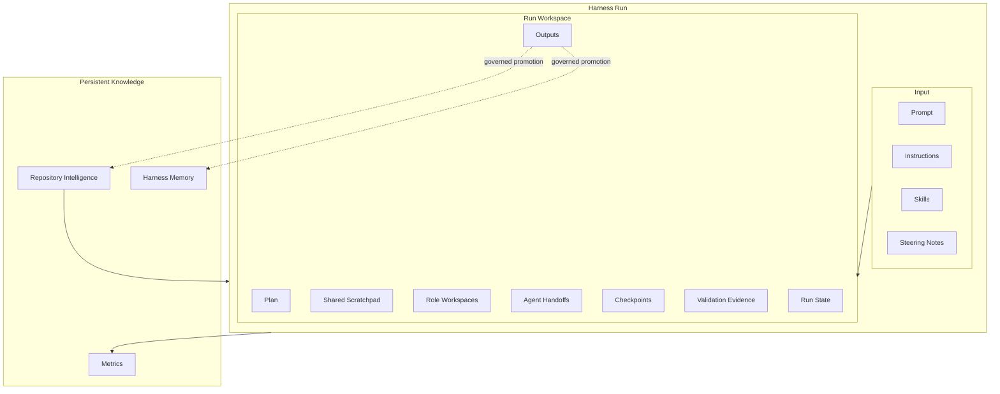

The dotted paths are deliberate.

Nothing moves from temporary execution state into persistent knowledge simply because it exists.

---

## Minimal Versus Full Workspace

Not every task requires every directory.

A low-risk task may use:

```text
{run-id}/
├── input/
├── plan.md
├── scratchpad.md
├── validation/
├── outputs/
└── run-state.json
```

A complex or high-risk task may use the full reference structure.

The important point is not that every directory must always exist.

The important point is that the semantic boundaries remain consistent.

---

## Reference Rule

The Run Workspace should satisfy one simple architectural test:

> **Could another authorized agent or engineer safely continue the run using the workspace, repository state, and governed project sources without relying on the original agent's conversational memory?**

If the answer is yes, the workspace contains enough explicit execution state.

If the answer is no, important state is still trapped inside transient agent context.

The reference Run Workspace therefore serves as the temporary operational memory of a Harness run while preserving a strict boundary between **working state**, **engineering evidence**, and **persistent organizational knowledge**.
Below is a complete lifecycle example you can place immediately after the **Reference Run Workspace Structure** section.

## Complete Run Lifecycle Example

The following example shows how a Run Workspace evolves from creation through completion, knowledge promotion, retention, and cleanup.

The example uses the Alpha Car Detailing scenario:

> Add optional preferred detailing location support to corporate fleet bookings. Existing clients must remain compatible, valid locations must be verified using the approved domain pattern, and the selected location must be included in `FleetBookingCreated`.

The purpose of the example is not simply to show files being created.

It demonstrates how information changes authority and lifecycle as the run progresses.

---

### Lifecycle Overview

A complete Harness run can be represented as:

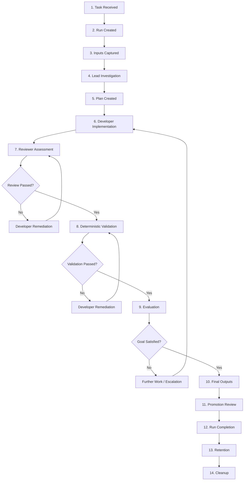

The lifecycle deliberately separates:

```text
implementation
from
review

review
from
validation

validation
from
evaluation

execution
from
knowledge promotion
```

Each transition has different authority and evidence requirements.

---

# Phase 1 — Task Received

The Harness receives the task:

```text
Add optional preferred detailing location support to corporate
fleet bookings.

Requirements:

- Existing clients must remain compatible.
- Location must remain optional.
- Valid locations must be verified.
- Invalid locations must be rejected.
- FleetBookingCreated must include the selected location.
- Existing consumers must remain compatible.
```

At this point no Run Workspace exists.

The task is only an incoming execution request.

The Harness assigns a unique run identifier:

```text
run-2026-10-06-0042
```

The run identifier should never be reused for an unrelated execution.

---

# Phase 2 — Run Workspace Created

The Harness initializes:

```text
harness/
└── runs/
    └── run-2026-10-06-0042/
```

The initial structure is:

```text
run-2026-10-06-0042/
├── input/
├── agents/
├── agent-handoffs/
├── checkpoints/
├── validation/
├── outputs/
├── metadata/
├── plan.md
├── scratchpad.md
└── run-state.json
```

The machine-readable run state begins as:

```json
{
  "runId": "run-2026-10-06-0042",
  "status": "created",
  "currentRole": null,
  "nextRole": "Lead",
  "lastCheckpoint": null,
  "workspaceSchemaVersion": 1
}
```

At this stage the workspace contains no engineering conclusions.

It is simply the execution boundary.

---

# Phase 3 — Inputs Captured

The Harness records the task in:

```text
input/prompt.md
```

For example:

```markdown
# Task

Add optional preferred detailing location support to corporate fleet bookings.

## Acceptance Criteria

1. Requests without LocationId remain valid.
2. Requests with a valid LocationId succeed.
3. Invalid locations are rejected.
4. FleetBookingCreated contains ServiceLocationId.
5. Existing event consumers remain compatible.
6. Existing tests continue to pass.
```

The Harness also records the governing environment.

```text
input/
├── prompt.md
├── instructions-manifest.json
├── skills-manifest.json
└── steering-note.snapshot.md
```

The repository revision at run start is captured:

```json
{
  "repository": "Alpha-Car-Detailing",
  "branch": "feature/fleet-location",
  "startingRevision": "7d92aa1"
}
```

The run state becomes:

```json
{
  "runId": "run-2026-10-06-0042",
  "status": "investigating",
  "currentRole": "Lead",
  "nextRole": null,
  "repositoryRevision": "7d92aa1"
}
```

---

# Phase 4 — Lead Agent Investigation

The Lead Agent begins repository discovery.

The Lead discovers:

```text
CorporateFleetBookingRequest
    has no LocationId.

Booking
    already contains ServiceLocationId.

FleetBookingCreated
    does not contain location information.

Fleet.IntegrationGateway
    consumes FleetBookingCreated.

ADR-012
    appears to conflict with newer location-validation behavior.
```

These findings belong initially in temporary run state.

For example:

```markdown
# Lead Scratchpad

## Observations

### OBS-001

CorporateFleetBookingRequest does not expose LocationId.

Evidence:
src/Booking.Api/Contracts/CorporateFleetBookingRequest.cs

Status:
Observed

### OBS-002

Booking already contains ServiceLocationId.

Evidence:
src/Booking.Domain/Bookings/Booking.cs

Status:
Observed

## Unresolved Questions

### Q-001

Which location-validation architecture is current?

ADR-012 suggests application-layer validation.

Newer implementation appears to use ServiceLocationPolicy.

Status:
Open
```

The Lead does not write:

```text
ServiceLocationPolicy is definitely correct.
```

until evidence supports it.

---

# Phase 5 — Plan Created

After initial investigation, the Lead creates:

```text
plan.md
```

For example:

```markdown
# Execution Plan

## Investigation

1. Verify current location-validation architecture.
2. Identify all FleetBookingCreated consumers.
3. Inspect contract tests.
4. Determine backward-compatible API and event changes.

## Implementation

5. Add optional LocationId.
6. Map LocationId into the application command.
7. Validate location using the approved pattern.
8. Reuse Booking.ServiceLocationId.
9. Add ServiceLocationId to FleetBookingCreated.
10. Update event schema.

## Validation

11. Build.
12. Run unit tests.
13. Run integration tests.
14. Run API contract tests.
15. Run event contract tests.
16. Run architecture checks.
```

The Lead then resolves the architecture question.

Repository Intelligence and ADR-027 confirm:

```text
ServiceLocationPolicy is the current approved pattern.
```

The Lead updates the Scratchpad:

```markdown
### Q-001 — Resolved

ADR-027 supersedes ADR-012.

Approved implementation pattern:
ServiceLocationPolicy

Evidence:
- Repository Intelligence RI-ARCH-041
- ADR-027

Status:
Verified
```

A checkpoint is created.

```text
checkpoints/cp-001.json
```

```json
{
  "checkpointId": "CP-001",
  "role": "Lead",
  "stage": "investigation-complete",
  "repositoryRevision": "7d92aa1",
  "nextRole": "Developer"
}
```

---

# Phase 6 — Lead-to-Developer Handoff

The Lead does not give the Developer its entire Scratchpad.

Instead, the Harness creates:

```text
agent-handoffs/lead-to-developer.md
```

```markdown
# Lead → Developer Handoff

## Goal

Implement preferred detailing location support.

## Verified Repository Context

- Booking already contains ServiceLocationId.
- ADR-027 requires ServiceLocationPolicy.
- Fleet.IntegrationGateway validates FleetBookingCreated schemas.

## Required Implementation

- Add optional LocationId.
- Map it into the command.
- Validate supplied locations.
- Reuse existing Booking behavior.
- Extend FleetBookingCreated.
- Preserve compatibility.

## Required Validation

- build;
- unit tests;
- integration tests;
- API contract tests;
- event contract tests;
- architecture checks.

## Remaining Risk

External consumers outside the repository are not independently verified.
```

The run state becomes:

```json
{
  "status": "implementing",
  "currentRole": "Developer",
  "nextRole": null,
  "lastCheckpoint": "CP-001"
}
```

---

# Phase 7 — Developer Implementation

The Developer Agent creates its own working state:

```text
agents/developer/scratchpad.md
```

The Developer changes:

```text
CorporateFleetBookingRequest.cs
CreateCorporateFleetBookingCommand.cs
CreateCorporateFleetBookingHandler.cs
FleetBookingCreated.cs
FleetBookingEventMapper.cs
contract tests
integration tests
```

A Developer Scratchpad entry might be:

```markdown
## Implementation Decision DEV-DEC-001

Decision:
Use Guid? LocationId in CorporateFleetBookingRequest.

Reason:
Existing clients do not send the field.

Status:
Implemented — compatibility validation pending.
```

Another entry:

```markdown
## Implementation Decision DEV-DEC-002

Decision:
Reuse Booking.AssignServiceLocation(...).

Reason:
Existing domain model represents the requested concept.

Status:
Implemented.
```

The Developer also records:

```text
implemented
```

rather than:

```text
validated
```

because deterministic gates have not run yet.

---

# Phase 8 — Developer Checkpoint

When implementation is complete, the Harness captures:

```text
checkpoints/cp-002.json
```

```json
{
  "checkpointId": "CP-002",
  "role": "Developer",
  "stage": "implementation-complete",
  "repositoryRevision": "7d92aa1",
  "completed": [
    "api-contract-change",
    "command-mapping",
    "location-validation",
    "domain-assignment",
    "event-change",
    "tests"
  ],
  "pending": [
    "review",
    "validation",
    "evaluation"
  ]
}
```

The run state becomes:

```json
{
  "status": "reviewing",
  "currentRole": "Reviewer",
  "lastCheckpoint": "CP-002"
}
```

---

# Phase 9 — Reviewer Agent

The Reviewer receives:

```text
Prompt
Instructions
Acceptance criteria
Implementation diff
Developer handoff
Relevant Repository Intelligence
```

It does not simply trust Developer notes.

Suppose the Reviewer identifies:

```markdown
## REV-001 — Missing Compatibility Regression Test

Severity:
Required

Finding:
No explicit test verifies the original request shape without LocationId.

Acceptance criterion affected:
Existing clients must remain compatible.

Required action:
Add a regression test using the pre-change request payload.
```

The run does not advance to validation.

Instead:

```text
Reviewer
   ↓
Developer remediation
```

The Harness creates:

```text
agent-handoffs/reviewer-to-developer-01.md
```

The Developer adds the missing test.

---

# Phase 10 — Review Repeated

The Reviewer inspects the remediation.

The finding becomes:

```text
REV-001
Status: Resolved
```

Reviewer output:

```markdown
# Review Result

Result:
PASS

Resolved findings:
REV-001

Remaining concerns:
None requiring implementation change.

Ready for deterministic validation:
Yes
```

A checkpoint is created:

```json
{
  "checkpointId": "CP-003",
  "role": "Reviewer",
  "stage": "review-complete",
  "nextRole": "Validator"
}
```

---

# Phase 11 — Deterministic Validation Begins

The Validator executes the required gates.

The `validation/` directory becomes:

```text
validation/
├── attempt-01/
│   ├── build.json
│   ├── unit-tests.trx
│   ├── integration-tests.trx
│   ├── api-contract-tests.json
│   └── event-contract-tests.json
└── gate-summary.json
```

Suppose the first event-contract test fails.

```json
{
  "gate": "event-contract-tests",
  "result": "failed",
  "reason": "published event schema does not contain ServiceLocationId"
}
```

The Validator does not silently edit production code.

Instead:

```text
Validator
    ↓
Failure Evidence
    ↓
Developer
```

The run state becomes:

```json
{
  "status": "implementation-remediation",
  "currentRole": "Developer",
  "failedGate": "event-contract-tests"
}
```

---

# Phase 12 — Developer Remediation

The Developer inspects the deterministic evidence.

The Scratchpad records:

```markdown
## Validation Failure VF-001

Gate:
Event contract tests

Cause:
fleet-booking-created.schema.json was not updated.

Remediation:
Add nullable ServiceLocationId to the published schema.

Status:
Implemented — revalidation required.
```

The Developer fixes the schema.

No previous failed result is deleted.

---

# Phase 13 — Validation Attempt Two

The Validator executes a second attempt.

```text
validation/
├── attempt-01/
│   └── ...
├── attempt-02/
│   ├── build.json
│   ├── unit-tests.trx
│   ├── integration-tests.trx
│   ├── api-contract-tests.json
│   ├── event-contract-tests.json
│   └── architecture-tests.json
└── gate-summary.json
```

The final gate summary is:

```json
{
  "result": "passed",
  "attempt": 2,
  "gates": [
    {
      "name": "build",
      "result": "passed"
    },
    {
      "name": "unit-tests",
      "result": "passed"
    },
    {
      "name": "integration-tests",
      "result": "passed"
    },
    {
      "name": "api-contract-tests",
      "result": "passed"
    },
    {
      "name": "event-contract-tests",
      "result": "passed"
    },
    {
      "name": "architecture-tests",
      "result": "passed"
    }
  ]
}
```

Now the Harness has objective evidence.

The statement:

```text
All required gates passed.
```

is supported by validation artifacts rather than agent confidence.

---

# Phase 14 — Validator-to-Evaluator Handoff

The Harness creates:

```text
agent-handoffs/validator-to-evaluator.md
```

```markdown
# Validator → Evaluator Handoff

## Result

PASS

## Objective Evidence

Build:
PASS

Unit tests:
PASS

Integration tests:
PASS

API compatibility:
PASS

Event compatibility:
PASS

Architecture checks:
PASS

## Validation Iterations

Attempt 1:
Event contract validation failed because the event schema had not
been updated.

Attempt 2:
All gates passed.

## Evidence

See validation/gate-summary.json.
```

---

# Phase 15 — Evaluator Agent

The Evaluator compares:

```text
requested outcome
against
actual implementation and evidence
```

It evaluates each acceptance criterion.

```markdown
# Evaluation

## Result

PASS

## Acceptance Criteria

### AC-001

Existing requests without LocationId remain valid.

Result:
Satisfied

Evidence:
API contract tests

### AC-002

Valid LocationId is accepted.

Result:
Satisfied

Evidence:
Integration tests

### AC-003

Invalid LocationId is rejected.

Result:
Satisfied

Evidence:
Application integration tests

### AC-004

FleetBookingCreated contains ServiceLocationId.

Result:
Satisfied

Evidence:
Event contract tests

### AC-005

Existing consumers remain compatible.

Result:
Satisfied for known repository consumers

Evidence:
Event contract tests

## Residual Risk

External consumers outside the repository were not independently verified.

## Final Assessment

PASS
```

The Evaluator does not remove the residual risk merely because the defined task succeeded.

---

# Phase 16 — Final Outputs Produced

The Harness generates:

```text
outputs/
├── implementation-summary.md
├── changed-files.json
├── review-summary.json
├── evaluation.json
└── promotion-candidates/
```

For example:

```markdown
# Implementation Summary

## Outcome

Preferred detailing location support implemented successfully.

## Changes

- Added optional LocationId to corporate fleet bookings.
- Reused Booking.ServiceLocationId.
- Applied ServiceLocationPolicy validation.
- Added ServiceLocationId to FleetBookingCreated.
- Updated event schema.
- Added backward compatibility coverage.

## Review

PASS

## Validation

PASS after two validation attempts.

## Evaluation

PASS
```

The output is curated.

It is not a copy of the Scratchpad.

---

# Phase 17 — Promotion Candidate Created

During execution, the team discovered something useful:

```text
Fleet.IntegrationGateway performs strict schema validation
for FleetBookingCreated.
```

Suppose that dependency was not already represented in Repository Intelligence.

The Harness creates:

```text
outputs/promotion-candidates/pc-001.md
```

```markdown
# Promotion Candidate PC-001

## Proposed Knowledge

Fleet.IntegrationGateway performs strict schema validation for
FleetBookingCreated.

## Evidence

- Fleet.IntegrationGateway consumer implementation
- published event schema
- event contract tests
- validation results from run-2026-10-06-0042

## Proposed Destination

Repository Intelligence

## Scope

FleetBookingCreated event contract.

## Freshness Trigger

Revalidate if Fleet.IntegrationGateway event handling changes.

## Status

Pending governance review.
```

The Scratchpad has not become permanent knowledge.

A specific verified statement has been extracted as a candidate.

---

# Phase 18 — Promotion Governance

A governance process reviews `PC-001`.

Possible outcomes are:

```text
Approved
Rejected
Needs More Evidence
Duplicate
Superseded
```

Suppose it is approved.

Repository Intelligence is updated through its governed mechanism.

The promotion record becomes:

```json
{
  "candidateId": "PC-001",
  "decision": "approved",
  "destination": "Repository Intelligence",
  "sourceRun": "run-2026-10-06-0042"
}
```

The important distinction is:

```text
Scratchpad entry
    did not become
Repository Intelligence

Verified promotion candidate
    became
Repository Intelligence
```

---

# Phase 19 — Run Completion

After evaluation and promotion processing, the Harness marks the run complete.

```json
{
  "runId": "run-2026-10-06-0042",
  "status": "completed",
  "startingRevision": "7d92aa1",
  "endingRevision": "b81f7c9",
  "reviewStatus": "passed",
  "validationStatus": "passed",
  "validationAttempts": 2,
  "evaluationStatus": "passed",
  "lastCheckpoint": "CP-005"
}
```

The final checkpoint may be:

```text
CP-005 — Run Complete
```

At this point the active execution lifecycle has ended.

---

# Phase 20 — Metrics Recorded

The Harness can now record structured operational metrics such as:

```json
{
  "runId": "run-2026-10-06-0042",
  "reviewIterations": 2,
  "validationAttempts": 2,
  "reviewFindings": 1,
  "failedGates": 1,
  "promotionCandidates": 1,
  "finalOutcome": "passed"
}
```

These metrics should come from structured run events.

They should not be reconstructed by asking an AI Agent to interpret the Scratchpad.

---

# Phase 21 — Retention Applied

Completion does not mean every file is immediately deleted.

Different artifact categories receive different retention treatment.

For example:

| Artifact | Retention Intent |
| --- | --- |
| Prompt snapshot | Audit retention |
| Input manifests | Audit/reproducibility retention |
| Shared Scratchpad | Short troubleshooting retention |
| Role Scratchpads | Short troubleshooting retention |
| Handoffs | Medium-term operational retention |
| Validation evidence | Engineering/audit retention |
| Final evaluation | Audit retention |
| Metrics | Long-term aggregate retention |
| Promotion decision | Knowledge-governance retention |

The Harness records the retention state:

```json
{
  "runId": "run-2026-10-06-0042",
  "status": "retained",
  "temporaryStateExpires": "policy-defined",
  "validationEvidence": "archive",
  "promotionReviewComplete": true
}
```

---

# Phase 22 — Temporary State Cleanup

When the temporary retention period ends, the Harness removes state that no longer serves an operational purpose.

For example:

```text
Deleted:
agents/lead/scratchpad.md
agents/developer/scratchpad.md
agents/reviewer/scratchpad.md
shared scratchpad.md
temporary tool output
```

while retaining required artifacts such as:

```text
Prompt snapshot
Run manifest
Validation evidence
Final evaluation
Metrics
Promotion decisions
```

The exact policy is organization-specific.

The architectural principle is:

> Cleanup should remove temporary state without destroying required evidence or governed knowledge.

---

# Failure and Resume Variant

The lifecycle must also support interruption.

Suppose the Developer Agent is interrupted after checkpoint `CP-002`.

At the time of interruption:

```json
{
  "status": "interrupted",
  "currentRole": "Developer",
  "lastCheckpoint": "CP-002",
  "repositoryRevision": "7d92aa1"
}
```

Before the run resumes, the repository advances to:

```text
91cc341
```

and:

```text
FleetBookingCreated.cs
```

has changed.

The Harness must not immediately continue.

The recovery sequence becomes:

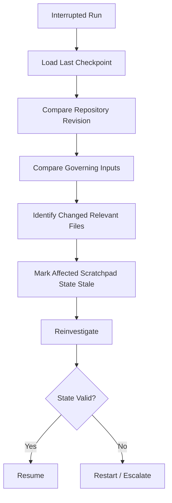

A stale entry might be preserved as:

```markdown
### OBS-007

Previous statement:
FleetBookingCreated contains four properties.

Status:
STALE

Reason:
FleetBookingCreated.cs changed after CP-002.

Replacement:
See OBS-014.
```

The resumed agent then records:

```markdown
### OBS-014

Current FleetBookingCreated additionally contains
CorrelationReference.

Evidence:
Repository revision 91cc341.

Status:
Observed
```

Only after revalidation does the run continue.

---

# Retry Variant

A retry is different from a resume.

Suppose validation fails repeatedly and the run is terminated.

The Harness may start:

```text
run-2026-10-06-0043
```

or explicitly model:

```text
run-2026-10-06-0042/
├── attempt-01/
└── attempt-02/
```

The important requirement is that previous temporary state not silently contaminate the new attempt.

Relevant verified knowledge may be intentionally carried forward.

Temporary assumptions should not be inherited automatically.

---

# Cancelled Run Variant

Suppose a Product Owner cancels the feature during implementation.

The run becomes:

```json
{
  "status": "cancelled",
  "reason": "business-priority-change"
}
```

Cancellation should still trigger lifecycle processing:

```text
Cancel
   ↓
Record final state
   ↓
Preserve required evidence
   ↓
Apply cancelled-run retention policy
   ↓
Cleanup
```

Cancelled workspaces should not remain indefinitely simply because they never reached normal completion.

---

# Lifecycle State Model

A reference state model might be:

```text
Created
   ↓
Investigating
   ↓
Planned
   ↓
Implementing
   ↓
Reviewing
   ↓
Validating
   ↓
Evaluating
   ↓
Completed
```

with alternate transitions:

```text
Implementing → Interrupted
Reviewing → Implementing
Validating → Implementing
Evaluating → Implementing
Any active state → Paused
Any active state → Cancelled
Any active state → Failed
```

A C# representation might be:

```csharp
public enum HarnessRunStatus
{
    Created,
    Investigating,
    Planned,
    Implementing,
    Reviewing,
    Validating,
    Evaluating,

    Paused,
    Interrupted,

    Completed,
    Failed,
    Cancelled
}
```

The exact status names may vary.

What matters is that lifecycle state is explicit and machine-readable.

---

# Complete Lifecycle and Artifact Relationship

The full lifecycle can be summarized as:

```text
Task Received
     │
     ▼
Prompt Captured
     │
     ▼
Run Workspace Created
     │
     ▼
Repository Investigation
     │
     ├── observations
     ├── assumptions
     └── unresolved questions
     │
     ▼
Plan
     │
     ▼
Lead Handoff
     │
     ▼
Implementation
     │
     ├── Developer Scratchpad
     └── Changed Files
     │
     ▼
Review
     │
     ├── Findings
     └── Remediation
     │
     ▼
Deterministic Validation
     │
     ├── failed evidence
     ├── remediation
     └── passing evidence
     │
     ▼
Evaluation
     │
     ▼
Final Outputs
     │
     ├── implementation summary
     ├── evaluation
     └── promotion candidates
     │
     ▼
Governance
     │
     ├── Repository Intelligence
     └── Harness Memory
     │
     ▼
Completion
     │
     ▼
Retention
     │
     ▼
Cleanup
```

---

## What Survives the Lifecycle

The lifecycle intentionally reduces the amount of information retained.

During the run:

```text
many observations
many assumptions
temporary decisions
working notes
failed attempts
```

After the run:

```text
required evidence
curated outputs
metrics
approved persistent knowledge
```

This is an important enterprise property.

The objective is not:

```text
remember everything
```

The objective is:

```text
retain what has earned persistence
```

---

## Lifecycle Authority Model

At each stage, a different artifact answers a different question.

| Lifecycle Question | Authoritative Source |
| --- | --- |
| What was requested? | Prompt |
| What strategy was chosen? | Plan |
| What is currently being investigated? | Scratchpad |
| What did one role tell another? | Handoff |
| What code changed? | Repository/source-control evidence |
| Did objective checks pass? | Validation evidence |
| Did the implementation satisfy the goal? | Evaluation |
| What should future runs know about the repository? | Repository Intelligence |
| What should the Harness learn across runs? | Harness Memory |

This table prevents authority drift across the lifecycle.

---

## Lifecycle Principle

A complete Run Workspace lifecycle should make it possible to answer four questions at any time:

> **Where is the run now?**

> **What evidence supports its current state?**

> **What temporary information may no longer be trusted?**

> **What, if anything, deserves to survive after the run ends?**

If the Harness can answer those questions consistently, the Run Workspace is functioning as more than a temporary folder.

It has become a controlled execution-state architecture.

The final principle is:

> **A run begins with authoritative inputs, creates temporary working state, produces deterministic evidence and curated outputs, and ends by retaining only the information that policy and governance determine should survive.**
The checkpoint sequence should first be normalized as **CP-001 through CP-005**, with each checkpoint representing a stable lifecycle boundary. Then the concise lifecycle state table can follow it.

## Checkpoint Numbering Convention

The complete lifecycle example should use one consistent checkpoint sequence.

The earlier example creates `CP-001`, `CP-002`, and `CP-003`, but later refers to `CP-005` as the final checkpoint without explicitly defining `CP-004`. To remove that inconsistency, use the following reference convention:

| Checkpoint | Stable Boundary | Created By | Meaning |
| --- | --- | --- | --- |
| `CP-001` | Investigation Complete | Lead Agent | Repository investigation and initial planning are complete; work is ready for implementation. |
| `CP-002` | Implementation Complete | Developer Agent | Planned implementation changes are complete and ready for independent review. |
| `CP-003` | Review Complete | Reviewer Agent | Required review findings have been resolved and the implementation is ready for deterministic validation. |
| `CP-004` | Validation Complete | Validator Agent | All required deterministic gates have completed successfully and evidence has been captured. |
| `CP-005` | Evaluation Complete / Run Complete | Evaluator Agent / Harness | Acceptance criteria and intended outcome have been evaluated successfully; the active run can complete. |

This creates the stable progression:

```text id="checkpoint-sequence"
CP-001
Investigation Complete
        ↓
CP-002
Implementation Complete
        ↓
CP-003
Review Complete
        ↓
CP-004
Validation Complete
        ↓
CP-005
Evaluation Complete / Run Complete
```

A checkpoint represents a **stable recovery boundary**, not every transition in the workflow.

For example, a failed validation attempt does not automatically create another numbered lifecycle checkpoint:

```text id="checkpoint-validation-failure"
CP-003
Review Complete
    ↓
Validation Attempt 1
    ↓
FAIL
    ↓
Developer Remediation
    ↓
Validation Attempt 2
    ↓
PASS
    ↓
CP-004
Validation Complete
```

Validation attempts should instead be represented under:

```text id="checkpoint-validation-storage"
validation/
├── attempt-01/
├── attempt-02/
└── gate-summary.json
```

This keeps checkpoint numbering stable even when a run requires multiple implementation, review, or validation iterations.

Similarly, Reviewer remediation does not require:

```text id="checkpoint-bad-numbering"
CP-003
CP-003A
CP-003B
```

unless the Harness deliberately supports nested checkpoint semantics.

For the reference architecture, the simpler rule is preferred:

> **Number checkpoints by stable lifecycle boundary, not by every execution attempt.**

### Corrected `CP-004`

After deterministic validation succeeds, create:

```text id="checkpoint-cp004-file"
checkpoints/cp-004.json
```

```json id="checkpoint-cp004"
{
  "checkpointId": "CP-004",
  "runId": "run-2026-10-06-0042",
  "role": "Validator",
  "stage": "validation-complete",
  "repositoryRevision": "b81f7c9",
  "validationResult": "passed",
  "validationAttempts": 2,
  "nextRole": "Evaluator"
}
```

The run state then becomes:

```json id="checkpoint-cp004-state"
{
  "status": "evaluating",
  "currentRole": "Evaluator",
  "nextRole": null,
  "lastCheckpoint": "CP-004"
}
```

### Corrected `CP-005`

After the Evaluator determines that the intended goal and acceptance criteria have been satisfied, create:

```text id="checkpoint-cp005-file"
checkpoints/cp-005.json
```

```json id="checkpoint-cp005"
{
  "checkpointId": "CP-005",
  "runId": "run-2026-10-06-0042",
  "role": "Evaluator",
  "stage": "evaluation-complete",
  "repositoryRevision": "b81f7c9",
  "evaluationResult": "passed",
  "nextRole": null
}
```

The Harness can then transition the run itself to:

```json id="checkpoint-final-run-state"
{
  "runId": "run-2026-10-06-0042",
  "status": "completed",
  "startingRevision": "7d92aa1",
  "endingRevision": "b81f7c9",
  "reviewStatus": "passed",
  "validationStatus": "passed",
  "validationAttempts": 2,
  "evaluationStatus": "passed",
  "lastCheckpoint": "CP-005"
}
```

This resolves the checkpoint numbering consistently across the entire lifecycle.

---

## Concise Run Lifecycle State Table

The following table provides the stable reference lifecycle for a Harness run.

| State | Primary Owner | Purpose | Typical Exit Condition | Stable Checkpoint |
| --- | --- | --- | --- | --- |
| `Created` | Harness | Initialize run identity and workspace | Inputs captured | — |
| `Investigating` | Lead Agent | Discover repository evidence, risks, dependencies, and constraints | Investigation sufficient to define approach | `CP-001` |
| `Planned` | Lead Agent | Establish execution strategy and handoff | Developer work authorized | `CP-001` |
| `Implementing` | Developer Agent | Modify the solution to satisfy the Prompt | Implementation ready for independent review | `CP-002` |
| `Reviewing` | Reviewer Agent | Independently assess implementation quality and alignment | Required findings resolved | `CP-003` |
| `Validating` | Validator Agent | Execute deterministic engineering gates | All required gates pass | `CP-004` |
| `Evaluating` | Evaluator Agent | Assess goal and acceptance-criteria satisfaction | Outcome classified | `CP-005` |
| `Completed` | Harness | Close active execution and finalize outputs | Retention processing begins | `CP-005` |
| `Paused` | Harness / Human | Deliberately suspend execution | Authorized resume | Last valid checkpoint |
| `Interrupted` | Harness | Record unexpected execution loss | Recovery and revalidation succeed | Last valid checkpoint |
| `Failed` | Harness | End a run that cannot proceed successfully | Retention and failure processing begin | Last valid checkpoint |
| `Cancelled` | Harness / Human | End execution intentionally | Retention and cleanup begin | Last valid checkpoint |

The normal successful lifecycle is therefore:

```text id="stable-lifecycle"
Created
   ↓
Investigating / Planned
   ↓
CP-001
   ↓
Implementing
   ↓
CP-002
   ↓
Reviewing
   ↓
CP-003
   ↓
Validating
   ↓
CP-004
   ↓
Evaluating
   ↓
CP-005
   ↓
Completed
   ↓
Retention
   ↓
Cleanup
```

The table intentionally distinguishes **lifecycle states** from **checkpoints**.

A state describes:

> **What is the Harness doing now?**

A checkpoint describes:

> **What stable execution boundary can the Harness safely recover from?**

They should not be treated as the same concept.

For example, a run may move repeatedly between:

```text id="lifecycle-loop"
Implementing
    ↓
Reviewing
    ↓
Implementing
    ↓
Reviewing
```

before `CP-003` is created.

Likewise:

```text id="validation-loop"
Validating
    ↓
Implementing
    ↓
Validating
```

may happen several times before `CP-004`.

The checkpoint is created only when that lifecycle boundary has been successfully reached.

> **Lifecycle states describe execution movement. Checkpoints identify stable recovery boundaries within that movement.**
The ambiguity comes from treating **investigation complete** and **planning complete** as if they were the same lifecycle boundary. They should be separated conceptually, even if the Harness chooses to checkpoint only once.

## Resolving the `CP-001` Planning Ambiguity

The earlier lifecycle model used `CP-001` for both:

- investigation complete; and
- planning complete.

That creates ambiguity because the Lead Agent may finish repository investigation before the execution Plan is finalized.

The cleaner model is:

```text
Investigation
    ↓
Plan Creation / Revision
    ↓
Lead Handoff
    ↓
CP-001
```

`CP-001` should therefore represent:

> **Lead Phase Complete — investigation is sufficient, the execution Plan is finalized for the current run state, and the Developer handoff is ready.**

This makes `CP-001` a true stable recovery boundary rather than an intermediate investigation milestone.

---

## Corrected `CP-001` Definition

| Checkpoint | Stable Boundary | Created By | Meaning |
|---|---|---|---|
| `CP-001` | Lead Phase Complete | Lead Agent | Required repository investigation is complete, material questions have been resolved or explicitly carried forward, `plan.md` is ready for execution, and the Lead-to-Developer handoff has been produced. |

The normal Lead lifecycle becomes:

```text
Created
   ↓
Investigating
   ↓
Planning
   ↓
Lead Handoff
   ↓
CP-001
   ↓
Implementing
```

This avoids implying that an investigation-only state is already safe for Developer execution.

---

## Investigation Is Not Yet `CP-001`

Suppose the Lead Agent has discovered:

```text
CorporateFleetBookingRequest has no LocationId.

Booking already contains ServiceLocationId.

ADR-012 conflicts with newer implementation behavior.
```

At this point, investigation has produced useful state, but the task is not yet ready for Developer execution.

The Scratchpad might contain:

```markdown
## Investigation Status

Repository discovery:
Complete enough to identify relevant architecture.

Unresolved:
Current location-validation authority.

Plan:
Not finalized.

Developer handoff:
Not ready.
```

This is **not** `CP-001`.

The run remains in the Lead phase.

---

## Planning Follows Investigation

The Lead then resolves the architecture question:

```text
ADR-027 supersedes ADR-012.

ServiceLocationPolicy is the current approved approach.
```

The Lead updates `plan.md`:

```markdown
# Execution Plan

1. Add optional LocationId to the request.
2. Map LocationId into the application command.
3. Validate supplied locations using ServiceLocationPolicy.
4. Reuse Booking.ServiceLocationId.
5. Extend FleetBookingCreated.
6. Update the event schema.
7. Add backward-compatibility tests.
8. Run required deterministic gates.
```

The Lead also produces:

```text
agent-handoffs/lead-to-developer.md
```

Only now has the Lead phase reached a stable boundary.

---

## `CP-001` Example

The corrected checkpoint should look like:

```json
{
  "checkpointId": "CP-001",
  "runId": "run-2026-10-06-0042",
  "role": "Lead",
  "stage": "lead-phase-complete",
  "repositoryRevision": "7d92aa1",
  "planStatus": "ready",
  "handoffStatus": "ready",
  "unresolvedQuestions": [
    "External FleetBookingCreated consumers remain unverified."
  ],
  "nextRole": "Developer"
}
```

The checkpoint means:

```text
Investigation sufficient
        +
Plan finalized for execution
        +
Material risks recorded
        +
Developer handoff ready
        =
CP-001
```

---

## Updated Checkpoint Convention

The complete sequence should now be:

| Checkpoint | Stable Boundary | Meaning |
| --- | --- | --- |
| `CP-001` | Lead Phase Complete | Investigation, planning, and Developer handoff are complete enough for implementation to begin. |
| `CP-002` | Implementation Complete | Developer implementation is ready for independent review. |
| `CP-003` | Review Complete | Required Reviewer findings are resolved and deterministic validation may begin. |
| `CP-004` | Validation Complete | Required deterministic gates have passed and evidence has been captured. |
| `CP-005` | Evaluation Complete | Goal and acceptance criteria have been evaluated successfully; active execution may complete. |

The corrected stable progression is:

```text
Lead Investigation
      ↓
Lead Planning
      ↓
Lead Handoff
      ↓
CP-001
      ↓
Developer Implementation
      ↓
CP-002
      ↓
Reviewer
      ↓
CP-003
      ↓
Validator
      ↓
CP-004
      ↓
Evaluator
      ↓
CP-005
      ↓
Completed
```

---

## Updated Lifecycle State Table

The lifecycle table should also avoid using the same checkpoint for both `Investigating` and `Planned`.

| State | Primary Owner | Purpose | Exit Condition | Checkpoint |
| --- | --- | --- | --- | --- |
| `Created` | Harness | Initialize the run and capture inputs | Lead execution begins | — |
| `Investigating` | Lead Agent | Gather repository evidence, dependencies, risks, and unresolved questions | Sufficient evidence exists to define the approach | — |
| `Planning` | Lead Agent | Convert investigation into an executable strategy and handoff | Plan and Developer handoff are ready | `CP-001` |
| `Implementing` | Developer Agent | Modify the solution | Implementation ready for review | `CP-002` |
| `Reviewing` | Reviewer Agent | Independently review the implementation | Required findings resolved | `CP-003` |
| `Validating` | Validator Agent | Execute deterministic gates | Required gates pass | `CP-004` |
| `Evaluating` | Evaluator Agent | Assess goal and acceptance-criteria satisfaction | Outcome accepted | `CP-005` |
| `Completed` | Harness | Close active execution | Retention begins | `CP-005` |

This gives `CP-001` one unambiguous meaning:

> **The Lead Agent has finished enough investigation and planning to hand an executable task to the Developer Agent.**

It is not merely an investigation checkpoint, and it is not created before `plan.md` and the Lead-to-Developer handoff are ready.

## Aligning Checkpoint and State Terminology

The lifecycle terminology should use one consistent distinction:

> **State describes where the run currently is. Checkpoint records that a stable lifecycle boundary has been reached.**

A checkpoint is therefore not a synonym for a state.

For example:

```text
State:
Planning

Checkpoint:
CP-001 — Lead Phase Complete
```

The run may spend time in a state, move backward to an earlier state, or revisit a state multiple times.

A checkpoint is created only when the corresponding stable boundary has been successfully reached.

---

## Reference State Terminology

Use the following lifecycle states consistently throughout the chapter:

```text
Created
Investigating
Planning
Implementing
Reviewing
Validating
Evaluating
Completed
Paused
Interrupted
Failed
Cancelled
```

These states answer:

> **What phase of execution is the Harness currently in?**

The normal successful sequence is:

```text
Created
   ↓
Investigating
   ↓
Planning
   ↓
Implementing
   ↓
Reviewing
   ↓
Validating
   ↓
Evaluating
   ↓
Completed
```

The terms should be used as verbs or active lifecycle phases.

Prefer:

```text
status = "validating"
```

over:

```text
status = "validation-complete"
```

because `validation-complete` describes a boundary, not an active state.

---

## Reference Checkpoint Terminology

Use checkpoints to represent stable completion boundaries:

| Checkpoint | Canonical Name | Boundary Reached |
| --- | --- | --- |
| `CP-001` | Lead Phase Complete | Investigation, planning, and Lead-to-Developer handoff are ready. |
| `CP-002` | Implementation Complete | Developer implementation is ready for independent review. |
| `CP-003` | Review Complete | Required review findings are resolved and validation may begin. |
| `CP-004` | Validation Complete | Required deterministic gates have passed and evidence has been captured. |
| `CP-005` | Evaluation Complete | Goal and acceptance criteria have been evaluated successfully. |

These names should be used consistently in:

```text
checkpoint files
run-state.json
handoffs
diagrams
examples
resume logic
audit records
```

Avoid alternate names such as:

```text
Investigation Complete
Plan Complete
Ready for Validation
Run Complete Checkpoint
```

when referring to these same canonical boundaries.

---

## State-to-Checkpoint Alignment

The canonical relationship is:

| Active State | Stable Exit Boundary | Checkpoint Created |
| --- | --- | --- |
| `Created` | Run initialized and Lead work begins | — |
| `Investigating` | Investigation is sufficient for planning | — |
| `Planning` | Lead phase is ready for Developer execution | `CP-001 — Lead Phase Complete` |
| `Implementing` | Implementation is ready for review | `CP-002 — Implementation Complete` |
| `Reviewing` | Required findings are resolved | `CP-003 — Review Complete` |
| `Validating` | Required deterministic gates pass | `CP-004 — Validation Complete` |
| `Evaluating` | Goal and acceptance criteria are successfully evaluated | `CP-005 — Evaluation Complete` |
| `Completed` | Active execution has ended | Uses `CP-005` as the last stable checkpoint |

This is the key distinction:

```text
Planning
    ↓
CP-001 — Lead Phase Complete
    ↓
Implementing
```

not:

```text
CP-001
    =
Planning
```

---

## Checkpoints Mark Transitions

A useful mental model is:

```text
State
   ↓
Work occurs
   ↓
Exit condition satisfied
   ↓
Checkpoint created
   ↓
Next state
```

For example:

```text
Reviewing
    ↓
Reviewer examines implementation
    ↓
Required findings resolved
    ↓
CP-003 — Review Complete
    ↓
Validating
```

The checkpoint sits between lifecycle phases.

---

## Correct `run-state.json` Terminology

While implementation is underway:

```json
{
  "runId": "run-2026-10-06-0042",
  "status": "implementing",
  "currentRole": "Developer",
  "lastCheckpoint": "CP-001",
  "nextRole": null
}
```

When implementation completes, the Harness creates:

```text
CP-002 — Implementation Complete
```

and transitions the state to:

```json
{
  "runId": "run-2026-10-06-0042",
  "status": "reviewing",
  "currentRole": "Reviewer",
  "lastCheckpoint": "CP-002",
  "nextRole": null
}
```

The run is not in an `implementation-complete` state.

`Implementation Complete` is the checkpoint.

`Reviewing` is the new state.

---

## Correct Validation Terminology

During validation:

```json
{
  "status": "validating",
  "currentRole": "Validator",
  "lastCheckpoint": "CP-003"
}
```

If validation fails:

```text
Validating
    ↓
Gate Failure
    ↓
Implementing
```

The last stable checkpoint remains:

```text
CP-003 — Review Complete
```

After Developer remediation, the run may return to:

```text
Reviewing
```

if the change requires renewed independent review, or directly to `Validating` only if Harness policy explicitly permits that transition.

When all required gates pass:

```text
CP-004 — Validation Complete
```

is created, and the run moves to:

```text
Evaluating
```

---

## Correct Evaluation Terminology

During evaluation:

```json
{
  "status": "evaluating",
  "currentRole": "Evaluator",
  "lastCheckpoint": "CP-004"
}
```

When evaluation succeeds:

```text
CP-005 — Evaluation Complete
```

is created.

The Harness then transitions to:

```json
{
  "status": "completed",
  "currentRole": null,
  "lastCheckpoint": "CP-005"
}
```

This keeps `Completed` as a Harness lifecycle state rather than inventing a separate `Run Complete` checkpoint.

`CP-005` is the final execution checkpoint.

`Completed` is the resulting terminal state.

---

## Failure and Interruption Terminology

`Interrupted`, `Paused`, `Failed`, and `Cancelled` are lifecycle states.

They are not checkpoints.

For example:

```json
{
  "status": "interrupted",
  "currentRole": "Developer",
  "lastCheckpoint": "CP-001"
}
```

This means:

- the run was interrupted while implementing;
- the last stable recovery boundary was `CP-001`;
- work after `CP-001` may require recovery analysis.

Do not create:

```text
CP-INTERRUPTED
```

or:

```text
CP-FAILED
```

as part of the normal reference model.

Interruption and failure are execution conditions, not successful lifecycle boundaries.

---

## Resume Terminology

On resume, the Harness starts from the last valid checkpoint but returns to an active lifecycle state.

For example:

```text
Interrupted
Last checkpoint: CP-002
```

After recovery validation:

```text
Interrupted
    ↓
Recovery / Revalidation
    ↓
Reviewing
```

or another appropriate active state.

The checkpoint answers:

> **What stable boundary was previously reached?**

The state answers:

> **What work should now continue?**

---

## Retry Terminology

A retry should also be separated from lifecycle state.

`Retry` is an execution relationship or attempt concept, not one of the core states.

For example:

```text
Run 0042
Attempt 1
    ↓
Failed

Run 0043
Attempt 2
```

or:

```text
Run 0042
├── attempt-01
└── attempt-02
```

Do not add a generic lifecycle state:

```text
Retrying
```

unless the Harness genuinely needs it for orchestration.

The reference model can remain simpler.

---

## Canonical Lifecycle Diagram

Use this terminology consistently:

```text
Created
   ↓
Investigating
   ↓
Planning
   ↓
CP-001 — Lead Phase Complete
   ↓
Implementing
   ↓
CP-002 — Implementation Complete
   ↓
Reviewing
   ↓
CP-003 — Review Complete
   ↓
Validating
   ↓
CP-004 — Validation Complete
   ↓
Evaluating
   ↓
CP-005 — Evaluation Complete
   ↓
Completed
   ↓
Retention
   ↓
Cleanup
```

Alternative paths may move backward:

```text
Reviewing
   ↓
Required Changes
   ↓
Implementing
```

or:

```text
Validating
   ↓
Gate Failure
   ↓
Implementing
```

or:

```text
Evaluating
   ↓
Outcome Gap
   ↓
Implementing
```

but a new checkpoint is created only when the corresponding stable boundary is reached again.

---

## Canonical Terminology Rule

Use the following rule throughout the chapter:

> **Lifecycle states use active execution terms: `Investigating`, `Planning`, `Implementing`, `Reviewing`, `Validating`, and `Evaluating`. Checkpoints use completed boundary terms: `Lead Phase Complete`, `Implementation Complete`, `Review Complete`, `Validation Complete`, and `Evaluation Complete`.**

This produces a clean semantic relationship:

```text
Active State
    → work is happening

Checkpoint
    → stable boundary has been reached

Terminal State
    → active run execution has ended
```

That terminology should remain fixed throughout the Run Workspace architecture and later Harness implementation chapters.

## Checkpoint Creation Requirements

A checkpoint should be created only when the run reaches a **stable, recoverable lifecycle boundary**.

The purpose of a checkpoint is not to record that activity occurred.

Its purpose is to establish:

> **A known execution state from which the Harness can safely recover, resume, audit, or hand control to the next lifecycle phase.**

A checkpoint therefore requires more than a status update.

It must satisfy explicit creation requirements.

---

## Core Checkpoint Rule

A checkpoint may be created only when all of the following are true:

1. the current lifecycle phase has satisfied its exit condition;
2. required artifacts for that phase exist;
3. required unresolved issues have been resolved, accepted, or explicitly carried forward;
4. repository and workspace state have been captured;
5. the next allowed lifecycle state is known;
6. recovery from the checkpoint would be meaningful and safe.

If these conditions are not met, the run remains in the current state.

---

## General Requirements for Every Checkpoint

Every checkpoint should contain, either directly or through referenced artifacts, the following information.

### 1. Checkpoint Identity

Each checkpoint must have a unique identifier within the run.

For example:

```text id="cp-identity"
CP-001
CP-002
CP-003
CP-004
CP-005
```

The identifier should remain stable after creation.

Do not reuse an identifier for a different lifecycle boundary.

---

### 2. Run Identity

The checkpoint must identify the run it belongs to.

```json id="cp-run-id"
{
  "checkpointId": "CP-002",
  "runId": "run-2026-10-06-0042"
}
```

A checkpoint must never be interpreted independently of its run.

---

### 3. Canonical Checkpoint Name

The checkpoint should use the canonical lifecycle terminology.

For example:

```json id="cp-name"
{
  "checkpointId": "CP-002",
  "name": "Implementation Complete"
}
```

Use the fixed names:

```text id="cp-canonical-names"
CP-001 — Lead Phase Complete
CP-002 — Implementation Complete
CP-003 — Review Complete
CP-004 — Validation Complete
CP-005 — Evaluation Complete
```

---

### 4. Lifecycle State Being Exited

The checkpoint should identify which active state has successfully completed.

For example:

```json id="cp-exit-state"
{
  "exitedState": "implementing"
}
```

This improves traceability.

For `CP-002`:

```text id="cp-example-transition"
Implementing
    ↓
CP-002 — Implementation Complete
    ↓
Reviewing
```

---

### 5. Repository Revision

The current repository revision must be captured.

For example:

```json id="cp-revision"
{
  "repositoryRevision": "b81f7c9"
}
```

This provides a freshness boundary for:

- observations;
- decisions;
- changed files;
- validation evidence;
- recovery.

A checkpoint without repository context is weak for resumability.

---

### 6. Working Tree State

The Harness should record whether the workspace contains uncommitted changes.

For example:

```json id="cp-working-tree"
{
  "workingTree": {
    "status": "modified",
    "changedFilesReference": "../agents/developer/changed-files.json"
  }
}
```

This matters because:

```text id="cp-revision-warning"
same Git revision
    does not necessarily mean
same working tree
```

A partially modified working tree can materially affect recovery.

---

### 7. Required Phase Artifacts Exist

A checkpoint should not be created if required artifacts are missing.

For example, `CP-002 — Implementation Complete` may require:

```text id="cp002-required-artifacts"
Developer result
Changed-files record
Developer handoff
Current implementation
Relevant Scratchpad state
```

The checkpoint should reference important artifacts rather than duplicate them.

For example:

```json id="cp-artifacts"
{
  "artifacts": {
    "developerResult": "../agents/developer/result.md",
    "changedFiles": "../agents/developer/changed-files.json",
    "handoff": "../agent-handoffs/developer-to-reviewer.md"
  }
}
```

---

### 8. Material Questions Have a Disposition

A checkpoint does not require every question in the Scratchpad to disappear.

It does require every **material** unresolved question to have a clear disposition.

Valid dispositions include:

```text id="cp-question-dispositions"
Resolved
Accepted Risk
Deferred
Escalated
Not Blocking Next Phase
```

For example:

```json id="cp-open-risk"
{
  "unresolvedItems": [
    {
      "id": "Q-005",
      "status": "accepted-risk",
      "statement": "External event consumers were not independently verified."
    }
  ]
}
```

A question should not remain silently open when it affects the next phase.

---

### 9. Required Findings Are Resolved for the Boundary

For checkpoints following independent assessment, blocking findings must be resolved.

For example, `CP-003 — Review Complete` must not be created while a required Reviewer finding remains open.

This is invalid:

```text id="cp-invalid-review"
REV-004 — Required
Status: Open

CP-003 — Review Complete
```

The two statements conflict.

The checkpoint should be blocked.

---

### 10. Required Evidence Exists

Where the phase depends on objective evidence, that evidence must exist before checkpoint creation.

For example:

```text id="cp004-evidence"
CP-004 — Validation Complete
```

requires deterministic evidence showing the required gates passed.

The Validator writing:

```text id="cp-bad-evidence"
Everything looks good.
```

is insufficient.

The checkpoint must reference:

```text id="cp-validation-evidence"
validation/gate-summary.json
```

or equivalent structured evidence.

---

### 11. Next State Is Known and Allowed

The checkpoint should identify the next normal lifecycle state.

For example:

```json id="cp-next-state"
{
  "nextState": "reviewing"
}
```

The Harness should validate that the transition is legal.

For example:

```text id="cp-valid-transition"
CP-002 — Implementation Complete
    ↓
Reviewing
```

is valid.

A direct transition such as:

```text id="cp-invalid-transition"
CP-002
    ↓
Completed
```

should not be allowed in the reference lifecycle.

---

### 12. Checkpoint Timestamp

The checkpoint should capture when the stable boundary was reached.

For example:

```json id="cp-time"
{
  "createdAt": "2026-10-06T17:10:31Z"
}
```

Timestamps help with:

- auditability;
- staleness;
- operational diagnostics;
- elapsed-time metrics.

---

### 13. Workspace Schema Version

The checkpoint should identify the workspace schema it follows.

For example:

```json id="cp-schema-version"
{
  "workspaceSchemaVersion": 1
}
```

This becomes important when the Run Workspace structure evolves.

---

### 14. Checkpoint Must Be Durable Before State Transition

A key reliability rule is:

> **Persist the checkpoint before moving the run into the next lifecycle state.**

The order should be:

```text id="cp-persistence-order"
Current phase work complete
        ↓
Checkpoint constructed
        ↓
Checkpoint persisted successfully
        ↓
Run state updated
        ↓
Next phase begins
```

Not:

```text id="cp-bad-order"
Move to next phase
        ↓
Try to save checkpoint
        ↓
Save fails
```

Otherwise, the Harness can enter a state with no valid recovery boundary.

---

## Checkpoint-Specific Requirements

The general requirements apply to every checkpoint, but each lifecycle boundary also has additional conditions.

---

## `CP-001 — Lead Phase Complete`

`CP-001` is created only when the Lead phase is ready to transfer execution to the Developer.

### Required Conditions

- required repository investigation is sufficiently complete;
- relevant Instructions and Steering Notes were considered;
- material architecture conflicts have been resolved or explicitly escalated;
- `plan.md` is ready for execution;
- known risks are recorded;
- blocking unresolved questions have been resolved;
- Lead-to-Developer handoff exists;
- required validation expectations are defined.

### Required Artifacts

```text id="cp001-artifacts"
plan.md
agents/lead/result.md
agent-handoffs/lead-to-developer.md
scratchpad.md or Lead Scratchpad
run-state.json
```

### Example

```json id="cp001-example"
{
  "checkpointId": "CP-001",
  "name": "Lead Phase Complete",
  "exitedState": "planning",
  "repositoryRevision": "7d92aa1",
  "planStatus": "ready",
  "handoffStatus": "ready",
  "blockingQuestions": 0,
  "nextState": "implementing"
}
```

---

## `CP-002 — Implementation Complete`

`CP-002` is created when Developer work is ready for independent review.

It does **not** mean that the feature has passed review or validation.

### Required Conditions

- planned implementation work is complete for the current iteration;
- changed files are known;
- Developer-local blocking issues are resolved or explicitly surfaced;
- implementation is in a coherent state suitable for review;
- Developer-to-Reviewer handoff exists;
- the Developer has not claimed unexecuted validation as passing.

### Required Artifacts

```text id="cp002-artifacts"
agents/developer/result.md
agents/developer/changed-files.json
agent-handoffs/developer-to-reviewer.md
repository working tree
```

### Example

```json id="cp002-example"
{
  "checkpointId": "CP-002",
  "name": "Implementation Complete",
  "exitedState": "implementing",
  "repositoryRevision": "7d92aa1",
  "changedFilesReference": "../agents/developer/changed-files.json",
  "nextState": "reviewing"
}
```

---

## `CP-003 — Review Complete`

`CP-003` is created only when the implementation is eligible to enter deterministic validation.

### Required Conditions

- independent review has completed;
- all blocking or required Reviewer findings are resolved;
- remaining non-blocking findings are explicitly dispositioned;
- review output exists;
- any remediation affecting review scope has been re-reviewed as required by policy;
- Validator requirements are clear.

### Required Artifacts

```text id="cp003-artifacts"
agents/reviewer/findings.md
agents/reviewer/result.md
review-summary.json
agent-handoffs/reviewer-to-validator.md
```

If the reference structure does not use a Reviewer-to-Validator handoff, the equivalent structured review output must still be available.

### Invalid Creation Example

Do not create `CP-003` if:

```text id="cp003-invalid"
REV-003
Severity: Required
Status: Open
```

### Example

```json id="cp003-example"
{
  "checkpointId": "CP-003",
  "name": "Review Complete",
  "exitedState": "reviewing",
  "requiredFindingsOpen": 0,
  "reviewResult": "passed",
  "nextState": "validating"
}
```

---

## `CP-004 — Validation Complete`

`CP-004` has the strongest deterministic evidence requirement.

It should be created only after all mandatory gates have successfully reached their required outcome.

### Required Conditions

- all required deterministic gates have executed;
- no mandatory gate remains failed;
- no mandatory gate remains blocked or inconclusive unless policy explicitly allows it;
- raw or structured evidence has been persisted;
- final gate summary exists;
- validation evidence corresponds to the implementation being evaluated;
- Validator-to-Evaluator handoff exists.

### Required Artifacts

```text id="cp004-artifacts"
validation/gate-summary.json
validation/attempt-*/
agents/validator/summary.md
agent-handoffs/validator-to-evaluator.md
```

### Critical Integrity Requirement

The Harness must verify that validation evidence corresponds to the repository/working-tree state represented by the checkpoint.

For example, code must not change after the final passing gate without invalidating or rerunning relevant validation.

### Example

```json id="cp004-example"
{
  "checkpointId": "CP-004",
  "name": "Validation Complete",
  "exitedState": "validating",
  "repositoryRevision": "b81f7c9",
  "validationResult": "passed",
  "validationAttempts": 2,
  "evidenceReference": "../validation/gate-summary.json",
  "nextState": "evaluating"
}
```

---

## `CP-005 — Evaluation Complete`

`CP-005` is the final stable execution checkpoint.

It is created when the Evaluator has assessed the completed implementation against the intended goal and acceptance criteria.

### Required Conditions

- final Prompt and acceptance criteria are available;
- Reviewer results are available;
- deterministic validation evidence is available;
- all acceptance criteria have been assessed;
- final evaluation outcome is explicit;
- residual risks are documented;
- no blocking outcome gap remains for a successful completion path;
- final evaluation artifact exists.

### Required Artifacts

```text id="cp005-artifacts"
agents/evaluator/evaluation.md
outputs/evaluation.json
outputs/implementation-summary.md
```

### Successful Completion Example

```json id="cp005-example"
{
  "checkpointId": "CP-005",
  "name": "Evaluation Complete",
  "exitedState": "evaluating",
  "evaluationResult": "passed",
  "acceptanceCriteriaSatisfied": true,
  "nextState": "completed"
}
```

After the checkpoint is persisted, the Harness transitions the run to:

```text id="cp005-completed"
Completed
```

---

## Checkpoint Creation Should Be Idempotent

The Harness may experience a failure while creating a checkpoint.

Therefore checkpoint creation should ideally be idempotent.

For example:

```text id="cp-idempotent"
Create CP-004
     ↓
Persistence succeeds
     ↓
Worker crashes before state transition
```

After restart, the Harness should be able to detect:

```text id="cp-existing"
CP-004 already exists and is valid.
```

It should not create:

```text id="cp-duplicate"
CP-004
CP-004-copy
CP-004-retry
```

for the same boundary and evidence.

---

## Checkpoint Creation Should Be Atomic Where Possible

A checkpoint should not appear valid if only half of its required state was persisted.

A strong sequence is:

```text id="cp-atomic"
Validate creation requirements
        ↓
Persist required phase artifacts
        ↓
Persist checkpoint
        ↓
Confirm persistence
        ↓
Update run-state.json
```

In distributed storage, use appropriate mechanisms such as:

- transactional writes;
- optimistic concurrency;
- version checks;
- leases;
- atomic rename/publish patterns.

---

## Checkpoints Should Be Immutable After Finalization

Once a checkpoint is finalized, it should not normally be edited in place.

Suppose `CP-004` says:

```text id="cp-immutable-old"
Validation Result: PASS
```

and later code changes.

Do not rewrite `CP-004` to reflect the new code.

Instead, the earlier checkpoint may become no longer valid for forward recovery, and the lifecycle should re-enter the appropriate phase.

For example:

```text id="cp-invalidation"
CP-004
   ↓
Code changes after validation
   ↓
Validating or Reviewing
   ↓
New valid CP-004 state reached
```

The Harness can maintain checkpoint generation/version metadata if repeated boundaries are supported.

The important rule is that historical evidence should not be silently rewritten.

---

## Checkpoint Invalidation

A checkpoint may have been valid when created but become unsuitable as the basis for continuation.

Examples include:

- relevant repository files changed;
- governing Instructions changed;
- the Prompt changed;
- a required Skill changed materially;
- evidence was later found corrupt;
- security review invalidated the implementation.

The Harness should distinguish:

```text id="cp-validity-status"
Created
Valid
Stale
Invalidated
```

from the checkpoint identifier itself.

For example:

```json id="cp-invalidated"
{
  "checkpointId": "CP-004",
  "validity": "invalidated",
  "reason": "implementation changed after validation"
}
```

Do not delete the checkpoint merely because it is no longer current.

It remains useful historical evidence.

---

## Checkpoint Creation Decision

A simple decision flow is:

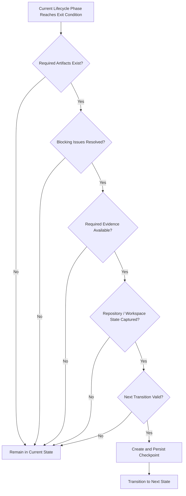

---

## Reference Checkpoint Requirements Table

| Checkpoint | State Exited | Primary Requirement | Evidence/Artifact Gate | Next State |
| --- | --- | --- | --- | --- |
| `CP-001` Lead Phase Complete | `Planning` | Investigation, Plan, and Developer handoff are ready | `plan.md`, Lead result, handoff | `Implementing` |
| `CP-002` Implementation Complete | `Implementing` | Implementation is coherent and ready for review | changed files, Developer result, handoff | `Reviewing` |
| `CP-003` Review Complete | `Reviewing` | Required review findings are resolved | Reviewer findings/result | `Validating` |
| `CP-004` Validation Complete | `Validating` | Mandatory deterministic gates pass | `gate-summary.json`, raw evidence | `Evaluating` |
| `CP-005` Evaluation Complete | `Evaluating` | Goal and acceptance criteria are successfully evaluated | final evaluation and outputs | `Completed` |

---

## Checkpoint Creation Principle

The checkpoint rule can be summarized as:

> **Create a checkpoint only after a lifecycle phase has produced a coherent, evidence-backed, recoverable state that is safe to hand to the next phase.**

A checkpoint should never mean merely:

> "The agent stopped here."

It should mean:

> **"The Harness can prove what was completed here, reconstruct the relevant state, and safely continue from this boundary."**
According to the frozen chapter template, we have completed through **Section 13 — Architect’s Notes**, plus the additional reference material on the **Run Workspace structure, lifecycle, checkpoint numbering, state terminology, and checkpoint creation requirements**.

The remaining standard sections are:

1. **Enterprise Tips**
2. **Decision Points**
3. **Exercises**
4. **Interview Questions**
5. **Chapter Summary**
6. **Further Reading**

So the next section should be:

**14. Enterprise Tips**

After that, we can continue in order through the remaining five sections and then mark:

**Scratchpad and Run Workspace status: Complete**

## 14. Enterprise Tips

The Scratchpad and Run Workspace become more valuable as Harness execution scales across teams, repositories, environments, and parallel AI Agents.

At enterprise scale, the main challenge is not creating temporary state.

The challenge is controlling:

- who can write it;
- how long it lives;
- how it is resumed;
- how it is audited;
- how it interacts with repository evidence;
- and whether any part of it becomes persistent knowledge.

The following practices help operationalize the architecture safely.

---

### 14.1 Standardize the Workspace Across Repositories

Do not let every team invent a different Run Workspace model.

A shared enterprise convention might define:

```text
input/
plan.md
scratchpad.md
agents/
agent-handoffs/
checkpoints/
validation/
outputs/
metadata/
run-state.json
```

Standardization improves:

- tooling;
- onboarding;
- recovery;
- observability;
- auditability;
- cross-team support.

The implementation may vary by repository, but the semantics should remain stable.

---

### 14.2 Version the Workspace Schema

The Run Workspace itself is part of the Harness contract.

As it evolves, record a schema version:

```json
{
  "workspaceSchemaVersion": 1
}
```

If future versions introduce new required artifacts, recovery logic should understand how older runs are handled.

Do not assume every historical workspace follows the current format.

---

### 14.3 Use Templates for Core Artifacts

Provide standard templates for:

```text
scratchpad.md
plan.md
handoffs
checkpoint records
promotion candidates
evaluation output
```

For example, every Scratchpad may begin with:

```markdown
> Temporary run-scoped working state.
> This file is not authoritative project knowledge.
```

Templates reduce semantic drift between teams and agents.

---

### 14.4 Automate Workspace Initialization

The Harness should create the Run Workspace automatically.

Do not depend on the Lead Agent to remember every required directory.

For example:

```text
create-run-workspace
    ↓
assign run ID
    ↓
create directories
    ↓
capture metadata
    ↓
initialize run-state
    ↓
begin Lead phase
```

Automation makes the safe structure the default.

---

### 14.5 Make Run Identity Globally Traceable

Use the same `runId` across:

- logs;
- metrics;
- checkpoints;
- CI executions;
- validation artifacts;
- PR metadata;
- audit events.

For example:

```text
run-2026-10-06-0042
```

This allows operators to correlate evidence across systems.

---

### 14.6 Separate Run ID from Attempt ID

For workflows with retries, distinguish:

```text
Run
```

from:

```text
Attempt
```

For example:

```text
run-0042
├── attempt-01
└── attempt-02
```

This avoids reusing temporary state ambiguously.

---

### 14.7 Treat Checkpoints as Recovery Contracts

A checkpoint should not be treated as a convenience snapshot.

It should mean:

> The Harness can safely reconstruct this boundary and continue from here.

That implies checkpoint creation requirements should be enforced technically.

For example:

```text
Cannot create CP-004
unless
all mandatory validation gates have passed.
```

The Harness should reject invalid checkpoint creation rather than rely on agent discipline.

---

### 14.8 Make Checkpoint Creation Declarative

Instead of allowing agents to write arbitrary checkpoint files, consider a Harness operation such as:

```text
create-checkpoint(
    checkpoint = CP-003,
    evidence = review-result
)
```

The Harness can then verify:

- required artifacts;
- current lifecycle state;
- blocking findings;
- repository state;
- transition legality.

This prevents an agent from incorrectly declaring:

```text
CP-003 — Review Complete
```

while blocking findings remain open.

---

### 14.9 Track Checkpoint Validity Separately

A checkpoint may have been valid when created but become stale later.

Therefore record:

```text
Valid
Stale
Invalidated
```

separately from:

```text
CP-004
```

This is especially useful for long-running or resumed executions.

---

### 14.10 Do Not Automatically Resume from the Latest File

Recovery logic should not simply choose:

```text
highest checkpoint number
```

It should choose:

> the latest checkpoint that remains valid for the current repository and governing context.

For example:

```text
CP-004 exists
but implementation changed
    ↓
CP-004 invalidated
    ↓
resume from earlier valid boundary
```

---

### 14.11 Snapshot Governing Inputs

For reproducibility, record which versions of:

- Instructions;
- Skills;
- Steering Notes;
- repository revision;

were active for the run.

This allows the Harness to detect:

```text
The run resumed under different rules.
```

That should trigger revalidation where appropriate.

---

### 14.12 Separate Workspace Access by Role

Do not assume every agent needs read/write access everywhere.

For example:

```text
Developer
    can write Developer scratchpad

Reviewer
    can write Reviewer findings

Validator
    can write validation evidence

Evaluator
    can write evaluation output
```

Role-specific permissions reduce accidental contamination.

---

### 14.13 Use Read-Only Access for Governing Artifacts

Where possible, expose:

```text
Instructions
Steering Notes
Repository Intelligence
```

as read-only inputs during execution.

If an agent proposes a change, route that through an explicit proposal mechanism.

This prevents accidental mutation of authority sources.

---

### 14.14 Keep Validation Evidence Immutable

When a validation attempt completes, its evidence should preferably become immutable.

For example:

```text
validation/
├── attempt-01/
└── attempt-02/
```

Do not overwrite failed evidence with successful evidence.

This improves auditability and troubleshooting.

---

### 14.15 Preserve Validation-to-Code Integrity

A passing validation result is meaningful only if it corresponds to the same implementation state being evaluated.

The Harness should capture:

```text
repository revision
working-tree hash
artifact hash
```

or equivalent integrity data where needed.

If code changes after validation, relevant validation should be invalidated.

---

### 14.16 Use Structured Handoffs for Cross-Team Work

When execution moves between teams or time zones, handoffs become more important than conversational history.

A good enterprise handoff should contain:

```text
Goal
Current status
Verified evidence
Completed work
Known risks
Open questions
Next required action
Validation requirements
```

This makes the run portable across people and agents.

---

### 14.17 Make Residual Risk Explicit

A run may complete successfully while still carrying a known limitation.

For example:

```text
External event consumers were not independently verified.
```

Do not hide such risks.

Record them in:

- evaluation;
- final output;
- promotion decision if relevant.

A PASS result does not require pretending uncertainty is zero.

---

### 14.18 Separate "Pass" from "No Known Risk"

These are different.

A run may:

```text
PASS acceptance criteria
```

while still having:

```text
residual operational risk
```

Enterprise reporting should preserve both.

---

### 14.19 Use Policy-Based Retention

Avoid manually deciding workspace retention on every run.

Classify runs into policies such as:

```text
standard engineering
high-risk
security-sensitive
regulated
production incident
```

Then apply retention automatically.

This improves consistency.

---

### 14.20 Apply Legal and Compliance Holds Explicitly

If an investigation or regulatory requirement requires preservation, mark the workspace accordingly.

For example:

```json
{
  "retentionHold": true,
  "reason": "security-incident-review"
}
```

Automatic cleanup must respect that state.

---

### 14.21 Keep Scratchpad Search Separate from Knowledge Search

Enterprise search should distinguish between:

```text
current trusted project knowledge
```

and:

```text
historical temporary run state
```

If users search Repository Intelligence, old Scratchpad results should not appear as equivalent authority.

This is critical for avoiding authority drift.

---

### 14.22 Label Search Results by Authority

If historical Run Workspaces are searchable, expose clear labels such as:

```text
Temporary Run State
Repository Intelligence
Harness Memory
Instruction
Validation Evidence
```

Do not make agents infer the source type from file paths.

---

### 14.23 Automate Promotion Candidate Detection Carefully

The Harness may help identify useful discoveries.

For example:

```text
same unresolved dependency appears across five runs
```

could trigger:

```text
Suggest promotion review
```

It should not trigger:

```text
Automatically add to Harness Memory
```

Automation should increase review efficiency, not bypass governance.

---

### 14.24 Maintain Promotion Provenance

Every persistent item promoted from a run should retain a link back to:

```text
source run
source evidence
promotion candidate
approval decision
```

This allows future teams to understand why the knowledge exists.

---

### 14.25 Add Freshness Rules to Repository Intelligence

Repository Intelligence often depends on current implementation reality.

For example:

```text
Fleet.IntegrationGateway consumes FleetBookingCreated.
```

That statement should be revalidated if:

```text
consumer topology changes
integration gateway changes
event contracts are reorganized
```

Persistent does not mean timeless.

---

### 14.26 Distinguish Repository Knowledge from Harness Learning

Keep the following separate:

```text
Repository Intelligence:
What is true about the codebase?
```

and:

```text
Harness Memory:
What has the Harness learned about how to work effectively?
```

This distinction becomes more important as the self-learning capabilities of the Harness grow.

---

### 14.27 Do Not Measure Productivity by Scratchpad Volume

Avoid metrics such as:

```text
number of Scratchpad entries
```

or:

```text
number of observations generated
```

These reward verbosity rather than quality.

More meaningful measures include:

- assumptions resolved before completion;
- stale state detected during resume;
- recovery success rate;
- number of failed gates caught before PR;
- promotion candidate acceptance rate.

---

### 14.28 Measure Recovery Quality

A mature Harness should track:

```text
runs resumed successfully
runs restarted because state was stale
runs corrupted by invalid recovery
average recovery time
```

These metrics reveal whether checkpoint design actually works.

---

### 14.29 Detect Stale and Orphaned Runs

Operational monitoring should identify runs where:

```text
no heartbeat
no checkpoint progress
lease expired
current role inactive
```

A stuck run should not remain indefinitely in:

```text
Implementing
```

without activity.

---

### 14.30 Add Heartbeats for Long-Running Execution

For distributed Harnesses, record:

```text
lastHeartbeat
currentRole
workerId
lastCheckpoint
```

This helps distinguish:

```text
slow
```

from:

```text
orphaned
```

execution.

---

### 14.31 Keep Run Workspace Storage Separate from Source Control by Default

Do not assume every workspace should be committed into the product repository.

A separate storage location often provides better:

- cleanup;
- access control;
- retention;
- scalability.

Source control should contain product history.

The Run Workspace contains execution history.

They may be linked without being physically identical.

---

### 14.32 Use Object Storage for Large Evidence

Large artifacts such as:

```text
test reports
scan reports
coverage
logs
generated packages
```

may not belong directly in the small working workspace.

Store them externally and retain references:

```json
{
  "artifact": "security-scan",
  "location": "artifact-store/run-0042/security.json"
}
```

The logical Run Workspace can span multiple storage systems.

---

### 14.33 Keep Metadata Small and Structured

`run-state.json` should not become a dumping ground.

Store only orchestration-critical fields.

For example:

```json
{
  "runId": "run-0042",
  "status": "validating",
  "currentRole": "Validator",
  "lastCheckpoint": "CP-003",
  "repositoryRevision": "b81f7c9"
}
```

Detailed narrative belongs elsewhere.

---

### 14.34 Use Strong Correlation Between PR and Run

If a run creates a pull request, record:

```text
run ID → PR
PR → run ID
```

This allows a Reviewer or auditor to trace:

```text
PR
    ↓
Harness execution
    ↓
validation evidence
    ↓
evaluation
```

---

### 14.35 Do Not Let PR Comments Become the Only Handoff

PR comments are useful collaboration artifacts.

They are not a substitute for structured run state.

Important findings should still exist in:

```text
Reviewer findings
handoffs
validation evidence
```

especially if the run may be resumed outside GitHub.

---

### 14.36 Use Human Approval as an Explicit Event

If a human approves:

- architecture;
- exception;
- deployment;
- promotion;

record it explicitly.

For example:

```json
{
  "type": "human-approval",
  "authority": "Architect",
  "decision": "approve-event-strategy"
}
```

Do not rely on a vague Scratchpad sentence such as:

```text
Architect seemed okay with this.
```

---

### 14.37 Make Exceptions Visible

If the Harness skips a normal requirement, record the exception.

For example:

```text
Security gate skipped
Reason: isolated documentation-only change
Approved by: Security policy X
```

Invisible exceptions create governance debt.

---

### 14.38 Avoid One Giant Enterprise Scratchpad

At scale, do not create a global:

```text
enterprise-scratchpad.md
```

shared across runs.

That destroys:

- run isolation;
- provenance;
- authority boundaries;
- cleanup.

Scratchpads should remain task-scoped.

---

### 14.39 Prefer Promotion Over Copying

If a discovery needs to survive, do not copy the entire Scratchpad into a permanent location.

Create a concise, evidence-backed promotion candidate.

This keeps persistent knowledge clean.

---

### 14.40 Treat Promotion as a Reviewable Change

Persistent knowledge updates should behave more like code changes.

For example:

```text
proposal
review
approval
versioning
supersession
```

This is especially important for Harness Memory because future AI execution may depend on it.

---

### 14.41 Keep a Clear Ownership Model

Define owners for:

```text
Run Workspace schema
Instructions
Repository Intelligence
Harness Memory
retention policy
promotion policy
```

Without ownership, temporary and permanent state will drift over time.

---

### 14.42 Design for Cross-Repository Harnesses

In larger enterprises, one Harness may operate across multiple repositories.

The Run Workspace should then capture repository identities explicitly:

```json
{
  "repositories": [
    {
      "name": "Booking",
      "revision": "abc123"
    },
    {
      "name": "Fleet.IntegrationGateway",
      "revision": "def456"
    }
  ]
}
```

A single `repositoryRevision` is insufficient for multi-repository work.

---

### 14.43 Scope Checkpoints to Multi-Repository State

For multi-repository tasks, a checkpoint is only valid if all relevant repository states are captured.

For example:

```text
Booking revision
Fleet Gateway revision
Shared Contracts revision
```

Otherwise recovery may combine mismatched states.

---

### 14.44 Record External Dependencies When They Matter

Some runs depend on external state such as:

```text
API schema
feature flag
database version
cloud resource
```

If such state materially affects correctness, capture its relevant version or reference.

Do not pretend repository state is the only source of staleness.

---

### 14.45 Use Deterministic Gates to Protect Knowledge Promotion

Where possible, promotion candidates should reference successful deterministic evidence.

For example:

```text
Candidate:
Fleet event changes require schema validation.

Evidence:
contract tests
consumer analysis
validation pass
```

This produces stronger persistent knowledge than prose-only promotion.

---

### 14.46 Make Resume Decisions Observable

When a run resumes, record the decision:

```text
Resume Approved
Resume with Revalidation
Restart Required
```

and why.

For example:

```json
{
  "resumeDecision": "revalidate",
  "reason": "relevant event contract changed"
}
```

This makes recovery behavior auditable.

---

### 14.47 Build Administrative Tooling Around Runs

Enterprise operators should be able to:

```text
list active runs
inspect state
see last checkpoint
see failed gates
see promotion status
cancel a run
resume a run
archive a run
```

without reading raw workspace files manually.

The Run Workspace is the data model.

Operational tooling should sit above it.

---

### 14.48 Keep Manual Editing Controlled

Humans may need to edit run state during recovery or escalation.

Do not allow arbitrary changes without traceability.

Prefer operations such as:

```text
accept-risk
invalidate-checkpoint
approve-promotion
cancel-run
resume-run
```

rather than free-form mutation of structured state.

---

### 14.49 Test the Entire Lifecycle, Not Just Agents

Harness testing should include scenarios such as:

- Lead failure before `CP-001`;
- Developer failure after `CP-001`;
- stale state before resume;
- Reviewer rejection;
- validation failure and retry;
- code change after `CP-004`;
- promotion approval;
- retention cleanup.

The Run Workspace is part of the system and deserves its own tests.

---

### 14.50 Enterprise Operating Principle

At enterprise scale, the Scratchpad and Run Workspace should be treated as **controlled execution infrastructure**.

They are not merely folders where AI Agents leave notes.

A mature implementation should make the following true:

```text
Runs are isolated.

States are explicit.

Checkpoints are enforceable.

Evidence is separate from narrative.

Handoffs are structured.

Recovery validates freshness.

Temporary state expires.

Persistent knowledge is promoted deliberately.

Security controls apply throughout.
```

The enterprise objective is not to preserve everything an AI Agent encounters.

It is to preserve enough state to make execution reliable while preventing temporary information from becoming permanent authority accidentally.

> **The Run Workspace should make complex AI execution recoverable, inspectable, and governable without turning temporary working state into an uncontrolled knowledge system.**

**Scratchpad and Run Workspace status: In progress — next section: Decision Points**
Here is a focused set of **Alpha Car Detailing examples** you can insert into the **Enterprise Tips** section so the guidance stays grounded in the running example rather than remaining abstract.

### Alpha Car Detailing Examples for Enterprise Run Workspace Practices

The enterprise practices described above become clearer when applied to the Alpha Car Detailing platform.

The following examples show how the same Run Workspace principles apply to realistic engineering changes across Booking, Fleet Integration, Payments, and Notification services.

---

### Standardized Workspace Across Alpha Car Detailing Services

Suppose separate teams own:

```text
Booking
Fleet Management
Payments
Notifications
Customer Accounts
```

Each team should not create a different temporary execution structure.

A Booking task:

```text
Add preferred detailing location to corporate fleet bookings.
```

and a Payments task:

```text
Add fleet invoice adjustment support.
```

should both use the same Run Workspace semantics:

```text
input/
plan.md
scratchpad.md
agents/
agent-handoffs/
checkpoints/
validation/
outputs/
run-state.json
```

The implementation details differ.

The lifecycle model does not.

This allows the same Harness tooling to operate across the Alpha Car Detailing platform.

---

### Run Identity Across Systems

Suppose the preferred-location change is assigned:

```text
run-2026-10-06-0042
```

The same identifier should appear in:

```text
Harness logs
CI workflow execution
validation evidence
pull-request metadata
checkpoint records
evaluation result
metrics
```

For example:

```text
PR #1842
Harness Run: run-2026-10-06-0042
```

If an event contract test fails, an engineer can trace:

```text
PR #1842
    ↓
run-2026-10-06-0042
    ↓
validation/attempt-01/event-contract-tests.json
```

without reconstructing the relationship manually.

---

### Snapshotting Governing Inputs

Assume the Booking service uses:

```text
CLAUDE.md
skills/add-integration-event.md
skills/add-application-command.md
Search/steering-note.md
```

At run creation, the Harness records which versions applied.

For example:

```json
{
  "instructions": {
    "CLAUDE.md": "revision-4"
  },
  "skills": {
    "add-integration-event": "2.1"
  },
  "steeringNote": {
    "revision": "release-2026-10"
  }
}
```

If the run is interrupted and the event-contract Skill changes from:

```text
2.1
```

to:

```text
2.2
```

the Harness can determine whether the current Plan or previous implementation assumptions need revalidation.

---

### Role-Specific Workspace Access

During the fleet-location change:

```text
Lead Agent
```

may investigate:

```text
CorporateFleetBookingRequest
Booking aggregate
FleetBookingCreated consumers
Architecture Decisions
```

The Developer then modifies:

```text
Booking API
Application handler
event contract
event mapper
tests
```

The Reviewer should not modify the Developer Scratchpad directly.

Instead:

```text
agents/developer/scratchpad.md
```

remains Developer-owned, while the Reviewer writes:

```text
agents/reviewer/findings.md
```

For example:

```markdown
## REV-001

Finding:
No regression test proves that the original corporate fleet request
without LocationId remains valid.

Severity:
Required
```

This keeps ownership clear.

---

### Read-Only Governing Knowledge

Suppose Repository Intelligence contains:

```text
RI-ARCH-041

ADR-027 supersedes ADR-012 for service-location eligibility.
Use ServiceLocationPolicy.
```

The Developer may read this knowledge.

The Developer should not modify it because:

```text
"the current task would be easier if validation happened in the controller."
```

Instead, if current repository evidence contradicts RI-ARCH-041, the Developer records:

```markdown
## Unresolved Architecture Conflict

Repository Intelligence says:
Use ServiceLocationPolicy.

Current implementation appears inconsistent.

Action:
Escalate for Repository Intelligence review.
```

Temporary implementation preference must not silently rewrite persistent architecture knowledge.

---

### Checkpoint Enforcement

For the preferred-location feature, the Harness should not permit:

```text
CP-001 — Lead Phase Complete
```

until:

```text
repository investigation complete enough
plan.md ready
Lead-to-Developer handoff ready
blocking architecture questions resolved
```

Likewise:

```text
CP-004 — Validation Complete
```

must not exist merely because the Validator Agent says:

```text
"The implementation looks correct."
```

It requires evidence such as:

```text
Build: PASS
Unit Tests: PASS
Integration Tests: PASS
API Contract Tests: PASS
Event Contract Tests: PASS
Architecture Tests: PASS
```

---

### Validation Evidence Integrity

Suppose the first validation attempt reports:

```text
Event Contract Tests: FAIL
```

because:

```text
fleet-booking-created.schema.json
```

does not contain `ServiceLocationId`.

The Developer fixes the schema.

The Harness should preserve:

```text
validation/
├── attempt-01/
│   └── event-contract-tests.json   FAIL
└── attempt-02/
    └── event-contract-tests.json   PASS
```

It should not overwrite the original failure.

This history explains why the implementation changed.

---

### Code Change After Validation

Suppose:

```text
CP-004 — Validation Complete
```

has already been created.

Then the Developer notices a typo and changes:

```text
FleetBookingEventMapper.cs
```

Even if the change looks trivial, the previous validation checkpoint no longer necessarily represents the current implementation.

The Harness should invalidate the relevant forward state:

```text
CP-004 validity:
Invalidated
```

and rerun affected validation.

The principle is:

> Validation evidence belongs to a specific implementation state.

---

### Explicit Handoff Between Booking and Fleet Teams

Suppose the Booking team changes `FleetBookingCreated`, but the Fleet Integration Gateway is owned by another team.

A handoff might contain:

```markdown
# Booking → Fleet Integration Handoff

## Change

FleetBookingCreated now includes nullable ServiceLocationId.

## Compatibility Requirement

Existing events without ServiceLocationId remain valid.

## Consumer Impact

Fleet.IntegrationGateway performs strict schema validation.

## Required Action

Validate the updated schema against the gateway contract test suite.

## Evidence

Booking validation attempt:
PASS
```

This is more reliable than sending:

```text
"We added the field. Please check."
```

through chat.

---

### Cross-Repository Task Example

Suppose Alpha Car Detailing separates:

```text
Alpha.Booking
Alpha.FleetGateway
Alpha.Contracts
```

into different repositories.

The Run Workspace should capture:

```json
{
  "repositories": [
    {
      "name": "Alpha.Booking",
      "revision": "abc123"
    },
    {
      "name": "Alpha.Contracts",
      "revision": "def456"
    },
    {
      "name": "Alpha.FleetGateway",
      "revision": "ghi789"
    }
  ]
}
```

A checkpoint is valid only relative to all relevant repository revisions.

If `Alpha.Contracts` changes while the run is paused, compatibility assumptions may need revalidation even when `Alpha.Booking` itself is unchanged.

---

### External Dependency Example

Assume Booking validates service locations through a Location service.

During the run:

```text
Location API contract version:
v4
```

is relevant to implementation.

If the run resumes later under:

```text
Location API contract version:
v5
```

the Harness may need to revalidate:

```text
location eligibility behavior
request contract
integration tests
```

Repository revision alone is not sufficient to determine freshness.

---

### Stale State During Resume

Suppose the Developer Scratchpad says:

```text
FleetBookingCreated currently contains:
BookingId
FleetAccountId
ServiceDate
CreatedAt
```

The run is paused.

While paused, another team adds:

```text
CorrelationReference
```

When the run resumes, the Harness detects that:

```text
FleetBookingCreated.cs
```

changed.

The Scratchpad entry becomes:

```markdown
Status:
STALE

Reason:
Event contract changed after checkpoint CP-002.
```

The Developer must reinvestigate before continuing.

---

### Paused Run Example

The team may intentionally pause because architecture approval is required.

For example:

```json
{
  "status": "paused",
  "currentRole": "Lead",
  "lastCheckpoint": null,
  "reason": "awaiting-event-versioning-decision"
}
```

When approval arrives, the Harness should revalidate the relevant state before moving into `Planning` or `Implementing`.

A paused run is not automatically safe to continue merely because it was paused deliberately.

---

### Interrupted Run Example

Suppose the Developer worker crashes after `CP-001`.

The run state becomes:

```json
{
  "status": "interrupted",
  "currentRole": "Developer",
  "lastCheckpoint": "CP-001"
}
```

Recovery can use:

```text
Prompt
Plan
Lead handoff
CP-001
Developer Scratchpad
working tree
repository revision
```

to determine what can safely continue.

The system should not depend on the original Developer Agent remembering what it was doing.

---

### Parallel-Agent Example

The Lead Agent may delegate:

```text
API Compatibility Agent
Event Compatibility Agent
Security Agent
```

Each receives its own Scratchpad:

```text
agents/
├── api-compatibility/
│   └── scratchpad.md
├── event-compatibility/
│   └── scratchpad.md
└── security/
    └── scratchpad.md
```

The API Agent might conclude:

```text
Nullable LocationId preserves the existing request shape.
```

The Event Agent may discover:

```text
Fleet.IntegrationGateway requires schema changes.
```

The Security Agent may conclude:

```text
No additional authorization boundary is introduced.
```

The Lead reconciles these into the implementation Plan.

The agents should not overwrite one shared Scratchpad while investigating independently.

---

### Residual Risk Example

After all tests pass, the Evaluator may still record:

```markdown
## Residual Risk

Known repository consumers are compatible.

External corporate fleet integrations outside the repository
were not independently tested.
```

The final result may still be:

```text
PASS
```

if the defined acceptance criteria are satisfied.

The residual risk should remain visible.

---

### Promotion Candidate Example

During the run, the Harness discovers:

```text
Fleet.IntegrationGateway performs strict schema validation
for FleetBookingCreated.
```

This is useful beyond the current task.

The Run Workspace creates:

```text
outputs/promotion-candidates/pc-001.md
```

containing:

```markdown
# Promotion Candidate PC-001

## Proposed Knowledge

FleetBookingCreated contract changes require compatibility validation
against Fleet.IntegrationGateway.

## Evidence

- consumer implementation;
- schema validation code;
- contract tests;
- validation results from current run.

## Destination

Repository Intelligence

## Status

Pending approval
```

The Harness does not modify Repository Intelligence directly.

---

### Harness Memory Example

A different lesson may emerge after several Alpha Car Detailing runs.

Suppose multiple event-contract changes fail first validation because developers update the C# event type but forget the published JSON schema.

The Harness might propose:

```markdown
# Harness Memory Candidate

Observation:
Multiple integration-event changes reached validation without
corresponding schema updates.

Proposed Harness Lesson:
When a task changes an integration-event contract, include published
schema inspection explicitly in the Developer Plan and validation plan.

Evidence:
Runs 0042, 0049, and 0061.

Status:
Pending governance review.
```

This belongs in potential Harness Memory because it improves how future runs are executed.

It is different from Repository Intelligence.

---

### Security Example

Suppose integration testing requires:

```text
FleetGatewayTestCredential
```

The Developer Scratchpad should contain:

```text
Credential reference:
KeyVault/FleetGatewayTestCredential
```

not:

```text
username/password/token
```

If a tool accidentally prints the token, the Harness should redact it before persisting command output.

---

### Retention Example

After the preferred-location run completes, Alpha Car Detailing may retain:

```text
Prompt snapshot
run manifest
final evaluation
validation evidence
promotion decision
metrics
```

while deleting after the configured troubleshooting period:

```text
Lead Scratchpad
Developer Scratchpad
temporary tool output
abandoned investigation notes
```

This preserves required engineering evidence without turning every temporary thought into permanent project history.

---

### Metrics Example

For the fleet-location run, the Harness could record:

```json
{
  "runId": "run-2026-10-06-0042",
  "reviewIterations": 2,
  "validationAttempts": 2,
  "failedGates": 1,
  "resumeCount": 0,
  "promotionCandidates": 1,
  "result": "passed"
}
```

These values should come from structured run state.

They should not be reconstructed by parsing:

```text
scratchpad.md
```

---

### Operational Monitoring Example

Suppose a corporate fleet booking conversion remains:

```text
status: implementing
```

for two hours with:

```text
last heartbeat: 65 minutes ago
```

The Harness can classify the run:

```text
Potentially Orphaned
```

and surface:

```text
Run:
run-2026-10-06-0042

Current role:
Developer

Last checkpoint:
CP-001

Last heartbeat:
65 minutes ago
```

An operator can then recover from the last valid checkpoint rather than restarting blindly.

---

### Human Approval Example

Suppose adding `ServiceLocationId` would require versioning the event instead of using an additive field.

The Architect decides:

```text
Create FleetBookingCreatedV2.
```

The Run Workspace should capture:

```markdown
## Human Decision HD-001

Decision:
Introduce FleetBookingCreatedV2.

Authority:
Solution Architect

Reason:
External consumer contract cannot accept additive evolution.

Scope:
Current fleet booking event change.

Status:
Approved.
```

This is stronger than a Scratchpad assumption because an authorized human made the decision.

Whether it becomes a permanent event-versioning standard remains a separate governance decision.

---

### Exception Example

Suppose a documentation-only update occurs in the Booking service.

The standard Harness normally requires:

```text
build
unit tests
integration tests
contract tests
```

Policy may allow integration tests to be skipped.

The run should record:

```markdown
## Validation Exception

Skipped:
Booking integration tests

Reason:
Documentation-only change

Authority:
Validation Policy DOC-001

Status:
Approved
```

The omission should be explicit rather than invisible.

---

### Pull Request Traceability Example

The final Alpha Car Detailing pull request could include:

```text
Harness Run:
run-2026-10-06-0042

Last Checkpoint:
CP-005 — Evaluation Complete

Review:
PASS

Validation:
PASS

Evaluation:
PASS
```

An engineer inspecting the PR can follow the run ID to:

```text
validation evidence
review findings
evaluation
promotion decisions
```

without including the complete Scratchpad in the PR.

---

### End-to-End Alpha Car Detailing Example

The full execution can be summarized as:

```text
Corporate fleet preferred-location request
        ↓
Run created
run-2026-10-06-0042
        ↓
Lead investigates Booking and Fleet contracts
        ↓
Plan finalized
        ↓
CP-001 — Lead Phase Complete
        ↓
Developer updates API, domain mapping, event and tests
        ↓
CP-002 — Implementation Complete
        ↓
Reviewer finds missing backward-compatibility test
        ↓
Developer remediates
        ↓
Reviewer approves
        ↓
CP-003 — Review Complete
        ↓
Event contract validation fails
        ↓
Developer updates published schema
        ↓
Validation passes
        ↓
CP-004 — Validation Complete
        ↓
Evaluator confirms acceptance criteria
        ↓
CP-005 — Evaluation Complete
        ↓
Completed
        ↓
Fleet consumer dependency proposed for Repository Intelligence
        ↓
Metrics recorded
        ↓
Retention policy applied
        ↓
Temporary Scratchpad state cleaned up
```

This example illustrates the central enterprise principle:

> **The Run Workspace preserves enough temporary state to coordinate and recover Alpha Car Detailing engineering work, while checkpoints, deterministic evidence, and governance prevent temporary discoveries from becoming project truth accidentally.**

**Scratchpad and Run Workspace status: In progress — next section: Decision Points**
Yes. The cleaner handbook structure is to keep the **enterprise rules normative** and move Alpha Car Detailing into a separate **applied examples subsection**.

## 14. Enterprise Tips

### 14.1 Workspace Rules

The following rules define the enterprise operating model for Run Workspaces.

#### Standardize the Workspace

Use a common Run Workspace structure across repositories and teams:

```text
input/
plan.md
scratchpad.md
agents/
agent-handoffs/
checkpoints/
validation/
outputs/
metadata/
run-state.json
```

The implementation may vary, but the meaning of each area should remain stable.

---

#### Version the Workspace Schema

Record the workspace schema version explicitly:

```json
{
  "workspaceSchemaVersion": 1
}
```

Recovery logic should understand how older workspace versions are handled.

---

#### Automate Workspace Initialization

The Harness should create:

- run identity;
- directory structure;
- metadata;
- initial run state;
- input snapshots;

before agents begin execution.

Do not rely on individual agents to create the correct structure manually.

---

#### Use One Traceable Run Identifier

Use the same `runId` across:

- logs;
- validation;
- checkpoints;
- metrics;
- pull requests;
- audit events;
- final outputs.

This provides end-to-end traceability.

---

#### Separate Run and Attempt Identity

A retry should not silently reuse temporary state from the original attempt.

Model retries explicitly:

```text
run-0042/
├── attempt-01/
└── attempt-02/
```

or create a new run according to Harness policy.

---

#### Treat Checkpoints as Recovery Contracts

A checkpoint must represent a stable, recoverable boundary.

Checkpoint creation should be controlled by the Harness and should verify:

- current lifecycle state;
- required artifacts;
- blocking findings;
- evidence;
- repository state;
- allowed next transition.

---

#### Keep Checkpoint Validity Explicit

A checkpoint may later become:

```text
Valid
Stale
Invalidated
```

Its existence does not guarantee that it remains safe for continuation.

---

#### Snapshot Governing Inputs

Record the relevant versions or revisions of:

- Prompt;
- Instructions;
- Skills;
- Steering Notes;
- repository state.

On resume, compare those inputs before trusting previous run state.

---

#### Enforce Role-Specific Workspace Ownership

Use separate writable areas for:

- Lead;
- Developer;
- Reviewer;
- Validator;
- Evaluator.

Avoid unrestricted shared write access.

---

#### Keep Governing Knowledge Read-Only During Normal Execution

Instructions, Steering Notes, Repository Intelligence, and Harness Memory should normally be consumed as governed inputs.

Agents may propose changes, but should not mutate them directly unless explicitly authorized.

---

#### Keep Validation Evidence Separate and Immutable

Store deterministic evidence independently from Scratchpad prose.

Prefer:

```text
validation/
├── attempt-01/
├── attempt-02/
└── gate-summary.json
```

Do not overwrite failed evidence with later successful evidence.

---

#### Bind Validation to Implementation State

Validation is meaningful only for the exact implementation that was tested.

If code changes after `CP-004 — Validation Complete`, relevant validation must be reconsidered or rerun.

---

#### Use Structured Handoffs

Handoffs should contain:

```text
Goal
Verified evidence
Completed work
Important decisions
Known risks
Unresolved questions
Required next actions
Required validation
```

Do not use chat history as the primary handoff mechanism.

---

#### Preserve Residual Risk

A successful evaluation may still contain:

```text
Accepted Risk
Known Limitation
External Dependency Not Verified
```

Preserve those explicitly.

Do not equate `PASS` with "no remaining risk."

---

#### Apply Policy-Based Retention

Classify runs and apply retention automatically.

Possible classifications include:

```text
standard engineering
security-sensitive
regulated
production incident
high-risk architecture change
```

Scratchpads and validation evidence do not necessarily require the same retention period.

---

#### Keep Scratchpad Search Separate from Knowledge Search

Historical Scratchpads should not appear as equivalent authority to:

- Repository Intelligence;
- Harness Memory;
- Instructions;
- validation evidence.

If historical run state is searchable, label it clearly as temporary run state.

---

#### Govern Knowledge Promotion

Agents may create promotion candidates.

The Harness should not silently promote Scratchpad content.

Promotion should include:

```text
evidence
scope
destination
review
approval
freshness rule
```

---

#### Separate Repository Intelligence from Harness Memory

Use **Repository Intelligence** for evidence about the repository.

Use **Harness Memory** for governed lessons about how future Harness runs should operate.

Do not merge both concepts into one generic memory store.

---

#### Use Structured Data for Metrics

Generate metrics from:

- run-state transitions;
- checkpoint records;
- validation attempts;
- Reviewer findings;
- promotion decisions.

Do not derive important operational metrics by parsing Scratchpad prose.

---

#### Detect Stuck and Orphaned Runs

For long-running execution, track:

```text
lastHeartbeat
currentRole
lastCheckpoint
worker ownership
last activity
```

The Harness should be able to distinguish slow execution from abandoned execution.

---

#### Keep Run Storage Separate from Source Control by Default

Source control stores product history.

The Run Workspace stores execution history.

They may be linked without storing every Scratchpad directly in the product repository.

---

#### Use External Artifact Storage for Large Evidence

Large artifacts such as:

- logs;
- coverage files;
- security scans;
- test reports;

may be stored externally with references from the Run Workspace.

---

#### Record Human Decisions Explicitly

A human approval should include:

```text
decision
authority
scope
reason
time
```

Do not reduce important human direction to informal Scratchpad prose.

---

#### Make Exceptions Explicit

If the Harness skips a normal control or validation gate, record:

- what was skipped;
- why;
- policy basis;
- approving authority.

Invisible exceptions create governance debt.

---

#### Design for Multi-Repository Runs

If one task spans multiple repositories, checkpoint state must capture each relevant repository revision.

A checkpoint is not reproducible if only one repository state is known.

---

#### Track Material External Dependencies

If correctness depends on an external API, schema, deployment, feature flag, or infrastructure state, capture the relevant version or reference.

Git state alone may not be sufficient for resumability.

---

#### Make Resume Decisions Explicit

A resume process should produce an outcome such as:

```text
Resume Approved
Resume with Revalidation
Restart Required
```

and record the reason.

---

#### Test the Lifecycle Itself

Harness testing should include:

- failure before `CP-001`;
- interruption during implementation;
- stale state during resume;
- Reviewer rejection;
- validation failure and remediation;
- code change after `CP-004`;
- promotion review;
- retention cleanup.

Run Workspace behavior is part of the system and requires its own testing.

---

### 14.2 Alpha Car Detailing Applied Examples

The following examples demonstrate how the workspace rules apply to the Alpha Car Detailing platform.

#### Example — Shared Workspace Standard

A Booking task:

```text
Add preferred detailing location to corporate fleet bookings.
```

and a Payments task:

```text
Add fleet invoice adjustment support.
```

should both use the same workspace semantics:

```text
input/
plan.md
scratchpad.md
agents/
agent-handoffs/
checkpoints/
validation/
outputs/
run-state.json
```

The business change differs.

The Harness execution model does not.

---

#### Example — Traceable Run Identity

The preferred-location feature receives:

```text
run-2026-10-06-0042
```

The same identifier appears in:

```text
PR #1842
CI execution
validation evidence
checkpoint files
evaluation
metrics
```

An engineer investigating a failed contract test can trace:

```text
PR #1842
   ↓
run-2026-10-06-0042
   ↓
validation/attempt-01/event-contract-tests.json
```

---

#### Example — Governing Input Change

The run starts using:

```text
add-integration-event skill v2.1
```

After an interruption, the Skill is now:

```text
v2.2
```

The Harness detects the difference before resuming and determines whether the earlier Plan or event assumptions require revalidation.

---

#### Example — Role Isolation

The Lead investigates:

```text
CorporateFleetBookingRequest
Booking aggregate
FleetBookingCreated consumers
ADR-027
```

The Developer modifies the implementation.

The Reviewer writes findings to:

```text
agents/reviewer/findings.md
```

rather than editing:

```text
agents/developer/scratchpad.md
```

A finding might be:

```markdown
## REV-001

Finding:
No explicit regression test verifies the original request payload
without LocationId.

Severity:
Required
```

---

#### Example — Repository Intelligence Is Read-Only

Repository Intelligence says:

```text
ADR-027 supersedes ADR-012.
ServiceLocationPolicy is the current location-validation pattern.
```

If the Developer finds contradictory code, the Scratchpad records:

```markdown
## Architecture Conflict

Repository Intelligence identifies ServiceLocationPolicy as authoritative.

Current implementation appears inconsistent.

Action:
Escalate for verification.
```

The Developer does not silently rewrite Repository Intelligence.

---

#### Example — Checkpoint Enforcement

`CP-001 — Lead Phase Complete` cannot be created until:

```text
investigation is sufficient
plan.md is ready
blocking architecture questions are dispositioned
Lead-to-Developer handoff exists
```

Similarly, `CP-004 — Validation Complete` requires actual passing deterministic evidence.

---

#### Example — Failed Validation Is Preserved

The first event-contract validation fails because the JSON schema was not updated.

```text
validation/
├── attempt-01/
│   └── event-contract-tests.json   FAIL
└── attempt-02/
    └── event-contract-tests.json   PASS
```

The first result remains part of execution history.

---

#### Example — Code Changes After Validation

`CP-004 — Validation Complete` exists.

The Developer then modifies:

```text
FleetBookingEventMapper.cs
```

The Harness no longer treats the previous validation checkpoint as sufficient for the new implementation state.

Affected gates are rerun before evaluation.

---

#### Example — Multi-Repository Change

Suppose the feature touches:

```text
Alpha.Booking
Alpha.Contracts
Alpha.FleetGateway
```

The run captures:

```json
{
  "repositories": [
    {
      "name": "Alpha.Booking",
      "revision": "abc123"
    },
    {
      "name": "Alpha.Contracts",
      "revision": "def456"
    },
    {
      "name": "Alpha.FleetGateway",
      "revision": "ghi789"
    }
  ]
}
```

If `Alpha.Contracts` changes while the run is paused, the Harness revalidates event-contract assumptions before continuing.

---

#### Example — Parallel Agents

The Lead delegates:

```text
API Compatibility Agent
Event Compatibility Agent
Security Agent
```

Their workspaces are isolated:

```text
agents/
├── api-compatibility/
│   └── scratchpad.md
├── event-compatibility/
│   └── scratchpad.md
└── security/
    └── scratchpad.md
```

The Lead reconciles their final results before implementation begins.

---

#### Example — Stale Scratchpad State

Before interruption, the Developer records:

```text
FleetBookingCreated contains four properties.
```

While the run is paused, another team adds:

```text
CorrelationReference
```

The old observation becomes:

```markdown
Status:
STALE

Reason:
FleetBookingCreated.cs changed after the last checkpoint.
```

The Developer reinvestigates before continuing.

---

#### Example — Residual Risk

After all known contract tests pass, the Evaluator records:

```markdown
## Residual Risk

All known repository consumers are compatible.

External corporate fleet integrations outside the repository
were not independently verified.
```

The run can still receive a `PASS` if the defined acceptance criteria are satisfied, while the residual risk remains visible.

---

#### Example — Repository Intelligence Promotion

The run discovers:

```text
Fleet.IntegrationGateway performs strict schema validation
for FleetBookingCreated.
```

The Harness creates:

```text
outputs/promotion-candidates/pc-001.md
```

with:

```markdown
## Proposed Knowledge

FleetBookingCreated changes require compatibility validation
against Fleet.IntegrationGateway.

## Destination

Repository Intelligence

## Status

Pending approval
```

The discovery does not become permanent knowledge until governance approves it.

---

#### Example — Harness Memory Promotion

Across several Alpha Car Detailing event changes, validation repeatedly fails because developers update C# contracts but omit published schema files.

The Harness proposes:

```markdown
## Harness Memory Candidate

When an integration-event type changes, require published schema
inspection in both the Developer Plan and validation plan.

Evidence:
Multiple completed runs.

Status:
Pending governance review.
```

This belongs in potential Harness Memory because it concerns how future runs should operate.

---

#### Example — Secret Handling

Integration testing requires:

```text
KeyVault/FleetGatewayTestCredential
```

The Scratchpad records the reference only.

It never stores:

```text
password
API key
access token
```

---

#### Example — Operational Monitoring

A run remains:

```text
status: implementing
```

with no heartbeat for an abnormal period.

Operations can inspect:

```text
Run: run-2026-10-06-0042
Role: Developer
Last checkpoint: CP-001
Last heartbeat: stale
```

and recover from the last valid checkpoint rather than blindly rerunning the entire task.

---

#### Example — Human Architecture Decision

External consumer constraints require a versioned event.

The Architect decides:

```text
Introduce FleetBookingCreatedV2.
```

The Run Workspace records:

```markdown
## Human Decision HD-001

Decision:
Introduce FleetBookingCreatedV2.

Authority:
Solution Architect

Scope:
Current event change.

Status:
Approved.
```

Whether versioned events become the general architectural standard is handled separately through governance.

---

### 14.3 Enterprise Operating Principle

The workspace rules define how the Harness operates.

The Alpha Car Detailing examples demonstrate those rules in practice.

Keeping the two separate prevents examples from accidentally becoming architecture requirements.

The general rule is:

> **Enterprise workspace rules should remain reusable across projects; running examples should illustrate those rules without defining them.**

This separation also keeps the handbook vendor-neutral and architecture-first while allowing Alpha Car Detailing to provide concrete engineering context.

**Scratchpad and Run Workspace status: In progress — next section: Decision Points**

## 15. Decision Points

The Scratchpad and Run Workspace introduce several architectural choices that should be made deliberately.

These are not implementation details.

They affect:

- recoverability;
- governance;
- security;
- concurrency;
- persistence;
- operational complexity;
- portability across AI platforms.

The following decision points help architects and Harness designers choose the right level of rigor.

---

### 15.1 Should the Scratchpad Be Shared or Role-Specific?

A single shared Scratchpad is simpler.

Role-specific Scratchpads provide stronger isolation.

Use a shared Scratchpad when:

- only one agent is active at a time;
- the task is simple;
- concurrent writes are impossible;
- cross-role contamination risk is low.

Use role-specific Scratchpads when:

- multiple agents work independently;
- Reviewer independence matters;
- parallel execution is enabled;
- different roles have different permissions.

A common enterprise pattern is:

```text id="dp-shared-plus-role"
scratchpad.md
+
agents/
  lead/scratchpad.md
  developer/scratchpad.md
  reviewer/scratchpad.md
```

The shared Scratchpad contains run-level state.

Role-specific Scratchpads contain local working state.

**Decision Point**

> Use the simplest structure that preserves role independence and safe concurrency.

---

### 15.2 Should the Workspace Use Files or a Database?

File-based workspaces are easy to inspect and version conceptually.

Database-backed workspaces provide stronger concurrency and operational control.

Choose files when:

- runs are local or single-worker;
- human readability is important;
- execution volume is moderate;
- simple recovery is sufficient.

Choose structured storage when:

- runs are distributed;
- multiple workers update state;
- concurrency control is required;
- high-volume querying is needed;
- operational dashboards depend on live state.

A hybrid approach is often effective:

```text id="dp-hybrid"
Markdown
    for human-readable working state

JSON / Database
    for orchestration state

Object Storage
    for large evidence
```

**Decision Point**

> Separate the logical Run Workspace model from its storage implementation.

---

### 15.3 Should `plan.md` Be Mutable?

A Plan often changes during execution.

The question is whether it should be overwritten or versioned.

Overwrite may be acceptable when:

- changes are minor;
- audit requirements are low;
- the latest plan is all that matters.

Version or record revisions when:

- execution direction changes materially;
- architecture decisions affect the approach;
- recovery or auditability matters.

For example:

```text id="dp-plan-versioning"
plan.md
```

with:

```markdown id="dp-plan-revision"
## Revision 2

Reason:
Strict schema validation discovered.

Change:
Add event schema compatibility analysis.
```

may be sufficient without creating separate files.

**Decision Point**

> Version the meaning of the Plan when strategy changes, not every textual edit.

---

### 15.4 When Should a Checkpoint Be Created?

Do not create checkpoints after every action.

Create them at stable lifecycle boundaries.

The reference model uses:

```text id="dp-checkpoints"
CP-001 — Lead Phase Complete
CP-002 — Implementation Complete
CP-003 — Review Complete
CP-004 — Validation Complete
CP-005 — Evaluation Complete
```

Additional checkpoints may be justified when:

- execution is extremely long;
- a risky operation is about to begin;
- human approval is required;
- recovery cost is high.

**Decision Point**

> A checkpoint should exist because recovery value justifies it, not because the Harness can easily create one.

---

### 15.5 Should Failed Validation Attempts Be Retained?

For low-risk development, keeping only final results may appear simpler.

For enterprise Harnesses, failed attempts often provide important evidence.

Retain failed attempts when:

- auditability matters;
- root-cause analysis matters;
- metrics are collected;
- evaluator context matters;
- security or compliance controls require evidence.

For example:

```text id="dp-validation-attempts"
validation/
├── attempt-01/
└── attempt-02/
```

**Decision Point**

> Prefer preserving meaningful validation history unless retention policy or sensitivity dictates otherwise.

---

### 15.6 Should Review Remediation Return to Reviewer?

Suppose the Reviewer finds an issue and the Developer fixes it.

Possible policies are:

```text id="dp-review-policy"
Developer fix
    ↓
Reviewer re-review
```

or:

```text id="dp-review-policy-light"
Developer fix
    ↓
Validation
```

Use mandatory re-review when:

- architecture changed;
- security findings were involved;
- public contracts changed;
- Reviewer findings were substantial.

A lighter path may be acceptable for trivial corrections.

**Decision Point**

> Re-review based on remediation risk, not convenience.

---

### 15.7 Should Validation Failure Return to Developer or Reviewer?

A validation failure usually returns to the Developer.

However, if the fix materially changes architecture or behavior, it may need review again.

For example:

```text id="dp-validation-loop"
Validation Failure
    ↓
Developer Fix
    ↓
Architecture-impacting change?
       ├── Yes → Reviewer
       └── No  → Validator
```

**Decision Point**

> Validation remediation should re-enter review when the fix changes what was previously reviewed materially.

---

### 15.8 Should Code Changes After `CP-004` Invalidate Validation?

The default answer should be yes for relevant changes.

A passing validation result belongs to a specific implementation state.

Even a small change may invalidate:

- build;
- tests;
- contract validation;
- security scans.

The Harness may optimize by rerunning only affected gates if dependency relationships are known.

**Decision Point**

> Never assume validation remains valid after implementation changes without an explicit impact rule.

---

### 15.9 Should the Scratchpad Survive Run Completion?

There is no universal answer.

Short-term retention is useful for:

- troubleshooting;
- incident investigation;
- failed-run analysis.

Long-term retention increases:

- storage;
- security exposure;
- stale knowledge risk.

**Decision Point**

> Retain Scratchpads only as long as their operational value justifies their risk.

---

### 15.10 Should Historical Scratchpads Be Searchable?

Searchability can help troubleshooting.

It can also encourage agents to treat old temporary state as knowledge.

If searchable, results should be clearly labeled:

```text id="dp-search-labels"
Temporary Run State
Not Authoritative
Historical
```

**Decision Point**

> Historical Scratchpad search should support investigation, not normal project knowledge retrieval.

---

### 15.11 Should Promotion Be Automatic?

Automatic promotion is tempting for self-learning Harnesses.

It is also risky.

Use automatic promotion only where:

- the rule is narrowly scoped;
- evidence is deterministic;
- policy explicitly permits it;
- rollback exists.

For architecture, Instructions, or Harness Memory, human or governed approval should normally remain required.

**Decision Point**

> Automate candidate generation more readily than candidate approval.

---

### 15.12 Should Promotion Target Repository Intelligence or Harness Memory?

Use Repository Intelligence when the discovery answers:

> What is true about this repository?

Examples:

```text id="dp-ri-examples"
event consumers
module ownership
framework usage
current architecture pattern
```

Use Harness Memory when the discovery answers:

> What should future Harness runs do differently?

Examples:

```text id="dp-hm-examples"
always inspect published schema when event contracts change
include a specific gate for this task category
change decomposition strategy
```

**Decision Point**

> Choose the destination based on the type of knowledge, not where it is easiest to store.

---

### 15.13 Should All Unresolved Questions Block a Checkpoint?

No.

Some unresolved questions may be non-blocking.

For example:

```text id="dp-nonblocking"
Are there external consumers outside our organizational boundary?
```

may remain as residual risk if the defined task scope only covers known internal consumers.

Each material question should have a disposition:

```text id="dp-disposition"
Resolved
Accepted Risk
Deferred
Escalated
Not Blocking
```

**Decision Point**

> Block checkpoints on unresolved questions that materially affect the next lifecycle phase.

---

### 15.14 Should a Human Decision Be Stored in the Scratchpad?

It may be referenced there, but important human decisions should have explicit structured representation.

For example:

```text id="dp-human-decision"
HD-001
Authority: Solution Architect
Decision: Introduce V2 event contract
Scope: Current run
```

**Decision Point**

> The more authoritative the human decision, the less it should depend on informal Scratchpad prose.

---

### 15.15 Should a Run Resume or Restart?

Resume when:

- a valid checkpoint exists;
- repository state can be reconciled;
- governing inputs remain compatible;
- affected state can be revalidated.

Restart when:

- core assumptions are no longer valid;
- task definition changed materially;
- governing Instructions changed substantially;
- recovery cost exceeds restart cost;
- workspace integrity is uncertain.

**Decision Point**

> Resume only when the Harness can prove that continuation is safer than reconstruction.

---

### 15.16 Should a Retry Reuse the Existing Workspace?

Prefer a new attempt boundary or new run identity.

Reusing the same temporary state can contaminate the retry with:

- old assumptions;
- abandoned decisions;
- stale evidence.

**Decision Point**

> Make retry boundaries explicit.

---

### 15.17 Should Parallel Agents Share Intermediate Findings?

Share only when needed.

Keeping investigations independent reduces confirmation bias.

For example:

```text id="dp-parallel"
API Agent
Event Agent
Security Agent
```

may work independently and report structured results to the Lead.

**Decision Point**

> Share finalized or explicitly scoped findings more readily than incomplete reasoning.

---

### 15.18 Should the Harness Store Full Agent Conversations?

Usually not.

The Run Workspace should preserve useful execution artifacts, not complete conversation transcripts by default.

Prefer:

```text id="dp-explicit-state"
observations
assumptions
decisions
handoffs
evidence
checkpoints
```

over full raw interaction history.

**Decision Point**

> Retain explicit engineering state unless policy requires broader transcript retention.

---

### 15.19 Should the Workspace Live Inside the Product Repository?

Keeping it inside the repository improves discoverability.

Keeping it separate improves:

- cleanup;
- access control;
- scaling;
- security.

For enterprise Harnesses, separate storage is often preferable.

**Decision Point**

> Link the Run Workspace to source control without assuming they must occupy the same storage system.

---

### 15.20 Should Large Evidence Be Stored in the Workspace?

Small evidence can live directly under `validation/`.

Large artifacts may be better stored in:

- object storage;
- CI artifact storage;
- security platforms.

The workspace can retain references.

**Decision Point**

> Keep the logical evidence relationship even when physical storage is external.

---

### 15.21 Should Every Run Use the Full Reference Structure?

No.

A low-risk task may use:

```text id="dp-minimal"
input/
plan.md
scratchpad.md
validation/
outputs/
run-state.json
```

A high-risk task may require:

```text id="dp-full"
role-specific scratchpads
handoffs
multiple checkpoints
promotion workflow
audit retention
```

**Decision Point**

> Scale workspace rigor with task risk and execution complexity.

---

### 15.22 Should the Evaluator Read the Full Scratchpad?

Usually not.

The Evaluator should primarily receive:

- Prompt;
- acceptance criteria;
- final implementation;
- Reviewer findings;
- deterministic validation evidence;
- relevant residual risks.

Full Scratchpad access may introduce noise and bias.

**Decision Point**

> Give the Evaluator evidence and curated context, not every abandoned implementation thought.

---

### 15.23 Should Reviewer and Validator Roles Be Combined?

For low-risk tasks, organizations may combine them operationally.

For higher-risk work, separation improves independence:

```text id="dp-role-separation"
Reviewer
    assesses quality and alignment

Validator
    proves deterministic conditions
```

**Decision Point**

> Combine roles only when risk and governance allow it; do not combine their responsibilities conceptually.

---

### 15.24 Should Run State Be Human-Editable?

Manual recovery may require intervention.

However, direct editing of:

```text id="dp-state-files"
run-state.json
checkpoint files
```

can weaken auditability.

Prefer controlled operations such as:

```text id="dp-admin-actions"
pause-run
resume-run
invalidate-checkpoint
accept-risk
cancel-run
```

**Decision Point**

> Permit human intervention through explicit operations rather than uncontrolled state mutation where possible.

---

### 15.25 Should Promotion Candidates Be Created During or After Execution?

Both approaches can work.

Creating candidates during execution preserves discoveries while context is fresh.

Finalizing them after validation reduces the risk of promoting disproven assumptions.

A useful pattern is:

```text id="dp-promotion-flow"
Candidate identified during execution
        ↓
Status: Draft
        ↓
Validation / Evaluation
        ↓
Candidate finalized
        ↓
Governance
```

**Decision Point**

> Capture candidates early, but do not finalize them until evidence is mature.

---

### 15.26 Alpha Car Detailing Decision Example

Consider the preferred-location change.

The Lead discovers that `Fleet.IntegrationGateway` performs strict schema validation.

The team must decide:

```text id="dp-alpha-question"
Should this run:
A. simply update FleetBookingCreated,
B. update both the event and schema,
C. create FleetBookingCreatedV2?
```

The decision should consider:

- known consumers;
- external consumers;
- compatibility requirements;
- Steering Notes;
- event versioning policy;
- architecture guidance.

The Scratchpad may contain hypotheses.

The final implementation decision should be supported by evidence and, if necessary, human authority.

---

### 15.27 Decision Matrix

A concise decision matrix can help teams choose the right level of control.

| Situation | Recommended Decision |
| --- | --- |
| Single-agent, low-risk task | Shared Scratchpad may be sufficient |
| Parallel agents | Use isolated Scratchpads |
| Long-running task | Add checkpoints |
| Distributed workers | Use structured shared state |
| High-risk contract change | Require independent review and deterministic validation |
| Run interruption | Revalidate before resume |
| Repository changed after checkpoint | Mark affected state stale |
| Code changed after validation | Invalidate affected validation |
| Useful repository discovery | Propose Repository Intelligence update |
| Reusable execution lesson | Propose Harness Memory update |
| Sensitive task | Increase retention, access, and redaction controls |
| Historical troubleshooting | Allow restricted Scratchpad lookup |
| Normal future execution | Use governed knowledge, not historical Scratchpads |

---

### 15.28 Decision Principle

The purpose of Decision Points is not to prescribe maximum process for every task.

It is to ensure that important Harness behaviors are deliberate.

The central question should always be:

> **What level of structure is required to make this run safe, recoverable, evidence-backed, and governable?**

The answer may differ by task.

The architectural boundaries should not.

**Scratchpad and Run Workspace status: In progress — next section: Exercises**

## 16. Exercises

The following exercises are designed to reinforce the architectural distinction between temporary execution state, deterministic evidence, and persistent knowledge.

Use the **Alpha Car Detailing** platform as the primary context.

---

### Exercise 1 — Classify the Artifact

For each item below, identify whether it belongs primarily in:

- Prompt
- Plan
- Scratchpad
- Repository Intelligence
- Harness Memory
- Validation Evidence
- Steering Note

Items:

1. “Add optional `LocationId` to corporate fleet bookings.”
2. “Inspect all `FleetBookingCreated` consumers before implementation.”
3. “The Event Gateway appears to perform strict schema validation.”
4. “`Fleet.IntegrationGateway` consumes `FleetBookingCreated` and validates its schema.”
5. “When integration-event contracts change, future Harness runs should explicitly inspect published schemas.”
6. “Avoid breaking event contracts during the current release.”
7. “Event contract tests passed in validation attempt 2.”

Explain why each item belongs in its selected category.

---

### Exercise 2 — Identify Authority Drift

Consider this sequence:

```text
Developer Scratchpad:
External consumers probably ignore unknown JSON fields.

Reviewer Handoff:
External consumers appear compatible with additive fields.

Final Summary:
External consumers support additive event evolution.

Harness Memory:
Use additive fields for external fleet events.
```

Identify where authority drift occurred.

Then rewrite the sequence so that temporary assumptions are not promoted without evidence and governance.

---

### Exercise 3 — Design a Run Workspace

Create a Run Workspace for this Alpha Car Detailing task:

> Add support for cancelling a corporate fleet booking before service begins and publish a `FleetBookingCancelled` event.

Your workspace should include:

```text
input/
plan.md
scratchpad.md
agents/
agent-handoffs/
checkpoints/
validation/
outputs/
metadata/
run-state.json
```

For each directory or file, write one sentence describing what it should contain.

---

### Exercise 4 — Create a Scratchpad

For the fleet-booking cancellation task, assume the Lead Agent discovers:

- `Booking` already supports a `Cancelled` status;
- there is no `CancelCorporateFleetBookingCommand`;
- `FleetBookingCancelled` already exists for another workflow;
- one downstream reporting consumer depends on cancellation events;
- it is unclear whether cancellation after service dispatch should be allowed.

Create a Scratchpad containing:

- observations;
- assumptions;
- unresolved questions;
- risks;
- files under investigation.

Do not convert unresolved questions into conclusions.

---

### Exercise 5 — Separate Plan from Scratchpad

Consider the following notes:

```text
Inspect Booking cancellation behavior.
FleetBookingCancelled already exists.
Need to verify cancellation timing rules.
Add command.
Update handler.
Reporting service consumes cancellation event.
Run contract tests.
```

Separate these into:

```text
plan.md
```

and:

```text
scratchpad.md
```

Explain why each item belongs where you placed it.

---

### Exercise 6 — Create `CP-001`

For the cancellation feature, define the requirements that must be satisfied before:

```text
CP-001 — Lead Phase Complete
```

can be created.

Your answer should include:

- investigation status;
- Plan status;
- unresolved question disposition;
- Lead-to-Developer handoff;
- repository revision;
- next lifecycle state.

Then create a sample `cp-001.json`.

---

### Exercise 7 — Detect an Invalid Checkpoint

A Developer finishes most of the cancellation feature.

The current status is:

```text
Command created.
Handler implemented.
Event mapping updated.
One required test still failing.
Developer-to-Reviewer handoff created.
```

The Developer proposes:

```text
CP-002 — Implementation Complete
```

Should the Harness allow this checkpoint?

Explain your reasoning based on the checkpoint creation requirements.

---

### Exercise 8 — Review Remediation Flow

The Reviewer finds:

```text
REV-001:
Cancellation does not check whether the service has already been dispatched.
Severity: Required.
```

Design the lifecycle transitions from this point until `CP-003 — Review Complete`.

Your answer should show:

```text
Reviewing
→ Implementing
→ Reviewing
→ CP-003
→ Validating
```

and explain why the Reviewer should reassess the remediation before validation.

---

### Exercise 9 — Validation Failure

The Validator runs:

```text
Build: PASS
Unit Tests: PASS
Integration Tests: PASS
Event Contract Tests: FAIL
```

The failure occurs because the published schema does not include the new cancellation reason.

Design the correct flow.

Include:

- validation attempt storage;
- Developer remediation;
- whether review is required again;
- second validation attempt;
- `CP-004 — Validation Complete`.

---

### Exercise 10 — Invalidate `CP-004`

Assume all validation passes and `CP-004` is created.

Before evaluation, a Developer modifies:

```text
FleetBookingCancelledMapper.cs
```

Answer:

1. Is `CP-004` still valid?
2. Which lifecycle state should the run return to?
3. Which validation gates should be reconsidered?
4. Under what conditions could the run return to `Evaluating`?

---

### Exercise 11 — Resume After Interruption

The run is interrupted during implementation.

The last valid checkpoint is:

```text
CP-001 — Lead Phase Complete
```

Before resume:

```text
Booking.cs changed.
FleetBookingCancelled.cs did not change.
Instructions did not change.
```

Design a resume procedure.

Your procedure should determine:

- which Scratchpad observations are stale;
- which repository evidence must be reinspected;
- which state the run should resume in;
- whether `CP-001` itself remains useful.

---

### Exercise 12 — Resume Versus Restart

For each situation, decide whether the Harness should:

```text
Resume
Resume with Revalidation
Restart
```

#### Scenario A

The worker crashed five minutes after `CP-002`; repository state is unchanged.

#### Scenario B

The Prompt changed from:

```text
Allow cancellation before service begins.
```

to:

```text
Allow cancellation until payment settlement.
```

#### Scenario C

A Skill used by the Developer changed, but the change only updates documentation wording.

#### Scenario D

A major architecture Instruction changed after `CP-001`.

Explain each decision.

---

### Exercise 13 — Parallel Agent Design

The Lead wants three agents to investigate the cancellation feature:

```text
Agent A — Domain rules
Agent B — Event consumers
Agent C — Security and authorization
```

Design their workspace structure.

Then define:

- what each agent may write;
- what each agent should return;
- what should not be shared during investigation;
- how the Lead should reconcile their results.

---

### Exercise 14 — Identify a Promotion Candidate

During the cancellation feature, the team discovers:

> Every fleet lifecycle event is consumed by `Fleet.Reporting`, but this dependency was not present in Repository Intelligence.

Create a promotion candidate including:

- proposed statement;
- evidence;
- destination;
- scope;
- freshness trigger;
- approval status.

---

### Exercise 15 — Repository Intelligence or Harness Memory?

Classify each discovery.

#### Discovery A

`Fleet.Reporting` consumes all fleet lifecycle events.

#### Discovery B

Three recent event-contract changes failed validation because the published schema was not updated.

#### Discovery C

The Booking service uses `ServiceLocationPolicy`.

#### Discovery D

Future event-change Plans should always include schema inspection.

Choose between:

```text
Repository Intelligence
Harness Memory
Neither / Run-specific only
```

and explain each decision.

---

### Exercise 16 — Sensitive Data Handling

A tool prints this during validation:

```text
ConnectionString:
Server=...
User Id=...
Password=...
```

Describe what the Harness should do.

Your answer should consider:

- redaction;
- Scratchpad behavior;
- validation evidence;
- logs;
- security reporting;
- retention.

---

### Exercise 17 — Design a Retention Policy

Create a retention policy for Alpha Car Detailing Run Workspaces.

Consider separately:

- Prompt snapshot;
- Scratchpads;
- role handoffs;
- checkpoints;
- failed validation evidence;
- final validation evidence;
- final evaluation;
- promotion decisions;
- metrics.

Explain why each artifact should have its chosen retention class.

---

### Exercise 18 — Build a Lifecycle Table

Create a lifecycle table with these columns:

| State | Owner | Purpose | Exit Condition | Checkpoint |
|---|---|---|---|---|

Use the canonical states:

```text
Created
Investigating
Planning
Implementing
Reviewing
Validating
Evaluating
Completed
Paused
Interrupted
Failed
Cancelled
```

Ensure checkpoint terminology remains consistent with the reference model.

---

### Exercise 19 — Detect an Orphaned Run

An active Alpha Car Detailing run reports:

```text
Status: Implementing
Current Role: Developer
Last Checkpoint: CP-001
Last Heartbeat: 58 minutes ago
Worker Lease: Expired
```

Explain:

1. why the Harness should consider the run potentially orphaned;
2. what it should not do automatically;
3. what recovery information is available;
4. how it should determine whether the implementation can resume safely.

---

### Exercise 20 — Design a Human Approval Record

The Solution Architect decides:

> `FleetBookingCancelledV2` must be introduced because an external partner cannot accept additive changes.

Create a structured human-decision record containing:

- decision ID;
- authority;
- decision;
- scope;
- rationale;
- affected run;
- approval timestamp;
- whether the decision should automatically become a permanent architecture rule.

---

### Exercise 21 — Minimal Versus Full Workspace

Compare two tasks.

#### Task A

Correct a spelling error in an API description.

#### Task B

Change the corporate fleet booking event contract used by three internal services and one external integration.

Design an appropriate Run Workspace for each.

Explain why Task A does not require the same rigor as Task B while preserving the same conceptual boundaries.

---

### Exercise 22 — Multi-Repository Checkpoint

Assume a task spans:

```text
Alpha.Booking
Alpha.Contracts
Alpha.FleetGateway
```

At `CP-002`, revisions are:

```text
Alpha.Booking: abc123
Alpha.Contracts: def456
Alpha.FleetGateway: ghi789
```

Before resume, `Alpha.Contracts` changes to:

```text
xyz999
```

Explain:

- whether `CP-002` can still be trusted unchanged;
- which assumptions may be stale;
- which agents should reinvestigate;
- what must happen before review resumes.

---

### Exercise 23 — Write a Resume Decision

Given:

```text
Last Checkpoint:
CP-003 — Review Complete

Repository:
Unchanged

Instructions:
Unchanged

Steering Note:
Changed to prohibit event version changes

Current Plan:
Introduces FleetBookingCancelledV2
```

Choose:

```text
Resume Approved
Resume with Revalidation
Restart Required
```

Write the corresponding `resume-decision.json` and justify the choice.

---

### Exercise 24 — Auditability Without Full Conversation History

Design an audit record that allows an engineer to answer:

- what was requested;
- which repository revision was modified;
- which role performed each phase;
- what Reviewer findings occurred;
- what validation failed;
- what eventually passed;
- who approved a human exception;
- whether any knowledge was promoted.

Do this **without** storing the complete AI conversation transcript.

---

### Exercise 25 — End-to-End Design Challenge

Design a complete Run Workspace lifecycle for the following Alpha Car Detailing requirement:

> Corporate fleet customers may reschedule a booking once before vehicle dispatch. Rescheduling must preserve pricing rules, update the operational schedule, publish a `FleetBookingRescheduled` event, and remain backward compatible with existing fleet integrations.

Your design should cover:

1. Prompt and acceptance criteria.
2. Lead investigation.
3. `plan.md`.
4. Scratchpad observations and assumptions.
5. `CP-001`.
6. Developer implementation.
7. `CP-002`.
8. Reviewer findings.
9. `CP-003`.
10. deterministic validation.
11. at least one simulated gate failure.
12. remediation and revalidation.
13. `CP-004`.
14. evaluation.
15. `CP-005`.
16. residual risks.
17. at least one promotion candidate.
18. retention and cleanup.

The final design should make clear which information is:

```text
temporary working state
deterministic evidence
curated run output
persistent governed knowledge
```

---

### Exercise 26 — Architecture Review

Review the following proposed Harness design:

```text
All agents share scratchpad.md.

After every task, the Harness sends scratchpad.md to an LLM
and appends the summary directly to memory.md.

Tests are considered passed if the Developer Agent reports success.

Runs are resumed by loading the most recent scratchpad.md.

All run folders are retained forever.
```

Identify every architectural problem you can find.

Redesign the system using the principles from this chapter.

---

### Exercise 27 — Define Your Organization’s Run Workspace Policy

Create a short enterprise policy containing:

- canonical Run Workspace structure;
- allowed Scratchpad content;
- prohibited Scratchpad content;
- checkpoint requirements;
- role ownership;
- validation evidence rules;
- resume requirements;
- retention;
- knowledge promotion;
- sensitive-data restrictions.

The policy should be suitable for implementation across multiple repositories and AI coding platforms.

---

### Exercise 28 — Reflection

Answer the following question:

> Why is it useful for a Scratchpad to contain information that is not yet trusted?

Your answer should address the relationship between:

- uncertainty;
- investigation;
- agent coordination;
- evidence;
- governance.

Then explain why eliminating all uncertain state from AI execution would not make a Harness safer.

---

### Exercise Outcome

After completing these exercises, you should be able to design a Run Workspace that supports:

```text
temporary reasoning state
structured coordination
role independence
failure recovery
safe resumability
deterministic evidence
human approval
knowledge promotion
retention and cleanup
```

while preserving the chapter's central principle:

> **The Scratchpad helps agents work through uncertainty during a run, but only evidence, validation, and governance can turn useful discoveries into trusted persistent knowledge.**

**Scratchpad and Run Workspace status: In progress — next section: Interview Questions**

## 17. Interview Questions

The following questions are designed for senior developers, architects, technical leads, AI engineering practitioners, and engineers designing or operating enterprise Harnesses.

They focus on architecture and engineering judgment rather than simple definitions.

---

### 17.1 What is a Scratchpad in an AI engineering Harness?

A Scratchpad is temporary, run-scoped working state used by AI Agents to record observations, assumptions, unresolved questions, intermediate decisions, files under investigation, risks, and progress during execution.

Its defining characteristic is that it is **not an authoritative source of project knowledge**.

A useful summary is:

```text
Scratchpad
=
temporary execution state
+
non-authoritative working context
```

It helps agents coordinate and resume work, but its contents must be verified before being treated as fact.

---

### 17.2 How is a Scratchpad different from a Prompt?

A Prompt defines:

> **What needs to be done?**

A Scratchpad records:

> **What is being discovered and tracked while doing it?**

For example:

```text
Prompt:
Add optional preferred location support to corporate fleet bookings.

Scratchpad:
Fleet.IntegrationGateway appears to perform strict event schema validation.
```

The Scratchpad should not silently redefine the Prompt.

---

### 17.3 How is a Scratchpad different from a Plan?

A Plan defines the intended execution strategy.

The Scratchpad records discoveries made while following that strategy.

For example:

```text
Plan:
Inspect all FleetBookingCreated consumers.

Scratchpad:
Fleet.IntegrationGateway performs strict schema validation.
```

A material discovery may cause the Plan to change, but the two artifacts should remain separate.

---

### 17.4 How is a Scratchpad different from a Steering Note?

A Steering Note provides mission-level guidance, constraints, or priorities that exist before or outside the run.

A Scratchpad contains temporary state created during execution.

For example:

```text
Steering Note:
Avoid breaking event contracts during this release.

Scratchpad:
IntegrationGateway may require a schema update if ServiceLocationId is added.
```

The Scratchpad may react to a Steering Note, but should not replace or rewrite it.

---

### 17.5 How is a Scratchpad different from Repository Intelligence?

Repository Intelligence contains governed, evidence-backed understanding of the repository.

The Scratchpad may contain incomplete or unverified findings.

For example:

```text
Scratchpad:
FleetBookingCreated appears to have three consumers.

Repository Intelligence:
FleetBookingCreated is consumed by Booking.Notifications,
Fleet.Reporting, and Fleet.IntegrationGateway.
```

Repository Intelligence is intended for reuse across runs.

Scratchpad state is not.

---

### 17.6 How is a Scratchpad different from Harness Memory?

Harness Memory contains governed knowledge retained across executions to improve future Harness behavior.

A Scratchpad contains temporary run-state.

A Scratchpad discovery may become a **promotion candidate**, but it does not become Harness Memory automatically.

The typical lifecycle is:

```text
Scratchpad Discovery
      ↓
Evidence
      ↓
Promotion Candidate
      ↓
Review
      ↓
Approval
      ↓
Harness Memory
```

---

### 17.7 Why should a Scratchpad be deliberately low-authority?

Because agents need somewhere to record uncertainty safely.

For example:

```text
Possibly related.
Needs verification.
Conflicting evidence.
External consumer status unknown.
```

If every written statement were treated as trusted knowledge, agents would either avoid recording uncertainty or contaminate permanent knowledge with speculation.

A low-authority Scratchpad makes uncertainty explicit without granting it authority.

---

### 17.8 Why is conversation history not enough for a Run Workspace?

Conversation history may be:

- transient;
- platform-specific;
- unavailable to another agent;
- lost after failure;
- too large;
- unsuitable for deterministic recovery.

A Run Workspace externalizes the operational state that matters.

This allows another authorized agent or human to continue without relying on the original model session.

---

### 17.9 What is a Run Workspace?

A Run Workspace is the controlled execution boundary for one Harness run.

It typically contains:

```text
input/
plan.md
scratchpad.md
agents/
agent-handoffs/
checkpoints/
validation/
outputs/
metadata/
run-state.json
```

It separates:

- run inputs;
- temporary execution state;
- role-specific state;
- handoffs;
- deterministic evidence;
- final outputs;
- lifecycle metadata.

---

### 17.10 Why should the Run Workspace be considered an architectural boundary?

Because it separates:

```text
temporary execution state
```

from:

```text
persistent governed knowledge
```

This boundary prevents assumptions, temporary decisions, and incomplete observations from leaking directly into long-term project knowledge.

---

### 17.11 What should typically be stored in a Scratchpad?

Appropriate content includes:

- observations;
- assumptions;
- unresolved questions;
- intermediate decisions;
- files under investigation;
- current risks;
- progress;
- checkpoint context;
- possible promotion candidates.

The Scratchpad should not become a raw transcript of every action or thought.

---

### 17.12 What should never be stored in a Scratchpad?

Typical prohibited content includes:

- passwords;
- API keys;
- access tokens;
- private keys;
- unnecessary production data;
- unrestricted customer or employee data;
- permanent Instructions that belong elsewhere.

Sensitive values should be referenced rather than copied.

For example:

```text
KeyVault/FleetGatewayTestCredential
```

not the credential value itself.

---

### 17.13 Why should assumptions be labeled explicitly?

Because unlabeled assumptions easily become inherited as facts.

Compare:

```text
External consumers accept additive fields.
```

with:

```text
Assumption:
External consumers accept additive fields.

Status:
Unverified.
```

The second is safer because it preserves uncertainty.

---

### 17.14 What is authority drift?

Authority drift occurs when temporary or weakly supported information gradually becomes treated as authoritative without explicit verification.

For example:

```text
Agent guess
   ↓
Scratchpad note
   ↓
Handoff summary
   ↓
Repeated context
   ↓
Implementation decision
   ↓
Permanent documentation
```

No new evidence may have been introduced, yet the original guess becomes organizational truth.

Preventing authority drift is one of the central reasons for separating Scratchpad, evidence, Repository Intelligence, and Harness Memory.

---

### 17.15 Why should parallel agents not share one uncontrolled Scratchpad?

Because concurrent access creates:

- race conditions;
- ambiguous authorship;
- conflicting conclusions;
- premature influence;
- overwritten state.

A better model is:

```text
agents/api-analysis/scratchpad.md
agents/event-analysis/scratchpad.md
agents/security/scratchpad.md
```

with structured results reconciled by the Lead Agent.

---

### 17.16 What is an agent handoff?

An agent handoff is a curated transfer of execution context from one role to another.

A good handoff includes:

- goal;
- verified evidence;
- completed work;
- important decisions;
- known risks;
- unresolved questions;
- required next actions;
- validation expectations.

It should not simply copy the sender's entire Scratchpad.

---

### 17.17 Why are curated handoffs better than full Scratchpad sharing?

Because full Scratchpads may contain:

- stale hypotheses;
- irrelevant details;
- abandoned approaches;
- role-specific working notes.

A curated handoff provides the receiving role with the minimum useful context while preserving role independence.

---

### 17.18 What is a checkpoint?

A checkpoint records that a stable, recoverable lifecycle boundary has been reached.

It is not just a snapshot.

A checkpoint means the Harness can:

- prove what was completed;
- reconstruct relevant state;
- resume safely;
- hand control to the next phase.

---

### 17.19 What are the canonical checkpoints in the reference lifecycle?

The reference model uses:

```text
CP-001 — Lead Phase Complete
CP-002 — Implementation Complete
CP-003 — Review Complete
CP-004 — Validation Complete
CP-005 — Evaluation Complete
```

Each checkpoint marks the stable exit boundary of a major lifecycle phase.

---

### 17.20 How are lifecycle states different from checkpoints?

Lifecycle states describe active execution:

```text
Investigating
Planning
Implementing
Reviewing
Validating
Evaluating
```

Checkpoints describe completed stable boundaries:

```text
Lead Phase Complete
Implementation Complete
Review Complete
Validation Complete
Evaluation Complete
```

For example:

```text
Implementing
    ↓
CP-002 — Implementation Complete
    ↓
Reviewing
```

---

### 17.21 Why does `CP-001` represent Lead Phase Complete rather than Investigation Complete?

Because investigation alone may not be sufficient to start implementation.

Before `CP-001`:

- investigation must be sufficient;
- the Plan must be ready;
- blocking questions must be dispositioned;
- Lead-to-Developer handoff must exist.

`CP-001` therefore marks the complete Lead boundary, not merely repository investigation.

---

### 17.22 What requirements should be satisfied before creating a checkpoint?

In general:

- current phase exit condition satisfied;
- required artifacts exist;
- material blocking issues resolved or dispositioned;
- repository and workspace state captured;
- required evidence exists;
- next transition is valid;
- the boundary is safely recoverable.

A checkpoint should not mean merely:

> The agent stopped here.

---

### 17.23 Why should checkpoint creation occur before transitioning to the next state?

Because otherwise the Harness could enter a new lifecycle state without a valid recovery boundary.

The safe order is:

```text
phase complete
    ↓
persist checkpoint
    ↓
confirm persistence
    ↓
transition state
```

---

### 17.24 Why should checkpoints be immutable after finalization?

Because a checkpoint represents historical execution state.

If later code changes, the old checkpoint should not be silently rewritten.

Instead, it may become stale or invalidated, and the Harness should re-enter the relevant lifecycle phase.

---

### 17.25 Can a valid checkpoint later become invalid?

Yes.

For example:

```text
CP-004 — Validation Complete
```

may become invalid if code changes after validation.

The checkpoint remains historical evidence, but it may no longer be safe as the basis for continuation.

---

### 17.26 What is the difference between a paused run and an interrupted run?

A **Paused** run is intentionally suspended.

An **Interrupted** run stops unexpectedly.

Both require recovery validation before continuation, but the cause and operational response differ.

Neither state is itself a checkpoint.

---

### 17.27 What is the difference between resume and retry?

Resume means:

> Continue the same execution from a valid recoverable state.

Retry means:

> Start another execution attempt after failure or rejection.

A retry should have an explicit attempt boundary or new run identity to avoid contamination from temporary state.

---

### 17.28 What should happen before a run resumes?

The Harness should validate:

- repository revision;
- working-tree state;
- governing Instructions;
- Steering Notes;
- Skill versions;
- relevant external dependencies;
- stale Scratchpad observations.

Possible outcomes include:

```text
Resume Approved
Resume with Revalidation
Restart Required
```

---

### 17.29 Why is persisted Scratchpad state not automatically trusted during resume?

Because persistence proves only that state was saved.

It does not prove that the state is still valid.

The correct model is:

```text
Persisted
   ↓
Available
   ↓
Revalidated
   ↓
Trusted for continuation
```

---

### 17.30 What is staleness in the context of a Run Workspace?

Staleness means previously valid temporary state may no longer reflect the current execution environment.

Triggers include:

- repository changes;
- changed Instructions;
- changed Skills;
- changed Steering Notes;
- external contract changes;
- elapsed time.

Stale state should be marked and revalidated rather than silently reused.

---

### 17.31 Why should validation evidence be separate from the Scratchpad?

Because agent statements are not equivalent to deterministic evidence.

For example:

```text
Scratchpad:
Event tests passed.
```

is weaker than:

```text
validation/event-contract-tests.json
Result: PASS
```

The Scratchpad may reference evidence, but should not replace it.

---

### 17.32 Why should failed validation attempts be preserved?

They can explain:

- why the implementation changed;
- why an additional review occurred;
- how many attempts were required;
- where recurring Harness problems exist.

A later passing result should not erase relevant earlier failures.

---

### 17.33 What happens if code changes after `CP-004 — Validation Complete`?

Relevant validation is no longer automatically trustworthy.

The Harness should determine:

- which gates are affected;
- whether review must be repeated;
- whether `CP-004` becomes invalidated.

Only after required validation passes again should the run return to evaluation.

---

### 17.34 Why should the Validator not silently fix code?

Because doing so collapses Developer and Validator responsibilities.

The expected sequence is:

```text
Validation failure
    ↓
Developer remediation
    ↓
Review if required
    ↓
Validation rerun
```

This preserves independence and auditability.

---

### 17.35 What is the Evaluator Agent's relationship with the Scratchpad?

The Evaluator should generally consume curated information:

- Prompt;
- acceptance criteria;
- Reviewer findings;
- validation evidence;
- final implementation output;
- residual risks.

It should not depend primarily on the Developer's complete Scratchpad because that may introduce irrelevant or biased context.

---

### 17.36 Can a run pass while residual risk remains?

Yes.

For example:

```text
All known repository consumers passed compatibility validation.
External consumers were not independently verified.
```

If the defined acceptance criteria are satisfied, the Evaluator may return `PASS` while still documenting residual risk.

`PASS` does not mean zero uncertainty.

---

### 17.37 What is a promotion candidate?

A promotion candidate is a temporary proposal that a discovery may deserve persistent retention.

It should typically include:

- proposed statement;
- evidence;
- scope;
- proposed destination;
- freshness considerations;
- approval status.

Its existence does not mean promotion has occurred.

---

### 17.38 Why should promotion not copy the entire Scratchpad?

Because promotion should be selective.

Scratchpads contain:

- investigation history;
- abandoned hypotheses;
- local decisions;
- uncertainty.

Persistent knowledge should contain concise, verified, reusable information.

Promotion should therefore usually be lossy.

---

### 17.39 How do you decide between Repository Intelligence and Harness Memory?

Ask what type of knowledge was discovered.

If it answers:

> **What is true about this repository?**

use Repository Intelligence.

If it answers:

> **What should future Harness runs do differently?**

use Harness Memory.

For example:

```text
Fleet.IntegrationGateway consumes FleetBookingCreated.
→ Repository Intelligence
```

while:

```text
When event contracts change, explicitly inspect the published schema.
→ Harness Memory candidate
```

---

### 17.40 Why should automatic promotion be used cautiously?

Because AI-generated summaries can:

- overgeneralize;
- remove scope qualifiers;
- retain disproven assumptions;
- merge unrelated findings.

A safer model is:

```text
Automatic candidate generation
        ↓
Evidence review
        ↓
Governance
        ↓
Persistent knowledge
```

---

### 17.41 Why should historical Scratchpads not be used as the primary knowledge base?

Because they were created for temporary execution, not knowledge governance.

They may contain:

- stale assumptions;
- unresolved questions;
- outdated evidence;
- conflicting conclusions.

Future runs should prefer Repository Intelligence and Harness Memory.

---

### 17.42 What is the role of `run-state.json`?

It records machine-readable orchestration state such as:

```json
{
  "status": "validating",
  "currentRole": "Validator",
  "lastCheckpoint": "CP-003"
}
```

The Harness should not infer lifecycle state by parsing free-form Scratchpad prose.

---

### 17.43 Why should machine state and human-readable state be separated?

Because they serve different purposes.

Machine state should be deterministic and structured.

Scratchpad state should be readable and contextual.

For example:

```text
run-state.json
→ where the run is

scratchpad.md
→ what agents are discovering
```

---

### 17.44 How should large validation artifacts be handled?

Large evidence may be stored externally in:

- CI artifact storage;
- object storage;
- security platforms.

The Run Workspace should retain references and metadata.

The logical evidence relationship matters more than physical co-location.

---

### 17.45 Why should Run Workspace storage usually be separate from product source control?

Because the two have different lifecycles.

Source control stores product history.

Run Workspaces store temporary execution history.

Keeping them separate makes:

- cleanup;
- retention;
- security;
- scaling;

easier to manage.

---

### 17.46 How should a multi-repository run capture state?

It should capture the revision of each relevant repository.

For example:

```json
{
  "repositories": [
    {
      "name": "Alpha.Booking",
      "revision": "abc123"
    },
    {
      "name": "Alpha.Contracts",
      "revision": "def456"
    },
    {
      "name": "Alpha.FleetGateway",
      "revision": "ghi789"
    }
  ]
}
```

A checkpoint cannot be fully reproduced if only one relevant repository state is known.

---

### 17.47 Why should external dependencies be included in staleness analysis?

Because correctness may depend on state outside Git.

Examples include:

- API schemas;
- feature flags;
- cloud resources;
- database versions;
- deployment configuration.

A repository may be unchanged while an external dependency has changed materially.

---

### 17.48 What is an orphaned run?

An orphaned run is one whose execution ownership has effectively disappeared while the Harness still reports it as active.

Indicators may include:

```text
expired worker lease
missing heartbeat
no checkpoint progress
inactive worker
```

The Harness should detect this operationally rather than relying on a human to inspect Scratchpad files.

---

### 17.49 Should every task use the full Run Workspace model?

No.

Workspace rigor should scale with:

- complexity;
- risk;
- autonomy;
- concurrency;
- recovery needs;
- compliance.

A documentation fix may use a minimal workspace.

A cross-service event contract change may require the complete model.

The semantics should remain consistent even when the implementation is lighter.

---

### 17.50 How do you know whether the Run Workspace design is sufficient?

Ask:

> **Can another authorized agent or engineer safely continue the run using the Run Workspace, repository state, and governed project sources without depending on the original agent's conversation memory?**

If the answer is no, important state remains trapped in transient context.

---

### 17.51 Scenario Question — Alpha Car Detailing

A Developer Scratchpad contains:

```text
FleetBookingCreated probably has no external consumers.
```

The Lead later copies this into the Developer handoff as:

```text
No external consumers exist.
```

What is wrong?

The original statement was an assumption.

The handoff strengthened it into a factual claim without evidence.

This is authority drift.

The correct handoff should preserve the uncertainty:

```text
External consumers were not identified during current repository analysis.
External consumer status remains unverified.
```

---

### 17.52 Scenario Question — Invalid `CP-004`

The Validator records:

```text
Build: PASS
Unit Tests: PASS
Integration Tests: PASS
Event Contract Tests: BLOCKED
```

Can the Harness create `CP-004 — Validation Complete`?

Not under the normal reference policy.

A mandatory gate remains blocked.

The run should remain in `Validating` or move to another state according to the cause of the block.

---

### 17.53 Scenario Question — Resume Decision

A run was interrupted after `CP-002`.

The repository revision changed, but none of the files relevant to the task changed.

Should the run restart?

Not necessarily.

The Harness should classify the run as requiring revalidation, compare relevant state, and resume if the checkpoint remains semantically valid.

Repository revision change alone does not always require a restart.

---

### 17.54 Scenario Question — Repository Intelligence Conflict

Repository Intelligence says:

```text
ServiceLocationPolicy is the approved validation pattern.
```

Current code appears to validate in the controller.

Which should the agent trust?

The agent should not choose silently.

It should record a conflict and investigate:

- whether the code is inconsistent;
- whether Repository Intelligence is stale;
- whether architecture intentionally changed.

Current evidence may invalidate persistent knowledge, but that transition should be explicit.

---

### 17.55 Scenario Question — Harness Memory Candidate

Three Alpha Car Detailing runs fail their first event-contract validation because developers update the C# event but forget the published JSON schema.

What should the Harness do?

A reasonable response is to propose a Harness Memory candidate such as:

```text
When an integration-event contract changes, explicitly include
published schema inspection in the Developer Plan and validation plan.
```

The Harness should propose the lesson, provide evidence from the runs, and route it through governance rather than silently changing future execution policy.

---

### 17.56 Senior Architecture Question — Why is temporary state necessary at all?

Complex AI-assisted engineering is iterative.

Agents need to track:

- partial evidence;
- unresolved questions;
- failed approaches;
- intermediate decisions;
- pending tasks;
- handoffs.

Eliminating temporary state would not eliminate uncertainty.

It would merely hide it inside model context or informal channels.

A controlled Scratchpad makes that uncertainty visible and manageable.

---

### 17.57 Senior Architecture Question — What is the central trust model of the Scratchpad?

The Scratchpad is:

> **trusted enough to help execution, but not trusted enough to establish permanent truth.**

That balance allows AI Agents to work efficiently while maintaining enterprise authority boundaries.

---

### 17.58 Senior Architecture Question — What is the most important design principle from this chapter?

A strong answer is:

> **Execution state, evidence, and persistent knowledge must have different authority and lifecycle rules.**

The Scratchpad manages temporary working state.

Deterministic gates provide objective evidence.

Repository Intelligence and Harness Memory retain governed knowledge.

The Harness controls transitions between them.

---

### 17.59 Senior Architecture Question — How does the Run Workspace support vendor neutrality?

The enterprise model defines:

```text
Prompt
Plan
Scratchpad
Handoffs
Checkpoints
Validation
Outputs
Persistent Knowledge
```

independently of the AI platform.

Claude, GitHub Copilot, Codex, or future AI Agents plug into that execution model.

Vendor-specific context or memory should not define the enterprise architecture.

---

### 17.60 Senior Architecture Question — What is the desired end state of a completed run?

A completed run should not leave every piece of working state permanently active.

During execution there may be:

```text
many observations
many assumptions
failed attempts
temporary notes
```

After lifecycle completion and retention processing, the enterprise should primarily preserve:

```text
required audit evidence
curated outputs
metrics
approved persistent knowledge
```

The objective is not to remember everything.

It is to retain what has earned persistence.

---

### Interview Takeaway

A strong candidate should be able to explain more than the definition of `scratchpad.md`.

They should understand:

- authority boundaries;
- lifecycle state;
- checkpoint semantics;
- resumability;
- stale-state detection;
- multi-agent coordination;
- evidence integrity;
- role independence;
- retention;
- sensitive-data handling;
- governed knowledge promotion.

The defining principle remains:

> **A Scratchpad helps AI Agents work through uncertainty during execution. The Run Workspace makes that uncertainty manageable. Evidence, review, validation, and governance determine what may eventually become trusted knowledge.**

**Scratchpad and Run Workspace status: In progress — next section: Chapter Summary**

## 18. Chapter Summary

The Scratchpad and Run Workspace solve a fundamental problem in AI-assisted software engineering:

> **How should temporary execution state be captured, shared, recovered, and governed without allowing it to become permanent project truth accidentally?**

A capable AI Agent does not move directly from Prompt to finished implementation.

During a realistic engineering task, it may need to:

- inspect repository structure;
- form assumptions;
- identify conflicting evidence;
- track unresolved questions;
- revise the Plan;
- coordinate with other agents;
- preserve progress;
- survive interruption;
- consume validation evidence;
- hand work to another role.

That activity creates state.

Without an explicit architecture for that state, important context becomes trapped in conversations, duplicated across agents, lost during failure, or promoted into long-term knowledge without sufficient evidence.

The Run Workspace provides that architecture.

---

### The Central Principle

The chapter's central principle is:

> **The Scratchpad is temporary, task-scoped working state. It helps agents reason and coordinate during execution, but it is not an authoritative source of project knowledge.**

This distinction is more important than the physical format of `scratchpad.md`.

A Scratchpad may be persisted to disk, database, or object storage.

Persistence does not make it authoritative.

Its authority comes from its role in the information model.

---

### Different Artifacts Have Different Responsibilities

One of the most important lessons from this chapter is that the Prompt, Plan, Scratchpad, Repository Intelligence, and Harness Memory should not collapse into a generic concept of "context."

They answer different questions.

| Artifact | Primary Question |
| --- | --- |
| Prompt | What needs to be done? |
| Plan | How will the task be approached? |
| Scratchpad | What is being discovered and tracked while doing it? |
| Steering Note | What current priorities or constraints should guide execution? |
| Repository Intelligence | What governed evidence do we know about the repository? |
| Harness Memory | What governed lessons should influence future Harness executions? |
| Validation Evidence | What objective checks actually ran and what did they prove? |
| Handoff | What does the next role need to continue safely? |

Keeping these responsibilities separate prevents temporary information from acquiring authority simply because it was repeated.

---

### The Run Workspace Is the Execution Boundary

The Run Workspace provides a controlled boundary around a Harness execution.

A reference structure can include:

```text id="summary-workspace"
{run-id}/
├── input/
├── plan.md
├── scratchpad.md
├── run-state.json
├── agents/
├── agent-handoffs/
├── checkpoints/
├── validation/
├── outputs/
└── metadata/
```

This structure separates:

- authoritative inputs;
- temporary execution state;
- role-specific state;
- handoffs;
- machine orchestration state;
- deterministic evidence;
- curated outputs;
- retention metadata.

The physical storage mechanism may vary.

The semantic boundaries should remain stable.

---

### Temporary Does Not Mean Non-Durable

A Scratchpad is temporary because of its lifecycle and authority.

That does not mean it should exist only in model memory.

For long-running or distributed execution, temporary state may need to be durable enough to survive:

- worker failure;
- agent replacement;
- process restart;
- network interruption;
- human takeover.

A useful architectural distinction is:

```text id="summary-temporary"
Temporary
≠
Disposable During Execution
```

The state may need to survive the run while still being removed or archived later.

---

### Explicit Observations and Assumptions Matter

The Scratchpad should preserve uncertainty rather than hide it.

For example:

```markdown id="summary-assumption"
## Assumption A-003

External fleet consumers appear to tolerate additive event fields.

Status:
Unverified
```

is safer than:

```text id="summary-assumption-bad"
External fleet consumers tolerate additive event fields.
```

The first preserves the epistemic status of the information.

The second converts uncertainty into apparent fact.

This distinction helps prevent authority drift.

---

### Authority Drift Is a Major Risk

Authority drift occurs when weakly supported information becomes progressively more trusted without new evidence.

For example:

```text id="summary-authority-drift"
Agent hypothesis
    ↓
Scratchpad
    ↓
Handoff
    ↓
Final summary
    ↓
Persistent knowledge
```

If the confidence of the statement increases while the evidence does not, authority drift has occurred.

The architecture in this chapter prevents that by requiring deliberate transitions between:

```text id="summary-promotion"
Temporary State
    ↓
Candidate
    ↓
Verified
    ↓
Approved
    ↓
Persistent Knowledge
```

---

### Handoffs Are Curated Contracts

A handoff should not simply copy the previous agent's entire Scratchpad.

It should transfer the information required by the receiving role.

A strong handoff includes:

- goal;
- verified evidence;
- completed work;
- important decisions;
- known risks;
- unresolved questions;
- required next action;
- validation expectations.

This supports role independence.

For example, the Reviewer should be able to review the Developer's implementation without inheriting every abandoned Developer hypothesis.

---

### Parallel Agents Require Isolation

Parallel execution increases throughput, but it also increases coordination risk.

A single uncontrolled shared Scratchpad can produce:

- conflicting writes;
- ambiguous ownership;
- premature convergence;
- accidental overwrites.

A safer model uses isolated working state:

```text id="summary-parallel"
agents/
├── api-analysis/
│   └── scratchpad.md
├── event-analysis/
│   └── scratchpad.md
└── security-analysis/
    └── scratchpad.md
```

Each agent returns a scoped result.

The Lead Agent reconciles those results.

---

### Machine State Should Be Structured

The Harness should not parse free-form Markdown to determine where a run is.

Machine orchestration belongs in structured state such as:

```json id="summary-run-state"
{
  "status": "validating",
  "currentRole": "Validator",
  "lastCheckpoint": "CP-003"
}
```

The Scratchpad explains engineering context.

`run-state.json`, a database record, or an equivalent structured model controls execution.

This separation makes recovery and automation more reliable.

---

### Lifecycle States and Checkpoints Are Different

Lifecycle states describe active execution:

```text id="summary-states"
Created
Investigating
Planning
Implementing
Reviewing
Validating
Evaluating
Completed
```

Checkpoints describe stable completion boundaries:

```text id="summary-checkpoints"
CP-001 — Lead Phase Complete
CP-002 — Implementation Complete
CP-003 — Review Complete
CP-004 — Validation Complete
CP-005 — Evaluation Complete
```

The relationship is:

```text id="summary-state-checkpoint"
Implementing
    ↓
CP-002 — Implementation Complete
    ↓
Reviewing
```

The checkpoint is not the state.

It records that the exit condition of the state has been reached safely.

---

### Checkpoints Are Recovery Contracts

A checkpoint should exist only when the Harness can safely recover from that boundary.

Checkpoint creation requires more than an agent declaring completion.

Depending on the phase, requirements may include:

- required artifacts exist;
- blocking questions are dispositioned;
- findings are resolved;
- repository state is captured;
- deterministic evidence exists;
- next transition is valid.

The safe order is:

```text id="summary-checkpoint-order"
Phase complete
    ↓
Validate checkpoint requirements
    ↓
Persist checkpoint
    ↓
Confirm persistence
    ↓
Transition lifecycle state
```

This prevents the Harness from moving forward without a stable recovery boundary.

---

### The Canonical Checkpoint Sequence

The reference lifecycle uses:

```text id="summary-checkpoint-sequence"
Lead Investigation
    ↓
Lead Planning
    ↓
Lead Handoff
    ↓
CP-001 — Lead Phase Complete
    ↓
Developer Implementation
    ↓
CP-002 — Implementation Complete
    ↓
Reviewer
    ↓
CP-003 — Review Complete
    ↓
Validator
    ↓
CP-004 — Validation Complete
    ↓
Evaluator
    ↓
CP-005 — Evaluation Complete
    ↓
Completed
```

`CP-001` intentionally represents the complete Lead boundary.

Investigation alone is not enough.

The Plan and Developer handoff must also be ready.

---

### Iterations Do Not Require New Canonical Checkpoint Numbers

The lifecycle may loop:

```text id="summary-review-loop"
Reviewing
    ↓
Implementing
    ↓
Reviewing
```

or:

```text id="summary-validation-loop"
Validating
    ↓
Implementing
    ↓
Validating
```

The Harness should record attempts separately rather than inventing checkpoint names such as:

```text id="summary-bad-checkpoints"
CP-003A
CP-003B
```

unless its checkpoint model explicitly supports that design.

The canonical checkpoint identifies the stable lifecycle boundary.

Attempts explain how the run reached it.

---

### Validation Evidence Is Not Scratchpad State

One of the strongest boundaries in the chapter is between narrative state and deterministic evidence.

An agent writing:

```text id="summary-agent-claim"
All tests passed.
```

is not equivalent to evidence such as:

```text id="summary-validation"
Build: PASS
Unit Tests: PASS
Integration Tests: PASS
Contract Tests: PASS
```

The Validator should produce or collect evidence from deterministic tools.

The Scratchpad may reference that evidence.

It should not replace it.

---

### Failed Evidence Should Usually Be Preserved

If the first contract validation fails and the second passes:

```text id="summary-validation-attempts"
validation/
├── attempt-01/   FAIL
└── attempt-02/   PASS
```

the first attempt should not normally be overwritten.

It explains:

- what failed;
- why remediation occurred;
- how many attempts were required.

This improves auditability and operational learning.

---

### Validation Belongs to a Specific Implementation State

A passing `CP-004 — Validation Complete` does not apply forever.

If implementation changes after validation, the Harness should determine whether the validation remains applicable.

For example:

```text id="summary-invalidated-validation"
CP-004
    ↓
Implementation changes
    ↓
Affected validation invalidated
    ↓
Revalidation
```

Validation evidence and implementation state must remain correlated.

---

### Resume Is a Validation Problem

A persisted workspace is not automatically safe to resume.

Before continuation, the Harness may need to compare:

- repository revision;
- working-tree state;
- Prompt;
- Instructions;
- Skills;
- Steering Notes;
- external contracts;
- relevant dependencies.

Possible outcomes are:

```text id="summary-resume-decisions"
Resume Approved
Resume with Revalidation
Restart Required
```

The key rule is:

> **Saved state must be revalidated before it becomes trusted continuation state.**

---

### Stale State Should Be Preserved, Not Silently Rewritten

Suppose the Scratchpad records the shape of an event contract.

Another team changes that contract while the run is paused.

The old entry should become:

```text id="summary-stale"
Status: STALE
```

rather than being silently replaced.

Preserving the stale record maintains provenance.

A new observation can supersede it.

---

### Retry and Resume Are Different

Resume continues the same execution using previously valid state.

Retry starts another execution attempt.

The distinction matters because a retry should not accidentally inherit:

- failed assumptions;
- abandoned work;
- stale evidence.

Runs and attempts should therefore be represented explicitly.

---

### Role Separation Preserves Independent Evidence

The chapter reinforces the broader Harness role model:

```text id="summary-roles"
Lead
    understands and plans

Developer
    implements

Reviewer
    independently assesses quality

Validator
    verifies deterministic conditions

Evaluator
    assesses goal satisfaction
```

The Run Workspace supports these boundaries through:

- role-specific directories;
- curated handoffs;
- checkpoint transitions;
- explicit evidence.

A Validator should not silently become the Developer.

An Evaluator should not rewrite acceptance criteria.

---

### Scratchpad Content Must Be Security-Conscious

The Scratchpad should not become a repository for:

- passwords;
- tokens;
- connection strings;
- private keys;
- unnecessary personal information;
- sensitive production data.

Prefer references such as:

```text id="summary-secret-reference"
KeyVault/FleetGatewayTestCredential
```

rather than secret values.

Redaction should be implemented as a technical control where possible.

---

### Retention Should Be Artifact-Specific

Not all Run Workspace artifacts deserve the same retention period.

For example:

```text id="summary-retention"
Scratchpad
→ short troubleshooting retention

Validation evidence
→ longer engineering or compliance retention

Promotion approval
→ persistent governance history
```

A mature policy distinguishes between:

- temporary working state;
- execution evidence;
- required audit data;
- persistent knowledge.

---

### Run Workspace Retention Should Not Become Accidental Memory

Keeping every historical workspace forever creates a shadow knowledge system.

Old Scratchpads may contain:

- outdated assumptions;
- superseded architecture;
- failed approaches.

Future agents should not use these as authoritative context by default.

Persistent knowledge should be promoted deliberately into governed stores.

---

### Promotion Should Be Selective

A useful discovery should usually become a concise promotion candidate rather than a copied Scratchpad.

For example:

```text id="summary-promotion-example"
Discovery:
Fleet.IntegrationGateway performs strict schema validation.

Candidate destination:
Repository Intelligence.
```

The candidate should include:

- evidence;
- scope;
- source run;
- freshness considerations;
- approval status.

Promotion should be deliberate and usually lossy.

---

### Repository Intelligence and Harness Memory Serve Different Purposes

A useful rule is:

```text id="summary-ri-hm"
Repository Intelligence
→ What is true about the repository?

Harness Memory
→ What should future Harness runs know about how to work?
```

For example:

```text id="summary-ri"
Fleet.IntegrationGateway consumes FleetBookingCreated.
```

belongs in Repository Intelligence.

Whereas:

```text id="summary-hm"
When modifying integration events, explicitly inspect published schemas.
```

is a potential Harness Memory lesson.

Both require governance.

---

### Self-Learning Does Not Mean Self-Governing

A mature Harness may detect patterns across runs.

For example:

```text id="summary-learning"
Multiple event changes failed because schemas were not updated.
```

The Harness may propose a new lesson.

It should not silently modify permanent standards.

The safe model is:

```text id="summary-self-learning"
Observation
    ↓
Candidate
    ↓
Evidence
    ↓
Human or governed approval
    ↓
Persistent change
```

This preserves the principle established throughout the handbook:

> **A self-learning Harness proposes improvements; it does not silently redefine engineering standards.**

---

### Alpha Car Detailing Demonstrates the Full Model

The corporate fleet preferred-location example demonstrates the complete lifecycle.

The run:

1. captures the Prompt;
2. investigates Booking and Fleet contracts;
3. records temporary assumptions in the Scratchpad;
4. produces a Plan;
5. creates `CP-001`;
6. implements the feature;
7. creates `CP-002`;
8. receives Reviewer feedback;
9. remediates and creates `CP-003`;
10. fails an event-contract gate;
11. updates the published schema;
12. passes deterministic validation;
13. creates `CP-004`;
14. evaluates the acceptance criteria;
15. creates `CP-005`;
16. completes the run;
17. proposes useful discoveries for governed promotion;
18. applies retention and cleanup.

The example demonstrates that temporary execution state can be extremely useful without becoming authoritative project knowledge.

---

### Platform Independence Matters

The Run Workspace model should not depend on whether the participating agent is:

- Claude;
- GitHub Copilot;
- Codex;
- another future coding agent;
- a human engineer.

The Harness should own:

- lifecycle;
- state;
- checkpoints;
- evidence;
- recovery;
- promotion;
- retention.

The agent participates in that architecture.

It does not define the architecture.

---

### A Practical Test for the Architecture

A strong Run Workspace should allow the following question to be answered with **yes**:

> **Could another authorized agent or engineer safely continue this run using the workspace, repository state, and governed project sources without relying on the original agent's conversational memory?**

If the answer is no, important execution state remains trapped in transient context.

---

### Final Takeaway

The Scratchpad is not project memory.

The Run Workspace is not a dumping ground.

Together, they provide controlled temporary execution state for an AI engineering Harness.

The architecture works when it keeps these boundaries clear:

```text id="summary-final-boundaries"
Prompt
    defines the goal

Plan
    defines the approach

Scratchpad
    tracks temporary execution state

Handoffs
    transfer curated context

Checkpoints
    establish recovery boundaries

Validation
    provides deterministic evidence

Evaluation
    assesses outcome satisfaction

Repository Intelligence
    retains governed repository knowledge

Harness Memory
    retains governed cross-run learning
```

The central design principle can therefore be expressed as:

> **Preserve enough temporary state to make AI execution reliable, recoverable, and collaborative—but require evidence and governance before any of that state becomes trusted knowledge.**

**Scratchpad and Run Workspace status: In progress — next section: Further Reading**

## 19. Further Reading

The Scratchpad and Run Workspace concepts in this chapter sit at the intersection of AI engineering, workflow orchestration, distributed systems, software delivery, observability, security, and knowledge governance.

There is no single external standard that defines the exact Run Workspace architecture presented in this handbook. The model developed here combines established engineering principles—such as durable workflow state, checkpointing, evidence preservation, least privilege, auditability, and controlled knowledge management—with the specific needs of AI Agent execution.

The following topics provide useful background for extending the architecture.

---

### Durable Workflow and Orchestration

Study durable workflow systems to understand how long-running processes preserve execution state across:

- worker failures;
- process restarts;
- retries;
- timeouts;
- human intervention.

Useful concepts include:

```text
workflow state
activity state
retries
idempotency
durable execution
recovery
workflow history
```

Technologies worth studying include:

- Temporal;
- Azure Durable Functions;
- AWS Step Functions;
- Kubernetes controllers and reconciliation loops.

These systems are not direct implementations of the Run Workspace model, but many of their reliability principles apply to Harness execution.

> **Architect's Note**
>
> A Run Workspace should not attempt to reinvent an entire workflow engine. In production systems, the Harness may combine a workflow/orchestration platform with its own AI-specific state model.

---

### Checkpointing and Recovery

Distributed systems literature on checkpointing provides useful background for:

- stable recovery boundaries;
- state reconstruction;
- failure recovery;
- consistency;
- replay;
- invalidation.

When applying these concepts to AI engineering, remember that an AI checkpoint contains more than process state.

It may depend on:

```text
repository revision
working-tree state
Prompt
Instructions
Skills
Steering Notes
external contracts
validation evidence
```

This is why a saved AI run cannot always be resumed safely merely because its files still exist.

---

### Idempotency and Retry Design

Study idempotency patterns used in:

- message processing;
- APIs;
- workflow engines;
- distributed commands.

The same principles are important when a Harness must repeat:

```text
checkpoint creation
artifact persistence
validation execution
handoff creation
promotion candidate generation
```

after a worker failure.

A retry should not accidentally create:

```text
duplicate checkpoints
duplicate pull requests
duplicate commits
duplicate promotion records
```

---

### Event-Driven Architecture

Event-driven architecture provides important lessons about:

- immutable events;
- replay;
- consumer compatibility;
- correlation identifiers;
- versioning;
- idempotent processing.

These concepts are particularly relevant when Harness state changes are represented as events such as:

```text
RunCreated
LeadPhaseCompleted
ImplementationCompleted
ReviewCompleted
ValidationFailed
ValidationCompleted
EvaluationCompleted
RunInterrupted
RunCompleted
```

An event-based execution history can complement—but should not be confused with—the human-readable Run Workspace.

---

### Event Sourcing

Event sourcing is useful to study because it separates:

```text
current state
```

from:

```text
history of state transitions
```

A Harness does not necessarily need full event sourcing.

However, the concept helps explain why overwriting:

```text
Failed validation
```

with:

```text
Passed validation
```

destroys useful historical evidence.

A mature Harness may preserve important execution transitions while maintaining a separate current-state projection.

---

### State Machines

Finite-state-machine concepts are useful for formalizing the lifecycle introduced in this chapter:

```text
Created
Investigating
Planning
Implementing
Reviewing
Validating
Evaluating
Completed
```

with exceptional states such as:

```text
Paused
Interrupted
Failed
Cancelled
```

A state-machine implementation can enforce legal transitions rather than relying on agents to decide them informally.

For example:

```text
Planning
→ Implementing
```

may require:

```text
CP-001 — Lead Phase Complete
```

while:

```text
Validating
→ Evaluating
```

requires:

```text
CP-004 — Validation Complete
```

---

### Saga and Compensating-Action Patterns

Long-running business workflows often use Saga-style coordination.

Although Harness execution is not a traditional business transaction, similar ideas apply when:

- multiple repositories are modified;
- multiple external tools are invoked;
- partial execution fails;
- some actions cannot simply be rolled back.

Study compensating actions as an alternative to assuming that every Harness operation can be transactionally reversed.

---

### Git and Source-Control Internals

A robust Run Workspace design benefits from understanding:

- commits;
- branches;
- working trees;
- indexes;
- detached HEAD state;
- diffs;
- merge bases;
- rebasing;
- worktrees.

This is particularly important because:

> **Repository revision alone does not completely describe the implementation state when uncommitted changes exist.**

A production Harness should understand both committed and working-tree state.

---

### Git Worktrees

Git worktrees are particularly useful for parallel AI Agent execution.

They can provide isolated repository working directories for:

```text
Developer Agent A
Developer Agent B
Investigation Agent
Remediation Agent
```

without requiring completely independent repository clones.

However:

> **A Git worktree is not a Run Workspace.**

It isolates source-code state.

The Run Workspace still manages:

- execution context;
- Scratchpads;
- handoffs;
- checkpoints;
- validation evidence;
- outputs.

---

### CI/CD Pipeline Design

Study CI/CD pipeline architecture to understand:

- stages;
- gates;
- artifacts;
- approvals;
- immutable evidence;
- retries;
- deployment promotion.

The Harness lifecycle has important similarities:

```text
Implement
    ↓
Review
    ↓
Validate
    ↓
Evaluate
    ↓
Approve
```

However, AI execution adds temporary reasoning and coordination state that traditional CI systems typically do not model.

---

### Deterministic Validation Gates

Further study should include:

- build validation;
- unit testing;
- integration testing;
- architecture testing;
- static analysis;
- contract testing;
- security scanning;
- infrastructure validation.

This reinforces an important distinction from the chapter:

```text
Agent says something is correct
```

is not equivalent to:

```text
A deterministic gate proves a defined condition passed.
```

---

### Contract Testing

Contract testing is particularly relevant to the Alpha Car Detailing examples involving:

```text
FleetBookingCreated
FleetBookingCancelled
FleetBookingRescheduled
```

Study:

- consumer-driven contracts;
- provider compatibility;
- additive versus breaking changes;
- schema evolution;
- event compatibility.

Tools and approaches in this area help turn assumptions about compatibility into evidence.

---

### Architecture Fitness Functions

Architecture fitness functions are automated checks that verify architectural characteristics continuously.

They are useful for turning architecture guidance into deterministic gates.

Examples include:

```text
Domain must not depend on Infrastructure.

API controllers must not access DbContext directly.

Integration events must satisfy naming conventions.

Public contracts require compatibility validation.
```

These checks belong in the validation architecture rather than in the Scratchpad.

---

### Static Analysis and Policy as Code

Policy-as-code approaches can enforce rules independently of AI Agent behavior.

Study technologies and concepts such as:

- static analyzers;
- architecture tests;
- Open Policy Agent;
- policy engines;
- infrastructure policy checks;
- repository rule enforcement.

This supports the broader Harness principle:

> **Important engineering constraints should be enforced deterministically where possible instead of relying only on Instructions.**

---

### Observability

Study modern observability practices around:

- logs;
- metrics;
- traces;
- correlation;
- structured events.

OpenTelemetry concepts are particularly useful for distributed Harness execution.

A single Harness `runId` can potentially correlate:

```text
agent invocation
tool calls
repository operations
validation execution
CI pipelines
external services
```

This makes troubleshooting significantly easier.

---

### Heartbeats, Leases, and Worker Ownership

Distributed worker systems often use:

- leases;
- heartbeats;
- lock expiration;
- ownership records.

These patterns are directly applicable to detecting:

```text
stuck runs
orphaned agents
failed workers
expired execution ownership
```

For example:

```text
status = Implementing
lastHeartbeat = stale
workerLease = expired
```

should not remain indefinitely classified as a healthy running task.

---

### Concurrency Control

Parallel AI execution introduces concurrency concerns.

Study:

- optimistic concurrency;
- compare-and-swap;
- version tokens;
- leases;
- distributed locks;
- conflict detection.

These become important when multiple agents may attempt to update:

```text
run-state
handoffs
promotion candidates
checkpoint metadata
```

simultaneously.

---

### Immutable Artifacts

Immutable-storage concepts are useful for:

- validation results;
- security scan reports;
- checkpoint evidence;
- audit events.

Once a validation result has been finalized, changing the historical record is generally less desirable than producing another attempt.

For example:

```text
attempt-01 → FAIL
attempt-02 → PASS
```

provides better engineering history than overwriting attempt 1.

---

### Software Supply Chain Security

AI Agents increasingly participate directly in software delivery.

Study software supply-chain topics such as:

- artifact provenance;
- signed builds;
- dependency integrity;
- source provenance;
- SBOMs;
- build attestations.

Frameworks and standards worth studying include:

- SLSA;
- SPDX;
- CycloneDX.

The broader lesson is that AI-generated implementation should participate in the same evidence and provenance controls as human-generated implementation.

---

### NIST Secure Software Development Framework

The NIST Secure Software Development Framework provides useful enterprise guidance around integrating security practices into the software lifecycle.

Relevant ideas include:

- preparing the organization;
- protecting software;
- producing well-secured software;
- responding to vulnerabilities.

These principles complement the Harness model because AI-generated changes should not bypass existing secure-development controls.

---

### NIST AI Risk Management Framework

The NIST AI Risk Management Framework is useful for broader AI governance thinking.

Its concepts around:

```text
governance
risk identification
measurement
management
```

are relevant when designing enterprise controls for AI Agent execution.

It does not define Scratchpads or Run Workspaces, but it provides useful governance context.

---

### OWASP Guidance for AI and LLM Systems

OWASP material covering LLM and AI application risks provides useful security background for:

- prompt injection;
- sensitive-information disclosure;
- excessive agency;
- insecure tool access;
- supply-chain concerns.

These topics matter when AI Agents can:

```text
read repositories
execute commands
modify files
invoke APIs
create pull requests
access cloud resources
```

The Run Workspace should never be treated as a security boundary by itself.

---

### Least Privilege

Study least-privilege security principles for agent execution.

Different roles may require different permissions.

For example:

```text
Lead
→ repository read

Developer
→ repository write

Reviewer
→ repository read + findings write

Validator
→ execution + evidence write

Evaluator
→ evidence read + evaluation write
```

Actual permissions will depend on the Harness architecture.

The principle is:

> **An agent should receive only the capabilities required for its current role.**

---

### Secrets Management

Study enterprise secrets-management approaches such as:

- Azure Key Vault;
- AWS Secrets Manager;
- HashiCorp Vault;
- workload identities;
- managed identities.

The Run Workspace should contain secret references rather than secret values wherever possible.

---

### Data Classification

Organizations should classify Run Workspace content according to existing information-governance policies.

Possible categories include:

```text
Public
Internal
Confidential
Restricted
```

Classification may determine:

- storage location;
- encryption requirements;
- access control;
- retention;
- audit requirements.

---

### Records Management and Retention

Retention policies should distinguish temporary execution state from formal organizational records.

Relevant topics include:

- retention schedules;
- legal holds;
- secure deletion;
- archival;
- regulatory requirements.

A Scratchpad retained for troubleshooting should not accidentally become permanent organizational documentation.

---

### Knowledge Management

Knowledge-management literature is useful for understanding why:

```text
information
```

is not automatically:

```text
knowledge
```

and why knowledge is not automatically:

```text
authoritative policy.
```

The promotion process introduced in this chapter is a governance boundary between temporary discovery and reusable organizational knowledge.

---

### Architecture Decision Records

Architecture Decision Records provide a useful pattern for persistent decisions.

An important architectural decision discovered during a Harness run should not remain permanently buried in:

```text
scratchpad.md
```

If the decision has long-term architecture significance, it may deserve an ADR or equivalent governed artifact.

---

### Repository Intelligence

For this handbook, Repository Intelligence should continue to be developed as an explicit governed knowledge source.

Further topics worth exploring include:

- evidence provenance;
- freshness;
- invalidation;
- repository indexing;
- confidence;
- source references;
- multi-repository intelligence.

Future Harness implementations should avoid converting Repository Intelligence into a generic store of all historical AI output.

---

### Harness Memory

Harness Memory should be studied as a separate architectural problem from Repository Intelligence.

Important topics include:

```text
cross-run learning
promotion
governance
scope
freshness
supersession
rollback
```

A useful design question is:

> **What evidence must exist before a lesson learned from previous runs is allowed to influence future runs automatically?**

That question becomes increasingly important as Harnesses become more adaptive.

---

### Human-in-the-Loop Systems

Study human-in-the-loop workflow design for:

- architecture approvals;
- security exceptions;
- risk acceptance;
- knowledge promotion;
- ambiguous requirements.

Human participation should be modeled explicitly rather than treated as an informal interruption to automation.

---

### AI Agent Tool Permissions

AI Agent systems should distinguish between:

```text
reasoning authority
```

and:

```text
execution authority
```

An agent may conclude that infrastructure should change without necessarily having permission to modify production infrastructure.

This distinction should influence Run Workspace metadata and Harness authorization.

---

### Claude

For Claude-based Harness implementations, study current Anthropic guidance for:

- Claude Code;
- project Instructions;
- agent workflows;
- tool permissions;
- hooks;
- automation.

The key architectural principle from this chapter remains:

> Claude's conversation or native execution context should not be treated as the enterprise Run Workspace itself.

The Harness should preserve important execution state externally.

---

### GitHub Copilot

For GitHub Copilot implementations, study:

- repository custom instructions;
- coding agent workflows;
- pull-request integration;
- code review;
- GitHub Actions;
- repository security controls.

GitHub provides a natural execution environment for repository work, but:

```text
issue
PR
branch
chat
```

should not individually be treated as complete replacements for the Run Workspace model.

---

### Codex

For Codex-based implementations, study:

- repository execution;
- tool access;
- environment isolation;
- task delegation;
- validation workflows.

The same architectural principle applies:

> The AI coding platform participates in the Harness lifecycle; it should not implicitly own the lifecycle.

---

### Model Context Versus External State

Further research into LLM context management is useful for understanding why externalized state matters.

A model's active context is useful for:

```text
immediate reasoning
conversation continuity
local task execution
```

but it is not necessarily suitable for:

```text
durable recovery
cross-agent coordination
auditability
governed persistence
```

These responsibilities belong to the Harness architecture.

---

### Multi-Agent Systems

Study multi-agent coordination patterns such as:

- supervisor/worker;
- planner/executor;
- independent reviewers;
- debate;
- voting;
- task decomposition.

When applying these patterns, retain the chapter's core principle:

> Shared information should have explicit authority and ownership.

More agents do not automatically produce better results.

They can also multiply uncertainty and state-management complexity.

---

### Workflow Provenance

Provenance answers:

```text
Where did this information come from?

Which run produced it?

Which evidence supported it?

Who approved it?

What superseded it?
```

These questions are essential for trustworthy knowledge promotion.

A mature Harness should be able to trace persistent knowledge back to supporting execution evidence.

---

### Reproducible Engineering

The Run Workspace model is closely related to reproducibility.

A run does not need to preserve every internal interaction.

It should preserve enough controlled state to understand:

- input;
- repository basis;
- implementation;
- evidence;
- outcome;
- important decisions.

This creates useful reproducibility without requiring permanent storage of every agent conversation.

---

### Recommended Study Sequence

Readers implementing a Harness after completing this chapter can study these subjects in the following order:

```text
1. State machines
        ↓
2. Durable workflow orchestration
        ↓
3. Retry and idempotency
        ↓
4. Checkpoint and recovery design
        ↓
5. CI/CD gates and immutable evidence
        ↓
6. Observability and correlation
        ↓
7. Security and least privilege
        ↓
8. Knowledge governance
        ↓
9. Multi-agent coordination
        ↓
10. AI-specific memory and promotion
```

This sequence moves from established distributed-system fundamentals toward the newer architectural problems introduced by AI Agent execution.

---

### Questions to Carry Forward

As you continue through the handbook and eventually implement the Harness, keep the following questions in mind:

1. What information must survive an agent failure?
2. What information must survive the entire run?
3. What information must survive across runs?
4. Who is allowed to change each type of information?
5. What evidence makes temporary information trustworthy?
6. How is stale knowledge detected?
7. How does the Harness know which checkpoint remains valid?
8. How does another agent safely take over?
9. How are secrets prevented from entering temporary state?
10. What deserves promotion into governed knowledge?
11. Who approves that promotion?
12. How is persistent knowledge later corrected or superseded?

Those questions connect the Scratchpad and Run Workspace directly to the broader architecture of an enterprise AI engineering Harness.

---

### Closing Perspective

Traditional software engineering already understands:

```text
transactions
logs
checkpoints
artifacts
workflow state
source control
validation
audit trails
knowledge governance
```

AI engineering does not eliminate those disciplines.

It makes them more important.

AI Agents introduce highly capable but probabilistic participants into software execution. Those participants need temporary state to investigate, coordinate, adapt, and recover.

The enterprise response should not be to treat every piece of AI-generated context as memory.

It should be to design explicit boundaries around:

```text
what is temporary,
what is evidence,
what is authoritative,
and what is allowed to persist.
```

That is the purpose of the Scratchpad and Run Workspace architecture.

> **The Scratchpad gives an agent somewhere safe to be uncertain. The Run Workspace gives the Harness somewhere reliable to manage execution. Governance determines what, if anything, deserves to become lasting knowledge.**

**Scratchpad and Run Workspace status: Complete**
