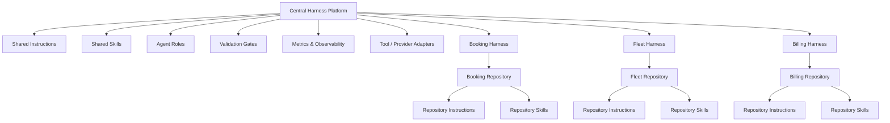
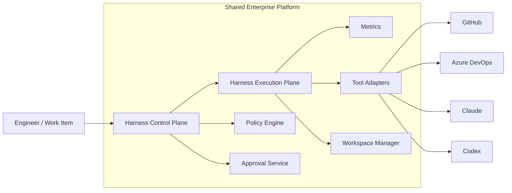
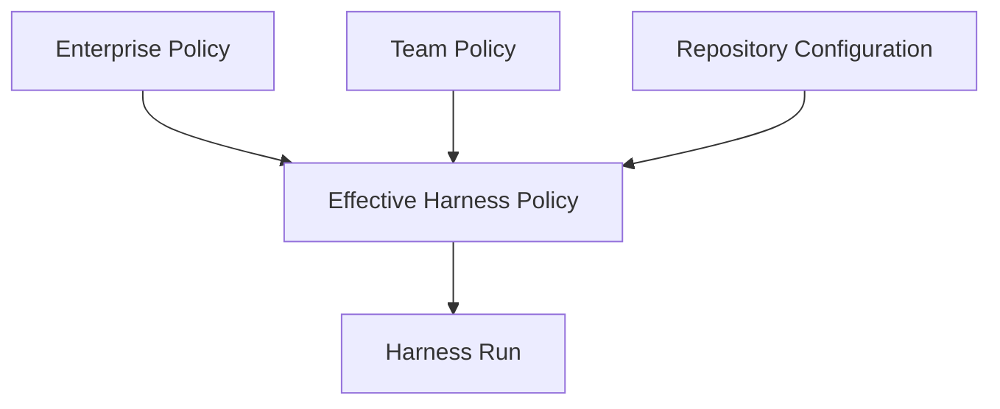
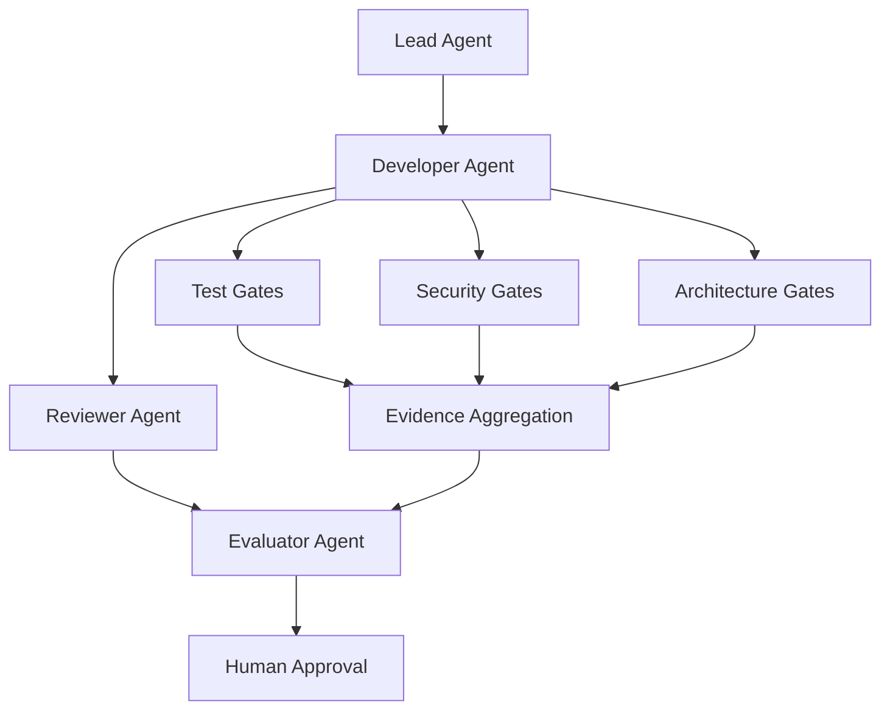
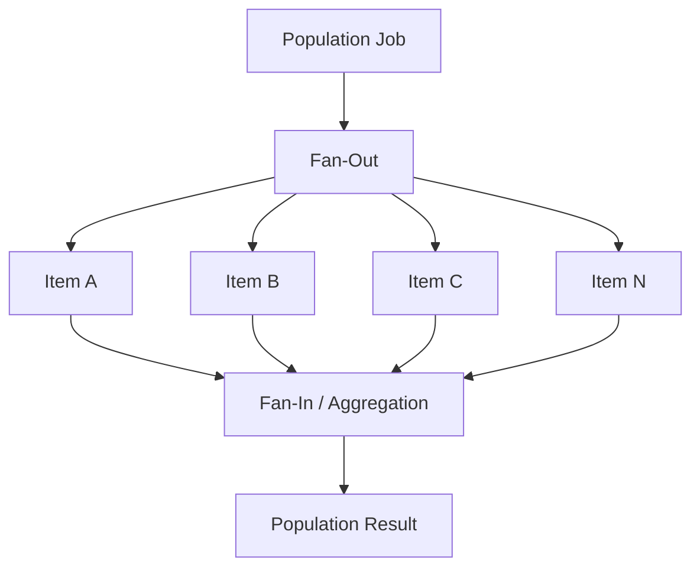
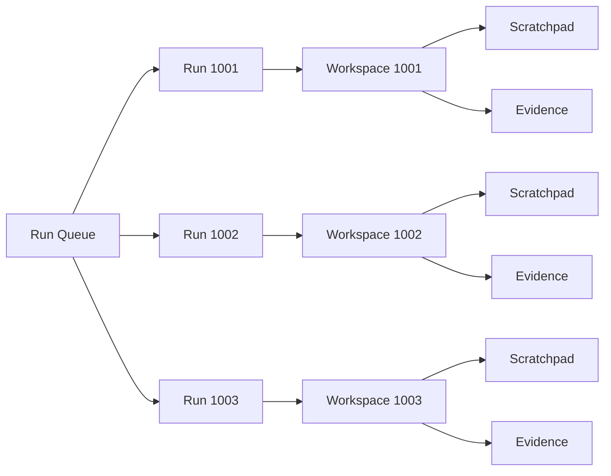
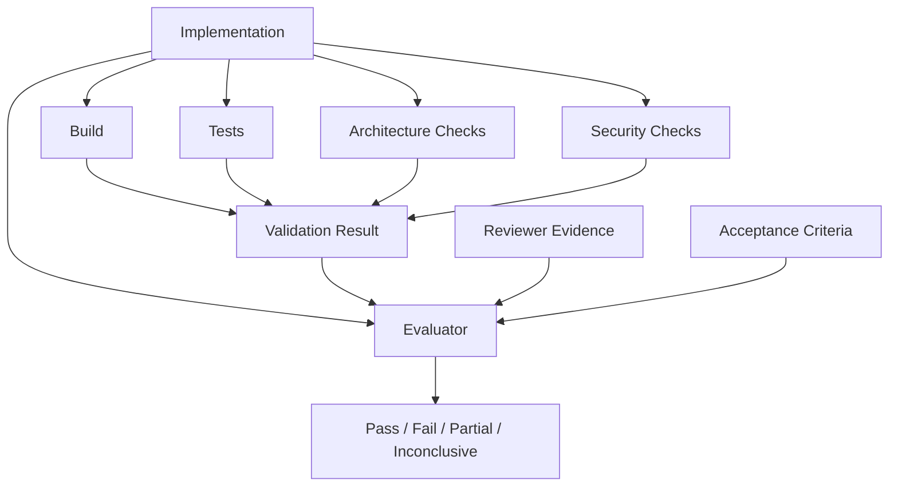
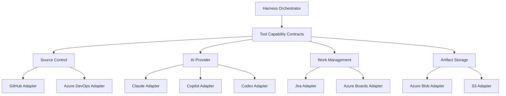
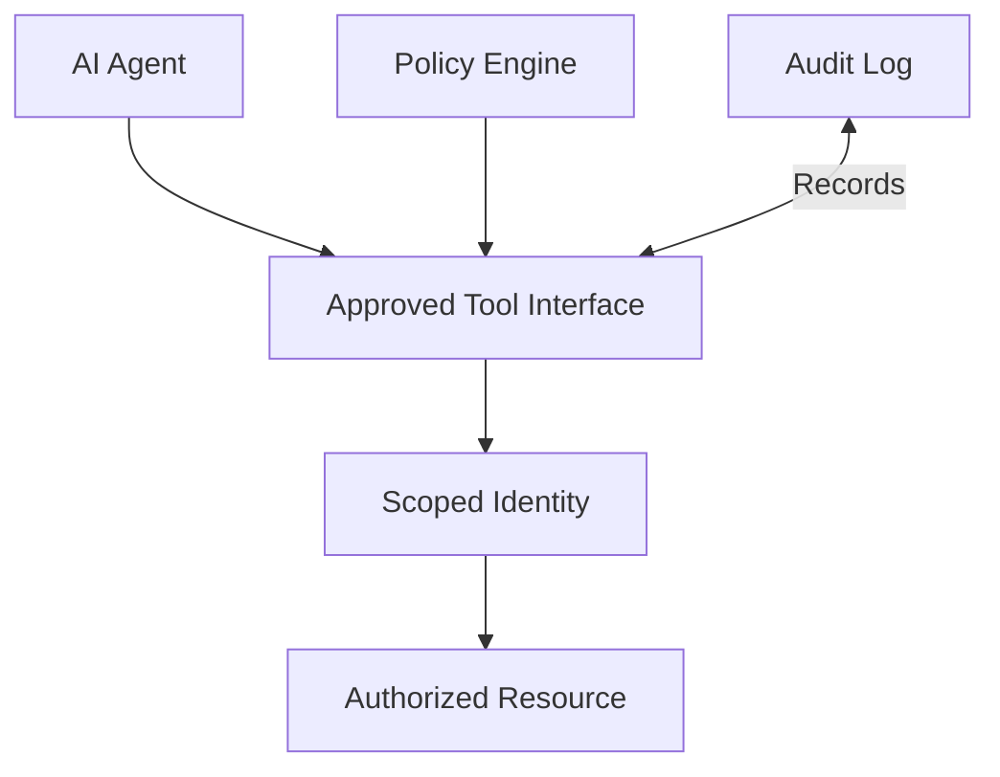
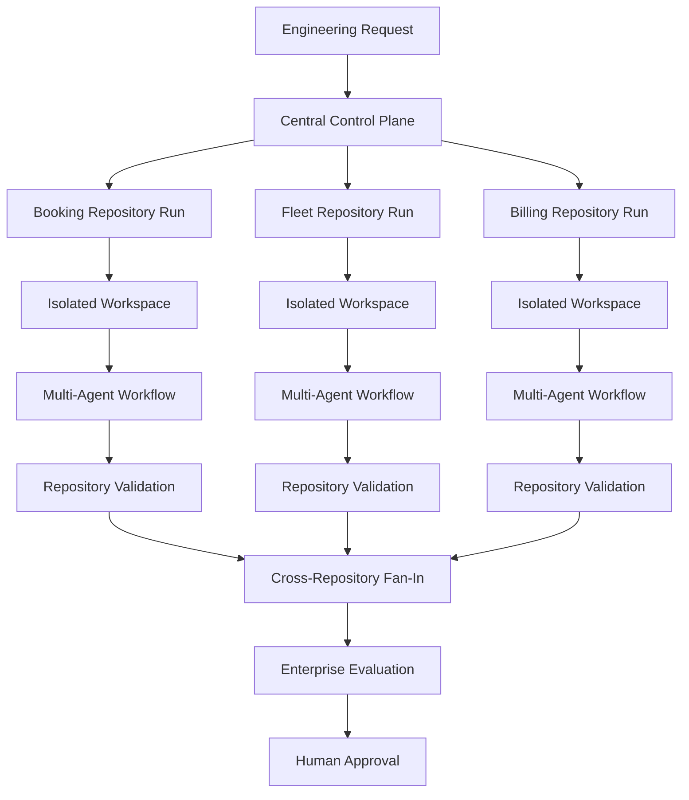

# Chapter 21 — Enterprise Harness Patterns

> **Part III — Harness Engineering**

Enterprise AI Engineering reaches a different level of difficulty when a Harness stops serving one repository, one team, or one workflow.

A Harness that works well for a single service may become fragile when twenty services depend on it. A workflow that is clear for one Developer Agent may become unpredictable when several agents operate in parallel. Validation that is inexpensive for one repository may become operationally expensive when repeated across an entire portfolio.

The solution is not to build a larger orchestration script.

The solution is to apply reusable **Harness patterns**.

Enterprise Harness architecture should be assembled from explicit patterns with clear ownership, isolation, extension points, and operational boundaries. The objective is not to create one universal Harness capable of performing every engineering task. The objective is to create a composable platform in which common capabilities can be reused without eliminating repository autonomy.

This chapter brings together the concepts introduced throughout Part III: orchestration, agent roles, deterministic gates, population processing, Run Workspaces, Scratchpads, validation, evaluation, recovery, metrics, and governance boundaries.

The central principle is:

> **Enterprise Harnesses should be composed from clear, reusable patterns instead of growing into large, tightly coupled orchestration workflows.**

The handbook remains Claude-first while keeping its architecture vendor-neutral, as established for the project.

---

## 1. Story-driven Opening

Alpha Car Detailing began its AI Engineering adoption with a single development team.

The first Harness automated changes to the Booking service.

A developer submitted a task:

```text
Add support for recurring fleet bookings.

Corporate customers must be able to create weekly or monthly
recurring detailing appointments.

Preserve existing booking behavior.

Add unit and integration tests.

Do not modify billing contracts.
```

The Harness processed the request through the architecture established in earlier chapters:

```text
Prompt
  ↓
Lead Agent
  ↓
Developer Agent
  ↓
Reviewer Agent
  ↓
Validator Agent
  ↓
Evaluator Agent
  ↓
Human Approval
```

The workflow worked well.

Instructions were stored in the Booking repository.

Skills described recurring implementation patterns.

The Run Workspace isolated execution state.

The Scratchpad held temporary reasoning and observations.

The Validator Agent executed deterministic gates.

The Evaluator Agent determined whether the completed change achieved the requested outcome.

Metrics recorded duration, retries, gate results, and final status.

For one repository, the design was straightforward.

Then adoption expanded.

The Fleet team wanted the same capability.

The Billing team followed.

The Customer team wanted a Harness for customer account changes.

The Notifications team wanted AI-assisted development for event consumers.

The Platform team wanted to maintain shared security checks.

The architecture group wanted every service to follow common API and observability standards.

Security required different approval rules for payment-related services.

Some teams used GitHub.

Others still used Azure DevOps.

Some services were .NET microservices.

Others contained Terraform, Kubernetes manifests, operational scripts, or front-end code.

Within several months, Alpha Car Detailing no longer had a single Harness problem.

It had an **enterprise Harness architecture problem**.

The first reaction was predictable.

The platform team considered extending the original Booking Harness:

```text
if repository == "booking"
    ...
else if repository == "fleet"
    ...
else if repository == "billing"
    ...
else if repository == "customer"
    ...
```

Additional conditions followed:

```text
if team == "billing"
    run payment security checks

if service uses Event Hub
    run event contract validation

if repository contains Terraform
    run infrastructure validation

if risk == "high"
    require architect approval
```

Soon the central workflow knew:

- repository names,
- service ownership,
- technology stacks,
- test commands,
- approval rules,
- branch policies,
- security rules,
- deployment models,
- agent configurations,
- provider-specific commands,
- exception cases,
- retry strategies,
- and repository-specific implementation details.

The Harness was becoming powerful.

It was also becoming dangerous.

A change intended to improve Fleet validation could break Booking.

A new Billing approval rule could affect unrelated repositories.

Adding another AI provider required modifying orchestration logic.

Parallel execution shared mutable state.

Failures in one processing branch could contaminate another.

Teams could no longer understand which rules were global and which were local.

The Harness had become the thing the organization originally wanted AI Engineering to avoid:

**a large, tightly coupled system whose behavior depended on hidden knowledge.**

The architecture group stopped adding conditions and reframed the problem.

Instead of asking:

> How do we make the Harness support every team?

they asked:

> Which capabilities should be shared, which should remain local, and which patterns should govern how those capabilities are composed?

That question changed the architecture.

Shared concerns moved into reusable platform capabilities:

- agent role definitions,
- common Skills,
- baseline Instructions,
- security gates,
- metrics,
- tool adapters,
- execution contracts,
- retry infrastructure,
- Run Workspace conventions.

Repository-specific concerns remained close to the repository:

- domain Instructions,
- local Skills,
- repository intelligence,
- service-specific test commands,
- architecture constraints,
- approval requirements,
- local acceptance criteria.

The resulting model was no longer one enormous Harness.

It became an **enterprise Harness ecosystem**.

```text
Central Harness Platform
       │
       ├── Shared Instructions
       ├── Shared Skills
       ├── Agent Roles
       ├── Validation Infrastructure
       ├── Metrics
       ├── Run Workspace Conventions
       ├── Tool Abstractions
       └── Provider Adapters
                │
        ┌───────┼────────┐
        │       │        │
        ▼       ▼        ▼
     Booking   Fleet   Billing
     Harness   Harness  Harness
        │       │        │
        ▼       ▼        ▼
     Booking   Fleet   Billing
      Rules     Rules    Rules
```

The enterprise architecture did not eliminate duplication by centralizing everything.

It eliminated **unnecessary duplication** while preserving necessary boundaries.

That distinction is the foundation of enterprise Harness design.

---

# 2. Learning Objectives

By the end of this chapter, you should be able to:

- explain why enterprise Harnesses should be built from reusable patterns rather than monolithic orchestration logic;
- distinguish between single-repository, multi-repository, monorepo, centralized, distributed, shared-platform, and team-specific Harness models;
- choose between single-agent and multi-agent execution models;
- design sequential, parallel, and fan-out/fan-in orchestration safely;
- determine where deterministic validation gates and human approval gates belong;
- design retry, recovery, resumability, and failure-isolation mechanisms;
- apply Population processing to large-scale AI Engineering workloads;
- use Run Workspaces and Scratchpads without creating shared mutable execution state;
- separate validation from evaluation;
- design plugin, adapter, and tool-abstraction layers;
- establish shared Instructions and Skills without removing repository-specific ownership;
- integrate Repository Intelligence into enterprise Harnesses;
- design metrics and observability into orchestration from the beginning;
- preserve security boundaries between repositories, teams, agents, and tools;
- evaluate tradeoffs involving governance, cost, parallelism, and operational complexity;
- combine multiple Harness patterns while keeping responsibilities explicit;
- identify common enterprise Harness anti-patterns;
- understand how the same architecture can be implemented with Claude Code, GitHub Copilot, OpenAI Codex, and future AI coding platforms.

---

# 3. Background

## 3.1 From Harness Implementation to Harness Architecture

Earlier chapters examined individual Harness responsibilities.

The Harness executes AI-assisted engineering workflows.

The Lead Agent interprets work.

The Developer Agent implements changes.

The Reviewer Agent independently inspects the implementation.

The Validator Agent verifies deterministic evidence.

The Evaluator Agent assesses whether the result satisfies the intended outcome.

Population processing enables a Harness to apply controlled processing across collections of work.

Metrics provide evidence about performance, reliability, cost, and behavior.

Run Workspaces and Scratchpads provide isolated execution state.

Each concept is useful independently.

Enterprise adoption requires them to work together.

At that point, the central design problem becomes architectural:

> How should these capabilities be composed when many repositories, teams, workflows, risk levels, and AI tools must coexist?

Enterprise Harness patterns answer that question.

---

## 3.2 What Is a Harness Pattern?

A **Harness pattern** is a reusable architectural or execution structure that solves a recurring AI Engineering problem.

Examples include:

- one Harness operating within one repository;
- one shared platform serving many repository-specific Harnesses;
- several agents executing sequentially;
- several agents executing independently in parallel;
- one work item being divided into many independently processed units;
- a deterministic gate stopping progression until objective conditions pass;
- a human approval checkpoint before high-risk actions;
- tool adapters separating orchestration from provider-specific APIs.

A pattern is not a mandatory product architecture.

It is a reusable solution shape.

Two organizations can apply the same pattern differently.

For example, both may use a centralized Harness platform.

One organization may run that platform in Kubernetes.

Another may use GitHub Actions.

A third may use Azure DevOps pipelines.

The underlying pattern remains:

```text
Shared Harness Capability
        ↓
Repository-Specific Execution
```

The implementation changes.

The architectural responsibility does not.

---

## 3.3 Patterns Are Not Features

A common mistake is to describe every Harness capability as a feature.

Consider parallel execution.

It might initially appear to be a feature:

```text
EnableParallelAgents = true
```

But enterprise parallelism affects:

- state isolation,
- resource allocation,
- branch management,
- API limits,
- worktree handling,
- logs,
- failure recovery,
- merge strategy,
- cost,
- deterministic validation,
- human review.

Parallelism is therefore not merely a switch.

It is an architectural pattern with consequences.

The same applies to:

- multi-repository execution,
- retries,
- population processing,
- shared validation,
- centralized governance,
- plugin architecture.

Patterns force architects to examine those consequences rather than treating them as configuration flags.

---

## 3.4 Composition Is the Enterprise Requirement

An enterprise rarely chooses one Harness pattern.

It combines several.

Alpha Car Detailing may use:

- a **centralized platform Harness**,
- several **repository-specific Harnesses**,
- a **multi-agent workflow**,
- **sequential orchestration** for implementation and review,
- **parallel orchestration** for independent validation,
- **fan-out/fan-in** for population jobs,
- **human approval gates** for payment changes,
- **adapter architecture** for GitHub and Azure DevOps,
- **shared Skills** for common engineering tasks,
- **repository-specific Instructions** for domain rules.

A realistic architecture may therefore look like this:

```text
                   Enterprise Harness Platform
                              │
       ┌──────────────────────┼──────────────────────┐
       │                      │                      │
       ▼                      ▼                      ▼
 Shared Capabilities     Execution Services     Governance
       │                      │                      │
  Instructions              Runs                 Policies
  Skills                    Queues                Approvals
  Roles                     Workers               Audit
  Adapters                  Recovery              Security
  Metrics                   Workspaces
       │
       ▼
 Repository Harness
       │
       ├── Local Instructions
       ├── Local Skills
       ├── Repository Intelligence
       ├── Validation Profile
       └── Approval Profile
```

The challenge is not whether patterns may be combined.

They should be.

The challenge is ensuring that combining them does not blur responsibility.

---

## 3.5 The Boundary Principle

Every enterprise Harness architecture should make a distinction between:

**shared capability**

and

**local authority**.

Shared capability provides reusable infrastructure.

Local authority determines repository-specific engineering behavior.

For example:

| Concern | Enterprise Platform | Repository / Team |
|---|---|---|
| Agent runtime | Shared | Consumed |
| Common role definitions | Shared baseline | Extended where necessary |
| Security scanning infrastructure | Shared | Repository policy may add requirements |
| Test execution engine | Shared | Test commands are local |
| Instructions | Baseline standards | Domain-specific rules |
| Skills | Shared catalog | Repository-specific Skills |
| Metrics format | Shared | Local dashboards may extend |
| Run Workspace model | Shared | Repository run data remains isolated |
| Approval workflow capability | Shared | Approval requirements are local |
| Repository Intelligence engine | Shared | Repository knowledge remains repository-specific |

This distinction prevents a shared Harness platform from becoming a centralized engineering authority.

> **Enterprise Tip**
>
> Centralize infrastructure more readily than engineering decisions.
>
> Reusable execution infrastructure benefits from consistency. Domain and repository decisions often require local ownership.

---

# 4. Concepts

## 4.1 Single-Repository Harness

A **Single-Repository Harness** is scoped to one repository.

```text
Repository
   │
   ├── Instructions
   ├── Skills
   ├── Repository Intelligence
   ├── Harness
   ├── Validation
   └── Metrics
```

This is often the best starting architecture.

The Harness understands one codebase and operates within one repository boundary.

### Appropriate when

- one team owns the repository;
- repository-specific behavior dominates;
- adoption is beginning;
- services are independently versioned;
- risk boundaries align with repository boundaries;
- teams require substantial autonomy.

### Advantages

- simple ownership;
- strong isolation;
- easy repository-specific customization;
- failures remain local;
- low coordination overhead;
- straightforward security boundaries.

### Disadvantages

- shared logic may be duplicated;
- improvements may propagate slowly;
- validation standards can drift;
- teams may implement incompatible conventions.

For Alpha Car Detailing, the Booking service could begin with:

```text
booking/
├── .ai/
│   ├── instructions/
│   ├── skills/
│   └── roles/
├── harness/
│   ├── run.ps1
│   ├── validate.ps1
│   └── evaluate.ps1
├── src/
└── tests/
```

This model is intentionally simple.

It should not be abandoned merely because the organization becomes interested in enterprise scale.

In many enterprises, repository-local Harnesses remain the execution boundary even after a central platform is introduced.

---

## 4.2 Multi-Repository Harness

A **Multi-Repository Harness** can coordinate work across several repositories.

For example, Alpha Car Detailing might introduce a feature requiring changes to:

```text
Booking API
Fleet API
Billing API
Shared Contracts
```

A multi-repository Harness may coordinate the overall change.

```text
                    Feature Request
                          │
                          ▼
                    Lead Agent
                          │
             ┌────────────┼────────────┐
             ▼            ▼            ▼
          Booking       Fleet        Billing
             │            │            │
             └────────────┼────────────┘
                          ▼
                   Cross-Repo Gates
                          │
                          ▼
                     Evaluation
```

Multi-repository Harnesses introduce significantly more complexity.

The Harness must understand:

- repository dependencies;
- compatible branches;
- contract versions;
- change ordering;
- cross-repository validation;
- partial failure;
- repository-specific approvals;
- coordinated rollback or retry.

A multi-repository Harness should therefore not mean:

> one agent gets write access to every repository.

Instead, orchestration should preserve repository boundaries.

A safer model is:

```text
Enterprise Run
      │
      ├── Repository Run A
      ├── Repository Run B
      └── Repository Run C
```

Each repository run owns its:

- workspace,
- Scratchpad,
- branch,
- evidence,
- logs,
- validation,
- failure state.

The enterprise run coordinates them without merging their mutable execution state.

---

## 4.3 Monorepo Harness

A **Monorepo Harness** operates inside a repository containing multiple applications, services, packages, or bounded contexts.

The repository boundary is shared, but engineering boundaries still exist.

For Alpha Car Detailing:

```text
alpha-car-platform/
├── services/
│   ├── booking/
│   ├── fleet/
│   ├── billing/
│   └── notifications/
├── shared/
├── infrastructure/
├── tests/
└── harness/
```

A poor monorepo Harness treats every change as repository-wide.

A mature monorepo Harness determines the **affected scope**.

For example:

```text
Task
  ↓
Change Scope Detection
  ↓
Affected Components
  ├── booking
  └── shared-contracts
  ↓
Scoped Instructions
  ↓
Scoped Tests
  ↓
Required Global Gates
```

The Harness may execute service-level validation first and expensive repository-wide validation later.

This is particularly important for large repositories.

Running the full build, complete integration suite, architecture tests, security scanning, and all static analysis on every agent iteration may make an otherwise effective Harness operationally unusable.

A common enterprise pattern is:

```text
Iteration Gates
      ↓
Affected Scope Only

Final Completion Gate
      ↓
Required Repository-Wide Validation
```

This preserves fast feedback without weakening final assurance.

---

## 4.4 Centralized Harness

A **Centralized Harness** places major orchestration capability in a common platform.

```text
               Central Harness
                     │
      ┌──────────────┼──────────────┐
      ▼              ▼              ▼
   Booking          Fleet         Billing
```

The central platform may provide:

- scheduling;
- execution workers;
- role orchestration;
- authentication;
- authorization;
- secrets integration;
- Run Workspace creation;
- provider invocation;
- standard logging;
- metrics;
- retry infrastructure;
- gate execution framework;
- approval workflow integration;
- artifact retention.

Centralization is attractive because shared improvements can be delivered once.

However, a centralized Harness becomes dangerous when it also centralizes repository-specific decisions.

The central platform should know **how to execute a validation profile**.

It should not necessarily decide **which business validations Billing requires**.

The difference is fundamental.

### Good centralization

```text
Harness Platform:
    execute(profile)
```

Repository:

```yaml
validation:
  required:
    - build
    - unit-tests
    - architecture-tests
    - payment-security-checks
```

### Poor centralization

```csharp
if (repository == "billing")
{
    RunBuild();
    RunUnitTests();
    RunArchitectureTests();
    RunPaymentSecurityChecks();
}
```

The second design embeds repository knowledge into the central orchestrator.

Over time, the orchestrator becomes a map of organizational exceptions.

---

## 4.5 Distributed Harness

A **Distributed Harness** places execution capabilities close to teams or repositories while sharing contracts and standards.

```text
                Shared Contracts
                      │
        ┌─────────────┼─────────────┐
        ▼             ▼             ▼
 Booking Harness   Fleet Harness  Billing Harness
        │             │             │
        └─────────────┼─────────────┘
                      ▼
                 Shared Metrics
```

The central organization may define:

- run result schemas;
- audit requirements;
- required baseline gates;
- security policies;
- agent role contracts;
- approved tool interfaces;
- metrics conventions.

Teams independently implement or configure their execution environments.

Distributed models provide autonomy but require stronger governance contracts.

Without those contracts, the organization may end up with unrelated automation systems all called “Harnesses.”

---

## 4.6 Shared Platform Harness

A **Shared Platform Harness** combines central infrastructure with distributed repository configuration.

For many enterprises, this is the most balanced model.

```text
                    Shared Harness Platform
                             │
      ┌──────────────────────┼──────────────────────┐
      │                      │                      │
 Agent Runtime          Validation Engine      Observability
 Tool Adapters          Workspace Engine       Audit
 Provider Adapters      Retry Engine           Metrics
      │
      └──────────────────────┬──────────────────────┘
                             │
             Repository Harness Configuration
                             │
        ┌────────────────────┼────────────────────┐
        ▼                    ▼                    ▼
     Booking               Fleet               Billing
```

The platform owns execution capabilities.

Repositories own configuration and engineering intent.

This pattern supports enterprise reuse without converting the Harness platform into a domain-aware monolith.

---

## 4.7 Team-Specific Harness

A **Team-Specific Harness** is optimized for a team's workflow.

For example:

```text
Payments Team Harness
```

might include:

- stronger security gates;
- mandatory human approval;
- PCI-related controls;
- restricted tools;
- specialized Skills;
- additional audit evidence.

Meanwhile:

```text
Internal Reporting Harness
```

may have a different risk profile.

Team-specific Harnesses are valuable where teams own several related repositories with common requirements.

However, team ownership should not justify copying the entire platform.

Prefer:

```text
Shared Platform
      +
Team Profile
      +
Repository Profile
```

rather than:

```text
Copy Shared Harness
      ↓
Modify Copy
      ↓
Permanent Fork
```

---

# 4.8 Single-Agent Workflow

The simplest execution model uses one AI Agent for the primary engineering task.

```text
Prompt
  ↓
AI Agent
  ↓
Deterministic Validation
  ↓
Human Review
```

Single-agent workflows can be effective for:

- low-risk changes;
- narrow repositories;
- documentation work;
- straightforward refactoring;
- small maintenance tasks.

Their primary advantage is operational simplicity.

Their primary weakness is the lack of independent AI role separation.

If the same agent implements and critiques its own work, independent review is reduced.

This does not make single-agent workflows invalid.

It means the architecture should recognize the tradeoff explicitly.

---

# 4.9 Multi-Agent Workflow

A **Multi-Agent Workflow** assigns distinct responsibilities to specialized roles.

```text
Lead
  ↓
Developer
  ↓
Reviewer
  ↓
Validator
  ↓
Evaluator
```

Role separation improves:

- independence;
- evidence quality;
- accountability;
- task decomposition;
- review specialization.

It also increases:

- execution time;
- token consumption;
- orchestration complexity;
- failure possibilities;
- state-management requirements.

More agents are not automatically better.

The number of agents should reflect the engineering problem.

> **Architect's Note**
>
> Agent count is an architectural decision, not a maturity score.
>
> An enterprise Harness with seven agents is not inherently more advanced than one with three. Each role should exist because it owns a distinct responsibility.

---

# 4.10 Sequential Orchestration

In sequential orchestration, stages execute in defined order.

```text
Lead
  ↓
Developer
  ↓
Reviewer
  ↓
Validator
  ↓
Evaluator
```

Sequential execution is appropriate when later stages require output from earlier stages.

Examples:

- Reviewer requires Developer implementation evidence.
- Validator requires a concrete implementation.
- Evaluator requires validation and review evidence.

Sequential orchestration provides clear causality.

Its main disadvantage is latency.

If every stage waits for the preceding stage even when no dependency exists, execution becomes unnecessarily slow.

---

# 4.11 Parallel Orchestration

Parallel orchestration executes independent tasks simultaneously.

After an implementation is available, Alpha Car Detailing might perform:

```text
                    Implementation
                          │
          ┌───────────────┼────────────────┐
          ▼               ▼                ▼
    Unit Tests      Architecture Scan  Security Scan
          │               │                │
          └───────────────┼────────────────┘
                          ▼
                      Gate Result
```

Parallel execution is most valuable when tasks are independent and read-only relative to the same implementation state.

Parallelism becomes dangerous when agents modify shared files.

Consider:

```text
Developer A ──writes──► repository
Developer B ──writes──► repository
Developer C ──writes──► repository
```

Without isolation, the result may depend on timing rather than architecture.

Safe parallel patterns use:

- separate branches;
- separate worktrees;
- separate containers;
- separate Run Workspaces;
- immutable input snapshots;
- explicit merge phases.

Parallel execution must be controlled, not merely enabled.

---

# 4.12 Fan-Out and Fan-In

Fan-out/fan-in is a common pattern for enterprise-scale processing.

One input is divided into independent work units.

Those units are processed separately.

Their results are then aggregated.

```text
                     Work Request
                          │
                          ▼
                       Fan-Out
             ┌────────────┼────────────┐
             ▼            ▼            ▼
          Unit A         Unit B       Unit C
             │            │            │
             └────────────┼────────────┘
                          ▼
                       Fan-In
                          │
                          ▼
                    Aggregate Result
```

Alpha Car Detailing might use this for:

- migrating many API endpoints;
- reviewing hundreds of services;
- converting legacy applications;
- generating tests for many programs;
- scanning repositories for architecture violations;
- applying the same controlled refactoring across a population.

Fan-in should aggregate **evidence and results**, not blindly combine every modification.

For code-producing workloads, merge conflicts and cross-unit dependencies require explicit handling.

---

# 4.13 Human Approval Gates

Human approval is a governance boundary.

It is not merely a notification.

Examples include:

```text
Implementation
     ↓
Validation
     ↓
Security Review
     ↓
Human Approval
     ↓
Create Pull Request
```

or:

```text
Approved Pull Request
     ↓
Human Production Approval
     ↓
Deployment
```

Approval requirements should correspond to risk.

Alpha Car Detailing might require:

| Change | Approval |
|---|---|
| Documentation | Team review |
| Booking application logic | Maintainer approval |
| Shared contract change | Service-owner approval |
| Billing calculation | Senior engineer approval |
| Authentication change | Security approval |
| Production infrastructure | Platform approval |
| Financial data handling | Security + domain approval |

The Harness should enforce approval boundaries.

It should not simulate human approval.

---

# 4.14 Deterministic Validation Gates

A deterministic gate verifies an objective condition.

Examples:

```text
dotnet build
dotnet test
architecture tests
schema validation
dependency policy
security scan
contract compatibility
terraform validate
```

The gate should produce machine-verifiable evidence.

```text
PASS
FAIL
ERROR
SKIPPED
```

An AI Agent may interpret the failure.

It should not redefine the deterministic result.

A robust architecture often separates:

```text
Agent Reasoning
      │
      ▼
Implementation
      │
      ▼
Deterministic Gates
      │
      ▼
Evidence
      │
      ▼
Agent Evaluation
```

The AI can reason about evidence.

It does not replace the evidence.

---

# 4.15 Retry and Recovery

Enterprise Harnesses must assume that execution can fail.

Failures may come from:

- AI provider timeouts;
- rate limits;
- network errors;
- build infrastructure;
- package feeds;
- repository locks;
- test environments;
- expired credentials;
- temporary cloud failures;
- agent implementation defects.

A retry pattern distinguishes transient failure from engineering failure.

For example:

```text
Provider timeout
      ↓
Retry

Compilation failure
      ↓
Return to Developer
```

Those are different recovery actions.

Blind retry is not resilience.

Repeatedly asking an agent to perform the same action with unchanged conditions may simply increase cost.

A robust recovery policy asks:

1. Is the failure transient?
2. Is retry safe?
3. Is the operation idempotent?
4. Has anything changed since the previous attempt?
5. What is the retry limit?
6. What evidence should be preserved?
7. When should the run escalate?
8. Can the run resume rather than restart?

Run Workspace persistence becomes important here.

A recovered run should know:

- completed stages;
- produced artifacts;
- prior failures;
- validation evidence;
- approved decisions;
- remaining work.

Recovery should not require reconstructing execution history from an AI conversation.

---

# 4.16 Population Processing

Population processing applies a Harness workflow repeatedly across a defined collection.

```text
Population
    │
    ├── Program 001
    ├── Program 002
    ├── Program 003
    └── Program N
```

Each item should be treated as an independently trackable run or child run.

This enables:

- isolation;
- retry;
- status tracking;
- exhaustion handling;
- metrics;
- artifact retention;
- partial completion.

For example:

```text
Population Job
     │
     ├── 87 Passed
     ├── 8 Failed
     ├── 3 Exhausted
     └── 2 Running
```

The job should not be modeled as one enormous AI conversation.

Enterprise processing requires durable state outside the model.

---

# 4.17 Run Workspace and Scratchpad Pattern

A **Run Workspace** is the execution boundary for a Harness run.

It may contain:

```text
runs/
└── run-2026-1042/
    ├── input/
    ├── workspace/
    ├── scratchpad/
    ├── evidence/
    ├── logs/
    ├── artifacts/
    └── result.json
```

The **Scratchpad** is temporary working state within that run.

It may contain:

- observations;
- assumptions;
- intermediate findings;
- files under investigation;
- unresolved questions;
- progress checkpoints.

It must not become the authoritative source of repository knowledge.

The Run Workspace owns execution state.

Repository Intelligence owns durable repository knowledge.

Instructions own persistent engineering expectations.

The distinction matters.

```text
Run Workspace
     │
     ├── temporary execution state
     │
     └── Scratchpad
              │
              └── temporary reasoning state
```

When useful discoveries emerge, the Harness may propose promotion into governed knowledge.

It should not silently rewrite authoritative knowledge.

---

# 4.18 Validation and Evaluation Pattern

Validation and evaluation solve different problems.

### Validation asks

> Did objective engineering checks pass?

### Evaluation asks

> Did the completed result achieve the intended outcome?

Consider a Booking feature.

Validation may prove:

```text
Build: PASS
Unit tests: PASS
Integration tests: PASS
Architecture tests: PASS
API schema: PASS
Security scan: PASS
```

Evaluation may still conclude:

```text
PARTIAL

Reason:
The endpoint was implemented and validated successfully,
but recurring bookings cannot be cancelled individually,
which is required by the acceptance criteria.
```

The architecture should preserve this distinction.

```text
Implementation
     │
     ├──────────────► Validation
     │                    │
     │                    ▼
     │                 Evidence
     │                    │
     └────────────────────┼──────► Evaluation
                          │
                          ▼
                     Outcome
```

A Harness that treats test success as equivalent to goal satisfaction is incomplete.

---

# 4.19 Plugin and Adapter Architecture

Enterprise Harnesses inevitably integrate with external systems.

Examples include:

- GitHub;
- Azure DevOps;
- GitLab;
- Claude;
- OpenAI;
- code scanners;
- ticket systems;
- artifact stores;
- cloud platforms;
- approval systems;
- observability platforms.

Direct coupling creates brittle orchestration.

Instead of:

```csharp
GitHubClient.CreatePullRequest(...);
```

business orchestration can depend on an abstraction:

```csharp
ISourceControlProvider.CreatePullRequest(...);
```

with adapters:

```text
ISourceControlProvider
        │
        ├── GitHubAdapter
        ├── AzureDevOpsAdapter
        └── GitLabAdapter
```

Similarly:

```text
IAgentProvider
     │
     ├── ClaudeAdapter
     ├── CopilotAdapter
     └── CodexAdapter
```

The purpose is not abstraction for its own sake.

The abstraction isolates orchestration from provider-specific behavior.

---

# 4.20 Tool Abstraction

Tool abstraction extends the adapter principle to capabilities.

An agent should ideally request:

```text
RunTests
SearchRepository
ReadFile
WriteFile
CreateBranch
CreatePullRequest
QueryTicket
PublishArtifact
```

rather than embedding knowledge of every implementation.

The Harness resolves the capability through an approved tool implementation.

```text
Agent
  │
  ▼
Tool Contract
  │
  ├── Local CLI
  ├── GitHub
  ├── Azure DevOps
  ├── Kubernetes
  └── Enterprise API
```

This provides:

- portability;
- access control;
- auditability;
- testability;
- provider substitution;
- policy enforcement.

It also helps prevent agents from receiving unrestricted access to underlying systems.

---

# 4.21 Shared Instructions and Skills

Enterprise reuse should include knowledge as well as infrastructure.

However, Instructions and Skills have different ownership characteristics.

A useful layering model is:

```text
Enterprise Instructions
        ↓
Platform Instructions
        ↓
Team Instructions
        ↓
Repository Instructions
```

For example:

### Enterprise Instructions

```text
Never commit secrets.

All production APIs require authentication.

All code must be reviewed before merge.
```

### Platform Instructions

```text
Services must emit OpenTelemetry traces.

Use approved container base images.

Health endpoints must follow platform standards.
```

### Booking Instructions

```text
Booking state transitions must occur through domain methods.

Booking events are published through the transactional outbox.

Direct repository access from controllers is prohibited.
```

Skills can follow a similar structure.

```text
Shared Skill Catalog
       │
       ├── Add API Endpoint
       ├── Add Integration Event
       ├── Add Health Check
       ├── Add OpenTelemetry
       └── Add Transactional Outbox
```

Repository-specific Skills may extend the catalog:

```text
Booking Skills
       ├── Add Booking Command
       └── Add Booking State Transition
```

The architecture should support inheritance or composition without creating ambiguous precedence.

---

# 4.22 Repository Intelligence Integration

An enterprise Harness should not repeatedly rediscover the same repository from scratch.

Repository Intelligence may capture governed knowledge about:

- architecture;
- bounded contexts;
- service dependencies;
- test structure;
- critical files;
- conventions;
- contracts;
- domain boundaries;
- known risks.

The Harness uses this knowledge during planning and execution.

```text
Repository
     │
     ▼
Repository Intelligence
     │
     ├── Architecture
     ├── Conventions
     ├── Dependencies
     ├── Contracts
     └── Known Constraints
             │
             ▼
           Agents
```

Repository Intelligence should remain distinct from:

- Prompt,
- Instructions,
- Skills,
- Scratchpad,
- Run Workspace.

Each serves a different purpose.

---

# 4.23 Metrics and Observability

Enterprise Harnesses are production systems.

Production systems require observability.

At minimum, the Harness should answer:

- How many runs started?
- How many completed?
- How many failed?
- How many exhausted retries?
- Which stage consumes the most time?
- Which gate fails most often?
- Which repositories experience the most retries?
- Which agent role consumes the most tokens?
- What is the average cost per completed change?
- How often is human intervention required?
- Which Skills produce the highest failure rate?
- Which provider errors are transient?
- How long do approval gates wait?
- How much work is processed in parallel?
- Where are operational bottlenecks?

Metrics might include:

```text
harness_run_duration_seconds
harness_stage_duration_seconds
agent_invocation_count
agent_token_usage
validation_failure_count
retry_count
human_approval_wait_seconds
population_item_status
workspace_recovery_count
provider_error_count
```

Logs should carry correlation identifiers such as:

```text
EnterpriseRunId
RunId
RepositoryId
PopulationId
AgentRole
Stage
Attempt
```

Without correlation, distributed Harness execution becomes difficult to diagnose.

---

# 4.24 Security and Isolation

A Harness may have access to:

- source code;
- secrets;
- CI/CD systems;
- cloud infrastructure;
- production configuration;
- internal documentation;
- issue trackers;
- databases;
- package feeds.

Security must therefore be architectural.

Important boundaries include:

```text
Agent Boundary
Repository Boundary
Run Boundary
Team Boundary
Tool Boundary
Credential Boundary
Environment Boundary
```

An agent operating on Booking should not automatically inherit access to Billing production systems.

A run processing one customer repository should not share writable state with another.

A tool capable of reading repository files does not automatically need deployment permissions.

Apply least privilege.

```text
Agent
  ↓
Approved Tool Contract
  ↓
Scoped Credential
  ↓
Authorized Resource
```

The Harness should know not only **what tool to call**, but also:

- which identity is calling it;
- what that identity may access;
- what operation is permitted;
- what audit evidence must be recorded.

---

# 5. Architecture Discussion

## 5.1 The Enterprise Harness Is a System of Systems

At enterprise scale, “the Harness” may refer to several cooperating systems.

A realistic architecture includes:

```text
Harness Control Plane
Harness Execution Plane
Repository Configuration
Knowledge Layer
Validation Infrastructure
Tool Integration Layer
Observability Layer
Governance Layer
```

Treating all of these as one application usually creates unnecessary coupling.

---

## 5.2 Control Plane and Execution Plane

A useful architectural separation is between a **control plane** and an **execution plane**.

### Control plane responsibilities

The control plane may manage:

- run submission;
- scheduling;
- workflow selection;
- policies;
- identities;
- approval state;
- repository registration;
- configuration;
- execution quotas;
- retry policy;
- global metrics.

### Execution plane responsibilities

The execution plane performs:

- repository checkout;
- workspace creation;
- agent invocation;
- tool execution;
- builds;
- tests;
- scans;
- artifact collection;
- cleanup.

```text
                 Control Plane
                      │
        ┌─────────────┼─────────────┐
        │             │             │
   Scheduling      Policies      Approvals
        │             │             │
        └─────────────┼─────────────┘
                      │
                      ▼
                Execution Plane
                      │
        ┌─────────────┼─────────────┐
        ▼             ▼             ▼
      Worker        Worker        Worker
        │             │             │
        ▼             ▼             ▼
    Workspace     Workspace     Workspace
```

This separation enables scaling execution without duplicating enterprise control logic.

---

## 5.3 Shared Platform, Local Configuration

A strong default architecture is:

```text
Platform owns mechanism.
Repository owns intent.
```

For example:

### Platform

```yaml
capabilities:
  - agent-execution
  - deterministic-gates
  - metrics
  - workspace-management
  - retry
  - approval-workflows
```

### Repository

```yaml
harness:
  instructions:
    - .ai/instructions/architecture.md
    - .ai/instructions/testing.md

  skills:
    - add-booking-command
    - publish-booking-event

  validation:
    required:
      - build
      - unit-tests
      - integration-tests
      - architecture-tests

  approvals:
    contract-change:
      - service-owner
      - architecture
```

The repository declares expectations.

The platform provides execution capability.

---

## 5.4 Repository Profiles

As the number of repositories grows, the Harness needs a declarative way to describe them.

A repository profile might contain:

```yaml
repository:
  name: booking-service
  owner: booking-team

technology:
  runtime: dotnet
  version: "10"

agents:
  lead: enabled
  developer: enabled
  reviewer: enabled
  validator: enabled
  evaluator: enabled

validation:
  build: true
  unitTests: true
  integrationTests: true
  architectureTests: true

risk:
  default: medium

approvals:
  highRisk:
    - team-lead

tools:
  sourceControl: github
  workItems: azure-devops
```

The exact format is implementation-specific.

The pattern is not.

Repository knowledge should be declarative wherever practical rather than embedded in orchestration code.

---

## 5.5 Capability Profiles

Repository profiles describe the repository.

Capability profiles describe reusable execution behavior.

For example:

```yaml
profile: dotnet-microservice

capabilities:
  - restore
  - build
  - unit-test
  - integration-test
  - architecture-test
  - dependency-scan
  - container-build
```

A service could consume:

```yaml
extends:
  - dotnet-microservice
  - event-driven-service
  - pci-sensitive
```

This encourages composition rather than hard-coded branching.

---

## 5.6 Policy Overlay Pattern

Not every requirement belongs inside the repository.

Certain controls may be centrally mandated.

For example:

```text
Repository Profile
       +
Team Policy
       +
Enterprise Policy
       =
Effective Run Policy
```

Alpha Car Detailing might define:

### Enterprise policy

```text
No secrets in source control.
All code changes require review.
Critical security findings block completion.
```

### Billing policy

```text
Payment calculation changes require senior approval.
```

### Repository policy

```text
Billing contract tests must pass.
```

The Harness calculates the effective policy without giving one layer unrestricted authority over all others.

---

## 5.7 Risk-Based Workflow Selection

Not every task requires the same workflow.

A Harness may classify work into risk profiles.

```text
Task
 ↓
Risk Classification
 ↓
 ┌────────┬────────┬────────┐
 ▼        ▼        ▼
Low     Medium     High
```

Example:

| Risk | Workflow |
|---|---|
| Low | Developer → Validation |
| Medium | Developer → Reviewer → Validation → Evaluation |
| High | Lead → Developer → Reviewer → Validation → Security Review → Evaluation → Human Approval |

Examples of high-risk changes include:

- authentication;
- authorization;
- financial calculation;
- production infrastructure;
- data retention;
- shared external contracts.

Risk-based workflows can reduce unnecessary cost while preserving stronger controls where they matter.

---

## 5.8 Combining Sequential and Parallel Execution

Enterprise workflows often mix sequential and parallel patterns.

For example:

```text
Lead
 ↓
Developer
 ↓
 ┌──────────────────────────────────┐
 │                                  │
 ▼                                  ▼
Reviewer                     Validation Group
                                │
                     ┌──────────┼──────────┐
                     ▼          ▼          ▼
                  Tests      Security   Architecture
                     │          │          │
                     └──────────┼──────────┘
                                ▼
                             Fan-In
                                │
Reviewer Evidence ──────────────┤
                                ▼
                            Evaluator
                                │
                                ▼
                         Human Approval
```

This design respects dependencies while reducing unnecessary serial execution.

---

## 5.9 Failure Domains

Every execution architecture should define failure domains.

Suppose the Fleet validation worker crashes.

Should that terminate:

- the Fleet validation step?
- the Fleet run?
- the entire enterprise feature?
- unrelated Booking work?
- all current Harness jobs?

Usually the smallest possible failure domain is preferable.

```text
Enterprise Run
     │
     ├── Booking Run     PASS
     ├── Fleet Run       FAILED
     └── Billing Run     PASS
```

The system can then make an explicit decision:

```text
Cross-repository completion: BLOCKED
Reason: Fleet Run failed
```

The failure remains isolated while its business consequence remains visible.

---

## 5.10 Immutable Evidence

Parallel and distributed systems become easier to reason about when stage outputs are treated as immutable evidence.

For example:

```text
Developer Output
      ↓
implementation-manifest.json

Validator Output
      ↓
validation-result.json

Reviewer Output
      ↓
review-result.json

Evaluator Output
      ↓
evaluation-result.json
```

A later stage consumes earlier evidence.

It should not silently rewrite it.

This creates:

- auditability;
- reproducibility;
- debugging clarity;
- trustworthy approval records.

---

## 5.11 Event-Driven Harness Architecture

At sufficient scale, Harness orchestration may benefit from event-driven execution.

```text
RunRequested
      ↓
LeadCompleted
      ↓
DevelopmentCompleted
      ↓
ValidationRequested
      ↓
ValidationCompleted
      ↓
EvaluationRequested
      ↓
RunCompleted
```

Workers subscribe to relevant events.

This pattern supports:

- horizontal scaling;
- asynchronous stages;
- durable recovery;
- independent components;
- population processing.

However, event-driven architecture should be introduced because operational scale requires it, not because the Harness contains AI.

A small Harness does not need a distributed message bus merely to appear enterprise-grade.

---

## 5.12 Queue-Based Worker Pattern

Long-running AI workflows should generally not depend on one interactive process remaining alive.

A queue-based model allows work to be resumed and scaled.

```text
Run Request
    ↓
Work Queue
    ↓
Worker
    ↓
Run Workspace
    ↓
Result Store
```

Multiple workers may process independent runs.

```text
                    Queue
                      │
         ┌────────────┼────────────┐
         ▼            ▼            ▼
      Worker 1     Worker 2     Worker 3
```

Concurrency limits should be explicit.

Unbounded concurrency can exhaust:

- provider quotas;
- build agents;
- database connections;
- source-control APIs;
- test environments;
- cloud budgets.

---

## 5.13 Provider-Neutral Agent Architecture

Claude may be the primary implementation platform, but enterprise Harness design should avoid embedding Claude-specific assumptions into every orchestration layer.

Prefer:

```text
Harness
   ↓
Agent Capability Contract
   ↓
Provider Adapter
   ├── Claude
   ├── GitHub Copilot
   └── Codex
```

The contract may express capabilities such as:

```text
execute task
read repository
apply change
return structured result
report tool calls
return usage information
```

Provider-specific capabilities may still exist.

The architecture should isolate them.

---

## 5.14 Designing for Partial Capability

AI providers do not expose identical capabilities.

One may support:

- native subagents;
- custom commands;
- tool servers;
- repository instructions;
- structured output.

Another may expose those concepts differently.

Therefore, the abstraction should not pretend every provider is identical.

A good model separates:

```text
Core Harness Contract
        +
Optional Provider Capabilities
```

For example:

```text
IAgentProvider
    ExecuteAsync()

IPlanningProviderCapability
    CreatePlanAsync()

ISubAgentCapability
    SpawnAgentAsync()
```

This prevents the lowest-common-denominator problem while preserving portability.

---

## 5.15 Shared Nothing Between Runs

One of the most important enterprise execution principles is:

> **Mutable run state should not be shared between independent runs.**

Unsafe:

```text
/shared/current-task.md
/shared/scratchpad.md
/shared/output/
```

Two concurrent runs may overwrite one another.

Safer:

```text
/runs/{run-id}/scratchpad/
/runs/{run-id}/artifacts/
/runs/{run-id}/logs/
/runs/{run-id}/workspace/
```

Shared resources may be read-only or controlled through transactional services.

Mutable execution state belongs to a run.

---

# 6. Professional Diagrams

## 6.1 Central Harness with Repository-Specific Harnesses



The central platform supplies shared capability.

Each repository retains local Instructions, Skills, validation requirements, and approval policy.

---

## 6.2 Shared Platform Harness



This architecture separates workflow control from execution mechanics.

---

## 6.3 Repository Configuration Layers



The effective workflow is composed from several governance layers rather than hard-coded into one orchestration script.

---

## 6.4 Sequential and Parallel Orchestration



The Developer stage is sequential because implementation must exist first.

Independent validation activities can then execute in parallel.

---

## 6.5 Fan-Out / Fan-In Population Pattern



Each population item remains independently observable and recoverable.

---

## 6.6 Run Isolation



No run owns another run's mutable state.

---

## 6.7 Validation and Evaluation



Validation produces deterministic evidence.

Evaluation assesses the completed outcome using that evidence.

---

## 6.8 Plugin and Adapter Architecture



The Harness depends on capabilities rather than vendor APIs.

---

## 6.9 Security Boundary Pattern



The agent receives only the capability and access required for the current task.

---

## 6.10 Enterprise Pattern Composition

A complete Alpha Car Detailing enterprise Harness may combine several patterns simultaneously.



This diagram illustrates an important point:

There is no contradiction between centralization and distribution.

The control plane can be centralized.

Repository execution can remain isolated.

Agent workflows can be standardized.

Instructions can remain repository-specific.

Validation infrastructure can be shared.

Validation requirements can remain local.

Metrics can be centralized.

Mutable run state can remain isolated.

This is the essence of pattern composition.

---

## 6.11 Pattern Selection Matrix

No single pattern is correct for every organization.

The selection should reflect the operating environment.

| Decision Factor | Favor Simpler / Local Pattern | Favor Shared / Distributed Enterprise Pattern |
|---|---|---|
| Repository count | Few | Many |
| Team count | One | Several |
| Service count | Few | Many |
| Change risk | Low | Medium to high |
| Shared standards | Limited | Extensive |
| Cross-repository changes | Rare | Frequent |
| Parallel workload | Low | High |
| Security requirements | Basic | Strong isolation / governance |
| AI provider diversity | One | Multiple |
| Operational maturity | Early | Established |
| Cost sensitivity | Minimize infrastructure | Optimize execution at scale |
| Governance | Team-level | Enterprise-level |
| Population workloads | Rare | Common |
| Failure recovery | Manual acceptable | Durable recovery required |

The matrix is guidance, not a scoring system.

Architecture should reflect actual constraints.

---

## 6.12 Pattern Combination Matrix

Common combinations include:

| Pattern | Often Combined With |
|---|---|
| Single-Repository Harness | Shared Skills, local Instructions, deterministic gates |
| Multi-Repository Harness | Fan-out/fan-in, isolated workspaces, cross-repository evaluation |
| Monorepo Harness | Change-scope detection, scoped validation, final global gates |
| Centralized Harness | adapters, metrics, approval services |
| Distributed Harness | shared contracts, governance policy, centralized observability |
| Shared Platform Harness | repository profiles, team profiles, tool abstraction |
| Multi-Agent Workflow | sequential orchestration, independent review |
| Parallel Orchestration | immutable inputs, workspace isolation, fan-in |
| Population Processing | queue workers, retry, exhaustion handling |
| Human Approval Gates | risk classification, audit trail |
| Repository Intelligence | Lead Agent, planning, scoped validation |
| Tool Abstraction | provider adapters, least-privilege security |

Patterns should be combined deliberately.

The architectural question is not:

> Can these patterns work together?

It is:

> Where does each responsibility begin and end?

That boundary discipline determines whether an enterprise Harness remains composable or evolves into another tightly coupled automation platform.

---

Chapter 21 status: In progress — next section: Hands-on Example

# 7. Hands-on Example

## 7.1 Scenario: Building a Shared Enterprise Harness for Alpha Car Detailing

Alpha Car Detailing has successfully introduced AI-assisted engineering workflows within its Booking service.

The original Harness supports a structured development lifecycle:

1. The Lead Agent analyzes the engineering request.
2. The Developer Agent implements the approved change.
3. The Reviewer Agent independently examines the implementation.
4. The Validator Agent executes deterministic checks.
5. The Evaluator Agent assesses the completed outcome against acceptance criteria.
6. The Harness records execution evidence and prepares the change for human approval.

The organization now wants to extend these capabilities to three independently maintained microservices:

| Microservice | Responsibility                                            | Team         |
| ------------ | --------------------------------------------------------- | ------------ |
| Booking      | Customer appointments, scheduling, recurring bookings     | Booking Team |
| Fleet        | Corporate vehicles, fleet membership, vehicle eligibility | Fleet Team   |
| Billing      | Invoices, payments, pricing, financial adjustments        | Billing Team |

Although these services share enterprise engineering standards, they have different domain rules, validation requirements, and approval boundaries.

The architecture team must design a solution that allows all three services to reuse the same Harness capabilities without creating a centralized workflow containing repository-specific conditions.

The objective is to implement a Shared Platform Harness with repository-specific execution profiles.

The solution will demonstrate the following patterns:

- Centralized Harness capabilities with distributed repository ownership.
- Shared Instructions, Skills, and agent role contracts.
- Repository-specific configuration and validation.
- Isolated Run Workspaces and Scratchpads.
- Sequential and parallel orchestration.
- Deterministic validation gates.
- Retry, recovery, and failure isolation.
- Repository and AI provider adapters.
- Metrics and structured execution evidence.
- Risk-based human approval.

The implementation uses .NET 10 for the orchestration components and Claude Code as the primary AI coding platform. The underlying architectural contracts remain independent of Claude.

## 7.2 Step 1 — Define the Target Architecture

The solution separates responsibilities into three layers.

Enterprise Harness Platform

Provides common orchestration infrastructure, role contracts, tool adapters, validation execution, Run Workspace management, recovery, and metrics.

Repository Harness Configuration

Provides repository-specific Instructions, Skills, validation profiles, approval requirements, and Repository Intelligence references.

Run Execution

Creates an isolated workspace, executes the selected workflow, collects evidence, and produces a structured result.

\#chatgpt-mermaid-\_r_17un\_{font-family:-apple-system-body,ui-sans-serif,-apple-system,system-ui,"Segoe UI",Helvetica,"Apple Color Emoji",Arial,sans-serif,"Segoe UI Emoji","Segoe UI Symbol";font-size:16px;fill:rgb(13, 13, 13);}@keyframes edge-animation-frame{from{stroke-dashoffset:0;}}@keyframes dash{to{stroke-dashoffset:0;}}#chatgpt-mermaid-\_r_17un\_ .edge-animation-slow{stroke-dasharray:9,5!important;stroke-dashoffset:900;animation:dash 50s linear infinite;stroke-linecap:round;}#chatgpt-mermaid-\_r_17un\_ .edge-animation-fast{stroke-dasharray:9,5!important;stroke-dashoffset:900;animation:dash 20s linear infinite;stroke-linecap:round;}#chatgpt-mermaid-\_r_17un\_ .error-icon{fill:rgb(243, 243, 243);}#chatgpt-mermaid-\_r_17un\_ .error-text{fill:rgb(13, 13, 13);stroke:rgb(13, 13, 13);}#chatgpt-mermaid-\_r_17un\_ .edge-thickness-normal{stroke-width:1px;}#chatgpt-mermaid-\_r_17un\_ .edge-thickness-thick{stroke-width:3.5px;}#chatgpt-mermaid-\_r_17un\_ .edge-pattern-solid{stroke-dasharray:0;}#chatgpt-mermaid-\_r_17un\_ .edge-thickness-invisible{stroke-width:0;fill:none;}#chatgpt-mermaid-\_r_17un\_ .edge-pattern-dashed{stroke-dasharray:3;}#chatgpt-mermaid-\_r_17un\_ .edge-pattern-dotted{stroke-dasharray:2;}#chatgpt-mermaid-\_r_17un\_ .marker{fill:rgb(143, 143, 143);stroke:rgb(143, 143, 143);}#chatgpt-mermaid-\_r_17un\_ .marker.cross{stroke:rgb(143, 143, 143);}#chatgpt-mermaid-\_r_17un\_ svg{font-family:-apple-system-body,ui-sans-serif,-apple-system,system-ui,"Segoe UI",Helvetica,"Apple Color Emoji",Arial,sans-serif,"Segoe UI Emoji","Segoe UI Symbol";font-size:16px;}#chatgpt-mermaid-\_r_17un\_ p{margin:0;}#chatgpt-mermaid-\_r_17un\_ .label{font-family:-apple-system-body,ui-sans-serif,-apple-system,system-ui,"Segoe UI",Helvetica,"Apple Color Emoji",Arial,sans-serif,"Segoe UI Emoji","Segoe UI Symbol";color:rgb(13, 13, 13);}#chatgpt-mermaid-\_r_17un\_ .cluster-label text{fill:rgb(13, 13, 13);}#chatgpt-mermaid-\_r_17un\_ .cluster-label span{color:rgb(13, 13, 13);}#chatgpt-mermaid-\_r_17un\_ .cluster-label span p{background-color:transparent;}#chatgpt-mermaid-\_r_17un\_ .label text,#chatgpt-mermaid-\_r_17un\_ span{fill:rgb(13, 13, 13);color:rgb(13, 13, 13);}#chatgpt-mermaid-\_r_17un\_ .node rect,#chatgpt-mermaid-\_r_17un\_ .node circle,#chatgpt-mermaid-\_r_17un\_ .node ellipse,#chatgpt-mermaid-\_r_17un\_ .node polygon,#chatgpt-mermaid-\_r_17un\_ .node path{fill:rgb(222, 234, 251);stroke:rgb(83, 154, 248);stroke-width:1px;}#chatgpt-mermaid-\_r_17un\_ .rough-node .label text,#chatgpt-mermaid-\_r_17un\_ .node .label text,#chatgpt-mermaid-\_r_17un\_ .image-shape .label,#chatgpt-mermaid-\_r_17un\_ .icon-shape .label{text-anchor:middle;}#chatgpt-mermaid-\_r_17un\_ .node .katex path{fill:#000;stroke:#000;stroke-width:1px;}#chatgpt-mermaid-\_r_17un\_ .rough-node .label,#chatgpt-mermaid-\_r_17un\_ .node .label,#chatgpt-mermaid-\_r_17un\_ .image-shape .label,#chatgpt-mermaid-\_r_17un\_ .icon-shape .label{text-align:center;}#chatgpt-mermaid-\_r_17un\_ .node.clickable{cursor:pointer;}#chatgpt-mermaid-\_r_17un\_ .root .anchor path{fill:rgb(143, 143, 143)!important;stroke-width:0;stroke:rgb(143, 143, 143);}#chatgpt-mermaid-\_r_17un\_ .arrowheadPath{fill:rgb(143, 143, 143);}#chatgpt-mermaid-\_r_17un\_ .edgePath .path{stroke:rgb(143, 143, 143);stroke-width:1px;}#chatgpt-mermaid-\_r_17un\_ .flowchart-link{stroke:rgb(143, 143, 143);fill:none;}#chatgpt-mermaid-\_r_17un\_ .edgeLabel{background-color:rgb(252, 252, 252);text-align:center;}#chatgpt-mermaid-\_r_17un\_ .edgeLabel p{background-color:rgb(252, 252, 252);}#chatgpt-mermaid-\_r_17un\_ .edgeLabel rect{opacity:0.5;background-color:rgb(252, 252, 252);fill:rgb(252, 252, 252);}#chatgpt-mermaid-\_r_17un\_ .labelBkg{background-color:rgba(252, 252, 252, 0.5);}#chatgpt-mermaid-\_r_17un\_ .cluster rect{fill:rgb(243, 243, 243);stroke:rgba(0, 0, 0, 0.1);stroke-width:1px;}#chatgpt-mermaid-\_r_17un\_ .cluster text{fill:rgb(13, 13, 13);}#chatgpt-mermaid-\_r_17un\_ .cluster span{color:rgb(13, 13, 13);}#chatgpt-mermaid-\_r_17un\_ div.mermaidTooltip{position:absolute;text-align:center;max-width:200px;padding:2px;font-family:-apple-system-body,ui-sans-serif,-apple-system,system-ui,"Segoe UI",Helvetica,"Apple Color Emoji",Arial,sans-serif,"Segoe UI Emoji","Segoe UI Symbol";font-size:12px;background:rgb(243, 243, 243);border:1px solid rgba(0, 0, 0, 0.1);border-radius:2px;pointer-events:none;z-index:100;}#chatgpt-mermaid-\_r_17un\_ .flowchartTitleText{text-anchor:middle;font-size:18px;fill:rgb(13, 13, 13);}#chatgpt-mermaid-\_r_17un\_ rect.text{fill:none;stroke-width:0;}#chatgpt-mermaid-\_r_17un\_ .icon-shape,#chatgpt-mermaid-\_r_17un\_ .image-shape{background-color:rgb(252, 252, 252);text-align:center;}#chatgpt-mermaid-\_r_17un\_ .icon-shape p,#chatgpt-mermaid-\_r_17un\_ .image-shape p{background-color:rgb(252, 252, 252);padding:2px;}#chatgpt-mermaid-\_r_17un\_ .icon-shape .label rect,#chatgpt-mermaid-\_r_17un\_ .image-shape .label rect{opacity:0.5;background-color:rgb(252, 252, 252);fill:rgb(252, 252, 252);}#chatgpt-mermaid-\_r_17un\_ .label-icon{display:inline-block;height:1em;overflow:visible;vertical-align:-0.125em;}#chatgpt-mermaid-\_r_17un\_ .node .label-icon path{fill:currentColor;stroke:revert;stroke-width:revert;}#chatgpt-mermaid-\_r_17un\_ .node .neo-node{stroke:rgb(83, 154, 248);}#chatgpt-mermaid-\_r_17un\_ [data-look="neo"].node rect,#chatgpt-mermaid-\_r_17un\_ [data-look="neo"].cluster rect,#chatgpt-mermaid-\_r_17un\_ [data-look="neo"].node polygon{stroke:url(#chatgpt-mermaid-\_r_17un\_-gradient);filter:drop-shadow( 1px 2px 2px rgba(185,185,185,1));}#chatgpt-mermaid-\_r_17un\_ [data-look="neo"].swimlane.cluster rect{filter:none;}#chatgpt-mermaid-\_r_17un\_ [data-look="neo"].node path{stroke:url(#chatgpt-mermaid-\_r_17un\_-gradient);stroke-width:1px;}#chatgpt-mermaid-\_r_17un\_ [data-look="neo"].node .outer-path{filter:drop-shadow( 1px 2px 2px rgba(185,185,185,1));}#chatgpt-mermaid-\_r_17un\_ [data-look="neo"].node .neo-line path{stroke:rgb(83, 154, 248);filter:none;}#chatgpt-mermaid-\_r_17un\_ [data-look="neo"].node circle{stroke:url(#chatgpt-mermaid-\_r_17un\_-gradient);filter:drop-shadow( 1px 2px 2px rgba(185,185,185,1));}#chatgpt-mermaid-\_r_17un\_ [data-look="neo"].node circle .state-start{fill:#000000;}#chatgpt-mermaid-\_r_17un\_ [data-look="neo"].icon-shape .icon{fill:url(#chatgpt-mermaid-\_r_17un\_-gradient);filter:drop-shadow( 1px 2px 2px rgba(185,185,185,1));}#chatgpt-mermaid-\_r_17un\_ [data-look="neo"].icon-shape .icon-neo path{stroke:url(#chatgpt-mermaid-\_r_17un\_-gradient);filter:drop-shadow( 1px 2px 2px rgba(185,185,185,1));}#chatgpt-mermaid-\_r_17un\_ .node text{font-size:14px;font-weight:600;letter-spacing:normal;fill:rgb(0, 79, 153);}#chatgpt-mermaid-\_r_17un\_ .edgeLabels text{font-size:13px;font-weight:600;letter-spacing:-0.08px;fill:rgb(0, 79, 153);}#chatgpt-mermaid-\_r_17un\_ .node tspan[font-weight="normal"],#chatgpt-mermaid-\_r_17un\_ .edgeLabels tspan[font-weight="normal"]{font-weight:600;}#chatgpt-mermaid-\_r_17un\_ .edgeLabel .label rect{opacity:1;rx:13px;ry:13px;fill:rgb(245, 250, 255);stroke:rgb(206, 219, 229);stroke-width:1px;}#chatgpt-mermaid-\_r_17un\_ .node rect,#chatgpt-mermaid-\_r_17un\_ .node circle,#chatgpt-mermaid-\_r_17un\_ .node ellipse,#chatgpt-mermaid-\_r_17un\_ .node polygon,#chatgpt-mermaid-\_r_17un\_ .node path{fill:rgb(229, 243, 255);stroke:rgba(0, 0, 0, 0.1);stroke-width:1px;}#chatgpt-mermaid-\_r_17un\_ .node rect{rx:16px;ry:16px;}#chatgpt-mermaid-\_r_17un\_ .node.mermaid-decision .label-container{fill:rgb(245, 250, 255);stroke:rgb(206, 219, 229);stroke-dasharray:2,2;}#chatgpt-mermaid-\_r_17un\_ .edgePaths .flowchart-link{stroke:rgb(143, 143, 143);stroke-width:1px;stroke-linecap:round;stroke-linejoin:round;}#chatgpt-mermaid-\_r_17un\_ .marker{fill:rgb(143, 143, 143);stroke:rgb(143, 143, 143);}#chatgpt-mermaid-\_r_17un\_ :root{--mermaid-font-family:-apple-system-body,ui-sans-serif,-apple-system,system-ui,"Segoe UI",Helvetica,"Apple Color Emoji",Arial,sans-serif,"Segoe UI Emoji","Segoe UI Symbol";}Shared CapabilitiesAgent RolesShared SkillsGate ExecutorWorkspace ManagerTool AdaptersMetricsEngineering RequestEnterprise Harness PlatformBooking Harness ProfileFleet Harness ProfileBilling Harness ProfileBooking Run WorkspaceFleet Run WorkspaceBilling Run Workspace

The platform does not contain conditional orchestration logic such as:

```
if (repository == "billing")
{
    RunBillingValidation();
}
```

Instead, repository profiles declare the required behavior, and the platform resolves approved capabilities through their registered contracts.

This distinction is central to the exercise.

## 7.3 Step 2 — Create the Solution Structure

Create the following structure in the companion Alpha Car Detailing example.

```
alpha-car-detailing/
│
├── enterprise-harness/
│   ├── src/
│   │   ├── Harness.Contracts/
│   │   ├── Harness.Application/
│   │   ├── Harness.Infrastructure/
│   │   ├── Harness.Adapters/
│   │   └── Harness.Host/
│   │
│   ├── tests/
│   │   ├── Harness.UnitTests/
│   │   ├── Harness.IntegrationTests/
│   │   └── Harness.ArchitectureTests/
│   │
│   ├── shared/
│   │   ├── instructions/
│   │   ├── skills/
│   │   ├── roles/
│   │   └── validation/
│   │
│   └── profiles/
│       ├── dotnet-microservice.yaml
│       └── event-driven-service.yaml
│
├── booking-service/
│   ├── .ai/
│   │   ├── instructions/
│   │   ├── skills/
│   │   └── repository-intelligence/
│   └── harness.yaml
│
├── fleet-service/
│   ├── .ai/
│   └── harness.yaml
│
└── billing-service/
    ├── .ai/
    └── harness.yaml
```

In this example, the directories represent independently governed repositories. They are shown together for educational purposes; production deployments may reference separate Git repositories.

The central Harness project follows Clean Architecture principles.

| Project                  | Responsibility                                          |
| ------------------------ | ------------------------------------------------------- |
| `Harness.Contracts`      | Stable interfaces and execution contracts               |
| `Harness.Application`    | Workflow orchestration and application use cases        |
| `Harness.Infrastructure` | Workspace storage, persistence, metrics, and recovery   |
| `Harness.Adapters`       | Claude, source control, and other external integrations |
| `Harness.Host`           | Command-line or service entry point                     |

The Application layer depends on contracts rather than specific provider implementations.

This allows the architecture to support future CLI-based, API-based, or worker-based execution hosts without changing the core execution model.

## 7.4 Step 3 — Define Repository Profiles

Each repository declares its own engineering requirements.

For Booking:

File: `booking-service/harness.yaml`

```
schemaVersion: "1.0"

repository:
  id: booking-service
  owner: booking-team
  defaultBranch: main

profiles:
  - dotnet-microservice
  - event-driven-service

instructions:
  - .ai/instructions/architecture.md
  - .ai/instructions/domain.md
  - .ai/instructions/testing.md

skills:
  - add-api-endpoint
  - add-application-command
  - add-domain-behavior
  - add-integration-event
  - add-transactional-outbox

validation:
  required:
    - build
    - unit-tests
    - integration-tests
    - architecture-tests
    - event-contract-tests

approval:
  default:
    - code-owner

  contractChange:
    - architecture-owner
    - consuming-service-owner

execution:
  maxDevelopmentIterations: 3
  maxConcurrentGates: 3
```

The Fleet repository uses different domain requirements.

File: `fleet-service/harness.yaml`

```
schemaVersion: "1.0"

repository:
  id: fleet-service
  owner: fleet-team
  defaultBranch: main

profiles:
  - dotnet-microservice
  - event-driven-service

instructions:
  - .ai/instructions/architecture.md
  - .ai/instructions/fleet-domain.md

skills:
  - add-api-endpoint
  - add-domain-behavior
  - add-integration-event

validation:
  required:
    - build
    - unit-tests
    - integration-tests
    - architecture-tests

approval:
  default:
    - code-owner

execution:
  maxDevelopmentIterations: 3
  maxConcurrentGates: 3
```

Billing requires additional controls.

File: `billing-service/harness.yaml`

```
schemaVersion: "1.0"

repository:
  id: billing-service
  owner: billing-team
  defaultBranch: main

profiles:
  - dotnet-microservice

instructions:
  - .ai/instructions/architecture.md
  - .ai/instructions/billing-domain.md
  - .ai/instructions/financial-controls.md

skills:
  - add-api-endpoint
  - add-application-command
  - add-domain-behavior

validation:
  required:
    - build
    - unit-tests
    - integration-tests
    - architecture-tests
    - financial-calculation-tests
    - security-scan

approval:
  default:
    - code-owner

  financialChange:
    - billing-owner
    - security-reviewer

execution:
  maxDevelopmentIterations: 3
  maxConcurrentGates: 2
```

Notice that the Billing repository requires stronger validation and approval controls.

The central orchestrator does not need to know why Billing requires these checks.

It only needs to enforce the resolved, validated policy.

### Configuration precedence

The enterprise platform should resolve configuration in a predictable order:

```
Enterprise Mandatory Policy
             │
             ▼
Shared Capability Profile
             │
             ▼
Team Policy
             │
             ▼
Repository Configuration
             │
             ▼
Effective Run Configuration
```

Repository configuration may extend enterprise requirements but must not weaken mandatory enterprise controls.

For example, Billing may add a financial security gate. It cannot remove an enterprise-mandated secret scanning gate.

A complete implementation should validate configuration against an explicit schema and reject unknown gate identifiers, unsupported settings, or attempts to weaken mandatory controls.

## 7.5 Step 4 — Define Core Harness Contracts

The first implementation responsibility is to establish stable execution contracts.

Project: `Harness.Contracts`

```
namespace Harness.Contracts;

public sealed record HarnessRequest(
    Guid RunId,
    string RepositoryId,
    string Task,
    string RequestedBy,
    string BaseCommit);

public enum HarnessRunStatus
{
    Pending,
    Running,
    AwaitingApproval,
    Completed,
    Failed,
    Exhausted,
    Cancelled
}

public sealed record HarnessRunResult(
    Guid RunId,
    string RepositoryId,
    HarnessRunStatus Status,
    IReadOnlyList<GateResult> Gates,
    string EvidenceLocation);

public sealed record GateResult(
    string Name,
    GateStatus Status,
    TimeSpan Duration,
    string EvidenceLocation);

public enum GateStatus
{
    Passed,
    Failed,
    Error,
    Skipped
}
```

These contracts distinguish a Harness run from individual validation gates.

A run can remain incomplete even when every executed gate passes.

For example, the implementation may pass validation but fail evaluation.

Similarly, a run awaiting required human approval is not yet completed.

A production implementation should also distinguish explicit cancellation, policy denial, timeout, and inconclusive evaluation.

### Agent provider abstraction

The orchestration layer should not depend directly on Claude commands.

```
namespace Harness.Contracts;

public sealed record AgentRequest(
    Guid RunId,
    string Role,
    string Prompt,
    string WorkingDirectory);

public sealed record AgentResult(
    bool Succeeded,
    string Output,
    string EvidenceLocation);

public interface IAgentProvider
{
    Task<AgentResult> ExecuteAsync(
        AgentRequest request,
        CancellationToken cancellationToken);
}
```

The provider contract describes what the Harness requires.

Provider adapters determine how the request is executed.

```
IAgentProvider
      │
      ├── ClaudeCodeAdapter
      ├── CopilotAdapter
      └── CodexAdapter
```

The abstraction should be expanded carefully as real capability differences emerge.

It should not assume that every provider supports identical agent roles, subagent orchestration, permissions, or tool interfaces.

## 7.6 Step 5 — Implement the Repository Configuration Resolver

The platform needs to identify the effective requirements for a run.

```
namespace Harness.Contracts;

public sealed record RepositoryProfile(
    string RepositoryId,
    IReadOnlyList<string> Instructions,
    IReadOnlyList<string> Skills,
    IReadOnlyList<string> RequiredGates,
    IReadOnlyList<string> RequiredApprovers,
    int MaxDevelopmentIterations,
    int MaxConcurrentGates);

public interface IRepositoryProfileResolver
{
    Task<RepositoryProfile> ResolveAsync(
        string repositoryId,
        CancellationToken cancellationToken);
}
```

An infrastructure implementation can:

1. Locate the registered repository.
2. Load its Harness configuration.
3. Resolve shared profiles.
4. Resolve team policy.
5. Apply enterprise mandatory policy.
6. Validate the resulting configuration.
7. Produce an immutable effective profile.

The orchestrator receives the resolved profile.

It does not implement repository-specific policy decisions.

```
var profile = await profileResolver.ResolveAsync(
    request.RepositoryId,
    cancellationToken);
```

This allows the same orchestration code to process Booking, Fleet, and Billing.

### Important boundary

Repository configuration is still a lower-trust input relative to enterprise policy.

A malicious repository change must not be able to disable security scanning, grant new credentials, or execute arbitrary privileged tools.

Effective profiles must be validated against approved capability registrations and organization policy before a run begins.

## 7.7 Step 6 — Implement Run Workspace Isolation

Every Harness run requires a separate execution workspace.

A typical workspace contains:

```
runs/
└── 6e4b8d5a-.../
    ├── input/
    │   └── task.json
    │
    ├── repository/
    │   └── source checkout
    │
    ├── scratchpad/
    │   ├── lead.md
    │   ├── developer.md
    │   └── reviewer.md
    │
    ├── evidence/
    │   ├── implementation.json
    │   ├── review.json
    │   ├── validation.json
    │   └── evaluation.json
    │
    ├── logs/
    │
    ├── artifacts/
    │
    └── result.json
```

Create a workspace contract.

```
namespace Harness.Contracts;

public sealed record RunWorkspace(
    Guid RunId,
    string RootPath,
    string RepositoryPath,
    string ScratchpadPath,
    string EvidencePath,
    string LogsPath,
    string ArtifactsPath);

public interface IRunWorkspaceManager
{
    Task<RunWorkspace> CreateAsync(
        HarnessRequest request,
        CancellationToken cancellationToken);
}
```

A basic filesystem implementation can create the directory structure.

```
using Harness.Contracts;

namespace Harness.Infrastructure;

public sealed class FileSystemRunWorkspaceManager(
    string workspaceRoot) : IRunWorkspaceManager
{
    public Task<RunWorkspace> CreateAsync(
        HarnessRequest request,
        CancellationToken cancellationToken)
    {
        cancellationToken.ThrowIfCancellationRequested();

        var root = Path.Combine(
            workspaceRoot,
            request.RunId.ToString("N"));

        var repository = Path.Combine(root, "repository");
        var scratchpad = Path.Combine(root, "scratchpad");
        var evidence = Path.Combine(root, "evidence");
        var logs = Path.Combine(root, "logs");
        var artifacts = Path.Combine(root, "artifacts");

        foreach (var path in new[]
        {
            repository,
            scratchpad,
            evidence,
            logs,
            artifacts
        })
        {
            Directory.CreateDirectory(path);
        }

        return Task.FromResult(new RunWorkspace(
            request.RunId,
            root,
            repository,
            scratchpad,
            evidence,
            logs,
            artifacts));
    }
}
```

This illustrates workspace creation, not a complete secure workspace implementation.

A production manager must additionally enforce:

- trusted workspace roots;
- non-following of unsafe symbolic links;
- exclusive run ownership;
- filesystem permissions;
- storage quotas;
- secure cleanup;
- retention policy;
- durable artifact export;
- atomic state transitions;
- recovery after process failure.

It must also ensure that the repository is checked out at the requested, verified commit before agent execution begins.

### Why run isolation matters

Consider two runs executing simultaneously:

```
Run A: Add fleet booking cancellation
Run B: Fix recurring booking validation
```

Without isolated workspaces, both runs may modify the same files.

With isolation:

```
Run A
  └── Workspace A
        └── Branch A

Run B
  └── Workspace B
        └── Branch B
```

Each run can proceed independently.

The eventual merge process handles integration explicitly.

## 7.8 Step 7 — Design the Scratchpad Contract

The Scratchpad is temporary, task-scoped working state.

It is not the same as Repository Intelligence or Harness Memory.

For example, the Lead Agent might record:

File: `scratchpad/lead.md`

```
# Lead Agent Scratchpad

## Objective

Implement cancellation of individual recurring
booking occurrences.

## Files Under Investigation

- Booking.Application/Commands/
- Booking.Domain/Entities/
- Booking.Infrastructure/Persistence/

## Observations

Recurring booking definitions are stored separately
from generated booking occurrences.

## Assumptions

Existing cancellation rules may be reusable.

## Unresolved Questions

Should cancellation affect only the occurrence,
or the recurring booking definition?

## Progress

- Repository analysis completed.
- Acceptance criteria reviewed.
- Developer task prepared.
```

The Scratchpad may evolve during execution.

However, it must not become the source of authority for requirements or architectural standards.

The governing distinction is:

| Artifact                | Purpose                                           |
| ----------------------- | ------------------------------------------------- |
| Prompt                  | Current engineering task                          |
| Instruction             | Persistent engineering expectations               |
| Skill                   | Reusable implementation workflow                  |
| Repository Intelligence | Governed repository knowledge                     |
| Scratchpad              | Temporary execution observations                  |
| Run Workspace           | Isolated execution state                          |
| Harness Memory          | Governed, reusable learning from prior executions |

A Scratchpad discovery may be proposed for promotion into Repository Intelligence.

That promotion should follow review and approval rules.

## 7.9 Step 8 — Implement the Deterministic Gate Contract

A validation gate should have a stable execution interface.

```
namespace Harness.Contracts;

public sealed record GateContext(
    Guid RunId,
    string RepositoryId,
    string WorkingDirectory);

public interface IValidationGate
{
    string Name { get; }

    Task<GateResult> ExecuteAsync(
        GateContext context,
        CancellationToken cancellationToken);
}
```

A gate might execute:

```
dotnet build
```

Another might execute:

```
dotnet test --no-restore
```

Another may perform architecture validation.

The orchestrator should resolve the gate by its registered name.

```
public interface IValidationGateRegistry
{
    IValidationGate Resolve(string gateName);
}
```

This is a plugin-style registry.

The Booking profile can request:

```
validation:
  required:
    - build
    - unit-tests
    - integration-tests
    - architecture-tests
    - event-contract-tests
```

The Billing profile can request:

```
validation:
  required:
    - build
    - unit-tests
    - integration-tests
    - financial-calculation-tests
    - security-scan
```

Both use the same validation execution infrastructure.

Neither requires repository-specific branches in the central orchestrator.

### Gate dependencies

Not every gate can execute independently.

For example, tests may depend on build artifacts.

Define an execution plan:

```
Restore
   ↓
Build
   ↓
   ├── Unit Tests
   ├── Integration Tests
   ├── Architecture Tests
   └── Security Scan
             ↓
         Aggregate
```

The Harness should validate the gate dependency graph before execution.

For a build gate, a failed build should block dependent tests rather than reporting them as successful or silently skipping them.

## 7.10 Step 9 — Execute Independent Gates in Parallel

Parallel validation can reduce execution time when checks are independent.

A simplified orchestration service is:

```
using Harness.Contracts;

namespace Harness.Application;

public sealed class ValidationOrchestrator(
    IValidationGateRegistry registry)
{
    public async Task<IReadOnlyList<GateResult>> ExecuteAsync(
        RepositoryProfile profile,
        GateContext context,
        CancellationToken cancellationToken)
    {
        using var concurrency = new SemaphoreSlim(
            profile.MaxConcurrentGates);

        var tasks = profile.RequiredGates.Select(
            async gateName =>
            {
                await concurrency.WaitAsync(
                    cancellationToken);

                try
                {
                    var gate = registry.Resolve(gateName);

                    return await gate.ExecuteAsync(
                        context,
                        cancellationToken);
                }
                finally
                {
                    concurrency.Release();
                }
            });

        return await Task.WhenAll(tasks);
    }
}
```

This example illustrates bounded parallel execution.

It assumes that the selected gates have already been verified as independent, that they can safely share a read-only source snapshot, and that any generated output is isolated.

It does not replace dependency-aware scheduling, timeout policies, or failure-to-result conversion.

A production orchestrator should resolve a dependency graph and execute only currently eligible gates in parallel.

For Alpha Car Detailing, the expected execution may be:

```
Build
  │
  ├── Unit Tests
  ├── Architecture Tests
  ├── Security Scan
  └── Event Contract Tests
         │
         ▼
     Gate Aggregation
```

The execution order is deliberate.

An unbounded `Task.WhenAll` over every configured check could cause conflicting builds, unnecessary resource consumption, or tests running against incomplete artifacts.

## 7.11 Step 10 — Define Agent Role Orchestration

The central Harness uses a workflow appropriate to the run's risk profile.

For this example, consider the standard multi-agent workflow:

```
Lead
  ↓
Developer
  ↓
Reviewer + Validation
  ↓
Evaluator
  ↓
Human Approval
```

Reviewer and validation execution can occur independently after development if neither mutates the implementation.

The following pseudocode illustrates the sequence:

```
var leadResult = await agentProvider.ExecuteAsync(
    leadRequest,
    cancellationToken);

EnsureSuccessful(leadResult);

var developerResult = await agentProvider.ExecuteAsync(
    developerRequest,
    cancellationToken);

EnsureSuccessful(developerResult);

var reviewerTask = agentProvider.ExecuteAsync(
    reviewerRequest,
    cancellationToken);

var validationTask = validationOrchestrator.ExecuteAsync(
    profile,
    gateContext,
    cancellationToken);

await Task.WhenAll(reviewerTask, validationTask);

var reviewResult = await reviewerTask;
var validationResults = await validationTask;

var evaluationResult = await evaluator.EvaluateAsync(
    reviewResult,
    validationResults,
    acceptanceCriteria,
    cancellationToken);
```

This is an orchestration sketch, not a complete executable method. The surrounding Harness must construct role-specific requests, freeze the implementation snapshot before independent review and validation, persist evidence, and handle unsuccessful outcomes.

An important rule applies:

The Evaluator must receive the actual evidence produced by the Reviewer and Validator.

It should not depend solely on a Developer Agent's claim that the implementation is correct.

If the Reviewer requests modifications, the Harness should return the work to the Developer under a bounded iteration policy.

Following modification, previous validation evidence is no longer sufficient for the changed implementation.

Affected checks must be executed again.

## 7.12 Step 11 — Introduce Retry and Recovery

Suppose the Developer Agent encounters a temporary provider timeout.

The Harness may retry the invocation.

However, suppose the Developer produces code that fails compilation.

That is not a provider reliability problem.

The appropriate response is to return implementation evidence to the Developer for correction.

A simple classification model is:

| Failure                      | Recovery                                |
| ---------------------------- | --------------------------------------- |
| Provider rate limit          | Delayed retry                           |
| Temporary network failure    | Bounded retry                           |
| Expired authorization        | Stop and request credential remediation |
| Compilation failure          | Developer correction                    |
| Test assertion failure       | Developer correction                    |
| Review rejection             | Developer iteration                     |
| Missing acceptance criterion | Developer or Lead reconsideration       |
| Security policy denial       | Stop or require authorized escalation   |
| Approval rejection           | Stop or return for revision             |
| Worker process crash         | Resume from durable checkpoint          |

The Harness should record attempts.

```
{
  "runId": "6e4b8d5a-0000-4000-8000-000000000001",
  "stage": "developer",
  "attempt": 2,
  "previousFailure": "provider-timeout",
  "recoveryAction": "retry",
  "status": "running"
}
```

An exhausted run must retain its evidence.

It should not simply disappear when retries are exhausted.

For example:

```
Run 1042
  Status: Exhausted

  Developer Attempts: 3
  Last Failure: Compilation error
  Validation Evidence: Preserved
  Agent Logs: Preserved
  Workspace Snapshot: Retained
  Recovery Decision: Human investigation
```

The enterprise may archive failed or exhausted runs to artifact storage for troubleshooting.

### Recovery checkpoints

Recommended checkpoints include:

```
RunAccepted
RepositoryPrepared
LeadCompleted
DeveloperCompleted
ReviewCompleted
ValidationCompleted
EvaluationCompleted
ApprovalCompleted
RunCompleted
```

On recovery, the Harness examines durable state and resumes only work whose prior completion can be trusted.

Side-effecting operations, such as creating pull requests, must be idempotent or protected against duplicate execution.

## 7.13 Step 12 — Add Human Approval Boundaries

Human approval requirements should come from the effective policy.

Suppose a Booking change modifies only internal validation rules.

The approval profile may require:

```
Booking Code Owner
```

A Billing change modifying invoice calculations may require:

```
Billing Owner
Security Reviewer
```

A cross-service contract change may require:

```
Producing Service Owner
Consuming Service Owner
Architecture Owner
```

The Harness should not treat approval as a Boolean value provided by an agent.

Approval evidence should include:

```
{
  "runId": "6e4b8d5a-0000-4000-8000-000000000001",
  "approvalType": "financial-change",
  "status": "pending",
  "requiredRoles": [
    "billing-owner",
    "security-reviewer"
  ],
  "artifactVersion": "sha256:example-artifact-digest"
}
```

Approval must be tied to the exact implementation and evidence under consideration.

If the implementation changes after approval, the previous approval may no longer be valid.

The Harness must re-evaluate the approval requirements and revalidate the changed artifact.

Approval should be recorded by an authorized identity through a trusted approval mechanism, not inferred from generated text.

## 7.14 Step 13 — Introduce Cross-Repository Orchestration

Consider a new Alpha Car Detailing requirement:

> Corporate fleet customers must receive a consolidated invoice for all completed recurring bookings within a billing period.

This change affects several services.

### Booking

Must expose completed booking information in a suitable contract or integration event.

### Fleet

Must provide the corporate account and vehicle association.

### Billing

Must aggregate billable activity and generate a consolidated invoice.

The enterprise Harness coordinates three repository runs.

\#chatgpt-mermaid-\_r_1864\_{font-family:-apple-system-body,ui-sans-serif,-apple-system,system-ui,"Segoe UI",Helvetica,"Apple Color Emoji",Arial,sans-serif,"Segoe UI Emoji","Segoe UI Symbol";font-size:16px;fill:rgb(13, 13, 13);}@keyframes edge-animation-frame{from{stroke-dashoffset:0;}}@keyframes dash{to{stroke-dashoffset:0;}}#chatgpt-mermaid-\_r_1864\_ .edge-animation-slow{stroke-dasharray:9,5!important;stroke-dashoffset:900;animation:dash 50s linear infinite;stroke-linecap:round;}#chatgpt-mermaid-\_r_1864\_ .edge-animation-fast{stroke-dasharray:9,5!important;stroke-dashoffset:900;animation:dash 20s linear infinite;stroke-linecap:round;}#chatgpt-mermaid-\_r_1864\_ .error-icon{fill:rgb(243, 243, 243);}#chatgpt-mermaid-\_r_1864\_ .error-text{fill:rgb(13, 13, 13);stroke:rgb(13, 13, 13);}#chatgpt-mermaid-\_r_1864\_ .edge-thickness-normal{stroke-width:1px;}#chatgpt-mermaid-\_r_1864\_ .edge-thickness-thick{stroke-width:3.5px;}#chatgpt-mermaid-\_r_1864\_ .edge-pattern-solid{stroke-dasharray:0;}#chatgpt-mermaid-\_r_1864\_ .edge-thickness-invisible{stroke-width:0;fill:none;}#chatgpt-mermaid-\_r_1864\_ .edge-pattern-dashed{stroke-dasharray:3;}#chatgpt-mermaid-\_r_1864\_ .edge-pattern-dotted{stroke-dasharray:2;}#chatgpt-mermaid-\_r_1864\_ .marker{fill:rgb(143, 143, 143);stroke:rgb(143, 143, 143);}#chatgpt-mermaid-\_r_1864\_ .marker.cross{stroke:rgb(143, 143, 143);}#chatgpt-mermaid-\_r_1864\_ svg{font-family:-apple-system-body,ui-sans-serif,-apple-system,system-ui,"Segoe UI",Helvetica,"Apple Color Emoji",Arial,sans-serif,"Segoe UI Emoji","Segoe UI Symbol";font-size:16px;}#chatgpt-mermaid-\_r_1864\_ p{margin:0;}#chatgpt-mermaid-\_r_1864\_ .label{font-family:-apple-system-body,ui-sans-serif,-apple-system,system-ui,"Segoe UI",Helvetica,"Apple Color Emoji",Arial,sans-serif,"Segoe UI Emoji","Segoe UI Symbol";color:rgb(13, 13, 13);}#chatgpt-mermaid-\_r_1864\_ .cluster-label text{fill:rgb(13, 13, 13);}#chatgpt-mermaid-\_r_1864\_ .cluster-label span{color:rgb(13, 13, 13);}#chatgpt-mermaid-\_r_1864\_ .cluster-label span p{background-color:transparent;}#chatgpt-mermaid-\_r_1864\_ .label text,#chatgpt-mermaid-\_r_1864\_ span{fill:rgb(13, 13, 13);color:rgb(13, 13, 13);}#chatgpt-mermaid-\_r_1864\_ .node rect,#chatgpt-mermaid-\_r_1864\_ .node circle,#chatgpt-mermaid-\_r_1864\_ .node ellipse,#chatgpt-mermaid-\_r_1864\_ .node polygon,#chatgpt-mermaid-\_r_1864\_ .node path{fill:rgb(222, 234, 251);stroke:rgb(83, 154, 248);stroke-width:1px;}#chatgpt-mermaid-\_r_1864\_ .rough-node .label text,#chatgpt-mermaid-\_r_1864\_ .node .label text,#chatgpt-mermaid-\_r_1864\_ .image-shape .label,#chatgpt-mermaid-\_r_1864\_ .icon-shape .label{text-anchor:middle;}#chatgpt-mermaid-\_r_1864\_ .node .katex path{fill:#000;stroke:#000;stroke-width:1px;}#chatgpt-mermaid-\_r_1864\_ .rough-node .label,#chatgpt-mermaid-\_r_1864\_ .node .label,#chatgpt-mermaid-\_r_1864\_ .image-shape .label,#chatgpt-mermaid-\_r_1864\_ .icon-shape .label{text-align:center;}#chatgpt-mermaid-\_r_1864\_ .node.clickable{cursor:pointer;}#chatgpt-mermaid-\_r_1864\_ .root .anchor path{fill:rgb(143, 143, 143)!important;stroke-width:0;stroke:rgb(143, 143, 143);}#chatgpt-mermaid-\_r_1864\_ .arrowheadPath{fill:rgb(143, 143, 143);}#chatgpt-mermaid-\_r_1864\_ .edgePath .path{stroke:rgb(143, 143, 143);stroke-width:1px;}#chatgpt-mermaid-\_r_1864\_ .flowchart-link{stroke:rgb(143, 143, 143);fill:none;}#chatgpt-mermaid-\_r_1864\_ .edgeLabel{background-color:rgb(252, 252, 252);text-align:center;}#chatgpt-mermaid-\_r_1864\_ .edgeLabel p{background-color:rgb(252, 252, 252);}#chatgpt-mermaid-\_r_1864\_ .edgeLabel rect{opacity:0.5;background-color:rgb(252, 252, 252);fill:rgb(252, 252, 252);}#chatgpt-mermaid-\_r_1864\_ .labelBkg{background-color:rgba(252, 252, 252, 0.5);}#chatgpt-mermaid-\_r_1864\_ .cluster rect{fill:rgb(243, 243, 243);stroke:rgba(0, 0, 0, 0.1);stroke-width:1px;}#chatgpt-mermaid-\_r_1864\_ .cluster text{fill:rgb(13, 13, 13);}#chatgpt-mermaid-\_r_1864\_ .cluster span{color:rgb(13, 13, 13);}#chatgpt-mermaid-\_r_1864\_ div.mermaidTooltip{position:absolute;text-align:center;max-width:200px;padding:2px;font-family:-apple-system-body,ui-sans-serif,-apple-system,system-ui,"Segoe UI",Helvetica,"Apple Color Emoji",Arial,sans-serif,"Segoe UI Emoji","Segoe UI Symbol";font-size:12px;background:rgb(243, 243, 243);border:1px solid rgba(0, 0, 0, 0.1);border-radius:2px;pointer-events:none;z-index:100;}#chatgpt-mermaid-\_r_1864\_ .flowchartTitleText{text-anchor:middle;font-size:18px;fill:rgb(13, 13, 13);}#chatgpt-mermaid-\_r_1864\_ rect.text{fill:none;stroke-width:0;}#chatgpt-mermaid-\_r_1864\_ .icon-shape,#chatgpt-mermaid-\_r_1864\_ .image-shape{background-color:rgb(252, 252, 252);text-align:center;}#chatgpt-mermaid-\_r_1864\_ .icon-shape p,#chatgpt-mermaid-\_r_1864\_ .image-shape p{background-color:rgb(252, 252, 252);padding:2px;}#chatgpt-mermaid-\_r_1864\_ .icon-shape .label rect,#chatgpt-mermaid-\_r_1864\_ .image-shape .label rect{opacity:0.5;background-color:rgb(252, 252, 252);fill:rgb(252, 252, 252);}#chatgpt-mermaid-\_r_1864\_ .label-icon{display:inline-block;height:1em;overflow:visible;vertical-align:-0.125em;}#chatgpt-mermaid-\_r_1864\_ .node .label-icon path{fill:currentColor;stroke:revert;stroke-width:revert;}#chatgpt-mermaid-\_r_1864\_ .node .neo-node{stroke:rgb(83, 154, 248);}#chatgpt-mermaid-\_r_1864\_ [data-look="neo"].node rect,#chatgpt-mermaid-\_r_1864\_ [data-look="neo"].cluster rect,#chatgpt-mermaid-\_r_1864\_ [data-look="neo"].node polygon{stroke:url(#chatgpt-mermaid-\_r_1864\_-gradient);filter:drop-shadow( 1px 2px 2px rgba(185,185,185,1));}#chatgpt-mermaid-\_r_1864\_ [data-look="neo"].swimlane.cluster rect{filter:none;}#chatgpt-mermaid-\_r_1864\_ [data-look="neo"].node path{stroke:url(#chatgpt-mermaid-\_r_1864\_-gradient);stroke-width:1px;}#chatgpt-mermaid-\_r_1864\_ [data-look="neo"].node .outer-path{filter:drop-shadow( 1px 2px 2px rgba(185,185,185,1));}#chatgpt-mermaid-\_r_1864\_ [data-look="neo"].node .neo-line path{stroke:rgb(83, 154, 248);filter:none;}#chatgpt-mermaid-\_r_1864\_ [data-look="neo"].node circle{stroke:url(#chatgpt-mermaid-\_r_1864\_-gradient);filter:drop-shadow( 1px 2px 2px rgba(185,185,185,1));}#chatgpt-mermaid-\_r_1864\_ [data-look="neo"].node circle .state-start{fill:#000000;}#chatgpt-mermaid-\_r_1864\_ [data-look="neo"].icon-shape .icon{fill:url(#chatgpt-mermaid-\_r_1864\_-gradient);filter:drop-shadow( 1px 2px 2px rgba(185,185,185,1));}#chatgpt-mermaid-\_r_1864\_ [data-look="neo"].icon-shape .icon-neo path{stroke:url(#chatgpt-mermaid-\_r_1864\_-gradient);filter:drop-shadow( 1px 2px 2px rgba(185,185,185,1));}#chatgpt-mermaid-\_r_1864\_ .node text{font-size:14px;font-weight:600;letter-spacing:normal;fill:rgb(0, 79, 153);}#chatgpt-mermaid-\_r_1864\_ .edgeLabels text{font-size:13px;font-weight:600;letter-spacing:-0.08px;fill:rgb(0, 79, 153);}#chatgpt-mermaid-\_r_1864\_ .node tspan[font-weight="normal"],#chatgpt-mermaid-\_r_1864\_ .edgeLabels tspan[font-weight="normal"]{font-weight:600;}#chatgpt-mermaid-\_r_1864\_ .edgeLabel .label rect{opacity:1;rx:13px;ry:13px;fill:rgb(245, 250, 255);stroke:rgb(206, 219, 229);stroke-width:1px;}#chatgpt-mermaid-\_r_1864\_ .node rect,#chatgpt-mermaid-\_r_1864\_ .node circle,#chatgpt-mermaid-\_r_1864\_ .node ellipse,#chatgpt-mermaid-\_r_1864\_ .node polygon,#chatgpt-mermaid-\_r_1864\_ .node path{fill:rgb(229, 243, 255);stroke:rgba(0, 0, 0, 0.1);stroke-width:1px;}#chatgpt-mermaid-\_r_1864\_ .node rect{rx:16px;ry:16px;}#chatgpt-mermaid-\_r_1864\_ .node.mermaid-decision .label-container{fill:rgb(245, 250, 255);stroke:rgb(206, 219, 229);stroke-dasharray:2,2;}#chatgpt-mermaid-\_r_1864\_ .edgePaths .flowchart-link{stroke:rgb(143, 143, 143);stroke-width:1px;stroke-linecap:round;stroke-linejoin:round;}#chatgpt-mermaid-\_r_1864\_ .marker{fill:rgb(143, 143, 143);stroke:rgb(143, 143, 143);}#chatgpt-mermaid-\_r_1864\_ :root{--mermaid-font-family:-apple-system-body,ui-sans-serif,-apple-system,system-ui,"Segoe UI",Helvetica,"Apple Color Emoji",Arial,sans-serif,"Segoe UI Emoji","Segoe UI Symbol";}Consolidated Fleet BillingRequestEnterprise LeadBooking RunFleet RunBilling RunBooking ValidationFleet ValidationBilling ValidationCross-Repository EvaluationRequired Human Approvals

Each repository run remains isolated.

The enterprise run coordinates dependencies and aggregates evidence.

### A dependency-aware execution plan

Not every repository can safely proceed independently.

The shared contract may need to be defined before Billing can implement its consumer.

A more realistic plan is:

```
Enterprise Lead
      ↓
Contract Proposal
      ↓
Contract Review
      ↓
Approved Contract Version
      │
      ├── Booking Implementation
      ├── Fleet Implementation
      └── Billing Implementation
                  │
                  ▼
         Cross-Service Validation
                  │
                  ▼
          Enterprise Evaluation
                  │
                  ▼
            Human Approval
```

The implementation branches may execute in parallel once the contract is stable.

The final evaluation must establish that the combined behavior satisfies the original business requirement.

This is the difference between three successful repository runs and one successful enterprise change.

## 7.15 Step 14 — Integrate Repository Intelligence

Each repository should provide its own Repository Intelligence.

For example:

```
booking-service/
└── .ai/
    └── repository-intelligence/
        ├── architecture.md
        ├── domain-model.md
        ├── api-contracts.md
        ├── event-contracts.md
        ├── test-strategy.md
        └── dependencies.md
```

The Lead Agent uses this information to identify affected components.

The Developer Agent uses it to follow established implementation patterns.

The Reviewer Agent uses it to assess architecture alignment.

The Validator Agent uses the resolved validation profile to execute objective checks.

The Evaluator Agent uses the task criteria and execution evidence to assess the completed outcome.

Repository Intelligence is not interchangeable with Instructions.

An Instruction might state:

```
All integration events must be published through the outbox.
```

Repository Intelligence might describe:

```
Booking integration events are defined in
Booking.Contracts/IntegrationEvents.

The outbox implementation is located in
Booking.Infrastructure/Outbox.
```

The first defines an expectation.

The second describes the repository.

Both are valuable, but their responsibilities are different.

## 7.16 Step 15 — Add Observability

Every enterprise Harness run should produce structured telemetry.

A useful trace hierarchy is:

```
Enterprise Run
  ├── Repository Run: Booking
  │    ├── Lead
  │    ├── Developer
  │    ├── Reviewer
  │    ├── Validator
  │    └── Evaluator
  │
  ├── Repository Run: Fleet
  │    └── ...
  │
  └── Repository Run: Billing
       └── ...
```

Relevant attributes include:

```
harness.run.id
harness.enterprise_run.id
harness.repository.id
harness.agent.role
harness.stage.name
harness.stage.attempt
harness.validation.gate
harness.outcome
```

The implementation may use OpenTelemetry with an approved metrics and trace backend.

For a .NET Harness:

```
using System.Diagnostics;
using System.Diagnostics.Metrics;

namespace Harness.Infrastructure;

public static class HarnessTelemetry
{
    public static readonly ActivitySource Activities =
        new("AlphaCarDetailing.Harness");

    public static readonly Meter Meter =
        new("AlphaCarDetailing.Harness");

    public static readonly Counter<long> RunsStarted =
        Meter.CreateCounter<long>("harness.runs.started");

    public static readonly Counter<long> RunsCompleted =
        Meter.CreateCounter<long>("harness.runs.completed");

    public static readonly Histogram<double> StageDuration =
        Meter.CreateHistogram<double>(
            "harness.stage.duration",
            unit: "s");
}
```

The telemetry instrumentation should be independent of the logging destination.

For example, the Harness could export to an OpenTelemetry Collector and onward to Azure Monitor, Grafana-compatible backends, or another approved platform.

The key architectural requirement is a consistent telemetry model.

### Metrics should inform decisions

Consider the following illustrative results:

| Repository | Median Run Duration | Completion Rate | Most Frequent Failure       |
| ---------- | ------------------- | --------------- | --------------------------- |
| Booking    | 24 minutes          | 91%             | Integration tests           |
| Fleet      | 31 minutes          | 86%             | Event contract validation   |
| Billing    | 47 minutes          | 79%             | Financial calculation tests |

The platform team might identify shared orchestration inefficiencies.

The Billing team might identify domain-specific test failures.

The architecture group might identify a cross-service contract problem.

The shared metrics infrastructure enables comparison.

It does not imply that every team should use the same engineering remedy.

Avoid high-cardinality values such as unique run IDs as metric labels; preserve those identifiers in traces and structured logs instead. Sensitive prompts, secrets, source content, and personal data should not be emitted as unrestricted telemetry.

## 7.17 Step 16 — Verify the Architecture with Tests

The Harness itself must be tested.

AI-assisted execution does not remove the need for conventional engineering validation of orchestration infrastructure.

At minimum, test the following scenarios.

| Test                             | Expected Behavior                                  |
| -------------------------------- | -------------------------------------------------- |
| Booking profile resolution       | Booking-specific Instructions and gates are loaded |
| Billing policy resolution        | Mandatory financial controls remain enforced       |
| Unknown validation gate          | Configuration is rejected before execution         |
| Missing required Instruction     | Run fails during preparation                       |
| Workspace creation               | Every run receives a unique workspace              |
| Concurrent execution             | Runs cannot overwrite each other's Scratchpads     |
| Provider timeout                 | Bounded retry policy is applied                    |
| Compilation failure              | Developer correction workflow is selected          |
| Gate failure                     | Completion is blocked                              |
| Evaluator returns partial        | Run does not become completed                      |
| Human approval pending           | Run remains awaiting approval                      |
| Human approval denied            | Unauthorized progression is prevented              |
| Worker interruption              | Durable checkpoint supports recovery               |
| Duplicate completion event       | Side effects are not duplicated                    |
| Cross-repository partial failure | Unrelated child runs remain isolated               |
| Enterprise mandatory policy      | Repository overrides cannot disable it             |

A representative unit test might verify workspace isolation.

```
using Harness.Contracts;
using Harness.Infrastructure;
using Xunit;

public sealed class WorkspaceIsolationTests
{
    [Fact]
    public async Task DifferentRunsReceiveDifferentWorkspaces()
    {
        var root = Path.Combine(
            Path.GetTempPath(),
            $"harness-tests-{Guid.NewGuid():N}");

        try
        {
            var manager =
                new FileSystemRunWorkspaceManager(root);

            var first = new HarnessRequest(
                Guid.NewGuid(),
                "booking-service",
                "Task A",
                "test-user",
                "commit-a");

            var second = new HarnessRequest(
                Guid.NewGuid(),
                "booking-service",
                "Task B",
                "test-user",
                "commit-b");

            var workspaceA = await manager.CreateAsync(
                first,
                CancellationToken.None);

            var workspaceB = await manager.CreateAsync(
                second,
                CancellationToken.None);

            Assert.NotEqual(
                workspaceA.RootPath,
                workspaceB.RootPath);

            Assert.True(
                Directory.Exists(workspaceA.ScratchpadPath));

            Assert.True(
                Directory.Exists(workspaceB.ScratchpadPath));
        }
        finally
        {
            if (Directory.Exists(root))
            {
                Directory.Delete(root, recursive: true);
            }
        }
    }
}
```

This test verifies unique paths, not full filesystem security or concurrency correctness.

Those require additional integration, fault-injection, and security tests.

## 7.18 Step 17 — Define Acceptance Criteria for the Harness Platform

The objective of this exercise is not simply to make three repositories execute through one command.

It is to demonstrate that the architecture supports reuse while preserving boundaries.

The following acceptance criteria should be satisfied.

| ID    | Acceptance Criterion                                                           |
| ----- | ------------------------------------------------------------------------------ |
| AC-01 | Booking, Fleet, and Billing use the same central orchestration implementation  |
| AC-02 | Repository-specific Instructions remain within repository ownership            |
| AC-03 | Shared Skills are reusable without copying the central Harness                 |
| AC-04 | Validation gates are selected through declarative profiles                     |
| AC-05 | Enterprise mandatory gates cannot be disabled by repository configuration      |
| AC-06 | Every run receives an isolated Run Workspace and Scratchpad                    |
| AC-07 | Independent validation gates support bounded parallel execution                |
| AC-08 | Failed gates prevent successful completion                                     |
| AC-09 | Reviewer, Validator, and Evaluator responsibilities remain distinct            |
| AC-10 | Retries are bounded and failed execution evidence is retained                  |
| AC-11 | Required human approvals block unauthorized progression                        |
| AC-12 | Source-control integration uses a provider abstraction                         |
| AC-13 | AI provider invocation is isolated behind an adapter                           |
| AC-14 | Cross-repository runs aggregate evidence without sharing mutable state         |
| AC-15 | All runs produce consistent metrics and audit identifiers                      |
| AC-16 | A new repository can be onboarded without modifying orchestration source code  |
| AC-17 | Failure in one repository run does not corrupt another repository run          |
| AC-18 | Recovery does not repeat completed side effects without idempotency protection |

The most important architectural test is AC-16.

If onboarding a new service requires editing a large orchestration method, the solution has not achieved the intended composability.

## 7.19 Step 18 — Evaluate a New Repository Onboarding Scenario

Alpha Car Detailing introduces a Notifications service.

The service handles customer reminders and event-driven notifications.

The platform team should not create another Harness implementation.

Instead, the Notifications team provides:

```
notifications-service/
├── .ai/
│   ├── instructions/
│   ├── skills/
│   └── repository-intelligence/
└── harness.yaml
```

The repository registers itself with the central platform.

Its profile declares:

```
schemaVersion: "1.0"

repository:
  id: notifications-service
  owner: notifications-team

profiles:
  - dotnet-microservice
  - event-driven-service

validation:
  required:
    - build
    - unit-tests
    - integration-tests
    - event-contract-tests

approval:
  default:
    - code-owner
```

The shared Harness platform should already understand:

- how to invoke agents;
- how to create workspaces;
- how to execute gates;
- how to resolve profiles;
- how to produce evidence;
- how to record metrics;
- how to manage retries;
- how to enforce approvals.

The Notifications repository contributes only what is unique to Notifications.

This is the intended outcome of the Shared Platform Harness pattern.

## 7.20 Expected Results

After implementing the architecture, Alpha Car Detailing should have a Harness environment in which common engineering capabilities are shared without requiring centralized ownership of every repository decision.

The resulting system has several important characteristics.

Shared execution infrastructure

Booking, Fleet, Billing, and Notifications can use the same orchestration engine, agent provider contracts, validation framework, and telemetry conventions.

Repository-specific engineering control

Each repository retains its Instructions, Skills, domain knowledge, validation profile, and applicable approval requirements.

Controlled parallel execution

Independent tasks and gates may execute concurrently, subject to resource limits, dependency rules, and workspace isolation.

Failure resilience

Runs retain durable state and evidence. Transient failures can be retried without automatically repeating non-idempotent operations.

Explicit governance

Risk-based approvals and mandatory enterprise policies are enforced by the platform rather than delegated to agent discretion.

Provider portability

The Harness can introduce additional AI providers and external tools through adapters, while recognizing provider-specific capabilities and limitations.

Enterprise observability

Every run can be traced through its stages, gate results, retries, approvals, and final outcome.

## 7.21 Architectural Lessons

This exercise demonstrates five important principles.

### First: Reuse capabilities, not entire workflows

A shared platform should offer composable orchestration, validation, metrics, and tool integrations.

It should not force every repository into one identical execution path.

### Second: Treat repository configuration as an architectural contract

Profiles are not merely convenience files.

They define how repository requirements interact with centrally governed execution capabilities.

They must be validated, versioned, reviewed, and protected against unauthorized policy relaxation.

### Third: Isolation is a prerequisite for safe scale

Parallel execution is valuable only when mutable workspaces, branches, Scratchpads, and execution artifacts are correctly isolated.

### Fourth: Validation, evaluation, and approval remain separate boundaries

Deterministic validation proves objective conditions.

Evaluation assesses goal satisfaction.

Human approval authorizes decisions requiring accountable human judgment.

These responsibilities should remain distinct regardless of the number of repositories or agents.

### Fifth: Operational evidence determines whether the architecture is effective

An enterprise Harness cannot be evaluated solely by whether it generates code.

It must also be measured through reliability, cost, recovery effectiveness, gate outcomes, approval latency, and maintainability.

> Architect's Note
>
> The success of an enterprise Harness architecture should be measured partly by how little central orchestration code must change when a new repository, team, validation capability, or approved provider is introduced.
>
> Reuse does not mean removing all differences. It means accommodating legitimate differences through explicit, governed extension points.

The Alpha Car Detailing implementation now provides a practical foundation for applying the same architectural patterns through Claude Code. The next section examines how Claude-specific project Instructions, Skills, agent roles, commands, and tool integrations can participate in this vendor-neutral Harness architecture without becoming its controlling foundation.

Chapter 21 status: In progress — next section: Claude Example

# 8. Claude Example

## 8.1 Implementing Enterprise Harness Patterns with Claude Code

The previous section established a vendor-neutral Enterprise Harness architecture for Alpha Car Detailing.

The architecture separates shared execution infrastructure from repository-specific engineering requirements.

It defines contracts for agent execution, validation, configuration resolution, Run Workspace isolation, evidence collection, and approval boundaries.

Claude Code provides a practical implementation environment for these patterns.

Its capabilities include:

- `CLAUDE.md` for persistent project Instructions.
- Skills for reusable engineering workflows.
- Custom subagents for specialized responsibilities.
- Hooks for lifecycle-triggered automation and guardrails.
- Model Context Protocol (MCP) for external tool integration.
- Programmatic CLI execution for Harness integration.
- Tool permissions for restricting agent capabilities.

These capabilities support enterprise orchestration, but they do not eliminate the need for an independent Harness.

The architectural responsibility remains unchanged:

> Claude Code performs AI-assisted engineering work. The Harness controls execution, enforces deterministic gates, manages state, records evidence, and governs progression.

Claude-specific capabilities should be integrated through well-defined extension points rather than becoming the foundation of enterprise orchestration.

## 8.2 Mapping Claude Code Capabilities to Enterprise Harness Patterns

The following table maps the architecture developed in this chapter to Claude Code's implementation mechanisms.

| Enterprise Harness Concept | Claude Code Implementation                               | Architectural Ownership                |
| -------------------------- | -------------------------------------------------------- | -------------------------------------- |
| Persistent Instructions    | `CLAUDE.md` and scoped project Instructions              | Repository / Enterprise                |
| Shared Skills              | `.claude/skills/`                                        | Shared Skill catalog                   |
| Repository-specific Skills | Repository `.claude/skills/`                             | Repository team                        |
| Agent roles                | Custom subagents in `.claude/agents/`                    | Harness role definitions               |
| Task-specific Prompt       | CLI input or interactive request                         | Harness / Engineer                     |
| Sequential orchestration   | Harness-directed agent invocations                       | Harness                                |
| Parallel orchestration     | Isolated Claude sessions or controlled subagents         | Harness                                |
| Deterministic validation   | Harness-executed build, tests, and gates                 | Validator / Harness                    |
| Lifecycle guardrails       | Claude hooks                                             | Claude configuration / Platform policy |
| Tool abstraction           | MCP and Harness tool interfaces                          | Integration layer                      |
| Run Workspace              | Harness-created isolated directory or worktree           | Harness                                |
| Scratchpad                 | Run-scoped Markdown or structured state                  | Harness / Agents                       |
| Repository Intelligence    | Governed files and retrieval tools                       | Repository                             |
| Retry and recovery         | Harness checkpoints and retry policy                     | Harness                                |
| Metrics                    | Harness telemetry and provider usage evidence            | Harness                                |
| Human approval             | External approval service and explicit state transitions | Governance layer                       |

Claude Code supports subagents, Skills, Instructions, hooks, and MCP as distinct mechanisms. These should not be treated as interchangeable architectural responsibilities.&#x20;

[image](https://www.google.com/s2/favicons?domain=https://support.claude.com\&sz=32)

Claude Help Center

+1

## 8.3 Claude Code Integration Architecture

Alpha Car Detailing will use Claude Code as the primary agent execution provider.

The enterprise platform retains orchestration authority.

\#chatgpt-mermaid-\_r_1728\_{font-family:-apple-system-body,ui-sans-serif,-apple-system,system-ui,"Segoe UI",Helvetica,"Apple Color Emoji",Arial,sans-serif,"Segoe UI Emoji","Segoe UI Symbol";font-size:16px;fill:rgb(13, 13, 13);}@keyframes edge-animation-frame{from{stroke-dashoffset:0;}}@keyframes dash{to{stroke-dashoffset:0;}}#chatgpt-mermaid-\_r_1728\_ .edge-animation-slow{stroke-dasharray:9,5!important;stroke-dashoffset:900;animation:dash 50s linear infinite;stroke-linecap:round;}#chatgpt-mermaid-\_r_1728\_ .edge-animation-fast{stroke-dasharray:9,5!important;stroke-dashoffset:900;animation:dash 20s linear infinite;stroke-linecap:round;}#chatgpt-mermaid-\_r_1728\_ .error-icon{fill:rgb(243, 243, 243);}#chatgpt-mermaid-\_r_1728\_ .error-text{fill:rgb(13, 13, 13);stroke:rgb(13, 13, 13);}#chatgpt-mermaid-\_r_1728\_ .edge-thickness-normal{stroke-width:1px;}#chatgpt-mermaid-\_r_1728\_ .edge-thickness-thick{stroke-width:3.5px;}#chatgpt-mermaid-\_r_1728\_ .edge-pattern-solid{stroke-dasharray:0;}#chatgpt-mermaid-\_r_1728\_ .edge-thickness-invisible{stroke-width:0;fill:none;}#chatgpt-mermaid-\_r_1728\_ .edge-pattern-dashed{stroke-dasharray:3;}#chatgpt-mermaid-\_r_1728\_ .edge-pattern-dotted{stroke-dasharray:2;}#chatgpt-mermaid-\_r_1728\_ .marker{fill:rgb(143, 143, 143);stroke:rgb(143, 143, 143);}#chatgpt-mermaid-\_r_1728\_ .marker.cross{stroke:rgb(143, 143, 143);}#chatgpt-mermaid-\_r_1728\_ svg{font-family:-apple-system-body,ui-sans-serif,-apple-system,system-ui,"Segoe UI",Helvetica,"Apple Color Emoji",Arial,sans-serif,"Segoe UI Emoji","Segoe UI Symbol";font-size:16px;}#chatgpt-mermaid-\_r_1728\_ p{margin:0;}#chatgpt-mermaid-\_r_1728\_ .label{font-family:-apple-system-body,ui-sans-serif,-apple-system,system-ui,"Segoe UI",Helvetica,"Apple Color Emoji",Arial,sans-serif,"Segoe UI Emoji","Segoe UI Symbol";color:rgb(13, 13, 13);}#chatgpt-mermaid-\_r_1728\_ .cluster-label text{fill:rgb(13, 13, 13);}#chatgpt-mermaid-\_r_1728\_ .cluster-label span{color:rgb(13, 13, 13);}#chatgpt-mermaid-\_r_1728\_ .cluster-label span p{background-color:transparent;}#chatgpt-mermaid-\_r_1728\_ .label text,#chatgpt-mermaid-\_r_1728\_ span{fill:rgb(13, 13, 13);color:rgb(13, 13, 13);}#chatgpt-mermaid-\_r_1728\_ .node rect,#chatgpt-mermaid-\_r_1728\_ .node circle,#chatgpt-mermaid-\_r_1728\_ .node ellipse,#chatgpt-mermaid-\_r_1728\_ .node polygon,#chatgpt-mermaid-\_r_1728\_ .node path{fill:rgb(222, 234, 251);stroke:rgb(83, 154, 248);stroke-width:1px;}#chatgpt-mermaid-\_r_1728\_ .rough-node .label text,#chatgpt-mermaid-\_r_1728\_ .node .label text,#chatgpt-mermaid-\_r_1728\_ .image-shape .label,#chatgpt-mermaid-\_r_1728\_ .icon-shape .label{text-anchor:middle;}#chatgpt-mermaid-\_r_1728\_ .node .katex path{fill:#000;stroke:#000;stroke-width:1px;}#chatgpt-mermaid-\_r_1728\_ .rough-node .label,#chatgpt-mermaid-\_r_1728\_ .node .label,#chatgpt-mermaid-\_r_1728\_ .image-shape .label,#chatgpt-mermaid-\_r_1728\_ .icon-shape .label{text-align:center;}#chatgpt-mermaid-\_r_1728\_ .node.clickable{cursor:pointer;}#chatgpt-mermaid-\_r_1728\_ .root .anchor path{fill:rgb(143, 143, 143)!important;stroke-width:0;stroke:rgb(143, 143, 143);}#chatgpt-mermaid-\_r_1728\_ .arrowheadPath{fill:rgb(143, 143, 143);}#chatgpt-mermaid-\_r_1728\_ .edgePath .path{stroke:rgb(143, 143, 143);stroke-width:1px;}#chatgpt-mermaid-\_r_1728\_ .flowchart-link{stroke:rgb(143, 143, 143);fill:none;}#chatgpt-mermaid-\_r_1728\_ .edgeLabel{background-color:rgb(252, 252, 252);text-align:center;}#chatgpt-mermaid-\_r_1728\_ .edgeLabel p{background-color:rgb(252, 252, 252);}#chatgpt-mermaid-\_r_1728\_ .edgeLabel rect{opacity:0.5;background-color:rgb(252, 252, 252);fill:rgb(252, 252, 252);}#chatgpt-mermaid-\_r_1728\_ .labelBkg{background-color:rgba(252, 252, 252, 0.5);}#chatgpt-mermaid-\_r_1728\_ .cluster rect{fill:rgb(243, 243, 243);stroke:rgba(0, 0, 0, 0.1);stroke-width:1px;}#chatgpt-mermaid-\_r_1728\_ .cluster text{fill:rgb(13, 13, 13);}#chatgpt-mermaid-\_r_1728\_ .cluster span{color:rgb(13, 13, 13);}#chatgpt-mermaid-\_r_1728\_ div.mermaidTooltip{position:absolute;text-align:center;max-width:200px;padding:2px;font-family:-apple-system-body,ui-sans-serif,-apple-system,system-ui,"Segoe UI",Helvetica,"Apple Color Emoji",Arial,sans-serif,"Segoe UI Emoji","Segoe UI Symbol";font-size:12px;background:rgb(243, 243, 243);border:1px solid rgba(0, 0, 0, 0.1);border-radius:2px;pointer-events:none;z-index:100;}#chatgpt-mermaid-\_r_1728\_ .flowchartTitleText{text-anchor:middle;font-size:18px;fill:rgb(13, 13, 13);}#chatgpt-mermaid-\_r_1728\_ rect.text{fill:none;stroke-width:0;}#chatgpt-mermaid-\_r_1728\_ .icon-shape,#chatgpt-mermaid-\_r_1728\_ .image-shape{background-color:rgb(252, 252, 252);text-align:center;}#chatgpt-mermaid-\_r_1728\_ .icon-shape p,#chatgpt-mermaid-\_r_1728\_ .image-shape p{background-color:rgb(252, 252, 252);padding:2px;}#chatgpt-mermaid-\_r_1728\_ .icon-shape .label rect,#chatgpt-mermaid-\_r_1728\_ .image-shape .label rect{opacity:0.5;background-color:rgb(252, 252, 252);fill:rgb(252, 252, 252);}#chatgpt-mermaid-\_r_1728\_ .label-icon{display:inline-block;height:1em;overflow:visible;vertical-align:-0.125em;}#chatgpt-mermaid-\_r_1728\_ .node .label-icon path{fill:currentColor;stroke:revert;stroke-width:revert;}#chatgpt-mermaid-\_r_1728\_ .node .neo-node{stroke:rgb(83, 154, 248);}#chatgpt-mermaid-\_r_1728\_ [data-look="neo"].node rect,#chatgpt-mermaid-\_r_1728\_ [data-look="neo"].cluster rect,#chatgpt-mermaid-\_r_1728\_ [data-look="neo"].node polygon{stroke:url(#chatgpt-mermaid-\_r_1728\_-gradient);filter:drop-shadow( 1px 2px 2px rgba(185,185,185,1));}#chatgpt-mermaid-\_r_1728\_ [data-look="neo"].swimlane.cluster rect{filter:none;}#chatgpt-mermaid-\_r_1728\_ [data-look="neo"].node path{stroke:url(#chatgpt-mermaid-\_r_1728\_-gradient);stroke-width:1px;}#chatgpt-mermaid-\_r_1728\_ [data-look="neo"].node .outer-path{filter:drop-shadow( 1px 2px 2px rgba(185,185,185,1));}#chatgpt-mermaid-\_r_1728\_ [data-look="neo"].node .neo-line path{stroke:rgb(83, 154, 248);filter:none;}#chatgpt-mermaid-\_r_1728\_ [data-look="neo"].node circle{stroke:url(#chatgpt-mermaid-\_r_1728\_-gradient);filter:drop-shadow( 1px 2px 2px rgba(185,185,185,1));}#chatgpt-mermaid-\_r_1728\_ [data-look="neo"].node circle .state-start{fill:#000000;}#chatgpt-mermaid-\_r_1728\_ [data-look="neo"].icon-shape .icon{fill:url(#chatgpt-mermaid-\_r_1728\_-gradient);filter:drop-shadow( 1px 2px 2px rgba(185,185,185,1));}#chatgpt-mermaid-\_r_1728\_ [data-look="neo"].icon-shape .icon-neo path{stroke:url(#chatgpt-mermaid-\_r_1728\_-gradient);filter:drop-shadow( 1px 2px 2px rgba(185,185,185,1));}#chatgpt-mermaid-\_r_1728\_ .node text{font-size:14px;font-weight:600;letter-spacing:normal;fill:rgb(0, 79, 153);}#chatgpt-mermaid-\_r_1728\_ .edgeLabels text{font-size:13px;font-weight:600;letter-spacing:-0.08px;fill:rgb(0, 79, 153);}#chatgpt-mermaid-\_r_1728\_ .node tspan[font-weight="normal"],#chatgpt-mermaid-\_r_1728\_ .edgeLabels tspan[font-weight="normal"]{font-weight:600;}#chatgpt-mermaid-\_r_1728\_ .edgeLabel .label rect{opacity:1;rx:13px;ry:13px;fill:rgb(245, 250, 255);stroke:rgb(206, 219, 229);stroke-width:1px;}#chatgpt-mermaid-\_r_1728\_ .node rect,#chatgpt-mermaid-\_r_1728\_ .node circle,#chatgpt-mermaid-\_r_1728\_ .node ellipse,#chatgpt-mermaid-\_r_1728\_ .node polygon,#chatgpt-mermaid-\_r_1728\_ .node path{fill:rgb(229, 243, 255);stroke:rgba(0, 0, 0, 0.1);stroke-width:1px;}#chatgpt-mermaid-\_r_1728\_ .node rect{rx:16px;ry:16px;}#chatgpt-mermaid-\_r_1728\_ .node.mermaid-decision .label-container{fill:rgb(245, 250, 255);stroke:rgb(206, 219, 229);stroke-dasharray:2,2;}#chatgpt-mermaid-\_r_1728\_ .edgePaths .flowchart-link{stroke:rgb(143, 143, 143);stroke-width:1px;stroke-linecap:round;stroke-linejoin:round;}#chatgpt-mermaid-\_r_1728\_ .marker{fill:rgb(143, 143, 143);stroke:rgb(143, 143, 143);}#chatgpt-mermaid-\_r_1728\_ :root{--mermaid-font-family:-apple-system-body,ui-sans-serif,-apple-system,system-ui,"Segoe UI",Helvetica,"Apple Color Emoji",Arial,sans-serif,"Segoe UI Emoji","Segoe UI Symbol";}Engineering RequestEnterprise HarnessResolve Repository ProfileCreate Isolated Run WorkspaceAgent Role OrchestrationClaude Code AdapterClaude CodeCLAUDE.mdSkillsCustom SubagentsApproved MCP ToolsDeterministic ValidationOutcome EvaluationHuman ApprovalEvidence & Metrics

The Harness decides which role should execute and when.

Claude Code performs the assigned role within the approved workspace.

The Harness independently interprets execution status, collects evidence, runs validation, and determines whether progression is permitted.

This separation allows Claude Code to evolve without forcing the organization to redesign its entire Harness architecture.

## 8.4 Organizing Claude Configuration Across Shared and Repository Boundaries

A Shared Platform Harness should establish a clear configuration structure.

For Alpha Car Detailing:

```
enterprise-harness/
├── shared/
│   ├── instructions/
│   │   ├── engineering-standards.md
│   │   ├── security-standards.md
│   │   └── testing-standards.md
│   │
│   ├── skills/
│   │   ├── add-api-endpoint/
│   │   ├── add-integration-event/
│   │   └── add-transactional-outbox/
│   │
│   └── agents/
│       ├── lead.md
│       ├── developer.md
│       ├── reviewer.md
│       └── evaluator.md
│
├── src/
└── profiles/
```

The Booking repository may contain:

```
booking-service/
├── CLAUDE.md
├── .claude/
│   ├── settings.json
│   ├── skills/
│   │   └── add-booking-command/
│   │       └── SKILL.md
│   └── agents/
│       └── booking-domain-reviewer.md
│
├── .ai/
│   ├── repository-intelligence/
│   └── instructions/
│
├── harness.yaml
├── src/
└── tests/
```

These are two different types of organization.

The `enterprise-harness/shared` directories form the governed source catalog for reusable capabilities.

The repository `.claude` directory contains the Claude-specific configuration available to that repository's execution environment.

The central Harness may provision approved shared Skills and agents into the isolated workspace before Claude starts.

It should not assume that Claude automatically discovers files from an arbitrary enterprise catalog outside its configured project scope.

### Provisioning sequence

```
Repository Profile
       ↓
Resolve Shared Capabilities
       ↓
Resolve Repository Capabilities
       ↓
Validate Versions and Policies
       ↓
Prepare Workspace
       ↓
Provision Approved Claude Configuration
       ↓
Start Claude Session
```

This sequence supports reproducibility.

A run should record which versions of shared Instructions, Skills, and role definitions were used.

Otherwise, two executions of the same task may behave differently because the shared catalog changed between runs.

## 8.5 Implementing Shared and Repository-Specific Instructions

The `CLAUDE.md` file is the primary Claude-specific mechanism for persistent project guidance.

Alpha Car Detailing should avoid placing every enterprise and repository requirement in one enormous file.

A better approach separates global engineering standards from repository-specific domain expectations.

### Example: Booking `CLAUDE.md`

```
# Alpha Car Detailing — Booking Service

## Project

This repository implements the Booking microservice
using .NET 10 and Clean Architecture.

## Architecture

- Preserve Domain, Application, Infrastructure,
  and API boundaries.
- Use CQRS for application commands and queries.
- Place business invariants inside the Domain layer.
- Do not access repositories directly from controllers.
- Publish integration events through the
  transactional outbox.

## Engineering Instructions

Follow the approved enterprise Instructions
provisioned for this Harness run.

Read the following repository documents
before modifying code:

- .ai/instructions/domain.md
- .ai/instructions/testing.md
- .ai/repository-intelligence/architecture.md
- .ai/repository-intelligence/event-contracts.md

## Validation

- Build the affected solution or project.
- Add or update relevant tests.
- Do not claim validation passed without
  actual execution evidence.
- Do not modify unrelated services.

## Boundaries

- Do not modify Billing repository contracts.
- Do not change authentication policies.
- Do not create a pull request unless the
  Harness explicitly authorizes that action.
```

The file defines expectations, not an executable validation guarantee.

For example:

```
Do not modify Billing repository contracts.
```

is a useful Instruction.

However, the Harness must still enforce repository scope using workspace isolation, file access restrictions, and review or validation evidence.

An Instruction alone does not create a security boundary.

### Shared Instruction composition

An enterprise requirement might state:

```
# Enterprise Engineering Standards

All production APIs must:

- Use approved authentication mechanisms.
- Emit structured logs.
- Support distributed tracing.
- Avoid secrets in source control.
- Follow the approved error response contract.
- Pass mandatory security checks before completion.
```

The Harness can provision this content as a reviewed, versioned Instruction document and reference it from the repository's effective Claude context.

Repositories may add more restrictive requirements.

They must not weaken mandatory enterprise policies.

> Architect's Note
>
> `CLAUDE.md` influences how Claude performs engineering work. It is not a substitute for deterministic enforcement.
>
> Enterprise Instructions should be paired with independent validation and security controls whenever compliance must be objectively verified.

## 8.6 Implementing Shared Skills

Skills express reusable engineering workflows.

For Alpha Car Detailing, a common Skill is Add Integration Event.

It applies to Booking, Fleet, and Billing.

The Skill should define the implementation approach without embedding assumptions about a specific repository.

### Shared Skill structure

```
.claude/
└── skills/
    └── add-integration-event/
        └── SKILL.md
```

File: `SKILL.md`

```
---
name: add-integration-event
description: Implement an integration event using established
  repository architecture and transactional outbox patterns.
---

# Add Integration Event

## Objective

Implement an integration event while preserving
domain boundaries and reliable event publication.

## Workflow

1. Read repository architecture Instructions.
2. Identify the originating domain behavior.
3. Inspect existing integration event contracts.
4. Define the new event contract.
5. Preserve backward compatibility where required.
6. Integrate publication with the transactional outbox.
7. Add appropriate unit and integration tests.
8. Identify affected consumers.
9. Report all modified files and contract implications.

## Constraints

- Do not publish integration events directly
  from controllers.
- Do not bypass the outbox.
- Do not silently introduce breaking contracts.
- Do not modify consuming repositories.
- Do not claim tests passed without execution evidence.

## Expected Output

Provide:

- Implementation summary
- Modified files
- Event contract changes
- Tests added or modified
- Remaining risks
- Validation recommendations
```

Skills define recurring implementation procedures.

They do not own final Harness completion decisions.

Claude may use the Skill during implementation, but deterministic validation remains an independent stage.

### Sharing Skills across services

```
Shared Skill
  Add Integration Event
          │
    ┌─────┼─────┐
    ▼     ▼     ▼
 Booking Fleet Billing
```

The services reuse a common method while preserving local differences.

Booking may publish:

```
BookingCompleted
```

Fleet may publish:

```
FleetVehicleRegistered
```

Billing may publish:

```
InvoiceGenerated
```

The Skill provides the reusable engineering workflow.

Repository Instructions and Repository Intelligence provide the service-specific context.

Claude Code Skills are defined using `SKILL.md` files and may be invoked explicitly or selected based on relevance.&#x20;

[image](https://www.google.com/s2/favicons?domain=https://support.claude.com\&sz=32)

Claude Help Center

## 8.7 Implementing Claude Subagents for Harness Roles

Custom Claude subagents provide a practical mechanism for specialized AI responsibilities.

However, an important distinction must be maintained:

A Claude subagent is an execution mechanism. A Harness role is an architectural responsibility.

The two may map closely, but they are not identical.

A Harness role may be implemented through:

- a Claude custom subagent;
- a dedicated Claude CLI invocation;
- another AI provider;
- deterministic code;
- or a combination of these mechanisms.

For example, the Validator Agent's responsibilities include collecting and interpreting deterministic validation evidence. The build and test commands themselves must remain independently verifiable.

### Developer Agent definition

File: `.claude/agents/developer.md`

```
---
name: developer
description: Implements approved engineering tasks within
  the repository's architecture and scope.
tools: Read, Grep, Glob, Edit, Write, Bash
---

# Developer Agent

You are the Developer Agent for an enterprise
AI Engineering Harness.

## Responsibilities

- Read the assigned task.
- Follow applicable Instructions.
- Use approved Skills.
- Inspect Repository Intelligence.
- Implement the requested change.
- Preserve architecture boundaries.
- Add relevant tests.
- Record implementation evidence.

## Constraints

- Modify only the authorized repository.
- Do not expand the task scope without approval.
- Do not alter mandatory validation configuration.
- Do not bypass security restrictions.
- Do not claim completion based only on reasoning.

## Output

Return:

- Implementation summary
- Modified files
- Tests added
- Known limitations
- Risks
- Evidence references
```

### Reviewer Agent definition

File: `.claude/agents/reviewer.md`

```
---
name: reviewer
description: Independently reviews implementation quality,
  architecture compliance, security concerns, and tests.
tools: Read, Grep, Glob
---

# Reviewer Agent

You are the independent Reviewer Agent.

## Responsibilities

Review the implementation against:

- Task requirements
- Repository Instructions
- Architecture boundaries
- Code quality expectations
- API and event contracts
- Security considerations
- Test coverage
- Maintainability

## Constraints

- Do not modify implementation files.
- Do not approve based only on Developer claims.
- Distinguish observations from verified findings.
- Identify missing evidence.
- Do not replace deterministic validation.

## Output

Produce a structured review result containing:

- Findings
- Severity
- Evidence
- Required changes
- Overall review outcome
```

The reviewer definition intentionally omits writing tools.

That limits the available capability, although the external Harness must still enforce read-only access where independence is required.

Claude custom subagents support role-specific Instructions and tool restrictions, and execute with their own context.&#x20;

[image](https://www.google.com/s2/favicons?domain=https://claude.com\&sz=32)

claude.com

+1

### Harness role ownership

The Harness determines when to invoke each role.

```
Harness
   │
   ├── Invoke Lead
   ├── Invoke Developer
   ├── Invoke Reviewer
   ├── Execute Deterministic Gates
   └── Invoke Evaluator
```

A Developer subagent must not be permitted to declare the overall run completed simply because its implementation task has finished.

That authority belongs to the Harness state machine after all required gates, evaluations, and approvals have been satisfied.

## 8.8 Executing Claude Code from the Harness

The Harness can use Claude Code programmatically through its CLI.

For example, from a prepared and authorized repository workspace:

```
claude -p "Review the repository architecture and identify
the components affected by recurring booking cancellation."
```

The non-interactive `-p` option allows Claude Code to run against an explicit request without requiring a normal interactive conversation.

For more structured integration, the Harness may request machine-readable output.

```
claude -p `
  --output-format json `
  "Analyze the proposed Booking change and provide
  a concise implementation assessment."
```

The Harness should parse the actual output envelope supported by the installed CLI version rather than assuming that all provider output is an application-defined result object.

### Example: Claude provider adapter

A production adapter may implement the vendor-neutral contract:

```
public interface IAgentProvider
{
    Task<AgentResult> ExecuteAsync(
        AgentRequest request,
        CancellationToken cancellationToken);
}
```

The Claude implementation is responsible for:

1. Launching Claude Code within the authorized workspace.
2. Selecting the approved role configuration.
3. Supplying the assigned task.
4. Applying tool permissions.
5. Collecting standard output and error evidence.
6. Distinguishing provider failure from agent-reported failure.
7. Recording duration and available usage data.
8. Returning a structured `AgentResult`.

The adapter should not determine whether the entire engineering request is complete.

### Example command invocation

The Harness may execute the Developer role with:

```
claude --agent developer -p `
  "Implement the assigned Booking change.
  Follow repository Instructions and use approved Skills.
  Return implementation evidence."
```

The Harness must launch this command with the correct working directory and effective configuration.

A separate invocation can execute the Reviewer role after the implementation snapshot has been frozen.

```
claude --agent reviewer -p `
  "Review the completed implementation against
  the task requirements and repository Instructions.
  Do not modify files.
  Return findings with evidence."
```

This model improves role separation.

It also allows the Harness to capture each role's execution independently.

## 8.9 Implementing Sequential Agent Orchestration

Consider the Booking requirement:

> Allow a corporate fleet administrator to cancel one occurrence of a recurring booking without cancelling the entire recurring schedule.

The Harness first invokes the Lead Agent.

The Lead Agent examines:

- the task;
- acceptance criteria;
- repository architecture;
- recurring booking domain model;
- affected API contracts;
- existing cancellation behavior;
- required tests.

The Lead produces an implementation assignment.

The Developer then implements the change.

The Reviewer inspects the result.

The Validator runs objective checks.

The Evaluator assesses whether the requested business behavior exists.

\#chatgpt-mermaid-\_r_176t\_{font-family:-apple-system-body,ui-sans-serif,-apple-system,system-ui,"Segoe UI",Helvetica,"Apple Color Emoji",Arial,sans-serif,"Segoe UI Emoji","Segoe UI Symbol";font-size:16px;fill:rgb(13, 13, 13);}@keyframes edge-animation-frame{from{stroke-dashoffset:0;}}@keyframes dash{to{stroke-dashoffset:0;}}#chatgpt-mermaid-\_r_176t\_ .edge-animation-slow{stroke-dasharray:9,5!important;stroke-dashoffset:900;animation:dash 50s linear infinite;stroke-linecap:round;}#chatgpt-mermaid-\_r_176t\_ .edge-animation-fast{stroke-dasharray:9,5!important;stroke-dashoffset:900;animation:dash 20s linear infinite;stroke-linecap:round;}#chatgpt-mermaid-\_r_176t\_ .error-icon{fill:rgb(243, 243, 243);}#chatgpt-mermaid-\_r_176t\_ .error-text{fill:rgb(13, 13, 13);stroke:rgb(13, 13, 13);}#chatgpt-mermaid-\_r_176t\_ .edge-thickness-normal{stroke-width:1px;}#chatgpt-mermaid-\_r_176t\_ .edge-thickness-thick{stroke-width:3.5px;}#chatgpt-mermaid-\_r_176t\_ .edge-pattern-solid{stroke-dasharray:0;}#chatgpt-mermaid-\_r_176t\_ .edge-thickness-invisible{stroke-width:0;fill:none;}#chatgpt-mermaid-\_r_176t\_ .edge-pattern-dashed{stroke-dasharray:3;}#chatgpt-mermaid-\_r_176t\_ .edge-pattern-dotted{stroke-dasharray:2;}#chatgpt-mermaid-\_r_176t\_ .marker{fill:rgb(143, 143, 143);stroke:rgb(143, 143, 143);}#chatgpt-mermaid-\_r_176t\_ .marker.cross{stroke:rgb(143, 143, 143);}#chatgpt-mermaid-\_r_176t\_ svg{font-family:-apple-system-body,ui-sans-serif,-apple-system,system-ui,"Segoe UI",Helvetica,"Apple Color Emoji",Arial,sans-serif,"Segoe UI Emoji","Segoe UI Symbol";font-size:16px;}#chatgpt-mermaid-\_r_176t\_ p{margin:0;}#chatgpt-mermaid-\_r_176t\_ .label{font-family:-apple-system-body,ui-sans-serif,-apple-system,system-ui,"Segoe UI",Helvetica,"Apple Color Emoji",Arial,sans-serif,"Segoe UI Emoji","Segoe UI Symbol";color:rgb(13, 13, 13);}#chatgpt-mermaid-\_r_176t\_ .cluster-label text{fill:rgb(13, 13, 13);}#chatgpt-mermaid-\_r_176t\_ .cluster-label span{color:rgb(13, 13, 13);}#chatgpt-mermaid-\_r_176t\_ .cluster-label span p{background-color:transparent;}#chatgpt-mermaid-\_r_176t\_ .label text,#chatgpt-mermaid-\_r_176t\_ span{fill:rgb(13, 13, 13);color:rgb(13, 13, 13);}#chatgpt-mermaid-\_r_176t\_ .node rect,#chatgpt-mermaid-\_r_176t\_ .node circle,#chatgpt-mermaid-\_r_176t\_ .node ellipse,#chatgpt-mermaid-\_r_176t\_ .node polygon,#chatgpt-mermaid-\_r_176t\_ .node path{fill:rgb(222, 234, 251);stroke:rgb(83, 154, 248);stroke-width:1px;}#chatgpt-mermaid-\_r_176t\_ .rough-node .label text,#chatgpt-mermaid-\_r_176t\_ .node .label text,#chatgpt-mermaid-\_r_176t\_ .image-shape .label,#chatgpt-mermaid-\_r_176t\_ .icon-shape .label{text-anchor:middle;}#chatgpt-mermaid-\_r_176t\_ .node .katex path{fill:#000;stroke:#000;stroke-width:1px;}#chatgpt-mermaid-\_r_176t\_ .rough-node .label,#chatgpt-mermaid-\_r_176t\_ .node .label,#chatgpt-mermaid-\_r_176t\_ .image-shape .label,#chatgpt-mermaid-\_r_176t\_ .icon-shape .label{text-align:center;}#chatgpt-mermaid-\_r_176t\_ .node.clickable{cursor:pointer;}#chatgpt-mermaid-\_r_176t\_ .root .anchor path{fill:rgb(143, 143, 143)!important;stroke-width:0;stroke:rgb(143, 143, 143);}#chatgpt-mermaid-\_r_176t\_ .arrowheadPath{fill:rgb(143, 143, 143);}#chatgpt-mermaid-\_r_176t\_ .edgePath .path{stroke:rgb(143, 143, 143);stroke-width:1px;}#chatgpt-mermaid-\_r_176t\_ .flowchart-link{stroke:rgb(143, 143, 143);fill:none;}#chatgpt-mermaid-\_r_176t\_ .edgeLabel{background-color:rgb(252, 252, 252);text-align:center;}#chatgpt-mermaid-\_r_176t\_ .edgeLabel p{background-color:rgb(252, 252, 252);}#chatgpt-mermaid-\_r_176t\_ .edgeLabel rect{opacity:0.5;background-color:rgb(252, 252, 252);fill:rgb(252, 252, 252);}#chatgpt-mermaid-\_r_176t\_ .labelBkg{background-color:rgba(252, 252, 252, 0.5);}#chatgpt-mermaid-\_r_176t\_ .cluster rect{fill:rgb(243, 243, 243);stroke:rgba(0, 0, 0, 0.1);stroke-width:1px;}#chatgpt-mermaid-\_r_176t\_ .cluster text{fill:rgb(13, 13, 13);}#chatgpt-mermaid-\_r_176t\_ .cluster span{color:rgb(13, 13, 13);}#chatgpt-mermaid-\_r_176t\_ div.mermaidTooltip{position:absolute;text-align:center;max-width:200px;padding:2px;font-family:-apple-system-body,ui-sans-serif,-apple-system,system-ui,"Segoe UI",Helvetica,"Apple Color Emoji",Arial,sans-serif,"Segoe UI Emoji","Segoe UI Symbol";font-size:12px;background:rgb(243, 243, 243);border:1px solid rgba(0, 0, 0, 0.1);border-radius:2px;pointer-events:none;z-index:100;}#chatgpt-mermaid-\_r_176t\_ .flowchartTitleText{text-anchor:middle;font-size:18px;fill:rgb(13, 13, 13);}#chatgpt-mermaid-\_r_176t\_ rect.text{fill:none;stroke-width:0;}#chatgpt-mermaid-\_r_176t\_ .icon-shape,#chatgpt-mermaid-\_r_176t\_ .image-shape{background-color:rgb(252, 252, 252);text-align:center;}#chatgpt-mermaid-\_r_176t\_ .icon-shape p,#chatgpt-mermaid-\_r_176t\_ .image-shape p{background-color:rgb(252, 252, 252);padding:2px;}#chatgpt-mermaid-\_r_176t\_ .icon-shape .label rect,#chatgpt-mermaid-\_r_176t\_ .image-shape .label rect{opacity:0.5;background-color:rgb(252, 252, 252);fill:rgb(252, 252, 252);}#chatgpt-mermaid-\_r_176t\_ .label-icon{display:inline-block;height:1em;overflow:visible;vertical-align:-0.125em;}#chatgpt-mermaid-\_r_176t\_ .node .label-icon path{fill:currentColor;stroke:revert;stroke-width:revert;}#chatgpt-mermaid-\_r_176t\_ .node .neo-node{stroke:rgb(83, 154, 248);}#chatgpt-mermaid-\_r_176t\_ [data-look="neo"].node rect,#chatgpt-mermaid-\_r_176t\_ [data-look="neo"].cluster rect,#chatgpt-mermaid-\_r_176t\_ [data-look="neo"].node polygon{stroke:url(#chatgpt-mermaid-\_r_176t\_-gradient);filter:drop-shadow( 1px 2px 2px rgba(185,185,185,1));}#chatgpt-mermaid-\_r_176t\_ [data-look="neo"].swimlane.cluster rect{filter:none;}#chatgpt-mermaid-\_r_176t\_ [data-look="neo"].node path{stroke:url(#chatgpt-mermaid-\_r_176t\_-gradient);stroke-width:1px;}#chatgpt-mermaid-\_r_176t\_ [data-look="neo"].node .outer-path{filter:drop-shadow( 1px 2px 2px rgba(185,185,185,1));}#chatgpt-mermaid-\_r_176t\_ [data-look="neo"].node .neo-line path{stroke:rgb(83, 154, 248);filter:none;}#chatgpt-mermaid-\_r_176t\_ [data-look="neo"].node circle{stroke:url(#chatgpt-mermaid-\_r_176t\_-gradient);filter:drop-shadow( 1px 2px 2px rgba(185,185,185,1));}#chatgpt-mermaid-\_r_176t\_ [data-look="neo"].node circle .state-start{fill:#000000;}#chatgpt-mermaid-\_r_176t\_ [data-look="neo"].icon-shape .icon{fill:url(#chatgpt-mermaid-\_r_176t\_-gradient);filter:drop-shadow( 1px 2px 2px rgba(185,185,185,1));}#chatgpt-mermaid-\_r_176t\_ [data-look="neo"].icon-shape .icon-neo path{stroke:url(#chatgpt-mermaid-\_r_176t\_-gradient);filter:drop-shadow( 1px 2px 2px rgba(185,185,185,1));}#chatgpt-mermaid-\_r_176t\_ .node text{font-size:14px;font-weight:600;letter-spacing:normal;fill:rgb(0, 79, 153);}#chatgpt-mermaid-\_r_176t\_ .edgeLabels text{font-size:13px;font-weight:600;letter-spacing:-0.08px;fill:rgb(0, 79, 153);}#chatgpt-mermaid-\_r_176t\_ .node tspan[font-weight="normal"],#chatgpt-mermaid-\_r_176t\_ .edgeLabels tspan[font-weight="normal"]{font-weight:600;}#chatgpt-mermaid-\_r_176t\_ .edgeLabel .label rect{opacity:1;rx:13px;ry:13px;fill:rgb(245, 250, 255);stroke:rgb(206, 219, 229);stroke-width:1px;}#chatgpt-mermaid-\_r_176t\_ .node rect,#chatgpt-mermaid-\_r_176t\_ .node circle,#chatgpt-mermaid-\_r_176t\_ .node ellipse,#chatgpt-mermaid-\_r_176t\_ .node polygon,#chatgpt-mermaid-\_r_176t\_ .node path{fill:rgb(229, 243, 255);stroke:rgba(0, 0, 0, 0.1);stroke-width:1px;}#chatgpt-mermaid-\_r_176t\_ .node rect{rx:16px;ry:16px;}#chatgpt-mermaid-\_r_176t\_ .node.mermaid-decision .label-container{fill:rgb(245, 250, 255);stroke:rgb(206, 219, 229);stroke-dasharray:2,2;}#chatgpt-mermaid-\_r_176t\_ .edgePaths .flowchart-link{stroke:rgb(143, 143, 143);stroke-width:1px;stroke-linecap:round;stroke-linejoin:round;}#chatgpt-mermaid-\_r_176t\_ .marker{fill:rgb(143, 143, 143);stroke:rgb(143, 143, 143);}#chatgpt-mermaid-\_r_176t\_ :root{--mermaid-font-family:-apple-system-body,ui-sans-serif,-apple-system,system-ui,"Segoe UI",Helvetica,"Apple Color Emoji",Arial,sans-serif,"Segoe UI Emoji","Segoe UI Symbol";}Recurring Booking CancellationClaude Lead AgentClaude Developer AgentClaude Reviewer AgentDeterministic ValidatorClaude Evaluator AgentOutcome Acceptable?Human ApprovalControlled ReworkYesNo

Although Claude performs several roles, the Harness owns the transitions.

For example:

```
Developer Result:
    Implementation Submitted

Reviewer Result:
    Changes Required

Harness Decision:
    Return to Developer

Run Status:
    Running
```

The Reviewer cannot silently modify the implementation to resolve the findings.

The Developer cannot silently override the Reviewer outcome.

The Harness enforces the workflow.

## 8.10 Implementing Parallel Claude Execution

Parallel orchestration is useful when independent engineering activities can execute safely at the same time.

Alpha Car Detailing may require separate analyses of a proposed integration event:

- API compatibility;
- event contract compatibility;
- security concerns.

These activities may operate against the same immutable repository snapshot.

\#chatgpt-mermaid-\_r_177c\_{font-family:-apple-system-body,ui-sans-serif,-apple-system,system-ui,"Segoe UI",Helvetica,"Apple Color Emoji",Arial,sans-serif,"Segoe UI Emoji","Segoe UI Symbol";font-size:16px;fill:rgb(13, 13, 13);}@keyframes edge-animation-frame{from{stroke-dashoffset:0;}}@keyframes dash{to{stroke-dashoffset:0;}}#chatgpt-mermaid-\_r_177c\_ .edge-animation-slow{stroke-dasharray:9,5!important;stroke-dashoffset:900;animation:dash 50s linear infinite;stroke-linecap:round;}#chatgpt-mermaid-\_r_177c\_ .edge-animation-fast{stroke-dasharray:9,5!important;stroke-dashoffset:900;animation:dash 20s linear infinite;stroke-linecap:round;}#chatgpt-mermaid-\_r_177c\_ .error-icon{fill:rgb(243, 243, 243);}#chatgpt-mermaid-\_r_177c\_ .error-text{fill:rgb(13, 13, 13);stroke:rgb(13, 13, 13);}#chatgpt-mermaid-\_r_177c\_ .edge-thickness-normal{stroke-width:1px;}#chatgpt-mermaid-\_r_177c\_ .edge-thickness-thick{stroke-width:3.5px;}#chatgpt-mermaid-\_r_177c\_ .edge-pattern-solid{stroke-dasharray:0;}#chatgpt-mermaid-\_r_177c\_ .edge-thickness-invisible{stroke-width:0;fill:none;}#chatgpt-mermaid-\_r_177c\_ .edge-pattern-dashed{stroke-dasharray:3;}#chatgpt-mermaid-\_r_177c\_ .edge-pattern-dotted{stroke-dasharray:2;}#chatgpt-mermaid-\_r_177c\_ .marker{fill:rgb(143, 143, 143);stroke:rgb(143, 143, 143);}#chatgpt-mermaid-\_r_177c\_ .marker.cross{stroke:rgb(143, 143, 143);}#chatgpt-mermaid-\_r_177c\_ svg{font-family:-apple-system-body,ui-sans-serif,-apple-system,system-ui,"Segoe UI",Helvetica,"Apple Color Emoji",Arial,sans-serif,"Segoe UI Emoji","Segoe UI Symbol";font-size:16px;}#chatgpt-mermaid-\_r_177c\_ p{margin:0;}#chatgpt-mermaid-\_r_177c\_ .label{font-family:-apple-system-body,ui-sans-serif,-apple-system,system-ui,"Segoe UI",Helvetica,"Apple Color Emoji",Arial,sans-serif,"Segoe UI Emoji","Segoe UI Symbol";color:rgb(13, 13, 13);}#chatgpt-mermaid-\_r_177c\_ .cluster-label text{fill:rgb(13, 13, 13);}#chatgpt-mermaid-\_r_177c\_ .cluster-label span{color:rgb(13, 13, 13);}#chatgpt-mermaid-\_r_177c\_ .cluster-label span p{background-color:transparent;}#chatgpt-mermaid-\_r_177c\_ .label text,#chatgpt-mermaid-\_r_177c\_ span{fill:rgb(13, 13, 13);color:rgb(13, 13, 13);}#chatgpt-mermaid-\_r_177c\_ .node rect,#chatgpt-mermaid-\_r_177c\_ .node circle,#chatgpt-mermaid-\_r_177c\_ .node ellipse,#chatgpt-mermaid-\_r_177c\_ .node polygon,#chatgpt-mermaid-\_r_177c\_ .node path{fill:rgb(222, 234, 251);stroke:rgb(83, 154, 248);stroke-width:1px;}#chatgpt-mermaid-\_r_177c\_ .rough-node .label text,#chatgpt-mermaid-\_r_177c\_ .node .label text,#chatgpt-mermaid-\_r_177c\_ .image-shape .label,#chatgpt-mermaid-\_r_177c\_ .icon-shape .label{text-anchor:middle;}#chatgpt-mermaid-\_r_177c\_ .node .katex path{fill:#000;stroke:#000;stroke-width:1px;}#chatgpt-mermaid-\_r_177c\_ .rough-node .label,#chatgpt-mermaid-\_r_177c\_ .node .label,#chatgpt-mermaid-\_r_177c\_ .image-shape .label,#chatgpt-mermaid-\_r_177c\_ .icon-shape .label{text-align:center;}#chatgpt-mermaid-\_r_177c\_ .node.clickable{cursor:pointer;}#chatgpt-mermaid-\_r_177c\_ .root .anchor path{fill:rgb(143, 143, 143)!important;stroke-width:0;stroke:rgb(143, 143, 143);}#chatgpt-mermaid-\_r_177c\_ .arrowheadPath{fill:rgb(143, 143, 143);}#chatgpt-mermaid-\_r_177c\_ .edgePath .path{stroke:rgb(143, 143, 143);stroke-width:1px;}#chatgpt-mermaid-\_r_177c\_ .flowchart-link{stroke:rgb(143, 143, 143);fill:none;}#chatgpt-mermaid-\_r_177c\_ .edgeLabel{background-color:rgb(252, 252, 252);text-align:center;}#chatgpt-mermaid-\_r_177c\_ .edgeLabel p{background-color:rgb(252, 252, 252);}#chatgpt-mermaid-\_r_177c\_ .edgeLabel rect{opacity:0.5;background-color:rgb(252, 252, 252);fill:rgb(252, 252, 252);}#chatgpt-mermaid-\_r_177c\_ .labelBkg{background-color:rgba(252, 252, 252, 0.5);}#chatgpt-mermaid-\_r_177c\_ .cluster rect{fill:rgb(243, 243, 243);stroke:rgba(0, 0, 0, 0.1);stroke-width:1px;}#chatgpt-mermaid-\_r_177c\_ .cluster text{fill:rgb(13, 13, 13);}#chatgpt-mermaid-\_r_177c\_ .cluster span{color:rgb(13, 13, 13);}#chatgpt-mermaid-\_r_177c\_ div.mermaidTooltip{position:absolute;text-align:center;max-width:200px;padding:2px;font-family:-apple-system-body,ui-sans-serif,-apple-system,system-ui,"Segoe UI",Helvetica,"Apple Color Emoji",Arial,sans-serif,"Segoe UI Emoji","Segoe UI Symbol";font-size:12px;background:rgb(243, 243, 243);border:1px solid rgba(0, 0, 0, 0.1);border-radius:2px;pointer-events:none;z-index:100;}#chatgpt-mermaid-\_r_177c\_ .flowchartTitleText{text-anchor:middle;font-size:18px;fill:rgb(13, 13, 13);}#chatgpt-mermaid-\_r_177c\_ rect.text{fill:none;stroke-width:0;}#chatgpt-mermaid-\_r_177c\_ .icon-shape,#chatgpt-mermaid-\_r_177c\_ .image-shape{background-color:rgb(252, 252, 252);text-align:center;}#chatgpt-mermaid-\_r_177c\_ .icon-shape p,#chatgpt-mermaid-\_r_177c\_ .image-shape p{background-color:rgb(252, 252, 252);padding:2px;}#chatgpt-mermaid-\_r_177c\_ .icon-shape .label rect,#chatgpt-mermaid-\_r_177c\_ .image-shape .label rect{opacity:0.5;background-color:rgb(252, 252, 252);fill:rgb(252, 252, 252);}#chatgpt-mermaid-\_r_177c\_ .label-icon{display:inline-block;height:1em;overflow:visible;vertical-align:-0.125em;}#chatgpt-mermaid-\_r_177c\_ .node .label-icon path{fill:currentColor;stroke:revert;stroke-width:revert;}#chatgpt-mermaid-\_r_177c\_ .node .neo-node{stroke:rgb(83, 154, 248);}#chatgpt-mermaid-\_r_177c\_ [data-look="neo"].node rect,#chatgpt-mermaid-\_r_177c\_ [data-look="neo"].cluster rect,#chatgpt-mermaid-\_r_177c\_ [data-look="neo"].node polygon{stroke:url(#chatgpt-mermaid-\_r_177c\_-gradient);filter:drop-shadow( 1px 2px 2px rgba(185,185,185,1));}#chatgpt-mermaid-\_r_177c\_ [data-look="neo"].swimlane.cluster rect{filter:none;}#chatgpt-mermaid-\_r_177c\_ [data-look="neo"].node path{stroke:url(#chatgpt-mermaid-\_r_177c\_-gradient);stroke-width:1px;}#chatgpt-mermaid-\_r_177c\_ [data-look="neo"].node .outer-path{filter:drop-shadow( 1px 2px 2px rgba(185,185,185,1));}#chatgpt-mermaid-\_r_177c\_ [data-look="neo"].node .neo-line path{stroke:rgb(83, 154, 248);filter:none;}#chatgpt-mermaid-\_r_177c\_ [data-look="neo"].node circle{stroke:url(#chatgpt-mermaid-\_r_177c\_-gradient);filter:drop-shadow( 1px 2px 2px rgba(185,185,185,1));}#chatgpt-mermaid-\_r_177c\_ [data-look="neo"].node circle .state-start{fill:#000000;}#chatgpt-mermaid-\_r_177c\_ [data-look="neo"].icon-shape .icon{fill:url(#chatgpt-mermaid-\_r_177c\_-gradient);filter:drop-shadow( 1px 2px 2px rgba(185,185,185,1));}#chatgpt-mermaid-\_r_177c\_ [data-look="neo"].icon-shape .icon-neo path{stroke:url(#chatgpt-mermaid-\_r_177c\_-gradient);filter:drop-shadow( 1px 2px 2px rgba(185,185,185,1));}#chatgpt-mermaid-\_r_177c\_ .node text{font-size:14px;font-weight:600;letter-spacing:normal;fill:rgb(0, 79, 153);}#chatgpt-mermaid-\_r_177c\_ .edgeLabels text{font-size:13px;font-weight:600;letter-spacing:-0.08px;fill:rgb(0, 79, 153);}#chatgpt-mermaid-\_r_177c\_ .node tspan[font-weight="normal"],#chatgpt-mermaid-\_r_177c\_ .edgeLabels tspan[font-weight="normal"]{font-weight:600;}#chatgpt-mermaid-\_r_177c\_ .edgeLabel .label rect{opacity:1;rx:13px;ry:13px;fill:rgb(245, 250, 255);stroke:rgb(206, 219, 229);stroke-width:1px;}#chatgpt-mermaid-\_r_177c\_ .node rect,#chatgpt-mermaid-\_r_177c\_ .node circle,#chatgpt-mermaid-\_r_177c\_ .node ellipse,#chatgpt-mermaid-\_r_177c\_ .node polygon,#chatgpt-mermaid-\_r_177c\_ .node path{fill:rgb(229, 243, 255);stroke:rgba(0, 0, 0, 0.1);stroke-width:1px;}#chatgpt-mermaid-\_r_177c\_ .node rect{rx:16px;ry:16px;}#chatgpt-mermaid-\_r_177c\_ .node.mermaid-decision .label-container{fill:rgb(245, 250, 255);stroke:rgb(206, 219, 229);stroke-dasharray:2,2;}#chatgpt-mermaid-\_r_177c\_ .edgePaths .flowchart-link{stroke:rgb(143, 143, 143);stroke-width:1px;stroke-linecap:round;stroke-linejoin:round;}#chatgpt-mermaid-\_r_177c\_ .marker{fill:rgb(143, 143, 143);stroke:rgb(143, 143, 143);}#chatgpt-mermaid-\_r_177c\_ :root{--mermaid-font-family:-apple-system-body,ui-sans-serif,-apple-system,system-ui,"Segoe UI",Helvetica,"Apple Color Emoji",Arial,sans-serif,"Segoe UI Emoji","Segoe UI Symbol";}Immutable ImplementationSnapshotAPI Contract ReviewEvent Contract ReviewSecurity ReviewEvidence Aggregation

Claude subagents can perform focused analyses with separate context.

Alternatively, the Harness can launch independent Claude sessions in separately provisioned execution environments.

The choice depends on the required level of control.

### When to use subagents

Subagents are suitable when:

- subtasks are focused;
- the parent session needs summarized findings;
- the required tools are clearly scoped;
- execution remains within an approved repository context.

### When to use independent Harness-managed sessions

Independent sessions are preferable when:

- strong run-level isolation is required;
- separate credentials are needed;
- evidence must be independently retained;
- tasks belong to different repositories;
- execution must survive parent-session failure;
- work must be scheduled across distributed workers.

### Parallel implementation requires stronger isolation

If several Developer Agents modify code, they should generally operate in separate branches, worktrees, or containers.

```
Developer A
   └── Workspace A

Developer B
   └── Workspace B

Developer C
   └── Workspace C
```

The Harness then performs an explicit integration phase.

It must not assume that independent agent modifications can be merged without conflicts or semantic incompatibilities.

## 8.11 Integrating Claude Hooks with Harness Guardrails

Claude Code hooks provide lifecycle-triggered automation.

They can inspect tool operations, run checks, or block certain actions.

This makes hooks useful for local guardrails.

However, Claude hooks and enterprise deterministic validation gates serve different purposes.

A hook may prevent a dangerous operation while an agent is running.

A validation gate independently determines whether an implementation meets required conditions.

For example:

```
Claude Hook:
    Detect prohibited tool operation.

Harness Validation Gate:
    Run complete mandatory security checks.
```

The first is an execution guardrail.

The second is a completion condition.

### Example: Protecting repository boundaries

A `PreToolUse` hook can inspect a proposed tool call and reject operations that violate the execution boundary.

A simplified project configuration might contain:

File: `.claude/settings.json`

```
{
  "hooks": {
    "PreToolUse": [
      {
        "matcher": "Bash",
        "hooks": [
          {
            "type": "command",
            "command": "python .claude/hooks/check-command.py"
          }
        ]
      }
    ]
  }
}
```

The referenced script would examine the tool input and either allow the operation or reject it according to a validated policy.

A blocking command hook can reject a tool invocation using the documented hook exit mechanism.&#x20;

[image](https://www.google.com/s2/favicons?domain=https://claude.com\&sz=32)

claude.com

The implementation must not rely on a simplistic text search such as:

```
if "rm" in command:    block()
```

Such checks are easy to evade and can also block legitimate operations.

For strong isolation, the Harness should combine:

- scoped credentials;
- restricted workspace mounts;
- operating system permissions;
- container isolation;
- approved tool access;
- policy enforcement;
- independent audit logging.

Hooks provide an additional layer.

They do not replace these controls.

> Enterprise Tip
>
> Use hooks for immediate execution guardrails and deterministic gates for authoritative completion evidence.
>
> Do not allow a successful Claude hook execution to substitute for a required Validator Agent gate.

## 8.12 Integrating MCP Through Tool Abstraction

Model Context Protocol allows Claude to interact with approved external tools and systems.

Alpha Car Detailing may expose enterprise capabilities such as:

```
Repository Search
Work Item Lookup
Architecture Knowledge Retrieval
Validation Evidence Retrieval
Artifact Publication
```

A Claude session could use an approved MCP server to retrieve repository or work-item context.

However, MCP tools should not directly determine Harness workflow progression.

The preferred architecture is:

\#chatgpt-mermaid-\_r_178t\_{font-family:-apple-system-body,ui-sans-serif,-apple-system,system-ui,"Segoe UI",Helvetica,"Apple Color Emoji",Arial,sans-serif,"Segoe UI Emoji","Segoe UI Symbol";font-size:16px;fill:rgb(13, 13, 13);}@keyframes edge-animation-frame{from{stroke-dashoffset:0;}}@keyframes dash{to{stroke-dashoffset:0;}}#chatgpt-mermaid-\_r_178t\_ .edge-animation-slow{stroke-dasharray:9,5!important;stroke-dashoffset:900;animation:dash 50s linear infinite;stroke-linecap:round;}#chatgpt-mermaid-\_r_178t\_ .edge-animation-fast{stroke-dasharray:9,5!important;stroke-dashoffset:900;animation:dash 20s linear infinite;stroke-linecap:round;}#chatgpt-mermaid-\_r_178t\_ .error-icon{fill:rgb(243, 243, 243);}#chatgpt-mermaid-\_r_178t\_ .error-text{fill:rgb(13, 13, 13);stroke:rgb(13, 13, 13);}#chatgpt-mermaid-\_r_178t\_ .edge-thickness-normal{stroke-width:1px;}#chatgpt-mermaid-\_r_178t\_ .edge-thickness-thick{stroke-width:3.5px;}#chatgpt-mermaid-\_r_178t\_ .edge-pattern-solid{stroke-dasharray:0;}#chatgpt-mermaid-\_r_178t\_ .edge-thickness-invisible{stroke-width:0;fill:none;}#chatgpt-mermaid-\_r_178t\_ .edge-pattern-dashed{stroke-dasharray:3;}#chatgpt-mermaid-\_r_178t\_ .edge-pattern-dotted{stroke-dasharray:2;}#chatgpt-mermaid-\_r_178t\_ .marker{fill:rgb(143, 143, 143);stroke:rgb(143, 143, 143);}#chatgpt-mermaid-\_r_178t\_ .marker.cross{stroke:rgb(143, 143, 143);}#chatgpt-mermaid-\_r_178t\_ svg{font-family:-apple-system-body,ui-sans-serif,-apple-system,system-ui,"Segoe UI",Helvetica,"Apple Color Emoji",Arial,sans-serif,"Segoe UI Emoji","Segoe UI Symbol";font-size:16px;}#chatgpt-mermaid-\_r_178t\_ p{margin:0;}#chatgpt-mermaid-\_r_178t\_ .label{font-family:-apple-system-body,ui-sans-serif,-apple-system,system-ui,"Segoe UI",Helvetica,"Apple Color Emoji",Arial,sans-serif,"Segoe UI Emoji","Segoe UI Symbol";color:rgb(13, 13, 13);}#chatgpt-mermaid-\_r_178t\_ .cluster-label text{fill:rgb(13, 13, 13);}#chatgpt-mermaid-\_r_178t\_ .cluster-label span{color:rgb(13, 13, 13);}#chatgpt-mermaid-\_r_178t\_ .cluster-label span p{background-color:transparent;}#chatgpt-mermaid-\_r_178t\_ .label text,#chatgpt-mermaid-\_r_178t\_ span{fill:rgb(13, 13, 13);color:rgb(13, 13, 13);}#chatgpt-mermaid-\_r_178t\_ .node rect,#chatgpt-mermaid-\_r_178t\_ .node circle,#chatgpt-mermaid-\_r_178t\_ .node ellipse,#chatgpt-mermaid-\_r_178t\_ .node polygon,#chatgpt-mermaid-\_r_178t\_ .node path{fill:rgb(222, 234, 251);stroke:rgb(83, 154, 248);stroke-width:1px;}#chatgpt-mermaid-\_r_178t\_ .rough-node .label text,#chatgpt-mermaid-\_r_178t\_ .node .label text,#chatgpt-mermaid-\_r_178t\_ .image-shape .label,#chatgpt-mermaid-\_r_178t\_ .icon-shape .label{text-anchor:middle;}#chatgpt-mermaid-\_r_178t\_ .node .katex path{fill:#000;stroke:#000;stroke-width:1px;}#chatgpt-mermaid-\_r_178t\_ .rough-node .label,#chatgpt-mermaid-\_r_178t\_ .node .label,#chatgpt-mermaid-\_r_178t\_ .image-shape .label,#chatgpt-mermaid-\_r_178t\_ .icon-shape .label{text-align:center;}#chatgpt-mermaid-\_r_178t\_ .node.clickable{cursor:pointer;}#chatgpt-mermaid-\_r_178t\_ .root .anchor path{fill:rgb(143, 143, 143)!important;stroke-width:0;stroke:rgb(143, 143, 143);}#chatgpt-mermaid-\_r_178t\_ .arrowheadPath{fill:rgb(143, 143, 143);}#chatgpt-mermaid-\_r_178t\_ .edgePath .path{stroke:rgb(143, 143, 143);stroke-width:1px;}#chatgpt-mermaid-\_r_178t\_ .flowchart-link{stroke:rgb(143, 143, 143);fill:none;}#chatgpt-mermaid-\_r_178t\_ .edgeLabel{background-color:rgb(252, 252, 252);text-align:center;}#chatgpt-mermaid-\_r_178t\_ .edgeLabel p{background-color:rgb(252, 252, 252);}#chatgpt-mermaid-\_r_178t\_ .edgeLabel rect{opacity:0.5;background-color:rgb(252, 252, 252);fill:rgb(252, 252, 252);}#chatgpt-mermaid-\_r_178t\_ .labelBkg{background-color:rgba(252, 252, 252, 0.5);}#chatgpt-mermaid-\_r_178t\_ .cluster rect{fill:rgb(243, 243, 243);stroke:rgba(0, 0, 0, 0.1);stroke-width:1px;}#chatgpt-mermaid-\_r_178t\_ .cluster text{fill:rgb(13, 13, 13);}#chatgpt-mermaid-\_r_178t\_ .cluster span{color:rgb(13, 13, 13);}#chatgpt-mermaid-\_r_178t\_ div.mermaidTooltip{position:absolute;text-align:center;max-width:200px;padding:2px;font-family:-apple-system-body,ui-sans-serif,-apple-system,system-ui,"Segoe UI",Helvetica,"Apple Color Emoji",Arial,sans-serif,"Segoe UI Emoji","Segoe UI Symbol";font-size:12px;background:rgb(243, 243, 243);border:1px solid rgba(0, 0, 0, 0.1);border-radius:2px;pointer-events:none;z-index:100;}#chatgpt-mermaid-\_r_178t\_ .flowchartTitleText{text-anchor:middle;font-size:18px;fill:rgb(13, 13, 13);}#chatgpt-mermaid-\_r_178t\_ rect.text{fill:none;stroke-width:0;}#chatgpt-mermaid-\_r_178t\_ .icon-shape,#chatgpt-mermaid-\_r_178t\_ .image-shape{background-color:rgb(252, 252, 252);text-align:center;}#chatgpt-mermaid-\_r_178t\_ .icon-shape p,#chatgpt-mermaid-\_r_178t\_ .image-shape p{background-color:rgb(252, 252, 252);padding:2px;}#chatgpt-mermaid-\_r_178t\_ .icon-shape .label rect,#chatgpt-mermaid-\_r_178t\_ .image-shape .label rect{opacity:0.5;background-color:rgb(252, 252, 252);fill:rgb(252, 252, 252);}#chatgpt-mermaid-\_r_178t\_ .label-icon{display:inline-block;height:1em;overflow:visible;vertical-align:-0.125em;}#chatgpt-mermaid-\_r_178t\_ .node .label-icon path{fill:currentColor;stroke:revert;stroke-width:revert;}#chatgpt-mermaid-\_r_178t\_ .node .neo-node{stroke:rgb(83, 154, 248);}#chatgpt-mermaid-\_r_178t\_ [data-look="neo"].node rect,#chatgpt-mermaid-\_r_178t\_ [data-look="neo"].cluster rect,#chatgpt-mermaid-\_r_178t\_ [data-look="neo"].node polygon{stroke:url(#chatgpt-mermaid-\_r_178t\_-gradient);filter:drop-shadow( 1px 2px 2px rgba(185,185,185,1));}#chatgpt-mermaid-\_r_178t\_ [data-look="neo"].swimlane.cluster rect{filter:none;}#chatgpt-mermaid-\_r_178t\_ [data-look="neo"].node path{stroke:url(#chatgpt-mermaid-\_r_178t\_-gradient);stroke-width:1px;}#chatgpt-mermaid-\_r_178t\_ [data-look="neo"].node .outer-path{filter:drop-shadow( 1px 2px 2px rgba(185,185,185,1));}#chatgpt-mermaid-\_r_178t\_ [data-look="neo"].node .neo-line path{stroke:rgb(83, 154, 248);filter:none;}#chatgpt-mermaid-\_r_178t\_ [data-look="neo"].node circle{stroke:url(#chatgpt-mermaid-\_r_178t\_-gradient);filter:drop-shadow( 1px 2px 2px rgba(185,185,185,1));}#chatgpt-mermaid-\_r_178t\_ [data-look="neo"].node circle .state-start{fill:#000000;}#chatgpt-mermaid-\_r_178t\_ [data-look="neo"].icon-shape .icon{fill:url(#chatgpt-mermaid-\_r_178t\_-gradient);filter:drop-shadow( 1px 2px 2px rgba(185,185,185,1));}#chatgpt-mermaid-\_r_178t\_ [data-look="neo"].icon-shape .icon-neo path{stroke:url(#chatgpt-mermaid-\_r_178t\_-gradient);filter:drop-shadow( 1px 2px 2px rgba(185,185,185,1));}#chatgpt-mermaid-\_r_178t\_ .node text{font-size:14px;font-weight:600;letter-spacing:normal;fill:rgb(0, 79, 153);}#chatgpt-mermaid-\_r_178t\_ .edgeLabels text{font-size:13px;font-weight:600;letter-spacing:-0.08px;fill:rgb(0, 79, 153);}#chatgpt-mermaid-\_r_178t\_ .node tspan[font-weight="normal"],#chatgpt-mermaid-\_r_178t\_ .edgeLabels tspan[font-weight="normal"]{font-weight:600;}#chatgpt-mermaid-\_r_178t\_ .edgeLabel .label rect{opacity:1;rx:13px;ry:13px;fill:rgb(245, 250, 255);stroke:rgb(206, 219, 229);stroke-width:1px;}#chatgpt-mermaid-\_r_178t\_ .node rect,#chatgpt-mermaid-\_r_178t\_ .node circle,#chatgpt-mermaid-\_r_178t\_ .node ellipse,#chatgpt-mermaid-\_r_178t\_ .node polygon,#chatgpt-mermaid-\_r_178t\_ .node path{fill:rgb(229, 243, 255);stroke:rgba(0, 0, 0, 0.1);stroke-width:1px;}#chatgpt-mermaid-\_r_178t\_ .node rect{rx:16px;ry:16px;}#chatgpt-mermaid-\_r_178t\_ .node.mermaid-decision .label-container{fill:rgb(245, 250, 255);stroke:rgb(206, 219, 229);stroke-dasharray:2,2;}#chatgpt-mermaid-\_r_178t\_ .edgePaths .flowchart-link{stroke:rgb(143, 143, 143);stroke-width:1px;stroke-linecap:round;stroke-linejoin:round;}#chatgpt-mermaid-\_r_178t\_ .marker{fill:rgb(143, 143, 143);stroke:rgb(143, 143, 143);}#chatgpt-mermaid-\_r_178t\_ :root{--mermaid-font-family:-apple-system-body,ui-sans-serif,-apple-system,system-ui,"Segoe UI",Helvetica,"Apple Color Emoji",Arial,sans-serif,"Segoe UI Emoji","Segoe UI Symbol";}Claude CodeMCP Tool InterfaceRepository IntelligenceWork Item ServiceEvidence Query ServiceEnterprise HarnessPolicy & AuthorizationDeterministic GatesRun State

The tool interface provides controlled capabilities.

The Harness retains authority over the run state and gate pipeline.

### Example: Repository Intelligence tool

An approved tool might expose:

```
get_repository_architecture(repositoryId)
```

Its result may contain:

```
{
  "repositoryId": "booking-service",
  "architecture": "Clean Architecture",
  "runtime": ".NET 10",
  "applicationPattern": "CQRS",
  "eventPublication": "Transactional Outbox",
  "documents": [
    "architecture.md",
    "event-contracts.md",
    "test-strategy.md"
  ]
}
```

The information helps Claude understand the repository.

It does not automatically grant permission to modify files or alter repository policies.

### Security boundary

MCP output must be treated as external data, not as a higher-priority Instruction.

Repository files, work-item descriptions, tool responses, and retrieved documentation may contain malicious or misleading instructions.

The Harness and Claude execution environment should prevent those inputs from overriding authoritative policies or granting new capabilities.

## 8.13 Connecting Claude Execution to the Run Workspace

Claude should execute within the Run Workspace created by the Harness.

For example:

```
runs/
└── run-1042/
    ├── repository/
    ├── scratchpad/
    ├── evidence/
    ├── logs/
    └── artifacts/
```

The Harness should launch Claude from the verified repository checkout.

The assigned prompt may include approved paths to run-scoped context.

```
Task:
Implement cancellation of one recurring booking occurrence.

Repository:
Current authorized working directory.

Scratchpad:
../scratchpad/developer.md

Required Instructions:
Read CLAUDE.md and the relevant repository documents.

Scope:
Booking repository only.

Expected Output:
Implementation summary, modified files, tests,
known limitations, and evidence references.
```

The paths and access restrictions must be prepared by the Harness before execution.

A prompt stating that Claude should remain inside a directory is not sufficient isolation.

### Scratchpad ownership

Different roles may have separate Scratchpads.

```
scratchpad/
├── lead.md
├── developer.md
├── reviewer.md
└── evaluator.md
```

Shared findings can be promoted into a controlled handoff artifact.

For example:

```
Lead
  ↓
lead-assignment.json
  ↓
Developer
```

A Reviewer should not need to trust the Developer's Scratchpad as authoritative evidence.

The Reviewer should inspect the implementation, requirements, and relevant independent evidence.

This prevents temporary agent observations from becoming unquestioned facts.

## 8.14 Claude Execution Evidence

A Harness-integrated Claude invocation should produce more than a natural-language response.

The platform should record:

```
{
  "runId": "run-1042",
  "repositoryId": "booking-service",
  "role": "developer",
  "provider": "claude",
  "status": "succeeded",
  "attempt": 1,
  "evidence": {
    "executionLog": "logs/developer.json",
    "implementationManifest": "evidence/implementation.json"
  }
}
```

This object represents the Harness's normalized evidence contract, not an assumed raw Claude CLI response.

The adapter is responsible for translating supported provider output into the enterprise schema.

The Harness should separately verify that:

- the provider process completed successfully;
- expected artifacts exist;
- returned data matches the expected schema;
- tool failures have been captured;
- the implementation snapshot is identifiable;
- evidence has been persisted.

A successful provider exit is not equivalent to a successful engineering result.

Claude may complete its response even when the requested implementation remains incomplete.

The Validator and Evaluator must still perform their respective responsibilities.

## 8.15 Handling Provider Errors and Recovery

Claude integration introduces provider-level failure modes.

Examples include:

- authentication errors;
- usage limits;
- rate limiting;
- temporary service failures;
- process interruption;
- malformed output;
- unavailable tools;
- context limitations.

The Claude adapter should classify those errors and return structured failure information.

The Harness then applies the appropriate policy.

```
Claude Invocation
       ↓
Provider Result
       ↓
Failure Classification
       │
       ├── Transient → Bounded Retry
       ├── Authentication → Stop / Remediate
       ├── Tool Denial → Inspect Policy
       ├── Invalid Output → Controlled Recovery
       └── Successful → Next Stage
```

Do not blindly retry every unsuccessful Claude invocation.

A denied tool operation may indicate a deliberate security boundary.

A failed implementation may require a revised engineering plan.

A missing permission may require human authorization.

These conditions should not be treated as temporary provider errors.

### Recovery and session continuity

Claude may support mechanisms for resuming an earlier session.

However, enterprise recovery should not depend exclusively on session conversation history.

The Harness should persist:

- effective configuration;
- task input;
- repository commit;
- execution stage;
- role results;
- validation evidence;
- artifact references;
- approval state;
- retry history.

A resumed session is an implementation convenience.

Durable Harness state is the authoritative execution record.

## 8.16 Multi-Repository Claude Execution

Consider the consolidated fleet billing requirement introduced in the hands-on example.

The enterprise Harness coordinates Booking, Fleet, and Billing.

It should not launch one unrestricted Claude session and grant it write access to all three repositories.

Instead:

```
Enterprise Run
      │
      ├── Booking Child Run
      │     └── Claude Session A
      │
      ├── Fleet Child Run
      │     └── Claude Session B
      │
      └── Billing Child Run
            └── Claude Session C
```

Each child run has:

- its own working directory;
- its own repository Instructions;
- its own Skills;
- its own provider execution context;
- its own validation profile;
- its own evidence;
- its own approval requirements.

The central Harness coordinates the dependencies.

For example:

```
Contract Proposal
       ↓
Human Contract Review
       ↓
Approved Contract Baseline
       │
       ├── Booking Claude Run
       ├── Fleet Claude Run
       └── Billing Claude Run
                  │
                  ▼
         Cross-Service Validation
                  │
                  ▼
          Enterprise Evaluation
```

The objective is to reuse Claude capabilities while maintaining separate repository ownership.

## 8.17 Claude-Specific Operational Considerations

Claude-first adoption introduces several practical considerations.

| Concern                | Recommended Approach                                      |
| ---------------------- | --------------------------------------------------------- |
| Instruction management | Keep `CLAUDE.md` concise and reference governed documents |
| Shared Skills          | Maintain a versioned enterprise catalog                   |
| Agent roles            | Use focused role definitions with restricted tools        |
| Reviewer independence  | Run against a fixed snapshot without write permission     |
| Validation             | Execute mandatory gates outside model judgment            |
| Hooks                  | Apply lifecycle guardrails, not final approval decisions  |
| MCP                    | Expose approved tools through scoped permissions          |
| Programmatic CLI       | Parse structured output through a provider adapter        |
| Parallel agents        | Use isolated workspaces and bounded concurrency           |
| Context management     | Provide task-relevant Repository Intelligence             |
| Recovery               | Preserve durable Harness checkpoints                      |
| Usage and cost         | Capture available provider usage and run-level metrics    |
| Security               | Enforce least privilege outside the prompt                |
| Human approval         | Use trusted approval identities and services              |

Claude's development experience encourages convenient interactive workflows.

Enterprise Harness architecture must add explicit reliability, governance, and operational boundaries around those workflows.

## 8.18 Architecture Decision: Claude-Native Orchestration or External Harness?

An enterprise must decide how much orchestration to delegate to Claude-specific capabilities.

There are two broad approaches.

### Approach A — Claude-native workflow composition

Claude orchestrates subagents, Skills, and tools inside a primarily Claude-managed session.

This can work well for:

- individual developer productivity;
- relatively simple tasks;
- focused repository workflows;
- exploratory engineering;
- limited parallel analysis.

It reduces the amount of external orchestration code.

However, the organization may have less independent control over durable workflow state, cross-repository scheduling, formal approval transitions, and centralized recovery.

### Approach B — External Harness orchestration

An independent Harness controls the execution state machine and invokes Claude for selected responsibilities.

This approach is preferable when the organization requires:

- deterministic progression;
- reproducible run configuration;
- strong isolation;
- cross-repository workflows;
- persistent queues;
- population processing;
- centralized telemetry;
- formal approvals;
- auditability;
- controlled retry and recovery;
- multiple AI providers.

The two approaches can be combined.

For example, the external Harness may invoke a Claude Developer role that internally uses several focused subagents for code analysis.

The key requirement is that internal Claude delegation must not bypass Harness-controlled boundaries.

> Decision Point
>
> When should orchestration move outside Claude?
>
> When the organization needs independent control over execution state, validation, approvals, failure recovery, multi-repository coordination, or provider portability, these responsibilities should belong to the Harness rather than an individual Claude session.

## 8.19 End-to-End Claude Execution Walkthrough

Consider the following task:

```
Add support for cancelling one occurrence of a recurring
corporate fleet booking.

The recurring schedule must remain active.

Cancellation must update the appropriate booking state.

Existing integration event behavior must remain compatible.

Add unit and integration tests.

Do not modify Billing contracts.
```

The enterprise Harness performs the following sequence.

Phase 1 — Prepare

The Harness resolves the Booking profile, enterprise policies, approved Skills, role definitions, and repository commit.

It creates an isolated Run Workspace and provisions the effective Claude configuration.

Phase 2 — Analyze

Claude executes the Lead role.

The Lead reads relevant Instructions and Repository Intelligence, identifies affected domain behavior, and prepares the Developer assignment.

Phase 3 — Implement

Claude executes the Developer role.

The Developer uses repository-specific knowledge and applicable shared Skills to implement cancellation behavior and tests.

Phase 4 — Review and validate

The Harness freezes the implementation snapshot.

The Claude Reviewer independently examines the change.

Deterministic tests, architecture checks, and contract gates execute through the Harness validation framework.

Phase 5 — Evaluate

The Claude Evaluator receives the original acceptance criteria together with Reviewer and Validator evidence.

The Evaluator determines whether the change satisfies the intended outcome.

Phase 6 — Approve

If all mandatory conditions are satisfied, the Harness advances the run to the required human approval stage.

The approved implementation can then proceed to the authorized source-control operation.

Phase 7 — Record

The Harness persists the final result, evidence references, usage information, metrics, and audit history.

A conceptual run result is:

```
{
  "runId": "run-1042",
  "repository": "booking-service",
  "provider": "claude",
  "status": "awaiting-approval",
  "roles": {
    "lead": "completed",
    "developer": "completed",
    "reviewer": "passed",
    "validator": "passed",
    "evaluator": "passed"
  },
  "approval": {
    "required": true,
    "status": "pending"
  },
  "evidence": {
    "review": "evidence/review.json",
    "validation": "evidence/validation.json",
    "evaluation": "evidence/evaluation.json"
  }
}
```

The run is not marked `Completed` because required approval remains pending.

That distinction illustrates how Claude Code participates in the workflow without controlling its final authorization.

## 8.20 Lessons from the Claude Implementation

Claude Code supplies effective building blocks for enterprise AI-assisted engineering.

`CLAUDE.md` supports persistent Instructions.

Skills support reusable workflows.

Subagents support role specialization.

Hooks provide lifecycle guardrails.

MCP supports approved external tools.

Programmatic execution allows Claude to participate in an externally managed Harness.

However, these mechanisms become enterprise-grade only when combined with disciplined orchestration boundaries.

The Alpha Car Detailing example demonstrates that:

1. A central Harness can share Claude capabilities across repositories without centralizing domain decisions.
2. Repository-specific Instructions and Skills can coexist with enterprise standards.
3. Claude subagents can implement specialized roles without owning overall workflow authority.
4. Parallel Claude execution requires explicit workspace and state isolation.
5. Hooks can strengthen execution guardrails but cannot replace authoritative deterministic gates.
6. MCP integrations must remain subject to tool permissions, identity controls, and audit requirements.
7. Recovery, metrics, and approvals belong to durable Harness infrastructure rather than an individual conversation.
8. Claude should remain replaceable through an explicit agent-provider adapter.

The essential architectural distinction is not between Claude and another AI coding platform.

It is between agent capability and orchestration authority.

Claude provides the capability to understand and implement engineering work.

The enterprise Harness defines how that capability is controlled, validated, evaluated, governed, and scaled.

Chapter 21 status: In progress — next section: GitHub Copilot Comparison

# 9. GitHub Copilot Comparison

## 9.1 Implementing Enterprise Harness Patterns with GitHub Copilot

The previous section demonstrated how Claude Code can participate in Alpha Car Detailing's Enterprise Harness architecture through persistent Instructions, Skills, specialized agents, hooks, MCP integrations, and programmatic execution.

GitHub Copilot provides a comparable set of capabilities, but its integration model introduces different architectural considerations.

Copilot operates across several development environments, including:

- Visual Studio and Visual Studio Code.
- GitHub-hosted development workflows.
- GitHub Copilot CLI.
- GitHub Copilot cloud agent.
- GitHub Copilot SDK integrations.

These environments provide different levels of agent execution, customization, automation, and orchestration control.

For enterprise Harness engineering, the distinction matters.

An IDE-based Copilot workflow is generally centered on the developer's working environment.

A GitHub-hosted coding agent operates through repository and pull-request workflows.

Copilot CLI and SDK integrations provide additional opportunities for programmatic execution.

Therefore, an enterprise should not treat GitHub Copilot as one uniform execution mechanism.

Instead, it should determine which Copilot capability is appropriate for each Harness responsibility.

The central architectural principle remains unchanged:

> GitHub Copilot can execute AI-assisted engineering tasks, but the Enterprise Harness must retain authority over deterministic validation, execution state, recovery, governance, and final completion.

## 9.2 Claude Code and GitHub Copilot: Architectural Comparison

Claude Code and GitHub Copilot both support specialized AI Engineering workflows.

However, their configuration conventions and integration surfaces differ.

| Enterprise Concept          | Claude Code                        | GitHub Copilot                                                      |
| --------------------------- | ---------------------------------- | ------------------------------------------------------------------- |
| Repository Instructions     | `CLAUDE.md`                        | `.github/copilot-instructions.md`                                   |
| Scoped Instructions         | Referenced/scoped Instructions     | `.github/instructions/*.instructions.md`                            |
| Agent definitions           | `.claude/agents/*.md`              | `.github/agents/*.agent.md`                                         |
| Reusable Skills             | `.claude/skills/`                  | `.github/skills/`, `.agents/skills/`, or supported shared locations |
| Reusable Prompts            | Claude Skills and direct prompts   | `.github/prompts/*.prompt.md`                                       |
| External tools              | MCP and native tools               | MCP and native tools                                                |
| Lifecycle hooks             | Claude hooks                       | Copilot hooks                                                       |
| Interactive execution       | Claude Code CLI                    | Copilot CLI and IDE agent experiences                               |
| Programmatic execution      | Claude CLI                         | Copilot CLI and SDK                                                 |
| Repository-hosted execution | External Harness / CI integrations | GitHub Copilot cloud agent                                          |
| Deterministic gates         | External Harness                   | External Harness / CI                                               |
| Approval enforcement        | External Harness                   | External Harness / repository governance                            |
| Metrics and run evidence    | Harness-managed                    | Harness-managed                                                     |

GitHub's customization model includes repository Instructions, prompt files, custom agents, Skills, hooks, and MCP servers. The supported features and exact configuration behavior vary by Copilot execution surface.&#x20;

[image](https://www.google.com/s2/favicons?domain=https://docs.github.com\&sz=32)

GitHub Docs

+1

The architectural comparison should focus on responsibilities rather than assuming that similarly named files always behave identically.

For example, a Claude subagent and a Copilot custom agent may both implement a Reviewer role, but the surrounding execution model, tool controls, and lifecycle management may differ.

The Enterprise Harness should accommodate those differences through provider adapters.

## 9.3 Repository Instruction Pattern

Alpha Car Detailing's Booking service uses `CLAUDE.md` when executing through Claude Code.

The equivalent Copilot configuration can be stored in:

```
booking-service/
└── .github/
    └── copilot-instructions.md
```

### Example: Booking repository Instructions

File: `.github/copilot-instructions.md`

```
# Alpha Car Detailing — Booking Service

## Architecture

This repository uses:

- .NET 10
- Clean Architecture
- CQRS
- Domain-Driven Design
- Event-driven integration
- Transactional Outbox

## Engineering Instructions

- Preserve Domain, Application, Infrastructure,
  and API boundaries.
- Keep domain invariants in the Domain layer.
- Do not access repositories directly from controllers.
- Follow established command and query patterns.
- Publish integration events through the outbox.

## Repository Knowledge

Read relevant documentation from:

- .ai/repository-intelligence/architecture.md
- .ai/repository-intelligence/domain-model.md
- .ai/repository-intelligence/event-contracts.md

## Validation Expectations

- Add appropriate unit tests.
- Update integration tests when behavior changes.
- Preserve existing contracts.
- Report tests that could not be executed.

## Constraints

- Do not modify unrelated repositories.
- Do not bypass required validation.
- Do not change security policies.
- Do not create deployment artifacts unless authorized.
```

This serves the same architectural purpose as the Booking `CLAUDE.md` example.

It tells the agent how engineering work should be performed.

It does not independently enforce the rules.

### Path-specific Instructions

GitHub Copilot also supports path-specific Instructions.

For example:

```
.github/
└── instructions/
    ├── domain.instructions.md
    ├── api.instructions.md
    └── tests.instructions.md
```

A Domain-layer Instruction may contain:

```
---
applyTo: "src/**/Domain/**/*.cs"
---

# Domain Layer Instructions

- Do not introduce infrastructure dependencies.
- Preserve aggregate boundaries.
- Enforce invariants through domain behavior.
- Do not place database access in domain entities.
```

This is useful in large repositories where different layers require different engineering constraints.

Copilot supports repository-wide and path-specific instruction mechanisms, including `AGENTS.md` in supported environments.&#x20;

[image](https://www.google.com/s2/favicons?domain=https://docs.github.com\&sz=32)

GitHub Docs

### Enterprise consideration

Do not copy every global standard independently into every repository.

Instead, maintain governed enterprise Instructions and distribute them using a controlled provisioning or synchronization process.

When shared standards change, repository-specific overrides should remain visible and auditable.

## 9.4 Reusable Skills Pattern

GitHub Copilot supports reusable agent Skills defined through `SKILL.md`.

For Alpha Car Detailing, the shared Add Integration Event Skill can be implemented using:

```
.github/
└── skills/
    └── add-integration-event/
        └── SKILL.md
```

### Example Skill

```
---
name: add-integration-event
description: Implement an integration event using repository
  architecture and transactional outbox standards.
---

# Add Integration Event

## Workflow

1. Read Repository Intelligence.
2. Identify the originating domain operation.
3. Examine existing event contracts.
4. Define the event payload.
5. Check backward compatibility.
6. Integrate with the transactional outbox.
7. Add unit and integration tests.
8. Identify affected consumers.
9. Report contract changes and risks.

## Constraints

- Do not publish events directly from controllers.
- Do not bypass the outbox.
- Do not silently break existing consumers.
- Do not modify another repository without authorization.

## Expected Output

- Implementation summary
- Modified files
- Event contract changes
- Test evidence
- Known risks
```

The Skill is conceptually the same as the Claude example.

Its purpose is to provide reusable implementation guidance.

It should not own final execution authority.

Copilot can discover relevant Skills through their descriptions and load the corresponding instructions when needed.&#x20;

[image](https://www.google.com/s2/favicons?domain=https://docs.github.com\&sz=32)

GitHub Docs

### Shared Skill governance

Alpha Car Detailing can maintain one enterprise Skill catalog.

```
Enterprise Skill Catalog
        │
        ├── Add API Endpoint
        ├── Add Application Command
        ├── Add Integration Event
        ├── Add Transactional Outbox
        └── Add OpenTelemetry
                │
         ┌──────┼──────┐
         ▼      ▼      ▼
       Booking Fleet Billing
```

The repository consumes an approved Skill version.

The Harness records which version was used for the run.

This prevents repeated copy-and-paste implementations and provides a foundation for controlled Skill evolution.

## 9.5 Custom Agent Pattern

GitHub Copilot supports custom agents defined through agent profile files.

This enables role specialization similar to the Claude subagent examples.

For Alpha Car Detailing:

```
.github/
└── agents/
    ├── lead.agent.md
    ├── developer.agent.md
    ├── reviewer.agent.md
    └── evaluator.agent.md
```

### Example: Reviewer Agent

File: `.github/agents/reviewer.agent.md`

```
---
name: reviewer
description: Independently review implementation quality,
  architecture alignment, security, and test evidence.
---

# Reviewer Agent

You are the Reviewer Agent for the
Enterprise AI Engineering Harness.

## Responsibilities

Review the implementation against:

- Task acceptance criteria
- Repository Instructions
- Architecture boundaries
- Code quality
- API and event contracts
- Persistence changes
- Security requirements
- Test coverage

## Constraints

- Do not modify implementation files.
- Do not approve unsupported claims.
- Identify missing evidence.
- Distinguish confirmed defects from potential risks.
- Do not replace deterministic validation.

## Output

Return:

- Findings
- Severity
- Evidence
- Required corrections
- Review outcome
```

The profile represents a Harness role.

For production use, the team should configure tool restrictions supported by its selected Copilot surface and independently enforce read-only repository access where required.

GitHub Copilot custom agents can specify specialized instructions and supported tool configurations.&#x20;

[image](https://www.google.com/s2/favicons?domain=https://docs.github.com\&sz=32)

GitHub Docs

+1

### Architectural distinction

A Copilot custom agent is not automatically an enterprise workflow controller.

The Harness must still determine:

- when the Reviewer executes;
- what implementation snapshot is reviewed;
- whether findings require rework;
- which deterministic gates must run;
- whether evaluation can proceed;
- whether human approval is required.

A specialized agent implements a responsibility.

It does not redefine the authority associated with that responsibility.

## 9.6 Programmatic Execution with GitHub Copilot CLI

For externally orchestrated Harness workflows, Copilot CLI provides a useful integration option.

The CLI supports non-interactive prompts.

For example:

```
copilot -p "Analyze the Booking repository and identify
the components affected by recurring booking cancellation."
```

The command can be executed from an authorized working directory prepared by the Harness.

GitHub documents programmatic Copilot CLI invocation through the `-p` or `--prompt` option, including use in scripts and automation workflows.&#x20;

[image](https://www.google.com/s2/favicons?domain=https://docs.github.com\&sz=32)

GitHub Docs

### Provider adapter

The same vendor-neutral contract introduced in the hands-on example can be used.

```
public interface IAgentProvider
{
    Task<AgentResult> ExecuteAsync(
        AgentRequest request,
        CancellationToken cancellationToken);
}
```

The Copilot implementation becomes:

```
IAgentProvider
      │
      ├── ClaudeCodeAdapter
      └── GitHubCopilotAdapter
```

The `GitHubCopilotAdapter` should:

1. Launch the supported Copilot execution interface.
2. Provide the task and approved context.
3. Apply appropriate tool authorization.
4. Capture output and execution status.
5. Normalize the result into Harness contracts.
6. Preserve logs and evidence.
7. Report failures to the Harness.

The adapter must not infer engineering success from process completion alone.

As with Claude Code, successful CLI execution does not prove that acceptance criteria have been satisfied.

## 9.7 GitHub Copilot Cloud Agent Pattern

GitHub Copilot cloud agent introduces an additional execution option.

Rather than using an externally managed CLI session, a repository task can be delegated to a GitHub-hosted agent workflow.

This is useful when engineering work naturally follows GitHub's issue, branch, and pull-request lifecycle.

Consider the Booking change:

```
GitHub Issue
     ↓
Copilot Cloud Agent
     ↓
Implementation
     ↓
Pull Request
     ↓
CI Validation
     ↓
Human Review
```

The cloud agent can perform the coding assignment, while GitHub repository workflows provide a natural integration point for review and validation.

However, an enterprise Harness may require capabilities beyond a single repository pull-request workflow.

Examples include:

- coordinating several repositories;
- managing organization-wide populations;
- enforcing cross-repository dependency order;
- maintaining durable enterprise run state;
- aggregating evidence across multiple providers;
- performing portfolio-level cost analysis.

A shared Harness should therefore treat GitHub-hosted agent execution as one available execution mechanism.

\#chatgpt-mermaid-\_r_17f6\_{font-family:-apple-system-body,ui-sans-serif,-apple-system,system-ui,"Segoe UI",Helvetica,"Apple Color Emoji",Arial,sans-serif,"Segoe UI Emoji","Segoe UI Symbol";font-size:16px;fill:rgb(13, 13, 13);}@keyframes edge-animation-frame{from{stroke-dashoffset:0;}}@keyframes dash{to{stroke-dashoffset:0;}}#chatgpt-mermaid-\_r_17f6\_ .edge-animation-slow{stroke-dasharray:9,5!important;stroke-dashoffset:900;animation:dash 50s linear infinite;stroke-linecap:round;}#chatgpt-mermaid-\_r_17f6\_ .edge-animation-fast{stroke-dasharray:9,5!important;stroke-dashoffset:900;animation:dash 20s linear infinite;stroke-linecap:round;}#chatgpt-mermaid-\_r_17f6\_ .error-icon{fill:rgb(243, 243, 243);}#chatgpt-mermaid-\_r_17f6\_ .error-text{fill:rgb(13, 13, 13);stroke:rgb(13, 13, 13);}#chatgpt-mermaid-\_r_17f6\_ .edge-thickness-normal{stroke-width:1px;}#chatgpt-mermaid-\_r_17f6\_ .edge-thickness-thick{stroke-width:3.5px;}#chatgpt-mermaid-\_r_17f6\_ .edge-pattern-solid{stroke-dasharray:0;}#chatgpt-mermaid-\_r_17f6\_ .edge-thickness-invisible{stroke-width:0;fill:none;}#chatgpt-mermaid-\_r_17f6\_ .edge-pattern-dashed{stroke-dasharray:3;}#chatgpt-mermaid-\_r_17f6\_ .edge-pattern-dotted{stroke-dasharray:2;}#chatgpt-mermaid-\_r_17f6\_ .marker{fill:rgb(143, 143, 143);stroke:rgb(143, 143, 143);}#chatgpt-mermaid-\_r_17f6\_ .marker.cross{stroke:rgb(143, 143, 143);}#chatgpt-mermaid-\_r_17f6\_ svg{font-family:-apple-system-body,ui-sans-serif,-apple-system,system-ui,"Segoe UI",Helvetica,"Apple Color Emoji",Arial,sans-serif,"Segoe UI Emoji","Segoe UI Symbol";font-size:16px;}#chatgpt-mermaid-\_r_17f6\_ p{margin:0;}#chatgpt-mermaid-\_r_17f6\_ .label{font-family:-apple-system-body,ui-sans-serif,-apple-system,system-ui,"Segoe UI",Helvetica,"Apple Color Emoji",Arial,sans-serif,"Segoe UI Emoji","Segoe UI Symbol";color:rgb(13, 13, 13);}#chatgpt-mermaid-\_r_17f6\_ .cluster-label text{fill:rgb(13, 13, 13);}#chatgpt-mermaid-\_r_17f6\_ .cluster-label span{color:rgb(13, 13, 13);}#chatgpt-mermaid-\_r_17f6\_ .cluster-label span p{background-color:transparent;}#chatgpt-mermaid-\_r_17f6\_ .label text,#chatgpt-mermaid-\_r_17f6\_ span{fill:rgb(13, 13, 13);color:rgb(13, 13, 13);}#chatgpt-mermaid-\_r_17f6\_ .node rect,#chatgpt-mermaid-\_r_17f6\_ .node circle,#chatgpt-mermaid-\_r_17f6\_ .node ellipse,#chatgpt-mermaid-\_r_17f6\_ .node polygon,#chatgpt-mermaid-\_r_17f6\_ .node path{fill:rgb(222, 234, 251);stroke:rgb(83, 154, 248);stroke-width:1px;}#chatgpt-mermaid-\_r_17f6\_ .rough-node .label text,#chatgpt-mermaid-\_r_17f6\_ .node .label text,#chatgpt-mermaid-\_r_17f6\_ .image-shape .label,#chatgpt-mermaid-\_r_17f6\_ .icon-shape .label{text-anchor:middle;}#chatgpt-mermaid-\_r_17f6\_ .node .katex path{fill:#000;stroke:#000;stroke-width:1px;}#chatgpt-mermaid-\_r_17f6\_ .rough-node .label,#chatgpt-mermaid-\_r_17f6\_ .node .label,#chatgpt-mermaid-\_r_17f6\_ .image-shape .label,#chatgpt-mermaid-\_r_17f6\_ .icon-shape .label{text-align:center;}#chatgpt-mermaid-\_r_17f6\_ .node.clickable{cursor:pointer;}#chatgpt-mermaid-\_r_17f6\_ .root .anchor path{fill:rgb(143, 143, 143)!important;stroke-width:0;stroke:rgb(143, 143, 143);}#chatgpt-mermaid-\_r_17f6\_ .arrowheadPath{fill:rgb(143, 143, 143);}#chatgpt-mermaid-\_r_17f6\_ .edgePath .path{stroke:rgb(143, 143, 143);stroke-width:1px;}#chatgpt-mermaid-\_r_17f6\_ .flowchart-link{stroke:rgb(143, 143, 143);fill:none;}#chatgpt-mermaid-\_r_17f6\_ .edgeLabel{background-color:rgb(252, 252, 252);text-align:center;}#chatgpt-mermaid-\_r_17f6\_ .edgeLabel p{background-color:rgb(252, 252, 252);}#chatgpt-mermaid-\_r_17f6\_ .edgeLabel rect{opacity:0.5;background-color:rgb(252, 252, 252);fill:rgb(252, 252, 252);}#chatgpt-mermaid-\_r_17f6\_ .labelBkg{background-color:rgba(252, 252, 252, 0.5);}#chatgpt-mermaid-\_r_17f6\_ .cluster rect{fill:rgb(243, 243, 243);stroke:rgba(0, 0, 0, 0.1);stroke-width:1px;}#chatgpt-mermaid-\_r_17f6\_ .cluster text{fill:rgb(13, 13, 13);}#chatgpt-mermaid-\_r_17f6\_ .cluster span{color:rgb(13, 13, 13);}#chatgpt-mermaid-\_r_17f6\_ div.mermaidTooltip{position:absolute;text-align:center;max-width:200px;padding:2px;font-family:-apple-system-body,ui-sans-serif,-apple-system,system-ui,"Segoe UI",Helvetica,"Apple Color Emoji",Arial,sans-serif,"Segoe UI Emoji","Segoe UI Symbol";font-size:12px;background:rgb(243, 243, 243);border:1px solid rgba(0, 0, 0, 0.1);border-radius:2px;pointer-events:none;z-index:100;}#chatgpt-mermaid-\_r_17f6\_ .flowchartTitleText{text-anchor:middle;font-size:18px;fill:rgb(13, 13, 13);}#chatgpt-mermaid-\_r_17f6\_ rect.text{fill:none;stroke-width:0;}#chatgpt-mermaid-\_r_17f6\_ .icon-shape,#chatgpt-mermaid-\_r_17f6\_ .image-shape{background-color:rgb(252, 252, 252);text-align:center;}#chatgpt-mermaid-\_r_17f6\_ .icon-shape p,#chatgpt-mermaid-\_r_17f6\_ .image-shape p{background-color:rgb(252, 252, 252);padding:2px;}#chatgpt-mermaid-\_r_17f6\_ .icon-shape .label rect,#chatgpt-mermaid-\_r_17f6\_ .image-shape .label rect{opacity:0.5;background-color:rgb(252, 252, 252);fill:rgb(252, 252, 252);}#chatgpt-mermaid-\_r_17f6\_ .label-icon{display:inline-block;height:1em;overflow:visible;vertical-align:-0.125em;}#chatgpt-mermaid-\_r_17f6\_ .node .label-icon path{fill:currentColor;stroke:revert;stroke-width:revert;}#chatgpt-mermaid-\_r_17f6\_ .node .neo-node{stroke:rgb(83, 154, 248);}#chatgpt-mermaid-\_r_17f6\_ [data-look="neo"].node rect,#chatgpt-mermaid-\_r_17f6\_ [data-look="neo"].cluster rect,#chatgpt-mermaid-\_r_17f6\_ [data-look="neo"].node polygon{stroke:url(#chatgpt-mermaid-\_r_17f6\_-gradient);filter:drop-shadow( 1px 2px 2px rgba(185,185,185,1));}#chatgpt-mermaid-\_r_17f6\_ [data-look="neo"].swimlane.cluster rect{filter:none;}#chatgpt-mermaid-\_r_17f6\_ [data-look="neo"].node path{stroke:url(#chatgpt-mermaid-\_r_17f6\_-gradient);stroke-width:1px;}#chatgpt-mermaid-\_r_17f6\_ [data-look="neo"].node .outer-path{filter:drop-shadow( 1px 2px 2px rgba(185,185,185,1));}#chatgpt-mermaid-\_r_17f6\_ [data-look="neo"].node .neo-line path{stroke:rgb(83, 154, 248);filter:none;}#chatgpt-mermaid-\_r_17f6\_ [data-look="neo"].node circle{stroke:url(#chatgpt-mermaid-\_r_17f6\_-gradient);filter:drop-shadow( 1px 2px 2px rgba(185,185,185,1));}#chatgpt-mermaid-\_r_17f6\_ [data-look="neo"].node circle .state-start{fill:#000000;}#chatgpt-mermaid-\_r_17f6\_ [data-look="neo"].icon-shape .icon{fill:url(#chatgpt-mermaid-\_r_17f6\_-gradient);filter:drop-shadow( 1px 2px 2px rgba(185,185,185,1));}#chatgpt-mermaid-\_r_17f6\_ [data-look="neo"].icon-shape .icon-neo path{stroke:url(#chatgpt-mermaid-\_r_17f6\_-gradient);filter:drop-shadow( 1px 2px 2px rgba(185,185,185,1));}#chatgpt-mermaid-\_r_17f6\_ .node text{font-size:14px;font-weight:600;letter-spacing:normal;fill:rgb(0, 79, 153);}#chatgpt-mermaid-\_r_17f6\_ .edgeLabels text{font-size:13px;font-weight:600;letter-spacing:-0.08px;fill:rgb(0, 79, 153);}#chatgpt-mermaid-\_r_17f6\_ .node tspan[font-weight="normal"],#chatgpt-mermaid-\_r_17f6\_ .edgeLabels tspan[font-weight="normal"]{font-weight:600;}#chatgpt-mermaid-\_r_17f6\_ .edgeLabel .label rect{opacity:1;rx:13px;ry:13px;fill:rgb(245, 250, 255);stroke:rgb(206, 219, 229);stroke-width:1px;}#chatgpt-mermaid-\_r_17f6\_ .node rect,#chatgpt-mermaid-\_r_17f6\_ .node circle,#chatgpt-mermaid-\_r_17f6\_ .node ellipse,#chatgpt-mermaid-\_r_17f6\_ .node polygon,#chatgpt-mermaid-\_r_17f6\_ .node path{fill:rgb(229, 243, 255);stroke:rgba(0, 0, 0, 0.1);stroke-width:1px;}#chatgpt-mermaid-\_r_17f6\_ .node rect{rx:16px;ry:16px;}#chatgpt-mermaid-\_r_17f6\_ .node.mermaid-decision .label-container{fill:rgb(245, 250, 255);stroke:rgb(206, 219, 229);stroke-dasharray:2,2;}#chatgpt-mermaid-\_r_17f6\_ .edgePaths .flowchart-link{stroke:rgb(143, 143, 143);stroke-width:1px;stroke-linecap:round;stroke-linejoin:round;}#chatgpt-mermaid-\_r_17f6\_ .marker{fill:rgb(143, 143, 143);stroke:rgb(143, 143, 143);}#chatgpt-mermaid-\_r_17f6\_ :root{--mermaid-font-family:-apple-system-body,ui-sans-serif,-apple-system,system-ui,"Segoe UI",Helvetica,"Apple Color Emoji",Arial,sans-serif,"Segoe UI Emoji","Segoe UI Symbol";}Enterprise HarnessCopilot Execution AdapterCopilot CLICopilot Cloud AgentHarness WorkspaceGitHub Pull RequestExecution EvidenceHarness ValidationHarness Evaluation

The integration contract must account for differences between local CLI execution and GitHub-hosted asynchronous execution.

For example, a cloud agent workflow may require the Harness to track a remote task and collect its pull-request result rather than expecting a single local process to return all implementation artifacts.

## 9.8 Sequential and Multi-Agent Orchestration

GitHub Copilot can support specialized agent workflows, including delegation to subagents in supported execution environments.

The same enterprise pattern applies:

```
Lead Agent
     ↓
Developer Agent
     ↓
Reviewer Agent
     ↓
Validator Agent
     ↓
Evaluator Agent
```

However, the Harness should distinguish between two orchestration approaches.

### Copilot-managed delegation

A Copilot session delegates subtasks to other agents.

This is appropriate for focused work such as:

- repository investigation;
- security analysis;
- documentation review;
- test coverage analysis.

### Harness-managed role execution

The external Harness invokes each required role as an independently recorded stage.

This is more appropriate when:

- role independence must be auditable;
- different credentials are required;
- execution must survive session failure;
- deterministic gates control progression;
- human approval is mandatory;
- multiple providers are involved.

Copilot SDK capabilities include custom-agent and subagent orchestration, but these do not remove the need for independent enterprise gate enforcement.&#x20;

[image](https://www.google.com/s2/favicons?domain=https://docs.github.com\&sz=32)

GitHub Docs

### Alpha Car Detailing example

The Harness may use a Copilot Developer role to implement an API change and a separate Copilot Reviewer role to examine the resulting commit.

The Reviewer receives a fixed implementation snapshot.

If findings require modifications, the Harness creates a new Developer iteration.

The previous validation evidence must be reconsidered after the implementation changes.

This preserves the role boundaries established in Chapters 14–18.

## 9.9 Parallel Orchestration and Fan-Out/Fan-In

Copilot can participate in parallel execution through independently controlled tasks or supported agent orchestration mechanisms.

Consider a cross-service change involving Booking, Fleet, and Billing.

\#chatgpt-mermaid-\_r_17fs\_{font-family:-apple-system-body,ui-sans-serif,-apple-system,system-ui,"Segoe UI",Helvetica,"Apple Color Emoji",Arial,sans-serif,"Segoe UI Emoji","Segoe UI Symbol";font-size:16px;fill:rgb(13, 13, 13);}@keyframes edge-animation-frame{from{stroke-dashoffset:0;}}@keyframes dash{to{stroke-dashoffset:0;}}#chatgpt-mermaid-\_r_17fs\_ .edge-animation-slow{stroke-dasharray:9,5!important;stroke-dashoffset:900;animation:dash 50s linear infinite;stroke-linecap:round;}#chatgpt-mermaid-\_r_17fs\_ .edge-animation-fast{stroke-dasharray:9,5!important;stroke-dashoffset:900;animation:dash 20s linear infinite;stroke-linecap:round;}#chatgpt-mermaid-\_r_17fs\_ .error-icon{fill:rgb(243, 243, 243);}#chatgpt-mermaid-\_r_17fs\_ .error-text{fill:rgb(13, 13, 13);stroke:rgb(13, 13, 13);}#chatgpt-mermaid-\_r_17fs\_ .edge-thickness-normal{stroke-width:1px;}#chatgpt-mermaid-\_r_17fs\_ .edge-thickness-thick{stroke-width:3.5px;}#chatgpt-mermaid-\_r_17fs\_ .edge-pattern-solid{stroke-dasharray:0;}#chatgpt-mermaid-\_r_17fs\_ .edge-thickness-invisible{stroke-width:0;fill:none;}#chatgpt-mermaid-\_r_17fs\_ .edge-pattern-dashed{stroke-dasharray:3;}#chatgpt-mermaid-\_r_17fs\_ .edge-pattern-dotted{stroke-dasharray:2;}#chatgpt-mermaid-\_r_17fs\_ .marker{fill:rgb(143, 143, 143);stroke:rgb(143, 143, 143);}#chatgpt-mermaid-\_r_17fs\_ .marker.cross{stroke:rgb(143, 143, 143);}#chatgpt-mermaid-\_r_17fs\_ svg{font-family:-apple-system-body,ui-sans-serif,-apple-system,system-ui,"Segoe UI",Helvetica,"Apple Color Emoji",Arial,sans-serif,"Segoe UI Emoji","Segoe UI Symbol";font-size:16px;}#chatgpt-mermaid-\_r_17fs\_ p{margin:0;}#chatgpt-mermaid-\_r_17fs\_ .label{font-family:-apple-system-body,ui-sans-serif,-apple-system,system-ui,"Segoe UI",Helvetica,"Apple Color Emoji",Arial,sans-serif,"Segoe UI Emoji","Segoe UI Symbol";color:rgb(13, 13, 13);}#chatgpt-mermaid-\_r_17fs\_ .cluster-label text{fill:rgb(13, 13, 13);}#chatgpt-mermaid-\_r_17fs\_ .cluster-label span{color:rgb(13, 13, 13);}#chatgpt-mermaid-\_r_17fs\_ .cluster-label span p{background-color:transparent;}#chatgpt-mermaid-\_r_17fs\_ .label text,#chatgpt-mermaid-\_r_17fs\_ span{fill:rgb(13, 13, 13);color:rgb(13, 13, 13);}#chatgpt-mermaid-\_r_17fs\_ .node rect,#chatgpt-mermaid-\_r_17fs\_ .node circle,#chatgpt-mermaid-\_r_17fs\_ .node ellipse,#chatgpt-mermaid-\_r_17fs\_ .node polygon,#chatgpt-mermaid-\_r_17fs\_ .node path{fill:rgb(222, 234, 251);stroke:rgb(83, 154, 248);stroke-width:1px;}#chatgpt-mermaid-\_r_17fs\_ .rough-node .label text,#chatgpt-mermaid-\_r_17fs\_ .node .label text,#chatgpt-mermaid-\_r_17fs\_ .image-shape .label,#chatgpt-mermaid-\_r_17fs\_ .icon-shape .label{text-anchor:middle;}#chatgpt-mermaid-\_r_17fs\_ .node .katex path{fill:#000;stroke:#000;stroke-width:1px;}#chatgpt-mermaid-\_r_17fs\_ .rough-node .label,#chatgpt-mermaid-\_r_17fs\_ .node .label,#chatgpt-mermaid-\_r_17fs\_ .image-shape .label,#chatgpt-mermaid-\_r_17fs\_ .icon-shape .label{text-align:center;}#chatgpt-mermaid-\_r_17fs\_ .node.clickable{cursor:pointer;}#chatgpt-mermaid-\_r_17fs\_ .root .anchor path{fill:rgb(143, 143, 143)!important;stroke-width:0;stroke:rgb(143, 143, 143);}#chatgpt-mermaid-\_r_17fs\_ .arrowheadPath{fill:rgb(143, 143, 143);}#chatgpt-mermaid-\_r_17fs\_ .edgePath .path{stroke:rgb(143, 143, 143);stroke-width:1px;}#chatgpt-mermaid-\_r_17fs\_ .flowchart-link{stroke:rgb(143, 143, 143);fill:none;}#chatgpt-mermaid-\_r_17fs\_ .edgeLabel{background-color:rgb(252, 252, 252);text-align:center;}#chatgpt-mermaid-\_r_17fs\_ .edgeLabel p{background-color:rgb(252, 252, 252);}#chatgpt-mermaid-\_r_17fs\_ .edgeLabel rect{opacity:0.5;background-color:rgb(252, 252, 252);fill:rgb(252, 252, 252);}#chatgpt-mermaid-\_r_17fs\_ .labelBkg{background-color:rgba(252, 252, 252, 0.5);}#chatgpt-mermaid-\_r_17fs\_ .cluster rect{fill:rgb(243, 243, 243);stroke:rgba(0, 0, 0, 0.1);stroke-width:1px;}#chatgpt-mermaid-\_r_17fs\_ .cluster text{fill:rgb(13, 13, 13);}#chatgpt-mermaid-\_r_17fs\_ .cluster span{color:rgb(13, 13, 13);}#chatgpt-mermaid-\_r_17fs\_ div.mermaidTooltip{position:absolute;text-align:center;max-width:200px;padding:2px;font-family:-apple-system-body,ui-sans-serif,-apple-system,system-ui,"Segoe UI",Helvetica,"Apple Color Emoji",Arial,sans-serif,"Segoe UI Emoji","Segoe UI Symbol";font-size:12px;background:rgb(243, 243, 243);border:1px solid rgba(0, 0, 0, 0.1);border-radius:2px;pointer-events:none;z-index:100;}#chatgpt-mermaid-\_r_17fs\_ .flowchartTitleText{text-anchor:middle;font-size:18px;fill:rgb(13, 13, 13);}#chatgpt-mermaid-\_r_17fs\_ rect.text{fill:none;stroke-width:0;}#chatgpt-mermaid-\_r_17fs\_ .icon-shape,#chatgpt-mermaid-\_r_17fs\_ .image-shape{background-color:rgb(252, 252, 252);text-align:center;}#chatgpt-mermaid-\_r_17fs\_ .icon-shape p,#chatgpt-mermaid-\_r_17fs\_ .image-shape p{background-color:rgb(252, 252, 252);padding:2px;}#chatgpt-mermaid-\_r_17fs\_ .icon-shape .label rect,#chatgpt-mermaid-\_r_17fs\_ .image-shape .label rect{opacity:0.5;background-color:rgb(252, 252, 252);fill:rgb(252, 252, 252);}#chatgpt-mermaid-\_r_17fs\_ .label-icon{display:inline-block;height:1em;overflow:visible;vertical-align:-0.125em;}#chatgpt-mermaid-\_r_17fs\_ .node .label-icon path{fill:currentColor;stroke:revert;stroke-width:revert;}#chatgpt-mermaid-\_r_17fs\_ .node .neo-node{stroke:rgb(83, 154, 248);}#chatgpt-mermaid-\_r_17fs\_ [data-look="neo"].node rect,#chatgpt-mermaid-\_r_17fs\_ [data-look="neo"].cluster rect,#chatgpt-mermaid-\_r_17fs\_ [data-look="neo"].node polygon{stroke:url(#chatgpt-mermaid-\_r_17fs\_-gradient);filter:drop-shadow( 1px 2px 2px rgba(185,185,185,1));}#chatgpt-mermaid-\_r_17fs\_ [data-look="neo"].swimlane.cluster rect{filter:none;}#chatgpt-mermaid-\_r_17fs\_ [data-look="neo"].node path{stroke:url(#chatgpt-mermaid-\_r_17fs\_-gradient);stroke-width:1px;}#chatgpt-mermaid-\_r_17fs\_ [data-look="neo"].node .outer-path{filter:drop-shadow( 1px 2px 2px rgba(185,185,185,1));}#chatgpt-mermaid-\_r_17fs\_ [data-look="neo"].node .neo-line path{stroke:rgb(83, 154, 248);filter:none;}#chatgpt-mermaid-\_r_17fs\_ [data-look="neo"].node circle{stroke:url(#chatgpt-mermaid-\_r_17fs\_-gradient);filter:drop-shadow( 1px 2px 2px rgba(185,185,185,1));}#chatgpt-mermaid-\_r_17fs\_ [data-look="neo"].node circle .state-start{fill:#000000;}#chatgpt-mermaid-\_r_17fs\_ [data-look="neo"].icon-shape .icon{fill:url(#chatgpt-mermaid-\_r_17fs\_-gradient);filter:drop-shadow( 1px 2px 2px rgba(185,185,185,1));}#chatgpt-mermaid-\_r_17fs\_ [data-look="neo"].icon-shape .icon-neo path{stroke:url(#chatgpt-mermaid-\_r_17fs\_-gradient);filter:drop-shadow( 1px 2px 2px rgba(185,185,185,1));}#chatgpt-mermaid-\_r_17fs\_ .node text{font-size:14px;font-weight:600;letter-spacing:normal;fill:rgb(0, 79, 153);}#chatgpt-mermaid-\_r_17fs\_ .edgeLabels text{font-size:13px;font-weight:600;letter-spacing:-0.08px;fill:rgb(0, 79, 153);}#chatgpt-mermaid-\_r_17fs\_ .node tspan[font-weight="normal"],#chatgpt-mermaid-\_r_17fs\_ .edgeLabels tspan[font-weight="normal"]{font-weight:600;}#chatgpt-mermaid-\_r_17fs\_ .edgeLabel .label rect{opacity:1;rx:13px;ry:13px;fill:rgb(245, 250, 255);stroke:rgb(206, 219, 229);stroke-width:1px;}#chatgpt-mermaid-\_r_17fs\_ .node rect,#chatgpt-mermaid-\_r_17fs\_ .node circle,#chatgpt-mermaid-\_r_17fs\_ .node ellipse,#chatgpt-mermaid-\_r_17fs\_ .node polygon,#chatgpt-mermaid-\_r_17fs\_ .node path{fill:rgb(229, 243, 255);stroke:rgba(0, 0, 0, 0.1);stroke-width:1px;}#chatgpt-mermaid-\_r_17fs\_ .node rect{rx:16px;ry:16px;}#chatgpt-mermaid-\_r_17fs\_ .node.mermaid-decision .label-container{fill:rgb(245, 250, 255);stroke:rgb(206, 219, 229);stroke-dasharray:2,2;}#chatgpt-mermaid-\_r_17fs\_ .edgePaths .flowchart-link{stroke:rgb(143, 143, 143);stroke-width:1px;stroke-linecap:round;stroke-linejoin:round;}#chatgpt-mermaid-\_r_17fs\_ .marker{fill:rgb(143, 143, 143);stroke:rgb(143, 143, 143);}#chatgpt-mermaid-\_r_17fs\_ :root{--mermaid-font-family:-apple-system-body,ui-sans-serif,-apple-system,system-ui,"Segoe UI",Helvetica,"Apple Color Emoji",Arial,sans-serif,"Segoe UI Emoji","Segoe UI Symbol";}Fleet Billing FeatureEnterprise LeadCopilot Booking RunCopilot Fleet RunCopilot Billing RunBooking GatesFleet GatesBilling GatesFan-InEnterprise Evaluation

The primary requirement is not that Copilot execute every branch within a single session.

The requirement is that the Harness coordinate independent execution units.

Each branch must maintain:

- isolated repository state;
- independently recorded evidence;
- bounded resource usage;
- explicit failure status;
- repository-specific validation;
- appropriate approval requirements.

### Population processing

For a population of maintenance tasks:

```
Population: 100 repositories
        ↓
Harness Scheduler
        ↓
Bounded Worker Pool
        ↓
Copilot Execution
        ↓
Repository Validation
        ↓
Result Aggregation
```

A single failed repository should not corrupt the execution state of another repository.

Population status should remain durable outside Copilot session context.

The Harness must also respect API quotas, execution budgets, concurrency limits, and organizational policy.

## 9.10 Hooks and Deterministic Gates

GitHub Copilot supports hooks in applicable execution environments.

Hooks can perform actions at defined points in the agent lifecycle.

Examples include:

- inspecting proposed tool operations;
- preventing unauthorized commands;
- running formatting checks;
- applying local policy checks;
- collecting audit evidence.

GitHub documents hooks for Copilot cloud agent and CLI, including the ability to approve or deny certain tool executions.&#x20;

[image](https://www.google.com/s2/favicons?domain=https://docs.github.com\&sz=32)

GitHub Docs

The same separation established in the Claude example must be preserved.

| Mechanism       | Responsibility                                   |
| --------------- | ------------------------------------------------ |
| Copilot Hook    | Immediate lifecycle-triggered guardrail          |
| Harness Gate    | Authoritative deterministic completion condition |
| Reviewer Agent  | Independent implementation review                |
| Validator Agent | Objective verification and evidence              |
| Evaluator Agent | Outcome and acceptance-criteria assessment       |
| Human Approval  | Authorized decision at a governance boundary     |

For example:

```
Copilot Hook
    ↓
Check proposed command
    ↓
Allow or reject operation
```

is different from:

```
Harness Validation Gate
    ↓
Execute mandatory security scan
    ↓
Capture evidence
    ↓
Block completion on failure
```

Hooks should strengthen execution safety.

They should not become the only validation mechanism.

## 9.11 MCP and External Tool Integration

GitHub Copilot supports MCP integrations in applicable execution environments.

This enables access to tools such as:

- repository search;
- work-item retrieval;
- architecture knowledge;
- development platforms;
- approved enterprise APIs.

The architecture should remain independent of the specific MCP client.

```
Copilot
   ↓
MCP Tool
   ↓
Approved Enterprise Service
```

For Alpha Car Detailing, an MCP tool may retrieve repository architecture or existing event contracts.

However, retrieved information remains data.

It must not be allowed to override higher-priority Instructions, expand repository access, or disable required validation.

The Harness should control the available tools and credentials for each execution context.

This is especially important when a shared platform serves multiple teams with different security requirements.

## 9.12 GitHub-Native Validation and Enterprise Validation

One advantage of GitHub-hosted workflows is their proximity to pull requests, repository permissions, and CI/CD pipelines.

Alpha Car Detailing may already use GitHub Actions for:

```
Build
Unit Tests
Integration Tests
CodeQL
Dependency Checks
Architecture Tests
Contract Tests
```

The enterprise Harness should reuse trustworthy validation infrastructure where practical.

It should not duplicate expensive checks merely because a new AI execution platform has been introduced.

For example:

\#chatgpt-mermaid-\_r_17ha\_{font-family:-apple-system-body,ui-sans-serif,-apple-system,system-ui,"Segoe UI",Helvetica,"Apple Color Emoji",Arial,sans-serif,"Segoe UI Emoji","Segoe UI Symbol";font-size:16px;fill:rgb(13, 13, 13);}@keyframes edge-animation-frame{from{stroke-dashoffset:0;}}@keyframes dash{to{stroke-dashoffset:0;}}#chatgpt-mermaid-\_r_17ha\_ .edge-animation-slow{stroke-dasharray:9,5!important;stroke-dashoffset:900;animation:dash 50s linear infinite;stroke-linecap:round;}#chatgpt-mermaid-\_r_17ha\_ .edge-animation-fast{stroke-dasharray:9,5!important;stroke-dashoffset:900;animation:dash 20s linear infinite;stroke-linecap:round;}#chatgpt-mermaid-\_r_17ha\_ .error-icon{fill:rgb(243, 243, 243);}#chatgpt-mermaid-\_r_17ha\_ .error-text{fill:rgb(13, 13, 13);stroke:rgb(13, 13, 13);}#chatgpt-mermaid-\_r_17ha\_ .edge-thickness-normal{stroke-width:1px;}#chatgpt-mermaid-\_r_17ha\_ .edge-thickness-thick{stroke-width:3.5px;}#chatgpt-mermaid-\_r_17ha\_ .edge-pattern-solid{stroke-dasharray:0;}#chatgpt-mermaid-\_r_17ha\_ .edge-thickness-invisible{stroke-width:0;fill:none;}#chatgpt-mermaid-\_r_17ha\_ .edge-pattern-dashed{stroke-dasharray:3;}#chatgpt-mermaid-\_r_17ha\_ .edge-pattern-dotted{stroke-dasharray:2;}#chatgpt-mermaid-\_r_17ha\_ .marker{fill:rgb(143, 143, 143);stroke:rgb(143, 143, 143);}#chatgpt-mermaid-\_r_17ha\_ .marker.cross{stroke:rgb(143, 143, 143);}#chatgpt-mermaid-\_r_17ha\_ svg{font-family:-apple-system-body,ui-sans-serif,-apple-system,system-ui,"Segoe UI",Helvetica,"Apple Color Emoji",Arial,sans-serif,"Segoe UI Emoji","Segoe UI Symbol";font-size:16px;}#chatgpt-mermaid-\_r_17ha\_ p{margin:0;}#chatgpt-mermaid-\_r_17ha\_ .label{font-family:-apple-system-body,ui-sans-serif,-apple-system,system-ui,"Segoe UI",Helvetica,"Apple Color Emoji",Arial,sans-serif,"Segoe UI Emoji","Segoe UI Symbol";color:rgb(13, 13, 13);}#chatgpt-mermaid-\_r_17ha\_ .cluster-label text{fill:rgb(13, 13, 13);}#chatgpt-mermaid-\_r_17ha\_ .cluster-label span{color:rgb(13, 13, 13);}#chatgpt-mermaid-\_r_17ha\_ .cluster-label span p{background-color:transparent;}#chatgpt-mermaid-\_r_17ha\_ .label text,#chatgpt-mermaid-\_r_17ha\_ span{fill:rgb(13, 13, 13);color:rgb(13, 13, 13);}#chatgpt-mermaid-\_r_17ha\_ .node rect,#chatgpt-mermaid-\_r_17ha\_ .node circle,#chatgpt-mermaid-\_r_17ha\_ .node ellipse,#chatgpt-mermaid-\_r_17ha\_ .node polygon,#chatgpt-mermaid-\_r_17ha\_ .node path{fill:rgb(222, 234, 251);stroke:rgb(83, 154, 248);stroke-width:1px;}#chatgpt-mermaid-\_r_17ha\_ .rough-node .label text,#chatgpt-mermaid-\_r_17ha\_ .node .label text,#chatgpt-mermaid-\_r_17ha\_ .image-shape .label,#chatgpt-mermaid-\_r_17ha\_ .icon-shape .label{text-anchor:middle;}#chatgpt-mermaid-\_r_17ha\_ .node .katex path{fill:#000;stroke:#000;stroke-width:1px;}#chatgpt-mermaid-\_r_17ha\_ .rough-node .label,#chatgpt-mermaid-\_r_17ha\_ .node .label,#chatgpt-mermaid-\_r_17ha\_ .image-shape .label,#chatgpt-mermaid-\_r_17ha\_ .icon-shape .label{text-align:center;}#chatgpt-mermaid-\_r_17ha\_ .node.clickable{cursor:pointer;}#chatgpt-mermaid-\_r_17ha\_ .root .anchor path{fill:rgb(143, 143, 143)!important;stroke-width:0;stroke:rgb(143, 143, 143);}#chatgpt-mermaid-\_r_17ha\_ .arrowheadPath{fill:rgb(143, 143, 143);}#chatgpt-mermaid-\_r_17ha\_ .edgePath .path{stroke:rgb(143, 143, 143);stroke-width:1px;}#chatgpt-mermaid-\_r_17ha\_ .flowchart-link{stroke:rgb(143, 143, 143);fill:none;}#chatgpt-mermaid-\_r_17ha\_ .edgeLabel{background-color:rgb(252, 252, 252);text-align:center;}#chatgpt-mermaid-\_r_17ha\_ .edgeLabel p{background-color:rgb(252, 252, 252);}#chatgpt-mermaid-\_r_17ha\_ .edgeLabel rect{opacity:0.5;background-color:rgb(252, 252, 252);fill:rgb(252, 252, 252);}#chatgpt-mermaid-\_r_17ha\_ .labelBkg{background-color:rgba(252, 252, 252, 0.5);}#chatgpt-mermaid-\_r_17ha\_ .cluster rect{fill:rgb(243, 243, 243);stroke:rgba(0, 0, 0, 0.1);stroke-width:1px;}#chatgpt-mermaid-\_r_17ha\_ .cluster text{fill:rgb(13, 13, 13);}#chatgpt-mermaid-\_r_17ha\_ .cluster span{color:rgb(13, 13, 13);}#chatgpt-mermaid-\_r_17ha\_ div.mermaidTooltip{position:absolute;text-align:center;max-width:200px;padding:2px;font-family:-apple-system-body,ui-sans-serif,-apple-system,system-ui,"Segoe UI",Helvetica,"Apple Color Emoji",Arial,sans-serif,"Segoe UI Emoji","Segoe UI Symbol";font-size:12px;background:rgb(243, 243, 243);border:1px solid rgba(0, 0, 0, 0.1);border-radius:2px;pointer-events:none;z-index:100;}#chatgpt-mermaid-\_r_17ha\_ .flowchartTitleText{text-anchor:middle;font-size:18px;fill:rgb(13, 13, 13);}#chatgpt-mermaid-\_r_17ha\_ rect.text{fill:none;stroke-width:0;}#chatgpt-mermaid-\_r_17ha\_ .icon-shape,#chatgpt-mermaid-\_r_17ha\_ .image-shape{background-color:rgb(252, 252, 252);text-align:center;}#chatgpt-mermaid-\_r_17ha\_ .icon-shape p,#chatgpt-mermaid-\_r_17ha\_ .image-shape p{background-color:rgb(252, 252, 252);padding:2px;}#chatgpt-mermaid-\_r_17ha\_ .icon-shape .label rect,#chatgpt-mermaid-\_r_17ha\_ .image-shape .label rect{opacity:0.5;background-color:rgb(252, 252, 252);fill:rgb(252, 252, 252);}#chatgpt-mermaid-\_r_17ha\_ .label-icon{display:inline-block;height:1em;overflow:visible;vertical-align:-0.125em;}#chatgpt-mermaid-\_r_17ha\_ .node .label-icon path{fill:currentColor;stroke:revert;stroke-width:revert;}#chatgpt-mermaid-\_r_17ha\_ .node .neo-node{stroke:rgb(83, 154, 248);}#chatgpt-mermaid-\_r_17ha\_ [data-look="neo"].node rect,#chatgpt-mermaid-\_r_17ha\_ [data-look="neo"].cluster rect,#chatgpt-mermaid-\_r_17ha\_ [data-look="neo"].node polygon{stroke:url(#chatgpt-mermaid-\_r_17ha\_-gradient);filter:drop-shadow( 1px 2px 2px rgba(185,185,185,1));}#chatgpt-mermaid-\_r_17ha\_ [data-look="neo"].swimlane.cluster rect{filter:none;}#chatgpt-mermaid-\_r_17ha\_ [data-look="neo"].node path{stroke:url(#chatgpt-mermaid-\_r_17ha\_-gradient);stroke-width:1px;}#chatgpt-mermaid-\_r_17ha\_ [data-look="neo"].node .outer-path{filter:drop-shadow( 1px 2px 2px rgba(185,185,185,1));}#chatgpt-mermaid-\_r_17ha\_ [data-look="neo"].node .neo-line path{stroke:rgb(83, 154, 248);filter:none;}#chatgpt-mermaid-\_r_17ha\_ [data-look="neo"].node circle{stroke:url(#chatgpt-mermaid-\_r_17ha\_-gradient);filter:drop-shadow( 1px 2px 2px rgba(185,185,185,1));}#chatgpt-mermaid-\_r_17ha\_ [data-look="neo"].node circle .state-start{fill:#000000;}#chatgpt-mermaid-\_r_17ha\_ [data-look="neo"].icon-shape .icon{fill:url(#chatgpt-mermaid-\_r_17ha\_-gradient);filter:drop-shadow( 1px 2px 2px rgba(185,185,185,1));}#chatgpt-mermaid-\_r_17ha\_ [data-look="neo"].icon-shape .icon-neo path{stroke:url(#chatgpt-mermaid-\_r_17ha\_-gradient);filter:drop-shadow( 1px 2px 2px rgba(185,185,185,1));}#chatgpt-mermaid-\_r_17ha\_ .node text{font-size:14px;font-weight:600;letter-spacing:normal;fill:rgb(0, 79, 153);}#chatgpt-mermaid-\_r_17ha\_ .edgeLabels text{font-size:13px;font-weight:600;letter-spacing:-0.08px;fill:rgb(0, 79, 153);}#chatgpt-mermaid-\_r_17ha\_ .node tspan[font-weight="normal"],#chatgpt-mermaid-\_r_17ha\_ .edgeLabels tspan[font-weight="normal"]{font-weight:600;}#chatgpt-mermaid-\_r_17ha\_ .edgeLabel .label rect{opacity:1;rx:13px;ry:13px;fill:rgb(245, 250, 255);stroke:rgb(206, 219, 229);stroke-width:1px;}#chatgpt-mermaid-\_r_17ha\_ .node rect,#chatgpt-mermaid-\_r_17ha\_ .node circle,#chatgpt-mermaid-\_r_17ha\_ .node ellipse,#chatgpt-mermaid-\_r_17ha\_ .node polygon,#chatgpt-mermaid-\_r_17ha\_ .node path{fill:rgb(229, 243, 255);stroke:rgba(0, 0, 0, 0.1);stroke-width:1px;}#chatgpt-mermaid-\_r_17ha\_ .node rect{rx:16px;ry:16px;}#chatgpt-mermaid-\_r_17ha\_ .node.mermaid-decision .label-container{fill:rgb(245, 250, 255);stroke:rgb(206, 219, 229);stroke-dasharray:2,2;}#chatgpt-mermaid-\_r_17ha\_ .edgePaths .flowchart-link{stroke:rgb(143, 143, 143);stroke-width:1px;stroke-linecap:round;stroke-linejoin:round;}#chatgpt-mermaid-\_r_17ha\_ .marker{fill:rgb(143, 143, 143);stroke:rgb(143, 143, 143);}#chatgpt-mermaid-\_r_17ha\_ :root{--mermaid-font-family:-apple-system-body,ui-sans-serif,-apple-system,system-ui,"Segoe UI",Helvetica,"Apple Color Emoji",Arial,sans-serif,"Segoe UI Emoji","Segoe UI Symbol";}Copilot ImplementationPull RequestGitHub ActionsBuild & TestsSecurity ScansContract ValidationValidation EvidenceEnterprise HarnessEvaluationHuman Approval

The Harness can consume validated CI results, provided the evidence is tied to the correct commit and workflow execution.

A passing check from an earlier commit must not authorize a later modified implementation.

The Harness should verify:

- repository identity;
- commit SHA;
- workflow identity;
- execution status;
- gate results;
- evidence integrity;
- required check coverage.

This principle applies equally to GitHub Actions, Azure DevOps pipelines, and other CI systems.

## 9.13 Handling Copilot-Specific Operational Concerns

An enterprise Harness should account for operational differences between Copilot execution mechanisms.

| Concern                    | Enterprise Consideration                                   |
| -------------------------- | ---------------------------------------------------------- |
| Execution surface          | Select CLI, SDK, IDE, or cloud agent based on the workflow |
| Tool permissions           | Define approved capabilities and enforce least privilege   |
| Repository access          | Scope each task to authorized repositories                 |
| Custom Instructions        | Version and review repository guidance                     |
| Custom agents              | Preserve role responsibilities and independent evidence    |
| Shared Skills              | Maintain approved versions and provenance                  |
| Hooks                      | Treat as guardrails, not authoritative completion gates    |
| CI validation              | Bind results to the exact implementation commit            |
| Cloud agent lifecycle      | Track asynchronous task and PR outcomes                    |
| Recovery                   | Maintain Harness checkpoints outside Copilot               |
| Cost                       | Measure execution and provider consumption where available |
| Human approval             | Enforce through trusted approval mechanisms                |
| Cross-repository workflows | Coordinate through external Harness state                  |
| Provider portability       | Keep Copilot-specific behavior inside adapters             |

A production deployment must also consider organizational licensing, feature availability, policy settings, and supported execution environments.

These are operational configuration matters rather than changes to the fundamental Harness architecture.

## 9.14 Selecting Between Claude Code and GitHub Copilot

The appropriate platform depends on how the enterprise wants to execute engineering work.

| Requirement                          | Claude Code Approach    | GitHub Copilot Approach               |
| ------------------------------------ | ----------------------- | ------------------------------------- |
| Developer-driven repository work     | Claude CLI              | IDE agent or Copilot CLI              |
| Specialized agent roles              | Custom subagents        | Custom agents and supported subagents |
| Shared reusable workflows            | Claude Skills           | Copilot Skills                        |
| Persistent repository standards      | `CLAUDE.md`             | Copilot custom Instructions           |
| Programmatic Harness execution       | Claude CLI adapter      | Copilot CLI / SDK adapter             |
| GitHub issue-to-PR workflow          | External integration    | Copilot cloud agent                   |
| Independent deterministic validation | Harness gates           | Harness gates / CI                    |
| Multi-repository coordination        | External Harness        | External Harness                      |
| Population processing                | Harness scheduler       | Harness scheduler                     |
| Formal approval workflow             | External governance     | External governance / GitHub controls |
| Cross-provider portability           | Agent-provider contract | Agent-provider contract               |

Neither platform should be selected solely because it provides more built-in agent capabilities.

The architectural decision should consider:

- existing development environment;
- enterprise source-control platform;
- required automation model;
- security restrictions;
- provider governance;
- cost;
- team familiarity;
- execution observability;
- integration requirements.

For Alpha Car Detailing, Claude Code remains the primary implementation platform, but GitHub Copilot can participate through the same enterprise execution contracts.

## 9.15 Example: Adding GitHub Copilot as a Second Provider

Suppose Alpha Car Detailing initially uses:

```
Harness
   ↓
ClaudeCodeAdapter
```

The organization now wants selected teams to use GitHub Copilot.

A tightly coupled architecture might require rewriting the Harness.

A composable architecture introduces another adapter:

```
Harness
   ↓
IAgentProvider
   ├── ClaudeCodeAdapter
   └── GitHubCopilotAdapter
```

Repository configuration may declare a preferred provider:

```
agents:
  provider: github-copilot

  roles:
    lead: enabled
    developer: enabled
    reviewer: enabled
    evaluator: enabled
```

The configuration is an enterprise Harness schema, not native Copilot configuration.

The Harness resolves the requested provider against approved organizational policy and available capabilities.

The workflow remains:

```
Lead
  ↓
Developer
  ↓
Reviewer + Validation
  ↓
Evaluator
  ↓
Approval
```

Only the provider execution mechanism changes.

However, provider substitution should not be treated as a guaranteed one-line change.

The adapter must account for differences in:

- role definitions;
- available tools;
- output formats;
- session lifecycle;
- execution permissions;
- supported automation interfaces;
- error classification;
- usage reporting.

The architecture isolates those differences rather than pretending they do not exist.

## 9.16 Architecture Decision: GitHub-Native or External Orchestration?

An organization using GitHub may prefer to build the entire AI Engineering workflow around Copilot cloud agent and GitHub Actions.

That can be appropriate when:

- most work belongs to one repository;
- pull requests are the primary output;
- required governance fits existing GitHub controls;
- workflows are relatively standardized;
- cross-repository coordination is limited.

However, an external Harness becomes more valuable when:

- work spans GitHub and Azure DevOps;
- multiple AI providers are supported;
- population processing is required;
- recovery must be independent of repository workflows;
- cross-repository evaluation is necessary;
- centralized operational metrics are required;
- approval policies extend beyond source-control review.

A hybrid architecture is often useful.

```
Enterprise Harness
      │
      ├── Claude CLI Execution
      ├── Copilot CLI Execution
      └── Copilot Cloud Agent Execution
                    │
                    ▼
              GitHub Pull Request
                    │
                    ▼
              CI Validation
                    │
                    ▼
            Harness Evaluation
                    │
                    ▼
              Human Approval
```

The Harness coordinates the overall engineering lifecycle.

GitHub and Copilot provide execution and repository workflow capabilities.

> Architect's Note
>
> GitHub-native automation and enterprise Harness orchestration are complementary.
>
> Use existing source-control and CI capabilities where they satisfy the required engineering contract. Introduce additional Harness infrastructure only where independent orchestration, recovery, governance, or cross-platform coordination provides measurable value.

## 9.17 Lessons from the GitHub Copilot Comparison

The GitHub Copilot implementation reinforces the central theme of this chapter.

Enterprise Harness patterns are not tied to one AI coding provider.

Repository Instructions, Skills, specialized agents, hooks, MCP integrations, and programmatic execution appear across modern AI Engineering platforms.

The mechanisms differ, but their architectural responsibilities remain recognizable.

For Alpha Car Detailing, the important lessons are:

1. Instructions remain repository-governed. Copilot-specific files should express approved standards without becoming the sole enforcement mechanism.
2. Skills remain reusable engineering workflows. Shared Skills should be governed, versioned, and composed with repository-specific requirements.
3. Custom agents implement roles. They do not automatically own Harness progression, validation, or approval authority.
4. Copilot cloud agent and CLI are different execution models. The Harness must integrate with each according to its actual lifecycle and capabilities.
5. Deterministic validation remains independent. CI checks and Harness gates provide verifiable evidence tied to the implementation under review.
6. Parallel and multi-repository execution require isolation. Separate repository runs must preserve independent state, security boundaries, and evidence.
7. GitHub governance should be reused where appropriate. Pull-request protection and CI checks are valuable components of the larger engineering workflow.
8. Provider portability requires deliberate abstraction. Adding Copilot should not force the organization to rewrite its orchestration model.

The final distinction is architectural rather than product-specific:

> Claude Code and GitHub Copilot are execution platforms within Enterprise AI Engineering. Neither should be allowed to become an implicit replacement for the Harness's responsibilities.

A well-designed Enterprise Harness can use either platform, or both, while preserving common engineering standards, deterministic evidence, repository autonomy, operational observability, and accountable human control.

Chapter 21 status: In progress — next section: Codex Comparison

# 10. Codex Comparison

## 10.1 Implementing Enterprise Harness Patterns with OpenAI Codex

The previous sections demonstrated how Claude Code and GitHub Copilot can participate in the Enterprise Harness architecture developed for Alpha Car Detailing.

Both platforms provide capabilities for AI-assisted repository analysis, implementation, review, and specialized agent execution.

OpenAI Codex introduces another implementation model.

Codex can operate through command-line, IDE, application, and programmatic interfaces. These interfaces support repository-aware engineering work, agent execution, tool integration, and automation.

For enterprise Harness engineering, Codex offers several relevant integration mechanisms:

- `AGENTS.md` for persistent repository Instructions.
- Agent Skills for reusable engineering workflows.
- Codex CLI for interactive and non-interactive execution.
- Codex SDK for programmatic integration.
- Codex app-server for applications requiring persistent sessions and event-driven interaction.
- Managed agent execution through the Agents API.
- Multi-agent orchestration for independent work.
- MCP integrations for external tools.
- Sandbox and approval policies for controlling execution.

These mechanisms allow Codex to participate in the same enterprise architecture used by Claude Code and GitHub Copilot.

The essential design decision is not whether Codex can independently perform engineering tasks.

It can.

The more important question is:

> How should Codex be integrated into an Enterprise Harness without transferring repository governance, deterministic validation, execution recovery, or final approval authority to the AI execution environment?

The answer follows the same architectural principle established throughout Part III:

The Harness controls execution. Agents implement. Deterministic gates verify. Evaluators assess outcomes. Humans approve where required.

Codex may provide sophisticated agent execution and internal orchestration, but the enterprise must maintain explicit boundaries between those capabilities and its governed software delivery process.

## 10.2 Codex as an Enterprise Execution Provider

Codex should be treated as an execution provider within the Enterprise Harness architecture.

For Alpha Car Detailing:

\#chatgpt-mermaid-\_r_17ii\_{font-family:-apple-system-body,ui-sans-serif,-apple-system,system-ui,"Segoe UI",Helvetica,"Apple Color Emoji",Arial,sans-serif,"Segoe UI Emoji","Segoe UI Symbol";font-size:16px;fill:rgb(13, 13, 13);}@keyframes edge-animation-frame{from{stroke-dashoffset:0;}}@keyframes dash{to{stroke-dashoffset:0;}}#chatgpt-mermaid-\_r_17ii\_ .edge-animation-slow{stroke-dasharray:9,5!important;stroke-dashoffset:900;animation:dash 50s linear infinite;stroke-linecap:round;}#chatgpt-mermaid-\_r_17ii\_ .edge-animation-fast{stroke-dasharray:9,5!important;stroke-dashoffset:900;animation:dash 20s linear infinite;stroke-linecap:round;}#chatgpt-mermaid-\_r_17ii\_ .error-icon{fill:rgb(243, 243, 243);}#chatgpt-mermaid-\_r_17ii\_ .error-text{fill:rgb(13, 13, 13);stroke:rgb(13, 13, 13);}#chatgpt-mermaid-\_r_17ii\_ .edge-thickness-normal{stroke-width:1px;}#chatgpt-mermaid-\_r_17ii\_ .edge-thickness-thick{stroke-width:3.5px;}#chatgpt-mermaid-\_r_17ii\_ .edge-pattern-solid{stroke-dasharray:0;}#chatgpt-mermaid-\_r_17ii\_ .edge-thickness-invisible{stroke-width:0;fill:none;}#chatgpt-mermaid-\_r_17ii\_ .edge-pattern-dashed{stroke-dasharray:3;}#chatgpt-mermaid-\_r_17ii\_ .edge-pattern-dotted{stroke-dasharray:2;}#chatgpt-mermaid-\_r_17ii\_ .marker{fill:rgb(143, 143, 143);stroke:rgb(143, 143, 143);}#chatgpt-mermaid-\_r_17ii\_ .marker.cross{stroke:rgb(143, 143, 143);}#chatgpt-mermaid-\_r_17ii\_ svg{font-family:-apple-system-body,ui-sans-serif,-apple-system,system-ui,"Segoe UI",Helvetica,"Apple Color Emoji",Arial,sans-serif,"Segoe UI Emoji","Segoe UI Symbol";font-size:16px;}#chatgpt-mermaid-\_r_17ii\_ p{margin:0;}#chatgpt-mermaid-\_r_17ii\_ .label{font-family:-apple-system-body,ui-sans-serif,-apple-system,system-ui,"Segoe UI",Helvetica,"Apple Color Emoji",Arial,sans-serif,"Segoe UI Emoji","Segoe UI Symbol";color:rgb(13, 13, 13);}#chatgpt-mermaid-\_r_17ii\_ .cluster-label text{fill:rgb(13, 13, 13);}#chatgpt-mermaid-\_r_17ii\_ .cluster-label span{color:rgb(13, 13, 13);}#chatgpt-mermaid-\_r_17ii\_ .cluster-label span p{background-color:transparent;}#chatgpt-mermaid-\_r_17ii\_ .label text,#chatgpt-mermaid-\_r_17ii\_ span{fill:rgb(13, 13, 13);color:rgb(13, 13, 13);}#chatgpt-mermaid-\_r_17ii\_ .node rect,#chatgpt-mermaid-\_r_17ii\_ .node circle,#chatgpt-mermaid-\_r_17ii\_ .node ellipse,#chatgpt-mermaid-\_r_17ii\_ .node polygon,#chatgpt-mermaid-\_r_17ii\_ .node path{fill:rgb(222, 234, 251);stroke:rgb(83, 154, 248);stroke-width:1px;}#chatgpt-mermaid-\_r_17ii\_ .rough-node .label text,#chatgpt-mermaid-\_r_17ii\_ .node .label text,#chatgpt-mermaid-\_r_17ii\_ .image-shape .label,#chatgpt-mermaid-\_r_17ii\_ .icon-shape .label{text-anchor:middle;}#chatgpt-mermaid-\_r_17ii\_ .node .katex path{fill:#000;stroke:#000;stroke-width:1px;}#chatgpt-mermaid-\_r_17ii\_ .rough-node .label,#chatgpt-mermaid-\_r_17ii\_ .node .label,#chatgpt-mermaid-\_r_17ii\_ .image-shape .label,#chatgpt-mermaid-\_r_17ii\_ .icon-shape .label{text-align:center;}#chatgpt-mermaid-\_r_17ii\_ .node.clickable{cursor:pointer;}#chatgpt-mermaid-\_r_17ii\_ .root .anchor path{fill:rgb(143, 143, 143)!important;stroke-width:0;stroke:rgb(143, 143, 143);}#chatgpt-mermaid-\_r_17ii\_ .arrowheadPath{fill:rgb(143, 143, 143);}#chatgpt-mermaid-\_r_17ii\_ .edgePath .path{stroke:rgb(143, 143, 143);stroke-width:1px;}#chatgpt-mermaid-\_r_17ii\_ .flowchart-link{stroke:rgb(143, 143, 143);fill:none;}#chatgpt-mermaid-\_r_17ii\_ .edgeLabel{background-color:rgb(252, 252, 252);text-align:center;}#chatgpt-mermaid-\_r_17ii\_ .edgeLabel p{background-color:rgb(252, 252, 252);}#chatgpt-mermaid-\_r_17ii\_ .edgeLabel rect{opacity:0.5;background-color:rgb(252, 252, 252);fill:rgb(252, 252, 252);}#chatgpt-mermaid-\_r_17ii\_ .labelBkg{background-color:rgba(252, 252, 252, 0.5);}#chatgpt-mermaid-\_r_17ii\_ .cluster rect{fill:rgb(243, 243, 243);stroke:rgba(0, 0, 0, 0.1);stroke-width:1px;}#chatgpt-mermaid-\_r_17ii\_ .cluster text{fill:rgb(13, 13, 13);}#chatgpt-mermaid-\_r_17ii\_ .cluster span{color:rgb(13, 13, 13);}#chatgpt-mermaid-\_r_17ii\_ div.mermaidTooltip{position:absolute;text-align:center;max-width:200px;padding:2px;font-family:-apple-system-body,ui-sans-serif,-apple-system,system-ui,"Segoe UI",Helvetica,"Apple Color Emoji",Arial,sans-serif,"Segoe UI Emoji","Segoe UI Symbol";font-size:12px;background:rgb(243, 243, 243);border:1px solid rgba(0, 0, 0, 0.1);border-radius:2px;pointer-events:none;z-index:100;}#chatgpt-mermaid-\_r_17ii\_ .flowchartTitleText{text-anchor:middle;font-size:18px;fill:rgb(13, 13, 13);}#chatgpt-mermaid-\_r_17ii\_ rect.text{fill:none;stroke-width:0;}#chatgpt-mermaid-\_r_17ii\_ .icon-shape,#chatgpt-mermaid-\_r_17ii\_ .image-shape{background-color:rgb(252, 252, 252);text-align:center;}#chatgpt-mermaid-\_r_17ii\_ .icon-shape p,#chatgpt-mermaid-\_r_17ii\_ .image-shape p{background-color:rgb(252, 252, 252);padding:2px;}#chatgpt-mermaid-\_r_17ii\_ .icon-shape .label rect,#chatgpt-mermaid-\_r_17ii\_ .image-shape .label rect{opacity:0.5;background-color:rgb(252, 252, 252);fill:rgb(252, 252, 252);}#chatgpt-mermaid-\_r_17ii\_ .label-icon{display:inline-block;height:1em;overflow:visible;vertical-align:-0.125em;}#chatgpt-mermaid-\_r_17ii\_ .node .label-icon path{fill:currentColor;stroke:revert;stroke-width:revert;}#chatgpt-mermaid-\_r_17ii\_ .node .neo-node{stroke:rgb(83, 154, 248);}#chatgpt-mermaid-\_r_17ii\_ [data-look="neo"].node rect,#chatgpt-mermaid-\_r_17ii\_ [data-look="neo"].cluster rect,#chatgpt-mermaid-\_r_17ii\_ [data-look="neo"].node polygon{stroke:url(#chatgpt-mermaid-\_r_17ii\_-gradient);filter:drop-shadow( 1px 2px 2px rgba(185,185,185,1));}#chatgpt-mermaid-\_r_17ii\_ [data-look="neo"].swimlane.cluster rect{filter:none;}#chatgpt-mermaid-\_r_17ii\_ [data-look="neo"].node path{stroke:url(#chatgpt-mermaid-\_r_17ii\_-gradient);stroke-width:1px;}#chatgpt-mermaid-\_r_17ii\_ [data-look="neo"].node .outer-path{filter:drop-shadow( 1px 2px 2px rgba(185,185,185,1));}#chatgpt-mermaid-\_r_17ii\_ [data-look="neo"].node .neo-line path{stroke:rgb(83, 154, 248);filter:none;}#chatgpt-mermaid-\_r_17ii\_ [data-look="neo"].node circle{stroke:url(#chatgpt-mermaid-\_r_17ii\_-gradient);filter:drop-shadow( 1px 2px 2px rgba(185,185,185,1));}#chatgpt-mermaid-\_r_17ii\_ [data-look="neo"].node circle .state-start{fill:#000000;}#chatgpt-mermaid-\_r_17ii\_ [data-look="neo"].icon-shape .icon{fill:url(#chatgpt-mermaid-\_r_17ii\_-gradient);filter:drop-shadow( 1px 2px 2px rgba(185,185,185,1));}#chatgpt-mermaid-\_r_17ii\_ [data-look="neo"].icon-shape .icon-neo path{stroke:url(#chatgpt-mermaid-\_r_17ii\_-gradient);filter:drop-shadow( 1px 2px 2px rgba(185,185,185,1));}#chatgpt-mermaid-\_r_17ii\_ .node text{font-size:14px;font-weight:600;letter-spacing:normal;fill:rgb(0, 79, 153);}#chatgpt-mermaid-\_r_17ii\_ .edgeLabels text{font-size:13px;font-weight:600;letter-spacing:-0.08px;fill:rgb(0, 79, 153);}#chatgpt-mermaid-\_r_17ii\_ .node tspan[font-weight="normal"],#chatgpt-mermaid-\_r_17ii\_ .edgeLabels tspan[font-weight="normal"]{font-weight:600;}#chatgpt-mermaid-\_r_17ii\_ .edgeLabel .label rect{opacity:1;rx:13px;ry:13px;fill:rgb(245, 250, 255);stroke:rgb(206, 219, 229);stroke-width:1px;}#chatgpt-mermaid-\_r_17ii\_ .node rect,#chatgpt-mermaid-\_r_17ii\_ .node circle,#chatgpt-mermaid-\_r_17ii\_ .node ellipse,#chatgpt-mermaid-\_r_17ii\_ .node polygon,#chatgpt-mermaid-\_r_17ii\_ .node path{fill:rgb(229, 243, 255);stroke:rgba(0, 0, 0, 0.1);stroke-width:1px;}#chatgpt-mermaid-\_r_17ii\_ .node rect{rx:16px;ry:16px;}#chatgpt-mermaid-\_r_17ii\_ .node.mermaid-decision .label-container{fill:rgb(245, 250, 255);stroke:rgb(206, 219, 229);stroke-dasharray:2,2;}#chatgpt-mermaid-\_r_17ii\_ .edgePaths .flowchart-link{stroke:rgb(143, 143, 143);stroke-width:1px;stroke-linecap:round;stroke-linejoin:round;}#chatgpt-mermaid-\_r_17ii\_ .marker{fill:rgb(143, 143, 143);stroke:rgb(143, 143, 143);}#chatgpt-mermaid-\_r_17ii\_ :root{--mermaid-font-family:-apple-system-body,ui-sans-serif,-apple-system,system-ui,"Segoe UI",Helvetica,"Apple Color Emoji",Arial,sans-serif,"Segoe UI Emoji","Segoe UI Symbol";}Engineering RequestEnterprise HarnessRepository ProfileIsolated Run WorkspaceCodex Provider AdapterCodex CLICodex SDKCodex App-Server / ManagedSessionsExecution EvidenceDeterministic ValidationOutcome EvaluationHuman Approval

The Codex adapter is responsible for translating Harness execution requests into a supported Codex execution mechanism.

The Harness remains responsible for:

- selecting the engineering workflow;
- resolving repository Instructions and Skills;
- preparing the workspace;
- controlling role transitions;
- invoking deterministic gates;
- classifying failures;
- applying retry policies;
- retaining execution evidence;
- collecting metrics;
- enforcing approval requirements;
- determining final run status.

This arrangement permits Codex to be replaced, upgraded, or combined with other providers without redesigning the underlying orchestration model.

## 10.3 Comparing Claude Code, GitHub Copilot, and Codex

The three platforms expose similar architectural concepts through different configuration and execution mechanisms.

| Enterprise Concept           | Claude Code                            | GitHub Copilot                             | OpenAI Codex                                      |
| ---------------------------- | -------------------------------------- | ------------------------------------------ | ------------------------------------------------- |
| Repository Instructions      | `CLAUDE.md`                            | `.github/copilot-instructions.md`          | `AGENTS.md`                                       |
| Reusable Skills              | `.claude/skills/`                      | `.github/skills/` and supported locations  | Agent Skills with `SKILL.md`                      |
| Specialized agents           | Custom subagents                       | Custom agents                              | Multi-agent capabilities and agent configurations |
| Interactive execution        | Claude Code                            | IDE agents / Copilot CLI                   | Codex CLI / IDE / app                             |
| Non-interactive execution    | Claude CLI                             | Copilot CLI                                | `codex exec`                                      |
| Programmatic integration     | CLI / supported integration interfaces | CLI / SDK                                  | Codex SDK / app-server / APIs                     |
| External tools               | MCP                                    | MCP                                        | MCP                                               |
| Execution isolation          | Sandbox and permissions                | Execution-specific controls                | Sandbox and approval policies                     |
| Parallel work                | Subagents / independent sessions       | Supported subagents / independent sessions | Multi-agent / independent sessions                |
| Deterministic gates          | Harness-controlled                     | Harness / CI-controlled                    | Harness-controlled                                |
| Durable enterprise run state | External Harness                       | External Harness                           | External Harness                                  |
| Human approval               | Harness governance                     | Harness / repository governance            | Harness governance                                |

These mappings represent architectural equivalents, not guarantees of identical runtime behavior.

For example, a Codex multi-agent session may coordinate independent investigations, but that coordination is not automatically equivalent to the Harness's durable fan-out/fan-in processing model.

Similarly, a Codex sandbox controls aspects of execution, but it does not replace enterprise approval or repository governance.

OpenAI provides several integration approaches, ranging from non-interactive CLI execution to SDK and managed agent sessions.&#x20;

[image](https://www.google.com/s2/favicons?domain=https://developers.openai.com\&sz=32)

OpenAI Developers

+1

## 10.4 Repository Instructions with AGENTS.md

Codex uses `AGENTS.md` as an important mechanism for supplying persistent repository guidance.

This aligns closely with the Instruction concept introduced in Chapter 6.

For Alpha Car Detailing, the Booking repository may contain:

```
booking-service/
├── AGENTS.md
├── .agents/
│   └── skills/
├── .ai/
│   ├── instructions/
│   └── repository-intelligence/
├── src/
├── tests/
└── harness.yaml
```

The repository's `AGENTS.md` defines how Codex should approach engineering work.

### Example: Booking AGENTS.md

File: `booking-service/AGENTS.md`

```
# Alpha Car Detailing — Booking Service

## Project

This repository implements the Booking microservice.

Technology:

- .NET 10
- Clean Architecture
- CQRS
- Domain-Driven Design
- SQL Server
- Event-driven integration
- Transactional Outbox

## Architecture Instructions

- Preserve Domain, Application, Infrastructure,
  and API boundaries.
- Keep domain invariants inside domain behavior.
- Do not reference Infrastructure from Domain.
- Use application commands and queries.
- Publish integration events through the outbox.
- Preserve compatibility with existing consumers.

## Repository Intelligence

Read relevant documents before implementation:

- .ai/repository-intelligence/architecture.md
- .ai/repository-intelligence/domain-model.md
- .ai/repository-intelligence/event-contracts.md
- .ai/repository-intelligence/test-strategy.md

## Engineering Workflow

1. Inspect the affected components.
2. Identify existing implementation patterns.
3. Prepare a focused implementation plan.
4. Implement only the authorized change.
5. Add or update relevant tests.
6. Report validation evidence.
7. Identify unresolved concerns.

## Restrictions

- Do not modify unrelated repositories.
- Do not bypass the transactional outbox.
- Do not change enterprise security policy.
- Do not modify Billing contracts without approval.
- Do not claim validation passed unless it ran.

## Expected Output

Provide:

- Implementation summary
- Modified files
- Tests added or changed
- Contract impact
- Known risks
- Evidence references
```

This file plays the same architectural role as the earlier Claude and Copilot examples.

Its purpose is to provide persistent repository-specific engineering guidance.

It does not itself establish an enforceable security boundary.

### Enterprise Instruction layering

Alpha Car Detailing may maintain:

```
Enterprise Instructions
          ↓
Platform Instructions
          ↓
Team Instructions
          ↓
Repository AGENTS.md
```

Codex can consume the effective Instructions prepared for its execution context.

However, a repository must not be allowed to override mandatory enterprise policies simply by adding conflicting content to `AGENTS.md`.

The Harness must independently enforce mandatory controls through validated configuration, execution permissions, and deterministic checks.

> Architect's Note
>
> `AGENTS.md`, `CLAUDE.md`, and Copilot Instruction files represent platform-specific mechanisms for communicating engineering expectations.
>
> The authoritative enterprise policy model should remain independent of these files, even when they are used to deliver policy guidance to agents.

## 10.5 Reusable Engineering Skills

Codex supports Agent Skills, using `SKILL.md` to describe reusable tasks and workflows.

This aligns directly with the Skill architecture introduced in Chapter 7.

Alpha Car Detailing can maintain a shared catalog containing:

```
enterprise-harness/
└── shared/
    └── skills/
        ├── add-api-endpoint/
        │   └── SKILL.md
        │
        ├── add-application-command/
        │   └── SKILL.md
        │
        ├── add-integration-event/
        │   └── SKILL.md
        │
        └── add-transactional-outbox/
            └── SKILL.md
```

The Harness can provision approved Skills into the Codex execution environment.

A repository may also provide local Skills:

```
booking-service/
└── .agents/
    └── skills/
        └── add-booking-command/
            └── SKILL.md
```

### Example: Add Booking Command Skill

```
---
name: add-booking-command
description: Add a CQRS command to the Booking service
  while preserving Clean Architecture and domain rules.
---

# Add Booking Command

## Purpose

Implement a Booking application command using the
repository's established CQRS conventions.

## Procedure

1. Read the Booking architecture documentation.
2. Locate similar application commands.
3. Identify the required domain behavior.
4. Define the command and its handler.
5. Add input validation.
6. Implement application orchestration.
7. Preserve domain boundaries.
8. Integrate persistence through approved abstractions.
9. Add unit and integration tests.
10. Report modified files and remaining risks.

## Constraints

- Do not place business invariants in API controllers.
- Do not access SQL Server directly from handlers.
- Do not introduce Infrastructure dependencies
  into the Domain project.
- Do not bypass established transaction boundaries.

## Completion Evidence

Report:

- Command and handler files
- Domain changes
- Tests added
- Contract changes
- Build and test results, if executed
- Unresolved issues
```

A Skill provides procedural guidance.

It does not determine whether the overall Harness run has satisfied every required gate.

The Skill can guide implementation, while the Validator independently verifies the result.

Codex Skills follow the reusable `SKILL.md` approach, and supported agent environments can load them from configured capability directories.&#x20;

[image](https://www.google.com/s2/favicons?domain=https://developers.openai.com\&sz=32)

OpenAI API

### Shared Skill ownership

The enterprise platform team may own a Skill such as:

```
add-transactional-outbox
```

The Booking team may own:

```
add-booking-command
```

The Billing team may own:

```
add-invoice-adjustment
```

The Harness should preserve these ownership boundaries.

A repository-specific Skill should not silently replace an enterprise-approved security or architectural requirement.

## 10.6 Programmatic Execution with Codex CLI

Codex CLI supports non-interactive execution through:

```
codex exec
```

This provides an integration point for the Enterprise Harness.

For example, from the prepared Booking workspace:

```
codex exec "Analyze the recurring booking implementation.
Identify the domain and application components required
to support cancellation of a single occurrence."
```

The Harness should establish the working directory, permissions, sandbox settings, and execution context before launching Codex.

The resulting process should be treated as an agent invocation, not as an authoritative completion decision.

### Structured execution boundary

The Harness supplies an execution request.

```
public sealed record AgentRequest(
    Guid RunId,
    string Role,
    string Prompt,
    string WorkingDirectory);
```

The Codex adapter implements:

```
public interface IAgentProvider
{
    Task<AgentResult> ExecuteAsync(
        AgentRequest request,
        CancellationToken cancellationToken);
}
```

The adapter should:

1. Validate the execution request.
2. Select the approved Codex configuration.
3. Start Codex inside the authorized workspace.
4. Apply the appropriate sandbox and approval policy.
5. Capture process results and execution evidence.
6. Normalize output into Harness contracts.
7. Record execution duration and usage information where available.
8. Return a structured outcome.

The orchestration layer must not assume that a zero process exit code proves the engineering task is complete.

For example:

```
Codex Invocation:
    Succeeded

Implementation:
    Submitted

Validation:
    Not Executed

Evaluation:
    Not Executed

Harness Run:
    Running
```

The engineering workflow is still incomplete.

This distinction prevents provider-level success from being confused with business-level completion.

## 10.7 Selecting a Codex Integration Model

Codex offers several integration approaches.

The selection should reflect the required execution lifecycle.

| Integration               | Appropriate Use                                                                       |
| ------------------------- | ------------------------------------------------------------------------------------- |
| Codex CLI                 | Interactive repository work and straightforward non-interactive jobs                  |
| Codex SDK                 | Programmatic agent execution inside applications and automation services              |
| Codex app-server          | Applications requiring persistent sessions, streamed events, and approval interaction |
| Agents API                | Managed, durable agent sessions with configurable execution environments              |
| Independent Codex workers | Scaled repository jobs and population execution controlled by the enterprise platform |

Codex's app-server and SDK support deeper application integration than a simple process wrapper. The managed Agents API additionally provides session orchestration and recovery features.&#x20;

[image](https://www.google.com/s2/favicons?domain=https://developers.openai.com\&sz=32)

OpenAI Developers

+1

For Alpha Car Detailing, these options should be viewed as alternative ways to implement the `CodexAdapter`.

### Option A — CLI adapter

Appropriate for:

- an initial Harness prototype;
- one repository at a time;
- scheduled maintenance tasks;
- straightforward worker execution.

### Option B — SDK or app-server integration

Appropriate for:

- a Harness Management UI;
- live execution progress;
- interactive approval requests;
- richer programmatic control;
- structured agent events;
- long-running sessions.

### Option C — Managed agent sessions

Appropriate when the organization prefers a managed agent runtime while retaining its own enterprise policy, repository governance, and final approval logic.

An enterprise may use different integration modes for different workflows.

The key architectural requirement is that provider-specific session management does not leak throughout the central Harness application.

## 10.8 Implementing Specialized Harness Roles with Codex

The Enterprise Harness defines roles independently of the provider used to execute them.

For Alpha Car Detailing, the role architecture remains:

```
Lead Agent
     ↓
Developer Agent
     ↓
Reviewer Agent
     ↓
Validator Agent
     ↓
Evaluator Agent
```

Codex can implement reasoning-oriented roles through separate execution requests or specialized agents within a multi-agent workflow.

The important distinction is between role responsibility and execution mechanism.

### Lead Agent

The Lead Agent receives the engineering request and relevant repository context.

For example:

```
Role: Lead Agent

Task:
Analyze the requirement to cancel one occurrence
of a recurring Booking schedule.

Responsibilities:
- Identify affected components.
- Review relevant Instructions.
- Inspect Repository Intelligence.
- Identify API and event contract impact.
- Define implementation tasks.
- Identify validation requirements.
- Produce acceptance criteria.

Restrictions:
- Do not modify source code.
- Do not change repository policy.
- Do not approve implementation.

Output:
Structured implementation assignment.
```

The Harness invokes Codex with this assignment.

The resulting plan becomes a controlled handoff artifact for the Developer Agent.

### Developer Agent

The Developer Agent receives the approved implementation assignment.

It may:

- inspect relevant source files;
- modify authorized files;
- apply repository Skills;
- add tests;
- execute permitted development commands;
- produce implementation evidence.

The Developer Agent must not mark the entire Harness run completed.

### Reviewer Agent

The Reviewer Agent independently examines the implementation.

For meaningful independence, the Harness should provide a fixed implementation snapshot and restrict write access.

The Reviewer must not depend solely on the Developer's explanation of the change.

### Validator Agent

The Validator Agent is responsible for objective verification.

Codex may assist in interpreting test failures, but the deterministic validation results must originate from actual checks executed by the Harness or trusted CI infrastructure.

For example:

```
dotnet build
dotnet test
architecture tests
event contract validation
security scanning
```

An agent-generated statement that tests passed is not equivalent to recorded test execution.

### Evaluator Agent

The Evaluator Agent assesses whether the completed implementation satisfies the original goal.

It consumes:

- acceptance criteria;
- implementation evidence;
- Reviewer findings;
- Validator evidence;
- known limitations.

It returns a structured outcome such as:

```
{
  "outcome": "partial",
  "criteria": [
    {
      "id": "AC-01",
      "status": "passed"
    },
    {
      "id": "AC-02",
      "status": "failed",
      "reason": "Cancellation does not emit the required event."
    }
  ],
  "recommendation": "rework"
}
```

The Harness determines the next workflow transition from the authoritative evidence and approved policy.

The Evaluator does not bypass mandatory gates or human approval.

## 10.9 Multi-Agent Execution with Codex

Codex supports multi-agent execution in applicable environments.

Independent agents can investigate different parts of a problem and return their findings to a coordinating agent.

For example, an engineering change may require separate investigations into:

- API compatibility;
- domain behavior;
- persistence;
- integration events;
- security.

Codex's multi-agent capabilities allow independent subagents to work with separate context, including parallel analysis.&#x20;

[image](https://www.google.com/s2/favicons?domain=https://developers.openai.com\&sz=32)

OpenAI API

### Alpha Car Detailing example

Consider the requirement:

> Introduce consolidated monthly invoicing for corporate fleet accounts without breaking existing Booking, Fleet, or Billing integration contracts.

The Harness may use Codex to perform parallel analysis.

\#chatgpt-mermaid-\_r_17na\_{font-family:-apple-system-body,ui-sans-serif,-apple-system,system-ui,"Segoe UI",Helvetica,"Apple Color Emoji",Arial,sans-serif,"Segoe UI Emoji","Segoe UI Symbol";font-size:16px;fill:rgb(13, 13, 13);}@keyframes edge-animation-frame{from{stroke-dashoffset:0;}}@keyframes dash{to{stroke-dashoffset:0;}}#chatgpt-mermaid-\_r_17na\_ .edge-animation-slow{stroke-dasharray:9,5!important;stroke-dashoffset:900;animation:dash 50s linear infinite;stroke-linecap:round;}#chatgpt-mermaid-\_r_17na\_ .edge-animation-fast{stroke-dasharray:9,5!important;stroke-dashoffset:900;animation:dash 20s linear infinite;stroke-linecap:round;}#chatgpt-mermaid-\_r_17na\_ .error-icon{fill:rgb(243, 243, 243);}#chatgpt-mermaid-\_r_17na\_ .error-text{fill:rgb(13, 13, 13);stroke:rgb(13, 13, 13);}#chatgpt-mermaid-\_r_17na\_ .edge-thickness-normal{stroke-width:1px;}#chatgpt-mermaid-\_r_17na\_ .edge-thickness-thick{stroke-width:3.5px;}#chatgpt-mermaid-\_r_17na\_ .edge-pattern-solid{stroke-dasharray:0;}#chatgpt-mermaid-\_r_17na\_ .edge-thickness-invisible{stroke-width:0;fill:none;}#chatgpt-mermaid-\_r_17na\_ .edge-pattern-dashed{stroke-dasharray:3;}#chatgpt-mermaid-\_r_17na\_ .edge-pattern-dotted{stroke-dasharray:2;}#chatgpt-mermaid-\_r_17na\_ .marker{fill:rgb(143, 143, 143);stroke:rgb(143, 143, 143);}#chatgpt-mermaid-\_r_17na\_ .marker.cross{stroke:rgb(143, 143, 143);}#chatgpt-mermaid-\_r_17na\_ svg{font-family:-apple-system-body,ui-sans-serif,-apple-system,system-ui,"Segoe UI",Helvetica,"Apple Color Emoji",Arial,sans-serif,"Segoe UI Emoji","Segoe UI Symbol";font-size:16px;}#chatgpt-mermaid-\_r_17na\_ p{margin:0;}#chatgpt-mermaid-\_r_17na\_ .label{font-family:-apple-system-body,ui-sans-serif,-apple-system,system-ui,"Segoe UI",Helvetica,"Apple Color Emoji",Arial,sans-serif,"Segoe UI Emoji","Segoe UI Symbol";color:rgb(13, 13, 13);}#chatgpt-mermaid-\_r_17na\_ .cluster-label text{fill:rgb(13, 13, 13);}#chatgpt-mermaid-\_r_17na\_ .cluster-label span{color:rgb(13, 13, 13);}#chatgpt-mermaid-\_r_17na\_ .cluster-label span p{background-color:transparent;}#chatgpt-mermaid-\_r_17na\_ .label text,#chatgpt-mermaid-\_r_17na\_ span{fill:rgb(13, 13, 13);color:rgb(13, 13, 13);}#chatgpt-mermaid-\_r_17na\_ .node rect,#chatgpt-mermaid-\_r_17na\_ .node circle,#chatgpt-mermaid-\_r_17na\_ .node ellipse,#chatgpt-mermaid-\_r_17na\_ .node polygon,#chatgpt-mermaid-\_r_17na\_ .node path{fill:rgb(222, 234, 251);stroke:rgb(83, 154, 248);stroke-width:1px;}#chatgpt-mermaid-\_r_17na\_ .rough-node .label text,#chatgpt-mermaid-\_r_17na\_ .node .label text,#chatgpt-mermaid-\_r_17na\_ .image-shape .label,#chatgpt-mermaid-\_r_17na\_ .icon-shape .label{text-anchor:middle;}#chatgpt-mermaid-\_r_17na\_ .node .katex path{fill:#000;stroke:#000;stroke-width:1px;}#chatgpt-mermaid-\_r_17na\_ .rough-node .label,#chatgpt-mermaid-\_r_17na\_ .node .label,#chatgpt-mermaid-\_r_17na\_ .image-shape .label,#chatgpt-mermaid-\_r_17na\_ .icon-shape .label{text-align:center;}#chatgpt-mermaid-\_r_17na\_ .node.clickable{cursor:pointer;}#chatgpt-mermaid-\_r_17na\_ .root .anchor path{fill:rgb(143, 143, 143)!important;stroke-width:0;stroke:rgb(143, 143, 143);}#chatgpt-mermaid-\_r_17na\_ .arrowheadPath{fill:rgb(143, 143, 143);}#chatgpt-mermaid-\_r_17na\_ .edgePath .path{stroke:rgb(143, 143, 143);stroke-width:1px;}#chatgpt-mermaid-\_r_17na\_ .flowchart-link{stroke:rgb(143, 143, 143);fill:none;}#chatgpt-mermaid-\_r_17na\_ .edgeLabel{background-color:rgb(252, 252, 252);text-align:center;}#chatgpt-mermaid-\_r_17na\_ .edgeLabel p{background-color:rgb(252, 252, 252);}#chatgpt-mermaid-\_r_17na\_ .edgeLabel rect{opacity:0.5;background-color:rgb(252, 252, 252);fill:rgb(252, 252, 252);}#chatgpt-mermaid-\_r_17na\_ .labelBkg{background-color:rgba(252, 252, 252, 0.5);}#chatgpt-mermaid-\_r_17na\_ .cluster rect{fill:rgb(243, 243, 243);stroke:rgba(0, 0, 0, 0.1);stroke-width:1px;}#chatgpt-mermaid-\_r_17na\_ .cluster text{fill:rgb(13, 13, 13);}#chatgpt-mermaid-\_r_17na\_ .cluster span{color:rgb(13, 13, 13);}#chatgpt-mermaid-\_r_17na\_ div.mermaidTooltip{position:absolute;text-align:center;max-width:200px;padding:2px;font-family:-apple-system-body,ui-sans-serif,-apple-system,system-ui,"Segoe UI",Helvetica,"Apple Color Emoji",Arial,sans-serif,"Segoe UI Emoji","Segoe UI Symbol";font-size:12px;background:rgb(243, 243, 243);border:1px solid rgba(0, 0, 0, 0.1);border-radius:2px;pointer-events:none;z-index:100;}#chatgpt-mermaid-\_r_17na\_ .flowchartTitleText{text-anchor:middle;font-size:18px;fill:rgb(13, 13, 13);}#chatgpt-mermaid-\_r_17na\_ rect.text{fill:none;stroke-width:0;}#chatgpt-mermaid-\_r_17na\_ .icon-shape,#chatgpt-mermaid-\_r_17na\_ .image-shape{background-color:rgb(252, 252, 252);text-align:center;}#chatgpt-mermaid-\_r_17na\_ .icon-shape p,#chatgpt-mermaid-\_r_17na\_ .image-shape p{background-color:rgb(252, 252, 252);padding:2px;}#chatgpt-mermaid-\_r_17na\_ .icon-shape .label rect,#chatgpt-mermaid-\_r_17na\_ .image-shape .label rect{opacity:0.5;background-color:rgb(252, 252, 252);fill:rgb(252, 252, 252);}#chatgpt-mermaid-\_r_17na\_ .label-icon{display:inline-block;height:1em;overflow:visible;vertical-align:-0.125em;}#chatgpt-mermaid-\_r_17na\_ .node .label-icon path{fill:currentColor;stroke:revert;stroke-width:revert;}#chatgpt-mermaid-\_r_17na\_ .node .neo-node{stroke:rgb(83, 154, 248);}#chatgpt-mermaid-\_r_17na\_ [data-look="neo"].node rect,#chatgpt-mermaid-\_r_17na\_ [data-look="neo"].cluster rect,#chatgpt-mermaid-\_r_17na\_ [data-look="neo"].node polygon{stroke:url(#chatgpt-mermaid-\_r_17na\_-gradient);filter:drop-shadow( 1px 2px 2px rgba(185,185,185,1));}#chatgpt-mermaid-\_r_17na\_ [data-look="neo"].swimlane.cluster rect{filter:none;}#chatgpt-mermaid-\_r_17na\_ [data-look="neo"].node path{stroke:url(#chatgpt-mermaid-\_r_17na\_-gradient);stroke-width:1px;}#chatgpt-mermaid-\_r_17na\_ [data-look="neo"].node .outer-path{filter:drop-shadow( 1px 2px 2px rgba(185,185,185,1));}#chatgpt-mermaid-\_r_17na\_ [data-look="neo"].node .neo-line path{stroke:rgb(83, 154, 248);filter:none;}#chatgpt-mermaid-\_r_17na\_ [data-look="neo"].node circle{stroke:url(#chatgpt-mermaid-\_r_17na\_-gradient);filter:drop-shadow( 1px 2px 2px rgba(185,185,185,1));}#chatgpt-mermaid-\_r_17na\_ [data-look="neo"].node circle .state-start{fill:#000000;}#chatgpt-mermaid-\_r_17na\_ [data-look="neo"].icon-shape .icon{fill:url(#chatgpt-mermaid-\_r_17na\_-gradient);filter:drop-shadow( 1px 2px 2px rgba(185,185,185,1));}#chatgpt-mermaid-\_r_17na\_ [data-look="neo"].icon-shape .icon-neo path{stroke:url(#chatgpt-mermaid-\_r_17na\_-gradient);filter:drop-shadow( 1px 2px 2px rgba(185,185,185,1));}#chatgpt-mermaid-\_r_17na\_ .node text{font-size:14px;font-weight:600;letter-spacing:normal;fill:rgb(0, 79, 153);}#chatgpt-mermaid-\_r_17na\_ .edgeLabels text{font-size:13px;font-weight:600;letter-spacing:-0.08px;fill:rgb(0, 79, 153);}#chatgpt-mermaid-\_r_17na\_ .node tspan[font-weight="normal"],#chatgpt-mermaid-\_r_17na\_ .edgeLabels tspan[font-weight="normal"]{font-weight:600;}#chatgpt-mermaid-\_r_17na\_ .edgeLabel .label rect{opacity:1;rx:13px;ry:13px;fill:rgb(245, 250, 255);stroke:rgb(206, 219, 229);stroke-width:1px;}#chatgpt-mermaid-\_r_17na\_ .node rect,#chatgpt-mermaid-\_r_17na\_ .node circle,#chatgpt-mermaid-\_r_17na\_ .node ellipse,#chatgpt-mermaid-\_r_17na\_ .node polygon,#chatgpt-mermaid-\_r_17na\_ .node path{fill:rgb(229, 243, 255);stroke:rgba(0, 0, 0, 0.1);stroke-width:1px;}#chatgpt-mermaid-\_r_17na\_ .node rect{rx:16px;ry:16px;}#chatgpt-mermaid-\_r_17na\_ .node.mermaid-decision .label-container{fill:rgb(245, 250, 255);stroke:rgb(206, 219, 229);stroke-dasharray:2,2;}#chatgpt-mermaid-\_r_17na\_ .edgePaths .flowchart-link{stroke:rgb(143, 143, 143);stroke-width:1px;stroke-linecap:round;stroke-linejoin:round;}#chatgpt-mermaid-\_r_17na\_ .marker{fill:rgb(143, 143, 143);stroke:rgb(143, 143, 143);}#chatgpt-mermaid-\_r_17na\_ :root{--mermaid-font-family:-apple-system-body,ui-sans-serif,-apple-system,system-ui,"Segoe UI",Helvetica,"Apple Color Emoji",Arial,sans-serif,"Segoe UI Emoji","Segoe UI Symbol";}Consolidated InvoicingRequirementCodex LeadBooking Contract AnalysisFleet Domain AnalysisBilling Architecture AnalysisAggregate FindingsImplementation Plan

This approach can reduce the elapsed time required for independent investigation.

However, two levels of orchestration should be distinguished.

Codex-managed subagents operate within a provider-managed agent workflow.

Harness-managed child runs are independently tracked engineering executions with explicit workspaces, status, evidence, and failure recovery.

These are not equivalent.

### Choosing the correct boundary

Use Codex-managed subagents when:

- the work is primarily analysis;
- subtasks are independent;
- the same execution context is appropriate;
- summarized findings are sufficient.

Use Harness-managed child runs when:

- repositories differ;
- independent credentials are required;
- tasks may run for extended periods;
- each result requires separate validation;
- failures must be independently recoverable;
- separate human approvals are required.

The Harness can combine both techniques.

For example, a Booking child run may use several Codex subagents to analyze the Booking codebase.

That child run still remains one independently tracked unit within the enterprise workflow.

## 10.10 Parallel Execution and Workspace Isolation

Parallel coding tasks introduce a more serious challenge than parallel analysis.

If multiple Codex agents modify the same repository checkout simultaneously, their operations can interfere with each other.

Consider:

```
Agent A
    Modifies BookingService.cs

Agent B
    Modifies BookingService.cs

Agent C
    Modifies BookingService.cs
```

The final repository state may become unpredictable.

A safer architecture provides separate workspaces.

```
Enterprise Harness
       │
       ├── Codex Run A
       │      └── Worktree A
       │
       ├── Codex Run B
       │      └── Worktree B
       │
       └── Codex Run C
              └── Worktree C
```

Each agent receives an isolated implementation branch or worktree.

The Harness coordinates the integration of resulting changes.

### Integration phase

\#chatgpt-mermaid-\_r_17nv\_{font-family:-apple-system-body,ui-sans-serif,-apple-system,system-ui,"Segoe UI",Helvetica,"Apple Color Emoji",Arial,sans-serif,"Segoe UI Emoji","Segoe UI Symbol";font-size:16px;fill:rgb(13, 13, 13);}@keyframes edge-animation-frame{from{stroke-dashoffset:0;}}@keyframes dash{to{stroke-dashoffset:0;}}#chatgpt-mermaid-\_r_17nv\_ .edge-animation-slow{stroke-dasharray:9,5!important;stroke-dashoffset:900;animation:dash 50s linear infinite;stroke-linecap:round;}#chatgpt-mermaid-\_r_17nv\_ .edge-animation-fast{stroke-dasharray:9,5!important;stroke-dashoffset:900;animation:dash 20s linear infinite;stroke-linecap:round;}#chatgpt-mermaid-\_r_17nv\_ .error-icon{fill:rgb(243, 243, 243);}#chatgpt-mermaid-\_r_17nv\_ .error-text{fill:rgb(13, 13, 13);stroke:rgb(13, 13, 13);}#chatgpt-mermaid-\_r_17nv\_ .edge-thickness-normal{stroke-width:1px;}#chatgpt-mermaid-\_r_17nv\_ .edge-thickness-thick{stroke-width:3.5px;}#chatgpt-mermaid-\_r_17nv\_ .edge-pattern-solid{stroke-dasharray:0;}#chatgpt-mermaid-\_r_17nv\_ .edge-thickness-invisible{stroke-width:0;fill:none;}#chatgpt-mermaid-\_r_17nv\_ .edge-pattern-dashed{stroke-dasharray:3;}#chatgpt-mermaid-\_r_17nv\_ .edge-pattern-dotted{stroke-dasharray:2;}#chatgpt-mermaid-\_r_17nv\_ .marker{fill:rgb(143, 143, 143);stroke:rgb(143, 143, 143);}#chatgpt-mermaid-\_r_17nv\_ .marker.cross{stroke:rgb(143, 143, 143);}#chatgpt-mermaid-\_r_17nv\_ svg{font-family:-apple-system-body,ui-sans-serif,-apple-system,system-ui,"Segoe UI",Helvetica,"Apple Color Emoji",Arial,sans-serif,"Segoe UI Emoji","Segoe UI Symbol";font-size:16px;}#chatgpt-mermaid-\_r_17nv\_ p{margin:0;}#chatgpt-mermaid-\_r_17nv\_ .label{font-family:-apple-system-body,ui-sans-serif,-apple-system,system-ui,"Segoe UI",Helvetica,"Apple Color Emoji",Arial,sans-serif,"Segoe UI Emoji","Segoe UI Symbol";color:rgb(13, 13, 13);}#chatgpt-mermaid-\_r_17nv\_ .cluster-label text{fill:rgb(13, 13, 13);}#chatgpt-mermaid-\_r_17nv\_ .cluster-label span{color:rgb(13, 13, 13);}#chatgpt-mermaid-\_r_17nv\_ .cluster-label span p{background-color:transparent;}#chatgpt-mermaid-\_r_17nv\_ .label text,#chatgpt-mermaid-\_r_17nv\_ span{fill:rgb(13, 13, 13);color:rgb(13, 13, 13);}#chatgpt-mermaid-\_r_17nv\_ .node rect,#chatgpt-mermaid-\_r_17nv\_ .node circle,#chatgpt-mermaid-\_r_17nv\_ .node ellipse,#chatgpt-mermaid-\_r_17nv\_ .node polygon,#chatgpt-mermaid-\_r_17nv\_ .node path{fill:rgb(222, 234, 251);stroke:rgb(83, 154, 248);stroke-width:1px;}#chatgpt-mermaid-\_r_17nv\_ .rough-node .label text,#chatgpt-mermaid-\_r_17nv\_ .node .label text,#chatgpt-mermaid-\_r_17nv\_ .image-shape .label,#chatgpt-mermaid-\_r_17nv\_ .icon-shape .label{text-anchor:middle;}#chatgpt-mermaid-\_r_17nv\_ .node .katex path{fill:#000;stroke:#000;stroke-width:1px;}#chatgpt-mermaid-\_r_17nv\_ .rough-node .label,#chatgpt-mermaid-\_r_17nv\_ .node .label,#chatgpt-mermaid-\_r_17nv\_ .image-shape .label,#chatgpt-mermaid-\_r_17nv\_ .icon-shape .label{text-align:center;}#chatgpt-mermaid-\_r_17nv\_ .node.clickable{cursor:pointer;}#chatgpt-mermaid-\_r_17nv\_ .root .anchor path{fill:rgb(143, 143, 143)!important;stroke-width:0;stroke:rgb(143, 143, 143);}#chatgpt-mermaid-\_r_17nv\_ .arrowheadPath{fill:rgb(143, 143, 143);}#chatgpt-mermaid-\_r_17nv\_ .edgePath .path{stroke:rgb(143, 143, 143);stroke-width:1px;}#chatgpt-mermaid-\_r_17nv\_ .flowchart-link{stroke:rgb(143, 143, 143);fill:none;}#chatgpt-mermaid-\_r_17nv\_ .edgeLabel{background-color:rgb(252, 252, 252);text-align:center;}#chatgpt-mermaid-\_r_17nv\_ .edgeLabel p{background-color:rgb(252, 252, 252);}#chatgpt-mermaid-\_r_17nv\_ .edgeLabel rect{opacity:0.5;background-color:rgb(252, 252, 252);fill:rgb(252, 252, 252);}#chatgpt-mermaid-\_r_17nv\_ .labelBkg{background-color:rgba(252, 252, 252, 0.5);}#chatgpt-mermaid-\_r_17nv\_ .cluster rect{fill:rgb(243, 243, 243);stroke:rgba(0, 0, 0, 0.1);stroke-width:1px;}#chatgpt-mermaid-\_r_17nv\_ .cluster text{fill:rgb(13, 13, 13);}#chatgpt-mermaid-\_r_17nv\_ .cluster span{color:rgb(13, 13, 13);}#chatgpt-mermaid-\_r_17nv\_ div.mermaidTooltip{position:absolute;text-align:center;max-width:200px;padding:2px;font-family:-apple-system-body,ui-sans-serif,-apple-system,system-ui,"Segoe UI",Helvetica,"Apple Color Emoji",Arial,sans-serif,"Segoe UI Emoji","Segoe UI Symbol";font-size:12px;background:rgb(243, 243, 243);border:1px solid rgba(0, 0, 0, 0.1);border-radius:2px;pointer-events:none;z-index:100;}#chatgpt-mermaid-\_r_17nv\_ .flowchartTitleText{text-anchor:middle;font-size:18px;fill:rgb(13, 13, 13);}#chatgpt-mermaid-\_r_17nv\_ rect.text{fill:none;stroke-width:0;}#chatgpt-mermaid-\_r_17nv\_ .icon-shape,#chatgpt-mermaid-\_r_17nv\_ .image-shape{background-color:rgb(252, 252, 252);text-align:center;}#chatgpt-mermaid-\_r_17nv\_ .icon-shape p,#chatgpt-mermaid-\_r_17nv\_ .image-shape p{background-color:rgb(252, 252, 252);padding:2px;}#chatgpt-mermaid-\_r_17nv\_ .icon-shape .label rect,#chatgpt-mermaid-\_r_17nv\_ .image-shape .label rect{opacity:0.5;background-color:rgb(252, 252, 252);fill:rgb(252, 252, 252);}#chatgpt-mermaid-\_r_17nv\_ .label-icon{display:inline-block;height:1em;overflow:visible;vertical-align:-0.125em;}#chatgpt-mermaid-\_r_17nv\_ .node .label-icon path{fill:currentColor;stroke:revert;stroke-width:revert;}#chatgpt-mermaid-\_r_17nv\_ .node .neo-node{stroke:rgb(83, 154, 248);}#chatgpt-mermaid-\_r_17nv\_ [data-look="neo"].node rect,#chatgpt-mermaid-\_r_17nv\_ [data-look="neo"].cluster rect,#chatgpt-mermaid-\_r_17nv\_ [data-look="neo"].node polygon{stroke:url(#chatgpt-mermaid-\_r_17nv\_-gradient);filter:drop-shadow( 1px 2px 2px rgba(185,185,185,1));}#chatgpt-mermaid-\_r_17nv\_ [data-look="neo"].swimlane.cluster rect{filter:none;}#chatgpt-mermaid-\_r_17nv\_ [data-look="neo"].node path{stroke:url(#chatgpt-mermaid-\_r_17nv\_-gradient);stroke-width:1px;}#chatgpt-mermaid-\_r_17nv\_ [data-look="neo"].node .outer-path{filter:drop-shadow( 1px 2px 2px rgba(185,185,185,1));}#chatgpt-mermaid-\_r_17nv\_ [data-look="neo"].node .neo-line path{stroke:rgb(83, 154, 248);filter:none;}#chatgpt-mermaid-\_r_17nv\_ [data-look="neo"].node circle{stroke:url(#chatgpt-mermaid-\_r_17nv\_-gradient);filter:drop-shadow( 1px 2px 2px rgba(185,185,185,1));}#chatgpt-mermaid-\_r_17nv\_ [data-look="neo"].node circle .state-start{fill:#000000;}#chatgpt-mermaid-\_r_17nv\_ [data-look="neo"].icon-shape .icon{fill:url(#chatgpt-mermaid-\_r_17nv\_-gradient);filter:drop-shadow( 1px 2px 2px rgba(185,185,185,1));}#chatgpt-mermaid-\_r_17nv\_ [data-look="neo"].icon-shape .icon-neo path{stroke:url(#chatgpt-mermaid-\_r_17nv\_-gradient);filter:drop-shadow( 1px 2px 2px rgba(185,185,185,1));}#chatgpt-mermaid-\_r_17nv\_ .node text{font-size:14px;font-weight:600;letter-spacing:normal;fill:rgb(0, 79, 153);}#chatgpt-mermaid-\_r_17nv\_ .edgeLabels text{font-size:13px;font-weight:600;letter-spacing:-0.08px;fill:rgb(0, 79, 153);}#chatgpt-mermaid-\_r_17nv\_ .node tspan[font-weight="normal"],#chatgpt-mermaid-\_r_17nv\_ .edgeLabels tspan[font-weight="normal"]{font-weight:600;}#chatgpt-mermaid-\_r_17nv\_ .edgeLabel .label rect{opacity:1;rx:13px;ry:13px;fill:rgb(245, 250, 255);stroke:rgb(206, 219, 229);stroke-width:1px;}#chatgpt-mermaid-\_r_17nv\_ .node rect,#chatgpt-mermaid-\_r_17nv\_ .node circle,#chatgpt-mermaid-\_r_17nv\_ .node ellipse,#chatgpt-mermaid-\_r_17nv\_ .node polygon,#chatgpt-mermaid-\_r_17nv\_ .node path{fill:rgb(229, 243, 255);stroke:rgba(0, 0, 0, 0.1);stroke-width:1px;}#chatgpt-mermaid-\_r_17nv\_ .node rect{rx:16px;ry:16px;}#chatgpt-mermaid-\_r_17nv\_ .node.mermaid-decision .label-container{fill:rgb(245, 250, 255);stroke:rgb(206, 219, 229);stroke-dasharray:2,2;}#chatgpt-mermaid-\_r_17nv\_ .edgePaths .flowchart-link{stroke:rgb(143, 143, 143);stroke-width:1px;stroke-linecap:round;stroke-linejoin:round;}#chatgpt-mermaid-\_r_17nv\_ .marker{fill:rgb(143, 143, 143);stroke:rgb(143, 143, 143);}#chatgpt-mermaid-\_r_17nv\_ :root{--mermaid-font-family:-apple-system-body,ui-sans-serif,-apple-system,system-ui,"Segoe UI",Helvetica,"Apple Color Emoji",Arial,sans-serif,"Segoe UI Emoji","Segoe UI Symbol";}Engineering TaskCodex Developer ACodex Developer BImplementation Branch AImplementation Branch BControlled IntegrationCombined ValidationOutcome Evaluation

The integration stage must account for both textual merge conflicts and semantic incompatibilities.

Two changes may merge cleanly while introducing incorrect runtime behavior.

Therefore, integration requires validation against the combined implementation.

## 10.11 Codex Sandbox and Approval Boundaries

Codex supports sandboxed execution and approval controls.

These mechanisms allow organizations to constrain aspects of agent activity.

However, the selected integration model determines which sandbox controls and approval interfaces are available.

A production Harness should select its execution policy explicitly.

Relevant considerations include:

- permitted filesystem access;
- network access;
- command execution;
- write permissions;
- external credentials;
- interactive approvals;
- tool authorization.

The organization should avoid granting broad privileges merely to eliminate execution interruptions.

### Separation of approval responsibilities

Codex execution approval and enterprise engineering approval are different concepts.

| Approval Type              | Purpose                                           |
| -------------------------- | ------------------------------------------------- |
| Tool execution approval    | Authorize a specific tool or command operation    |
| Repository change approval | Accept a proposed code change                     |
| Architecture approval      | Authorize a significant architectural decision    |
| Security approval          | Approve a security-sensitive change               |
| Production approval        | Authorize deployment into a protected environment |

For example, approving a command that runs unit tests does not authorize a production deployment.

Likewise, allowing Codex to edit the Booking workspace does not authorize modifications to Billing.

### Security design

A secure enterprise implementation should combine:

```
Harness Policy
       ↓
Scoped Identity
       ↓
Isolated Workspace
       ↓
Codex Sandbox
       ↓
Approved Tools
       ↓
Audit Evidence
```

A sandbox provides an execution boundary, but its configuration and credential exposure require careful review.

OpenAI's sandbox guidance recommends separating trusted control-plane credentials from agent-accessible execution environments and isolating environments by workload or user where necessary.&#x20;

[image](https://www.google.com/s2/favicons?domain=https://developers.openai.com\&sz=32)

OpenAI API

+1

> Enterprise Tip
>
> Never use a permissive agent execution mode as a substitute for designing proper permissions.
>
> Automating approvals safely requires narrowing available capabilities, not removing governance.

## 10.12 MCP and Tool Adapter Architecture

Codex supports MCP integrations, allowing agents to interact with approved external tools.

Alpha Car Detailing may expose enterprise tools for:

- reading work items;
- searching Repository Intelligence;
- retrieving API contracts;
- querying validation evidence;
- obtaining approved architecture documentation.

The Harness should retain the tool-abstraction boundary introduced earlier.

\#chatgpt-mermaid-\_r_17om\_{font-family:-apple-system-body,ui-sans-serif,-apple-system,system-ui,"Segoe UI",Helvetica,"Apple Color Emoji",Arial,sans-serif,"Segoe UI Emoji","Segoe UI Symbol";font-size:16px;fill:rgb(13, 13, 13);}@keyframes edge-animation-frame{from{stroke-dashoffset:0;}}@keyframes dash{to{stroke-dashoffset:0;}}#chatgpt-mermaid-\_r_17om\_ .edge-animation-slow{stroke-dasharray:9,5!important;stroke-dashoffset:900;animation:dash 50s linear infinite;stroke-linecap:round;}#chatgpt-mermaid-\_r_17om\_ .edge-animation-fast{stroke-dasharray:9,5!important;stroke-dashoffset:900;animation:dash 20s linear infinite;stroke-linecap:round;}#chatgpt-mermaid-\_r_17om\_ .error-icon{fill:rgb(243, 243, 243);}#chatgpt-mermaid-\_r_17om\_ .error-text{fill:rgb(13, 13, 13);stroke:rgb(13, 13, 13);}#chatgpt-mermaid-\_r_17om\_ .edge-thickness-normal{stroke-width:1px;}#chatgpt-mermaid-\_r_17om\_ .edge-thickness-thick{stroke-width:3.5px;}#chatgpt-mermaid-\_r_17om\_ .edge-pattern-solid{stroke-dasharray:0;}#chatgpt-mermaid-\_r_17om\_ .edge-thickness-invisible{stroke-width:0;fill:none;}#chatgpt-mermaid-\_r_17om\_ .edge-pattern-dashed{stroke-dasharray:3;}#chatgpt-mermaid-\_r_17om\_ .edge-pattern-dotted{stroke-dasharray:2;}#chatgpt-mermaid-\_r_17om\_ .marker{fill:rgb(143, 143, 143);stroke:rgb(143, 143, 143);}#chatgpt-mermaid-\_r_17om\_ .marker.cross{stroke:rgb(143, 143, 143);}#chatgpt-mermaid-\_r_17om\_ svg{font-family:-apple-system-body,ui-sans-serif,-apple-system,system-ui,"Segoe UI",Helvetica,"Apple Color Emoji",Arial,sans-serif,"Segoe UI Emoji","Segoe UI Symbol";font-size:16px;}#chatgpt-mermaid-\_r_17om\_ p{margin:0;}#chatgpt-mermaid-\_r_17om\_ .label{font-family:-apple-system-body,ui-sans-serif,-apple-system,system-ui,"Segoe UI",Helvetica,"Apple Color Emoji",Arial,sans-serif,"Segoe UI Emoji","Segoe UI Symbol";color:rgb(13, 13, 13);}#chatgpt-mermaid-\_r_17om\_ .cluster-label text{fill:rgb(13, 13, 13);}#chatgpt-mermaid-\_r_17om\_ .cluster-label span{color:rgb(13, 13, 13);}#chatgpt-mermaid-\_r_17om\_ .cluster-label span p{background-color:transparent;}#chatgpt-mermaid-\_r_17om\_ .label text,#chatgpt-mermaid-\_r_17om\_ span{fill:rgb(13, 13, 13);color:rgb(13, 13, 13);}#chatgpt-mermaid-\_r_17om\_ .node rect,#chatgpt-mermaid-\_r_17om\_ .node circle,#chatgpt-mermaid-\_r_17om\_ .node ellipse,#chatgpt-mermaid-\_r_17om\_ .node polygon,#chatgpt-mermaid-\_r_17om\_ .node path{fill:rgb(222, 234, 251);stroke:rgb(83, 154, 248);stroke-width:1px;}#chatgpt-mermaid-\_r_17om\_ .rough-node .label text,#chatgpt-mermaid-\_r_17om\_ .node .label text,#chatgpt-mermaid-\_r_17om\_ .image-shape .label,#chatgpt-mermaid-\_r_17om\_ .icon-shape .label{text-anchor:middle;}#chatgpt-mermaid-\_r_17om\_ .node .katex path{fill:#000;stroke:#000;stroke-width:1px;}#chatgpt-mermaid-\_r_17om\_ .rough-node .label,#chatgpt-mermaid-\_r_17om\_ .node .label,#chatgpt-mermaid-\_r_17om\_ .image-shape .label,#chatgpt-mermaid-\_r_17om\_ .icon-shape .label{text-align:center;}#chatgpt-mermaid-\_r_17om\_ .node.clickable{cursor:pointer;}#chatgpt-mermaid-\_r_17om\_ .root .anchor path{fill:rgb(143, 143, 143)!important;stroke-width:0;stroke:rgb(143, 143, 143);}#chatgpt-mermaid-\_r_17om\_ .arrowheadPath{fill:rgb(143, 143, 143);}#chatgpt-mermaid-\_r_17om\_ .edgePath .path{stroke:rgb(143, 143, 143);stroke-width:1px;}#chatgpt-mermaid-\_r_17om\_ .flowchart-link{stroke:rgb(143, 143, 143);fill:none;}#chatgpt-mermaid-\_r_17om\_ .edgeLabel{background-color:rgb(252, 252, 252);text-align:center;}#chatgpt-mermaid-\_r_17om\_ .edgeLabel p{background-color:rgb(252, 252, 252);}#chatgpt-mermaid-\_r_17om\_ .edgeLabel rect{opacity:0.5;background-color:rgb(252, 252, 252);fill:rgb(252, 252, 252);}#chatgpt-mermaid-\_r_17om\_ .labelBkg{background-color:rgba(252, 252, 252, 0.5);}#chatgpt-mermaid-\_r_17om\_ .cluster rect{fill:rgb(243, 243, 243);stroke:rgba(0, 0, 0, 0.1);stroke-width:1px;}#chatgpt-mermaid-\_r_17om\_ .cluster text{fill:rgb(13, 13, 13);}#chatgpt-mermaid-\_r_17om\_ .cluster span{color:rgb(13, 13, 13);}#chatgpt-mermaid-\_r_17om\_ div.mermaidTooltip{position:absolute;text-align:center;max-width:200px;padding:2px;font-family:-apple-system-body,ui-sans-serif,-apple-system,system-ui,"Segoe UI",Helvetica,"Apple Color Emoji",Arial,sans-serif,"Segoe UI Emoji","Segoe UI Symbol";font-size:12px;background:rgb(243, 243, 243);border:1px solid rgba(0, 0, 0, 0.1);border-radius:2px;pointer-events:none;z-index:100;}#chatgpt-mermaid-\_r_17om\_ .flowchartTitleText{text-anchor:middle;font-size:18px;fill:rgb(13, 13, 13);}#chatgpt-mermaid-\_r_17om\_ rect.text{fill:none;stroke-width:0;}#chatgpt-mermaid-\_r_17om\_ .icon-shape,#chatgpt-mermaid-\_r_17om\_ .image-shape{background-color:rgb(252, 252, 252);text-align:center;}#chatgpt-mermaid-\_r_17om\_ .icon-shape p,#chatgpt-mermaid-\_r_17om\_ .image-shape p{background-color:rgb(252, 252, 252);padding:2px;}#chatgpt-mermaid-\_r_17om\_ .icon-shape .label rect,#chatgpt-mermaid-\_r_17om\_ .image-shape .label rect{opacity:0.5;background-color:rgb(252, 252, 252);fill:rgb(252, 252, 252);}#chatgpt-mermaid-\_r_17om\_ .label-icon{display:inline-block;height:1em;overflow:visible;vertical-align:-0.125em;}#chatgpt-mermaid-\_r_17om\_ .node .label-icon path{fill:currentColor;stroke:revert;stroke-width:revert;}#chatgpt-mermaid-\_r_17om\_ .node .neo-node{stroke:rgb(83, 154, 248);}#chatgpt-mermaid-\_r_17om\_ [data-look="neo"].node rect,#chatgpt-mermaid-\_r_17om\_ [data-look="neo"].cluster rect,#chatgpt-mermaid-\_r_17om\_ [data-look="neo"].node polygon{stroke:url(#chatgpt-mermaid-\_r_17om\_-gradient);filter:drop-shadow( 1px 2px 2px rgba(185,185,185,1));}#chatgpt-mermaid-\_r_17om\_ [data-look="neo"].swimlane.cluster rect{filter:none;}#chatgpt-mermaid-\_r_17om\_ [data-look="neo"].node path{stroke:url(#chatgpt-mermaid-\_r_17om\_-gradient);stroke-width:1px;}#chatgpt-mermaid-\_r_17om\_ [data-look="neo"].node .outer-path{filter:drop-shadow( 1px 2px 2px rgba(185,185,185,1));}#chatgpt-mermaid-\_r_17om\_ [data-look="neo"].node .neo-line path{stroke:rgb(83, 154, 248);filter:none;}#chatgpt-mermaid-\_r_17om\_ [data-look="neo"].node circle{stroke:url(#chatgpt-mermaid-\_r_17om\_-gradient);filter:drop-shadow( 1px 2px 2px rgba(185,185,185,1));}#chatgpt-mermaid-\_r_17om\_ [data-look="neo"].node circle .state-start{fill:#000000;}#chatgpt-mermaid-\_r_17om\_ [data-look="neo"].icon-shape .icon{fill:url(#chatgpt-mermaid-\_r_17om\_-gradient);filter:drop-shadow( 1px 2px 2px rgba(185,185,185,1));}#chatgpt-mermaid-\_r_17om\_ [data-look="neo"].icon-shape .icon-neo path{stroke:url(#chatgpt-mermaid-\_r_17om\_-gradient);filter:drop-shadow( 1px 2px 2px rgba(185,185,185,1));}#chatgpt-mermaid-\_r_17om\_ .node text{font-size:14px;font-weight:600;letter-spacing:normal;fill:rgb(0, 79, 153);}#chatgpt-mermaid-\_r_17om\_ .edgeLabels text{font-size:13px;font-weight:600;letter-spacing:-0.08px;fill:rgb(0, 79, 153);}#chatgpt-mermaid-\_r_17om\_ .node tspan[font-weight="normal"],#chatgpt-mermaid-\_r_17om\_ .edgeLabels tspan[font-weight="normal"]{font-weight:600;}#chatgpt-mermaid-\_r_17om\_ .edgeLabel .label rect{opacity:1;rx:13px;ry:13px;fill:rgb(245, 250, 255);stroke:rgb(206, 219, 229);stroke-width:1px;}#chatgpt-mermaid-\_r_17om\_ .node rect,#chatgpt-mermaid-\_r_17om\_ .node circle,#chatgpt-mermaid-\_r_17om\_ .node ellipse,#chatgpt-mermaid-\_r_17om\_ .node polygon,#chatgpt-mermaid-\_r_17om\_ .node path{fill:rgb(229, 243, 255);stroke:rgba(0, 0, 0, 0.1);stroke-width:1px;}#chatgpt-mermaid-\_r_17om\_ .node rect{rx:16px;ry:16px;}#chatgpt-mermaid-\_r_17om\_ .node.mermaid-decision .label-container{fill:rgb(245, 250, 255);stroke:rgb(206, 219, 229);stroke-dasharray:2,2;}#chatgpt-mermaid-\_r_17om\_ .edgePaths .flowchart-link{stroke:rgb(143, 143, 143);stroke-width:1px;stroke-linecap:round;stroke-linejoin:round;}#chatgpt-mermaid-\_r_17om\_ .marker{fill:rgb(143, 143, 143);stroke:rgb(143, 143, 143);}#chatgpt-mermaid-\_r_17om\_ :root{--mermaid-font-family:-apple-system-body,ui-sans-serif,-apple-system,system-ui,"Segoe UI",Helvetica,"Apple Color Emoji",Arial,sans-serif,"Segoe UI Emoji","Segoe UI Symbol";}Codex AgentApproved MCP InterfaceRepository IntelligenceWork Item ServiceContract RegistryEvidence ServiceEnterprise HarnessTool Policy

A tool may return information such as:

```
{
  "repositoryId": "billing-service",
  "architecture": "Clean Architecture",
  "requiredGates": [
    "build",
    "unit-tests",
    "financial-calculation-tests",
    "security-scan"
  ]
}
```

This information helps Codex understand the repository.

It should not automatically authorize tool execution or redefine mandatory policy.

The effective policy should be calculated by the Harness from trusted configuration.

### Tool portability

The same enterprise capability may be exposed to Claude, Copilot, and Codex through compatible interfaces or provider-specific adapters.

For example:

```
Repository Intelligence Service
               │
         Approved Contract
               │
      ┌────────┼────────┐
      ▼        ▼        ▼
    Claude   Copilot   Codex
```

This reduces duplication of repository knowledge and tool implementations.

It also makes it easier to maintain consistent access-control rules.

## 10.13 Retry, Recovery, and Durable Execution

Codex integrations may encounter:

- temporary provider failures;
- tool execution errors;
- malformed output;
- authorization failures;
- interrupted processes;
- failed implementation attempts;
- resource exhaustion.

The Harness must distinguish provider failures from engineering failures.

For example:

```
Codex Request
      ↓
Execution Result
      │
      ├── Provider Timeout
      │      └── Bounded Retry
      │
      ├── Authentication Failure
      │      └── Stop and Remediate
      │
      ├── Compilation Failure
      │      └── Developer Rework
      │
      ├── Policy Denial
      │      └── Stop or Escalate
      │
      └── Success
             └── Continue Workflow
```

A Codex conversation or session may retain useful context, but it should not be the sole source of run state.

The Harness should persist:

```
Run ID
Repository ID
Task
Base Commit
Effective Profile Version
Current Stage
Completed Stages
Retry History
Validation Evidence
Evaluation Evidence
Approval State
Artifact References
```

### Managed session recovery

Where managed Codex sessions provide durable session and recovery capabilities, those features can reduce implementation complexity.

However, the enterprise should still preserve its own authoritative run-state contract.

Managed session recovery and enterprise workflow recovery solve related but different problems.

The provider may know how to resume an agent session.

The Harness must know whether the overall engineering task is authorized to continue, which gates have passed, and whether side effects have already occurred.

## 10.14 Population Processing with Codex

Population processing is an important enterprise pattern introduced earlier in Part III.

It applies the Harness workflow across collections of independent engineering items.

For Alpha Car Detailing, consider a modernization initiative affecting 60 repositories.

The organization wants to:

- identify outdated logging conventions;
- implement approved structured logging;
- update tests;
- execute repository validation;
- prepare pull requests for review.

A population workflow may look like this:

\#chatgpt-mermaid-\_r_17po\_{font-family:-apple-system-body,ui-sans-serif,-apple-system,system-ui,"Segoe UI",Helvetica,"Apple Color Emoji",Arial,sans-serif,"Segoe UI Emoji","Segoe UI Symbol";font-size:16px;fill:rgb(13, 13, 13);}@keyframes edge-animation-frame{from{stroke-dashoffset:0;}}@keyframes dash{to{stroke-dashoffset:0;}}#chatgpt-mermaid-\_r_17po\_ .edge-animation-slow{stroke-dasharray:9,5!important;stroke-dashoffset:900;animation:dash 50s linear infinite;stroke-linecap:round;}#chatgpt-mermaid-\_r_17po\_ .edge-animation-fast{stroke-dasharray:9,5!important;stroke-dashoffset:900;animation:dash 20s linear infinite;stroke-linecap:round;}#chatgpt-mermaid-\_r_17po\_ .error-icon{fill:rgb(243, 243, 243);}#chatgpt-mermaid-\_r_17po\_ .error-text{fill:rgb(13, 13, 13);stroke:rgb(13, 13, 13);}#chatgpt-mermaid-\_r_17po\_ .edge-thickness-normal{stroke-width:1px;}#chatgpt-mermaid-\_r_17po\_ .edge-thickness-thick{stroke-width:3.5px;}#chatgpt-mermaid-\_r_17po\_ .edge-pattern-solid{stroke-dasharray:0;}#chatgpt-mermaid-\_r_17po\_ .edge-thickness-invisible{stroke-width:0;fill:none;}#chatgpt-mermaid-\_r_17po\_ .edge-pattern-dashed{stroke-dasharray:3;}#chatgpt-mermaid-\_r_17po\_ .edge-pattern-dotted{stroke-dasharray:2;}#chatgpt-mermaid-\_r_17po\_ .marker{fill:rgb(143, 143, 143);stroke:rgb(143, 143, 143);}#chatgpt-mermaid-\_r_17po\_ .marker.cross{stroke:rgb(143, 143, 143);}#chatgpt-mermaid-\_r_17po\_ svg{font-family:-apple-system-body,ui-sans-serif,-apple-system,system-ui,"Segoe UI",Helvetica,"Apple Color Emoji",Arial,sans-serif,"Segoe UI Emoji","Segoe UI Symbol";font-size:16px;}#chatgpt-mermaid-\_r_17po\_ p{margin:0;}#chatgpt-mermaid-\_r_17po\_ .label{font-family:-apple-system-body,ui-sans-serif,-apple-system,system-ui,"Segoe UI",Helvetica,"Apple Color Emoji",Arial,sans-serif,"Segoe UI Emoji","Segoe UI Symbol";color:rgb(13, 13, 13);}#chatgpt-mermaid-\_r_17po\_ .cluster-label text{fill:rgb(13, 13, 13);}#chatgpt-mermaid-\_r_17po\_ .cluster-label span{color:rgb(13, 13, 13);}#chatgpt-mermaid-\_r_17po\_ .cluster-label span p{background-color:transparent;}#chatgpt-mermaid-\_r_17po\_ .label text,#chatgpt-mermaid-\_r_17po\_ span{fill:rgb(13, 13, 13);color:rgb(13, 13, 13);}#chatgpt-mermaid-\_r_17po\_ .node rect,#chatgpt-mermaid-\_r_17po\_ .node circle,#chatgpt-mermaid-\_r_17po\_ .node ellipse,#chatgpt-mermaid-\_r_17po\_ .node polygon,#chatgpt-mermaid-\_r_17po\_ .node path{fill:rgb(222, 234, 251);stroke:rgb(83, 154, 248);stroke-width:1px;}#chatgpt-mermaid-\_r_17po\_ .rough-node .label text,#chatgpt-mermaid-\_r_17po\_ .node .label text,#chatgpt-mermaid-\_r_17po\_ .image-shape .label,#chatgpt-mermaid-\_r_17po\_ .icon-shape .label{text-anchor:middle;}#chatgpt-mermaid-\_r_17po\_ .node .katex path{fill:#000;stroke:#000;stroke-width:1px;}#chatgpt-mermaid-\_r_17po\_ .rough-node .label,#chatgpt-mermaid-\_r_17po\_ .node .label,#chatgpt-mermaid-\_r_17po\_ .image-shape .label,#chatgpt-mermaid-\_r_17po\_ .icon-shape .label{text-align:center;}#chatgpt-mermaid-\_r_17po\_ .node.clickable{cursor:pointer;}#chatgpt-mermaid-\_r_17po\_ .root .anchor path{fill:rgb(143, 143, 143)!important;stroke-width:0;stroke:rgb(143, 143, 143);}#chatgpt-mermaid-\_r_17po\_ .arrowheadPath{fill:rgb(143, 143, 143);}#chatgpt-mermaid-\_r_17po\_ .edgePath .path{stroke:rgb(143, 143, 143);stroke-width:1px;}#chatgpt-mermaid-\_r_17po\_ .flowchart-link{stroke:rgb(143, 143, 143);fill:none;}#chatgpt-mermaid-\_r_17po\_ .edgeLabel{background-color:rgb(252, 252, 252);text-align:center;}#chatgpt-mermaid-\_r_17po\_ .edgeLabel p{background-color:rgb(252, 252, 252);}#chatgpt-mermaid-\_r_17po\_ .edgeLabel rect{opacity:0.5;background-color:rgb(252, 252, 252);fill:rgb(252, 252, 252);}#chatgpt-mermaid-\_r_17po\_ .labelBkg{background-color:rgba(252, 252, 252, 0.5);}#chatgpt-mermaid-\_r_17po\_ .cluster rect{fill:rgb(243, 243, 243);stroke:rgba(0, 0, 0, 0.1);stroke-width:1px;}#chatgpt-mermaid-\_r_17po\_ .cluster text{fill:rgb(13, 13, 13);}#chatgpt-mermaid-\_r_17po\_ .cluster span{color:rgb(13, 13, 13);}#chatgpt-mermaid-\_r_17po\_ div.mermaidTooltip{position:absolute;text-align:center;max-width:200px;padding:2px;font-family:-apple-system-body,ui-sans-serif,-apple-system,system-ui,"Segoe UI",Helvetica,"Apple Color Emoji",Arial,sans-serif,"Segoe UI Emoji","Segoe UI Symbol";font-size:12px;background:rgb(243, 243, 243);border:1px solid rgba(0, 0, 0, 0.1);border-radius:2px;pointer-events:none;z-index:100;}#chatgpt-mermaid-\_r_17po\_ .flowchartTitleText{text-anchor:middle;font-size:18px;fill:rgb(13, 13, 13);}#chatgpt-mermaid-\_r_17po\_ rect.text{fill:none;stroke-width:0;}#chatgpt-mermaid-\_r_17po\_ .icon-shape,#chatgpt-mermaid-\_r_17po\_ .image-shape{background-color:rgb(252, 252, 252);text-align:center;}#chatgpt-mermaid-\_r_17po\_ .icon-shape p,#chatgpt-mermaid-\_r_17po\_ .image-shape p{background-color:rgb(252, 252, 252);padding:2px;}#chatgpt-mermaid-\_r_17po\_ .icon-shape .label rect,#chatgpt-mermaid-\_r_17po\_ .image-shape .label rect{opacity:0.5;background-color:rgb(252, 252, 252);fill:rgb(252, 252, 252);}#chatgpt-mermaid-\_r_17po\_ .label-icon{display:inline-block;height:1em;overflow:visible;vertical-align:-0.125em;}#chatgpt-mermaid-\_r_17po\_ .node .label-icon path{fill:currentColor;stroke:revert;stroke-width:revert;}#chatgpt-mermaid-\_r_17po\_ .node .neo-node{stroke:rgb(83, 154, 248);}#chatgpt-mermaid-\_r_17po\_ [data-look="neo"].node rect,#chatgpt-mermaid-\_r_17po\_ [data-look="neo"].cluster rect,#chatgpt-mermaid-\_r_17po\_ [data-look="neo"].node polygon{stroke:url(#chatgpt-mermaid-\_r_17po\_-gradient);filter:drop-shadow( 1px 2px 2px rgba(185,185,185,1));}#chatgpt-mermaid-\_r_17po\_ [data-look="neo"].swimlane.cluster rect{filter:none;}#chatgpt-mermaid-\_r_17po\_ [data-look="neo"].node path{stroke:url(#chatgpt-mermaid-\_r_17po\_-gradient);stroke-width:1px;}#chatgpt-mermaid-\_r_17po\_ [data-look="neo"].node .outer-path{filter:drop-shadow( 1px 2px 2px rgba(185,185,185,1));}#chatgpt-mermaid-\_r_17po\_ [data-look="neo"].node .neo-line path{stroke:rgb(83, 154, 248);filter:none;}#chatgpt-mermaid-\_r_17po\_ [data-look="neo"].node circle{stroke:url(#chatgpt-mermaid-\_r_17po\_-gradient);filter:drop-shadow( 1px 2px 2px rgba(185,185,185,1));}#chatgpt-mermaid-\_r_17po\_ [data-look="neo"].node circle .state-start{fill:#000000;}#chatgpt-mermaid-\_r_17po\_ [data-look="neo"].icon-shape .icon{fill:url(#chatgpt-mermaid-\_r_17po\_-gradient);filter:drop-shadow( 1px 2px 2px rgba(185,185,185,1));}#chatgpt-mermaid-\_r_17po\_ [data-look="neo"].icon-shape .icon-neo path{stroke:url(#chatgpt-mermaid-\_r_17po\_-gradient);filter:drop-shadow( 1px 2px 2px rgba(185,185,185,1));}#chatgpt-mermaid-\_r_17po\_ .node text{font-size:14px;font-weight:600;letter-spacing:normal;fill:rgb(0, 79, 153);}#chatgpt-mermaid-\_r_17po\_ .edgeLabels text{font-size:13px;font-weight:600;letter-spacing:-0.08px;fill:rgb(0, 79, 153);}#chatgpt-mermaid-\_r_17po\_ .node tspan[font-weight="normal"],#chatgpt-mermaid-\_r_17po\_ .edgeLabels tspan[font-weight="normal"]{font-weight:600;}#chatgpt-mermaid-\_r_17po\_ .edgeLabel .label rect{opacity:1;rx:13px;ry:13px;fill:rgb(245, 250, 255);stroke:rgb(206, 219, 229);stroke-width:1px;}#chatgpt-mermaid-\_r_17po\_ .node rect,#chatgpt-mermaid-\_r_17po\_ .node circle,#chatgpt-mermaid-\_r_17po\_ .node ellipse,#chatgpt-mermaid-\_r_17po\_ .node polygon,#chatgpt-mermaid-\_r_17po\_ .node path{fill:rgb(229, 243, 255);stroke:rgba(0, 0, 0, 0.1);stroke-width:1px;}#chatgpt-mermaid-\_r_17po\_ .node rect{rx:16px;ry:16px;}#chatgpt-mermaid-\_r_17po\_ .node.mermaid-decision .label-container{fill:rgb(245, 250, 255);stroke:rgb(206, 219, 229);stroke-dasharray:2,2;}#chatgpt-mermaid-\_r_17po\_ .edgePaths .flowchart-link{stroke:rgb(143, 143, 143);stroke-width:1px;stroke-linecap:round;stroke-linejoin:round;}#chatgpt-mermaid-\_r_17po\_ .marker{fill:rgb(143, 143, 143);stroke:rgb(143, 143, 143);}#chatgpt-mermaid-\_r_17po\_ :root{--mermaid-font-family:-apple-system-body,ui-sans-serif,-apple-system,system-ui,"Segoe UI",Helvetica,"Apple Color Emoji",Arial,sans-serif,"Segoe UI Emoji","Segoe UI Symbol";}60 Repository ModernizationItemsPopulation QueueHarness Worker AHarness Worker BHarness Worker CCodex ExecutionCodex ExecutionCodex ExecutionValidationValidationValidationPopulation Aggregation

Every population item should have independent:

- status;
- attempt count;
- workspace;
- logs;
- validation evidence;
- retry policy;
- artifact location.

The central population scheduler should manage concurrency.

The AI provider should not be responsible for deciding how many enterprise repositories may execute simultaneously.

### Example population status

```
{
  "populationId": "logging-modernization-2026",
  "total": 60,
  "completed": 47,
  "failed": 4,
  "exhausted": 2,
  "running": 5,
  "pending": 2
}
```

This information belongs to the Harness.

It should be recoverable without reconstructing every Codex conversation.

## 10.15 Integrating Codex with Deterministic Validation

Codex can implement or modify tests.

It can inspect validation failures and propose corrections.

However, deterministic validation must remain independently executable.

For example:

```
Codex Developer
       ↓
Implementation
       ↓
Harness Validator
       │
       ├── dotnet build
       ├── dotnet test
       ├── architecture tests
       ├── API contract tests
       └── security scanning
       ↓
Validation Evidence
```

The Validator records actual results.

```
{
  "runId": "run-1042",
  "commit": "validated-commit-sha",
  "gates": [
    {
      "name": "build",
      "status": "passed"
    },
    {
      "name": "unit-tests",
      "status": "passed"
    },
    {
      "name": "integration-tests",
      "status": "failed"
    }
  ],
  "overall": "failed"
}
```

The Harness must not allow Codex to override this failure by asserting that the implementation is logically correct.

Instead, the workflow returns the relevant evidence to the Developer role.

### Controlled rework

```
Developer
    ↓
Validation Failure
    ↓
Failure Classification
    ↓
Developer Rework
    ↓
Validation Re-execution
```

Rework should be bounded.

After the configured iteration limit, the run may enter an exhausted state.

The Harness should preserve failure evidence for investigation.

## 10.16 Using Codex for Evaluation

Codex can also implement the Evaluator Agent.

The Evaluator receives:

- original task;
- acceptance criteria;
- implementation summary;
- Reviewer evidence;
- Validator results;
- relevant repository constraints.

It then assesses whether the requested result was achieved.

For example:

```
Goal:
Support cancellation of one recurring booking occurrence
without cancelling the recurring schedule.

Acceptance Criteria:

AC-01:
One occurrence can be cancelled.

AC-02:
Future occurrences remain scheduled.

AC-03:
Cancellation produces the required domain behavior.

AC-04:
Existing event contracts remain compatible.

AC-05:
Required tests pass.
```

Suppose deterministic validation passes, but the Evaluator identifies a missing business behavior.

```
{
  "outcome": "partial",
  "findings": [
    {
      "criterion": "AC-02",
      "status": "failed",
      "reason": "The implementation cancels the recurring definition."
    }
  ]
}
```

The Harness should treat this as an incomplete engineering outcome.

The Evaluator's judgment informs the next decision.

It does not replace deterministic evidence or human approval.

## 10.17 Observability and Cost Management

Codex execution should participate in the same enterprise telemetry model used by Claude and Copilot.

A normalized telemetry contract enables platform-independent reporting.

```
EnterpriseRunId
RunId
RepositoryId
Provider
AgentRole
Stage
Attempt
Duration
TokenUsage
ExecutionCost
GateOutcome
FinalOutcome
```

Not every provider exposes identical usage or cost information.

The Harness should distinguish measured values from estimates and unavailable data.

For example:

| Metric                   | Responsibility                 |
| ------------------------ | ------------------------------ |
| Run duration             | Harness                        |
| Stage duration           | Harness                        |
| Provider usage           | Codex adapter, where available |
| Estimated execution cost | Harness cost model             |
| Validation duration      | Validator infrastructure       |
| Retry count              | Harness                        |
| Approval waiting time    | Governance workflow            |
| Population throughput    | Population scheduler           |

### Comparing provider performance

Suppose Alpha Car Detailing evaluates Claude and Codex using the same controlled task population.

The enterprise should compare more than agent response time.

Relevant metrics include:

- end-to-end completion time;
- acceptance-criteria satisfaction;
- first-pass validation rate;
- rework iterations;
- token and infrastructure consumption;
- human intervention;
- failure and recovery rates;
- cost per approved result.

A provider that generates code quickly but requires repeated corrections may not deliver lower total engineering cost.

Likewise, higher token consumption may be justified when it produces more complete implementations that require less rework.

Provider selection should therefore use evidence from comparable workloads rather than assumptions based on isolated demonstrations.

## 10.18 Selecting Codex, Claude Code, or GitHub Copilot

Alpha Car Detailing may operate in an environment where different teams use different AI coding platforms.

The objective should not be to force all teams into identical tools merely for Harness consistency.

Instead, the enterprise can preserve one set of execution contracts and allow approved providers.

| Requirement                    | Claude Code              | GitHub Copilot                       | Codex                         |
| ------------------------------ | ------------------------ | ------------------------------------ | ----------------------------- |
| Repository-aware AI coding     | Supported                | Supported                            | Supported                     |
| Persistent Instructions        | `CLAUDE.md`              | Copilot Instructions                 | `AGENTS.md`                   |
| Reusable Skills                | Supported                | Supported                            | Supported                     |
| Specialized agent workflows    | Supported                | Supported                            | Supported                     |
| Non-interactive execution      | CLI                      | CLI                                  | `codex exec`                  |
| External tool integration      | MCP                      | MCP                                  | MCP                           |
| Programmatic integration       | CLI and integration APIs | CLI / SDK                            | CLI / SDK / app-server / APIs |
| Parallel analysis              | Supported                | Supported in applicable environments | Supported                     |
| Isolated repository execution  | Harness-controlled       | Harness-controlled                   | Harness-controlled            |
| Cross-repository governance    | External Harness         | External Harness                     | External Harness              |
| Population processing          | External Harness         | External Harness                     | External Harness              |
| Deterministic completion gates | External Harness         | External Harness / CI                | External Harness              |

The platform differences are meaningful.

However, none changes the responsibilities of the enterprise architecture.

An organization may use Claude Code as its standard development agent while allowing Codex for selected engineering tasks.

The Harness should support that decision through controlled provider registration.

## 10.19 Adding Codex to the Alpha Car Detailing Harness

The hands-on example introduced:

```
public interface IAgentProvider
{
    Task<AgentResult> ExecuteAsync(
        AgentRequest request,
        CancellationToken cancellationToken);
}
```

The platform can register providers behind this contract.

```
IAgentProvider
      │
      ├── ClaudeCodeAdapter
      ├── GitHubCopilotAdapter
      └── CodexAdapter
```

A repository may declare:

```
agents:
  provider: codex

  roles:
    lead: enabled
    developer: enabled
    reviewer: enabled
    evaluator: enabled
```

This YAML belongs to the enterprise Harness configuration, not to Codex's native configuration.

The Harness resolves the provider and checks whether the selected execution environment supports the required capabilities.

For example:

```
Repository:
    booking-service

Preferred Provider:
    codex

Workflow:
    standard-multi-agent

Required Capabilities:
    repository-read
    repository-write
    isolated-execution
    structured-result

Harness Decision:
    Approved
```

A different configuration may be rejected:

```
Repository:
    billing-service

Requested Capability:
    unrestricted-production-access

Harness Decision:
    Denied

Reason:
    Violates enterprise security policy.
```

The provider adapter should never be permitted to relax a mandatory Harness policy merely because the selected platform offers a convenient execution option.

## 10.20 End-to-End Codex Execution Walkthrough

Consider the recurring booking cancellation requirement.

The engineer submits:

```
Implement cancellation of an individual recurring
booking occurrence.

The recurring schedule must remain active.

Preserve existing event contracts.

Add relevant unit and integration tests.

Do not modify Billing.
```

### Phase 1 — Preparation

The Harness resolves the Booking profile.

It loads mandatory enterprise requirements, approved Skills, repository Instructions, validation profiles, and the task-specific Prompt.

It creates an isolated Run Workspace.

### Phase 2 — Lead Analysis

The Codex Lead role examines the affected repository components.

It creates an implementation assignment and identifies contract risks.

### Phase 3 — Development

The Codex Developer role implements the requested behavior.

The Harness records the resulting implementation snapshot and evidence.

### Phase 4 — Review and Validation

An independent Reviewer examines the changes.

The Harness executes deterministic gates against the relevant implementation commit.

### Phase 5 — Evaluation

The Evaluator assesses the implementation against the original goal and acceptance criteria.

### Phase 6 — Human Approval

If all mandatory conditions are satisfied, the Harness moves the run to the required approval stage.

### Phase 7 — Finalization

After authorized approval and required final operations, the Harness records the completed result.

A representative final result is:

```
{
  "runId": "run-1042",
  "repository": "booking-service",
  "provider": "codex",
  "status": "completed",
  "roles": {
    "lead": "completed",
    "developer": "completed",
    "reviewer": "passed",
    "validator": "passed",
    "evaluator": "passed"
  },
  "approval": {
    "required": true,
    "status": "approved"
  },
  "evidence": {
    "implementation": "evidence/implementation.json",
    "review": "evidence/review.json",
    "validation": "evidence/validation.json",
    "evaluation": "evidence/evaluation.json"
  }
}
```

This is a normalized Harness result rather than a native Codex response.

The final status is owned by the Harness.

## 10.21 Lessons from the Codex Implementation

The Codex comparison reinforces the importance of separating AI execution capabilities from enterprise engineering authority.

Codex supports multiple forms of agent execution, reusable Instructions and Skills, multi-agent collaboration, external tools, and programmatic integration.

These capabilities make Codex suitable for participating in an Enterprise Harness.

However, several principles must remain intact.

First, repository Instructions are not enforcement mechanisms.

`AGENTS.md` communicates engineering expectations. The Harness must independently enforce mandatory policies.

Second, Skills do not replace architecture governance.

Reusable Skills guide implementation. They should remain versioned, reviewable, and subject to repository constraints.

Third, agent orchestration and Harness orchestration are different layers.

Codex can coordinate agents internally. The Harness owns durable execution state, dependency boundaries, validation, and approval.

Fourth, parallel execution requires isolation.

Independent agents should not freely modify shared mutable workspaces.

Fifth, deterministic validation remains authoritative.

An agent's assessment of its own implementation must not override failed build, test, security, or architecture gates.

Sixth, provider-level recovery does not replace Harness recovery.

Enterprise runs require durable checkpoints, evidence, and idempotent side-effect management.

Seventh, provider portability requires explicit contracts.

Claude Code, GitHub Copilot, and Codex should be integrated through governed provider adapters rather than embedded directly into the orchestration engine.

### Final architectural perspective

Alpha Car Detailing's Enterprise Harness should not be designed around any single AI coding product.

It should be designed around stable engineering responsibilities.

\#chatgpt-mermaid-\_r_17sr\_{font-family:-apple-system-body,ui-sans-serif,-apple-system,system-ui,"Segoe UI",Helvetica,"Apple Color Emoji",Arial,sans-serif,"Segoe UI Emoji","Segoe UI Symbol";font-size:16px;fill:rgb(13, 13, 13);}@keyframes edge-animation-frame{from{stroke-dashoffset:0;}}@keyframes dash{to{stroke-dashoffset:0;}}#chatgpt-mermaid-\_r_17sr\_ .edge-animation-slow{stroke-dasharray:9,5!important;stroke-dashoffset:900;animation:dash 50s linear infinite;stroke-linecap:round;}#chatgpt-mermaid-\_r_17sr\_ .edge-animation-fast{stroke-dasharray:9,5!important;stroke-dashoffset:900;animation:dash 20s linear infinite;stroke-linecap:round;}#chatgpt-mermaid-\_r_17sr\_ .error-icon{fill:rgb(243, 243, 243);}#chatgpt-mermaid-\_r_17sr\_ .error-text{fill:rgb(13, 13, 13);stroke:rgb(13, 13, 13);}#chatgpt-mermaid-\_r_17sr\_ .edge-thickness-normal{stroke-width:1px;}#chatgpt-mermaid-\_r_17sr\_ .edge-thickness-thick{stroke-width:3.5px;}#chatgpt-mermaid-\_r_17sr\_ .edge-pattern-solid{stroke-dasharray:0;}#chatgpt-mermaid-\_r_17sr\_ .edge-thickness-invisible{stroke-width:0;fill:none;}#chatgpt-mermaid-\_r_17sr\_ .edge-pattern-dashed{stroke-dasharray:3;}#chatgpt-mermaid-\_r_17sr\_ .edge-pattern-dotted{stroke-dasharray:2;}#chatgpt-mermaid-\_r_17sr\_ .marker{fill:rgb(143, 143, 143);stroke:rgb(143, 143, 143);}#chatgpt-mermaid-\_r_17sr\_ .marker.cross{stroke:rgb(143, 143, 143);}#chatgpt-mermaid-\_r_17sr\_ svg{font-family:-apple-system-body,ui-sans-serif,-apple-system,system-ui,"Segoe UI",Helvetica,"Apple Color Emoji",Arial,sans-serif,"Segoe UI Emoji","Segoe UI Symbol";font-size:16px;}#chatgpt-mermaid-\_r_17sr\_ p{margin:0;}#chatgpt-mermaid-\_r_17sr\_ .label{font-family:-apple-system-body,ui-sans-serif,-apple-system,system-ui,"Segoe UI",Helvetica,"Apple Color Emoji",Arial,sans-serif,"Segoe UI Emoji","Segoe UI Symbol";color:rgb(13, 13, 13);}#chatgpt-mermaid-\_r_17sr\_ .cluster-label text{fill:rgb(13, 13, 13);}#chatgpt-mermaid-\_r_17sr\_ .cluster-label span{color:rgb(13, 13, 13);}#chatgpt-mermaid-\_r_17sr\_ .cluster-label span p{background-color:transparent;}#chatgpt-mermaid-\_r_17sr\_ .label text,#chatgpt-mermaid-\_r_17sr\_ span{fill:rgb(13, 13, 13);color:rgb(13, 13, 13);}#chatgpt-mermaid-\_r_17sr\_ .node rect,#chatgpt-mermaid-\_r_17sr\_ .node circle,#chatgpt-mermaid-\_r_17sr\_ .node ellipse,#chatgpt-mermaid-\_r_17sr\_ .node polygon,#chatgpt-mermaid-\_r_17sr\_ .node path{fill:rgb(222, 234, 251);stroke:rgb(83, 154, 248);stroke-width:1px;}#chatgpt-mermaid-\_r_17sr\_ .rough-node .label text,#chatgpt-mermaid-\_r_17sr\_ .node .label text,#chatgpt-mermaid-\_r_17sr\_ .image-shape .label,#chatgpt-mermaid-\_r_17sr\_ .icon-shape .label{text-anchor:middle;}#chatgpt-mermaid-\_r_17sr\_ .node .katex path{fill:#000;stroke:#000;stroke-width:1px;}#chatgpt-mermaid-\_r_17sr\_ .rough-node .label,#chatgpt-mermaid-\_r_17sr\_ .node .label,#chatgpt-mermaid-\_r_17sr\_ .image-shape .label,#chatgpt-mermaid-\_r_17sr\_ .icon-shape .label{text-align:center;}#chatgpt-mermaid-\_r_17sr\_ .node.clickable{cursor:pointer;}#chatgpt-mermaid-\_r_17sr\_ .root .anchor path{fill:rgb(143, 143, 143)!important;stroke-width:0;stroke:rgb(143, 143, 143);}#chatgpt-mermaid-\_r_17sr\_ .arrowheadPath{fill:rgb(143, 143, 143);}#chatgpt-mermaid-\_r_17sr\_ .edgePath .path{stroke:rgb(143, 143, 143);stroke-width:1px;}#chatgpt-mermaid-\_r_17sr\_ .flowchart-link{stroke:rgb(143, 143, 143);fill:none;}#chatgpt-mermaid-\_r_17sr\_ .edgeLabel{background-color:rgb(252, 252, 252);text-align:center;}#chatgpt-mermaid-\_r_17sr\_ .edgeLabel p{background-color:rgb(252, 252, 252);}#chatgpt-mermaid-\_r_17sr\_ .edgeLabel rect{opacity:0.5;background-color:rgb(252, 252, 252);fill:rgb(252, 252, 252);}#chatgpt-mermaid-\_r_17sr\_ .labelBkg{background-color:rgba(252, 252, 252, 0.5);}#chatgpt-mermaid-\_r_17sr\_ .cluster rect{fill:rgb(243, 243, 243);stroke:rgba(0, 0, 0, 0.1);stroke-width:1px;}#chatgpt-mermaid-\_r_17sr\_ .cluster text{fill:rgb(13, 13, 13);}#chatgpt-mermaid-\_r_17sr\_ .cluster span{color:rgb(13, 13, 13);}#chatgpt-mermaid-\_r_17sr\_ div.mermaidTooltip{position:absolute;text-align:center;max-width:200px;padding:2px;font-family:-apple-system-body,ui-sans-serif,-apple-system,system-ui,"Segoe UI",Helvetica,"Apple Color Emoji",Arial,sans-serif,"Segoe UI Emoji","Segoe UI Symbol";font-size:12px;background:rgb(243, 243, 243);border:1px solid rgba(0, 0, 0, 0.1);border-radius:2px;pointer-events:none;z-index:100;}#chatgpt-mermaid-\_r_17sr\_ .flowchartTitleText{text-anchor:middle;font-size:18px;fill:rgb(13, 13, 13);}#chatgpt-mermaid-\_r_17sr\_ rect.text{fill:none;stroke-width:0;}#chatgpt-mermaid-\_r_17sr\_ .icon-shape,#chatgpt-mermaid-\_r_17sr\_ .image-shape{background-color:rgb(252, 252, 252);text-align:center;}#chatgpt-mermaid-\_r_17sr\_ .icon-shape p,#chatgpt-mermaid-\_r_17sr\_ .image-shape p{background-color:rgb(252, 252, 252);padding:2px;}#chatgpt-mermaid-\_r_17sr\_ .icon-shape .label rect,#chatgpt-mermaid-\_r_17sr\_ .image-shape .label rect{opacity:0.5;background-color:rgb(252, 252, 252);fill:rgb(252, 252, 252);}#chatgpt-mermaid-\_r_17sr\_ .label-icon{display:inline-block;height:1em;overflow:visible;vertical-align:-0.125em;}#chatgpt-mermaid-\_r_17sr\_ .node .label-icon path{fill:currentColor;stroke:revert;stroke-width:revert;}#chatgpt-mermaid-\_r_17sr\_ .node .neo-node{stroke:rgb(83, 154, 248);}#chatgpt-mermaid-\_r_17sr\_ [data-look="neo"].node rect,#chatgpt-mermaid-\_r_17sr\_ [data-look="neo"].cluster rect,#chatgpt-mermaid-\_r_17sr\_ [data-look="neo"].node polygon{stroke:url(#chatgpt-mermaid-\_r_17sr\_-gradient);filter:drop-shadow( 1px 2px 2px rgba(185,185,185,1));}#chatgpt-mermaid-\_r_17sr\_ [data-look="neo"].swimlane.cluster rect{filter:none;}#chatgpt-mermaid-\_r_17sr\_ [data-look="neo"].node path{stroke:url(#chatgpt-mermaid-\_r_17sr\_-gradient);stroke-width:1px;}#chatgpt-mermaid-\_r_17sr\_ [data-look="neo"].node .outer-path{filter:drop-shadow( 1px 2px 2px rgba(185,185,185,1));}#chatgpt-mermaid-\_r_17sr\_ [data-look="neo"].node .neo-line path{stroke:rgb(83, 154, 248);filter:none;}#chatgpt-mermaid-\_r_17sr\_ [data-look="neo"].node circle{stroke:url(#chatgpt-mermaid-\_r_17sr\_-gradient);filter:drop-shadow( 1px 2px 2px rgba(185,185,185,1));}#chatgpt-mermaid-\_r_17sr\_ [data-look="neo"].node circle .state-start{fill:#000000;}#chatgpt-mermaid-\_r_17sr\_ [data-look="neo"].icon-shape .icon{fill:url(#chatgpt-mermaid-\_r_17sr\_-gradient);filter:drop-shadow( 1px 2px 2px rgba(185,185,185,1));}#chatgpt-mermaid-\_r_17sr\_ [data-look="neo"].icon-shape .icon-neo path{stroke:url(#chatgpt-mermaid-\_r_17sr\_-gradient);filter:drop-shadow( 1px 2px 2px rgba(185,185,185,1));}#chatgpt-mermaid-\_r_17sr\_ .node text{font-size:14px;font-weight:600;letter-spacing:normal;fill:rgb(0, 79, 153);}#chatgpt-mermaid-\_r_17sr\_ .edgeLabels text{font-size:13px;font-weight:600;letter-spacing:-0.08px;fill:rgb(0, 79, 153);}#chatgpt-mermaid-\_r_17sr\_ .node tspan[font-weight="normal"],#chatgpt-mermaid-\_r_17sr\_ .edgeLabels tspan[font-weight="normal"]{font-weight:600;}#chatgpt-mermaid-\_r_17sr\_ .edgeLabel .label rect{opacity:1;rx:13px;ry:13px;fill:rgb(245, 250, 255);stroke:rgb(206, 219, 229);stroke-width:1px;}#chatgpt-mermaid-\_r_17sr\_ .node rect,#chatgpt-mermaid-\_r_17sr\_ .node circle,#chatgpt-mermaid-\_r_17sr\_ .node ellipse,#chatgpt-mermaid-\_r_17sr\_ .node polygon,#chatgpt-mermaid-\_r_17sr\_ .node path{fill:rgb(229, 243, 255);stroke:rgba(0, 0, 0, 0.1);stroke-width:1px;}#chatgpt-mermaid-\_r_17sr\_ .node rect{rx:16px;ry:16px;}#chatgpt-mermaid-\_r_17sr\_ .node.mermaid-decision .label-container{fill:rgb(245, 250, 255);stroke:rgb(206, 219, 229);stroke-dasharray:2,2;}#chatgpt-mermaid-\_r_17sr\_ .edgePaths .flowchart-link{stroke:rgb(143, 143, 143);stroke-width:1px;stroke-linecap:round;stroke-linejoin:round;}#chatgpt-mermaid-\_r_17sr\_ .marker{fill:rgb(143, 143, 143);stroke:rgb(143, 143, 143);}#chatgpt-mermaid-\_r_17sr\_ :root{--mermaid-font-family:-apple-system-body,ui-sans-serif,-apple-system,system-ui,"Segoe UI",Helvetica,"Apple Color Emoji",Arial,sans-serif,"Segoe UI Emoji","Segoe UI Symbol";}Engineering RequestEnterprise HarnessAgent Provider ContractClaude CodeGitHub CopilotOpenAI CodexDeterministic GatesRun WorkspaceMetrics & EvidenceHuman ApprovalGoverned EngineeringOutcome

The Harness architecture determines how work is requested, performed, verified, evaluated, and approved.

The AI coding platform determines how assigned agent work is executed.

That separation allows enterprise engineering organizations to adopt new AI capabilities without continuously redesigning their development governance.

It also establishes the broader architectural lesson of this chapter:

> Enterprise Harness patterns should remain stable even as AI coding platforms, agent capabilities, execution interfaces, and provider ecosystems evolve.

Chapter 21 status: In progress — next section: Best Practices

# 11. Best Practices

Enterprise Harness architecture succeeds when reusable capabilities are combined with explicit ownership, predictable execution, strong isolation, and independently verifiable engineering outcomes.

The patterns discussed in this chapter provide the architectural building blocks. Applying them effectively requires disciplined implementation practices.

The following best practices apply to single-repository, multi-repository, monorepo, centralized, distributed, and shared-platform Harness architectures.

They are vendor-neutral and apply whether an organization uses Claude Code, GitHub Copilot, OpenAI Codex, or another AI coding platform.

## 11.1 Prefer Composition Over Monolithic Orchestration

An Enterprise Harness should be assembled from independently understandable capabilities.

Avoid building one orchestration component that directly implements every repository workflow, validation rule, provider integration, and approval requirement.

Instead, divide the system into well-defined capabilities:

- workflow orchestration;
- agent execution;
- repository configuration;
- Run Workspace management;
- deterministic validation;
- evaluation;
- retry and recovery;
- approval management;
- metrics and observability;
- tool and provider adapters.

Each capability should expose explicit contracts.

For Alpha Car Detailing:

```
Enterprise Harness
       │
       ├── Orchestration
       ├── Agent Execution
       ├── Workspace Management
       ├── Validation
       ├── Evaluation
       ├── Governance
       ├── Metrics
       └── Adapters
```

The Booking, Fleet, and Billing repositories consume these capabilities through their respective profiles.

### Recommended practice

Design the central Harness so that adding a repository usually requires configuration, registration, and validation rather than modification of orchestration source code.

The same principle applies when adding a new AI provider or validation capability.

> Architect's Note
>
> A composable Harness is not one that contains the greatest number of plugins. It is one in which independently owned capabilities can evolve without requiring unrelated components to change.

## 11.2 Establish Clear Ownership Boundaries

Enterprise Harnesses involve multiple forms of ownership.

The platform team owns shared execution infrastructure.

Repository teams own local engineering requirements.

Security teams own mandatory security policy.

Architecture teams govern cross-cutting architectural standards.

Authorized humans own approval decisions.

These responsibilities must remain explicit.

| Concern                                     | Recommended Owner                       |
| ------------------------------------------- | --------------------------------------- |
| Central orchestration engine                | Harness Platform Team                   |
| Provider adapters                           | Harness Platform Team                   |
| Shared runtime and workspace infrastructure | Harness Platform Team                   |
| Repository Instructions                     | Repository Team                         |
| Repository-specific Skills                  | Repository Team                         |
| Shared Skills                               | Designated Skill Owners                 |
| Enterprise mandatory validation policy      | Engineering Governance / Security       |
| Domain-specific validation                  | Repository Team                         |
| Repository Intelligence                     | Repository Team                         |
| Cross-repository architecture standards     | Architecture Governance                 |
| Approval policy                             | Authorized Governance Owners            |
| Runtime metrics infrastructure              | Platform / Operations                   |
| Acceptance criteria                         | Product / Business / Engineering Owners |

Ownership should include responsibility for review, versioning, change approval, and maintenance.

Without explicit ownership, shared components frequently become ungoverned dependencies.

## 11.3 Centralize Mechanisms, Not Every Engineering Decision

A shared Harness platform should standardize how work is executed.

It should not automatically standardize every repository-specific engineering choice.

For example, the platform may provide one validation execution framework.

Booking may require event contract tests.

Fleet may require vehicle eligibility tests.

Billing may require financial calculation and security checks.

```
Shared Validation Engine
         │
    ┌────┼────┐
    ▼    ▼    ▼
 Booking Fleet Billing
    │    │    │
  Local Local Local
  Gates Gates Gates
```

This preserves autonomy while eliminating duplicated execution infrastructure.

### Recommended practice

Use declarative repository profiles to define local requirements.

Apply mandatory enterprise controls through a separate, centrally governed policy layer.

Do not permit repository profiles to override enterprise security requirements.

## 11.4 Treat Repository Profiles as Versioned Contracts

A repository profile defines how the Harness operates against a repository.

It may include:

- repository identity;
- ownership;
- technology profile;
- applicable Instructions;
- available Skills;
- required validation gates;
- agent configuration;
- risk classification;
- approval requirements;
- concurrency limits;
- retry limits.

These profiles should be versioned and validated.

For example:

```
schemaVersion: "1.0"

repository:
  id: booking-service
  owner: booking-team

profiles:
  - dotnet-microservice
  - event-driven-service

validation:
  required:
    - build
    - unit-tests
    - integration-tests
    - architecture-tests

execution:
  maxDevelopmentIterations: 3
  maxConcurrentGates: 3
```

The Harness should reject unknown or invalid configurations before execution.

It should also record the effective profile version used for every run.

### Why this matters

Suppose a validation profile changes during an active run.

Without version pinning, different stages may execute against different requirements.

A reproducible Harness should retain the effective configuration snapshot associated with the run.

## 11.5 Separate the Control Plane from the Execution Plane

At enterprise scale, scheduling and governance should be separated from execution.

The control plane manages:

- run submission;
- workflow state;
- scheduling;
- policy resolution;
- approval requirements;
- concurrency quotas;
- execution assignment.

The execution plane manages:

- repository preparation;
- agent invocation;
- tool execution;
- builds and tests;
- evidence generation;
- workspace cleanup.

\#chatgpt-mermaid-\_r_16bu\_{font-family:-apple-system-body,ui-sans-serif,-apple-system,system-ui,"Segoe UI",Helvetica,"Apple Color Emoji",Arial,sans-serif,"Segoe UI Emoji","Segoe UI Symbol";font-size:16px;fill:rgb(13, 13, 13);}@keyframes edge-animation-frame{from{stroke-dashoffset:0;}}@keyframes dash{to{stroke-dashoffset:0;}}#chatgpt-mermaid-\_r_16bu\_ .edge-animation-slow{stroke-dasharray:9,5!important;stroke-dashoffset:900;animation:dash 50s linear infinite;stroke-linecap:round;}#chatgpt-mermaid-\_r_16bu\_ .edge-animation-fast{stroke-dasharray:9,5!important;stroke-dashoffset:900;animation:dash 20s linear infinite;stroke-linecap:round;}#chatgpt-mermaid-\_r_16bu\_ .error-icon{fill:rgb(243, 243, 243);}#chatgpt-mermaid-\_r_16bu\_ .error-text{fill:rgb(13, 13, 13);stroke:rgb(13, 13, 13);}#chatgpt-mermaid-\_r_16bu\_ .edge-thickness-normal{stroke-width:1px;}#chatgpt-mermaid-\_r_16bu\_ .edge-thickness-thick{stroke-width:3.5px;}#chatgpt-mermaid-\_r_16bu\_ .edge-pattern-solid{stroke-dasharray:0;}#chatgpt-mermaid-\_r_16bu\_ .edge-thickness-invisible{stroke-width:0;fill:none;}#chatgpt-mermaid-\_r_16bu\_ .edge-pattern-dashed{stroke-dasharray:3;}#chatgpt-mermaid-\_r_16bu\_ .edge-pattern-dotted{stroke-dasharray:2;}#chatgpt-mermaid-\_r_16bu\_ .marker{fill:rgb(143, 143, 143);stroke:rgb(143, 143, 143);}#chatgpt-mermaid-\_r_16bu\_ .marker.cross{stroke:rgb(143, 143, 143);}#chatgpt-mermaid-\_r_16bu\_ svg{font-family:-apple-system-body,ui-sans-serif,-apple-system,system-ui,"Segoe UI",Helvetica,"Apple Color Emoji",Arial,sans-serif,"Segoe UI Emoji","Segoe UI Symbol";font-size:16px;}#chatgpt-mermaid-\_r_16bu\_ p{margin:0;}#chatgpt-mermaid-\_r_16bu\_ .label{font-family:-apple-system-body,ui-sans-serif,-apple-system,system-ui,"Segoe UI",Helvetica,"Apple Color Emoji",Arial,sans-serif,"Segoe UI Emoji","Segoe UI Symbol";color:rgb(13, 13, 13);}#chatgpt-mermaid-\_r_16bu\_ .cluster-label text{fill:rgb(13, 13, 13);}#chatgpt-mermaid-\_r_16bu\_ .cluster-label span{color:rgb(13, 13, 13);}#chatgpt-mermaid-\_r_16bu\_ .cluster-label span p{background-color:transparent;}#chatgpt-mermaid-\_r_16bu\_ .label text,#chatgpt-mermaid-\_r_16bu\_ span{fill:rgb(13, 13, 13);color:rgb(13, 13, 13);}#chatgpt-mermaid-\_r_16bu\_ .node rect,#chatgpt-mermaid-\_r_16bu\_ .node circle,#chatgpt-mermaid-\_r_16bu\_ .node ellipse,#chatgpt-mermaid-\_r_16bu\_ .node polygon,#chatgpt-mermaid-\_r_16bu\_ .node path{fill:rgb(222, 234, 251);stroke:rgb(83, 154, 248);stroke-width:1px;}#chatgpt-mermaid-\_r_16bu\_ .rough-node .label text,#chatgpt-mermaid-\_r_16bu\_ .node .label text,#chatgpt-mermaid-\_r_16bu\_ .image-shape .label,#chatgpt-mermaid-\_r_16bu\_ .icon-shape .label{text-anchor:middle;}#chatgpt-mermaid-\_r_16bu\_ .node .katex path{fill:#000;stroke:#000;stroke-width:1px;}#chatgpt-mermaid-\_r_16bu\_ .rough-node .label,#chatgpt-mermaid-\_r_16bu\_ .node .label,#chatgpt-mermaid-\_r_16bu\_ .image-shape .label,#chatgpt-mermaid-\_r_16bu\_ .icon-shape .label{text-align:center;}#chatgpt-mermaid-\_r_16bu\_ .node.clickable{cursor:pointer;}#chatgpt-mermaid-\_r_16bu\_ .root .anchor path{fill:rgb(143, 143, 143)!important;stroke-width:0;stroke:rgb(143, 143, 143);}#chatgpt-mermaid-\_r_16bu\_ .arrowheadPath{fill:rgb(143, 143, 143);}#chatgpt-mermaid-\_r_16bu\_ .edgePath .path{stroke:rgb(143, 143, 143);stroke-width:1px;}#chatgpt-mermaid-\_r_16bu\_ .flowchart-link{stroke:rgb(143, 143, 143);fill:none;}#chatgpt-mermaid-\_r_16bu\_ .edgeLabel{background-color:rgb(252, 252, 252);text-align:center;}#chatgpt-mermaid-\_r_16bu\_ .edgeLabel p{background-color:rgb(252, 252, 252);}#chatgpt-mermaid-\_r_16bu\_ .edgeLabel rect{opacity:0.5;background-color:rgb(252, 252, 252);fill:rgb(252, 252, 252);}#chatgpt-mermaid-\_r_16bu\_ .labelBkg{background-color:rgba(252, 252, 252, 0.5);}#chatgpt-mermaid-\_r_16bu\_ .cluster rect{fill:rgb(243, 243, 243);stroke:rgba(0, 0, 0, 0.1);stroke-width:1px;}#chatgpt-mermaid-\_r_16bu\_ .cluster text{fill:rgb(13, 13, 13);}#chatgpt-mermaid-\_r_16bu\_ .cluster span{color:rgb(13, 13, 13);}#chatgpt-mermaid-\_r_16bu\_ div.mermaidTooltip{position:absolute;text-align:center;max-width:200px;padding:2px;font-family:-apple-system-body,ui-sans-serif,-apple-system,system-ui,"Segoe UI",Helvetica,"Apple Color Emoji",Arial,sans-serif,"Segoe UI Emoji","Segoe UI Symbol";font-size:12px;background:rgb(243, 243, 243);border:1px solid rgba(0, 0, 0, 0.1);border-radius:2px;pointer-events:none;z-index:100;}#chatgpt-mermaid-\_r_16bu\_ .flowchartTitleText{text-anchor:middle;font-size:18px;fill:rgb(13, 13, 13);}#chatgpt-mermaid-\_r_16bu\_ rect.text{fill:none;stroke-width:0;}#chatgpt-mermaid-\_r_16bu\_ .icon-shape,#chatgpt-mermaid-\_r_16bu\_ .image-shape{background-color:rgb(252, 252, 252);text-align:center;}#chatgpt-mermaid-\_r_16bu\_ .icon-shape p,#chatgpt-mermaid-\_r_16bu\_ .image-shape p{background-color:rgb(252, 252, 252);padding:2px;}#chatgpt-mermaid-\_r_16bu\_ .icon-shape .label rect,#chatgpt-mermaid-\_r_16bu\_ .image-shape .label rect{opacity:0.5;background-color:rgb(252, 252, 252);fill:rgb(252, 252, 252);}#chatgpt-mermaid-\_r_16bu\_ .label-icon{display:inline-block;height:1em;overflow:visible;vertical-align:-0.125em;}#chatgpt-mermaid-\_r_16bu\_ .node .label-icon path{fill:currentColor;stroke:revert;stroke-width:revert;}#chatgpt-mermaid-\_r_16bu\_ .node .neo-node{stroke:rgb(83, 154, 248);}#chatgpt-mermaid-\_r_16bu\_ [data-look="neo"].node rect,#chatgpt-mermaid-\_r_16bu\_ [data-look="neo"].cluster rect,#chatgpt-mermaid-\_r_16bu\_ [data-look="neo"].node polygon{stroke:url(#chatgpt-mermaid-\_r_16bu\_-gradient);filter:drop-shadow( 1px 2px 2px rgba(185,185,185,1));}#chatgpt-mermaid-\_r_16bu\_ [data-look="neo"].swimlane.cluster rect{filter:none;}#chatgpt-mermaid-\_r_16bu\_ [data-look="neo"].node path{stroke:url(#chatgpt-mermaid-\_r_16bu\_-gradient);stroke-width:1px;}#chatgpt-mermaid-\_r_16bu\_ [data-look="neo"].node .outer-path{filter:drop-shadow( 1px 2px 2px rgba(185,185,185,1));}#chatgpt-mermaid-\_r_16bu\_ [data-look="neo"].node .neo-line path{stroke:rgb(83, 154, 248);filter:none;}#chatgpt-mermaid-\_r_16bu\_ [data-look="neo"].node circle{stroke:url(#chatgpt-mermaid-\_r_16bu\_-gradient);filter:drop-shadow( 1px 2px 2px rgba(185,185,185,1));}#chatgpt-mermaid-\_r_16bu\_ [data-look="neo"].node circle .state-start{fill:#000000;}#chatgpt-mermaid-\_r_16bu\_ [data-look="neo"].icon-shape .icon{fill:url(#chatgpt-mermaid-\_r_16bu\_-gradient);filter:drop-shadow( 1px 2px 2px rgba(185,185,185,1));}#chatgpt-mermaid-\_r_16bu\_ [data-look="neo"].icon-shape .icon-neo path{stroke:url(#chatgpt-mermaid-\_r_16bu\_-gradient);filter:drop-shadow( 1px 2px 2px rgba(185,185,185,1));}#chatgpt-mermaid-\_r_16bu\_ .node text{font-size:14px;font-weight:600;letter-spacing:normal;fill:rgb(0, 79, 153);}#chatgpt-mermaid-\_r_16bu\_ .edgeLabels text{font-size:13px;font-weight:600;letter-spacing:-0.08px;fill:rgb(0, 79, 153);}#chatgpt-mermaid-\_r_16bu\_ .node tspan[font-weight="normal"],#chatgpt-mermaid-\_r_16bu\_ .edgeLabels tspan[font-weight="normal"]{font-weight:600;}#chatgpt-mermaid-\_r_16bu\_ .edgeLabel .label rect{opacity:1;rx:13px;ry:13px;fill:rgb(245, 250, 255);stroke:rgb(206, 219, 229);stroke-width:1px;}#chatgpt-mermaid-\_r_16bu\_ .node rect,#chatgpt-mermaid-\_r_16bu\_ .node circle,#chatgpt-mermaid-\_r_16bu\_ .node ellipse,#chatgpt-mermaid-\_r_16bu\_ .node polygon,#chatgpt-mermaid-\_r_16bu\_ .node path{fill:rgb(229, 243, 255);stroke:rgba(0, 0, 0, 0.1);stroke-width:1px;}#chatgpt-mermaid-\_r_16bu\_ .node rect{rx:16px;ry:16px;}#chatgpt-mermaid-\_r_16bu\_ .node.mermaid-decision .label-container{fill:rgb(245, 250, 255);stroke:rgb(206, 219, 229);stroke-dasharray:2,2;}#chatgpt-mermaid-\_r_16bu\_ .edgePaths .flowchart-link{stroke:rgb(143, 143, 143);stroke-width:1px;stroke-linecap:round;stroke-linejoin:round;}#chatgpt-mermaid-\_r_16bu\_ .marker{fill:rgb(143, 143, 143);stroke:rgb(143, 143, 143);}#chatgpt-mermaid-\_r_16bu\_ :root{--mermaid-font-family:-apple-system-body,ui-sans-serif,-apple-system,system-ui,"Segoe UI",Helvetica,"Apple Color Emoji",Arial,sans-serif,"Segoe UI Emoji","Segoe UI Symbol";}Run RequestHarness Control PlaneExecution Worker AExecution Worker BExecution Worker CIsolated RunIsolated RunIsolated RunEvidence Store

This architecture enables horizontal scaling without duplicating governance logic.

A smaller Harness may implement both planes inside one deployable application while preserving the logical separation.

Physical distribution should follow operational need, not architectural fashion.

## 11.6 Maintain Strict Run Workspace Isolation

Every Harness run should have its own execution boundary.

At minimum, isolate:

- repository working files;
- temporary execution files;
- Scratchpads;
- logs;
- intermediate artifacts;
- validation outputs;
- agent-generated files.

Example:

```
runs/
├── run-1001/
│   ├── repository/
│   ├── scratchpad/
│   ├── evidence/
│   └── logs/
│
└── run-1002/
    ├── repository/
    ├── scratchpad/
    ├── evidence/
    └── logs/
```

Two concurrent runs should not share writable Scratchpad files or source directories.

### Recommended practice

Use isolated worktrees, containers, or equivalent execution environments according to the workload's risk level.

Ensure that filesystem and credential isolation are enforced technically, not merely requested through agent Instructions.

A unique directory name alone is not a complete security boundary.

## 11.7 Keep Scratchpads Temporary and Non-Authoritative

Scratchpads are useful for preserving temporary execution observations.

They may contain:

- assumptions;
- files under investigation;
- intermediate findings;
- unresolved questions;
- progress notes;
- role handoff context.

They should not become the authoritative source of architectural decisions.

For example, a Developer may discover that a Booking event is consumed by Billing.

That observation can be recorded in the run's Scratchpad.

If it represents durable repository knowledge, the Harness may propose updating Repository Intelligence.

The update should undergo review before becoming authoritative.

```
Scratchpad Discovery
        ↓
Knowledge Proposal
        ↓
Human / Governed Review
        ↓
Repository Intelligence
```

### Recommended practice

Define Scratchpad retention, cleanup, security, and promotion policies.

Never silently convert temporary observations into permanent Instructions or repository standards.

## 11.8 Use Immutable Inputs for Independent Review and Validation

The Reviewer and Validator should examine a known implementation state.

A common mistake is to allow the Developer to keep modifying files while review or validation is running.

This creates inconsistent evidence.

For example:

```
Reviewer examines Commit A.

Validator tests Commit B.

Evaluator receives both results.
```

The evidence does not describe one coherent implementation.

A better approach is:

```
Developer Completes
        ↓
Freeze Implementation Snapshot
        ↓
       Commit A
        │
        ├── Independent Review
        └── Deterministic Validation
                  │
                  ▼
            Evidence Aggregation
```

Both activities operate against the same implementation snapshot.

### Recommended practice

Associate every material validation and review result with a repository commit, artifact digest, or equivalent immutable identifier.

If the implementation changes, determine which evidence must be regenerated.

Final approval should apply to the exact artifact being approved.

## 11.9 Use Sequential Orchestration Only Where Dependencies Require It

Sequential workflows are easier to understand but may introduce unnecessary latency.

Not every step depends on every preceding step.

For example, after a stable implementation snapshot exists, several checks may execute independently.

```
Implementation
      ↓
      ├── Reviewer
      ├── Unit Tests
      ├── Security Scan
      └── Architecture Tests
              ↓
           Fan-In
              ↓
          Evaluator
```

This can reduce elapsed execution time.

However, parallelism should follow a dependency analysis.

Tests requiring a completed build must not start before the necessary artifacts exist.

### Recommended practice

Represent execution dependencies explicitly.

Use a dependency graph rather than relying on an arbitrary sequence of commands or an unrestricted collection of parallel tasks.

## 11.10 Apply Bounded Parallelism

Parallel execution consumes shared resources.

These may include:

- AI provider capacity;
- API quotas;
- CPU and memory;
- build workers;
- databases;
- test environments;
- artifact storage;
- source-control API limits.

Uncontrolled concurrency may reduce overall throughput rather than improve it.

For example, launching fifty builds on a worker sized for five concurrent builds may increase contention and failure rates.

### Recommended practice

Establish concurrency controls at several levels.

| Level          | Example Control                     |
| -------------- | ----------------------------------- |
| Enterprise     | Maximum simultaneous runs           |
| Team           | Team execution quota                |
| Repository     | Maximum concurrent modifying runs   |
| Agent provider | Provider-specific invocation limits |
| Validation     | Maximum concurrent gates            |
| Population     | Worker pool capacity                |
| Infrastructure | CPU, memory, and storage quotas     |

Concurrency should be adjustable based on measured throughput, cost, and failure rates.

Do not select large concurrency values merely because the platform supports them.

## 11.11 Preserve Failure Isolation in Fan-Out/Fan-In Workflows

Fan-out/fan-in processing should preserve the outcome of every child operation.

Suppose Alpha Car Detailing processes twenty repositories.

```
Population: 20 Repositories
       │
       ├── 16 Passed
       ├── 2 Failed
       ├── 1 Exhausted
       └── 1 Pending
```

A poor aggregator reports only that the population failed.

A mature Harness preserves individual results and explains why the population cannot yet be considered complete.

### Recommended practice

Define aggregation policies explicitly.

For example:

- all mandatory child runs must pass;
- optional checks may produce warnings;
- failed child runs remain independently retryable;
- exhausted children require investigation;
- cross-repository integration cannot proceed until required dependencies succeed.

The parent run's outcome should be derived from known child states and policy, not a summary generated from incomplete agent observations.

## 11.12 Design Retry Policies Around Failure Classification

Not every failure should trigger the same recovery behavior.

A network timeout may justify a retry.

A compilation failure usually requires implementation correction.

A security policy denial may require stopping the run.

An approval rejection requires an authorized workflow decision.

| Failure Type               | Recommended Response                         |
| -------------------------- | -------------------------------------------- |
| Temporary provider timeout | Bounded retry                                |
| Rate limit                 | Delayed retry with backoff                   |
| Build failure              | Developer correction                         |
| Test failure               | Developer correction                         |
| Architecture violation     | Developer correction or architect escalation |
| Security policy denial     | Stop or authorized escalation                |
| Invalid credentials        | Stop and remediate                           |
| Human approval rejection   | Return for revision or terminate             |
| Worker interruption        | Recover from durable checkpoint              |

### Recommended practice

Define retry eligibility, maximum attempts, backoff, timeout, and exhaustion behavior separately for each failure class.

Avoid repeated execution without changing the conditions that caused a deterministic failure.

> Enterprise Tip
>
> Retry policy should improve the probability of success, not merely increase the number of attempts.
>
> Measure whether retries actually resolve failures. Remove retry behavior that adds cost without improving outcomes.

## 11.13 Make Side Effects Idempotent

Enterprise Harnesses perform operations beyond generating code.

Examples include:

- creating branches;
- creating pull requests;
- posting work-item comments;
- uploading artifacts;
- updating run status;
- recording approvals.

A worker may fail after performing an operation but before recording its completion.

On recovery, repeating the operation can create duplicates.

For example:

```
Create Pull Request
       ↓
GitHub succeeds
       ↓
Worker crashes
       ↓
Harness retries
       ↓
Duplicate Pull Request
```

### Recommended practice

Use idempotency keys or equivalent deduplication mechanisms for side-effecting operations.

A key may include:

```
RunId + OperationType + ArtifactVersion
```

Before repeating an operation, the Harness should determine whether the operation already completed.

Durable state transitions and external-side-effect reconciliation are essential for reliable recovery.

## 11.14 Keep Validation Deterministic and Independent

AI Agents may recommend checks and interpret their results.

They should not replace objective execution evidence.

For Alpha Car Detailing, validation may include:

```
dotnet restore
dotnet build
dotnet test
architecture tests
API contract validation
event contract validation
security scanning
```

Each gate should return a structured result containing:

- gate identifier;
- execution status;
- duration;
- implementation version;
- relevant evidence;
- failure classification.

The Harness should distinguish:

```
Passed
Failed
Error
Skipped
```

A skipped mandatory gate should not be interpreted as a pass.

An infrastructure error should not be mistaken for an assertion failure.

### Recommended practice

Make gate outcomes explicit and machine-verifiable.

The Validator Agent should report evidence accurately rather than transform an unsuccessful gate into a favorable narrative.

## 11.15 Separate Fast Iteration Gates from Final Completion Gates

Running every test after every small implementation change can make AI Engineering workflows unnecessarily expensive.

A more efficient architecture uses different validation scopes.

### Iteration gates

Execute checks relevant to the affected components.

Examples:

- changed-project build;
- affected unit tests;
- scoped component tests;
- focused static analysis.

### Final completion gates

Execute the required authoritative validation profile.

Examples:

- full required solution build;
- integration tests;
- contract compatibility;
- architecture validation;
- security scanning.

```
Developer Iteration
       ↓
Scoped Validation
       ↓
Correction if Required
       ↓
Final Implementation
       ↓
Mandatory Completion Gates
```

This pattern is especially valuable in large monorepos and long-running automated bug-fix workflows.

### Recommended practice

Use repository dependency information to identify affected tests and projects.

Never reduce mandatory final assurance merely to improve execution speed.

Scoped iteration optimizes feedback. Final gates determine completion.

## 11.16 Preserve Reviewer, Validator, and Evaluator Independence

These roles provide different forms of assurance.

| Role      | Primary Question                                                               |
| --------- | ------------------------------------------------------------------------------ |
| Reviewer  | Is the implementation well designed and aligned with engineering expectations? |
| Validator | Do objective, repeatable engineering checks pass?                              |
| Evaluator | Does the completed implementation satisfy the intended goal?                   |

A Harness should not collapse these responsibilities into one undifferentiated result.

For example:

```
Review: Passed
Validation: Passed
Evaluation: Partial
```

is a legitimate outcome.

The code may be maintainable and technically valid while failing to deliver a required business behavior.

### Recommended practice

Maintain separate role results and evidence contracts.

Do not permit the Developer to approve its own work merely because its internal reasoning indicates success.

## 11.17 Establish Explicit Human Approval Boundaries

Human approval is required where accountability, risk, or policy demands it.

Examples include:

- production deployment;
- authentication changes;
- financial calculation changes;
- sensitive data processing;
- shared contract changes;
- architecture exceptions;
- security policy changes.

Approval requirements should be derived from trusted policy and repository ownership information.

### Recommended practice

Associate approvals with:

- the requesting identity;
- the required approval role;
- the implementation version;
- the supporting evidence;
- approval or rejection;
- timestamp;
- audit record.

A change to the approved implementation may require renewed validation and approval.

An AI Agent should never generate an approval record on behalf of an authorized human.

## 11.18 Keep AI Providers Behind Explicit Adapters

Claude Code, GitHub Copilot, and Codex provide different execution interfaces.

The Harness should not embed provider-specific assumptions throughout its orchestration layer.

Prefer:

```
Harness
   ↓
IAgentProvider
   ├── ClaudeCodeAdapter
   ├── GitHubCopilotAdapter
   └── CodexAdapter
```

The adapter should normalize:

- execution requests;
- supported capabilities;
- process or session status;
- outputs;
- usage information;
- error classification;
- cancellation;
- evidence references.

However, avoid pretending that all providers are identical.

### Recommended practice

Define a stable core contract and separately describe optional provider capabilities.

The Harness should validate whether a provider supports the selected workflow before starting the run.

Unsupported capabilities should result in explicit rejection or an approved alternative workflow—not silent degradation.

## 11.19 Treat Tool Integrations as Governed Capabilities

External tools can expose sensitive systems.

A tool adapter should not automatically grant unrestricted access simply because it supports a requested operation.

For example:

```
ISourceControlProvider
       │
       ├── ReadRepository
       ├── CreateBranch
       ├── CommitChanges
       └── CreatePullRequest
```

A Reviewer may require only read access.

A Developer may require repository-local write access.

A release workflow may require additional permissions.

### Recommended practice

Apply least privilege at the tool, identity, repository, and run levels.

Treat MCP responses and external repository content as potentially untrusted data.

Do not allow tool output to redefine enterprise Instructions or grant new execution privileges.

## 11.20 Govern Shared Instructions and Skills

Shared Instructions and Skills can improve consistency across many repositories.

They can also spread defects rapidly when changed without governance.

Suppose a shared Skill for adding integration events contains an incorrect outbox implementation pattern.

If fifty services consume it, the impact may be enterprise-wide.

### Recommended practice

Treat shared Instructions and Skills as versioned engineering assets.

Require:

- designated ownership;
- peer review;
- compatibility assessment;
- regression testing where practical;
- controlled rollout;
- change history;
- rollback capability.

A shared Skill update should not silently change the behavior of active runs.

The Harness should record the exact version used during execution.

## 11.21 Keep Repository Intelligence Governed and Current

Repository Intelligence should improve agent understanding without becoming an unreviewed collection of assumptions.

Useful content includes:

- architecture;
- domain boundaries;
- service dependencies;
- important contracts;
- test strategy;
- persistence patterns;
- known constraints.

However, this information may become stale.

### Recommended practice

Associate Repository Intelligence with its source repository and maintain clear update ownership.

When the Harness detects inconsistencies between repository code and documented knowledge, it should report them.

It should not silently rewrite authoritative documentation.

Proposed changes should be reviewed before promotion.

This preserves the distinction between temporary run discoveries and governed organizational knowledge.

## 11.22 Design Observability Before Scaling

Observability should be part of the initial Harness architecture.

A distributed Harness without consistent telemetry becomes difficult to operate.

At minimum, record:

- run identity;
- repository identity;
- workflow type;
- agent role;
- stage;
- attempt;
- duration;
- gate result;
- retry count;
- final outcome;
- artifact references.

For population processing, also record:

- population identity;
- total items;
- processed items;
- successful items;
- failed items;
- exhausted items;
- pending items;
- throughput.

### Recommended practice

Use consistent trace and metric conventions across all execution providers.

Preserve correlation between parent runs, child runs, validation gates, and approval events.

Avoid exposing sensitive Prompt content or secrets through unrestricted telemetry.

## 11.23 Optimize Total Engineering Cost, Not Only Agent Execution Time

The cost of a Harness run includes more than AI inference.

Relevant components may include:

- provider usage;
- build infrastructure;
- tests;
- scanning;
- artifact storage;
- logging;
- retries;
- human intervention;
- delayed approvals;
- rework.

For example, two workflows may produce different operational results.

| Measure                        | Workflow A | Workflow B |
| ------------------------------ | ---------- | ---------- |
| Initial agent execution        | 10 min     | 16 min     |
| Validation and rework          | 45 min     | 12 min     |
| Total elapsed engineering time | 55 min     | 28 min     |
| Developer iterations           | 4          | 1          |

These values are illustrative.

Workflow B takes longer during initial agent execution but reaches an acceptable outcome sooner.

### Recommended practice

Evaluate cost per validated and approved engineering outcome rather than cost per agent invocation alone.

Use measurements from representative workloads before introducing optimization changes.

## 11.24 Introduce Caching Carefully

Caching can reduce repeated work.

Potential cache targets include:

- dependency restore results;
- immutable build artifacts;
- repository metadata;
- read-only architecture indexes;
- approved shared Skill packages;
- static analysis outputs tied to immutable inputs.

However, caching must not contaminate independent execution.

A cache should have a clear identity and invalidation policy.

For example:

```
Repository Commit
     +
Toolchain Version
     +
Validation Configuration
     =
Cache Identity
```

### Recommended practice

Cache immutable or reproducibly derived data.

Do not cache mutable Scratchpads, agent decisions, or validation success in a way that can be reused against changed implementation inputs.

Never allow a cache hit to bypass mandatory validation unless the organization's validated gate policy explicitly permits reuse of equivalent evidence.

## 11.25 Use Risk-Based Workflow Profiles

Not every engineering task requires the most expensive multi-agent workflow.

For example:

| Risk   | Recommended Workflow                                                                      |
| ------ | ----------------------------------------------------------------------------------------- |
| Low    | Developer + required validation                                                           |
| Medium | Developer + Reviewer + Validator + Evaluator                                              |
| High   | Lead + Developer + Reviewer + Validator + Evaluator + specialized review + human approval |

These are example profiles; organizations should determine their own requirements.

A documentation-only change may need fewer stages than an authentication change.

### Recommended practice

Use explicit, policy-driven risk classification.

Do not allow an agent to unilaterally downgrade risk to avoid mandatory gates or approvals.

When classification is uncertain, the Harness should use a conservative policy or request authorized review.

## 11.26 Scale Incrementally

Enterprise Harness architectures should evolve with proven requirements.

A recommended progression is:

```
Single Repository Harness
          ↓
Shared Skills and Instructions
          ↓
Shared Validation Infrastructure
          ↓
Shared Platform Harness
          ↓
Multi-Repository Orchestration
          ↓
Distributed Workers
          ↓
Population Processing
          ↓
Advanced Recovery and Optimization
```

An organization does not need to implement every pattern at the beginning.

For Alpha Car Detailing, the Booking Harness may first establish reliable execution, evidence, and validation.

The Fleet and Billing teams can then adopt shared capabilities.

Cross-repository coordination should be introduced when actual dependencies justify it.

### Recommended practice

Scale architecture in response to measured complexity.

Avoid adopting distributed queues, worker pools, and elaborate workflow engines before the workload requires them.

## 11.27 Establish Compatibility and Extension Contracts

Enterprise Harnesses evolve continuously.

New repositories appear.

Validation rules change.

AI providers introduce new capabilities.

Tool adapters receive upgrades.

A composable architecture should support these changes through explicit compatibility rules.

For example, the platform may define:

```
Harness Contract Version
Repository Profile Schema Version
Agent Result Schema Version
Gate Result Schema Version
Skill Version
Provider Adapter Version
```

### Recommended practice

Use semantic versioning or another clearly governed compatibility policy where appropriate.

Validate configuration and adapter compatibility before execution.

Provide migration paths for breaking changes.

Avoid forcing every repository team to upgrade simultaneously unless a mandatory security or compatibility requirement justifies it.

## 11.28 Test the Harness Independently of AI Providers

The Harness itself is software and should have its own test suite.

Tests should verify:

- configuration resolution;
- policy precedence;
- workspace isolation;
- workflow transitions;
- gate aggregation;
- retry behavior;
- exhaustion handling;
- approval enforcement;
- provider adapter failures;
- duplicate event handling;
- recovery;
- concurrency limits.

For deterministic Harness tests, use controlled fake or stub agent providers.

For example, a test provider may return:

```
{
  "role": "developer",
  "status": "succeeded",
  "evidence": "fixture/developer-result.json"
}
```

The test can then verify that the Harness invokes the Reviewer and required validation gates.

### Recommended practice

Do not make every orchestration unit test depend on a live AI provider.

Use contract tests and controlled integration tests to verify provider adapters separately.

This reduces cost, improves reproducibility, and makes failures easier to diagnose.

## 11.29 Perform Failure-Injection Testing

Happy-path tests do not establish enterprise resilience.

A production Harness should be tested against failure conditions.

Examples include:

- terminating a worker during validation;
- interrupting an AI provider response;
- simulating rate limits;
- failing artifact uploads;
- expiring credentials;
- producing malformed agent results;
- losing access to the repository;
- injecting duplicate completion events;
- triggering conflicting parallel modifications.

### Recommended practice

Verify that failures do not result in:

- lost run state;
- duplicated side effects;
- unauthorized progression;
- cross-run contamination;
- incorrect success reporting;
- missing audit evidence.

The Harness should recover safely or fail visibly with sufficient evidence for investigation.

## 11.30 Make Completion an Explicit State Transition

A Harness should never infer final success merely because the last agent produced a favorable response.

Completion must be based on the workflow's required conditions.

For example:

```
Implementation Available
        +
Review Acceptable
        +
Mandatory Gates Passed
        +
Evaluation Acceptable
        +
Required Approvals Satisfied
        =
Eligible for Completion
```

The exact sequence depends on policy.

A run requiring approval should remain:

```
AwaitingApproval
```

until the approval is received.

A run whose validation failed should remain unsuccessful even if the Evaluator produced positive commentary.

### Recommended practice

Use an explicit state machine.

Validate permitted transitions.

Record who or what initiated each transition.

Ensure that state changes are durable and auditable.

## 11.31 Maintain a Pattern Decision Record

Large organizations benefit from documenting why a particular Harness pattern was selected.

For example:

Decision: Shared Platform Harness for Alpha Car Detailing

```
# Harness Architecture Decision

## Context

Booking, Fleet, and Billing require shared AI Engineering
capabilities while retaining repository-specific requirements.

## Decision

Adopt a Shared Platform Harness with repository profiles
and isolated execution workers.

## Rationale

- Reuse common orchestration infrastructure.
- Preserve repository ownership.
- Centralize mandatory governance controls.
- Avoid copying Harness implementations.
- Support future provider adapters.

## Consequences

- Requires governed configuration contracts.
- Requires shared platform ownership.
- Requires independent workspace isolation.
- Introduces central platform availability concerns.

## Alternatives Considered

- Independent Harness per repository
- One monolithic centralized Harness
- Fully distributed team-managed Harnesses
```

### Recommended practice

Maintain architecture decision records for significant choices involving:

- centralization;
- execution distribution;
- provider abstraction;
- concurrency;
- approval boundaries;
- state persistence;
- failure recovery;
- shared configuration ownership.

Decision records make future architectural changes easier to evaluate.

## 11.32 Enterprise Harness Best-Practice Checklist

Before promoting a Harness architecture into enterprise use, verify the following conditions.

| Area            | Best-Practice Requirement                                      |
| --------------- | -------------------------------------------------------------- |
| Architecture    | Capabilities have explicit contracts and ownership             |
| Composition     | Repository behavior is configured rather than hard-coded       |
| Governance      | Mandatory policy cannot be weakened locally                    |
| Instructions    | Shared and repository-specific Instructions are governed       |
| Skills          | Shared Skills are versioned and reviewable                     |
| Roles           | Agent responsibilities and authority are distinct              |
| Execution       | Control-plane and execution responsibilities are separated     |
| Workspaces      | Runs have isolated mutable state                               |
| Scratchpads     | Temporary observations remain non-authoritative                |
| Parallelism     | Concurrency is bounded and dependency-aware                    |
| Population      | Child runs have independent status and evidence                |
| Validation      | Mandatory gates produce objective evidence                     |
| Evaluation      | Goal satisfaction is assessed separately                       |
| Approval        | Human decisions are enforced by trusted mechanisms             |
| Recovery        | Durable checkpoints and bounded retries exist                  |
| Idempotency     | Side-effecting operations resist duplication                   |
| Providers       | AI integrations use controlled adapters                        |
| Tools           | Permissions and credentials follow least privilege             |
| Observability   | Runs, stages, and gates are correlated                         |
| Cost            | Optimization uses measured end-to-end outcomes                 |
| Testing         | Orchestration has independent automated tests                  |
| Security        | Repository, team, tool, and run boundaries are enforced        |
| Compatibility   | Configuration and contracts follow defined version policies    |
| Maintainability | New repositories do not require central orchestration rewrites |

This checklist should be used during architecture review and periodically revisited as the number of repositories, agents, workflows, and teams increases.

## 11.33 Final Best-Practice Principle

The purpose of Enterprise Harness patterns is not to maximize the amount of automation.

It is to make automation reliable, understandable, reusable, and governable.

A successful Enterprise Harness allows Alpha Car Detailing to add new repositories, introduce new agent capabilities, improve shared validation, and support multiple AI providers without sacrificing engineering independence or operational control.

The architecture should remain clear about four questions:

Who owns the engineering requirement?

The appropriate product, architecture, and repository owners.

Who performs the implementation?

The assigned Developer Agent or authorized engineering workflow.

Who verifies and evaluates the result?

Independent Reviewer, Validator, and Evaluator responsibilities, supported by objective evidence.

Who authorizes high-risk decisions?

The appropriately designated human authorities.

When these responsibilities remain explicit, the organization can safely combine centralized infrastructure, distributed execution, multi-agent workflows, parallel processing, reusable Skills, and provider adapters.

When they become blurred, even a technically sophisticated Harness can become difficult to trust.

> Architect's Note
>
> The defining characteristic of an enterprise-grade Harness is not the number of agents, integrations, repositories, or automated steps it supports.
>
> It is the ability to scale those capabilities while preserving clear responsibility, deterministic evidence, security isolation, operational visibility, and accountable human authority.

Chapter 21 status: In progress — next section: Anti-patterns

# 12. Anti-patterns

Enterprise Harnesses often begin as relatively simple automation workflows. A small number of scripts coordinate an AI Agent, execute tests, and prepare a pull request. As adoption expands, additional repositories, teams, providers, validation requirements, and governance controls are introduced.

Without deliberate architectural boundaries, the Harness gradually becomes a collection of exceptions, duplicated workflows, shared mutable state, and hidden dependencies.

These problems are particularly dangerous because the Harness is responsible for changing other software systems. A defect in its orchestration, security, or validation logic may affect multiple repositories rather than one application.

This section examines common Enterprise Harness anti-patterns, their consequences, and the architectural practices that prevent them.

The central warning is:

> A Harness that automates poor engineering boundaries does not eliminate complexity. It distributes that complexity across every repository and workflow that depends on it.

## 12.1 The Universal Harness Anti-pattern

### Problem

The organization attempts to create one Harness that directly understands and implements every possible engineering workflow.

Initially, the Harness handles straightforward API changes.

Over time, responsibilities expand to include:

- application development;
- bug fixing;
- repository modernization;
- legacy code conversion;
- infrastructure provisioning;
- database migrations;
- security remediation;
- documentation generation;
- production operations;
- deployment automation.

Instead of composing reusable capabilities, the organization adds more branches to the same orchestration workflow.

```
if (task.Type == "api-development")
{
    // API development workflow
}
else if (task.Type == "legacy-conversion")
{
    // Legacy conversion workflow
}
else if (task.Type == "infrastructure")
{
    // Infrastructure workflow
}
else if (task.Type == "security-remediation")
{
    // Security workflow
}
```

As workflow types multiply, the central Harness becomes difficult to understand and maintain.

### Consequences

- High coupling between unrelated workflows.
- Growing regression risk.
- Complex testing requirements.
- Difficult provider upgrades.
- Unpredictable policy interactions.
- Slow onboarding of new engineering capabilities.
- Increased operational risk.

### Recommended alternative

Create a composable workflow architecture.

\#chatgpt-mermaid-\_r_16gd\_{font-family:-apple-system-body,ui-sans-serif,-apple-system,system-ui,"Segoe UI",Helvetica,"Apple Color Emoji",Arial,sans-serif,"Segoe UI Emoji","Segoe UI Symbol";font-size:16px;fill:rgb(13, 13, 13);}@keyframes edge-animation-frame{from{stroke-dashoffset:0;}}@keyframes dash{to{stroke-dashoffset:0;}}#chatgpt-mermaid-\_r_16gd\_ .edge-animation-slow{stroke-dasharray:9,5!important;stroke-dashoffset:900;animation:dash 50s linear infinite;stroke-linecap:round;}#chatgpt-mermaid-\_r_16gd\_ .edge-animation-fast{stroke-dasharray:9,5!important;stroke-dashoffset:900;animation:dash 20s linear infinite;stroke-linecap:round;}#chatgpt-mermaid-\_r_16gd\_ .error-icon{fill:rgb(243, 243, 243);}#chatgpt-mermaid-\_r_16gd\_ .error-text{fill:rgb(13, 13, 13);stroke:rgb(13, 13, 13);}#chatgpt-mermaid-\_r_16gd\_ .edge-thickness-normal{stroke-width:1px;}#chatgpt-mermaid-\_r_16gd\_ .edge-thickness-thick{stroke-width:3.5px;}#chatgpt-mermaid-\_r_16gd\_ .edge-pattern-solid{stroke-dasharray:0;}#chatgpt-mermaid-\_r_16gd\_ .edge-thickness-invisible{stroke-width:0;fill:none;}#chatgpt-mermaid-\_r_16gd\_ .edge-pattern-dashed{stroke-dasharray:3;}#chatgpt-mermaid-\_r_16gd\_ .edge-pattern-dotted{stroke-dasharray:2;}#chatgpt-mermaid-\_r_16gd\_ .marker{fill:rgb(143, 143, 143);stroke:rgb(143, 143, 143);}#chatgpt-mermaid-\_r_16gd\_ .marker.cross{stroke:rgb(143, 143, 143);}#chatgpt-mermaid-\_r_16gd\_ svg{font-family:-apple-system-body,ui-sans-serif,-apple-system,system-ui,"Segoe UI",Helvetica,"Apple Color Emoji",Arial,sans-serif,"Segoe UI Emoji","Segoe UI Symbol";font-size:16px;}#chatgpt-mermaid-\_r_16gd\_ p{margin:0;}#chatgpt-mermaid-\_r_16gd\_ .label{font-family:-apple-system-body,ui-sans-serif,-apple-system,system-ui,"Segoe UI",Helvetica,"Apple Color Emoji",Arial,sans-serif,"Segoe UI Emoji","Segoe UI Symbol";color:rgb(13, 13, 13);}#chatgpt-mermaid-\_r_16gd\_ .cluster-label text{fill:rgb(13, 13, 13);}#chatgpt-mermaid-\_r_16gd\_ .cluster-label span{color:rgb(13, 13, 13);}#chatgpt-mermaid-\_r_16gd\_ .cluster-label span p{background-color:transparent;}#chatgpt-mermaid-\_r_16gd\_ .label text,#chatgpt-mermaid-\_r_16gd\_ span{fill:rgb(13, 13, 13);color:rgb(13, 13, 13);}#chatgpt-mermaid-\_r_16gd\_ .node rect,#chatgpt-mermaid-\_r_16gd\_ .node circle,#chatgpt-mermaid-\_r_16gd\_ .node ellipse,#chatgpt-mermaid-\_r_16gd\_ .node polygon,#chatgpt-mermaid-\_r_16gd\_ .node path{fill:rgb(222, 234, 251);stroke:rgb(83, 154, 248);stroke-width:1px;}#chatgpt-mermaid-\_r_16gd\_ .rough-node .label text,#chatgpt-mermaid-\_r_16gd\_ .node .label text,#chatgpt-mermaid-\_r_16gd\_ .image-shape .label,#chatgpt-mermaid-\_r_16gd\_ .icon-shape .label{text-anchor:middle;}#chatgpt-mermaid-\_r_16gd\_ .node .katex path{fill:#000;stroke:#000;stroke-width:1px;}#chatgpt-mermaid-\_r_16gd\_ .rough-node .label,#chatgpt-mermaid-\_r_16gd\_ .node .label,#chatgpt-mermaid-\_r_16gd\_ .image-shape .label,#chatgpt-mermaid-\_r_16gd\_ .icon-shape .label{text-align:center;}#chatgpt-mermaid-\_r_16gd\_ .node.clickable{cursor:pointer;}#chatgpt-mermaid-\_r_16gd\_ .root .anchor path{fill:rgb(143, 143, 143)!important;stroke-width:0;stroke:rgb(143, 143, 143);}#chatgpt-mermaid-\_r_16gd\_ .arrowheadPath{fill:rgb(143, 143, 143);}#chatgpt-mermaid-\_r_16gd\_ .edgePath .path{stroke:rgb(143, 143, 143);stroke-width:1px;}#chatgpt-mermaid-\_r_16gd\_ .flowchart-link{stroke:rgb(143, 143, 143);fill:none;}#chatgpt-mermaid-\_r_16gd\_ .edgeLabel{background-color:rgb(252, 252, 252);text-align:center;}#chatgpt-mermaid-\_r_16gd\_ .edgeLabel p{background-color:rgb(252, 252, 252);}#chatgpt-mermaid-\_r_16gd\_ .edgeLabel rect{opacity:0.5;background-color:rgb(252, 252, 252);fill:rgb(252, 252, 252);}#chatgpt-mermaid-\_r_16gd\_ .labelBkg{background-color:rgba(252, 252, 252, 0.5);}#chatgpt-mermaid-\_r_16gd\_ .cluster rect{fill:rgb(243, 243, 243);stroke:rgba(0, 0, 0, 0.1);stroke-width:1px;}#chatgpt-mermaid-\_r_16gd\_ .cluster text{fill:rgb(13, 13, 13);}#chatgpt-mermaid-\_r_16gd\_ .cluster span{color:rgb(13, 13, 13);}#chatgpt-mermaid-\_r_16gd\_ div.mermaidTooltip{position:absolute;text-align:center;max-width:200px;padding:2px;font-family:-apple-system-body,ui-sans-serif,-apple-system,system-ui,"Segoe UI",Helvetica,"Apple Color Emoji",Arial,sans-serif,"Segoe UI Emoji","Segoe UI Symbol";font-size:12px;background:rgb(243, 243, 243);border:1px solid rgba(0, 0, 0, 0.1);border-radius:2px;pointer-events:none;z-index:100;}#chatgpt-mermaid-\_r_16gd\_ .flowchartTitleText{text-anchor:middle;font-size:18px;fill:rgb(13, 13, 13);}#chatgpt-mermaid-\_r_16gd\_ rect.text{fill:none;stroke-width:0;}#chatgpt-mermaid-\_r_16gd\_ .icon-shape,#chatgpt-mermaid-\_r_16gd\_ .image-shape{background-color:rgb(252, 252, 252);text-align:center;}#chatgpt-mermaid-\_r_16gd\_ .icon-shape p,#chatgpt-mermaid-\_r_16gd\_ .image-shape p{background-color:rgb(252, 252, 252);padding:2px;}#chatgpt-mermaid-\_r_16gd\_ .icon-shape .label rect,#chatgpt-mermaid-\_r_16gd\_ .image-shape .label rect{opacity:0.5;background-color:rgb(252, 252, 252);fill:rgb(252, 252, 252);}#chatgpt-mermaid-\_r_16gd\_ .label-icon{display:inline-block;height:1em;overflow:visible;vertical-align:-0.125em;}#chatgpt-mermaid-\_r_16gd\_ .node .label-icon path{fill:currentColor;stroke:revert;stroke-width:revert;}#chatgpt-mermaid-\_r_16gd\_ .node .neo-node{stroke:rgb(83, 154, 248);}#chatgpt-mermaid-\_r_16gd\_ [data-look="neo"].node rect,#chatgpt-mermaid-\_r_16gd\_ [data-look="neo"].cluster rect,#chatgpt-mermaid-\_r_16gd\_ [data-look="neo"].node polygon{stroke:url(#chatgpt-mermaid-\_r_16gd\_-gradient);filter:drop-shadow( 1px 2px 2px rgba(185,185,185,1));}#chatgpt-mermaid-\_r_16gd\_ [data-look="neo"].swimlane.cluster rect{filter:none;}#chatgpt-mermaid-\_r_16gd\_ [data-look="neo"].node path{stroke:url(#chatgpt-mermaid-\_r_16gd\_-gradient);stroke-width:1px;}#chatgpt-mermaid-\_r_16gd\_ [data-look="neo"].node .outer-path{filter:drop-shadow( 1px 2px 2px rgba(185,185,185,1));}#chatgpt-mermaid-\_r_16gd\_ [data-look="neo"].node .neo-line path{stroke:rgb(83, 154, 248);filter:none;}#chatgpt-mermaid-\_r_16gd\_ [data-look="neo"].node circle{stroke:url(#chatgpt-mermaid-\_r_16gd\_-gradient);filter:drop-shadow( 1px 2px 2px rgba(185,185,185,1));}#chatgpt-mermaid-\_r_16gd\_ [data-look="neo"].node circle .state-start{fill:#000000;}#chatgpt-mermaid-\_r_16gd\_ [data-look="neo"].icon-shape .icon{fill:url(#chatgpt-mermaid-\_r_16gd\_-gradient);filter:drop-shadow( 1px 2px 2px rgba(185,185,185,1));}#chatgpt-mermaid-\_r_16gd\_ [data-look="neo"].icon-shape .icon-neo path{stroke:url(#chatgpt-mermaid-\_r_16gd\_-gradient);filter:drop-shadow( 1px 2px 2px rgba(185,185,185,1));}#chatgpt-mermaid-\_r_16gd\_ .node text{font-size:14px;font-weight:600;letter-spacing:normal;fill:rgb(0, 79, 153);}#chatgpt-mermaid-\_r_16gd\_ .edgeLabels text{font-size:13px;font-weight:600;letter-spacing:-0.08px;fill:rgb(0, 79, 153);}#chatgpt-mermaid-\_r_16gd\_ .node tspan[font-weight="normal"],#chatgpt-mermaid-\_r_16gd\_ .edgeLabels tspan[font-weight="normal"]{font-weight:600;}#chatgpt-mermaid-\_r_16gd\_ .edgeLabel .label rect{opacity:1;rx:13px;ry:13px;fill:rgb(245, 250, 255);stroke:rgb(206, 219, 229);stroke-width:1px;}#chatgpt-mermaid-\_r_16gd\_ .node rect,#chatgpt-mermaid-\_r_16gd\_ .node circle,#chatgpt-mermaid-\_r_16gd\_ .node ellipse,#chatgpt-mermaid-\_r_16gd\_ .node polygon,#chatgpt-mermaid-\_r_16gd\_ .node path{fill:rgb(229, 243, 255);stroke:rgba(0, 0, 0, 0.1);stroke-width:1px;}#chatgpt-mermaid-\_r_16gd\_ .node rect{rx:16px;ry:16px;}#chatgpt-mermaid-\_r_16gd\_ .node.mermaid-decision .label-container{fill:rgb(245, 250, 255);stroke:rgb(206, 219, 229);stroke-dasharray:2,2;}#chatgpt-mermaid-\_r_16gd\_ .edgePaths .flowchart-link{stroke:rgb(143, 143, 143);stroke-width:1px;stroke-linecap:round;stroke-linejoin:round;}#chatgpt-mermaid-\_r_16gd\_ .marker{fill:rgb(143, 143, 143);stroke:rgb(143, 143, 143);}#chatgpt-mermaid-\_r_16gd\_ :root{--mermaid-font-family:-apple-system-body,ui-sans-serif,-apple-system,system-ui,"Segoe UI",Helvetica,"Apple Color Emoji",Arial,sans-serif,"Segoe UI Emoji","Segoe UI Symbol";}Enterprise Harness PlatformAPI Development WorkflowBug Fix WorkflowMigration WorkflowSecurity RemediationWorkflowShared Harness Capabilities

Each workflow owns its execution-specific decisions while reusing approved capabilities.

The shared platform provides mechanisms such as workspace management, agent invocation, validation, metrics, and recovery.

It should not become a repository-aware decision tree for every possible task.

## 12.2 Hard-Coded Repository Dependencies

### Problem

The central Harness contains knowledge of individual repository names, paths, commands, and engineering requirements.

For example:

```
if (repositoryName == "booking-service")
{
    RunBookingTests();
}
else if (repositoryName == "billing-service")
{
    RunBillingTests();
}
else if (repositoryName == "fleet-service")
{
    RunFleetTests();
}
```

This design appears convenient when the organization has only a few repositories.

However, every new service requires a Harness modification.

The orchestration engine gradually becomes coupled to the organization's repository structure.

### Consequences

- New repositories require central code changes.
- Repository ownership becomes unclear.
- Changes to one service may affect other services.
- Configuration and implementation become mixed.
- Platform teams become bottlenecks.
- Repository-specific behavior becomes difficult to test independently.

### Recommended alternative

Use declarative repository profiles.

```
repository:
  id: booking-service
  owner: booking-team

validation:
  required:
    - build
    - unit-tests
    - integration-tests
    - event-contract-tests
```

The Harness resolves the profile and executes registered capabilities.

```
Repository Profile
        ↓
Configuration Resolver
        ↓
Validation Registry
        ↓
Required Gates
```

The platform should understand the validation contract, not the internal business meaning of every repository.

## 12.3 Centralizing Every Team Decision

### Problem

The organization establishes a central Harness team and makes that team responsible for every engineering decision.

For example, the platform team decides:

- which unit tests Booking requires;
- which domain patterns Fleet must follow;
- how Billing implements financial calculations;
- which local Skills each repository may use;
- how every team structures its application code.

The platform team gradually becomes a centralized authority for domain-specific implementation.

### Consequences

This model reduces team autonomy and creates organizational bottlenecks.

It may also lead to incorrect decisions because the central team lacks detailed domain knowledge.

### Recommended alternative

Separate enterprise governance from repository engineering authority.

| Decision                         | Appropriate Owner        |
| -------------------------------- | ------------------------ |
| Mandatory security baseline      | Security Governance      |
| Shared execution contract        | Harness Platform Team    |
| Booking domain behavior          | Booking Team             |
| Fleet business rules             | Fleet Team               |
| Billing calculation requirements | Billing Team             |
| Cross-service contract standards | Architecture Governance  |
| Risk-based approvals             | Authorized Policy Owners |

The platform supplies reusable capabilities.

Teams retain responsibility for legitimate local engineering decisions.

> Architect's Note
>
> Centralizing reusable infrastructure improves consistency. Centralizing all engineering judgment often reduces scalability.

## 12.4 Copy-and-Paste Harness Implementations

### Problem

Every team copies an existing Harness repository and modifies it independently.

For example:

```
booking-harness/
fleet-harness/
billing-harness/
notifications-harness/
```

All four contain duplicated implementations of:

```
lead.ps1
validate.ps1
evaluate.ps1
workspace-manager
retry-handler
metrics-collector
provider-adapter
```

Initially, the copied Harnesses behave similarly.

Over time, each evolves independently.

### Consequences

- Security fixes must be repeated.
- Retry behavior becomes inconsistent.
- Validation results use different schemas.
- Metrics cannot be compared reliably.
- Bugs reappear in multiple implementations.
- Provider upgrades become expensive.

### Recommended alternative

Use shared libraries, packages, execution services, or approved templates.

```
Shared Harness Platform
        │
        ├── Booking Profile
        ├── Fleet Profile
        ├── Billing Profile
        └── Notifications Profile
```

A local Harness may still exist, but it should consume shared capabilities rather than maintaining an unrelated copy.

Not all duplication is harmful. Small repository-specific scripts may be easier to maintain locally. The problem arises when substantial shared execution logic is duplicated without ownership or synchronization.

## 12.5 Tight Coupling to One AI Provider

### Problem

The Harness directly embeds Claude-specific, Copilot-specific, or Codex-specific commands throughout orchestration code.

For example:

```
public async Task RunWorkflowAsync()
{
    await ExecuteClaudeLeadAsync();
    await ExecuteClaudeDeveloperAsync();
    await ExecuteClaudeReviewerAsync();
    await ExecuteClaudeEvaluatorAsync();
}
```

The workflow assumes that the AI platform is inseparable from the orchestration design.

### Consequences

- Provider upgrades affect unrelated components.
- Introducing another provider requires extensive rewriting.
- Testing becomes dependent on live provider execution.
- Provider-specific errors spread through the application.
- Portability becomes expensive.

### Recommended alternative

Introduce an agent-provider contract.

```
public interface IAgentProvider
{
    Task<AgentResult> ExecuteAsync(
        AgentRequest request,
        CancellationToken cancellationToken);
}
```

Implement provider adapters.

```
IAgentProvider
     │
     ├── ClaudeCodeAdapter
     ├── GitHubCopilotAdapter
     └── CodexAdapter
```

The architecture should support provider differences rather than assuming identical capabilities.

The objective is controlled substitution, not artificial uniformity.

## 12.6 Duplicating Shared Validation Logic

### Problem

Every repository Harness independently implements the same validation infrastructure.

For example, Booking, Fleet, and Billing each implement their own:

- build command execution;
- process timeout handling;
- exit-code interpretation;
- artifact capture;
- retry logic;
- structured validation results.

The actual test commands may differ, but the surrounding execution mechanism is duplicated.

### Consequences

- Different repositories interpret failures differently.
- Validation evidence becomes inconsistent.
- Shared improvements require repeated changes.
- Operational troubleshooting becomes more difficult.

### Recommended alternative

Share the validation engine while retaining repository-specific gate selection.

```
Shared Validation Engine
          │
          ├── Booking Gate Profile
          ├── Fleet Gate Profile
          └── Billing Gate Profile
```

Standardize gate execution contracts, evidence formats, and failure classification.

Allow repositories to select approved gates and provide valid parameters.

## 12.7 The Agent-as-Orchestrator Anti-pattern

### Problem

One AI Agent is given complete authority over the engineering lifecycle.

The agent decides when to:

- implement;
- review;
- validate;
- retry;
- approve;
- create pull requests;
- declare completion.

For example:

```
Prompt:
Implement the feature, review your own code,
run whatever tests you consider necessary,
and mark the task completed when satisfied.
```

This may work for small exploratory tasks but creates weak enterprise controls.

### Consequences

- Missing role independence.
- Inconsistent validation.
- Weak auditability.
- Uncontrolled execution.
- Self-approval.
- Unreliable completion decisions.

### Recommended alternative

The Harness owns workflow progression.

```
Harness
   │
   ├── Lead Agent
   ├── Developer Agent
   ├── Reviewer Agent
   ├── Validator Agent
   ├── Evaluator Agent
   └── Human Approval
```

Agents execute assigned responsibilities.

They do not redefine the authority of other roles.

## 12.8 Uncontrolled Parallel Execution

### Problem

The Harness launches many agents or validation processes simultaneously without considering resource limits or dependencies.

For example:

```
await Task.WhenAll(
    tasks.Select(ExecuteAgentAsync));
```

When the input collection contains hundreds of tasks, this may create hundreds of concurrent operations.

### Consequences

- Provider rate limits.
- Excessive infrastructure consumption.
- Competing file modifications.
- Increased failure rates.
- Unpredictable execution costs.
- Reduced overall throughput.

### Recommended alternative

Apply bounded concurrency.

```
Task Queue
    ↓
Concurrency Controller
    ↓
Worker Pool
    ↓
Isolated Runs
```

Concurrency limits should consider:

- enterprise quotas;
- team quotas;
- repository modification locks;
- provider limits;
- infrastructure capacity;
- workload priority.

Parallelism should improve measured throughput rather than maximize simultaneous execution.

## 12.9 Shared Mutable Run State

### Problem

Multiple runs or agents write to shared files.

For example:

```
/shared/scratchpad.md
/shared/current-task.json
/shared/validation-result.json
```

A Booking run and a Fleet run may overwrite each other's observations or results.

### Consequences

- Race conditions.
- Corrupted execution state.
- Incorrect evidence attribution.
- Cross-run information leakage.
- Unreliable recovery.
- Difficult debugging.

### Recommended alternative

Use run-scoped state.

```
runs/
├── run-1001/
│   ├── scratchpad/
│   ├── evidence/
│   └── artifacts/
│
└── run-1002/
    ├── scratchpad/
    ├── evidence/
    └── artifacts/
```

Shared state should be immutable, transactional, or otherwise explicitly coordinated.

> Common Mistake
>
> A separate Scratchpad filename is not sufficient if agents still modify the same source checkout or share unrestricted credentials. Isolation must cover the execution environment, not merely one file.

## 12.10 Treating the Scratchpad as Permanent Knowledge

### Problem

The Harness begins using previous Scratchpads as authoritative repository documentation.

Temporary assumptions become persistent facts.

For example, a Developer records:

```
The Billing service probably does not consume BookingCancelled.
```

A later run reuses this statement without verification.

### Consequences

- Unverified assumptions become engineering requirements.
- Stale knowledge influences implementation.
- Repository Intelligence becomes inconsistent.
- Errors propagate between runs.

### Recommended alternative

Keep Scratchpads temporary and non-authoritative.

Promote discoveries through a governed knowledge process.

```
Scratchpad
    ↓
Proposed Knowledge Update
    ↓
Review
    ↓
Repository Intelligence
```

The Harness must never silently convert temporary agent observations into enterprise Instructions or architectural standards.

## 12.11 Missing Failure Isolation

### Problem

A failure in one repository terminates or corrupts unrelated work.

For example:

```
Enterprise Run
    ├── Booking: Passed
    ├── Fleet: Failed
    └── Billing: Cancelled
```

Billing is cancelled even though its work does not depend on Fleet.

### Consequences

- Unnecessary reprocessing.
- Increased costs.
- Reduced throughput.
- Difficult partial recovery.
- Loss of useful completed work.

### Recommended alternative

Define failure domains.

```
Enterprise Run
    │
    ├── Booking Child Run
    ├── Fleet Child Run
    └── Billing Child Run
```

Each child run maintains independent status and evidence.

The parent workflow determines whether failed dependencies block overall completion.

Failure isolation does not imply that business success can be declared when a required dependency fails.

It means unrelated work should not be damaged by that failure.

## 12.12 Blind Retry Loops

### Problem

Every failure causes the Harness to repeat the same operation.

```
Failure
   ↓
Retry
   ↓
Failure
   ↓
Retry
   ↓
Failure
```

No distinction is made between transient infrastructure failures and deterministic engineering failures.

### Consequences

- Excessive provider usage.
- Long-running exhausted jobs.
- Repeated identical errors.
- Increased infrastructure costs.
- Delayed human intervention.

### Recommended alternative

Classify failures before retrying.

| Failure                   | Correct Response                 |
| ------------------------- | -------------------------------- |
| Provider timeout          | Bounded retry                    |
| Rate limit                | Backoff                          |
| Compilation error         | Developer correction             |
| Test failure              | Developer correction             |
| Security policy rejection | Stop or authorized escalation    |
| Invalid credentials       | Remediate credentials            |
| Rejected approval         | Return for revision or terminate |

Retries should be bounded and measurable.

A run that cannot progress should enter an explicit failed or exhausted state with retained evidence.

## 12.13 Restarting Entire Runs Instead of Resuming

### Problem

A worker fails near the end of a long-running workflow.

The Harness restarts the entire process.

```
Lead Completed
Developer Completed
Reviewer Completed
Validation Completed
Worker Failure
        ↓
Restart from Lead
```

### Consequences

- Repeated expensive agent work.
- Duplicate side effects.
- Higher execution cost.
- Longer completion time.
- Potential implementation divergence.

### Recommended alternative

Use durable checkpoints and resumable execution.

```
Run State
   ├── Lead: Completed
   ├── Developer: Completed
   ├── Reviewer: Completed
   ├── Validation: Completed
   └── Evaluation: Pending
```

Recovery resumes from the appropriate stage after verifying that previous evidence remains valid.

The Harness must also protect side-effecting operations against duplicate execution.

## 12.14 Treating Agent Output as Validation Evidence

### Problem

The Harness accepts statements such as:

```
All tests passed.
The implementation is correct.
No security concerns were found.
```

without verifying actual execution results.

### Consequences

- False completion.
- Undetected regressions.
- Missing test evidence.
- Weak auditability.
- Unreliable quality reporting.

### Recommended alternative

Require machine-verifiable deterministic evidence.

```
Implementation
      ↓
Deterministic Gate
      ↓
Exit Code + Test Report + Logs
      ↓
Structured Validation Result
```

The Validator must report objective outcomes.

The Evaluator may use those outcomes to assess overall success.

An agent's narrative is not a replacement for test execution.

## 12.15 Confusing Validation with Evaluation

### Problem

The Harness treats passing tests as proof that the requested business goal has been achieved.

For example, a recurring Booking cancellation feature compiles and passes its tests.

However, cancelling one occurrence also cancels the entire recurring schedule.

The technical checks pass because the missing scenario was not tested.

### Consequences

- Technically valid but functionally incomplete changes.
- Missed acceptance criteria.
- Incorrect completion reporting.
- Business defects discovered after delivery.

### Recommended alternative

Keep validation and evaluation separate.

```
Implementation
     │
     ├── Deterministic Validation
     │
     └── Goal Evaluation
               │
               ▼
        Combined Decision
```

Validation determines whether objective checks pass.

Evaluation determines whether the implementation satisfies the intended goal.

Both are necessary where required by the workflow.

## 12.16 Missing Human Approval Boundaries

### Problem

The Harness automatically merges, deploys, or modifies sensitive systems without required human authorization.

For example:

```
Developer Agent
     ↓
Tests Passed
     ↓
Automatic Production Deployment
```

This ignores business and operational risk.

### Consequences

- Unauthorized changes.
- Weak accountability.
- Compliance violations.
- Production incidents.
- Unclear responsibility for high-risk decisions.

### Recommended alternative

Introduce policy-driven human approval gates.

```
Implementation
      ↓
Review
      ↓
Validation
      ↓
Evaluation
      ↓
Human Approval
      ↓
Authorized Action
```

Approvals must be associated with the actual implementation version and supporting evidence.

An AI Agent must not approve its own sensitive actions.

## 12.17 Overloading Hooks with Workflow Responsibilities

### Problem

Hooks are used as the primary mechanism for orchestration, validation, approval, and recovery.

For example, a lifecycle hook:

- starts another agent;
- runs the entire test suite;
- creates a pull request;
- updates run status;
- approves completion.

The result is a workflow hidden inside event handlers.

### Consequences

- Difficult execution tracing.
- Unclear dependencies.
- Unexpected repeated actions.
- Complex recovery.
- Hidden side effects.
- Provider-specific coupling.

### Recommended alternative

Use hooks for focused lifecycle guardrails.

Use the Harness for orchestration and state transitions.

Use deterministic gates for authoritative validation.

```
Hook:
    Inspect or restrict an operation.

Harness:
    Coordinate the engineering workflow.

Validator:
    Verify required conditions.
```

Hooks should support governance rather than replace Harness architecture.

## 12.18 Over-Abstraction of Provider Capabilities

### Problem

The platform attempts to make every AI provider appear identical.

It creates a large abstraction that hides all provider-specific features.

As a result, specialized capabilities are either unavailable or represented through awkward workarounds.

### Consequences

- Reduced provider functionality.
- Difficult debugging.
- Excessive interface complexity.
- Misleading capability assumptions.
- Brittle adapter implementations.

### Recommended alternative

Define a small common execution contract and explicit optional capabilities.

```
IAgentProvider
      │
      ├── Core Execution
      │
      ├── Optional Planning
      │
      ├── Optional Subagents
      │
      └── Optional Structured Events
```

The Harness should detect whether the chosen provider supports the required workflow.

Provider portability does not require pretending that every provider has identical capabilities.

## 12.19 The Plugin Everything Anti-pattern

### Problem

Every small operation becomes a plugin.

The Harness contains hundreds of extensions for trivial activities.

For example:

```
ReadFilePlugin
ReadJsonFilePlugin
ReadMarkdownFilePlugin
ReadYamlFilePlugin
ReadTextFilePlugin
```

This creates unnecessary abstraction and dependency complexity.

### Consequences

- Large configuration surface.
- Difficult debugging.
- Excessive version management.
- Poor discoverability.
- Increased maintenance cost.

### Recommended alternative

Introduce extension points around meaningful capability boundaries.

Examples include:

- AI provider;
- source-control provider;
- artifact storage;
- work-item system;
- validation gate;
- approval provider;
- repository intelligence service.

Not every function requires a plugin.

Use ordinary application components where extension is unnecessary.

## 12.20 No Observability

### Problem

The Harness records only a final status:

```
Run Failed.
```

It does not record:

- the failing stage;
- execution duration;
- attempt count;
- agent role;
- provider error;
- validation evidence;
- artifact locations.

### Consequences

- Difficult troubleshooting.
- Poor cost analysis.
- Unclear failure patterns.
- Inability to optimize workflows.
- Weak operational accountability.

### Recommended alternative

Design structured telemetry into the Harness.

```
RunId
RepositoryId
Stage
AgentRole
Attempt
Duration
GateOutcome
FailureCategory
ArtifactReference
```

Use correlation identifiers across parent and child runs.

Maintain metrics for throughput, latency, retries, failures, and completion outcomes.

> Enterprise Tip
>
> A Harness that cannot explain why a run failed is not ready for large-scale autonomous execution.

## 12.21 Optimizing Agent Speed While Ignoring Total Run Cost

### Problem

The organization evaluates Harness performance only by AI response time.

It ignores repeated builds, test execution, retries, approvals, and human rework.

For example:

```
Agent Execution: 12 minutes
Validation: 45 minutes
Retry Iterations: 4
Total Run: Several hours
```

Reducing agent execution by two minutes may have little operational impact.

### Consequences

- Optimization effort targets the wrong components.
- Infrastructure costs remain high.
- Repeated validation dominates execution.
- Completion time does not improve meaningfully.

### Recommended alternative

Collect per-stage timing and cost data.

Optimize measured bottlenecks.

Potential improvements include:

- scoped iteration tests;
- shared build artifacts;
- parallel independent validation;
- avoiding repeated repository discovery;
- reducing unnecessary full-suite execution;
- improving retry classification.

Final mandatory validation must remain intact.

## 12.22 Uncontrolled Cross-Repository Modification

### Problem

A single agent receives write access to Booking, Fleet, and Billing and modifies all repositories during one loosely controlled session.

### Consequences

- Unclear ownership.
- Difficult rollback.
- Mixed approval boundaries.
- Unreliable evidence.
- Increased security exposure.
- Cross-service integration failures.

### Recommended alternative

Use coordinated child runs.

\#chatgpt-mermaid-\_r_16n7\_{font-family:-apple-system-body,ui-sans-serif,-apple-system,system-ui,"Segoe UI",Helvetica,"Apple Color Emoji",Arial,sans-serif,"Segoe UI Emoji","Segoe UI Symbol";font-size:16px;fill:rgb(13, 13, 13);}@keyframes edge-animation-frame{from{stroke-dashoffset:0;}}@keyframes dash{to{stroke-dashoffset:0;}}#chatgpt-mermaid-\_r_16n7\_ .edge-animation-slow{stroke-dasharray:9,5!important;stroke-dashoffset:900;animation:dash 50s linear infinite;stroke-linecap:round;}#chatgpt-mermaid-\_r_16n7\_ .edge-animation-fast{stroke-dasharray:9,5!important;stroke-dashoffset:900;animation:dash 20s linear infinite;stroke-linecap:round;}#chatgpt-mermaid-\_r_16n7\_ .error-icon{fill:rgb(243, 243, 243);}#chatgpt-mermaid-\_r_16n7\_ .error-text{fill:rgb(13, 13, 13);stroke:rgb(13, 13, 13);}#chatgpt-mermaid-\_r_16n7\_ .edge-thickness-normal{stroke-width:1px;}#chatgpt-mermaid-\_r_16n7\_ .edge-thickness-thick{stroke-width:3.5px;}#chatgpt-mermaid-\_r_16n7\_ .edge-pattern-solid{stroke-dasharray:0;}#chatgpt-mermaid-\_r_16n7\_ .edge-thickness-invisible{stroke-width:0;fill:none;}#chatgpt-mermaid-\_r_16n7\_ .edge-pattern-dashed{stroke-dasharray:3;}#chatgpt-mermaid-\_r_16n7\_ .edge-pattern-dotted{stroke-dasharray:2;}#chatgpt-mermaid-\_r_16n7\_ .marker{fill:rgb(143, 143, 143);stroke:rgb(143, 143, 143);}#chatgpt-mermaid-\_r_16n7\_ .marker.cross{stroke:rgb(143, 143, 143);}#chatgpt-mermaid-\_r_16n7\_ svg{font-family:-apple-system-body,ui-sans-serif,-apple-system,system-ui,"Segoe UI",Helvetica,"Apple Color Emoji",Arial,sans-serif,"Segoe UI Emoji","Segoe UI Symbol";font-size:16px;}#chatgpt-mermaid-\_r_16n7\_ p{margin:0;}#chatgpt-mermaid-\_r_16n7\_ .label{font-family:-apple-system-body,ui-sans-serif,-apple-system,system-ui,"Segoe UI",Helvetica,"Apple Color Emoji",Arial,sans-serif,"Segoe UI Emoji","Segoe UI Symbol";color:rgb(13, 13, 13);}#chatgpt-mermaid-\_r_16n7\_ .cluster-label text{fill:rgb(13, 13, 13);}#chatgpt-mermaid-\_r_16n7\_ .cluster-label span{color:rgb(13, 13, 13);}#chatgpt-mermaid-\_r_16n7\_ .cluster-label span p{background-color:transparent;}#chatgpt-mermaid-\_r_16n7\_ .label text,#chatgpt-mermaid-\_r_16n7\_ span{fill:rgb(13, 13, 13);color:rgb(13, 13, 13);}#chatgpt-mermaid-\_r_16n7\_ .node rect,#chatgpt-mermaid-\_r_16n7\_ .node circle,#chatgpt-mermaid-\_r_16n7\_ .node ellipse,#chatgpt-mermaid-\_r_16n7\_ .node polygon,#chatgpt-mermaid-\_r_16n7\_ .node path{fill:rgb(222, 234, 251);stroke:rgb(83, 154, 248);stroke-width:1px;}#chatgpt-mermaid-\_r_16n7\_ .rough-node .label text,#chatgpt-mermaid-\_r_16n7\_ .node .label text,#chatgpt-mermaid-\_r_16n7\_ .image-shape .label,#chatgpt-mermaid-\_r_16n7\_ .icon-shape .label{text-anchor:middle;}#chatgpt-mermaid-\_r_16n7\_ .node .katex path{fill:#000;stroke:#000;stroke-width:1px;}#chatgpt-mermaid-\_r_16n7\_ .rough-node .label,#chatgpt-mermaid-\_r_16n7\_ .node .label,#chatgpt-mermaid-\_r_16n7\_ .image-shape .label,#chatgpt-mermaid-\_r_16n7\_ .icon-shape .label{text-align:center;}#chatgpt-mermaid-\_r_16n7\_ .node.clickable{cursor:pointer;}#chatgpt-mermaid-\_r_16n7\_ .root .anchor path{fill:rgb(143, 143, 143)!important;stroke-width:0;stroke:rgb(143, 143, 143);}#chatgpt-mermaid-\_r_16n7\_ .arrowheadPath{fill:rgb(143, 143, 143);}#chatgpt-mermaid-\_r_16n7\_ .edgePath .path{stroke:rgb(143, 143, 143);stroke-width:1px;}#chatgpt-mermaid-\_r_16n7\_ .flowchart-link{stroke:rgb(143, 143, 143);fill:none;}#chatgpt-mermaid-\_r_16n7\_ .edgeLabel{background-color:rgb(252, 252, 252);text-align:center;}#chatgpt-mermaid-\_r_16n7\_ .edgeLabel p{background-color:rgb(252, 252, 252);}#chatgpt-mermaid-\_r_16n7\_ .edgeLabel rect{opacity:0.5;background-color:rgb(252, 252, 252);fill:rgb(252, 252, 252);}#chatgpt-mermaid-\_r_16n7\_ .labelBkg{background-color:rgba(252, 252, 252, 0.5);}#chatgpt-mermaid-\_r_16n7\_ .cluster rect{fill:rgb(243, 243, 243);stroke:rgba(0, 0, 0, 0.1);stroke-width:1px;}#chatgpt-mermaid-\_r_16n7\_ .cluster text{fill:rgb(13, 13, 13);}#chatgpt-mermaid-\_r_16n7\_ .cluster span{color:rgb(13, 13, 13);}#chatgpt-mermaid-\_r_16n7\_ div.mermaidTooltip{position:absolute;text-align:center;max-width:200px;padding:2px;font-family:-apple-system-body,ui-sans-serif,-apple-system,system-ui,"Segoe UI",Helvetica,"Apple Color Emoji",Arial,sans-serif,"Segoe UI Emoji","Segoe UI Symbol";font-size:12px;background:rgb(243, 243, 243);border:1px solid rgba(0, 0, 0, 0.1);border-radius:2px;pointer-events:none;z-index:100;}#chatgpt-mermaid-\_r_16n7\_ .flowchartTitleText{text-anchor:middle;font-size:18px;fill:rgb(13, 13, 13);}#chatgpt-mermaid-\_r_16n7\_ rect.text{fill:none;stroke-width:0;}#chatgpt-mermaid-\_r_16n7\_ .icon-shape,#chatgpt-mermaid-\_r_16n7\_ .image-shape{background-color:rgb(252, 252, 252);text-align:center;}#chatgpt-mermaid-\_r_16n7\_ .icon-shape p,#chatgpt-mermaid-\_r_16n7\_ .image-shape p{background-color:rgb(252, 252, 252);padding:2px;}#chatgpt-mermaid-\_r_16n7\_ .icon-shape .label rect,#chatgpt-mermaid-\_r_16n7\_ .image-shape .label rect{opacity:0.5;background-color:rgb(252, 252, 252);fill:rgb(252, 252, 252);}#chatgpt-mermaid-\_r_16n7\_ .label-icon{display:inline-block;height:1em;overflow:visible;vertical-align:-0.125em;}#chatgpt-mermaid-\_r_16n7\_ .node .label-icon path{fill:currentColor;stroke:revert;stroke-width:revert;}#chatgpt-mermaid-\_r_16n7\_ .node .neo-node{stroke:rgb(83, 154, 248);}#chatgpt-mermaid-\_r_16n7\_ [data-look="neo"].node rect,#chatgpt-mermaid-\_r_16n7\_ [data-look="neo"].cluster rect,#chatgpt-mermaid-\_r_16n7\_ [data-look="neo"].node polygon{stroke:url(#chatgpt-mermaid-\_r_16n7\_-gradient);filter:drop-shadow( 1px 2px 2px rgba(185,185,185,1));}#chatgpt-mermaid-\_r_16n7\_ [data-look="neo"].swimlane.cluster rect{filter:none;}#chatgpt-mermaid-\_r_16n7\_ [data-look="neo"].node path{stroke:url(#chatgpt-mermaid-\_r_16n7\_-gradient);stroke-width:1px;}#chatgpt-mermaid-\_r_16n7\_ [data-look="neo"].node .outer-path{filter:drop-shadow( 1px 2px 2px rgba(185,185,185,1));}#chatgpt-mermaid-\_r_16n7\_ [data-look="neo"].node .neo-line path{stroke:rgb(83, 154, 248);filter:none;}#chatgpt-mermaid-\_r_16n7\_ [data-look="neo"].node circle{stroke:url(#chatgpt-mermaid-\_r_16n7\_-gradient);filter:drop-shadow( 1px 2px 2px rgba(185,185,185,1));}#chatgpt-mermaid-\_r_16n7\_ [data-look="neo"].node circle .state-start{fill:#000000;}#chatgpt-mermaid-\_r_16n7\_ [data-look="neo"].icon-shape .icon{fill:url(#chatgpt-mermaid-\_r_16n7\_-gradient);filter:drop-shadow( 1px 2px 2px rgba(185,185,185,1));}#chatgpt-mermaid-\_r_16n7\_ [data-look="neo"].icon-shape .icon-neo path{stroke:url(#chatgpt-mermaid-\_r_16n7\_-gradient);filter:drop-shadow( 1px 2px 2px rgba(185,185,185,1));}#chatgpt-mermaid-\_r_16n7\_ .node text{font-size:14px;font-weight:600;letter-spacing:normal;fill:rgb(0, 79, 153);}#chatgpt-mermaid-\_r_16n7\_ .edgeLabels text{font-size:13px;font-weight:600;letter-spacing:-0.08px;fill:rgb(0, 79, 153);}#chatgpt-mermaid-\_r_16n7\_ .node tspan[font-weight="normal"],#chatgpt-mermaid-\_r_16n7\_ .edgeLabels tspan[font-weight="normal"]{font-weight:600;}#chatgpt-mermaid-\_r_16n7\_ .edgeLabel .label rect{opacity:1;rx:13px;ry:13px;fill:rgb(245, 250, 255);stroke:rgb(206, 219, 229);stroke-width:1px;}#chatgpt-mermaid-\_r_16n7\_ .node rect,#chatgpt-mermaid-\_r_16n7\_ .node circle,#chatgpt-mermaid-\_r_16n7\_ .node ellipse,#chatgpt-mermaid-\_r_16n7\_ .node polygon,#chatgpt-mermaid-\_r_16n7\_ .node path{fill:rgb(229, 243, 255);stroke:rgba(0, 0, 0, 0.1);stroke-width:1px;}#chatgpt-mermaid-\_r_16n7\_ .node rect{rx:16px;ry:16px;}#chatgpt-mermaid-\_r_16n7\_ .node.mermaid-decision .label-container{fill:rgb(245, 250, 255);stroke:rgb(206, 219, 229);stroke-dasharray:2,2;}#chatgpt-mermaid-\_r_16n7\_ .edgePaths .flowchart-link{stroke:rgb(143, 143, 143);stroke-width:1px;stroke-linecap:round;stroke-linejoin:round;}#chatgpt-mermaid-\_r_16n7\_ .marker{fill:rgb(143, 143, 143);stroke:rgb(143, 143, 143);}#chatgpt-mermaid-\_r_16n7\_ :root{--mermaid-font-family:-apple-system-body,ui-sans-serif,-apple-system,system-ui,"Segoe UI",Helvetica,"Apple Color Emoji",Arial,sans-serif,"Segoe UI Emoji","Segoe UI Symbol";}Enterprise RunBooking Child RunFleet Child RunBilling Child RunBooking ValidationFleet ValidationBilling ValidationCross-Repository Evaluation

Each repository run maintains independent execution state and ownership.

The enterprise run coordinates dependencies and final evaluation.

## 12.23 Ignoring Security Boundaries Between Teams

### Problem

Every Harness worker uses the same privileged identity with access to all repositories, secrets, cloud resources, and deployment environments.

### Consequences

- Excessive blast radius.
- Cross-team data exposure.
- Weak audit attribution.
- Increased risk from prompt injection.
- Unauthorized operations.

### Recommended alternative

Apply least privilege and workload isolation.

```
Booking Run
    ↓
Booking-Scoped Identity
    ↓
Booking Resources
```

```
Billing Run
    ↓
Billing-Scoped Identity
    ↓
Billing Resources
```

A shared orchestration platform does not require shared unrestricted credentials.

Execution identity should reflect the repository, operation, and approved access scope.

## 12.24 Silent Evolution of Shared Standards

### Problem

The Harness learns from previous executions and automatically modifies enterprise Instructions, Skills, or validation policies without review.

For example:

```
Repeated Validation Failure
          ↓
Harness Changes Required Gate
          ↓
Future Runs Skip the Check
```

This is particularly dangerous in adaptive or self-improving Harnesses.

### Consequences

- Silent weakening of engineering standards.
- Unapproved architecture changes.
- Governance drift.
- Difficult auditability.
- Unpredictable future behavior.

### Recommended alternative

Separate learning from authoritative change.

```
Harness Observation
        ↓
Improvement Proposal
        ↓
Review and Approval
        ↓
Versioned Update
        ↓
Controlled Rollout
```

The Harness may recommend improvements.

It must not silently rewrite mandatory engineering standards.

This principle remains essential as enterprise Harnesses evolve toward self-learning AI Engineering systems.

## 12.25 Premature Distributed Architecture

### Problem

An organization builds a complex distributed orchestration platform before establishing a reliable single-repository Harness.

The initial solution includes:

- distributed queues;
- multiple worker services;
- event brokers;
- complex databases;
- workflow coordination services;
- extensive infrastructure automation.

Yet the organization has not established reliable validation, evidence contracts, or role boundaries.

### Consequences

- High development cost.
- Difficult debugging.
- Operational overhead.
- Slow iteration.
- Complexity without demonstrated benefit.

### Recommended alternative

Begin with clear logical boundaries.

Implement durable state and reliable execution first.

Distribute components when scale, isolation, resilience, or organizational requirements justify it.

> Architect's Note
>
> Enterprise-grade architecture does not require distributed deployment from the beginning.
>
> A modular Harness with clear contracts, reliable validation, and strong state management can be more enterprise-ready than a distributed system with ambiguous responsibilities.

## 12.26 Combining Patterns Without Defining Their Boundaries

### Problem

The organization combines centralized orchestration, distributed workers, multi-agent execution, population processing, and provider plugins without deciding which component owns each responsibility.

For example:

- the central scheduler retries failed runs;
- workers independently retry the same runs;
- agents retry failed tool operations;
- population coordinators restart exhausted items.

Multiple components now control retry behavior.

### Consequences

- Duplicate execution.
- Inconsistent state.
- Excessive cost.
- Difficult recovery.
- Unclear accountability.

### Recommended alternative

Define responsibility boundaries explicitly.

| Responsibility         | Authoritative Component             |
| ---------------------- | ----------------------------------- |
| Workflow transitions   | Harness Orchestrator                |
| Work scheduling        | Scheduler                           |
| Agent invocation       | Provider Adapter                    |
| Tool-level retry       | Tool Adapter within approved policy |
| Run-level retry        | Harness Recovery Policy             |
| Gate execution         | Validation Engine                   |
| Outcome assessment     | Evaluator                           |
| Population aggregation | Population Coordinator              |
| Approval state         | Governance Service                  |
| Run state persistence  | Run State Store                     |

Components may cooperate, but authoritative ownership must be unambiguous.

## 12.27 Anti-pattern Summary Matrix

| Anti-pattern                        | Primary Risk                 | Preferred Pattern                    |
| ----------------------------------- | ---------------------------- | ------------------------------------ |
| Universal Harness                   | Monolithic orchestration     | Composable workflows                 |
| Hard-coded repository dependencies  | Tight coupling               | Repository profiles                  |
| Centralizing team decisions         | Loss of autonomy             | Shared platform with local authority |
| Copy-and-paste Harnesses            | Duplication and drift        | Shared capabilities                  |
| Provider-specific orchestration     | Vendor lock-in               | Provider adapters                    |
| Duplicate validation infrastructure | Inconsistent evidence        | Shared validation engine             |
| Agent as orchestrator               | Weak governance              | Harness-controlled workflow          |
| Uncontrolled parallelism            | Resource exhaustion          | Bounded execution                    |
| Shared mutable state                | Race conditions              | Isolated Run Workspaces              |
| Permanent Scratchpad knowledge      | Unverified assumptions       | Governed knowledge promotion         |
| Missing failure isolation           | Cascading failures           | Independent child runs               |
| Blind retries                       | Repeated cost and failure    | Failure-aware recovery               |
| Full restart after failure          | Lost progress                | Durable checkpoints                  |
| Agent claims as evidence            | False completion             | Deterministic validation             |
| Validation equals evaluation        | Missed business outcomes     | Independent evaluation               |
| Missing human approval              | Unauthorized changes         | Approval gates                       |
| Hooks as orchestration              | Hidden side effects          | Focused hooks and explicit workflows |
| Excessive provider abstraction      | Lost capabilities            | Core contract with extensions        |
| Plugin everything                   | Unnecessary complexity       | Meaningful extension boundaries      |
| No observability                    | Poor diagnosis               | Structured telemetry                 |
| Optimizing only agent speed         | Inefficient workflows        | End-to-end measurement               |
| Unrestricted multi-repo access      | Security and ownership risks | Isolated repository runs             |
| Shared privileged identities        | Excessive blast radius       | Scoped identities                    |
| Silent standard changes             | Governance drift             | Approved evolution                   |
| Premature distribution              | Operational complexity       | Incremental scaling                  |
| Ambiguous pattern ownership         | Conflicting control          | Explicit authority boundaries        |

## 12.28 Recognizing Architectural Decay

Enterprise Harness anti-patterns rarely appear all at once.

They emerge gradually.

A repository-specific exception is added to the central workflow.

A temporary shared Scratchpad becomes permanent.

A retry is introduced without failure classification.

A test is disabled to make a population run complete.

A provider-specific command is copied into another orchestration component.

An agent receives additional permissions to avoid repeated authorization failures.

Each individual decision may appear reasonable.

Together, they erode the architectural boundaries.

A mature enterprise should periodically review its Harness against questions such as:

- Can a new repository be onboarded without changing central orchestration code?
- Can one AI provider be replaced without rewriting workflow policy?
- Can a run be resumed safely after worker failure?
- Can every successful result be traced to objective validation evidence?
- Are temporary Scratchpads isolated and non-authoritative?
- Can one repository fail without corrupting unrelated runs?
- Are approval requirements enforced outside agent discretion?
- Are shared Skills and Instructions governed?
- Can the platform explain its execution cost and major bottlenecks?
- Are security identities scoped to the minimum required access?
- Is every important workflow transition owned by one authoritative component?

Repeated negative answers indicate architectural debt.

The organization should correct those boundaries before expanding autonomous execution further.

## 12.29 Final Anti-pattern Principle

Enterprise Harness anti-patterns usually share one underlying characteristic:

A responsibility has been placed in the wrong architectural layer or has been assigned to multiple layers without a clear authority boundary.

Examples include:

- placing repository policy inside the central orchestrator;
- placing deterministic validation authority inside an AI Agent;
- placing permanent knowledge inside a temporary Scratchpad;
- placing enterprise recovery inside a provider session;
- placing human approval inside an automated agent decision;
- placing unrestricted credentials inside a shared execution worker.

The remedy is not necessarily to introduce another service, agent, configuration file, or abstraction.

The remedy is to restore clear architectural ownership.

For Alpha Car Detailing, the desired architecture remains:

\#chatgpt-mermaid-\_r_16o8\_{font-family:-apple-system-body,ui-sans-serif,-apple-system,system-ui,"Segoe UI",Helvetica,"Apple Color Emoji",Arial,sans-serif,"Segoe UI Emoji","Segoe UI Symbol";font-size:16px;fill:rgb(13, 13, 13);}@keyframes edge-animation-frame{from{stroke-dashoffset:0;}}@keyframes dash{to{stroke-dashoffset:0;}}#chatgpt-mermaid-\_r_16o8\_ .edge-animation-slow{stroke-dasharray:9,5!important;stroke-dashoffset:900;animation:dash 50s linear infinite;stroke-linecap:round;}#chatgpt-mermaid-\_r_16o8\_ .edge-animation-fast{stroke-dasharray:9,5!important;stroke-dashoffset:900;animation:dash 20s linear infinite;stroke-linecap:round;}#chatgpt-mermaid-\_r_16o8\_ .error-icon{fill:rgb(243, 243, 243);}#chatgpt-mermaid-\_r_16o8\_ .error-text{fill:rgb(13, 13, 13);stroke:rgb(13, 13, 13);}#chatgpt-mermaid-\_r_16o8\_ .edge-thickness-normal{stroke-width:1px;}#chatgpt-mermaid-\_r_16o8\_ .edge-thickness-thick{stroke-width:3.5px;}#chatgpt-mermaid-\_r_16o8\_ .edge-pattern-solid{stroke-dasharray:0;}#chatgpt-mermaid-\_r_16o8\_ .edge-thickness-invisible{stroke-width:0;fill:none;}#chatgpt-mermaid-\_r_16o8\_ .edge-pattern-dashed{stroke-dasharray:3;}#chatgpt-mermaid-\_r_16o8\_ .edge-pattern-dotted{stroke-dasharray:2;}#chatgpt-mermaid-\_r_16o8\_ .marker{fill:rgb(143, 143, 143);stroke:rgb(143, 143, 143);}#chatgpt-mermaid-\_r_16o8\_ .marker.cross{stroke:rgb(143, 143, 143);}#chatgpt-mermaid-\_r_16o8\_ svg{font-family:-apple-system-body,ui-sans-serif,-apple-system,system-ui,"Segoe UI",Helvetica,"Apple Color Emoji",Arial,sans-serif,"Segoe UI Emoji","Segoe UI Symbol";font-size:16px;}#chatgpt-mermaid-\_r_16o8\_ p{margin:0;}#chatgpt-mermaid-\_r_16o8\_ .label{font-family:-apple-system-body,ui-sans-serif,-apple-system,system-ui,"Segoe UI",Helvetica,"Apple Color Emoji",Arial,sans-serif,"Segoe UI Emoji","Segoe UI Symbol";color:rgb(13, 13, 13);}#chatgpt-mermaid-\_r_16o8\_ .cluster-label text{fill:rgb(13, 13, 13);}#chatgpt-mermaid-\_r_16o8\_ .cluster-label span{color:rgb(13, 13, 13);}#chatgpt-mermaid-\_r_16o8\_ .cluster-label span p{background-color:transparent;}#chatgpt-mermaid-\_r_16o8\_ .label text,#chatgpt-mermaid-\_r_16o8\_ span{fill:rgb(13, 13, 13);color:rgb(13, 13, 13);}#chatgpt-mermaid-\_r_16o8\_ .node rect,#chatgpt-mermaid-\_r_16o8\_ .node circle,#chatgpt-mermaid-\_r_16o8\_ .node ellipse,#chatgpt-mermaid-\_r_16o8\_ .node polygon,#chatgpt-mermaid-\_r_16o8\_ .node path{fill:rgb(222, 234, 251);stroke:rgb(83, 154, 248);stroke-width:1px;}#chatgpt-mermaid-\_r_16o8\_ .rough-node .label text,#chatgpt-mermaid-\_r_16o8\_ .node .label text,#chatgpt-mermaid-\_r_16o8\_ .image-shape .label,#chatgpt-mermaid-\_r_16o8\_ .icon-shape .label{text-anchor:middle;}#chatgpt-mermaid-\_r_16o8\_ .node .katex path{fill:#000;stroke:#000;stroke-width:1px;}#chatgpt-mermaid-\_r_16o8\_ .rough-node .label,#chatgpt-mermaid-\_r_16o8\_ .node .label,#chatgpt-mermaid-\_r_16o8\_ .image-shape .label,#chatgpt-mermaid-\_r_16o8\_ .icon-shape .label{text-align:center;}#chatgpt-mermaid-\_r_16o8\_ .node.clickable{cursor:pointer;}#chatgpt-mermaid-\_r_16o8\_ .root .anchor path{fill:rgb(143, 143, 143)!important;stroke-width:0;stroke:rgb(143, 143, 143);}#chatgpt-mermaid-\_r_16o8\_ .arrowheadPath{fill:rgb(143, 143, 143);}#chatgpt-mermaid-\_r_16o8\_ .edgePath .path{stroke:rgb(143, 143, 143);stroke-width:1px;}#chatgpt-mermaid-\_r_16o8\_ .flowchart-link{stroke:rgb(143, 143, 143);fill:none;}#chatgpt-mermaid-\_r_16o8\_ .edgeLabel{background-color:rgb(252, 252, 252);text-align:center;}#chatgpt-mermaid-\_r_16o8\_ .edgeLabel p{background-color:rgb(252, 252, 252);}#chatgpt-mermaid-\_r_16o8\_ .edgeLabel rect{opacity:0.5;background-color:rgb(252, 252, 252);fill:rgb(252, 252, 252);}#chatgpt-mermaid-\_r_16o8\_ .labelBkg{background-color:rgba(252, 252, 252, 0.5);}#chatgpt-mermaid-\_r_16o8\_ .cluster rect{fill:rgb(243, 243, 243);stroke:rgba(0, 0, 0, 0.1);stroke-width:1px;}#chatgpt-mermaid-\_r_16o8\_ .cluster text{fill:rgb(13, 13, 13);}#chatgpt-mermaid-\_r_16o8\_ .cluster span{color:rgb(13, 13, 13);}#chatgpt-mermaid-\_r_16o8\_ div.mermaidTooltip{position:absolute;text-align:center;max-width:200px;padding:2px;font-family:-apple-system-body,ui-sans-serif,-apple-system,system-ui,"Segoe UI",Helvetica,"Apple Color Emoji",Arial,sans-serif,"Segoe UI Emoji","Segoe UI Symbol";font-size:12px;background:rgb(243, 243, 243);border:1px solid rgba(0, 0, 0, 0.1);border-radius:2px;pointer-events:none;z-index:100;}#chatgpt-mermaid-\_r_16o8\_ .flowchartTitleText{text-anchor:middle;font-size:18px;fill:rgb(13, 13, 13);}#chatgpt-mermaid-\_r_16o8\_ rect.text{fill:none;stroke-width:0;}#chatgpt-mermaid-\_r_16o8\_ .icon-shape,#chatgpt-mermaid-\_r_16o8\_ .image-shape{background-color:rgb(252, 252, 252);text-align:center;}#chatgpt-mermaid-\_r_16o8\_ .icon-shape p,#chatgpt-mermaid-\_r_16o8\_ .image-shape p{background-color:rgb(252, 252, 252);padding:2px;}#chatgpt-mermaid-\_r_16o8\_ .icon-shape .label rect,#chatgpt-mermaid-\_r_16o8\_ .image-shape .label rect{opacity:0.5;background-color:rgb(252, 252, 252);fill:rgb(252, 252, 252);}#chatgpt-mermaid-\_r_16o8\_ .label-icon{display:inline-block;height:1em;overflow:visible;vertical-align:-0.125em;}#chatgpt-mermaid-\_r_16o8\_ .node .label-icon path{fill:currentColor;stroke:revert;stroke-width:revert;}#chatgpt-mermaid-\_r_16o8\_ .node .neo-node{stroke:rgb(83, 154, 248);}#chatgpt-mermaid-\_r_16o8\_ [data-look="neo"].node rect,#chatgpt-mermaid-\_r_16o8\_ [data-look="neo"].cluster rect,#chatgpt-mermaid-\_r_16o8\_ [data-look="neo"].node polygon{stroke:url(#chatgpt-mermaid-\_r_16o8\_-gradient);filter:drop-shadow( 1px 2px 2px rgba(185,185,185,1));}#chatgpt-mermaid-\_r_16o8\_ [data-look="neo"].swimlane.cluster rect{filter:none;}#chatgpt-mermaid-\_r_16o8\_ [data-look="neo"].node path{stroke:url(#chatgpt-mermaid-\_r_16o8\_-gradient);stroke-width:1px;}#chatgpt-mermaid-\_r_16o8\_ [data-look="neo"].node .outer-path{filter:drop-shadow( 1px 2px 2px rgba(185,185,185,1));}#chatgpt-mermaid-\_r_16o8\_ [data-look="neo"].node .neo-line path{stroke:rgb(83, 154, 248);filter:none;}#chatgpt-mermaid-\_r_16o8\_ [data-look="neo"].node circle{stroke:url(#chatgpt-mermaid-\_r_16o8\_-gradient);filter:drop-shadow( 1px 2px 2px rgba(185,185,185,1));}#chatgpt-mermaid-\_r_16o8\_ [data-look="neo"].node circle .state-start{fill:#000000;}#chatgpt-mermaid-\_r_16o8\_ [data-look="neo"].icon-shape .icon{fill:url(#chatgpt-mermaid-\_r_16o8\_-gradient);filter:drop-shadow( 1px 2px 2px rgba(185,185,185,1));}#chatgpt-mermaid-\_r_16o8\_ [data-look="neo"].icon-shape .icon-neo path{stroke:url(#chatgpt-mermaid-\_r_16o8\_-gradient);filter:drop-shadow( 1px 2px 2px rgba(185,185,185,1));}#chatgpt-mermaid-\_r_16o8\_ .node text{font-size:14px;font-weight:600;letter-spacing:normal;fill:rgb(0, 79, 153);}#chatgpt-mermaid-\_r_16o8\_ .edgeLabels text{font-size:13px;font-weight:600;letter-spacing:-0.08px;fill:rgb(0, 79, 153);}#chatgpt-mermaid-\_r_16o8\_ .node tspan[font-weight="normal"],#chatgpt-mermaid-\_r_16o8\_ .edgeLabels tspan[font-weight="normal"]{font-weight:600;}#chatgpt-mermaid-\_r_16o8\_ .edgeLabel .label rect{opacity:1;rx:13px;ry:13px;fill:rgb(245, 250, 255);stroke:rgb(206, 219, 229);stroke-width:1px;}#chatgpt-mermaid-\_r_16o8\_ .node rect,#chatgpt-mermaid-\_r_16o8\_ .node circle,#chatgpt-mermaid-\_r_16o8\_ .node ellipse,#chatgpt-mermaid-\_r_16o8\_ .node polygon,#chatgpt-mermaid-\_r_16o8\_ .node path{fill:rgb(229, 243, 255);stroke:rgba(0, 0, 0, 0.1);stroke-width:1px;}#chatgpt-mermaid-\_r_16o8\_ .node rect{rx:16px;ry:16px;}#chatgpt-mermaid-\_r_16o8\_ .node.mermaid-decision .label-container{fill:rgb(245, 250, 255);stroke:rgb(206, 219, 229);stroke-dasharray:2,2;}#chatgpt-mermaid-\_r_16o8\_ .edgePaths .flowchart-link{stroke:rgb(143, 143, 143);stroke-width:1px;stroke-linecap:round;stroke-linejoin:round;}#chatgpt-mermaid-\_r_16o8\_ .marker{fill:rgb(143, 143, 143);stroke:rgb(143, 143, 143);}#chatgpt-mermaid-\_r_16o8\_ :root{--mermaid-font-family:-apple-system-body,ui-sans-serif,-apple-system,system-ui,"Segoe UI",Helvetica,"Apple Color Emoji",Arial,sans-serif,"Segoe UI Emoji","Segoe UI Symbol";}Shared Enterprise HarnessPlatformShared CapabilitiesControlled ExecutionGovernanceBooking HarnessFleet HarnessBilling HarnessBooking RequirementsFleet RequirementsBilling RequirementsCommon ValidationInfrastructureProvider & Tool AdaptersMetrics & ObservabilityHuman ApprovalMandatory Policies

The shared platform provides reusable mechanisms.

Repository-specific Harnesses preserve local engineering authority.

Agents perform assigned work.

Deterministic gates verify objective conditions.

Evaluators assess intended outcomes.

Governance controls authorize sensitive actions.

Operational infrastructure preserves evidence, isolation, and recovery.

These boundaries allow the organization to scale AI Engineering without allowing the Harness itself to become an uncontrolled source of architectural complexity.

> Architect's Note
>
> A successful Enterprise Harness should become easier to extend as its reusable patterns mature.
>
> If every new repository, workflow, provider, or validation requirement makes the central orchestration system substantially more complicated, the architecture is likely accumulating anti-patterns rather than achieving genuine reuse.

Chapter 21 status: In progress — next section: Architect’s Notes

# 13. Architect’s Notes

Enterprise Harness architecture requires decisions that extend beyond agent configuration, workflow automation, and tool integration.

At small scale, a Harness may be evaluated primarily by whether it can successfully complete an engineering task. At enterprise scale, the evaluation must also consider maintainability, organizational ownership, operational resilience, security boundaries, architectural consistency, cost, and governance.

An effective Enterprise Harness must support change without becoming increasingly dependent on centralized knowledge or tightly coupled implementation details.

The following Architect’s Notes examine the deeper architectural decisions behind the patterns introduced in this chapter.

## 13.1 An Enterprise Harness Is an Engineering Platform, Not an AI Script

A common architectural misconception is to treat a Harness as a sophisticated script that invokes AI Agents.

That description may be sufficient for an early prototype.

It is inadequate for an enterprise platform serving multiple repositories and teams.

An Enterprise Harness has responsibilities similar to other distributed engineering platforms:

- workflow coordination;
- workload scheduling;
- state persistence;
- resource isolation;
- authentication and authorization;
- configuration management;
- dependency management;
- error handling;
- recovery;
- telemetry;
- governance.

AI execution is one component within this architecture.

The distinction becomes clear when examining Alpha Car Detailing.

The organization does not merely need Claude Code to modify the Booking service.

It needs a repeatable engineering capability that can process changes across Booking, Fleet, Billing, and future services while preserving each repository's architecture and governance requirements.

Therefore, the Harness should be designed as a software system with explicit contracts, tests, versioning, deployment processes, and operational ownership.

> Architect's Note
>
> The AI Agent is a participant in the software engineering process. The Harness is the system that makes the process repeatable, observable, recoverable, and governable.

## 13.2 Separate the Architecture into Three Planes

A useful enterprise design distinguishes three architectural planes.

### Control Plane

The Control Plane determines what should execute and under which conditions.

Its responsibilities include:

- accepting engineering requests;
- resolving repository configuration;
- selecting workflows;
- applying enterprise policy;
- scheduling execution;
- controlling stage transitions;
- managing retries and recovery;
- coordinating approval requirements.

### Execution Plane

The Execution Plane performs authorized work.

Its responsibilities include:

- preparing isolated workspaces;
- checking out repositories;
- invoking AI providers;
- executing tools;
- building code;
- running tests;
- collecting artifacts.

### Knowledge and Governance Plane

The Knowledge and Governance Plane provides controlled information and policies.

Its responsibilities include:

- shared Instructions;
- shared Skills;
- Repository Intelligence;
- architecture standards;
- security policies;
- approval rules;
- governed Harness Memory;
- audit requirements.

\#chatgpt-mermaid-\_r_16oh\_{font-family:-apple-system-body,ui-sans-serif,-apple-system,system-ui,"Segoe UI",Helvetica,"Apple Color Emoji",Arial,sans-serif,"Segoe UI Emoji","Segoe UI Symbol";font-size:16px;fill:rgb(13, 13, 13);}@keyframes edge-animation-frame{from{stroke-dashoffset:0;}}@keyframes dash{to{stroke-dashoffset:0;}}#chatgpt-mermaid-\_r_16oh\_ .edge-animation-slow{stroke-dasharray:9,5!important;stroke-dashoffset:900;animation:dash 50s linear infinite;stroke-linecap:round;}#chatgpt-mermaid-\_r_16oh\_ .edge-animation-fast{stroke-dasharray:9,5!important;stroke-dashoffset:900;animation:dash 20s linear infinite;stroke-linecap:round;}#chatgpt-mermaid-\_r_16oh\_ .error-icon{fill:rgb(243, 243, 243);}#chatgpt-mermaid-\_r_16oh\_ .error-text{fill:rgb(13, 13, 13);stroke:rgb(13, 13, 13);}#chatgpt-mermaid-\_r_16oh\_ .edge-thickness-normal{stroke-width:1px;}#chatgpt-mermaid-\_r_16oh\_ .edge-thickness-thick{stroke-width:3.5px;}#chatgpt-mermaid-\_r_16oh\_ .edge-pattern-solid{stroke-dasharray:0;}#chatgpt-mermaid-\_r_16oh\_ .edge-thickness-invisible{stroke-width:0;fill:none;}#chatgpt-mermaid-\_r_16oh\_ .edge-pattern-dashed{stroke-dasharray:3;}#chatgpt-mermaid-\_r_16oh\_ .edge-pattern-dotted{stroke-dasharray:2;}#chatgpt-mermaid-\_r_16oh\_ .marker{fill:rgb(143, 143, 143);stroke:rgb(143, 143, 143);}#chatgpt-mermaid-\_r_16oh\_ .marker.cross{stroke:rgb(143, 143, 143);}#chatgpt-mermaid-\_r_16oh\_ svg{font-family:-apple-system-body,ui-sans-serif,-apple-system,system-ui,"Segoe UI",Helvetica,"Apple Color Emoji",Arial,sans-serif,"Segoe UI Emoji","Segoe UI Symbol";font-size:16px;}#chatgpt-mermaid-\_r_16oh\_ p{margin:0;}#chatgpt-mermaid-\_r_16oh\_ .label{font-family:-apple-system-body,ui-sans-serif,-apple-system,system-ui,"Segoe UI",Helvetica,"Apple Color Emoji",Arial,sans-serif,"Segoe UI Emoji","Segoe UI Symbol";color:rgb(13, 13, 13);}#chatgpt-mermaid-\_r_16oh\_ .cluster-label text{fill:rgb(13, 13, 13);}#chatgpt-mermaid-\_r_16oh\_ .cluster-label span{color:rgb(13, 13, 13);}#chatgpt-mermaid-\_r_16oh\_ .cluster-label span p{background-color:transparent;}#chatgpt-mermaid-\_r_16oh\_ .label text,#chatgpt-mermaid-\_r_16oh\_ span{fill:rgb(13, 13, 13);color:rgb(13, 13, 13);}#chatgpt-mermaid-\_r_16oh\_ .node rect,#chatgpt-mermaid-\_r_16oh\_ .node circle,#chatgpt-mermaid-\_r_16oh\_ .node ellipse,#chatgpt-mermaid-\_r_16oh\_ .node polygon,#chatgpt-mermaid-\_r_16oh\_ .node path{fill:rgb(222, 234, 251);stroke:rgb(83, 154, 248);stroke-width:1px;}#chatgpt-mermaid-\_r_16oh\_ .rough-node .label text,#chatgpt-mermaid-\_r_16oh\_ .node .label text,#chatgpt-mermaid-\_r_16oh\_ .image-shape .label,#chatgpt-mermaid-\_r_16oh\_ .icon-shape .label{text-anchor:middle;}#chatgpt-mermaid-\_r_16oh\_ .node .katex path{fill:#000;stroke:#000;stroke-width:1px;}#chatgpt-mermaid-\_r_16oh\_ .rough-node .label,#chatgpt-mermaid-\_r_16oh\_ .node .label,#chatgpt-mermaid-\_r_16oh\_ .image-shape .label,#chatgpt-mermaid-\_r_16oh\_ .icon-shape .label{text-align:center;}#chatgpt-mermaid-\_r_16oh\_ .node.clickable{cursor:pointer;}#chatgpt-mermaid-\_r_16oh\_ .root .anchor path{fill:rgb(143, 143, 143)!important;stroke-width:0;stroke:rgb(143, 143, 143);}#chatgpt-mermaid-\_r_16oh\_ .arrowheadPath{fill:rgb(143, 143, 143);}#chatgpt-mermaid-\_r_16oh\_ .edgePath .path{stroke:rgb(143, 143, 143);stroke-width:1px;}#chatgpt-mermaid-\_r_16oh\_ .flowchart-link{stroke:rgb(143, 143, 143);fill:none;}#chatgpt-mermaid-\_r_16oh\_ .edgeLabel{background-color:rgb(252, 252, 252);text-align:center;}#chatgpt-mermaid-\_r_16oh\_ .edgeLabel p{background-color:rgb(252, 252, 252);}#chatgpt-mermaid-\_r_16oh\_ .edgeLabel rect{opacity:0.5;background-color:rgb(252, 252, 252);fill:rgb(252, 252, 252);}#chatgpt-mermaid-\_r_16oh\_ .labelBkg{background-color:rgba(252, 252, 252, 0.5);}#chatgpt-mermaid-\_r_16oh\_ .cluster rect{fill:rgb(243, 243, 243);stroke:rgba(0, 0, 0, 0.1);stroke-width:1px;}#chatgpt-mermaid-\_r_16oh\_ .cluster text{fill:rgb(13, 13, 13);}#chatgpt-mermaid-\_r_16oh\_ .cluster span{color:rgb(13, 13, 13);}#chatgpt-mermaid-\_r_16oh\_ div.mermaidTooltip{position:absolute;text-align:center;max-width:200px;padding:2px;font-family:-apple-system-body,ui-sans-serif,-apple-system,system-ui,"Segoe UI",Helvetica,"Apple Color Emoji",Arial,sans-serif,"Segoe UI Emoji","Segoe UI Symbol";font-size:12px;background:rgb(243, 243, 243);border:1px solid rgba(0, 0, 0, 0.1);border-radius:2px;pointer-events:none;z-index:100;}#chatgpt-mermaid-\_r_16oh\_ .flowchartTitleText{text-anchor:middle;font-size:18px;fill:rgb(13, 13, 13);}#chatgpt-mermaid-\_r_16oh\_ rect.text{fill:none;stroke-width:0;}#chatgpt-mermaid-\_r_16oh\_ .icon-shape,#chatgpt-mermaid-\_r_16oh\_ .image-shape{background-color:rgb(252, 252, 252);text-align:center;}#chatgpt-mermaid-\_r_16oh\_ .icon-shape p,#chatgpt-mermaid-\_r_16oh\_ .image-shape p{background-color:rgb(252, 252, 252);padding:2px;}#chatgpt-mermaid-\_r_16oh\_ .icon-shape .label rect,#chatgpt-mermaid-\_r_16oh\_ .image-shape .label rect{opacity:0.5;background-color:rgb(252, 252, 252);fill:rgb(252, 252, 252);}#chatgpt-mermaid-\_r_16oh\_ .label-icon{display:inline-block;height:1em;overflow:visible;vertical-align:-0.125em;}#chatgpt-mermaid-\_r_16oh\_ .node .label-icon path{fill:currentColor;stroke:revert;stroke-width:revert;}#chatgpt-mermaid-\_r_16oh\_ .node .neo-node{stroke:rgb(83, 154, 248);}#chatgpt-mermaid-\_r_16oh\_ [data-look="neo"].node rect,#chatgpt-mermaid-\_r_16oh\_ [data-look="neo"].cluster rect,#chatgpt-mermaid-\_r_16oh\_ [data-look="neo"].node polygon{stroke:url(#chatgpt-mermaid-\_r_16oh\_-gradient);filter:drop-shadow( 1px 2px 2px rgba(185,185,185,1));}#chatgpt-mermaid-\_r_16oh\_ [data-look="neo"].swimlane.cluster rect{filter:none;}#chatgpt-mermaid-\_r_16oh\_ [data-look="neo"].node path{stroke:url(#chatgpt-mermaid-\_r_16oh\_-gradient);stroke-width:1px;}#chatgpt-mermaid-\_r_16oh\_ [data-look="neo"].node .outer-path{filter:drop-shadow( 1px 2px 2px rgba(185,185,185,1));}#chatgpt-mermaid-\_r_16oh\_ [data-look="neo"].node .neo-line path{stroke:rgb(83, 154, 248);filter:none;}#chatgpt-mermaid-\_r_16oh\_ [data-look="neo"].node circle{stroke:url(#chatgpt-mermaid-\_r_16oh\_-gradient);filter:drop-shadow( 1px 2px 2px rgba(185,185,185,1));}#chatgpt-mermaid-\_r_16oh\_ [data-look="neo"].node circle .state-start{fill:#000000;}#chatgpt-mermaid-\_r_16oh\_ [data-look="neo"].icon-shape .icon{fill:url(#chatgpt-mermaid-\_r_16oh\_-gradient);filter:drop-shadow( 1px 2px 2px rgba(185,185,185,1));}#chatgpt-mermaid-\_r_16oh\_ [data-look="neo"].icon-shape .icon-neo path{stroke:url(#chatgpt-mermaid-\_r_16oh\_-gradient);filter:drop-shadow( 1px 2px 2px rgba(185,185,185,1));}#chatgpt-mermaid-\_r_16oh\_ .node text{font-size:14px;font-weight:600;letter-spacing:normal;fill:rgb(0, 79, 153);}#chatgpt-mermaid-\_r_16oh\_ .edgeLabels text{font-size:13px;font-weight:600;letter-spacing:-0.08px;fill:rgb(0, 79, 153);}#chatgpt-mermaid-\_r_16oh\_ .node tspan[font-weight="normal"],#chatgpt-mermaid-\_r_16oh\_ .edgeLabels tspan[font-weight="normal"]{font-weight:600;}#chatgpt-mermaid-\_r_16oh\_ .edgeLabel .label rect{opacity:1;rx:13px;ry:13px;fill:rgb(245, 250, 255);stroke:rgb(206, 219, 229);stroke-width:1px;}#chatgpt-mermaid-\_r_16oh\_ .node rect,#chatgpt-mermaid-\_r_16oh\_ .node circle,#chatgpt-mermaid-\_r_16oh\_ .node ellipse,#chatgpt-mermaid-\_r_16oh\_ .node polygon,#chatgpt-mermaid-\_r_16oh\_ .node path{fill:rgb(229, 243, 255);stroke:rgba(0, 0, 0, 0.1);stroke-width:1px;}#chatgpt-mermaid-\_r_16oh\_ .node rect{rx:16px;ry:16px;}#chatgpt-mermaid-\_r_16oh\_ .node.mermaid-decision .label-container{fill:rgb(245, 250, 255);stroke:rgb(206, 219, 229);stroke-dasharray:2,2;}#chatgpt-mermaid-\_r_16oh\_ .edgePaths .flowchart-link{stroke:rgb(143, 143, 143);stroke-width:1px;stroke-linecap:round;stroke-linejoin:round;}#chatgpt-mermaid-\_r_16oh\_ .marker{fill:rgb(143, 143, 143);stroke:rgb(143, 143, 143);}#chatgpt-mermaid-\_r_16oh\_ :root{--mermaid-font-family:-apple-system-body,ui-sans-serif,-apple-system,system-ui,"Segoe UI",Helvetica,"Apple Color Emoji",Arial,sans-serif,"Segoe UI Emoji","Segoe UI Symbol";}Knowledge & Governance PlaneExecution PlaneControl PlaneInstructionsSkillsRepository IntelligenceApproval PoliciesExecution WorkersAI AgentsDeterministic GatesRun WorkspacesHarness OrchestratorSchedulerPolicy ResolutionRun StateEngineering Request

This is a logical separation.

An organization may implement all three planes within a modular application initially.

Physical distribution should follow scale, operational requirements, and security needs.

## 13.3 The Harness Must Have One Authoritative State Machine

Long-running AI Engineering workflows cannot rely on conversational context to determine execution status.

Consider a run that progresses through:

```
Pending
   ↓
Preparing
   ↓
Planning
   ↓
Implementing
   ↓
Reviewing
   ↓
Validating
   ↓
Evaluating
   ↓
AwaitingApproval
   ↓
Completed
```

Additional transitions may include:

```
Failed
Exhausted
Cancelled
```

The Harness must define which transitions are permitted.

For example, an implementation cannot transition directly from `Implementing` to `Completed` if review, validation, evaluation, and approval are mandatory.

The state machine should be persisted independently of the AI provider.

### Architectural implications

Every transition should identify:

- current state;
- requested next state;
- initiating component;
- required preconditions;
- associated evidence;
- transition timestamp;
- resulting state version.

In distributed deployments, transitions should use concurrency control to prevent two workers from independently advancing the same run.

A database transaction, optimistic concurrency token, or equivalent mechanism may be appropriate.

> Architect's Note
>
> There may be many workers, agents, and tool integrations, but only one authoritative interpretation of the run's lifecycle.

## 13.4 Treat the Harness as a Deterministic Shell Around Probabilistic Execution

AI Agents may produce different implementations for the same engineering request.

That variability is inherent in AI-assisted development.

The Harness should not attempt to eliminate all reasoning variability.

Instead, it should establish deterministic boundaries around it.

```
Deterministic Input Contract
          ↓
Probabilistic AI Execution
          ↓
Structured Output Contract
          ↓
Deterministic Validation
          ↓
Governed Outcome Decision
```

The Harness should control:

- accepted input structure;
- authorized repository scope;
- execution limits;
- required output evidence;
- validation commands;
- state transitions;
- approval boundaries.

The AI Agent retains flexibility in how it analyzes and implements the assigned task.

This allows experimentation and adaptation without sacrificing operational control.

For Alpha Car Detailing, two Developer runs may implement a Booking command differently.

Both must still satisfy the same architecture requirements, domain invariants, contract compatibility rules, and validation gates.

## 13.5 Prefer a Hybrid Shared-Platform Architecture

Centralized and distributed Harness architectures should not be treated as mutually exclusive.

A fully centralized design can become a bottleneck.

A fully distributed design may produce inconsistent standards and duplicated infrastructure.

For many enterprise environments, a hybrid design offers a practical balance.

\#chatgpt-mermaid-\_r_16pc\_{font-family:-apple-system-body,ui-sans-serif,-apple-system,system-ui,"Segoe UI",Helvetica,"Apple Color Emoji",Arial,sans-serif,"Segoe UI Emoji","Segoe UI Symbol";font-size:16px;fill:rgb(13, 13, 13);}@keyframes edge-animation-frame{from{stroke-dashoffset:0;}}@keyframes dash{to{stroke-dashoffset:0;}}#chatgpt-mermaid-\_r_16pc\_ .edge-animation-slow{stroke-dasharray:9,5!important;stroke-dashoffset:900;animation:dash 50s linear infinite;stroke-linecap:round;}#chatgpt-mermaid-\_r_16pc\_ .edge-animation-fast{stroke-dasharray:9,5!important;stroke-dashoffset:900;animation:dash 20s linear infinite;stroke-linecap:round;}#chatgpt-mermaid-\_r_16pc\_ .error-icon{fill:rgb(243, 243, 243);}#chatgpt-mermaid-\_r_16pc\_ .error-text{fill:rgb(13, 13, 13);stroke:rgb(13, 13, 13);}#chatgpt-mermaid-\_r_16pc\_ .edge-thickness-normal{stroke-width:1px;}#chatgpt-mermaid-\_r_16pc\_ .edge-thickness-thick{stroke-width:3.5px;}#chatgpt-mermaid-\_r_16pc\_ .edge-pattern-solid{stroke-dasharray:0;}#chatgpt-mermaid-\_r_16pc\_ .edge-thickness-invisible{stroke-width:0;fill:none;}#chatgpt-mermaid-\_r_16pc\_ .edge-pattern-dashed{stroke-dasharray:3;}#chatgpt-mermaid-\_r_16pc\_ .edge-pattern-dotted{stroke-dasharray:2;}#chatgpt-mermaid-\_r_16pc\_ .marker{fill:rgb(143, 143, 143);stroke:rgb(143, 143, 143);}#chatgpt-mermaid-\_r_16pc\_ .marker.cross{stroke:rgb(143, 143, 143);}#chatgpt-mermaid-\_r_16pc\_ svg{font-family:-apple-system-body,ui-sans-serif,-apple-system,system-ui,"Segoe UI",Helvetica,"Apple Color Emoji",Arial,sans-serif,"Segoe UI Emoji","Segoe UI Symbol";font-size:16px;}#chatgpt-mermaid-\_r_16pc\_ p{margin:0;}#chatgpt-mermaid-\_r_16pc\_ .label{font-family:-apple-system-body,ui-sans-serif,-apple-system,system-ui,"Segoe UI",Helvetica,"Apple Color Emoji",Arial,sans-serif,"Segoe UI Emoji","Segoe UI Symbol";color:rgb(13, 13, 13);}#chatgpt-mermaid-\_r_16pc\_ .cluster-label text{fill:rgb(13, 13, 13);}#chatgpt-mermaid-\_r_16pc\_ .cluster-label span{color:rgb(13, 13, 13);}#chatgpt-mermaid-\_r_16pc\_ .cluster-label span p{background-color:transparent;}#chatgpt-mermaid-\_r_16pc\_ .label text,#chatgpt-mermaid-\_r_16pc\_ span{fill:rgb(13, 13, 13);color:rgb(13, 13, 13);}#chatgpt-mermaid-\_r_16pc\_ .node rect,#chatgpt-mermaid-\_r_16pc\_ .node circle,#chatgpt-mermaid-\_r_16pc\_ .node ellipse,#chatgpt-mermaid-\_r_16pc\_ .node polygon,#chatgpt-mermaid-\_r_16pc\_ .node path{fill:rgb(222, 234, 251);stroke:rgb(83, 154, 248);stroke-width:1px;}#chatgpt-mermaid-\_r_16pc\_ .rough-node .label text,#chatgpt-mermaid-\_r_16pc\_ .node .label text,#chatgpt-mermaid-\_r_16pc\_ .image-shape .label,#chatgpt-mermaid-\_r_16pc\_ .icon-shape .label{text-anchor:middle;}#chatgpt-mermaid-\_r_16pc\_ .node .katex path{fill:#000;stroke:#000;stroke-width:1px;}#chatgpt-mermaid-\_r_16pc\_ .rough-node .label,#chatgpt-mermaid-\_r_16pc\_ .node .label,#chatgpt-mermaid-\_r_16pc\_ .image-shape .label,#chatgpt-mermaid-\_r_16pc\_ .icon-shape .label{text-align:center;}#chatgpt-mermaid-\_r_16pc\_ .node.clickable{cursor:pointer;}#chatgpt-mermaid-\_r_16pc\_ .root .anchor path{fill:rgb(143, 143, 143)!important;stroke-width:0;stroke:rgb(143, 143, 143);}#chatgpt-mermaid-\_r_16pc\_ .arrowheadPath{fill:rgb(143, 143, 143);}#chatgpt-mermaid-\_r_16pc\_ .edgePath .path{stroke:rgb(143, 143, 143);stroke-width:1px;}#chatgpt-mermaid-\_r_16pc\_ .flowchart-link{stroke:rgb(143, 143, 143);fill:none;}#chatgpt-mermaid-\_r_16pc\_ .edgeLabel{background-color:rgb(252, 252, 252);text-align:center;}#chatgpt-mermaid-\_r_16pc\_ .edgeLabel p{background-color:rgb(252, 252, 252);}#chatgpt-mermaid-\_r_16pc\_ .edgeLabel rect{opacity:0.5;background-color:rgb(252, 252, 252);fill:rgb(252, 252, 252);}#chatgpt-mermaid-\_r_16pc\_ .labelBkg{background-color:rgba(252, 252, 252, 0.5);}#chatgpt-mermaid-\_r_16pc\_ .cluster rect{fill:rgb(243, 243, 243);stroke:rgba(0, 0, 0, 0.1);stroke-width:1px;}#chatgpt-mermaid-\_r_16pc\_ .cluster text{fill:rgb(13, 13, 13);}#chatgpt-mermaid-\_r_16pc\_ .cluster span{color:rgb(13, 13, 13);}#chatgpt-mermaid-\_r_16pc\_ div.mermaidTooltip{position:absolute;text-align:center;max-width:200px;padding:2px;font-family:-apple-system-body,ui-sans-serif,-apple-system,system-ui,"Segoe UI",Helvetica,"Apple Color Emoji",Arial,sans-serif,"Segoe UI Emoji","Segoe UI Symbol";font-size:12px;background:rgb(243, 243, 243);border:1px solid rgba(0, 0, 0, 0.1);border-radius:2px;pointer-events:none;z-index:100;}#chatgpt-mermaid-\_r_16pc\_ .flowchartTitleText{text-anchor:middle;font-size:18px;fill:rgb(13, 13, 13);}#chatgpt-mermaid-\_r_16pc\_ rect.text{fill:none;stroke-width:0;}#chatgpt-mermaid-\_r_16pc\_ .icon-shape,#chatgpt-mermaid-\_r_16pc\_ .image-shape{background-color:rgb(252, 252, 252);text-align:center;}#chatgpt-mermaid-\_r_16pc\_ .icon-shape p,#chatgpt-mermaid-\_r_16pc\_ .image-shape p{background-color:rgb(252, 252, 252);padding:2px;}#chatgpt-mermaid-\_r_16pc\_ .icon-shape .label rect,#chatgpt-mermaid-\_r_16pc\_ .image-shape .label rect{opacity:0.5;background-color:rgb(252, 252, 252);fill:rgb(252, 252, 252);}#chatgpt-mermaid-\_r_16pc\_ .label-icon{display:inline-block;height:1em;overflow:visible;vertical-align:-0.125em;}#chatgpt-mermaid-\_r_16pc\_ .node .label-icon path{fill:currentColor;stroke:revert;stroke-width:revert;}#chatgpt-mermaid-\_r_16pc\_ .node .neo-node{stroke:rgb(83, 154, 248);}#chatgpt-mermaid-\_r_16pc\_ [data-look="neo"].node rect,#chatgpt-mermaid-\_r_16pc\_ [data-look="neo"].cluster rect,#chatgpt-mermaid-\_r_16pc\_ [data-look="neo"].node polygon{stroke:url(#chatgpt-mermaid-\_r_16pc\_-gradient);filter:drop-shadow( 1px 2px 2px rgba(185,185,185,1));}#chatgpt-mermaid-\_r_16pc\_ [data-look="neo"].swimlane.cluster rect{filter:none;}#chatgpt-mermaid-\_r_16pc\_ [data-look="neo"].node path{stroke:url(#chatgpt-mermaid-\_r_16pc\_-gradient);stroke-width:1px;}#chatgpt-mermaid-\_r_16pc\_ [data-look="neo"].node .outer-path{filter:drop-shadow( 1px 2px 2px rgba(185,185,185,1));}#chatgpt-mermaid-\_r_16pc\_ [data-look="neo"].node .neo-line path{stroke:rgb(83, 154, 248);filter:none;}#chatgpt-mermaid-\_r_16pc\_ [data-look="neo"].node circle{stroke:url(#chatgpt-mermaid-\_r_16pc\_-gradient);filter:drop-shadow( 1px 2px 2px rgba(185,185,185,1));}#chatgpt-mermaid-\_r_16pc\_ [data-look="neo"].node circle .state-start{fill:#000000;}#chatgpt-mermaid-\_r_16pc\_ [data-look="neo"].icon-shape .icon{fill:url(#chatgpt-mermaid-\_r_16pc\_-gradient);filter:drop-shadow( 1px 2px 2px rgba(185,185,185,1));}#chatgpt-mermaid-\_r_16pc\_ [data-look="neo"].icon-shape .icon-neo path{stroke:url(#chatgpt-mermaid-\_r_16pc\_-gradient);filter:drop-shadow( 1px 2px 2px rgba(185,185,185,1));}#chatgpt-mermaid-\_r_16pc\_ .node text{font-size:14px;font-weight:600;letter-spacing:normal;fill:rgb(0, 79, 153);}#chatgpt-mermaid-\_r_16pc\_ .edgeLabels text{font-size:13px;font-weight:600;letter-spacing:-0.08px;fill:rgb(0, 79, 153);}#chatgpt-mermaid-\_r_16pc\_ .node tspan[font-weight="normal"],#chatgpt-mermaid-\_r_16pc\_ .edgeLabels tspan[font-weight="normal"]{font-weight:600;}#chatgpt-mermaid-\_r_16pc\_ .edgeLabel .label rect{opacity:1;rx:13px;ry:13px;fill:rgb(245, 250, 255);stroke:rgb(206, 219, 229);stroke-width:1px;}#chatgpt-mermaid-\_r_16pc\_ .node rect,#chatgpt-mermaid-\_r_16pc\_ .node circle,#chatgpt-mermaid-\_r_16pc\_ .node ellipse,#chatgpt-mermaid-\_r_16pc\_ .node polygon,#chatgpt-mermaid-\_r_16pc\_ .node path{fill:rgb(229, 243, 255);stroke:rgba(0, 0, 0, 0.1);stroke-width:1px;}#chatgpt-mermaid-\_r_16pc\_ .node rect{rx:16px;ry:16px;}#chatgpt-mermaid-\_r_16pc\_ .node.mermaid-decision .label-container{fill:rgb(245, 250, 255);stroke:rgb(206, 219, 229);stroke-dasharray:2,2;}#chatgpt-mermaid-\_r_16pc\_ .edgePaths .flowchart-link{stroke:rgb(143, 143, 143);stroke-width:1px;stroke-linecap:round;stroke-linejoin:round;}#chatgpt-mermaid-\_r_16pc\_ .marker{fill:rgb(143, 143, 143);stroke:rgb(143, 143, 143);}#chatgpt-mermaid-\_r_16pc\_ :root{--mermaid-font-family:-apple-system-body,ui-sans-serif,-apple-system,system-ui,"Segoe UI",Helvetica,"Apple Color Emoji",Arial,sans-serif,"Segoe UI Emoji","Segoe UI Symbol";}Shared Enterprise HarnessPlatformShared Execution CapabilitiesEnterprise GovernanceCentralized ObservabilityBooking HarnessFleet HarnessBilling HarnessBooking RepositoryFleet RepositoryBilling Repository

The central platform supplies common execution capabilities.

Repository teams supply local configuration and domain requirements.

### Architectural benefit

A shared security gate can be improved centrally.

A Booking-specific domain Skill can evolve independently.

A Billing approval requirement can change without modifying Fleet.

This is controlled federation rather than unrestricted centralization or fragmentation.

## 13.6 Repository Autonomy Must Have Explicit Limits

Repository autonomy is important, but it cannot be unlimited.

A team should be able to select relevant local Skills, define domain Instructions, and configure approved validation requirements.

However, a team should not be able to disable mandatory enterprise security checks or expand agent permissions beyond authorized limits.

A useful policy model is:

```
Enterprise Mandatory Policy
          +
Platform Capability Profile
          +
Team Configuration
          +
Repository Configuration
          =
Effective Run Policy
```

These layers should have explicit precedence rules.

A lower-trust configuration may add valid constraints.

It must not weaken mandatory controls.

For example, Billing may require additional financial calculation tests.

It cannot remove enterprise-mandated secret scanning simply because the checks slow down execution.

Effective policy should be resolved and recorded before the run begins.

## 13.7 Multi-Repository Work Requires a Dependency Graph

A multi-repository Harness should not assume that every repository change can execute independently.

Consider consolidated invoicing for corporate fleet customers.

Booking produces completed booking information.

Fleet identifies vehicles and corporate accounts.

Billing consumes the resulting information.

The work may depend on an agreed integration contract.

\#chatgpt-mermaid-\_r_16pr\_{font-family:-apple-system-body,ui-sans-serif,-apple-system,system-ui,"Segoe UI",Helvetica,"Apple Color Emoji",Arial,sans-serif,"Segoe UI Emoji","Segoe UI Symbol";font-size:16px;fill:rgb(13, 13, 13);}@keyframes edge-animation-frame{from{stroke-dashoffset:0;}}@keyframes dash{to{stroke-dashoffset:0;}}#chatgpt-mermaid-\_r_16pr\_ .edge-animation-slow{stroke-dasharray:9,5!important;stroke-dashoffset:900;animation:dash 50s linear infinite;stroke-linecap:round;}#chatgpt-mermaid-\_r_16pr\_ .edge-animation-fast{stroke-dasharray:9,5!important;stroke-dashoffset:900;animation:dash 20s linear infinite;stroke-linecap:round;}#chatgpt-mermaid-\_r_16pr\_ .error-icon{fill:rgb(243, 243, 243);}#chatgpt-mermaid-\_r_16pr\_ .error-text{fill:rgb(13, 13, 13);stroke:rgb(13, 13, 13);}#chatgpt-mermaid-\_r_16pr\_ .edge-thickness-normal{stroke-width:1px;}#chatgpt-mermaid-\_r_16pr\_ .edge-thickness-thick{stroke-width:3.5px;}#chatgpt-mermaid-\_r_16pr\_ .edge-pattern-solid{stroke-dasharray:0;}#chatgpt-mermaid-\_r_16pr\_ .edge-thickness-invisible{stroke-width:0;fill:none;}#chatgpt-mermaid-\_r_16pr\_ .edge-pattern-dashed{stroke-dasharray:3;}#chatgpt-mermaid-\_r_16pr\_ .edge-pattern-dotted{stroke-dasharray:2;}#chatgpt-mermaid-\_r_16pr\_ .marker{fill:rgb(143, 143, 143);stroke:rgb(143, 143, 143);}#chatgpt-mermaid-\_r_16pr\_ .marker.cross{stroke:rgb(143, 143, 143);}#chatgpt-mermaid-\_r_16pr\_ svg{font-family:-apple-system-body,ui-sans-serif,-apple-system,system-ui,"Segoe UI",Helvetica,"Apple Color Emoji",Arial,sans-serif,"Segoe UI Emoji","Segoe UI Symbol";font-size:16px;}#chatgpt-mermaid-\_r_16pr\_ p{margin:0;}#chatgpt-mermaid-\_r_16pr\_ .label{font-family:-apple-system-body,ui-sans-serif,-apple-system,system-ui,"Segoe UI",Helvetica,"Apple Color Emoji",Arial,sans-serif,"Segoe UI Emoji","Segoe UI Symbol";color:rgb(13, 13, 13);}#chatgpt-mermaid-\_r_16pr\_ .cluster-label text{fill:rgb(13, 13, 13);}#chatgpt-mermaid-\_r_16pr\_ .cluster-label span{color:rgb(13, 13, 13);}#chatgpt-mermaid-\_r_16pr\_ .cluster-label span p{background-color:transparent;}#chatgpt-mermaid-\_r_16pr\_ .label text,#chatgpt-mermaid-\_r_16pr\_ span{fill:rgb(13, 13, 13);color:rgb(13, 13, 13);}#chatgpt-mermaid-\_r_16pr\_ .node rect,#chatgpt-mermaid-\_r_16pr\_ .node circle,#chatgpt-mermaid-\_r_16pr\_ .node ellipse,#chatgpt-mermaid-\_r_16pr\_ .node polygon,#chatgpt-mermaid-\_r_16pr\_ .node path{fill:rgb(222, 234, 251);stroke:rgb(83, 154, 248);stroke-width:1px;}#chatgpt-mermaid-\_r_16pr\_ .rough-node .label text,#chatgpt-mermaid-\_r_16pr\_ .node .label text,#chatgpt-mermaid-\_r_16pr\_ .image-shape .label,#chatgpt-mermaid-\_r_16pr\_ .icon-shape .label{text-anchor:middle;}#chatgpt-mermaid-\_r_16pr\_ .node .katex path{fill:#000;stroke:#000;stroke-width:1px;}#chatgpt-mermaid-\_r_16pr\_ .rough-node .label,#chatgpt-mermaid-\_r_16pr\_ .node .label,#chatgpt-mermaid-\_r_16pr\_ .image-shape .label,#chatgpt-mermaid-\_r_16pr\_ .icon-shape .label{text-align:center;}#chatgpt-mermaid-\_r_16pr\_ .node.clickable{cursor:pointer;}#chatgpt-mermaid-\_r_16pr\_ .root .anchor path{fill:rgb(143, 143, 143)!important;stroke-width:0;stroke:rgb(143, 143, 143);}#chatgpt-mermaid-\_r_16pr\_ .arrowheadPath{fill:rgb(143, 143, 143);}#chatgpt-mermaid-\_r_16pr\_ .edgePath .path{stroke:rgb(143, 143, 143);stroke-width:1px;}#chatgpt-mermaid-\_r_16pr\_ .flowchart-link{stroke:rgb(143, 143, 143);fill:none;}#chatgpt-mermaid-\_r_16pr\_ .edgeLabel{background-color:rgb(252, 252, 252);text-align:center;}#chatgpt-mermaid-\_r_16pr\_ .edgeLabel p{background-color:rgb(252, 252, 252);}#chatgpt-mermaid-\_r_16pr\_ .edgeLabel rect{opacity:0.5;background-color:rgb(252, 252, 252);fill:rgb(252, 252, 252);}#chatgpt-mermaid-\_r_16pr\_ .labelBkg{background-color:rgba(252, 252, 252, 0.5);}#chatgpt-mermaid-\_r_16pr\_ .cluster rect{fill:rgb(243, 243, 243);stroke:rgba(0, 0, 0, 0.1);stroke-width:1px;}#chatgpt-mermaid-\_r_16pr\_ .cluster text{fill:rgb(13, 13, 13);}#chatgpt-mermaid-\_r_16pr\_ .cluster span{color:rgb(13, 13, 13);}#chatgpt-mermaid-\_r_16pr\_ div.mermaidTooltip{position:absolute;text-align:center;max-width:200px;padding:2px;font-family:-apple-system-body,ui-sans-serif,-apple-system,system-ui,"Segoe UI",Helvetica,"Apple Color Emoji",Arial,sans-serif,"Segoe UI Emoji","Segoe UI Symbol";font-size:12px;background:rgb(243, 243, 243);border:1px solid rgba(0, 0, 0, 0.1);border-radius:2px;pointer-events:none;z-index:100;}#chatgpt-mermaid-\_r_16pr\_ .flowchartTitleText{text-anchor:middle;font-size:18px;fill:rgb(13, 13, 13);}#chatgpt-mermaid-\_r_16pr\_ rect.text{fill:none;stroke-width:0;}#chatgpt-mermaid-\_r_16pr\_ .icon-shape,#chatgpt-mermaid-\_r_16pr\_ .image-shape{background-color:rgb(252, 252, 252);text-align:center;}#chatgpt-mermaid-\_r_16pr\_ .icon-shape p,#chatgpt-mermaid-\_r_16pr\_ .image-shape p{background-color:rgb(252, 252, 252);padding:2px;}#chatgpt-mermaid-\_r_16pr\_ .icon-shape .label rect,#chatgpt-mermaid-\_r_16pr\_ .image-shape .label rect{opacity:0.5;background-color:rgb(252, 252, 252);fill:rgb(252, 252, 252);}#chatgpt-mermaid-\_r_16pr\_ .label-icon{display:inline-block;height:1em;overflow:visible;vertical-align:-0.125em;}#chatgpt-mermaid-\_r_16pr\_ .node .label-icon path{fill:currentColor;stroke:revert;stroke-width:revert;}#chatgpt-mermaid-\_r_16pr\_ .node .neo-node{stroke:rgb(83, 154, 248);}#chatgpt-mermaid-\_r_16pr\_ [data-look="neo"].node rect,#chatgpt-mermaid-\_r_16pr\_ [data-look="neo"].cluster rect,#chatgpt-mermaid-\_r_16pr\_ [data-look="neo"].node polygon{stroke:url(#chatgpt-mermaid-\_r_16pr\_-gradient);filter:drop-shadow( 1px 2px 2px rgba(185,185,185,1));}#chatgpt-mermaid-\_r_16pr\_ [data-look="neo"].swimlane.cluster rect{filter:none;}#chatgpt-mermaid-\_r_16pr\_ [data-look="neo"].node path{stroke:url(#chatgpt-mermaid-\_r_16pr\_-gradient);stroke-width:1px;}#chatgpt-mermaid-\_r_16pr\_ [data-look="neo"].node .outer-path{filter:drop-shadow( 1px 2px 2px rgba(185,185,185,1));}#chatgpt-mermaid-\_r_16pr\_ [data-look="neo"].node .neo-line path{stroke:rgb(83, 154, 248);filter:none;}#chatgpt-mermaid-\_r_16pr\_ [data-look="neo"].node circle{stroke:url(#chatgpt-mermaid-\_r_16pr\_-gradient);filter:drop-shadow( 1px 2px 2px rgba(185,185,185,1));}#chatgpt-mermaid-\_r_16pr\_ [data-look="neo"].node circle .state-start{fill:#000000;}#chatgpt-mermaid-\_r_16pr\_ [data-look="neo"].icon-shape .icon{fill:url(#chatgpt-mermaid-\_r_16pr\_-gradient);filter:drop-shadow( 1px 2px 2px rgba(185,185,185,1));}#chatgpt-mermaid-\_r_16pr\_ [data-look="neo"].icon-shape .icon-neo path{stroke:url(#chatgpt-mermaid-\_r_16pr\_-gradient);filter:drop-shadow( 1px 2px 2px rgba(185,185,185,1));}#chatgpt-mermaid-\_r_16pr\_ .node text{font-size:14px;font-weight:600;letter-spacing:normal;fill:rgb(0, 79, 153);}#chatgpt-mermaid-\_r_16pr\_ .edgeLabels text{font-size:13px;font-weight:600;letter-spacing:-0.08px;fill:rgb(0, 79, 153);}#chatgpt-mermaid-\_r_16pr\_ .node tspan[font-weight="normal"],#chatgpt-mermaid-\_r_16pr\_ .edgeLabels tspan[font-weight="normal"]{font-weight:600;}#chatgpt-mermaid-\_r_16pr\_ .edgeLabel .label rect{opacity:1;rx:13px;ry:13px;fill:rgb(245, 250, 255);stroke:rgb(206, 219, 229);stroke-width:1px;}#chatgpt-mermaid-\_r_16pr\_ .node rect,#chatgpt-mermaid-\_r_16pr\_ .node circle,#chatgpt-mermaid-\_r_16pr\_ .node ellipse,#chatgpt-mermaid-\_r_16pr\_ .node polygon,#chatgpt-mermaid-\_r_16pr\_ .node path{fill:rgb(229, 243, 255);stroke:rgba(0, 0, 0, 0.1);stroke-width:1px;}#chatgpt-mermaid-\_r_16pr\_ .node rect{rx:16px;ry:16px;}#chatgpt-mermaid-\_r_16pr\_ .node.mermaid-decision .label-container{fill:rgb(245, 250, 255);stroke:rgb(206, 219, 229);stroke-dasharray:2,2;}#chatgpt-mermaid-\_r_16pr\_ .edgePaths .flowchart-link{stroke:rgb(143, 143, 143);stroke-width:1px;stroke-linecap:round;stroke-linejoin:round;}#chatgpt-mermaid-\_r_16pr\_ .marker{fill:rgb(143, 143, 143);stroke:rgb(143, 143, 143);}#chatgpt-mermaid-\_r_16pr\_ :root{--mermaid-font-family:-apple-system-body,ui-sans-serif,-apple-system,system-ui,"Segoe UI",Helvetica,"Apple Color Emoji",Arial,sans-serif,"Segoe UI Emoji","Segoe UI Symbol";}Consolidated Fleet BillingDefine Shared ContractContract ReviewBooking ImplementationFleet ImplementationBilling ImplementationCross-Service ValidationEnterprise Evaluation

Parallelism should begin only where dependencies permit it.

The Harness should model repository relationships explicitly.

### Architectural recommendation

Represent cross-repository work as a directed dependency graph.

Each node should define:

- repository;
- task;
- prerequisites;
- implementation artifact;
- validation profile;
- approval requirements;
- completion status.

This avoids relying on a Lead Agent's conversational memory to coordinate a long-running enterprise change.

## 13.8 Cross-Repository Completion Is Not a Distributed Transaction

A critical architectural distinction concerns multi-repository completion.

Suppose Booking, Fleet, and Billing each generate a pull request.

The organization may be tempted to treat the operation as one transaction.

However, independent repository branches and pull requests generally cannot participate in an ordinary atomic transaction.

One repository may be approved while another remains blocked.

One deployment may succeed while another fails.

### Recommended approach

Model cross-repository execution as a coordinated workflow with explicit intermediate states.

```
Contract Approved
       ↓
Repository Changes Prepared
       ↓
Repository Validation Completed
       ↓
Integration Validation Completed
       ↓
Required Approvals Completed
       ↓
Coordinated Release
```

Where applicable, use:

- backward-compatible contracts;
- additive schema changes;
- versioned events;
- feature flags;
- staged deployment;
- compensating actions;
- explicit rollback procedures.

Avoid assuming that distributed engineering changes can simply be committed or rolled back atomically.

> Architect's Note
>
> A multi-repository Harness coordinates consistency across independent systems. It does not automatically provide transactional atomicity across repositories, pull requests, and deployments.

## 13.9 Evidence Should Be a First-Class Architectural Artifact

AI Engineering workflows produce multiple kinds of evidence.

Examples include:

- implementation manifests;
- review findings;
- build logs;
- test results;
- architecture reports;
- security scan results;
- evaluation outcomes;
- approval records.

These should not exist only as unstructured text in an agent conversation.

A mature Harness should define an evidence model.

```
Run
 │
 ├── Input Evidence
 ├── Implementation Evidence
 ├── Review Evidence
 ├── Validation Evidence
 ├── Evaluation Evidence
 ├── Approval Evidence
 └── Final Result
```

Each artifact should be associated with:

- run identity;
- repository identity;
- stage;
- implementation version;
- creation time;
- artifact location;
- applicable schema version.

Where integrity is important, the Harness may store cryptographic digests for artifacts.

This supports traceability and prevents evidence from being accidentally associated with a different implementation.

### Design implication

The evidence schema deserves the same engineering discipline as an API or event contract.

Changes to evidence formats should be versioned and tested.

## 13.10 Separate Operational State from Knowledge

Enterprise Harnesses manage several forms of information.

They should not be stored or governed as though they were interchangeable.

| Information             | Purpose                                         | Authority                  |
| ----------------------- | ----------------------------------------------- | -------------------------- |
| Prompt                  | Defines the current task                        | Requesting authority       |
| Instruction             | Establishes persistent engineering expectations | Governed owners            |
| Skill                   | Defines reusable engineering procedures         | Skill owners               |
| Repository Intelligence | Describes the repository                        | Repository owners          |
| Scratchpad              | Captures temporary observations                 | Run-scoped working state   |
| Run State               | Records authoritative workflow progression      | Harness                    |
| Validation Evidence     | Records objective check results                 | Validation infrastructure  |
| Harness Memory          | Captures approved reusable learning             | Governed knowledge process |

A Scratchpad observation is not equivalent to a verified architecture fact.

An agent conversation is not equivalent to an authoritative state record.

A validation report is not equivalent to an evaluation decision.

### Recommended approach

Design separate storage and lifecycle policies for each information category.

Temporary state should expire according to policy.

Authoritative engineering knowledge should be reviewed and versioned.

Audit evidence should follow the organization's retention requirements.

## 13.11 Design Recovery Before Designing Maximum Parallelism

Organizations frequently prioritize parallel execution because it promises faster engineering workflows.

However, parallelism increases failure and recovery complexity.

Before introducing substantial concurrency, the architecture should answer:

- Can a run resume after worker failure?
- Can a completed stage be recognized reliably?
- Are repeated tool operations idempotent?
- Can one child run fail without corrupting another?
- Can the Harness distinguish expired leases from active workers?
- Can multiple workers claim the same task?
- Is evidence preserved when a run becomes exhausted?

These questions are more important than the number of simultaneous agents supported.

### Recommended order

```
Reliable Sequential Execution
            ↓
Durable Checkpoints
            ↓
Failure Classification
            ↓
Idempotent Side Effects
            ↓
Isolated Parallel Execution
            ↓
Distributed Scheduling
```

This order produces a more reliable foundation for scaling.

## 13.12 Optimize the Critical Path, Not the Number of Agents

Adding more agents does not automatically reduce execution time.

Suppose the workflow contains:

```
Lead:       5 minutes
Developer: 20 minutes
Reviewer:   8 minutes
Validation: 35 minutes
Evaluator:  5 minutes
```

The total sequential time is 73 minutes.

Running three additional agents during development may not improve completion time if the critical path remains dominated by validation.

A better optimization may involve:

- reusing build artifacts;
- running independent validation gates concurrently;
- executing scoped tests during iterations;
- eliminating repeated repository discovery;
- reducing redundant agent handoffs.

### Architectural implication

Use measured stage durations to identify the execution critical path.

Parallelism should target independent work on that path.

Do not optimize based only on the number of agent invocations.

## 13.13 Separate Iteration Assurance from Completion Assurance

Development iteration and final completion have different performance requirements.

During development, fast feedback is valuable.

Before completion, comprehensive required evidence is essential.

For Alpha Car Detailing:

```
Developer Iteration
        ↓
Affected Project Build
        ↓
Scoped Unit Tests
        ↓
Correction
        ↓
Final Implementation
        ↓
Required Integration Tests
        ↓
Architecture and Contract Gates
        ↓
Security Checks
        ↓
Evaluation
```

This creates a two-level validation strategy.

Iteration gates optimize feedback speed.

Completion gates establish required assurance.

The final gate profile must be governed independently of the agent's desire to complete quickly.

> Architect's Note
>
> Fast iteration and strong final validation are complementary objectives. A well-designed Harness should optimize both rather than weakening one to achieve the other.

## 13.14 Security Isolation Should Follow the Execution Boundary

A centralized Harness does not require centralized unrestricted credentials.

The platform may schedule execution centrally while using repository-specific identities.

For example:

```
Booking Run
    ↓
Booking Identity
    ↓
Booking Repository and Approved Tools
```

```
Billing Run
    ↓
Billing Identity
    ↓
Billing Repository and Approved Tools
```

A compromised or misbehaving Booking execution should not automatically gain access to Billing credentials.

### Security architecture

Consider isolation at several levels:

| Boundary        | Control                                |
| --------------- | -------------------------------------- |
| Repository      | Scoped source-control permissions      |
| Run             | Isolated workspace                     |
| Worker          | Process or container isolation         |
| Tool            | Capability-based authorization         |
| Credential      | Short-lived, least-privilege identity  |
| Network         | Approved destinations and restrictions |
| Artifacts       | Access control and retention           |
| Approval        | Trusted identity and authorization     |
| Tenant / client | Strong data and execution isolation    |

AI prompt instructions cannot replace these controls.

The security architecture must enforce them independently.

## 13.15 Provider Portability Is a Risk-Management Decision

Supporting multiple AI providers introduces architectural flexibility.

It also introduces additional complexity.

Each provider may differ in:

- agent lifecycle;
- tool permissions;
- session management;
- output schemas;
- model capabilities;
- cost reporting;
- retry behavior;
- supported integrations.

An organization should not implement provider abstraction solely because multiple providers exist.

It should identify the business reason.

Possible reasons include:

- reducing provider dependency;
- supporting different team environments;
- selecting providers by workload;
- enabling controlled migration;
- maintaining continuity during provider changes.

### Recommended approach

Keep a small common execution contract.

Represent optional provider capabilities explicitly.

Avoid building a large abstraction that attempts to hide every difference.

For Alpha Car Detailing, Claude Code may remain the primary provider while the Harness supports Codex or Copilot for approved workflows.

The architecture should permit that choice without requiring every provider to offer identical behavior.

## 13.16 The Harness Is Also a Product

Enterprise engineering platforms have users, stakeholders, operational requirements, and adoption challenges.

A Harness should therefore have a product-oriented operating model.

Its stakeholders may include:

- application developers;
- architects;
- engineering managers;
- DevOps teams;
- security teams;
- compliance teams;
- platform operators.

Important product qualities include:

- ease of repository onboarding;
- understandable configuration;
- reliable status reporting;
- accessible failure evidence;
- predictable execution cost;
- clear approval workflows;
- actionable operational metrics.

A technically sophisticated Harness may fail organizationally if engineers cannot understand or operate it.

### Architectural recommendation

Treat developer experience as a quality attribute.

A repository team should be able to answer:

1. How do I register my repository?
2. How do I configure Instructions and Skills?
3. How do I select validation gates?
4. How do I start a run?
5. How do I inspect failures?
6. How do I retry or resume?
7. How do I approve or reject a result?
8. How do I measure outcomes?

These questions should influence the Harness API, CLI, user interface, configuration model, and documentation.

## 13.17 Shared Platform Availability Is an Architectural Dependency

Centralizing Harness capabilities introduces shared operational dependencies.

If the orchestration service becomes unavailable, multiple teams may be unable to start new AI Engineering runs.

If the shared artifact store fails, validation evidence may be unavailable.

If the configuration resolver is incorrect, repository policy may be applied improperly.

### Recommended approach

Identify the availability requirements of each shared service.

Consider:

- durable work queues;
- redundant execution workers;
- recoverable state stores;
- artifact storage resilience;
- configuration validation;
- health checks;
- graceful shutdown;
- backpressure;
- operational alerts.

Not every component requires the same availability target.

For example, temporary unavailability of a metrics dashboard may be less critical than corruption of authoritative run state.

The architecture should reflect these differences.

## 13.18 Governance Should Be Enforced at Boundaries

Enterprise governance is most reliable when enforcement occurs at clear technical boundaries.

Examples include:

```
Before Run:
    Validate effective policy.

Before Tool Execution:
    Verify authorization.

Before Stage Transition:
    Verify required evidence.

Before Pull Request Creation:
    Verify operation eligibility.

Before Merge or Deployment:
    Verify required approval.
```

This is preferable to relying on an agent's general instruction to follow enterprise policy.

### Architectural principle

Policy enforcement should occur at the point where an operation becomes consequential.

Instructions influence behavior.

Guards prevent unauthorized operations.

Deterministic gates establish objective evidence.

Human approvals authorize sensitive decisions.

These mechanisms complement rather than replace each other.

## 13.19 Architecture Evolution Must Be Governed

A successful Enterprise Harness will evolve.

Organizations may introduce:

- new agent roles;
- additional providers;
- improved Skills;
- new validation gates;
- different scheduling strategies;
- expanded population processing;
- advanced recovery;
- Harness Memory;
- self-improvement recommendations.

These changes can affect many repositories.

Therefore, shared Harness evolution requires disciplined change management.

### Recommended process

```
Improvement Proposal
         ↓
Architecture Review
         ↓
Compatibility Assessment
         ↓
Implementation
         ↓
Harness Regression Tests
         ↓
Pilot Rollout
         ↓
Operational Evaluation
         ↓
Approved Wider Rollout
```

High-impact changes should support rollback where feasible.

A shared validation policy should not be silently weakened because a new AI Agent recommends doing so.

Likewise, a new Skill version should not automatically alter active runs.

The effective configuration used by each run must remain traceable.

## 13.20 Harness Quality Attributes Should Be Explicit

Traditional software architecture evaluates quality attributes such as scalability, reliability, security, maintainability, and performance.

Enterprise Harness architecture requires the same discipline.

| Quality Attribute | Enterprise Harness Question                                             |
| ----------------- | ----------------------------------------------------------------------- |
| Modularity        | Can capabilities evolve independently?                                  |
| Extensibility     | Can new repositories and gates be added without orchestration rewrites? |
| Reliability       | Can runs complete despite transient failures?                           |
| Recoverability    | Can interrupted runs resume safely?                                     |
| Security          | Are permissions and workspaces isolated?                                |
| Auditability      | Can decisions and evidence be traced?                                   |
| Scalability       | Can workload increase without uncontrolled resource consumption?        |
| Portability       | Can approved providers be substituted?                                  |
| Maintainability   | Can teams understand and modify the platform safely?                    |
| Observability     | Can operators explain failures and bottlenecks?                         |
| Cost efficiency   | Is the cost per acceptable outcome measurable?                          |
| Governance        | Are mandatory controls and approvals enforceable?                       |

Quality attributes often conflict.

For example:

- Stronger isolation may increase infrastructure cost.
- More independent review may increase latency.
- Centralization may simplify governance but increase shared availability risk.
- Greater provider portability may introduce adapter maintenance overhead.
- More parallelism may improve latency but increase resource contention.

Architecture is the discipline of making these tradeoffs explicit.

## 13.21 Use Architecture Fitness Functions

A Harness should continuously verify important architectural characteristics.

Architecture fitness functions are automated checks that determine whether defined architectural properties remain satisfied.

For example:

### Dependency fitness

The Application layer must not depend on concrete Claude or Codex adapters.

### Policy fitness

Repository configuration must not disable mandatory enterprise gates.

### Isolation fitness

Two concurrent runs must not share writable workspace paths.

### Evidence fitness

Every completed run must have the required validation and evaluation evidence.

### Approval fitness

High-risk runs must not transition to completion without required authorization.

### Provider fitness

Adding a provider adapter must not require modifying repository-specific business workflows.

These checks can be implemented through unit tests, architecture tests, integration tests, and policy tests.

### Example

```
[Fact]
public void CompletedRunMustHaveValidationEvidence()
{
    var result = new HarnessRunResult
    {
        Status = HarnessRunStatus.Completed,
        ValidationEvidence = null
    };

    Assert.False(
        HarnessPolicy.CanComplete(result));
}
```

This is illustrative pseudocode; the exact domain model and policy API should match the Harness implementation.

The important principle is that architectural rules should be tested rather than existing only in documentation.

## 13.22 Make Architectural Tradeoffs Visible Through Decision Records

Enterprise Harness designs involve decisions that may not have universally correct answers.

Examples include:

- centralized versus distributed execution;
- one agent versus multiple agents;
- native provider delegation versus external orchestration;
- queue-based versus direct execution;
- repository-local versus shared validation;
- sequential versus parallel gates;
- local versus managed agent sessions.

These decisions should be documented.

An Architecture Decision Record may contain:

```
# ADR-021 — Shared Platform Harness

## Context

Alpha Car Detailing has multiple independently owned
microservice repositories requiring common AI Engineering
capabilities.

## Decision

Adopt a Shared Platform Harness with repository-specific
configuration and isolated execution.

## Consequences

Benefits:
- Shared orchestration infrastructure
- Centralized baseline governance
- Consistent metrics and evidence
- Repository-specific flexibility

Costs:
- Shared platform operational responsibility
- Versioned configuration contracts
- Central dependency management
- Additional integration complexity

## Alternatives

- Independent Harness per repository
- Fully centralized monolithic Harness
- Fully distributed team-specific Harnesses
```

Decision records help future architects understand why a pattern was selected.

They also make it easier to determine when changing circumstances justify revisiting the decision.

## 13.23 Reference Architecture for Alpha Car Detailing

Combining the principles in this section produces the following reference architecture.

\#chatgpt-mermaid-\_r_16s7\_{font-family:-apple-system-body,ui-sans-serif,-apple-system,system-ui,"Segoe UI",Helvetica,"Apple Color Emoji",Arial,sans-serif,"Segoe UI Emoji","Segoe UI Symbol";font-size:16px;fill:rgb(13, 13, 13);}@keyframes edge-animation-frame{from{stroke-dashoffset:0;}}@keyframes dash{to{stroke-dashoffset:0;}}#chatgpt-mermaid-\_r_16s7\_ .edge-animation-slow{stroke-dasharray:9,5!important;stroke-dashoffset:900;animation:dash 50s linear infinite;stroke-linecap:round;}#chatgpt-mermaid-\_r_16s7\_ .edge-animation-fast{stroke-dasharray:9,5!important;stroke-dashoffset:900;animation:dash 20s linear infinite;stroke-linecap:round;}#chatgpt-mermaid-\_r_16s7\_ .error-icon{fill:rgb(243, 243, 243);}#chatgpt-mermaid-\_r_16s7\_ .error-text{fill:rgb(13, 13, 13);stroke:rgb(13, 13, 13);}#chatgpt-mermaid-\_r_16s7\_ .edge-thickness-normal{stroke-width:1px;}#chatgpt-mermaid-\_r_16s7\_ .edge-thickness-thick{stroke-width:3.5px;}#chatgpt-mermaid-\_r_16s7\_ .edge-pattern-solid{stroke-dasharray:0;}#chatgpt-mermaid-\_r_16s7\_ .edge-thickness-invisible{stroke-width:0;fill:none;}#chatgpt-mermaid-\_r_16s7\_ .edge-pattern-dashed{stroke-dasharray:3;}#chatgpt-mermaid-\_r_16s7\_ .edge-pattern-dotted{stroke-dasharray:2;}#chatgpt-mermaid-\_r_16s7\_ .marker{fill:rgb(143, 143, 143);stroke:rgb(143, 143, 143);}#chatgpt-mermaid-\_r_16s7\_ .marker.cross{stroke:rgb(143, 143, 143);}#chatgpt-mermaid-\_r_16s7\_ svg{font-family:-apple-system-body,ui-sans-serif,-apple-system,system-ui,"Segoe UI",Helvetica,"Apple Color Emoji",Arial,sans-serif,"Segoe UI Emoji","Segoe UI Symbol";font-size:16px;}#chatgpt-mermaid-\_r_16s7\_ p{margin:0;}#chatgpt-mermaid-\_r_16s7\_ .label{font-family:-apple-system-body,ui-sans-serif,-apple-system,system-ui,"Segoe UI",Helvetica,"Apple Color Emoji",Arial,sans-serif,"Segoe UI Emoji","Segoe UI Symbol";color:rgb(13, 13, 13);}#chatgpt-mermaid-\_r_16s7\_ .cluster-label text{fill:rgb(13, 13, 13);}#chatgpt-mermaid-\_r_16s7\_ .cluster-label span{color:rgb(13, 13, 13);}#chatgpt-mermaid-\_r_16s7\_ .cluster-label span p{background-color:transparent;}#chatgpt-mermaid-\_r_16s7\_ .label text,#chatgpt-mermaid-\_r_16s7\_ span{fill:rgb(13, 13, 13);color:rgb(13, 13, 13);}#chatgpt-mermaid-\_r_16s7\_ .node rect,#chatgpt-mermaid-\_r_16s7\_ .node circle,#chatgpt-mermaid-\_r_16s7\_ .node ellipse,#chatgpt-mermaid-\_r_16s7\_ .node polygon,#chatgpt-mermaid-\_r_16s7\_ .node path{fill:rgb(222, 234, 251);stroke:rgb(83, 154, 248);stroke-width:1px;}#chatgpt-mermaid-\_r_16s7\_ .rough-node .label text,#chatgpt-mermaid-\_r_16s7\_ .node .label text,#chatgpt-mermaid-\_r_16s7\_ .image-shape .label,#chatgpt-mermaid-\_r_16s7\_ .icon-shape .label{text-anchor:middle;}#chatgpt-mermaid-\_r_16s7\_ .node .katex path{fill:#000;stroke:#000;stroke-width:1px;}#chatgpt-mermaid-\_r_16s7\_ .rough-node .label,#chatgpt-mermaid-\_r_16s7\_ .node .label,#chatgpt-mermaid-\_r_16s7\_ .image-shape .label,#chatgpt-mermaid-\_r_16s7\_ .icon-shape .label{text-align:center;}#chatgpt-mermaid-\_r_16s7\_ .node.clickable{cursor:pointer;}#chatgpt-mermaid-\_r_16s7\_ .root .anchor path{fill:rgb(143, 143, 143)!important;stroke-width:0;stroke:rgb(143, 143, 143);}#chatgpt-mermaid-\_r_16s7\_ .arrowheadPath{fill:rgb(143, 143, 143);}#chatgpt-mermaid-\_r_16s7\_ .edgePath .path{stroke:rgb(143, 143, 143);stroke-width:1px;}#chatgpt-mermaid-\_r_16s7\_ .flowchart-link{stroke:rgb(143, 143, 143);fill:none;}#chatgpt-mermaid-\_r_16s7\_ .edgeLabel{background-color:rgb(252, 252, 252);text-align:center;}#chatgpt-mermaid-\_r_16s7\_ .edgeLabel p{background-color:rgb(252, 252, 252);}#chatgpt-mermaid-\_r_16s7\_ .edgeLabel rect{opacity:0.5;background-color:rgb(252, 252, 252);fill:rgb(252, 252, 252);}#chatgpt-mermaid-\_r_16s7\_ .labelBkg{background-color:rgba(252, 252, 252, 0.5);}#chatgpt-mermaid-\_r_16s7\_ .cluster rect{fill:rgb(243, 243, 243);stroke:rgba(0, 0, 0, 0.1);stroke-width:1px;}#chatgpt-mermaid-\_r_16s7\_ .cluster text{fill:rgb(13, 13, 13);}#chatgpt-mermaid-\_r_16s7\_ .cluster span{color:rgb(13, 13, 13);}#chatgpt-mermaid-\_r_16s7\_ div.mermaidTooltip{position:absolute;text-align:center;max-width:200px;padding:2px;font-family:-apple-system-body,ui-sans-serif,-apple-system,system-ui,"Segoe UI",Helvetica,"Apple Color Emoji",Arial,sans-serif,"Segoe UI Emoji","Segoe UI Symbol";font-size:12px;background:rgb(243, 243, 243);border:1px solid rgba(0, 0, 0, 0.1);border-radius:2px;pointer-events:none;z-index:100;}#chatgpt-mermaid-\_r_16s7\_ .flowchartTitleText{text-anchor:middle;font-size:18px;fill:rgb(13, 13, 13);}#chatgpt-mermaid-\_r_16s7\_ rect.text{fill:none;stroke-width:0;}#chatgpt-mermaid-\_r_16s7\_ .icon-shape,#chatgpt-mermaid-\_r_16s7\_ .image-shape{background-color:rgb(252, 252, 252);text-align:center;}#chatgpt-mermaid-\_r_16s7\_ .icon-shape p,#chatgpt-mermaid-\_r_16s7\_ .image-shape p{background-color:rgb(252, 252, 252);padding:2px;}#chatgpt-mermaid-\_r_16s7\_ .icon-shape .label rect,#chatgpt-mermaid-\_r_16s7\_ .image-shape .label rect{opacity:0.5;background-color:rgb(252, 252, 252);fill:rgb(252, 252, 252);}#chatgpt-mermaid-\_r_16s7\_ .label-icon{display:inline-block;height:1em;overflow:visible;vertical-align:-0.125em;}#chatgpt-mermaid-\_r_16s7\_ .node .label-icon path{fill:currentColor;stroke:revert;stroke-width:revert;}#chatgpt-mermaid-\_r_16s7\_ .node .neo-node{stroke:rgb(83, 154, 248);}#chatgpt-mermaid-\_r_16s7\_ [data-look="neo"].node rect,#chatgpt-mermaid-\_r_16s7\_ [data-look="neo"].cluster rect,#chatgpt-mermaid-\_r_16s7\_ [data-look="neo"].node polygon{stroke:url(#chatgpt-mermaid-\_r_16s7\_-gradient);filter:drop-shadow( 1px 2px 2px rgba(185,185,185,1));}#chatgpt-mermaid-\_r_16s7\_ [data-look="neo"].swimlane.cluster rect{filter:none;}#chatgpt-mermaid-\_r_16s7\_ [data-look="neo"].node path{stroke:url(#chatgpt-mermaid-\_r_16s7\_-gradient);stroke-width:1px;}#chatgpt-mermaid-\_r_16s7\_ [data-look="neo"].node .outer-path{filter:drop-shadow( 1px 2px 2px rgba(185,185,185,1));}#chatgpt-mermaid-\_r_16s7\_ [data-look="neo"].node .neo-line path{stroke:rgb(83, 154, 248);filter:none;}#chatgpt-mermaid-\_r_16s7\_ [data-look="neo"].node circle{stroke:url(#chatgpt-mermaid-\_r_16s7\_-gradient);filter:drop-shadow( 1px 2px 2px rgba(185,185,185,1));}#chatgpt-mermaid-\_r_16s7\_ [data-look="neo"].node circle .state-start{fill:#000000;}#chatgpt-mermaid-\_r_16s7\_ [data-look="neo"].icon-shape .icon{fill:url(#chatgpt-mermaid-\_r_16s7\_-gradient);filter:drop-shadow( 1px 2px 2px rgba(185,185,185,1));}#chatgpt-mermaid-\_r_16s7\_ [data-look="neo"].icon-shape .icon-neo path{stroke:url(#chatgpt-mermaid-\_r_16s7\_-gradient);filter:drop-shadow( 1px 2px 2px rgba(185,185,185,1));}#chatgpt-mermaid-\_r_16s7\_ .node text{font-size:14px;font-weight:600;letter-spacing:normal;fill:rgb(0, 79, 153);}#chatgpt-mermaid-\_r_16s7\_ .edgeLabels text{font-size:13px;font-weight:600;letter-spacing:-0.08px;fill:rgb(0, 79, 153);}#chatgpt-mermaid-\_r_16s7\_ .node tspan[font-weight="normal"],#chatgpt-mermaid-\_r_16s7\_ .edgeLabels tspan[font-weight="normal"]{font-weight:600;}#chatgpt-mermaid-\_r_16s7\_ .edgeLabel .label rect{opacity:1;rx:13px;ry:13px;fill:rgb(245, 250, 255);stroke:rgb(206, 219, 229);stroke-width:1px;}#chatgpt-mermaid-\_r_16s7\_ .node rect,#chatgpt-mermaid-\_r_16s7\_ .node circle,#chatgpt-mermaid-\_r_16s7\_ .node ellipse,#chatgpt-mermaid-\_r_16s7\_ .node polygon,#chatgpt-mermaid-\_r_16s7\_ .node path{fill:rgb(229, 243, 255);stroke:rgba(0, 0, 0, 0.1);stroke-width:1px;}#chatgpt-mermaid-\_r_16s7\_ .node rect{rx:16px;ry:16px;}#chatgpt-mermaid-\_r_16s7\_ .node.mermaid-decision .label-container{fill:rgb(245, 250, 255);stroke:rgb(206, 219, 229);stroke-dasharray:2,2;}#chatgpt-mermaid-\_r_16s7\_ .edgePaths .flowchart-link{stroke:rgb(143, 143, 143);stroke-width:1px;stroke-linecap:round;stroke-linejoin:round;}#chatgpt-mermaid-\_r_16s7\_ .marker{fill:rgb(143, 143, 143);stroke:rgb(143, 143, 143);}#chatgpt-mermaid-\_r_16s7\_ :root{--mermaid-font-family:-apple-system-body,ui-sans-serif,-apple-system,system-ui,"Segoe UI",Helvetica,"Apple Color Emoji",Arial,sans-serif,"Segoe UI Emoji","Segoe UI Symbol";}Execution PlaneKnowledge & GovernanceScheduler / QueueBooking WorkerFleet WorkerBilling WorkerIsolated WorkspaceIsolated WorkspaceIsolated WorkspaceEnterprise InstructionsShared SkillsRepository IntelligencePolicy EngineApproval ServiceEngineer / Work ItemHarness Control PlaneAI Provider AdapterClaude CodeGitHub CopilotOpenAI CodexDeterministic Gate EngineEvidence StoreEvaluationDurable Run StateMetrics & Observability

This architecture does not require every component to be deployed separately.

Its purpose is to make responsibility boundaries explicit.

The platform can begin as a modular application and evolve toward distributed execution when justified.

The underlying contracts should remain stable as deployment complexity increases.

## 13.24 Architectural Review Questions

Before approving an Enterprise Harness architecture, an architect should be able to answer the following questions.

| Area          | Review Question                                                      |
| ------------- | -------------------------------------------------------------------- |
| Composition   | Which capabilities are shared, and which remain repository-specific? |
| Ownership     | Who owns each configuration and policy layer?                        |
| Orchestration | Which component controls workflow transitions?                       |
| State         | Where is authoritative run state persisted?                          |
| Isolation     | How are concurrent runs separated?                                   |
| Providers     | How are provider-specific behaviors contained?                       |
| Validation    | Are objective results independently verifiable?                      |
| Evaluation    | Is goal satisfaction assessed separately from validation?            |
| Parallelism   | Are dependencies and resource limits explicit?                       |
| Recovery      | Can interrupted runs resume without duplicated side effects?         |
| Security      | Are identities and tools scoped to the task?                         |
| Governance    | Can an agent bypass mandatory gates or approvals?                    |
| Evidence      | Can results be traced to the exact implementation version?           |
| Observability | Can operators diagnose failures and performance bottlenecks?         |
| Scalability   | Can new repositories be onboarded through governed configuration?    |
| Cost          | Is end-to-end cost measurable?                                       |
| Evolution     | Can shared capabilities change without destabilizing consumers?      |

These questions should be revisited whenever the Harness expands to new teams, repositories, workflows, or execution providers.

## 13.25 Final Architect’s Perspective

Enterprise Harness architecture is fundamentally about controlling complexity while increasing reusable engineering capability.

The most important design decision is not which AI platform to adopt.

It is how responsibilities are distributed across:

- the Harness;
- the AI Agents;
- deterministic validation;
- repository-specific configuration;
- shared engineering capabilities;
- governance services;
- operational infrastructure;
- human decision-makers.

Alpha Car Detailing demonstrates why these boundaries matter.

Booking, Fleet, and Billing share a common engineering platform but have different domain requirements.

Their Harnesses should reuse orchestration, validation infrastructure, tool adapters, and observability while retaining local Instructions, Skills, Repository Intelligence, and approval requirements.

The central architecture must coordinate these capabilities without absorbing every repository-specific decision.

Likewise, Claude Code, GitHub Copilot, and Codex should be treated as interchangeable where their supported contracts permit, but their differences must remain explicit.

Parallelism should be bounded.

Run state should be durable.

Scratchpads should remain temporary.

Validation evidence should be independently verifiable.

Evaluation should remain distinct from validation.

Human approval must remain accountable.

The resulting architectural principle is:

> An enterprise-grade Harness is not defined by how much work it can automate without intervention. It is defined by how reliably it can coordinate AI-assisted work while preserving engineering boundaries, objective evidence, recoverability, and governance.

When these responsibilities are correctly separated, the Harness can evolve from a single-repository automation tool into a reusable enterprise engineering platform without becoming a monolithic orchestration system.

Chapter 21 status: In progress — next section: Enterprise Tips

# 14. Enterprise Tips

Enterprise Harness adoption requires more than a well-designed technical architecture. Organizations must also establish an operating model that supports multiple teams, shared engineering standards, controlled execution, platform ownership, and measurable outcomes.

A Harness that works successfully in one repository does not automatically become enterprise-ready when deployed across fifty repositories. Scale introduces challenges involving governance, onboarding, operational support, cost, security, change management, and organizational coordination.

The following Enterprise Tips provide practical guidance for organizations implementing the patterns introduced throughout this chapter.

The central principle is:

> Scale Enterprise Harness capabilities through shared infrastructure, governed contracts, and team autonomy—not through centralized control of every engineering activity.

## 14.1 Establish a Dedicated Harness Platform Ownership Model

An Enterprise Harness should have clearly defined ownership.

For Alpha Car Detailing, the organization may establish a small Harness Platform Team responsible for maintaining shared execution capabilities.

Its responsibilities include:

- orchestration infrastructure;
- agent-provider adapters;
- workflow contracts;
- Run Workspace management;
- validation execution infrastructure;
- retry and recovery mechanisms;
- metrics and observability;
- shared capability distribution;
- platform security integration;
- operational reliability.

Repository teams remain responsible for domain-specific Instructions, Skills, validation requirements, and engineering decisions.

### Recommended ownership structure

| Responsibility               | Primary Owner                 |
| ---------------------------- | ----------------------------- |
| Harness orchestration        | Harness Platform Team         |
| Shared execution workers     | Harness Platform Team         |
| Provider integrations        | Harness Platform Team         |
| Shared Skills                | Designated Engineering Owners |
| Enterprise Instructions      | Architecture Governance       |
| Repository Instructions      | Repository Team               |
| Repository Intelligence      | Repository Team               |
| Mandatory security policy    | Security Team                 |
| Domain validation gates      | Repository Team               |
| Approval requirements        | Authorized Governance Owners  |
| Platform monitoring          | Platform Operations           |
| Business acceptance criteria | Product and Domain Owners     |

The objective is not to introduce unnecessary management layers.

It is to prevent critical capabilities from becoming unowned dependencies.

> Enterprise Tip
>
> Treat the Harness as an internal engineering product with an accountable owner, maintained interfaces, release policies, documentation, and operational support.

## 14.2 Create a Standard Repository Onboarding Process

Repository onboarding should be predictable.

Adding a new repository should not require the Harness Platform Team to modify central orchestration logic.

For example, the Notifications team at Alpha Car Detailing should be able to onboard through a defined process.

### Recommended onboarding sequence

1. Register the repository and its engineering owner.
2. Select an approved technology and capability profile.
3. Provide repository-specific Instructions and Skills.
4. Register Repository Intelligence references.
5. Configure approved validation requirements.
6. Resolve mandatory enterprise policies.
7. Configure execution identity and approval requirements.
8. Execute a controlled onboarding validation run.
9. Approve the repository for normal Harness execution.

The repository may contain:

```
notifications-service/
├── AGENTS.md
├── CLAUDE.md
├── .github/
│   └── copilot-instructions.md
├── .ai/
│   ├── instructions/
│   ├── skills/
│   └── repository-intelligence/
└── harness.yaml
```

Not every provider-specific file must be maintained manually.

An enterprise may maintain vendor-neutral source Instructions and publish reviewed provider-specific representations.

The important requirement is consistency without creating competing authoritative versions.

### Onboarding acceptance criteria

Before enabling autonomous execution, verify that:

- repository ownership is known;
- applicable Instructions are available;
- mandatory gates resolve correctly;
- workspace isolation works;
- required tools use scoped permissions;
- execution evidence is retained;
- approval policies are enforceable.

A repository should not enter normal automated processing merely because its source code can be cloned.

## 14.3 Maintain a Governed Catalog of Harness Capabilities

As adoption grows, teams need a reliable way to discover existing capabilities.

Without a catalog, teams may unknowingly duplicate Skills, validation gates, adapters, or workflows.

Alpha Car Detailing can establish a shared capability catalog.

| Capability                  | Category         | Owner                 |
| --------------------------- | ---------------- | --------------------- |
| Add API Endpoint            | Skill            | Architecture Team     |
| Add Integration Event       | Skill            | Integration Team      |
| Add Transactional Outbox    | Skill            | Platform Architecture |
| Build .NET Solution         | Validation Gate  | Platform Team         |
| Validate Event Contract     | Validation Gate  | Integration Team      |
| Financial Calculation Tests | Validation Gate  | Billing Team          |
| GitHub Integration          | Tool Adapter     | Harness Platform Team |
| Azure DevOps Integration    | Tool Adapter     | Harness Platform Team |
| Claude Code Integration     | Provider Adapter | Harness Platform Team |
| Codex Integration           | Provider Adapter | Harness Platform Team |

Each catalog entry should include:

- purpose;
- owner;
- version;
- supported technologies;
- required permissions;
- dependencies;
- compatibility information;
- usage examples;
- change history.

> Enterprise Tip
>
> Before developing a new Harness capability, require teams to check whether an approved capability already exists.

## 14.4 Use Golden Paths Without Eliminating Team Flexibility

A golden path is an approved, well-supported approach for a common engineering activity.

For example, Alpha Car Detailing may provide a standard .NET microservice Harness profile.

```
profile: dotnet-microservice

capabilities:
  - repository-discovery
  - clean-architecture-instructions
  - application-command-skill
  - build-validation
  - unit-testing
  - architecture-validation
  - structured-logging
```

Teams can adopt the profile instead of assembling every capability independently.

Booking may extend it with event contract tests.

Billing may extend it with financial validation.

### Recommended model

```
Enterprise Golden Path
         │
         ├── Booking Extensions
         ├── Fleet Extensions
         └── Billing Extensions
```

A golden path should minimize unnecessary configuration while preserving valid customization.

Exceptions should be explicit and reviewable.

They should not require teams to permanently fork the shared Harness.

## 14.5 Establish an Enterprise Policy Hierarchy

Enterprise governance must remain consistent even when repositories are independently owned.

A policy hierarchy helps prevent conflicting requirements.

\#chatgpt-mermaid-\_r_16t3\_{font-family:-apple-system-body,ui-sans-serif,-apple-system,system-ui,"Segoe UI",Helvetica,"Apple Color Emoji",Arial,sans-serif,"Segoe UI Emoji","Segoe UI Symbol";font-size:16px;fill:rgb(13, 13, 13);}@keyframes edge-animation-frame{from{stroke-dashoffset:0;}}@keyframes dash{to{stroke-dashoffset:0;}}#chatgpt-mermaid-\_r_16t3\_ .edge-animation-slow{stroke-dasharray:9,5!important;stroke-dashoffset:900;animation:dash 50s linear infinite;stroke-linecap:round;}#chatgpt-mermaid-\_r_16t3\_ .edge-animation-fast{stroke-dasharray:9,5!important;stroke-dashoffset:900;animation:dash 20s linear infinite;stroke-linecap:round;}#chatgpt-mermaid-\_r_16t3\_ .error-icon{fill:rgb(243, 243, 243);}#chatgpt-mermaid-\_r_16t3\_ .error-text{fill:rgb(13, 13, 13);stroke:rgb(13, 13, 13);}#chatgpt-mermaid-\_r_16t3\_ .edge-thickness-normal{stroke-width:1px;}#chatgpt-mermaid-\_r_16t3\_ .edge-thickness-thick{stroke-width:3.5px;}#chatgpt-mermaid-\_r_16t3\_ .edge-pattern-solid{stroke-dasharray:0;}#chatgpt-mermaid-\_r_16t3\_ .edge-thickness-invisible{stroke-width:0;fill:none;}#chatgpt-mermaid-\_r_16t3\_ .edge-pattern-dashed{stroke-dasharray:3;}#chatgpt-mermaid-\_r_16t3\_ .edge-pattern-dotted{stroke-dasharray:2;}#chatgpt-mermaid-\_r_16t3\_ .marker{fill:rgb(143, 143, 143);stroke:rgb(143, 143, 143);}#chatgpt-mermaid-\_r_16t3\_ .marker.cross{stroke:rgb(143, 143, 143);}#chatgpt-mermaid-\_r_16t3\_ svg{font-family:-apple-system-body,ui-sans-serif,-apple-system,system-ui,"Segoe UI",Helvetica,"Apple Color Emoji",Arial,sans-serif,"Segoe UI Emoji","Segoe UI Symbol";font-size:16px;}#chatgpt-mermaid-\_r_16t3\_ p{margin:0;}#chatgpt-mermaid-\_r_16t3\_ .label{font-family:-apple-system-body,ui-sans-serif,-apple-system,system-ui,"Segoe UI",Helvetica,"Apple Color Emoji",Arial,sans-serif,"Segoe UI Emoji","Segoe UI Symbol";color:rgb(13, 13, 13);}#chatgpt-mermaid-\_r_16t3\_ .cluster-label text{fill:rgb(13, 13, 13);}#chatgpt-mermaid-\_r_16t3\_ .cluster-label span{color:rgb(13, 13, 13);}#chatgpt-mermaid-\_r_16t3\_ .cluster-label span p{background-color:transparent;}#chatgpt-mermaid-\_r_16t3\_ .label text,#chatgpt-mermaid-\_r_16t3\_ span{fill:rgb(13, 13, 13);color:rgb(13, 13, 13);}#chatgpt-mermaid-\_r_16t3\_ .node rect,#chatgpt-mermaid-\_r_16t3\_ .node circle,#chatgpt-mermaid-\_r_16t3\_ .node ellipse,#chatgpt-mermaid-\_r_16t3\_ .node polygon,#chatgpt-mermaid-\_r_16t3\_ .node path{fill:rgb(222, 234, 251);stroke:rgb(83, 154, 248);stroke-width:1px;}#chatgpt-mermaid-\_r_16t3\_ .rough-node .label text,#chatgpt-mermaid-\_r_16t3\_ .node .label text,#chatgpt-mermaid-\_r_16t3\_ .image-shape .label,#chatgpt-mermaid-\_r_16t3\_ .icon-shape .label{text-anchor:middle;}#chatgpt-mermaid-\_r_16t3\_ .node .katex path{fill:#000;stroke:#000;stroke-width:1px;}#chatgpt-mermaid-\_r_16t3\_ .rough-node .label,#chatgpt-mermaid-\_r_16t3\_ .node .label,#chatgpt-mermaid-\_r_16t3\_ .image-shape .label,#chatgpt-mermaid-\_r_16t3\_ .icon-shape .label{text-align:center;}#chatgpt-mermaid-\_r_16t3\_ .node.clickable{cursor:pointer;}#chatgpt-mermaid-\_r_16t3\_ .root .anchor path{fill:rgb(143, 143, 143)!important;stroke-width:0;stroke:rgb(143, 143, 143);}#chatgpt-mermaid-\_r_16t3\_ .arrowheadPath{fill:rgb(143, 143, 143);}#chatgpt-mermaid-\_r_16t3\_ .edgePath .path{stroke:rgb(143, 143, 143);stroke-width:1px;}#chatgpt-mermaid-\_r_16t3\_ .flowchart-link{stroke:rgb(143, 143, 143);fill:none;}#chatgpt-mermaid-\_r_16t3\_ .edgeLabel{background-color:rgb(252, 252, 252);text-align:center;}#chatgpt-mermaid-\_r_16t3\_ .edgeLabel p{background-color:rgb(252, 252, 252);}#chatgpt-mermaid-\_r_16t3\_ .edgeLabel rect{opacity:0.5;background-color:rgb(252, 252, 252);fill:rgb(252, 252, 252);}#chatgpt-mermaid-\_r_16t3\_ .labelBkg{background-color:rgba(252, 252, 252, 0.5);}#chatgpt-mermaid-\_r_16t3\_ .cluster rect{fill:rgb(243, 243, 243);stroke:rgba(0, 0, 0, 0.1);stroke-width:1px;}#chatgpt-mermaid-\_r_16t3\_ .cluster text{fill:rgb(13, 13, 13);}#chatgpt-mermaid-\_r_16t3\_ .cluster span{color:rgb(13, 13, 13);}#chatgpt-mermaid-\_r_16t3\_ div.mermaidTooltip{position:absolute;text-align:center;max-width:200px;padding:2px;font-family:-apple-system-body,ui-sans-serif,-apple-system,system-ui,"Segoe UI",Helvetica,"Apple Color Emoji",Arial,sans-serif,"Segoe UI Emoji","Segoe UI Symbol";font-size:12px;background:rgb(243, 243, 243);border:1px solid rgba(0, 0, 0, 0.1);border-radius:2px;pointer-events:none;z-index:100;}#chatgpt-mermaid-\_r_16t3\_ .flowchartTitleText{text-anchor:middle;font-size:18px;fill:rgb(13, 13, 13);}#chatgpt-mermaid-\_r_16t3\_ rect.text{fill:none;stroke-width:0;}#chatgpt-mermaid-\_r_16t3\_ .icon-shape,#chatgpt-mermaid-\_r_16t3\_ .image-shape{background-color:rgb(252, 252, 252);text-align:center;}#chatgpt-mermaid-\_r_16t3\_ .icon-shape p,#chatgpt-mermaid-\_r_16t3\_ .image-shape p{background-color:rgb(252, 252, 252);padding:2px;}#chatgpt-mermaid-\_r_16t3\_ .icon-shape .label rect,#chatgpt-mermaid-\_r_16t3\_ .image-shape .label rect{opacity:0.5;background-color:rgb(252, 252, 252);fill:rgb(252, 252, 252);}#chatgpt-mermaid-\_r_16t3\_ .label-icon{display:inline-block;height:1em;overflow:visible;vertical-align:-0.125em;}#chatgpt-mermaid-\_r_16t3\_ .node .label-icon path{fill:currentColor;stroke:revert;stroke-width:revert;}#chatgpt-mermaid-\_r_16t3\_ .node .neo-node{stroke:rgb(83, 154, 248);}#chatgpt-mermaid-\_r_16t3\_ [data-look="neo"].node rect,#chatgpt-mermaid-\_r_16t3\_ [data-look="neo"].cluster rect,#chatgpt-mermaid-\_r_16t3\_ [data-look="neo"].node polygon{stroke:url(#chatgpt-mermaid-\_r_16t3\_-gradient);filter:drop-shadow( 1px 2px 2px rgba(185,185,185,1));}#chatgpt-mermaid-\_r_16t3\_ [data-look="neo"].swimlane.cluster rect{filter:none;}#chatgpt-mermaid-\_r_16t3\_ [data-look="neo"].node path{stroke:url(#chatgpt-mermaid-\_r_16t3\_-gradient);stroke-width:1px;}#chatgpt-mermaid-\_r_16t3\_ [data-look="neo"].node .outer-path{filter:drop-shadow( 1px 2px 2px rgba(185,185,185,1));}#chatgpt-mermaid-\_r_16t3\_ [data-look="neo"].node .neo-line path{stroke:rgb(83, 154, 248);filter:none;}#chatgpt-mermaid-\_r_16t3\_ [data-look="neo"].node circle{stroke:url(#chatgpt-mermaid-\_r_16t3\_-gradient);filter:drop-shadow( 1px 2px 2px rgba(185,185,185,1));}#chatgpt-mermaid-\_r_16t3\_ [data-look="neo"].node circle .state-start{fill:#000000;}#chatgpt-mermaid-\_r_16t3\_ [data-look="neo"].icon-shape .icon{fill:url(#chatgpt-mermaid-\_r_16t3\_-gradient);filter:drop-shadow( 1px 2px 2px rgba(185,185,185,1));}#chatgpt-mermaid-\_r_16t3\_ [data-look="neo"].icon-shape .icon-neo path{stroke:url(#chatgpt-mermaid-\_r_16t3\_-gradient);filter:drop-shadow( 1px 2px 2px rgba(185,185,185,1));}#chatgpt-mermaid-\_r_16t3\_ .node text{font-size:14px;font-weight:600;letter-spacing:normal;fill:rgb(0, 79, 153);}#chatgpt-mermaid-\_r_16t3\_ .edgeLabels text{font-size:13px;font-weight:600;letter-spacing:-0.08px;fill:rgb(0, 79, 153);}#chatgpt-mermaid-\_r_16t3\_ .node tspan[font-weight="normal"],#chatgpt-mermaid-\_r_16t3\_ .edgeLabels tspan[font-weight="normal"]{font-weight:600;}#chatgpt-mermaid-\_r_16t3\_ .edgeLabel .label rect{opacity:1;rx:13px;ry:13px;fill:rgb(245, 250, 255);stroke:rgb(206, 219, 229);stroke-width:1px;}#chatgpt-mermaid-\_r_16t3\_ .node rect,#chatgpt-mermaid-\_r_16t3\_ .node circle,#chatgpt-mermaid-\_r_16t3\_ .node ellipse,#chatgpt-mermaid-\_r_16t3\_ .node polygon,#chatgpt-mermaid-\_r_16t3\_ .node path{fill:rgb(229, 243, 255);stroke:rgba(0, 0, 0, 0.1);stroke-width:1px;}#chatgpt-mermaid-\_r_16t3\_ .node rect{rx:16px;ry:16px;}#chatgpt-mermaid-\_r_16t3\_ .node.mermaid-decision .label-container{fill:rgb(245, 250, 255);stroke:rgb(206, 219, 229);stroke-dasharray:2,2;}#chatgpt-mermaid-\_r_16t3\_ .edgePaths .flowchart-link{stroke:rgb(143, 143, 143);stroke-width:1px;stroke-linecap:round;stroke-linejoin:round;}#chatgpt-mermaid-\_r_16t3\_ .marker{fill:rgb(143, 143, 143);stroke:rgb(143, 143, 143);}#chatgpt-mermaid-\_r_16t3\_ :root{--mermaid-font-family:-apple-system-body,ui-sans-serif,-apple-system,system-ui,"Segoe UI",Helvetica,"Apple Color Emoji",Arial,sans-serif,"Segoe UI Emoji","Segoe UI Symbol";}Enterprise Mandatory PolicyPlatform StandardsTeam RequirementsRepository ConfigurationEffective Run PolicyHarness Execution

Alpha Car Detailing may require all repositories to run secret scanning before completion.

Billing may additionally require financial security checks.

Booking cannot remove secret scanning because a local team considers it unnecessary.

### Recommended practice

Resolve and validate effective policy before execution.

Store the effective policy version in the Run Workspace or durable run record.

Do not allow mutable repository configuration to weaken mandatory enterprise controls.

## 14.6 Implement Risk-Based Execution Profiles

Not every engineering task requires identical agent orchestration.

A documentation update and an authorization change carry different risks.

Enterprise organizations should define approved workflow profiles.

| Risk Profile | Typical Example                    | Expected Controls                                                              |
| ------------ | ---------------------------------- | ------------------------------------------------------------------------------ |
| Low          | Documentation update               | Scoped validation, required repository review                                  |
| Medium       | Booking business logic             | Reviewer, deterministic gates, evaluation                                      |
| High         | Billing calculation                | Independent review, enhanced gates, business approval                          |
| Critical     | Production identity infrastructure | Security and architecture approval, restricted execution, extensive validation |

These profiles are illustrative rather than universal.

### Recommended practice

Risk classification should consider the change itself, not only the repository.

For example, a Booking documentation change may be low risk, while a Booking authorization change may be high risk.

The Harness should prevent agents from unilaterally downgrading required risk classification.

> Enterprise Tip
>
> Standardize risk-based workflow selection before attempting broad autonomous execution. This helps control cost without weakening high-risk engineering safeguards.

## 14.7 Separate Development Automation from Production Authority

A Harness that can modify source code does not automatically require permission to deploy into production.

Alpha Car Detailing should separate the development execution identity from deployment identities.

```
Development Harness
       ↓
Source Changes
       ↓
Pull Request
       ↓
CI Validation
       ↓
Human Approval
       ↓
Protected Deployment Pipeline
       ↓
Production
```

The AI execution environment should not inherit production credentials unless an explicitly approved operational workflow requires that access.

Even then, scope the identity to the authorized action.

This separation limits the consequences of compromised tools, incorrect agent reasoning, and prompt injection.

## 14.8 Adopt a Controlled Rollout Strategy

Changes to shared Harness infrastructure can affect many teams.

A new provider adapter, validation gate, or shared Skill may introduce regressions across multiple repositories.

Avoid deploying major Harness changes across the entire organization simultaneously.

### Recommended rollout model

\#chatgpt-mermaid-\_r_16ti\_{font-family:-apple-system-body,ui-sans-serif,-apple-system,system-ui,"Segoe UI",Helvetica,"Apple Color Emoji",Arial,sans-serif,"Segoe UI Emoji","Segoe UI Symbol";font-size:16px;fill:rgb(13, 13, 13);}@keyframes edge-animation-frame{from{stroke-dashoffset:0;}}@keyframes dash{to{stroke-dashoffset:0;}}#chatgpt-mermaid-\_r_16ti\_ .edge-animation-slow{stroke-dasharray:9,5!important;stroke-dashoffset:900;animation:dash 50s linear infinite;stroke-linecap:round;}#chatgpt-mermaid-\_r_16ti\_ .edge-animation-fast{stroke-dasharray:9,5!important;stroke-dashoffset:900;animation:dash 20s linear infinite;stroke-linecap:round;}#chatgpt-mermaid-\_r_16ti\_ .error-icon{fill:rgb(243, 243, 243);}#chatgpt-mermaid-\_r_16ti\_ .error-text{fill:rgb(13, 13, 13);stroke:rgb(13, 13, 13);}#chatgpt-mermaid-\_r_16ti\_ .edge-thickness-normal{stroke-width:1px;}#chatgpt-mermaid-\_r_16ti\_ .edge-thickness-thick{stroke-width:3.5px;}#chatgpt-mermaid-\_r_16ti\_ .edge-pattern-solid{stroke-dasharray:0;}#chatgpt-mermaid-\_r_16ti\_ .edge-thickness-invisible{stroke-width:0;fill:none;}#chatgpt-mermaid-\_r_16ti\_ .edge-pattern-dashed{stroke-dasharray:3;}#chatgpt-mermaid-\_r_16ti\_ .edge-pattern-dotted{stroke-dasharray:2;}#chatgpt-mermaid-\_r_16ti\_ .marker{fill:rgb(143, 143, 143);stroke:rgb(143, 143, 143);}#chatgpt-mermaid-\_r_16ti\_ .marker.cross{stroke:rgb(143, 143, 143);}#chatgpt-mermaid-\_r_16ti\_ svg{font-family:-apple-system-body,ui-sans-serif,-apple-system,system-ui,"Segoe UI",Helvetica,"Apple Color Emoji",Arial,sans-serif,"Segoe UI Emoji","Segoe UI Symbol";font-size:16px;}#chatgpt-mermaid-\_r_16ti\_ p{margin:0;}#chatgpt-mermaid-\_r_16ti\_ .label{font-family:-apple-system-body,ui-sans-serif,-apple-system,system-ui,"Segoe UI",Helvetica,"Apple Color Emoji",Arial,sans-serif,"Segoe UI Emoji","Segoe UI Symbol";color:rgb(13, 13, 13);}#chatgpt-mermaid-\_r_16ti\_ .cluster-label text{fill:rgb(13, 13, 13);}#chatgpt-mermaid-\_r_16ti\_ .cluster-label span{color:rgb(13, 13, 13);}#chatgpt-mermaid-\_r_16ti\_ .cluster-label span p{background-color:transparent;}#chatgpt-mermaid-\_r_16ti\_ .label text,#chatgpt-mermaid-\_r_16ti\_ span{fill:rgb(13, 13, 13);color:rgb(13, 13, 13);}#chatgpt-mermaid-\_r_16ti\_ .node rect,#chatgpt-mermaid-\_r_16ti\_ .node circle,#chatgpt-mermaid-\_r_16ti\_ .node ellipse,#chatgpt-mermaid-\_r_16ti\_ .node polygon,#chatgpt-mermaid-\_r_16ti\_ .node path{fill:rgb(222, 234, 251);stroke:rgb(83, 154, 248);stroke-width:1px;}#chatgpt-mermaid-\_r_16ti\_ .rough-node .label text,#chatgpt-mermaid-\_r_16ti\_ .node .label text,#chatgpt-mermaid-\_r_16ti\_ .image-shape .label,#chatgpt-mermaid-\_r_16ti\_ .icon-shape .label{text-anchor:middle;}#chatgpt-mermaid-\_r_16ti\_ .node .katex path{fill:#000;stroke:#000;stroke-width:1px;}#chatgpt-mermaid-\_r_16ti\_ .rough-node .label,#chatgpt-mermaid-\_r_16ti\_ .node .label,#chatgpt-mermaid-\_r_16ti\_ .image-shape .label,#chatgpt-mermaid-\_r_16ti\_ .icon-shape .label{text-align:center;}#chatgpt-mermaid-\_r_16ti\_ .node.clickable{cursor:pointer;}#chatgpt-mermaid-\_r_16ti\_ .root .anchor path{fill:rgb(143, 143, 143)!important;stroke-width:0;stroke:rgb(143, 143, 143);}#chatgpt-mermaid-\_r_16ti\_ .arrowheadPath{fill:rgb(143, 143, 143);}#chatgpt-mermaid-\_r_16ti\_ .edgePath .path{stroke:rgb(143, 143, 143);stroke-width:1px;}#chatgpt-mermaid-\_r_16ti\_ .flowchart-link{stroke:rgb(143, 143, 143);fill:none;}#chatgpt-mermaid-\_r_16ti\_ .edgeLabel{background-color:rgb(252, 252, 252);text-align:center;}#chatgpt-mermaid-\_r_16ti\_ .edgeLabel p{background-color:rgb(252, 252, 252);}#chatgpt-mermaid-\_r_16ti\_ .edgeLabel rect{opacity:0.5;background-color:rgb(252, 252, 252);fill:rgb(252, 252, 252);}#chatgpt-mermaid-\_r_16ti\_ .labelBkg{background-color:rgba(252, 252, 252, 0.5);}#chatgpt-mermaid-\_r_16ti\_ .cluster rect{fill:rgb(243, 243, 243);stroke:rgba(0, 0, 0, 0.1);stroke-width:1px;}#chatgpt-mermaid-\_r_16ti\_ .cluster text{fill:rgb(13, 13, 13);}#chatgpt-mermaid-\_r_16ti\_ .cluster span{color:rgb(13, 13, 13);}#chatgpt-mermaid-\_r_16ti\_ div.mermaidTooltip{position:absolute;text-align:center;max-width:200px;padding:2px;font-family:-apple-system-body,ui-sans-serif,-apple-system,system-ui,"Segoe UI",Helvetica,"Apple Color Emoji",Arial,sans-serif,"Segoe UI Emoji","Segoe UI Symbol";font-size:12px;background:rgb(243, 243, 243);border:1px solid rgba(0, 0, 0, 0.1);border-radius:2px;pointer-events:none;z-index:100;}#chatgpt-mermaid-\_r_16ti\_ .flowchartTitleText{text-anchor:middle;font-size:18px;fill:rgb(13, 13, 13);}#chatgpt-mermaid-\_r_16ti\_ rect.text{fill:none;stroke-width:0;}#chatgpt-mermaid-\_r_16ti\_ .icon-shape,#chatgpt-mermaid-\_r_16ti\_ .image-shape{background-color:rgb(252, 252, 252);text-align:center;}#chatgpt-mermaid-\_r_16ti\_ .icon-shape p,#chatgpt-mermaid-\_r_16ti\_ .image-shape p{background-color:rgb(252, 252, 252);padding:2px;}#chatgpt-mermaid-\_r_16ti\_ .icon-shape .label rect,#chatgpt-mermaid-\_r_16ti\_ .image-shape .label rect{opacity:0.5;background-color:rgb(252, 252, 252);fill:rgb(252, 252, 252);}#chatgpt-mermaid-\_r_16ti\_ .label-icon{display:inline-block;height:1em;overflow:visible;vertical-align:-0.125em;}#chatgpt-mermaid-\_r_16ti\_ .node .label-icon path{fill:currentColor;stroke:revert;stroke-width:revert;}#chatgpt-mermaid-\_r_16ti\_ .node .neo-node{stroke:rgb(83, 154, 248);}#chatgpt-mermaid-\_r_16ti\_ [data-look="neo"].node rect,#chatgpt-mermaid-\_r_16ti\_ [data-look="neo"].cluster rect,#chatgpt-mermaid-\_r_16ti\_ [data-look="neo"].node polygon{stroke:url(#chatgpt-mermaid-\_r_16ti\_-gradient);filter:drop-shadow( 1px 2px 2px rgba(185,185,185,1));}#chatgpt-mermaid-\_r_16ti\_ [data-look="neo"].swimlane.cluster rect{filter:none;}#chatgpt-mermaid-\_r_16ti\_ [data-look="neo"].node path{stroke:url(#chatgpt-mermaid-\_r_16ti\_-gradient);stroke-width:1px;}#chatgpt-mermaid-\_r_16ti\_ [data-look="neo"].node .outer-path{filter:drop-shadow( 1px 2px 2px rgba(185,185,185,1));}#chatgpt-mermaid-\_r_16ti\_ [data-look="neo"].node .neo-line path{stroke:rgb(83, 154, 248);filter:none;}#chatgpt-mermaid-\_r_16ti\_ [data-look="neo"].node circle{stroke:url(#chatgpt-mermaid-\_r_16ti\_-gradient);filter:drop-shadow( 1px 2px 2px rgba(185,185,185,1));}#chatgpt-mermaid-\_r_16ti\_ [data-look="neo"].node circle .state-start{fill:#000000;}#chatgpt-mermaid-\_r_16ti\_ [data-look="neo"].icon-shape .icon{fill:url(#chatgpt-mermaid-\_r_16ti\_-gradient);filter:drop-shadow( 1px 2px 2px rgba(185,185,185,1));}#chatgpt-mermaid-\_r_16ti\_ [data-look="neo"].icon-shape .icon-neo path{stroke:url(#chatgpt-mermaid-\_r_16ti\_-gradient);filter:drop-shadow( 1px 2px 2px rgba(185,185,185,1));}#chatgpt-mermaid-\_r_16ti\_ .node text{font-size:14px;font-weight:600;letter-spacing:normal;fill:rgb(0, 79, 153);}#chatgpt-mermaid-\_r_16ti\_ .edgeLabels text{font-size:13px;font-weight:600;letter-spacing:-0.08px;fill:rgb(0, 79, 153);}#chatgpt-mermaid-\_r_16ti\_ .node tspan[font-weight="normal"],#chatgpt-mermaid-\_r_16ti\_ .edgeLabels tspan[font-weight="normal"]{font-weight:600;}#chatgpt-mermaid-\_r_16ti\_ .edgeLabel .label rect{opacity:1;rx:13px;ry:13px;fill:rgb(245, 250, 255);stroke:rgb(206, 219, 229);stroke-width:1px;}#chatgpt-mermaid-\_r_16ti\_ .node rect,#chatgpt-mermaid-\_r_16ti\_ .node circle,#chatgpt-mermaid-\_r_16ti\_ .node ellipse,#chatgpt-mermaid-\_r_16ti\_ .node polygon,#chatgpt-mermaid-\_r_16ti\_ .node path{fill:rgb(229, 243, 255);stroke:rgba(0, 0, 0, 0.1);stroke-width:1px;}#chatgpt-mermaid-\_r_16ti\_ .node rect{rx:16px;ry:16px;}#chatgpt-mermaid-\_r_16ti\_ .node.mermaid-decision .label-container{fill:rgb(245, 250, 255);stroke:rgb(206, 219, 229);stroke-dasharray:2,2;}#chatgpt-mermaid-\_r_16ti\_ .edgePaths .flowchart-link{stroke:rgb(143, 143, 143);stroke-width:1px;stroke-linecap:round;stroke-linejoin:round;}#chatgpt-mermaid-\_r_16ti\_ .marker{fill:rgb(143, 143, 143);stroke:rgb(143, 143, 143);}#chatgpt-mermaid-\_r_16ti\_ :root{--mermaid-font-family:-apple-system-body,ui-sans-serif,-apple-system,system-ui,"Segoe UI",Helvetica,"Apple Color Emoji",Arial,sans-serif,"Segoe UI Emoji","Segoe UI Symbol";}Platform DevelopmentHarness Regression TestsPilot RepositoriesSelected TeamsEnterprise Rollout

For Alpha Car Detailing:

- Booking may act as the pilot repository.
- Fleet may join after initial validation.
- Billing may require a separate risk assessment.
- Remaining services may adopt the change after operational evidence is reviewed.

The platform should support version pinning and rollback where practical.

### Recommended practice

Measure the effect of shared changes on success rates, validation failures, execution duration, and cost.

Do not consider a rollout successful solely because the updated Harness starts correctly.

## 14.9 Establish Operational Service Levels

Once multiple teams depend on a Harness, it becomes an operational service.

The organization should define appropriate service expectations.

Relevant measures include:

- run submission availability;
- scheduling delay;
- execution reliability;
- evidence retention success;
- recovery success;
- mean time to identify failures;
- platform support responsiveness.

For example, Alpha Car Detailing might establish internal objectives for routine engineering automation.

| Operational Measure                 | Illustrative Objective                   |
| ----------------------------------- | ---------------------------------------- |
| Run acceptance availability         | 99.5%                                    |
| Scheduler processing delay          | Under 2 minutes for normal-priority work |
| Lost execution records              | Zero                                     |
| Mandatory gate evidence retention   | 100% of completed runs                   |
| Worker recovery                     | Resume from durable checkpoints          |
| Unauthorized completion transitions | Zero                                     |

These are sample targets, not measured system performance.

Targets should be selected according to actual operational requirements and supported by monitoring.

> Enterprise Tip
>
> Define service expectations around reliable engineering outcomes, not merely whether the AI provider responds successfully.

## 14.10 Introduce Resource Quotas and Cost Controls

AI-assisted engineering workloads consume multiple resources.

These include:

- provider usage;
- compute;
- build agents;
- test environments;
- artifact storage;
- network resources;
- operational support.

A centralized Harness can consume significant resources when many teams submit tasks concurrently.

### Recommended quota model

| Quota Scope    | Example                                       |
| -------------- | --------------------------------------------- |
| Enterprise     | Maximum concurrent active runs                |
| Team           | Team execution allowance                      |
| Repository     | Maximum concurrent modifying runs             |
| Provider       | Provider-specific rate and concurrency limits |
| Population     | Maximum active child runs                     |
| Individual run | Token, duration, and retry budgets            |
| Validation     | CPU, memory, and worker limits                |

The Harness should report budget exhaustion explicitly.

It should not silently bypass required validation to remain within budget.

### Cost-aware orchestration

For Alpha Car Detailing, a low-risk documentation update should not automatically invoke every specialized agent and run the full integration test infrastructure unless policy requires those checks.

Conversely, a high-risk financial calculation change should not receive reduced assurance merely because it is expensive.

The objective is cost-efficient assurance, not minimum execution cost.

## 14.11 Standardize Metrics Across Teams

Enterprise metrics become useful when repositories report compatible definitions.

For example, the term `Completed` should mean the same thing across Booking, Fleet, and Billing.

A run should not be considered completed in one repository immediately after code generation while another repository requires evaluation and approval.

Define shared status semantics.

```
Pending
Running
AwaitingApproval
Completed
Failed
Exhausted
Cancelled
```

Also define shared operational measures.

| Metric                     | Meaning                                                              |
| -------------------------- | -------------------------------------------------------------------- |
| Run completion rate        | Percentage of runs reaching an accepted completion state             |
| First-pass validation rate | Percentage passing required validation without implementation rework |
| Retry rate                 | Frequency of retry attempts                                          |
| Median run duration        | Median elapsed execution time                                        |
| Evaluation acceptance rate | Percentage meeting evaluation criteria                               |
| Human intervention rate    | Percentage requiring human action beyond normal approvals            |
| Cost per accepted result   | Total attributable cost divided by accepted outcomes                 |
| Population throughput      | Number of processed items per defined time interval                  |

### Recommended practice

Publish metric definitions as shared contracts.

Avoid comparing team productivity based solely on run counts or AI-generated lines of code.

Different repositories have different complexity, risk, and validation requirements.

Metrics should support improvement and operational decisions rather than encourage superficial output.

## 14.12 Build a Central Operational Dashboard

An Enterprise Harness should provide operators with visibility across repositories and teams.

An illustrative dashboard might show:

ALPHA CAR DETAILING — HARNESS OPERATIONS

# 124

Total runs

# 96

Completed

# 12

Failed

# 4

Exhausted

# 8

Running

# 4

Awaiting approval

Example run distribution

0306090120CompletedFailedExhaustedRunningApproval

Illustrative data only. Not actual Alpha Car Detailing execution metrics.

The dashboard should also provide drill-down access to:

- individual run histories;
- per-stage timings;
- validation results;
- provider failures;
- retry records;
- artifacts;
- approval status;
- repository-specific metrics.

A failure should be diagnosable without manually reconstructing execution history from scattered logs.

## 14.13 Preserve Evidence for Failed and Exhausted Runs

A common operational failure is preserving detailed artifacts only for successful runs.

Failed and exhausted runs often contain the most valuable troubleshooting information.

Alpha Car Detailing should preserve:

```
run-1042/
├── input/
├── effective-policy.json
├── execution-history.json
├── logs/
├── scratchpad/
├── evidence/
├── validation-results/
└── result.json
```

The organization may export these artifacts to an approved storage service.

Retention periods should depend on:

- security classification;
- troubleshooting requirements;
- compliance obligations;
- storage cost;
- organizational policy.

### Recommended practice

Store sufficient failure evidence to identify the last successful stage, failure category, relevant implementation version, and recovery options.

Sensitive data must be redacted or access-controlled appropriately.

## 14.14 Avoid Repeated Full-Suite Validation During Development Iterations

Large enterprise repositories may contain extensive unit, integration, contract, and component test suites.

Running every test after every small Developer iteration can make automated workflows excessively slow.

A better approach separates iteration validation from final completion validation.

```
Developer Iteration
        ↓
Scoped Build and Tests
        ↓
Review Findings
        ↓
Correction
        ↓
Final Implementation
        ↓
Mandatory Completion Validation
```

For a Booking-specific bug, the Harness may run affected tests during each iteration.

Before completion, it must execute the required final gate profile.

### Recommended practice

Use dependency-aware test selection where reliable.

Collect stage timings before optimizing.

Verify that required final checks still execute against the exact implementation being approved.

> Enterprise Tip
>
> Improve iteration speed by reducing unnecessary repeated work—not by weakening final completion standards.

## 14.15 Establish Shared Test and Validation Profiles

Teams should not have to recreate standard validation pipelines.

Alpha Car Detailing may offer:

```
dotnet-microservice
event-driven-service
security-sensitive-service
infrastructure-repository
```

Each profile can contain approved capabilities.

A repository extends the profile with local requirements.

For example:

```
profiles:
  - dotnet-microservice
  - event-driven-service

validation:
  additional:
    - booking-domain-tests
    - booking-contract-tests
```

The Harness resolves the effective set of gates.

### Recommended practice

Share gate execution infrastructure and approved baseline profiles.

Keep domain-specific validation close to the repository owner.

Avoid creating one identical validation suite for every service regardless of actual dependencies.

## 14.16 Create a Harness Change Advisory Process

Changes to shared orchestration, policy, and execution contracts can have enterprise-wide consequences.

Not every change requires a formal committee, but high-impact changes deserve structured review.

Examples include:

- changing mandatory gate behavior;
- modifying approval requirements;
- upgrading provider adapters;
- changing workspace isolation;
- altering retry semantics;
- introducing new privileged tools;
- modifying evidence schemas.

A practical review process may include:

```
Change Proposal
      ↓
Impact Classification
      ↓
Relevant Owner Review
      ↓
Regression Testing
      ↓
Controlled Rollout
      ↓
Operational Verification
```

The process should remain proportional to risk.

A documentation correction should not require the same scrutiny as a change to authorization enforcement.

## 14.17 Introduce an Enterprise Exception Process

Real enterprise environments contain exceptions.

A legacy repository may be unable to pass an architecture gate immediately.

A critical production fix may require an expedited workflow.

A migration may temporarily require additional access.

Exceptions must be explicit.

They should not be implemented through hidden configuration changes or disabling gates without a record.

An exception should identify:

```
Exception ID
Affected Repository
Affected Control
Business Justification
Risk Assessment
Authorized Approver
Expiration Date
Compensating Control
Audit Reference
```

### Recommended practice

Require exceptions to be time-limited and reviewed.

Prefer compensating controls where immediate compliance is impossible.

Do not allow AI Agents to approve their own exceptions.

## 14.18 Design for Multiple Source-Control Platforms

Large organizations may use GitHub, Azure DevOps, or other source-control systems.

The Enterprise Harness should avoid treating one platform's API as a universal orchestration model.

For example:

```
ISourceControlProvider
        │
        ├── GitHubAdapter
        ├── AzureDevOpsAdapter
        └── OtherApprovedAdapter
```

The shared contract may expose operations such as:

```
GetRepository
CreateBranch
GetCommit
CreatePullRequest
GetPullRequestStatus
```

Provider-specific capabilities should remain within adapters.

### Recommended practice

Use capability discovery and explicit compatibility checks.

Do not silently omit required security or approval behavior because a selected source-control provider exposes different mechanisms.

## 14.19 Use Approved Execution Environments

Enterprise Harness workers may execute AI-generated commands.

This requires a deliberate execution security model.

Possible controls include:

- ephemeral containers;
- restricted network access;
- short-lived credentials;
- limited filesystem mounts;
- approved tool registries;
- resource quotas;
- protected artifact storage.

For Alpha Car Detailing, Booking runs should not automatically access Billing production resources.

A centralized scheduler can still dispatch work to isolated environments using repository-specific identities.

### Recommended practice

Treat every AI execution workspace as a potentially untrusted workload.

Enforce boundaries through infrastructure and identity controls rather than relying solely on Prompt instructions.

## 14.20 Maintain a Clear Support and Incident Model

When a Harness fails, teams should know who is responsible for investigation.

The failure may involve:

- a repository configuration error;
- a shared platform defect;
- an AI provider outage;
- a validation infrastructure problem;
- missing permissions;
- a domain implementation defect.

A support model should classify these failures.

| Failure                            | Primary Response                 |
| ---------------------------------- | -------------------------------- |
| Shared scheduler unavailable       | Harness Platform Team            |
| Provider service unavailable       | Platform Team / Provider Support |
| Invalid repository profile         | Repository Team                  |
| Missing domain test                | Repository Team                  |
| Shared validation gate defect      | Gate Owner                       |
| Authorization failure              | Platform / Security              |
| Application implementation failure | Repository Team                  |
| Approval workflow failure          | Governance Service Owner         |

Clear responsibility reduces time lost transferring incidents between teams.

## 14.21 Build Operational Runbooks

Enterprise Harness operators need documented procedures for common failures.

Runbooks should explain how to:

- inspect a stuck run;
- diagnose a failed gate;
- recover an interrupted worker;
- identify a stale execution lease;
- locate failed or exhausted run artifacts;
- reconcile duplicate events;
- identify provider rate limiting;
- revoke compromised credentials;
- stop unsafe execution;
- suspend a problematic shared Skill version.

For example:

```
Run Status: Running
Last Heartbeat: Older than Allowed Threshold

Operator Procedure:
1. Verify worker ownership and lease state.
2. Inspect recent stage activity.
3. Check execution and provider logs.
4. Determine whether the worker is active or orphaned.
5. Apply the approved recovery procedure.
6. Record the recovery action.
```

The Harness should distinguish a long-running but healthy task from an abandoned execution.

### Recommended practice

Automate safe recovery where possible.

Require operator intervention when the system cannot establish whether repeating an operation is safe.

## 14.22 Train Teams on Harness Responsibilities

Enterprise adoption fails when developers assume that AI Agents, Skills, validation gates, and the Harness all perform the same function.

Teams should understand:

- Instructions define persistent engineering expectations.
- Skills define reusable implementation workflows.
- Prompts express task-specific intent.
- Roles define agent responsibilities.
- Steering Notes provide mission context.
- Repository Intelligence describes the repository.
- Scratchpads preserve temporary working observations.
- The Harness controls execution.
- Validators verify objective evidence.
- Evaluators assess outcomes.
- Humans approve decisions requiring authorization.

Training should use actual repository workflows.

For Alpha Car Detailing, a Booking developer should understand how a change progresses from a Prompt to an approved pull request.

A Billing engineer should understand why financial changes require additional controls.

A platform engineer should understand how worker recovery and policy resolution operate.

## 14.23 Measure Adoption Quality, Not Just Adoption Quantity

An organization may report that forty repositories have adopted the Harness.

That number alone does not demonstrate effective adoption.

More meaningful measures include:

- percentage of repositories with valid Instructions;
- percentage with reliable mandatory gates;
- number of runs producing complete evidence;
- first-pass validation rate;
- recovery success;
- approval compliance;
- reduction in repeated engineering work;
- developer experience feedback.

### Recommended practice

Differentiate between:

```
Registered Repository
```

and:

```
Production-Ready Harness Repository
```

A registered repository may have configuration files.

A production-ready repository has validated execution, appropriate governance, reliable evidence, and an identified owner.

## 14.24 Govern AI-Assisted Improvement

As enterprise usage grows, the Harness may identify recurring opportunities for improvement.

Examples include:

- repeated build failures;
- frequently missing acceptance criteria;
- poorly performing Skills;
- unnecessary validation duplication;
- common architecture violations;
- inefficient Prompt structures.

These observations can inform a future self-learning Harness.

However, proposed improvements must remain separate from authoritative changes.

\#chatgpt-mermaid-\_r_170o\_{font-family:-apple-system-body,ui-sans-serif,-apple-system,system-ui,"Segoe UI",Helvetica,"Apple Color Emoji",Arial,sans-serif,"Segoe UI Emoji","Segoe UI Symbol";font-size:16px;fill:rgb(13, 13, 13);}@keyframes edge-animation-frame{from{stroke-dashoffset:0;}}@keyframes dash{to{stroke-dashoffset:0;}}#chatgpt-mermaid-\_r_170o\_ .edge-animation-slow{stroke-dasharray:9,5!important;stroke-dashoffset:900;animation:dash 50s linear infinite;stroke-linecap:round;}#chatgpt-mermaid-\_r_170o\_ .edge-animation-fast{stroke-dasharray:9,5!important;stroke-dashoffset:900;animation:dash 20s linear infinite;stroke-linecap:round;}#chatgpt-mermaid-\_r_170o\_ .error-icon{fill:rgb(243, 243, 243);}#chatgpt-mermaid-\_r_170o\_ .error-text{fill:rgb(13, 13, 13);stroke:rgb(13, 13, 13);}#chatgpt-mermaid-\_r_170o\_ .edge-thickness-normal{stroke-width:1px;}#chatgpt-mermaid-\_r_170o\_ .edge-thickness-thick{stroke-width:3.5px;}#chatgpt-mermaid-\_r_170o\_ .edge-pattern-solid{stroke-dasharray:0;}#chatgpt-mermaid-\_r_170o\_ .edge-thickness-invisible{stroke-width:0;fill:none;}#chatgpt-mermaid-\_r_170o\_ .edge-pattern-dashed{stroke-dasharray:3;}#chatgpt-mermaid-\_r_170o\_ .edge-pattern-dotted{stroke-dasharray:2;}#chatgpt-mermaid-\_r_170o\_ .marker{fill:rgb(143, 143, 143);stroke:rgb(143, 143, 143);}#chatgpt-mermaid-\_r_170o\_ .marker.cross{stroke:rgb(143, 143, 143);}#chatgpt-mermaid-\_r_170o\_ svg{font-family:-apple-system-body,ui-sans-serif,-apple-system,system-ui,"Segoe UI",Helvetica,"Apple Color Emoji",Arial,sans-serif,"Segoe UI Emoji","Segoe UI Symbol";font-size:16px;}#chatgpt-mermaid-\_r_170o\_ p{margin:0;}#chatgpt-mermaid-\_r_170o\_ .label{font-family:-apple-system-body,ui-sans-serif,-apple-system,system-ui,"Segoe UI",Helvetica,"Apple Color Emoji",Arial,sans-serif,"Segoe UI Emoji","Segoe UI Symbol";color:rgb(13, 13, 13);}#chatgpt-mermaid-\_r_170o\_ .cluster-label text{fill:rgb(13, 13, 13);}#chatgpt-mermaid-\_r_170o\_ .cluster-label span{color:rgb(13, 13, 13);}#chatgpt-mermaid-\_r_170o\_ .cluster-label span p{background-color:transparent;}#chatgpt-mermaid-\_r_170o\_ .label text,#chatgpt-mermaid-\_r_170o\_ span{fill:rgb(13, 13, 13);color:rgb(13, 13, 13);}#chatgpt-mermaid-\_r_170o\_ .node rect,#chatgpt-mermaid-\_r_170o\_ .node circle,#chatgpt-mermaid-\_r_170o\_ .node ellipse,#chatgpt-mermaid-\_r_170o\_ .node polygon,#chatgpt-mermaid-\_r_170o\_ .node path{fill:rgb(222, 234, 251);stroke:rgb(83, 154, 248);stroke-width:1px;}#chatgpt-mermaid-\_r_170o\_ .rough-node .label text,#chatgpt-mermaid-\_r_170o\_ .node .label text,#chatgpt-mermaid-\_r_170o\_ .image-shape .label,#chatgpt-mermaid-\_r_170o\_ .icon-shape .label{text-anchor:middle;}#chatgpt-mermaid-\_r_170o\_ .node .katex path{fill:#000;stroke:#000;stroke-width:1px;}#chatgpt-mermaid-\_r_170o\_ .rough-node .label,#chatgpt-mermaid-\_r_170o\_ .node .label,#chatgpt-mermaid-\_r_170o\_ .image-shape .label,#chatgpt-mermaid-\_r_170o\_ .icon-shape .label{text-align:center;}#chatgpt-mermaid-\_r_170o\_ .node.clickable{cursor:pointer;}#chatgpt-mermaid-\_r_170o\_ .root .anchor path{fill:rgb(143, 143, 143)!important;stroke-width:0;stroke:rgb(143, 143, 143);}#chatgpt-mermaid-\_r_170o\_ .arrowheadPath{fill:rgb(143, 143, 143);}#chatgpt-mermaid-\_r_170o\_ .edgePath .path{stroke:rgb(143, 143, 143);stroke-width:1px;}#chatgpt-mermaid-\_r_170o\_ .flowchart-link{stroke:rgb(143, 143, 143);fill:none;}#chatgpt-mermaid-\_r_170o\_ .edgeLabel{background-color:rgb(252, 252, 252);text-align:center;}#chatgpt-mermaid-\_r_170o\_ .edgeLabel p{background-color:rgb(252, 252, 252);}#chatgpt-mermaid-\_r_170o\_ .edgeLabel rect{opacity:0.5;background-color:rgb(252, 252, 252);fill:rgb(252, 252, 252);}#chatgpt-mermaid-\_r_170o\_ .labelBkg{background-color:rgba(252, 252, 252, 0.5);}#chatgpt-mermaid-\_r_170o\_ .cluster rect{fill:rgb(243, 243, 243);stroke:rgba(0, 0, 0, 0.1);stroke-width:1px;}#chatgpt-mermaid-\_r_170o\_ .cluster text{fill:rgb(13, 13, 13);}#chatgpt-mermaid-\_r_170o\_ .cluster span{color:rgb(13, 13, 13);}#chatgpt-mermaid-\_r_170o\_ div.mermaidTooltip{position:absolute;text-align:center;max-width:200px;padding:2px;font-family:-apple-system-body,ui-sans-serif,-apple-system,system-ui,"Segoe UI",Helvetica,"Apple Color Emoji",Arial,sans-serif,"Segoe UI Emoji","Segoe UI Symbol";font-size:12px;background:rgb(243, 243, 243);border:1px solid rgba(0, 0, 0, 0.1);border-radius:2px;pointer-events:none;z-index:100;}#chatgpt-mermaid-\_r_170o\_ .flowchartTitleText{text-anchor:middle;font-size:18px;fill:rgb(13, 13, 13);}#chatgpt-mermaid-\_r_170o\_ rect.text{fill:none;stroke-width:0;}#chatgpt-mermaid-\_r_170o\_ .icon-shape,#chatgpt-mermaid-\_r_170o\_ .image-shape{background-color:rgb(252, 252, 252);text-align:center;}#chatgpt-mermaid-\_r_170o\_ .icon-shape p,#chatgpt-mermaid-\_r_170o\_ .image-shape p{background-color:rgb(252, 252, 252);padding:2px;}#chatgpt-mermaid-\_r_170o\_ .icon-shape .label rect,#chatgpt-mermaid-\_r_170o\_ .image-shape .label rect{opacity:0.5;background-color:rgb(252, 252, 252);fill:rgb(252, 252, 252);}#chatgpt-mermaid-\_r_170o\_ .label-icon{display:inline-block;height:1em;overflow:visible;vertical-align:-0.125em;}#chatgpt-mermaid-\_r_170o\_ .node .label-icon path{fill:currentColor;stroke:revert;stroke-width:revert;}#chatgpt-mermaid-\_r_170o\_ .node .neo-node{stroke:rgb(83, 154, 248);}#chatgpt-mermaid-\_r_170o\_ [data-look="neo"].node rect,#chatgpt-mermaid-\_r_170o\_ [data-look="neo"].cluster rect,#chatgpt-mermaid-\_r_170o\_ [data-look="neo"].node polygon{stroke:url(#chatgpt-mermaid-\_r_170o\_-gradient);filter:drop-shadow( 1px 2px 2px rgba(185,185,185,1));}#chatgpt-mermaid-\_r_170o\_ [data-look="neo"].swimlane.cluster rect{filter:none;}#chatgpt-mermaid-\_r_170o\_ [data-look="neo"].node path{stroke:url(#chatgpt-mermaid-\_r_170o\_-gradient);stroke-width:1px;}#chatgpt-mermaid-\_r_170o\_ [data-look="neo"].node .outer-path{filter:drop-shadow( 1px 2px 2px rgba(185,185,185,1));}#chatgpt-mermaid-\_r_170o\_ [data-look="neo"].node .neo-line path{stroke:rgb(83, 154, 248);filter:none;}#chatgpt-mermaid-\_r_170o\_ [data-look="neo"].node circle{stroke:url(#chatgpt-mermaid-\_r_170o\_-gradient);filter:drop-shadow( 1px 2px 2px rgba(185,185,185,1));}#chatgpt-mermaid-\_r_170o\_ [data-look="neo"].node circle .state-start{fill:#000000;}#chatgpt-mermaid-\_r_170o\_ [data-look="neo"].icon-shape .icon{fill:url(#chatgpt-mermaid-\_r_170o\_-gradient);filter:drop-shadow( 1px 2px 2px rgba(185,185,185,1));}#chatgpt-mermaid-\_r_170o\_ [data-look="neo"].icon-shape .icon-neo path{stroke:url(#chatgpt-mermaid-\_r_170o\_-gradient);filter:drop-shadow( 1px 2px 2px rgba(185,185,185,1));}#chatgpt-mermaid-\_r_170o\_ .node text{font-size:14px;font-weight:600;letter-spacing:normal;fill:rgb(0, 79, 153);}#chatgpt-mermaid-\_r_170o\_ .edgeLabels text{font-size:13px;font-weight:600;letter-spacing:-0.08px;fill:rgb(0, 79, 153);}#chatgpt-mermaid-\_r_170o\_ .node tspan[font-weight="normal"],#chatgpt-mermaid-\_r_170o\_ .edgeLabels tspan[font-weight="normal"]{font-weight:600;}#chatgpt-mermaid-\_r_170o\_ .edgeLabel .label rect{opacity:1;rx:13px;ry:13px;fill:rgb(245, 250, 255);stroke:rgb(206, 219, 229);stroke-width:1px;}#chatgpt-mermaid-\_r_170o\_ .node rect,#chatgpt-mermaid-\_r_170o\_ .node circle,#chatgpt-mermaid-\_r_170o\_ .node ellipse,#chatgpt-mermaid-\_r_170o\_ .node polygon,#chatgpt-mermaid-\_r_170o\_ .node path{fill:rgb(229, 243, 255);stroke:rgba(0, 0, 0, 0.1);stroke-width:1px;}#chatgpt-mermaid-\_r_170o\_ .node rect{rx:16px;ry:16px;}#chatgpt-mermaid-\_r_170o\_ .node.mermaid-decision .label-container{fill:rgb(245, 250, 255);stroke:rgb(206, 219, 229);stroke-dasharray:2,2;}#chatgpt-mermaid-\_r_170o\_ .edgePaths .flowchart-link{stroke:rgb(143, 143, 143);stroke-width:1px;stroke-linecap:round;stroke-linejoin:round;}#chatgpt-mermaid-\_r_170o\_ .marker{fill:rgb(143, 143, 143);stroke:rgb(143, 143, 143);}#chatgpt-mermaid-\_r_170o\_ :root{--mermaid-font-family:-apple-system-body,ui-sans-serif,-apple-system,system-ui,"Segoe UI",Helvetica,"Apple Color Emoji",Arial,sans-serif,"Segoe UI Emoji","Segoe UI Symbol";}Harness Execution HistoryImprovement AnalysisImprovement ProposalGoverned ReviewVersioned Capability UpdateRetain Decision EvidenceControlled RolloutApprovedRejected

### Recommended practice

Allow the Harness to recommend changes to Instructions, Skills, validation profiles, and workflow design.

Do not allow it to silently rewrite mandatory standards.

This preserves human accountability while enabling evidence-driven improvement.

## 14.25 Create an Enterprise Harness Maturity Model

A maturity model can help an organization adopt patterns progressively.

ILLUSTRATIVE ENTERPRISE HARNESS MATURITY

Level 1 — Repository Automation

Foundational

Single-repository Harness, basic Instructions, Skills, and validation.

Level 2 — Standardized Harness

Shared role contracts, deterministic gates, structured evidence, and workspace conventions.

Level 3 — Shared Platform

Central orchestration capabilities, repository profiles, provider adapters, and operational metrics.

Level 4 — Governed Scale

Multi-repository execution, population processing, recovery, strong isolation, and risk-based approval.

Level 5 — Adaptive Enterprise Harness

Evidence-based improvement recommendations, governed knowledge evolution, and continuous optimization.

This maturity model is a planning aid, not an industry certification standard.

Organizations may progress differently according to their architecture, team structure, and risk profile.

A smaller organization may never require a distributed Harness.

An enterprise with many regulated services may require advanced governance before large-scale parallel execution.

The purpose is to make progression deliberate.

## 14.26 Recommended Adoption Roadmap for Alpha Car Detailing

Alpha Car Detailing can adopt the Enterprise Harness patterns through a staged approach.

| Phase                      | Focus                                                | Expected Outcome                                       |
| -------------------------- | ---------------------------------------------------- | ------------------------------------------------------ |
| 1. Foundation              | Reliable Booking Harness                             | Working role pipeline and deterministic gates          |
| 2. Standardization         | Shared Instructions, Skills, evidence contracts      | Consistent engineering conventions                     |
| 3. Platform Reuse          | Fleet and Billing onboarding                         | Shared execution with local configuration              |
| 4. Operational Scaling     | Queue workers, isolation, metrics, recovery          | Reliable concurrent execution                          |
| 5. Enterprise Coordination | Multi-repository workflows and fan-out/fan-in        | Controlled cross-service engineering                   |
| 6. Governance              | Risk profiles, approvals, policy enforcement         | Accountable enterprise operation                       |
| 7. Optimization            | Scoped validation, measured performance improvements | Reduced cost and latency                               |
| 8. Governed Learning       | Improvement proposals and controlled evolution       | Continuous improvement without silent standard changes |

Each phase should have explicit acceptance criteria.

For example, Phase 3 should not be considered complete merely because Fleet and Billing can invoke Claude.

It should demonstrate that:

- the central Harness is reused;
- repository policies are resolved correctly;
- local Instructions remain authoritative for their domain;
- validation gates execute reliably;
- workspaces are isolated;
- evidence is consistently recorded.

## 14.27 Enterprise Readiness Checklist

Before expanding a Harness to additional teams, assess the following areas.

Enterprise readiness assessment

0 of 15 verified

Ownership — Platform, repository, Skill, gate, and governance owners are assigned.

Onboarding — Repositories can be added through validated configuration.

Shared capabilities — Common execution infrastructure is reused without uncontrolled copying.

Governance — Mandatory controls and approval requirements are enforceable.

Isolation — Runs, workspaces, tools, and credentials are appropriately isolated.

Validation — Required deterministic gates produce verifiable evidence.

Evaluation — Goal satisfaction is assessed independently.

Recovery — Interrupted runs can resume safely or fail with retained evidence.

Observability — Operators can trace run stages, failures, retries, and costs.

Provider adapters — Provider-specific behavior is isolated behind governed interfaces.

Versioning — Instructions, Skills, profiles, and execution contracts are versioned.

Support — Operational runbooks and escalation responsibilities exist.

Cost controls — Concurrency, duration, provider usage, and infrastructure budgets are governed.

Security — Least privilege and approval boundaries are enforced technically.

Change management — Shared Harness changes use controlled testing and rollout.

&#x20;Copy assessment

The checklist provides a practical foundation for architecture reviews, operational readiness assessments, and enterprise onboarding decisions.

A critical missing security or validation control should block production-scale adoption even if most other conditions are satisfied.

## 14.28 Final Enterprise Guidance

The transition from a repository Harness to an Enterprise Harness is not simply a question of infrastructure scale.

It is an organizational and architectural transformation.

Alpha Car Detailing must decide which engineering capabilities should be shared, which decisions belong to repository teams, how policies are enforced, how failures are recovered, and how results are measured.

A successful implementation should make the following outcomes possible:

A new repository can be onboarded without rewriting central orchestration.

A shared Skill can improve without forcing every team to maintain its own implementation.

A security policy can be enforced consistently across repositories.

A failing run can be diagnosed and recovered without losing unrelated work.

Multiple AI coding providers can participate through controlled execution interfaces.

Teams retain legitimate domain ownership while complying with enterprise engineering standards.

Leadership can evaluate operational effectiveness through evidence rather than assumptions about AI productivity.

The enterprise should resist the temptation to measure success by the number of agents, scripts, workflows, or integrations deployed.

The more meaningful measure is whether the Harness allows engineering teams to deliver reliable, validated, and maintainable changes with predictable governance and operational cost.

> Enterprise Tip
>
> Build the Harness platform to make the correct engineering workflow the easiest workflow.
>
> Provide teams with reusable capabilities, reliable defaults, clear ownership, and visible evidence. Reserve central control for shared infrastructure and mandatory governance, while keeping legitimate engineering decisions close to the teams that understand the repositories.

Enterprise Harness patterns become valuable when they reduce organizational friction without hiding responsibility.

The architecture should enable teams to move independently where independence is appropriate and coordinate deliberately where shared contracts, risk, and governance require it.

That balance is the foundation of sustainable enterprise AI Engineering.

Chapter 21 status: In progress — next section: Decision Points

# 15. Decision Points

Enterprise Harness patterns are not interchangeable implementation techniques. Each pattern introduces tradeoffs involving architectural complexity, repository autonomy, scalability, execution reliability, governance, security, and cost.

An architect must select patterns based on the organization's actual requirements rather than adopting the most sophisticated architecture available.

For Alpha Car Detailing, the appropriate architecture depends on several questions:

- How many repositories and teams will use the Harness?
- Which execution capabilities should be shared?
- Which engineering decisions must remain repository-specific?
- How much agent autonomy is appropriate?
- Which activities can safely execute in parallel?
- Which changes require deterministic verification and human approval?
- How should failures, retries, and recovery be handled?
- What level of operational complexity can the organization support?

This section provides a structured decision framework for selecting and combining Enterprise Harness patterns.

The governing principle is:

> Choose the simplest combination of Harness patterns that satisfies the required engineering, security, operational, and governance constraints. Add complexity only when the benefits justify its cost.

## 15.1 Decision Point: Single-Repository or Multi-Repository Harness?

The first decision concerns the scope of repository execution.

A Single-Repository Harness operates within one repository boundary.

A Multi-Repository Harness coordinates engineering work across several repositories.

### Decision criteria

| Factor                 | Single-Repository Harness | Multi-Repository Harness              |
| ---------------------- | ------------------------- | ------------------------------------- |
| Repository scope       | One                       | Multiple                              |
| Team coordination      | Limited                   | Often required                        |
| Execution state        | Repository-local          | Parent and child runs                 |
| Contract dependencies  | Mostly internal           | Potentially cross-repository          |
| Validation             | Repository-specific       | Repository and integration validation |
| Failure recovery       | Local                     | Per-repository and coordinated        |
| Approval               | Repository ownership      | Multiple ownership boundaries         |
| Operational complexity | Lower                     | Higher                                |

### Alpha Car Detailing example

Adding a validation rule to the Booking API requires only the Booking repository.

A Single-Repository Harness is sufficient.

Implementing consolidated fleet invoicing affects Booking, Fleet, and Billing.

A Multi-Repository Harness is appropriate because the change requires coordinated contracts, implementations, and integration validation.

### Decision guidance

Use a Multi-Repository Harness when the business outcome genuinely depends on coordinated changes across repositories.

Do not use multi-repository orchestration merely because several repositories belong to the same organization.

> Decision Point
>
> If each repository can independently complete and validate its assigned change, prefer separate repository runs. Introduce parent-level orchestration when dependencies or a shared business outcome require coordination.

## 15.2 Decision Point: Monorepo or Independent Repository Execution?

Some organizations maintain multiple services within one repository.

Others maintain separate repositories for each service.

The Harness must reflect the actual source-control and architectural boundaries.

### Monorepo considerations

A monorepo may contain:

```
alpha-car-platform/
├── services/
│   ├── booking/
│   ├── fleet/
│   └── billing/
├── shared/
└── infrastructure/
```

Although all services share one repository, they may have different:

- Instructions;
- Skills;
- validation gates;
- domain owners;
- security classifications;
- approval requirements.

A monorepo Harness should therefore support service-level scope detection.

### Independent repository considerations

Separate repositories provide natural source-control boundaries.

However, cross-service work requires explicit dependency coordination and contract compatibility validation.

### Selection guidance

| Requirement                                          | Preferred Pattern                                   |
| ---------------------------------------------------- | --------------------------------------------------- |
| One repository containing many bounded contexts      | Monorepo Harness                                    |
| Independent repositories with local changes          | Single-Repository Harnesses                         |
| Independent repositories with coordinated changes    | Multi-Repository Harness                            |
| Shared monorepo with independently governed services | Monorepo Harness with scoped profiles and approvals |

The repository structure should not determine all engineering authority.

Even in a monorepo, the Billing team may require stronger controls than the Booking team.

## 15.3 Decision Point: Centralized, Distributed, or Shared Platform Harness?

This decision determines how common Harness capabilities are deployed and governed.

### Centralized Harness

A central platform owns most execution infrastructure.

Advantages include:

- consistent orchestration;
- centralized observability;
- common validation infrastructure;
- simplified provider integration.

Disadvantages include:

- shared availability dependencies;
- potential platform bottlenecks;
- risk of over-centralizing repository decisions.

### Distributed Harness

Teams operate independent Harness instances under shared contracts.

Advantages include:

- greater autonomy;
- local operational control;
- independent failure domains.

Disadvantages include:

- increased maintenance;
- risk of duplicated implementation;
- difficulty maintaining consistent governance.

### Shared Platform Harness

A shared platform provides common capabilities while repository and team profiles define local behavior.

This often provides the best balance for an organization with several independently owned services.

Architecture selection guide

Centralized execution with centrally managed workflows

Distributed team-managed execution

Shared platform with repository-specific profiles

Shared Platform Harness

Suitable where multiple teams need shared execution infrastructure while retaining domain-specific Instructions, Skills, validation profiles, and approval requirements.

### Alpha Car Detailing decision

The recommended architecture is a Shared Platform Harness.

The organization can maintain one common execution platform while allowing Booking, Fleet, and Billing to define their local engineering requirements.

## 15.4 Decision Point: Shared Harness or Team-Specific Harness?

A shared Harness minimizes duplicated infrastructure.

A team-specific Harness may be justified when a team has distinct execution, compliance, or security requirements.

For example, the Billing team may require:

- specialized financial calculation gates;
- additional security reviews;
- restricted credentials;
- different retention requirements.

This does not automatically justify creating an entirely separate Harness implementation.

### Selection guidance

First determine whether the requirement can be expressed through:

1. a repository profile;
2. a team profile;
3. an approved plugin or adapter;
4. a dedicated execution pool;
5. a genuinely separate Harness deployment.

Use separate deployments when isolation, compliance, operational ownership, or other requirements cannot be satisfied by configuration and controlled infrastructure boundaries.

### Recommended decision

Prefer shared capabilities with team-specific profiles.

Introduce separate Harness deployments only when their operational or security benefits justify the duplication.

## 15.5 Decision Point: Single-Agent or Multi-Agent Workflow?

A single-agent workflow minimizes coordination overhead.

A multi-agent workflow introduces specialized responsibilities and independent review.

### Comparison

| Factor              | Single-Agent                       | Multi-Agent                 |
| ------------------- | ---------------------------------- | --------------------------- |
| Simplicity          | Higher                             | Lower                       |
| Provider usage      | Generally lower                    | Generally higher            |
| Role independence   | Limited                            | Stronger when enforced      |
| Orchestration       | Simple                             | More complex                |
| Evidence separation | Limited unless externally enforced | More explicit               |
| Suitability         | Narrow, low-risk tasks             | Complex or higher-risk work |

### Alpha Car Detailing examples

A minor documentation correction may use one Developer Agent followed by required deterministic checks.

A change to Billing financial calculations may require:

```
Lead
  ↓
Developer
  ↓
Reviewer
  ↓
Validator
  ↓
Evaluator
  ↓
Human Approval
```

### Decision guidance

Add agent roles when they provide distinct value.

Do not increase agent count merely to make a workflow appear more autonomous or sophisticated.

> Decision Point
>
> If a role does not have distinct responsibilities, independent evidence, or a defined decision boundary, determine whether it is genuinely needed as a separate agent.

## 15.6 Decision Point: Sequential or Parallel Orchestration?

Sequential orchestration is appropriate when one stage depends on another.

Parallel orchestration is appropriate when activities are independent.

For example, the Developer must generally produce an implementation before the Reviewer can examine it.

However, security scanning and architecture analysis may be able to execute concurrently against the same immutable implementation snapshot.

\#chatgpt-mermaid-\_r_18bp\_{font-family:-apple-system-body,ui-sans-serif,-apple-system,system-ui,"Segoe UI",Helvetica,"Apple Color Emoji",Arial,sans-serif,"Segoe UI Emoji","Segoe UI Symbol";font-size:16px;fill:rgb(13, 13, 13);}@keyframes edge-animation-frame{from{stroke-dashoffset:0;}}@keyframes dash{to{stroke-dashoffset:0;}}#chatgpt-mermaid-\_r_18bp\_ .edge-animation-slow{stroke-dasharray:9,5!important;stroke-dashoffset:900;animation:dash 50s linear infinite;stroke-linecap:round;}#chatgpt-mermaid-\_r_18bp\_ .edge-animation-fast{stroke-dasharray:9,5!important;stroke-dashoffset:900;animation:dash 20s linear infinite;stroke-linecap:round;}#chatgpt-mermaid-\_r_18bp\_ .error-icon{fill:rgb(243, 243, 243);}#chatgpt-mermaid-\_r_18bp\_ .error-text{fill:rgb(13, 13, 13);stroke:rgb(13, 13, 13);}#chatgpt-mermaid-\_r_18bp\_ .edge-thickness-normal{stroke-width:1px;}#chatgpt-mermaid-\_r_18bp\_ .edge-thickness-thick{stroke-width:3.5px;}#chatgpt-mermaid-\_r_18bp\_ .edge-pattern-solid{stroke-dasharray:0;}#chatgpt-mermaid-\_r_18bp\_ .edge-thickness-invisible{stroke-width:0;fill:none;}#chatgpt-mermaid-\_r_18bp\_ .edge-pattern-dashed{stroke-dasharray:3;}#chatgpt-mermaid-\_r_18bp\_ .edge-pattern-dotted{stroke-dasharray:2;}#chatgpt-mermaid-\_r_18bp\_ .marker{fill:rgb(143, 143, 143);stroke:rgb(143, 143, 143);}#chatgpt-mermaid-\_r_18bp\_ .marker.cross{stroke:rgb(143, 143, 143);}#chatgpt-mermaid-\_r_18bp\_ svg{font-family:-apple-system-body,ui-sans-serif,-apple-system,system-ui,"Segoe UI",Helvetica,"Apple Color Emoji",Arial,sans-serif,"Segoe UI Emoji","Segoe UI Symbol";font-size:16px;}#chatgpt-mermaid-\_r_18bp\_ p{margin:0;}#chatgpt-mermaid-\_r_18bp\_ .label{font-family:-apple-system-body,ui-sans-serif,-apple-system,system-ui,"Segoe UI",Helvetica,"Apple Color Emoji",Arial,sans-serif,"Segoe UI Emoji","Segoe UI Symbol";color:rgb(13, 13, 13);}#chatgpt-mermaid-\_r_18bp\_ .cluster-label text{fill:rgb(13, 13, 13);}#chatgpt-mermaid-\_r_18bp\_ .cluster-label span{color:rgb(13, 13, 13);}#chatgpt-mermaid-\_r_18bp\_ .cluster-label span p{background-color:transparent;}#chatgpt-mermaid-\_r_18bp\_ .label text,#chatgpt-mermaid-\_r_18bp\_ span{fill:rgb(13, 13, 13);color:rgb(13, 13, 13);}#chatgpt-mermaid-\_r_18bp\_ .node rect,#chatgpt-mermaid-\_r_18bp\_ .node circle,#chatgpt-mermaid-\_r_18bp\_ .node ellipse,#chatgpt-mermaid-\_r_18bp\_ .node polygon,#chatgpt-mermaid-\_r_18bp\_ .node path{fill:rgb(222, 234, 251);stroke:rgb(83, 154, 248);stroke-width:1px;}#chatgpt-mermaid-\_r_18bp\_ .rough-node .label text,#chatgpt-mermaid-\_r_18bp\_ .node .label text,#chatgpt-mermaid-\_r_18bp\_ .image-shape .label,#chatgpt-mermaid-\_r_18bp\_ .icon-shape .label{text-anchor:middle;}#chatgpt-mermaid-\_r_18bp\_ .node .katex path{fill:#000;stroke:#000;stroke-width:1px;}#chatgpt-mermaid-\_r_18bp\_ .rough-node .label,#chatgpt-mermaid-\_r_18bp\_ .node .label,#chatgpt-mermaid-\_r_18bp\_ .image-shape .label,#chatgpt-mermaid-\_r_18bp\_ .icon-shape .label{text-align:center;}#chatgpt-mermaid-\_r_18bp\_ .node.clickable{cursor:pointer;}#chatgpt-mermaid-\_r_18bp\_ .root .anchor path{fill:rgb(143, 143, 143)!important;stroke-width:0;stroke:rgb(143, 143, 143);}#chatgpt-mermaid-\_r_18bp\_ .arrowheadPath{fill:rgb(143, 143, 143);}#chatgpt-mermaid-\_r_18bp\_ .edgePath .path{stroke:rgb(143, 143, 143);stroke-width:1px;}#chatgpt-mermaid-\_r_18bp\_ .flowchart-link{stroke:rgb(143, 143, 143);fill:none;}#chatgpt-mermaid-\_r_18bp\_ .edgeLabel{background-color:rgb(252, 252, 252);text-align:center;}#chatgpt-mermaid-\_r_18bp\_ .edgeLabel p{background-color:rgb(252, 252, 252);}#chatgpt-mermaid-\_r_18bp\_ .edgeLabel rect{opacity:0.5;background-color:rgb(252, 252, 252);fill:rgb(252, 252, 252);}#chatgpt-mermaid-\_r_18bp\_ .labelBkg{background-color:rgba(252, 252, 252, 0.5);}#chatgpt-mermaid-\_r_18bp\_ .cluster rect{fill:rgb(243, 243, 243);stroke:rgba(0, 0, 0, 0.1);stroke-width:1px;}#chatgpt-mermaid-\_r_18bp\_ .cluster text{fill:rgb(13, 13, 13);}#chatgpt-mermaid-\_r_18bp\_ .cluster span{color:rgb(13, 13, 13);}#chatgpt-mermaid-\_r_18bp\_ div.mermaidTooltip{position:absolute;text-align:center;max-width:200px;padding:2px;font-family:-apple-system-body,ui-sans-serif,-apple-system,system-ui,"Segoe UI",Helvetica,"Apple Color Emoji",Arial,sans-serif,"Segoe UI Emoji","Segoe UI Symbol";font-size:12px;background:rgb(243, 243, 243);border:1px solid rgba(0, 0, 0, 0.1);border-radius:2px;pointer-events:none;z-index:100;}#chatgpt-mermaid-\_r_18bp\_ .flowchartTitleText{text-anchor:middle;font-size:18px;fill:rgb(13, 13, 13);}#chatgpt-mermaid-\_r_18bp\_ rect.text{fill:none;stroke-width:0;}#chatgpt-mermaid-\_r_18bp\_ .icon-shape,#chatgpt-mermaid-\_r_18bp\_ .image-shape{background-color:rgb(252, 252, 252);text-align:center;}#chatgpt-mermaid-\_r_18bp\_ .icon-shape p,#chatgpt-mermaid-\_r_18bp\_ .image-shape p{background-color:rgb(252, 252, 252);padding:2px;}#chatgpt-mermaid-\_r_18bp\_ .icon-shape .label rect,#chatgpt-mermaid-\_r_18bp\_ .image-shape .label rect{opacity:0.5;background-color:rgb(252, 252, 252);fill:rgb(252, 252, 252);}#chatgpt-mermaid-\_r_18bp\_ .label-icon{display:inline-block;height:1em;overflow:visible;vertical-align:-0.125em;}#chatgpt-mermaid-\_r_18bp\_ .node .label-icon path{fill:currentColor;stroke:revert;stroke-width:revert;}#chatgpt-mermaid-\_r_18bp\_ .node .neo-node{stroke:rgb(83, 154, 248);}#chatgpt-mermaid-\_r_18bp\_ [data-look="neo"].node rect,#chatgpt-mermaid-\_r_18bp\_ [data-look="neo"].cluster rect,#chatgpt-mermaid-\_r_18bp\_ [data-look="neo"].node polygon{stroke:url(#chatgpt-mermaid-\_r_18bp\_-gradient);filter:drop-shadow( 1px 2px 2px rgba(185,185,185,1));}#chatgpt-mermaid-\_r_18bp\_ [data-look="neo"].swimlane.cluster rect{filter:none;}#chatgpt-mermaid-\_r_18bp\_ [data-look="neo"].node path{stroke:url(#chatgpt-mermaid-\_r_18bp\_-gradient);stroke-width:1px;}#chatgpt-mermaid-\_r_18bp\_ [data-look="neo"].node .outer-path{filter:drop-shadow( 1px 2px 2px rgba(185,185,185,1));}#chatgpt-mermaid-\_r_18bp\_ [data-look="neo"].node .neo-line path{stroke:rgb(83, 154, 248);filter:none;}#chatgpt-mermaid-\_r_18bp\_ [data-look="neo"].node circle{stroke:url(#chatgpt-mermaid-\_r_18bp\_-gradient);filter:drop-shadow( 1px 2px 2px rgba(185,185,185,1));}#chatgpt-mermaid-\_r_18bp\_ [data-look="neo"].node circle .state-start{fill:#000000;}#chatgpt-mermaid-\_r_18bp\_ [data-look="neo"].icon-shape .icon{fill:url(#chatgpt-mermaid-\_r_18bp\_-gradient);filter:drop-shadow( 1px 2px 2px rgba(185,185,185,1));}#chatgpt-mermaid-\_r_18bp\_ [data-look="neo"].icon-shape .icon-neo path{stroke:url(#chatgpt-mermaid-\_r_18bp\_-gradient);filter:drop-shadow( 1px 2px 2px rgba(185,185,185,1));}#chatgpt-mermaid-\_r_18bp\_ .node text{font-size:14px;font-weight:600;letter-spacing:normal;fill:rgb(0, 79, 153);}#chatgpt-mermaid-\_r_18bp\_ .edgeLabels text{font-size:13px;font-weight:600;letter-spacing:-0.08px;fill:rgb(0, 79, 153);}#chatgpt-mermaid-\_r_18bp\_ .node tspan[font-weight="normal"],#chatgpt-mermaid-\_r_18bp\_ .edgeLabels tspan[font-weight="normal"]{font-weight:600;}#chatgpt-mermaid-\_r_18bp\_ .edgeLabel .label rect{opacity:1;rx:13px;ry:13px;fill:rgb(245, 250, 255);stroke:rgb(206, 219, 229);stroke-width:1px;}#chatgpt-mermaid-\_r_18bp\_ .node rect,#chatgpt-mermaid-\_r_18bp\_ .node circle,#chatgpt-mermaid-\_r_18bp\_ .node ellipse,#chatgpt-mermaid-\_r_18bp\_ .node polygon,#chatgpt-mermaid-\_r_18bp\_ .node path{fill:rgb(229, 243, 255);stroke:rgba(0, 0, 0, 0.1);stroke-width:1px;}#chatgpt-mermaid-\_r_18bp\_ .node rect{rx:16px;ry:16px;}#chatgpt-mermaid-\_r_18bp\_ .node.mermaid-decision .label-container{fill:rgb(245, 250, 255);stroke:rgb(206, 219, 229);stroke-dasharray:2,2;}#chatgpt-mermaid-\_r_18bp\_ .edgePaths .flowchart-link{stroke:rgb(143, 143, 143);stroke-width:1px;stroke-linecap:round;stroke-linejoin:round;}#chatgpt-mermaid-\_r_18bp\_ .marker{fill:rgb(143, 143, 143);stroke:rgb(143, 143, 143);}#chatgpt-mermaid-\_r_18bp\_ :root{--mermaid-font-family:-apple-system-body,ui-sans-serif,-apple-system,system-ui,"Segoe UI",Helvetica,"Apple Color Emoji",Arial,sans-serif,"Segoe UI Emoji","Segoe UI Symbol";}LeadDeveloperIndependent ReviewTestsSecurity ScanEvidence AggregationEvaluator

### Decision criteria

Use parallel execution only when:

- dependencies are satisfied;
- mutable outputs do not conflict;
- execution resources are available;
- result aggregation is defined;
- failures are independently handled.

### Important distinction

Parallel validation is often easier to implement safely than parallel code modification.

Multiple read-only checks may inspect one immutable snapshot.

Multiple Developer Agents modifying overlapping files require isolated branches or worktrees and a controlled integration stage.

## 15.7 Decision Point: When Should Fan-Out/Fan-In Be Used?

Fan-out/fan-in is appropriate when a task can be divided into independently processed work units whose results must later be aggregated.

Examples include:

- repository-wide test generation;
- modernization across dozens of services;
- legacy program conversion;
- repeated security remediation;
- architecture analysis across repositories.

### Decision criteria

Ask:

- Can work units be processed independently?
- Does each unit have clear input and output contracts?
- Can individual units fail without corrupting others?
- Is aggregation deterministic?
- Are dependencies between units known?
- Can work units be retried independently?

### Alpha Car Detailing example

Modernizing structured logging across forty microservices is a suitable population workflow.

Implementing a tightly coupled transaction across several services may require dependency-aware orchestration rather than unrestricted fan-out.

### Decision guidance

Use fan-out/fan-in for independent processing.

Use dependency graphs when implementation ordering matters.

Do not confuse parallel execution with independent engineering responsibility.

## 15.8 Decision Point: Where Should Deterministic Gates Execute?

Validation gates may execute:

- locally within a Run Workspace;
- through shared Harness workers;
- through existing CI infrastructure;
- through specialized validation services.

The location should depend on the gate's requirements.

| Gate                        | Possible Execution Location         |
| --------------------------- | ----------------------------------- |
| Scoped unit tests           | Run Workspace                       |
| Full integration suite      | CI or dedicated test infrastructure |
| Architecture checks         | Run Workspace or CI                 |
| Security scanning           | Approved scanning infrastructure    |
| API contract validation     | Run Workspace or CI                 |
| Cross-service compatibility | Shared integration environment      |
| Infrastructure validation   | Restricted validation worker        |

### Architectural decision

The Harness should own the validation requirement and result contract.

It need not personally execute every command.

For example, GitHub Actions may execute a required test suite.

The Harness can consume the result if it verifies the correct repository, commit, workflow, and evidence.

### Recommended practice

Reuse trusted validation infrastructure rather than duplicating costly checks.

Do not accept stale results from an earlier implementation version.

## 15.9 Decision Point: When Should Human Approval Be Required?

Not every automated action requires manual approval.

Requiring approval for every minor operation can eliminate the productivity benefits of AI Engineering.

However, eliminating approval entirely may create unacceptable risk.

### Risk-based decision matrix

| Activity                         | Illustrative Approval Requirement                    |
| -------------------------------- | ---------------------------------------------------- |
| Read repository source           | Typically no additional approval after authorization |
| Generate implementation proposal | Usually automated                                    |
| Run approved unit tests          | Usually automated                                    |
| Modify development branch        | Subject to repository policy                         |
| Create pull request              | Subject to workflow policy                           |
| Merge protected branch           | Authorized review                                    |
| Change authentication logic      | Security or designated owner approval                |
| Change financial calculations    | Domain owner approval                                |
| Modify production infrastructure | Platform / Security approval                         |
| Deploy to production             | Protected deployment approval                        |

These are examples. Organizational policy remains authoritative.

### Decision guidance

Place human approval where an action crosses an accountability or risk boundary.

Approval should authorize a specific operation against a specific implementation version.

It must not be inferred from an agent-generated statement.

## 15.10 Decision Point: Retry, Rework, Resume, or Escalate?

One of the most important decisions in a long-running Harness is selecting the correct response to failure.

These actions have different meanings.

Retry: Repeat an operation because a transient condition may have changed.

Rework: Return engineering evidence to the Developer because implementation changes are required.

Resume: Continue an interrupted run from a durable checkpoint.

Escalate: Require authorized human intervention because automated progression is unsafe or impossible.

\#chatgpt-mermaid-\_r_18c2\_{font-family:-apple-system-body,ui-sans-serif,-apple-system,system-ui,"Segoe UI",Helvetica,"Apple Color Emoji",Arial,sans-serif,"Segoe UI Emoji","Segoe UI Symbol";font-size:16px;fill:rgb(13, 13, 13);}@keyframes edge-animation-frame{from{stroke-dashoffset:0;}}@keyframes dash{to{stroke-dashoffset:0;}}#chatgpt-mermaid-\_r_18c2\_ .edge-animation-slow{stroke-dasharray:9,5!important;stroke-dashoffset:900;animation:dash 50s linear infinite;stroke-linecap:round;}#chatgpt-mermaid-\_r_18c2\_ .edge-animation-fast{stroke-dasharray:9,5!important;stroke-dashoffset:900;animation:dash 20s linear infinite;stroke-linecap:round;}#chatgpt-mermaid-\_r_18c2\_ .error-icon{fill:rgb(243, 243, 243);}#chatgpt-mermaid-\_r_18c2\_ .error-text{fill:rgb(13, 13, 13);stroke:rgb(13, 13, 13);}#chatgpt-mermaid-\_r_18c2\_ .edge-thickness-normal{stroke-width:1px;}#chatgpt-mermaid-\_r_18c2\_ .edge-thickness-thick{stroke-width:3.5px;}#chatgpt-mermaid-\_r_18c2\_ .edge-pattern-solid{stroke-dasharray:0;}#chatgpt-mermaid-\_r_18c2\_ .edge-thickness-invisible{stroke-width:0;fill:none;}#chatgpt-mermaid-\_r_18c2\_ .edge-pattern-dashed{stroke-dasharray:3;}#chatgpt-mermaid-\_r_18c2\_ .edge-pattern-dotted{stroke-dasharray:2;}#chatgpt-mermaid-\_r_18c2\_ .marker{fill:rgb(143, 143, 143);stroke:rgb(143, 143, 143);}#chatgpt-mermaid-\_r_18c2\_ .marker.cross{stroke:rgb(143, 143, 143);}#chatgpt-mermaid-\_r_18c2\_ svg{font-family:-apple-system-body,ui-sans-serif,-apple-system,system-ui,"Segoe UI",Helvetica,"Apple Color Emoji",Arial,sans-serif,"Segoe UI Emoji","Segoe UI Symbol";font-size:16px;}#chatgpt-mermaid-\_r_18c2\_ p{margin:0;}#chatgpt-mermaid-\_r_18c2\_ .label{font-family:-apple-system-body,ui-sans-serif,-apple-system,system-ui,"Segoe UI",Helvetica,"Apple Color Emoji",Arial,sans-serif,"Segoe UI Emoji","Segoe UI Symbol";color:rgb(13, 13, 13);}#chatgpt-mermaid-\_r_18c2\_ .cluster-label text{fill:rgb(13, 13, 13);}#chatgpt-mermaid-\_r_18c2\_ .cluster-label span{color:rgb(13, 13, 13);}#chatgpt-mermaid-\_r_18c2\_ .cluster-label span p{background-color:transparent;}#chatgpt-mermaid-\_r_18c2\_ .label text,#chatgpt-mermaid-\_r_18c2\_ span{fill:rgb(13, 13, 13);color:rgb(13, 13, 13);}#chatgpt-mermaid-\_r_18c2\_ .node rect,#chatgpt-mermaid-\_r_18c2\_ .node circle,#chatgpt-mermaid-\_r_18c2\_ .node ellipse,#chatgpt-mermaid-\_r_18c2\_ .node polygon,#chatgpt-mermaid-\_r_18c2\_ .node path{fill:rgb(222, 234, 251);stroke:rgb(83, 154, 248);stroke-width:1px;}#chatgpt-mermaid-\_r_18c2\_ .rough-node .label text,#chatgpt-mermaid-\_r_18c2\_ .node .label text,#chatgpt-mermaid-\_r_18c2\_ .image-shape .label,#chatgpt-mermaid-\_r_18c2\_ .icon-shape .label{text-anchor:middle;}#chatgpt-mermaid-\_r_18c2\_ .node .katex path{fill:#000;stroke:#000;stroke-width:1px;}#chatgpt-mermaid-\_r_18c2\_ .rough-node .label,#chatgpt-mermaid-\_r_18c2\_ .node .label,#chatgpt-mermaid-\_r_18c2\_ .image-shape .label,#chatgpt-mermaid-\_r_18c2\_ .icon-shape .label{text-align:center;}#chatgpt-mermaid-\_r_18c2\_ .node.clickable{cursor:pointer;}#chatgpt-mermaid-\_r_18c2\_ .root .anchor path{fill:rgb(143, 143, 143)!important;stroke-width:0;stroke:rgb(143, 143, 143);}#chatgpt-mermaid-\_r_18c2\_ .arrowheadPath{fill:rgb(143, 143, 143);}#chatgpt-mermaid-\_r_18c2\_ .edgePath .path{stroke:rgb(143, 143, 143);stroke-width:1px;}#chatgpt-mermaid-\_r_18c2\_ .flowchart-link{stroke:rgb(143, 143, 143);fill:none;}#chatgpt-mermaid-\_r_18c2\_ .edgeLabel{background-color:rgb(252, 252, 252);text-align:center;}#chatgpt-mermaid-\_r_18c2\_ .edgeLabel p{background-color:rgb(252, 252, 252);}#chatgpt-mermaid-\_r_18c2\_ .edgeLabel rect{opacity:0.5;background-color:rgb(252, 252, 252);fill:rgb(252, 252, 252);}#chatgpt-mermaid-\_r_18c2\_ .labelBkg{background-color:rgba(252, 252, 252, 0.5);}#chatgpt-mermaid-\_r_18c2\_ .cluster rect{fill:rgb(243, 243, 243);stroke:rgba(0, 0, 0, 0.1);stroke-width:1px;}#chatgpt-mermaid-\_r_18c2\_ .cluster text{fill:rgb(13, 13, 13);}#chatgpt-mermaid-\_r_18c2\_ .cluster span{color:rgb(13, 13, 13);}#chatgpt-mermaid-\_r_18c2\_ div.mermaidTooltip{position:absolute;text-align:center;max-width:200px;padding:2px;font-family:-apple-system-body,ui-sans-serif,-apple-system,system-ui,"Segoe UI",Helvetica,"Apple Color Emoji",Arial,sans-serif,"Segoe UI Emoji","Segoe UI Symbol";font-size:12px;background:rgb(243, 243, 243);border:1px solid rgba(0, 0, 0, 0.1);border-radius:2px;pointer-events:none;z-index:100;}#chatgpt-mermaid-\_r_18c2\_ .flowchartTitleText{text-anchor:middle;font-size:18px;fill:rgb(13, 13, 13);}#chatgpt-mermaid-\_r_18c2\_ rect.text{fill:none;stroke-width:0;}#chatgpt-mermaid-\_r_18c2\_ .icon-shape,#chatgpt-mermaid-\_r_18c2\_ .image-shape{background-color:rgb(252, 252, 252);text-align:center;}#chatgpt-mermaid-\_r_18c2\_ .icon-shape p,#chatgpt-mermaid-\_r_18c2\_ .image-shape p{background-color:rgb(252, 252, 252);padding:2px;}#chatgpt-mermaid-\_r_18c2\_ .icon-shape .label rect,#chatgpt-mermaid-\_r_18c2\_ .image-shape .label rect{opacity:0.5;background-color:rgb(252, 252, 252);fill:rgb(252, 252, 252);}#chatgpt-mermaid-\_r_18c2\_ .label-icon{display:inline-block;height:1em;overflow:visible;vertical-align:-0.125em;}#chatgpt-mermaid-\_r_18c2\_ .node .label-icon path{fill:currentColor;stroke:revert;stroke-width:revert;}#chatgpt-mermaid-\_r_18c2\_ .node .neo-node{stroke:rgb(83, 154, 248);}#chatgpt-mermaid-\_r_18c2\_ [data-look="neo"].node rect,#chatgpt-mermaid-\_r_18c2\_ [data-look="neo"].cluster rect,#chatgpt-mermaid-\_r_18c2\_ [data-look="neo"].node polygon{stroke:url(#chatgpt-mermaid-\_r_18c2\_-gradient);filter:drop-shadow( 1px 2px 2px rgba(185,185,185,1));}#chatgpt-mermaid-\_r_18c2\_ [data-look="neo"].swimlane.cluster rect{filter:none;}#chatgpt-mermaid-\_r_18c2\_ [data-look="neo"].node path{stroke:url(#chatgpt-mermaid-\_r_18c2\_-gradient);stroke-width:1px;}#chatgpt-mermaid-\_r_18c2\_ [data-look="neo"].node .outer-path{filter:drop-shadow( 1px 2px 2px rgba(185,185,185,1));}#chatgpt-mermaid-\_r_18c2\_ [data-look="neo"].node .neo-line path{stroke:rgb(83, 154, 248);filter:none;}#chatgpt-mermaid-\_r_18c2\_ [data-look="neo"].node circle{stroke:url(#chatgpt-mermaid-\_r_18c2\_-gradient);filter:drop-shadow( 1px 2px 2px rgba(185,185,185,1));}#chatgpt-mermaid-\_r_18c2\_ [data-look="neo"].node circle .state-start{fill:#000000;}#chatgpt-mermaid-\_r_18c2\_ [data-look="neo"].icon-shape .icon{fill:url(#chatgpt-mermaid-\_r_18c2\_-gradient);filter:drop-shadow( 1px 2px 2px rgba(185,185,185,1));}#chatgpt-mermaid-\_r_18c2\_ [data-look="neo"].icon-shape .icon-neo path{stroke:url(#chatgpt-mermaid-\_r_18c2\_-gradient);filter:drop-shadow( 1px 2px 2px rgba(185,185,185,1));}#chatgpt-mermaid-\_r_18c2\_ .node text{font-size:14px;font-weight:600;letter-spacing:normal;fill:rgb(0, 79, 153);}#chatgpt-mermaid-\_r_18c2\_ .edgeLabels text{font-size:13px;font-weight:600;letter-spacing:-0.08px;fill:rgb(0, 79, 153);}#chatgpt-mermaid-\_r_18c2\_ .node tspan[font-weight="normal"],#chatgpt-mermaid-\_r_18c2\_ .edgeLabels tspan[font-weight="normal"]{font-weight:600;}#chatgpt-mermaid-\_r_18c2\_ .edgeLabel .label rect{opacity:1;rx:13px;ry:13px;fill:rgb(245, 250, 255);stroke:rgb(206, 219, 229);stroke-width:1px;}#chatgpt-mermaid-\_r_18c2\_ .node rect,#chatgpt-mermaid-\_r_18c2\_ .node circle,#chatgpt-mermaid-\_r_18c2\_ .node ellipse,#chatgpt-mermaid-\_r_18c2\_ .node polygon,#chatgpt-mermaid-\_r_18c2\_ .node path{fill:rgb(229, 243, 255);stroke:rgba(0, 0, 0, 0.1);stroke-width:1px;}#chatgpt-mermaid-\_r_18c2\_ .node rect{rx:16px;ry:16px;}#chatgpt-mermaid-\_r_18c2\_ .node.mermaid-decision .label-container{fill:rgb(245, 250, 255);stroke:rgb(206, 219, 229);stroke-dasharray:2,2;}#chatgpt-mermaid-\_r_18c2\_ .edgePaths .flowchart-link{stroke:rgb(143, 143, 143);stroke-width:1px;stroke-linecap:round;stroke-linejoin:round;}#chatgpt-mermaid-\_r_18c2\_ .marker{fill:rgb(143, 143, 143);stroke:rgb(143, 143, 143);}#chatgpt-mermaid-\_r_18c2\_ :root{--mermaid-font-family:-apple-system-body,ui-sans-serif,-apple-system,system-ui,"Segoe UI",Helvetica,"Apple Color Emoji",Arial,sans-serif,"Segoe UI Emoji","Segoe UI Symbol";}Execution FailureFailure ClassificationBounded RetryDeveloper ReworkCheckpoint RecoveryHuman EscalationTransientEngineeringInterruptedPolicy / Unknown

### Alpha Car Detailing examples

| Failure                                      | Response                          |
| -------------------------------------------- | --------------------------------- |
| Claude provider timeout                      | Retry with backoff                |
| Booking unit test failure                    | Developer rework                  |
| Worker crash after validation                | Resume from checkpoint            |
| Billing security policy violation            | Stop or authorized escalation     |
| Repeated unsuccessful development iterations | Exhaust run and preserve evidence |
| Missing production approval                  | Remain awaiting approval          |

### Recommended practice

Establish failure classification before expanding autonomous retry capabilities.

A Harness should never repeatedly perform an unsafe or non-idempotent operation merely because the previous response was incomplete.

## 15.11 Decision Point: Local Execution or Distributed Workers?

A simple Harness may execute directly on a developer workstation or CI runner.

A larger enterprise platform may need distributed workers.

### Prefer local or direct execution when

- concurrency is low;
- tasks are short;
- infrastructure requirements are simple;
- operational ownership is limited;
- recovery requirements are modest.

### Prefer distributed workers when

- many repositories execute concurrently;
- runs are long-running;
- isolation requirements are strong;
- workloads must survive host failure;
- centralized scheduling is necessary;
- population processing is common.

### Alpha Car Detailing decision

The initial Booking Harness can operate on a single controlled execution host.

As Fleet and Billing adoption increases, queue-based workers may become appropriate.

The transition should preserve existing run, evidence, and validation contracts.

The architecture should not require reimplementing engineering workflows merely because execution moves to distributed infrastructure.

## 15.12 Decision Point: What Should Be Stored in the Scratchpad?

A Scratchpad contains temporary working information.

It should not become a general-purpose knowledge database.

### Appropriate content

- current investigation findings;
- temporary assumptions;
- files under examination;
- unresolved questions;
- intermediate decisions;
- progress checkpoints;
- handoff notes.

### Inappropriate content

- permanent engineering standards;
- authoritative architecture decisions;
- unrestricted secrets;
- unreviewed organization-wide knowledge;
- final approval records;
- authoritative run status.

### Decision guidance

Ask:

> Is this information useful only for the current execution, or must it remain authoritative after the run ends?

If it is temporary, place it in the run-scoped Scratchpad.

If it is durable repository knowledge, propose promotion into Repository Intelligence through the governed review process.

If it is execution state or audit evidence, store it in the appropriate Harness system.

## 15.13 Decision Point: When Should Repository Intelligence Be Refreshed?

Repository Intelligence becomes less useful when it no longer reflects the codebase.

However, refreshing all repository knowledge after every small change may be expensive.

### Possible refresh triggers

- major architecture change;
- new service dependency;
- significant API or event contract change;
- repository restructuring;
- new technology stack;
- detected inconsistency between documentation and source.

### Decision guidance

Use an incremental approach where supported by reliable change detection.

Require review before new observations become authoritative.

Repository Intelligence should be associated with repository versions or otherwise have a traceable relationship to the source.

A Harness should not silently update it based on one agent's unverified assumptions.

## 15.14 Decision Point: Plugin, Adapter, or Direct Integration?

Not every external dependency requires a plugin system.

The appropriate integration model depends on variability and ownership.

### Direct integration

Suitable for simple, stable functionality that is unlikely to require substitution.

### Adapter

Suitable when an external provider implements a common capability.

Examples:

```
ISourceControlProvider
IArtifactStorage
IAgentProvider
```

### Plugin

Suitable when independently maintained capabilities must be registered, discovered, configured, and executed.

Examples include:

- validation gate plugins;
- approved repository discovery providers;
- specialized analysis capabilities.

### Decision matrix

| Question                                          | If Yes                                            |
| ------------------------------------------------- | ------------------------------------------------- |
| Must several providers implement one contract?    | Consider adapter                                  |
| Must capabilities be discovered dynamically?      | Consider plugin                                   |
| Does the feature require independent versioning?  | Plugin may be appropriate                         |
| Is there only one stable implementation?          | Direct integration may be simpler                 |
| Does the extension introduce privileged behavior? | Require explicit registration and policy controls |

### Recommended practice

Introduce extension points where genuine variation exists.

Do not create a plugin for every internal function.

## 15.15 Decision Point: Shared Instructions or Repository-Specific Instructions?

Instructions exist at different scopes.

Enterprise Instructions define organization-wide expectations.

Repository Instructions define local engineering requirements.

### Alpha Car Detailing example

Enterprise:

```
All production APIs must use approved authentication.
```

Booking:

```
Booking state transitions must preserve aggregate invariants.
```

Billing:

```
Financial calculations must use approved decimal precision
and rounding conventions.
```

### Decision guidance

Place an Instruction at the broadest level where it is genuinely applicable and governed.

Do not duplicate a repository-specific domain rule across unrelated services.

Do not weaken enterprise security policy through repository-local Instructions.

A well-designed configuration hierarchy should distinguish mandatory policy from contextual guidance.

## 15.16 Decision Point: Share a Skill or Create a Local Skill?

A Skill should be shared when it represents a stable workflow useful across several repositories.

A Skill should remain local when it contains domain-specific assumptions or implementation details.

| Skill                              | Recommended Ownership |
| ---------------------------------- | --------------------- |
| Add REST API Endpoint              | Shared                |
| Add Integration Event              | Shared                |
| Add Transactional Outbox           | Shared                |
| Add Booking Cancellation Command   | Booking               |
| Add Fleet Vehicle Eligibility Rule | Fleet                 |
| Add Invoice Adjustment             | Billing               |

A shared Skill should define reusable engineering procedure.

Repository-specific Instructions and Intelligence should supply local context.

### Important consideration

Do not promote a Skill into the shared catalog solely because two repositories have similarly named operations.

Verify that their underlying architectural requirements and implementation contracts are compatible.

## 15.17 Decision Point: How Much Provider Portability Is Necessary?

Supporting Claude Code, GitHub Copilot, and Codex can reduce dependency on one AI platform.

However, additional providers increase testing, configuration, and adapter maintenance costs.

### Decision factors

- organizational AI platform strategy;
- existing development environments;
- required execution capabilities;
- cost;
- security approval;
- provider reliability;
- workload differences;
- migration requirements.

### Recommended approach

Separate the common Harness contract from provider-specific capabilities.

For Alpha Car Detailing, Claude Code may remain the default.

Copilot and Codex can be introduced for approved workflows without rewriting central orchestration.

Do not require every provider to expose identical features.

Instead, validate capability compatibility before executing a workflow.

## 15.18 Decision Point: How Should Observability Be Organized?

A single repository Harness may produce local logs.

A distributed enterprise platform requires correlated telemetry.

### Recommended model

```
Enterprise Run
      │
      ├── Repository Run
      │      ├── Agent Stage
      │      ├── Validation Gate
      │      └── Evaluation
      │
      └── Repository Run
             └── ...
```

All components should use compatible identifiers and result semantics.

### Decision guidance

Centralize the telemetry model and aggregation where beneficial.

Allow team-specific dashboards where useful.

Preserve data access boundaries so that one team cannot automatically inspect sensitive artifacts belonging to another.

A central observability service should not imply unrestricted access to every Prompt, source file, or execution artifact.

## 15.19 Decision Point: When Should a Workflow Be Optimized?

Premature optimization can complicate Harness architecture without meaningful benefit.

Before changing orchestration, collect evidence about where time and cost are spent.

For example:

| Stage                  | Illustrative Duration |
| ---------------------- | --------------------- |
| Repository preparation | 3 min                 |
| Lead analysis          | 5 min                 |
| Development            | 22 min                |
| Review                 | 9 min                 |
| Validation             | 41 min                |
| Evaluation             | 5 min                 |

Validation dominates this example.

Optimizing the Lead Agent by one minute is unlikely to change the overall experience significantly.

### Recommended approach

Use per-stage metrics to identify the critical path.

Possible improvements include:

- scoped iteration validation;
- incremental builds;
- reuse of trusted build artifacts;
- parallel independent checks;
- reduced redundant discovery;
- fewer unnecessary agent handoffs.

Measure the result after each optimization.

Never bypass mandatory final gates solely to reduce reported run duration.

## 15.20 Decision Point: When Should a Harness Become a Shared Platform?

Not every organization needs a central Harness platform immediately.

A shared platform becomes valuable when duplication and coordination costs exceed the cost of operating common infrastructure.

Signals include:

- several teams maintaining similar Harness implementations;
- repeated security or validation fixes;
- inconsistent execution evidence;
- duplicated provider adapters;
- difficulty comparing operational metrics;
- repeated repository onboarding work;
- cross-repository coordination requirements.

### Decision guidance

Start by sharing the most stable capabilities.

These often include:

- execution contracts;
- gate result schemas;
- shared Skills;
- workspace conventions;
- provider adapters;
- telemetry conventions.

Centralize orchestration infrastructure when workload and operational requirements justify it.

Do not build an elaborate shared platform before proving reliable single-repository execution.

## 15.21 Decision Point: When Should the Harness Support Adaptive Learning?

An adaptive Harness may analyze execution history and recommend improvements.

Examples include:

- suggesting better Skills;
- identifying recurring validation failures;
- recommending test scoping;
- detecting outdated Instructions;
- proposing improvements to agent role prompts.

However, learning introduces governance risks.

### Decision guidance

Separate observation, recommendation, and authoritative change.

\#chatgpt-mermaid-\_r_18d9\_{font-family:-apple-system-body,ui-sans-serif,-apple-system,system-ui,"Segoe UI",Helvetica,"Apple Color Emoji",Arial,sans-serif,"Segoe UI Emoji","Segoe UI Symbol";font-size:16px;fill:rgb(13, 13, 13);}@keyframes edge-animation-frame{from{stroke-dashoffset:0;}}@keyframes dash{to{stroke-dashoffset:0;}}#chatgpt-mermaid-\_r_18d9\_ .edge-animation-slow{stroke-dasharray:9,5!important;stroke-dashoffset:900;animation:dash 50s linear infinite;stroke-linecap:round;}#chatgpt-mermaid-\_r_18d9\_ .edge-animation-fast{stroke-dasharray:9,5!important;stroke-dashoffset:900;animation:dash 20s linear infinite;stroke-linecap:round;}#chatgpt-mermaid-\_r_18d9\_ .error-icon{fill:rgb(243, 243, 243);}#chatgpt-mermaid-\_r_18d9\_ .error-text{fill:rgb(13, 13, 13);stroke:rgb(13, 13, 13);}#chatgpt-mermaid-\_r_18d9\_ .edge-thickness-normal{stroke-width:1px;}#chatgpt-mermaid-\_r_18d9\_ .edge-thickness-thick{stroke-width:3.5px;}#chatgpt-mermaid-\_r_18d9\_ .edge-pattern-solid{stroke-dasharray:0;}#chatgpt-mermaid-\_r_18d9\_ .edge-thickness-invisible{stroke-width:0;fill:none;}#chatgpt-mermaid-\_r_18d9\_ .edge-pattern-dashed{stroke-dasharray:3;}#chatgpt-mermaid-\_r_18d9\_ .edge-pattern-dotted{stroke-dasharray:2;}#chatgpt-mermaid-\_r_18d9\_ .marker{fill:rgb(143, 143, 143);stroke:rgb(143, 143, 143);}#chatgpt-mermaid-\_r_18d9\_ .marker.cross{stroke:rgb(143, 143, 143);}#chatgpt-mermaid-\_r_18d9\_ svg{font-family:-apple-system-body,ui-sans-serif,-apple-system,system-ui,"Segoe UI",Helvetica,"Apple Color Emoji",Arial,sans-serif,"Segoe UI Emoji","Segoe UI Symbol";font-size:16px;}#chatgpt-mermaid-\_r_18d9\_ p{margin:0;}#chatgpt-mermaid-\_r_18d9\_ .label{font-family:-apple-system-body,ui-sans-serif,-apple-system,system-ui,"Segoe UI",Helvetica,"Apple Color Emoji",Arial,sans-serif,"Segoe UI Emoji","Segoe UI Symbol";color:rgb(13, 13, 13);}#chatgpt-mermaid-\_r_18d9\_ .cluster-label text{fill:rgb(13, 13, 13);}#chatgpt-mermaid-\_r_18d9\_ .cluster-label span{color:rgb(13, 13, 13);}#chatgpt-mermaid-\_r_18d9\_ .cluster-label span p{background-color:transparent;}#chatgpt-mermaid-\_r_18d9\_ .label text,#chatgpt-mermaid-\_r_18d9\_ span{fill:rgb(13, 13, 13);color:rgb(13, 13, 13);}#chatgpt-mermaid-\_r_18d9\_ .node rect,#chatgpt-mermaid-\_r_18d9\_ .node circle,#chatgpt-mermaid-\_r_18d9\_ .node ellipse,#chatgpt-mermaid-\_r_18d9\_ .node polygon,#chatgpt-mermaid-\_r_18d9\_ .node path{fill:rgb(222, 234, 251);stroke:rgb(83, 154, 248);stroke-width:1px;}#chatgpt-mermaid-\_r_18d9\_ .rough-node .label text,#chatgpt-mermaid-\_r_18d9\_ .node .label text,#chatgpt-mermaid-\_r_18d9\_ .image-shape .label,#chatgpt-mermaid-\_r_18d9\_ .icon-shape .label{text-anchor:middle;}#chatgpt-mermaid-\_r_18d9\_ .node .katex path{fill:#000;stroke:#000;stroke-width:1px;}#chatgpt-mermaid-\_r_18d9\_ .rough-node .label,#chatgpt-mermaid-\_r_18d9\_ .node .label,#chatgpt-mermaid-\_r_18d9\_ .image-shape .label,#chatgpt-mermaid-\_r_18d9\_ .icon-shape .label{text-align:center;}#chatgpt-mermaid-\_r_18d9\_ .node.clickable{cursor:pointer;}#chatgpt-mermaid-\_r_18d9\_ .root .anchor path{fill:rgb(143, 143, 143)!important;stroke-width:0;stroke:rgb(143, 143, 143);}#chatgpt-mermaid-\_r_18d9\_ .arrowheadPath{fill:rgb(143, 143, 143);}#chatgpt-mermaid-\_r_18d9\_ .edgePath .path{stroke:rgb(143, 143, 143);stroke-width:1px;}#chatgpt-mermaid-\_r_18d9\_ .flowchart-link{stroke:rgb(143, 143, 143);fill:none;}#chatgpt-mermaid-\_r_18d9\_ .edgeLabel{background-color:rgb(252, 252, 252);text-align:center;}#chatgpt-mermaid-\_r_18d9\_ .edgeLabel p{background-color:rgb(252, 252, 252);}#chatgpt-mermaid-\_r_18d9\_ .edgeLabel rect{opacity:0.5;background-color:rgb(252, 252, 252);fill:rgb(252, 252, 252);}#chatgpt-mermaid-\_r_18d9\_ .labelBkg{background-color:rgba(252, 252, 252, 0.5);}#chatgpt-mermaid-\_r_18d9\_ .cluster rect{fill:rgb(243, 243, 243);stroke:rgba(0, 0, 0, 0.1);stroke-width:1px;}#chatgpt-mermaid-\_r_18d9\_ .cluster text{fill:rgb(13, 13, 13);}#chatgpt-mermaid-\_r_18d9\_ .cluster span{color:rgb(13, 13, 13);}#chatgpt-mermaid-\_r_18d9\_ div.mermaidTooltip{position:absolute;text-align:center;max-width:200px;padding:2px;font-family:-apple-system-body,ui-sans-serif,-apple-system,system-ui,"Segoe UI",Helvetica,"Apple Color Emoji",Arial,sans-serif,"Segoe UI Emoji","Segoe UI Symbol";font-size:12px;background:rgb(243, 243, 243);border:1px solid rgba(0, 0, 0, 0.1);border-radius:2px;pointer-events:none;z-index:100;}#chatgpt-mermaid-\_r_18d9\_ .flowchartTitleText{text-anchor:middle;font-size:18px;fill:rgb(13, 13, 13);}#chatgpt-mermaid-\_r_18d9\_ rect.text{fill:none;stroke-width:0;}#chatgpt-mermaid-\_r_18d9\_ .icon-shape,#chatgpt-mermaid-\_r_18d9\_ .image-shape{background-color:rgb(252, 252, 252);text-align:center;}#chatgpt-mermaid-\_r_18d9\_ .icon-shape p,#chatgpt-mermaid-\_r_18d9\_ .image-shape p{background-color:rgb(252, 252, 252);padding:2px;}#chatgpt-mermaid-\_r_18d9\_ .icon-shape .label rect,#chatgpt-mermaid-\_r_18d9\_ .image-shape .label rect{opacity:0.5;background-color:rgb(252, 252, 252);fill:rgb(252, 252, 252);}#chatgpt-mermaid-\_r_18d9\_ .label-icon{display:inline-block;height:1em;overflow:visible;vertical-align:-0.125em;}#chatgpt-mermaid-\_r_18d9\_ .node .label-icon path{fill:currentColor;stroke:revert;stroke-width:revert;}#chatgpt-mermaid-\_r_18d9\_ .node .neo-node{stroke:rgb(83, 154, 248);}#chatgpt-mermaid-\_r_18d9\_ [data-look="neo"].node rect,#chatgpt-mermaid-\_r_18d9\_ [data-look="neo"].cluster rect,#chatgpt-mermaid-\_r_18d9\_ [data-look="neo"].node polygon{stroke:url(#chatgpt-mermaid-\_r_18d9\_-gradient);filter:drop-shadow( 1px 2px 2px rgba(185,185,185,1));}#chatgpt-mermaid-\_r_18d9\_ [data-look="neo"].swimlane.cluster rect{filter:none;}#chatgpt-mermaid-\_r_18d9\_ [data-look="neo"].node path{stroke:url(#chatgpt-mermaid-\_r_18d9\_-gradient);stroke-width:1px;}#chatgpt-mermaid-\_r_18d9\_ [data-look="neo"].node .outer-path{filter:drop-shadow( 1px 2px 2px rgba(185,185,185,1));}#chatgpt-mermaid-\_r_18d9\_ [data-look="neo"].node .neo-line path{stroke:rgb(83, 154, 248);filter:none;}#chatgpt-mermaid-\_r_18d9\_ [data-look="neo"].node circle{stroke:url(#chatgpt-mermaid-\_r_18d9\_-gradient);filter:drop-shadow( 1px 2px 2px rgba(185,185,185,1));}#chatgpt-mermaid-\_r_18d9\_ [data-look="neo"].node circle .state-start{fill:#000000;}#chatgpt-mermaid-\_r_18d9\_ [data-look="neo"].icon-shape .icon{fill:url(#chatgpt-mermaid-\_r_18d9\_-gradient);filter:drop-shadow( 1px 2px 2px rgba(185,185,185,1));}#chatgpt-mermaid-\_r_18d9\_ [data-look="neo"].icon-shape .icon-neo path{stroke:url(#chatgpt-mermaid-\_r_18d9\_-gradient);filter:drop-shadow( 1px 2px 2px rgba(185,185,185,1));}#chatgpt-mermaid-\_r_18d9\_ .node text{font-size:14px;font-weight:600;letter-spacing:normal;fill:rgb(0, 79, 153);}#chatgpt-mermaid-\_r_18d9\_ .edgeLabels text{font-size:13px;font-weight:600;letter-spacing:-0.08px;fill:rgb(0, 79, 153);}#chatgpt-mermaid-\_r_18d9\_ .node tspan[font-weight="normal"],#chatgpt-mermaid-\_r_18d9\_ .edgeLabels tspan[font-weight="normal"]{font-weight:600;}#chatgpt-mermaid-\_r_18d9\_ .edgeLabel .label rect{opacity:1;rx:13px;ry:13px;fill:rgb(245, 250, 255);stroke:rgb(206, 219, 229);stroke-width:1px;}#chatgpt-mermaid-\_r_18d9\_ .node rect,#chatgpt-mermaid-\_r_18d9\_ .node circle,#chatgpt-mermaid-\_r_18d9\_ .node ellipse,#chatgpt-mermaid-\_r_18d9\_ .node polygon,#chatgpt-mermaid-\_r_18d9\_ .node path{fill:rgb(229, 243, 255);stroke:rgba(0, 0, 0, 0.1);stroke-width:1px;}#chatgpt-mermaid-\_r_18d9\_ .node rect{rx:16px;ry:16px;}#chatgpt-mermaid-\_r_18d9\_ .node.mermaid-decision .label-container{fill:rgb(245, 250, 255);stroke:rgb(206, 219, 229);stroke-dasharray:2,2;}#chatgpt-mermaid-\_r_18d9\_ .edgePaths .flowchart-link{stroke:rgb(143, 143, 143);stroke-width:1px;stroke-linecap:round;stroke-linejoin:round;}#chatgpt-mermaid-\_r_18d9\_ .marker{fill:rgb(143, 143, 143);stroke:rgb(143, 143, 143);}#chatgpt-mermaid-\_r_18d9\_ :root{--mermaid-font-family:-apple-system-body,ui-sans-serif,-apple-system,system-ui,"Segoe UI",Helvetica,"Apple Color Emoji",Arial,sans-serif,"Segoe UI Emoji","Segoe UI Symbol";}Harness HistoryLearning AnalysisProposed ImprovementHuman / Governed ReviewApproved Versioned UpdateApproved

The Harness may propose changes.

It must not silently weaken gates, rewrite standards, or modify approval requirements.

Adaptive capabilities should be introduced only after reliable evidence and change governance are established.

## 15.22 Enterprise Pattern Selection Matrix

The following matrix summarizes the principal decisions.

| Situation                                | Recommended Pattern                    | Primary Consideration    |
| ---------------------------------------- | -------------------------------------- | ------------------------ |
| One repository, one team                 | Single-Repository Harness              | Simplicity               |
| Several independently owned repositories | Shared Platform + Repository Profiles  | Reuse and autonomy       |
| One repository containing many services  | Monorepo Harness                       | Scoped execution         |
| Change spanning several repositories     | Multi-Repository Harness               | Dependency coordination  |
| Many independent engineering items       | Population + Fan-Out/Fan-In            | Throughput and isolation |
| Independent validation checks            | Parallel Gates                         | Lower latency            |
| Dependent workflow stages                | Sequential Orchestration               | Correct ordering         |
| Complex or high-risk work                | Multi-Agent Workflow                   | Independent assurance    |
| Simple low-risk task                     | Single-Agent Workflow                  | Lower overhead           |
| Financial or security-sensitive change   | Human Approval Gates                   | Accountability           |
| Long-running executions                  | Durable Checkpoints + Recovery         | Resilience               |
| Multiple AI providers                    | Provider Adapters                      | Controlled portability   |
| Multiple source-control systems          | Tool Adapters                          | Integration flexibility  |
| Shared engineering procedure             | Shared Skill                           | Consistency              |
| Domain-specific procedure                | Repository Skill                       | Local expertise          |
| Temporary observations                   | Scratchpad                             | Run-scoped state         |
| Durable repository knowledge             | Repository Intelligence                | Governed knowledge       |
| Many execution workers                   | Control/Execution Plane Separation     | Scalable operations      |
| Repeated platform failures               | Observability + Failure Classification | Operational reliability  |

The matrix should inform architectural judgment rather than automatically determine a design.

Several patterns may be appropriate simultaneously.

## 15.23 Alpha Car Detailing: Recommended Pattern Combination

For Alpha Car Detailing, the recommended target architecture combines the following patterns:

| Architecture Area    | Selected Pattern                                         |
| -------------------- | -------------------------------------------------------- |
| Enterprise platform  | Shared Platform Harness                                  |
| Repository ownership | Repository-specific Harness Profiles                     |
| Cross-service work   | Multi-Repository Coordination                            |
| Agent execution      | Risk-based Single-Agent / Multi-Agent Workflows          |
| Stage execution      | Sequential Dependencies + Parallel Independent Tasks     |
| Large-scale work     | Population Processing                                    |
| Parallel aggregation | Fan-Out/Fan-In                                           |
| Validation           | Shared Gate Infrastructure with Local Profiles           |
| Goal assessment      | Independent Evaluation                                   |
| Governance           | Risk-Based Human Approval                                |
| Recovery             | Durable Checkpoints and Bounded Retry                    |
| State                | Isolated Run Workspaces and Scratchpads                  |
| Knowledge            | Shared Instructions, Skills, and Repository Intelligence |
| Integrations         | Tool and Provider Adapters                               |
| Monitoring           | Centralized Telemetry with Scoped Access                 |
| Security             | Least Privilege and Execution Isolation                  |

The resulting architecture is:

\#chatgpt-mermaid-\_r_18di\_{font-family:-apple-system-body,ui-sans-serif,-apple-system,system-ui,"Segoe UI",Helvetica,"Apple Color Emoji",Arial,sans-serif,"Segoe UI Emoji","Segoe UI Symbol";font-size:16px;fill:rgb(13, 13, 13);}@keyframes edge-animation-frame{from{stroke-dashoffset:0;}}@keyframes dash{to{stroke-dashoffset:0;}}#chatgpt-mermaid-\_r_18di\_ .edge-animation-slow{stroke-dasharray:9,5!important;stroke-dashoffset:900;animation:dash 50s linear infinite;stroke-linecap:round;}#chatgpt-mermaid-\_r_18di\_ .edge-animation-fast{stroke-dasharray:9,5!important;stroke-dashoffset:900;animation:dash 20s linear infinite;stroke-linecap:round;}#chatgpt-mermaid-\_r_18di\_ .error-icon{fill:rgb(243, 243, 243);}#chatgpt-mermaid-\_r_18di\_ .error-text{fill:rgb(13, 13, 13);stroke:rgb(13, 13, 13);}#chatgpt-mermaid-\_r_18di\_ .edge-thickness-normal{stroke-width:1px;}#chatgpt-mermaid-\_r_18di\_ .edge-thickness-thick{stroke-width:3.5px;}#chatgpt-mermaid-\_r_18di\_ .edge-pattern-solid{stroke-dasharray:0;}#chatgpt-mermaid-\_r_18di\_ .edge-thickness-invisible{stroke-width:0;fill:none;}#chatgpt-mermaid-\_r_18di\_ .edge-pattern-dashed{stroke-dasharray:3;}#chatgpt-mermaid-\_r_18di\_ .edge-pattern-dotted{stroke-dasharray:2;}#chatgpt-mermaid-\_r_18di\_ .marker{fill:rgb(143, 143, 143);stroke:rgb(143, 143, 143);}#chatgpt-mermaid-\_r_18di\_ .marker.cross{stroke:rgb(143, 143, 143);}#chatgpt-mermaid-\_r_18di\_ svg{font-family:-apple-system-body,ui-sans-serif,-apple-system,system-ui,"Segoe UI",Helvetica,"Apple Color Emoji",Arial,sans-serif,"Segoe UI Emoji","Segoe UI Symbol";font-size:16px;}#chatgpt-mermaid-\_r_18di\_ p{margin:0;}#chatgpt-mermaid-\_r_18di\_ .label{font-family:-apple-system-body,ui-sans-serif,-apple-system,system-ui,"Segoe UI",Helvetica,"Apple Color Emoji",Arial,sans-serif,"Segoe UI Emoji","Segoe UI Symbol";color:rgb(13, 13, 13);}#chatgpt-mermaid-\_r_18di\_ .cluster-label text{fill:rgb(13, 13, 13);}#chatgpt-mermaid-\_r_18di\_ .cluster-label span{color:rgb(13, 13, 13);}#chatgpt-mermaid-\_r_18di\_ .cluster-label span p{background-color:transparent;}#chatgpt-mermaid-\_r_18di\_ .label text,#chatgpt-mermaid-\_r_18di\_ span{fill:rgb(13, 13, 13);color:rgb(13, 13, 13);}#chatgpt-mermaid-\_r_18di\_ .node rect,#chatgpt-mermaid-\_r_18di\_ .node circle,#chatgpt-mermaid-\_r_18di\_ .node ellipse,#chatgpt-mermaid-\_r_18di\_ .node polygon,#chatgpt-mermaid-\_r_18di\_ .node path{fill:rgb(222, 234, 251);stroke:rgb(83, 154, 248);stroke-width:1px;}#chatgpt-mermaid-\_r_18di\_ .rough-node .label text,#chatgpt-mermaid-\_r_18di\_ .node .label text,#chatgpt-mermaid-\_r_18di\_ .image-shape .label,#chatgpt-mermaid-\_r_18di\_ .icon-shape .label{text-anchor:middle;}#chatgpt-mermaid-\_r_18di\_ .node .katex path{fill:#000;stroke:#000;stroke-width:1px;}#chatgpt-mermaid-\_r_18di\_ .rough-node .label,#chatgpt-mermaid-\_r_18di\_ .node .label,#chatgpt-mermaid-\_r_18di\_ .image-shape .label,#chatgpt-mermaid-\_r_18di\_ .icon-shape .label{text-align:center;}#chatgpt-mermaid-\_r_18di\_ .node.clickable{cursor:pointer;}#chatgpt-mermaid-\_r_18di\_ .root .anchor path{fill:rgb(143, 143, 143)!important;stroke-width:0;stroke:rgb(143, 143, 143);}#chatgpt-mermaid-\_r_18di\_ .arrowheadPath{fill:rgb(143, 143, 143);}#chatgpt-mermaid-\_r_18di\_ .edgePath .path{stroke:rgb(143, 143, 143);stroke-width:1px;}#chatgpt-mermaid-\_r_18di\_ .flowchart-link{stroke:rgb(143, 143, 143);fill:none;}#chatgpt-mermaid-\_r_18di\_ .edgeLabel{background-color:rgb(252, 252, 252);text-align:center;}#chatgpt-mermaid-\_r_18di\_ .edgeLabel p{background-color:rgb(252, 252, 252);}#chatgpt-mermaid-\_r_18di\_ .edgeLabel rect{opacity:0.5;background-color:rgb(252, 252, 252);fill:rgb(252, 252, 252);}#chatgpt-mermaid-\_r_18di\_ .labelBkg{background-color:rgba(252, 252, 252, 0.5);}#chatgpt-mermaid-\_r_18di\_ .cluster rect{fill:rgb(243, 243, 243);stroke:rgba(0, 0, 0, 0.1);stroke-width:1px;}#chatgpt-mermaid-\_r_18di\_ .cluster text{fill:rgb(13, 13, 13);}#chatgpt-mermaid-\_r_18di\_ .cluster span{color:rgb(13, 13, 13);}#chatgpt-mermaid-\_r_18di\_ div.mermaidTooltip{position:absolute;text-align:center;max-width:200px;padding:2px;font-family:-apple-system-body,ui-sans-serif,-apple-system,system-ui,"Segoe UI",Helvetica,"Apple Color Emoji",Arial,sans-serif,"Segoe UI Emoji","Segoe UI Symbol";font-size:12px;background:rgb(243, 243, 243);border:1px solid rgba(0, 0, 0, 0.1);border-radius:2px;pointer-events:none;z-index:100;}#chatgpt-mermaid-\_r_18di\_ .flowchartTitleText{text-anchor:middle;font-size:18px;fill:rgb(13, 13, 13);}#chatgpt-mermaid-\_r_18di\_ rect.text{fill:none;stroke-width:0;}#chatgpt-mermaid-\_r_18di\_ .icon-shape,#chatgpt-mermaid-\_r_18di\_ .image-shape{background-color:rgb(252, 252, 252);text-align:center;}#chatgpt-mermaid-\_r_18di\_ .icon-shape p,#chatgpt-mermaid-\_r_18di\_ .image-shape p{background-color:rgb(252, 252, 252);padding:2px;}#chatgpt-mermaid-\_r_18di\_ .icon-shape .label rect,#chatgpt-mermaid-\_r_18di\_ .image-shape .label rect{opacity:0.5;background-color:rgb(252, 252, 252);fill:rgb(252, 252, 252);}#chatgpt-mermaid-\_r_18di\_ .label-icon{display:inline-block;height:1em;overflow:visible;vertical-align:-0.125em;}#chatgpt-mermaid-\_r_18di\_ .node .label-icon path{fill:currentColor;stroke:revert;stroke-width:revert;}#chatgpt-mermaid-\_r_18di\_ .node .neo-node{stroke:rgb(83, 154, 248);}#chatgpt-mermaid-\_r_18di\_ [data-look="neo"].node rect,#chatgpt-mermaid-\_r_18di\_ [data-look="neo"].cluster rect,#chatgpt-mermaid-\_r_18di\_ [data-look="neo"].node polygon{stroke:url(#chatgpt-mermaid-\_r_18di\_-gradient);filter:drop-shadow( 1px 2px 2px rgba(185,185,185,1));}#chatgpt-mermaid-\_r_18di\_ [data-look="neo"].swimlane.cluster rect{filter:none;}#chatgpt-mermaid-\_r_18di\_ [data-look="neo"].node path{stroke:url(#chatgpt-mermaid-\_r_18di\_-gradient);stroke-width:1px;}#chatgpt-mermaid-\_r_18di\_ [data-look="neo"].node .outer-path{filter:drop-shadow( 1px 2px 2px rgba(185,185,185,1));}#chatgpt-mermaid-\_r_18di\_ [data-look="neo"].node .neo-line path{stroke:rgb(83, 154, 248);filter:none;}#chatgpt-mermaid-\_r_18di\_ [data-look="neo"].node circle{stroke:url(#chatgpt-mermaid-\_r_18di\_-gradient);filter:drop-shadow( 1px 2px 2px rgba(185,185,185,1));}#chatgpt-mermaid-\_r_18di\_ [data-look="neo"].node circle .state-start{fill:#000000;}#chatgpt-mermaid-\_r_18di\_ [data-look="neo"].icon-shape .icon{fill:url(#chatgpt-mermaid-\_r_18di\_-gradient);filter:drop-shadow( 1px 2px 2px rgba(185,185,185,1));}#chatgpt-mermaid-\_r_18di\_ [data-look="neo"].icon-shape .icon-neo path{stroke:url(#chatgpt-mermaid-\_r_18di\_-gradient);filter:drop-shadow( 1px 2px 2px rgba(185,185,185,1));}#chatgpt-mermaid-\_r_18di\_ .node text{font-size:14px;font-weight:600;letter-spacing:normal;fill:rgb(0, 79, 153);}#chatgpt-mermaid-\_r_18di\_ .edgeLabels text{font-size:13px;font-weight:600;letter-spacing:-0.08px;fill:rgb(0, 79, 153);}#chatgpt-mermaid-\_r_18di\_ .node tspan[font-weight="normal"],#chatgpt-mermaid-\_r_18di\_ .edgeLabels tspan[font-weight="normal"]{font-weight:600;}#chatgpt-mermaid-\_r_18di\_ .edgeLabel .label rect{opacity:1;rx:13px;ry:13px;fill:rgb(245, 250, 255);stroke:rgb(206, 219, 229);stroke-width:1px;}#chatgpt-mermaid-\_r_18di\_ .node rect,#chatgpt-mermaid-\_r_18di\_ .node circle,#chatgpt-mermaid-\_r_18di\_ .node ellipse,#chatgpt-mermaid-\_r_18di\_ .node polygon,#chatgpt-mermaid-\_r_18di\_ .node path{fill:rgb(229, 243, 255);stroke:rgba(0, 0, 0, 0.1);stroke-width:1px;}#chatgpt-mermaid-\_r_18di\_ .node rect{rx:16px;ry:16px;}#chatgpt-mermaid-\_r_18di\_ .node.mermaid-decision .label-container{fill:rgb(245, 250, 255);stroke:rgb(206, 219, 229);stroke-dasharray:2,2;}#chatgpt-mermaid-\_r_18di\_ .edgePaths .flowchart-link{stroke:rgb(143, 143, 143);stroke-width:1px;stroke-linecap:round;stroke-linejoin:round;}#chatgpt-mermaid-\_r_18di\_ .marker{fill:rgb(143, 143, 143);stroke:rgb(143, 143, 143);}#chatgpt-mermaid-\_r_18di\_ :root{--mermaid-font-family:-apple-system-body,ui-sans-serif,-apple-system,system-ui,"Segoe UI",Helvetica,"Apple Color Emoji",Arial,sans-serif,"Segoe UI Emoji","Segoe UI Symbol";}Engineering RequestShared Harness Control PlaneEffective PolicySchedulerDurable Run StateBooking Child RunFleet Child RunBilling Child RunIsolated WorkspaceIsolated WorkspaceIsolated WorkspaceAgent Provider AdapterClaude CodeGitHub CopilotCodexDeterministic GatesEvidence AggregationEvaluationHuman Approval

This architecture preserves the central principles established in the handbook.

The Harness owns orchestration.

Agents perform assigned implementation and analysis responsibilities.

Deterministic gates produce objective evidence.

Evaluators assess whether the intended engineering outcomes have been achieved.

Humans retain approval authority where required.

## 15.24 Architecture Decision Record Template

Enterprise teams should document significant pattern selections.

The following template can be reused.

```
# Architecture Decision Record

## Decision Title

[Harness architecture decision]

## Context

Describe the engineering problem, organizational
constraints, repository structure, and requirements.

## Options Considered

1. Option A
2. Option B
3. Option C

## Decision

State the selected pattern or combination of patterns.

## Rationale

Explain why the selected approach satisfies
the requirements better than the alternatives.

## Consequences

### Benefits

- ...

### Costs and Tradeoffs

- ...

### Risks

- ...

## Ownership

Identify platform, repository, architecture,
security, and governance responsibilities.

## Validation

Describe how the architectural decision
will be verified.

## Review Trigger

Describe conditions that should cause
the decision to be reconsidered.
```

For example, Alpha Car Detailing may record:

```
ADR-021:
Adopt Shared Platform Harness with
Repository-Specific Execution Profiles.
```

The decision can be revisited if the organization grows, introduces new compliance requirements, or experiences operational limitations.

## 15.25 Final Decision Framework

When selecting Enterprise Harness patterns, architects should apply the following sequence.

ARCHITECTURE DECISION SEQUENCE

1. Understand the workload

   Identify repositories, teams, services, task types, dependencies, and expected volume.
2. Establish risk and governance boundaries

   Define security classifications, mandatory gates, approval requirements, and ownership.
3. Choose the execution boundary

   Determine repository scope, workspaces, identities, and failure isolation.
4. Select orchestration patterns

   Choose agent roles, sequential stages, parallel tasks, and fan-out/fan-in only where justified.
5. Define reusable contracts

   Establish profiles, adapters, Skills, evidence schemas, and state transitions.
6. Design operational resilience

   Include checkpoints, recovery, idempotency, quotas, and observability.
7. Validate and evolve

   Test the architecture, measure outcomes, and revise decisions using operational evidence.

This sequence discourages premature complexity.

It also ensures that engineering boundaries are defined before additional automation is introduced.

## 15.26 Final Architectural Decision Principle

Enterprise Harness architecture is a collection of deliberate tradeoffs.

A centralized platform may simplify governance but introduce shared dependencies.

Distributed execution may improve isolation but increase operational complexity.

Multi-agent workflows may improve independence but consume more resources.

Parallel orchestration may reduce latency but complicate state management.

Shared Skills may improve consistency but require stronger governance.

Provider abstraction may improve portability but create additional adapter responsibilities.

No pattern eliminates every disadvantage.

The architect's responsibility is to choose a coherent combination based on actual requirements.

For Alpha Car Detailing, the Shared Platform Harness offers a practical foundation because it balances reuse with repository autonomy.

Booking, Fleet, and Billing can share execution infrastructure without losing ownership of domain-specific Instructions, Skills, validation requirements, and approvals.

Cross-repository tasks can be coordinated through explicit dependencies.

Independent tasks can execute concurrently within isolated workspaces.

Failures can be recovered without corrupting unrelated runs.

The organization's approved AI providers can participate through adapters.

Most importantly, the Harness remains accountable to deterministic validation and human governance.

> Architect's Note
>
> Enterprise Harness patterns are architectural tools, not maturity badges.
>
> The strongest architecture is not the one using the greatest number of patterns. It is the one in which every selected pattern solves a real problem, every capability has an explicit owner, and every execution boundary can be understood, tested, and governed.

The decisions presented in this section provide a foundation for designing Enterprise Harnesses that remain maintainable as their repositories, teams, workflows, and AI capabilities evolve.

Chapter 21 status: In progress — next section: Exercises

# 16. Exercises

Enterprise Harness patterns become meaningful when architects and engineering teams apply them to realistic repository structures, execution constraints, governance requirements, and operational problems.

The following exercises extend the Alpha Car Detailing running example and reinforce the architectural concepts introduced throughout this chapter.

Unlike introductory AI coding exercises, these activities require participants to reason about system boundaries, ownership, composability, execution isolation, deterministic validation, failure recovery, and enterprise governance.

The exercises are designed for software architects, senior developers, platform engineers, DevOps engineers, and AI Engineering teams.

Each exercise includes a scenario, objective, implementation tasks, expected deliverables, and acceptance criteria. Exercises can be completed independently or combined into a progressive enterprise Harness implementation.

The emphasis is on producing working architecture, verifiable execution behavior, and explicit engineering decisions, rather than merely generating AI-assisted source code.

## 16.1 Exercise 1 — Design a Single-Repository Harness

Difficulty: Foundation Primary patterns: Single-Repository Harness, sequential orchestration, deterministic gates, Run Workspace

### Scenario

The Alpha Car Detailing Booking team wants to automate routine changes to its .NET 10 microservice.

The service uses Clean Architecture, CQRS, Domain-Driven Design, and event-driven integration.

The team already maintains repository Instructions and reusable Skills.

Your task is to design a Harness that can execute a controlled engineering workflow for Booking without requiring a shared enterprise orchestration platform.

### Objective

Implement a repository-local Harness with explicit responsibilities, isolated execution state, and deterministic validation.

### Tasks

1. Define the workflow from engineering request through implementation, review, validation, evaluation, and approval.
2. Create separate execution contracts for the Lead, Developer, Reviewer, Validator, and Evaluator responsibilities.
3. Design a repository-specific Harness configuration file.
4. Implement a Run Workspace structure containing input, repository, Scratchpad, evidence, logs, and artifacts.
5. Implement deterministic gates for build, unit tests, and architecture checks.
6. Define a structured run result.
7. Ensure that failed mandatory validation blocks completion.

### Expected deliverables

```
booking-service/
├── harness.yaml
├── harness/
│   ├── run.ps1
│   ├── validate.ps1
│   └── evaluate.ps1
├── .ai/
│   ├── instructions/
│   ├── skills/
│   └── repository-intelligence/
└── tests/
```

Also produce a workflow diagram and an example run result.

### Acceptance criteria

- The Harness operates within the Booking repository boundary.
- Every execution uses an isolated Run Workspace.
- Role responsibilities are explicit.
- Deterministic gates produce structured evidence.
- A successful agent response cannot override a failed gate.
- Completion follows the configured approval policy.

### Architectural reflection

Which components would remain suitable for reuse if Fleet adopted the same Harness approach?

Which components are genuinely Booking-specific?

## 16.2 Exercise 2 — Refactor a Monolithic Harness into Reusable Capabilities

Difficulty: Intermediate Primary patterns: Shared capabilities, plugin architecture, repository profiles, dependency inversion

### Scenario

Alpha Car Detailing has expanded its original Booking Harness to support Fleet and Billing.

The current orchestration contains repository-specific conditions.

```
if (repository == "booking-service")
{
    await RunBookingBuildAsync();
    await RunBookingTestsAsync();
}
else if (repository == "fleet-service")
{
    await RunFleetBuildAsync();
    await RunFleetTestsAsync();
}
else if (repository == "billing-service")
{
    await RunBillingBuildAsync();
    await RunBillingTestsAsync();
    await RunFinancialTestsAsync();
}
```

Every additional service requires modifying this method.

The Platform Team wants to remove repository-specific dependencies from the orchestration layer.

### Objective

Refactor the architecture into a shared validation engine driven by declarative repository profiles.

### Tasks

1. Identify the responsibilities currently mixed into the orchestration method.
2. Define an `IValidationGate` interface.
3. Define an `IValidationGateRegistry`.
4. Create repository-specific validation profiles.
5. Implement a profile resolver.
6. Add configuration validation that rejects unknown gate identifiers.
7. Ensure enterprise mandatory gates cannot be disabled by repository profiles.
8. Add unit tests that verify configuration resolution.

### Expected architecture

\#chatgpt-mermaid-\_r_18fd\_{font-family:-apple-system-body,ui-sans-serif,-apple-system,system-ui,"Segoe UI",Helvetica,"Apple Color Emoji",Arial,sans-serif,"Segoe UI Emoji","Segoe UI Symbol";font-size:16px;fill:rgb(13, 13, 13);}@keyframes edge-animation-frame{from{stroke-dashoffset:0;}}@keyframes dash{to{stroke-dashoffset:0;}}#chatgpt-mermaid-\_r_18fd\_ .edge-animation-slow{stroke-dasharray:9,5!important;stroke-dashoffset:900;animation:dash 50s linear infinite;stroke-linecap:round;}#chatgpt-mermaid-\_r_18fd\_ .edge-animation-fast{stroke-dasharray:9,5!important;stroke-dashoffset:900;animation:dash 20s linear infinite;stroke-linecap:round;}#chatgpt-mermaid-\_r_18fd\_ .error-icon{fill:rgb(243, 243, 243);}#chatgpt-mermaid-\_r_18fd\_ .error-text{fill:rgb(13, 13, 13);stroke:rgb(13, 13, 13);}#chatgpt-mermaid-\_r_18fd\_ .edge-thickness-normal{stroke-width:1px;}#chatgpt-mermaid-\_r_18fd\_ .edge-thickness-thick{stroke-width:3.5px;}#chatgpt-mermaid-\_r_18fd\_ .edge-pattern-solid{stroke-dasharray:0;}#chatgpt-mermaid-\_r_18fd\_ .edge-thickness-invisible{stroke-width:0;fill:none;}#chatgpt-mermaid-\_r_18fd\_ .edge-pattern-dashed{stroke-dasharray:3;}#chatgpt-mermaid-\_r_18fd\_ .edge-pattern-dotted{stroke-dasharray:2;}#chatgpt-mermaid-\_r_18fd\_ .marker{fill:rgb(143, 143, 143);stroke:rgb(143, 143, 143);}#chatgpt-mermaid-\_r_18fd\_ .marker.cross{stroke:rgb(143, 143, 143);}#chatgpt-mermaid-\_r_18fd\_ svg{font-family:-apple-system-body,ui-sans-serif,-apple-system,system-ui,"Segoe UI",Helvetica,"Apple Color Emoji",Arial,sans-serif,"Segoe UI Emoji","Segoe UI Symbol";font-size:16px;}#chatgpt-mermaid-\_r_18fd\_ p{margin:0;}#chatgpt-mermaid-\_r_18fd\_ .label{font-family:-apple-system-body,ui-sans-serif,-apple-system,system-ui,"Segoe UI",Helvetica,"Apple Color Emoji",Arial,sans-serif,"Segoe UI Emoji","Segoe UI Symbol";color:rgb(13, 13, 13);}#chatgpt-mermaid-\_r_18fd\_ .cluster-label text{fill:rgb(13, 13, 13);}#chatgpt-mermaid-\_r_18fd\_ .cluster-label span{color:rgb(13, 13, 13);}#chatgpt-mermaid-\_r_18fd\_ .cluster-label span p{background-color:transparent;}#chatgpt-mermaid-\_r_18fd\_ .label text,#chatgpt-mermaid-\_r_18fd\_ span{fill:rgb(13, 13, 13);color:rgb(13, 13, 13);}#chatgpt-mermaid-\_r_18fd\_ .node rect,#chatgpt-mermaid-\_r_18fd\_ .node circle,#chatgpt-mermaid-\_r_18fd\_ .node ellipse,#chatgpt-mermaid-\_r_18fd\_ .node polygon,#chatgpt-mermaid-\_r_18fd\_ .node path{fill:rgb(222, 234, 251);stroke:rgb(83, 154, 248);stroke-width:1px;}#chatgpt-mermaid-\_r_18fd\_ .rough-node .label text,#chatgpt-mermaid-\_r_18fd\_ .node .label text,#chatgpt-mermaid-\_r_18fd\_ .image-shape .label,#chatgpt-mermaid-\_r_18fd\_ .icon-shape .label{text-anchor:middle;}#chatgpt-mermaid-\_r_18fd\_ .node .katex path{fill:#000;stroke:#000;stroke-width:1px;}#chatgpt-mermaid-\_r_18fd\_ .rough-node .label,#chatgpt-mermaid-\_r_18fd\_ .node .label,#chatgpt-mermaid-\_r_18fd\_ .image-shape .label,#chatgpt-mermaid-\_r_18fd\_ .icon-shape .label{text-align:center;}#chatgpt-mermaid-\_r_18fd\_ .node.clickable{cursor:pointer;}#chatgpt-mermaid-\_r_18fd\_ .root .anchor path{fill:rgb(143, 143, 143)!important;stroke-width:0;stroke:rgb(143, 143, 143);}#chatgpt-mermaid-\_r_18fd\_ .arrowheadPath{fill:rgb(143, 143, 143);}#chatgpt-mermaid-\_r_18fd\_ .edgePath .path{stroke:rgb(143, 143, 143);stroke-width:1px;}#chatgpt-mermaid-\_r_18fd\_ .flowchart-link{stroke:rgb(143, 143, 143);fill:none;}#chatgpt-mermaid-\_r_18fd\_ .edgeLabel{background-color:rgb(252, 252, 252);text-align:center;}#chatgpt-mermaid-\_r_18fd\_ .edgeLabel p{background-color:rgb(252, 252, 252);}#chatgpt-mermaid-\_r_18fd\_ .edgeLabel rect{opacity:0.5;background-color:rgb(252, 252, 252);fill:rgb(252, 252, 252);}#chatgpt-mermaid-\_r_18fd\_ .labelBkg{background-color:rgba(252, 252, 252, 0.5);}#chatgpt-mermaid-\_r_18fd\_ .cluster rect{fill:rgb(243, 243, 243);stroke:rgba(0, 0, 0, 0.1);stroke-width:1px;}#chatgpt-mermaid-\_r_18fd\_ .cluster text{fill:rgb(13, 13, 13);}#chatgpt-mermaid-\_r_18fd\_ .cluster span{color:rgb(13, 13, 13);}#chatgpt-mermaid-\_r_18fd\_ div.mermaidTooltip{position:absolute;text-align:center;max-width:200px;padding:2px;font-family:-apple-system-body,ui-sans-serif,-apple-system,system-ui,"Segoe UI",Helvetica,"Apple Color Emoji",Arial,sans-serif,"Segoe UI Emoji","Segoe UI Symbol";font-size:12px;background:rgb(243, 243, 243);border:1px solid rgba(0, 0, 0, 0.1);border-radius:2px;pointer-events:none;z-index:100;}#chatgpt-mermaid-\_r_18fd\_ .flowchartTitleText{text-anchor:middle;font-size:18px;fill:rgb(13, 13, 13);}#chatgpt-mermaid-\_r_18fd\_ rect.text{fill:none;stroke-width:0;}#chatgpt-mermaid-\_r_18fd\_ .icon-shape,#chatgpt-mermaid-\_r_18fd\_ .image-shape{background-color:rgb(252, 252, 252);text-align:center;}#chatgpt-mermaid-\_r_18fd\_ .icon-shape p,#chatgpt-mermaid-\_r_18fd\_ .image-shape p{background-color:rgb(252, 252, 252);padding:2px;}#chatgpt-mermaid-\_r_18fd\_ .icon-shape .label rect,#chatgpt-mermaid-\_r_18fd\_ .image-shape .label rect{opacity:0.5;background-color:rgb(252, 252, 252);fill:rgb(252, 252, 252);}#chatgpt-mermaid-\_r_18fd\_ .label-icon{display:inline-block;height:1em;overflow:visible;vertical-align:-0.125em;}#chatgpt-mermaid-\_r_18fd\_ .node .label-icon path{fill:currentColor;stroke:revert;stroke-width:revert;}#chatgpt-mermaid-\_r_18fd\_ .node .neo-node{stroke:rgb(83, 154, 248);}#chatgpt-mermaid-\_r_18fd\_ [data-look="neo"].node rect,#chatgpt-mermaid-\_r_18fd\_ [data-look="neo"].cluster rect,#chatgpt-mermaid-\_r_18fd\_ [data-look="neo"].node polygon{stroke:url(#chatgpt-mermaid-\_r_18fd\_-gradient);filter:drop-shadow( 1px 2px 2px rgba(185,185,185,1));}#chatgpt-mermaid-\_r_18fd\_ [data-look="neo"].swimlane.cluster rect{filter:none;}#chatgpt-mermaid-\_r_18fd\_ [data-look="neo"].node path{stroke:url(#chatgpt-mermaid-\_r_18fd\_-gradient);stroke-width:1px;}#chatgpt-mermaid-\_r_18fd\_ [data-look="neo"].node .outer-path{filter:drop-shadow( 1px 2px 2px rgba(185,185,185,1));}#chatgpt-mermaid-\_r_18fd\_ [data-look="neo"].node .neo-line path{stroke:rgb(83, 154, 248);filter:none;}#chatgpt-mermaid-\_r_18fd\_ [data-look="neo"].node circle{stroke:url(#chatgpt-mermaid-\_r_18fd\_-gradient);filter:drop-shadow( 1px 2px 2px rgba(185,185,185,1));}#chatgpt-mermaid-\_r_18fd\_ [data-look="neo"].node circle .state-start{fill:#000000;}#chatgpt-mermaid-\_r_18fd\_ [data-look="neo"].icon-shape .icon{fill:url(#chatgpt-mermaid-\_r_18fd\_-gradient);filter:drop-shadow( 1px 2px 2px rgba(185,185,185,1));}#chatgpt-mermaid-\_r_18fd\_ [data-look="neo"].icon-shape .icon-neo path{stroke:url(#chatgpt-mermaid-\_r_18fd\_-gradient);filter:drop-shadow( 1px 2px 2px rgba(185,185,185,1));}#chatgpt-mermaid-\_r_18fd\_ .node text{font-size:14px;font-weight:600;letter-spacing:normal;fill:rgb(0, 79, 153);}#chatgpt-mermaid-\_r_18fd\_ .edgeLabels text{font-size:13px;font-weight:600;letter-spacing:-0.08px;fill:rgb(0, 79, 153);}#chatgpt-mermaid-\_r_18fd\_ .node tspan[font-weight="normal"],#chatgpt-mermaid-\_r_18fd\_ .edgeLabels tspan[font-weight="normal"]{font-weight:600;}#chatgpt-mermaid-\_r_18fd\_ .edgeLabel .label rect{opacity:1;rx:13px;ry:13px;fill:rgb(245, 250, 255);stroke:rgb(206, 219, 229);stroke-width:1px;}#chatgpt-mermaid-\_r_18fd\_ .node rect,#chatgpt-mermaid-\_r_18fd\_ .node circle,#chatgpt-mermaid-\_r_18fd\_ .node ellipse,#chatgpt-mermaid-\_r_18fd\_ .node polygon,#chatgpt-mermaid-\_r_18fd\_ .node path{fill:rgb(229, 243, 255);stroke:rgba(0, 0, 0, 0.1);stroke-width:1px;}#chatgpt-mermaid-\_r_18fd\_ .node rect{rx:16px;ry:16px;}#chatgpt-mermaid-\_r_18fd\_ .node.mermaid-decision .label-container{fill:rgb(245, 250, 255);stroke:rgb(206, 219, 229);stroke-dasharray:2,2;}#chatgpt-mermaid-\_r_18fd\_ .edgePaths .flowchart-link{stroke:rgb(143, 143, 143);stroke-width:1px;stroke-linecap:round;stroke-linejoin:round;}#chatgpt-mermaid-\_r_18fd\_ .marker{fill:rgb(143, 143, 143);stroke:rgb(143, 143, 143);}#chatgpt-mermaid-\_r_18fd\_ :root{--mermaid-font-family:-apple-system-body,ui-sans-serif,-apple-system,system-ui,"Segoe UI",Helvetica,"Apple Color Emoji",Arial,sans-serif,"Segoe UI Emoji","Segoe UI Symbol";}Shared Harness OrchestratorRepository Profile ResolverValidation Gate RegistryBuild GateUnit Test GateSecurity GateContract Gate

### Acceptance criteria

- Central orchestration contains no repository-name conditional branches.
- Adding a new repository requires only valid configuration and capability registration.
- Unknown gates fail during preparation.
- Mandatory enterprise gates remain enforced.
- Existing Booking, Fleet, and Billing validation behavior is preserved.

### Architectural reflection

Should the gate registry be implemented as a plugin system, dependency injection registration, or a separate service?

Explain the tradeoffs.

## 16.3 Exercise 3 — Design a Shared Platform Harness

Difficulty: Intermediate Primary patterns: Centralized Harness, distributed repository configuration, shared platform, governance

### Scenario

Alpha Car Detailing operates three engineering teams:

- Booking;
- Fleet;
- Billing.

Each team requires different Instructions, Skills, and validation profiles.

However, all teams should reuse the same orchestration engine, provider adapters, workspace manager, and metrics infrastructure.

### Objective

Design a Shared Platform Harness that supports repository autonomy without duplicating common infrastructure.

### Tasks

1. Identify capabilities that should be centrally owned.
2. Identify decisions that should remain repository-specific.
3. Create a repository onboarding contract.
4. Define enterprise, team, and repository configuration layers.
5. Establish configuration precedence and conflict handling.
6. Define ownership responsibilities.
7. Design the deployment architecture.
8. Document the decision using an Architecture Decision Record.

### Expected deliverables

A professional architecture diagram, repository profile examples, ownership matrix, and ADR.

### Acceptance criteria

- Shared execution logic is reusable.
- Domain-specific requirements remain locally controlled.
- Mandatory policies cannot be weakened.
- Repository onboarding does not require central orchestration rewrites.
- Operational responsibilities are documented.

### Architectural reflection

What would cause you to reject a Shared Platform Harness in favor of a fully distributed model?

## 16.4 Exercise 4 — Implement a Provider-Neutral Agent Adapter

Difficulty: Intermediate Primary patterns: Provider adapter, tool abstraction, dependency inversion

### Scenario

Alpha Car Detailing initially uses Claude Code.

The organization now wants to support selected workflows through OpenAI Codex and GitHub Copilot.

The existing Harness currently invokes Claude-specific commands directly.

### Objective

Introduce a provider-neutral execution contract while preserving provider-specific capabilities.

### Tasks

1. Define `IAgentProvider`.
2. Define structured agent request and result contracts.
3. Implement a Claude Code adapter.
4. Implement at least one additional provider adapter or controlled test adapter.
5. Define common error classifications.
6. Introduce capability discovery or compatibility validation.
7. Add provider-independent orchestration tests.
8. Ensure provider-specific errors do not leak into core workflow logic.

### Example contract

```
public interface IAgentProvider
{
    Task<AgentResult> ExecuteAsync(
        AgentRequest request,
        CancellationToken cancellationToken);
}
```

### Expected deliverables

- Provider contract.
- Two adapter implementations or one real adapter plus a realistic test adapter.
- Provider registration mechanism.
- Contract tests.
- Example provider selection configuration.

### Acceptance criteria

- The Harness can resolve the selected provider without changing its role workflow.
- Unsupported capabilities are reported explicitly.
- Provider errors are normalized.
- Agent execution results do not directly determine Harness completion.
- Validation and approval remain provider-independent.

### Architectural reflection

Which capabilities should belong in the common interface?

Which should remain optional provider extensions?

## 16.5 Exercise 5 — Implement Safe Parallel Validation

Difficulty: Intermediate Primary patterns: Parallel orchestration, dependency graph, fan-in, deterministic gates

### Scenario

The Booking Harness currently executes every validation step sequentially.

```
Build
  ↓
Unit Tests
  ↓
Architecture Tests
  ↓
Security Scan
  ↓
Contract Tests
```

Some checks are independent once the build has completed.

The Platform Team wants to reduce execution latency without introducing nondeterministic results.

### Objective

Implement dependency-aware parallel validation.

### Tasks

1. Define a validation dependency graph.
2. Identify which gates require build artifacts.
3. Identify gates that can execute independently.
4. Implement bounded parallel execution.
5. Associate every result with the implementation snapshot.
6. Aggregate gate outcomes.
7. Handle failed dependencies.
8. Preserve logs and evidence for individual gates.

### Expected execution model

\#chatgpt-mermaid-\_r_18g3\_{font-family:-apple-system-body,ui-sans-serif,-apple-system,system-ui,"Segoe UI",Helvetica,"Apple Color Emoji",Arial,sans-serif,"Segoe UI Emoji","Segoe UI Symbol";font-size:16px;fill:rgb(13, 13, 13);}@keyframes edge-animation-frame{from{stroke-dashoffset:0;}}@keyframes dash{to{stroke-dashoffset:0;}}#chatgpt-mermaid-\_r_18g3\_ .edge-animation-slow{stroke-dasharray:9,5!important;stroke-dashoffset:900;animation:dash 50s linear infinite;stroke-linecap:round;}#chatgpt-mermaid-\_r_18g3\_ .edge-animation-fast{stroke-dasharray:9,5!important;stroke-dashoffset:900;animation:dash 20s linear infinite;stroke-linecap:round;}#chatgpt-mermaid-\_r_18g3\_ .error-icon{fill:rgb(243, 243, 243);}#chatgpt-mermaid-\_r_18g3\_ .error-text{fill:rgb(13, 13, 13);stroke:rgb(13, 13, 13);}#chatgpt-mermaid-\_r_18g3\_ .edge-thickness-normal{stroke-width:1px;}#chatgpt-mermaid-\_r_18g3\_ .edge-thickness-thick{stroke-width:3.5px;}#chatgpt-mermaid-\_r_18g3\_ .edge-pattern-solid{stroke-dasharray:0;}#chatgpt-mermaid-\_r_18g3\_ .edge-thickness-invisible{stroke-width:0;fill:none;}#chatgpt-mermaid-\_r_18g3\_ .edge-pattern-dashed{stroke-dasharray:3;}#chatgpt-mermaid-\_r_18g3\_ .edge-pattern-dotted{stroke-dasharray:2;}#chatgpt-mermaid-\_r_18g3\_ .marker{fill:rgb(143, 143, 143);stroke:rgb(143, 143, 143);}#chatgpt-mermaid-\_r_18g3\_ .marker.cross{stroke:rgb(143, 143, 143);}#chatgpt-mermaid-\_r_18g3\_ svg{font-family:-apple-system-body,ui-sans-serif,-apple-system,system-ui,"Segoe UI",Helvetica,"Apple Color Emoji",Arial,sans-serif,"Segoe UI Emoji","Segoe UI Symbol";font-size:16px;}#chatgpt-mermaid-\_r_18g3\_ p{margin:0;}#chatgpt-mermaid-\_r_18g3\_ .label{font-family:-apple-system-body,ui-sans-serif,-apple-system,system-ui,"Segoe UI",Helvetica,"Apple Color Emoji",Arial,sans-serif,"Segoe UI Emoji","Segoe UI Symbol";color:rgb(13, 13, 13);}#chatgpt-mermaid-\_r_18g3\_ .cluster-label text{fill:rgb(13, 13, 13);}#chatgpt-mermaid-\_r_18g3\_ .cluster-label span{color:rgb(13, 13, 13);}#chatgpt-mermaid-\_r_18g3\_ .cluster-label span p{background-color:transparent;}#chatgpt-mermaid-\_r_18g3\_ .label text,#chatgpt-mermaid-\_r_18g3\_ span{fill:rgb(13, 13, 13);color:rgb(13, 13, 13);}#chatgpt-mermaid-\_r_18g3\_ .node rect,#chatgpt-mermaid-\_r_18g3\_ .node circle,#chatgpt-mermaid-\_r_18g3\_ .node ellipse,#chatgpt-mermaid-\_r_18g3\_ .node polygon,#chatgpt-mermaid-\_r_18g3\_ .node path{fill:rgb(222, 234, 251);stroke:rgb(83, 154, 248);stroke-width:1px;}#chatgpt-mermaid-\_r_18g3\_ .rough-node .label text,#chatgpt-mermaid-\_r_18g3\_ .node .label text,#chatgpt-mermaid-\_r_18g3\_ .image-shape .label,#chatgpt-mermaid-\_r_18g3\_ .icon-shape .label{text-anchor:middle;}#chatgpt-mermaid-\_r_18g3\_ .node .katex path{fill:#000;stroke:#000;stroke-width:1px;}#chatgpt-mermaid-\_r_18g3\_ .rough-node .label,#chatgpt-mermaid-\_r_18g3\_ .node .label,#chatgpt-mermaid-\_r_18g3\_ .image-shape .label,#chatgpt-mermaid-\_r_18g3\_ .icon-shape .label{text-align:center;}#chatgpt-mermaid-\_r_18g3\_ .node.clickable{cursor:pointer;}#chatgpt-mermaid-\_r_18g3\_ .root .anchor path{fill:rgb(143, 143, 143)!important;stroke-width:0;stroke:rgb(143, 143, 143);}#chatgpt-mermaid-\_r_18g3\_ .arrowheadPath{fill:rgb(143, 143, 143);}#chatgpt-mermaid-\_r_18g3\_ .edgePath .path{stroke:rgb(143, 143, 143);stroke-width:1px;}#chatgpt-mermaid-\_r_18g3\_ .flowchart-link{stroke:rgb(143, 143, 143);fill:none;}#chatgpt-mermaid-\_r_18g3\_ .edgeLabel{background-color:rgb(252, 252, 252);text-align:center;}#chatgpt-mermaid-\_r_18g3\_ .edgeLabel p{background-color:rgb(252, 252, 252);}#chatgpt-mermaid-\_r_18g3\_ .edgeLabel rect{opacity:0.5;background-color:rgb(252, 252, 252);fill:rgb(252, 252, 252);}#chatgpt-mermaid-\_r_18g3\_ .labelBkg{background-color:rgba(252, 252, 252, 0.5);}#chatgpt-mermaid-\_r_18g3\_ .cluster rect{fill:rgb(243, 243, 243);stroke:rgba(0, 0, 0, 0.1);stroke-width:1px;}#chatgpt-mermaid-\_r_18g3\_ .cluster text{fill:rgb(13, 13, 13);}#chatgpt-mermaid-\_r_18g3\_ .cluster span{color:rgb(13, 13, 13);}#chatgpt-mermaid-\_r_18g3\_ div.mermaidTooltip{position:absolute;text-align:center;max-width:200px;padding:2px;font-family:-apple-system-body,ui-sans-serif,-apple-system,system-ui,"Segoe UI",Helvetica,"Apple Color Emoji",Arial,sans-serif,"Segoe UI Emoji","Segoe UI Symbol";font-size:12px;background:rgb(243, 243, 243);border:1px solid rgba(0, 0, 0, 0.1);border-radius:2px;pointer-events:none;z-index:100;}#chatgpt-mermaid-\_r_18g3\_ .flowchartTitleText{text-anchor:middle;font-size:18px;fill:rgb(13, 13, 13);}#chatgpt-mermaid-\_r_18g3\_ rect.text{fill:none;stroke-width:0;}#chatgpt-mermaid-\_r_18g3\_ .icon-shape,#chatgpt-mermaid-\_r_18g3\_ .image-shape{background-color:rgb(252, 252, 252);text-align:center;}#chatgpt-mermaid-\_r_18g3\_ .icon-shape p,#chatgpt-mermaid-\_r_18g3\_ .image-shape p{background-color:rgb(252, 252, 252);padding:2px;}#chatgpt-mermaid-\_r_18g3\_ .icon-shape .label rect,#chatgpt-mermaid-\_r_18g3\_ .image-shape .label rect{opacity:0.5;background-color:rgb(252, 252, 252);fill:rgb(252, 252, 252);}#chatgpt-mermaid-\_r_18g3\_ .label-icon{display:inline-block;height:1em;overflow:visible;vertical-align:-0.125em;}#chatgpt-mermaid-\_r_18g3\_ .node .label-icon path{fill:currentColor;stroke:revert;stroke-width:revert;}#chatgpt-mermaid-\_r_18g3\_ .node .neo-node{stroke:rgb(83, 154, 248);}#chatgpt-mermaid-\_r_18g3\_ [data-look="neo"].node rect,#chatgpt-mermaid-\_r_18g3\_ [data-look="neo"].cluster rect,#chatgpt-mermaid-\_r_18g3\_ [data-look="neo"].node polygon{stroke:url(#chatgpt-mermaid-\_r_18g3\_-gradient);filter:drop-shadow( 1px 2px 2px rgba(185,185,185,1));}#chatgpt-mermaid-\_r_18g3\_ [data-look="neo"].swimlane.cluster rect{filter:none;}#chatgpt-mermaid-\_r_18g3\_ [data-look="neo"].node path{stroke:url(#chatgpt-mermaid-\_r_18g3\_-gradient);stroke-width:1px;}#chatgpt-mermaid-\_r_18g3\_ [data-look="neo"].node .outer-path{filter:drop-shadow( 1px 2px 2px rgba(185,185,185,1));}#chatgpt-mermaid-\_r_18g3\_ [data-look="neo"].node .neo-line path{stroke:rgb(83, 154, 248);filter:none;}#chatgpt-mermaid-\_r_18g3\_ [data-look="neo"].node circle{stroke:url(#chatgpt-mermaid-\_r_18g3\_-gradient);filter:drop-shadow( 1px 2px 2px rgba(185,185,185,1));}#chatgpt-mermaid-\_r_18g3\_ [data-look="neo"].node circle .state-start{fill:#000000;}#chatgpt-mermaid-\_r_18g3\_ [data-look="neo"].icon-shape .icon{fill:url(#chatgpt-mermaid-\_r_18g3\_-gradient);filter:drop-shadow( 1px 2px 2px rgba(185,185,185,1));}#chatgpt-mermaid-\_r_18g3\_ [data-look="neo"].icon-shape .icon-neo path{stroke:url(#chatgpt-mermaid-\_r_18g3\_-gradient);filter:drop-shadow( 1px 2px 2px rgba(185,185,185,1));}#chatgpt-mermaid-\_r_18g3\_ .node text{font-size:14px;font-weight:600;letter-spacing:normal;fill:rgb(0, 79, 153);}#chatgpt-mermaid-\_r_18g3\_ .edgeLabels text{font-size:13px;font-weight:600;letter-spacing:-0.08px;fill:rgb(0, 79, 153);}#chatgpt-mermaid-\_r_18g3\_ .node tspan[font-weight="normal"],#chatgpt-mermaid-\_r_18g3\_ .edgeLabels tspan[font-weight="normal"]{font-weight:600;}#chatgpt-mermaid-\_r_18g3\_ .edgeLabel .label rect{opacity:1;rx:13px;ry:13px;fill:rgb(245, 250, 255);stroke:rgb(206, 219, 229);stroke-width:1px;}#chatgpt-mermaid-\_r_18g3\_ .node rect,#chatgpt-mermaid-\_r_18g3\_ .node circle,#chatgpt-mermaid-\_r_18g3\_ .node ellipse,#chatgpt-mermaid-\_r_18g3\_ .node polygon,#chatgpt-mermaid-\_r_18g3\_ .node path{fill:rgb(229, 243, 255);stroke:rgba(0, 0, 0, 0.1);stroke-width:1px;}#chatgpt-mermaid-\_r_18g3\_ .node rect{rx:16px;ry:16px;}#chatgpt-mermaid-\_r_18g3\_ .node.mermaid-decision .label-container{fill:rgb(245, 250, 255);stroke:rgb(206, 219, 229);stroke-dasharray:2,2;}#chatgpt-mermaid-\_r_18g3\_ .edgePaths .flowchart-link{stroke:rgb(143, 143, 143);stroke-width:1px;stroke-linecap:round;stroke-linejoin:round;}#chatgpt-mermaid-\_r_18g3\_ .marker{fill:rgb(143, 143, 143);stroke:rgb(143, 143, 143);}#chatgpt-mermaid-\_r_18g3\_ :root{--mermaid-font-family:-apple-system-body,ui-sans-serif,-apple-system,system-ui,"Segoe UI",Helvetica,"Apple Color Emoji",Arial,sans-serif,"Segoe UI Emoji","Segoe UI Symbol";}BuildUnit TestsArchitecture TestsSecurity ScanContract TestsGate Aggregation

### Acceptance criteria

- Dependencies execute in the correct order.
- Independent checks can execute concurrently.
- Concurrency limits are respected.
- Failed mandatory gates block completion.
- Dependent gates are not incorrectly reported as passed.
- Results remain reproducible and traceable.

### Architectural reflection

Should every gate run in the same workspace?

What changes when a gate modifies generated files or test databases?

## 16.6 Exercise 6 — Implement Run Workspace and Scratchpad Isolation

Difficulty: Intermediate Primary patterns: Run Workspace, Scratchpad, isolated execution, immutable evidence

### Scenario

Two Booking engineering requests are submitted simultaneously.

The first changes recurring booking cancellation.

The second modifies appointment availability validation.

Both runs currently use the same repository checkout and one shared Scratchpad file.

This creates the possibility of conflicting modifications and overwritten state.

### Objective

Design run-scoped execution storage and prove that simultaneous runs remain isolated.

### Tasks

1. Define a Run Workspace contract.
2. Create unique workspace identities.
3. Isolate repository working files.
4. Create role-specific Scratchpads.
5. Separate temporary observations from authoritative run state.
6. Implement safe artifact collection.
7. Define cleanup and retention behavior.
8. Test simultaneous execution.

### Expected structure

```
runs/
├── run-1001/
│   ├── repository/
│   ├── scratchpad/
│   ├── evidence/
│   └── logs/
│
└── run-1002/
    ├── repository/
    ├── scratchpad/
    ├── evidence/
    └── logs/
```

### Acceptance criteria

- Concurrent runs cannot overwrite each other's files.
- Scratchpad state remains run-scoped.
- Evidence is associated with the correct run.
- Cleanup cannot remove another run's workspace.
- Sensitive artifacts follow the configured retention policy.

### Architectural reflection

Why is a unique directory name insufficient to guarantee security isolation?

Discuss filesystem permissions, process boundaries, credentials, and network access.

## 16.7 Exercise 7 — Design a Multi-Repository Harness Workflow

Difficulty: Advanced Primary patterns: Multi-repository coordination, dependency graph, fan-out/fan-in, cross-service validation

### Scenario

Alpha Car Detailing introduces consolidated invoicing for corporate fleets.

The feature affects:

Booking Service

Publishes completed booking information.

Fleet Service

Provides corporate account and vehicle associations.

Billing Service

Calculates and generates consolidated invoices.

The implementation requires coordinated changes while preserving repository ownership.

### Objective

Design a Multi-Repository Harness that executes isolated child runs and performs enterprise-level evaluation.

### Tasks

1. Define the parent engineering request.
2. Identify repository dependencies.
3. Define a shared contract approval stage.
4. Create repository-specific child-run contracts.
5. Establish isolated workspaces for each repository.
6. Select safe parallel execution opportunities.
7. Define cross-repository validation.
8. Aggregate implementation and validation evidence.
9. Establish required approval roles.
10. Define partial failure and recovery behavior.

### Expected architecture

\#chatgpt-mermaid-\_r_18gi\_{font-family:-apple-system-body,ui-sans-serif,-apple-system,system-ui,"Segoe UI",Helvetica,"Apple Color Emoji",Arial,sans-serif,"Segoe UI Emoji","Segoe UI Symbol";font-size:16px;fill:rgb(13, 13, 13);}@keyframes edge-animation-frame{from{stroke-dashoffset:0;}}@keyframes dash{to{stroke-dashoffset:0;}}#chatgpt-mermaid-\_r_18gi\_ .edge-animation-slow{stroke-dasharray:9,5!important;stroke-dashoffset:900;animation:dash 50s linear infinite;stroke-linecap:round;}#chatgpt-mermaid-\_r_18gi\_ .edge-animation-fast{stroke-dasharray:9,5!important;stroke-dashoffset:900;animation:dash 20s linear infinite;stroke-linecap:round;}#chatgpt-mermaid-\_r_18gi\_ .error-icon{fill:rgb(243, 243, 243);}#chatgpt-mermaid-\_r_18gi\_ .error-text{fill:rgb(13, 13, 13);stroke:rgb(13, 13, 13);}#chatgpt-mermaid-\_r_18gi\_ .edge-thickness-normal{stroke-width:1px;}#chatgpt-mermaid-\_r_18gi\_ .edge-thickness-thick{stroke-width:3.5px;}#chatgpt-mermaid-\_r_18gi\_ .edge-pattern-solid{stroke-dasharray:0;}#chatgpt-mermaid-\_r_18gi\_ .edge-thickness-invisible{stroke-width:0;fill:none;}#chatgpt-mermaid-\_r_18gi\_ .edge-pattern-dashed{stroke-dasharray:3;}#chatgpt-mermaid-\_r_18gi\_ .edge-pattern-dotted{stroke-dasharray:2;}#chatgpt-mermaid-\_r_18gi\_ .marker{fill:rgb(143, 143, 143);stroke:rgb(143, 143, 143);}#chatgpt-mermaid-\_r_18gi\_ .marker.cross{stroke:rgb(143, 143, 143);}#chatgpt-mermaid-\_r_18gi\_ svg{font-family:-apple-system-body,ui-sans-serif,-apple-system,system-ui,"Segoe UI",Helvetica,"Apple Color Emoji",Arial,sans-serif,"Segoe UI Emoji","Segoe UI Symbol";font-size:16px;}#chatgpt-mermaid-\_r_18gi\_ p{margin:0;}#chatgpt-mermaid-\_r_18gi\_ .label{font-family:-apple-system-body,ui-sans-serif,-apple-system,system-ui,"Segoe UI",Helvetica,"Apple Color Emoji",Arial,sans-serif,"Segoe UI Emoji","Segoe UI Symbol";color:rgb(13, 13, 13);}#chatgpt-mermaid-\_r_18gi\_ .cluster-label text{fill:rgb(13, 13, 13);}#chatgpt-mermaid-\_r_18gi\_ .cluster-label span{color:rgb(13, 13, 13);}#chatgpt-mermaid-\_r_18gi\_ .cluster-label span p{background-color:transparent;}#chatgpt-mermaid-\_r_18gi\_ .label text,#chatgpt-mermaid-\_r_18gi\_ span{fill:rgb(13, 13, 13);color:rgb(13, 13, 13);}#chatgpt-mermaid-\_r_18gi\_ .node rect,#chatgpt-mermaid-\_r_18gi\_ .node circle,#chatgpt-mermaid-\_r_18gi\_ .node ellipse,#chatgpt-mermaid-\_r_18gi\_ .node polygon,#chatgpt-mermaid-\_r_18gi\_ .node path{fill:rgb(222, 234, 251);stroke:rgb(83, 154, 248);stroke-width:1px;}#chatgpt-mermaid-\_r_18gi\_ .rough-node .label text,#chatgpt-mermaid-\_r_18gi\_ .node .label text,#chatgpt-mermaid-\_r_18gi\_ .image-shape .label,#chatgpt-mermaid-\_r_18gi\_ .icon-shape .label{text-anchor:middle;}#chatgpt-mermaid-\_r_18gi\_ .node .katex path{fill:#000;stroke:#000;stroke-width:1px;}#chatgpt-mermaid-\_r_18gi\_ .rough-node .label,#chatgpt-mermaid-\_r_18gi\_ .node .label,#chatgpt-mermaid-\_r_18gi\_ .image-shape .label,#chatgpt-mermaid-\_r_18gi\_ .icon-shape .label{text-align:center;}#chatgpt-mermaid-\_r_18gi\_ .node.clickable{cursor:pointer;}#chatgpt-mermaid-\_r_18gi\_ .root .anchor path{fill:rgb(143, 143, 143)!important;stroke-width:0;stroke:rgb(143, 143, 143);}#chatgpt-mermaid-\_r_18gi\_ .arrowheadPath{fill:rgb(143, 143, 143);}#chatgpt-mermaid-\_r_18gi\_ .edgePath .path{stroke:rgb(143, 143, 143);stroke-width:1px;}#chatgpt-mermaid-\_r_18gi\_ .flowchart-link{stroke:rgb(143, 143, 143);fill:none;}#chatgpt-mermaid-\_r_18gi\_ .edgeLabel{background-color:rgb(252, 252, 252);text-align:center;}#chatgpt-mermaid-\_r_18gi\_ .edgeLabel p{background-color:rgb(252, 252, 252);}#chatgpt-mermaid-\_r_18gi\_ .edgeLabel rect{opacity:0.5;background-color:rgb(252, 252, 252);fill:rgb(252, 252, 252);}#chatgpt-mermaid-\_r_18gi\_ .labelBkg{background-color:rgba(252, 252, 252, 0.5);}#chatgpt-mermaid-\_r_18gi\_ .cluster rect{fill:rgb(243, 243, 243);stroke:rgba(0, 0, 0, 0.1);stroke-width:1px;}#chatgpt-mermaid-\_r_18gi\_ .cluster text{fill:rgb(13, 13, 13);}#chatgpt-mermaid-\_r_18gi\_ .cluster span{color:rgb(13, 13, 13);}#chatgpt-mermaid-\_r_18gi\_ div.mermaidTooltip{position:absolute;text-align:center;max-width:200px;padding:2px;font-family:-apple-system-body,ui-sans-serif,-apple-system,system-ui,"Segoe UI",Helvetica,"Apple Color Emoji",Arial,sans-serif,"Segoe UI Emoji","Segoe UI Symbol";font-size:12px;background:rgb(243, 243, 243);border:1px solid rgba(0, 0, 0, 0.1);border-radius:2px;pointer-events:none;z-index:100;}#chatgpt-mermaid-\_r_18gi\_ .flowchartTitleText{text-anchor:middle;font-size:18px;fill:rgb(13, 13, 13);}#chatgpt-mermaid-\_r_18gi\_ rect.text{fill:none;stroke-width:0;}#chatgpt-mermaid-\_r_18gi\_ .icon-shape,#chatgpt-mermaid-\_r_18gi\_ .image-shape{background-color:rgb(252, 252, 252);text-align:center;}#chatgpt-mermaid-\_r_18gi\_ .icon-shape p,#chatgpt-mermaid-\_r_18gi\_ .image-shape p{background-color:rgb(252, 252, 252);padding:2px;}#chatgpt-mermaid-\_r_18gi\_ .icon-shape .label rect,#chatgpt-mermaid-\_r_18gi\_ .image-shape .label rect{opacity:0.5;background-color:rgb(252, 252, 252);fill:rgb(252, 252, 252);}#chatgpt-mermaid-\_r_18gi\_ .label-icon{display:inline-block;height:1em;overflow:visible;vertical-align:-0.125em;}#chatgpt-mermaid-\_r_18gi\_ .node .label-icon path{fill:currentColor;stroke:revert;stroke-width:revert;}#chatgpt-mermaid-\_r_18gi\_ .node .neo-node{stroke:rgb(83, 154, 248);}#chatgpt-mermaid-\_r_18gi\_ [data-look="neo"].node rect,#chatgpt-mermaid-\_r_18gi\_ [data-look="neo"].cluster rect,#chatgpt-mermaid-\_r_18gi\_ [data-look="neo"].node polygon{stroke:url(#chatgpt-mermaid-\_r_18gi\_-gradient);filter:drop-shadow( 1px 2px 2px rgba(185,185,185,1));}#chatgpt-mermaid-\_r_18gi\_ [data-look="neo"].swimlane.cluster rect{filter:none;}#chatgpt-mermaid-\_r_18gi\_ [data-look="neo"].node path{stroke:url(#chatgpt-mermaid-\_r_18gi\_-gradient);stroke-width:1px;}#chatgpt-mermaid-\_r_18gi\_ [data-look="neo"].node .outer-path{filter:drop-shadow( 1px 2px 2px rgba(185,185,185,1));}#chatgpt-mermaid-\_r_18gi\_ [data-look="neo"].node .neo-line path{stroke:rgb(83, 154, 248);filter:none;}#chatgpt-mermaid-\_r_18gi\_ [data-look="neo"].node circle{stroke:url(#chatgpt-mermaid-\_r_18gi\_-gradient);filter:drop-shadow( 1px 2px 2px rgba(185,185,185,1));}#chatgpt-mermaid-\_r_18gi\_ [data-look="neo"].node circle .state-start{fill:#000000;}#chatgpt-mermaid-\_r_18gi\_ [data-look="neo"].icon-shape .icon{fill:url(#chatgpt-mermaid-\_r_18gi\_-gradient);filter:drop-shadow( 1px 2px 2px rgba(185,185,185,1));}#chatgpt-mermaid-\_r_18gi\_ [data-look="neo"].icon-shape .icon-neo path{stroke:url(#chatgpt-mermaid-\_r_18gi\_-gradient);filter:drop-shadow( 1px 2px 2px rgba(185,185,185,1));}#chatgpt-mermaid-\_r_18gi\_ .node text{font-size:14px;font-weight:600;letter-spacing:normal;fill:rgb(0, 79, 153);}#chatgpt-mermaid-\_r_18gi\_ .edgeLabels text{font-size:13px;font-weight:600;letter-spacing:-0.08px;fill:rgb(0, 79, 153);}#chatgpt-mermaid-\_r_18gi\_ .node tspan[font-weight="normal"],#chatgpt-mermaid-\_r_18gi\_ .edgeLabels tspan[font-weight="normal"]{font-weight:600;}#chatgpt-mermaid-\_r_18gi\_ .edgeLabel .label rect{opacity:1;rx:13px;ry:13px;fill:rgb(245, 250, 255);stroke:rgb(206, 219, 229);stroke-width:1px;}#chatgpt-mermaid-\_r_18gi\_ .node rect,#chatgpt-mermaid-\_r_18gi\_ .node circle,#chatgpt-mermaid-\_r_18gi\_ .node ellipse,#chatgpt-mermaid-\_r_18gi\_ .node polygon,#chatgpt-mermaid-\_r_18gi\_ .node path{fill:rgb(229, 243, 255);stroke:rgba(0, 0, 0, 0.1);stroke-width:1px;}#chatgpt-mermaid-\_r_18gi\_ .node rect{rx:16px;ry:16px;}#chatgpt-mermaid-\_r_18gi\_ .node.mermaid-decision .label-container{fill:rgb(245, 250, 255);stroke:rgb(206, 219, 229);stroke-dasharray:2,2;}#chatgpt-mermaid-\_r_18gi\_ .edgePaths .flowchart-link{stroke:rgb(143, 143, 143);stroke-width:1px;stroke-linecap:round;stroke-linejoin:round;}#chatgpt-mermaid-\_r_18gi\_ .marker{fill:rgb(143, 143, 143);stroke:rgb(143, 143, 143);}#chatgpt-mermaid-\_r_18gi\_ :root{--mermaid-font-family:-apple-system-body,ui-sans-serif,-apple-system,system-ui,"Segoe UI",Helvetica,"Apple Color Emoji",Arial,sans-serif,"Segoe UI Emoji","Segoe UI Symbol";}Consolidated Fleet BillingEnterprise LeadContract Definition & ApprovalBooking Child RunFleet Child RunBilling Child RunBooking ValidationFleet ValidationBilling ValidationCross-Repository Fan-InIntegration ValidationEnterprise EvaluationHuman Approval

### Acceptance criteria

- Each repository retains independent implementation state.
- Contract dependencies are explicit.
- Child-run failures are isolated.
- Required cross-service validation executes.
- The parent run cannot complete while mandatory child outcomes remain unsuccessful.
- Approval requirements reflect the ownership of affected services.

### Architectural reflection

Why should cross-repository workflow completion not be treated as an ordinary database transaction?

Explain the role of backward-compatible contracts, staged deployment, and compensating actions.

## 16.8 Exercise 8 — Design a Population Processing Harness

Difficulty: Advanced Primary patterns: Population processing, worker queues, bounded parallelism, fan-out/fan-in

### Scenario

Alpha Car Detailing needs to introduce structured logging across 75 independently maintained services.

Each service should follow an approved logging Skill.

The work must be processed using a shared Harness platform.

Some repositories may fail validation.

Others may be temporarily unavailable.

### Objective

Design a population workflow that safely processes the repository collection with independent status, evidence, retries, and aggregation.

### Tasks

1. Define a population manifest.
2. Create child-run identities.
3. Design a work queue.
4. Establish concurrency limits.
5. Implement per-item progress tracking.
6. Add bounded retry policies.
7. Define failed and exhausted states.
8. Create population aggregation logic.
9. Design operational metrics.
10. Define artifact retention.

### Example manifest

```
population:
  id: structured-logging-modernization

  repositories:
    - booking-service
    - fleet-service
    - billing-service
    - notifications-service

execution:
  maxConcurrentRuns: 5
  maxAttemptsPerItem: 3

validation:
  required:
    - build
    - unit-tests
    - logging-compliance
```

### Acceptance criteria

- Every repository has an independent run record.
- One child failure does not corrupt another.
- Concurrency is bounded.
- Failed items can be retried independently.
- Exhausted items preserve troubleshooting evidence.
- Population metrics are accurate.
- Aggregated completion follows explicit policy.

### Architectural reflection

How should the scheduler respond when the AI provider reaches its rate limit?

What is the difference between throttling new work and retrying a failed item?

## 16.9 Exercise 9 — Implement Durable Retry and Recovery

Difficulty: Advanced Primary patterns: Checkpointing, recovery, idempotency, failure classification

### Scenario

A Booking Harness run performs the following stages:

```
Lead Completed
Developer Completed
Reviewer Completed
Validation Completed
Evaluation Pending
```

The worker crashes before evaluation begins.

The current Harness starts the entire workflow again.

This duplicates expensive execution and may repeat side effects.

### Objective

Implement a durable recovery mechanism that safely resumes from the last trustworthy checkpoint.

### Tasks

1. Define the run state machine.
2. Persist stage transitions.
3. Record implementation and evidence versions.
4. Implement checkpoint recovery.
5. Define retry classification.
6. Add idempotency protection for external operations.
7. Simulate worker interruption.
8. Verify that completed stages are not repeated unnecessarily.
9. Define lease or worker-ownership recovery behavior.
10. Preserve failed recovery evidence.

### Example persisted state

```
{
  "runId": "run-1042",
  "status": "running",
  "stages": {
    "lead": "completed",
    "developer": "completed",
    "reviewer": "completed",
    "validator": "completed",
    "evaluator": "pending"
  },
  "lastCheckpoint": "validation-completed"
}
```

### Acceptance criteria

- State survives process termination.
- Recovery identifies completed trustworthy stages.
- Duplicate pull requests or artifact operations are prevented.
- Failed recovery attempts remain observable.
- The run does not incorrectly transition to completed.
- Recovery respects current authorization and artifact validity.

### Architectural reflection

What happens if a pull request was created successfully, but the worker crashed before recording the operation?

Explain how the Harness should reconcile external state.

## 16.10 Exercise 10 — Implement Risk-Based Human Approval Gates

Difficulty: Advanced Primary patterns: Human approval, governance, risk classification, policy enforcement

### Scenario

The Booking team requests a minor validation change.

The Billing team requests an adjustment to financial calculation logic.

The two changes have different risk profiles.

The organization requires financial changes to receive Billing Owner and Security Reviewer approval.

### Objective

Implement policy-driven approval requirements without hard-coding repository decisions into the central orchestrator.

### Tasks

1. Define risk classifications.
2. Create approval profiles.
3. Resolve requirements from effective policy.
4. Define trusted approver identities and roles.
5. Persist approval requests.
6. Bind approval to the implementation version.
7. Prevent unauthorized progression.
8. Invalidate affected approval evidence after material changes.
9. Test approval rejection and timeout behavior.
10. Generate an audit record.

### Example approval configuration

```
approval:
  financialChange:
    required:
      - billing-owner
      - security-reviewer
```

### Acceptance criteria

- Required approvals are resolved correctly.
- Agents cannot approve their own high-risk operations.
- Approval is bound to the relevant artifact version.
- Missing approval prevents completion.
- Rejected approval produces a controlled workflow outcome.
- Approval evidence remains auditable.

### Architectural reflection

When should approval occur before implementation, before pull-request creation, before merge, or before deployment?

Explain why one approval point may not be sufficient for every workflow.

## 16.11 Exercise 11 — Integrate Repository Intelligence

Difficulty: Intermediate Primary patterns: Repository Intelligence, shared knowledge contracts, governed knowledge promotion

### Scenario

The Booking Harness repeatedly spends time rediscovering the same application structure.

Agents search for:

- domain aggregates;
- application commands;
- repository abstractions;
- integration events;
- outbox implementation;
- test projects.

The organization wants to reduce repeated discovery without introducing unverified permanent knowledge.

### Objective

Integrate governed Repository Intelligence into the Harness execution process.

### Tasks

1. Define the Repository Intelligence directory.
2. Document the Booking architecture.
3. Identify important service dependencies.
4. Record event contracts and test structure.
5. Define how agents consume the information.
6. Associate knowledge with repository revisions.
7. Detect potentially stale knowledge.
8. Create a proposal process for updates.
9. Prevent Scratchpad observations from becoming authoritative automatically.

### Expected structure

```
.ai/
└── repository-intelligence/
    ├── architecture.md
    ├── domain-model.md
    ├── api-contracts.md
    ├── event-contracts.md
    ├── dependencies.md
    └── test-strategy.md
```

### Acceptance criteria

- The Lead Agent receives relevant repository knowledge.
- Repository Intelligence remains separate from Instructions.
- Knowledge updates require governed review.
- Potentially stale information is identifiable.
- Temporary Scratchpad assumptions are not automatically promoted.

### Architectural reflection

How should the Harness behave when Repository Intelligence contradicts the current source code?

## 16.12 Exercise 12 — Implement Harness Metrics and Observability

Difficulty: Intermediate Primary patterns: Metrics, distributed tracing, structured logs, operational dashboards

### Scenario

Alpha Car Detailing's Harness completes engineering runs, but platform operators cannot reliably determine why some runs take several hours.

The organization wants a consistent telemetry model.

### Objective

Introduce structured run, stage, gate, provider, and population telemetry.

### Tasks

1. Define standard correlation identifiers.
2. Add structured stage logs.
3. Record stage duration.
4. Record retry and failure classifications.
5. Record gate outcomes.
6. Capture available provider usage.
7. Introduce OpenTelemetry instrumentation.
8. Design a run-level dashboard.
9. Define alerts for stuck or exhausted runs.
10. Ensure sensitive information is protected.

### Example telemetry fields

```
EnterpriseRunId
RunId
RepositoryId
AgentRole
Stage
Attempt
Duration
Provider
GateStatus
RunStatus
FailureCategory
```

### Acceptance criteria

- Every run can be traced across stages.
- Stage durations can be compared.
- Provider failures are distinguishable from engineering failures.
- Exhausted runs are visible.
- Population status can be aggregated.
- Telemetry does not expose secrets or unrestricted source content.

### Architectural reflection

Why should unique run identifiers generally be kept in traces and logs rather than used as high-cardinality metric labels?

## 16.13 Exercise 13 — Design a Secure Multi-Team Execution Environment

Difficulty: Advanced Primary patterns: Security isolation, least privilege, tool abstraction, scoped identity

### Scenario

The Booking, Fleet, and Billing teams share a central Harness scheduler.

The current implementation uses one service identity with access to every repository and deployment environment.

Security reviewers identify this as an unacceptable blast-radius risk.

### Objective

Redesign execution identity and workspace isolation.

### Tasks

1. Define trust boundaries.
2. Introduce repository-scoped identities.
3. Separate development permissions from deployment permissions.
4. Define approved tool capabilities.
5. Isolate execution workspaces.
6. Restrict sensitive network access.
7. Define artifact access controls.
8. Design credential expiration and rotation.
9. Test unauthorized cross-repository access.
10. Document residual risks.

### Expected architecture

\#chatgpt-mermaid-\_r_18i2\_{font-family:-apple-system-body,ui-sans-serif,-apple-system,system-ui,"Segoe UI",Helvetica,"Apple Color Emoji",Arial,sans-serif,"Segoe UI Emoji","Segoe UI Symbol";font-size:16px;fill:rgb(13, 13, 13);}@keyframes edge-animation-frame{from{stroke-dashoffset:0;}}@keyframes dash{to{stroke-dashoffset:0;}}#chatgpt-mermaid-\_r_18i2\_ .edge-animation-slow{stroke-dasharray:9,5!important;stroke-dashoffset:900;animation:dash 50s linear infinite;stroke-linecap:round;}#chatgpt-mermaid-\_r_18i2\_ .edge-animation-fast{stroke-dasharray:9,5!important;stroke-dashoffset:900;animation:dash 20s linear infinite;stroke-linecap:round;}#chatgpt-mermaid-\_r_18i2\_ .error-icon{fill:rgb(243, 243, 243);}#chatgpt-mermaid-\_r_18i2\_ .error-text{fill:rgb(13, 13, 13);stroke:rgb(13, 13, 13);}#chatgpt-mermaid-\_r_18i2\_ .edge-thickness-normal{stroke-width:1px;}#chatgpt-mermaid-\_r_18i2\_ .edge-thickness-thick{stroke-width:3.5px;}#chatgpt-mermaid-\_r_18i2\_ .edge-pattern-solid{stroke-dasharray:0;}#chatgpt-mermaid-\_r_18i2\_ .edge-thickness-invisible{stroke-width:0;fill:none;}#chatgpt-mermaid-\_r_18i2\_ .edge-pattern-dashed{stroke-dasharray:3;}#chatgpt-mermaid-\_r_18i2\_ .edge-pattern-dotted{stroke-dasharray:2;}#chatgpt-mermaid-\_r_18i2\_ .marker{fill:rgb(143, 143, 143);stroke:rgb(143, 143, 143);}#chatgpt-mermaid-\_r_18i2\_ .marker.cross{stroke:rgb(143, 143, 143);}#chatgpt-mermaid-\_r_18i2\_ svg{font-family:-apple-system-body,ui-sans-serif,-apple-system,system-ui,"Segoe UI",Helvetica,"Apple Color Emoji",Arial,sans-serif,"Segoe UI Emoji","Segoe UI Symbol";font-size:16px;}#chatgpt-mermaid-\_r_18i2\_ p{margin:0;}#chatgpt-mermaid-\_r_18i2\_ .label{font-family:-apple-system-body,ui-sans-serif,-apple-system,system-ui,"Segoe UI",Helvetica,"Apple Color Emoji",Arial,sans-serif,"Segoe UI Emoji","Segoe UI Symbol";color:rgb(13, 13, 13);}#chatgpt-mermaid-\_r_18i2\_ .cluster-label text{fill:rgb(13, 13, 13);}#chatgpt-mermaid-\_r_18i2\_ .cluster-label span{color:rgb(13, 13, 13);}#chatgpt-mermaid-\_r_18i2\_ .cluster-label span p{background-color:transparent;}#chatgpt-mermaid-\_r_18i2\_ .label text,#chatgpt-mermaid-\_r_18i2\_ span{fill:rgb(13, 13, 13);color:rgb(13, 13, 13);}#chatgpt-mermaid-\_r_18i2\_ .node rect,#chatgpt-mermaid-\_r_18i2\_ .node circle,#chatgpt-mermaid-\_r_18i2\_ .node ellipse,#chatgpt-mermaid-\_r_18i2\_ .node polygon,#chatgpt-mermaid-\_r_18i2\_ .node path{fill:rgb(222, 234, 251);stroke:rgb(83, 154, 248);stroke-width:1px;}#chatgpt-mermaid-\_r_18i2\_ .rough-node .label text,#chatgpt-mermaid-\_r_18i2\_ .node .label text,#chatgpt-mermaid-\_r_18i2\_ .image-shape .label,#chatgpt-mermaid-\_r_18i2\_ .icon-shape .label{text-anchor:middle;}#chatgpt-mermaid-\_r_18i2\_ .node .katex path{fill:#000;stroke:#000;stroke-width:1px;}#chatgpt-mermaid-\_r_18i2\_ .rough-node .label,#chatgpt-mermaid-\_r_18i2\_ .node .label,#chatgpt-mermaid-\_r_18i2\_ .image-shape .label,#chatgpt-mermaid-\_r_18i2\_ .icon-shape .label{text-align:center;}#chatgpt-mermaid-\_r_18i2\_ .node.clickable{cursor:pointer;}#chatgpt-mermaid-\_r_18i2\_ .root .anchor path{fill:rgb(143, 143, 143)!important;stroke-width:0;stroke:rgb(143, 143, 143);}#chatgpt-mermaid-\_r_18i2\_ .arrowheadPath{fill:rgb(143, 143, 143);}#chatgpt-mermaid-\_r_18i2\_ .edgePath .path{stroke:rgb(143, 143, 143);stroke-width:1px;}#chatgpt-mermaid-\_r_18i2\_ .flowchart-link{stroke:rgb(143, 143, 143);fill:none;}#chatgpt-mermaid-\_r_18i2\_ .edgeLabel{background-color:rgb(252, 252, 252);text-align:center;}#chatgpt-mermaid-\_r_18i2\_ .edgeLabel p{background-color:rgb(252, 252, 252);}#chatgpt-mermaid-\_r_18i2\_ .edgeLabel rect{opacity:0.5;background-color:rgb(252, 252, 252);fill:rgb(252, 252, 252);}#chatgpt-mermaid-\_r_18i2\_ .labelBkg{background-color:rgba(252, 252, 252, 0.5);}#chatgpt-mermaid-\_r_18i2\_ .cluster rect{fill:rgb(243, 243, 243);stroke:rgba(0, 0, 0, 0.1);stroke-width:1px;}#chatgpt-mermaid-\_r_18i2\_ .cluster text{fill:rgb(13, 13, 13);}#chatgpt-mermaid-\_r_18i2\_ .cluster span{color:rgb(13, 13, 13);}#chatgpt-mermaid-\_r_18i2\_ div.mermaidTooltip{position:absolute;text-align:center;max-width:200px;padding:2px;font-family:-apple-system-body,ui-sans-serif,-apple-system,system-ui,"Segoe UI",Helvetica,"Apple Color Emoji",Arial,sans-serif,"Segoe UI Emoji","Segoe UI Symbol";font-size:12px;background:rgb(243, 243, 243);border:1px solid rgba(0, 0, 0, 0.1);border-radius:2px;pointer-events:none;z-index:100;}#chatgpt-mermaid-\_r_18i2\_ .flowchartTitleText{text-anchor:middle;font-size:18px;fill:rgb(13, 13, 13);}#chatgpt-mermaid-\_r_18i2\_ rect.text{fill:none;stroke-width:0;}#chatgpt-mermaid-\_r_18i2\_ .icon-shape,#chatgpt-mermaid-\_r_18i2\_ .image-shape{background-color:rgb(252, 252, 252);text-align:center;}#chatgpt-mermaid-\_r_18i2\_ .icon-shape p,#chatgpt-mermaid-\_r_18i2\_ .image-shape p{background-color:rgb(252, 252, 252);padding:2px;}#chatgpt-mermaid-\_r_18i2\_ .icon-shape .label rect,#chatgpt-mermaid-\_r_18i2\_ .image-shape .label rect{opacity:0.5;background-color:rgb(252, 252, 252);fill:rgb(252, 252, 252);}#chatgpt-mermaid-\_r_18i2\_ .label-icon{display:inline-block;height:1em;overflow:visible;vertical-align:-0.125em;}#chatgpt-mermaid-\_r_18i2\_ .node .label-icon path{fill:currentColor;stroke:revert;stroke-width:revert;}#chatgpt-mermaid-\_r_18i2\_ .node .neo-node{stroke:rgb(83, 154, 248);}#chatgpt-mermaid-\_r_18i2\_ [data-look="neo"].node rect,#chatgpt-mermaid-\_r_18i2\_ [data-look="neo"].cluster rect,#chatgpt-mermaid-\_r_18i2\_ [data-look="neo"].node polygon{stroke:url(#chatgpt-mermaid-\_r_18i2\_-gradient);filter:drop-shadow( 1px 2px 2px rgba(185,185,185,1));}#chatgpt-mermaid-\_r_18i2\_ [data-look="neo"].swimlane.cluster rect{filter:none;}#chatgpt-mermaid-\_r_18i2\_ [data-look="neo"].node path{stroke:url(#chatgpt-mermaid-\_r_18i2\_-gradient);stroke-width:1px;}#chatgpt-mermaid-\_r_18i2\_ [data-look="neo"].node .outer-path{filter:drop-shadow( 1px 2px 2px rgba(185,185,185,1));}#chatgpt-mermaid-\_r_18i2\_ [data-look="neo"].node .neo-line path{stroke:rgb(83, 154, 248);filter:none;}#chatgpt-mermaid-\_r_18i2\_ [data-look="neo"].node circle{stroke:url(#chatgpt-mermaid-\_r_18i2\_-gradient);filter:drop-shadow( 1px 2px 2px rgba(185,185,185,1));}#chatgpt-mermaid-\_r_18i2\_ [data-look="neo"].node circle .state-start{fill:#000000;}#chatgpt-mermaid-\_r_18i2\_ [data-look="neo"].icon-shape .icon{fill:url(#chatgpt-mermaid-\_r_18i2\_-gradient);filter:drop-shadow( 1px 2px 2px rgba(185,185,185,1));}#chatgpt-mermaid-\_r_18i2\_ [data-look="neo"].icon-shape .icon-neo path{stroke:url(#chatgpt-mermaid-\_r_18i2\_-gradient);filter:drop-shadow( 1px 2px 2px rgba(185,185,185,1));}#chatgpt-mermaid-\_r_18i2\_ .node text{font-size:14px;font-weight:600;letter-spacing:normal;fill:rgb(0, 79, 153);}#chatgpt-mermaid-\_r_18i2\_ .edgeLabels text{font-size:13px;font-weight:600;letter-spacing:-0.08px;fill:rgb(0, 79, 153);}#chatgpt-mermaid-\_r_18i2\_ .node tspan[font-weight="normal"],#chatgpt-mermaid-\_r_18i2\_ .edgeLabels tspan[font-weight="normal"]{font-weight:600;}#chatgpt-mermaid-\_r_18i2\_ .edgeLabel .label rect{opacity:1;rx:13px;ry:13px;fill:rgb(245, 250, 255);stroke:rgb(206, 219, 229);stroke-width:1px;}#chatgpt-mermaid-\_r_18i2\_ .node rect,#chatgpt-mermaid-\_r_18i2\_ .node circle,#chatgpt-mermaid-\_r_18i2\_ .node ellipse,#chatgpt-mermaid-\_r_18i2\_ .node polygon,#chatgpt-mermaid-\_r_18i2\_ .node path{fill:rgb(229, 243, 255);stroke:rgba(0, 0, 0, 0.1);stroke-width:1px;}#chatgpt-mermaid-\_r_18i2\_ .node rect{rx:16px;ry:16px;}#chatgpt-mermaid-\_r_18i2\_ .node.mermaid-decision .label-container{fill:rgb(245, 250, 255);stroke:rgb(206, 219, 229);stroke-dasharray:2,2;}#chatgpt-mermaid-\_r_18i2\_ .edgePaths .flowchart-link{stroke:rgb(143, 143, 143);stroke-width:1px;stroke-linecap:round;stroke-linejoin:round;}#chatgpt-mermaid-\_r_18i2\_ .marker{fill:rgb(143, 143, 143);stroke:rgb(143, 143, 143);}#chatgpt-mermaid-\_r_18i2\_ :root{--mermaid-font-family:-apple-system-body,ui-sans-serif,-apple-system,system-ui,"Segoe UI",Helvetica,"Apple Color Emoji",Arial,sans-serif,"Segoe UI Emoji","Segoe UI Symbol";}Shared SchedulerBooking WorkerFleet WorkerBilling WorkerBooking IdentityFleet IdentityBilling IdentityBooking ResourcesFleet ResourcesBilling Resources

### Acceptance criteria

- Booking execution cannot access Billing resources without authorization.
- Workers do not use unrestricted shared credentials.
- Tool permissions reflect role requirements.
- Sensitive artifacts are access-controlled.
- Unauthorized operations fail visibly.
- Security boundaries are enforced outside agent Instructions.

### Architectural reflection

How might prompt injection exploit an overly privileged Harness worker?

Why is a sandbox insufficient if unrestricted credentials are available inside it?

## 16.14 Exercise 14 — Design a Monorepo-Aware Harness

Difficulty: Advanced Primary patterns: Monorepo, change-scope detection, scoped validation, final completion gates

### Scenario

Alpha Car Detailing decides to consolidate several internal services into one monorepo.

```
alpha-car-platform/
├── services/
│   ├── booking/
│   ├── fleet/
│   └── billing/
├── shared/
├── infrastructure/
└── tests/
```

Running the full solution build and test suite after every Developer iteration is expensive.

### Objective

Design scope-aware execution without weakening mandatory completion validation.

### Tasks

1. Create a service dependency map.
2. Identify affected components from changed files.
3. Resolve applicable local Instructions.
4. Select relevant Skills.
5. Determine iteration validation scope.
6. Identify shared-library impact.
7. Define mandatory final gates.
8. Implement scope selection tests.
9. Handle ambiguous or incomplete dependency information.
10. Compare execution time before and after optimization.

### Acceptance criteria

- Changes affecting Booking select relevant Booking tests.
- Shared-library changes include dependent service checks.
- Ambiguous scope does not silently omit mandatory validation.
- Final required gates remain enforced.
- Scope selection is explainable and auditable.

### Architectural reflection

Under what conditions should the Harness abandon scoped validation and execute broader tests?

## 16.15 Exercise 15 — Compare Claude Code, GitHub Copilot, and Codex

Difficulty: Advanced Primary patterns: Provider adapters, capability profiles, portability, evaluation

### Scenario

Alpha Car Detailing uses Claude Code as its primary AI coding platform.

The architecture team wants to determine whether GitHub Copilot and Codex can execute selected Harness workflows through the same provider contract.

### Objective

Evaluate provider interoperability without compromising engineering or governance requirements.

### Tasks

1. Define a common agent execution contract.
2. Document required capabilities.
3. Map each provider's Instruction and Skill mechanisms.
4. Implement or prototype provider adapters.
5. Execute the same controlled engineering task.
6. Record structured results.
7. Apply identical mandatory validation.
8. Compare role behavior and execution evidence.
9. Compare operational cost and reliability.
10. Document architectural differences.

### Suggested comparison criteria

| Criterion                 | Evaluation Question                                        |
| ------------------------- | ---------------------------------------------------------- |
| Instruction support       | Can approved repository Instructions be supplied reliably? |
| Skill support             | Can reusable engineering procedures be provided?           |
| Tool control              | Can required tool permissions be enforced?                 |
| Non-interactive execution | Can the Harness invoke the provider programmatically?      |
| Structured output         | Can results be normalized?                                 |
| Failure reporting         | Can provider errors be classified?                         |
| Isolation                 | Can execution be restricted to an approved workspace?      |
| Recovery                  | Can interruptions be handled safely?                       |
| Cost visibility           | What usage information is available?                       |
| Governance                | Can mandatory controls remain external to the provider?    |

### Acceptance criteria

- Provider-specific behavior is isolated in adapters.
- Core Harness orchestration remains unchanged.
- Mandatory validation is identical for comparable implementations.
- Unsupported provider capabilities are reported explicitly.
- Results are supported by recorded evidence.

### Architectural reflection

Why is provider portability not necessarily equivalent to identical behavior or identical output quality?

## 16.16 Exercise 16 — Conduct an Enterprise Harness Architecture Review

Difficulty: Advanced Primary patterns: Architecture governance, anti-pattern detection, ADRs, fitness functions

### Scenario

Alpha Car Detailing has completed its first Enterprise Harness implementation.

The architecture group must determine whether the solution is ready for broader adoption.

### Objective

Conduct a formal architecture assessment.

### Tasks

Evaluate the following areas:

- capability composition;
- repository ownership;
- configuration hierarchy;
- role responsibilities;
- validation independence;
- evaluation boundaries;
- approval enforcement;
- workspace isolation;
- failure recovery;
- provider portability;
- observability;
- security;
- operational complexity;
- cost efficiency.

Identify at least five architectural risks.

For each risk, document:

- description;
- affected components;
- probability;
- impact;
- proposed mitigation;
- responsible owner;
- verification method.

### Expected deliverables

1. Architecture review report.
2. Updated component diagram.
3. Risk register.
4. Architecture Decision Records.
5. Remediation backlog.
6. Enterprise readiness recommendation.

### Acceptance criteria

The assessment must identify architectural weaknesses using concrete evidence rather than subjective claims.

It should distinguish:

- critical blockers;
- required improvements;
- acceptable tradeoffs;
- future enhancements.

### Architectural reflection

Can an architecture be enterprise-ready even if it does not support every Harness pattern discussed in this chapter?

Explain why completeness of features is not the same as architectural fitness.

## 16.17 Capstone Exercise — Build an Enterprise Harness for Alpha Car Detailing

Difficulty: Expert Primary patterns: All major Enterprise Harness patterns

### Scenario

Alpha Car Detailing wants to establish a reusable Enterprise Harness platform supporting Booking, Fleet, Billing, and Notifications.

The platform must support multiple repositories, shared capabilities, local engineering requirements, independent validation, controlled multi-agent execution, durable recovery, and enterprise governance.

Claude Code is the primary AI execution provider.

The architecture should permit additional providers through governed adapters.

### Objective

Design and implement a functional Enterprise Harness reference solution that demonstrates the central architectural principles of Part III.

### Required capabilities

The solution must support:

- Shared Platform Harness.
- Repository-specific Harness profiles.
- Shared Instructions and Skills.
- Repository Intelligence integration.
- Lead, Developer, Reviewer, Validator, and Evaluator responsibilities.
- Sequential orchestration.
- Dependency-aware parallel validation.
- Multi-repository coordination.
- Population processing.
- Isolated Run Workspaces and Scratchpads.
- Deterministic gate execution.
- Human approval boundaries.
- Retry, recovery, and idempotency.
- Provider and tool abstraction.
- Structured evidence.
- Metrics and observability.
- Security isolation.

### Suggested solution structure

```
alpha-car-detailing/
│
├── enterprise-harness/
│   ├── src/
│   │   ├── Harness.Contracts/
│   │   ├── Harness.Domain/
│   │   ├── Harness.Application/
│   │   ├── Harness.Infrastructure/
│   │   ├── Harness.Adapters/
│   │   └── Harness.Host/
│   │
│   ├── tests/
│   │   ├── Harness.UnitTests/
│   │   ├── Harness.IntegrationTests/
│   │   └── Harness.ArchitectureTests/
│   │
│   ├── shared/
│   │   ├── instructions/
│   │   ├── skills/
│   │   ├── roles/
│   │   └── validation/
│   │
│   └── profiles/
│
├── booking-service/
├── fleet-service/
├── billing-service/
└── notifications-service/
```

### Required demonstration scenarios

Scenario A — Single-repository development

Implement a Booking API enhancement.

Verify role execution, deterministic gates, evaluation, and approval.

Scenario B — Cross-repository engineering

Implement a coordinated Booking, Fleet, and Billing contract change.

Demonstrate isolated child runs and cross-service evidence aggregation.

Scenario C — Population processing

Execute a controlled engineering change across multiple repositories.

Demonstrate bounded concurrency, per-item status, and failure isolation.

Scenario D — Failure recovery

Terminate a worker during execution.

Verify checkpoint recovery and protection against duplicate side effects.

Scenario E — Governance enforcement

Attempt to bypass a mandatory security gate or required approval.

Verify that the Harness rejects unauthorized progression.

Scenario F — Provider substitution

Execute a controlled task using Claude and another approved provider or a realistic adapter test double.

Verify that central orchestration contracts remain unchanged.

### Expected deliverables

The capstone should produce:

- executable Harness implementation;
- architecture diagrams;
- repository profiles;
- role definitions;
- shared Skills;
- validation gate implementations;
- Run Workspace examples;
- test suite;
- recovery demonstration;
- operational metrics;
- security boundary documentation;
- ADRs;
- execution evidence from the demonstration scenarios.

### Capstone acceptance criteria

| ID     | Requirement                                                                            |
| ------ | -------------------------------------------------------------------------------------- |
| CAP-01 | Shared orchestration infrastructure supports all registered repositories               |
| CAP-02 | Repository-specific Instructions, Skills, and validation remain independently governed |
| CAP-03 | Agent responsibilities remain explicit and separately testable                         |
| CAP-04 | Mandatory deterministic gates prevent unsupported completion                           |
| CAP-05 | Evaluation remains independent of deterministic validation                             |
| CAP-06 | Required human approvals cannot be bypassed                                            |
| CAP-07 | Concurrent runs have isolated mutable state                                            |
| CAP-08 | Multi-repository dependencies are represented explicitly                               |
| CAP-09 | Population items maintain independent status and evidence                              |
| CAP-10 | Interrupted runs can recover from durable checkpoints                                  |
| CAP-11 | Side-effecting operations are protected against duplication                            |
| CAP-12 | AI providers integrate through governed adapters                                       |
| CAP-13 | Operational metrics and execution evidence are available                               |
| CAP-14 | Security controls follow least privilege                                               |
| CAP-15 | New repositories can be onboarded without central orchestration rewrites               |
| CAP-16 | Architecture decisions and tradeoffs are documented                                    |

### Capstone evaluation

The final solution should be evaluated on five dimensions.

| Dimension                             | Weight |
| ------------------------------------- | ------ |
| Architecture and composability        | 25%    |
| Reliability, validation, and recovery | 25%    |
| Security and governance               | 20%    |
| Operational observability             | 15%    |
| Maintainability and extensibility     | 15%    |

The weighting is an instructional rubric, not an organizational policy.

Critical failures in security, validation, or approval enforcement should prevent a passing capstone assessment regardless of the numerical score.

## 16.18 Exercise Assessment Guidance

The exercises should not be evaluated solely by whether generated code compiles.

A successful submission should demonstrate:

Architectural correctness

Responsibilities are separated, dependencies are controlled, and selected patterns fit the problem.

Engineering correctness

Implementation contracts, validation behavior, and recovery mechanisms work as intended.

Governance correctness

Mandatory policies, approval requirements, and ownership boundaries remain enforceable.

Operational correctness

Failures are visible, execution can be diagnosed, and state is preserved appropriately.

Maintainability

The architecture can support new repositories, Skills, gates, and approved providers without accumulating repository-specific branches.

### Suggested evaluation questions

For each exercise, reviewers should ask:

- Does the architecture solve the stated problem?
- Are responsibilities explicit?
- Is the selected pattern justified?
- Are failure conditions handled?
- Does objective evidence support the claimed result?
- Are security and governance boundaries preserved?
- Could the implementation scale without introducing unnecessary coupling?

The goal is to develop engineering judgment, not merely familiarity with Harness terminology.

## 16.19 Exercise Progression

The exercises are intentionally arranged from foundational patterns to enterprise-scale orchestration.

\#chatgpt-mermaid-\_r_18in\_{font-family:-apple-system-body,ui-sans-serif,-apple-system,system-ui,"Segoe UI",Helvetica,"Apple Color Emoji",Arial,sans-serif,"Segoe UI Emoji","Segoe UI Symbol";font-size:16px;fill:rgb(13, 13, 13);}@keyframes edge-animation-frame{from{stroke-dashoffset:0;}}@keyframes dash{to{stroke-dashoffset:0;}}#chatgpt-mermaid-\_r_18in\_ .edge-animation-slow{stroke-dasharray:9,5!important;stroke-dashoffset:900;animation:dash 50s linear infinite;stroke-linecap:round;}#chatgpt-mermaid-\_r_18in\_ .edge-animation-fast{stroke-dasharray:9,5!important;stroke-dashoffset:900;animation:dash 20s linear infinite;stroke-linecap:round;}#chatgpt-mermaid-\_r_18in\_ .error-icon{fill:rgb(243, 243, 243);}#chatgpt-mermaid-\_r_18in\_ .error-text{fill:rgb(13, 13, 13);stroke:rgb(13, 13, 13);}#chatgpt-mermaid-\_r_18in\_ .edge-thickness-normal{stroke-width:1px;}#chatgpt-mermaid-\_r_18in\_ .edge-thickness-thick{stroke-width:3.5px;}#chatgpt-mermaid-\_r_18in\_ .edge-pattern-solid{stroke-dasharray:0;}#chatgpt-mermaid-\_r_18in\_ .edge-thickness-invisible{stroke-width:0;fill:none;}#chatgpt-mermaid-\_r_18in\_ .edge-pattern-dashed{stroke-dasharray:3;}#chatgpt-mermaid-\_r_18in\_ .edge-pattern-dotted{stroke-dasharray:2;}#chatgpt-mermaid-\_r_18in\_ .marker{fill:rgb(143, 143, 143);stroke:rgb(143, 143, 143);}#chatgpt-mermaid-\_r_18in\_ .marker.cross{stroke:rgb(143, 143, 143);}#chatgpt-mermaid-\_r_18in\_ svg{font-family:-apple-system-body,ui-sans-serif,-apple-system,system-ui,"Segoe UI",Helvetica,"Apple Color Emoji",Arial,sans-serif,"Segoe UI Emoji","Segoe UI Symbol";font-size:16px;}#chatgpt-mermaid-\_r_18in\_ p{margin:0;}#chatgpt-mermaid-\_r_18in\_ .label{font-family:-apple-system-body,ui-sans-serif,-apple-system,system-ui,"Segoe UI",Helvetica,"Apple Color Emoji",Arial,sans-serif,"Segoe UI Emoji","Segoe UI Symbol";color:rgb(13, 13, 13);}#chatgpt-mermaid-\_r_18in\_ .cluster-label text{fill:rgb(13, 13, 13);}#chatgpt-mermaid-\_r_18in\_ .cluster-label span{color:rgb(13, 13, 13);}#chatgpt-mermaid-\_r_18in\_ .cluster-label span p{background-color:transparent;}#chatgpt-mermaid-\_r_18in\_ .label text,#chatgpt-mermaid-\_r_18in\_ span{fill:rgb(13, 13, 13);color:rgb(13, 13, 13);}#chatgpt-mermaid-\_r_18in\_ .node rect,#chatgpt-mermaid-\_r_18in\_ .node circle,#chatgpt-mermaid-\_r_18in\_ .node ellipse,#chatgpt-mermaid-\_r_18in\_ .node polygon,#chatgpt-mermaid-\_r_18in\_ .node path{fill:rgb(222, 234, 251);stroke:rgb(83, 154, 248);stroke-width:1px;}#chatgpt-mermaid-\_r_18in\_ .rough-node .label text,#chatgpt-mermaid-\_r_18in\_ .node .label text,#chatgpt-mermaid-\_r_18in\_ .image-shape .label,#chatgpt-mermaid-\_r_18in\_ .icon-shape .label{text-anchor:middle;}#chatgpt-mermaid-\_r_18in\_ .node .katex path{fill:#000;stroke:#000;stroke-width:1px;}#chatgpt-mermaid-\_r_18in\_ .rough-node .label,#chatgpt-mermaid-\_r_18in\_ .node .label,#chatgpt-mermaid-\_r_18in\_ .image-shape .label,#chatgpt-mermaid-\_r_18in\_ .icon-shape .label{text-align:center;}#chatgpt-mermaid-\_r_18in\_ .node.clickable{cursor:pointer;}#chatgpt-mermaid-\_r_18in\_ .root .anchor path{fill:rgb(143, 143, 143)!important;stroke-width:0;stroke:rgb(143, 143, 143);}#chatgpt-mermaid-\_r_18in\_ .arrowheadPath{fill:rgb(143, 143, 143);}#chatgpt-mermaid-\_r_18in\_ .edgePath .path{stroke:rgb(143, 143, 143);stroke-width:1px;}#chatgpt-mermaid-\_r_18in\_ .flowchart-link{stroke:rgb(143, 143, 143);fill:none;}#chatgpt-mermaid-\_r_18in\_ .edgeLabel{background-color:rgb(252, 252, 252);text-align:center;}#chatgpt-mermaid-\_r_18in\_ .edgeLabel p{background-color:rgb(252, 252, 252);}#chatgpt-mermaid-\_r_18in\_ .edgeLabel rect{opacity:0.5;background-color:rgb(252, 252, 252);fill:rgb(252, 252, 252);}#chatgpt-mermaid-\_r_18in\_ .labelBkg{background-color:rgba(252, 252, 252, 0.5);}#chatgpt-mermaid-\_r_18in\_ .cluster rect{fill:rgb(243, 243, 243);stroke:rgba(0, 0, 0, 0.1);stroke-width:1px;}#chatgpt-mermaid-\_r_18in\_ .cluster text{fill:rgb(13, 13, 13);}#chatgpt-mermaid-\_r_18in\_ .cluster span{color:rgb(13, 13, 13);}#chatgpt-mermaid-\_r_18in\_ div.mermaidTooltip{position:absolute;text-align:center;max-width:200px;padding:2px;font-family:-apple-system-body,ui-sans-serif,-apple-system,system-ui,"Segoe UI",Helvetica,"Apple Color Emoji",Arial,sans-serif,"Segoe UI Emoji","Segoe UI Symbol";font-size:12px;background:rgb(243, 243, 243);border:1px solid rgba(0, 0, 0, 0.1);border-radius:2px;pointer-events:none;z-index:100;}#chatgpt-mermaid-\_r_18in\_ .flowchartTitleText{text-anchor:middle;font-size:18px;fill:rgb(13, 13, 13);}#chatgpt-mermaid-\_r_18in\_ rect.text{fill:none;stroke-width:0;}#chatgpt-mermaid-\_r_18in\_ .icon-shape,#chatgpt-mermaid-\_r_18in\_ .image-shape{background-color:rgb(252, 252, 252);text-align:center;}#chatgpt-mermaid-\_r_18in\_ .icon-shape p,#chatgpt-mermaid-\_r_18in\_ .image-shape p{background-color:rgb(252, 252, 252);padding:2px;}#chatgpt-mermaid-\_r_18in\_ .icon-shape .label rect,#chatgpt-mermaid-\_r_18in\_ .image-shape .label rect{opacity:0.5;background-color:rgb(252, 252, 252);fill:rgb(252, 252, 252);}#chatgpt-mermaid-\_r_18in\_ .label-icon{display:inline-block;height:1em;overflow:visible;vertical-align:-0.125em;}#chatgpt-mermaid-\_r_18in\_ .node .label-icon path{fill:currentColor;stroke:revert;stroke-width:revert;}#chatgpt-mermaid-\_r_18in\_ .node .neo-node{stroke:rgb(83, 154, 248);}#chatgpt-mermaid-\_r_18in\_ [data-look="neo"].node rect,#chatgpt-mermaid-\_r_18in\_ [data-look="neo"].cluster rect,#chatgpt-mermaid-\_r_18in\_ [data-look="neo"].node polygon{stroke:url(#chatgpt-mermaid-\_r_18in\_-gradient);filter:drop-shadow( 1px 2px 2px rgba(185,185,185,1));}#chatgpt-mermaid-\_r_18in\_ [data-look="neo"].swimlane.cluster rect{filter:none;}#chatgpt-mermaid-\_r_18in\_ [data-look="neo"].node path{stroke:url(#chatgpt-mermaid-\_r_18in\_-gradient);stroke-width:1px;}#chatgpt-mermaid-\_r_18in\_ [data-look="neo"].node .outer-path{filter:drop-shadow( 1px 2px 2px rgba(185,185,185,1));}#chatgpt-mermaid-\_r_18in\_ [data-look="neo"].node .neo-line path{stroke:rgb(83, 154, 248);filter:none;}#chatgpt-mermaid-\_r_18in\_ [data-look="neo"].node circle{stroke:url(#chatgpt-mermaid-\_r_18in\_-gradient);filter:drop-shadow( 1px 2px 2px rgba(185,185,185,1));}#chatgpt-mermaid-\_r_18in\_ [data-look="neo"].node circle .state-start{fill:#000000;}#chatgpt-mermaid-\_r_18in\_ [data-look="neo"].icon-shape .icon{fill:url(#chatgpt-mermaid-\_r_18in\_-gradient);filter:drop-shadow( 1px 2px 2px rgba(185,185,185,1));}#chatgpt-mermaid-\_r_18in\_ [data-look="neo"].icon-shape .icon-neo path{stroke:url(#chatgpt-mermaid-\_r_18in\_-gradient);filter:drop-shadow( 1px 2px 2px rgba(185,185,185,1));}#chatgpt-mermaid-\_r_18in\_ .node text{font-size:14px;font-weight:600;letter-spacing:normal;fill:rgb(0, 79, 153);}#chatgpt-mermaid-\_r_18in\_ .edgeLabels text{font-size:13px;font-weight:600;letter-spacing:-0.08px;fill:rgb(0, 79, 153);}#chatgpt-mermaid-\_r_18in\_ .node tspan[font-weight="normal"],#chatgpt-mermaid-\_r_18in\_ .edgeLabels tspan[font-weight="normal"]{font-weight:600;}#chatgpt-mermaid-\_r_18in\_ .edgeLabel .label rect{opacity:1;rx:13px;ry:13px;fill:rgb(245, 250, 255);stroke:rgb(206, 219, 229);stroke-width:1px;}#chatgpt-mermaid-\_r_18in\_ .node rect,#chatgpt-mermaid-\_r_18in\_ .node circle,#chatgpt-mermaid-\_r_18in\_ .node ellipse,#chatgpt-mermaid-\_r_18in\_ .node polygon,#chatgpt-mermaid-\_r_18in\_ .node path{fill:rgb(229, 243, 255);stroke:rgba(0, 0, 0, 0.1);stroke-width:1px;}#chatgpt-mermaid-\_r_18in\_ .node rect{rx:16px;ry:16px;}#chatgpt-mermaid-\_r_18in\_ .node.mermaid-decision .label-container{fill:rgb(245, 250, 255);stroke:rgb(206, 219, 229);stroke-dasharray:2,2;}#chatgpt-mermaid-\_r_18in\_ .edgePaths .flowchart-link{stroke:rgb(143, 143, 143);stroke-width:1px;stroke-linecap:round;stroke-linejoin:round;}#chatgpt-mermaid-\_r_18in\_ .marker{fill:rgb(143, 143, 143);stroke:rgb(143, 143, 143);}#chatgpt-mermaid-\_r_18in\_ :root{--mermaid-font-family:-apple-system-body,ui-sans-serif,-apple-system,system-ui,"Segoe UI",Helvetica,"Apple Color Emoji",Arial,sans-serif,"Segoe UI Emoji","Segoe UI Symbol";}Single-Repository HarnessReusable CapabilitiesShared PlatformProvider AbstractionParallel ValidationRun IsolationMulti-Repository CoordinationPopulation ProcessingRecoveryGovernanceRepository IntelligenceObservabilitySecurityMonorepo OptimizationProvider ComparisonArchitecture ReviewEnterprise Harness Capstone

This progression demonstrates an important enterprise principle.

Reliable single-repository execution should precede complex distributed orchestration.

Durable state and isolation should precede large-scale parallelism.

Deterministic validation and governance should be established before increasing autonomous execution authority.

Provider abstraction and shared capabilities should support real extensibility requirements rather than introduce unnecessary complexity.

## 16.20 Final Exercise Perspective

The exercises in this chapter are designed to demonstrate that Enterprise Harness Engineering is an architectural discipline.

The objective is not simply to invoke Claude Code, GitHub Copilot, or Codex from a script.

The objective is to build a governed execution system that can reliably coordinate AI-assisted engineering across repositories, teams, services, and technologies.

A successful Enterprise Harness should make the following possible:

- A repository team can onboard without modifying central orchestration.
- Shared engineering practices can be reused without uncontrolled duplication.
- Independent agents can collaborate without sharing unsafe mutable state.
- Deterministic gates can verify implementation evidence.
- Evaluators can assess business outcomes independently.
- Human approval boundaries remain enforceable.
- Failed execution can be investigated and safely recovered.
- Operational metrics can explain cost, throughput, and reliability.
- New AI providers can be introduced through explicit integration contracts.
- Organizational knowledge can evolve through governed improvements.

These capabilities collectively distinguish an Enterprise Harness from a collection of AI automation scripts.

> Architect's Note
>
> The most valuable outcome of these exercises is not a Harness containing every possible pattern.
>
> It is a Harness whose architecture can be explained, whose responsibilities are testable, whose failures are recoverable, and whose engineering outcomes are supported by trustworthy evidence.

Chapter 21 status: In progress — next section: Interview Questions

# 17. Interview Questions

Enterprise Harness patterns introduce architectural challenges that extend beyond AI coding tools, Prompt design, and individual Agent workflows.

Senior engineers and architects must understand how to design Harnesses that remain maintainable, secure, observable, and governable as the number of repositories, teams, services, and execution workloads increases.

The following questions assess both conceptual understanding and practical architecture judgment.

They are suitable for:

- Senior Software Engineers
- Software Architects
- Solution Architects
- Platform Engineers
- DevOps Engineers
- AI Engineering Leads
- Enterprise Architecture Review Panels

Questions are grouped into foundational concepts, architecture patterns, orchestration, validation, recovery, security, provider integration, and enterprise-scale scenarios.

Each question includes an expected answer and, where appropriate, a follow-up discussion to explore architectural depth.

## 17.1 Foundational Questions

### Question 1 — What is an Enterprise Harness pattern?

Expected answer

An Enterprise Harness pattern is a reusable architectural or execution structure that solves a recurring problem in AI-assisted software engineering.

Examples include:

- Single-Repository Harness
- Multi-Repository Harness
- Shared Platform Harness
- Multi-Agent Workflow
- Sequential Orchestration
- Fan-Out/Fan-In
- Deterministic Validation Gates
- Retry and Recovery
- Run Workspace Isolation
- Plugin and Adapter Architecture

Patterns define how responsibilities are organized and combined. They are not necessarily tied to a particular AI coding platform or deployment technology.

Follow-up: Why should Enterprise Harnesses be composed from patterns rather than implemented as one large orchestration workflow?

A pattern-based design reduces coupling, supports independent evolution, clarifies ownership, and avoids embedding every repository-specific decision in a central workflow.

### Question 2 — What is the difference between a Harness and an AI Agent?

Expected answer

An AI Agent performs an assigned engineering responsibility such as planning, implementation, review, or evaluation.

A Harness coordinates the engineering lifecycle.

The Harness controls:

- workflow progression;
- agent invocation;
- execution state;
- deterministic validation;
- retries and recovery;
- evidence collection;
- metrics;
- approval boundaries.

The Agent performs assigned reasoning or implementation work.

The Harness determines whether the workflow can progress.

Key principle

> The Harness controls execution. Agents implement. Deterministic gates verify. Evaluators assess. Humans approve.

### Question 3 — Why should an Enterprise Harness remain vendor-neutral?

Expected answer

Vendor neutrality prevents the core engineering architecture from becoming dependent on one AI provider's implementation details.

Claude Code, GitHub Copilot, and Codex expose different interfaces for Instructions, Skills, agents, tool integration, and execution.

A vendor-neutral Harness defines stable responsibilities and contracts independently of those differences.

Provider adapters translate Harness requests into provider-specific operations.

Vendor neutrality does not require identical behavior from every provider.

Follow-up: What are the disadvantages of excessive provider abstraction?

Excessive abstraction can hide useful provider capabilities, increase complexity, and produce misleading assumptions about feature compatibility.

### Question 4 — What is the difference between a Harness pattern and a Harness capability?

Expected answer

A capability is functionality the Harness provides.

Examples include invoking an agent, executing a validation gate, or publishing an artifact.

A pattern describes how capabilities are organized to solve a larger architectural problem.

For example:

- Agent invocation is a capability.
- Multi-Agent Workflow is a pattern.
- Validation execution is a capability.
- Parallel Validation with Fan-In is a pattern.

A capability may participate in several patterns.

## 17.2 Repository and Platform Architecture

### Question 5 — When should an organization use a Single-Repository Harness?

Expected answer

A Single-Repository Harness is appropriate when engineering tasks remain within one repository, ownership is clear, and cross-repository coordination is limited.

It provides:

- simple execution boundaries;
- repository-specific configuration;
- strong local ownership;
- straightforward validation;
- reduced operational complexity.

For Alpha Car Detailing, modifying Booking appointment validation is a suitable Single-Repository Harness task.

### Question 6 — When is a Multi-Repository Harness justified?

Expected answer

A Multi-Repository Harness is justified when a business outcome requires coordinated changes across multiple repositories.

Examples include introducing a new integration contract between Booking, Fleet, and Billing.

A Multi-Repository Harness should support:

- parent and child runs;
- repository-specific workspaces;
- dependency management;
- cross-repository validation;
- aggregated evidence;
- independent failure handling;
- multiple approval boundaries.

A Multi-Repository Harness should not simply grant one Agent unrestricted write access to every repository.

### Question 7 — What is the difference between a Monorepo Harness and a Multi-Repository Harness?

Expected answer

A Monorepo Harness operates within one source-control repository containing multiple services, applications, packages, or bounded contexts.

A Multi-Repository Harness coordinates execution across independently versioned repositories.

A Monorepo Harness typically requires scope detection and dependency-aware validation.

A Multi-Repository Harness additionally requires cross-repository coordination, independent change management, and potentially multiple approval workflows.

Follow-up: Does a monorepo eliminate the need for service-specific Instructions?

No. Services within a monorepo may still have different domain, security, validation, and approval requirements.

### Question 8 — Compare Centralized, Distributed, and Shared Platform Harness architectures

Expected answer

| Architecture            | Characteristics                                        | Main Tradeoff                                                |
| ----------------------- | ------------------------------------------------------ | ------------------------------------------------------------ |
| Centralized Harness     | Central control and execution infrastructure           | Consistency versus shared dependency and centralization risk |
| Distributed Harness     | Teams maintain independent execution capabilities      | Autonomy versus duplication and drift                        |
| Shared Platform Harness | Common platform with repository-specific configuration | Reuse and governance with controlled local autonomy          |

A Shared Platform Harness is often appropriate when multiple teams need common infrastructure while preserving repository-specific engineering requirements.

### Question 9 — What responsibilities should be centralized in an Enterprise Harness?

Expected answer

Good candidates for centralization include:

- execution contracts;
- provider adapters;
- Run Workspace conventions;
- validation infrastructure;
- metrics and observability;
- scheduling;
- retry infrastructure;
- mandatory security policy enforcement.

Repository-specific domain rules, local Skills, acceptance criteria, and engineering ownership should generally remain close to the responsible teams.

The key principle is to centralize reusable mechanisms without centralizing every engineering decision.

### Question 10 — How can a new repository be onboarded without modifying the central orchestrator?

Expected answer

Use declarative repository profiles and registered capabilities.

A repository profile should specify:

- repository identity;
- owner;
- technology profile;
- Instructions;
- Skills;
- required validation gates;
- approval requirements;
- execution limits.

The Harness resolves and validates the profile against enterprise policy.

It then uses shared infrastructure to execute the workflow.

Follow-up: What happens if the repository requests an unknown validation gate?

The Harness should reject the configuration before execution rather than silently ignoring the requirement.

## 17.3 Agent Workflow and Orchestration

### Question 11 — When should a Harness use a Single-Agent Workflow?

Expected answer

Single-Agent Workflows are appropriate for narrow, lower-risk engineering tasks where additional role coordination provides limited benefit.

Examples include straightforward documentation updates and small maintenance changes.

Mandatory validation and approval requirements must still be enforced externally where applicable.

A Single-Agent Workflow should not automatically imply self-approval.

### Question 12 — When is a Multi-Agent Workflow preferable?

Expected answer

A Multi-Agent Workflow is preferable when work requires distinct responsibilities such as:

- planning;
- implementation;
- independent review;
- deterministic validation;
- goal evaluation.

It can improve role separation and evidence quality.

However, it introduces additional execution cost, latency, and orchestration complexity.

Agent count should reflect distinct responsibilities rather than an assumption that more agents produce better results.

### Question 13 — How do sequential and parallel orchestration differ?

Expected answer

Sequential orchestration executes dependent stages in order.

Parallel orchestration executes independent work concurrently.

For example, the Developer must produce an implementation before the Reviewer can inspect it.

After implementation is frozen, independent test, security, and architecture checks may execute concurrently.

Follow-up: Why is parallel code modification more complex than parallel analysis?

Because multiple modifying agents may change overlapping files or contracts, creating conflicts and inconsistent implementation state.

Safe parallel implementation requires isolated workspaces and an explicit integration stage.

### Question 14 — Explain the Fan-Out/Fan-In pattern

Expected answer

Fan-out divides one workload into independently executable units.

Fan-in aggregates their results.

For example, a Harness may process a population of fifty repositories independently and aggregate their validation outcomes.

Each child unit should retain its own:

- identity;
- state;
- evidence;
- retry history;
- failure classification.

The parent workflow determines the aggregate outcome according to defined policy.

### Question 15 — What is the difference between provider-managed subagents and Harness-managed child runs?

Expected answer

Provider-managed subagents operate within an AI provider's execution model.

They may be useful for independent analysis, delegation, and specialized tasks.

Harness-managed child runs have explicit enterprise lifecycle responsibilities.

Each child run may have its own:

- workspace;
- repository;
- credentials;
- validation;
- evidence;
- retries;
- approvals.

Provider-managed delegation does not automatically provide durable enterprise orchestration.

### Question 16 — How should a Harness prevent uncontrolled parallel execution?

Expected answer

Use bounded concurrency and explicit dependency scheduling.

Concurrency controls may exist at:

- enterprise level;
- team level;
- repository level;
- provider level;
- validation level;
- population level.

The Harness should account for resource limits, API quotas, modification conflicts, and workload priority.

Unlimited parallelism is not an appropriate enterprise default.

## 17.4 Validation, Evaluation, and Governance

### Question 17 — What is the difference between a deterministic validation gate and an AI Agent review?

Expected answer

A deterministic gate verifies an objective engineering condition.

Examples include compilation, test execution, schema validation, and architecture rules.

An AI Reviewer assesses implementation quality, architecture alignment, maintainability, and potential risks.

The Reviewer may identify issues not covered by tests.

However, its judgment should not replace mandatory deterministic evidence.

### Question 18 — Why must validation and evaluation remain separate?

Expected answer

Validation determines whether objective engineering checks pass.

Evaluation determines whether the completed implementation satisfies the intended goal and acceptance criteria.

A Booking feature may compile and pass tests but still fail the requirement to preserve future recurring appointments after cancelling one occurrence.

In that situation:

```
Validation: Passed
Evaluation: Failed
```

The Harness must not classify the change as completed.

### Question 19 — How should the Harness determine whether a run is complete?

Expected answer

Completion should be an explicit, policy-governed state transition.

The Harness must verify all applicable completion conditions, such as:

- implementation availability;
- required review outcome;
- mandatory validation results;
- evaluation outcome;
- required approvals;
- authorized final operations.

A successful AI provider response does not automatically satisfy these conditions.

### Question 20 — When should human approval be required?

Expected answer

Human approval should be required when an operation crosses a defined risk, accountability, or governance boundary.

Examples include:

- financial calculation changes;
- authentication or authorization changes;
- production infrastructure modifications;
- protected branch merges;
- production deployment;
- architecture exceptions.

Approval should be tied to the exact implementation or artifact being authorized.

An AI Agent must not generate approval on behalf of an authorized human.

### Question 21 — How should enterprise and repository-specific policies be combined?

Expected answer

Use an explicit configuration hierarchy.

For example:

```
Enterprise Mandatory Policy
          +
Platform Standards
          +
Team Requirements
          +
Repository Configuration
          =
Effective Run Policy
```

Lower-level configuration can introduce additional requirements but must not weaken mandatory enterprise controls.

The effective policy should be validated and recorded for the run.

## 17.5 State, Scratchpads, Recovery, and Reliability

### Question 22 — What is the purpose of the Run Workspace?

Expected answer

The Run Workspace is an isolated execution boundary containing the files and artifacts associated with one Harness run.

It may contain:

- task input;
- source checkout;
- Scratchpads;
- logs;
- validation evidence;
- artifacts;
- execution results.

Isolation prevents concurrent runs from corrupting one another's state.

### Question 23 — How does a Scratchpad differ from Repository Intelligence?

Expected answer

A Scratchpad contains temporary, task-scoped observations and working state.

Repository Intelligence contains governed knowledge describing a repository's architecture, conventions, dependencies, and contracts.

Scratchpad observations are not authoritative.

Useful discoveries may be proposed for promotion into Repository Intelligence after review.

### Question 24 — Why is shared mutable run state dangerous?

Expected answer

Shared mutable state creates opportunities for:

- race conditions;
- overwritten files;
- evidence contamination;
- incorrect status reporting;
- cross-run data exposure;
- unreliable recovery.

Independent runs should use isolated mutable state.

Shared resources should be immutable, transactional, or explicitly coordinated.

### Question 25 — Explain retry, rework, resume, and escalation

Expected answer

| Action   | Purpose                                                                |
| -------- | ---------------------------------------------------------------------- |
| Retry    | Repeat an operation after a potentially transient failure              |
| Rework   | Modify an implementation to resolve an engineering failure             |
| Resume   | Continue execution from a durable checkpoint                           |
| Escalate | Transfer a blocked or unsafe condition to an authorized decision-maker |

These actions should not be treated as interchangeable.

For example, compilation failure normally requires rework, not repeated identical retries.

### Question 26 — How can a Harness recover from a worker crash?

Expected answer

The Harness should persist durable execution state and evidence.

After recovery, it should:

1. Verify the previous worker is no longer authoritative.
2. Read the durable run checkpoint.
3. Verify completed stage artifacts.
4. Identify incomplete or uncertain operations.
5. Reconcile external side effects.
6. Resume from a safe point.
7. Preserve recovery evidence.

The Harness should not automatically restart every completed stage.

### Question 27 — Why is idempotency important in Harness operations?

Expected answer

A Harness may repeat operations after failures.

Without idempotency, repeated execution may create duplicate:

- pull requests;
- branches;
- work-item comments;
- artifacts;
- status updates.

Idempotency or equivalent deduplication prevents repeated attempts from producing unintended duplicate effects.

For example, a pull-request operation may use a run-specific operation identity and reconcile an existing pull request before creating another.

### Question 28 — What is an exhausted run?

Expected answer

An exhausted run is one that has reached an applicable execution or recovery limit without satisfying the required completion conditions.

Examples include exceeding allowed Developer iterations or retry attempts.

An exhausted run should preserve:

- final failure category;
- attempt history;
- implementation state;
- relevant logs;
- validation evidence;
- recovery recommendations.

Exhaustion must not be misreported as successful completion.

## 17.6 Tool Integration and Provider Architecture

### Question 29 — Why should an Enterprise Harness use provider adapters?

Expected answer

Provider adapters isolate differences between AI coding platforms.

Claude Code, GitHub Copilot, and Codex may differ in:

- execution interfaces;
- agent configuration;
- tool authorization;
- result formats;
- session lifecycle;
- failure reporting;
- usage data.

An adapter translates provider-specific behavior into the Harness's execution contracts.

This reduces coupling and supports controlled provider substitution.

### Question 30 — How does a tool adapter differ from an AI provider adapter?

Expected answer

An AI provider adapter integrates an AI execution platform.

Examples include Claude Code, GitHub Copilot, and Codex.

A tool adapter integrates an external capability.

Examples include:

- GitHub source control;
- Azure DevOps;
- artifact storage;
- work-item systems;
- repository intelligence services.

Both use abstraction, but they serve different integration boundaries.

### Question 31 — What is the role of MCP in an Enterprise Harness?

Expected answer

MCP provides a mechanism for AI Agents to interact with external tools and resources.

For example, an Agent may retrieve Repository Intelligence or work-item details through an approved MCP tool.

However, MCP is not automatically the Harness orchestrator.

The Harness must continue to enforce:

- tool authorization;
- execution boundaries;
- deterministic gates;
- state transitions;
- approval requirements.

External MCP results should be treated as data rather than instructions that can override enterprise policy.

### Question 32 — Should every Harness capability be implemented as a plugin?

Expected answer

No.

Plugins are appropriate when capabilities require independent registration, versioning, discovery, or substitution.

Examples include specialized validation gates and external provider integrations.

Simple internal functionality may be better implemented through ordinary application components.

Excessive plugin abstraction increases maintenance and configuration complexity without necessarily improving extensibility.

## 17.7 Security and Operational Architecture

### Question 33 — How should a shared Harness isolate different teams?

Expected answer

A shared scheduler can coordinate multiple teams without granting every worker unrestricted access.

Use:

- repository-scoped credentials;
- isolated workspaces;
- restricted tools;
- separate execution identities;
- network boundaries;
- artifact access controls;
- trusted authorization services.

For example, a Booking run should not automatically have access to Billing production resources.

### Question 34 — Why are Instructions insufficient as security controls?

Expected answer

Instructions guide Agent behavior but do not technically prevent unauthorized operations.

An Agent may misunderstand instructions, encounter prompt injection, or invoke a tool with excessive permissions.

Security must be enforced through infrastructure, identity, tool permissions, sandboxing, and authorization.

Instructions complement those mechanisms.

They do not replace them.

### Question 35 — What metrics are most useful for an Enterprise Harness?

Expected answer

Useful metrics include:

- completion rate;
- first-pass validation rate;
- run duration;
- stage duration;
- retry count;
- provider failures;
- evaluation outcomes;
- approval waiting time;
- population throughput;
- cost per accepted result;
- recovery success.

Metrics should have consistent definitions across repositories and teams.

AI-generated lines of code or total Agent invocations are insufficient measures of engineering effectiveness.

### Question 36 — How should an architect balance Harness cost and engineering assurance?

Expected answer

The goal is to minimize unnecessary execution cost without weakening required assurance.

Approaches include:

- scoped iteration tests;
- reusing immutable build artifacts;
- bounded parallel validation;
- avoiding repeated repository discovery;
- risk-based workflow selection;
- minimizing unnecessary Agent handoffs.

Mandatory final validation and required approval must remain intact.

Cost should be measured per validated and accepted engineering outcome.

## 17.8 Scenario-Based Architecture Questions

### Question 37 — A Shared Harness Platform becomes unavailable. How should the system respond?

Scenario

Booking, Fleet, and Billing all depend on one central scheduler.

The scheduler becomes unavailable while several runs are executing.

Expected answer

The architecture should distinguish control-plane failure from execution-plane failure.

Depending on the implementation:

- already assigned workers may continue safely;
- new scheduling may stop;
- durable state should preserve execution progress;
- workers should avoid unauthorized state transitions;
- recovery should reconcile active leases and completed operations;
- operators should receive meaningful alerts.

The platform should not lose run records or duplicate work during recovery.

Architectural insight

Centralization introduces shared availability dependencies.

These must be addressed through durable state, recovery, and appropriate redundancy.

### Question 38 — Two Developer Agents modify the same file in parallel. What should the Harness do?

Scenario

Two independent Booking tasks modify `BookingService.cs`.

Both runs use the same repository checkout.

Expected answer

The architecture has violated safe mutable-state isolation.

The Harness should use separate worktrees, branches, containers, or equivalent isolated workspaces.

It should also define an integration strategy.

A successful textual merge does not guarantee semantic correctness.

The combined implementation must undergo appropriate validation.

### Question 39 — A repository disables a mandatory security gate. How should the Harness respond?

Scenario

The Billing repository changes its profile:

```
validation:
  required:
    - build
    - unit-tests
```

The enterprise requires security scanning for all production services.

Expected answer

The Harness should calculate effective policy using mandatory enterprise requirements.

The repository must not be able to remove required security gates.

If the configuration violates policy, the Harness should reject or correct the effective configuration according to the approved policy-resolution design.

It should record the policy decision.

An AI Agent must not independently authorize the exception.

### Question 40 — All deterministic tests pass, but the Evaluator reports a missing business requirement. What happens?

Scenario

Booking cancellation tests pass.

The Evaluator determines that cancelling one occurrence incorrectly cancels all future occurrences.

Expected answer

The run must not complete successfully.

The evaluation result indicates failure or partial satisfaction of the intended goal.

The Harness should return the finding for controlled rework, subject to its iteration policy.

After the implementation changes, affected deterministic validation must run again.

The result should not be overridden by the previous passing test report.

### Question 41 — A population job contains one hundred repositories, and ten fail. Should the entire population be restarted?

Expected answer

Generally, no.

Each repository should be an independently tracked child run.

The Harness should preserve successful results and classify unsuccessful child runs.

Retry eligible failed items independently.

The parent population outcome should follow an explicit aggregation policy.

Restarting all items may create unnecessary cost and duplicate side effects.

### Question 42 — When should an organization split a centralized Harness into distributed services?

Expected answer

Distribution becomes appropriate when justified by measurable requirements such as:

- execution throughput;
- workload isolation;
- independent scaling;
- fault containment;
- team or tenant boundaries;
- long-running asynchronous processing;
- operational availability.

It should not be introduced merely because the Harness contains multiple AI Agents.

A modular application with clear contracts may remain the better design until those requirements emerge.

### Question 43 — How would you migrate from a Claude-only Harness to a multi-provider Harness?

Expected answer

A controlled migration should:

1. Identify Claude-specific dependencies in orchestration.
2. Define a core `IAgentProvider` contract.
3. Implement the Claude adapter.
4. Normalize execution and failure evidence.
5. Add a second provider adapter.
6. Define capability compatibility rules.
7. Test both adapters independently.
8. Execute controlled comparative workloads.
9. Preserve deterministic gates and governance.
10. Roll out provider selection through approved configuration.

The migration should avoid redesigning repository-specific engineering workflows unless provider capability differences genuinely require it.

### Question 44 — A new shared Skill causes failures across several repositories. What should happen?

Expected answer

The enterprise should identify the affected Skill version and consuming runs.

The platform should support controlled rollback or pinning to a previously approved version.

Failed runs should preserve evidence.

The Skill owner should investigate the regression.

The corrected version should undergo review and staged rollout.

Shared Skills should be treated as governed engineering assets rather than unversioned Prompt fragments.

### Question 45 — How would you determine whether an Enterprise Harness architecture is successful?

Expected answer

Evaluate both technical and organizational outcomes.

Technical measures include:

- reliability;
- recoverability;
- validation quality;
- security enforcement;
- observability;
- extensibility;
- cost efficiency.

Organizational measures include:

- ease of repository onboarding;
- reduction in duplicated Harness implementations;
- consistency of engineering standards;
- reduced platform bottlenecks;
- improved developer experience;
- clear ownership and accountability.

Success should not be measured solely by the number of Agents, completed runs, or generated lines of code.

## 17.9 Advanced Architecture Discussion Questions

The following questions are intended for architecture workshops, senior engineering interviews, and technical design reviews.

They require reasoned architectural decisions rather than memorized definitions.

| Question                                                                | Core Concept Being Assessed          |
| ----------------------------------------------------------------------- | ------------------------------------ |
| How can a centralized Harness avoid becoming a monolith?                | Composition and ownership boundaries |
| When should a repository operate its own Harness instance?              | Isolation and autonomy               |
| Can one workflow combine centralized control and distributed execution? | Hybrid architecture                  |
| How should the Harness reconcile conflicting configuration layers?      | Policy precedence                    |
| How can a workflow remain recoverable after an Agent session expires?   | Durable state                        |
| How can evaluation outcomes be compared across providers?               | Evidence and assessment consistency  |
| When is caching validation evidence safe?                               | Immutable inputs and cache validity  |
| How should repository dependencies affect task scheduling?              | Dependency graphs                    |
| How can a Harness prevent duplicate pull requests after retry?          | Idempotency                          |
| How should sensitive repository artifacts be retained?                  | Security and data lifecycle          |
| When should execution be blocked instead of retried?                    | Failure classification               |
| How should cross-repository approvals be coordinated?                   | Distributed governance               |
| What makes a shared Skill safe for enterprise reuse?                    | Versioning and governance            |
| How should adaptive Harness recommendations be approved?                | Controlled learning                  |
| Which architecture fitness functions should be automated?               | Continuous architecture validation   |

A strong architectural answer should identify the relevant requirements, present alternatives, explain tradeoffs, and select an approach with explicit justification.

## 17.10 Interview Evaluation Rubric

Interviewers and technical reviewers may assess responses across five dimensions.

| Dimension                  | Weight | Expected Evidence                                          |
| -------------------------- | ------ | ---------------------------------------------------------- |
| Conceptual Understanding   | 20%    | Correct terminology and responsibility boundaries          |
| Architecture Design        | 30%    | Appropriate patterns, composition, and tradeoffs           |
| Reliability and Operations | 20%    | Recovery, isolation, state management, observability       |
| Security and Governance    | 20%    | Least privilege, validation, approval, audit               |
| Practical Implementation   | 10%    | Realistic contracts, configuration, and execution examples |

The weighting is illustrative and may be adapted to the role.

For example, a Platform Architect may receive greater emphasis on scaling, execution isolation, and distributed state.

An AI Engineering Lead may receive greater emphasis on workflow design, role separation, Skills, validation, and operational outcomes.

### Indicators of a strong response

A strong candidate:

- explains why a pattern is appropriate;
- identifies its costs and limitations;
- preserves role and authority boundaries;
- understands deterministic validation;
- anticipates failure and recovery;
- addresses security without relying on Prompt instructions alone;
- avoids unnecessary architectural complexity;
- uses real engineering evidence to support decisions.

### Indicators of a weak response

A weak candidate may:

- assume more Agents always improve results;
- treat provider success as engineering completion;
- ignore repository ownership;
- rely entirely on AI-generated validation claims;
- overlook recovery and idempotency;
- use unrestricted shared credentials;
- centralize every repository-specific decision;
- recommend distributed infrastructure without establishing a need.

## 17.11 Final Interview Perspective

The purpose of these questions is not to test familiarity with particular Claude Code, GitHub Copilot, or Codex commands.

Those commands and interfaces will continue to evolve.

The deeper competency is the ability to design reliable engineering systems around AI execution.

An Enterprise Harness Architect should understand how to combine:

- shared capabilities;
- repository-specific ownership;
- AI Agent specialization;
- deterministic validation;
- independent evaluation;
- human approval;
- execution isolation;
- durable state;
- failure recovery;
- observability;
- provider adapters;
- governed knowledge.

The Alpha Car Detailing example demonstrates that these decisions become increasingly important as AI Engineering expands beyond one repository or development team.

The most important architectural interview question is therefore not:

> How many AI Agents can your Harness execute?

It is:

> How does your Harness ensure that independently executed AI-assisted engineering work remains correct, recoverable, secure, maintainable, and accountable as the organization scales?

A well-designed Enterprise Harness should be able to answer that question through explicit architectural boundaries, executable controls, and verifiable engineering evidence.

Chapter 21 status: In progress — next section: Chapter Summary

# 18. Chapter Summary

Enterprise AI Engineering becomes significantly more complex when Harnesses expand beyond a single repository, development team, or engineering workflow.

A Harness that operates successfully for one service may become difficult to maintain when it must support dozens of repositories, multiple AI coding platforms, different validation requirements, distributed execution, and enterprise governance.

The solution is not to continuously extend one large orchestration workflow.

Instead, organizations should build Enterprise Harnesses from clear, reusable architectural and execution patterns.

Throughout this chapter, Alpha Car Detailing demonstrated how Booking, Fleet, Billing, and other microservices can share common Harness capabilities while preserving repository-specific Instructions, Skills, validation requirements, security boundaries, and approval policies.

The central principle is:

> Enterprise Harnesses should be composed from clear, reusable patterns instead of growing into large, tightly coupled orchestration workflows.

## 18.1 Enterprise Harnesses Require Composable Architecture

The chapter established that an Enterprise Harness is more than an automation script or AI Agent execution pipeline.

At enterprise scale, it becomes an engineering platform responsible for coordinating:

- AI Agent execution;
- repository-specific workflows;
- shared engineering capabilities;
- deterministic validation;
- outcome evaluation;
- human approvals;
- durable execution state;
- retries and recovery;
- metrics and observability;
- security and isolation.

These responsibilities should be separated through explicit contracts.

A composable architecture allows capabilities to evolve independently.

For example, adding a new source-control adapter should not require changes to validation logic.

Adding a repository should not require rewriting the central orchestrator.

Introducing a new AI provider should not change mandatory approval requirements.

The value of composition is the ability to extend the Harness without increasing unnecessary coupling.

## 18.2 Repository Structure Determines Important Execution Boundaries

The chapter examined several repository-oriented patterns.

| Pattern                   | Primary Purpose                                                 |
| ------------------------- | --------------------------------------------------------------- |
| Single-Repository Harness | Execute engineering work within one repository                  |
| Multi-Repository Harness  | Coordinate changes across several repositories                  |
| Monorepo Harness          | Support multiple applications or services within one repository |
| Centralized Harness       | Provide centrally managed execution capabilities                |
| Distributed Harness       | Support independently operated execution environments           |
| Shared Platform Harness   | Reuse infrastructure while preserving repository autonomy       |
| Team-Specific Harness     | Support specialized team workflows and requirements             |

These patterns are not mutually exclusive.

An enterprise may operate a centralized control plane while running isolated repository-specific Harness executions.

A monorepo may use team-specific validation profiles.

A Multi-Repository Harness may coordinate several independently governed child runs.

The architectural requirement is that every selected pattern has a clear responsibility.

## 18.3 Shared Platforms Should Preserve Repository Autonomy

One of the most important lessons from Alpha Car Detailing is the distinction between shared infrastructure and local engineering authority.

The enterprise platform may provide:

- agent execution infrastructure;
- common role contracts;
- shared Skills;
- validation execution;
- workspace management;
- tool adapters;
- provider adapters;
- retry infrastructure;
- metrics;
- approval workflow mechanisms.

Individual repositories retain ownership of:

- domain Instructions;
- repository-specific Skills;
- Repository Intelligence;
- local validation requirements;
- acceptance criteria;
- applicable domain approvals.

\#chatgpt-mermaid-\_r_18ko\_{font-family:-apple-system-body,ui-sans-serif,-apple-system,system-ui,"Segoe UI",Helvetica,"Apple Color Emoji",Arial,sans-serif,"Segoe UI Emoji","Segoe UI Symbol";font-size:16px;fill:rgb(13, 13, 13);}@keyframes edge-animation-frame{from{stroke-dashoffset:0;}}@keyframes dash{to{stroke-dashoffset:0;}}#chatgpt-mermaid-\_r_18ko\_ .edge-animation-slow{stroke-dasharray:9,5!important;stroke-dashoffset:900;animation:dash 50s linear infinite;stroke-linecap:round;}#chatgpt-mermaid-\_r_18ko\_ .edge-animation-fast{stroke-dasharray:9,5!important;stroke-dashoffset:900;animation:dash 20s linear infinite;stroke-linecap:round;}#chatgpt-mermaid-\_r_18ko\_ .error-icon{fill:rgb(243, 243, 243);}#chatgpt-mermaid-\_r_18ko\_ .error-text{fill:rgb(13, 13, 13);stroke:rgb(13, 13, 13);}#chatgpt-mermaid-\_r_18ko\_ .edge-thickness-normal{stroke-width:1px;}#chatgpt-mermaid-\_r_18ko\_ .edge-thickness-thick{stroke-width:3.5px;}#chatgpt-mermaid-\_r_18ko\_ .edge-pattern-solid{stroke-dasharray:0;}#chatgpt-mermaid-\_r_18ko\_ .edge-thickness-invisible{stroke-width:0;fill:none;}#chatgpt-mermaid-\_r_18ko\_ .edge-pattern-dashed{stroke-dasharray:3;}#chatgpt-mermaid-\_r_18ko\_ .edge-pattern-dotted{stroke-dasharray:2;}#chatgpt-mermaid-\_r_18ko\_ .marker{fill:rgb(143, 143, 143);stroke:rgb(143, 143, 143);}#chatgpt-mermaid-\_r_18ko\_ .marker.cross{stroke:rgb(143, 143, 143);}#chatgpt-mermaid-\_r_18ko\_ svg{font-family:-apple-system-body,ui-sans-serif,-apple-system,system-ui,"Segoe UI",Helvetica,"Apple Color Emoji",Arial,sans-serif,"Segoe UI Emoji","Segoe UI Symbol";font-size:16px;}#chatgpt-mermaid-\_r_18ko\_ p{margin:0;}#chatgpt-mermaid-\_r_18ko\_ .label{font-family:-apple-system-body,ui-sans-serif,-apple-system,system-ui,"Segoe UI",Helvetica,"Apple Color Emoji",Arial,sans-serif,"Segoe UI Emoji","Segoe UI Symbol";color:rgb(13, 13, 13);}#chatgpt-mermaid-\_r_18ko\_ .cluster-label text{fill:rgb(13, 13, 13);}#chatgpt-mermaid-\_r_18ko\_ .cluster-label span{color:rgb(13, 13, 13);}#chatgpt-mermaid-\_r_18ko\_ .cluster-label span p{background-color:transparent;}#chatgpt-mermaid-\_r_18ko\_ .label text,#chatgpt-mermaid-\_r_18ko\_ span{fill:rgb(13, 13, 13);color:rgb(13, 13, 13);}#chatgpt-mermaid-\_r_18ko\_ .node rect,#chatgpt-mermaid-\_r_18ko\_ .node circle,#chatgpt-mermaid-\_r_18ko\_ .node ellipse,#chatgpt-mermaid-\_r_18ko\_ .node polygon,#chatgpt-mermaid-\_r_18ko\_ .node path{fill:rgb(222, 234, 251);stroke:rgb(83, 154, 248);stroke-width:1px;}#chatgpt-mermaid-\_r_18ko\_ .rough-node .label text,#chatgpt-mermaid-\_r_18ko\_ .node .label text,#chatgpt-mermaid-\_r_18ko\_ .image-shape .label,#chatgpt-mermaid-\_r_18ko\_ .icon-shape .label{text-anchor:middle;}#chatgpt-mermaid-\_r_18ko\_ .node .katex path{fill:#000;stroke:#000;stroke-width:1px;}#chatgpt-mermaid-\_r_18ko\_ .rough-node .label,#chatgpt-mermaid-\_r_18ko\_ .node .label,#chatgpt-mermaid-\_r_18ko\_ .image-shape .label,#chatgpt-mermaid-\_r_18ko\_ .icon-shape .label{text-align:center;}#chatgpt-mermaid-\_r_18ko\_ .node.clickable{cursor:pointer;}#chatgpt-mermaid-\_r_18ko\_ .root .anchor path{fill:rgb(143, 143, 143)!important;stroke-width:0;stroke:rgb(143, 143, 143);}#chatgpt-mermaid-\_r_18ko\_ .arrowheadPath{fill:rgb(143, 143, 143);}#chatgpt-mermaid-\_r_18ko\_ .edgePath .path{stroke:rgb(143, 143, 143);stroke-width:1px;}#chatgpt-mermaid-\_r_18ko\_ .flowchart-link{stroke:rgb(143, 143, 143);fill:none;}#chatgpt-mermaid-\_r_18ko\_ .edgeLabel{background-color:rgb(252, 252, 252);text-align:center;}#chatgpt-mermaid-\_r_18ko\_ .edgeLabel p{background-color:rgb(252, 252, 252);}#chatgpt-mermaid-\_r_18ko\_ .edgeLabel rect{opacity:0.5;background-color:rgb(252, 252, 252);fill:rgb(252, 252, 252);}#chatgpt-mermaid-\_r_18ko\_ .labelBkg{background-color:rgba(252, 252, 252, 0.5);}#chatgpt-mermaid-\_r_18ko\_ .cluster rect{fill:rgb(243, 243, 243);stroke:rgba(0, 0, 0, 0.1);stroke-width:1px;}#chatgpt-mermaid-\_r_18ko\_ .cluster text{fill:rgb(13, 13, 13);}#chatgpt-mermaid-\_r_18ko\_ .cluster span{color:rgb(13, 13, 13);}#chatgpt-mermaid-\_r_18ko\_ div.mermaidTooltip{position:absolute;text-align:center;max-width:200px;padding:2px;font-family:-apple-system-body,ui-sans-serif,-apple-system,system-ui,"Segoe UI",Helvetica,"Apple Color Emoji",Arial,sans-serif,"Segoe UI Emoji","Segoe UI Symbol";font-size:12px;background:rgb(243, 243, 243);border:1px solid rgba(0, 0, 0, 0.1);border-radius:2px;pointer-events:none;z-index:100;}#chatgpt-mermaid-\_r_18ko\_ .flowchartTitleText{text-anchor:middle;font-size:18px;fill:rgb(13, 13, 13);}#chatgpt-mermaid-\_r_18ko\_ rect.text{fill:none;stroke-width:0;}#chatgpt-mermaid-\_r_18ko\_ .icon-shape,#chatgpt-mermaid-\_r_18ko\_ .image-shape{background-color:rgb(252, 252, 252);text-align:center;}#chatgpt-mermaid-\_r_18ko\_ .icon-shape p,#chatgpt-mermaid-\_r_18ko\_ .image-shape p{background-color:rgb(252, 252, 252);padding:2px;}#chatgpt-mermaid-\_r_18ko\_ .icon-shape .label rect,#chatgpt-mermaid-\_r_18ko\_ .image-shape .label rect{opacity:0.5;background-color:rgb(252, 252, 252);fill:rgb(252, 252, 252);}#chatgpt-mermaid-\_r_18ko\_ .label-icon{display:inline-block;height:1em;overflow:visible;vertical-align:-0.125em;}#chatgpt-mermaid-\_r_18ko\_ .node .label-icon path{fill:currentColor;stroke:revert;stroke-width:revert;}#chatgpt-mermaid-\_r_18ko\_ .node .neo-node{stroke:rgb(83, 154, 248);}#chatgpt-mermaid-\_r_18ko\_ [data-look="neo"].node rect,#chatgpt-mermaid-\_r_18ko\_ [data-look="neo"].cluster rect,#chatgpt-mermaid-\_r_18ko\_ [data-look="neo"].node polygon{stroke:url(#chatgpt-mermaid-\_r_18ko\_-gradient);filter:drop-shadow( 1px 2px 2px rgba(185,185,185,1));}#chatgpt-mermaid-\_r_18ko\_ [data-look="neo"].swimlane.cluster rect{filter:none;}#chatgpt-mermaid-\_r_18ko\_ [data-look="neo"].node path{stroke:url(#chatgpt-mermaid-\_r_18ko\_-gradient);stroke-width:1px;}#chatgpt-mermaid-\_r_18ko\_ [data-look="neo"].node .outer-path{filter:drop-shadow( 1px 2px 2px rgba(185,185,185,1));}#chatgpt-mermaid-\_r_18ko\_ [data-look="neo"].node .neo-line path{stroke:rgb(83, 154, 248);filter:none;}#chatgpt-mermaid-\_r_18ko\_ [data-look="neo"].node circle{stroke:url(#chatgpt-mermaid-\_r_18ko\_-gradient);filter:drop-shadow( 1px 2px 2px rgba(185,185,185,1));}#chatgpt-mermaid-\_r_18ko\_ [data-look="neo"].node circle .state-start{fill:#000000;}#chatgpt-mermaid-\_r_18ko\_ [data-look="neo"].icon-shape .icon{fill:url(#chatgpt-mermaid-\_r_18ko\_-gradient);filter:drop-shadow( 1px 2px 2px rgba(185,185,185,1));}#chatgpt-mermaid-\_r_18ko\_ [data-look="neo"].icon-shape .icon-neo path{stroke:url(#chatgpt-mermaid-\_r_18ko\_-gradient);filter:drop-shadow( 1px 2px 2px rgba(185,185,185,1));}#chatgpt-mermaid-\_r_18ko\_ .node text{font-size:14px;font-weight:600;letter-spacing:normal;fill:rgb(0, 79, 153);}#chatgpt-mermaid-\_r_18ko\_ .edgeLabels text{font-size:13px;font-weight:600;letter-spacing:-0.08px;fill:rgb(0, 79, 153);}#chatgpt-mermaid-\_r_18ko\_ .node tspan[font-weight="normal"],#chatgpt-mermaid-\_r_18ko\_ .edgeLabels tspan[font-weight="normal"]{font-weight:600;}#chatgpt-mermaid-\_r_18ko\_ .edgeLabel .label rect{opacity:1;rx:13px;ry:13px;fill:rgb(245, 250, 255);stroke:rgb(206, 219, 229);stroke-width:1px;}#chatgpt-mermaid-\_r_18ko\_ .node rect,#chatgpt-mermaid-\_r_18ko\_ .node circle,#chatgpt-mermaid-\_r_18ko\_ .node ellipse,#chatgpt-mermaid-\_r_18ko\_ .node polygon,#chatgpt-mermaid-\_r_18ko\_ .node path{fill:rgb(229, 243, 255);stroke:rgba(0, 0, 0, 0.1);stroke-width:1px;}#chatgpt-mermaid-\_r_18ko\_ .node rect{rx:16px;ry:16px;}#chatgpt-mermaid-\_r_18ko\_ .node.mermaid-decision .label-container{fill:rgb(245, 250, 255);stroke:rgb(206, 219, 229);stroke-dasharray:2,2;}#chatgpt-mermaid-\_r_18ko\_ .edgePaths .flowchart-link{stroke:rgb(143, 143, 143);stroke-width:1px;stroke-linecap:round;stroke-linejoin:round;}#chatgpt-mermaid-\_r_18ko\_ .marker{fill:rgb(143, 143, 143);stroke:rgb(143, 143, 143);}#chatgpt-mermaid-\_r_18ko\_ :root{--mermaid-font-family:-apple-system-body,ui-sans-serif,-apple-system,system-ui,"Segoe UI",Helvetica,"Apple Color Emoji",Arial,sans-serif,"Segoe UI Emoji","Segoe UI Symbol";}Shared Enterprise HarnessShared CapabilitiesBooking HarnessFleet HarnessBilling HarnessBooking Instructions & SkillsFleet Instructions & SkillsBilling Instructions & SkillsValidation InfrastructureProvider & Tool AdaptersMetrics & Observability

The platform standardizes execution mechanisms without requiring every repository to follow identical domain procedures.

This balance allows reuse without eliminating legitimate engineering differences.

## 18.4 Agent Roles and Orchestration Patterns Must Remain Explicit

The chapter compared Single-Agent and Multi-Agent Workflows.

A Single-Agent Workflow offers simplicity and lower coordination overhead.

A Multi-Agent Workflow introduces specialized responsibilities and potentially stronger independence.

The choice should reflect task complexity, risk, and required assurance.

The established role boundaries remain:

| Role            | Responsibility                                              |
| --------------- | ----------------------------------------------------------- |
| Lead Agent      | Analyze requirements and coordinate implementation planning |
| Developer Agent | Implement approved changes                                  |
| Reviewer Agent  | Independently review implementation quality                 |
| Validator Agent | Verify deterministic engineering evidence                   |
| Evaluator Agent | Assess intended goal and acceptance-criteria satisfaction   |

The Harness controls the transitions between these roles.

Agents must not independently redefine workflow authority.

The chapter also distinguished sequential orchestration from parallel orchestration.

Sequential execution is appropriate when tasks depend on preceding results.

Parallel execution is appropriate when work is independent and safely isolated.

Fan-out/fan-in extends these concepts to processing collections of independent work items.

Parallelism should follow known dependencies and isolation boundaries rather than simply maximizing the number of concurrent Agents.

## 18.5 Deterministic Gates and Human Approval Are Essential Boundaries

Enterprise Harnesses cannot rely exclusively on AI-generated assertions of correctness.

Deterministic validation gates must execute objective engineering checks.

Examples include:

- compilation;
- unit and integration tests;
- architecture checks;
- API and event contract validation;
- database migration validation;
- static analysis;
- security scanning.

These gates produce verifiable evidence.

The Evaluator then assesses whether the implementation satisfies the original goal and acceptance criteria.

A technically valid implementation may still fail the business requirement.

Human approval provides a separate governance boundary for decisions requiring accountable authorization.

The fundamental separation is:

```
Implementation
      ↓
Independent Review
      ↓
Deterministic Validation
      ↓
Goal Evaluation
      ↓
Required Human Approval
      ↓
Authorized Completion
```

The exact sequencing may be optimized where dependencies permit, but the responsibilities must remain distinct.

## 18.6 Run Workspaces and Scratchpads Enable Safe Execution

Every enterprise Harness run requires an identifiable execution boundary.

The Run Workspace contains its working files, intermediate artifacts, evidence, logs, and temporary state.

The Scratchpad stores temporary observations and execution notes.

The two concepts have different responsibilities.

| Concept                 | Responsibility                                              |
| ----------------------- | ----------------------------------------------------------- |
| Run Workspace           | Isolated execution environment and associated run artifacts |
| Scratchpad              | Temporary task-scoped working observations                  |
| Repository Intelligence | Governed repository knowledge                               |
| Instructions            | Persistent engineering expectations                         |
| Harness Memory          | Governed reusable learning                                  |
| Run State               | Authoritative execution lifecycle information               |

Independent runs should not share unrestricted mutable state.

Likewise, temporary Scratchpad observations must not silently become permanent engineering standards.

Useful discoveries may be proposed for promotion into governed knowledge after review.

This separation improves concurrency safety, auditability, and recovery.

## 18.7 Enterprise Execution Must Be Recoverable

Long-running AI Engineering workflows may encounter provider failures, infrastructure interruptions, build failures, permission issues, and validation errors.

The Harness must distinguish among:

- retry;
- rework;
- resume;
- escalation.

A temporary provider timeout may justify a bounded retry.

A failed test generally requires Developer correction.

A worker crash may require recovery from a durable checkpoint.

A security policy violation may require stopping execution or authorized escalation.

Durable state must exist independently of the AI Agent conversation.

Side-effecting operations should be idempotent or protected by reliable deduplication and reconciliation.

An exhausted run should retain evidence rather than disappear without explanation.

Recovery is a core execution responsibility, not an optional enhancement added after scale.

## 18.8 Population Processing Requires Independent Work Units

Population processing allows a Harness to apply controlled engineering workflows across large collections of repositories, programs, services, or tasks.

The chapter demonstrated how fan-out/fan-in can support these workloads.

Each work item should maintain independent:

- identity;
- execution state;
- retry history;
- workspace;
- validation evidence;
- failure status;
- artifacts.

The population coordinator aggregates results according to defined policy.

A failed child item should not automatically destroy unrelated successful work.

Likewise, the population should not be reported as successful when mandatory child outcomes remain incomplete.

This pattern enables reliable enterprise-scale processing without treating a large workload as one uninterrupted AI conversation.

## 18.9 Provider and Tool Abstractions Support Long-Term Flexibility

Claude Code, GitHub Copilot, and OpenAI Codex provide different mechanisms for Instructions, Skills, specialized Agents, tool integration, and execution.

The chapter demonstrated how these platforms can participate in one vendor-neutral Harness architecture.

A common contract may provide:

```
public interface IAgentProvider
{
    Task<AgentResult> ExecuteAsync(
        AgentRequest request,
        CancellationToken cancellationToken);
}
```

Provider adapters implement the contract.

```
IAgentProvider
      │
      ├── ClaudeCodeAdapter
      ├── GitHubCopilotAdapter
      └── CodexAdapter
```

Tool adapters similarly isolate source control, artifact storage, work management, and external integrations.

However, portability must not be confused with identical provider behavior.

The Harness should expose a stable core contract and explicitly model optional provider capabilities.

This supports controlled evolution without hiding meaningful technical differences.

## 18.10 Shared Instructions, Skills, and Repository Intelligence Reduce Duplication

Enterprise reuse should include engineering knowledge as well as execution infrastructure.

Shared Instructions provide baseline expectations.

Shared Skills provide reusable implementation procedures.

Repository-specific Instructions and Skills capture legitimate local requirements.

Repository Intelligence supplies evidence-based understanding of the codebase.

These artifacts should be governed through ownership, versioning, review, and controlled distribution.

The chapter emphasized that shared knowledge should not be copied and modified independently across repositories without a maintenance strategy.

Likewise, agents should not silently change authoritative knowledge based on temporary run observations.

The preferred approach is:

```
Shared Engineering Knowledge
            +
Repository-Specific Context
            +
Task-Specific Prompt
            ↓
Controlled Agent Execution
```

This structure supports consistent engineering practices without removing repository autonomy.

## 18.11 Observability and Cost Management Are Architectural Concerns

Enterprise Harnesses are operational software systems.

They require structured logs, metrics, traces, and correlated evidence.

At minimum, organizations should understand:

- run completion rates;
- stage durations;
- validation failures;
- retry frequency;
- exhausted runs;
- provider failures;
- approval delays;
- population throughput;
- recovery effectiveness;
- cost per accepted engineering outcome.

Metrics should use consistent definitions across teams and repositories.

Optimization should focus on measured bottlenecks.

For example, repeatedly executing an expensive full test suite during every development iteration may be less efficient than using scoped iteration checks followed by mandatory completion gates.

The objective is not simply faster Agent execution.

It is reliable engineering completion at a sustainable operational cost.

## 18.12 Security and Governance Must Be Enforced Technically

An enterprise Harness may access sensitive repositories, infrastructure, configuration, credentials, and business information.

Security therefore requires explicit boundaries.

These include:

- repository isolation;
- run isolation;
- scoped identities;
- restricted tool capabilities;
- controlled network access;
- artifact protection;
- approval enforcement;
- audit logging.

Instructions and Prompts can influence Agent behavior.

They do not replace technical authorization.

A Booking execution should not automatically gain access to Billing production resources because both services share a Harness platform.

Shared orchestration does not require shared unrestricted credentials.

The Harness must enforce least privilege and preserve the separation between automation capability and operational authority.

## 18.13 Enterprise Harness Anti-patterns Reveal Boundary Failures

The anti-patterns examined in this chapter share a common characteristic: architectural responsibilities become misplaced, duplicated, or ambiguous.

Important examples include:

| Anti-pattern                           | Architectural Correction                   |
| -------------------------------------- | ------------------------------------------ |
| One Harness for every workflow         | Composable workflow architecture           |
| Hard-coded repository dependencies     | Declarative repository profiles            |
| Centralizing all team decisions        | Shared infrastructure with local authority |
| Copy-and-paste Harness implementations | Reusable platform capabilities             |
| Tight coupling to one provider         | Provider adapters                          |
| Duplicating shared validation logic    | Common validation framework                |
| Uncontrolled parallel execution        | Bounded and dependency-aware scheduling    |
| Shared mutable run state               | Isolated Run Workspaces                    |
| Missing failure isolation              | Independent child runs                     |
| Blind retries                          | Failure-aware recovery                     |
| No approval boundaries                 | Policy-driven human approval               |
| Missing observability                  | Structured telemetry                       |
| Silent changes to shared standards     | Governed improvement process               |

Avoiding these anti-patterns does not require a more complicated architecture.

It requires placing each responsibility in the correct layer and assigning it an explicit owner.

## 18.14 Pattern Selection Must Reflect the Organization

No single Harness architecture is universally correct.

Pattern selection should consider:

- repository structure;
- number of teams;
- number of services;
- change risk;
- security requirements;
- parallel workload;
- governance needs;
- cost;
- operational complexity.

A small engineering team may operate effectively with a modular Single-Repository Harness.

An organization with many services may benefit from shared execution capabilities and repository profiles.

A large, multi-team environment may require distributed workers, population processing, durable recovery, and centralized observability.

The architecture should evolve in response to actual needs.

Enterprise maturity is demonstrated by reliable boundaries and measurable outcomes, not by the number of architectural patterns implemented.

## 18.15 Alpha Car Detailing: Final Architecture

The recommended Alpha Car Detailing architecture combines shared platform capabilities with repository-specific execution and governance.

\#chatgpt-mermaid-\_r_18lq\_{font-family:-apple-system-body,ui-sans-serif,-apple-system,system-ui,"Segoe UI",Helvetica,"Apple Color Emoji",Arial,sans-serif,"Segoe UI Emoji","Segoe UI Symbol";font-size:16px;fill:rgb(13, 13, 13);}@keyframes edge-animation-frame{from{stroke-dashoffset:0;}}@keyframes dash{to{stroke-dashoffset:0;}}#chatgpt-mermaid-\_r_18lq\_ .edge-animation-slow{stroke-dasharray:9,5!important;stroke-dashoffset:900;animation:dash 50s linear infinite;stroke-linecap:round;}#chatgpt-mermaid-\_r_18lq\_ .edge-animation-fast{stroke-dasharray:9,5!important;stroke-dashoffset:900;animation:dash 20s linear infinite;stroke-linecap:round;}#chatgpt-mermaid-\_r_18lq\_ .error-icon{fill:rgb(243, 243, 243);}#chatgpt-mermaid-\_r_18lq\_ .error-text{fill:rgb(13, 13, 13);stroke:rgb(13, 13, 13);}#chatgpt-mermaid-\_r_18lq\_ .edge-thickness-normal{stroke-width:1px;}#chatgpt-mermaid-\_r_18lq\_ .edge-thickness-thick{stroke-width:3.5px;}#chatgpt-mermaid-\_r_18lq\_ .edge-pattern-solid{stroke-dasharray:0;}#chatgpt-mermaid-\_r_18lq\_ .edge-thickness-invisible{stroke-width:0;fill:none;}#chatgpt-mermaid-\_r_18lq\_ .edge-pattern-dashed{stroke-dasharray:3;}#chatgpt-mermaid-\_r_18lq\_ .edge-pattern-dotted{stroke-dasharray:2;}#chatgpt-mermaid-\_r_18lq\_ .marker{fill:rgb(143, 143, 143);stroke:rgb(143, 143, 143);}#chatgpt-mermaid-\_r_18lq\_ .marker.cross{stroke:rgb(143, 143, 143);}#chatgpt-mermaid-\_r_18lq\_ svg{font-family:-apple-system-body,ui-sans-serif,-apple-system,system-ui,"Segoe UI",Helvetica,"Apple Color Emoji",Arial,sans-serif,"Segoe UI Emoji","Segoe UI Symbol";font-size:16px;}#chatgpt-mermaid-\_r_18lq\_ p{margin:0;}#chatgpt-mermaid-\_r_18lq\_ .label{font-family:-apple-system-body,ui-sans-serif,-apple-system,system-ui,"Segoe UI",Helvetica,"Apple Color Emoji",Arial,sans-serif,"Segoe UI Emoji","Segoe UI Symbol";color:rgb(13, 13, 13);}#chatgpt-mermaid-\_r_18lq\_ .cluster-label text{fill:rgb(13, 13, 13);}#chatgpt-mermaid-\_r_18lq\_ .cluster-label span{color:rgb(13, 13, 13);}#chatgpt-mermaid-\_r_18lq\_ .cluster-label span p{background-color:transparent;}#chatgpt-mermaid-\_r_18lq\_ .label text,#chatgpt-mermaid-\_r_18lq\_ span{fill:rgb(13, 13, 13);color:rgb(13, 13, 13);}#chatgpt-mermaid-\_r_18lq\_ .node rect,#chatgpt-mermaid-\_r_18lq\_ .node circle,#chatgpt-mermaid-\_r_18lq\_ .node ellipse,#chatgpt-mermaid-\_r_18lq\_ .node polygon,#chatgpt-mermaid-\_r_18lq\_ .node path{fill:rgb(222, 234, 251);stroke:rgb(83, 154, 248);stroke-width:1px;}#chatgpt-mermaid-\_r_18lq\_ .rough-node .label text,#chatgpt-mermaid-\_r_18lq\_ .node .label text,#chatgpt-mermaid-\_r_18lq\_ .image-shape .label,#chatgpt-mermaid-\_r_18lq\_ .icon-shape .label{text-anchor:middle;}#chatgpt-mermaid-\_r_18lq\_ .node .katex path{fill:#000;stroke:#000;stroke-width:1px;}#chatgpt-mermaid-\_r_18lq\_ .rough-node .label,#chatgpt-mermaid-\_r_18lq\_ .node .label,#chatgpt-mermaid-\_r_18lq\_ .image-shape .label,#chatgpt-mermaid-\_r_18lq\_ .icon-shape .label{text-align:center;}#chatgpt-mermaid-\_r_18lq\_ .node.clickable{cursor:pointer;}#chatgpt-mermaid-\_r_18lq\_ .root .anchor path{fill:rgb(143, 143, 143)!important;stroke-width:0;stroke:rgb(143, 143, 143);}#chatgpt-mermaid-\_r_18lq\_ .arrowheadPath{fill:rgb(143, 143, 143);}#chatgpt-mermaid-\_r_18lq\_ .edgePath .path{stroke:rgb(143, 143, 143);stroke-width:1px;}#chatgpt-mermaid-\_r_18lq\_ .flowchart-link{stroke:rgb(143, 143, 143);fill:none;}#chatgpt-mermaid-\_r_18lq\_ .edgeLabel{background-color:rgb(252, 252, 252);text-align:center;}#chatgpt-mermaid-\_r_18lq\_ .edgeLabel p{background-color:rgb(252, 252, 252);}#chatgpt-mermaid-\_r_18lq\_ .edgeLabel rect{opacity:0.5;background-color:rgb(252, 252, 252);fill:rgb(252, 252, 252);}#chatgpt-mermaid-\_r_18lq\_ .labelBkg{background-color:rgba(252, 252, 252, 0.5);}#chatgpt-mermaid-\_r_18lq\_ .cluster rect{fill:rgb(243, 243, 243);stroke:rgba(0, 0, 0, 0.1);stroke-width:1px;}#chatgpt-mermaid-\_r_18lq\_ .cluster text{fill:rgb(13, 13, 13);}#chatgpt-mermaid-\_r_18lq\_ .cluster span{color:rgb(13, 13, 13);}#chatgpt-mermaid-\_r_18lq\_ div.mermaidTooltip{position:absolute;text-align:center;max-width:200px;padding:2px;font-family:-apple-system-body,ui-sans-serif,-apple-system,system-ui,"Segoe UI",Helvetica,"Apple Color Emoji",Arial,sans-serif,"Segoe UI Emoji","Segoe UI Symbol";font-size:12px;background:rgb(243, 243, 243);border:1px solid rgba(0, 0, 0, 0.1);border-radius:2px;pointer-events:none;z-index:100;}#chatgpt-mermaid-\_r_18lq\_ .flowchartTitleText{text-anchor:middle;font-size:18px;fill:rgb(13, 13, 13);}#chatgpt-mermaid-\_r_18lq\_ rect.text{fill:none;stroke-width:0;}#chatgpt-mermaid-\_r_18lq\_ .icon-shape,#chatgpt-mermaid-\_r_18lq\_ .image-shape{background-color:rgb(252, 252, 252);text-align:center;}#chatgpt-mermaid-\_r_18lq\_ .icon-shape p,#chatgpt-mermaid-\_r_18lq\_ .image-shape p{background-color:rgb(252, 252, 252);padding:2px;}#chatgpt-mermaid-\_r_18lq\_ .icon-shape .label rect,#chatgpt-mermaid-\_r_18lq\_ .image-shape .label rect{opacity:0.5;background-color:rgb(252, 252, 252);fill:rgb(252, 252, 252);}#chatgpt-mermaid-\_r_18lq\_ .label-icon{display:inline-block;height:1em;overflow:visible;vertical-align:-0.125em;}#chatgpt-mermaid-\_r_18lq\_ .node .label-icon path{fill:currentColor;stroke:revert;stroke-width:revert;}#chatgpt-mermaid-\_r_18lq\_ .node .neo-node{stroke:rgb(83, 154, 248);}#chatgpt-mermaid-\_r_18lq\_ [data-look="neo"].node rect,#chatgpt-mermaid-\_r_18lq\_ [data-look="neo"].cluster rect,#chatgpt-mermaid-\_r_18lq\_ [data-look="neo"].node polygon{stroke:url(#chatgpt-mermaid-\_r_18lq\_-gradient);filter:drop-shadow( 1px 2px 2px rgba(185,185,185,1));}#chatgpt-mermaid-\_r_18lq\_ [data-look="neo"].swimlane.cluster rect{filter:none;}#chatgpt-mermaid-\_r_18lq\_ [data-look="neo"].node path{stroke:url(#chatgpt-mermaid-\_r_18lq\_-gradient);stroke-width:1px;}#chatgpt-mermaid-\_r_18lq\_ [data-look="neo"].node .outer-path{filter:drop-shadow( 1px 2px 2px rgba(185,185,185,1));}#chatgpt-mermaid-\_r_18lq\_ [data-look="neo"].node .neo-line path{stroke:rgb(83, 154, 248);filter:none;}#chatgpt-mermaid-\_r_18lq\_ [data-look="neo"].node circle{stroke:url(#chatgpt-mermaid-\_r_18lq\_-gradient);filter:drop-shadow( 1px 2px 2px rgba(185,185,185,1));}#chatgpt-mermaid-\_r_18lq\_ [data-look="neo"].node circle .state-start{fill:#000000;}#chatgpt-mermaid-\_r_18lq\_ [data-look="neo"].icon-shape .icon{fill:url(#chatgpt-mermaid-\_r_18lq\_-gradient);filter:drop-shadow( 1px 2px 2px rgba(185,185,185,1));}#chatgpt-mermaid-\_r_18lq\_ [data-look="neo"].icon-shape .icon-neo path{stroke:url(#chatgpt-mermaid-\_r_18lq\_-gradient);filter:drop-shadow( 1px 2px 2px rgba(185,185,185,1));}#chatgpt-mermaid-\_r_18lq\_ .node text{font-size:14px;font-weight:600;letter-spacing:normal;fill:rgb(0, 79, 153);}#chatgpt-mermaid-\_r_18lq\_ .edgeLabels text{font-size:13px;font-weight:600;letter-spacing:-0.08px;fill:rgb(0, 79, 153);}#chatgpt-mermaid-\_r_18lq\_ .node tspan[font-weight="normal"],#chatgpt-mermaid-\_r_18lq\_ .edgeLabels tspan[font-weight="normal"]{font-weight:600;}#chatgpt-mermaid-\_r_18lq\_ .edgeLabel .label rect{opacity:1;rx:13px;ry:13px;fill:rgb(245, 250, 255);stroke:rgb(206, 219, 229);stroke-width:1px;}#chatgpt-mermaid-\_r_18lq\_ .node rect,#chatgpt-mermaid-\_r_18lq\_ .node circle,#chatgpt-mermaid-\_r_18lq\_ .node ellipse,#chatgpt-mermaid-\_r_18lq\_ .node polygon,#chatgpt-mermaid-\_r_18lq\_ .node path{fill:rgb(229, 243, 255);stroke:rgba(0, 0, 0, 0.1);stroke-width:1px;}#chatgpt-mermaid-\_r_18lq\_ .node rect{rx:16px;ry:16px;}#chatgpt-mermaid-\_r_18lq\_ .node.mermaid-decision .label-container{fill:rgb(245, 250, 255);stroke:rgb(206, 219, 229);stroke-dasharray:2,2;}#chatgpt-mermaid-\_r_18lq\_ .edgePaths .flowchart-link{stroke:rgb(143, 143, 143);stroke-width:1px;stroke-linecap:round;stroke-linejoin:round;}#chatgpt-mermaid-\_r_18lq\_ .marker{fill:rgb(143, 143, 143);stroke:rgb(143, 143, 143);}#chatgpt-mermaid-\_r_18lq\_ :root{--mermaid-font-family:-apple-system-body,ui-sans-serif,-apple-system,system-ui,"Segoe UI",Helvetica,"Apple Color Emoji",Arial,sans-serif,"Segoe UI Emoji","Segoe UI Symbol";}Shared Harness CapabilitiesAgent RolesShared SkillsValidation InfrastructureTool & Provider AdaptersRetry & RecoveryMetrics & ObservabilityEngineering RequestEnterprise Harness ControlPlaneBooking HarnessFleet HarnessBilling HarnessIsolated Booking RunIsolated Fleet RunIsolated Billing RunEvidence AggregationEnterprise EvaluationRequired Human Approval

The central platform provides reusable mechanisms.

Each repository retains its applicable Instructions, Skills, Repository Intelligence, validation profiles, and approval requirements.

Agents operate within controlled execution boundaries.

The Harness manages state and orchestration.

Deterministic gates provide objective evidence.

Evaluators assess engineering outcomes.

Authorized humans retain accountability for decisions requiring approval.

This architecture can support additional services and approved AI providers without requiring the central orchestrator to understand every repository's domain rules.

## 18.16 Key Takeaways

The chapter establishes the following architectural conclusions.

1. Build Enterprise Harnesses through composition. Reusable patterns provide clearer boundaries than large, tightly coupled orchestration workflows.
2. Separate shared mechanisms from local engineering authority. Centralize reusable execution infrastructure while preserving repository-specific requirements.
3. Use explicit execution contracts. Repository profiles, agent-provider interfaces, validation results, and state transitions should be versioned and testable.
4. Control parallelism through dependencies and isolation. Concurrent execution is valuable only when shared mutable state and resource consumption are managed.
5. Preserve independent assurance responsibilities. Reviewer, Validator, Evaluator, and human approval roles must not be collapsed into one success decision.
6. Design recovery and observability from the beginning. Enterprise execution requires durable state, reliable evidence, failure classification, and operational metrics.
7. Keep AI coding platforms replaceable where practical. Claude Code, GitHub Copilot, and Codex should participate through controlled integrations rather than determine the overall Harness architecture.
8. Govern shared knowledge and capabilities. Instructions, Skills, Repository Intelligence, and future Harness Memory must evolve through explicit ownership and review.
9. Enforce security through technical boundaries. Prompts and Instructions cannot replace scoped identities, permissions, isolation, and trusted approval mechanisms.
10. Select patterns based on requirements. Architectural complexity should be justified by measurable engineering or operational value.

## 18.17 Closing Perspective

Enterprise Harness Engineering represents the transition from isolated AI-assisted development workflows to a reusable, governed engineering capability.

At the beginning of Part III, the Harness was introduced as the system responsible for coordinating AI Agents, validation, evaluation, execution state, and engineering evidence.

Subsequent chapters examined individual Agent roles, population processing, metrics, and execution responsibilities.

This chapter brought those concepts together through reusable enterprise architecture patterns.

The resulting design is not dependent on Claude Code, GitHub Copilot, Codex, or any future AI coding platform.

It is based on enduring software architecture principles:

- separation of concerns;
- explicit contracts;
- bounded responsibilities;
- loose coupling;
- independent verification;
- fault isolation;
- durable state;
- observable execution;
- least privilege;
- governed change.

The Alpha Car Detailing example illustrates how these principles support multiple teams and microservices without requiring a universal monolithic Harness.

The organization can extend its automation capabilities while maintaining engineering consistency, local ownership, and accountable control.

The most important conclusion of this chapter is:

> A successful Enterprise Harness does not attempt to control every engineering decision from one central workflow. It provides reusable capabilities and explicit boundaries that allow independent engineering workflows to operate safely within a consistent enterprise architecture.

The next stage of the handbook can now examine provider-specific engineering capabilities in greater depth, beginning with Claude Code, while preserving the vendor-neutral architecture established throughout Part III.

Chapter 21 status: In progress — next section: Further Reading

# 19. Further Reading

Enterprise Harness Engineering builds upon established disciplines in software architecture, distributed systems, workflow orchestration, platform engineering, security, and observability.

Although AI coding platforms introduce new capabilities, the architectural challenges associated with coordinating independent workers, managing execution state, isolating failures, enforcing policy, and preserving evidence are not entirely new.

Many of these challenges have been studied extensively in enterprise software engineering.

The following references provide deeper technical and architectural background for the patterns introduced in this chapter.

The resources are organized by subject rather than by AI vendor. Readers should prioritize the architectural principles and use provider-specific documentation to understand how those principles can be implemented with their selected tools.

## 19.1 Software Architecture and Enterprise Design Patterns

### 1. Fundamentals of Software Architecture

Authors: Mark Richards and Neal Ford Publisher: O'Reilly Media

This book explores foundational software architecture concepts, including architectural characteristics, coupling, modularity, architecture styles, and tradeoff analysis.

Relevance to Chapter 21

Enterprise Harness architecture requires choices involving:

- centralized versus distributed execution;
- modularity and extensibility;
- shared services;
- architectural boundaries;
- operational complexity;
- governance and ownership.

This reference helps readers evaluate Harness patterns using general software architecture principles rather than AI-specific product features.

### 2. Software Architecture: The Hard Parts

Authors: Neal Ford, Mark Richards, Pramod Sadalage, and Zhamak Dehghani Publisher: O'Reilly Media

This work examines difficult architectural decisions in distributed systems, including service boundaries, data ownership, distributed workflows, and architecture tradeoffs.

Relevance to Chapter 21

Particularly useful when designing:

- Multi-Repository Harnesses;
- independently owned execution services;
- distributed coordination;
- cross-service dependencies;
- failure boundaries;
- architectural decision records.

The central lesson is that architecture decisions rarely have universally correct answers. They depend on context and competing quality attributes.

### 3. Designing Data-Intensive Applications

Authors: Martin Kleppmann and Chris Riccomini, second edition (2026) Publisher: O'Reilly Media

This reference explains fundamental challenges in reliable and scalable data systems, including state management, consistency, distributed processing, and failure handling.&#x20;

[image](https://www.google.com/s2/favicons?domain=https://books.google.com\&sz=32)

Google Books

+1

Relevance to Chapter 21

Enterprise Harnesses depend on many of the same principles:

- durable execution state;
- reliable processing;
- idempotency;
- concurrency control;
- recovery;
- distributed coordination;
- event-driven execution.

Readers designing distributed Harness workers or population-processing infrastructure will benefit particularly from these topics.

### 4. Domain-Driven Design: Tackling Complexity in the Heart of Software

Author: Eric Evans Publisher: Addison-Wesley

Domain-Driven Design provides foundational guidance for defining domain boundaries, responsibilities, and models in complex enterprise systems.&#x20;

[image](https://www.google.com/s2/favicons?domain=https://books.google.com\&sz=32)

Google Books

Relevance to Chapter 21

A Shared Platform Harness should respect the bounded contexts and engineering ownership of Booking, Fleet, and Billing.

DDD helps explain why shared execution infrastructure should not absorb domain-specific engineering decisions.

## 19.2 Cloud Architecture Patterns

### 5. Microsoft — Azure Architecture Center: Cloud Design Patterns

Official reference: [Azure Cloud Design Patterns](https://learn.microsoft.com/en-us/azure/architecture/patterns/)

The Azure Architecture Center documents reusable patterns for distributed workloads, resilience, workload coordination, and cloud system design. It also emphasizes combining patterns to solve related problems.&#x20;

[image](https://www.google.com/s2/favicons?domain=https://github.com\&sz=32)

GitHub

The following patterns are particularly relevant to Enterprise Harness Engineering.

| Architecture Pattern         | Harness Application                                  |
| ---------------------------- | ---------------------------------------------------- |
| Competing Consumers          | Distributed Harness worker pools                     |
| Queue-Based Load Leveling    | Buffering submitted engineering jobs                 |
| Bulkhead                     | Isolating repositories, teams, or provider workloads |
| Retry                        | Recovering from transient execution failures         |
| Circuit Breaker              | Preventing repeated calls to failing dependencies    |
| Saga                         | Coordinating multi-step distributed operations       |
| Scheduler Agent Supervisor   | Long-running execution coordination and recovery     |
| External Configuration Store | Shared profiles and governed configuration           |
| Throttling                   | Controlling provider and infrastructure consumption  |

These patterns offer a strong foundation for implementing the Execution Plane and Control Plane discussed in this chapter.

### 6. Microsoft — Scheduler Agent Supervisor Pattern

Official reference: [Scheduler Agent Supervisor Pattern](https://learn.microsoft.com/en-us/azure/architecture/patterns/scheduler-agent-supervisor)

This pattern describes the coordination of distributed, multi-step work using scheduling, execution, and supervision responsibilities. It addresses durable state, operation deadlines, recovery, and failure handling.&#x20;

[image](https://www.google.com/s2/favicons?domain=https://learn.microsoft.com\&sz=32)

Microsoft Learn

Relevance to Chapter 21

The pattern closely relates to an Enterprise Harness that coordinates:

```
Harness Scheduler
        ↓
Execution Worker
        ↓
Run State
        ↓
Recovery Supervisor
```

It is especially valuable when designing:

- long-running AI Engineering workflows;
- distributed workers;
- stale execution detection;
- recovery after interruption;
- controlled retries;
- durable checkpoints.

The terminology should not be confused with the handbook's AI Agent roles. In this architectural pattern, an agent may refer to a distributed task executor rather than an AI coding agent.

### 7. Microsoft — Bulkhead Pattern

Official reference: [Bulkhead Pattern](https://learn.microsoft.com/en-us/azure/architecture/patterns/bulkhead)

The Bulkhead pattern isolates resources and failure domains so that problems in one workload do not unnecessarily affect others.&#x20;

[image](https://www.google.com/s2/favicons?domain=https://learn.microsoft.com\&sz=32)

Microsoft Learn

Relevance to Chapter 21

Apply this pattern to:

- repository-specific execution workers;
- isolated provider concurrency pools;
- team-level resource quotas;
- credential boundaries;
- workload-specific infrastructure.

For Alpha Car Detailing, a Billing execution failure should not automatically exhaust resources required by Booking.

### 8. Microsoft — Competing Consumers Pattern

Official reference: [Competing Consumers Pattern](https://learn.microsoft.com/en-us/azure/architecture/patterns/competing-consumers)

This pattern describes processing queue messages through multiple concurrent consumers to improve throughput and workload distribution.&#x20;

[image](https://www.google.com/s2/favicons?domain=https://learn.microsoft.com\&sz=32)

Microsoft Learn

Relevance to Chapter 21

Use this reference when implementing:

- population-processing workers;
- distributed execution queues;
- controlled concurrency;
- horizontally scalable Harness workers.

The pattern should be combined with idempotency, visibility of execution ownership, and durable result tracking.

### 9. Microsoft — Saga Pattern

Official reference: [Saga Pattern](https://learn.microsoft.com/en-us/azure/architecture/patterns/saga)

The Saga pattern coordinates a sequence of local transactions and uses compensating actions when distributed operations require recovery.&#x20;

[image](https://www.google.com/s2/favicons?domain=https://learn.microsoft.com\&sz=32)

Microsoft Learn

Relevance to Chapter 21

This is useful background for cross-repository and cross-service Harness workflows that cannot be treated as one atomic transaction.

For example:

```
Booking Change
      ↓
Fleet Change
      ↓
Billing Change
      ↓
Cross-Service Validation
```

Architects should consider which operations can be retried, reversed, compensated, or safely left in an intermediate state.

A Saga is not automatically required for every Multi-Repository Harness, but its principles help clarify distributed completion and recovery.

## 19.3 Observability and Operational Engineering

### 10. OpenTelemetry — Official Documentation

Official reference: [OpenTelemetry Documentation](https://opentelemetry.io/docs/)

OpenTelemetry provides a vendor-neutral foundation for generating, collecting, and exporting traces, metrics, and logs.&#x20;

[image](https://www.google.com/s2/favicons?domain=https://opentelemetry.io\&sz=32)

OpenTelemetry

Relevance to Chapter 21

An Enterprise Harness should expose consistent operational evidence across:

- parent runs;
- repository child runs;
- agent stages;
- validation gates;
- tool calls;
- retries;
- approval workflows.

OpenTelemetry can provide the instrumentation model underlying this visibility.

### 11. OpenTelemetry — Signals and Context Propagation

Official references:

[OpenTelemetry Signals](https://opentelemetry.io/docs/concepts/signals/)[OpenTelemetry Concepts](https://opentelemetry.io/docs/concepts/)

These resources explain telemetry signals and how execution context can be carried across distributed components.&#x20;

[image](https://www.google.com/s2/favicons?domain=https://opentelemetry.io\&sz=32)

OpenTelemetry

+1

Relevance to Chapter 21

A distributed Harness needs to correlate execution across workers.

For example:

```
EnterpriseRunId
     ↓
RepositoryRunId
     ↓
AgentStage
     ↓
ValidationGate
     ↓
ExecutionTrace
```

Context propagation helps preserve the relationship between operations even when execution spans multiple processes or services.

## 19.4 Claude Code Engineering

### 12. Anthropic — Claude Code Documentation

Official reference: [Claude Code Documentation](https://code.claude.com/docs/en/overview)

The official Claude Code documentation covers its execution environment and customization mechanisms.

For this chapter, focus on:

- `CLAUDE.md`;
- Skills;
- custom subagents;
- hooks;
- MCP integration;
- permissions;
- programmatic CLI execution.

Relevance to Chapter 21

Claude Code is the primary implementation platform for the handbook.

Its capabilities can implement specialized engineering roles and reusable workflows inside the vendor-neutral Harness architecture.

However, the Harness should retain independent control over deterministic gates, approval requirements, durable state, and execution recovery.

### 13. Anthropic — Model Context Protocol

Official reference: [Model Context Protocol](https://modelcontextprotocol.io/)

MCP provides a standardized approach for connecting AI applications to tools and external context.

Relevance to Chapter 21

An Enterprise Harness can expose approved capabilities such as Repository Intelligence retrieval, work-item access, and controlled evidence queries.

Architects should pay particular attention to authorization, tool boundaries, and the distinction between retrieved data and authoritative Instructions.

## 19.5 GitHub Copilot Engineering

### 14. GitHub — Copilot Documentation

Official reference: [GitHub Copilot Documentation](https://docs.github.com/en/copilot)

GitHub provides documentation for repository Instructions, custom agents, reusable Skills, Copilot CLI, cloud agents, and integration with GitHub development workflows.

Relevance to Chapter 21

These mechanisms are useful when implementing repository-specific Harness profiles and GitHub-native development workflows.

They should be integrated without making GitHub-specific behavior a mandatory dependency of the central Harness.

### 15. GitHub — Custom Agents

Official reference: [Custom Agents in GitHub Copilot](https://docs.github.com/en/copilot/concepts/agents/copilot-cli/about-custom-agents)

Custom agent profiles support specialized instructions, tools, and MCP integrations.&#x20;

[image](https://www.google.com/s2/favicons?domain=https://docs.github.com\&sz=32)

GitHub Docs

Relevance to Chapter 21

Useful for implementing specialized development or review responsibilities while preserving external Harness orchestration authority.

### 16. GitHub — Agent Skills

Official reference: [Adding Agent Skills for GitHub Copilot](https://docs.github.com/en/copilot/how-tos/copilot-on-github/customize-copilot/customize-cloud-agent/add-skills)

GitHub documents reusable Skills based on `SKILL.md`, including supported repository locations and the distinction between Skills and persistent custom Instructions.&#x20;

[image](https://www.google.com/s2/favicons?domain=https://docs.github.com\&sz=32)

GitHub Docs

Relevance to Chapter 21

Supports the enterprise pattern of maintaining shared engineering procedures while retaining repository-specific guidance.

## 19.6 OpenAI Codex Engineering

### 17. OpenAI — Codex Documentation

Official reference: [Codex Documentation](https://developers.openai.com/codex/)

The official Codex documentation provides guidance for using Codex as a coding agent and integrating it into engineering workflows.

Relevant areas include:

- `AGENTS.md`;
- Agent Skills;
- Codex CLI;
- non-interactive execution;
- programmatic integration;
- sandboxing;
- approvals;
- MCP;
- multi-agent capabilities.

Relevance to Chapter 21

Codex can participate as an AI execution provider through the Harness's agent-provider contract.

The architecture should continue to enforce validation, state management, isolation, and governance outside provider-specific reasoning.

### 18. OpenAI — Codex CLI

Official reference: [OpenAI Codex Repository](https://github.com/openai/codex)

Codex CLI provides a command-line execution mechanism suitable for interactive and automated engineering work.&#x20;

[image](https://www.google.com/s2/favicons?domain=https://help.openai.com\&sz=32)

OpenAI Help Center

Relevance to Chapter 21

This is useful when designing a Codex provider adapter for an Enterprise Harness.

The adapter should normalize execution results and errors without transferring final workflow authority to the provider.

## 19.7 Recommended Reading by Architectural Responsibility

Readers do not need to study every reference before implementing a Harness. The most useful resources depend on the architectural problem being solved.

| Engineering Responsibility            | Recommended Reading                   |
| ------------------------------------- | ------------------------------------- |
| Modular Harness architecture          | Fundamentals of Software Architecture |
| Distributed execution boundaries      | Software Architecture: The Hard Parts |
| Durable state and reliable processing | Designing Data-Intensive Applications |
| Repository and domain ownership       | Domain-Driven Design                  |
| Shared execution patterns             | Azure Cloud Design Patterns           |
| Scheduling and recovery               | Scheduler Agent Supervisor            |
| Failure isolation                     | Bulkhead Pattern                      |
| Population processing                 | Competing Consumers                   |
| Cross-service coordination            | Saga Pattern                          |
| Metrics and distributed tracing       | OpenTelemetry                         |
| Claude implementation                 | Claude Code Documentation             |
| Copilot implementation                | GitHub Copilot Documentation          |
| Codex implementation                  | Codex Documentation                   |
| External tool integration             | Model Context Protocol                |

These references should be used to deepen architectural understanding rather than reproduce their implementations without considering the requirements of the Harness.

## 19.8 Applying the References to Alpha Car Detailing

The Alpha Car Detailing companion implementation provides a practical environment for applying these resources.

A useful study progression is to begin with the existing Booking Harness and progressively introduce additional patterns.

First, establish reliable Single-Repository Harness execution with isolated workspaces and deterministic gates.

Next, extract reusable capabilities into the shared platform.

Then, onboard Fleet and Billing using repository-specific profiles.

Introduce multi-repository orchestration only when a feature requires coordinated changes across services.

Use distributed architecture patterns when population processing, recovery, or execution scale requires them.

Instrument the platform using OpenTelemetry.

Finally, integrate approved AI providers through explicit adapters while retaining common validation and governance requirements.

The resulting architecture should demonstrate:

```
Shared Enterprise Harness
          │
          ├── Reusable Engineering Capabilities
          ├── Repository-Specific Configuration
          ├── Controlled Agent Execution
          ├── Deterministic Validation
          ├── Independent Evaluation
          ├── Human Approval
          ├── Durable Recovery
          └── Metrics and Observability
```

This progression connects the concepts in this chapter to proven software architecture practices.

## 19.9 Final Reading Perspective

AI coding platforms will continue to evolve.

New models, tools, agent capabilities, execution interfaces, and automation frameworks will emerge.

Some provider-specific techniques described in this handbook may change as those products evolve.

The architectural principles underlying Enterprise Harness Engineering are more durable.

Organizations will continue to need:

- explicit responsibility boundaries;
- composable components;
- controlled concurrency;
- durable execution state;
- failure isolation;
- deterministic verification;
- secure tool access;
- operational observability;
- accountable approval;
- governed evolution.

These are established enterprise engineering concerns that remain relevant regardless of which AI Agent performs the implementation work.

The purpose of further reading is therefore not only to learn more about AI coding platforms.

It is to understand the software architecture principles that make AI-assisted engineering reliable at enterprise scale.

> Closing Architect's Note
>
> An Enterprise Harness should be designed so that new AI capabilities can be adopted without sacrificing architectural clarity, repository autonomy, deterministic evidence, recoverability, security, or human accountability.
>
> The strongest Harness architecture is one whose patterns remain understandable and reusable even when the tools executing those patterns change.

With the completion of Enterprise Harness Patterns, Part III — Harness Engineering has established the architectural foundation for coordinating AI Agents, reusable engineering capabilities, validation, evaluation, population processing, metrics, and enterprise execution.

The next part of the handbook examines Claude Code engineering in greater depth, beginning with the structure, purpose, ownership, and governance of `CLAUDE.md`.

Chapter 21 status: Complete
