# Chapter 35 — Productivity Metrics

## Story-driven Opening

The Alpha Car Detailing engineering organization had spent six months expanding its AI-assisted development harness.

The change was visible.

Developers were completing implementation tasks faster. Pull requests appeared sooner. AI Agents could create application services, tests, API endpoints, event handlers, infrastructure definitions, and documentation in a fraction of the time previously required.

Management wanted to know whether the investment was working.

The first dashboard appeared impressive:

| Metric | Before AI Assistance | After AI Assistance |
| --- | ---: | ---: |
| Tasks completed per sprint | 42 | 71 |
| Pull requests created | 58 | 103 |
| Files changed | 390 | 1,240 |
| Lines of code produced | 18,000 | 47,000 |
| Agent runs | 0 | 864 |

The conclusion seemed obvious.

Productivity had increased.

Then the engineering leadership team looked deeper.

The number of pull requests requiring significant rework had increased. Some AI-generated implementations repeatedly failed architecture tests. A small number of difficult tasks were consuming dozens of agent retries. Security findings were being discovered later than expected. Reviewers were spending significant time correcting otherwise fast implementations.

One corporate fleet booking feature had been generated in forty minutes instead of the estimated four developer-hours.

Its implementation passed compilation.

It also violated the fleet booking limit rule.

The first Reviewer Agent rejected it.

The Developer Agent modified the implementation.

The next run passed the business-rule review but failed an integration test.

Two more iterations followed.

A developer finally intervened because the AI Agent had repeatedly attempted to fix the symptom instead of the underlying transaction-boundary problem.

The forty-minute implementation had actually consumed:

- four agent iterations,
- three validation cycles,
- two reviewer cycles,
- one developer intervention,
- substantial token usage,
- almost ninety minutes of human review,
- and more than three elapsed hours.

The dashboard still called the task a successful AI-assisted completion.

That was the problem.

The organization had been measuring **activity**, not **productivity**.

Productivity in AI-assisted engineering cannot be represented by how much code an AI Agent generates, how many prompts are executed, or how quickly the first implementation appears. The meaningful question is whether the engineering system delivers valuable, reliable software with less total effort, acceptable cost, controlled risk, and equal or better quality.

This distinction becomes especially important when AI Agents operate inside automated engineering harnesses.

A harness can generate enormous amounts of activity:

```text
Prompt
  ↓
Agent Run
  ↓
Code Generation
  ↓
Review
  ↓
Validation
  ↓
Retry
  ↓
More Code Generation
  ↓
More Validation
```

Without careful measurement, each iteration can appear productive merely because work is happening.

The organization therefore redesigned its metrics around five dimensions:

```text
AI Engineering Productivity
   ├── Speed
   ├── Quality
   ├── Reliability
   ├── Human Effort
   └── Cost and Business Outcomes
```

The new dashboard told a different story.

Some teams had dramatically improved delivery performance.

Others had simply moved engineering effort from implementation into review and correction.

Certain task types were excellent candidates for AI-assisted execution. Others produced high retry rates and frequent human intervention.

Some Skills consistently improved outcomes. Others required redesign.

Most importantly, management stopped asking:

> How much code did AI generate?

and started asking:

> Did AI-assisted engineering improve the complete delivery system?

That is the question productivity metrics must answer.

The Enterprise AI Engineering Handbook treats AI Engineering as a vendor-neutral engineering discipline, with the harness responsible for activities including validation, evaluation, iteration history, and metric collection rather than merely invoking an AI coding tool.

---

## Learning Objectives

After completing this chapter, you should be able to:

- distinguish engineering productivity from engineering activity;
- explain why speed alone is an incomplete measure of AI-assisted development;
- establish meaningful productivity baselines before introducing AI-assisted workflows;
- measure cycle time, lead time, throughput, rework, defects, review effort, validation failures, retries, exhaustion, and human intervention;
- measure the operational reliability of AI-assisted engineering workflows;
- distinguish team-level metrics from agent-level operational metrics;
- measure token consumption and AI execution cost without treating cost optimization as the sole objective;
- estimate developer time saved using defensible measurement methods;
- connect AI Engineering metrics to business outcomes;
- design balanced productivity scorecards;
- build productivity dashboards that expose both successful and problematic runs;
- use percentiles and distributions instead of relying only on averages;
- recognize metric gaming and Goodhart's Law effects;
- establish governance for productivity measurement;
- protect employee privacy when collecting engineering telemetry;
- avoid using AI productivity metrics as simplistic individual developer rankings;
- incorporate productivity telemetry directly into an enterprise AI Engineering Harness; and
- use productivity evidence to improve prompts, Skills, Instructions, agent workflows, deterministic gates, and engineering processes.

---

## Background

Software engineering organizations have attempted to measure productivity for decades.

Traditional approaches have included measures such as:

- lines of code,
- commits,
- story points,
- tickets completed,
- pull requests,
- deployment frequency,
- cycle time,
- defect counts,
- incident frequency,
- code review duration,
- customer outcomes,
- and engineering cost.

Each metric captures part of the system.

None captures the complete system.

AI-assisted software engineering introduces additional complexity because AI Agents can generate engineering activity at extraordinary speed.

A developer might create one implementation manually.

An AI Agent might attempt the implementation six times.

If an organization counts generated code, the AI workflow appears highly productive.

If the organization measures accepted outcomes per unit of total engineering effort, the picture may be very different.

Consider two implementations of the same Alpha Car Detailing requirement.

#### Workflow A

```text
Developer
   ↓
Implementation: 3 hours
   ↓
Review: 30 minutes
   ↓
Validation: Pass
   ↓
Merge
```

Total engineering effort:

```text
3.5 hours
```

#### Workflow B

```text
AI Agent
   ↓
First implementation: 10 minutes
   ↓
Validation failure
   ↓
Retry
   ↓
Review rejection
   ↓
Retry
   ↓
Validation failure
   ↓
Human intervention: 1 hour
   ↓
Review: 45 minutes
   ↓
Merge
```

The first implementation appeared seventeen times faster.

The complete workflow may not have been.

The central measurement principle is therefore:

> **Measure the complete delivery path, not the first visible AI output.**

This chapter extends the harness philosophy developed earlier in the handbook. The harness is not merely an execution mechanism. It creates an observable engineering system.

A mature harness can record:

```text
Task submitted
Agent selected
Prompt executed
Implementation started
Implementation completed
Review started
Review outcome
Validation started
Gate results
Retry requested
Human intervention
Approval requested
Approval completed
Deployment completed
Incident detected
Recovery completed
```

These events create the foundation for meaningful productivity measurement.

Without such telemetry, organizations are forced to estimate AI impact from anecdotes.

Anecdotes may help discover hypotheses.

They are not sufficient for governance.

---

## Concepts

### Productivity Versus Activity

Activity describes how much work occurs.

Productivity describes how effectively effort produces valuable outcomes.

AI-assisted engineering creates many activity signals:

- prompt executions;
- AI Agent invocations;
- tool calls;
- generated files;
- generated code;
- commits;
- pull requests;
- retries;
- Skill executions;
- validation runs;
- review cycles;
- token consumption.

These signals can be operationally useful.

They should not automatically be interpreted as productivity.

For example:

```text
Agent Runs = 2,400
```

does not tell an architect whether:

- the runs produced useful implementations;
- tasks succeeded on the first attempt;
- validation frequently failed;
- developers spent significant time correcting outputs;
- generated changes introduced defects;
- customers received features sooner;
- engineering cost decreased;
- operational reliability improved.

Activity metrics answer:

> What happened?

Productivity metrics answer:

> Did engineering become more effective?

---

### Productivity Versus Quality

The most dangerous productivity measurement error is treating delivery speed and quality as independent objectives.

Suppose AI assistance reduces average implementation time from:

```text
6 hours → 2 hours
```

but increases production defects from:

```text
2.1 defects / release → 5.8 defects / release
```

The organization has not necessarily improved productivity.

It may simply have moved engineering effort downstream.

The actual lifecycle might become:

```text
Faster Development
      ↓
More Defects
      ↓
More Investigation
      ↓
More Rework
      ↓
More Incidents
      ↓
More Support Cost
```

A useful productivity model therefore requires a quality constraint.

Conceptually:

```text
Productivity
    =
Useful Engineering Outcomes
───────────────────────────
Total Engineering Effort
```

subject to acceptable:

```text
Quality
Security
Reliability
Compliance
Maintainability
```

This is not intended as a literal universal formula.

It is an architectural principle.

An AI Engineering system should not receive productivity credit for delivering faster by externalizing quality cost.

---

### The Balanced Productivity Model

A practical enterprise model groups productivity signals into five dimensions.

```text
AI Engineering Productivity
   │
   ├── Speed
   │    ├── Cycle Time
   │    ├── Lead Time
   │    └── Throughput
   │
   ├── Quality
   │    ├── Defects
   │    ├── Rework
   │    ├── Review Findings
   │    └── Validation Failures
   │
   ├── Reliability
   │    ├── Retry Rate
   │    ├── Exhaustion Rate
   │    ├── First-Pass Success
   │    └── Recovery Time
   │
   ├── Human Effort
   │    ├── Review Effort
   │    ├── Intervention
   │    ├── Approval Latency
   │    └── Developer Time
   │
   └── Cost and Business Outcomes
        ├── AI Cost
        ├── Token Usage
        ├── Delivery Cost
        ├── Customer Impact
        └── Business Value
```

No single dimension should dominate the model.

A team that optimizes only for speed may reduce quality.

A team that optimizes only for validation pass rates may avoid difficult work.

A team that optimizes only for AI cost may select smaller models that require significantly more retries.

A team that optimizes only for throughput may decompose tasks artificially to inflate completion counts.

Balanced measurement makes these distortions more difficult.

---

### Baselines

An organization cannot reliably claim improvement without knowing what existed before the improvement.

A baseline establishes the reference point against which change is measured.

For Alpha Car Detailing, the engineering organization might record a twelve-week pre-adoption baseline.

| Metric | Baseline |
| --- | ---: |
| Median feature cycle time | 4.6 days |
| P90 feature cycle time | 11.2 days |
| PR review effort | 74 minutes |
| Escaped defects per release | 3.1 |
| Rework rate | 21% |
| Build failure rate | 8% |
| Deployment frequency | 3.4/week |
| Mean recovery time | 2.7 hours |

After introducing AI-assisted workflows, the organization compares equivalent periods.

The phrase **equivalent periods** matters.

Comparisons should account for factors such as:

- task complexity;
- team composition;
- application maturity;
- release schedules;
- holidays;
- production incidents;
- infrastructure migrations;
- regulatory work;
- major architecture changes.

A baseline is therefore not merely:

```text
Before AI
versus
After AI
```

A stronger comparison is:

```text
Comparable Work
Comparable Teams
Comparable Time Windows
Comparable Quality Expectations
```

#### Common Baseline Error

Organizations sometimes introduce AI Agents and only later decide to measure productivity.

The result is:

```text
Current measurement
       versus
Developer recollection
```

This produces weak evidence.

Whenever possible, baseline data should be collected before broad adoption.

---

### Cycle Time

Cycle time measures how long work takes after active engineering begins.

A simplified definition is:

```text
Cycle Time =
Completion Time − Work Start Time
```

For example:

```text
Task started:     09:00
Task completed:   13:30

Cycle time:       4h 30m
```

However, AI-assisted engineering requires careful definition of **completion**.

Possible completion events include:

- AI Agent finishes implementation;
- code compiles;
- Validator passes;
- Evaluator passes;
- human approval occurs;
- pull request merges;
- feature deploys.

If the organization stops the clock when the Developer Agent finishes, it will systematically understate total delivery time.

For most engineering productivity analysis, a useful endpoint is:

```text
Ready for merge
```

or:

```text
Merged
```

depending on the workflow.

The organization should explicitly define the metric.

For example:

> Engineering Cycle Time is measured from the point a task enters active implementation until the corresponding change satisfies required review, deterministic validation, evaluation, and approval conditions and is ready for merge.

That definition prevents different teams from measuring different events under the same metric name.

---

### Lead Time

Lead time is broader than cycle time.

It typically starts when a request enters the engineering delivery system.

```text
Lead Time =
Delivered Time − Request Time
```

Consider an Alpha Car Detailing requirement:

```text
Monday
Business requests corporate fleet booking limits.

Tuesday
Product clarifies acceptance criteria.

Wednesday
Task enters development.

Thursday
Implementation begins.

Friday
Implementation is completed.

Monday
Review and validation complete.

Tuesday
Release occurs.
```

Cycle time might start on Thursday.

Lead time might start on Monday.

AI assistance may dramatically reduce implementation cycle time while having little effect on lead time because the real bottleneck is elsewhere.

For example:

```text
Requirement clarification: 2 days
Queue waiting:             3 days
Implementation:            2 hours
Approval waiting:          2 days
```

Optimizing implementation further provides little business benefit.

This is why enterprise productivity measurement must view the whole delivery system.

---

### Throughput

Throughput measures the number of completed work items in a defined period.

For example:

```text
Completed validated tasks / week
```

or:

```text
Production-ready changes / sprint
```

A useful definition could be:

```text
Throughput =
Accepted Engineering Outcomes
─────────────────────────────
Time Period
```

The word **accepted** matters.

Counting every AI Agent output inflates the metric.

Suppose the harness executes:

```text
120 implementation runs
```

but only:

```text
43 tasks
```

reach validated completion.

The relevant delivery throughput is 43 completed tasks, not 120 agent executions.

Agent-run volume remains useful as an operational metric.

It is not equivalent to engineering throughput.

---

### Task Complexity and Throughput

Throughput is dangerous when task sizes differ significantly.

Ten trivial documentation changes are not equivalent to ten distributed transaction fixes.

Organizations should therefore avoid comparing raw throughput without context.

Possible segmentation includes:

```text
Task Type
Complexity
Repository
Technology
Domain
Risk Classification
Change Size
Agent Workflow
```

For example:

| Task Class | AI-Assisted Completion Rate |
| --- | ---: |
| Unit test generation | 94% |
| CRUD endpoint additions | 91% |
| Small refactoring | 87% |
| Cross-service feature | 66% |
| Database migration | 63% |
| Distributed transaction defect | 42% |

The purpose is not to prove that AI works.

The purpose is to understand **where it works**.

---

### Rework

Rework is engineering effort spent modifying previously completed or apparently completed work because the original outcome was insufficient.

Examples include:

- reviewer-requested corrections;
- validator failures requiring implementation changes;
- evaluator rejection;
- architecture corrections;
- security remediation;
- fixes after integration;
- fixes after deployment;
- reopened tickets.

A simple measure is:

```text
Rework Rate =
Tasks Requiring Significant Rework
──────────────────────────────────
Completed Tasks
```

Suppose Alpha Car Detailing completes 100 AI-assisted tasks.

Of those:

```text
27 require substantial correction
```

Then:

```text
Rework Rate = 27%
```

Another useful metric is **rework effort**.

```text
Rework Effort =
Correction Time
───────────────
Total Engineering Time
```

A system may appear fast during initial implementation while consuming large amounts of effort in correction.

Rework makes that hidden cost visible.

---

### Rework Depth

Not all rework is equivalent.

A useful classification is:

```text
Level 0 — No rework
Level 1 — Cosmetic or trivial correction
Level 2 — Local implementation correction
Level 3 — Significant design correction
Level 4 — Architecture or security correction
Level 5 — Complete implementation replacement
```

This classification can reveal whether a workflow frequently produces shallow imperfections or fundamental misunderstandings.

That distinction matters when improving the harness.

Repeated Level 1 issues may indicate a formatting or Instruction problem.

Repeated Level 4 issues may indicate deficient Repository Intelligence, planning, role separation, or architectural context.

---

### Defect Rate

Defect rate measures defects associated with delivered changes.

Possible forms include:

```text
Defects per release
Defects per feature
Production defects per deployment
Severity-weighted defect rate
Escaped defects per 100 changes
```

A particularly important measure is the **escaped defect rate**.

```text
Escaped Defect Rate =
Defects Found After Release
───────────────────────────
Released Changes
```

This metric prevents organizations from celebrating fast validation pipelines while quality problems move into production.

Defects should also be classified by severity.

For example:

| Severity | Description |
| --- | --- |
| Critical | Security, data corruption, severe outage |
| High | Major business function unavailable |
| Medium | Significant but recoverable functional problem |
| Low | Limited impact or usability defect |

Ten low-severity defects should not necessarily be treated as equivalent to one critical security defect.

---

### Review Effort

AI-generated code still requires appropriate review.

A productivity measurement system should therefore capture the human effort consumed by review.

Possible metrics include:

```text
Review minutes per change
Review rounds per change
Comments per change
Major findings per change
Reviewer rejection rate
Time until first review
```

Suppose AI assistance reduces implementation time by 90 minutes but increases review effort by 65 minutes.

The net productivity gain is much smaller than the implementation metric implies.

Review effort should therefore be included in total engineering effort.

---

### Review Findings

Review comments are not all equal.

A useful taxonomy is:

```text
Style
Correctness
Maintainability
Architecture
Security
Testing
Performance
Business Logic
Observability
Documentation
```

If Alpha Car Detailing repeatedly receives Reviewer Agent findings related to idempotency, the metric can reveal a systemic problem.

The response should not be:

> Reviewers need to work faster.

The better question is:

> Why does the engineering system repeatedly generate implementations that misunderstand idempotency?

Possible causes include:

- missing Instructions;
- weak Repository Intelligence;
- inadequate Skill design;
- insufficient planning;
- poor examples;
- wrong role responsibilities;
- incomplete acceptance criteria.

Metrics should drive system improvement.

---

### Validation Failure Rate

The Validator Agent generates valuable objective productivity telemetry.

A validation failure rate can be expressed as:

```text
Validation Failure Rate =
Failed Validation Runs
──────────────────────
Total Validation Runs
```

However, a single combined rate may hide important information.

Validation should normally be segmented by gate.

```text
Build
Unit Tests
Integration Tests
Architecture Tests
Static Analysis
Security
API Contract
Event Contract
Migration Validation
```

For example:

| Gate | Failure Rate |
| --- | ---: |
| Build | 3% |
| Unit tests | 11% |
| Integration tests | 19% |
| Architecture tests | 8% |
| Security scanning | 2% |
| API contract tests | 4% |

A high integration-test failure rate may suggest that AI Agents understand local code structure but lack sufficient system-level context.

That is an engineering insight.

---

### First-Pass Validation Rate

Failure rate should be complemented with first-pass success.

```text
First-Pass Validation Rate =
Tasks Passing Required Gates on First Attempt
─────────────────────────────────────────────
Tasks Entering Validation
```

For example:

```text
73 of 100 tasks pass on first attempt.

First-pass validation rate = 73%
```

A rising first-pass rate is often a strong sign that the surrounding engineering system is improving.

It may indicate better:

- Repository Intelligence;
- Instructions;
- Skills;
- planning;
- prompts;
- test coverage;
- architecture context.

---

### Retry Rate

Retries occur when an AI Agent must repeat work after an unsuccessful outcome.

Retry rate can be represented as:

```text
Retry Rate =
Runs Requiring One or More Retries
─────────────────────────────────
Total Runs
```

A second useful measure is:

```text
Average Retries per Task
```

But averages should not be used alone.

Suppose:

```text
90 tasks: 0–1 retry
10 tasks: 12–25 retries
```

The average may appear acceptable while a small class of tasks consumes substantial resources.

Percentiles and distributions reveal this pattern.

---

### Retry Distribution

A more useful dashboard might show:

| Retry Count | Percentage of Tasks |
| ---: | ---: |
| 0 | 61% |
| 1 | 23% |
| 2 | 8% |
| 3–5 | 5% |
| 6+ | 3% |

That final 3% may deserve investigation.

Those tasks could represent:

- ambiguous requirements;
- missing architecture context;
- unsupported task types;
- failing deterministic environments;
- inadequate Skills;
- context-window problems;
- poor task decomposition.

Retries should not merely be counted.

They should be diagnosed.

---

### Exhaustion Rate

A harness should define limits for AI-assisted iteration.

An exhausted task is one that reaches a configured execution boundary without achieving the required outcome.

For example:

```text
maximum iterations = 6
```

If the task still fails required conditions after six iterations:

```text
Status = Exhausted
```

Exhaustion rate can be calculated as:

```text
Exhaustion Rate =
Exhausted Tasks
───────────────
Attempted Tasks
```

This is one of the most important reliability metrics in agentic engineering.

A system that succeeds quickly 85% of the time but enters uncontrolled loops for the remaining 15% may be operationally unacceptable.

Exhaustion protects against endless AI activity.

The metric reveals whether those safeguards are being triggered too often.

---

### Failure Versus Exhaustion

Failure and exhaustion should remain distinct.

A task may fail immediately because:

```text
build environment unavailable
```

or:

```text
repository cannot be accessed
```

An exhausted task usually represents repeated unsuccessful attempts.

```text
Attempt
   ↓
Failure
   ↓
Correction
   ↓
Failure
   ↓
Correction
   ↓
Failure
   ↓
Iteration limit reached
```

These outcomes have different root causes and should produce different operational responses.

---

### Human Intervention

Autonomous operation is not automatically better operation.

Human intervention is often appropriate.

The goal is not:

```text
Human Intervention = 0
```

The goal is to understand:

- why intervention occurs;
- how frequently it occurs;
- how much effort it consumes;
- whether intervention occurs at appropriate boundaries.

Possible intervention reasons include:

```text
Requirement ambiguity
Architecture decision
Security concern
Policy restriction
Repeated validation failure
Agent exhaustion
Conflicting repository evidence
Production risk
Business approval
```

A useful metric is:

```text
Human Intervention Rate =
Tasks Requiring Human Intervention
──────────────────────────────────
AI-Assisted Tasks
```

This metric should be segmented by intervention reason.

A high intervention rate for architecture decisions may be entirely appropriate.

A high intervention rate for basic compilation failures indicates a very different problem.

---

### Human Intervention Effort

Counting intervention events alone is insufficient.

One intervention may take two minutes.

Another may consume four hours.

Organizations should therefore capture:

```text
Human Intervention Minutes
```

or classify intervention effort:

```text
Low       < 10 minutes
Moderate  10–30 minutes
High      30–120 minutes
Major     > 120 minutes
```

The purpose is not employee surveillance.

The purpose is understanding whether AI assistance shifts effort rather than removes it.

---

### Approval Latency

Enterprise AI systems often require human approval at defined checkpoints.

Possible approval points include:

- architecture changes;
- security-sensitive modifications;
- database migrations;
- production deployment;
- policy exceptions;
- governance changes;
- updates to Instructions or Skills.

Approval latency measures how long work waits for required approval.

```text
Approval Latency =
Approval Time − Approval Requested Time
```

If implementation takes fifteen minutes but approval takes two days, reducing AI model latency will not materially improve business delivery.

This metric helps identify organizational bottlenecks.

---

### Cost and Token Usage

AI-assisted engineering introduces direct execution costs.

Depending on the platform, organizations may observe:

- input tokens;
- output tokens;
- cached tokens;
- model calls;
- tool executions;
- compute usage;
- external API cost;
- sandbox execution;
- hosted runner cost.

Token usage is useful.

Token usage alone is not productivity.

Consider:

```text
Workflow A
Cost: $0.40
Success: 25%

Workflow B
Cost: $1.20
Success: 96%
```

The cheaper individual run may produce a more expensive engineering system if frequent failures require human correction.

A more useful measure is:

```text
AI Cost per Successful Outcome
```

rather than:

```text
AI Cost per Run
```

For example:

```text
Total AI execution cost = $1,200
Successful accepted tasks = 800

Cost per accepted task = $1.50
```

That value becomes even more meaningful when segmented by task type.

---

### Cost of Failure

Organizations should also measure unsuccessful consumption.

```text
Failure Cost =
AI Cost from Failed + Exhausted Runs
```

If 30% of AI spend comes from tasks that never produce accepted outcomes, the harness may require improvement.

This cost can be broken down by:

- repository;
- team;
- task category;
- model;
- Skill;
- agent role;
- gate failure;
- exhaustion reason.

The objective is not to punish expensive workflows.

It is to identify where engineering redesign offers value.

---

### Developer Time Saved

Developer time saved is one of the most commonly requested AI productivity metrics.

It is also one of the easiest to exaggerate.

A weak calculation is:

```text
Developer estimate without AI: 8 hours
AI generation time:            1 hour

Time saved = 7 hours
```

This ignores:

- prompt preparation;
- context preparation;
- review;
- validation;
- retries;
- debugging;
- human intervention;
- correction;
- approval.

A stronger calculation is:

```text
Estimated Traditional Effort
        −
Total Human Effort with AI
```

For example:

```text
Traditional implementation estimate: 6.0 hours

AI-assisted:
Prompt preparation:             0.2 hours
Review:                         0.6 hours
Correction:                     0.5 hours
Approval:                       0.1 hours
Human troubleshooting:          0.3 hours
                                ─────────
Total human effort:             1.7 hours

Estimated human time saved:     4.3 hours
```

Even this number requires caution because counterfactual estimates are inherently uncertain.

Whenever possible, organizations should use:

- historical data;
- comparable tasks;
- controlled pilots;
- repeated samples;
- confidence ranges.

For example:

```text
Estimated human time saved:
3.8–4.7 hours
```

may be more honest than claiming:

```text
4.312 hours
```

---

### Time to Recovery

AI-assisted workflows fail.

Productivity therefore includes recovery performance.

Time to recovery measures how quickly the engineering system returns a failed workflow to a useful state.

Examples include recovery from:

- validation failure;
- corrupted workspace;
- failed tool invocation;
- unavailable dependency;
- agent exhaustion;
- incorrect implementation;
- broken deployment.

A common metric is:

```text
Mean Time to Recovery
```

but percentiles are often more informative.

For example:

```text
Median recovery: 18 minutes
P90 recovery:     3.4 hours
P99 recovery:     1.8 days
```

An average of forty-two minutes might hide the operationally important long tail.

---

### Business Outcome Metrics

Engineering productivity exists to support business outcomes.

Eventually, metrics should connect technical improvement to business value.

For Alpha Car Detailing, business metrics might include:

- time required to launch a new corporate fleet feature;
- booking completion rate;
- fleet onboarding time;
- customer support incidents;
- service availability;
- failed booking rate;
- revenue enabled by new functionality;
- turnaround time for regulatory changes;
- reduction in manual operations;
- customer satisfaction.

Consider:

```text
AI Engineering Improvement
          ↓
Faster Fleet Feature Delivery
          ↓
Earlier Customer Adoption
          ↓
Additional Fleet Bookings
          ↓
Business Revenue
```

That chain provides a stronger enterprise story than:

```text
AI generated 280,000 lines of code.
```

---

### Engineering Outcome Versus Business Outcome

Not every engineering metric needs direct revenue attribution.

The relationship may be layered.

```text
Operational Metric
      ↓
Engineering Outcome
      ↓
Delivery Outcome
      ↓
Business Outcome
```

For example:

```text
Higher first-pass validation
      ↓
Less rework
      ↓
Shorter cycle time
      ↓
Earlier feature availability
      ↓
Improved customer onboarding
```

This hierarchy helps organizations avoid both extremes:

- measuring only low-level technical activity;
- demanding unrealistic direct revenue attribution for every engineering action.

---

### Team-Level Metrics

Productivity should normally be measured at the system or team level rather than used as simplistic individual performance scoring.

Useful team-level metrics include:

- cycle-time distribution;
- lead-time distribution;
- validated throughput;
- first-pass validation;
- rework rate;
- escaped defect rate;
- review effort;
- exhaustion rate;
- human intervention rate;
- cost per accepted outcome;
- deployment frequency;
- recovery time.

The team is often the correct unit because software delivery depends on interacting systems:

```text
Product
Architecture
Development
AI Agents
Review
Validation
Security
Platform
Approval
Deployment
Operations
```

Attempting to attribute the full outcome to one person is usually misleading.

---

### Agent-Level Metrics

Agent-level metrics are still valuable.

They should primarily support engineering diagnosis and optimization.

For example:

```text
Developer Agent
First-pass build rate: 94%
First-pass test rate: 76%
Reviewer rejection rate: 18%
Average retries: 1.4
```

or:

```text
Reviewer Agent
Major findings/change: 0.8
False-positive rate: 7%
Median review time: 42 sec
Human disagreement rate: 11%
```

These measurements help architects improve the harness.

They should not be interpreted as human employee productivity metrics.

---

### Role-Specific Metrics

Different roles require different measurements.

#### Lead Agent

Possible metrics:

- plan acceptance rate;
- task decomposition quality;
- percentage of plans requiring human correction;
- requirement clarification frequency;
- invalid task assignment rate.

#### Developer Agent

Possible metrics:

- first-pass build success;
- first-pass validation;
- retry count;
- rework generated;
- Reviewer Agent rejection rate;
- cost per accepted implementation.

#### Reviewer Agent

Possible metrics:

- defect detection;
- human agreement rate;
- false positives;
- significant findings;
- missed issues identified later.

#### Validator Agent

Possible metrics:

- gate execution time;
- gate reliability;
- failure rates;
- flaky test rate;
- validation infrastructure failures.

#### Evaluator Agent

Possible metrics:

- acceptance decision agreement;
- inconclusive rate;
- missed acceptance-criteria failures;
- evaluation latency.

Metrics should reflect role responsibility.

A Reviewer Agent should not be judged by implementation throughput.

A Validator Agent should not be judged by code generation volume.

---

### Balanced Scorecards

No single metric adequately describes AI Engineering productivity.

A balanced scorecard combines dimensions.

For example:

| Dimension | Metric | Baseline | Current | Direction |
| --- | --- | ---: | ---: | --- |
| Speed | Median cycle time | 4.6 days | 2.9 days | Better |
| Speed | P90 cycle time | 11.2 days | 7.1 days | Better |
| Quality | Rework rate | 21% | 16% | Better |
| Quality | Escaped defects | 3.1/release | 2.8/release | Better |
| Reliability | Exhaustion rate | — | 4.2% | Monitor |
| Reliability | First-pass validation | — | 78% | Improve |
| Human Effort | Review effort | 74 min | 49 min | Better |
| Human Effort | Intervention rate | — | 18% | Monitor |
| Cost | AI cost/accepted task | — | $1.84 | Monitor |
| Business | Fleet feature lead time | 24 days | 15 days | Better |

The scorecard avoids simplistic conclusions.

Suppose cycle time improves but escaped defects deteriorate sharply.

The dashboard should not display:

```text
Productivity +37%
```

without qualification.

It should expose the trade-off.

---

### Composite Productivity Scores

Organizations may be tempted to create one productivity score.

For example:

```text
Productivity Score = 84.7
```

Such scores are useful for executive summarization but dangerous if their calculation is opaque.

A composite score could unintentionally hide:

- severe defects;
- high exhaustion;
- security failures;
- increasing human correction.

If a composite score is used, its underlying dimensions must remain visible.

For example:

```text
Overall AI Engineering Health: 82

Speed:          91
Quality:        79
Reliability:    72
Human Effort:   84
Cost:           86
Business Value: 80
```

Even then, the organization should avoid implying mathematical precision where value judgments exist.

---

### Dashboards

A good productivity dashboard should answer questions.

It should not merely display data.

For example:

#### Executive Questions

```text
Are AI-assisted workflows improving delivery?
Are quality outcomes stable?
What business benefits are emerging?
What does the capability cost?
```

#### Engineering Management Questions

```text
Which workflows produce the strongest outcomes?
Where does human effort remain high?
Which teams need better tooling or context?
Where are cycle-time bottlenecks?
```

#### Architect Questions

```text
Which task categories cause repeated retries?
Which gates fail most often?
Which Skills correlate with successful outcomes?
Where does Repository Intelligence appear insufficient?
```

#### Harness Operations Questions

```text
Which runs are stuck?
Which runs are exhausted?
Which models produce the highest successful-outcome cost?
Which agents are generating repeated validation failures?
```

Different audiences should not necessarily use the same dashboard.

---

### Trend Analysis

A single snapshot can be misleading.

AI Engineering metrics should be viewed over time.

For example:

```text
First-Pass Validation

Week 1   54%
Week 2   58%
Week 3   63%
Week 4   70%
Week 5   74%
Week 6   78%
```

The trend may indicate that improvements to Skills, Instructions, and Repository Intelligence are working.

Similarly:

```text
Human Intervention

Week 1   31%
Week 2   26%
Week 3   23%
Week 4   21%
Week 5   18%
```

Together, these metrics provide stronger evidence than either value alone.

---

### Averages Can Hide Failures

Consider five task cycle times:

```text
20 minutes
21 minutes
24 minutes
28 minutes
410 minutes
```

The average is:

```text
100.6 minutes
```

That number does not describe the normal case well.

Nor does it adequately highlight the severe long-running task.

AI-assisted workflows frequently contain long-tail behavior caused by:

- repeated retries;
- tool failures;
- dependency failures;
- context problems;
- unresolved validation;
- exhaustion.

Organizations should therefore use:

- median;
- P75;
- P90;
- P95;
- P99;
- distributions;
- outlier counts.

A useful dashboard might show:

```text
Cycle Time

Median:  26 minutes
P90:     2.8 hours
P95:     6.1 hours
P99:     19.4 hours
```

The P95 and P99 values often reveal where the harness requires attention.

---

### Metric Gaming

Whenever a metric becomes a target, behavior adapts around it.

This risk exists for humans and automated systems.

If teams are rewarded for:

```text
Number of completed tickets
```

they may create smaller tickets.

If AI workflows are optimized for:

```text
Validation pass rate
```

the system may avoid difficult tasks.

If models are optimized for:

```text
Minimal token usage
```

they may receive insufficient context.

If productivity is measured as:

```text
Lines of code generated
```

code volume can increase without corresponding value.

A mature measurement system therefore uses multiple dimensions and periodically reviews unintended incentives.

---

### Agents Must Not Control Their Own Measurement

A critical governance principle is:

> An AI Agent should not be the sole authority responsible for generating, interpreting, and approving the metric used to judge its own performance.

Consider this architecture:

```text
Developer Agent
      │
      ├── Generates code
      ├── Declares completion
      ├── Calculates quality score
      └── Reports success
```

This lacks independent evidence.

A stronger architecture separates responsibilities.

```text
Developer Agent
      ↓
Implementation
      ↓
Independent Reviewer
      ↓
Deterministic Validator
      ↓
Evaluator
      ↓
Metrics Collector
```

The metric system consumes evidence from independent components.

This reduces self-reporting bias.

---

### Privacy and Ethical Considerations

AI Engineering observability can easily become employee surveillance if poorly governed.

Telemetry may expose:

- working hours;
- developer behavior;
- code review patterns;
- task duration;
- prompt content;
- correction frequency;
- intervention history;
- AI usage patterns.

Organizations should therefore clearly define why data is collected.

The preferred purpose is:

```text
Improve the engineering system
```

not:

```text
Monitor individual workers continuously
```

Productivity metrics should normally be aggregated at:

- workflow level;
- team level;
- repository level;
- product level;
- organization level.

Individual-level analysis may occasionally be necessary for troubleshooting or support, but it should not automatically become performance ranking.

---

### Why Individual Developer Ranking Is Dangerous

Suppose Developer A completes twelve tasks while Developer B completes five.

A simplistic dashboard concludes:

```text
Developer A = more productive
```

But Developer B may have worked on:

- a security incident;
- a distributed concurrency defect;
- a database migration;
- architecture design;
- complex production support.

Developer A may have completed twelve well-defined maintenance tasks.

Raw counts cannot represent this difference.

AI assistance makes this problem more severe because developers may use different:

- tasks;
- models;
- repositories;
- Skills;
- context;
- approval processes.

Productivity measurement should support improvement, not manufacture false precision.

---

## Architecture Discussion

### Productivity Metrics as a Harness Capability

Productivity measurement should not be implemented as an external spreadsheet assembled after the engineering process.

The harness itself should generate structured telemetry.

A mature architecture might look like this:

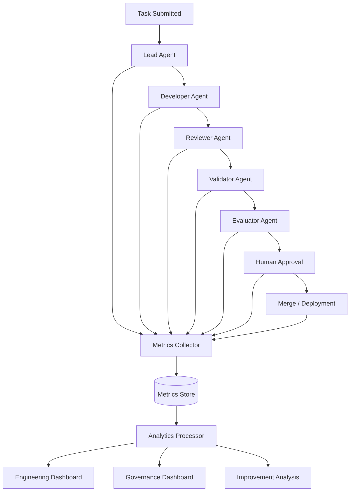

Each component generates evidence.

The Metrics Collector should not depend entirely on natural-language summaries from agents.

Where possible, it should consume deterministic events.

Examples include:

```text
task.started
agent.started
agent.completed
review.completed
validation.completed (outcome: failed or passed)
retry.started
run.exhausted
human.intervention.requested
approval.completed
deployment.completed
incident.detected
```

---

### Event-Based Metric Collection

An event-based model provides stronger measurement than attempting to infer everything from logs.

For example:

```json
{
  "schemaVersion": 1,
  "eventId": "809d14ca-4ac8-4567-a9b0-906819aa7816",
  "eventType": "validation.completed",
  "runId": "3ac9f2e6-8475-4892-8d31-4b7a46fb5da4",
  "taskId": "fleet-booking-limit",
  "agentRole": "validator",
  "gateName": "integration-tests",
  "outcome": "failed",
  "timestamp": "2026-11-10T10:41:22Z",
  "attempt": 2
}
```

Another event might record human intervention:

```json
{
  "schemaVersion": 1,
  "eventId": "7e753f10-21aa-41df-82d1-d359459f7b71",
  "eventType": "intervention.completed",
  "runId": "3ac9f2e6-8475-4892-8d31-4b7a46fb5da4",
  "taskId": "fleet-booking-limit",
  "reasonCode": "architecture-decision",
  "timestamp": "2026-11-10T11:12:02Z",
  "attempt": 2
}
```

Structured events allow the analytics layer to calculate metrics consistently.

---

### Separation Between Operational Logs and Metrics

Logs and metrics serve different purposes.

Logs answer detailed questions such as:

```text
What happened during this specific validation failure?
```

Metrics answer aggregated questions such as:

```text
How often are integration tests failing across AI-assisted tasks?
```

An enterprise harness should retain both.

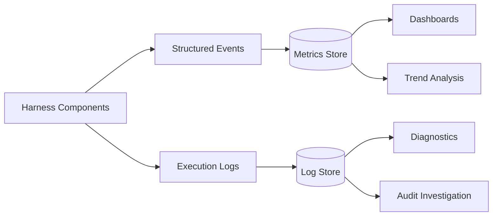

Metrics should reference run identifiers that allow investigators to move from aggregate behavior to detailed evidence.

---

### Core Metric Dimensions

A structured metric record should carry enough dimensions to support meaningful comparisons.

Possible dimensions include:

```text
Run ID
Task ID
Repository
Team
Product
Task Type
Complexity Class
Agent Role
Model
Skill
Prompt Version
Instruction Version
Harness Version
Validation Gate
Environment
Outcome
Timestamp
```

This enables questions such as:

> Did retry rates increase after Skill version 4.2 was introduced?

or:

> Do database migration tasks have higher exhaustion rates when using this workflow?

Without dimensions, the organization knows that a metric changed but cannot explain why.

---

### Version Awareness

Productivity telemetry should be tied to versions.

Suppose first-pass validation improves from:

```text
61% → 82%
```

The improvement becomes much more useful if it can be correlated with:

```text
Skill: create-api v3.1 → v3.2
Instruction set: 18 → 19
Harness: 2.8 → 2.9
Model configuration: A → B
```

The architecture should therefore treat AI Engineering assets as measurable configuration.

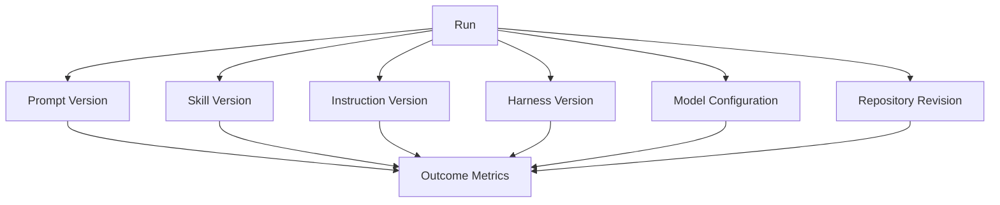

This enables evidence-driven improvement.

---

### Productivity Metrics and the Improvement Loop

Metrics become valuable when they influence engineering decisions.

A mature improvement loop looks like:

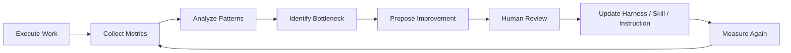

The system does not silently modify engineering standards.

Instead, evidence supports controlled improvement proposals.

For example:

```text
Observation:
32% of corporate-fleet tasks fail integration validation
because idempotency behavior is implemented incorrectly.

Possible improvement:
Update the fleet booking Skill with the approved
idempotent-consumer implementation pattern.

Governance:
Architecture owner reviews and approves the Skill update.

Measurement:
Compare first-pass validation before and after the change.
```

This transforms metrics into a learning mechanism without giving the harness uncontrolled authority.

---

### Measurement Boundaries

Before implementing dashboards, architects should define measurement boundaries.

For example:

#### Start Event

```text
task.accepted
```

#### End Event

```text
ready_for_merge
```

#### Success Definition

```text
Reviewer accepted
AND
Required deterministic gates passed
AND
Evaluator outcome = pass
AND
Required approval obtained
```

#### Failure Definition

```text
Run terminated without successful outcome
```

#### Exhaustion Definition

```text
Configured retry or iteration boundary reached
```

These definitions should be consistent across teams if metrics will be aggregated.

---

### Metric Ownership

Productivity measurement requires ownership.

A possible responsibility model is:

| Responsibility | Owner |
| --- | --- |
| Metric definitions | Engineering governance |
| Telemetry implementation | Platform/harness team |
| Quality metrics | Engineering + QA |
| Security metrics | Security engineering |
| Business outcome mapping | Product leadership |
| Privacy controls | Governance/legal/privacy |
| Dashboard implementation | Platform/data team |
| Interpretation | Engineering leadership |
| Improvement decisions | Appropriate engineering owners |

Without ownership, dashboards often become abandoned collections of numbers.

---

### Measurement Governance

Metrics themselves require governance.

At minimum, organizations should document:

```text
Metric Name
Purpose
Definition
Calculation
Source
Owner
Aggregation
Retention
Privacy Classification
Known Limitations
Decision Supported
```

For example:

| Field | Value |
| --- | --- |
| Metric | First-Pass Validation Rate |
| Purpose | Measure initial implementation quality |
| Definition | Percentage of tasks passing required deterministic gates on first validation attempt |
| Source | Harness validation events |
| Owner | Platform Engineering |
| Aggregation | Team/repository/task type |
| Retention | 12 months |
| Privacy | No individual ranking |
| Decision | Improve Skills, Instructions, or workflow |

This is effectively a metric contract.

---

### Metric Contracts

A metric contract prevents inconsistent interpretations.

For example:

```yaml
metric: first_pass_validation_rate
version: 1
numerator: tasks_passing_all_required_gates_on_attempt_1
denominator: tasks_entering_validation
exclusions:
  - cancelled_before_validation
dimensions:
  - repository
  - task_type
  - skill_version
  - harness_version
owner: platform-engineering
purpose: evaluate_initial_implementation_quality
```

Versioning matters because metric definitions evolve.

Infrastructure failures remain visible in unadjusted operational reliability reporting; any verified exclusions for an adjusted quality metric must be separately named and auditable. Changing the denominator silently can make historical trends meaningless.

---

### Failed Runs Must Remain Visible

One of the easiest ways to inflate AI productivity is to measure only completed work.

Consider:

```text
Successful runs:
Average cycle time = 21 minutes
```

That sounds excellent.

But suppose 18% of runs are exhausted and excluded.

The dashboard is hiding part of the system.

A stronger report displays:

```text
Successful:      77%
Failed:          5%
Exhausted:      18%
```

and reports cycle time separately by outcome.

Failed work consumes real:

- compute;
- tokens;
- developer attention;
- review effort;
- elapsed time.

It must remain part of the productivity picture.

---

### Harness Metric Architecture

A production-oriented implementation could contain the following logical components:

```text
harness/
├── execution/
├── roles/
├── validation/
├── evaluation/
├── approval/
│
├── telemetry/
│   ├── events/
│   ├── metrics/
│   ├── exporters/
│   └── correlation/
│
├── analytics/
│   ├── calculations/
│   ├── baselines/
│   ├── percentiles/
│   └── trends/
│
└── dashboards/
    ├── engineering/
    ├── operations/
    └── governance/
```

The exact technology is implementation-specific.

The architectural separation is more important.

Execution should produce evidence.

Telemetry should capture evidence.

Analytics should derive metrics.

Dashboards should present decision-relevant views.

---

## Professional Diagrams

### Balanced AI Engineering Productivity Model

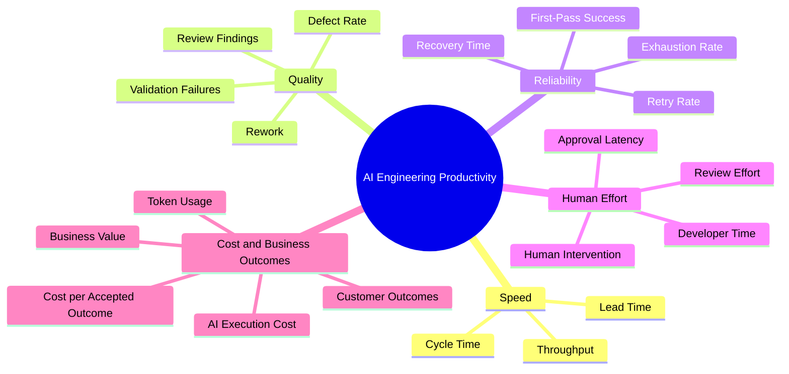

The model intentionally prevents any single number from becoming the definition of productivity.

---

### Productivity Value Chain

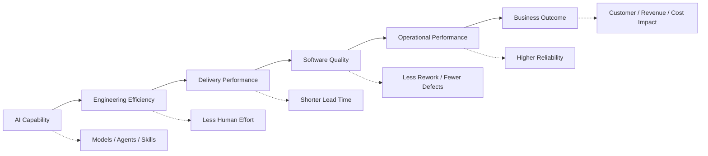

An enterprise AI initiative should eventually establish evidence across this chain.

---

### Complete Measurement Path

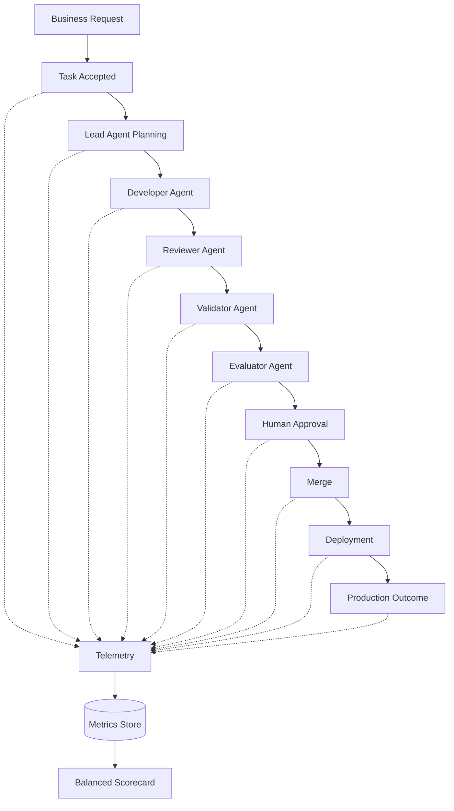

This diagram illustrates why measuring only Developer Agent execution time is insufficient.

---

### Hidden Rework Problem

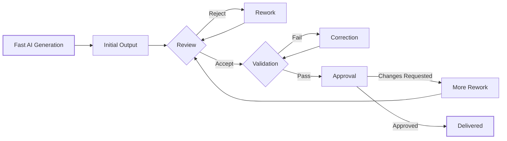

The time between `Fast AI Generation` and `Delivered` is the real engineering workflow.

---

### Independent Measurement Architecture

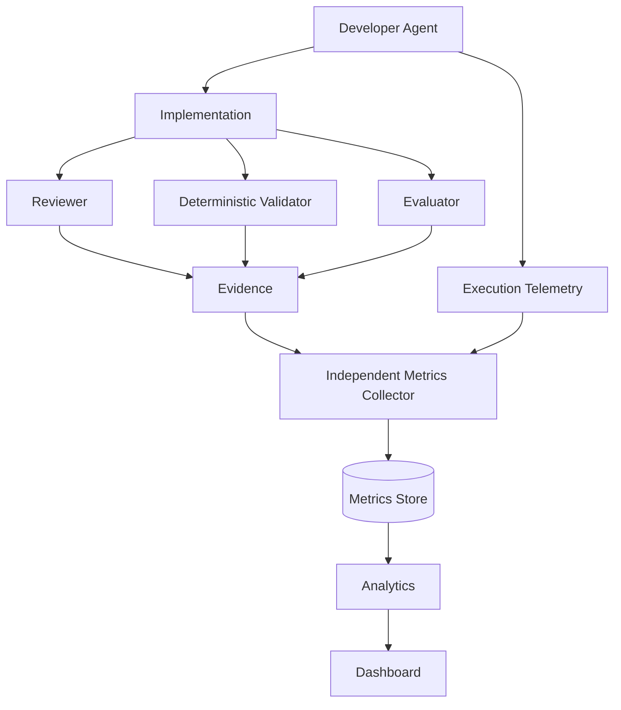

The Developer Agent does not decide whether its own work was productive.

Independent evidence contributes to that determination.

---

### Speed-Quality Trade-Off Matrix

| | **Higher Quality** | **Lower Quality** |
| --- | --- | --- |
| **Faster Delivery** | Desired productivity improvement | Dangerous acceleration |
| **Slower Delivery** | Possible deliberate engineering | Poor productivity |

The target is the upper-left quadrant:

```text
Faster
+
Equal or Better Quality
```

Speed gained by sacrificing quality is not a durable productivity improvement.

---

### Reliability Distribution

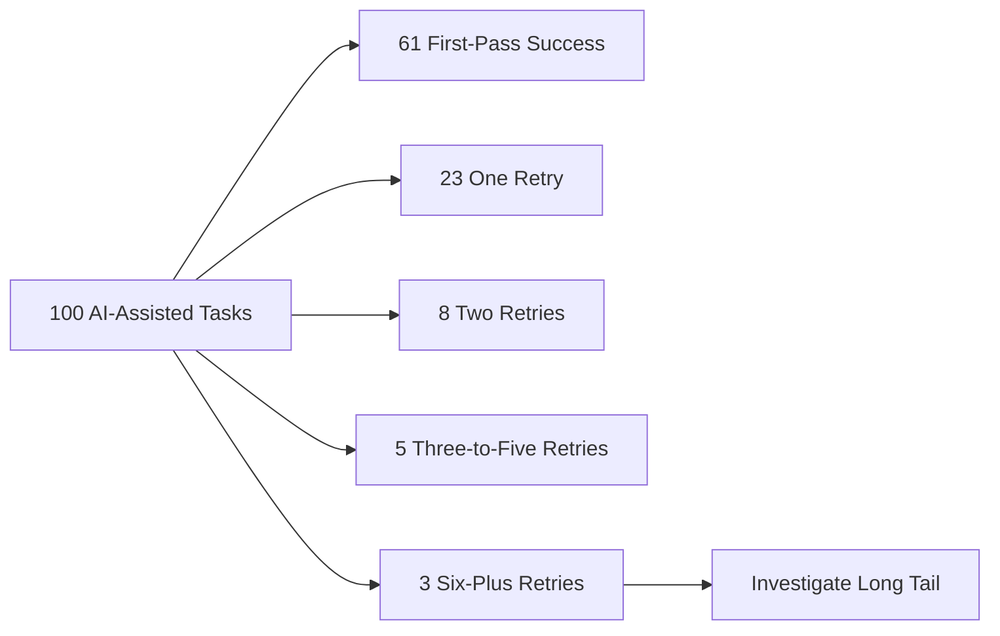

The long tail often contains the most valuable information for harness improvement.

---

### Balanced Scorecard Architecture

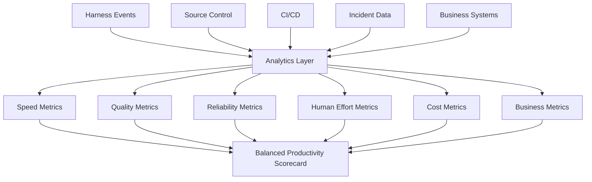

AI Engineering productivity cannot be understood from harness data alone.

For mature organizations, engineering telemetry should eventually connect to delivery, operational, and business data.

---

### What Not to Optimize

A productive engineering organization should not independently optimize:

```text
Lines of Code
Number of Prompts
Number of Agent Runs
Number of Generated Files
Raw Task Completions
Token Consumption
```

The relationships can be visualized as:

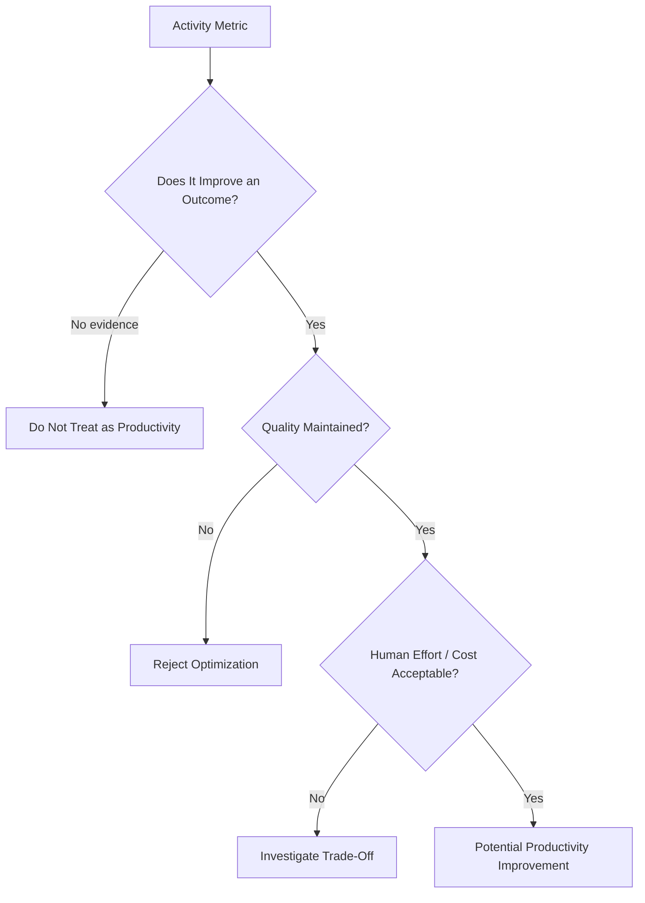

An activity metric becomes useful when it contributes to understanding an outcome.

It should not become the outcome itself.

---

### Architect’s Note — Productivity Is a System Property

In AI-assisted engineering, productivity should usually be treated as a property of the complete delivery system rather than a property of an individual developer or AI Agent.

The system includes:

```text
Requirements
Repositories
Instructions
Skills
Prompts
Agents
Review
Validation
Evaluation
Human Decisions
CI/CD
Operations
```

A failure in any one component can erase gains created elsewhere.

Optimizing only the AI Agent is therefore equivalent to optimizing one stage of a production line while ignoring the rest of the factory.

---

### Enterprise Tip — Start With a Small Metric Set

Organizations frequently make the opposite mistake after recognizing that lines of code are insufficient.

They attempt to collect everything.

Hundreds of metrics appear.

Few support decisions.

A better initial set might contain:

```text
Median Cycle Time
P90 Cycle Time
Validated Throughput
First-Pass Validation Rate
Rework Rate
Escaped Defect Rate
Human Intervention Rate
Exhaustion Rate
Human Review Effort
AI Cost per Accepted Outcome
```

Add metrics when a decision requires them.

Do not collect telemetry merely because it is technically possible.

---

### Common Mistake — Treating AI Generation Time as Delivery Time

A Developer Agent may generate an implementation in three minutes.

That number is interesting operationally.

It is rarely the primary productivity metric.

If review, validation, correction, approval, and integration consume two hours, reporting:

```text
Feature completed in three minutes
```

is misleading.

Measure the complete path to an accepted engineering outcome.

---

### Decision Point — What Counts as Completed?

Every organization must explicitly determine the completion boundary used by its productivity metrics.

Possible choices include:

```text
Agent says complete
Build passes
Validation passes
Evaluation passes
Human approval
PR merged
Production deployment
Business outcome achieved
```

Different metrics may legitimately use different boundaries.

The important requirement is that the boundary be defined, versioned, and consistently applied.

---


## Hands-on Example

### Measuring Productivity in the Alpha Car Detailing Harness

Alpha Car Detailing has introduced an AI-assisted engineering harness to accelerate development of its corporate fleet booking capabilities.

The harness coordinates the Lead Agent, Developer Agent, Reviewer Agent, Validator Agent, and Evaluator Agent. Deterministic gates verify objective engineering conditions, while human approval remains mandatory where required by policy.

The engineering organization now wants to answer a practical question:

> Does the AI-assisted harness deliver production-ready software faster, with less human effort and acceptable cost, without compromising quality, security, or reliability?

Answering this question requires more than collecting agent execution times. The team must capture structured evidence throughout the complete engineering workflow, correlate it with individual tasks, and calculate reproducible metrics.

This hands-on example develops a small, production-oriented productivity measurement capability using .NET 10, C#, SQL Server, and structured harness events.

The example is designed to integrate with the existing Alpha Car Detailing harness rather than create a separate measurement application.

### Scenario: Corporate Fleet Booking Limits

A new requirement has been approved:

> Corporate fleet administrators must be able to configure the maximum number of active bookings permitted for each fleet. When the configured limit is reached, additional booking requests must be rejected without affecting existing reservations.

The requirement includes several engineering constraints.

The implementation must preserve Clean Architecture boundaries, enforce booking limits under concurrent requests, avoid duplicate processing, maintain the existing API contract where applicable, and pass all required deterministic validation gates.

The Lead Agent prepares the implementation plan.

The Developer Agent generates the implementation.

The Reviewer Agent checks correctness, maintainability, and architectural alignment.

The Validator Agent executes deterministic gates.

The Evaluator Agent assesses whether the completed implementation satisfies the business requirement and acceptance criteria.

Human approval is obtained before the change is merged.

The harness records every significant transition.

The productivity subsystem consumes this evidence independently of the agents that produced the implementation.

### Step 1 — Define the Measurement Contract

Before implementing telemetry, the engineering team agrees on the measurement boundaries.

| Measurement                 | Start Event            | End Event                |
| --------------------------- | ---------------------- | ------------------------ |
| Engineering cycle time      | `task.started`         | `task.ready_for_merge`   |
| Agent execution time        | `agent.started`        | `agent.completed`        |
| Review duration             | `review.started`       | `review.completed`       |
| Validation duration         | `validation.started`   | `validation.completed`   |
| Approval latency            | `approval.requested`   | `approval.completed`     |
| Human intervention duration | `intervention.started` | `intervention.completed` |
| Recovery time               | `run.failed`           | `run.recovered`          |

The team defines an accepted engineering outcome as a task that has:

1. Received an acceptable Reviewer Agent result.
2. Passed all required deterministic validation gates.
3. Satisfied the Evaluator Agent's acceptance assessment.
4. Obtained required human approval.
5. Reached the `ready_for_merge` state.

A task that only passes compilation does not qualify.

A task that produces a valid implementation but fails business acceptance does not qualify.

A **run** that reaches its execution limit is recorded as exhausted. The overall **task** becomes exhausted only after the authoritative task policy declares no further authorized recovery or attempt is pending.

These definitions are part of the metric contract and must remain stable during measurement periods.

### Step 2 — Establish the Initial Baseline

The Alpha Car Detailing engineering team selects a twelve-week historical period containing comparable corporate fleet booking work.

Historical measurements are drawn from source control, pull requests, CI/CD results, issue tracking, and defect records.

For illustration, the baseline is:

| Metric                          | Historical Baseline |
| ------------------------------- | ------------------- |
| Median engineering cycle time   | 8.4 hours           |
| P90 engineering cycle time      | 19.6 hours          |
| Median human review effort      | 52 minutes          |
| Rework rate                     | 24%                 |
| Escaped defects per 100 changes | 4.2                 |
| Accepted changes per week       | 18                  |

The AI-assisted workflow will also introduce measurements that were not previously applicable, including agent retry rate, exhaustion rate, model execution cost, and agent-specific validation outcomes.

These metrics do not have meaningful pre-AI equivalents. They should be monitored against explicit operational objectives rather than assigned artificial historical baselines.

**Architect's Note:** Baselines should reflect comparable work, not arbitrary periods. A week dominated by routine endpoint changes should not be compared directly with a week dominated by distributed transaction failures or security remediation.

The initial baseline is also not treated as proof of causality. Improvements observed after AI adoption may result from other engineering changes. The organization will examine task mix, staffing, process changes, and production conditions before attributing gains to AI assistance.

### Step 3 — Define the Productivity Telemetry Architecture

The measurement capability is added to the existing harness.

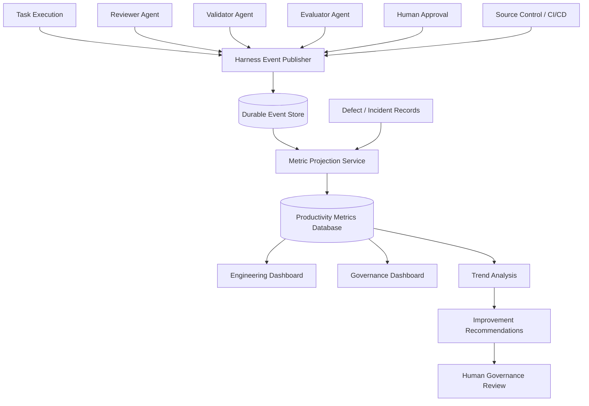

The architecture separates four concerns.

**Execution** belongs to the harness and its agents.

**Evidence collection** belongs to an independent telemetry capability.

**Metric calculation** belongs to a deterministic projection service.

**Interpretation and improvement** belong to engineering leadership, architects, and authorized governance processes.

The Developer Agent must not be allowed to rewrite historical telemetry or declare its own output successful merely by submitting a completion message.

### Step 4 — Create the Metrics Project Structure

The example introduces the following components:

```text
alpha-car-detailing/
│
├── src/
│   ├── AlphaCarDetailing.Domain/
│   ├── AlphaCarDetailing.Application/
│   ├── AlphaCarDetailing.Infrastructure/
│   └── AlphaCarDetailing.Api/
│
├── harness/
│   ├── roles/
│   ├── validation/
│   ├── evaluation/
│   │
│   ├── telemetry/
│   │   ├── HarnessEvent.cs
│   │   ├── HarnessEventTypes.cs
│   │   ├── IHarnessEventStore.cs
│   │   └── SqlHarnessEventStore.cs
│   │
│   ├── metrics/
│   │   ├── ProductivityMetrics.cs
│   │   ├── ProductivityMetricsCalculator.cs
│   │   └── ProductivityMetricsProjection.cs
│   │
│   └── dashboards/
│
└── tests/
    └── AlphaCarDetailing.Harness.Tests/
```

The structure is illustrative. Each C# component belongs in a suitable harness project rather than being compiled directly from an arbitrary folder.

The productivity subsystem remains separate from the Alpha Car Detailing business domain.

Fleet booking rules belong in the application and domain layers.

Harness productivity telemetry belongs to the engineering platform.

This prevents engineering measurement concerns from contaminating business logic.

### Step 5 — Define Structured Harness Events

The first implementation component is an event contract.

The contract must support correlation, versioning, measurement, and independent verification.

```csharp
namespace AlphaCarDetailing.Harness.Telemetry;

public sealed record HarnessEvent
{
    public required Guid EventId { get; init; }
    public required Guid RunId { get; init; }
    public required string TaskId { get; init; }
    public required string EventType { get; init; }
    public required DateTimeOffset Timestamp { get; init; }
    public string? AgentRole { get; init; }
    public string? GateName { get; init; }
    public int Attempt { get; init; }
    public string? Outcome { get; init; }
    public string? ReasonCode { get; init; }

    // Report only non-overlapping per-execution usage as "delta".
    // Other usage scopes must be normalized by the platform adapter.
    public string? UsageScope { get; init; }
    public decimal? CostUsd { get; init; }
    public long? InputTokens { get; init; }
    public long? CachedInputTokens { get; init; }
    public long? OutputTokens { get; init; }
    public int SchemaVersion { get; init; } = 1;
}
```

The event contract deliberately avoids storing complete prompts, generated code, source files, or developer conversations.

Those artifacts may belong in appropriately controlled audit or execution stores, but they are not required to calculate most productivity metrics.

The event includes identifiers that allow authorized investigators to correlate metric records with existing harness evidence.

### Step 6 — Standardize Event Types

Event names should not be invented independently by each agent.

The harness defines a controlled vocabulary.

```csharp
namespace AlphaCarDetailing.Harness.Telemetry;

public static class HarnessEventTypes
{
    public const string TaskStarted = "task.started";
    public const string TaskReadyForMerge = "task.ready_for_merge";
    public const string TaskFailed = "task.failed";
    public const string TaskExhausted = "task.exhausted";
    public const string TaskCancelled = "task.cancelled";
    public const string AgentStarted = "agent.started";
    public const string AgentCompleted = "agent.completed";
    public const string ReviewStarted = "review.started";
    public const string ReviewCompleted = "review.completed";
    public const string ValidationStarted = "validation.started";
    public const string ValidationCompleted = "validation.completed";
    public const string EvaluationCompleted = "evaluation.completed";
    public const string RetryStarted = "retry.started";
    public const string RunFailed = "run.failed";
    public const string RunExhausted = "run.exhausted";
    public const string RunRecovered = "run.recovered";
    public const string InterventionStarted = "intervention.started";
    public const string InterventionCompleted = "intervention.completed";
    public const string ApprovalRequested = "approval.requested";
    public const string ApprovalCompleted = "approval.completed";
}
```

In a larger implementation, these definitions may be maintained as a versioned schema or shared contract package.

The important principle is consistency.

If one component emits `validation.failed` while another emits `validation.completed` with `outcome: failed` for the same event semantics, the metrics processor may produce incorrect counts. In this example, the canonical representation is `validation.completed` with an explicit `Outcome` value.

This example represents success and failure using the `Outcome` property of `validation.completed`, keeping the validation lifecycle distinct from the result.

### Step 7 — Store Events Independently

The harness must retain evidence even when an agent crashes, a validation run fails, or the workflow becomes exhausted.

A relational event store provides a straightforward starting point.

```sql
CREATE TABLE dbo.HarnessEvents
(
    EventId UNIQUEIDENTIFIER NOT NULL,
    RunId UNIQUEIDENTIFIER NOT NULL,
    TaskId NVARCHAR(200) NOT NULL,
    EventType NVARCHAR(100) NOT NULL,
    EventTimestamp DATETIMEOFFSET(7) NOT NULL,
    AgentRole NVARCHAR(100) NULL,
    GateName NVARCHAR(150) NULL,
    Attempt INT NOT NULL,
    Outcome NVARCHAR(50) NULL,
    ReasonCode NVARCHAR(100) NULL,
    UsageScope NVARCHAR(30) NULL,
    CostUsd DECIMAL(18, 6) NULL,
    InputTokens BIGINT NULL,
    CachedInputTokens BIGINT NULL,
    OutputTokens BIGINT NULL,
    SchemaVersion INT NOT NULL,

    CONSTRAINT PK_HarnessEvents PRIMARY KEY (EventId),
    CONSTRAINT CK_HarnessEvents_Attempt CHECK (Attempt >= 0),
    CONSTRAINT CK_HarnessEvents_Cost CHECK (CostUsd IS NULL OR CostUsd >= 0),
    CONSTRAINT CK_HarnessEvents_InputTokens CHECK (InputTokens IS NULL OR InputTokens >= 0),
    CONSTRAINT CK_HarnessEvents_CachedInputTokens CHECK (CachedInputTokens IS NULL OR CachedInputTokens >= 0),
    CONSTRAINT CK_HarnessEvents_OutputTokens CHECK (OutputTokens IS NULL OR OutputTokens >= 0)
);
```

An index supports task-level analysis:

```sql
CREATE INDEX IX_HarnessEvents_Task
ON dbo.HarnessEvents
(
    TaskId,
    EventTimestamp
);
```

Another supports run-level investigation:

```sql
CREATE INDEX IX_HarnessEvents_Run
ON dbo.HarnessEvents
(
    RunId,
    EventTimestamp
);
```

The `EventId` primary key provides a basis for idempotent event ingestion.

If the collector receives the same event twice, it must not count the event twice.

This is especially important when delivery uses queues, retries, or an at-least-once messaging system.

**Enterprise Tip:** Event collection should not silently disappear when the metrics database becomes unavailable. A production implementation should use a durable event queue, transactional outbox where applicable, or equivalent replayable delivery mechanism. The appropriate choice depends on the harness's transaction boundaries and infrastructure.

### Step 8 — Define the Event Store Interface

The metrics collector should depend on an abstraction rather than a specific SQL Server implementation.

```csharp
namespace AlphaCarDetailing.Harness.Telemetry;

public interface IHarnessEventStore
{
    Task AppendAsync(
        HarnessEvent harnessEvent,
        CancellationToken cancellationToken = default);

    Task<IReadOnlyList<HarnessEvent>> GetTaskEventsAsync(
        string taskId,
        CancellationToken cancellationToken = default);
}
```

This interface makes it possible to use:

- SQL Server in production;
- an in-memory implementation for unit tests;
- a file-backed store for local development;
- a distributed event pipeline for enterprise deployment.

The contracts should preserve event ordering information, but consumers must not assume that insertion order always equals occurrence order.

Retries, delayed message delivery, distributed clocks, and asynchronous event collection can affect arrival order.

The metric processor should use timestamps together with correlation identifiers and explicit state transitions.

### Step 9 — Define a Task-Level Productivity Result

Rather than calculate every dashboard value directly from raw events, the harness creates a deterministic task-level projection.

```csharp
namespace AlphaCarDetailing.Harness.Metrics;

public sealed record ProductivityMetrics
{
    public required string TaskId { get; init; }
    public string TaskStatus { get; init; } = "in_progress";
    public bool Completed => TaskStatus == "completed";
    public bool Exhausted => TaskStatus == "exhausted";

    // Unknown until the required gate set and its results are available.
    public bool? FirstPassValidation { get; init; }
    public int RetryCount { get; init; }
    public int ValidationFailureCount { get; init; }
    public int ReviewRejectionCount { get; init; }
    public int HumanInterventionCount { get; init; }
    public TimeSpan? CycleTime { get; init; }
    public TimeSpan? ReviewElapsedTime { get; init; }
    public TimeSpan? HumanInterventionTime { get; init; }
    public TimeSpan? ApprovalLatency { get; init; }

    // Null means missing or incompatible usage evidence, not zero.
    public decimal? AiCostUsd { get; init; }
    public long? InputTokens { get; init; }
    public long? CachedInputTokens { get; init; }
    public long? OutputTokens { get; init; }
}
```

This result represents the measured outcome of one task.

It does not attempt to assign a universal productivity score.

The values are retained independently so that the dashboard can expose trade-offs.

For example:

```text
Cycle Time:                  3h 15m
Retry Count:                3
Validation Failures:        2
Review Rejections:          1
Human Intervention:         35m
AI Cost:                    $2.48
Status:                     Completed
```

The task was successful, but it was not a first-pass success.

The difference matters.

### Step 10 — Calculate Metrics Deterministically

The metrics processor derives values from structured events.

For this example, the calculation uses the task-start and ready-for-merge events to determine cycle time.

```csharp
using AlphaCarDetailing.Harness.Telemetry;

namespace AlphaCarDetailing.Harness.Metrics;

public static class ProductivityMetricsCalculator
{
    public static ProductivityMetrics Calculate(
        string taskId,
        IReadOnlyList<HarnessEvent> events,
        IReadOnlyCollection<string>? requiredGates = null)
    {
        ArgumentException.ThrowIfNullOrWhiteSpace(taskId);
        ArgumentNullException.ThrowIfNull(events);

        if (events.Any(e => e.TaskId != taskId))
            throw new ArgumentException(
                "All events must belong to the requested task.", nameof(events));

        // Same event may be redelivered, but an ID must never
        // refer to two different payloads.
        var groups = events.GroupBy(e => e.EventId).ToArray();
        if (groups.Any(g => g.Distinct().Skip(1).Any()))
            throw new InvalidOperationException("Conflicting event ID payloads.");

        var ordered = groups.Select(g => g.First())
            .OrderBy(e => e.Timestamp)
            .ThenBy(e => e.EventId)
            .ToArray();

        var started = ordered.FirstOrDefault(e =>
            e.EventType == HarnessEventTypes.TaskStarted);
        var completed = ordered.LastOrDefault(e =>
            e.EventType == HarnessEventTypes.TaskReadyForMerge);

        var terminal = ordered.LastOrDefault(e =>
            e.EventType is HarnessEventTypes.TaskReadyForMerge
                or HarnessEventTypes.TaskFailed
                or HarnessEventTypes.TaskExhausted
                or HarnessEventTypes.TaskCancelled);
        var taskStatus = terminal?.EventType switch
        {
            HarnessEventTypes.TaskReadyForMerge => "completed",
            HarnessEventTypes.TaskFailed => "failed",
            HarnessEventTypes.TaskExhausted => "exhausted",
            HarnessEventTypes.TaskCancelled => "cancelled",
            _ => "in_progress"
        };

        TimeSpan? cycleTime = null;
        if (taskStatus == "completed" &&
            started is not null && completed is not null)
        {
            cycleTime = completed.Timestamp - started.Timestamp;
            if (cycleTime.Value < TimeSpan.Zero)
                throw new InvalidOperationException("Negative task cycle time.");
        }

        var results = ordered.Where(e =>
            e.EventType == HarnessEventTypes.ValidationCompleted).ToArray();

        bool? firstPass = null;
        if (requiredGates is { Count: > 0 } && results.Length > 0)
        {
            var attemptOne = results.Where(e => e.Attempt == 1).ToArray();
            firstPass = !attemptOne.Any(e => e.Outcome != "passed") &&
                requiredGates.All(g => attemptOne.Any(e =>
                    e.GateName == g && e.Outcome == "passed"));
        }

        // This illustrative adapter expects per-invocation deltas
        // on agent.completed events. Unknown data remains null.
        var executionEvents = ordered.Where(e =>
            e.EventType == HarnessEventTypes.AgentCompleted).ToArray();
        var completeUsage = executionEvents.Length > 0 &&
            executionEvents.All(e => e.UsageScope == "delta" &&
                e.CostUsd.HasValue && e.InputTokens.HasValue &&
                e.OutputTokens.HasValue);

        return new ProductivityMetrics
        {
            TaskId = taskId,
            TaskStatus = taskStatus,
            FirstPassValidation = firstPass,
            RetryCount = ordered.Count(e =>
                e.EventType == HarnessEventTypes.RetryStarted),
            ValidationFailureCount = results.Count(e => e.Outcome == "failed"),
            ReviewRejectionCount = ordered.Count(e =>
                e.EventType == HarnessEventTypes.ReviewCompleted &&
                e.Outcome == "rejected"),
            HumanInterventionCount = ordered.Count(e =>
                e.EventType == HarnessEventTypes.InterventionCompleted),
            CycleTime = cycleTime,
            ReviewElapsedTime = SumPairedDurations(ordered,
                HarnessEventTypes.ReviewStarted,
                HarnessEventTypes.ReviewCompleted),
            HumanInterventionTime = SumPairedDurations(ordered,
                HarnessEventTypes.InterventionStarted,
                HarnessEventTypes.InterventionCompleted),
            ApprovalLatency = SumPairedDurations(ordered,
                HarnessEventTypes.ApprovalRequested,
                HarnessEventTypes.ApprovalCompleted),
            AiCostUsd = completeUsage
                ? executionEvents.Sum(e => e.CostUsd!.Value) : null,
            InputTokens = completeUsage
                ? executionEvents.Sum(e => e.InputTokens!.Value) : null,
            CachedInputTokens = completeUsage && executionEvents.All(
                e => e.CachedInputTokens.HasValue)
                ? executionEvents.Sum(e => e.CachedInputTokens!.Value) : null,
            OutputTokens = completeUsage
                ? executionEvents.Sum(e => e.OutputTokens!.Value) : null
        };
    }

    private static TimeSpan? SumPairedDurations(
        IReadOnlyList<HarnessEvent> ordered,
        string startType,
        string completeType)
    {
        var starts = new Dictionary<(Guid RunId, int Attempt),
            Queue<DateTimeOffset>>();
        var total = TimeSpan.Zero;
        var pairs = 0;
        foreach (var e in ordered.Where(e =>
                     e.EventType == startType || e.EventType == completeType))
        {
            var key = (e.RunId, e.Attempt);
            if (!starts.TryGetValue(key, out var queue))
                starts[key] = queue = new Queue<DateTimeOffset>();
            if (e.EventType == startType)
            {
                queue.Enqueue(e.Timestamp);
                continue;
            }
            if (queue.Count == 0)
                return null; // An unmatched completion is incomplete evidence.
            var duration = e.Timestamp - queue.Dequeue();
            if (duration < TimeSpan.Zero)
                throw new InvalidOperationException("Negative stage duration.");
            total += duration;
            pairs++;
        }
        if (starts.Values.Any(q => q.Count != 0))
            return null; // An open interval must not be reported as zero.
        return pairs > 0 ? total : null;
    }
}
```

This calculator illustrates the separation between event collection and deterministic measurement.

It is intentionally a simplified initial implementation, not the entire production projection.

The calculator pairs review, intervention, and approval intervals within a run and attempt. These are **elapsed durations**; review elapsed time must not be reported as active human review effort without separate evidence. Missing or unmatched intervals remain null. The example assumes non-overlapping stage intervals for each run/attempt and should be extended with explicit stage instance identifiers if concurrent reviews or approvals are supported.

Several additional safeguards are required before using this implementation for enterprise reporting.

First, task completion must be confirmed by the authoritative harness state machine rather than inferred from an unverified agent-generated message.

Second, exhaustion must be distinguished at the task and run boundaries. `run.exhausted` remains part of historical run evidence; only the authoritative `task.exhausted` transition marks the overall task exhausted. Authorized recovery must create a new valid task state rather than erasing historical run outcomes.

Third, first-pass validation requires the complete versioned gate set. The caller supplies the required gate names; when that contract or the validation evidence is unavailable, the result is unknown (`null`). A production implementation should resolve the gate set from a trusted policy store and distinguish an incomplete first attempt from a recorded failure.

Fourth, missing timestamps, conflicting event identifiers, and invalid transition orders must be surfaced as data-quality problems rather than silently treated as successful measurements. The simplified calculator checks a subset of these conditions; a production projection must validate the full lifecycle state machine.

Fifth, the illustrative cost and token aggregation accepts only complete, non-overlapping `agent.completed` usage deltas. Cumulative snapshots require normalization by the platform adapter before aggregation. Missing cost or usage data remains unknown instead of becoming an artificial zero. Cached input tokens are a subset of input usage when defined that way by the provider, and must not be added again to input totals.

Finally, task-level metrics must distinguish completed, failed, exhausted, cancelled, and still-running workflows. A projection should not infer that every task without a completion event has failed.

These safeguards should be implemented before the metrics are used to evaluate the effectiveness of an enterprise rollout.

### Step 11 — Record a Complete Harness Execution

Consider one execution of the corporate fleet booking limit requirement.

The initial implementation starts at 09:00.

The Developer Agent finishes its first implementation at 09:18.

The Reviewer Agent identifies a concurrency problem.

The Developer Agent retries.

The next implementation passes review but fails integration validation.

A third implementation passes all required validation gates.

The Evaluator Agent confirms the expected booking-limit behavior.

The required approval is obtained.

The task reaches the ready-for-merge state at 11:35.

The simplified event timeline is:

| Time  | Event                  | Outcome   |
| ----- | ---------------------- | --------- |
| 09:00 | `task.started`         | Started   |
| 09:02 | `agent.started`        | Developer |
| 09:18 | `agent.completed`      | Completed |
| 09:21 | `review.started`       | Started   |
| 09:30 | `review.completed`     | Rejected  |
| 09:31 | `retry.started`        | Attempt 2 |
| 09:48 | `agent.completed`      | Completed |
| 09:52 | `review.completed`     | Accepted  |
| 10:00 | `validation.completed` | Failed    |
| 10:02 | `retry.started`        | Attempt 3 |
| 10:35 | `validation.completed` | Passed    |
| 10:49 | `evaluation.completed` | Passed    |
| 11:00 | `approval.requested`   | Pending   |
| 11:34 | `approval.completed`   | Approved  |
| 11:35 | `task.ready_for_merge` | Completed |

The resulting cycle time is:

```text
11:35 − 09:00 = 2 hours 35 minutes
```

The number of retries is two.

The number of observed validation failures is one.

The number of review rejections is one.

The task is not a first-pass success.

The first AI-generated implementation appeared after eighteen minutes, but the accepted engineering outcome required two hours and thirty-five minutes.

That distinction is central to the productivity model.

### Step 12 — Calculate Team-Level Metrics

Task-level metrics become useful when aggregated across comparable work.

Suppose the harness executes 100 tasks during a measurement period.

The recorded outcomes are:

| Outcome   | Tasks   |
| --------- | ------- |
| Completed | 84      |
| Failed    | 6       |
| Exhausted | 7       |
| Cancelled | 3       |
| **Total** | **100** |

For this example, the harness defines terminal completion rate as:

```text
Completion Rate =
Completed Tasks / All Terminal Tasks
```

Therefore:

```text
Completion Rate = 84 / 100 = 84%
```

The exhaustion rate is:

```text
Exhaustion Rate = 7 / 100 = 7%
```

This is useful only because the denominator is explicitly defined.

If cancelled tasks should be excluded from a particular operational report, the calculation must use a separately named metric with a clearly documented denominator.

The organization should not quietly change the denominator between reporting periods.

Now consider retries.

Suppose 38 of the 100 tasks require at least one retry.

```text
Retry Rate =
Tasks with One or More Retries / Total Tasks

Retry Rate = 38 / 100 = 38%
```

These are task-level rates.

They should not be confused with per-attempt success or failure rates.

### Step 13 — Measure First-Pass Validation

Suppose 90 tasks enter validation.

Of those, 68 pass their complete required gate set on their first validation attempt.

```text
First-Pass Validation Rate =
68 / 90

= 75.6%
```

The denominator is not automatically the total number of submitted tasks.

It is the number of tasks that actually entered validation and had a reportable first validation attempt.

Tasks that never entered validation should remain visible elsewhere in the scorecard.

For example, a high first-pass validation rate is less encouraging if a large proportion of tasks fail during planning and never reach validation.

The enterprise dashboard should therefore show both validation quality and workflow progression.

### Step 14 — Measure Cost per Accepted Outcome

Suppose the 100 tasks consume:

```text
Total AI execution cost: $186.40
```

The harness produces 84 accepted tasks.

```text
AI Cost per Accepted Outcome =
$186.40 / 84

= $2.22 approximately
```

This measurement includes AI expenditure associated with failed and exhausted tasks.

That is important.

If the calculation used only spending from successful runs, it would hide the cost of unsuccessful execution.

The organization may separately report:

```text
Cost of successful runs
Cost of failed runs
Cost of exhausted runs
```

but the overall cost per accepted outcome should account for the relevant total AI expenditure.

The metric also requires a clear cost-allocation policy. Shared subscriptions, fixed platform charges, infrastructure expenses, cached token discounts, and external tool charges may need to be treated separately.

For early adoption, a marginal AI execution-cost metric is often easier to establish than a complete economic cost model.

The dashboard should label which cost definition is being used.

### Step 15 — Measure Human Effort

Suppose historical comparable tasks required an estimated median of 6.5 human-hours each.

During the AI-assisted pilot, the median observed human effort is 2.3 hours per task.

The difference is:

```text
6.5 − 2.3 = 4.2 hours
```

This indicates a potential reduction in human effort for the comparable task cohort.

However, multiplying that difference by the number of completed tasks and presenting it as verified savings would require additional evidence.

A stronger evaluation examines the distribution of task complexity and effort, and preferably uses a matched comparison or controlled pilot.

Furthermore, **the difference between two medians is not necessarily the median of the task-by-task savings**.

A defensible report might state:

> Among comparable corporate fleet development tasks, median observed human engineering effort decreased from 6.5 hours in the baseline to 2.3 hours in the AI-assisted pilot. The observed difference was 4.2 hours per task at the median, subject to task-mix and measurement limitations.

This is stronger than claiming that the organization definitively saved 420 developer-hours merely because 100 tasks were attempted.

### Step 16 — Build the Initial Productivity Dashboard

The engineering dashboard combines the measurements into a balanced view.

The following table contains illustrative pilot results, not actual measurements from a deployed Alpha Car Detailing system.

| Dimension    | Metric                      | Baseline | AI-Assisted Pilot |
| ------------ | --------------------------- | -------- | ----------------- |
| Speed        | Median cycle time           | 8.4h     | 4.1h              |
| Speed        | P90 cycle time              | 19.6h    | 11.8h             |
| Delivery     | Accepted tasks/week         | 18       | 27                |
| Quality      | Rework rate                 | 24%      | 19%               |
| Quality      | Escaped defects/100 changes | 4.2      | 3.8               |
| Reliability  | First-pass validation       | N/A      | 75.6%             |
| Reliability  | Retry rate                  | N/A      | 38%               |
| Reliability  | Exhaustion rate             | N/A      | 7%                |
| Human Effort | Median human effort/task    | 6.5h     | 2.3h              |
| Cost         | AI cost/accepted task       | N/A      | $2.22             |

The dashboard should not automatically label all changes as successful.

The improvement in median cycle time and accepted throughput is encouraging.

The reduction in rework and escaped defect rates is also favorable, although the sample is too small to establish a reliable long-term quality trend without further analysis.

The 7% exhaustion rate requires investigation.

The 38% retry rate may be acceptable or excessive depending on task complexity, cost, and the operational objectives of the harness.

The correct outcome of the dashboard is a set of evidence-supported engineering decisions, not an unqualified productivity percentage.

### Step 17 — Identify the Long-Running Tasks

Averages can hide expensive unsuccessful attempts.

Suppose the median AI-assisted cycle time is 4.1 hours, but the P95 is 17.5 hours.

The engineering team examines the longest-running tasks.

| Task Category             | Typical Problem             | Observed Pattern             |
| ------------------------- | --------------------------- | ---------------------------- |
| CRUD endpoints            | Missing request validation  | Usually one retry            |
| Unit test generation      | Incorrect fixtures          | Usually one retry            |
| API contract changes      | Contract mismatch           | Multiple validation failures |
| Database migrations       | Schema compatibility        | Human intervention           |
| Distributed booking logic | Concurrency and idempotency | High retry/exhaustion        |

The team notices that distributed booking logic contributes disproportionately to exhaustion and review effort.

The finding suggests that the existing corporate fleet booking Skill does not provide enough guidance for concurrency-sensitive implementations.

This is a more valuable conclusion than merely observing that some runs are slow.

### Step 18 — Propose an Engineering Improvement

The harness metrics identify the following pattern:

```text
Task Type:
Distributed booking logic

Observed Problems:
High integration-test failure rate
Repeated idempotency defects
Frequent human architectural intervention

Likely Improvement Area:
Corporate Fleet Booking Skill
```

The architecture team proposes updating the Skill with approved patterns for:

- booking-limit enforcement;
- transaction boundaries;
- concurrent request handling;
- idempotency keys;
- duplicate message processing;
- transactional outbox integration where applicable;
- expected integration-test scenarios.

The proposed Skill update is not automatically published by the Developer Agent or metrics subsystem.

It follows the established governance process.

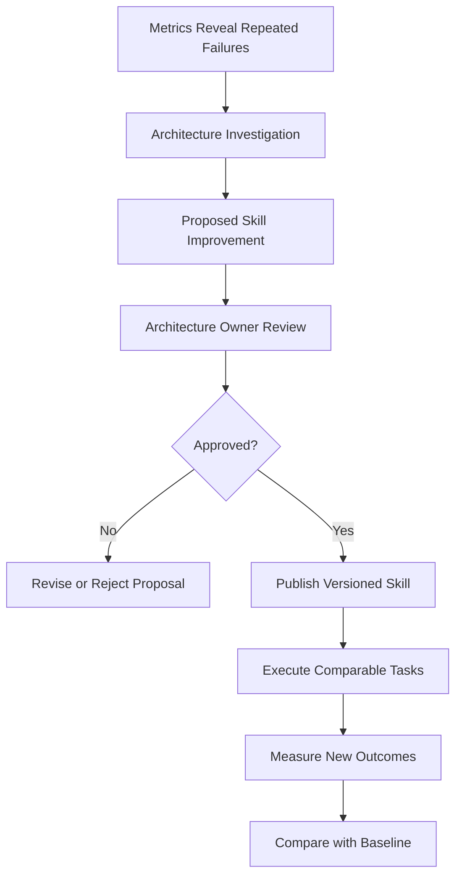

The harness records which Skill version was used for each run.

This allows later comparisons to distinguish the original Skill from the revised implementation.

### Step 19 — Test the Metric Calculations

Metrics are engineering logic.

Incorrect calculations can lead directly to incorrect investment, staffing, governance, or architecture decisions.

They therefore require automated validation.

The first tests cover task cycle time and retries.

```csharp
using AlphaCarDetailing.Harness.Metrics;
using AlphaCarDetailing.Harness.Telemetry;

namespace AlphaCarDetailing.Harness.Tests;

public sealed class ProductivityMetricsCalculatorTests
{
    [Fact]
    public void Calculate_ReturnsCycleTime()
    {
        var runId = Guid.NewGuid();
        const string taskId = "fleet-booking-limit";

        var start = new DateTimeOffset(
            2026, 11, 10, 9, 0, 0,
            TimeSpan.Zero);

        var events = new[]
        {
            new HarnessEvent
            {
                EventId = Guid.NewGuid(),
                RunId = runId,
                TaskId = taskId,
                EventType =
                    HarnessEventTypes.TaskStarted,
                Timestamp = start
            },
            new HarnessEvent
            {
                EventId = Guid.NewGuid(),
                RunId = runId,
                TaskId = taskId,
                EventType =
                    HarnessEventTypes.TaskReadyForMerge,
                Timestamp = start.AddMinutes(155)
            }
        };

        var result =
            ProductivityMetricsCalculator.Calculate(
                taskId,
                events);

        Assert.True(result.Completed);

        Assert.Equal(
            TimeSpan.FromMinutes(155),
            result.CycleTime);
    }

    [Fact]
    public void Calculate_CountsRetries()
    {
        var runId = Guid.NewGuid();
        const string taskId = "fleet-booking-limit";

        var timestamp = DateTimeOffset.UtcNow;

        var events = Enumerable.Range(1, 3)
            .Select(attempt => new HarnessEvent
            {
                EventId = Guid.NewGuid(),
                RunId = runId,
                TaskId = taskId,
                EventType =
                    HarnessEventTypes.RetryStarted,
                Timestamp = timestamp.AddMinutes(attempt),
                Attempt = attempt
            })
            .ToArray();

        var result =
            ProductivityMetricsCalculator.Calculate(
                taskId,
                events);

        Assert.Equal(3, result.RetryCount);
    }
}
```

The following test verifies the distinction between a run-level exhaustion event and a task-level terminal outcome, as well as duplicate event handling:

```csharp
[Fact]
public void Calculate_PreservesCompletedTaskAfterPriorRunExhaustion()
{
    const string taskId = "fleet-booking-limit";
    var runId = Guid.NewGuid();
    var start = DateTimeOffset.Parse("2026-11-10T09:00:00Z");
    var runExhausted = new HarnessEvent
    {
        EventId = Guid.NewGuid(), RunId = runId, TaskId = taskId,
        EventType = HarnessEventTypes.RunExhausted,
        Timestamp = start.AddMinutes(20)
    };
    var completed = new HarnessEvent
    {
        EventId = Guid.NewGuid(), RunId = Guid.NewGuid(), TaskId = taskId,
        EventType = HarnessEventTypes.TaskReadyForMerge,
        Timestamp = start.AddMinutes(155)
    };
    var events = new[]
    {
        new HarnessEvent
        {
            EventId = Guid.NewGuid(), RunId = runId, TaskId = taskId,
            EventType = HarnessEventTypes.TaskStarted, Timestamp = start
        },
        runExhausted, runExhausted, completed
    };
    var metrics = ProductivityMetricsCalculator.Calculate(taskId, events);
    Assert.True(metrics.Completed);
    Assert.False(metrics.Exhausted);
    Assert.Equal(TimeSpan.FromMinutes(155), metrics.CycleTime);
    Assert.Null(metrics.AiCostUsd);
}
```

Further tests should verify:

| Test                        | Expected Behavior                                 |
| --------------------------- | ------------------------------------------------- |
| Duplicate event ID          | Does not double count                             |
| Missing start event         | Cycle time unavailable                            |
| Missing completion event    | Task remains incomplete                           |
| Negative timestamp interval | Report data-quality problem                       |
| Multiple failed gates       | Count failures according to metric contract       |
| Exhausted run               | Report exhaustion correctly                       |
| Recovered run               | Preserve attempt history and current task outcome |
| Missing cost                | Distinguish unknown from zero                     |
| Cancelled task              | Apply configured exclusion policy                 |
| Out-of-order arrival        | Produce consistent event-time results             |
| Incomplete validation       | Do not declare first-pass success                 |
| Replayed events             | Produce identical metric projections              |

Metric correctness must be tested independently from the AI Agents.

A Developer Agent should not be permitted to improve apparent performance by changing metric definitions or excluding failed runs.

### Step 20 — Add Measurement Quality Gates

The productivity subsystem can itself be protected by deterministic validation gates.

For example:

```text
Metrics Validation Gate
    │
    ├── Event schema valid
    ├── Required identifiers present
    ├── Duplicate events handled
    ├── Timestamps consistent
    ├── State transitions valid
    ├── Cost accounting consistent
    ├── Required gate coverage complete
    ├── Metric definitions versioned
    └── Projection tests passing
```

These gates do not replace implementation quality validation.

They protect the reliability of the measurement system.

This distinction is important.

A task may pass its application validation gates while its productivity record is incomplete.

Conversely, all metric calculations may be valid even though the implementation fails.

The engineering system should report these as separate conditions.

### Step 21 — Interpret the Results

After the pilot, the engineering leadership team reviews the evidence.

The median cycle time has improved.

Human effort has decreased for comparable work.

Accepted throughput has increased.

Quality indicators have not shown obvious deterioration, although a larger sample and sustained monitoring are needed.

The harness still experiences substantial retries and a measurable exhaustion rate.

The leadership team therefore avoids declaring universal success.

Instead, it approves three targeted actions.

**First, expand AI-assisted development for well-understood task categories.**

Unit test generation, straightforward endpoint development, and small refactoring tasks are showing promising results.

**Second, improve the harness for complex distributed workflows.**

Concurrency, idempotency, and transaction-sensitive tasks require better Skills, contextual evidence, and architectural constraints.

**Third, continue measuring outcomes after deployment.**

An implementation that passes every development gate can still introduce production defects.

The productivity model must eventually correlate engineering outcomes with incident data, operational reliability, and business performance.

### Step 22 — Connect Engineering Metrics to Business Outcomes

The corporate fleet booking feature is now available to customers.

The engineering organization extends the measurement boundary beyond merge and deployment.

It begins tracking:

```text
Fleet feature lead time
Fleet booking success rate
Rejected bookings due to configured limits
Duplicate booking incidents
Corporate customer onboarding time
Booking-related support tickets
Production recovery time
```

These business and operational metrics should not be interpreted as direct consequences of AI assistance without supporting evidence.

However, they allow the organization to evaluate whether faster engineering delivery translates into useful outcomes.

The relationship is:

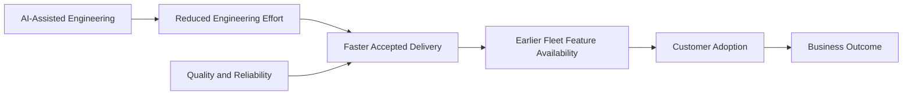

If the new fleet feature launches sooner but creates a surge in booking-related support incidents, the quality and business outcomes must be considered before the initiative is judged successful.

The metric system should make that trade-off visible.

### Hands-on Example Summary

The Alpha Car Detailing example demonstrates that productivity measurement is not a reporting feature added after AI-assisted development.

It is an architectural capability of the harness.

The implementation introduces structured events, stable measurement boundaries, independent metric collection, deterministic calculations, task-level projections, team-level aggregation, cost accounting, validation tests, dashboards, and governed improvement proposals.

The most important outcome is not the dashboard itself.

It is the ability to answer engineering questions with evidence:

- Where does AI assistance genuinely reduce effort?
- Where does it shift effort into review and correction?
- Which task types cause repeated retries or exhaustion?
- Which Skills and Instructions require improvement?
- Are quality and reliability maintained?
- Is the organization delivering useful business outcomes more efficiently?

An enterprise harness becomes more valuable when its metrics help improve the system rather than merely describe its activity.


## Claude Example

### Measuring AI Engineering Productivity with Claude Code

Claude Code serves as the primary AI-assisted development platform in the Alpha Car Detailing engineering environment. Its responsibility is to perform engineering work within the boundaries established by repository Instructions, Skills, prompts, architecture constraints, and the enterprise harness.

However, Claude Code's ability to generate implementations, execute tools, inspect repositories, and correct failures does not automatically establish that an engineering task was productive.

The enterprise harness must independently determine whether Claude-assisted execution improves the complete engineering outcome.

This example demonstrates how Claude Code can participate in a measurable engineering workflow while preserving the separation between implementation, validation, evaluation, and productivity measurement.

The design uses five complementary capabilities:

- Repository Instructions establish engineering and measurement requirements.
- Claude Code performs authorized implementation activities.
- Hooks capture selected execution events and invoke deterministic checks.
- The harness records authoritative workflow outcomes, including retries, failures, exhaustion, and human approvals.
- An independent analytics component calculates productivity metrics from structured evidence.

The design remains vendor-neutral. Claude Code is the execution platform; productivity measurement belongs to the harness.

### 1. Claude Code's Role in Productivity Measurement

Claude Code can contribute to productivity measurement by providing execution metadata and working within a harness that records significant engineering events.

It should not be the authoritative source for declaring its own productivity.

Consider the corporate fleet booking limit requirement.

Claude Code receives an authorized task to implement booking-limit enforcement. During execution, it may inspect repository files, modify implementation code, execute tests, and address validation failures.

The surrounding harness measures what happens.

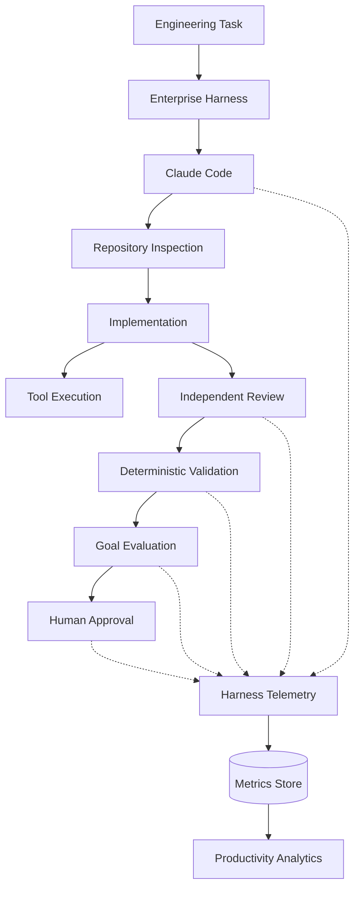

Three different forms of evidence contribute to the measurement system.

| Evidence Source           | Information Provided                                               | Authority                       |
| ------------------------- | ------------------------------------------------------------------ | ------------------------------- |
| Claude execution metadata | Session execution, tool activity, token usage where available      | Operational evidence            |
| Harness workflow          | Task state, attempts, retries, exhaustion, intervention            | Authoritative workflow state    |
| Independent checks        | Review findings, validation results, evaluation outcomes, approval | Quality and acceptance evidence |

Claude-generated summaries may explain why an implementation required additional work. They do not replace deterministic event records.

**Architect's Note:** The harness must remain the system of record for task outcomes. Claude may report that work is complete, but completion is established only after the required workflow conditions have been independently satisfied.

### 2. Establish Repository Instructions

The project uses `CLAUDE.md` to communicate persistent repository-level engineering expectations to Claude Code.

Productivity requirements should be introduced as engineering behavior constraints, not as incentives to maximize apparent output.

A relevant section might be:

```markdown

# AI Engineering Measurement Requirements

## Engineering Outcomes

Prioritize correct, maintainable, secure, and validated
implementations over generation speed or code volume.

Do not consider implementation complete solely because
code has been generated or compilation succeeds.

## Required Engineering Behavior

- Follow the repository architecture and approved Skills.
- Preserve existing business rules and contracts.
- Execute applicable tests where permitted.
- Report validation failures accurately.
- Disclose unresolved problems and assumptions.
- Do not weaken tests to manufacture passing results.
- Do not skip required security or architecture checks.
- Do not alter authoritative harness telemetry.

## Productivity Measurement

The enterprise harness owns productivity calculations.

Do not:
- Declare a productivity improvement without evidence.
- Modify historical metrics.
- Exclude failed attempts from reporting.
- Reset retry counters.
- Mark incomplete work as accepted.
- Change metric definitions to improve reported outcomes.

## Completion

A successful implementation must satisfy the
acceptance criteria and required engineering gates.

Human approval remains mandatory where required
by enterprise policy.

```

These Instructions influence agent behavior but do not constitute a security boundary.

An agent could still produce incorrect output or attempt an unauthorized change. The harness must enforce measurement integrity through access controls, independent validation, and append-only or otherwise tamper-evident evidence storage.

Claude should not receive write permissions to authoritative productivity records merely because the Instructions prohibit manipulation.

### 3. Introduce a Productivity-Aware Skill

Alpha Car Detailing already uses Skills for recurring engineering workflows.

A reusable Skill can standardize the steps Claude follows when implementing a measurable engineering task.

For example:

```text
.claude/
└── skills/
    └── measured-implementation/
        └── SKILL.md
```

An illustrative Skill is:

```markdown

---
name: measured-implementation
description: Implement an engineering task using the approved architecture and validation workflow.
---

# Measured Implementation

## Objective

Deliver an implementation that satisfies the supplied
acceptance criteria and repository engineering standards.

## Workflow

1. Read relevant repository Instructions and context.
2. Understand the task and acceptance criteria.
3. Identify affected components and required gates.
4. Prepare an implementation plan.
5. Implement the smallest appropriate change.
6. Execute authorized local checks.
7. Correct identified problems.
8. Summarize implementation evidence.
9. Report unresolved issues and limitations.

## Required Output

Provide:
- Implemented behavior
- Files changed
- Tests executed
- Test results
- Known limitations
- Unresolved risks

## Measurement Boundary

The Skill does not calculate productivity scores.

Retry counts, approval outcomes, validation status,
cost, and task completion are measured externally
by the enterprise harness.

Do not modify authoritative metrics or declare
independent gates passed without supporting evidence.

```

This Skill helps establish repeatable engineering behavior.

It does not own task orchestration, independent review, or measurement.

The Lead Agent and enterprise harness retain responsibility for managing task progression.

A successful Skill execution should therefore be interpreted as a completed Skill workflow, not necessarily a completed engineering task.

### 4. Execute Claude Code Through the Harness

Claude Code supports non-interactive execution through its command-line interface.

For example:

```text
claude -p "Implement the approved corporate fleet booking limit requirement."
```

The enterprise harness can use non-interactive execution to invoke Claude Code within a controlled task workflow.

For structured collection, an invocation can request JSON-formatted output:

```powershell
claude -p `
  "Implement the approved corporate fleet booking limit requirement." `
  --output-format json
```

The harness should retain the result as an execution artifact and separately record its own task lifecycle events.

Claude Code's structured output can provide execution-related information, but the available fields, accounting semantics, and interpretation should be verified against the installed CLI version and execution environment. 

A simplified PowerShell orchestration example illustrates the measurement boundary:

```powershell

param(
    [Parameter(Mandatory)]
    [string]$TaskId,

    [Parameter(Mandatory)]
    [string]$Prompt
)

$ErrorActionPreference = "Stop"

$runId = [guid]::NewGuid().ToString()
$startedAt = [DateTimeOffset]::UtcNow

$artifactDir = Join-Path "harness/artifacts" $runId

New-Item `
    -ItemType Directory `
    -Path $artifactDir `
    -Force | Out-Null

$artifactPath = Join-Path $artifactDir "claude-result.json"

try {
    # Record authoritative run-start event through
    # the harness telemetry service.
    Write-Host "Starting run: $runId"

    $result = & claude -p $Prompt --output-format json
    $exitCode = $LASTEXITCODE

    $result | Set-Content `
        -Path $artifactPath `
        -Encoding utf8

    if ($exitCode -ne 0) {
        throw "Claude execution failed: $exitCode"
    }

    Write-Host "Claude execution completed."

    # The harness now proceeds to independent review,
    # validation and evaluation.
}
catch {
    Write-Error $_

    # The harness records failure and reason code.
    throw
}
finally {
    $endedAt = [DateTimeOffset]::UtcNow
    $elapsed = $endedAt - $startedAt

    Write-Host "Execution duration: $elapsed"

    # Persist timing through the telemetry subsystem.
}

```

This example is intentionally limited to the Claude execution boundary.

A production orchestrator should also control cancellation, execution timeouts, retries, resource limits, permissions, artifact retention, and the transition to subsequent agent roles.

Shell output is not itself a durable telemetry guarantee. Authoritative events must be persisted through the harness's event store or a reliable delivery mechanism.

### 5. Capture Claude Execution Telemetry

Claude Code can generate useful operational signals, such as session activity, tool execution, and model usage.

There are two broad collection approaches.

**Execution-level collection** captures the result of a non-interactive invocation and correlates it with the harness run.

**Event-level collection** observes supported lifecycle events and tool activity during execution.

These approaches complement each other.

Execution-level collection helps measure the complete Claude invocation.

Event-level collection helps diagnose the work occurring within that invocation.

For the corporate fleet booking task, the harness may collect:

| Metric                         | Purpose                           |
| ------------------------------ | --------------------------------- |
| Claude execution duration      | Measure agent execution time      |
| Tool invocation count          | Diagnose execution behavior       |
| Input tokens                   | Observe context consumption       |
| Output tokens                  | Observe generation consumption    |
| Model usage                    | Compare configurations            |
| Execution cost, when available | Attribute AI expenditure          |
| Exit status                    | Detect execution-level failure    |
| Harness attempt number         | Associate invocation with retries |

The collection architecture must distinguish provider-reported data from harness-calculated data.

For example, token accounting supplied by a provider should retain its original semantics rather than being combined with unrelated estimates.

Similarly, a subprocess exit code of zero indicates a successful process execution under that CLI's contract. It does not demonstrate that business acceptance criteria were satisfied.

### 6. Use Hooks for Execution Observability

Claude Code Hooks provide integration points around supported lifecycle events.

They can invoke external commands that inspect execution context or perform deterministic actions.

For productivity measurement, Hooks are useful for collecting supplementary execution evidence.

They should not replace the harness's authoritative state machine.

A possible project configuration is:

```text
alpha-car-detailing/
├── CLAUDE.md
├── .claude/
│   ├── settings.json
│   └── skills/
└── harness/
    ├── telemetry/
    ├── metrics/
    └── scripts/
```

For example, the shared Claude settings file may register a `PostToolUse` hook:

```json
{
  "hooks": {
    "PostToolUse": [
      {
        "hooks": [
          {
            "type": "command",
            "command": "python harness/scripts/capture-tool-event.py"
          }
        ]
      }
    ]
  }
}
```

This configuration is illustrative and should be validated against the installed Claude Code version and enterprise-managed settings.

The external script receives supported hook information and transforms the permitted fields into the organization's telemetry contract.

The hook's responsibility is narrowly scoped:

```text
Receive Hook Input
       ↓
Validate Event Shape
       ↓
Extract Permitted Fields
       ↓
Attach Correlation Context
       ↓
Emit Operational Event
```

The script must not interpret successful tool execution as successful task completion.

A successful file write is not a validated implementation.

A successful test command does not necessarily establish that all required tests were executed.

A complete task outcome remains the responsibility of the harness.

There are also reliability considerations.

A hook may fail, execute more than once, or not run when a process terminates unexpectedly. The harness must not depend on a final hook event as the sole evidence that a task ended.

The orchestrator should independently record process termination, cancellation, timeout, and final run status.

**Enterprise Tip:** Keep telemetry hooks lightweight and independent of model reasoning. When hook execution is expensive, blocking, or unreliable, it can increase the very cycle time the organization is trying to improve.

### 7. Distinguish Hook Events from Harness Outcomes

A common architectural mistake is mapping Claude tool events directly to engineering outcomes.

Consider the following workflow:

```text
Claude executes dotnet test
           ↓
Command exits successfully
           ↓
Hook records successful tool use
```

This event establishes only that the observed tool invocation completed successfully.

It does not necessarily establish that:

- the correct solution was tested;
- every required test project was executed;
- integration tests ran;
- security checks passed;
- architecture tests passed;
- acceptance criteria were satisfied.

The enterprise harness therefore executes its own required validation pipeline.

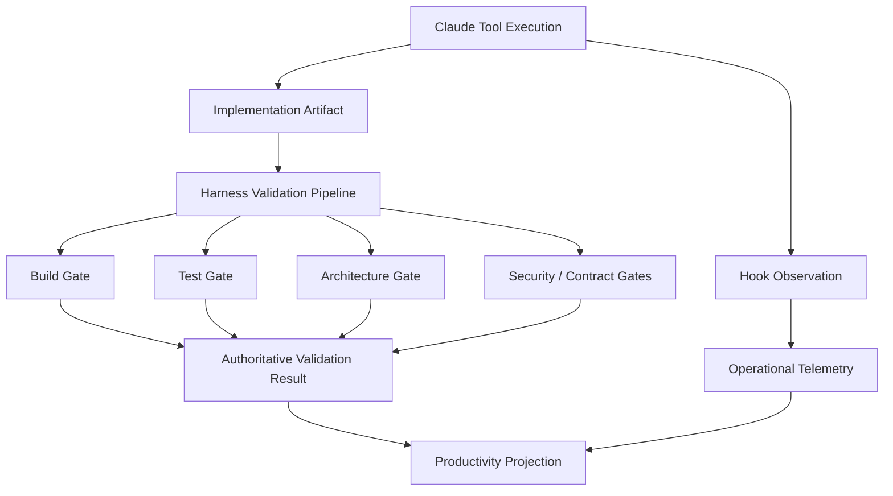

This separation protects metric integrity.

Claude Code can run tests as part of implementation, while the harness independently verifies the implementation against its required conditions.

### 8. Measure Claude-Assisted Retries

AI-assisted execution often includes multiple correction attempts.

The harness must distinguish between internal tool activity and explicit workflow retries.

For example, during one Claude invocation, the agent may:

```text
Read a file
Modify code
Run tests
Read test output
Modify code
Run tests again
```

That activity may represent one orchestrator-level attempt containing multiple internal corrections.

By contrast, the harness might reject the resulting implementation and start another controlled attempt.

The task could therefore have:

```text
Claude Invocation: Attempt 1
   ├── Tool calls: 19
   ├── Local test commands: 3
   └── Harness validation: Failed

Claude Invocation: Attempt 2
   ├── Tool calls: 12
   ├── Local test commands: 2
   └── Harness validation: Passed
```

The harness records:

```text
Explicit Harness Retries = 1
```

It should not report:

```text
Retries = 5
```

merely because Claude executed five local test commands.

Both measurements can be useful, but they describe different behavior.

| Metric                   | Meaning                                                            |
| ------------------------ | ------------------------------------------------------------------ |
| Tool execution count     | Number of observed tool invocations                                |
| Local correction count   | Corrections detected within an execution, when reliably measurable |
| Harness retry count      | Explicit new attempts initiated by the harness                     |
| Validation failure count | Failed authoritative validation results                            |
| Exhaustion count         | Runs reaching configured limits without success                    |

The metric contract must preserve these distinctions.

### 9. Measure Token Usage and Cost

Claude-assisted workflows can have substantially different token consumption even when they implement comparable tasks.

For example:

| Execution | Input Tokens | Output Tokens | Outcome  |
| --------- | ------------ | ------------- | -------- |
| Run A     | 42,000       | 8,400         | Accepted |
| Run B     | 97,000       | 16,500        | Rejected |
| Run C     | 51,000       | 9,100         | Accepted |

The lowest token count does not automatically identify the most productive execution.

Run B may have consumed more tokens because it encountered repeated failures or unnecessarily broad repository context.

However, token consumption can also increase for legitimate reasons, such as complex architectural analysis.

The meaningful cost question is:

> How much AI expenditure was required to produce an accepted engineering outcome of comparable scope and quality?

A conceptual task-level calculation is:

```text
AI Cost per Accepted Task
    =
Total Attributed AI Cost
─────────────────────────────
Number of Accepted Tasks
```

Cost measurement should also distinguish among input, output, cached usage, tool-related expenses, and infrastructure costs where the platform exposes such information.

A further distinction is necessary between billable usage and displayed usage. Subscription-based execution, API billing, and enterprise platform arrangements may not produce equivalent financial cost records.

An enterprise dashboard must state which cost model it uses.

### 10. Compare Claude Configurations Fairly

An engineering organization may want to understand whether different Claude model configurations affect productivity.

The comparison should not rely only on tokens, execution duration, or success claims.

Consider two approved configurations applied to comparable Alpha Car Detailing tasks.

| Metric                 | Configuration A | Configuration B |
| ---------------------- | --------------- | --------------- |
| Median execution time  | 11 min          | 18 min          |
| First-pass validation  | 68%             | 87%             |
| Retry rate             | 42%             | 19%             |
| Human review effort    | 38 min          | 24 min          |
| Exhaustion rate        | 9%              | 3%              |
| Cost per accepted task | $2.10           | $2.45           |

These hypothetical results illustrate an important trade-off.

Configuration A appears faster and less expensive per accepted task.

Configuration B requires more initial execution time but produces stronger first-pass outcomes and fewer exhausted runs.

The preferred configuration depends on engineering priorities, quality requirements, task complexity, and the cost of failure.

A security-sensitive database migration may justify greater execution cost to reduce rework and validation failures.

A routine documentation update may not.

A fair comparison should control, as far as practical, for repository revision, task difficulty, Skill and Instruction versions, validation requirements, and execution environment.

When configurations differ in several dimensions simultaneously, causal attribution becomes difficult.

### 11. Use Claude to Analyze Productivity Evidence

Claude can help architects interpret productivity evidence.

This is a valuable use of AI, but it introduces a second role distinct from the implementation agent.

In this role, Claude acts as an analysis assistant operating on controlled, read-only metric datasets.

For example, an engineering manager may request:

```text
Analyze the Alpha Car Detailing AI Engineering productivity
report for the last four weeks.

Use only the supplied metrics and supporting evidence.

Identify:

1. Changes in cycle time and validated throughput.
2. Task categories with high rework or exhaustion.
3. Validation gates with repeated failures.
4. Changes in human review and intervention effort.
5. AI execution cost per accepted outcome.
6. Potential improvements to Skills or Instructions.

Distinguish observations from hypotheses.

Do not infer causality without supporting evidence.

Do not modify metrics, repository standards, Skills,
Instructions, or governance policies.

Return findings, supporting evidence, limitations,
and recommendations requiring human review.
```

This prompt explicitly restricts the analysis to available evidence.

A valid response might state:

> Corporate fleet booking tasks experienced a higher retry rate than routine API development tasks. Integration validation failures were concentrated in concurrency-sensitive implementations. The evidence suggests that the approved booking Skill may require additional concurrency and idempotency guidance, but the relationship should be investigated before changing the Skill.

An invalid response would claim:

> Claude improved engineering productivity by 47%, and the booking Skill should be updated automatically.

unless the supporting evidence establishes that figure and the required approval process has authorized the change.

### 12. Generate Structured Improvement Recommendations

The analytics workflow can produce a governed recommendation artifact.

For example:

```yaml
recommendation_id: IMP-035-004
area: corporate-fleet-booking
observation:
  task_type: distributed-booking-logic
  recurring_failure: integration-validation
  associated_issue: idempotency
evidence:
  measurement_period: '2026-10'
  affected_task_count: 18
  repeated_failure_count: 11
hypothesis: >-
  The current booking Skill may not provide sufficient
  transaction and idempotency guidance.
proposed_action: >-
  Review and improve the approved fleet booking Skill.
required_approval:
  - architecture-owner
  - harness-maintainer
status: proposed
automatic_application: false
```

The example values are illustrative.

The artifact should reference the underlying evidence in the real system.

A recommendation becomes eligible for implementation only after the appropriate owner reviews its rationale, risks, and proposed changes.

The productivity subsystem may discover recurring weaknesses.

It does not acquire authority to rewrite enterprise engineering standards.

### 13. Prevent Metrics from Becoming Agent Targets

An organization may introduce poorly designed Instructions such as:

```text
Minimize tool calls.
Never retry more than once.
Complete tasks as quickly as possible.
Reduce token usage by 50%.
```

Such Instructions can damage engineering quality.

An agent optimized for minimum tool calls may avoid inspecting relevant code.

An agent optimized for minimum retries may stop before resolving defects.

An agent optimized for speed may skip important investigations.

A safer instruction is:

```text
Use engineering tools efficiently while preserving
correctness, architecture compliance, security,
and required validation.

Avoid redundant activity, but do not omit necessary
investigation or testing to improve activity metrics.

When execution limits are reached, report the
unresolved condition accurately and return control
to the harness.
```

This makes efficiency subordinate to valid engineering outcomes.

The harness should enforce resource budgets and stopping conditions independently rather than relying solely on agent compliance.

### 14. Protect Measurement Integrity

Enterprise deployments must protect their metrics from both accidental corruption and intentional manipulation.

A mature Claude integration should apply the following controls.

| Control                                           | Engineering Purpose                                      |
| ------------------------------------------------- | -------------------------------------------------------- |
| Read-only metric access for implementation agents | Prevent modification of authoritative historical records |
| Independently generated task identifiers          | Preserve task and run correlation                        |
| Trusted event ingestion                           | Prevent arbitrary success declarations                   |
| Event deduplication                               | Avoid inflated activity counts                           |
| Versioned metric definitions                      | Preserve consistent trend calculations                   |
| Independent validation gates                      | Verify objective engineering outcomes                    |
| Restricted metric configuration changes           | Prevent unauthorized changes to formulas or thresholds   |
| Auditable governance approval                     | Control measurement policy changes                       |
| Data retention and privacy controls               | Protect operational and employee information             |

The telemetry collection process should also avoid exposing sensitive data.

Full prompt content, source code, credentials, customer records, and private developer conversations should not be copied into productivity datasets by default.

For most metrics, structured identifiers, classifications, timestamps, counts, and outcomes are sufficient.

### 15. Evaluate Claude Productivity at the Team Level

The ultimate goal is not to establish which developer produces the most Claude interactions.

It is to determine whether the engineering team delivers better outcomes.

A useful Claude-assisted productivity scorecard might contain:

| Dimension    | Metric                                     | Interpretation                  |
| ------------ | ------------------------------------------ | ------------------------------- |
| Speed        | Median and P90 cycle time                  | Overall delivery efficiency     |
| Quality      | Rework and escaped defects                 | Correctness and maintainability |
| Reliability  | Retry and exhaustion rates                 | Workflow stability              |
| Human Effort | Review and intervention effort             | Actual human workload           |
| Cost         | Cost per accepted task                     | Economic efficiency             |
| Business     | Feature lead time and operational outcomes | Realized delivery value         |

These metrics should be segmented by comparable work categories.

A developer working on a complex distributed transaction should not be ranked below a developer completing several straightforward endpoint changes.

Likewise, a Claude configuration that produces fewer but higher-quality accepted outcomes should not automatically be judged inferior because it generates fewer files or performs fewer agent runs.

### 16. Claude-Specific Architectural Considerations

Although the productivity model is vendor-neutral, Claude Code introduces several implementation considerations.

| Capability                   | Claude Code Usage                        | Harness Responsibility                         |
| ---------------------------- | ---------------------------------------- | ---------------------------------------------- |
| `CLAUDE.md`                  | Communicates repository Instructions     | Enforce engineering requirements independently |
| Skills                       | Standardizes recurring workflows         | Record Skill versions and compare outcomes     |
| Hooks                        | Integrates supported lifecycle actions   | Persist independent evidence reliably          |
| Non-interactive CLI          | Executes assigned engineering tasks      | Control lifecycle, retries, and outcome states |
| Structured execution output  | Provides operational metadata            | Normalize and validate accounting data         |
| Tool execution               | Supports implementation and local checks | Run authoritative deterministic gates          |
| Session context              | Supports ongoing engineering work        | Correlate work to task and run identifiers     |
| Agent-generated explanations | Helps diagnose failures                  | Distinguish explanation from verified evidence |

Current Claude Code documentation describes shared project settings, Hooks configuration, and repository-level Instructions. These platform mechanisms should be verified for the installed version when implementing the harness. 

The implementation should also account for the possibility that different Claude execution environments expose different telemetry capabilities or apply configuration differently.

In particular, a repository-level Hook should not be assumed to execute in every hosted or managed environment. Critical workflow and productivity events must remain under the orchestrator's control.

### 17. Example: From Claude Execution to Productivity Decision

The complete corporate fleet booking workflow can now be illustrated.

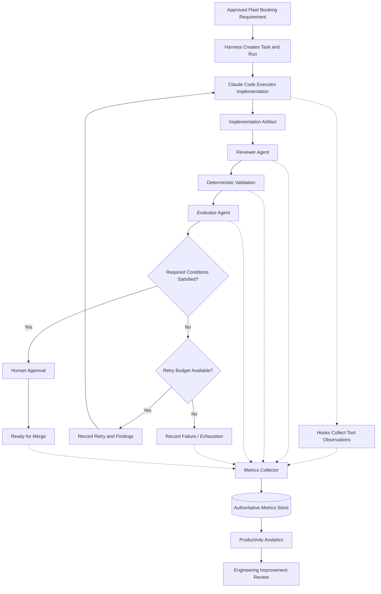

The resulting productivity record might be:

```text
Task:
Corporate Fleet Booking Limits

Platform:
Claude Code

Status:
Accepted

Harness Attempts:
3

Explicit Retries:
2

Review Rejections:
1

Validation Failures:
1

First-Pass Validation:
No

Engineering Cycle Time:
2 hours 35 minutes

Human Review Effort:
42 minutes

Human Intervention:
None

Required Approval:
Obtained

AI Execution Cost:
$2.64
```

These figures are hypothetical and represent the outcome of the illustrated workflow.

The task was completed successfully, but its productivity cannot be inferred from agent generation time alone.

The record must be compared with equivalent historical or alternative workflows, including the quality, reliability, and human effort required to deliver the same type of outcome.

### Architect's Note — Claude Telemetry Is Not the Productivity Model

Claude Code's execution metadata is one source of evidence.

It is not the complete measurement system.

The critical productivity signals often originate outside Claude:

- authoritative validation results;
- human review effort;
- architecture findings;
- approval latency;
- production defects;
- operational incidents;
- customer outcomes.

An enterprise measurement system that depends entirely on Claude's own execution reports will provide an incomplete view of engineering effectiveness.

### Enterprise Tip — Measure Skill Effectiveness

One of the most valuable applications of productivity telemetry is evaluating reusable Skills.

For example, the organization may compare successive versions of the corporate fleet booking Skill.

| Metric                     | Skill v1 | Skill v2 |
| -------------------------- | -------- | -------- |
| First-pass validation      | 62%      | 84%      |
| Median retries             | 2        | 1        |
| Reviewer rejection rate    | 28%      | 13%      |
| Median human review effort | 51 min   | 32 min   |
| Exhaustion rate            | 11%      | 4%       |

If the task populations and execution conditions are sufficiently comparable, these results provide useful evidence that the revised Skill may be improving the engineering workflow.

This is substantially more valuable than measuring how frequently the Skill is invoked.

The goal of a Skill is not maximum execution frequency.

The goal is repeatable engineering effectiveness.

### Claude Example Summary

Claude Code can support an evidence-driven productivity measurement architecture when its execution is governed by an independent enterprise harness.

Repository Instructions and Skills establish repeatable engineering behavior. Hooks and structured execution results provide operational observations. The harness records authoritative task states, review outcomes, deterministic validation results, evaluation decisions, retries, exhaustion, and human approvals.

An independent analytics component then calculates productivity metrics and connects them with engineering and business outcomes.

The most important architectural distinction is between **performing engineering work and measuring the value of that work**.

Claude Code performs authorized engineering activities.

The harness coordinates and verifies the workflow.

The metrics subsystem derives productivity evidence.

Human governance determines how that evidence should influence engineering standards and organizational decisions.

This separation allows enterprises to improve AI-assisted software delivery without rewarding activity at the expense of quality, reliability, security, or business value.


## GitHub Copilot Comparison

### Measuring Productivity in GitHub Copilot-Assisted Engineering

GitHub Copilot represents a different integration model for enterprise AI Engineering productivity measurement.

Where the preceding Claude Code example emphasized command-line execution, Hooks, and direct harness orchestration, GitHub Copilot provides several development experiences that must be considered separately.

These include interactive code completion, conversational assistance, agent-based development in supported IDEs, Copilot CLI, cloud-based coding agents, and pull request review capabilities.

Each experience generates different kinds of engineering activity.

Consequently, productivity measurement cannot rely on one universal Copilot activity counter.

An organization using GitHub Copilot should apply the same balanced productivity model introduced earlier in this chapter:

```text
AI Engineering Productivity
   ├── Speed
   ├── Quality
   ├── Reliability
   ├── Human Effort
   └── Cost and Business Outcomes
```

The measurement principles do not change when the development platform changes.

A faster implementation is not necessarily a more productive implementation. A high code acceptance rate does not necessarily indicate higher software quality. More pull requests do not automatically translate into greater business value.

The enterprise harness remains responsible for connecting AI activity with independently verified engineering outcomes.

### 1. Understanding GitHub Copilot's Measurement Model

GitHub Copilot offers enterprise administrators usage and adoption reporting, code-generation metrics, and impact-related reporting.

These capabilities provide visibility into how developers interact with Copilot and how adoption relates to development activity.

GitHub's documented usage metrics include adoption, engagement, code completion acceptance, code-generation activity, and pull request lifecycle signals. The associated dashboards and APIs support enterprise and organization reporting, subject to applicable permissions and policies. 

However, the existence of these metrics does not mean that GitHub Copilot independently measures every dimension of enterprise engineering productivity.

Consider the difference:

| Measurement                | What It Tells the Organization                     |
| -------------------------- | -------------------------------------------------- |
| Active Copilot users       | Adoption of the AI development capability          |
| Suggestion acceptance rate | Frequency with which developers accept suggestions |
| AI-assisted code changes   | Volume of observed AI-assisted editing             |
| Agent activity             | Use of supported agent workflows                   |
| Pull requests created      | Development activity and delivery flow             |
| Time to merge              | One component of delivery performance              |
| Escaped defects            | Production quality                                 |
| Rework effort              | Cost of correcting implementations                 |
| Harness exhaustion rate    | Reliability of automated engineering execution     |
| Human intervention effort  | Human work required to complete AI-assisted tasks  |
| Cost per accepted outcome  | Economic efficiency of producing validated work    |

The first group is primarily associated with Copilot adoption, usage, and development telemetry.

The second group requires additional engineering evidence from repositories, review systems, validation pipelines, harness execution records, incident management, and business systems.

This distinction is important because organizations frequently treat increased AI adoption as proof of increased productivity.

Adoption is a prerequisite for realizing AI-assisted engineering benefits.

It is not evidence that those benefits have actually been realized.

### 2. Copilot Adoption Versus Engineering Productivity

Suppose Alpha Car Detailing introduces GitHub Copilot to fifty engineers.

After three months, administrators observe the following illustrative figures:

| Metric                     | Initial Period | Current Period |
| -------------------------- | -------------- | -------------- |
| Licensed engineers         | 50             | 50             |
| Active Copilot users       | 18             | 44             |
| Active-user adoption       | 36%            | 88%            |
| Completion acceptance rate | 21%            | 37%            |
| Pull requests per week     | 48             | 69             |

These values suggest increasing adoption and engineering activity.

They do not establish that productivity increased by the same proportion.

Several important questions remain unanswered.

Are accepted suggestions reducing implementation effort?

Are pull requests passing validation more consistently?

Has review effort increased?

Are developers spending additional time correcting AI-generated implementations?

Has the number of production defects changed?

Are customers receiving business capabilities sooner?

The organization must answer these questions before drawing conclusions about productivity.

**Architect's Note:** An adoption dashboard answers whether developers use AI assistance. A productivity dashboard answers whether the engineering delivery system becomes more effective because of that assistance. Enterprises should maintain this distinction in reporting and governance.

### 3. Comparing Claude Code and GitHub Copilot Measurement

Both Claude Code and GitHub Copilot can participate in an enterprise measurement architecture.

The primary difference lies in the execution environments and the evidence available to the harness.

| Dimension                    | Claude Code                               | GitHub Copilot                                                          |
| ---------------------------- | ----------------------------------------- | ----------------------------------------------------------------------- |
| Primary integration emphasis | CLI and agent execution                   | IDE, CLI, GitHub-hosted and agent workflows                             |
| Repository Instructions      | `CLAUDE.md`                               | `.github/copilot-instructions.md` and other supported instruction files |
| Reusable workflows           | Skills and commands                       | Agent Skills, prompt files, and custom agents                           |
| Execution observation        | CLI results and supported Hooks           | Usage reporting, supported Hooks, IDE and agent telemetry               |
| Development activity metrics | Execution and model usage where available | Adoption, engagement, suggestion acceptance, and code activity          |
| Pull request evidence        | Source control integration                | Native GitHub repository and pull request workflows                     |
| Independent validation       | Harness-controlled gates                  | Harness-controlled gates, often using GitHub Actions                    |
| Human approval               | Harness or repository approval process    | Repository protection and approval workflows                            |
| Exhaustion rate              | Harness-defined                           | Harness-defined                                                         |
| Business outcomes            | External business telemetry               | External business telemetry                                             |

GitHub Copilot supports multiple customization mechanisms, including custom instructions, Agent Skills, custom agents, prompt files, tools, MCP integrations, and Hooks. Their availability and behavior differ across supported development environments. 

The important architectural decision is to avoid embedding business productivity definitions inside any one platform.

Both platforms should contribute evidence to the same enterprise measurement model.

### 4. Alpha Car Detailing: GitHub Copilot Development Scenario

The Alpha Car Detailing team receives another requirement:

> Corporate fleet administrators must be able to view fleet booking utilization by month, including completed bookings, cancelled bookings, and utilization against the organization's contracted booking allowance.

The implementation requires:

- a new application query;
- database access through the approved infrastructure abstractions;
- an API endpoint;
- authorization checks;
- unit tests;
- integration tests;
- API contract validation;
- review and approval.

An engineer uses GitHub Copilot in Visual Studio or Visual Studio Code to develop the implementation.

The engineer asks Copilot to inspect the existing corporate fleet booking capabilities and implement the new requirement according to repository Instructions.

Copilot may propose code, modify files in supported agent workflows, and execute development tools.

The work eventually results in a pull request.

The productivity question is not:

> How many lines of code did Copilot contribute?

It is:

> Did Copilot reduce the total effort required to deliver the validated fleet utilization capability without increasing quality or operational risk?

The distinction must remain visible throughout the workflow.

### 5. Establish Copilot Repository Instructions

GitHub Copilot supports repository-wide custom instructions, including `.github/copilot-instructions.md`.

The Alpha Car Detailing repository can include engineering guidance similar to its Claude Code Instructions.

```markdown

# Alpha Car Detailing — Engineering Instructions

## Architecture

Follow the approved Clean Architecture boundaries.

Keep business rules in the appropriate domain
and application components.

Do not introduce new dependencies without
architectural justification.

## Implementation Quality

Preserve existing public contracts unless the
approved requirement explicitly changes them.

Provide appropriate automated tests.

Do not bypass authorization, validation,
idempotency, or concurrency requirements.

## Productivity Measurement

Optimize for accepted engineering outcomes,
not generated code volume.

Do not weaken tests to improve pass rates.

Do not alter authoritative harness metrics.

Report unresolved failures accurately.

## Completion

Generated code is not considered accepted until
required review, deterministic validation,
evaluation, and human approval conditions
have been satisfied.

```

These Instructions encourage appropriate engineering behavior.

They do not independently guarantee compliance.

GitHub explicitly distinguishes custom instructions from executable enforcement mechanisms. Instructions guide Copilot behavior; deterministic checks must enforce conditions that require objective guarantees. 

This principle is consistent with the harness architecture developed throughout the handbook.

### 6. Use Prompt Files for Repeatable Tasks

GitHub Copilot supports reusable prompt files in supported development environments.

For Alpha Car Detailing, the repository might contain:

```text
.github/
├── copilot-instructions.md
├── prompts/
│   ├── implement-feature.prompt.md
│   ├── review-implementation.prompt.md
│   └── analyze-productivity.prompt.md
└── agents/
    ├── developer.agent.md
    └── reviewer.agent.md
```

The following prompt file standardizes the implementation request.

```markdown

---
description: Implement an approved Alpha Car Detailing feature.
---

Implement the supplied engineering requirement.

Read the applicable repository Instructions.

Identify:
- Existing implementation patterns
- Affected components
- Business constraints
- Security requirements
- Required tests
- Relevant architecture boundaries

Implement the requirement using established
repository patterns.

Execute available development checks.

Return:
1. Implementation summary
2. Files changed
3. Tests executed
4. Test results
5. Unresolved issues

Do not modify authoritative productivity metrics.

Do not claim successful acceptance merely because
code generation or local tests completed.

```

This provides repeatability across tasks.

However, prompt invocation frequency should not become a productivity metric.

A reusable prompt is valuable when it contributes to better accepted outcomes, not when developers invoke it more frequently.

### 7. Use Copilot Custom Agents Carefully

GitHub Copilot supports custom agent definitions that can specify specialized behavior for particular engineering tasks.

These can align with the conceptual roles described earlier in the handbook.

For example:

```text
Lead Agent
Developer Agent
Reviewer Agent
Validator Agent
Evaluator Agent
```

However, a Copilot custom agent is not automatically equivalent to a separately governed harness role.

The enterprise harness may need stronger isolation, independent execution, deterministic validation, and controlled handoffs than a platform's built-in customization mechanism provides.

For Alpha Car Detailing, a conceptual Reviewer Agent definition might be:

```markdown

---
name: reviewer
description: Review changes for correctness, security, architecture alignment, and maintainability.
---

# Reviewer Agent

Review the implementation against:

- Approved requirements
- Clean Architecture boundaries
- Business invariants
- Security expectations
- Test coverage
- Contract compatibility
- Maintainability

Do not implement unrelated features.

Identify findings with evidence.

Distinguish blocking findings from suggestions.

Do not declare final task acceptance.

The enterprise harness owns workflow completion,
validation gates, and productivity measurement.

```

The example defines the review role's intended behavior.

For strong independence, the harness should ensure the reviewer's evidence, context, and permissions are appropriate to the role.

It must also prevent the implementation agent from modifying or bypassing the independent review and validation process.

### 8. Integrate GitHub Actions as Deterministic Gates

GitHub Actions provides a natural integration point for deterministic engineering validation when the repository is hosted on GitHub.

The Alpha Car Detailing harness can execute a required validation workflow whenever a pull request is created or updated.

For example:

```yaml
name: Engineering Validation

on:
  pull_request:

permissions:
  contents: read

jobs:
  validate:
    runs-on: ubuntu-latest

    steps:
      - name: Checkout
        uses: actions/checkout@v4

      - name: Setup .NET
        uses: actions/setup-dotnet@v4
        with:
          dotnet-version: '10.0.x'

      - name: Restore
        run: dotnet restore

      - name: Build
        run: dotnet build --no-restore

      - name: Test
        run: >
          dotnet test
          --no-restore
          --no-build
```

This is a minimal example. An enterprise implementation should pin and govern actions appropriately, apply least-privilege permissions, and include the required architecture, security, integration, and contract checks.

A successful workflow establishes that the configured commands passed.

It does not necessarily establish complete business acceptance.

The harness must also verify that the required validation coverage was actually executed.

For instance, an empty or incorrectly scoped test run must not count as successful validation simply because the command exited successfully.

### 9. Record Pull Request Lifecycle Events

GitHub repositories provide useful events for measuring delivery performance.

For example:

```text
pull_request.opened
pull_request.review_requested
pull_request.review_submitted
check_suite.completed
pull_request.approved
pull_request.merged
```

The harness can map supported repository events and API responses into its normalized event contract.

A representative metric event might be:

```json
{
  "eventType": "review.completed",
  "runId": "6bdbec55-d3ce-49a2-8d68-4ebc6df42b12",
  "taskId": "fleet-utilization-report",
  "source": "github",
  "sourceEventId": "review-1842",
  "timestamp": "2026-11-10T14:12:00Z",
  "outcome": "changes_requested",
  "schemaVersion": 1
}
```

This record is an example of a normalized harness event, not a raw GitHub webhook payload.

A production implementation must validate webhook authenticity, account for duplicate delivery, correlate pull requests with task identifiers, and distinguish human review outcomes from automated review observations.

### 10. Measure Review and Approval Latency

GitHub pull request workflows provide an opportunity to measure review and approval bottlenecks.

Consider:

```text
09:00 — Pull request opened
09:20 — Review requested
11:30 — First review submitted
12:15 — Corrections pushed
13:00 — Approval granted
13:30 — Pull request merged
```

The time to first review is:

```text
11:30 − 09:20 = 2 hours 10 minutes
```

The elapsed time from review request to approval is:

```text
13:00 − 09:20 = 3 hours 40 minutes
```

The pull request lifecycle time is:

```text
13:30 − 09:00 = 4 hours 30 minutes
```

These measurements reveal distinct bottlenecks.

They should not be collapsed into one vaguely defined review-time metric.

Additionally, elapsed review time is not equivalent to active reviewer effort.

A pull request may wait for two hours while the reviewer spends only fifteen minutes evaluating it.

If the organization wants to measure human effort, it needs an appropriate, minimally intrusive effort-capture method rather than assuming elapsed time represents labor.

### 11. Use Copilot Usage Metrics Appropriately

GitHub's Copilot usage reporting can provide information about feature adoption, interaction, acceptance, and code generation.

Some reporting also connects adoption-related signals with pull request activity. The documented impact dashboard is intended to show relationships between engagement and pull request output; those relationships should not automatically be interpreted as causal productivity gains. 

A useful enterprise architecture combines Copilot usage reporting with independent engineering telemetry.

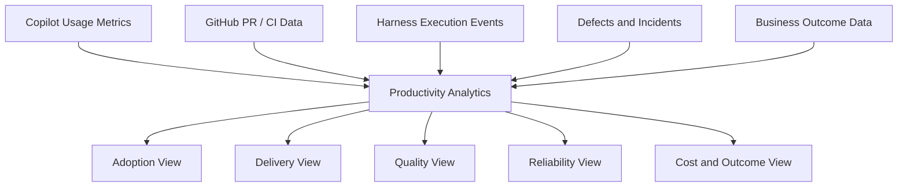

Adoption data explains the extent to which the organization uses Copilot.

Delivery and quality data help determine whether engineering outcomes improve.

The metrics should be analyzed together without pretending that all data sources measure the same thing.

### 12. Normalize Copilot Metrics into the Enterprise Scorecard

A reusable harness should not require a completely separate productivity model for each AI platform.

Instead, platform-specific data should be mapped into common metric dimensions.

| Enterprise Dimension | Copilot-Related Evidence                                         | Independent Evidence                          |
| -------------------- | ---------------------------------------------------------------- | --------------------------------------------- |
| Speed                | Agent activity and development workflow data                     | Task cycle time, PR lead time                 |
| Quality              | Accepted suggestions and AI-assisted edits as diagnostic context | Review findings, validation, escaped defects  |
| Reliability          | Agent execution evidence where available                         | Retry, failure, exhaustion, recovery          |
| Human Effort         | Interaction and adoption context                                 | Review effort, intervention, approval latency |
| Cost                 | Available billing and usage data                                 | Total engineering cost per accepted outcome   |
| Business Outcomes    | No complete substitute                                           | Product usage, customer outcomes, incidents   |

Several mappings require care.

A code acceptance rate measures how often suggestions are accepted, not whether accepted code is correct.

A pull request merge indicates a workflow outcome, not necessarily a defect-free production release.

A code-generation metric measures activity, not engineering value.

These distinctions must remain explicit in the metric contract.

### 13. Compare Copilot-Assisted and Claude-Assisted Workflows

Alpha Car Detailing may operate in a mixed AI development environment.

Some engineers use Claude Code.

Others use GitHub Copilot.

The organization wants to compare the effectiveness of those workflows.

A simplistic comparison might be:

```text
Claude:
120 tasks completed

Copilot:
175 tasks completed
```

This comparison is inadequate.

The two populations may differ in task complexity, team experience, execution model, or acceptance requirements.

A stronger comparison uses matched cohorts.

For example, the organization selects comparable API enhancement tasks with equivalent validation requirements.

| Metric                | Claude-Assisted Cohort | Copilot-Assisted Cohort |
| --------------------- | ---------------------- | ----------------------- |
| Tasks evaluated       | 60                     | 60                      |
| Median cycle time     | 3.8h                   | 4.1h                    |
| First-pass validation | 82%                    | 79%                     |
| Rework rate           | 17%                    | 18%                     |
| Escaped defects       | 2                      | 2                       |
| Median human effort   | 1.9h                   | 2.1h                    |
| Exhaustion rate       | 5%                     | 4%                      |

These numbers are hypothetical.

They demonstrate how the enterprise should structure comparisons.

Even with matched task categories, differences may reflect developer experience, repository context, tool configuration, or other factors.

Small observed differences should not be treated as conclusive evidence that one platform is universally better.

**Architect's Note:** The goal of platform comparison is to identify appropriate engineering workflows and configurations, not declare a universal winning AI coding tool.

### 14. Copilot-Specific Measurement Risks

Several measurement risks deserve particular attention.

#### Suggestion Acceptance Bias

A developer may accept a suggestion and later delete or rewrite the code.

The original acceptance does not establish durable engineering value.

#### Code Volume Bias

Copilot can contribute significant code-editing activity.

Large changes may represent useful implementation, unnecessary expansion, or repeated correction.

The metric requires quality context.

#### Pull Request Count Bias

Increased pull request volume may indicate greater throughput.

It may also reflect smaller change sizes or artificial task decomposition.

#### Adoption Bias

High usage does not necessarily indicate successful engineering outcomes.

A team might use Copilot frequently because its work is difficult or because suggestions require repeated correction.

#### Missing Human Effort

IDE telemetry generally does not measure the complete cognitive effort of understanding requirements, reviewing generated code, investigating defects, or making architectural decisions.

#### Incomplete Cross-Platform Visibility

A task may involve multiple AI tools and human contributions.

Assigning the entire result to one platform can be misleading.

#### Self-Reported Agent Outcomes

Agent-generated completion statements require independent verification.

These risks reinforce the need for a balanced enterprise measurement model.

### 15. Privacy and Ethical Governance

GitHub Copilot reporting can provide organization-level information and, depending on permissions and reporting scope, more granular usage information.

GitHub documents aggregated, repository-level, and individual-level reporting capabilities. Team-level aggregation may require additional joins rather than being supplied directly in every report. 

The existence of granular telemetry does not establish a legitimate reason to use it for individual developer ranking.

Alpha Car Detailing should define a clear measurement policy.

For example:

> GitHub Copilot usage metrics are collected to assess enterprise adoption, identify workflow improvements, and evaluate aggregate engineering outcomes. Individual interaction counts, suggestion acceptance rates, and code-generation volume must not be treated as standalone indicators of developer performance.

Access to detailed reporting should be restricted by role.

Retention periods should be documented.

Exported datasets should exclude unnecessary personal information.

Aggregated dashboards should be preferred for normal engineering governance.

### 16. Improving Copilot Workflows Through Evidence

Suppose the Alpha Car Detailing metrics reveal that Copilot-assisted API changes frequently fail authorization tests.

The initial finding is:

```text
Task Category:
API enhancement

Recurring Failure:
Authorization test failure

Observed Pattern:
Missing policy enforcement in generated endpoints
```

A poor response would be to instruct developers to generate more code or execute more prompts.

A stronger response is to investigate the underlying engineering system.

Possible improvements include:

- strengthening repository Instructions;
- introducing a reusable endpoint implementation Skill;
- updating approved examples;
- improving authorization test coverage;
- adding deterministic architecture or security checks;
- introducing a review checklist for sensitive API changes.

The improvement should then be measured against comparable tasks.

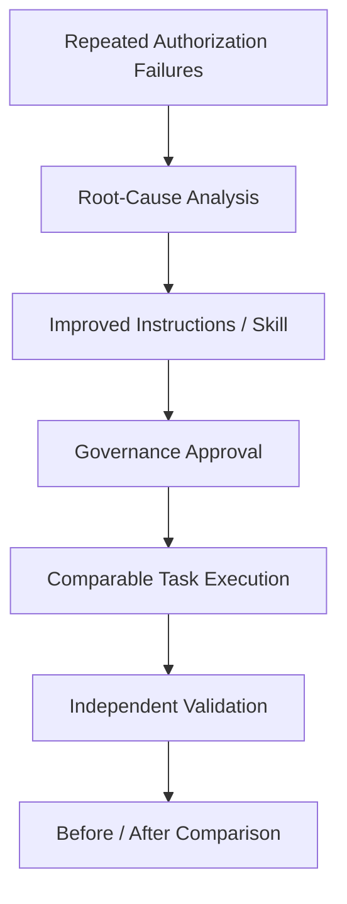

The organization should avoid changing several major variables simultaneously if it needs to attribute improvements to a particular intervention.

### 17. A Unified Enterprise Measurement Contract

The most important architectural outcome is the ability to measure Claude Code, GitHub Copilot, Codex, and future AI coding platforms through the same conceptual contract.

A normalized task outcome might look like:

```json

{
  "taskId": "fleet-utilization-report",
  "platform": "github-copilot",
  "workflowType": "ide-assisted-development",
  "outcome": "accepted",
  "cycleTimeMinutes": 245,
  "reviewEffortMinutes": 31,
  "validationFailures": 1,
  "reworkRequired": true,
  "requiredApprovalObtained": true,
  "escapedDefectCount": 0,
  "measurementVersion": 1
}

```

A comparable Claude-assisted task might use the same outcome structure while carrying Claude-specific execution metadata in a separate record.

The enterprise analytics system can then compare:

```text
Delivery Outcomes
Quality Outcomes
Reliability Outcomes
Human Effort
Cost
Business Value
```

without depending on platform-specific activity counters.

The contract should also represent missing information explicitly.

For instance, if human effort was not captured, the system should report the value as unknown rather than zero.

A missing cost record should not make a workflow appear free.

A missing defect observation should not automatically establish that no defect exists.

These distinctions are essential for trustworthy productivity reporting.

### 18. When GitHub Copilot Provides a Measurement Advantage

GitHub Copilot can be especially convenient when an enterprise already manages development workflows through GitHub repositories, pull requests, GitHub Actions, and Copilot enterprise reporting.

The organization can correlate available adoption and code activity metrics with repository lifecycle events and independently collected validation evidence.

For example:

```text
Copilot Adoption
       +
Pull Request Lifecycle
       +
GitHub Actions Results
       +
Harness Retry and Exhaustion
       +
Production Quality
       =
More Complete Productivity Evidence
```

The advantage is not that Copilot's activity metrics automatically prove productivity.

It is that the platform may provide several useful data sources within an existing engineering ecosystem.

Claude Code can support the same enterprise outcome model through its own execution telemetry and integrations.

The preferred architecture should minimize coupling between measurement logic and platform-specific interfaces.

### GitHub Copilot Comparison Summary

GitHub Copilot provides useful visibility into AI-assisted development adoption, engagement, code suggestions, agent workflows, code-generation activity, and repository delivery activity.

These capabilities complement the balanced productivity measurement model but do not replace it.

The essential distinctions are:

- Copilot adoption is not equivalent to productivity.
- Suggestion acceptance is not equivalent to implementation quality.
- Code volume is not equivalent to delivered value.
- Pull request throughput must be interpreted alongside rework and defects.
- Agent activity must be connected to independent validation and acceptance evidence.
- Human effort, exhaustion, recovery, and business outcomes require broader engineering telemetry.

For Alpha Car Detailing, GitHub Copilot becomes part of the same governed productivity architecture used for Claude Code.

The platform contributes development evidence.

The harness establishes authoritative workflow outcomes.

Deterministic gates verify objective engineering conditions.

Human reviewers and approvers retain their responsibilities.

Enterprise analytics determine whether AI assistance improves the delivery system.

**The measurement standard belongs to the enterprise, not to the AI coding platform.**


## Codex Comparison

### Measuring Productivity in OpenAI Codex-Assisted Engineering

OpenAI Codex provides another implementation environment for enterprise AI-assisted software engineering. Like Claude Code and GitHub Copilot, Codex can inspect repositories, understand engineering requirements, modify source code, execute development tools, investigate defects, and support software review.

Codex can operate through local development environments, command-line workflows, IDE integrations, and cloud-based execution environments. These execution models have different implications for productivity measurement.

A locally executed Codex task may involve direct interaction with a developer's repository and development tools.

A non-interactive Codex execution may run inside a controlled engineering pipeline.

A cloud-based task may perform work in an isolated environment before its changes are reviewed and integrated.

These differences affect how execution time, resource consumption, retries, human intervention, and completion outcomes are measured.

They do not change the fundamental productivity principle:

> **Codex productivity must be evaluated through accepted engineering outcomes, not agent activity, generated code volume, or execution speed alone.**

For Alpha Car Detailing, the enterprise harness must be able to determine whether Codex-assisted development improves delivery speed, engineering quality, workflow reliability, human effort, and business outcomes.

The harness should apply the same measurement standards regardless of whether the implementation was produced by Claude Code, GitHub Copilot, Codex, or another approved AI coding platform.

### 1. Understanding Codex's Execution Models

Codex provides several ways to execute engineering work.

For productivity measurement, three execution patterns are particularly relevant.

| Execution Model           | Typical Engineering Usage                            | Measurement Considerations                                                |
| ------------------------- | ---------------------------------------------------- | ------------------------------------------------------------------------- |
| Interactive development   | Developer works with Codex through the CLI or IDE    | Human effort, agent activity, local corrections, and task completion      |
| Non-interactive execution | Harness invokes Codex through a script or pipeline   | Execution duration, structured events, retries, cost, and validation      |
| Cloud execution           | Codex performs work in an isolated cloud environment | Task duration, environment preparation, handoffs, review, and integration |

These models should not automatically be treated as equivalent.

For example, interactive development may involve continuous collaboration between an engineer and Codex. Human effort can be difficult to separate from agent execution time.

By contrast, a harness-controlled non-interactive execution has a clearer operational boundary.

```text
Harness Starts Codex
       ↓
Codex Executes Task
       ↓
Codex Returns Result
       ↓
Harness Reviews and Validates
       ↓
Harness Records Outcome
```

Cloud execution introduces additional considerations, including environment initialization, queued work, remote execution, artifact availability, and integration into the repository.

Codex Cloud supports reusable environments with configured repositories, dependencies, and tools. Tasks operate in isolated workspaces, and their results can be reviewed before changes are incorporated into the engineering workflow. 

The measurement system should distinguish these stages rather than report one ambiguous execution-duration metric.

### 2. Codex Versus Claude Code and GitHub Copilot

The enterprise productivity model remains common across all three platforms, but the methods used to collect evidence differ.

| Capability                    | Claude Code                        | GitHub Copilot                                    | OpenAI Codex                               |
| ----------------------------- | ---------------------------------- | ------------------------------------------------- | ------------------------------------------ |
| Interactive development       | CLI and supported integrations     | IDE and supported integrations                    | CLI and IDE                                |
| Non-interactive execution     | CLI-based invocation               | Supported agent and automation workflows          | `codex exec`                               |
| Repository Instructions       | `CLAUDE.md`                        | Copilot instruction files                         | `AGENTS.md`                                |
| Reusable Skills               | Agent Skills                       | Agent Skills and related customizations           | Agent Skills                               |
| Structured execution evidence | CLI output and supported telemetry | Usage reporting and supported execution telemetry | CLI JSON event stream                      |
| Cloud-based execution         | Deployment-dependent               | Supported cloud agent workflows                   | Codex Cloud                                |
| Local sandbox controls        | Execution-environment dependent    | Execution-environment dependent                   | Configurable sandbox and approval controls |
| Deterministic validation      | Enterprise harness                 | Enterprise harness / CI                           | Enterprise harness                         |
| Exhaustion definition         | Harness-defined                    | Harness-defined                                   | Harness-defined                            |
| Productivity calculation      | Independent analytics              | Independent analytics                             | Independent analytics                      |

The comparison is architectural rather than a claim that the platforms expose identical features or offer identical isolation guarantees.

Each platform provides mechanisms that can support controlled engineering work.

The enterprise remains responsible for deciding which evidence is authoritative.

An agent's statement that a task is complete is not equivalent to an independently validated engineering outcome.

### 3. Alpha Car Detailing: Codex Engineering Scenario

The Alpha Car Detailing team receives a requirement involving its corporate fleet booking system.

> When a corporate fleet submits duplicate booking requests using the same idempotency key, the system must avoid creating duplicate bookings and return a consistent result for repeated requests.

The requirement affects multiple components.

The booking API must accept and validate an idempotency key.

The application layer must preserve the business invariant that repeated requests do not create duplicate bookings.

The persistence layer must support the required concurrency and uniqueness guarantees.

Relevant integration tests must verify repeated and concurrent requests.

The implementation must preserve the existing architecture and avoid introducing unnecessary changes to unrelated services.

The engineering team assigns the implementation to Codex through the enterprise harness.

The harness establishes the following workflow:

```mermaid
flowchart TD
    A["Approved Booking Requirement"] --> B["Harness Creates Run"] --> C["Lead Agent Prepares Plan"] --> D["Codex Developer Execution"] --> E["Implementation Artifacts"] --> F["Independent Reviewer"] --> G["Deterministic Validator"] --> H["Evaluator"] --> I{"Accepted?"}
    I -->|No| J["Retry or Human Escalation"] --> D
    I -->|Yes| K["Required Human Approval"] --> L["Ready for Merge"]
    B -.-> M["Metrics Collector"]
    D -.-> M
    F -.-> M
    G -.-> M
    H -.-> M
    J -.-> M
    L -.-> M
    M --> N[("Productivity Metrics Store")]
```

The harness must measure the entire lifecycle, including unsuccessful attempts.

The objective is not merely to establish how quickly Codex generated the first implementation.

It is to determine the effort, elapsed time, cost, and engineering quality associated with achieving the accepted result.

### 4. Establish Codex Repository Instructions

Codex uses `AGENTS.md` to provide repository guidance to its agents.

For Alpha Car Detailing, the repository might contain:

```text
alpha-car-detailing/
├── AGENTS.md
├── src/
├── tests/
├── harness/
└── docs/
```

The Instructions should establish both engineering constraints and the boundaries of productivity measurement.

An illustrative `AGENTS.md` section is:

```markdown

# Alpha Car Detailing — AI Engineering Instructions

## Engineering Principles

Follow the approved Clean Architecture.

Preserve business invariants and public contracts.

Implement the smallest change that fully satisfies
the accepted requirement.

Do not introduce unnecessary dependencies or
modify unrelated components.

## Quality Requirements

- Preserve authorization and security requirements.
- Implement appropriate automated tests.
- Respect transactional and concurrency boundaries.
- Preserve idempotency where required.
- Do not weaken existing validation gates.
- Report unresolved errors accurately.

## Productivity Measurement

The enterprise harness owns productivity metrics.

Do not:
- Modify authoritative metric records.
- Reset retry or exhaustion counters.
- Mark incomplete work as accepted.
- Exclude failed attempts from reporting.
- Remove validation requirements to improve results.
- Claim productivity improvements without evidence.

## Completion

Implementation completion does not imply task acceptance.

The harness determines accepted outcomes through
review, deterministic validation, evaluation,
and required human approval.

```

The Instructions help Codex understand the organization's expectations.

However, they should not be confused with enforceable access restrictions.

A trustworthy architecture must prevent unauthorized metric changes through technical controls.

For example, Codex should not have write access to the authoritative metrics database during implementation.

It should not possess credentials that allow it to alter historical run records.

It should not be able to change required validation-gate definitions as part of an ordinary feature task.

**Architect's Note:** Instructions influence agent behavior. Permissions, independent checks, and protected systems establish enforceable boundaries. Productivity governance requires both.

### 5. Execute Codex Through the Enterprise Harness

Codex supports non-interactive execution through the `codex exec` command.

This enables integration with scripts, build pipelines, and external engineering orchestration.

A basic execution is:

```text
codex exec "Implement the approved corporate fleet booking idempotency requirement."
```

The command runs the requested task without requiring the interactive terminal interface.

For enterprise measurement, the harness should execute Codex with an explicit workspace, controlled permissions, and structured event collection.

Codex documents JSON Lines output for non-interactive runs, including execution lifecycle events and usage information. 

A representative invocation is:

```powershell
codex exec `
    --json `
    --sandbox workspace-write `
    "Implement the approved fleet booking idempotency requirement."
```

The `workspace-write` sandbox permits work within the configured workspace while preserving the applicable sandbox restrictions.

For unattended execution, the enterprise should explicitly configure approval behavior and ensure that any action requiring unavailable approval fails or escalates according to policy.

The harness must not use unrestricted execution merely to reduce approval latency.

Execution permissions are security controls, not productivity optimization variables.

### 6. Capture Structured Codex Events

One advantage of Codex's non-interactive execution model is the availability of structured events.

A Codex execution can produce a JSON Lines stream containing events associated with the task lifecycle.

The documented event categories include:

- `thread.started`
- `turn.started`
- `item.started`
- `item.completed`
- `turn.completed`
- `turn.failed`
- `error`

A completed turn can also include token usage information. 

For example, an illustrative stream might contain:

```jsonl

{"type":"thread.started","thread_id":"0199a213-81c0-7800-8aa1-bbab2a035a53"}
{"type":"turn.started"}
{"type":"item.started","item":{"id":"item_1","type":"command_execution","command":"dotnet test","status":"in_progress"}}
{"type":"item.completed","item":{"id":"item_1","type":"command_execution","status":"completed"}}
{"type":"turn.completed","usage":{"input_tokens":24763,"cached_input_tokens":24448,"output_tokens":122}}

```

The specific values are illustrative.

The event stream provides an operational timeline that can be consumed by the harness.

However, the events describe Codex execution, not the final engineering quality of the implementation.

For example:

```text
turn.completed
```

means the Codex turn completed under its execution contract.

It does not mean:

```text
All acceptance criteria satisfied.
```

Similarly, a completed command execution does not necessarily establish that the complete deterministic validation pipeline passed.

The harness must preserve this distinction.

### 7. Build a Codex Telemetry Adapter

The enterprise harness should not expose raw Codex event structures throughout its analytics implementation.

Instead, a platform adapter translates supported Codex events into the enterprise's normalized telemetry contract.

```mermaid
flowchart LR
    A["Codex JSONL Events"] --> B["Codex Telemetry Adapter"] --> C["Schema Validation"] --> D["Event Normalization"] --> E["Correlation"] --> F[("Harness Event Store")] --> G["Productivity Calculator"]
```

The adapter should preserve the original execution data in an appropriately controlled artifact store when necessary for troubleshooting.

However, the productivity database should receive only the fields needed for measurement.

A simplified mapping might be:

| Codex Event      | Harness Interpretation                     |
| ---------------- | ------------------------------------------ |
| `thread.started` | Codex session reference                    |
| `turn.started`   | Agent execution segment started            |
| `item.started`   | Tool or work-item activity began           |
| `item.completed` | Observed work item completed               |
| `turn.completed` | Codex execution segment completed          |
| `turn.failed`    | Codex execution segment failed             |
| `error`          | Operational error requiring classification |
| `usage`          | Available token consumption evidence       |

The adapter must not automatically convert `turn.completed` into `task.ready_for_merge`.

That transition belongs to the authoritative harness workflow.

### 8. Example: Collect Codex Execution Evidence

A PowerShell script can invoke Codex, capture JSON Lines output, and preserve execution artifacts.

The following example demonstrates the execution and collection boundary.

```powershell

param(
    [Parameter(Mandatory)]
    [string]$TaskId,

    [Parameter(Mandatory)]
    [string]$Prompt
)

$ErrorActionPreference = "Stop"

$runId = [guid]::NewGuid().ToString()
$startedAt = [DateTimeOffset]::UtcNow

$artifactDirectory = Join-Path `
    "harness/artifacts" $runId

New-Item `
    -ItemType Directory `
    -Path $artifactDirectory `
    -Force | Out-Null

$eventFile = Join-Path `
    $artifactDirectory "codex-events.jsonl"

$executionStatus = "failed"

try {
    Write-Host "Starting Codex run: $runId"

    & codex exec `
        --json `
        --sandbox workspace-write `
        --ask-for-approval never `
        $Prompt |
        Out-File `
            -FilePath $eventFile `
            -Encoding utf8

    $exitCode = $LASTEXITCODE

    if ($exitCode -ne 0) {
        throw "Codex execution failed: $exitCode"
    }

    $executionStatus = "completed"

    Write-Host "Codex execution completed."

    # The harness now performs independent:
    # - Review
    # - Deterministic validation
    # - Evaluation
    # - Required approval
}
catch {
    Write-Error $_

    # Record authoritative failure through the
    # harness telemetry subsystem.
    throw
}
finally {
    $endedAt = [DateTimeOffset]::UtcNow

    $duration = $endedAt - $startedAt

    Write-Host "Run ID: $runId"
    Write-Host "Execution status: $executionStatus"
    Write-Host "Duration: $duration"

    # Persist execution timing and artifacts.
    # Do not declare task acceptance here.
}

```

The script illustrates the measurement boundary rather than a complete production orchestrator.

A production implementation must also handle termination, cancellation, timeouts, process-tree cleanup, pipeline errors, artifact persistence, and retry orchestration.

The `--ask-for-approval never` setting means Codex will not pause for interactive approval during this invocation. The configured sandbox still restricts what it may do. This pattern is appropriate only when the harness has already established the authorized execution boundary and handles blocked operations through failure or escalation. It must not replace required human approval of engineering outcomes.

The orchestration layer must also ensure that process failures cannot be hidden by output redirection or pipeline behavior.

This is especially important when an execution takes a long time or consumes substantial compute resources.

A metrics subsystem that loses failed runs will systematically overstate productivity.

### 9. Measure Codex Execution Time Correctly

Codex tasks may involve multiple execution stages.

For example:

```text
Harness Task Start
       ↓
Workspace Preparation
       ↓
Codex Invocation
       ↓
Repository Inspection
       ↓
Code Modification
       ↓
Local Test Execution
       ↓
Codex Completion
       ↓
Independent Validation
       ↓
Human Review
       ↓
Approval
       ↓
Ready for Merge
```

The organization should distinguish at least three durations.

**Agent execution duration** measures the time spent in the Codex invocation.

**Engineering cycle time** measures elapsed time from active task start to the defined engineering completion boundary.

**Delivery lead time** measures elapsed time from the accepted request to delivery, often including queueing and release processes.

Suppose a task records:

| Stage                  | Duration |
| ---------------------- | -------- |
| Workspace preparation  | 8 min    |
| Codex execution        | 26 min   |
| Independent validation | 14 min   |
| Review and correction  | 42 min   |
| Approval waiting       | 75 min   |
| Final integration      | 15 min   |

If the stages are sequential and non-overlapping, the total is:

```text
180 minutes = 3 hours
```

Reporting only:

```text
Codex completed the task in 26 minutes.
```

would misrepresent the complete engineering workflow.

The distinction becomes even more important for cloud-based tasks, where queueing and environment setup may contribute additional elapsed time.

### 10. Measure Token Consumption

Codex's structured execution output can include usage details.

These details allow the harness to understand model consumption associated with specific execution segments.

For example:

```json
{
  "type": "turn.completed",
  "usage": {
    "input_tokens": 48000,
    "cached_input_tokens": 36000,
    "output_tokens": 7300
  }
}
```

The example illustrates a usage record.

The analytics processor should preserve the distinction between input, cached input, and output tokens.

Cached input usage should not automatically be added to total input tokens as though it were a separate non-overlapping category. The provider's accounting semantics must be respected.

Similarly, the harness should distinguish between per-turn usage and any cumulative or session-level usage reports.

If cumulative records are summed as independent deltas, the dashboard will overstate consumption.

A normalized usage record might therefore contain:

```text
Run ID
Codex Session ID
Model Configuration
Input Tokens
Cached Input Tokens
Output Tokens
Usage Scope
Accounting Source
Timestamp
```

The `Usage Scope` identifies whether the usage represents a turn, invocation, or cumulative measurement.

This allows the analytics component to apply appropriate aggregation rules.

### 11. Measure Cost per Accepted Codex Outcome

Token usage is not equivalent to financial cost.

An enterprise may access Codex through different billing or entitlement arrangements. A reliable cost model must reflect the actual organization's accounting method rather than applying a universal price to every execution.

The harness might calculate:

```text
Codex Execution Cost
        +
Tool and Infrastructure Cost
        +
Allocated Platform Cost
        =
Attributed AI Workflow Cost
```

For an accepted engineering task:

```text
Cost per Accepted Outcome
        =
Total Attributed Cost
─────────────────────────────
Accepted Engineering Outcomes
```

Suppose Alpha Car Detailing records the following illustrative results for a group of comparable tasks:

| Measure                            | Value |
| ---------------------------------- | ----- |
| Attempted tasks                    | 120   |
| Accepted tasks                     | 102   |
| Failed tasks                       | 8     |
| Exhausted tasks                    | 10    |
| Total attributed AI execution cost | $318  |
| AI cost per accepted task          | $3.12 |

The cost per accepted task includes the expenditure associated with failed and exhausted attempts.

That prevents the organization from making Codex appear artificially inexpensive by ignoring unsuccessful work.

Human review, intervention, and recovery effort should be reported separately or incorporated into a carefully defined total engineering cost model.

### 12. Measure Retries and Exhaustion

A Codex execution can include multiple internal commands, file modifications, and corrections.

These should not automatically be treated as independent harness retries.

Consider:

```text
Harness Attempt 1
   ├── Codex inspects repository
   ├── Codex modifies booking service
   ├── Codex runs unit tests
   ├── Codex corrects implementation
   └── Codex returns result
             ↓
       Harness Validation
             ↓
           Failed
             ↓
Harness Attempt 2
   ├── Codex investigates findings
   ├── Codex corrects concurrency logic
   └── Codex returns result
             ↓
       Harness Validation
             ↓
           Passed
```

The correct harness retry count is one.

Multiple tool calls within the first attempt should be recorded as operational activity, not additional orchestrator-level retries.

The harness should enforce a retry policy independent of Codex.

For example:

```yaml

retry_policy:
  max_attempts: 5

  retryable_outcomes:
    - build_failure
    - test_failure
    - review_rejection
    - evaluation_failure

  non_retryable_outcomes:
    - security_policy_violation
    - unauthorized_operation
    - invalid_requirements

  on_exhaustion:
    status: exhausted
    preserve_artifacts: true
    require_human_review: true

```

The policy is illustrative. In production, classification of a failure as retryable should depend on the reason, task risk, and whether another attempt is likely to be useful.

Repeated execution should not be treated as progress merely because Codex continues modifying files.

When an execution reaches its configured limits, the harness must terminate or suspend the workflow according to policy and preserve the evidence.

Exhaustion metrics help identify tasks that require better Repository Intelligence, clearer Instructions, stronger Skills, or explicit human decisions.

### 13. Measure Human Intervention

Codex provides configurable sandbox and approval mechanisms that control permitted actions during execution.

These controls are important for secure AI Engineering, but their behavior should not be confused with the organization's complete human-approval process.

Codex sandbox settings determine what the agent can access or modify. Approval settings determine when certain actions require authorization. The enterprise harness separately governs engineering outcomes, such as approving a security-sensitive change or authorizing production deployment. 

The distinction is illustrated below.

| Approval Category         | Example                                           | Measurement                     |
| ------------------------- | ------------------------------------------------- | ------------------------------- |
| Execution permission      | Accessing a resource outside permitted boundaries | Permission requests and latency |
| Engineering decision      | Selecting a concurrency strategy                  | Human decision effort           |
| Security approval         | Authorizing a sensitive implementation            | Approval latency                |
| Implementation acceptance | Approving a completed pull request                | Review and approval duration    |
| Production approval       | Authorizing deployment                            | Release approval latency        |

Suppose Codex requires human assistance because the implementation depends on a business decision that was not included in the original requirement.

The harness records:

```text
Intervention Type:
Requirement Clarification

Reason:
Undefined behavior for duplicate requests
after an original booking is cancelled

Human Effort:
18 minutes

Outcome:
Business behavior clarified
```

This is not necessarily an undesirable intervention.

A human decision may prevent incorrect business behavior and reduce downstream rework.

The productivity dashboard must therefore distinguish justified intervention from repetitive operational correction.

The objective is not zero human involvement.

It is appropriate human involvement with minimal unnecessary effort.

### 14. Codex Cloud and Productivity Measurement

Codex Cloud introduces a different operating model from local CLI execution.

Cloud tasks can use published environments containing repositories, dependencies, tools, and configuration. Individual tasks operate in isolated workspaces, with results available for review and subsequent integration. 

The enterprise harness should consider the following stages:

```mermaid
flowchart TD
    A["Task Submitted"] --> B["Queued / Scheduled"] --> C["Cloud Environment Ready"] --> D["Codex Execution"] --> E["Implementation Available"] --> F["Human or Harness Review"] --> G["Independent Validation"] --> H["Approved Integration"]
    A -.-> I["Lead Time"]
    B -.-> J["Queue Latency"]
    C -.-> K["Environment Overhead"]
    D -.-> L["Agent Execution Time"]
    F -.-> M["Review Effort"]
    G -.-> N["Validation Duration"]
```

An important distinction exists between execution time and elapsed delivery time.

A cloud task may continue without an engineer actively supervising it.

That can reduce human effort even if total elapsed time remains unchanged.

For example:

| Measurement              | Traditional Development | Codex Cloud-Assisted |
| ------------------------ | ----------------------- | -------------------- |
| Elapsed engineering time | 5.2h                    | 4.8h                 |
| Active developer effort  | 4.4h                    | 1.3h                 |
| Review and correction    | 0.8h                    | 0.9h                 |
| Total human effort       | 5.2h                    | 2.2h                 |

These hypothetical results illustrate a workflow in which elapsed delivery time improves only modestly while human effort decreases substantially.

The organization should measure both dimensions.

Otherwise, an autonomous cloud execution may appear unproductive simply because it did not complete significantly faster in wall-clock time.

The opposite risk also exists: a rapidly completed cloud task may require extensive human correction before integration.

The same complete-delivery measurement boundary must apply.

### 15. Protect Metrics from Agent Manipulation

Codex may have permission to modify files within its assigned workspace.

If productivity metrics, validation definitions, or authoritative run records are writable within that workspace, an implementation task could accidentally or deliberately modify them.

This creates a governance risk.

A secure design separates the implementation workspace from authoritative measurement infrastructure.

```mermaid
flowchart TD
    A["Codex Implementation Workspace"] --> B["Generated Source Changes"] --> C["Harness Validation"] --> E["Trusted Validation Evidence"]
    A --> D["Execution Event Adapter"] --> F["Trusted Event Ingestion"]
    E --> G[("Protected Metrics Store")]
    F --> G
    G --> H["Read-Only Analytics"] --> I["Engineering Dashboard"]
    J["Authorized Governance Process"] --> K["Versioned Metric Definitions"] --> H
```

The principal safeguards include access separation, authenticated event ingestion, immutable or tamper-evident historical records, idempotent processing, restricted metric definitions, and independently enforced deterministic gates.

Simply instructing Codex not to modify metrics is insufficient.

The harness should make unauthorized modifications technically impossible within the agent's assigned permissions.

### 16. Compare Codex Configurations Using Balanced Metrics

Alpha Car Detailing wants to compare two approved Codex execution configurations.

Configuration A emphasizes shorter execution and lower resource consumption.

Configuration B provides a larger execution budget for complex engineering work.

The organization measures equivalent task populations.

| Metric                    | Configuration A | Configuration B |
| ------------------------- | --------------- | --------------- |
| Median execution duration | 14 min          | 23 min          |
| First-pass validation     | 71%             | 88%             |
| Retry rate                | 39%             | 18%             |
| Exhaustion rate           | 8%              | 3%              |
| Median human correction   | 37 min          | 19 min          |
| Cost per accepted outcome | $2.35           | $2.86           |

These illustrative measurements show why execution speed alone is insufficient.

Configuration A executes faster and has lower reported AI cost per accepted outcome.

Configuration B achieves stronger first-pass validation, fewer retries, and less human correction.

For a complex distributed booking task, Configuration B may provide better overall engineering productivity despite higher AI expenditure.

For a straightforward documentation change, Configuration A may be sufficient.

The appropriate decision depends on the complete engineering cost and risk profile.

**Enterprise Tip:** Use task-specific execution policies rather than applying one model configuration, resource budget, or retry policy universally across every engineering task.

### 17. Comparing Codex, Claude Code, and GitHub Copilot Fairly

An enterprise may want to determine which AI development platform produces the best outcomes.

The comparison must use a common measurement contract.

Consider the following hypothetical experiment involving comparable Alpha Car Detailing API enhancements.

| Metric                | Claude Code | GitHub Copilot | Codex |
| --------------------- | ----------- | -------------- | ----- |
| Tasks evaluated       | 50          | 50             | 50    |
| Median cycle time     | 3.6h        | 3.9h           | 3.5h  |
| First-pass validation | 84%         | 80%            | 86%   |
| Rework rate           | 16%         | 18%            | 15%   |
| Median human effort   | 1.7h        | 2.0h           | 1.6h  |
| Exhaustion rate       | 4%          | 4%             | 6%    |
| Escaped defects       | 1           | 1              | 1     |

The experiment does not establish that Codex is universally more productive because its median cycle time is slightly shorter.

The result could be affected by task complexity, developer experience, repository familiarity, configuration, random variation, or the small sample size.

Furthermore, the execution models may differ.

Claude Code and Codex might be used in harness-controlled CLI workflows, while GitHub Copilot may involve continuous developer interaction inside an IDE.

A fair evaluation must account for those differences.

A particularly useful approach is to compare complete engineering workflows rather than model brands.

For example:

```text
Workflow A:
Developer + Claude Code + Harness

Workflow B:
Developer + GitHub Copilot + CI/CD

Workflow C:
Codex + Harness + Human Review
```

Each workflow is evaluated against the same acceptance standards.

This approach better reflects how enterprises actually adopt AI-assisted engineering.

### 18. Codex Productivity Anti-patterns

Several anti-patterns deserve special attention when measuring Codex-assisted engineering.

| Anti-pattern                                                  | Consequence                         | Preferred Approach                           |
| ------------------------------------------------------------- | ----------------------------------- | -------------------------------------------- |
| Counting completed Codex turns as completed engineering tasks | Inflated productivity               | Require independent acceptance               |
| Measuring only CLI execution time                             | Hidden review and validation effort | Measure end-to-end cycle time                |
| Treating every command execution as a retry                   | Incorrect reliability data          | Define harness-level retry boundaries        |
| Ignoring cloud preparation and queue time                     | Incomplete elapsed-time measurement | Separate execution and delivery stages       |
| Summing cumulative token records repeatedly                   | Inflated consumption                | Normalize accounting scope                   |
| Excluding exhausted executions                                | Artificially high success rates     | Include all terminal outcomes                |
| Reducing permissions to improve approval metrics              | Governance distortion               | Preserve security boundaries                 |
| Giving Codex write access to metric definitions               | Measurement integrity risk          | Separate execution and measurement authority |
| Comparing platforms on code volume                            | Misleading rankings                 | Compare accepted outcomes                    |
| Treating all human interventions as failures                  | Discourages necessary oversight     | Classify interventions by purpose            |

These problems are not unique to Codex.

They are general risks in AI-assisted engineering systems, amplified by the speed and autonomy of coding agents.

### 19. Codex and the Harness Improvement Loop

The final purpose of measurement is engineering improvement.

Suppose the Alpha Car Detailing productivity dashboard reveals that Codex-assisted idempotency implementations frequently fail integration tests.

The organization investigates the evidence.

```text
Observation:
Repeated integration-test failures.

Task Category:
Corporate fleet booking.

Common Failure:
Duplicate requests produce inconsistent outcomes.

Possible Causes:
Incomplete requirement context.
Weak idempotency examples.
Incorrect transaction boundaries.
Insufficient integration-test coverage.
```

The architecture team proposes improvements to the relevant Skill and Repository Intelligence.

The proposed changes enter the governed approval process.

```mermaid
flowchart TD
    A["Codex Execution Evidence"] --> B["Productivity Analytics"] --> C["Recurring Failure Identified"] --> D["Root-Cause Investigation"] --> E["Proposed Skill / Instruction Improvement"] --> F["Human Governance Review"] --> G{"Approved?"}
    G -->|No| H["Revise Proposal"]
    G -->|Yes| I["Publish Versioned Change"] --> J["Execute Comparable Tasks"] --> K["Measure New Outcomes"] --> L["Evaluate Improvement"]
```

The harness should associate each run with the relevant Skill, Instruction, model configuration, repository revision, and harness version.

This makes it possible to determine whether the proposed improvement correlates with better outcomes.

Where practical, controlled experiments or matched comparisons should be used to strengthen causal conclusions.

The system must not silently update engineering standards merely because an automated analysis suggests a possible improvement.

Human governance remains responsible for accepting changes to enterprise-controlled engineering assets.

### 20. Architectural Recommendation

For enterprises using Codex, the recommended architecture is to treat Codex as an interchangeable implementation component within a governed AI Engineering Harness.

The harness should provide:

- a standardized task and run lifecycle;
- explicit execution and permission boundaries;
- structured telemetry collection;
- independent review and deterministic validation;
- controlled retries and exhaustion;
- human approval at required checkpoints;
- cost and token accounting;
- task-level and team-level productivity projections;
- versioned metric definitions;
- dashboards connecting engineering and business outcomes.

Codex-specific event adapters should translate execution evidence into the shared enterprise measurement contract.

The analytical model should not depend on Codex-specific event names or completion messages.

This enables an enterprise to adopt new coding platforms without redesigning its productivity governance architecture.

### Codex Comparison Summary

Codex supports productivity measurement through local and cloud execution models, non-interactive CLI workflows, structured execution events, and integration with enterprise engineering systems.

These capabilities make it possible to collect useful evidence about execution duration, tool activity, token consumption, failures, and workflow progression.

However, Codex's execution telemetry cannot independently establish engineering productivity.

That determination requires evidence from the complete delivery system.

The most important conclusions are:

- A completed Codex turn is not necessarily an accepted engineering task.
- Agent execution time must be distinguished from total engineering cycle time.
- Internal tool activity must be distinguished from harness retries.
- Failed and exhausted executions must remain visible.
- Token consumption must be interpreted through a consistent accounting model.
- Sandbox and approval policies must not be weakened merely to improve productivity metrics.
- Human effort must be measured alongside autonomous execution.
- Quality, security, reliability, and business outcomes must remain part of the productivity scorecard.
- Productivity measurements should be governed independently of the agents being measured.

Claude Code, GitHub Copilot, and Codex may differ in their execution capabilities, telemetry interfaces, and integration mechanisms.

Nevertheless, they should be evaluated against the same enterprise engineering principles.

**The objective is not to determine which AI Agent produces the most activity. It is to determine which governed engineering workflow delivers reliable business value with the least justified total effort and cost.**


## Best Practices

Reliable productivity measurement begins with a definition of acceptable engineering work and ends with a decision that can be justified by evidence. An enterprise should resist the temptation to collect every available signal or to equate agent activity with delivery. The following practices establish a practical measurement standard for the Alpha Car Detailing harness.

### 1. Define the Accepted Outcome Before Execution

Every measured task needs an explicit acceptance boundary. For a corporate fleet booking enhancement, the boundary includes the approved behavior, required architectural and security checks, deterministic validation, evaluation against acceptance criteria, and required human approval. Agent termination, generated files, or successful compilation are not substitutes for acceptance. Record which policy and gate versions applied when the run began; do not retroactively relax them to improve a result.

### 2. Maintain Comparable Baselines

Select a baseline period and a set of comparable tasks before evaluating an AI-assisted workflow. Preserve work type, complexity, risk, repository, staffing changes, and validation requirements as analysis dimensions. Use matched comparisons or controlled pilots where feasible. Report observed improvements separately from claims that AI assistance caused them; unrelated CI/CD, architecture, or organizational changes can affect results.

### 3. Use a Balanced Scorecard with Non-negotiable Guardrails

Present speed, quality, reliability, human effort, and cost and business outcomes together. Faster delivery is promising only when the required security, compliance, and quality conditions remain satisfied. Avoid offsetting a critical security failure with a high throughput score. If leadership requests a composite indicator, show its components and document its limitations.

### 4. Measure the Entire Delivery Path

Capture request lead time, active engineering cycle time, agent execution duration, review, validation, evaluation, approval waiting, and delivery separately. Start and end events should be defined explicitly. An implementation that takes ten minutes to generate but three hours to review and repair has a different productivity profile from a complete ten-minute accepted change. Do not confuse elapsed waiting time with active human labor.

### 5. Preserve Unsuccessful and Incomplete Work

Completed, failed, exhausted, cancelled, and still-running tasks must remain distinguishable. Failed executions consume resources and may require investigation. Retain their costs and relevant time measurements; do not silently discard them when computing cost per accepted outcome. A missing completion event is not itself proof of failure—reconcile it with the authoritative harness state machine.

### 6. Separate Runs, Attempts, and Internal Tool Calls

Define stable task, run, attempt, agent execution, and tool execution identities. A coding agent can inspect files, run tests, and correct code many times during one harness attempt. A retry occurs only when the orchestrator initiates another attempt according to policy. Aggregating tool calls into retries creates misleading reliability statistics, while aggregating runs into completed tasks exaggerates throughput.

### 7. Require Complete Validation Evidence

Calculate first-pass validation only against the versioned set of required gates. A passing unit-test command is not equivalent to passing the complete build, integration, architecture, contract, and security profile. Report skipped and unavailable gates explicitly. Do not let the implementing agent change required checks or interpret its own tool execution as authoritative acceptance.

### 8. Classify Failure Causes Separately from Outcomes

An unsuccessful task can result from implementation errors, ambiguous requirements, infrastructure incidents, tool faults, policy violations, or missing context. Preserve the observed failure first; attach a separate, reviewable root-cause classification afterward. Distinguish operational reliability from implementation quality. If a report excludes verified infrastructure failures, show both the unadjusted and adjusted rates and document the exclusion contract.

### 9. Measure Rework and Human Effort Directly

Record active preparation, review, correction, intervention, and approval work through proportionate, auditable methods. Treat approval queue time as elapsed latency, not automatically as reviewer effort. Classify interventions: an architectural or security decision can be necessary, whereas repeated manual repair of trivial compilation failures may indicate poor harness design. Rework duration and severity often reveal costs hidden by fast initial generation.

### 10. Use Distributions and Sample Sizes

Report the median and appropriate percentiles alongside averages, sample sizes, and outcome-specific distributions. Long-running retries and exhausted work may dominate cost even when most tasks finish quickly. Do not present P99 values as stable conclusions from very small populations, and do not compare a period dominated by routine documentation with one dominated by high-risk distributed transactions.

### 11. Account for Cost with Explicit Semantics

Preserve provider-reported usage scopes—per-call deltas, per-turn usage, or cumulative snapshots—and never sum overlapping usage records. Distinguish cached input from total input according to the provider's contract. Treat unreported cost as unknown, not zero. Report marginal AI execution cost separately from fully allocated delivery cost, and include unsuccessful runs in the relevant cost-per-accepted-outcome numerator.

### 12. Keep Measurement Independent of Implementation

Only trusted harness and quality-control components should establish authoritative task states, gate results, and approvals. Implementation agents may emit operational observations but should not have privileges to overwrite historical metrics or change calculation definitions. Use event identifiers, authenticated ingestion, controlled permissions, replay, and tamper-evident storage where appropriate. Test the metrics projection independently of the agents it measures.

### 13. Version Metric Contracts and Engineering Assets

For every published metric, document its owner, purpose, numerator, denominator, time boundary, eligible population, exclusions, and version. Associate runs with the repository revision, harness version, relevant Skill and Instruction versions, and model configuration. When a metric changes, identify the reporting discontinuity or recalculate history using an approved method. Never present a denominator change as a workflow improvement.

### 14. Monitor Data Completeness and Freshness

Treat missing events, stale projections, duplicate identifiers, invalid state transitions, and inconsistent timestamps as measurable data-quality problems. Report unknown, not collected, unavailable, not applicable, and measured zero distinctly. Reconcile dashboard aggregates with authoritative workflow records. Operational telemetry may be buffered for performance, but critical acceptance and approval evidence must be durable and recoverable.

### 15. Protect Privacy and Avoid Individual Activity Rankings

Collect the minimum task and workflow evidence needed to support engineering decisions. Restrict access to detailed prompts, source snippets, and employee-linked events. Use aggregated team, repository, and workflow reporting for ordinary productivity discussions. Raw suggestion acceptance, prompt counts, generated lines, or agent runs should not become simplistic employee performance rankings.

### 16. Investigate Bottlenecks Before Optimizing Models

A low first-pass rate may indicate inadequate Repository Intelligence, weak Skills, ambiguous acceptance criteria, flaky tests, or missing transaction guidance. A long lead time may be dominated by approval waiting rather than model execution. Diagnose the relevant stage before changing token budgets, model configuration, retry limits, or agent roles. Optimize the complete engineering workflow, not an isolated activity counter.

### 17. Connect Engineering Changes to Business Results

Tie important task classes to plausible delivery, customer, operational, or risk outcomes. For Alpha Car Detailing, fleet booking work may affect onboarding time, duplicate booking incidents, or manual support effort. Measure those outcomes separately and be careful about causal claims. A necessary security remediation can be valuable even when it produces no immediate revenue gain.

### 18. Make Improvements Governed and Testable

Use measurements to generate hypotheses about Skills, Instructions, prompts, deterministic gates, and harness architecture. Document a proposed improvement, obtain the appropriate human authorization, test it on comparable work, and evaluate quality and cost guardrails. Preserve a rollback path. The harness may discover patterns and recommend changes, but it must not silently alter the enterprise standards against which its own productivity is measured.

### Recommended Minimum Measurement Standard

| Concern | Enterprise Requirement |
| --- | --- |
| Outcome | Explicit accepted-engineering boundary |
| Comparability | Documented baseline and task classification |
| Reliability | Failures, retries, and exhaustion retained |
| Quality | Independent, complete, versioned validation evidence |
| Human effort | Active work separated from elapsed waiting |
| Cost | Failed runs included; missing values not treated as zero |
| Integrity | Trusted event ingestion and tested projections |
| Privacy | Purpose-limited, appropriately aggregated telemetry |
| Governance | Versioned metric definitions and human-approved improvements |
| Business value | Credible mapping to delivery and operational outcomes |

The objective is a measurement system that changes engineering decisions for the better. The next section examines the anti-patterns that arise when these safeguards are neglected.

## Anti-patterns

Productivity measurement can improve enterprise AI Engineering, but poorly designed metrics can create incentives that undermine the very outcomes they are intended to improve.

This risk becomes more significant in agentic engineering environments because AI Agents can generate code, execute tools, retry failed implementations, and produce large volumes of activity with relatively little direct human involvement.

A dashboard may show faster execution, higher throughput, or lower token consumption while the underlying engineering system becomes less reliable, more expensive, or harder to maintain.

The central problem is not measurement itself. It is the assumption that a measurable activity necessarily represents engineering value.

An enterprise must therefore recognize the anti-patterns that distort productivity reporting, encourage undesirable behavior, or weaken governance.

The following anti-patterns apply to Claude Code, GitHub Copilot, Codex, and other AI-assisted engineering platforms.

### 1. Measuring Only Delivery Speed

#### The Problem

The organization evaluates productivity primarily through implementation time or engineering cycle time.

For Alpha Car Detailing, management observes that AI-assisted implementation reduces median feature development time from eight hours to three hours.

The result appears positive.

However, the organization does not measure the number of defects introduced, the amount of rework required, or the cost of correcting unsuccessful implementations.

The dashboard reports:

```text
Implementation Time
Before AI: 8 hours
After AI:  3 hours

Reported Improvement: 62.5%
```

The conclusion ignores downstream consequences.

Suppose the AI-assisted workflow also produces:

- more integration-test failures;
- additional architecture review findings;
- longer correction cycles;
- increased production incidents;
- greater human troubleshooting effort.

The organization may have accelerated code generation while increasing total engineering effort.

#### Why It Happens

Speed is easy to measure and communicate.

Agent execution logs provide timestamps. CI/CD systems provide build durations. Task management systems provide start and completion dates.

Quality, maintainability, and business impact require more deliberate measurement.

Consequently, enterprises may initially select speed because the data is readily available.

#### Consequences

Optimizing only speed can encourage:

- premature implementation;
- reduced repository investigation;
- inadequate testing;
- superficial reviews;
- insufficient consideration of architecture;
- premature completion declarations.

The resulting improvement may disappear when correction and operational support costs are included.

#### Recommended Alternative

Measure speed alongside quality, reliability, human effort, and cost.

```mermaid
flowchart TD
    A["Faster Implementation"] --> B{"Quality Maintained?"}
    B -->|No| C["Investigate Rework and Defects"] --> G["Redesign Workflow"]
    B -->|Yes| D{"Total Effort Reduced?"}
    D -->|No| E["Investigate Shifted Effort"] --> G
    D -->|Yes| F["Potential Productivity Improvement"]
```

**Architect's Note:** Speed is a valuable productivity dimension, but it is not a substitute for engineering effectiveness. A shorter implementation phase does not establish a shorter or less expensive delivery lifecycle.

### 2. Treating Lines of Code as Productivity

#### The Problem

The organization measures productivity through the volume of code generated or modified by AI Agents.

An engineering dashboard displays:

```text
Lines Generated: 145,000
Files Modified:  2,400
Commits Created: 380
```

These figures may indicate substantial activity.

They do not establish useful engineering outcomes.

Consider an Alpha Car Detailing requirement to simplify the corporate fleet booking validation logic.

A high-quality refactoring might remove 300 lines of duplicated code and introduce a small reusable validation component.

A less effective implementation might generate another 800 lines.

A code-volume metric rewards the second implementation despite its potentially greater maintenance burden.

#### Why It Happens

Code volume is historically familiar and straightforward to count.

AI coding platforms can also generate large amounts of code rapidly, making volume increases particularly visible.

#### Consequences

Using code volume as a productivity target can encourage:

- unnecessary abstractions;
- duplicated logic;
- excessive code generation;
- large pull requests;
- difficult reviews;
- increased maintenance costs;
- avoidance of simplification and deletion.

#### Recommended Alternative

Evaluate the functionality delivered, implementation quality, maintainability, and total effort required.

Code volume can remain a diagnostic measure for understanding change size or review complexity.

It should not determine productivity.

**Enterprise Tip:** A successful AI-assisted refactoring may produce a negative net line count. Removing complexity can be more valuable than generating additional code.

### 3. Counting Prompts or Agent Runs as Completed Work

#### The Problem

The organization treats each prompt or AI Agent execution as a unit of productivity.

For example:

```text
Agent Runs This Sprint: 1,250
```

The dashboard presents increasing execution volume as increasing productivity.

However, many runs may represent repeated attempts to complete the same requirement.

Consider one corporate fleet booking feature:

```text
Run 1 — Build failure
Run 2 — Test failure
Run 3 — Review rejection
Run 4 — Integration failure
Run 5 — Accepted
```

The harness executed five runs.

The organization delivered one accepted engineering outcome.

#### Why It Happens

Execution counts are usually available directly from AI platforms or orchestration logs.

Accepted outcomes require correlation across runs, tasks, validation results, and approvals.

#### Consequences

This anti-pattern can reward excessive retries and unnecessary execution.

A workflow that repeatedly fails may appear more productive than a workflow that succeeds immediately.

#### Recommended Alternative

Use task identifiers to correlate all attempts with the same engineering requirement.

Report:

| Metric            | Value     |
| ----------------- | --------- |
| Tasks attempted   | 1         |
| Agent runs        | 5         |
| Retries           | 4         |
| Accepted outcomes | 1         |
| Final status      | Completed |

Agent-run volume should remain an operational metric.

Accepted engineering outcomes should determine delivery throughput.

### 4. Ignoring Rework

#### The Problem

The organization measures how quickly AI Agents produce their initial implementations but does not record how much correction is required afterward.

For example:

```text
Initial AI Implementation: 25 minutes
```

The dashboard reports a substantial productivity improvement.

However, the implementation requires:

```text
Reviewer Correction:     40 minutes
Integration Fixes:       55 minutes
Architecture Correction: 35 minutes
```

The initial implementation time is only one component of the workflow.

#### Why It Happens

Initial generation is easy to observe.

Rework may occur across multiple systems, pull request revisions, additional agent executions, or human development sessions.

Without a shared task and run identity, correction effort becomes fragmented.

#### Consequences

Ignoring rework creates an artificial separation between generation and correction.

It can make AI-assisted development appear more efficient than it is.

It also conceals opportunities to improve Instructions, Skills, Repository Intelligence, and planning.

#### Recommended Alternative

Measure rework frequency, depth, and effort.

A useful classification is:

| Rework Level | Description                                              |
| ------------ | -------------------------------------------------------- |
| Minor        | Formatting or local correction                           |
| Moderate     | Functional or test correction                            |
| Significant  | Substantial implementation redesign                      |
| Critical     | Architecture, security, or business invariant correction |

The goal is not necessarily eliminating every correction.

Software development is iterative.

The goal is identifying avoidable rework and reducing the total effort required to reach acceptable quality.

### 5. Excluding Failed and Exhausted Runs

#### The Problem

The dashboard calculates productivity using only successful agent executions.

Suppose Alpha Car Detailing attempts 100 tasks.

```text
Completed: 78
Failed:    10
Exhausted: 12
```

The dashboard reports cycle time, cost, and token consumption for only the 78 completed tasks.

The remaining 22 tasks disappear from the analysis.

#### Why It Happens

Successful runs often provide complete end timestamps and accepted artifacts.

Failed executions may terminate unexpectedly, lack final summaries, or require separate artifact recovery.

This makes successful runs easier to analyze.

#### Consequences

The reporting system systematically overstates reliability and understates cost.

It may also reward workflows that abandon difficult tasks.

An implementation platform could appear inexpensive because failed executions are excluded from cost-per-outcome calculations.

#### Recommended Alternative

Retain every relevant task outcome.

```mermaid
flowchart TD
    A["Task Attempted"] --> B{"Final Outcome"}
    B --> C["Completed"]
    B --> D["Failed"]
    B --> E["Exhausted"]
    B --> F["Cancelled"]
    C --> G["Productivity Analytics"]
    D --> G
    E --> G
    F --> G
```

Report outcome-specific cycle times and costs, as well as overall task completion and exhaustion rates.

Cancelled work should be identified separately, with its treatment documented in the metric contract.

**Common Mistake:** Treating missing completion events as unsuccessful runs without checking whether tasks are still active. A production system needs explicit task-state reconciliation.

### 6. Using Averages That Hide Long-Running Failures

#### The Problem

The organization reports average execution duration without examining the distribution.

Consider these AI-assisted task durations:

| Task | Duration    |
| ---- | ----------- |
| A    | 12 minutes  |
| B    | 15 minutes  |
| C    | 18 minutes  |
| D    | 20 minutes  |
| E    | 355 minutes |

The arithmetic mean is 84 minutes.

The median is 18 minutes.

The long-running fifth task is operationally important, but neither statistic alone explains the distribution.

#### Why It Happens

Averages are familiar and easy to calculate.

Executive dashboards often prefer a single number for each metric.

#### Consequences

Long-running failures may remain hidden.

These tasks can consume disproportionate resources through repeated validation, retries, workspace recovery, and human intervention.

#### Recommended Alternative

Use distributions and percentiles.

A dashboard should include:

```text
Median
P75
P90
P95
Maximum
Exhaustion Count
```

For small samples, raw distributions or individual outlier investigation may be more useful than unstable high percentiles.

The objective is to identify whether a workflow performs consistently, not merely whether its average appears acceptable.

### 7. Comparing Teams Without Context

#### The Problem

Management compares two engineering teams using raw throughput.

```text
Team A: 45 completed tasks
Team B: 19 completed tasks
```

The organization concludes that Team A is more productive.

However, Team A primarily worked on straightforward API enhancements.

Team B worked on cross-service transactions, security hardening, and complex production incidents.

The comparison ignores the nature of the work.

#### Why It Happens

Task counts are easy to aggregate.

Task complexity, risk, and dependency structure are harder to classify consistently.

#### Consequences

Uncontextualized team comparisons can encourage:

- artificial task splitting;
- avoidance of complex assignments;
- excessive focus on easily completed work;
- underinvestment in architecture;
- reluctance to undertake preventive engineering.

#### Recommended Alternative

Compare similar work categories and retain contextual dimensions.

Relevant dimensions include:

```text
Task Type
Complexity
Business Criticality
Repository
Technology
System Dependencies
Risk Classification
Acceptance Requirements
```

Even complexity-adjusted comparisons should be interpreted carefully.

Complexity labels are estimates, not objective units of engineering value.

**Architect's Note:** Productivity metrics are more reliable for understanding changes within a comparable workflow over time than for declaring universal rankings across fundamentally different teams.

### 8. Ranking Individual Developers by AI Activity

#### The Problem

The organization creates an individual productivity leaderboard.

For example:

| Developer   | Copilot Suggestions Accepted | Agent Tasks Completed |
| ----------- | ---------------------------- | --------------------- |
| Developer A | 380                          | 28                    |
| Developer B | 145                          | 12                    |
| Developer C | 62                           | 8                     |

The dashboard implies that Developer A is the most productive.

However, these measures do not account for task difficulty, architectural responsibility, review contributions, mentoring, production support, or the quality of delivered work.

#### Why It Happens

Many engineering platforms can associate activity with individual accounts.

That makes personal rankings technically straightforward.

#### Consequences

Individual ranking can encourage metric gaming and discourage collaboration.

Developers may become reluctant to spend time on:

- code reviews;
- mentoring;
- architecture work;
- production investigations;
- difficult defects;
- improving shared engineering assets.

These activities create substantial organizational value but may generate relatively little AI usage.

#### Recommended Alternative

Use aggregate productivity metrics to identify system-level improvements.

Individual-level data should be used only for legitimate, proportionate purposes with appropriate privacy and organizational controls.

Performance assessment should consider broader engineering contribution and professional judgment rather than reducing individual effectiveness to AI interaction counts.

**Enterprise Tip:** A developer who prevents a serious architectural defect may contribute more value than one who generates dozens of routine implementations. The productivity framework should not discourage such contributions.

### 9. Allowing AI Agents to Manipulate Their Own Metrics

#### The Problem

The implementing AI Agent can modify the same metrics used to evaluate its performance.

For example:

```text
Developer Agent
   ├── Generates Code
   ├── Executes Tests
   ├── Changes Success Status
   ├── Updates Retry Count
   └── Calculates Productivity
```

The architecture lacks independence.

The agent could accidentally overwrite records or alter metric definitions.

An incorrectly scoped task could even instruct the agent to improve the dashboard by changing the underlying data.

#### Why It Happens

Metrics are sometimes implemented as ordinary repository files or generated reports.

If the agent has unrestricted workspace access, it may be able to modify these artifacts.

#### Consequences

Measurement integrity becomes dependent on the behavior of the component being measured.

This creates opportunities for accidental corruption, prompt-injection-driven manipulation, and metric gaming.

#### Recommended Alternative

Separate execution authority from measurement authority.

```mermaid
flowchart TD
    A["Developer Agent"] --> B["Implementation"] --> C["Independent Review"] --> D["Deterministic Validation"] --> E["Evaluation"]
    A --> F["Operational Events"]
    C --> G["Review Evidence"]
    D --> H["Validation Evidence"]
    E --> I["Outcome Evidence"]
    F --> J["Trusted Metrics Collector"]
    G --> J
    H --> J
    I --> J
    J --> K[("Protected Metrics Store")] --> L["Independent Analytics"]
```

AI Agents may submit operational events through controlled interfaces.

They must not have unrestricted authority to change historical measurements, validation outcomes, or metric definitions.

Independent verification and access controls provide enforceable protection.

### 10. Optimizing Token Consumption Alone

#### The Problem

The organization establishes a target to reduce tokens per task without considering the effect on quality.

The harness begins providing less repository context and shorter Instructions.

Token usage decreases.

However, the AI Agent starts making incorrect assumptions because it lacks necessary architectural information.

The workflow experiences more retries and human intervention.

#### Why It Happens

Token consumption is measurable and may correlate with cost.

Organizations understandably want to control expenditure.

#### Consequences

Aggressive token minimization can produce:

- incomplete repository understanding;
- incorrect implementations;
- repeated validation failures;
- higher exhaustion rates;
- greater human correction;
- increased total cost per accepted outcome.

#### Recommended Alternative

Optimize total cost per accepted outcome while maintaining quality and reliability.

For example:

| Metric                       | Configuration A | Configuration B |
| ---------------------------- | --------------- | --------------- |
| Tokens per initial execution | 25,000          | 42,000          |
| First-pass validation        | 61%             | 89%             |
| Retry rate                   | 44%             | 16%             |
| Exhaustion rate              | 9%              | 2%              |
| AI cost per accepted task    | $2.80           | $2.35           |

These illustrative results show that the configuration consuming more tokens initially can still be more efficient overall.

Token efficiency should therefore be evaluated at the workflow level.

### 11. Treating Validation Pass Rates as the Only Quality Metric

#### The Problem

The enterprise measures implementation quality exclusively through test and build results.

The dashboard reports:

```text
Validation Pass Rate: 98%
```

Management concludes that the AI-assisted engineering process produces high-quality software.

However, the validation pipeline may not cover all relevant business behavior.

For example, an Alpha Car Detailing fleet booking implementation passes unit tests but fails under concurrent production requests.

The missing concurrency coverage means the pass rate does not fully represent quality.

#### Why It Happens

Deterministic validation provides objective results.

It is therefore tempting to treat gate success as a complete quality guarantee.

#### Consequences

A high validation pass rate may conceal:

- missing acceptance criteria;
- inadequate tests;
- untested concurrency behavior;
- architectural weaknesses;
- security vulnerabilities;
- maintainability problems.

#### Recommended Alternative

Use complementary quality evidence from the Reviewer, Validator, Evaluator, and production systems.

A high validation pass rate should be interpreted together with required gate coverage, review findings, rework, and escaped defects.

**Architect's Note:** Deterministic validation verifies defined conditions. It cannot prove the absence of every defect or establish that all business expectations have been captured correctly.

### 12. Weakening Validation to Improve Productivity Scores

#### The Problem

A team discovers that integration tests are the primary contributor to long validation times.

To improve the dashboard, the team removes or bypasses those tests.

The resulting metrics show:

```text
Validation Duration: Reduced
First-Pass Success: Increased
```

The apparent improvement is achieved by weakening the evidence required for acceptance.

#### Why It Happens

When validation duration or first-pass success becomes a performance target, teams may optimize the measurement rather than the underlying engineering process.

#### Consequences

The organization may experience:

- more escaped defects;
- contract incompatibilities;
- production instability;
- security regressions;
- increased operational support.

#### Recommended Alternative

Improve validation efficiency without reducing required coverage.

Possible changes include:

- test parallelization;
- reliable test fixtures;
- dependency caching;
- selective execution where risk permits;
- faster test environments;
- improved test architecture.

Any change to required validation coverage should follow appropriate engineering governance.

A productivity improvement must not come from lowering the definition of acceptable quality.

### 13. Treating Every Human Intervention as a Failure

#### The Problem

The organization considers human intervention undesirable and attempts to reduce it to zero.

The dashboard rewards fully autonomous execution regardless of task risk.

This creates pressure to remove approval checkpoints and discourage escalation.

#### Why It Happens

Autonomy is often treated as a defining feature of agentic engineering.

Organizations may assume that fewer human interactions always indicate greater maturity.

#### Consequences

The harness may proceed without necessary decisions concerning:

- architecture;
- security;
- business ambiguity;
- database migrations;
- compliance;
- production risk.

#### Recommended Alternative

Classify intervention by purpose.

| Intervention Type               | Interpretation                       |
| ------------------------------- | ------------------------------------ |
| Architecture decision           | May be necessary and valuable        |
| Security approval               | Required governance                  |
| Requirement clarification       | Prevents incorrect implementation    |
| Repeated compilation correction | Potential workflow weakness          |
| Tool configuration repair       | Potential platform reliability issue |
| Exhaustion escalation           | Required failure control             |

The objective is to reduce avoidable intervention while preserving necessary human authority.

**Best Practice:** Measure intervention frequency and effort, but do not treat intervention elimination as a universal optimization target.

### 14. Ignoring Approval Latency

#### The Problem

The organization optimizes AI execution but ignores waiting time in review and approval workflows.

For example:

```text
AI Implementation: 12 minutes
Validation:        18 minutes
Approval Waiting:  2 days
```

The dashboard celebrates the short implementation and validation time.

However, the business still waits approximately two days for the feature to progress.

#### Why It Happens

Approval processes are often owned by teams outside the AI Engineering platform.

The harness may have limited visibility into their timing.

#### Consequences

Engineering investment may focus on the wrong bottleneck.

Further reducing AI execution time will have limited effect on lead time if approval waiting dominates the process.

#### Recommended Alternative

Measure approval latency separately and identify whether the delay is caused by:

- reviewer availability;
- unclear ownership;
- incomplete evidence;
- excessive approval stages;
- governance requirements;
- organizational handoffs.

Improvements should preserve required human oversight.

The goal is efficient governance, not the elimination of governance.

### 15. Comparing AI Platforms Using Vendor-Specific Activity Metrics

#### The Problem

An enterprise compares Claude Code, GitHub Copilot, and Codex using metrics that have different meanings.

For example:

```text
Claude Code: Agent executions
GitHub Copilot: Suggestions accepted
Codex: Completed turns
```

The organization attempts to rank the platforms using these counts.

#### Why It Happens

Each platform exposes different operational telemetry.

Using available vendor dashboards is easier than establishing a normalized enterprise measurement contract.

#### Consequences

The resulting comparison lacks semantic consistency.

It may compare interactive developer assistance with autonomous implementation or tool-level activity with task-level outcomes.

#### Recommended Alternative

Normalize comparisons around common engineering measures:

```text
Accepted Task Outcomes
Cycle Time
Rework Rate
Defect Rate
Human Effort
Retry and Exhaustion
Cost per Accepted Outcome
Business Impact
```

Platform-specific telemetry should remain available for diagnosis but should not define enterprise productivity.

The preferred measurement unit is a comparable engineering outcome, not a vendor-specific interaction.

### 16. Changing Metric Definitions Without Version Control

#### The Problem

The platform team modifies the calculation of a productivity metric without documenting the change.

For example, the original completion rate uses:

```text
Completed Tasks / All Terminal Tasks
```

A revised calculation excludes exhausted runs.

The completion rate increases immediately even though engineering behavior has not improved.

#### Why It Happens

Metric calculations may be embedded directly in dashboard queries or scripts without formal ownership.

#### Consequences

Historical trends become unreliable.

Management may interpret a calculation change as a genuine productivity improvement.

#### Recommended Alternative

Treat metric definitions as versioned engineering contracts.

Each definition should include:

- name;
- purpose;
- numerator;
- denominator;
- inclusion and exclusion criteria;
- measurement boundary;
- source;
- owner;
- version;
- approval record.

When the definition changes, historical reporting should identify the change or recalculate previous periods using the new contract.

**Architect's Note:** A metric definition change is effectively a change to the organization's measurement standard. It deserves the same engineering discipline applied to other governed contracts.

### 17. Collecting Metrics Without Acting on Them

#### The Problem

The organization builds an extensive dashboard containing hundreds of measurements.

Engineering teams rarely review it.

No decisions are associated with the data.

Recurring failures continue without investigation.

#### Why It Happens

Telemetry collection is often treated as a technical delivery milestone.

The organization measures the success of the dashboard project by the number of charts produced rather than the engineering decisions enabled.

#### Consequences

The system incurs storage, processing, maintenance, and governance costs without delivering meaningful improvement.

#### Recommended Alternative

Every important metric should support a specific decision.

For example:

| Metric                         | Decision Supported                             |
| ------------------------------ | ---------------------------------------------- |
| High retry rate                | Investigate prompt, Skill, or context quality  |
| High exhaustion rate           | Reassess task suitability and execution limits |
| High review effort             | Improve implementation guidance                |
| High validation failure rate   | Strengthen test and architecture context       |
| High approval latency          | Improve governance workflow efficiency         |
| High cost per accepted outcome | Evaluate model routing and retry strategy      |

The dashboard should make it possible to move from an observed trend to an evidence-supported investigation.

### 18. Using Metrics as Automatic Triggers for Ungoverned Changes

#### The Problem

The harness automatically changes Skills, Instructions, model settings, or validation requirements whenever a metric crosses a threshold.

For example:

```text
Retry Rate > 30%
       ↓
Automatically Rewrite Skill
       ↓
Deploy Updated Skill
```

The system assumes that a correlation between a metric and a configuration establishes the correct improvement.

#### Why It Happens

Self-improving agentic systems create opportunities to automate optimization.

However, automatic optimization can blur the boundary between evidence generation and engineering authority.

#### Consequences

The system may:

- introduce incorrect guidance;
- weaken architecture constraints;
- create inconsistent behavior;
- optimize for superficial metrics;
- change standards without approval.

#### Recommended Alternative

Use metrics to generate improvement proposals.

```mermaid
flowchart TD
    A["Metric Threshold Exceeded"] --> B["Investigate Evidence"] --> C["Identify Possible Root Cause"] --> D["Generate Improvement Proposal"] --> E["Human Governance Review"] --> F{"Approved?"}
    F -->|No| G["Reject or Revise"]
    F -->|Yes| H["Controlled Experiment"] --> I["Independent Evaluation"] --> J["Governed Adoption Decision"]
```

The harness may recommend changes.

Approval and adoption of governed engineering standards remain under the appropriate human authority.

This distinction is especially important for the adaptive and self-learning systems discussed in Part VI of the handbook.

### 19. Treating Correlation as Causation

#### The Problem

The organization introduces AI-assisted development and observes higher throughput.

Management concludes that AI assistance caused the entire improvement.

However, several other changes occurred during the same period:

- additional engineers joined the team;
- the application architecture was simplified;
- CI/CD performance improved;
- test environments became more reliable;
- backlog priorities changed.

The productivity improvement cannot automatically be attributed to AI.

#### Why It Happens

Before-and-after comparisons are easy to communicate.

They often omit confounding variables.

#### Consequences

The enterprise may overestimate AI's contribution and make investment decisions based on weak causal evidence.

#### Recommended Alternative

Use stronger evaluation designs where practical.

Possible approaches include:

- matched task comparisons;
- phased rollouts;
- controlled pilots;
- comparable team cohorts;
- repeated measurements;
- documented confounding factors.

Even controlled experiments require careful interpretation because software engineering tasks are rarely perfectly interchangeable.

**Enterprise Tip:** Report observed improvements separately from estimated causal effects. A measured reduction in cycle time is a fact about the observed cohort; attributing that reduction entirely to AI requires additional evidence.

### 20. Measuring Productivity Without Business Context

#### The Problem

The organization reports improved engineering throughput but cannot explain whether customers or business operations benefited.

For example:

```text
Engineering Throughput: +35%
```

The report does not identify which capabilities were delivered, whether customers adopted them, or whether operational outcomes improved.

#### Why It Happens

Engineering systems and business systems often maintain separate data.

The productivity dashboard may therefore stop at pull request or deployment metrics.

#### Consequences

The organization cannot reliably evaluate the business return on its AI Engineering investment.

High engineering activity may be directed toward low-value work.

#### Recommended Alternative

Connect engineering outcomes to relevant business measures.

For Alpha Car Detailing, a useful chain might be:

```text
Faster Fleet Feature Delivery
          ↓
Earlier Feature Availability
          ↓
Corporate Customer Adoption
          ↓
Reduced Manual Booking Effort
          ↓
Improved Business Operations
```

Not every engineering task requires direct revenue attribution.

However, the enterprise should establish a credible relationship between engineering improvements and organizational objectives.

### 21. Ignoring Measurement Privacy and Ethics

#### The Problem

The organization collects detailed AI interaction records and uses them to continuously monitor individual developers.

The records may include prompts, timestamps, code editing behavior, and detailed work patterns.

Employees are not informed how the data will be used.

#### Why It Happens

AI platforms can expose extensive telemetry.

The technical ability to collect data may be mistaken for sufficient justification to collect and use it.

#### Consequences

Poor measurement governance can undermine trust, encourage defensive behavior, and create privacy or compliance risks.

It may also discourage developers from using AI assistance appropriately.

#### Recommended Alternative

Apply purpose limitation, data minimization, appropriate aggregation, access restrictions, and documented retention.

Use team-level and workflow-level reporting for ordinary productivity analysis.

Detailed individual records should be accessed only where justified by a legitimate operational or governance purpose.

**Architect's Note:** Productivity measurement should improve the engineering system. It should not turn AI Engineering observability into an uncontrolled employee surveillance mechanism.

### 22. Failing to Validate the Measurement System

#### The Problem

The enterprise assumes its productivity dashboard is correct because the underlying data comes from automated tools.

However, the metrics pipeline contains errors.

Examples include:

```text
Duplicate Events
Incorrect Timezones
Missing Task Correlation
Double-Counted Tokens
Incorrect Retry Classification
Stale Dashboard Projections
```

#### Why It Happens

Metrics are sometimes treated as reporting logic rather than production engineering software.

Their calculations may lack automated tests and independent review.

#### Consequences

Incorrect metrics can influence architecture, staffing, procurement, and governance decisions.

A precisely displayed percentage may create unwarranted confidence.

#### Recommended Alternative

Apply deterministic validation to the metric pipeline itself.

Test event ingestion, deduplication, state transitions, accounting semantics, metric calculations, and historical reconciliation.

Where the system cannot produce reliable data, the dashboard should display an explicit measurement-quality warning instead of silently substituting zero or inferring success.

### 23. Optimizing for a Single Composite Productivity Score

#### The Problem

Management introduces one organization-wide productivity score.

```text
AI Productivity Score = 87
```

Teams are instructed to maximize this value.

The calculation combines speed, throughput, quality, and cost using fixed weights.

A serious security defect may be mathematically offset by a large improvement in throughput.

#### Why It Happens

Executives often prefer a single indicator that summarizes complex performance.

#### Consequences

A composite score can conceal unacceptable trade-offs and encourage metric gaming.

The score's weights may also reflect subjective assumptions rather than business risk.

#### Recommended Alternative

Retain the balanced scorecard as the primary measurement view.

If a composite score is used, it should remain explainable, accompanied by its component metrics, and subject to explicit guardrails.

Some conditions should be treated as non-negotiable constraints.

For example:

```text
Critical Security Gate Failed
           ↓
Task Cannot Be Accepted
```

A high throughput score must not override this condition.

### 24. Ignoring Metric Data Quality and Missing Evidence

#### The Problem

The harness treats missing measurements as zero.

For example:

```text
Human Intervention Time: 0
```

But the actual situation is that intervention time was never collected.

Similarly:

```text
AI Cost: $0.00
```

may mean that cost reporting was unavailable rather than that execution was free.

#### Why It Happens

Many dashboards prefer numeric values and may substitute defaults for missing data.

#### Consequences

The resulting metrics systematically understate effort and cost.

They may also create misleading comparisons between platforms with different telemetry availability.

#### Recommended Alternative

Distinguish:

```text
Measured Zero
Unknown
Not Applicable
Not Collected
Unavailable
```

These conditions have different meanings.

For example:

| Value            | Meaning                                           |
| ---------------- | ------------------------------------------------- |
| `0`              | Measurement exists and the observed value is zero |
| `null`           | No valid numeric measurement is available         |
| `not_applicable` | Metric does not apply                             |
| `not_collected`  | Collection was not enabled                        |
| `unavailable`    | Source could not provide the measurement          |

Data completeness should be reported alongside productivity metrics.

A dashboard that exposes uncertainty is more trustworthy than one that invents precision.

### 25. Measuring Without Accounting for Task Risk

#### The Problem

All accepted tasks receive equal productivity credit.

A routine documentation update counts the same as a high-risk migration affecting corporate fleet billing.

The dashboard rewards completion volume without accounting for consequences.

#### Why It Happens

Counting accepted tasks is straightforward.

Evaluating risk requires additional context and governance.

#### Consequences

Teams may prioritize low-risk work to improve throughput while avoiding difficult but important engineering responsibilities.

#### Recommended Alternative

Classify tasks according to relevant dimensions:

```text
Business Criticality
Security Sensitivity
Data Integrity Risk
Architectural Scope
Operational Impact
Regulatory Requirements
```

These classifications should not become an arbitrary mathematical weighting system.

Their primary purpose is to support meaningful comparisons and ensure that high-risk engineering work receives appropriate evaluation.

The organization should not expect identical cycle times, validation requirements, or autonomy levels for every task class.

### Anti-patterns in the Alpha Car Detailing Harness

The following scenario brings several of these problems together.

Alpha Car Detailing introduces a new productivity dashboard for its AI-assisted engineering harness.

Initially, the dashboard uses three indicators:

```text
Agent Runs
Generated Lines of Code
Average Implementation Time
```

After eight weeks, management observes:

| Metric                              | Initial Period | Current Period |
| ----------------------------------- | -------------- | -------------- |
| Agent runs                          | 410            | 920            |
| Generated lines                     | 24,000         | 69,000         |
| Average initial implementation time | 48 min         | 21 min         |

The dashboard declares a major productivity improvement.

However, engineering teams report increasing correction work.

A subsequent investigation reveals:

| Metric                          | Initial Period | Current Period |
| ------------------------------- | -------------- | -------------- |
| Rework rate                     | 18%            | 32%            |
| Exhaustion rate                 | 3%             | 11%            |
| Median human review effort      | 31 min         | 56 min         |
| Escaped defects per 100 changes | 2.4            | 4.7            |
| AI cost per accepted task       | $1.80          | $3.20          |

The initial dashboard was not necessarily displaying incorrect activity data.

Its failure was selecting the wrong definition of success.

Agent activity increased.

Initial implementation became faster.

But the broader engineering workflow deteriorated across several important dimensions.

The organization redesigns its measurement approach.

```mermaid
flowchart TD
    A["Activity-Only Dashboard"] --> B["Misleading Productivity Conclusion"] --> C["Investigate Engineering Outcomes"]
    C --> D["Include Rework and Defects"]
    C --> E["Include Failures and Exhaustion"]
    C --> F["Include Human Effort"]
    C --> G["Include Complete Cost"]
    D --> H["Balanced Productivity Scorecard"]
    E --> H
    F --> H
    G --> H
    H --> I["Evidence-Based Engineering Decisions"]
```

The revised dashboard is less dramatic.

It is also more useful.

It identifies recurring failure categories, exposes unnecessary retry loops, distinguishes human decision-making from corrective intervention, and provides evidence for targeted harness improvements.

The organization can now evaluate whether changes to Skills, Instructions, Repository Intelligence, validation gates, or execution policies produce measurable benefits.

Most importantly, management stops rewarding the harness for producing more activity.

The goal becomes producing better accepted outcomes with less total justified effort.

### Anti-pattern Recognition Checklist

Before approving an AI Engineering productivity dashboard, architects and governance owners should examine the following conditions.

| Question                                              | Warning Sign                                        |
| ----------------------------------------------------- | --------------------------------------------------- |
| Does the dashboard measure only execution speed?      | Quality and total effort may be hidden              |
| Are lines of code or prompts treated as productivity? | Activity is being confused with outcomes            |
| Are failed and exhausted runs included?               | Success rates and costs may be biased               |
| Are retries correlated with tasks?                    | Repeated attempts may inflate throughput            |
| Are averages supported by distributions?              | Long-running failures may be concealed              |
| Are teams compared without task context?              | Rankings may be misleading                          |
| Are developers ranked by AI activity?                 | Measurement may encourage gaming                    |
| Can agents modify authoritative metrics?              | Measurement integrity is compromised                |
| Can validation gates be weakened to improve scores?   | Quality safeguards are at risk                      |
| Is human effort captured separately?                  | Claimed time savings may be exaggerated             |
| Are approval delays visible?                          | Delivery bottlenecks may be hidden                  |
| Are metric definitions versioned?                     | Historical comparisons may be inconsistent          |
| Is missing data distinguished from zero?              | Dashboards may understate effort and cost           |
| Are business outcomes represented?                    | Engineering improvement may lack business relevance |
| Do metrics support identifiable decisions?            | Telemetry may create cost without value             |

A mature enterprise should be able to answer these questions using documented metric contracts, architectural controls, and auditable evidence.

The checklist is not intended to produce another numerical score.

Its purpose is to identify weaknesses in the measurement architecture before those weaknesses influence important decisions.

### Architect's Note — Metrics Are Part of the Control System

Productivity metrics do not merely describe engineering behavior.

Once they become management targets, they can influence that behavior.

A team rewarded for task count may split work into smaller units.

A harness optimized for first-pass success may avoid difficult tasks.

An agent encouraged to minimize token usage may omit necessary repository investigation.

A platform optimized for low execution cost may shift substantial correction work to developers.

This creates a feedback loop:

```mermaid
flowchart LR
    A["Metric Definition"] --> B["Optimization Behavior"] --> C["Engineering Outcomes"] --> D["Measured Results"] --> E["Management Decisions"] --> B
```

The metric definition influences what the organization optimizes.

Therefore, measurement design is an architectural and governance responsibility, not merely a reporting concern.

A well-designed measurement system encourages reliable delivery, appropriate automation, engineering quality, and sustainable business value.

A poorly designed system can reward the opposite behavior while presenting the result as progress.

### Anti-patterns Summary

The most damaging AI Engineering productivity anti-patterns arise from confusing measurable activity with valuable outcomes.

Measuring only speed, code volume, prompts, agent runs, or token consumption creates an incomplete and often misleading picture.

Ignoring rework, failed runs, exhaustion, human correction, and long-running outliers conceals the real cost of engineering delivery.

Comparing teams without context or ranking individual developers by AI activity introduces unfairness and encourages metric gaming.

Allowing agents to control their own metrics undermines independence.

Weakening validation to improve dashboard results undermines engineering quality.

Changing metric definitions without governance destroys comparability.

Collecting telemetry without using it for improvement creates overhead without meaningful value.

An enterprise must therefore treat productivity measurement as a governed engineering capability.

For Alpha Car Detailing, trustworthy productivity metrics should reveal whether the harness delivers accepted, secure, reliable, maintainable software more effectively—not whether its agents are generating more activity.

The governing principle remains:

> **An AI Engineering workflow is not more productive merely because it runs faster or produces more. It is more productive when it delivers valuable engineering outcomes with acceptable quality, reliability, risk, and lower total justified effort.**


## Architect’s Notes

Productivity measurement in enterprise AI Engineering is an architectural responsibility, not merely an analytics or management reporting concern.

The introduction of AI coding agents changes the execution characteristics of software development. Tasks that previously required continuous human implementation can now involve autonomous repository exploration, code generation, validation, correction, and repeated execution.

This creates new opportunities for engineering efficiency, but it also introduces new forms of waste, uncertainty, and risk.

A poorly designed measurement system may interpret rapid execution as productivity, repeated attempts as throughput, or successful agent termination as successful engineering delivery.

A well-designed system distinguishes these events and evaluates them within the complete engineering lifecycle.

For architects, the principal challenge is establishing a measurement architecture that remains meaningful as AI platforms, agent roles, repository structures, validation systems, and enterprise governance policies evolve.

The following architectural notes describe the decisions that deserve particular attention.

### 1. Productivity Is an Emergent Property of the Engineering System

An individual AI Agent does not determine enterprise productivity.

The complete engineering system does.

Consider the Alpha Car Detailing corporate fleet booking capability.

The Developer Agent may produce an implementation in fifteen minutes.

However, that implementation depends on the quality of the original requirement, the availability of Repository Intelligence, the suitability of the selected Skill, the accuracy of the implementation plan, the effectiveness of validation gates, and the availability of human reviewers.

The complete system includes:

```text
Business Requirements
        ↓
Repository Intelligence
        ↓
Instructions and Skills
        ↓
Lead Agent
        ↓
Developer Agent
        ↓
Reviewer Agent
        ↓
Validator Agent
        ↓
Evaluator Agent
        ↓
Human Approval
        ↓
Integration and Deployment
        ↓
Production Outcomes
```

A weakness in any stage can eliminate the benefits generated elsewhere.

For example, a highly capable Developer Agent may repeatedly fail because the supplied requirements are ambiguous.

A reliable implementation may be delayed because approval ownership is unclear.

An otherwise productive workflow may be expensive because validation environments are unstable.

Architects should therefore resist treating productivity as a model-level characteristic.

A model's execution performance is one component of a larger system.

**Architectural principle:** Optimize the engineering delivery system rather than maximizing the activity or apparent efficiency of individual agents.

### 2. Measurement Boundaries Are Architecture Decisions

Every productivity metric depends on a boundary.

Cycle time requires a start and end event.

Throughput requires a definition of accepted work.

Retry rate requires a definition of an attempt.

Exhaustion rate requires an explicit execution limit.

Human intervention requires a distinction between human judgment and corrective troubleshooting.

These definitions should be established before the metrics are collected.

Consider three possible completion boundaries:

| Boundary               | Meaning                                                         |
| ---------------------- | --------------------------------------------------------------- |
| Agent completion       | AI execution ended                                              |
| Engineering acceptance | Review, validation, evaluation, and required approval completed |
| Production delivery    | Accepted functionality deployed and available                   |

Each boundary measures a different outcome.

All three can be useful.

The architectural error occurs when the organization treats them as interchangeable.

For Alpha Car Detailing, the harness may record:

```text
09:00  Task Started
09:18  Developer Agent Completed
10:35  Validation Passed
11:00  Evaluation Passed
11:34  Human Approval Completed
11:35  Ready for Merge
15:00  Production Deployment Completed
```

Agent execution duration, engineering cycle time, and delivery lead time must be calculated independently.

The architecture should preserve the underlying events so that different measurements can be derived without modifying historical evidence.

**Architectural principle:** Establish explicit lifecycle boundaries and maintain a versioned contract for every metric.

### 3. Distinguish Execution Success from Engineering Success

A successful tool execution is not necessarily a successful implementation.

An AI Agent may exit normally even though its generated code violates business requirements.

A build may succeed even though integration tests fail.

A validation pipeline may pass despite missing acceptance criteria.

An Evaluator Agent may identify incomplete business behavior after every deterministic gate passes.

Consequently, the harness must maintain separate outcome states.

```mermaid
flowchart TD
    A["AI Execution Completed"] --> B{"Execution Successful?"}
    B -->|No| C["Execution Failure"]
    B -->|Yes| D["Independent Review"] --> E{"Review Accepted?"}
    E -->|No| F["Review Rejection"]
    E -->|Yes| G["Deterministic Validation"] --> H{"Required Gates Passed?"}
    H -->|No| I["Validation Failure"]
    H -->|Yes| J["Goal Evaluation"] --> K{"Acceptance Satisfied?"}
    K -->|No| L["Evaluation Failure"]
    K -->|Yes| M["Required Human Approval"] --> N["Accepted Engineering Outcome"]
```

The resulting productivity model should distinguish:

- execution completion;
- implementation acceptance;
- deterministic validation success;
- business acceptance;
- human approval;
- delivery completion.

These outcomes are related but not equivalent.

**Architectural principle:** Do not permit an agent-completion event to bypass independent engineering acceptance conditions.

### 4. Metrics Must Be Derived from Evidence, Not Agent Claims

AI Agents can provide useful explanations of their work.

They can summarize modified files, describe tests executed, identify unresolved assumptions, and propose improvements.

However, natural-language summaries are not sufficient as authoritative measurement evidence.

Consider an agent response:

> The fleet booking implementation is complete, all tests pass, and the change is ready for deployment.

The harness must independently establish whether those statements are supported.

For example:

| Claim                          | Authoritative Evidence                      |
| ------------------------------ | ------------------------------------------- |
| Implementation completed       | Harness execution state and artifacts       |
| Build succeeded                | Build gate result                           |
| Tests passed                   | Required test gate results                  |
| Architecture compliant         | Architecture validation and review evidence |
| Business requirement satisfied | Evaluator outcome                           |
| Approved                       | Authorized human approval record            |
| Deployed                       | Deployment system event                     |

This separation is essential for both correctness and governance.

The measurement architecture should consume evidence from trusted components rather than allowing the implementing agent to define its own success.

**Architectural principle:** Agent-generated reports are observations or explanations. Authoritative productivity calculations require independently verifiable evidence.

### 5. Treat Productivity Telemetry as a First-Class Harness Capability

Metrics should not depend entirely on parsing unstructured console output after execution.

Logs are useful for diagnosis, but they are not always reliable measurement contracts.

A better approach is to emit structured lifecycle events.

For example:

```json
{
  "eventType": "validation.completed",
  "runId": "27a6cbb1-3e55-4ec3-a598-06c934de4a0f",
  "taskId": "fleet-booking-limit",
  "timestamp": "2026-11-10T10:35:00Z",
  "gate": "integration-tests",
  "attempt": 3,
  "outcome": "passed",
  "schemaVersion": 1
}
```

The event records what occurred.

A deterministic projection calculates the corresponding metric.

An analytics layer aggregates the results.

```mermaid
flowchart LR
    A["Harness Lifecycle Events"] --> B["Trusted Event Ingestion"] --> C[("Event Store")] --> D["Deterministic Projections"] --> E[("Metrics Store")]
    E --> F["Dashboards"]
    E --> G["Trend Analysis"]
    E --> H["Improvement Analysis"]
```

This arrangement allows the organization to recalculate metrics when reporting requirements evolve.

It also supports auditability and historical comparison.

**Architectural principle:** Collect immutable or tamper-evident execution evidence and derive metrics from that evidence through tested, versioned calculations.

### 6. Separate the Operational Plane from the Measurement Plane

A mature enterprise harness should distinguish between systems that execute engineering work and systems that measure its outcomes.

The operational plane contains:

```text
Task Orchestration
Agent Execution
Tool Invocation
Review
Validation
Evaluation
Approval
```

The measurement plane contains:

```text
Event Ingestion
Metric Definitions
Metric Projections
Analytics
Dashboards
Reporting
```

The separation reduces the risk that agents can manipulate the records used to evaluate them.

```mermaid
flowchart TD
    subgraph OP["Operational Plane"]
      A["Lead Agent"]
      B["Developer Agent"]
      C["Reviewer Agent"]
      D["Validator Agent"]
      E["Evaluator Agent"]
    end
    subgraph MP["Measurement Plane"]
      F["Trusted Telemetry Collector"] --> G[("Protected Event Store")] --> H["Metrics Processor"] --> I["Productivity Dashboard"]
    end
    A --> F
    B --> F
    C --> F
    D --> F
    E --> F
```

The measurement plane should not depend on unrestricted direct writes from implementation agents.

Instead, it should receive authenticated events through controlled interfaces.

The exact physical deployment may vary. A small organization may initially host both capabilities within one application.

Logical separation of authority remains important even when physical infrastructure is shared.

**Architectural principle:** Separate execution permissions from measurement authority.

### 7. Do Not Make Telemetry Collection a New Delivery Bottleneck

Productivity measurement has a cost.

Telemetry may introduce:

- additional event writes;
- network calls;
- storage consumption;
- serialization overhead;
- dashboard processing;
- operational maintenance.

If every tool invocation must synchronously wait for a remote analytics service, productivity measurement may reduce engineering productivity.

The architecture should distinguish critical workflow events from high-volume diagnostic events.

For example:

| Event Category        | Reliability Requirement                     |
| --------------------- | ------------------------------------------- |
| Task completion       | Durable authoritative recording             |
| Validation outcome    | Durable authoritative recording             |
| Human approval        | Durable authoritative recording             |
| Run exhaustion        | Durable authoritative recording             |
| Tool activity         | Operational telemetry, potentially buffered |
| Intermediate progress | Best-effort or configurable collection      |

A production architecture may use buffering or asynchronous ingestion for high-volume operational events.

However, critical state transitions must be durable and recoverable.

The system should also distinguish between telemetry loss and engineering failure.

A temporary dashboard outage should not automatically invalidate an otherwise correctly validated implementation, although missing required audit or governance evidence may prevent acceptance.

**Architectural principle:** Design telemetry reliability according to the importance of the evidence, while minimizing unnecessary execution overhead.

### 8. Correlation Is More Important Than Event Volume

Collecting millions of events provides limited value if the organization cannot associate them with engineering outcomes.

The harness should maintain a stable hierarchy of identifiers.

```text
Business Requirement
       ↓
Task ID
       ↓
Run ID
       ↓
Attempt ID
       ↓
Agent Execution ID
       ↓
Tool Execution ID
```

These identifiers serve different purposes.

A task may contain several runs.

A run may contain multiple controlled attempts, depending on the orchestration model.

An attempt may involve multiple agent executions.

Each agent execution may invoke several tools.

The hierarchy should be explicitly defined rather than inferred.

For example:

```text
Task: FLEET-184
    │
    ├── Run: RUN-1001
    │     ├── Attempt 1
    │     └── Attempt 2
    │
    └── Run: RUN-1002
          └── Attempt 1
```

If the organization defines exhaustion at the run level, `RUN-1001` may be exhausted while the business task remains open for a separately authorized execution.

A task-level dashboard should not incorrectly interpret historical exhaustion as the final task outcome.

**Architectural principle:** Model task, run, attempt, agent execution, and tool execution as distinct entities with explicit relationships.

### 9. State Machines Provide More Reliable Metrics Than Status Strings

Many early harnesses record status as free-form text.

Examples include:

```text
Running
Done
Error
Retrying
Stopped
```

This approach becomes unreliable as workflows grow more complex.

For example, does `Done` mean the agent completed, validation passed, or the task was approved?

A formal state machine provides stronger semantics.

An illustrative lifecycle might be:

```mermaid
stateDiagram-v2
    [*] --> Pending
    Pending --> Running
    Running --> Reviewing
    Reviewing --> Validating
    Validating --> Evaluating
    Evaluating --> AwaitingApproval
    AwaitingApproval --> ReadyForMerge
    Reviewing --> Retrying
    Validating --> Retrying
    Evaluating --> Retrying
    Retrying --> Running
    Running --> Failed
    Retrying --> Exhausted
    AwaitingApproval --> Rejected
    ReadyForMerge --> [*]
    Failed --> [*]
    Exhausted --> [*]
    Rejected --> [*]
```

This diagram represents a simplified policy. A production state machine should explicitly define cancellation, infrastructure failure, recovery, and authorized resumption.

The state model allows deterministic calculation of:

- execution duration;
- retry count;
- time spent waiting for approval;
- task completion;
- failure and exhaustion;
- recovery behavior.

**Architectural principle:** Prefer explicit state transitions over interpreting ambiguous log messages or self-reported agent statuses.

### 10. Design for Incomplete and Out-of-Order Evidence

Distributed engineering systems do not always deliver events in chronological order.

A validation-completed event may arrive before the corresponding validation-started event.

An agent process may terminate before its final telemetry is flushed.

A message broker may redeliver the same event.

A network outage may delay event ingestion.

The measurement architecture must handle these conditions.

Important safeguards include:

- event identifiers for deduplication;
- event-time and ingestion-time separation;
- durable delivery or replay;
- explicit missing-evidence states;
- reconciliation with authoritative workflow records;
- deterministic recalculation;
- data-quality monitoring.

For example:

```text
Observed:
validation.completed

Missing:
validation.started
```

The system should not invent a validation duration.

It should preserve the completed outcome and mark the duration as unavailable until the missing evidence is recovered or the discrepancy is resolved.

**Architectural principle:** Missing evidence is a data-quality condition, not a zero-value measurement.

### 11. Measurement Definitions Must Survive Platform Changes

Enterprise AI Engineering platforms will evolve.

Organizations may change models, introduce new coding agents, replace CI/CD systems, or move from local execution to cloud-based workflows.

Productivity metrics should remain meaningful through these transitions.

The enterprise should define normalized concepts such as:

```text
Task
Run
Attempt
Accepted Outcome
Validation Failure
Review Rejection
Exhaustion
Human Intervention
Engineering Cycle Time
Cost per Accepted Outcome
```

Platform adapters translate implementation-specific events into these concepts.

```mermaid
flowchart TD
    A["Claude Code Adapter"] --> D["Normalized Harness Events"]
    B["GitHub Copilot Adapter"] --> D
    C["Codex Adapter"] --> D
    D --> E["Enterprise Metric Contracts"] --> F["Analytics and Dashboards"]
```

The adapters may provide different levels of detail.

For example, one platform may expose detailed token usage while another execution environment provides only a billing allocation.

The measurement system should preserve these differences explicitly.

It should not fabricate equivalence.

**Architectural principle:** Normalize engineering outcomes, not every platform-specific activity.

### 12. Treat AI Cost as Part of Total Engineering Cost

AI execution introduces direct cost signals, including model usage and infrastructure consumption.

These are important but incomplete.

The broader cost model includes:

\\[ C\_{\text{total}} = C\_{\text{AI}} + C\_{\text{compute}} + C\_{\text{human}} + C\_{\text{rework}} + C\_{\text{operations}} \\]

This is a conceptual accounting model. Implementations must define categories carefully to prevent double-counting.

For example, human correction effort should not appear in both `C_human` and `C_rework` unless the categories represent deliberately distinct accounting components.

A cleaner implementation may use:

```text
AI Execution Cost
Infrastructure Cost
Human Implementation Effort
Human Review Effort
Human Correction Effort
Operational Recovery Cost
```

The organization can then calculate an attributed cost per accepted outcome.

This is particularly important when comparing different AI execution strategies.

An inexpensive model that requires multiple retries may be more costly overall than a more capable model that succeeds on the first attempt.

**Architectural principle:** Optimize complete, appropriately attributed engineering cost rather than isolated token prices or per-invocation expenses.

### 13. Avoid Premature Composite Productivity Scores

Engineering leaders often request a single number representing AI productivity.

For example:

```text
Enterprise AI Productivity Index: 84
```

Such scores may simplify communication, but they create architectural and governance risks.

They require weighting fundamentally different measurements:

```text
Cycle Time
Defect Rate
Retry Rate
Human Effort
Cost
Business Value
```

These measurements do not naturally share a common unit.

A score that combines them may imply more precision than the evidence supports.

More importantly, weighted scores can hide unacceptable outcomes.

For example, a major security regression should not be mathematically offset by faster delivery.

Architects should therefore prefer a balanced scorecard with explicit guardrails.

If a composite index is introduced, its calculation must remain explainable, versioned, and subordinate to mandatory quality, security, and compliance conditions.

**Architectural principle:** Use composite metrics for navigation, not as substitutes for engineering judgment or mandatory acceptance gates.

### 14. Productivity Measurement Must Account for Task Mix

Two reporting periods may contain different work.

One month may consist primarily of straightforward endpoint enhancements.

Another may involve distributed transactions, complex migrations, and urgent production defects.

Comparing raw throughput across these periods can create false conclusions.

A useful architecture captures contextual dimensions.

| Dimension           | Example                               |
| ------------------- | ------------------------------------- |
| Task type           | API enhancement                       |
| Complexity          | Moderate                              |
| Risk                | High data integrity                   |
| Domain              | Corporate fleet booking               |
| Repository          | Booking service                       |
| Workflow            | Autonomous implementation             |
| Required validation | Build, tests, architecture, contracts |
| Human approval      | Required                              |

These dimensions allow more meaningful segmentation.

However, architects should avoid turning estimated complexity into an arbitrary numerical multiplier that creates a false appearance of precision.

The purpose of contextual metadata is to improve interpretation.

It is not to manufacture a universal equivalence between fundamentally different engineering tasks.

**Architectural principle:** Compare comparable engineering work, and explicitly describe the limitations of every comparison.

### 15. Productivity Metrics Require Statistical Discipline

A measurement architecture must support more than arithmetic averages.

It should retain enough information to calculate:

- medians;
- percentiles;
- distributions;
- sample sizes;
- variability;
- confidence intervals where appropriate;
- trends over time;
- segmented comparisons.

Suppose the harness completes twelve tasks in one week.

A P99 cycle time derived from that sample is unlikely to provide a stable operational indicator.

A larger rolling window may be more useful.

Similarly, a reduction from two escaped defects to one escaped defect should not automatically be reported as a meaningful 50% quality improvement.

The change may be consistent with ordinary variation.

Architects should therefore ensure that dashboards expose sample sizes and measurement windows.

Where the organization claims causal productivity improvements, the evaluation design should address task-mix differences and other confounding factors.

**Architectural principle:** The precision of a calculated number must not exceed the strength of the supporting evidence.

### 16. Distinguish Observability from Surveillance

Productivity telemetry can expose detailed information about engineering activity.

Without appropriate boundaries, a system intended to improve the harness may become an intrusive employee-monitoring platform.

Architects should define privacy requirements as part of the measurement architecture.

Questions include:

- Which personal identifiers are necessary?
- Who can access detailed execution records?
- How long are raw events retained?
- Can dashboards operate on aggregated data?
- Are prompts or source files included unnecessarily?
- Can individuals be identified from small group reports?
- Are there restrictions on secondary use of the data?

The default design should favor data minimization and role-based access.

For routine management reporting, team-level and workflow-level metrics are generally more appropriate than individual AI activity rankings.

Detailed records may still be necessary for troubleshooting, security investigation, or audit purposes.

Those uses should be explicitly governed.

**Architectural principle:** Collect enough information to improve the engineering system without unnecessarily exposing individual work patterns or sensitive repository content.

### 17. Productivity Must Not Override Risk-Based Governance

Different engineering tasks require different degrees of automation and oversight.

For Alpha Car Detailing, creating internal documentation does not present the same risk as modifying corporate fleet authorization logic or production database migrations.

The harness should therefore apply risk-aware execution and acceptance policies.

For example:

| Task Category         | Risk            | Typical Governance                |
| --------------------- | --------------- | --------------------------------- |
| Documentation         | Low             | Standard review                   |
| Unit test addition    | Low to moderate | Required test validation          |
| API enhancement       | Moderate        | Review and contract validation    |
| Authorization change  | High            | Security validation and approval  |
| Financial calculation | High            | Business and technical validation |
| Production migration  | High            | Explicit operational approval     |

These are illustrative categories; the enterprise's approved risk policy determines actual controls.

A productivity dashboard must not penalize high-risk workflows simply because they include additional review and approval.

Such controls may be essential to preserving business value.

**Architectural principle:** Measure the efficiency of required governance, but do not classify governance itself as unnecessary waste.

### 18. Separate Productivity Improvement from Productivity Attribution

An observed improvement does not necessarily establish its cause.

Suppose Alpha Car Detailing introduces Codex and records a reduction in median cycle time.

During the same period, the team also:

- improves CI/CD performance;
- simplifies repository architecture;
- introduces reusable Skills;
- stabilizes integration tests;
- reduces approval bottlenecks.

The outcome may improve because of several interacting changes.

Architects should distinguish:

**Observed improvement:** Engineering cycle time decreased during the measured period.

**Attribution:** The reduction was caused partly or entirely by a particular AI-assisted workflow.

Attribution requires stronger evidence.

Possible approaches include matched task cohorts, controlled pilots, phased rollouts, or carefully designed observational studies.

A before-and-after chart is useful evidence of change.

It is not sufficient proof of causality.

**Architectural principle:** Keep descriptive metrics separate from causal claims.

### 19. Link Productivity Evidence to Architectural Improvement

Productivity metrics should support architectural decisions.

For example, Alpha Car Detailing observes repeated integration failures in AI-assisted corporate fleet booking implementations.

An investigation identifies a recurring misunderstanding of transaction boundaries.

The response should not automatically be to increase retries or change models.

The architectural issue may be missing Repository Intelligence or inadequate Skill guidance.

A governed improvement loop can address the root cause.

```mermaid
flowchart TD
    A["Recurring Failure Pattern"] --> B["Evidence Analysis"] --> C["Root-Cause Investigation"] --> D["Proposed Architecture or Skill Improvement"] --> E["Human Approval"] --> F["Controlled Implementation"] --> G["Comparable Measurement"] --> H{"Improvement Demonstrated?"}
    H -->|Yes| I["Adopt and Document"]
    H -->|No| J["Revise or Revert"]
```

This supports the transition from static harnesses to adaptive engineering systems.

The measurement subsystem identifies where improvement may be needed.

It does not independently authorize changes to enterprise standards.

**Architectural principle:** Productivity metrics should inform controlled evolution of the harness, not trigger uncontrolled self-modification.

### 20. Treat the Productivity Dashboard as a Decision Interface

A dashboard should answer operational and architectural questions.

It should not merely present a large collection of numbers.

Different stakeholders need different views.

#### Executive View

The executive dashboard should focus on broad delivery and business outcomes:

```text
Delivery Performance
Quality and Reliability
Engineering Capacity
Cost Trends
Business Impact
```

#### Engineering Management View

Engineering managers need:

```text
Cycle Time Distribution
Validated Throughput
Rework
Human Review Effort
Approval Latency
Task-Type Performance
```

#### Architect View

Architects need:

```text
Validation Failure Patterns
Recurring Architecture Findings
Skill Effectiveness
Repository Intelligence Gaps
Retry and Exhaustion Causes
Model and Workflow Comparisons
```

#### Harness Operations View

Platform engineers need:

```text
Running Tasks
Stuck or Orphaned Runs
Failed Runs
Exhausted Runs
Tool Failures
Gate Duration
Recovery Performance
Telemetry Health
```

These views should share common metric definitions while presenting information appropriate to each audience.

**Architectural principle:** Design dashboards around decisions and responsibilities rather than available telemetry fields.

### 21. Use Productivity Metrics to Guide Model and Workflow Selection

Different AI-assisted workflows may perform differently across task categories.

For example, one configuration may be efficient for routine test generation while another performs better on complex architecture changes.

The harness can use historical evidence to recommend suitable configurations.

An illustrative decision model is:

| Task Class                | Primary Selection Consideration                |
| ------------------------- | ---------------------------------------------- |
| Documentation             | Low execution cost with acceptable quality     |
| Unit test generation      | Coverage and first-pass validation             |
| API enhancement           | Correctness, contract compliance, total effort |
| Distributed transaction   | Reliability and architecture alignment         |
| Security-sensitive change | Security validation and human oversight        |
| Production defect         | Diagnosis quality and recovery time            |

However, model routing should be treated as an engineering policy.

Optimization must remain within approved security, compliance, data-handling, and cost constraints.

The cheapest or fastest configuration is not automatically appropriate.

**Architectural principle:** Select AI workflows according to task risk and verified outcomes, not model popularity or raw execution benchmarks.

### 22. Establish Metric Ownership and Change Control

A metric without an owner eventually becomes ambiguous.

Different teams may change its calculation, interpretation, or reporting scope.

Architects should ensure that every important metric has an accountable owner.

A metric definition should include:

```text
Metric Name
Business Purpose
Technical Definition
Data Sources
Calculation Method
Aggregation Level
Known Limitations
Owner
Version
Retention Policy
Privacy Classification
Change Approval
```

For example:

| Property    | Value                                               |
| ----------- | --------------------------------------------------- |
| Metric      | Harness Exhaustion Rate                             |
| Owner       | AI Engineering Platform Team                        |
| Source      | Authoritative harness task/run events               |
| Calculation | Exhausted runs divided by eligible terminal runs    |
| Dimensions  | Task type, repository, workflow, harness version    |
| Governance  | Versioned definition with approved changes          |
| Purpose     | Identify unsuccessful autonomous execution patterns |

A change in the denominator must not silently create an apparent productivity improvement.

Where metric definitions change, historical comparability should be explicitly addressed.

**Architectural principle:** Govern metric contracts as carefully as other enterprise engineering contracts.

### 23. Make Measurement Quality Visible

A dashboard should communicate uncertainty and missing evidence.

For example, if token usage is unavailable for a subset of workflows, the dashboard should not treat those executions as having zero consumption.

Similarly, if human review time is not measured, it should not appear as zero minutes.

A robust system distinguishes:

```text
Measured Value
Measured Zero
Unknown
Not Applicable
Not Collected
Unavailable
```

The dashboard may also display measurement completeness.

For example:

```text
Task Outcome Coverage:       100%
Validation Event Coverage:    99%
AI Usage Coverage:            94%
Human Effort Coverage:        71%
```

These values are illustrative.

The organization should avoid strong productivity claims when important data is incomplete.

**Architectural principle:** Data completeness and measurement confidence are part of the productivity result.

### 24. The Harness Should Measure Its Own Measurement Overhead

Telemetry and analytics introduce engineering overhead.

As the harness grows, excessive event collection or synchronous reporting can affect execution performance.

The organization should measure:

- telemetry ingestion latency;
- event processing failures;
- projection lag;
- storage growth;
- measurement service availability;
- telemetry overhead on task execution;
- reconciliation failures.

This creates a useful distinction between the productivity of the engineering workflow and the operational health of the measurement subsystem.

For example:

```text
Harness Execution:
Healthy

Metrics Collector:
Delayed

Dashboard:
Stale
```

The dashboard should not silently present stale data as current.

Likewise, a telemetry failure should not be misclassified as an implementation failure unless the approved workflow explicitly requires that evidence for acceptance.

**Architectural principle:** Measurement infrastructure is production software and must be operated with appropriate reliability, performance, and observability controls.

### Architectural Reference Model

The preceding principles can be consolidated into a reference architecture for enterprise AI Engineering productivity measurement.

```mermaid
flowchart TD
    A["Business Requirement"] --> B["Enterprise Harness"]
    subgraph EX["Execution and Quality Plane"]
      B --> C["Lead Agent"] --> D["Developer Agent"] --> E["Reviewer Agent"] --> F["Validator Agent"] --> G["Evaluator Agent"] --> H["Human Approval"]
    end
    subgraph MP["Measurement Plane"]
      I["Trusted Event Collector"] --> J[("Event Store")] --> K["Metric Projection Engine"] --> L[("Productivity Metrics Store")]
    end
    C -.-> I
    D -.-> I
    E -.-> I
    F -.-> I
    G -.-> I
    H -.-> I
    subgraph AN["Analytics and Governance"]
      M["Engineering Dashboard"]
      N["Architecture Analysis"]
      O["Business Outcome Analysis"]
      P["Governed Improvement Proposals"]
    end
    L --> M
    L --> N
    L --> O
    N --> P
    O --> P
    Q["CI/CD and Production Evidence"] --> I
    R["Business Systems"] --> O
```

This architecture separates four responsibilities.

**The execution and quality plane** coordinates implementation, review, validation, evaluation, and approval.

**The measurement plane** preserves trustworthy evidence and calculates metrics.

**The analytics layer** identifies patterns, trends, and potential bottlenecks.

**The governance process** decides which proposed improvements should be adopted.

The separation prevents an AI Agent from becoming the sole authority over its own success.

It also allows the enterprise to change AI platforms without changing the meaning of productivity.

### Architectural Decision Record: Productivity Measurement Boundary

A production implementation should document its major measurement decisions.

The following example illustrates an Architecture Decision Record for Alpha Car Detailing.

#### ADR-035 — Enterprise AI Engineering Productivity Measurement

**Status:** Proposed

**Context**

Alpha Car Detailing uses multiple AI-assisted engineering workflows and requires reliable measurement of delivery efficiency, quality, reliability, human effort, and cost.

Platform-specific activity metrics do not provide a consistent definition of engineering productivity.

**Decision**

The enterprise will establish a centralized, logically independent productivity measurement capability within the AI Engineering Harness.

The system will:

1. Capture structured task, run, attempt, validation, evaluation, and approval events.
2. Preserve failed, exhausted, cancelled, and completed outcomes.
3. Calculate metrics through deterministic, versioned projections.
4. Apply common outcome definitions across AI coding platforms.
5. Use a balanced productivity scorecard.
6. Separate agent execution authority from authoritative measurement storage.
7. Restrict access to sensitive telemetry.
8. Require governance approval for changes to metric definitions.
9. Connect engineering productivity to delivery and business outcomes where evidence is available.

**Consequences**

The architecture introduces additional telemetry storage, integration, operational, and governance responsibilities.

In return, it provides consistent measurement, stronger auditability, historical comparability, and a foundation for evidence-driven harness improvement.

**Alternatives Considered**

| Alternative                              | Assessment                                                |
| ---------------------------------------- | --------------------------------------------------------- |
| Use vendor dashboards only               | Insufficient cross-platform and outcome-level measurement |
| Parse execution logs after completion    | Fragile for failed, incomplete, or distributed workflows  |
| Let agents report their own productivity | Insufficient independence and verification                |
| Use only CI/CD metrics                   | Misses human effort, retries, and task-level context      |
| Centralized normalized measurement       | Preferred for enterprise consistency and governance       |

**Decision Rationale**

A normalized, independent measurement capability provides a durable enterprise contract that survives changes in coding agents, models, and execution platforms.

### Final Architect’s Perspective

Productivity measurement is often introduced late in AI Engineering adoption.

Organizations first deploy coding agents, observe faster code generation, and then attempt to determine whether the investment delivered value.

At that point, important historical evidence may already be unavailable.

Failed attempts may have been discarded.

Human correction effort may not have been measured.

Validation results may not be correlated with individual tasks.

Execution costs may not be attributable to accepted outcomes.

The architect's responsibility is to prevent this situation by making measurement an intentional part of the harness architecture.

The system should be capable of answering questions such as:

- What percentage of attempted tasks reach accepted completion?
- How much total engineering effort does an accepted outcome require?
- Which task categories benefit most from AI assistance?
- Which workflows experience repeated validation failures?
- Where does human intervention provide necessary value?
- Which Skills or Instructions correlate with stronger outcomes?
- What does the organization spend on unsuccessful executions?
- Are improvements sustained without increasing production risk?
- Do engineering improvements contribute to business objectives?

These questions cannot be answered reliably through code volume, prompt count, agent runs, or token consumption alone.

They require evidence from the complete engineering system.

The most durable architecture is therefore one in which execution, quality verification, productivity measurement, and governance remain distinct but connected.

AI Agents perform engineering work.

The harness coordinates and controls the workflow.

Independent components verify engineering conditions.

The measurement subsystem determines observable performance.

Human governance interprets the evidence and authorizes changes to enterprise standards.

As the organization progresses toward adaptive and self-improving AI Engineering systems, these boundaries become more important rather than less.

A self-improving harness that cannot measure its own outcomes reliably cannot determine whether its changes are genuine improvements.

**The architectural objective is not maximum automation, maximum code generation, or minimum execution time. It is a trustworthy engineering system that continuously improves its ability to deliver valuable software with controlled quality, reliability, risk, effort, and cost.**


## Enterprise Tips

Enterprise AI Engineering productivity measurement must operate across teams, repositories, business units, technology platforms, and governance boundaries.

A productivity approach that works for a small engineering team may become unreliable when applied to hundreds of developers and thousands of automated agent executions.

At enterprise scale, additional concerns emerge: inconsistent measurement definitions, fragmented telemetry, organizational differences, infrastructure costs, access controls, privacy, and the relationship between engineering investment and business value.

The objective is not to create the largest possible dashboard.

It is to establish a trusted measurement capability that helps engineering leadership make informed decisions about AI adoption, workflow design, platform investment, engineering quality, and operational effectiveness.

The following enterprise practices extend the architectural principles discussed earlier into organization-wide implementation and governance.

### 1. Establish an Enterprise Productivity Measurement Policy

Before introducing productivity dashboards across multiple teams, the organization should establish a formal measurement policy.

The policy should answer several fundamental questions.

What does the organization mean by AI Engineering productivity?

Which outcomes will be measured?

Who owns the metrics?

How will the measurements be used?

What are the restrictions on individual-level analysis?

Which changes require governance approval?

For Alpha Car Detailing, a policy might state:

> AI Engineering productivity is evaluated through accepted engineering outcomes, delivery efficiency, quality, reliability, human effort, cost, and business impact. Activity metrics such as generated code volume, prompt counts, and agent executions are used for operational analysis and must not independently determine productivity or individual employee performance.

This statement establishes a common interpretation across engineering groups.

Without such a policy, different teams may optimize for different objectives while reporting their results under the same productivity label.

A centralized policy does not require every team to operate identically. It establishes minimum measurement standards while allowing context-specific metrics.

**Enterprise Tip:** Publish the productivity measurement policy alongside the organization's AI Engineering governance standards. Treat significant changes to measurement definitions as governed changes rather than ordinary dashboard modifications.

### 2. Define a Minimum Enterprise Metric Set

Organizations often begin productivity programs by collecting every available metric.

This creates substantial telemetry volume without necessarily improving decision-making.

A better approach starts with a small, standardized metric set.

For Alpha Car Detailing, the initial enterprise scorecard could include:

| Dimension    | Minimum Metric                                 | Primary Purpose                      |
| ------------ | ---------------------------------------------- | ------------------------------------ |
| Speed        | Median cycle time                              | Typical delivery duration            |
| Speed        | P90 cycle time                                 | Long-running delivery behavior       |
| Speed        | Accepted throughput                            | Validated delivery capacity          |
| Quality      | Rework rate                                    | Correction burden                    |
| Quality      | Escaped defect rate                            | Production quality                   |
| Reliability  | First-pass validation                          | Initial implementation effectiveness |
| Reliability  | Retry rate                                     | Repeated execution                   |
| Reliability  | Exhaustion rate                                | Unsuccessful autonomous workflows    |
| Human Effort | Review and intervention effort                 | Human workload                       |
| Cost         | AI cost per accepted outcome                   | Execution economics                  |
| Business     | Feature lead time or relevant business outcome | Organizational value                 |

This provides enough coverage to identify major trade-offs without overwhelming stakeholders.

Additional metrics should be introduced when they support a defined investigation or business decision.

For example, if exhausted tasks become a significant concern, the organization may introduce exhaustion by failure category, Skill version, or repository.

**Enterprise Tip:** Standardize a small set of enterprise-wide metrics and permit teams to add domain-specific measurements. Do not require every team to collect hundreds of signals that it will never use.

### 3. Introduce Measurement in Stages

A mature productivity measurement capability does not need to be implemented in one release.

A phased rollout reduces implementation risk and helps the organization validate whether metrics are reliable and useful.

Recommended adoption stages

**Stage 1 — Establish observability**

Capture task identifiers, run lifecycle events, accepted outcomes, failures, exhaustion, and execution duration. Validate event completeness and correctness.

**Stage 2 — Add quality and reliability**

Correlate review findings, deterministic validation outcomes, retries, rework, and relevant defect records.

**Stage 3 — Measure human effort and cost**

Capture human review, intervention effort, approval latency, AI usage, and cost per accepted outcome.

**Stage 4 — Connect to delivery and business outcomes**

Relate engineering improvements to deployment performance, operational reliability, customer outcomes, and relevant business value.

**Stage 5 — Enable governed optimization**

Use evidence to evaluate Skills, Instructions, prompts, agent configurations, and harness improvements through controlled experiments and human approval.

Each stage should have defined acceptance criteria.

For example, Stage 1 should not be considered complete merely because a dashboard displays task counts. The organization should verify event completeness, correct state transitions, duplicate handling, and reliable task correlation.

**Enterprise Tip:** Establish trustworthy basic metrics before investing in predictive analytics or AI-generated productivity recommendations.

### 4. Create a Shared Measurement Contract Across Teams

Large organizations frequently contain multiple engineering platforms.

Some teams may use GitHub Actions.

Others may use Azure DevOps.

Different teams may adopt Claude Code, GitHub Copilot, Codex, or other approved AI coding agents.

The measurement architecture should tolerate these differences without losing semantic consistency.

For example:

```text
Enterprise Productivity Contract
             │
             ├── Task Identity
             ├── Run Identity
             ├── Attempt Identity
             ├── Execution Outcome
             ├── Validation Outcome
             ├── Approval Outcome
             ├── Time Measurements
             ├── Cost Measurements
             └── Quality Evidence
```

Platform adapters should translate native events into these normalized concepts.

A GitHub Actions validation result and an Azure DevOps pipeline result may originate from different systems but represent the same enterprise concept: the outcome of a defined deterministic gate.

The adapter must preserve source-specific metadata where necessary for investigation.

**Enterprise Tip:** Standardize the meaning of an accepted outcome before standardizing the dashboard. A common user interface cannot correct incompatible metric definitions.

### 5. Maintain an Enterprise Metrics Catalog

Every authoritative productivity metric should have a documented definition.

An enterprise metrics catalog might contain:

| Property               | Example                                                                          |
| ---------------------- | -------------------------------------------------------------------------------- |
| Metric name            | `first_pass_validation_rate`                                                     |
| Definition             | Proportion of tasks passing all required gates on their first validation attempt |
| Numerator              | Eligible tasks satisfying the required first-pass conditions                     |
| Denominator            | Eligible tasks entering first validation                                         |
| Source                 | Authoritative harness validation events                                          |
| Owner                  | AI Engineering Platform Team                                                     |
| Frequency              | Daily aggregation, weekly review                                                 |
| Dimensions             | Repository, task type, Skill version                                             |
| Privacy classification | Aggregated operational data                                                      |
| Version                | 1.0                                                                              |
| Known limitation       | Does not independently measure business fitness                                  |

This catalog becomes the reference for reporting, analytics, and governance.

It also prevents local teams from silently using different calculations under identical metric names.

A metric catalog is especially important when dashboards influence investment decisions or enterprise adoption strategies.

**Enterprise Tip:** Treat the metrics catalog as version-controlled engineering documentation. Changes should be reviewed, tested, and communicated to affected stakeholders.

### 6. Assign Clear Ownership

Productivity measurement crosses organizational boundaries.

Platform teams understand execution telemetry.

Engineering managers understand delivery processes.

Security teams understand risk controls.

Product leaders understand business outcomes.

No single group possesses complete authority or context for every metric.

A practical ownership model is:

| Area                                    | Primary Responsibility                |
| --------------------------------------- | ------------------------------------- |
| Enterprise measurement policy           | AI Governance                         |
| Measurement architecture                | Enterprise Architecture               |
| Event ingestion and metric calculations | Harness/Platform Engineering          |
| Engineering productivity interpretation | Engineering Leadership                |
| Quality and defect metrics              | Engineering and QA                    |
| Security and risk metrics               | Security Engineering                  |
| Employee privacy                        | Privacy, Legal, and HR as appropriate |
| Business outcome attribution            | Product and Business Leadership       |
| Metric integrity and reporting          | Assigned data/analytics owners        |

Ownership should include authority to correct errors, approve definition changes, and investigate data-quality issues.

For example, the platform team may identify that validation failures are being double-counted.

It should be able to propose a correction.

However, changes to the authoritative metric definition should follow the established approval process.

**Enterprise Tip:** Assign one accountable owner for each metric even when several teams contribute evidence.

### 7. Build Separate Dashboards for Different Stakeholders

An enterprise dashboard should not assume every audience needs the same level of detail.

Executives need business and investment outcomes.

Engineering managers need delivery and quality trends.

Architects need recurring failure patterns and workflow effectiveness.

Harness operators need run-level reliability information.

A layered dashboard model is more effective.

```mermaid
flowchart TD
    A["Enterprise Productivity Data"] --> B["Executive Scorecard"] --> F["Business Value / Investment"]
    A --> C["Engineering Management View"] --> G["Delivery / Quality / Human Effort"]
    A --> D["Architecture Analysis View"] --> H["Skills / Gates / Failure Patterns"]
    A --> E["Harness Operations View"] --> I["Retries / Exhaustion / Recovery"]
```

A useful executive view might show whether AI-assisted development is improving engineering lead time, quality, and business outcomes.

A useful architect view might reveal that 38% of integration-test failures are concentrated in distributed booking workflows.

A useful operations view might display exhausted tasks, stuck runs, and failed telemetry ingestion.

**Enterprise Tip:** Design each dashboard around the decisions its audience must make. Avoid presenting operational details to executives merely because they are available.

### 8. Do Not Use AI Productivity Metrics as Individual Performance Rankings

Enterprise AI Engineering depends on collaboration.

Developers contribute through architecture, debugging, implementation, code review, mentoring, security investigation, and production support.

Many of these contributions cannot be represented accurately by prompt counts, code completions, or agent runs.

Consider two Alpha Car Detailing engineers.

One uses Copilot to complete several straightforward endpoint enhancements.

Another investigates a complex race condition affecting corporate fleet bookings and develops a reusable architectural pattern that prevents similar defects.

Raw AI activity counts may favor the first engineer.

The second engineer may have delivered greater organizational value.

Ranking individuals by AI usage can create incentives to maximize measurable activity rather than engineering contribution.

For normal productivity reporting, organizations should prefer team-level and workflow-level analysis.

Individual data may sometimes be necessary for authorized troubleshooting or support, but it should not automatically become a performance leaderboard.

**Enterprise Tip:** Establish an explicit policy prohibiting simplistic individual rankings based on AI-generated code volume, prompts, agent runs, or suggestion acceptance rates.

### 9. Introduce Privacy Controls Before Collecting Detailed Telemetry

AI Engineering telemetry can contain sensitive information.

Execution logs may include repository paths, source snippets, prompts, error messages, identifiers, or secrets accidentally exposed through tool output.

A productivity dashboard generally does not need this information.

The enterprise should distinguish between:

```text
Productivity Data
       │
       ├── Aggregated Metrics
       ├── Structured Lifecycle Events
       ├── Execution Diagnostics
       └── Sensitive Audit Artifacts
```

These categories should have different access and retention rules.

For example:

| Data Category                   | Recommended Treatment                               |
| ------------------------------- | --------------------------------------------------- |
| Aggregated productivity metrics | Controlled reporting access                         |
| Task lifecycle events           | Restricted operational access                       |
| Detailed execution logs         | Limited diagnostic access                           |
| Prompts and source snippets     | Additional sensitivity review                       |
| Secrets and credentials         | Prevent collection; redact and respond if detected  |
| Employee-linked activity        | Purpose limitation and appropriate privacy controls |

Retention should depend on organizational policy, applicable law, audit obligations, and operational needs.

The system should not copy complete agent conversations into the metrics database unless a specific, justified requirement exists.

**Enterprise Tip:** Prefer structured counts, timestamps, classifications, and correlation identifiers over full prompt or source-code collection.

### 10. Include AI Execution Cost in Technology Financial Management

Enterprise AI adoption creates new cost categories.

Traditional software engineering cost models often emphasize developer effort, infrastructure, software licenses, and operational support.

AI-assisted engineering adds model consumption and agent execution costs.

A mature model may consider:

```text
Total AI Engineering Cost
       │
       ├── AI Platform Licenses
       ├── Model Usage
       ├── Agent Execution Infrastructure
       ├── CI/CD and Validation Infrastructure
       ├── Human Review and Correction
       ├── Operational Recovery
       └── Platform Maintenance
```

Not every organization needs to allocate every shared cost to individual tasks.

However, the accounting model should explicitly state which costs are included.

For example, an AI execution cost per accepted task may be useful for comparing model configurations.

A fully attributed delivery cost may be more useful for enterprise investment decisions.

These are different metrics.

**Enterprise Tip:** Report marginal AI execution cost separately from total engineering cost. This prevents a low token bill from being mistaken for a low-cost delivery process.

### 11. Segment Productivity by Work Type and Risk

A single enterprise-wide average can conceal important differences.

Alpha Car Detailing may use AI Agents for:

- documentation;
- test generation;
- API development;
- database migrations;
- event consumers;
- security fixes;
- architecture refactoring;
- production defect resolution.

These tasks have different complexity and risk profiles.

For example:

| Work Type               | Likely Measurement Emphasis                   |
| ----------------------- | --------------------------------------------- |
| Documentation           | Correctness, review effort, cost              |
| Unit test generation    | Coverage, validation success, rework          |
| API implementation      | Cycle time, contract validation, defects      |
| Database migration      | Data integrity, recovery, approval effort     |
| Distributed transaction | Correctness, retries, exhaustion, concurrency |
| Security remediation    | Security outcome, verification, residual risk |
| Production incident     | Recovery time, recurrence, business impact    |

The organization should avoid assuming that the fastest workflow is the best workflow for every task.

High-risk work may justify additional review, more expensive models, or stronger validation.

**Enterprise Tip:** Compare productivity within meaningful work categories before aggregating results at the enterprise level.

### 12. Establish Risk-Based Productivity Objectives

Productivity targets should reflect the risk of the engineering work.

For example, the organization might prioritize low execution cost for routine documentation tasks.

For authorization or financial logic, the organization may prioritize correctness, auditability, and independent approval.

Consider:

| Task Risk | Primary Goal                   | Important Guardrail                          |
| --------- | ------------------------------ | -------------------------------------------- |
| Low       | Efficient delivery             | Required basic quality checks                |
| Moderate  | Balanced speed and quality     | Contract and integration validation          |
| High      | Reliable, controlled delivery  | Security, architecture, and human approval   |
| Critical  | Risk reduction and correctness | Explicit governance and operational controls |

The enterprise should not lower required controls to achieve a uniform productivity target.

A high-risk task with a longer cycle time may still represent an efficient and appropriate workflow.

**Enterprise Tip:** Define productivity objectives within approved engineering risk policies rather than allowing speed or cost targets to determine the level of governance.

### 13. Connect Metrics to Engineering Investment Decisions

Productivity measurements should inform where the organization invests its engineering resources.

Suppose Alpha Car Detailing identifies three recurring problems:

| Finding                                        | Possible Investment                                       |
| ---------------------------------------------- | --------------------------------------------------------- |
| High retry rate in API contract changes        | Improve contract intelligence and Skills                  |
| Long approval latency for routine tasks        | Review workflow ownership and approval routing            |
| High exhaustion in concurrency-sensitive tasks | Improve architecture guidance and validation environments |

These findings support targeted improvements.

Without such evidence, organizations may respond to poor outcomes by purchasing additional AI capacity or changing models when the actual bottleneck is elsewhere.

The decision process should be:

```mermaid
flowchart LR
    A["Productivity Evidence"] --> B["Identify Bottleneck"] --> C["Evaluate Root Cause"] --> D["Propose Investment"] --> E["Controlled Pilot"] --> F["Measure Outcome"] --> G["Adopt / Revise / Reject"]
```

The investment should be evaluated using the same balanced metrics that revealed the problem.

**Enterprise Tip:** Do not assume that a more expensive model, larger context window, or additional agent role will improve productivity. Measure whether the proposed change reduces total delivery cost or improves acceptable outcomes.

### 14. Evaluate Productivity Improvements as Experiments

Enterprise AI Engineering is an evolving discipline.

New Skills, model configurations, agent workflows, and validation approaches will continually become available.

The organization should evaluate major changes through controlled experiments where practical.

For example, Alpha Car Detailing wants to determine whether a revised fleet booking Skill reduces integration failures.

The experiment should define:

| Element           | Example                                          |
| ----------------- | ------------------------------------------------ |
| Hypothesis        | Revised Skill reduces idempotency-related rework |
| Baseline          | Existing fleet booking Skill                     |
| Treatment         | Revised Skill with concurrency guidance          |
| Population        | Comparable fleet booking tasks                   |
| Primary metric    | First-pass integration validation                |
| Guardrails        | Escaped defects, architecture findings, security |
| Secondary metrics | Review effort, retries, cost                     |
| Approval          | Architecture owner                               |
| Decision          | Adopt, revise, or reject                         |

The organization should avoid changing several unrelated variables during the same experiment unless the purpose is to compare complete workflow configurations.

A positive observed difference is not automatically proof of causality.

Sample size, task mix, and environmental conditions still matter.

**Enterprise Tip:** Require a written hypothesis and measurement plan for major harness optimization initiatives.

### 15. Use Productivity Metrics to Prioritize Skill Improvements

Reusable Skills are a major source of consistency in AI-assisted engineering.

Their effectiveness can be measured across repeated executions.

For example:

| Skill                         | First-Pass Validation | Retry Rate | Rework Rate |
| ----------------------------- | --------------------- | ---------- | ----------- |
| Create API Endpoint           | 91%                   | 14%        | 9%          |
| Generate Unit Tests           | 87%                   | 19%        | 12%         |
| Implement Event Consumer      | 73%                   | 34%        | 22%         |
| Implement Fleet Booking Logic | 59%                   | 48%        | 31%         |

These hypothetical results suggest that the fleet booking Skill deserves investigation.

However, the organization should also account for differences in task complexity.

A lower success rate may reflect harder work rather than a weaker Skill.

The investigation should examine recurring review findings, validation failures, and relevant repository context.

**Enterprise Tip:** Evaluate Skills through repeatable outcome quality, not execution frequency. A frequently invoked Skill may still require substantial improvement.

### 16. Separate Operational Alerts from Productivity Trends

Not every productivity metric should trigger an immediate alert.

An exhausted high-priority production-defect task may require prompt intervention.

A modest week-over-week increase in median cycle time may require only periodic review.

The measurement architecture should distinguish:

**Operational signals:** Events requiring near-term action, such as stuck runs, repeated infrastructure failures, critical validation failures, or exhausted urgent tasks.

**Productivity trends:** Patterns requiring analysis across larger samples, such as changing review effort, rework rates, cost per accepted outcome, or team-level cycle time.

A practical reporting model is:

| Frequency      | Focus                                       |
| -------------- | ------------------------------------------- |
| Near-real-time | Critical failures, stuck runs, exhaustion   |
| Daily          | Harness health, active failures, recovery   |
| Weekly         | Retries, gate failures, review bottlenecks  |
| Sprint         | Cycle time, accepted throughput, rework     |
| Monthly        | Cost, Skill effectiveness, quality trends   |
| Quarterly      | Business outcomes and enterprise investment |

Alert thresholds should be based on operational risk and observed variation, not arbitrary percentages.

**Enterprise Tip:** Avoid alerting on every metric movement. Excessive notifications can reduce the effectiveness of operational monitoring.

### 17. Make Long-Running Failures a Priority

AI-assisted workflows often have a small population of tasks that consume disproportionate resources.

For example:

```text
Most Tasks:
0–2 retries

Problematic Tasks:
8–15 retries
Multiple validation failures
Human intervention
Exhaustion
```

These long-running tasks may account for a significant share of total AI cost and engineering delay.

Enterprises should measure:

- P90 and P95 cycle time;
- retry-count distribution;
- exhaustion rate;
- recovery time;
- cost concentration by task category.

For Alpha Car Detailing, the organization might discover that a small set of distributed booking tasks consumes most of the unsuccessful execution budget.

The appropriate response is to investigate the task class, relevant Skills, architecture context, and stopping policies.

**Enterprise Tip:** Prioritize eliminating repeated high-cost failure patterns before optimizing already successful workflows by a few seconds.

### 18. Measure Recovery Capability

An enterprise harness must operate reliably when execution fails.

Failures may result from tool errors, unstable environments, invalid implementation attempts, incomplete context, or exhausted retry budgets.

Recovery performance is therefore an important productivity dimension.

The organization should measure how quickly failed work returns to a useful state.

For example:

```text
Failure Detected
       ↓
Artifacts Preserved
       ↓
Root Cause Identified
       ↓
Recovery Authorized
       ↓
Task Resumed
       ↓
Accepted Outcome
```

A mature harness should preserve sufficient evidence to continue investigation without restarting every stage unnecessarily.

However, recovery must respect task state, repository revision, environment consistency, and required approvals.

**Enterprise Tip:** Measure recovery time and repeated-failure frequency. A harness that fails gracefully and recovers predictably may be more productive than one with a slightly faster successful execution path but poor recovery behavior.

### 19. Integrate Productivity with Existing Engineering Metrics

Enterprise organizations may already track delivery and operational performance through established engineering measurement systems.

The AI productivity model should complement rather than replace those measurements.

Relevant existing metrics may include:

- lead time for changes;
- deployment frequency;
- change failure rate;
- recovery performance;
- software quality;
- reliability;
- developer experience;
- organizational delivery effectiveness.

For example, DORA metrics can provide a useful delivery-performance perspective, while broader frameworks such as SPACE help explain why developer productivity should not be reduced to one dimension.

The harness adds AI-specific operational evidence, including retries, exhaustion, agent execution cost, and human intervention.

```text
Existing Engineering Metrics
            +
AI Harness Metrics
            +
Business Outcome Metrics
            ↓
Balanced Enterprise Productivity View
```

The organization should preserve the meaning and scope of each established metric rather than redefining it to fit AI reporting.

**Enterprise Tip:** Integrate AI-specific metrics into existing engineering governance dashboards where appropriate. Avoid creating an isolated AI productivity scorecard disconnected from the organization's broader delivery objectives.

### 20. Maintain Measurement Independence from AI Platforms

An enterprise may change AI coding platforms over time.

A team that currently uses Claude Code may later introduce Codex or GitHub Copilot for particular workloads.

If productivity reporting is tightly coupled to one platform's activity metrics, historical comparisons become difficult.

The organization should establish normalized outcome metrics and preserve platform-specific telemetry separately.

A useful architecture is:

```mermaid
flowchart TD
    A["Claude Code"] --> D["Platform Adapters"]
    B["GitHub Copilot"] --> D
    C["Codex"] --> D
    D --> E["Normalized Harness Event Contract"] --> F[("Enterprise Metrics Store")] --> G["Balanced Scorecard"]
    H["CI/CD / Review Systems"] --> E
    I["Business and Incident Systems"] --> F
```

Not every vendor-specific metric can or should be normalized.

For example, suggestion acceptance rates and autonomous execution attempts represent different behaviors.

The normalization effort should focus on accepted outcomes, total effort, quality, reliability, and comparable cost definitions.

**Enterprise Tip:** Preserve vendor-specific operational insights while keeping enterprise productivity standards vendor-neutral.

### 21. Apply Governance to Productivity Recommendations

A mature analytics system may identify patterns and recommend changes to the harness.

For example:

> Integration-test failures have increased for event-consumer tasks after the most recent Skill revision.

The system may recommend restoring the previous Skill version or adding stronger event-contract examples.

Such recommendations are valuable.

However, the analytics system should not automatically modify authoritative engineering standards.

The required process is:

```mermaid
flowchart TD
    A["Productivity Pattern Identified"] --> B["Evidence and Root-Cause Review"] --> C["Improvement Proposal"] --> D["Responsible Owner Approval"] --> E{"Approved?"}
    E -->|No| F["Revise or Reject"]
    E -->|Yes| G["Controlled Change"] --> H["Re-measure Outcomes"] --> I["Document Result"]
```

This preserves the separation between observation, recommendation, authorization, and implementation.

The same principle will become particularly important for self-learning harnesses that evolve Skills, prompts, Instructions, or knowledge assets.

**Enterprise Tip:** Allow AI to recommend engineering improvements, but retain human approval over governed standards and high-impact changes.

### 22. Avoid Enterprise-Wide Productivity Targets Without Context

Senior leadership may want a simple objective such as:

```text
Improve AI Engineering Productivity by 40%
```

Such a target is difficult to interpret without defining what productivity means.

Does it refer to cycle time?

Human effort?

Validated throughput?

Cost?

Business value?

A single enterprise-wide number may create incentives to optimize the most easily manipulated metric.

A better objective defines a balanced set of desired improvements.

For example:

> Reduce median cycle time for comparable AI-assisted API development tasks while maintaining or improving escaped defect rates, required validation coverage, and security outcomes, and while reducing total human effort per accepted change.

This objective is more difficult to compress into a slogan.

It is also more useful for engineering governance.

**Enterprise Tip:** Define measurable improvement goals for specific workflow categories with explicit quality and risk guardrails.

### 23. Provide Evidence-Based Reporting to Leadership

Enterprise leadership needs concise reports that distinguish observed facts from interpretations.

A useful quarterly report might include:

#### Engineering Outcomes

| Metric                      | Baseline | Current |
| --------------------------- | -------- | ------- |
| Median cycle time           | 8.4h     | 4.9h    |
| Accepted throughput/week    | 18       | 25      |
| Rework rate                 | 24%      | 19%     |
| Escaped defects/100 changes | 4.2      | 3.7     |

#### AI Workflow Reliability

| Metric                     | Current |
| -------------------------- | ------- |
| First-pass validation      | 79%     |
| Retry rate                 | 31%     |
| Exhaustion rate            | 5%      |
| Median human review effort | 34 min  |

#### Cost and Business Perspective

The report should explain AI execution expenditure, attributed cost per accepted outcome, and relevant business or delivery impacts.

It should also identify limitations.

For example:

> The measured pilot shows lower median cycle time and rework for comparable task categories. The results are promising, but differences in task mix and other engineering changes limit direct attribution to AI assistance alone.

The report can then present proposed decisions:

- expand a successful workflow;
- improve a poorly performing Skill;
- investigate an expensive task category;
- revise an execution policy;
- continue the pilot before broader adoption.

**Enterprise Tip:** Every executive report should distinguish observations, hypotheses, uncertainties, and recommended actions.

### 24. Use Alpha Car Detailing as a Business-Aligned Measurement Example

The running example provides a useful basis for connecting engineering productivity to operational outcomes.

Consider the corporate fleet booking capability.

The engineering organization measures:

```text
Engineering Cycle Time
Validated Throughput
Rework
Defect Rate
Human Review Effort
AI Execution Cost
```

The business organization measures:

```text
Fleet Onboarding Time
Booking Completion Rate
Duplicate Booking Incidents
Customer Support Requests
Feature Adoption
```

The enterprise can then examine whether improved engineering delivery contributes to operational benefits.

For example:

```mermaid
flowchart TD
    A["Improved AI Engineering Workflow"] --> B["Faster Accepted Fleet Features"] --> C["Earlier Feature Availability"] --> D["Corporate Customer Adoption"] --> E["Improved Booking Operations"]
    F["Quality and Reliability Evidence"] --> B
    G["Production Incident Evidence"] --> E
```

The relationship should be investigated rather than assumed.

A faster release may have little business value if the feature is not adopted.

A slower, carefully validated security change may deliver substantial risk reduction even without a direct revenue increase.

**Enterprise Tip:** Use business-aligned outcome measures that reflect the purpose of the engineering work, rather than expecting every task to produce an immediate financial return.

### 25. Establish a Continuous Measurement Review Process

Productivity measurement is not a one-time implementation.

As the AI Engineering environment evolves, the organization will introduce new models, agent roles, Skills, workflow patterns, deterministic gates, and governance controls.

The metrics program must evolve responsibly.

A recurring review should examine:

| Review Area               | Key Question                                      |
| ------------------------- | ------------------------------------------------- |
| Metric usefulness         | Does this metric still support a decision?        |
| Definition accuracy       | Is the metric calculated consistently?            |
| Data completeness         | Are important events missing?                     |
| Gaming risk               | Does the metric encourage undesirable behavior?   |
| Privacy                   | Is the data collection proportionate?             |
| Platform support          | Have execution capabilities changed?              |
| Business alignment        | Does the metric relate to current objectives?     |
| Improvement effectiveness | Did previous actions produce measurable benefits? |

This review should not routinely rewrite historical definitions.

Changes should be documented and versioned.

Where possible, historical data should remain available for recalculation or comparison under the revised definitions.

**Enterprise Tip:** Periodically retire metrics that no longer support decisions. Measurement maturity is not demonstrated by an ever-increasing number of dashboard indicators.

### Enterprise Implementation Example

Consider an Alpha Car Detailing organization with several engineering groups:

```text
Alpha Car Detailing
       │
       ├── Customer Booking Team
       ├── Corporate Fleet Team
       ├── Payment and Billing Team
       ├── Integration Services Team
       ├── Platform Engineering Team
       └── Security Engineering Team
```

Each group uses AI assistance differently.

The Customer Booking Team frequently develops API enhancements.

The Corporate Fleet Team works on complex booking limits and concurrency-sensitive workflows.

The Payment and Billing Team handles financially sensitive logic.

The Integration Services Team maintains event-driven communication.

The Platform Engineering Team maintains the harness, shared Skills, and CI/CD infrastructure.

A single productivity target would be inappropriate across all groups.

Instead, the organization introduces common measurement standards and domain-specific analysis.

| Team                 | Primary Productivity Focus                   | Critical Guardrail                          |
| -------------------- | -------------------------------------------- | ------------------------------------------- |
| Customer Booking     | Cycle time and accepted throughput           | API correctness and customer-facing defects |
| Corporate Fleet      | Rework, retries, delivery lead time          | Concurrency and data integrity              |
| Payment and Billing  | Correctness and controlled delivery          | Financial accuracy and security             |
| Integration Services | First-pass validation and recovery           | Event contract compatibility                |
| Platform Engineering | Harness reliability and execution efficiency | Gate integrity and availability             |
| Security Engineering | Remediation effectiveness and risk reduction | Security verification                       |

The enterprise dashboard presents a common balanced scorecard.

Team-level dashboards provide deeper operational context.

This model supports consistent governance without forcing fundamentally different work into misleading comparisons.

### Enterprise Adoption Checklist

Before using AI Engineering productivity metrics for enterprise decisions, the organization should verify the following requirements.

| Requirement                       | Expected Evidence                              |
| --------------------------------- | ---------------------------------------------- |
| Productivity policy approved      | Published governance document                  |
| Metric definitions standardized   | Versioned metrics catalog                      |
| Measurement boundaries defined    | Task and run lifecycle contract                |
| Baselines established             | Historical or controlled comparison            |
| Failure outcomes captured         | Completed, failed, exhausted, cancelled states |
| Independent validation integrated | Trusted deterministic gate results             |
| Human effort represented          | Documented measurement approach                |
| Cost accounting defined           | Published cost attribution policy              |
| Privacy controls established      | Access and retention requirements              |
| Platform adapters validated       | Event normalization tests                      |
| Dashboard ownership assigned      | Responsible stakeholder groups                 |
| Improvement process governed      | Approval and change-control workflow           |
| Business outcome mapping defined  | Relevant product or operational metrics        |
| Data quality monitored            | Completeness and reconciliation reports        |

These requirements form an enterprise readiness assessment, not a numerical productivity score.

A small organization may implement them using relatively simple infrastructure.

A large organization may require dedicated telemetry pipelines, data stores, and governance processes.

The architectural principles remain the same.

### Enterprise Tips Summary

Enterprise AI Engineering productivity measurement succeeds when it becomes a trusted part of engineering governance rather than an isolated reporting initiative.

The organization should establish a common measurement policy, standardize essential metrics, define ownership, protect privacy, and use normalized outcome contracts across AI platforms.

Productivity dashboards should distinguish operational activity from engineering value.

They should include unsuccessful executions, human correction, quality outcomes, and complete cost considerations.

Teams should be evaluated within the context of their work rather than ranked through raw activity counts.

Measurements should guide targeted investments in Skills, Instructions, Repository Intelligence, validation infrastructure, and harness design.

Improvements should be introduced through controlled experiments and governed decisions.

For Alpha Car Detailing, the objective is not to prove that AI Agents generate more code or execute more tasks.

It is to demonstrate that the engineering organization can deliver corporate fleet capabilities, booking functionality, integrations, and business improvements more effectively while preserving software quality, security, reliability, and accountability.

The enterprise should continually return to one question:

> **Is AI-assisted engineering improving the organization's ability to deliver valuable, reliable software with less total justified effort and acceptable cost?**

A mature productivity measurement program exists to answer that question with trustworthy evidence.


## Decision Points

Enterprise AI Engineering productivity measurement requires explicit architectural, operational, and governance decisions.

Organizations frequently begin by collecting readily available activity metrics: generated code, agent executions, accepted suggestions, token consumption, and task completion counts. These measurements are useful for understanding system behavior, but they do not independently establish engineering productivity.

A trustworthy productivity framework must determine what constitutes an accepted outcome, where measurement begins and ends, which evidence is authoritative, how quality is protected, and how metrics influence engineering decisions.

These choices have consequences beyond dashboard design. They influence harness architecture, agent autonomy, validation policy, employee privacy, cost management, and the future development of self-learning AI Engineering systems.

The following decision points provide a structured approach for architects and engineering leaders designing productivity measurement for Alpha Car Detailing or a comparable enterprise system.

### Decision Point 1 — What Does the Organization Mean by Productivity?

The first decision is establishing the definition of productivity.

An enterprise may choose to measure implementation speed, delivery throughput, developer effort, engineering quality, or business impact.

Each provides a different perspective.

| Option                      | Advantage                           | Limitation                             |
| --------------------------- | ----------------------------------- | -------------------------------------- |
| Activity-based productivity | Simple to collect                   | Does not establish value               |
| Speed-based productivity    | Reveals delivery efficiency         | Can conceal rework and defects         |
| Effort-based productivity   | Captures human workload             | Requires reliable effort measurement   |
| Outcome-based productivity  | Focuses on accepted work            | Requires defined acceptance boundaries |
| Balanced productivity model | Captures system-level effectiveness | Requires several evidence sources      |

**Recommended decision:** Adopt a balanced, outcome-centered model incorporating speed, quality, reliability, human effort, cost, and business value.

For Alpha Car Detailing, engineering productivity should describe the ability to deliver accepted software changes with appropriate quality, reliability, and risk controls using less total justified effort.

The enterprise should not define productivity as the number of agent runs, prompts, generated files, or lines of code.

**Architectural consequence:** The harness must correlate implementation activity with independent review, validation, evaluation, approval, and delivery evidence.

### Decision Point 2 — What Counts as a Completed Engineering Task?

The completion boundary determines which outcomes contribute to throughput and cycle-time calculations.

Consider the following lifecycle:

```text
Requirement
    ↓
Implementation
    ↓
Review
    ↓
Validation
    ↓
Evaluation
    ↓
Human Approval
    ↓
Merge
    ↓
Deployment
```

The enterprise must decide where completion is measured.

| Completion Boundary             | Appropriate Use                 |
| ------------------------------- | ------------------------------- |
| Agent execution finished        | Agent operational metrics       |
| Implementation generated        | Development activity            |
| Required validation passed      | Validation performance          |
| Engineering acceptance achieved | Engineering productivity        |
| Pull request merged             | Repository delivery performance |
| Production deployment completed | Deployment delivery performance |
| Business outcome realized       | Business impact                 |

These boundaries should not be conflated.

**Recommended decision:** Define an accepted engineering outcome as a change that satisfies required review, deterministic validation, evaluation, and human approval conditions and reaches the agreed engineering completion state.

Maintain separate measurements for merge, deployment, and business outcome realization.

**Alpha Car Detailing example:** A corporate fleet booking limit implementation that compiles successfully but fails concurrent booking integration tests must not count as an accepted engineering outcome.

**Architectural consequence:** The harness requires explicit completion states rather than relying on an agent's natural-language claim that a task is finished.

### Decision Point 3 — Where Should Productivity Measurement Begin?

Different start boundaries produce different measurements.

Possible starting points include:

- business request creation;
- requirement acceptance;
- task assignment;
- active implementation;
- AI Agent invocation.

An organization that measures only agent execution time may substantially understate the total effort required to deliver software.

For example:

| Activity                  | Elapsed Time |
| ------------------------- | ------------ |
| Requirement clarification | 1 day        |
| Waiting for assignment    | 2 days       |
| Agent execution           | 25 minutes   |
| Review and validation     | 3 hours      |
| Approval waiting          | 1 day        |

Reporting only twenty-five minutes describes agent execution, not engineering lead time.

**Recommended decision:** Maintain separate definitions for request lead time, engineering cycle time, agent execution time, and approval latency.

Each should use authoritative lifecycle events.

**Architectural consequence:** The measurement subsystem must preserve the full task timeline rather than recording only agent invocation timestamps.

### Decision Point 4 — Which Metrics Belong in the Enterprise Scorecard?

An enterprise can collect hundreds of signals.

Not all are equally useful.

A minimal scorecard should provide enough information to identify important trade-offs.

| Dimension         | Recommended Initial Metrics                            |
| ----------------- | ------------------------------------------------------ |
| Speed             | Median cycle time, P90 cycle time, accepted throughput |
| Quality           | Rework rate, escaped defect rate                       |
| Reliability       | First-pass validation, retry rate, exhaustion rate     |
| Human Effort      | Review effort, intervention effort, approval latency   |
| Cost              | AI execution cost per accepted outcome                 |
| Business Outcomes | Relevant feature delivery and operational outcomes     |

**Recommended decision:** Start with a limited balanced scorecard and expand it when additional metrics support specific decisions.

Avoid adding a metric merely because the underlying platform exposes it.

**Architectural consequence:** The analytics layer should support extensible metric definitions without requiring every possible measurement to be collected immediately.

### Decision Point 5 — How Should the Organization Establish a Baseline?

A baseline is necessary for evaluating change.

Possible approaches include:

| Baseline Approach           | Strength                        | Limitation                               |
| --------------------------- | ------------------------------- | ---------------------------------------- |
| Developer estimates         | Easy to obtain                  | Subjective                               |
| Historical engineering data | Reflects actual past work       | Task mix may differ                      |
| Matched task cohorts        | Improves comparability          | Requires careful matching                |
| Controlled pilot            | Stronger attribution            | May be costly or operationally difficult |
| Phased rollout              | Supports progressive evaluation | Organizational differences remain        |

**Recommended decision:** Use historical measurements for initial baselines and matched cohorts or controlled pilots when evaluating significant productivity claims.

Document task complexity, technology, team composition, and measurement conditions.

**Alpha Car Detailing example:** Compare AI-assisted corporate fleet API enhancements against historically similar API enhancements rather than against unrelated production incident investigations.

**Architectural consequence:** Metric records require contextual dimensions such as task type, repository, risk category, and workflow configuration.

### Decision Point 6 — What Is the Correct Unit of Measurement?

Productivity can be measured at several levels.

```text
Organization
    ↓
Product
    ↓
Team
    ↓
Workflow
    ↓
Task
    ↓
Run
    ↓
Attempt
    ↓
Agent Execution
    ↓
Tool Invocation
```

Each level answers different questions.

For example, task-level metrics describe delivery outcomes.

Run-level metrics describe orchestrated execution.

Agent-level metrics support diagnosis.

Tool-level metrics describe operational activity.

A recurring mistake is aggregating lower-level execution counts and treating them as higher-level productivity outcomes.

**Recommended decision:** Use accepted tasks or changes as the primary unit of engineering throughput, with run-, attempt-, and agent-level telemetry for operational diagnosis.

**Architectural consequence:** The harness must maintain stable identifiers and explicit relationships among tasks, runs, attempts, agents, and tool executions.

### Decision Point 7 — How Should Retries Be Defined?

An AI Agent may execute several local test commands and modify code repeatedly during a single invocation.

Those activities are not necessarily harness retries.

Two definitions are possible:

**Internal correction:** The agent modifies its implementation within an execution attempt.

**Harness retry:** The orchestrator explicitly initiates another attempt following an unsuccessful result.

**Recommended decision:** Define retry rate using orchestrator-controlled attempts, while retaining internal correction activity as a separate diagnostic signal where it can be measured reliably.

**Alpha Car Detailing example:**

```text
Attempt 1
   ├── Generate Implementation
   ├── Run Tests
   ├── Correct Code
   └── Submit Result
          ↓
   Integration Gate Failed
          ↓
Attempt 2
   └── Correct Implementation
```

This represents one harness retry, regardless of the number of local test commands in Attempt 1.

**Architectural consequence:** Retry events should originate from the harness state machine, not from inference based solely on tool invocation counts.

### Decision Point 8 — How Should Failed and Exhausted Work Be Counted?

A productivity calculation can become misleading when it excludes unsuccessful executions.

Possible approaches include:

| Approach                             | Consequence                               |
| ------------------------------------ | ----------------------------------------- |
| Count successful runs only           | Inflates apparent efficiency              |
| Count all runs as completed work     | Inflates throughput                       |
| Preserve distinct terminal outcomes  | Supports accurate reliability measurement |
| Exclude unsuccessful execution costs | Understates economic cost                 |

**Recommended decision:** Record completed, failed, exhausted, and cancelled outcomes separately. Include relevant unsuccessful execution costs when calculating cost per accepted outcome.

An exhausted run must not be silently converted into a completed task.

A failed run that is subsequently recovered should retain its historical failure evidence.

**Architectural consequence:** The harness must maintain an auditable execution history rather than storing only the latest status.

### Decision Point 9 — How Much Validation Is Required Before Acceptance?

Validation introduces execution time and infrastructure cost.

Reducing validation can improve apparent speed, but may increase defects and business risk.

The organization must decide which deterministic gates are mandatory for each work category.

For example:

| Task Category           | Required Validation                                            |
| ----------------------- | -------------------------------------------------------------- |
| Documentation           | Relevant formatting and content checks                         |
| API enhancement         | Build, tests, contract checks                                  |
| Corporate fleet booking | Build, business-rule tests, concurrency and integration checks |
| Authorization change    | Security and authorization validation                          |
| Database migration      | Migration validation and compatibility checks                  |

**Recommended decision:** Define risk-based validation profiles independently of the implementing agent.

Required checks must not be omitted merely to improve cycle-time or first-pass success metrics.

**Architectural consequence:** Gate configuration and gate outcomes must be governed, versioned, and available to productivity analytics.

### Decision Point 10 — How Should Human Intervention Be Interpreted?

Some human intervention represents avoidable correction.

Other intervention represents essential engineering judgment.

For example:

| Intervention                             | Interpretation                  |
| ---------------------------------------- | ------------------------------- |
| Correcting repeated compilation failures | Potential workflow inefficiency |
| Clarifying ambiguous requirements        | Necessary collaboration         |
| Approving a security-sensitive change    | Required governance             |
| Selecting a transaction strategy         | Architectural judgment          |
| Recovering a corrupted workspace         | Operational reliability issue   |

**Recommended decision:** Measure intervention frequency, duration, and reason. Do not automatically treat every intervention as a negative outcome.

The objective should be reducing unnecessary human effort while preserving appropriate oversight.

**Architectural consequence:** Intervention telemetry requires reason codes and explicit duration boundaries.

### Decision Point 11 — Should Productivity Be Measured at the Individual or Team Level?

Individual AI usage metrics can be collected, but their interpretation is difficult.

Developers perform different kinds of work, often involving different risk levels, dependencies, and engineering responsibilities.

Ranking individuals by prompt counts, generated code, or completed agent runs can encourage undesirable behavior.

**Recommended decision:** Use team-level, workflow-level, repository-level, and task-category metrics for ordinary productivity evaluation.

Individual records may be retained where necessary for authorized operational investigation, subject to privacy controls.

**Architectural consequence:** Dashboard aggregation and access controls should support privacy-preserving reporting by default.

### Decision Point 12 — How Should AI Execution Cost Be Evaluated?

Different cost definitions support different decisions.

| Cost Model                   | Appropriate Use                    |
| ---------------------------- | ---------------------------------- |
| Token consumption            | Model usage analysis               |
| Model execution cost         | Comparing execution configurations |
| Infrastructure cost          | Platform capacity planning         |
| AI cost per accepted outcome | Workflow economic efficiency       |
| Total engineering cost       | Broader investment evaluation      |

A model with low per-run cost may be expensive overall if it requires frequent retries.

Similarly, a more expensive model may reduce total human correction effort.

**Recommended decision:** Measure AI cost per accepted outcome as a core operational economic metric and expand to total engineering cost where reliable human and infrastructure cost data are available.

**Architectural consequence:** Cost records must be correlated with task and run identifiers, with clearly documented accounting semantics.

### Decision Point 13 — Which Statistical Measures Should Dashboards Use?

Averages are easy to understand but may hide long-running failures.

The enterprise must decide how to represent variability.

A useful reporting model includes:

```text
Median
P75
P90
P95
Distribution
Sample Size
Outlier Count
```

**Recommended decision:** Use median and P90 for routine cycle-time reporting, supplemented by distributions and higher percentiles where sample size supports them.

Do not present unstable P99 values as precise indicators for small populations.

**Architectural consequence:** Preserve event-level or task-level measurements rather than storing only precomputed averages.

### Decision Point 14 — How Should Different AI Platforms Be Compared?

Claude Code, GitHub Copilot, and Codex expose different operational metrics.

For example, suggestion acceptance, completed agent turns, and orchestrated task executions are not directly interchangeable.

The enterprise must decide whether to use platform-specific activity measures or a normalized outcome contract.

**Recommended decision:** Compare platforms through common engineering outcomes and equivalent task categories.

Retain vendor-specific telemetry for diagnostics.

For Alpha Car Detailing, platform comparisons should focus on:

- accepted cycle time;
- validated throughput;
- rework;
- defects;
- human effort;
- retries and exhaustion;
- cost per accepted outcome.

**Architectural consequence:** The measurement architecture requires platform adapters and a common semantic model.

### Decision Point 15 — Where Should Metrics Be Stored?

Several storage approaches are possible.

| Storage Model                     | Advantage                       | Limitation                             |
| --------------------------------- | ------------------------------- | -------------------------------------- |
| Local execution files             | Simple for prototypes           | Difficult enterprise aggregation       |
| Relational database               | Strong querying and consistency | Requires database operations           |
| Event stream with durable storage | Supports distributed ingestion  | More infrastructure complexity         |
| Analytics warehouse               | Supports cross-system reporting | Additional processing and governance   |
| Vendor dashboards only            | Fast initial adoption           | Limited normalization and independence |

**Recommended decision:** Use durable, structured event storage as the authoritative evidence source, with separate analytical projections where necessary.

The physical technology should reflect scale and operational requirements.

For Alpha Car Detailing, SQL Server may be sufficient for an initial implementation. Larger deployments may benefit from event streaming and analytical storage.

**Architectural consequence:** Separate evidence preservation from dashboard presentation so that metrics can be recalculated and audited.

### Decision Point 16 — Who Controls Metric Definitions?

The organization must determine whether metric definitions can be modified by agents, application developers, platform operators, or governance owners.

Allowing unrestricted modifications creates a risk that the measurement system will evolve in ways that make productivity appear to improve.

**Recommended decision:** Assign accountable metric owners and require reviewed, versioned changes to authoritative definitions.

AI Agents may propose changes but should not unilaterally implement them.

**Architectural consequence:** Metric contracts require change control, automated tests, access restrictions, and historical version preservation.

### Decision Point 17 — How Should Missing Evidence Be Handled?

A missing metric does not necessarily represent zero.

For example:

```text
Human Review Effort: Unknown
```

is not equivalent to:

```text
Human Review Effort: 0 minutes
```

Similarly, unavailable token usage does not mean execution consumed no tokens.

**Recommended decision:** Represent measured zero, unknown, unavailable, not applicable, and not collected as distinct states.

Report data completeness alongside important productivity metrics.

**Architectural consequence:** Metric storage and APIs should support missing-value semantics rather than forcing every field into a numeric default.

### Decision Point 18 — What Privacy Controls Are Required?

Productivity telemetry may contain developer-linked activity, prompts, tool histories, and repository information.

The enterprise must determine:

- which information is necessary;
- who may access it;
- how long it is retained;
- whether it can be aggregated;
- which secondary uses are prohibited;
- how sensitive content is protected.

**Recommended decision:** Apply data minimization, role-based access, appropriate aggregation, documented retention, and explicit purpose limitation.

Do not use granular AI activity telemetry as a default individual performance-ranking system.

**Architectural consequence:** Privacy requirements should influence event schema design, storage separation, dashboard access, and retention policies from the beginning.

### Decision Point 19 — When Should Metrics Trigger Operational Alerts?

Not every change in productivity requires immediate intervention.

A critical exhausted production-defect task may require rapid attention.

A small increase in weekly median cycle time may require only periodic review.

**Recommended decision:** Separate operational alerts from productivity trend analysis.

Examples include:

| Event                                   | Response                                 |
| --------------------------------------- | ---------------------------------------- |
| Critical task exhausted                 | Immediate escalation according to policy |
| Harness worker stuck                    | Operational investigation                |
| Telemetry ingestion failure             | Platform alert                           |
| Retry rate increases over several weeks | Engineering review                       |
| Review effort gradually rises           | Workflow analysis                        |
| Cost per accepted task trends upward    | Economic investigation                   |

**Architectural consequence:** Monitoring thresholds should account for severity, task importance, volume, and historical variation.

### Decision Point 20 — How Should Productivity Findings Change the Harness?

Metrics may identify problems in prompts, Skills, Instructions, Repository Intelligence, model routing, or validation architecture.

The organization must determine whether these findings lead to automatic changes or governed proposals.

Consider:

```text
Observation:
Fleet booking tasks have repeated concurrency failures.

Possible Improvement:
Update the fleet booking Skill.
```

An automatic Skill rewrite could introduce new risks.

**Recommended decision:** Use metrics to generate evidence-supported improvement proposals. Require appropriate human approval for changes to governed engineering assets.

**Architectural consequence:** The harness should separate analysis, recommendation, approval, implementation, and post-change evaluation.

This decision provides an important foundation for the self-learning systems discussed in Part VI.

### Decision Point 21 — How Should Productivity Connect to Business Value?

Engineering improvements do not automatically generate business outcomes.

A feature may be delivered earlier but receive little customer adoption.

A complex security improvement may create substantial value by reducing risk rather than increasing throughput.

**Recommended decision:** Define business-aligned outcome measures for important work categories.

For Alpha Car Detailing, relevant outcomes may include:

| Engineering Capability               | Business Outcome                     |
| ------------------------------------ | ------------------------------------ |
| Corporate fleet booking enhancements | Faster fleet onboarding              |
| Booking reliability improvements     | Fewer duplicate or failed bookings   |
| API integration enhancements         | More reliable partner integration    |
| Security improvements                | Reduced exposure to identified risks |
| Operational automation               | Reduced manual support effort        |

**Architectural consequence:** Enterprise analytics should support correlation between engineering delivery evidence and appropriate product, operational, or business records.

### Decision Matrix — Selecting a Productivity Measurement Architecture

The preceding decisions can be consolidated into a reference matrix.

| Architectural Concern   | Preferred Enterprise Decision             |
| ----------------------- | ----------------------------------------- |
| Productivity definition | Balanced, outcome-centered model          |
| Primary delivery unit   | Accepted engineering task or change       |
| Completion boundary     | Explicit, independently verified          |
| Baseline                | Historical or controlled comparison       |
| Activity metrics        | Operational diagnostics                   |
| Quality                 | Required independent evidence             |
| Retries                 | Harness-controlled attempt boundaries     |
| Failures and exhaustion | Preserved and included in reporting       |
| Human effort            | Separately measured                       |
| Cost                    | Attributed per accepted outcome           |
| Statistical reporting   | Median, percentiles, distributions        |
| Platform support        | Vendor-neutral outcome contract           |
| Storage                 | Durable evidence with derived projections |
| Metric definitions      | Versioned and governed                    |
| Privacy                 | Minimal, purpose-limited collection       |
| Dashboard design        | Role-specific decision support            |
| Improvement             | Evidence-driven and human-governed        |
| Business alignment      | Explicit outcome relationships            |

This matrix is not a universal technology prescription.

Its purpose is to establish the architectural boundaries that enable reliable enterprise measurement.

### Worked Decision Scenario — Corporate Fleet Booking Productivity

The Alpha Car Detailing architecture team must approve the productivity measurement approach for a new AI-assisted corporate fleet booking workflow.

The proposed workflow uses an AI Agent to implement booking-limit enforcement, followed by independent review, deterministic validation, evaluation, and required human approval.

The architecture team evaluates three options.

#### Option A — Measure Agent Execution Only

The dashboard records:

```text
Agent Execution Time
Token Usage
Tool Calls
Generated Files
```

This option is simple and inexpensive to implement.

However, it cannot establish whether the generated implementation satisfies business requirements.

It also excludes review effort, retries, and operational outcomes.

**Decision:** Rejected as the primary productivity model. Retained for operational diagnostics.

#### Option B — Measure Accepted Engineering Outcomes

The dashboard records:

```text
Task Cycle Time
Accepted Outcomes
Validation Results
Retries
Exhaustion
Review Effort
Human Intervention
AI Cost
```

This option provides a stronger assessment of engineering effectiveness.

It also supports workflow improvement.

However, it does not fully establish business value after deployment.

**Decision:** Selected as the initial enterprise productivity model.

#### Option C — Measure Complete Engineering and Business Outcomes

The dashboard extends Option B with:

```text
Deployment Lead Time
Production Defects
Booking Reliability
Customer Adoption
Operational Support Cost
Business Outcomes
```

This provides the broadest assessment.

However, it requires integration with business and operational systems, more extensive data governance, and careful attribution.

**Decision:** Selected as the target-state architecture, implemented progressively after the core engineering metrics are reliable.

The resulting architectural roadmap is:

```mermaid
flowchart LR
    A["Operational Telemetry"] --> B["Accepted Engineering Outcomes"] --> C["Quality and Reliability"] --> D["Human Effort and Cost"] --> E["Business Outcome Integration"] --> F["Governed Optimization"]
```

The organization begins with the measurement capabilities it can implement accurately and expands toward complete business-value evaluation.

This approach avoids two extremes: treating simple activity metrics as sufficient, and delaying all measurement until a comprehensive enterprise analytics platform is available.

### Architectural Decision Record — Productivity Measurement Strategy

**ADR-035-02: Balanced Productivity Measurement for AI-Assisted Engineering**

**Status:** Proposed

#### Context

Alpha Car Detailing uses AI coding agents to support engineering work across multiple repositories and business capabilities.

The organization requires consistent productivity measurement without depending on platform-specific activity counts.

#### Decision

The enterprise will adopt a balanced, outcome-centered productivity measurement model.

The harness will record authoritative task lifecycle events, validation outcomes, review findings, evaluation results, retries, exhaustion, and required approvals.

The analytics subsystem will calculate speed, quality, reliability, human effort, and cost metrics using versioned definitions.

Business outcome integration will be introduced progressively.

#### Rationale

This approach enables the organization to evaluate complete engineering outcomes instead of isolated agent activity.

It also supports vendor-neutral comparisons and evidence-driven improvement.

#### Consequences

The organization must invest in structured telemetry, durable storage, metric contracts, data-quality validation, and governance.

The measurement system will require ongoing maintenance as engineering workflows evolve.

#### Risks

Potential risks include incomplete telemetry, inconsistent metric definitions, privacy concerns, misleading comparisons, and metric gaming.

These risks will be mitigated through independent evidence collection, controlled access, versioned definitions, and periodic governance review.

#### Acceptance Criteria

The decision is implemented successfully when the enterprise can reliably determine:

- how many attempted tasks achieve accepted completion;
- how much elapsed time and human effort accepted work requires;
- how frequently validation, review, and evaluation fail;
- how many runs require retries or become exhausted;
- what AI expenditure is attributable to accepted outcomes;
- whether quality and reliability remain acceptable;
- which workflow improvements are supported by evidence.

### Decision Points Summary

Productivity measurement is not a neutral reporting activity. The definitions selected by the enterprise influence what engineering teams and AI systems optimize.

Architects must therefore decide what productivity means, how accepted outcomes are defined, which evidence is authoritative, how failed work is represented, and how human effort, quality, reliability, cost, and business outcomes are incorporated.

These decisions should remain consistent across Claude Code, GitHub Copilot, Codex, and future AI coding platforms.

The most important enterprise choices are to:

- define productivity through accepted outcomes;
- maintain independent measurement authority;
- preserve failed and exhausted execution evidence;
- use balanced scorecards rather than isolated activity metrics;
- evaluate comparable work with appropriate statistical context;
- protect employee privacy;
- govern metric definitions;
- connect engineering measurements to business value;
- use evidence to recommend improvements without allowing uncontrolled changes to engineering standards.

For Alpha Car Detailing, the resulting architecture provides more than a productivity dashboard.

It establishes a trustworthy evidence foundation for evaluating AI-assisted engineering, identifying systemic weaknesses, and guiding the controlled evolution of the enterprise harness.

**The purpose of these decisions is not to make AI Agents appear productive. It is to make engineering productivity measurable, explainable, and continuously improvable without sacrificing quality or governance.**


## Exercises

Productivity measurement becomes meaningful when architects and engineering teams can translate measurement principles into working engineering systems.

The exercises in this section are designed to reinforce the distinction between AI activity and engineering productivity. They require readers to define measurement contracts, analyze execution evidence, calculate metrics, investigate trade-offs, design harness integrations, and make governance decisions.

All exercises use Alpha Car Detailing as the running enterprise example.

The exercises progress from foundational metric calculations to complete productivity measurement architecture and evidence-driven harness improvement.

The objective is not simply to calculate productivity statistics. It is to demonstrate how measurements can support reliable engineering decisions without encouraging metric gaming, reducing quality, or weakening enterprise governance.

### Exercise 1 — Distinguish Productivity from Activity

**Objective:** Identify which AI Engineering measurements describe activity and which provide evidence of engineering outcomes.

#### Scenario

The Alpha Car Detailing engineering manager receives the following monthly report:

| Metric                     | Reported Value |
| -------------------------- | -------------- |
| Agent executions           | 1,450          |
| Prompts submitted          | 980            |
| Generated files            | 3,200          |
| Lines of code generated    | 78,000         |
| Pull requests created      | 210            |
| Accepted engineering tasks | 126            |
| Tasks requiring rework     | 38             |
| Exhausted tasks            | 17             |
| Escaped production defects | 9              |

The report concludes:

> AI-assisted engineering productivity increased significantly because the number of agent executions and generated files increased.

#### Tasks

1. Classify each metric as an activity metric, an outcome metric, or a supporting quality and reliability metric.
2. Explain why agent executions and generated files are insufficient to demonstrate productivity.
3. Identify at least five additional measurements required to evaluate the workflow.
4. Propose a balanced productivity scorecard.
5. Write a short engineering leadership summary explaining what can and cannot be concluded from the available evidence.

#### Expected Deliverables

A metric classification table, a proposed scorecard, and a written analysis of approximately 300–500 words.

#### Acceptance Criteria

The solution must distinguish activity from accepted outcomes, include quality and reliability evidence, recognize missing human-effort and cost measurements, and avoid unsupported claims about productivity improvement.

**Architectural challenge:** Determine whether the report provides enough information to calculate a meaningful completion rate. Explain which task-level denominators are missing.

### Exercise 2 — Establish a Defensible Productivity Baseline

**Objective:** Design a baseline suitable for evaluating AI-assisted software development.

#### Scenario

Alpha Car Detailing plans to introduce AI-assisted development for corporate fleet API enhancements.

The engineering team has historical data covering twelve weeks of conventional development.

| Metric               | Historical Result |
| -------------------- | ----------------- |
| Tasks completed      | 96                |
| Median cycle time    | 8.2 hours         |
| P90 cycle time       | 18.5 hours        |
| Rework rate          | 23%               |
| Escaped defects      | 5                 |
| Median review effort | 48 minutes        |

The proposed AI-assisted pilot will run for six weeks.

#### Tasks

1. Define the baseline measurement period.
2. Identify which historical tasks qualify for comparison.
3. Define the engineering cycle-time boundary.
4. Identify potential confounding factors.
5. Establish quality guardrails for the pilot.
6. Propose a method for evaluating whether improvements are attributable to AI assistance.
7. Document how the organization should handle task categories absent from the historical baseline.

#### Expected Deliverables

A baseline specification containing metric definitions, source systems, eligibility rules, comparison assumptions, and limitations.

#### Acceptance Criteria

The baseline must preserve task comparability, distinguish observed changes from causal attribution, and include quality and reliability considerations.

**Architectural challenge:** Explain how a major CI/CD optimization introduced during the pilot could distort the conclusion that AI assistance caused a reduction in cycle time.

### Exercise 3 — Calculate Harness Productivity Metrics

**Objective:** Calculate task-level and aggregate productivity metrics from structured harness evidence.

#### Scenario

The Alpha Car Detailing harness processes 200 engineering tasks during a reporting period.

The authoritative task records show:

| Outcome   | Task Count |
| --------- | ---------- |
| Completed | 158        |
| Failed    | 15         |
| Exhausted | 19         |
| Cancelled | 8          |
| **Total** | **200**    |

Of the 200 tasks, 176 enter validation. Seventy-two tasks require at least one harness retry. Of the tasks entering validation, 121 pass their complete required gate set on the first attempt.

The AI execution cost for the full task population is $486.40.

For this exercise, define completion and exhaustion rates over all 200 terminal tasks, including cancelled tasks. Use the 176 validation entrants as the denominator for first-pass validation.

#### Tasks

Calculate:

1. Task completion rate.
2. Task failure rate.
3. Task exhaustion rate.
4. Task cancellation rate.
5. Retry rate.
6. First-pass validation rate.
7. AI execution cost per accepted task.
8. Combined unsuccessful task rate, excluding cancellations.

Then explain which metrics require additional evidence before the organization can claim an improvement in productivity.

#### Expected Deliverables

A calculation table containing formulas, numerators, denominators, calculated values, and interpretations.

#### Acceptance Criteria

Every metric must have an explicit denominator.

Percentages must be reported consistently.

Cost per accepted task must include expenditure from unsuccessful executions.

The analysis must distinguish a measured outcome from a demonstrated improvement.

**Architectural challenge:** Recalculate completion and exhaustion rates after excluding cancelled tasks. Explain why the revised values must not be compared with historical results that used a different denominator.

### Exercise 4 — Analyze the Long Tail of AI Execution

**Objective:** Identify reliability problems hidden by aggregate averages.

#### Scenario

The harness records the following cycle times for twelve accepted corporate fleet booking tasks.

| Task | Cycle Time (Minutes) |
| ---- | -------------------- |
| 1    | 18                   |
| 2    | 22                   |
| 3    | 24                   |
| 4    | 25                   |
| 5    | 27                   |
| 6    | 29                   |
| 7    | 31                   |
| 8    | 34                   |
| 9    | 41                   |
| 10   | 78                   |
| 11   | 190                  |
| 12   | 420                  |

#### Tasks

1. Calculate the arithmetic mean.
2. Calculate the median.
3. Calculate P75, P90, and P95 using a documented percentile convention.
4. Identify the tasks requiring investigation.
5. Explain why the mean alone is insufficient.
6. Recommend dashboard visualizations for this distribution.
7. Propose additional telemetry needed to explain the long-running tasks.

#### Expected Deliverables

A statistical summary, distribution visualization, and investigation proposal.

#### Acceptance Criteria

The solution must identify the calculation convention, report the sample size, and avoid overstating the reliability of high percentiles derived from twelve observations.

**Architectural challenge:** Explain whether the organization should include exhausted tasks in the accepted-task cycle-time distribution. Design a reporting approach that preserves visibility into both successful delivery time and unsuccessful execution.

### Exercise 5 — Design a Harness Telemetry Contract

**Objective:** Define a structured event model suitable for enterprise productivity measurement.

#### Scenario

Alpha Car Detailing currently stores unstructured execution logs.

The engineering organization wants to introduce a normalized event contract shared by Claude Code, GitHub Copilot, Codex, and the enterprise harness.

#### Tasks

Design events covering:

- task creation and start;
- agent execution;
- review;
- validation;
- evaluation;
- retry;
- exhaustion;
- human intervention;
- approval;
- accepted completion.

Define fields for identifiers, event type, timestamp, outcome, attempt, agent role, and schema version.

Include optional accounting fields for model usage and cost.

Explain how the system handles duplicate events, delayed delivery, and missing lifecycle events.

#### Expected Deliverables

A versioned JSON schema or equivalent contract, five representative events, and a short architecture description.

An illustrative event is:

```json

{
  "schemaVersion": 1,
  "eventId": "f637db7b-1034-4c72-b5d1-b5ef8ca320ac",
  "taskId": "fleet-booking-184",
  "runId": "23d2fbb7-6c3f-4c2c-9763-5d3486d02881",
  "eventType": "validation.completed",
  "timestamp": "2026-11-10T12:15:00Z",
  "agentRole": "validator",
  "attempt": 2,
  "gate": "integration-tests",
  "outcome": "failed"
}

```

#### Acceptance Criteria

The contract must support task/run correlation, event deduplication, reliable outcome classification, and version evolution.

It must not require storing complete prompts, source code, or personal developer information to calculate ordinary productivity metrics.

**Architectural challenge:** Design a recovery mechanism that reconciles incomplete event histories with the authoritative harness state machine.

### Exercise 6 — Implement a Productivity Metrics Calculator

**Objective:** Implement deterministic productivity calculations using .NET 10 and C#.

#### Scenario

The enterprise harness already records structured task lifecycle events.

The engineering team must implement a reusable metrics projection component.

#### Tasks

Create a .NET class library that calculates:

- engineering cycle time;
- retry count;
- validation failure count;
- first-pass validation;
- review rejection count;
- human intervention count;
- approval latency;
- exhaustion status;
- AI cost per task.

Use a separate project for automated tests.

The calculator should consume normalized events rather than platform-specific execution output.

#### Expected Deliverables

```text
harness/
├── telemetry/
│   ├── HarnessEvent.cs
│   └── HarnessEventTypes.cs
├── metrics/
│   ├── ProductivityMetrics.cs
│   └── ProductivityMetricsCalculator.cs
└── tests/
    └── ProductivityMetricsCalculatorTests.cs
```

The exact project structure may differ, provided responsibilities remain separated.

#### Acceptance Criteria

The implementation must produce deterministic results for equivalent event sets, handle events arriving out of order, detect inconsistent timestamps, and avoid double-counting repeated events.

Tests must cover successful, failed, exhausted, cancelled, and recovered workflows.

**Architectural challenge:** Demonstrate how the projection can be rebuilt after a metric-definition update without modifying historical event evidence.

### Exercise 7 — Design Productivity Measurement for Multiple AI Platforms

**Objective:** Establish a vendor-neutral measurement contract.

#### Scenario

Alpha Car Detailing engineering teams use three approved AI coding platforms.

One team uses Claude Code through the enterprise harness.

Another uses GitHub Copilot in IDE-assisted workflows.

A third uses Codex through non-interactive execution.

Management wants to compare productivity across the platforms.

#### Tasks

1. Identify telemetry available from each execution model.
2. Distinguish native platform activity from authoritative engineering outcomes.
3. Define a normalized task-outcome model.
4. Identify measurements that cannot be compared directly.
5. Propose a fair comparison method.
6. Document limitations caused by missing human-effort or cost evidence.

#### Expected Deliverables

A cross-platform evidence mapping table and a proposed analytics architecture.

#### Acceptance Criteria

The design must not equate Copilot suggestion acceptance with Codex completed turns or Claude execution counts.

All platform comparisons must use common engineering outcome definitions and comparable work categories.

**Architectural challenge:** Explain how to measure a task where the developer uses Copilot for initial implementation, Claude Code for debugging, and Codex for final refactoring. Discuss why attributing the entire result to one platform would be misleading.

### Exercise 8 — Measure Rework and Human Correction

**Objective:** Quantify effort shifted from implementation to review and correction.

#### Scenario

Two comparable Alpha Car Detailing implementations produce the following results.

| Measurement                   | Conventional Development | AI-Assisted Development |
| ----------------------------- | ------------------------ | ----------------------- |
| Initial implementation effort | 5.0h                     | 0.5h human preparation  |
| Human review                  | 0.8h                     | 1.1h                    |
| Human correction              | 0.4h                     | 1.6h                    |
| Human intervention            | 0h                       | 0.5h                    |
| Automated agent execution     | N/A                      | 1.2h                    |

Assume the listed human activities do not overlap.

#### Tasks

1. Calculate total human effort for both workflows.
2. Calculate the observed human-effort difference.
3. Explain why agent execution time must not automatically be added to human labor.
4. Identify additional measurements needed to compare elapsed cycle time.
5. Discuss the conditions under which the AI-assisted workflow could still be preferable.
6. Propose methods to reduce the AI-assisted correction effort.

#### Expected Deliverables

A calculation table and an engineering interpretation.

#### Acceptance Criteria

The analysis must distinguish human labor from elapsed agent execution and must not claim a cycle-time improvement from the supplied effort measurements alone.

**Architectural challenge:** Consider whether the AI workflow remains attractive when agent execution cost is low but review requires a specialized architect whose time is scarce.

### Exercise 9 — Evaluate AI Cost per Accepted Outcome

**Objective:** Compare AI execution configurations using complete outcome-oriented cost accounting.

#### Scenario

Alpha Car Detailing evaluates two approved execution configurations over comparable task categories.

| Metric                        | Configuration A | Configuration B |
| ----------------------------- | --------------- | --------------- |
| Attempted tasks               | 100             | 100             |
| Accepted tasks                | 72              | 89              |
| Failed tasks                  | 16              | 7               |
| Exhausted tasks               | 12              | 4               |
| Total AI execution cost       | $180            | $260            |
| Total human correction effort | 61h             | 29h             |

#### Tasks

1. Calculate completion rate for each configuration.
2. Calculate exhaustion rate.
3. Calculate AI cost per accepted task.
4. Compare human correction effort.
5. Identify which configuration appears more effective and under what assumptions.
6. Explain why AI execution cost alone is insufficient.
7. Propose additional quality and business outcome metrics.

#### Expected Deliverables

A comparative scorecard and a written recommendation.

#### Acceptance Criteria

The recommendation must explicitly account for accepted outcomes, unsuccessful execution, human correction, and missing quality evidence.

**Architectural challenge:** Introduce an hourly cost assumption for human correction and calculate the combined AI execution plus correction cost per accepted task. Explain the limitations of this simplified economic model.

### Exercise 10 — Design a Balanced Productivity Dashboard

**Objective:** Create a role-specific productivity dashboard.

#### Scenario

Alpha Car Detailing requires dashboards for:

- executive leadership;
- engineering managers;
- enterprise architects;
- harness operations engineers.

Each audience needs different information.

#### Tasks

Design dashboard views showing appropriate measurements for each audience.

Include:

- speed;
- quality;
- reliability;
- human effort;
- cost;
- business outcomes.

Define the drill-down path from an aggregate metric to underlying task and run evidence.

Explain how missing data, stale projections, and reporting limitations will be displayed.

#### Expected Deliverables

Dashboard wireframes, a metric-to-stakeholder mapping, and a short data-flow design.

#### Acceptance Criteria

The executive view should emphasize meaningful outcomes rather than tool-level activity.

The architect view should expose recurring failure patterns and engineering asset versions.

The operations view should support investigation of failed, exhausted, and stuck runs.

**Architectural challenge:** Design the dashboard so an executive can see that median cycle time improved while escaped defects deteriorated, without relying on a misleading single productivity score.

### Exercise 11 — Investigate a Productivity Regression

**Objective:** Diagnose a decline in measured engineering effectiveness.

#### Scenario

Alpha Car Detailing publishes a new version of its fleet booking Skill.

Four weeks later, the dashboard reports:

| Metric                    | Before Skill Update | After Skill Update |
| ------------------------- | ------------------- | ------------------ |
| First-pass validation     | 82%                 | 66%                |
| Retry rate                | 24%                 | 43%                |
| Exhaustion rate           | 3%                  | 9%                 |
| Median review effort      | 29 min              | 46 min             |
| AI cost per accepted task | $2.10               | $3.35              |

#### Tasks

1. Identify the regression signals.
2. List possible root causes.
3. Identify which evidence is needed to investigate the Skill update.
4. Explain why correlation does not establish causation.
5. Propose a controlled experiment.
6. Define conditions for retaining, revising, or reverting the Skill.

#### Expected Deliverables

A root-cause investigation plan and an experiment proposal.

#### Acceptance Criteria

The solution must consider task-mix changes, model configuration, repository revisions, validation changes, and environmental instability.

The proposed remediation must follow enterprise governance.

**Architectural challenge:** Explain whether the system should automatically revert the Skill when exhaustion exceeds a configured threshold. Distinguish operational containment from changes to governed engineering standards.

### Exercise 12 — Prevent Metric Gaming

**Objective:** Identify and mitigate incentives that could distort productivity measurement.

#### Scenario

Alpha Car Detailing introduces a quarterly target:

> Increase accepted engineering tasks per developer by 30%.

Shortly afterward, the organization observes that tasks are being divided into smaller units and complex engineering work is being postponed.

The number of completed tasks increases.

Business feature delivery does not improve.

#### Tasks

1. Explain why the metric creates an undesirable incentive.
2. Identify the forms of metric gaming present.
3. Propose a balanced alternative.
4. Define guardrail metrics.
5. Recommend changes to governance and management reporting.
6. Explain how similar gaming could occur in autonomous agent workflows.

#### Expected Deliverables

An anti-pattern analysis and revised productivity measurement policy.

#### Acceptance Criteria

The solution must reject simplistic individual productivity rankings and connect engineering outcomes to meaningful delivery and business objectives.

**Architectural challenge:** Design a measurement policy that remains useful even when developers and agents adapt their behavior in response to published metrics.

### Exercise 13 — Design Privacy-Preserving Productivity Analytics

**Objective:** Create a measurement design that supports engineering improvement without excessive employee monitoring.

#### Scenario

The enterprise harness collects detailed agent execution events containing developer identities, timestamps, repository paths, prompt content, and tool commands.

Engineering leadership requests organization-wide productivity dashboards.

#### Tasks

1. Classify the collected information by sensitivity.
2. Identify which fields are required for ordinary productivity calculations.
3. Propose an aggregation strategy.
4. Define role-based access controls.
5. Establish retention principles.
6. Describe how authorized investigations can access detailed evidence without exposing it to ordinary dashboard users.
7. Identify unacceptable secondary uses of productivity data.

#### Expected Deliverables

A privacy-aware telemetry architecture and data governance policy.

#### Acceptance Criteria

The design must apply purpose limitation, data minimization, restricted access, and appropriate retention.

It must not require unrestricted collection of full prompts or individual interaction histories for normal productivity reporting.

**Architectural challenge:** Explain how small team sizes may permit reidentification even when direct developer identifiers are removed.

### Exercise 14 — Connect Productivity to Business Outcomes

**Objective:** Extend engineering productivity measurement beyond implementation and deployment.

#### Scenario

Alpha Car Detailing introduces AI-assisted development for its corporate fleet onboarding capabilities.

Engineering metrics show:

```text
Median Cycle Time: Reduced
Validated Throughput: Increased
Rework Rate: Stable
Escaped Defects: Stable
```

Management wants to know whether the improvement created business value.

#### Tasks

1. Identify relevant fleet onboarding business outcomes.
2. Create a value chain connecting engineering delivery to those outcomes.
3. Define measurable business indicators.
4. Identify possible confounding factors.
5. Propose a reporting period appropriate for evaluating adoption and business impact.
6. Explain why faster delivery does not guarantee increased revenue or customer satisfaction.

#### Expected Deliverables

A business outcome map, metric definitions, and an evaluation plan.

#### Acceptance Criteria

The analysis must distinguish engineering outcomes from customer and business outcomes.

It must avoid unsupported financial attribution.

**Architectural challenge:** Explain how productivity should be interpreted when the engineering team delivers a high-quality compliance feature that produces little direct revenue but substantially reduces regulatory risk.

### Exercise 15 — Build a Productivity Improvement Loop

**Objective:** Design a governed, evidence-driven mechanism for improving the AI Engineering Harness.

#### Scenario

Productivity analytics identifies repeated integration-test failures in AI-assisted event-consumer implementations.

The failures appear associated with insufficient idempotency and event contract guidance.

#### Tasks

Design an improvement workflow that:

1. Detects the recurring failure pattern.
2. Retrieves relevant evidence.
3. Identifies potential root causes.
4. Generates a proposed Skill or Instruction improvement.
5. Requires appropriate human approval.
6. Executes a controlled comparison.
7. Evaluates the resulting metrics.
8. Adopts, revises, or rejects the proposed change.

#### Expected Deliverables

A Mermaid architecture diagram, workflow description, governance responsibilities, and measurable acceptance criteria.

A possible architecture is:

```mermaid
flowchart TD
    A["Harness Execution Evidence"] --> B["Productivity Analysis"] --> C["Recurring Failure Pattern"] --> D["Root-Cause Investigation"] --> E["Improvement Proposal"] --> F["Human Governance Approval"] --> G{"Approved?"}
    G -->|No| H["Reject or Revise"]
    G -->|Yes| I["Controlled Experiment"] --> J["Independent Measurement"] --> K{"Improvement Demonstrated?"}
    K -->|Yes| L["Governed Adoption"]
    K -->|No| M["Revert or Investigate"]
```

#### Acceptance Criteria

The solution must preserve the separation between measurement, recommendation, authorization, and implementation.

AI Agents must not silently modify authoritative Instructions, Skills, validation standards, or metric definitions.

**Architectural challenge:** Explain how the improvement loop should behave when one metric improves while another deteriorates—for example, lower cycle time but higher escaped defect rate.

### Capstone Exercise — Design an Enterprise AI Engineering Productivity Measurement Platform

The final exercise integrates the concepts developed throughout Chapter 35.

It requires designing a reusable productivity measurement capability for the Alpha Car Detailing enterprise harness.

The solution should support Claude Code, GitHub Copilot, Codex, and future AI coding agents through a vendor-neutral measurement architecture.

### Business Requirement

Alpha Car Detailing leadership wants to determine whether AI-assisted software engineering improves delivery effectiveness across the Customer Booking, Corporate Fleet, Integration Services, and Payment and Billing teams.

The measurement system must provide reliable evidence without weakening engineering quality or creating an individual developer surveillance mechanism.

### Functional Requirements

The platform must support:

1. Task, run, attempt, and agent execution correlation.
2. Structured lifecycle event ingestion.
3. Review, validation, evaluation, and approval evidence.
4. Completed, failed, exhausted, cancelled, and running states.
5. Deterministic productivity calculations.
6. Cycle time and lead-time distributions.
7. Retry, rework, and exhaustion analysis.
8. Human review and intervention measurement.
9. AI usage and cost attribution.
10. Business outcome integration.
11. Team-level and workflow-level scorecards.
12. Role-specific dashboards.
13. Versioned metric definitions.
14. Auditability and data-quality checks.
15. Governed improvement proposals.

### Nonfunctional Requirements

The design must address:

| Quality Attribute | Requirement                                        |
| ----------------- | -------------------------------------------------- |
| Reliability       | Failed and incomplete executions remain observable |
| Integrity         | Agents cannot manipulate authoritative metrics     |
| Scalability       | Supports multiple repositories and concurrent runs |
| Extensibility     | Supports additional AI platforms                   |
| Security          | Uses controlled access to telemetry and analytics  |
| Privacy           | Minimizes employee-linked data                     |
| Auditability      | Preserves evidence and metric-definition history   |
| Recoverability    | Supports event replay and projection rebuilds      |
| Performance       | Avoids excessive execution overhead                |
| Maintainability   | Separates ingestion, calculation, and presentation |

### Required Architecture

The reader should design a solution containing the following logical components.

```mermaid
flowchart TD
    A["Engineering Tasks"] --> B["Enterprise Harness"] --> C["AI Platform Adapters"]
    C --> D["Claude Code"]
    C --> E["GitHub Copilot"]
    C --> F["Codex"]
    B --> G["Independent Review / Validation / Evaluation"]
    B --> H["Human Approval"]
    C --> I["Trusted Event Ingestion"]
    G --> I
    H --> I
    I --> J[("Durable Event Store")] --> K["Metric Projection Engine"] --> L[("Productivity Metrics Store")]
    L --> M["Engineering Dashboard"]
    L --> N["Architecture Dashboard"]
    L --> O["Governance Dashboard"]
    P["CI/CD / Incident Systems"] --> K
    Q["Business Outcome Systems"] --> K
```

The implementation may use .NET 10, SQL Server, OpenTelemetry, and the enterprise's existing CI/CD platform.

The exact technologies are less important than preserving architectural boundaries and reliable measurement semantics.

### Implementation Work Packages

#### Work Package A — Measurement Contract

Define the task lifecycle and metric contract.

Document the precise meaning of completed, failed, exhausted, cancelled, and accepted outcomes.

Establish the boundaries for cycle time, approval latency, human effort, and cost attribution.

#### Work Package B — Event Collection

Implement structured event ingestion with stable identifiers.

Support event deduplication, delayed delivery, and reliable persistence.

Add test coverage for incomplete and out-of-order events.

#### Work Package C — Metric Projections

Implement deterministic calculations for the balanced scorecard.

Ensure the calculations are testable and can be rebuilt from historical evidence.

#### Work Package D — Dashboard and Analytics

Implement an engineering dashboard showing:

- accepted throughput;
- cycle-time distribution;
- rework;
- validation failures;
- retries and exhaustion;
- human effort;
- cost per accepted outcome.

Include drill-down capabilities from aggregate measurements to authorized task-level evidence.

#### Work Package E — Governance

Introduce metric ownership, versioned definitions, access controls, privacy policies, and audit requirements.

Ensure implementation agents cannot modify authoritative measurement records.

#### Work Package F — Improvement Evaluation

Select one recurring engineering problem identified through the metrics.

Propose a controlled improvement to a Skill, Instruction, or harness workflow.

Measure the resulting outcomes and document the adoption decision.

### Capstone Acceptance Criteria

The completed solution should demonstrate that:

- an accepted engineering task is distinguished from a completed agent execution;
- unsuccessful runs remain included in reliability and cost reporting;
- metric calculations use documented definitions;
- task and run evidence is traceable;
- human effort is not confused with elapsed agent execution;
- measurement quality is observable;
- platform-specific data can be normalized without inventing equivalence;
- privacy and governance controls are enforced;
- dashboard insights lead to evidence-supported engineering decisions.

A successful capstone does not need to implement every possible metric.

It must demonstrate a reliable and extensible foundation that can evolve toward enterprise-scale productivity measurement.

### Exercise Evaluation Criteria

The exercises should be evaluated against architectural correctness and quality of reasoning rather than the number of metrics or dashboards produced.

| Evaluation Dimension  | Expected Standard                                        |
| --------------------- | -------------------------------------------------------- |
| Conceptual accuracy   | Correct distinction between activity and productivity    |
| Measurement design    | Explicit metric definitions and boundaries               |
| Engineering quality   | Validation and acceptance remain independent             |
| Reliability           | Failed and exhausted outcomes preserved                  |
| Statistical reasoning | Appropriate denominators, distributions, and limitations |
| Cost reasoning        | Unsuccessful work and human effort considered            |
| Architectural design  | Clear separation of responsibilities                     |
| Vendor neutrality     | Common outcome contracts across platforms                |
| Governance            | Human approval of controlled changes                     |
| Privacy               | Proportionate and restricted data collection             |
| Business alignment    | Credible connection to organizational outcomes           |
| Improvement process   | Evidence-driven, measurable, and governed                |

An architecturally strong solution should also identify uncertainty.

For example, if human effort is unavailable, it should not claim a measured reduction in human labor.

If task populations differ, it should qualify cross-team or cross-platform comparisons.

If the sample is small, it should avoid overstating statistical precision.

If the quality evidence is incomplete, it should not declare an unqualified productivity improvement.

These limitations are not signs of weak engineering.

They are necessary conditions for trustworthy measurement.

### Exercises Summary

The exercises demonstrate that AI Engineering productivity cannot be understood through isolated activity metrics.

Architects and engineering teams must establish explicit measurement contracts, collect independent evidence, preserve unsuccessful execution history, calculate metrics deterministically, and interpret results in the context of task complexity, quality, reliability, human effort, and business value.

The Alpha Car Detailing scenarios reinforce several practical lessons.

An agent run is not an accepted task.

A successful build is not necessarily a correct implementation.

A shorter generation time does not guarantee a shorter delivery lifecycle.

Lower token consumption does not necessarily mean lower engineering cost.

High throughput does not automatically create business value.

A trustworthy productivity system must make these distinctions visible.

The capstone extends these principles into a reusable enterprise architecture capable of measuring multiple AI coding platforms through a common outcome model.

Such a capability provides the evidence needed to improve Skills, Instructions, Repository Intelligence, agent workflows, and deterministic validation without surrendering governance authority to the agents being evaluated.

**The ultimate objective of these exercises is to develop the ability to distinguish genuine engineering improvement from increased AI activity—and to build measurement systems that make that distinction reliable, repeatable, and actionable.**


## Interview Questions

Productivity measurement is an important architectural capability in enterprise AI Engineering. Architects, engineering managers, technical leads, and AI platform engineers must understand not only how to calculate metrics but also how to interpret them, identify misleading conclusions, and establish trustworthy measurement systems.

Traditional software engineering productivity questions often focus on development velocity, throughput, code quality, and operational performance.

AI-assisted engineering introduces additional concerns, including autonomous execution, agent retries, exhaustion, model cost, token consumption, human intervention, and the distinction between AI-generated activity and accepted engineering outcomes.

The following interview questions evaluate these concepts at increasing levels of complexity. They are designed for senior developers, enterprise architects, AI Engineering leads, platform engineers, and technical leadership roles.

The suggested answers illustrate the depth of reasoning expected in enterprise engineering discussions. They are not intended to be memorized as fixed responses.

### Foundational Questions

#### 1. What is productivity in AI-assisted software engineering?

AI Engineering productivity describes how effectively an engineering system produces accepted, valuable software outcomes using available human and automated resources.

It is not simply the amount of code generated or the number of tasks executed by an AI Agent.

A balanced productivity assessment considers five dimensions:

- Speed: cycle time, lead time, and validated throughput.
- Quality: defects, rework, and validation failures.
- Reliability: retries, exhaustion, and recovery.
- Human effort: review, correction, intervention, and approval work.
- Cost and business outcomes: AI expenditure, total engineering cost, and realized business value.

An AI-assisted workflow is more productive when it improves relevant engineering outcomes without introducing unacceptable quality, security, reliability, or operational costs.

#### 2. What is the difference between productivity and activity?

Activity measures how much work occurs.

Productivity measures whether that work produces valuable outcomes efficiently.

Examples of activity include prompts executed, files generated, tool calls, code completions, and agent runs.

Examples of productivity evidence include accepted engineering changes, reduced total effort, lower rework, improved delivery lead time, and maintained or improved production quality.

For example, an AI Agent that executes ten times before producing an accepted implementation has generated substantial activity.

Another agent that produces an equivalent accepted implementation in one attempt may represent a more effective workflow.

The complete engineering effort and quality outcomes must still be compared before concluding which workflow is more productive.

#### 3. Why are lines of code a poor productivity metric?

Lines of code measure code volume, not engineering value.

A large implementation may introduce unnecessary complexity, duplication, or maintenance cost.

A successful refactoring may remove hundreds of lines while improving system quality.

AI coding agents make code-volume metrics especially misleading because they can generate large amounts of code rapidly.

Lines of code can be useful for describing change size or estimating review scope, but they should not be treated as a standalone productivity indicator.

#### 4. Why is the number of agent runs not equivalent to engineering throughput?

An agent run represents an execution attempt.

Engineering throughput represents accepted outcomes delivered during a defined period.

One task may require several agent runs because of validation failures, reviewer rejection, or retries.

If the harness executes eight attempts before completing one task, the engineering throughput is one accepted outcome, not eight.

Run counts remain useful for operational analysis and resource planning.

#### 5. What is the difference between cycle time and lead time?

Cycle time measures elapsed time between the defined start of active engineering work and the selected engineering completion boundary.

Lead time measures a broader interval, typically beginning when a request enters the delivery system and ending when the requested outcome is delivered.

For Alpha Car Detailing, implementation may begin on Thursday and reach engineering acceptance on Friday.

However, the business request may have been submitted on Monday, and the feature may not be deployed until the following Tuesday.

Cycle time and lead time describe different parts of that workflow.

Both should be measured using explicit start and end events.

#### 6. What is validated throughput?

Validated throughput is the number of engineering outcomes satisfying the defined acceptance conditions during a reporting period.

For example:

\\[ \text{Validated Throughput} = \frac{\text{Accepted Engineering Outcomes}}{\text{Time Period}} \\]

An implementation should not count as accepted merely because the AI Agent finishes code generation.

The task must satisfy the relevant review, deterministic validation, evaluation, and approval requirements.

Validated throughput is more meaningful than raw task execution volume, although task complexity and work type must still be considered.

#### 7. What is rework, and why should enterprises measure it?

Rework is effort spent correcting or revising an implementation because its earlier output did not satisfy the required engineering conditions.

Examples include fixing test failures, addressing reviewer findings, correcting architecture violations, and repairing defects introduced by a delivered change.

AI assistance may reduce initial implementation time while increasing rework.

If rework is ignored, the productivity dashboard can substantially overstate the benefit of AI-assisted development.

A mature measurement system should track rework frequency, severity, and human or automated effort.

#### 8. What is first-pass validation rate?

First-pass validation rate measures the proportion of eligible tasks that pass their complete required deterministic gate set on the first validation attempt.

\\[ \text{First-Pass Validation Rate} = \frac{\text{Tasks Passing Required Gates on First Attempt}} {\text{Tasks Entering Validation}} \\]

The denominator must be defined consistently.

A task should not count as a first-pass success when required gates are skipped or when the validation scope is incomplete.

The metric helps evaluate initial implementation effectiveness but does not independently prove complete software quality.

#### 9. What is an exhaustion rate?

Exhaustion rate measures how often an AI-assisted workflow reaches an enforced execution boundary without satisfying the required conditions.

For example, a harness may permit five attempts.

If the task remains unsuccessful after the final permitted attempt, the run may be classified as exhausted.

A run-level exhaustion rate can be defined as:

\\[ \text{Exhaustion Rate} = \frac{\text{Exhausted Runs}} {\text{Eligible Runs}} \\]

The exact denominator depends on the documented metric contract.

Exhaustion is important because it exposes workflows that consume resources without achieving accepted outcomes.

#### 10. Why must failed runs be included in productivity reporting?

Failed runs consume time, compute resources, tokens, and potentially human effort.

Excluding them inflates apparent success and understates the cost of producing accepted outcomes.

For example, a workflow with twenty successful tasks and ten failed attempts should not calculate its economic efficiency using only the expenditure associated with successful work.

Failed and exhausted executions must remain visible in the task history and cost attribution model.

### Intermediate Questions

#### 11. How should an enterprise measure developer time saved by AI assistance?

Developer time saved should be estimated by comparing human effort for equivalent engineering work.

A useful conceptual measure is:

\\[ \text{Human Effort Reduction} = \text{Comparable Traditional Effort} - \text{AI-Assisted Human Effort} \\]

AI-assisted human effort may include requirement preparation, prompting, review, debugging, correction, intervention, and approval work.

Automated execution duration should not automatically be counted as human labor.

The comparison should use historical evidence, matched task cohorts, or controlled pilots where practical.

Architects should avoid presenting uncertain counterfactual estimates as precisely verified savings.

#### 12. What is the difference between active human effort and elapsed engineering time?

Active human effort measures time spent directly performing engineering activities.

Elapsed engineering time includes waiting, automated execution, and other periods during which a task remains in progress.

For example, a Codex task may execute autonomously for ninety minutes while a developer spends only fifteen minutes reviewing the result.

Conversely, an agent may generate code in five minutes that requires two hours of human debugging.

A reliable productivity system records the two dimensions separately.

#### 13. Why should enterprises measure review effort?

AI-generated code still requires appropriate review.

An implementation that is generated quickly but requires extensive human correction may not provide meaningful productivity improvement.

Review effort measures active reviewer involvement rather than simply the elapsed time between a review request and approval.

It can reveal recurring implementation problems and identify opportunities to improve Skills, Instructions, and Repository Intelligence.

#### 14. How should approval latency be measured?

Approval latency measures elapsed time between an approval request and the corresponding approval decision.

For example:

```text
Approval Requested: 10:00
Approval Completed:  14:30

Approval Latency:    4h 30m
```

This measurement should be distinguished from active approval effort.

A reviewer may spend fifteen minutes evaluating a request that waited four hours in a queue.

Both measurements can be useful, but they support different decisions.

#### 15. What is the difference between a retry and a tool execution?

A tool execution is an individual action performed by an agent, such as reading a file, modifying code, or running a test.

A harness retry is an explicit additional attempt initiated after an unsuccessful workflow outcome.

An agent may execute multiple tools within one attempt.

Counting every tool invocation as a retry would distort reliability measurements.

The retry boundary should be defined by the harness orchestration contract.

#### 16. How should token usage be interpreted in productivity analysis?

Token usage measures AI model consumption.

It can support cost attribution, capacity planning, and execution optimization.

However, fewer tokens do not necessarily mean greater productivity.

A workflow using fewer tokens may lack essential context, produce more defects, and require additional retries.

Token consumption should therefore be analyzed alongside accepted outcomes, quality, reliability, and total engineering cost.

#### 17. How should AI cost per accepted outcome be calculated?

A practical operational measure is:

\\[ \text{AI Cost per Accepted Outcome} = \frac{\text{Total Attributed AI Execution Cost}} {\text{Accepted Engineering Outcomes}} \\]

The numerator should include relevant AI expenditure associated with unsuccessful attempts.

For example, if an organization spends $600 executing a cohort of tasks and produces 240 accepted outcomes:

\\[ \frac{\\$600}{240}=\\$2.50 \\]

The cost per accepted outcome is $2.50.

This does not automatically represent total engineering cost, because human effort, infrastructure, licensing, and operational expenses may be accounted for separately.

#### 18. Why is comparing AI platforms through token consumption misleading?

Different AI platforms may use different models, execution environments, caching approaches, pricing arrangements, and workflow structures.

A platform with lower token consumption may require more human effort or additional validation attempts.

Another platform may consume more tokens initially but produce higher-quality accepted implementations.

A fair comparison should use normalized engineering outcomes and comparable work categories.

Platform-specific usage metrics should remain available for diagnosis rather than become universal productivity scores.

#### 19. What is a balanced productivity scorecard?

A balanced productivity scorecard presents several complementary measurements rather than relying on one indicator.

For example:

| Dimension    | Metric                                   |
| ------------ | ---------------------------------------- |
| Speed        | Median cycle time                        |
| Quality      | Rework and escaped defects               |
| Reliability  | Retry and exhaustion rates               |
| Human Effort | Review and intervention effort           |
| Cost         | Cost per accepted task                   |
| Business     | Feature lead time and operational impact |

The scorecard exposes trade-offs.

A reduction in cycle time should not conceal a significant increase in production defects.

#### 20. Why should organizations use percentiles instead of averages alone?

AI-assisted execution can have a long-tailed duration distribution.

Most tasks may complete quickly, while a few require extensive retries or human recovery.

An average may poorly represent both normal performance and extreme cases.

Median, P90, P95, distributions, and sample sizes help describe execution behavior more accurately.

For small samples, high percentiles should be interpreted cautiously.

### Advanced Architecture Questions

#### 21. How would you design a productivity measurement capability inside an enterprise AI Engineering Harness?

A strong architecture separates execution, evidence collection, calculation, and governance.

The harness executes and coordinates tasks.

Independent review and validation components generate quality evidence.

A trusted telemetry collector records structured lifecycle events.

An event store preserves historical evidence.

A deterministic metrics processor calculates task-level and aggregate measures.

Dashboards expose role-appropriate analytics.

Governance owners control metric definitions and approve significant measurement changes.

```mermaid
flowchart TD
    A["AI Engineering Harness"] --> B["Trusted Event Collection"]
    C["Review / Validation / Evaluation"] --> B
    D["Human Approval"] --> B
    B --> E[("Durable Event Store")] --> F["Deterministic Metric Projections"] --> G[("Metrics Store")]
    G --> H["Engineering Dashboard"]
    G --> I["Architecture Dashboard"]
    G --> J["Governance Dashboard"]
```

The architecture should also support multiple AI coding platforms through normalized event contracts.

#### 22. Why should implementing agents not control their own productivity metrics?

Allowing an AI Agent to modify the records used to evaluate it creates a conflict of authority.

The agent might accidentally alter historical data, omit failed attempts, or declare success without independent evidence.

The enterprise should separate implementation permissions from authoritative metric storage.

Agents may emit operational events or explanations through controlled interfaces.

Independent components establish accepted outcomes and calculate productivity.

The separation protects auditability and measurement integrity.

#### 23. How would you design a vendor-neutral productivity contract?

The contract should describe engineering concepts that remain meaningful across platforms.

Examples include:

- task identity;
- run identity;
- attempt identity;
- workflow state;
- accepted completion;
- validation result;
- review result;
- human intervention;
- retry and exhaustion;
- time and cost measurements.

Claude Code, GitHub Copilot, Codex, and other platforms can contribute native telemetry through adapters.

The normalization layer should not force different platform activities into misleading equivalence.

The primary common unit should be a comparable, accepted engineering outcome.

#### 24. How should the harness handle missing or out-of-order telemetry?

The ingestion system should support event identifiers, deduplication, event-time ordering, replay, and reconciliation.

Missing information should be represented explicitly.

For example, a validation completion event without a corresponding start event may establish an outcome but not a reliable duration.

The system should not invent timestamps or substitute zero.

The metrics processor should be able to rebuild projections after delayed events arrive.

#### 25. Why should metric definitions be versioned?

Metric definitions determine how evidence becomes reported values.

A change in a denominator or inclusion rule may cause a reported improvement even when engineering behavior remains unchanged.

Versioning allows the organization to understand historical calculations and distinguish real improvement from reporting changes.

Definitions should include ownership, calculation rules, data sources, exclusions, version identifiers, and governance approval.

#### 26. How would you measure the reliability of the productivity measurement system itself?

The measurement subsystem requires its own operational metrics.

Examples include:

- event ingestion success;
- event completeness;
- duplicate processing;
- projection latency;
- reconciliation errors;
- stale dashboards;
- data-quality failures.

The metrics system must not silently report incomplete evidence as authoritative results.

Where necessary, dashboards should display coverage and freshness information alongside productivity values.

#### 27. What is the difference between operational telemetry and productivity analytics?

Operational telemetry describes execution behavior.

Examples include tool calls, model usage, agent completion, command failures, and resource consumption.

Productivity analytics interprets correlated evidence across complete engineering outcomes.

For example, an agent execution duration is operational telemetry.

The cost and total effort required to deliver an accepted corporate fleet booking feature are productivity measurements.

Operational telemetry supplies evidence, but does not independently establish productivity.

#### 28. How would you integrate existing engineering metrics with AI-specific metrics?

The enterprise should preserve existing definitions for delivery, quality, and reliability measurements.

These can be combined with AI-specific evidence such as agent retries, exhaustion, token consumption, and intervention effort.

For example:

```text
Delivery and Operational Metrics
              +
AI Harness Metrics
              +
Business Outcome Evidence
              ↓
Balanced Enterprise Productivity
```

Frameworks such as DORA and SPACE can contribute useful perspectives, but AI-specific activity counters should not replace established engineering outcomes.

#### 29. How should architects account for task complexity?

Raw throughput should not be compared across fundamentally different work categories without context.

Tasks may differ in architecture scope, business risk, dependencies, data integrity requirements, and acceptance conditions.

The measurement system should capture relevant contextual classifications.

Comparisons should be performed within comparable cohorts where practical.

Complexity classifications should support interpretation rather than become arbitrary numerical productivity multipliers.

#### 30. What would make a productivity dashboard unsuitable for enterprise governance?

A dashboard would be unsuitable if it:

- measured only AI activity;
- omitted failed and exhausted executions;
- used inconsistent completion definitions;
- allowed agents to alter authoritative measurements;
- concealed missing data;
- ignored quality and security;
- ranked individual developers through simplistic activity metrics;
- presented unsupported causal claims;
- lacked metric ownership and change control.

Such a dashboard could influence important decisions without providing trustworthy evidence.

### Scenario-Based Questions

#### 31. Alpha Car Detailing reports a 60% reduction in initial implementation time, but rework increases by 40%. Has productivity improved?

The evidence is insufficient to conclude that overall productivity improved.

Initial implementation time decreased, but greater rework may offset some or all of the benefit.

The organization should examine complete engineering cycle time, active human effort, accepted throughput, validation results, defect severity, and cost.

The 40% increase must also be interpreted carefully. A relative increase from a 10% rework rate to 14% differs substantially from an increase from 30% to 42%.

The correct conclusion is that implementation speed improved while the wider productivity impact remains uncertain.

#### 32. An AI Agent completes 95% of its executions successfully, but only 70% of submitted tasks reach accepted completion. How would you investigate?

First, define what execution success means.

A successful agent invocation may only indicate that the process ended normally.

The investigation should trace the remaining tasks through review, validation, evaluation, approval, and terminal workflow states.

Potential causes include rejected implementations, validation failures, exhausted retries, cancellations, or incomplete requirements.

The organization should correlate execution outcomes with task-level acceptance rather than assuming the two rates should be equal.

#### 33. A harness achieves a 98% first-pass validation rate after removing several integration tests. Is this an improvement?

Not necessarily.

The higher pass rate may reflect reduced validation coverage rather than better implementation quality.

The enterprise should determine whether the removed tests were required and whether equivalent protection remains.

Validation coverage changes should follow governance.

The productivity dashboard should not reward a higher success rate achieved by weakening mandatory quality controls.

#### 34. Two teams have identical accepted throughput, but one has a much higher exhaustion rate. Which is more productive?

Accepted throughput alone does not determine the answer.

A higher exhaustion rate may indicate greater unsuccessful effort and cost.

However, task complexity, risk, human effort, and quality outcomes must also be considered.

If the teams perform equivalent work under comparable conditions, the team with lower exhaustion may have a more reliable workflow.

The conclusion should still be supported by complete effort and cost evidence.

#### 35. A model consumes twice as many tokens but reduces retry rate from 45% to 12%. Should the enterprise adopt it?

The enterprise should compare cost per accepted outcome, quality, human correction effort, exhaustion, and execution duration.

Higher token consumption may be justified if it substantially improves acceptance and reduces expensive rework.

However, token counts must be converted into a consistent accounting model before financial conclusions are drawn.

The preferred configuration depends on the risk and characteristics of the task category.

#### 36. A cloud-based AI Agent runs for three hours but requires only twenty minutes of human involvement. Is the workflow productive?

Potentially.

The workflow may substantially reduce active human effort even if elapsed execution remains long.

The organization should compare total human effort, engineering cycle time, outcome quality, cost, and business delivery requirements with an appropriate baseline.

If the result is accepted and the longer elapsed time does not create a business bottleneck, the reduction in human effort may represent meaningful value.

The result should not be judged solely by wall-clock duration.

#### 37. An enterprise wants to rank developers according to the number of Copilot suggestions they accept. What would you recommend?

I would reject suggestion acceptance count as a standalone individual productivity measure.

Acceptance frequency does not establish correctness, complexity, maintainability, or business value.

Developers perform different kinds of work, and accepting more suggestions may not mean they deliver more valuable outcomes.

I would recommend team-level and workflow-level measures emphasizing accepted delivery, quality, reliability, and engineering improvement.

Individual performance assessment should consider broader professional contributions and contextual judgment.

#### 38. A productivity dashboard shows that one Skill has a 55% validation success rate while another has 92%. Should the weaker Skill be replaced?

Not automatically.

The Skills may serve different task categories.

The first may handle distributed transactions while the second supports routine API endpoints.

The organization should compare equivalent work, review validation coverage, inspect recurring failures, and examine the Skill versions and repository context.

If evidence indicates that the Skill is responsible for repeated avoidable failures, a governed improvement or replacement can be proposed.

#### 39. The productivity analytics system recommends removing a security gate because it increases cycle time. How should the architect respond?

The recommendation should not be accepted solely on productivity grounds.

Security gates represent mandatory engineering constraints where required by policy.

The architect should investigate whether the gate can be made faster or more reliable without reducing required protection.

Possible improvements include better caching, more efficient scanning, or improved infrastructure.

Changes to security requirements must follow authorized security governance.

#### 40. Alpha Car Detailing's AI-assisted fleet booking feature reaches production faster but introduces duplicate booking incidents. How should productivity be assessed?

The organization must include the production reliability consequences.

Faster delivery may have been achieved at the expense of data integrity and operational stability.

The assessment should include escaped defects, incident severity, recovery effort, customer impact, and correction cost.

The workflow should not be declared a successful productivity improvement merely because its initial engineering cycle time decreased.

### Enterprise Governance and Leadership Questions

#### 41. Who should own productivity metric definitions?

Ownership should be explicitly assigned.

Engineering governance or an authorized cross-functional group may own the overall measurement policy.

Platform engineering may implement telemetry and calculations.

Engineering leadership, quality teams, security teams, privacy stakeholders, and business owners may contribute specialized definitions.

Each authoritative metric should have one accountable owner responsible for its documented meaning, change control, and interpretation limitations.

#### 42. How can productivity metrics encourage undesirable behavior?

When a metric becomes a target, individuals or systems may optimize the measured value rather than the intended outcome.

Examples include splitting tasks to increase completion counts, avoiding difficult work, reducing test coverage to improve pass rates, or minimizing token usage at the expense of necessary context.

A balanced scorecard, independent acceptance conditions, and explicit guardrails reduce these risks.

Metrics should support decisions rather than become isolated performance targets.

#### 43. What privacy principles should govern AI Engineering telemetry?

The enterprise should apply purpose limitation, data minimization, appropriate access controls, retention policies, and transparent governance.

Ordinary productivity dashboards should not require complete prompt histories, confidential source code, or unnecessary individual activity records.

Aggregation should be preferred when it supports the measurement objective.

Detailed records may be necessary for authorized troubleshooting or investigations, but access should remain restricted and auditable.

#### 44. How should engineering leadership interpret improvements that coincide with AI adoption?

Leadership should distinguish observed change from causal attribution.

For example, a 25% reduction in median cycle time during an AI rollout does not prove that AI caused the entire reduction.

Other changes may include staffing, architecture improvements, CI/CD optimization, or differences in task mix.

Matched comparisons, controlled pilots, and documented confounding factors strengthen the analysis.

Reports should state uncertainty rather than imply unsupported precision.

#### 45. How would you communicate AI productivity to executives?

I would present a balanced, outcome-centered view.

The report would include delivery speed, accepted throughput, quality, reliability, human effort, cost, and relevant business impact.

It would distinguish observed results from estimated causal effects and identify important limitations.

The report should lead to actionable decisions, such as expanding a successful workflow, improving a weak Skill, or investigating repeated exhaustion.

I would avoid presenting a single unexplained productivity percentage.

#### 46. How can an enterprise establish ROI for AI-assisted engineering?

Return on investment requires comparing the attributable benefits of AI assistance with the corresponding costs.

Benefits may include reduced human effort, faster valuable delivery, lower defect-remediation cost, improved operational efficiency, or earlier realization of business value.

Costs may include licenses, model usage, execution infrastructure, integration, platform operations, training, and human correction.

The organization should avoid assuming that all estimated developer time saved becomes immediate financial savings.

Some of that capacity may be redirected toward additional engineering work.

ROI should be calculated using explicit financial assumptions and supported attribution.

#### 47. Why should productivity measurement support controlled experiments?

AI Engineering workflows evolve through changes to models, Skills, prompts, Instructions, and harness configurations.

Without controlled evaluation, organizations may adopt changes based on anecdotal success or misleading trends.

Experiments allow teams to define a hypothesis, compare relevant outcomes, preserve quality guardrails, and make evidence-based decisions.

They also help distinguish genuine workflow improvements from unrelated changes.

#### 48. How should productivity findings influence self-learning harnesses?

A self-learning harness may identify recurring failure patterns and recommend improvements to Skills, Instructions, Repository Intelligence, or execution policies.

However, measurement evidence should not automatically authorize modifications to enterprise standards.

The system should generate proposals with supporting evidence.

Authorized human owners review and approve changes.

The revised configuration is then evaluated against comparable work.

This maintains governance while enabling continuous improvement.

#### 49. What is the relationship between engineering productivity and business value?

Engineering productivity supports the delivery of valuable software, but engineering improvements do not automatically create business outcomes.

For Alpha Car Detailing, faster implementation of corporate fleet capabilities may enable earlier customer onboarding.

The business benefit depends on whether customers adopt the functionality and whether it improves operations.

Engineering outcomes should therefore connect to appropriate product, operational, or business metrics without assuming direct causality.

#### 50. What would you consider the most important principle in AI Engineering productivity governance?

The most important principle is that activity must not be mistaken for productivity.

Engineering effectiveness must be evaluated through accepted outcomes, complete effort, quality, reliability, risk, cost, and business context.

AI Agents can accelerate implementation and generate substantial activity, but the enterprise needs independent evidence that these activities produce reliable value.

The measurement system must remain trustworthy, vendor-neutral, privacy-aware, and governed.

### Architecture Review Case Study

### Case: The Misleading Productivity Dashboard

Alpha Car Detailing introduces an enterprise productivity dashboard for its AI Engineering Harness.

After three months, the dashboard reports:

| Metric                      | Before AI      | With AI      |
| --------------------------- | -------------- | ------------ |
| Average implementation time | 6.4h           | 1.8h         |
| Completed tasks per sprint  | 34             | 59           |
| Generated code per sprint   | 12,000 lines   | 41,000 lines |
| Rework rate                 | 16%            | 29%          |
| Escaped defects per release | 2.1            | 4.8          |
| Median human review effort  | 28 min         | 51 min       |
| Exhaustion rate             | Not applicable | 8%           |

Management concludes that AI Engineering has increased productivity because implementation time decreased and completed task counts increased.

The enterprise architect is asked to validate the conclusion.

#### Interview Discussion

A strong architectural response should address several issues.

First, the increase in task count does not necessarily establish greater validated throughput because task sizes and acceptance definitions may have changed.

Second, the reduction in implementation time must be considered alongside increasing review effort and rework.

Third, the rise in escaped defects suggests that the quality of delivered outcomes may have deteriorated.

Fourth, the 8% exhaustion rate represents unsuccessful automated execution that consumes resources and must remain part of the analysis.

Fifth, the generated code volume does not independently represent business value.

The architect should recommend rebuilding the dashboard around accepted outcomes, comparable task categories, complete human effort, quality evidence, reliability, and cost.

A revised assessment might state:

> AI assistance has substantially reduced the observed initial implementation time and coincided with increased task completion counts. However, higher rework, review effort, escaped defects, and execution exhaustion prevent an unqualified conclusion that overall engineering productivity improved. Further measurement of accepted outcomes, total effort, cost, and comparable task populations is required.

This conclusion is less dramatic but more technically defensible.

The architect's responsibility is not to demonstrate that AI adoption succeeded.

It is to determine whether the engineering evidence supports that conclusion.

### Interview Evaluation Guide

Interviewers can assess responses using the following dimensions.

| Dimension         | Foundational Response     | Strong Enterprise Response                                            |
| ----------------- | ------------------------- | --------------------------------------------------------------------- |
| Productivity      | Mentions speed and output | Defines accepted outcomes and balanced effectiveness                  |
| Quality           | Mentions testing          | Distinguishes review, validation, evaluation, and production outcomes |
| Reliability       | Understands failures      | Models retries, exhaustion, recovery, and long-tail behavior          |
| Human Effort      | Mentions time savings     | Separates active effort, automated execution, and waiting             |
| Cost              | Mentions tokens           | Evaluates total attributed cost per accepted outcome                  |
| Measurement       | Uses dashboard metrics    | Defines contracts, boundaries, and authoritative evidence             |
| Architecture      | Suggests collecting logs  | Designs normalized, durable, independent telemetry                    |
| Statistics        | Uses averages             | Considers distributions, comparability, and uncertainty               |
| Governance        | Mentions approvals        | Establishes ownership, access controls, and metric change management  |
| Privacy           | Recognizes sensitive data | Applies minimization, aggregation, and purpose limitation             |
| Vendor Neutrality | Compares AI tool features | Normalizes engineering outcomes across platforms                      |
| Business Value    | Mentions faster delivery  | Connects delivery improvements to measurable business objectives      |

A senior developer should understand the metric definitions and their practical consequences.

A technical lead should understand how measurements influence workflow improvements.

An enterprise architect should be able to design the measurement architecture, identify governance risks, and explain how the metrics support reliable organizational decisions.

An AI Engineering leader should additionally understand the limits of causal attribution, the economics of AI-assisted delivery, and the risks of using productivity metrics as management targets.

### Interview Questions Summary

The interview questions reinforce the distinction between generating engineering activity and delivering valuable software outcomes.

Foundational questions examine productivity definitions, cycle time, throughput, defects, rework, validation, retries, and exhaustion.

Intermediate questions address human effort, token consumption, cost, balanced scorecards, and statistical interpretation.

Advanced questions evaluate measurement architecture, independent evidence, metric contracts, event reliability, vendor neutrality, and governance.

Scenario-based questions test whether architects can recognize misleading productivity claims and recommend evidence-supported improvements.

Enterprise leadership questions address privacy, ROI, organizational incentives, business alignment, and the controlled evolution of AI Engineering systems.

The central architectural expectation is consistent across every level:

**An enterprise must be able to demonstrate that AI-assisted engineering improves accepted delivery outcomes without concealing rework, defects, unsuccessful execution, human correction, or operational risk.**

A mature AI Engineering practitioner should not merely calculate productivity metrics.

They should understand what those metrics mean, when comparisons are valid, how measurements can be distorted, and how trustworthy evidence can guide engineering improvement.


## Chapter Summary

AI-assisted software engineering introduces new opportunities to improve delivery speed, engineering efficiency, quality, and business outcomes. However, these improvements cannot be established through AI activity metrics alone.

An AI Agent may generate thousands of lines of code, execute hundreds of tool calls, complete multiple implementation attempts, or consume substantial model resources without producing an accepted engineering outcome.

The fundamental principle of this chapter is:

> **Productivity must not be measured by activity alone. A faster AI-assisted workflow is not successful if it creates more defects, rework, security risks, failed validations, or human correction.**

Enterprise AI Engineering productivity must be evaluated across the complete software delivery system, including AI Agents, human engineers, repository context, validation pipelines, review processes, governance controls, and operational outcomes.

### From Activity to Engineering Outcomes

Traditional productivity measurements frequently emphasize visible development activity: commits, lines of code, tickets completed, or pull requests created.

AI coding agents make these measurements even less reliable as standalone productivity indicators.

An agent can generate large amounts of code rapidly. It can also repeatedly modify the same implementation, execute numerous validation commands, and create several unsuccessful attempts.

These activities consume resources but do not necessarily create engineering value.

A trustworthy productivity model distinguishes three levels of measurement.

| Measurement Level    | Primary Question                           | Examples                                                          |
| -------------------- | ------------------------------------------ | ----------------------------------------------------------------- |
| Activity             | What work occurred?                        | Prompts, tool calls, generated files, agent runs                  |
| Engineering outcomes | Was useful, acceptable software delivered? | Validated changes, cycle time, rework, quality                    |
| Business outcomes    | Did delivery create organizational value?  | Feature adoption, booking reliability, reduced operational effort |

Activity metrics remain useful for operational diagnosis, capacity planning, and cost analysis.

They should not independently determine productivity.

An engineering task becomes an accepted outcome only when it satisfies the organization's defined review, deterministic validation, evaluation, and approval requirements.

This distinction remains valid regardless of whether the implementation uses Claude Code, GitHub Copilot, Codex, or another AI coding platform.

### The Five Dimensions of AI Engineering Productivity

The chapter established a balanced measurement model consisting of five complementary dimensions.

```mermaid
flowchart TD
    A["AI Engineering Productivity"] --> B["Speed"] --> B1["Cycle Time / Lead Time / Throughput"]
    A --> C["Quality"] --> C1["Defects / Rework / Validation"]
    A --> D["Reliability"] --> D1["Retries / Exhaustion / Recovery"]
    A --> E["Human Effort"] --> E1["Review / Intervention / Approval"]
    A --> F["Cost and Business Outcomes"] --> F1["Execution Cost / Business Value"]
```

Each dimension describes a different aspect of engineering effectiveness.

**Speed** measures how efficiently accepted work progresses through the delivery system.

**Quality** measures whether implementations meet engineering expectations and avoid unnecessary defects or correction.

**Reliability** measures whether AI-assisted workflows execute consistently and recover appropriately when failures occur.

**Human effort** measures the work still required from engineers, reviewers, architects, and approvers.

**Cost and business outcomes** connect engineering activity to resource consumption and organizational value.

No single dimension is sufficient.

A faster workflow may be less productive if it produces more defects.

A lower-cost model may be less economical if its implementations require repeated retries.

An autonomous workflow may reduce human effort without significantly reducing elapsed delivery time.

Balanced measurement makes these trade-offs visible.

### Establishing Trustworthy Baselines

Productivity improvement is a comparative claim.

Organizations must establish meaningful baselines before concluding that AI assistance improves engineering performance.

A baseline should document historical cycle time, throughput, quality, and human effort for comparable work.

Comparisons must account for task complexity, repository characteristics, team composition, architectural changes, validation requirements, and other relevant conditions.

Where practical, organizations should use matched task cohorts, controlled pilots, or phased rollouts to strengthen their evaluations.

Observed improvements and causal attribution must remain separate.

A reduction in cycle time during AI adoption does not automatically prove that AI assistance caused the entire reduction.

Other engineering improvements may have contributed.

A well-designed productivity report acknowledges those limitations.

### Measuring the Complete Engineering Lifecycle

One of the most important architectural lessons is to measure the complete path to an accepted outcome.

For example:

```text
Requirement Accepted
        ↓
Planning
        ↓
Implementation
        ↓
Review
        ↓
Validation
        ↓
Evaluation
        ↓
Human Approval
        ↓
Ready for Merge
        ↓
Deployment
```

The organization should distinguish agent execution duration, engineering cycle time, delivery lead time, active human effort, and approval latency.

These measurements describe different aspects of delivery.

The time required to generate an initial implementation is not equivalent to the time required to deliver production-ready software.

Review, correction, validation, and approval may represent a substantial portion of the complete workflow.

Measuring those stages prevents organizations from overstating the benefits of faster code generation.

### Quality and Rework Are Productivity Concerns

Software quality and engineering productivity cannot be treated as unrelated objectives.

A workflow that generates code quickly but requires extensive correction may offer limited benefit.

A workflow that passes compilation but violates business invariants may create additional downstream costs.

The chapter distinguished several complementary quality measurements:

| Metric                  | Purpose                                                                |
| ----------------------- | ---------------------------------------------------------------------- |
| Rework rate             | Identifies implementations requiring significant correction            |
| Review findings         | Reveals correctness, maintainability, and architecture weaknesses      |
| Validation failure rate | Identifies objective engineering conditions that are not satisfied     |
| First-pass validation   | Measures initial implementation effectiveness                          |
| Escaped defect rate     | Captures defects discovered after delivery                             |
| Defect severity         | Distinguishes minor issues from significant business or security risks |

The Reviewer Agent, Validator Agent, and Evaluator Agent provide different forms of evidence.

The Reviewer examines implementation quality and architectural alignment.

The Validator verifies deterministic engineering conditions.

The Evaluator assesses goal satisfaction and acceptance criteria.

None replaces the others.

A meaningful productivity measurement system consumes their evidence without collapsing their responsibilities into one unverified quality score.

### Reliability of AI-Assisted Workflows

Agentic engineering introduces operational behaviors that conventional developer productivity dashboards may not capture adequately.

These include repeated attempts, agent exhaustion, failed execution, and recovery.

The chapter established the importance of measuring:

- Retry rate and retry-count distribution.
- First-pass success.
- Failed and exhausted tasks or runs.
- Recovery time.
- Long-running execution outliers.
- Infrastructure and tool failures.

An agent that repeatedly fails before producing an accepted result may consume substantially more resources than initial execution metrics suggest.

Failed and exhausted runs must remain visible in productivity reporting.

Their costs and operational consequences must not be discarded merely because they did not result in accepted work.

The distinction between task, run, attempt, agent execution, and tool invocation is essential for accurate measurement.

A single engineering task may require multiple runs.

A run may contain several attempts.

An attempt may include numerous tool calls.

These activities must not be counted as equivalent units of throughput.

### Human Effort and Appropriate Intervention

AI-assisted engineering can reduce the amount of direct human implementation work.

However, some of that effort may shift into review, correction, troubleshooting, and approval.

The chapter emphasized measuring active human effort separately from automated execution and elapsed waiting time.

Human intervention must also be interpreted in context.

A developer correcting repeated compilation failures represents a different operational concern from an architect approving a security-sensitive design.

The objective is not to eliminate human participation.

It is to reduce unnecessary effort while preserving appropriate professional judgment and governance authority.

For Alpha Car Detailing, human approval remains necessary for changes requiring explicit authorization under enterprise policy.

Approval latency should be measured so that organizational bottlenecks can be understood, but governance must not be weakened merely to improve delivery-speed metrics.

### Cost and Token Consumption

Token usage and AI execution cost provide useful operational evidence.

They do not independently establish productivity.

The chapter introduced cost per accepted engineering outcome as a more meaningful measure than cost per agent execution.

The calculation should include relevant expenditure associated with failed and exhausted attempts.

Organizations should distinguish:

- token consumption;
- model execution cost;
- infrastructure cost;
- human effort;
- correction effort;
- total attributed engineering cost.

A model that consumes more tokens initially may still produce a lower overall delivery cost if it reduces retries and human correction.

Conversely, low per-run cost can conceal a highly inefficient workflow.

Cost comparisons must use consistent accounting definitions and should account for differences in platform billing and execution arrangements.

### Productivity Metrics Inside the Harness

Productivity measurement should be an intentional capability of the enterprise AI Engineering Harness.

The harness provides a natural collection point because it coordinates task execution, agent roles, deterministic gates, evaluations, retries, and approvals.

The recommended architecture separates execution from measurement.

```mermaid
flowchart TD
    A["Enterprise AI Engineering Harness"] --> B["Agent Execution"]
    A --> C["Review and Validation"]
    A --> D["Evaluation and Approval"]
    B --> E["Trusted Event Collection"]
    C --> E
    D --> E
    E --> F[("Durable Evidence Store")] --> G["Deterministic Metric Projections"] --> H[("Metrics Store")]
    H --> I["Engineering Dashboards"]
    H --> J["Architecture Analysis"]
    H --> K["Governance Reporting"]
    J --> L["Improvement Recommendations"]
    K --> L
    L --> M["Human Review and Approval"]
```

Structured events should include stable task and run identifiers, lifecycle state, timestamps, outcomes, relevant configuration versions, and necessary cost or usage information.

Metrics should be derived through deterministic, tested calculations.

The architecture must support event deduplication, incomplete evidence, delayed event delivery, reconciliation, and historical recalculation.

The implementing AI Agent should not control the authoritative records used to evaluate its own performance.

This separation protects measurement integrity.

### Vendor-Neutral Productivity Measurement

Claude Code, GitHub Copilot, and Codex expose different development workflows and operational telemetry.

Claude Code supports command-line execution, repository Instructions, Skills, and Hooks.

GitHub Copilot supports IDE-assisted development, agent workflows, repository customizations, and usage-related reporting.

Codex supports interactive and non-interactive execution, structured execution events, and cloud-based engineering workflows.

These capabilities provide different forms of operational evidence.

However, the enterprise productivity model must remain independent of platform-specific activity counters.

A Copilot suggestion acceptance, a Codex completed turn, and a Claude execution are not equivalent engineering outcomes.

The appropriate cross-platform comparison uses common measures such as accepted task completion, cycle time, rework, quality, retries, exhaustion, human effort, and attributed cost.

This preserves consistency as the enterprise introduces new models and AI coding tools.

### Dashboards, Trends, and Measurement Interpretation

A productivity dashboard should support engineering decisions rather than merely display available data.

Different stakeholders require different views.

Executive leadership needs delivery efficiency, quality, investment, and business outcomes.

Engineering managers need throughput, cycle time, rework, and human-effort trends.

Architects need recurring validation failures, Skill effectiveness, and architecture-related findings.

Harness operations teams need visibility into active, failed, exhausted, and stuck runs.

The chapter emphasized using medians, percentiles, distributions, sample sizes, and historical trends instead of relying only on averages.

A small number of long-running failures can account for substantial execution cost and delivery delay.

These long-tail behaviors deserve explicit investigation.

Metrics should also communicate missing evidence and uncertainty.

Unknown human effort must not be treated as zero.

Unavailable cost data must not make execution appear free.

A stale dashboard must not silently present outdated information as current.

Trustworthy reporting requires visible measurement quality.

### Governance, Privacy, and Metric Gaming

Productivity metrics influence behavior once they become organizational targets.

Teams may split tasks to increase completion counts.

Agents may minimize tool calls at the expense of necessary investigation.

Validation requirements may be weakened to increase apparent success rates.

A composite productivity score may conceal serious defects behind faster delivery.

These risks require explicit governance.

Metric definitions should be versioned and owned.

Authoritative records should be protected from agent manipulation.

Changes to calculations and reporting scope should follow controlled processes.

Employee-linked telemetry should be collected proportionately, with documented purposes, appropriate access controls, aggregation, and retention.

Individual developers should not be ranked using raw prompt counts, agent executions, generated code volume, or suggestion acceptance rates.

The purpose of productivity measurement is to improve the engineering system rather than encourage competition over easily manipulated activity.

### From Measurement to Continuous Improvement

Productivity metrics create the greatest value when they support evidence-driven improvement.

For example, Alpha Car Detailing may discover that corporate fleet booking tasks repeatedly fail integration validation because AI Agents misunderstand concurrency and idempotency requirements.

That observation can initiate an architectural investigation.

The investigation may lead to a proposal to improve a reusable Skill or strengthen Repository Intelligence.

The proposed change should then pass through the organization's governance process.

```text
Execution Evidence
        ↓
Productivity Analysis
        ↓
Recurring Problem Identified
        ↓
Root-Cause Investigation
        ↓
Improvement Proposal
        ↓
Human Governance Approval
        ↓
Controlled Implementation
        ↓
Re-measure Outcomes
```

The harness can recommend improvements.

It must not silently change governed engineering standards.

This separation provides an important foundation for the adaptive and self-learning AI systems developed in Part VI of the handbook.

An adaptive harness requires trustworthy evidence before it can determine whether a proposed change represents a genuine improvement.

Without reliable productivity measurement, adaptation risks becoming uncontrolled optimization of superficial metrics.

### Key Takeaways

1. **Productivity is not activity.** Agent runs, prompts, generated files, and code volume are operational signals, not independent evidence of engineering value.
2. **Measure accepted engineering outcomes.** Completion must be defined through appropriate review, validation, evaluation, and approval conditions.
3. **Use a balanced model.** Speed, quality, reliability, human effort, and cost and business outcomes must be considered together.
4. **Establish comparable baselines.** Improvement claims require consistent measurement definitions and appropriate contextual comparisons.
5. **Measure the complete lifecycle.** Initial AI generation time is not equivalent to engineering cycle time or delivery lead time.
6. **Preserve unsuccessful execution.** Failed and exhausted runs consume resources and must remain part of reliability and cost analysis.
7. **Measure human effort accurately.** Automated execution duration, active human work, and approval waiting time are different quantities.
8. **Use independent evidence.** AI Agents should not be the sole authority over their own completion status, quality assessments, or productivity metrics.
9. **Protect metric integrity.** Measurement contracts, event collection, calculations, and historical records require engineering controls and governance.
10. **Interpret statistics responsibly.** Percentiles, distributions, sample sizes, and data-quality indicators provide context that averages alone cannot.
11. **Avoid individual activity rankings.** Productivity should generally be assessed at the workflow, team, product, or organizational level.
12. **Connect engineering outcomes to business value.** Faster engineering is useful when it contributes to meaningful delivery, operational, or business improvements.
13. **Use metrics for improvement.** The ultimate purpose of measurement is to identify bottlenecks, evaluate changes, and improve the engineering system.
14. **Keep the model vendor-neutral.** Claude Code, GitHub Copilot, Codex, and future AI coding agents should be assessed through common engineering outcome definitions.
15. **Preserve human governance.** AI-driven analysis may recommend changes to Skills, Instructions, prompts, and harness configurations, but governed modifications require appropriate authorization.

### Closing Perspective

The Alpha Car Detailing engineering organization began its AI-assisted development journey by observing faster implementation, more generated code, and increasing agent activity.

Those measurements were encouraging, but incomplete.

As the harness matured, the organization discovered that some workflows genuinely reduced engineering effort, while others shifted work into review, correction, and repeated validation.

Certain task categories benefited substantially from AI assistance.

Others required stronger Skills, clearer Instructions, better Repository Intelligence, improved deterministic gates, or additional human judgment.

The organization could only distinguish these situations after introducing trustworthy productivity measurement.

That capability changed how engineering leaders evaluated AI adoption.

Instead of asking how much code an AI Agent generated, they examined how reliably the complete engineering system delivered accepted outcomes.

Instead of optimizing for the fewest tokens, they considered cost per successful result.

Instead of treating human intervention as failure, they distinguished necessary decisions from avoidable correction.

Instead of celebrating rapid execution alone, they examined quality, reliability, and business consequences.

Most importantly, productivity measurement became part of the harness's improvement process.

Recurring failures could be investigated.

Workflow changes could be evaluated.

Skills and Instructions could evolve through governed decisions.

Engineering investments could be guided by evidence rather than assumptions.

This is the role productivity metrics should play in enterprise AI Engineering.

They are not merely an executive reporting mechanism.

They are an architectural capability that makes engineering outcomes observable, measurable, and improvable.

As enterprises move toward increasingly autonomous and adaptive development systems, this capability becomes foundational.

A harness that can execute work but cannot reliably measure its outcomes cannot determine whether it is improving.

A harness that measures activity but ignores quality may optimize itself in the wrong direction.

A harness that measures outcomes independently, preserves evidence, and operates under human governance can support sustainable improvement.

**Enterprise AI Engineering productivity is ultimately the ability to deliver more valuable, reliable software with less total justified effort and acceptable cost—without compromising the engineering standards that make that software trustworthy.**

## Further Reading

Productivity measurement in enterprise AI Engineering draws on several established disciplines: software delivery performance, developer productivity research, DevOps, organizational measurement, observability, software quality, and engineering governance.

AI coding agents introduce new execution characteristics, but they do not invalidate the underlying principles of these disciplines. Instead, they increase the importance of measuring engineering outcomes carefully.

The following references provide additional theoretical foundations, empirical research, implementation guidance, and platform-specific documentation for the concepts discussed in this chapter.

The reading material is organized around four objectives: understanding productivity, measuring software delivery, implementing reliable telemetry, and governing AI-assisted engineering measurement.

### Foundational Research on Engineering Productivity

#### 1. Accelerate: The Science of Lean Software and DevOps

**Authors:** Nicole Forsgren, Jez Humble, and Gene Kim
**Publisher:** IT Revolution, 2018

**Reference:** [Accelerate — Official Publisher Page](https://itrevolution.com/product/accelerate/)

*Accelerate* establishes an evidence-based approach to understanding software delivery performance and the organizational capabilities associated with effective technology delivery.

The research demonstrates the importance of evaluating delivery performance through meaningful outcomes rather than simplistic measures of developer activity. It also examines the relationship between engineering practices, organizational culture, leadership, software delivery, and business performance. 

For Chapter 35, the most relevant topics include:

- software delivery performance;
- measurement and statistical reasoning;
- continuous delivery;
- architecture and organizational capabilities;
- technical practices;
- management practices;
- business outcomes.

The book provides an important foundation for understanding why engineering productivity must be evaluated as a system-level capability.

**Application to Alpha Car Detailing:** Use its measurement principles to establish historical delivery baselines and evaluate whether AI-assisted development improves delivery performance without compromising reliability.

#### 2. The SPACE of Developer Productivity: There's More to It Than You Think

**Authors:** Nicole Forsgren, Margaret-Anne Storey, Chandra Maddila, Thomas Zimmermann, Brian Houck, and Jenna Butler
**Publication:** ACM Queue, 2021

**Reference:** [The SPACE of Developer Productivity — Microsoft Research](https://www.microsoft.com/en-us/research/publication/the-space-of-developer-productivity-theres-more-to-it-than-you-think/)

The SPACE framework provides one of the most directly relevant foundations for balanced developer productivity measurement.

Its five dimensions are:

| SPACE Dimension                 | Meaning                                                    |
| ------------------------------- | ---------------------------------------------------------- |
| Satisfaction and well-being     | Developer experience, fulfillment, and well-being          |
| Performance                     | Outcomes produced by engineering work                      |
| Activity                        | Observable work performed                                  |
| Communication and collaboration | Information exchange and coordinated engineering           |
| Efficiency and flow             | Ability to complete work effectively with limited friction |

The research argues that developer productivity cannot be adequately represented by a single metric or activity dimension. 

The five-dimensional AI Engineering productivity model developed in Chapter 35 is complementary to SPACE rather than a replacement for it.

The chapter emphasizes speed, quality, reliability, human effort, and cost and business outcomes because these are particularly important for measuring autonomous engineering workflows.

SPACE adds an important organizational perspective, especially regarding collaboration, developer satisfaction, and well-being.

**Application to Alpha Car Detailing:** Combine harness execution metrics with team-level developer experience and collaboration measures. A workflow that reduces implementation effort but damages collaboration or creates excessive cognitive burden should not automatically be considered successful.

#### 3. The SPACE of AI: Real-World Lessons on AI's Impact on Developers

**Authors:** Brian Houck, Travis Lowdermilk, Cody Beyer, Steven Clarke, and Ben Hanrahan
**Publication:** Microsoft Research, August 2025

**Reference:** [The SPACE of AI — Microsoft Research](https://www.microsoft.com/en-us/research/publication/the-space-of-ai-real-world-lessons-on-ais-impact-on-developers/)

This research extends the discussion of developer productivity into AI-assisted development.

Based on a mixed-methods investigation involving more than 500 developers, it examines how developers perceive AI's influence across the SPACE dimensions.

The findings indicate that perceived benefits vary by task complexity, usage patterns, and organizational context. The research also emphasizes the importance of organizational support and peer learning. 

This is particularly relevant to enterprise AI Engineering because improvements in individual execution efficiency do not necessarily produce equivalent improvements in collaboration, team performance, or organizational delivery.

**Application to Alpha Car Detailing:** Supplement quantitative harness metrics with structured developer feedback. Investigate whether AI-assisted workflows reduce repetitive work while preserving developer understanding, collaboration, and responsibility for architectural decisions.

### Software Delivery and Operational Performance

#### 4. DORA — Software Delivery Performance Metrics

**Organization:** DORA

**Reference:** [DORA Software Delivery Performance Metrics](https://dora.dev/guides/dora-metrics/)

DORA provides research-based approaches for evaluating software delivery performance.

Its measurement framework has evolved from the original four key metrics to a five-metric model. The current guidance distinguishes software delivery throughput and instability, helping organizations understand whether they can deliver changes quickly and reliably. 

This research is particularly relevant to Chapter 35 because AI-assisted development can accelerate implementation without necessarily improving deployment reliability or recovery performance.

The enterprise should therefore examine whether AI-assisted engineering influences actual delivery outcomes, not merely the duration of agent execution.

**Application to Alpha Car Detailing:** Connect accepted harness outcomes to deployment data, change failures, and recovery performance. This helps determine whether faster corporate fleet feature development results in reliable production delivery.

#### 5. DORA — State of AI-Assisted Software Development and Research Guides

**Organization:** DORA

**Reference:** [DORA Research and Engineering Guides](https://dora.dev/guides/)

DORA's research and guidance extend beyond conventional DevOps practices into AI-assisted software development, organizational capabilities, and continuous improvement.

Its guides include material on software delivery measurement, value stream mapping, organizational transformation, and generative AI adoption. 

These resources are useful when designing an enterprise AI productivity program because they encourage organizations to examine the conditions under which new engineering capabilities create value.

**Application to Alpha Car Detailing:** Use value stream mapping to identify whether implementation, review, validation, approval, or deployment is the dominant delivery bottleneck before investing in further agent execution optimization.

### Measurement Integrity and Metric Gaming

#### 6. Goodhart's Law and the Risks of Optimization Targets

**Foundational concept:** Goodhart's Law
**Related scholarship:** Charles Goodhart and Marilyn Strathern

**Reference:** [Goodhart's Law — Background and References](https://www.damtp.cam.ac.uk/user/mem2/papers/LHCE/goodhart.html)

Goodhart's Law is highly relevant to productivity measurement because organizational behavior changes when measurements become targets.

A metric that is initially useful for observing performance may become less reliable when individuals or automated systems are encouraged to maximize it.

This problem is particularly important in agentic engineering.

For example, an organization may reward:

- higher task completion counts;
- fewer agent retries;
- lower token consumption;
- shorter implementation time;
- higher validation pass rates.

Without appropriate guardrails, these targets can encourage artificial task splitting, premature completion, inadequate investigation, or weakened validation.

The principle provides a theoretical foundation for the chapter's treatment of metric gaming and independent measurement governance. 

**Application to Alpha Car Detailing:** Evaluate whether productivity targets create incentives that conflict with engineering quality. Avoid using a single composite productivity score to determine whether an AI-assisted workflow is successful.

### Engineering Telemetry and Observability

#### 7. OpenTelemetry Specification

**Organization:** OpenTelemetry

**Reference:** [OpenTelemetry Specification](https://opentelemetry.io/docs/specs/otel/)

OpenTelemetry provides vendor-neutral standards and APIs for collecting and representing telemetry.

Its architecture includes traces, metrics, logs, context propagation, and supporting data models.

These capabilities are relevant to enterprise harness measurement because AI-assisted workflows involve multiple components, services, tools, and execution stages. 

OpenTelemetry can help correlate operational activity across the harness.

However, general-purpose observability does not automatically provide a complete engineering productivity model.

Task acceptance, review outcomes, exhaustion, human intervention, and business value still require enterprise-specific measurement contracts.

**Application to Alpha Car Detailing:** Use OpenTelemetry-compatible instrumentation to observe agent execution, validation duration, infrastructure failures, and distributed workflow behavior while maintaining separate authoritative task-outcome records.

#### 8. OpenTelemetry Semantic Conventions

**Organization:** OpenTelemetry

**Reference:** [OpenTelemetry Semantic Conventions](https://opentelemetry.io/docs/specs/semconv/)

Semantic conventions establish consistent naming and interpretation for telemetry attributes, events, traces, and metrics.

They reduce ambiguity when multiple tools or services produce observations about related operations.

OpenTelemetry also provides guidance for generative AI telemetry, including links to its GenAI semantic conventions. 

For an enterprise AI Engineering Harness, standardized telemetry semantics can help reduce integration complexity across different coding platforms and execution environments.

**Application to Alpha Car Detailing:** Adopt established semantic conventions where suitable and define additional versioned contracts for harness-specific concepts such as `run.exhausted`, `validation.completed`, and `task.ready_for_merge`.

### AI Coding Platform Measurement References

#### 9. Claude Code Analytics and Usage Measurement

**Provider:** Anthropic

**References:**

- [Claude Code Usage Analytics](https://support.claude.com/en/articles/12157520-claude-code-usage-analytics)
- [Claude Code Analytics API](https://platform.claude.com/docs/en/manage-claude/claude-code-analytics-api)

Claude Code provides usage and analytics capabilities that can help enterprises understand adoption, development activity, token consumption, and available cost-related measurements.

Depending on the deployment and access model, analytics may expose organization-level activity, code acceptance, sessions, usage trends, and other engineering-related signals. 

These resources are useful when integrating Claude Code operational telemetry into an enterprise measurement system.

However, platform-reported activity or estimated productivity value should not replace independent engineering acceptance and quality evidence.

**Application to Alpha Car Detailing:** Correlate available Claude Code activity and usage measurements with authoritative harness task outcomes, validation results, human review effort, and accepted delivery.

#### 10. GitHub Copilot Usage Metrics

**Provider:** GitHub

**References:**

- [GitHub Copilot Usage Metrics](https://docs.github.com/en/enterprise-cloud%40latest/copilot/concepts/billing-and-usage/copilot-usage-metrics/copilot-metrics)
- [GitHub Copilot Usage Metrics REST API](https://docs.github.com/en/rest/copilot/copilot-usage-metrics)

GitHub Copilot provides reporting capabilities for enterprise adoption, feature usage, code-generation activity, and supported agent workflows.

The available APIs and reports allow authorized organizations to analyze usage across several dimensions, including supported user- and repository-level reporting. 

These measurements can support adoption analysis and help identify where Copilot is being used.

They should be combined with independent evidence from source control, code review, CI/CD, defect tracking, and business systems.

**Application to Alpha Car Detailing:** Combine Copilot usage data with pull request lifecycle measurements, deterministic validation outcomes, rework, and production quality evidence.

#### 11. OpenAI Codex — Non-Interactive Execution and Structured Events

**Provider:** OpenAI

**References:**

- [Codex Non-Interactive Mode](https://learn.chatgpt.com/docs/non-interactive-mode)
- [Codex CLI Command Reference](https://learn.chatgpt.com/docs/cli/reference)

Codex supports non-interactive execution through `codex exec`.

Structured JSON Lines output can expose execution lifecycle events and usage information, making it suitable for integration with external automation and engineering harnesses. 

These events are useful for measuring agent execution and troubleshooting failed operations.

They do not independently establish accepted engineering completion.

**Application to Alpha Car Detailing:** Normalize Codex execution events through a harness telemetry adapter and correlate them with independent review, deterministic validation, evaluation, retries, exhaustion, and human approval.

### Recommended Reading Sequence

Readers who want to develop a practical enterprise productivity measurement capability should begin with the foundational measurement research and then progress to implementation-specific resources.

| Reading Stage | Recommended Material                       | Primary Learning Goal                                                    |
| ------------- | ------------------------------------------ | ------------------------------------------------------------------------ |
| 1             | *Accelerate*                               | Understand software delivery performance                                 |
| 2             | *The SPACE of Developer Productivity*      | Understand multidimensional productivity                                 |
| 3             | *The SPACE of AI*                          | Examine AI's effects on developer work                                   |
| 4             | DORA metrics and guides                    | Connect engineering efficiency to delivery reliability                   |
| 5             | Goodhart's Law                             | Understand measurement incentives and gaming                             |
| 6             | OpenTelemetry                              | Design trustworthy operational telemetry                                 |
| 7             | AI platform analytics documentation        | Collect available platform-specific execution evidence                   |
| 8             | Chapter 35 hands-on and capstone exercises | Implement a governed, vendor-neutral productivity measurement capability |

This sequence moves from conceptual foundations to architecture and implementation.

It also reinforces an important distinction: established software delivery research provides the measurement foundation, while modern AI coding platforms provide additional operational evidence.

Neither is sufficient alone.

### Connection to the Next Part of the Handbook

Chapter 35 concludes Part V — Enterprise AI Governance.

The governance topics developed throughout this part establish the controls required for responsible enterprise AI Engineering, including security, human approval, auditability, policies, compliance, and productivity measurement.

Together, these capabilities define the boundaries within which more autonomous engineering systems can operate.

Part VI — Self-Learning AI Systems builds on these foundations.

A self-learning harness must be able to observe its own execution, identify recurring failures, analyze outcomes, and propose improvements to its engineering assets.

For example:

```text
Harness Execution
       ↓
Productivity Evidence
       ↓
Recurring Failure Analysis
       ↓
Improvement Hypothesis
       ↓
Proposed Skill or Instruction Change
       ↓
Human Governance Approval
       ↓
Controlled Implementation
       ↓
Independent Re-evaluation
```

Without trustworthy productivity evidence, the harness cannot reliably determine whether a proposed improvement reduces total engineering effort or merely increases activity.

Without independent validation, it cannot establish whether faster execution preserves engineering quality.

Without governance, it may optimize its own behavior by changing the standards used to evaluate success.

Therefore, productivity measurement is not simply the final governance topic.

It is one of the foundations for responsible adaptive AI Engineering.

Chapter 36, **Static vs Adaptive Harnesses**, begins the examination of how enterprise harnesses evolve from predefined execution workflows toward systems capable of learning from evidence and recommending controlled improvements.

The central constraint remains unchanged:

> **A self-improving harness must demonstrate improvement through independently verified engineering outcomes, while changes to governed standards remain subject to appropriate human authority.**

