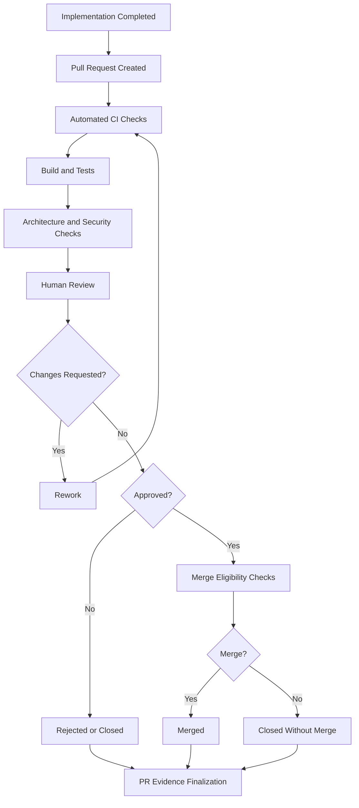
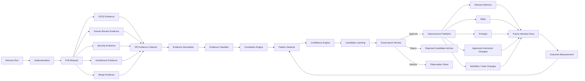
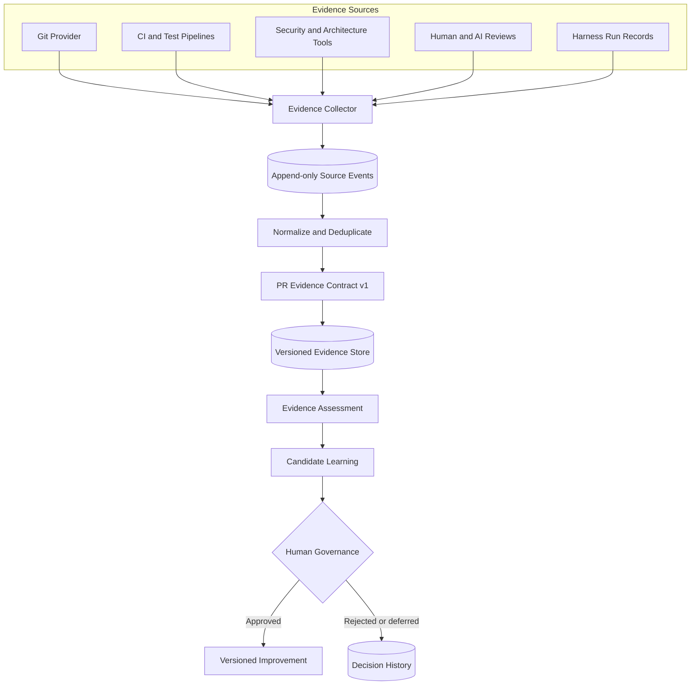
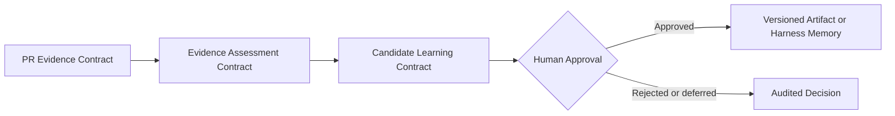
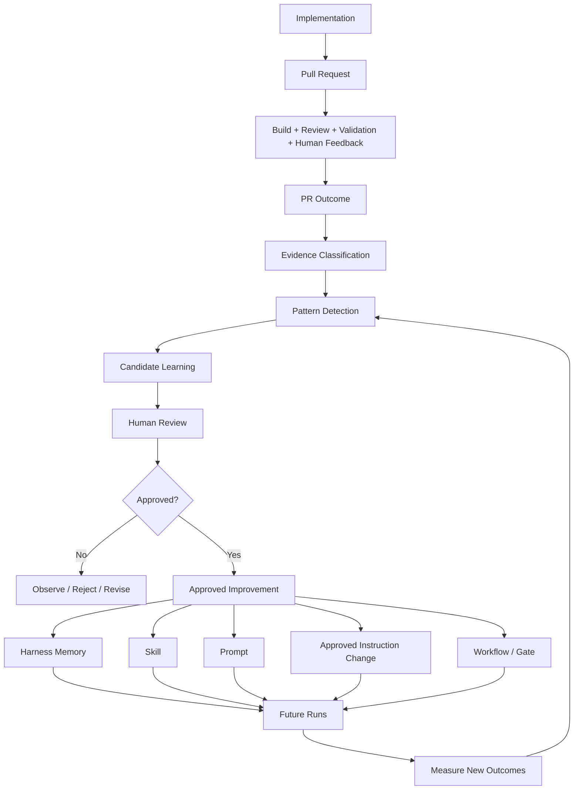
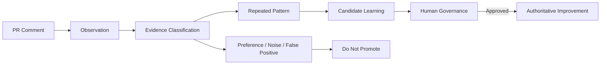
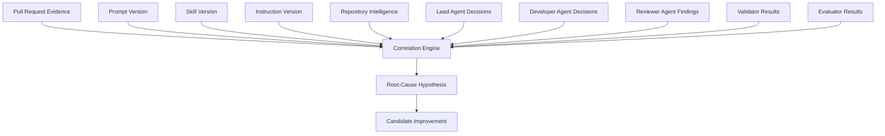
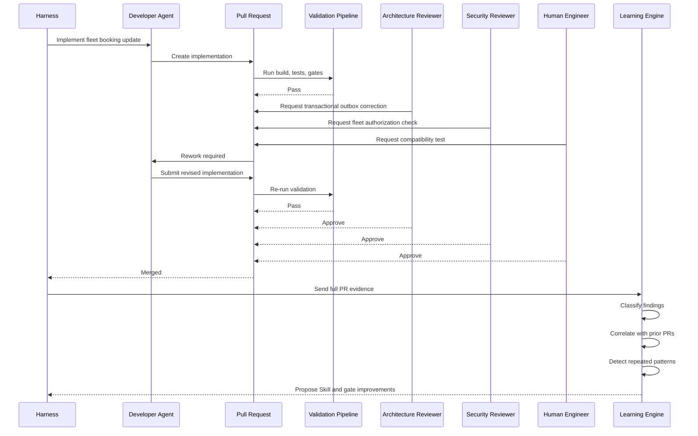
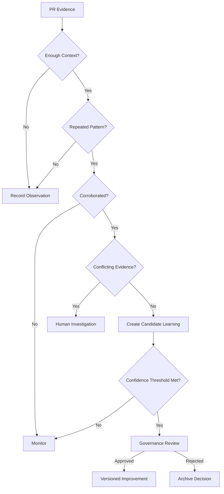

# Chapter 40 — Learning from Pull Requests

## Story-driven Opening

The Alpha Car Detailing engineering team had reached an important milestone. Its AI Engineering Harness could plan work, coordinate specialized agents, enforce deterministic gates, open pull requests, collect review evidence, and preserve execution history. The system was already producing useful engineering telemetry.

Yet one question remained unanswered:

**Was the organization learning from what happened after a pull request was created?**

A recent change provided a useful example.

The team had asked the Harness to extend the corporate fleet booking workflow so that fleet administrators could modify an existing booking without violating per-vehicle booking limits. The Developer Agent produced the implementation, the Validator Agent confirmed that the solution compiled and passed the existing test suite, and the Reviewer Agent found no obvious maintainability issue.

The Harness created a pull request.

During human review, however, several problems appeared.

The first reviewer noticed that the implementation persisted the booking update but published the external integration event directly, without persisting an outbox record in the same transaction. The established architecture required booking state and the integration-event outbox record to be committed atomically.

A second reviewer found that the Developer Agent had added unit tests but had not added the integration test required for the booking modification endpoint.

A security reviewer raised another issue. The new endpoint accepted a fleet account identifier directly from the request body without confirming that the authenticated user was authorized to manage that fleet.

The pull request was returned for changes. The existing tests had passed, but the checks had not covered these missing behavioral and authorization scenarios.

The Developer Agent corrected the implementation. The next revision passed the architecture tests and security checks, but another reviewer noticed that the API response contract had changed in a way that could break an existing fleet-management client.

Another revision followed.

Eventually, the pull request was approved and merged.

From a conventional delivery perspective, the story ended there.

From the perspective of an Adaptive Harness, it had only begun.

The pull request contained valuable evidence:

- the implementation initially violated the transactional outbox pattern;
- required integration tests were omitted;
- authorization was incomplete;
- an API compatibility issue survived the first revision;
- multiple review cycles were needed before approval;
- the final implementation contained patterns that reviewers considered acceptable;
- the PR eventually passed all deterministic and human review gates.

If the Harness simply recorded `merged = true`, most of that evidence would disappear.

If it instead concluded that every implementation detail in the final PR represented an enterprise standard, it would learn too aggressively.

If it automatically modified repository Instructions because one reviewer preferred a particular design, it would cross a governance boundary.

A self-learning engineering system therefore requires something more disciplined.

It must treat pull requests as **evidence**, not as unquestionable truth.

The Harness can collect outcomes, classify findings, correlate them with the Prompts, Skills, Instructions, Roles, agent decisions, validation results, and repository context that produced the change. Across many pull requests, recurring signals may reveal opportunities for improvement.

Perhaps the fleet-booking Skill consistently omits integration tests.

Perhaps authorization findings appear disproportionately in API-generation tasks.

Perhaps changes produced with one Prompt template require significantly more contract-related rework than changes produced with another.

Perhaps reviewers repeatedly approve a particular transactional pattern with very little modification.

These patterns may justify a candidate improvement.

But they do not justify silent self-modification.

The governing principle of the handbook remains unchanged: an Adaptive Harness may recommend improvements, but it must not silently change engineering standards, and governed changes require human approval.

The engineering challenge is therefore not merely:

> Did the pull request merge?

The more important questions are:

> What happened during the pull request lifecycle?

> Why did it happen?

> Is the evidence strong enough to represent a recurring engineering pattern?

> What should the Harness recommend changing?

> Who has authority to approve that change?

This chapter examines how an Adaptive Harness can learn from pull-request evidence without turning transient review comments, personal preferences, or isolated incidents into permanent organizational knowledge.

---

## Learning Objectives

By the end of this chapter, you should be able to:

- explain why pull requests are high-value evidence sources for Adaptive Harnesses;
- distinguish pull-request outcomes from pull-request evidence;
- model the complete PR lifecycle as an observable engineering process;
- collect and classify metadata, review discussions, requested changes, approvals, validation results, architecture findings, security findings, and merge outcomes;
- distinguish successful PR outcomes from successful engineering patterns;
- identify recurring review and rework patterns across multiple pull requests;
- correlate PR evidence with Prompts, Skills, Roles, Instructions, agent decisions, and Harness Memory;
- classify the likely root causes of repeated PR findings;
- generate candidate learning without converting uncertain observations into permanent rules;
- define confidence thresholds for proposed improvements;
- use human approval to govern Skill, Prompt, Instruction, workflow, and Harness Memory changes;
- preserve provenance and version history for learned recommendations;
- avoid false learning from merge status, reviewer preferences, bot-generated comments, or isolated PR outcomes;
- design enterprise-grade feedback loops that improve future engineering work while preserving accountability.

---

## Background

### Pull Requests as an Engineering Evidence Boundary

A pull request is usually described as a mechanism for proposing and reviewing code changes.

That description is correct but incomplete.

Within an AI Engineering system, the pull request represents an important **evidence boundary** between implementation and organizational acceptance.

Before the pull request, most evidence comes from the implementation process:

- planning;
- code generation;
- local builds;
- automated tests;
- deterministic validation;
- agent review;
- architecture checks;
- security checks;
- evaluator results.

After the pull request is opened, additional evidence becomes available from the wider engineering system:

- human reviewers;
- repository protection rules;
- CI/CD services;
- security platforms;
- architecture reviewers;
- domain specialists;
- quality teams;
- automated repository policies;
- external integration checks;
- release-management controls.

The pull request therefore combines machine-generated and human-generated evidence about the proposed change.

This makes it unusually valuable for adaptive engineering.

A PR can answer questions that local execution cannot.

For example:

- Did reviewers understand the implementation?
- Did the implementation follow architectural expectations that were not fully represented by deterministic gates?
- Were required tests absent?
- Did security review expose an authorization problem?
- Were API contracts accidentally changed?
- Did the implementation require repeated clarification?
- How many revisions were necessary?
- Which findings were accepted by the author?
- Which reviewer comments were disputed?
- Did different reviewers disagree?
- Was the final implementation materially different from the original AI-generated change?
- Which design approaches passed review with little or no rework?

These questions transform a pull request from a delivery artifact into a source of engineering intelligence.

---

### Pull Request Outcome Is Not Pull Request Learning

One of the most dangerous mistakes in a self-learning system is to assume that a pull request has a single meaningful outcome.

For example:

```text
PR #842
Status: Merged
```

An unsophisticated learning engine might classify the PR as successful.

But consider what may have happened before the merge:

```text
Initial implementation
        ↓
Architecture violation found
        ↓
Missing integration test found
        ↓
Authorization defect found
        ↓
API compatibility defect found
        ↓
Three revisions
        ↓
Human approval
        ↓
Merge
```

Calling this PR simply "successful" loses nearly all useful information.

Conversely, consider another PR:

```text
Initial implementation
        ↓
All gates pass
        ↓
Architecture approved
        ↓
Security approved
        ↓
Reviewer approves without requested changes
        ↓
PR closed because business requirement changed
```

The PR did not merge.

But the implementation itself may have been technically excellent.

A learning system that interprets `closed without merge` as implementation failure would learn the wrong lesson.

Therefore:

> **PR status is an outcome field, not an engineering conclusion.**

Merge status, rejection, closure, approval, and requested changes must be interpreted within context.

---

### Why Pull Requests Are Valuable to an Adaptive Harness

Build evidence tells the Harness whether deterministic technical conditions were satisfied.

Review evidence tells the Harness what reviewers observed about implementation quality.

Pull-request evidence combines these signals with lifecycle and organizational context.

It can reveal:

| Evidence Type | What It May Reveal |
| --- | --- |
| Build results | Compilation or dependency failures |
| Test results | Behavioral defects or missing coverage |
| Architecture checks | Boundary or dependency violations |
| Security findings | Vulnerabilities, authorization problems, unsafe patterns |
| Review comments | Maintainability, clarity, design, standards, context |
| Requested changes | Areas requiring correction before acceptance |
| Approvals | Evidence that reviewers found the revision acceptable |
| Rework count | Friction or incompleteness in the original implementation |
| Revision history | How the implementation evolved |
| Merge outcome | Whether the change entered the target branch |
| Time to approval | Review friction, complexity, availability, or workflow delay |
| Reviewer disagreement | Ambiguous standards or competing design expectations |
| Repeated findings | Possible systemic weakness |
| Final diff | Difference between original generation and accepted implementation |

Individually, these signals provide observations.

Together, across many PRs, they can provide patterns.

Patterns can produce candidate learning.

Candidate learning can produce governed improvements.

That distinction is fundamental.

---

### Static Harness Versus Adaptive Harness

A static Harness executes the same engineering workflow repeatedly.

For example:

```text
Prompt
   ↓
Developer Agent
   ↓
Reviewer Agent
   ↓
Validator Agent
   ↓
Evaluator Agent
   ↓
Pull Request
```

If ten pull requests receive the same review comment, the static Harness may continue producing the same problem indefinitely.

An Adaptive Harness adds a feedback mechanism:

```text
Prompt
   ↓
Implementation
   ↓
Validation
   ↓
Pull Request
   ↓
PR Evidence
   ↓
Pattern Detection
   ↓
Candidate Improvement
   ↓
Human Approval
   ↓
Future Harness Configuration
```

This does not make the Harness autonomous in the sense of unrestricted self-modification.

It makes the Harness **evidence-aware**.

The system can recognize:

> "This problem has occurred repeatedly."

It can propose:

> "The API-generation Skill should explicitly require authorization validation for fleet-scoped endpoints."

It cannot silently conclude:

> "I will permanently modify enterprise standards."

That remains a governed decision.

---

## Concepts

### The Pull-Request Lifecycle

Learning begins by understanding the lifecycle being observed.

A typical enterprise pull-request lifecycle may look like this:



The Adaptive Harness should not wait until the final merge result before observing the PR.

Evidence accumulates throughout the lifecycle.

The Harness may capture:

```text
PR_CREATED
BUILD_STARTED
BUILD_FAILED
BUILD_PASSED
TEST_FAILED
TEST_PASSED
SECURITY_FINDING
ARCHITECTURE_FINDING
REVIEW_COMMENT
CHANGES_REQUESTED
COMMIT_PUSHED
REVIEW_REOPENED
APPROVED
MERGED
CLOSED
```

These events form the raw evidence stream.

---

### PR Metadata

Metadata provides the context required to interpret the pull request correctly.

Useful metadata may include:

| Field | Example |
| --- | --- |
| PR identifier | `PR-842` |
| Repository | `alpha-car-detailing` |
| Target branch | `main` |
| Source branch | `feature/fleet-booking-update` |
| Work item | `ACD-1942` |
| Harness run ID | `run-2026-11-13-1841` |
| Prompt version | `booking-update-v4` |
| Skill version | `api-feature-v7` |
| Instruction version | `enterprise-instructions-v12` |
| Lead Agent version | `lead-v5` |
| Developer Agent version | `developer-v8` |
| Reviewer Agent version | `reviewer-v6` |
| Validator profile | `dotnet-enterprise-v9` |
| Evaluator profile | `business-acceptance-v4` |
| Creation timestamp | `2026-11-13T09:15:00Z` |
| First review timestamp | `2026-11-13T10:02:00Z` |
| Approval timestamp | `2026-11-13T14:41:00Z` |
| Merge timestamp | `2026-11-13T15:03:00Z` |
| Revision count | `3` |
| Reviewers | architecture, security, feature owner |
| Final outcome | `Merged` |

Without this context, correlation becomes weak.

Suppose security findings increased during one month.

Was the Prompt responsible?

Did the security Skill change?

Did Instructions change?

Did a new Developer Agent configuration become active?

Did the organization introduce stronger scanning rules?

Did the work simply involve more security-sensitive features?

Metadata makes those questions answerable.

---

### Provenance

Every learned observation should preserve its origin.

Consider this candidate recommendation:

```text
Recommendation:
Require integration tests for all booking mutation endpoints.
```

Without provenance, nobody knows why the Harness proposed it.

With provenance:

```yaml
candidate:
  id: CL-204
  type: skill-improvement
  recommendation: >
    Require integration tests for booking mutation endpoints.

evidence:
  occurrences: 7
  pull_requests:
    - PR-781
    - PR-793
    - PR-811
    - PR-824
    - PR-831
    - PR-842
    - PR-847

  classifications:
    - missing-integration-test

  reviewers:
    - platform-review
    - booking-domain-review

  related_skill:
    name: api-feature
    version: 7

  confidence: 0.91

  status: proposed
```

Provenance allows reviewers to inspect the underlying evidence.

It also enables future correction.

If the organization later learns that five of those findings came from an outdated repository policy, the learning record can be reevaluated.

---

### Review Discussions

Review comments should not be stored merely as text.

They should be interpreted as evidence with context.

For example:

```text
"Please add an integration test."
```

Possible classification:

```yaml
category: testing
subcategory: missing-integration-test
severity: medium
action: changes-requested
source: human-review
```

Another comment:

```text
"I would probably name this method differently."
```

Possible classification:

```yaml
category: style
subcategory: reviewer-preference
severity: low
action: suggestion
source: human-review
```

Those comments should not receive equal learning weight.

The first may represent an explicit project requirement.

The second may represent individual preference.

An Adaptive Harness must distinguish them.

---

### Requested Changes

A requested change is stronger evidence than an optional suggestion, but it is still not automatically an enterprise rule.

The Harness should capture:

- what was requested;
- who requested it;
- whether the reviewer had relevant authority;
- whether the author accepted the change;
- whether another reviewer disagreed;
- whether the requested change corresponded to existing Instructions;
- whether deterministic evidence supported the finding;
- whether the issue recurred in other PRs.

For Alpha Car Detailing:

```text
Finding:
Booking update must use transactional outbox.

Existing Instruction:
Integration events must be persisted atomically with state changes.

Reviewer Action:
Changes requested.

Developer Response:
Implementation corrected.

Architecture Gate:
Passed after correction.
```

This is strong evidence because multiple evidence sources agree.

Contrast it with:

```text
Finding:
Reviewer prefers static factory methods over constructors.

Existing Instruction:
No defined preference.

Developer Response:
No change.

Other Reviewer:
Approved existing design.
```

This should not become Harness Memory stating:

> All entities must use static factory methods.

That would convert preference into policy.

---

### Approvals

Approval is evidence of acceptability, not evidence of perfection.

A reviewer may approve because:

- the implementation satisfies required standards;
- remaining concerns are minor;
- another reviewer owns the relevant architecture decision;
- the issue is outside the PR scope;
- the risk has been consciously accepted;
- a follow-up ticket has been created;
- time constraints require pragmatic acceptance.

Therefore, approval should be correlated with surrounding evidence.

A PR that receives prompt approval with clean, commit-current validation results may indicate a successful pattern; it does not prove the absence of undiscovered defects.

A PR that receives approval after six revisions provides a very different learning signal.

---

### Rejections and Closed Pull Requests

Rejected pull requests are especially easy to misinterpret.

A PR may be rejected because:

- implementation quality was poor;
- architecture was incorrect;
- security risks were unacceptable;
- the requirement changed;
- the feature was cancelled;
- a competing implementation was selected;
- the target branch changed;
- the work was duplicated;
- the PR became obsolete;
- an external dependency blocked delivery.

The Harness must classify the reason.

Consider:

```text
PR: Fleet booking reminder service
Outcome: Closed without merge
Reason: Product owner cancelled reminder feature
Technical review: Approved
Validation: Passed
```

The engineering approach should not be marked as failed.

Now consider:

```text
PR: Fleet booking reminder service
Outcome: Closed without merge
Reason: Security architecture incompatible with enterprise policy
Technical review: Changes rejected
Validation: Security gate failed
```

That is meaningful negative evidence.

The same final PR status carries completely different meaning.

---

### Build and Validation Results

Build and deterministic validation evidence should be attached directly to the PR learning record.

Examples include:

- compilation;
- unit tests;
- integration tests;
- architecture tests;
- dependency rules;
- static analysis;
- API compatibility;
- event schema compatibility;
- database migration validation;
- security scanning;
- container scanning;
- infrastructure validation.

The Adaptive Harness should be able to answer:

```text
Which classes of deterministic failures repeatedly appear
before human approval?
```

and:

```text
Which failures are being discovered by humans that should
have been detected by deterministic gates?
```

The second question is particularly important.

Suppose reviewers repeatedly identify breaking API changes.

That may indicate not only a Developer Agent problem but also a missing deterministic contract gate.

The candidate learning may therefore be:

```text
Add OpenAPI compatibility validation to the PR pipeline.
```

rather than:

```text
Tell the Developer Agent to be more careful.
```

---

### Architecture Findings

Architecture review provides evidence about structural alignment.

For Alpha Car Detailing, recurring findings might include:

- Application layer referencing Infrastructure;
- controllers containing domain logic;
- domain events published directly to external infrastructure;
- repository abstractions bypassed;
- cross-service database access;
- transactional outbox omitted;
- shared contracts modified without compatibility checks.

A single architecture finding may represent an implementation mistake.

Ten similar findings may indicate a systemic problem.

Possible causes include:

```text
Prompt omission
Skill weakness
Instruction ambiguity
Insufficient Repository Intelligence
Missing architecture test
Developer Agent reasoning weakness
Architecture rule not machine-readable
```

Learning should focus on the likely cause rather than merely storing the symptom.

---

### Security Findings

Security findings require particularly careful interpretation.

Examples include:

- missing authorization;
- excessive permissions;
- unsafe secret handling;
- injection risks;
- insecure deserialization;
- weak input validation;
- logging sensitive information;
- vulnerable dependencies;
- trust-boundary violations.

For example, suppose six PRs involving corporate fleet endpoints receive the same finding:

```text
Fleet identifiers are accepted without verifying that the
authenticated principal has access to the fleet.
```

An Adaptive Harness might detect:

```text
Repeated security issue:
fleet-resource authorization omitted
```

The proposed improvement might affect several engineering assets:

```text
Skill recommendation:
Add resource-level authorization step to API Skill.

Prompt recommendation:
Request authorization scenario explicitly.

Validation recommendation:
Add authorization-focused integration tests.

Instruction proposal:
Document mandatory fleet-resource access validation.
```

The Harness should present these as separate candidate improvements.

Different remedies require different governance owners.

---

### Rework

Rework is one of the most valuable PR signals.

The Harness should record:

```text
Original AI-generated revision
        ↓
Human finding
        ↓
Revision
        ↓
New finding
        ↓
Revision
        ↓
Approval
```

Useful measurements include:

- number of revision cycles;
- lines changed after initial PR creation;
- files repeatedly modified;
- categories of requested changes;
- percentage of original implementation replaced;
- new tests added after review;
- architectural corrections;
- security corrections;
- contract changes;
- reviewer clarification cycles.

For example:

```text
Original AI change:        640 lines
Final accepted change:     712 lines
Post-review modified:      284 lines
Review cycles:             4
Primary rework categories:
  - authorization
  - integration testing
  - contract compatibility
```

This tells the Harness substantially more than:

```text
PR merged successfully.
```

---

### Time to Approval

Time to approval can provide useful workflow evidence, but it is easy to misuse.

Suppose one PR takes four days to approve.

That does not necessarily mean the implementation was poor.

The delay might come from:

- reviewer availability;
- weekend timing;
- dependency on product clarification;
- security team scheduling;
- environment outage;
- external vendor review;
- release freeze.

Therefore, workflow time should be attributed to **non-overlapping states** where possible: active rework, waiting for review, waiting for validation, waiting for business clarification, and governance hold. Measure merge-queue time separately because it may occur *after* approval. Parallel activities can overlap; adding their independent durations without accounting for overlap double-counts elapsed time.

For PR-842, time to first review is 47 minutes (09:15–10:02 UTC), time from creation to approval is 326 minutes (09:15–14:41 UTC), and time from approval to merge is 22 minutes (14:41–15:03 UTC). These are different metrics and should not be conflated.

An enterprise Harness should avoid optimizing blindly for the shortest approval duration.

Fast approval is not the objective.

**Correct, secure, maintainable, governable engineering is the objective.**

---

### Repeated PR Issues

Repeated findings are among the strongest learning signals available to the Harness.

Consider the following Alpha Car Detailing evidence:

| PR | Finding |
| --- | --- |
| PR-801 | Missing booking integration test |
| PR-814 | Missing booking integration test |
| PR-829 | Missing booking integration test |
| PR-842 | Missing booking integration test |
| PR-851 | Missing booking integration test |

A pattern detector may identify:

```text
Pattern:
Missing integration tests for booking mutation workflows

Frequency:
5 occurrences across 7 relevant PRs

Current Skill:
api-feature-v7

Instruction coverage:
Integration testing required but not workflow-specific

Confidence:
High
```

The candidate improvement could be:

```text
Update api-feature Skill so mutation workflows require:
1. application test;
2. API integration test;
3. authorization scenario;
4. persistence verification.
```

That recommendation is supported by repeated evidence.

It remains a recommendation until approved.

---

### Root-Cause Classification

Pattern detection becomes useful only when the Harness attempts to determine why the pattern exists.

A practical classification model might include:

| Root Cause | Description |
| --- | --- |
| Prompt deficiency | Task request omitted necessary context or acceptance criteria |
| Skill deficiency | Reusable workflow failed to enforce required implementation steps |
| Instruction deficiency | Repository-wide standard was missing or ambiguous |
| Repository Intelligence deficiency | Relevant architecture or domain knowledge was not retrieved |
| Agent decision error | Agent had adequate context but chose an incorrect approach |
| Validation gap | Deterministic checks failed to detect a repeatable defect |
| Review inconsistency | Different reviewers applied conflicting expectations |
| Process deficiency | Workflow sequencing or ownership caused the issue |
| Requirement ambiguity | Business expectations were incomplete or contradictory |
| Environment issue | Tooling or infrastructure affected the result |
| External dependency | Cause existed outside the Harness-controlled workflow |

This prevents simplistic recommendations.

If the root cause is a missing gate, improving the Prompt may be the wrong solution.

If the problem is ambiguous Instructions, changing the Skill alone may merely hide the ambiguity.

---

### Learning from Accepted Pull Requests

Adaptive learning should not focus only on failures.

Highly successful pull requests are valuable evidence as well.

Suppose multiple Alpha Car Detailing PRs using a particular API implementation pattern show:

```text
Build: pass
Architecture: pass
Security: pass
Tests: pass
Review changes: none
Approval cycles: one
Contract compatibility: pass
```

The Harness may recognize a candidate positive pattern.

For example:

```text
Pattern:
Booking command endpoints using the established
Application Command + transactional outbox + contract test
pattern consistently receive clean reviews.
```

The Harness may recommend strengthening that pattern in a reusable Skill.

Positive learning can identify:

- reliable design structures;
- effective test approaches;
- successful API patterns;
- review-friendly decomposition;
- secure authorization patterns;
- effective migration practices;
- consistently accepted naming and organization conventions.

However:

> A merged or approved PR does not automatically establish a best practice.

The system still needs repeated evidence and contextual consistency.

---

### Learning from Rejected Pull Requests

Rejected PRs often contain valuable negative evidence.

The Harness should distinguish:

```text
Rejected implementation approach
```

from:

```text
Rejected business change
```

and:

```text
Rejected PR for operational reasons
```

For example:

```yaml
pull_request: PR-873
outcome: rejected

classification:
  business_requirement: valid
  implementation_quality: failed

findings:
  - cross-service database dependency
  - incompatible event schema
  - missing authorization

root_cause:
  primary: skill-deficiency
  secondary: validation-gap
```

This could contribute to future learning.

By contrast:

```yaml
pull_request: PR-879
outcome: closed

classification:
  implementation_quality: acceptable
  reason: feature-cancelled
```

This should not reduce confidence in the implementation pattern.

---

### Correlation with Prompts

Every PR should be traceable to the Prompt that initiated the work.

This allows analysis such as:

```text
Prompt template booking-feature-v3
    ↓
42 PRs
    ↓
18 contract-related requested changes
```

versus:

```text
Prompt template booking-feature-v4
    ↓
37 PRs
    ↓
4 contract-related requested changes
```

That does not automatically prove that version 4 is better.

Other variables may have changed.

But it provides evidence worth investigating.

The Harness may propose:

```text
Candidate Prompt improvement:
Explicitly require backward compatibility analysis for
existing booking API contracts.
```

---

### Correlation with Skills

Skills are especially important because recurring implementation problems often indicate deficiencies in reusable workflows.

Suppose the `create-api-endpoint` Skill performs:

```text
1. Create request model
2. Create command
3. Create handler
4. Add endpoint
5. Add unit tests
```

But PR reviews repeatedly request:

```text
- authorization test
- integration test
- contract compatibility check
```

The problem may be structural.

The Skill itself may be incomplete.

Candidate update:

```text
1. Discover existing endpoint pattern
2. Confirm authorization model
3. Create request contract
4. Create command
5. Create handler
6. Implement persistence behavior
7. Add unit tests
8. Add integration tests
9. Validate API compatibility
10. Validate authorization scenarios
11. Run architecture gates
```

This is a much more durable improvement than reminding each future Developer Agent individually.

---

### Correlation with Roles

Some recurring patterns may indicate weaknesses in role boundaries.

For example:

```text
Reviewer repeatedly discovers missing tests
```

The root problem may be:

```text
Developer Agent failed to create tests
```

But if the tests were created and never executed, the problem belongs elsewhere.

Perhaps:

```text
Validator Agent profile does not run integration tests.
```

Or:

```text
Lead Agent failed to classify the task as contract-sensitive.
```

Or:

```text
Evaluator Agent did not verify a business acceptance criterion.
```

The Harness should therefore correlate findings with the entire execution chain.

---

### Correlation with Agent Decisions

Agent decision traces can provide another layer of evidence.

Suppose the Developer Agent explicitly recorded:

```text
Decision:
No integration test added because the endpoint follows
existing unit-tested booking behavior.
```

Then human reviewers requested an integration test.

This is not merely a missing artifact.

It reveals a reasoning mismatch.

Candidate learning may be:

```text
When introducing or modifying externally exposed mutation
endpoints, existing domain unit tests are not sufficient
evidence of API integration behavior.
```

That insight may affect:

- Developer Agent guidance;
- Skills;
- evaluator criteria;
- deterministic test requirements.

---

### Candidate Improvements

The output of PR learning should usually be a **candidate improvement**, not an immediate mutation.

Candidate categories may include:

```text
Harness Memory candidate
Skill recommendation
Prompt recommendation
Instruction proposal
Validation-gate recommendation
Workflow recommendation
Repository Intelligence recommendation
Role-behavior recommendation
Architecture-policy clarification
```

Example:

```yaml
candidate_id: CI-118

type: skill-recommendation

target:
  skill: create-booking-endpoint
  current_version: 5

problem:
  recurring_missing_integration_tests

evidence:
  relevant_prs: 12
  occurrences: 8
  period: last-90-days

proposal:
  add_required_step:
    - create API integration test for mutation endpoints

confidence:
  score: 0.88
  classification: high

approval:
  required: true
  owner: platform-engineering
```

---

### Harness Memory

Harness Memory should preserve governed, reusable learning.

It must not become a dumping ground for every review comment.

Consider this review comment:

```text
Could we rename this helper?
```

That should not automatically become memory.

Consider instead:

```text
Across 21 PRs, seven architecture reviews identified direct
publishing of integration events before transaction commit.
The approved correction in every case was transactional
outbox persistence.
```

This may justify a candidate Harness Memory entry:

```text
For Alpha Car Detailing booking state changes that emit
integration events, use the approved transactional outbox
pattern so state persistence and event persistence share
the transaction boundary.
```

Even then, the entry should be approved before becoming governed Harness Memory. Where an Instruction already defines the rule, Memory should link to that authority rather than silently create a competing standard.

---

### Skill Recommendations

PR learning can identify reusable implementation weaknesses.

Example:

```text
Evidence:
Repeated missing authorization tests.

Affected work:
Fleet-scoped mutation endpoints.

Candidate Skill improvement:
Extend fleet-api Skill with resource authorization
verification and integration-test steps.
```

Skill changes are particularly appropriate when the issue concerns **how recurring work is implemented**.

---

### Prompt Recommendations

Prompt recommendations are appropriate when repeated failures stem from insufficient task framing.

Example:

Current Prompt:

```text
Add update support for fleet bookings.
```

Recommended Prompt structure:

```text
Add update support for fleet bookings.

Preserve existing API compatibility.

Confirm:
- fleet-resource authorization;
- booking-limit rules;
- transactional outbox behavior;
- integration tests;
- existing event contracts.
```

However, the Harness should avoid turning every requirement into enormous prompts.

When a requirement is reusable and stable, it may belong in a Skill or Instruction instead.

---

### Instruction Improvement Proposals

Instruction proposals carry a higher governance burden because Instructions represent persistent repository-wide expectations.

The Harness should propose an Instruction change only when evidence indicates that:

- the expectation is stable;
- it applies broadly;
- it is not merely task-specific;
- it is not an individual reviewer preference;
- existing Instructions are absent or ambiguous;
- the evidence is sufficiently strong;
- the appropriate owner approves the proposal.

Example:

```text
Observed pattern:
Multiple teams interpret event publication timing differently.

Existing Instruction:
"Use the outbox pattern where appropriate."

Evidence:
11 architecture findings across 19 PRs.

Candidate Instruction:
"Integration events representing state changes must be
persisted through the transactional outbox within the same
database transaction as the aggregate state change."
```

This may be a valid Instruction proposal.

It should not be silently applied.

---

### Workflow Improvements

Not every learning belongs in Prompt, Skill, Instruction, or Memory.

Sometimes the workflow itself is defective.

Suppose security reviewers repeatedly discover resource authorization defects after the PR reaches final human review.

The better improvement may be:

```text
Run fleet authorization validation before PR creation.
```

Or:

```text
Add a security-focused Reviewer Agent before human review.
```

Or:

```text
Add deterministic authorization integration tests.
```

Learning should therefore consider process improvements, not only textual guidance.

---

### Confidence Thresholds

A self-learning Harness must reason about confidence explicitly.

A simple model might define:

| Confidence | Interpretation | Action |
| --- | --- | --- |
| Very Low | Weak or isolated evidence | Record observation only |
| Low | Possible pattern | Continue monitoring |
| Medium | Repeated evidence | Surface candidate |
| High | Strong repeated evidence | Recommend governed improvement |
| Very High | Strong, diverse, corroborated evidence | Prioritize approval review |

Confidence should not depend only on frequency.

Possible factors include:

```text
frequency
recency
reviewer agreement
reviewer authority
deterministic corroboration
cross-team recurrence
cross-agent recurrence
consistency of correction
sample size
counterexamples
policy alignment
```

A practical assessment should examine both **support** and **possible confounders**. Recurrence among comparable PRs, independent corroboration, and consistent resolutions increase confidence; counterexamples, changed review policies, missing provenance, and small or biased samples reduce it. No single multiplication or weighted sum should be presented as a calibrated probability without validation against held-out examples.

A transparent record can state: *7 of 10 comparable PRs contained the finding; two independent reviewers confirmed it; the current Skill omitted the relevant step; one counterexample exists; the hypothesis remains subject to human review.* Numerical confidence scores later in this chapter are illustrative, not empirically calibrated.

---

### Human Approval

Human approval is the governance boundary between:

```text
Observed learning
```

and:

```text
Authoritative engineering behavior
```

The Harness may propose:

```text
Update Skill
Update Prompt
Add validation gate
Change workflow
Add Harness Memory
Clarify Instruction
```

But governed modifications should require approval from the correct owner.

For example:

| Proposed Change | Possible Owner |
| --- | --- |
| Prompt template | Feature/team engineering lead |
| Skill | Platform engineering |
| Repository Instruction | Architecture owner |
| Security rule | Security engineering |
| Validation gate | Platform/DevOps engineering |
| Harness Memory | Harness governance owner |
| Workflow sequence | Engineering platform owner |

Human approval preserves accountability.

---

### Auditability

Every learning transition should be auditable.

A useful audit chain is:

```text
PR Evidence
   ↓
Evidence Classification
   ↓
Detected Pattern
   ↓
Candidate Learning
   ↓
Human Decision
   ↓
Approved Change
   ↓
Versioned Artifact
   ↓
Future Outcome Measurement
```

The Harness should be able to answer:

```text
Why was this Skill changed?

Which PRs supported the change?

Who approved it?

What version existed before the change?

When did the change become active?

Did the change improve future outcomes?
```

If those questions cannot be answered, the learning mechanism is not enterprise-ready.

---

### Avoiding False Learning

False learning occurs when the Harness derives a general rule from evidence that does not support that conclusion.

Examples include:

```text
Merged PR
    ↓
Therefore every implementation choice was correct
```

or:

```text
One reviewer disliked constructor injection
    ↓
Therefore constructor injection is prohibited
```

or:

```text
PR closed without merge
    ↓
Therefore the implementation approach failed
```

or:

```text
Bot posted a warning
    ↓
Therefore the repository contains a confirmed defect
```

The Adaptive Harness must distinguish observations, hypotheses, patterns, recommendations, and approved knowledge.

A useful progression is:

```text
Observation
   ↓
Classification
   ↓
Corroboration
   ↓
Pattern
   ↓
Candidate Learning
   ↓
Governance Review
   ↓
Approved Knowledge
```

Skipping stages makes self-learning dangerous.

---

## Architecture Discussion

### Pull-Request Learning Architecture

A production-quality PR-learning capability should be designed as a subsystem rather than an ad hoc collection of scripts.

A possible architecture is:



Each component has a specific responsibility.

---

### PR Evidence Collector

The collector gathers raw evidence from the pull-request ecosystem.

Possible sources include:

```text
Git hosting platform
CI pipelines
Architecture checks
Security scanners
Code-quality systems
Human reviews
Agent reviews
Work-item systems
Harness execution history
```

The collector should preserve raw source evidence before classification. The **PR Evidence Data Contract**, introduced later in this section, defines the normalized record and how each finding links back to its source.

That separation matters.

If the classification model later improves, historical evidence can be reprocessed.

---

### Evidence Normalizer

Different tools express similar findings differently.

One source might produce:

```text
CodeQL: authorization bypass
```

Another:

```text
Security Reviewer: missing resource authorization
```

Another:

```text
Integration test failed: user from Fleet A can modify Fleet B
```

The normalizer creates a common evidence model.

For example:

```yaml
category: security
subcategory: resource-authorization
resource: fleet-booking
severity: high
```

Normalization enables reliable pattern detection.

---

### Evidence Classifier

Classification determines what the evidence represents.

A useful hierarchy might be:

```text
Architecture
  ├── dependency-direction
  ├── service-boundary
  ├── domain-leakage
  └── transaction-boundary

Testing
  ├── missing-unit-test
  ├── missing-integration-test
  ├── missing-contract-test
  └── insufficient-edge-case

Security
  ├── authentication
  ├── authorization
  ├── secret-management
  ├── injection
  └── dependency-vulnerability

Contracts
  ├── api-breaking-change
  ├── event-breaking-change
  └── schema-incompatibility

Quality
  ├── readability
  ├── maintainability
  └── unnecessary-complexity

Process
  ├── missing-evidence
  ├── incorrect-review-routing
  └── incomplete-acceptance-criteria
```

Classification should also distinguish:

```text
mandatory finding
recommended improvement
optional suggestion
reviewer preference
informational comment
false positive
disputed finding
```

Without that distinction, learning quality degrades quickly.

---

### Correlation Engine

The correlation engine connects PR evidence to the conditions that produced it.

For example:

```text
PR-842
   ↓
Harness run: R-44218
   ↓
Prompt: fleet-booking-update-v4
Skill: booking-api-v7
Instructions: repo-v12
Developer Agent: dev-v8
Reviewer Agent: reviewer-v6
Validator profile: enterprise-dotnet-v9
Repository commit base: 4b9a21
```

Now patterns can be investigated.

Perhaps:

```text
booking-api-v7
```

appears in eight PRs with missing integration tests, while `booking-api-v8` does not.

That is useful evidence.

---

### Pattern Detector

The pattern detector searches for repeated relationships.

Examples:

```text
Same finding across many PRs
Same finding associated with one Skill version
Same rework category associated with one Prompt template
Same architecture failure associated with one agent decision
Same reviewer disagreement across multiple teams
Same successful pattern repeatedly approved
```

Pattern detection should account for sample size.

Three occurrences across three PRs may be significant.

Three occurrences across five hundred PRs may not be.

---

### Confidence Engine

The confidence engine estimates whether a candidate learning is mature enough to surface.

For example:

```yaml
candidate:
  issue: missing-integration-tests

signals:
  occurrences: 8
  relevant_prs: 11
  reviewer_agreement: high
  deterministic_support: medium
  counterexamples: 1
  affected_skill_version: api-feature-v7

confidence:
  score: 0.89
  level: high
```

The score should support human judgment, not replace it.

---

### Governance Review

Governance review determines whether an improvement should become authoritative.

Reviewers should inspect:

- evidence;
- classification;
- sample size;
- counterexamples;
- affected scope;
- proposed target;
- blast radius;
- expected benefits;
- possible unintended effects.

The decision may be:

```text
Approve
Reject
Revise
Observe longer
Run experiment
Apply only to specific domain
Apply only to specific Skill
Escalate to architecture board
```

Adaptive systems need more than binary acceptance.

---

### Improvement Publisher

After approval, the improvement publisher applies the governed change through normal version-controlled engineering mechanisms.

For example:

```text
skills/create-booking-api.md
v7 → v8
```

or:

```text
prompts/booking-feature.md
v4 → v5
```

or:

```text
proposals/instructions/transactional-outbox.md
```

The change should receive its own review history.

An AI system should not bypass normal software governance merely because the modification originated from learning.

---

### Closed-Loop Measurement

Learning is not complete when the improvement is approved.

The Harness must determine whether the improvement actually helped.

For example:

```text
Before Skill v8:
8 missing integration test findings / 11 PRs

After Skill v8:
1 missing integration test finding / 18 PRs
```

This provides evidence that the change helped.

But if instead:

```text
After Skill v8:
9 missing integration test findings / 12 PRs
```

the Harness should reconsider the recommendation.

Adaptive learning must itself be evaluated.

---

### PR Evidence Data Contract

An Adaptive Harness needs a stable, versioned representation of pull-request evidence. Git repositories, CI/CD platforms, security scanners, architecture gates, human reviewers, and AI Agents use different identifiers and event structures. Without a canonical contract, the Learning Engine cannot distinguish a repeated engineering defect from duplicated webhook delivery, a stale validation result, or a review comment that was later dismissed.

The **PR Evidence Data Contract** defines observable facts and their provenance. It does **not** decide what the organization should learn. Evidence assessment, root-cause hypotheses, candidate learning, and governance decisions belong in separate records. This boundary lets an enterprise improve classification logic without rewriting historical observations.

The contract must support traceability to the originating Harness run; collection of reviews, revisions, validations, and outcomes; provider-neutral normalization; provenance; reproducible reclassification; and auditable governance. A pull request not created by the Harness may still be collected, but it must be marked as having no originating Harness run rather than assigned an invented correlation.

#### Evidence Contract Architecture



The raw store preserves provider events where retention policy allows. The normalized store makes downstream queries consistent without treating normalization as an authoritative policy decision. A later correction creates a new record revision or an append-only correction event; it must not silently erase the original observation.

#### Canonical Entities

| Entity | Responsibility |
| --- | --- |
| `PullRequestEvidence` | Evidence envelope, schema version, collection status, and correlation identifiers |
| `PullRequestIdentity` | Provider, repository, PR identifier, source and target branches, and commit references |
| `HarnessContext` | Harness run and the exact Prompt, Skill, Instruction, and agent configuration versions |
| `ReviewEvidence` | Review events, source-reported findings, approvals, requests for changes, and disagreement |
| `ValidationEvidence` | Build, test, security, architecture, and contract results associated with specific commits |
| `RevisionEvidence` | PR revision identifiers, changed-file counts, and relationships to addressed findings |
| `OutcomeEvidence` | Closure or merge state, merge reason, approval evidence, and lifecycle timing |
| `EvidenceProvenance` | Provider event identifiers, source references, collection timestamps, and evidence integrity |

`EvidenceClassification`, `RootCauseAssessment`, and `CandidateLearning` are **not** fields of the raw evidence record. They are separate derived artifacts referencing stable evidence identifiers. A human reviewer's source-reported severity may be preserved as an observation, but the Harness's own severity assessment must be attributed to an assessment record.

#### Example Canonical JSON Record

The following illustrative record represents a completed Alpha Car Detailing fleet-booking PR. Identifiers and URLs are synthetic. Git commit values are represented by example 40-character hexadecimal identifiers; a production contract must preserve the provider's actual object IDs and supported hash algorithm.

```json
{
  "schemaVersion": "1.0.0",
  "evidenceId": "PRE-2026-0042",
  "recordVersion": 1,
  "recordStatus": "finalized",
  "collectedAt": "2026-11-13T16:00:00Z",
  "pullRequest": {
    "provider": "github",
    "repositoryId": "acd-repository-01",
    "repository": "alpha-car-detailing",
    "number": 842,
    "sourceBranch": "feature/fleet-booking-update",
    "targetBranch": "main",
    "baseCommit": "1111111111111111111111111111111111111111",
    "headCommit": "3333333333333333333333333333333333333333",
    "createdAt": "2026-11-13T09:15:00Z",
    "closedAt": "2026-11-13T15:03:00Z"
  },
  "harnessContext": {
    "runId": "RUN-2026-1844",
    "workItemId": "ACD-1942",
    "prompt": { "id": "fleet-booking-change", "version": "4" },
    "skills": [
      { "id": "create-api-feature", "version": "7" }
    ],
    "instructions": { "id": "enterprise-instructions", "version": "12" },
    "agents": [
      { "role": "lead", "configurationVersion": "5" },
      { "role": "developer", "configurationVersion": "8" },
      { "role": "reviewer", "configurationVersion": "6" },
      { "role": "validator", "configurationVersion": "9" },
      { "role": "evaluator", "configurationVersion": "4" }
    ]
  },
  "reviews": [
    {
      "reviewId": "REV-101",
      "reviewerType": "human",
      "reviewerRole": "security",
      "decision": "changes_requested",
      "submittedAt": "2026-11-13T10:02:00Z",
      "findings": [
        {
          "findingId": "FND-501",
          "reportedText": "Verify the caller can modify this fleet.",
          "sourceRuleId": null,
          "addressedInRevision": 2,
          "provenanceId": "PROV-501"
        }
      ]
    },
    {
      "reviewId": "REV-103",
      "reviewerType": "human",
      "reviewerRole": "api-contract-owner",
      "decision": "changes_requested",
      "submittedAt": "2026-11-13T12:45:00Z",
      "findings": [
        {
          "findingId": "FND-502",
          "reportedText": "Preserve the existing booking response contract.",
          "sourceRuleId": null,
          "addressedInRevision": 3,
          "provenanceId": "PROV-502"
        }
      ]
    },
    {
      "reviewId": "REV-104",
      "reviewerType": "human",
      "reviewerRole": "security",
      "decision": "approved",
      "submittedAt": "2026-11-13T14:35:00Z",
      "findings": [],
      "provenanceId": "PROV-104"
    },
    {
      "reviewId": "REV-102",
      "reviewerType": "human",
      "reviewerRole": "feature-owner",
      "decision": "approved",
      "submittedAt": "2026-11-13T14:41:00Z",
      "findings": [],
      "provenanceId": "PROV-102"
    }
  ],
  "validations": [
    {
      "validationId": "VAL-201",
      "type": "integration-test",
      "gateId": "fleet-api-tests",
      "status": "passed",
      "commit": "3333333333333333333333333333333333333333",
      "executedAt": "2026-11-13T14:20:00Z",
      "provenanceId": "PROV-201"
    }
  ],
  "revisions": [
    {
      "revision": 1,
      "commit": "aaaaaaaaaaaaaaaaaaaaaaaaaaaaaaaaaaaaaaaa",
      "reason": "initial-submission",
      "addressedFindings": []
    },
    {
      "revision": 2,
      "commit": "2222222222222222222222222222222222222222",
      "reason": "review-rework",
      "addressedFindings": ["FND-501"],
      "changedFiles": 4,
      "addedLines": 57,
      "deletedLines": 12
    },
    {
      "revision": 3,
      "commit": "3333333333333333333333333333333333333333",
      "reason": "review-rework",
      "addressedFindings": ["FND-502"],
      "changedFiles": 2,
      "addedLines": 18,
      "deletedLines": 5
    }
  ],
  "outcome": {
    "state": "merged",
    "approvalObserved": true,
    "approvedAt": "2026-11-13T14:41:00Z",
    "mergedAt": "2026-11-13T15:03:00Z",
    "mergeCommit": "4444444444444444444444444444444444444444",
    "closureReason": "accepted",
    "revisionCount": 3,
    "requiredChangeCycles": 2,
    "firstReviewMinutes": 47,
    "timeToApprovalMinutes": 326
  },
  "provenance": [
    {
      "provenanceId": "PROV-501",
      "sourceType": "human-review-comment",
      "sourceSystem": "github",
      "sourceRecordId": "review-comment-501",
      "sourceUrl": "https://example.invalid/pr/842#comment-501"
    },
    {
      "provenanceId": "PROV-502",
      "sourceType": "human-review-comment",
      "sourceSystem": "github",
      "sourceRecordId": "review-comment-502",
      "sourceUrl": "https://example.invalid/pr/842#comment-502"
    },
    {
      "provenanceId": "PROV-104",
      "sourceType": "human-review",
      "sourceSystem": "github",
      "sourceRecordId": "review-104",
      "sourceUrl": "https://example.invalid/pr/842#review-104"
    },
    {
      "provenanceId": "PROV-102",
      "sourceType": "human-review",
      "sourceSystem": "github",
      "sourceRecordId": "review-102",
      "sourceUrl": "https://example.invalid/pr/842#review-102"
    },
    {
      "provenanceId": "PROV-201",
      "sourceType": "ci-pipeline",
      "sourceSystem": "github-actions",
      "sourceRecordId": "workflow-run-201",
      "sourceUrl": "https://example.invalid/actions/runs/201"
    }
  ]
}
```

This compact example is not a complete transcript: the full source event archive may contain additional review discussions, gate executions, commit events, and author responses. Crucially, `addressedInRevision` records the author's response to a finding, not proof that the defect was completely resolved. Confirmation belongs to subsequent validation or review evidence.

#### Required Fields and Invariants

| Field | Requirement | Invariant |
| --- | --- | --- |
| `schemaVersion` | Required | Must be a recognized contract version |
| `evidenceId` | Required | Stable unique identity; not reused across PRs |
| `recordVersion` | Required | Monotonically increases on correction or replacement |
| `pullRequest.provider` | Required | Canonical provider or registered extension |
| `pullRequest.repositoryId` | Required | Stable repository identity, not display name alone |
| `pullRequest.number` | Required | Provider-specific identifier scoped to repository |
| `harnessContext.runId` | Conditional | Required for Harness-created PRs; otherwise absent or explicitly null |
| `reviews[].reviewId` | Required per review | Unique within the evidence record |
| `reviews[].findings[].findingId` | Required per finding | Unique within the evidence record |
| `validations[].commit` | Conditional | Required for commit-scoped checks; must reference the tested revision |
| `outcome.state` | Required | Controlled lifecycle state; must not imply quality |
| `provenanceId` | Required on externally derived findings and checks | Must resolve to a source entry |
| `collectedAt` | Required | UTC timestamp, distinct from source event time |

A useful normalized vocabulary is:

```text
PR state:          open | merged | closed | unknown
Review decision:   approved | changes_requested | commented | dismissed
Validation:        passed | failed | skipped | cancelled | inconclusive
Finding assessment: unreviewed | confirmed | disputed | false_positive | accepted_risk
Finding resolution: open | addressed | verified_fixed | waived | superseded
Evidence status:   partial | finalized | corrected
```

`Finding assessment` and `Finding resolution` are shown for interoperability, but belong to the derived assessment or adjudication record unless supplied explicitly by the source. Provider-specific terminal reasons such as *feature cancelled*, *duplicate*, or *implementation rejected* must be retained independently from the normalized `closed` state.

#### Evidence, Assessment, and Candidate Learning

The three contracts form a governed chain:



For example, the evidence record preserves a review comment and its provenance. A separate assessment adds a classification and a falsifiable hypothesis:

```json
{
  "assessmentId": "ASS-220",
  "assessmentMethodVersion": "2.1",
  "evidenceRefs": [{ "evidenceId": "PRE-2026-0042", "findingId": "FND-501" }],
  "classification": {
    "category": "security",
    "subcategory": "resource-authorization",
    "status": "confirmed"
  },
  "hypothesis": "The API Skill omits fleet-resource authorization checks.",
  "supportingEvidenceIds": ["PRE-2026-0042", "PRE-2026-0047"],
  "counterexampleEvidenceIds": ["PRE-2026-0049"],
  "confidence": 0.87
}
```

A candidate change can then reference that assessment without granting itself authority:

```json
{
  "candidateId": "CL-118",
  "assessmentId": "ASS-220",
  "targetType": "skill",
  "targetId": "create-api-feature",
  "proposedChange": "Add fleet-resource authorization verification.",
  "status": "awaiting_human_approval",
  "approverRole": "platform-engineering"
}
```

A confidence score is not independently validated by placing it in JSON. Scores must be generated by a documented method, tested against representative evidence, and calibrated where probabilistic meaning is claimed. The threshold for **surfacing a proposal** should be distinct from authorization to **apply an approved change**.

#### Ingestion, Security, and Versioning

Enterprise integration requires idempotency. Providers may retry webhooks, deliver events out of order, or edit previously submitted review comments. Use a stable provider-event key, a deduplication strategy, event time and collection time, and an append-only correction history. Do not count a retransmitted finding as another independent PR occurrence.

Validation freshness is critical. A passing CI result applies to the exact commit it tested; it does not certify a later head commit. Where branch protection requires newer checks, the Harness must verify the latest eligible validation before treating a PR as ready. A later review dismissal or a reopened PR likewise requires evidence-record revision rather than retrospective erasure.

The evidence contract is also a security boundary. Review content may include proprietary code, credentials accidentally pasted into comments, internal architecture, and vulnerability detail. Apply least-privilege access, redaction, retention limits, encrypted storage, and restricted access to sensitive findings. Reviewer identities may be represented by stable pseudonymous identifiers when attribution does not require a name.

Treat review text and tool output as **untrusted inputs**: the Learning Engine must not execute instructions embedded in a PR comment. Classify them as source data, preserve attribution, and require explicit policy-authorized actions for any resulting change.

Use semantic versioning for the contract itself: optional backward-compatible fields may increment a minor version; incompatible identity or semantics changes require a major version and a migration plan. Readers must reject unsupported incompatible versions rather than guessing at their meaning.

#### Contract Acceptance Criteria

Before enabling live PR learning, validate the contract against representative examples: clean merges; multiple review cycles; failed and stale CI checks; reviewer disagreement; reopened or cancelled PRs; false-positive bot comments; and a security finding accepted under an explicit, time-bounded exception. Acceptance criteria should establish that:

- every significant finding resolves to traceable provenance;
- the same delivered source event cannot inflate occurrence counts;
- only a commit-matching validation result supports a specific revision;
- closure reason and engineering quality remain distinct;
- reviewer disagreement and counterexamples remain visible;
- raw evidence, assessments, candidates, and approved memory cannot be confused;
- corrected evidence remains auditable and reprocessable;
- no unapproved candidate can modify a governed Skill, Prompt, Instruction, gate, or Harness Memory entry.

> **Architect's Note — The contract is part of the governance boundary.** An evidence contract that loses provenance, revision identity, or reviewer disagreement cannot support reliable learning. Preserve source facts, make interpretation revisable, and publish improvements only through the normal approval and version-control process.

> **Enterprise Tip — Test the contract before trusting the feedback loop.** Contract tests for duplicate deliveries, stale checks, and amended review comments are as important as tests for clean successful PRs. A feedback system that counts evidence incorrectly can confidently learn the wrong lesson.

---

## Professional Diagrams

### Pull-Request Learning Flow



This diagram captures the central principle of the chapter:

> The system learns through evidence, but governance separates candidate learning from authoritative change.

---

### Evidence Versus Authority



A review comment is not a rule.

A repeated finding is not automatically a rule.

A candidate recommendation is not a rule.

Authority is established only through the governance mechanism appropriate to the organization.

---

### Learning Correlation Model



This prevents the Harness from assuming that the code generator is responsible for every downstream problem.

---

### Alpha Car Detailing Example



---

### False-Learning Protection



The purpose of this architecture is not to prevent learning.

It is to prevent **unjustified learning**.

---

## Hands-on Example

Alpha Car Detailing provides a useful scenario for implementing PR-based learning.

Assume the team has observed recurring issues in pull requests that modify corporate fleet booking endpoints.

During the previous quarter, twelve relevant PRs were created. This initial summary describes the full quarter; the later Skill-version comparison uses separate historical cohorts rather than these same twelve PRs.

The evidence summary is:

| Category | Occurrences |
| --- | ---: |
| Missing integration tests | 8 |
| Missing fleet authorization validation | 6 |
| API compatibility findings | 4 |
| Transactional outbox violations | 3 |
| Naming/style comments | 14 |
| PRs requiring three or more rework cycles | 5 |
| PRs approved without requested changes | 2 |

A naive learning engine might conclude:

```text
Naming is the biggest problem because it has the most comments.
```

That would be misleading.

Most naming comments were optional reviewer preferences.

The more meaningful findings were the mandatory changes involving testing, authorization, contracts, and architecture.

### Step 1: Preserve the Run Context

Each PR should be linked to its originating Harness run.

For example:

```yaml
pull_request:
  id: PR-842
  repository: alpha-car-detailing
  harness_run: RUN-2026-1844

context:
  prompt:
    name: fleet-booking-change
    version: 4

  skill:
    name: create-api-feature
    version: 7

  instructions:
    version: 12

  agents:
    lead: lead-v5
    developer: developer-v8
    reviewer: reviewer-v6
    validator: validator-v9
    evaluator: evaluator-v4
```

This relationship is essential for root-cause analysis.

---

### Step 2: Capture PR Events

Capture source events in an append-only store, then map them into the versioned PR Evidence Data Contract. The following condensed stream omits the source identifiers and commit references that the complete canonical record requires.

A normalized event stream might look like:

```json
[
  {
    "type": "pull_request.created",
    "prId": "PR-842"
  },
  {
    "type": "validation.passed",
    "category": "build"
  },
  {
    "type": "review.finding",
    "category": "testing",
    "classification": "missing-integration-test",
    "disposition": "changes-requested"
  },
  {
    "type": "review.finding",
    "category": "security",
    "classification": "resource-authorization",
    "disposition": "changes-requested"
  },
  {
    "type": "review.finding",
    "category": "contract",
    "classification": "api-compatibility",
    "disposition": "changes-requested"
  },
  {
    "type": "revision.submitted",
    "revision": 2
  },
  {
    "type": "validation.passed",
    "category": "full"
  },
  {
    "type": "pull_request.approved"
  },
  {
    "type": "pull_request.merged"
  }
]
```

The raw event stream should remain available even after higher-level classification.

---

### Step 3: Classify the Evidence

The Harness may transform the raw findings into structured evidence.

```yaml
findings:

  - category: testing
    code: missing-integration-test
    mandatory: true
    reviewer_type: human
    resolved: true

  - category: security
    code: resource-authorization
    mandatory: true
    reviewer_type: security
    resolved: true

  - category: contract
    code: api-backward-compatibility
    mandatory: true
    reviewer_type: human
    resolved: true

  - category: style
    code: naming-preference
    mandatory: false
    reviewer_type: human
    resolved: false
```

This prevents the style comment from receiving the same weight as the authorization defect.

---

### Step 4: Correlate Across Pull Requests

The pattern detector examines related PRs.

It discovers:

```text
create-api-feature Skill v7
used in 10 relevant PRs

Missing integration test:
7 occurrences

Missing resource authorization:
6 occurrences

API compatibility issue:
4 occurrences
```

By contrast:

```text
create-api-feature Skill v6
used in 9 relevant PRs

Missing integration test:
2 occurrences

Missing resource authorization:
1 occurrence
```

This does not prove Skill v7 caused the regression.

But it creates an investigation candidate.

The Harness might ask:

```text
What changed between Skill v6 and v7?
```

The comparison reveals that v7 introduced a simplified testing step:

```text
"Add appropriate tests."
```

Version 6 had explicitly required:

```text
"Add unit and API integration tests for mutation endpoints."
```

This supports a plausible regression hypothesis, although differing PR scope, reviewers, and validation policies remain alternative explanations.

---

### Step 5: Detect the Root Cause

The learning engine proposes:

```yaml
root_cause_candidate:
  category: skill-deficiency

  reason:
    - missing-integration-test findings increased after skill v7
    - version change removed explicit integration-test requirement
    - findings occurred across multiple reviewers
    - corrections consistently added integration tests

  confidence: 0.93
```

For authorization, however, the evidence is different.

The Skill never contained a resource-authorization step in either version.

The candidate root cause becomes:

```yaml
root_cause_candidate:
  category: skill-deficiency

  secondary:
    - validation-gap

  reason:
    - repeated authorization findings
    - no explicit fleet authorization step in Skill
    - no deterministic authorization scenario in validator profile

  confidence: 0.88
```

---

### Step 6: Create Separate Improvement Candidates

The Harness should avoid producing a vague recommendation such as:

```text
Improve API quality.
```

Instead, it should create specific candidates.

#### Candidate A — Skill Improvement

```yaml
type: skill-update

target:
  create-api-feature: 7

proposal:
  require:
    - unit tests
    - API integration tests for mutations
    - resource authorization analysis

evidence:
  prs: 10
  relevant_findings: 13

confidence: 0.93
```

#### Candidate B — Validation Improvement

```yaml
type: validator-update

proposal:
  add:
    - fleet cross-account authorization integration scenario

evidence:
  repeated_security_findings: 6

confidence: 0.87
```

#### Candidate C — Contract Gate

```yaml
type: deterministic-gate

proposal:
  add:
    - API backward compatibility validation

evidence:
  compatibility_findings: 4

confidence: 0.76
```

Different evidence produces different improvement paths.

---

### Step 7: Human Review

The Platform Engineering team reviews Candidate A.

They inspect the linked pull requests and agree that the regression is real.

They approve:

```text
create-api-feature v8
```

The Security Engineering team reviews Candidate B.

They agree with the finding but decide that the proposed test is too narrow.

Instead they approve a broader requirement:

```text
Every fleet-scoped mutation API must include a negative
authorization integration test proving that a principal from
Fleet A cannot modify Fleet B.
```

Candidate C is sent to the Architecture team.

They decide that more evidence is required before introducing a mandatory compatibility gate.

Its status becomes:

```text
MONITOR
```

This demonstrates why human governance is essential.

The Harness identified useful patterns, but humans determined the proper implementation and scope.

---

### Step 8: Version the Improvements

The Skill change is committed as:

```text
skills/create-api-feature.md
version: 8
```

The change record contains:

```yaml
change:
  version: 8
  previous_version: 7

reason:
  repeated_missing_integration_tests

evidence:
  - PR-801
  - PR-814
  - PR-829
  - PR-842
  - PR-851

approved_by:
  platform-engineering

effective_date:
  2026-11-20
```

The authorization validation update receives its own version history.

---

### Step 9: Measure Future Pull Requests

The Adaptive Harness now watches future outcomes.

After fifteen new fleet API PRs:

```text
Before:
Missing integration tests: 7 / 10

After:
Missing integration tests: 1 / 15
```

Authorization findings change from:

```text
6 / 10
```

to:

```text
1 / 15
```

This supports—but does not prove—the usefulness of the approved improvements. A credible comparison also checks PR complexity, reviewer coverage, and validation-policy stability.

If the results had not improved, the Harness would reopen the learning hypothesis.

---

### Example Harness Learning Record

A practical evidence record might resemble:

```yaml
learning_record:
  id: LR-2026-0042

  title:
    Fleet mutation endpoints frequently omit integration tests

  evidence_window:
    from: 2026-08-01
    to: 2026-11-01

  evidence:
    relevant_prs: 10
    affected_prs: 7

  classification:
    primary: testing
    secondary: missing-integration-test

  correlation:
    skill:
      name: create-api-feature
      version: 7

  root_cause:
    category: skill-deficiency
    confidence: 0.93

  proposed_change:
    type: skill-update

    description:
      Require API integration tests for mutation endpoints.

  governance:
    status: approved
    owner: platform-engineering

  resulting_artifact:
    name: create-api-feature
    version: 8

  measurement:
    status: active
```

This is fundamentally different from placing the following sentence into memory:

```text
Always add more tests.
```

The first is governed engineering knowledge.

The second is vague, unsupported, and difficult to audit.

---

### Learning from Successful PRs

The same mechanism should identify successful patterns.

Suppose Alpha Car Detailing has eighteen PRs implementing commands through the following structure:

```text
Endpoint
   ↓
Application Command
   ↓
Domain Aggregate
   ↓
Repository
   ↓
Transactional Outbox
```

The evidence shows:

```text
Architecture findings: 0
Security findings: 0
Contract findings: 1
Average required-change cycles: 0.4
```

The Harness may identify a candidate positive learning:

```yaml
pattern:
  booking-command-transactional-outbox

signal:
  consistently-approved

evidence:
  relevant_prs: 18

candidate:
  promote-pattern-to-skill-template

confidence:
  0.86
```

Again, this does not automatically create a new standard.

The architecture team may determine that the pattern applies only to SQL-backed transactional services and should not become universal guidance.

The approved learning might therefore be scoped:

```text
For Alpha Car Detailing services using SQL Server and
relational aggregate persistence, use the established
transactional outbox Skill for state changes that emit
integration events.
```

Scope is part of correctness.

---

### Handling Reviewer Disagreement

Consider a PR where one reviewer says:

```text
The booking service should publish this event directly.
```

Another says:

```text
The service must use the transactional outbox.
```

The Harness must not choose whichever comment appears last.

Instead:

```yaml
classification:
  reviewer_disagreement: true

learning_action:
  automatic_promotion: prohibited

recommended_action:
  architecture-clarification

candidate:
  type: decision-required
```

This may expose an important organizational problem:

> The architecture standard itself is unclear.

The best learning may therefore be an architecture-decision clarification rather than an implementation change.

---

### Handling Bot-generated Findings

Automated review tools can produce large quantities of comments.

The Harness should not assume that a bot comment is correct merely because it is automated.

A bot finding should include:

```text
tool identity
rule identifier
severity
confidence
suppression status
human disposition
resolution
```

For example:

```yaml
source:
  type: security-bot
  tool: enterprise-scanner
  rule: AUTH-104

finding:
  resource-authorization-missing

human_disposition:
  confirmed

resolution:
  code-change
```

This is stronger evidence than:

```yaml
source:
  type: style-bot

finding:
  method-too-long

human_disposition:
  dismissed

resolution:
  none
```

Automation increases evidence volume.

It does not eliminate the need for evidence quality.

---

## Claude Example

Claude Code can participate in a PR-learning workflow, but the architecture should remain vendor-neutral.

The Harness should not ask Claude simply:

```text
Read recent PRs and improve yourself.
```

That request mixes evidence collection, classification, learning, governance, and mutation into one uncontrolled action.

A better workflow separates responsibilities.

For example, the Harness may provide Claude with a governed analysis task:

```text
Analyze the supplied pull-request evidence for recurring
engineering findings.

Do not modify Instructions, Skills, Prompts, or Harness Memory.

For each candidate pattern:

1. classify the finding;
2. identify supporting PRs;
3. identify contradictory evidence;
4. correlate the pattern with Prompt, Skill, Instruction,
   agent, and validation versions;
5. propose likely root causes;
6. assign a confidence level;
7. recommend a candidate improvement target;
8. explain why the recommendation is justified;
9. flag reviewer disagreement;
10. mark any conclusion that requires human interpretation.

Return proposals only.
```

Claude's output might be:

```yaml
candidate:
  id: CL-118

finding:
  missing-integration-test

evidence:
  occurrences: 7
  relevant_prs: 10

correlation:
  skill: create-api-feature-v7

contradictory_evidence:
  - PR-836 included complete integration tests

root_cause:
  likely: skill-deficiency

confidence:
  high

recommendation:
  propose skill v8 requiring API integration tests
  for mutation endpoints

governance:
  human_approval_required: true
```

Claude can help synthesize large quantities of review evidence.

But the Harness should preserve several controls.

First, Claude should operate on explicit evidence rather than relying on untraceable conversational recollection.

Second, conclusions should include provenance.

Third, Claude should distinguish observations from recommendations.

Fourth, Claude should not directly overwrite authoritative repository Instructions.

Fifth, deterministic systems should still perform measurements that do not require language interpretation.

For example:

```text
PR count
revision count
build status
test status
approval timestamps
changed-file counts
gate results
```

do not require an LLM.

Claude is better used where interpretation adds value:

```text
review-comment classification
root-cause hypothesis
semantic clustering
conflict detection
proposal generation
```

The combination of deterministic evidence processing and language-model interpretation produces a stronger architecture than using either alone.

---

## GitHub Copilot Comparison

GitHub Copilot can participate in pull-request workflows through code-generation, review, repository context, and platform-integrated development experiences.

From the perspective of Harness architecture, however, the underlying principles remain the same.

A Harness should not equate:

```text
Copilot review comment
```

with:

```text
approved organizational knowledge
```

Nor should it assume that a Copilot-generated change that merged represents a reusable enterprise pattern.

The Adaptive Harness should normalize Copilot-derived evidence alongside other sources:

```text
Human reviewer
Claude review
Copilot review
Security scanner
Architecture gate
Test pipeline
Codex analysis
```

Each source should retain provenance.

A vendor-neutral evidence object might look like:

```yaml
evidence:
  source_type: ai-reviewer
  provider: github-copilot
  finding:
    category: testing
    code: missing-edge-case

  disposition:
    reviewer_confirmed: true
```

The rest of the learning pipeline does not need to depend on the provider.

This is a key architectural advantage.

The enterprise learning model remains:

```text
Evidence
   ↓
Classification
   ↓
Correlation
   ↓
Pattern
   ↓
Candidate Learning
   ↓
Governance
```

rather than:

```text
Tool-specific recommendation
   ↓
Automatic policy
```

For organizations already using GitHub repositories and GitHub-based review workflows, integration may make evidence collection convenient.

But convenience should not redefine governance.

---

## Codex Comparison

Codex can similarly participate as an implementation, analysis, or review agent within a Harness-controlled workflow.

For PR learning, Codex may be used to:

- examine differences between initial and accepted revisions;
- summarize rework;
- classify requested changes;
- compare final implementation against the original task;
- identify repeated implementation corrections;
- generate candidate improvement proposals.

A useful task might be:

```text
Compare the initial AI-generated revision with the final
merged revision.

Identify changes that resulted from review feedback.

Classify each change as:

- architecture;
- security;
- testing;
- contract;
- maintainability;
- business requirement;
- reviewer preference;
- other.

Do not infer an enterprise rule from one PR.

Return evidence and candidate hypotheses only.
```

Again, Codex should not be given implicit authority to modify governed engineering assets.

Whether the organization uses Claude, GitHub Copilot, Codex, or a future coding agent, the learning architecture should remain stable.

The provider may change.

The evidence model should not.

The governance model should not.

The distinction between recommendation and authority should not.

---

## Best Practices

### Treat Pull Requests as Evidence Collections

Do not reduce a PR to:

```text
Merged
Rejected
Closed
```

Preserve the complete lifecycle.

Useful evidence includes:

- original implementation;
- validation results;
- review comments;
- requested changes;
- approvals;
- revisions;
- final implementation;
- merge disposition.

The richness of the evidence determines the quality of future learning.

### Preserve Provenance

Every candidate recommendation should be traceable to the PRs, findings, agent versions, Prompt versions, Skill versions, Instructions, and validation results that produced it.

A learning system without provenance becomes impossible to trust.

### Separate Evidence from Interpretation

Store:

```text
Reviewer requested integration test.
```

separately from:

```text
Skill likely omits required integration testing.
```

The first is evidence.

The second is interpretation.

This distinction permits later reassessment.

### Classify Review Strength

Distinguish:

```text
mandatory correction
policy violation
security defect
architecture defect
optional recommendation
style preference
question
informational comment
false positive
```

Not all review feedback deserves learning weight.

### Correlate Before Recommending

Do not assume every repeated defect belongs to the Developer Agent.

Correlate with:

- Prompt;
- Skill;
- Instructions;
- Repository Intelligence;
- Lead Agent;
- Developer Agent;
- Reviewer Agent;
- Validator;
- Evaluator;
- deterministic gates;
- repository changes;
- business requirements.

Systemic engineering requires systemic diagnosis.

### Use Confidence Thresholds

Require stronger evidence for higher-impact proposals.

Changing a task Prompt may require moderate evidence.

Changing a repository-wide Instruction should require much stronger evidence.

### Preserve Counterexamples

Learning engines naturally favor confirming evidence.

Counterexamples must also be recorded.

If seven PRs support a proposed pattern and five contradict it, the Harness should not report the conclusion as highly certain.

### Learn from Success as Well as Failure

Clean PRs can reveal effective engineering patterns.

Repeatedly successful approaches may be candidates for Skills or templates.

### Version Every Approved Improvement

A learned improvement should produce a versioned engineering artifact.

For example:

```text
Skill v7 → v8
Prompt v4 → v5
Validator profile v9 → v10
```

This makes learning reversible and measurable.

### Measure the Improvement

After applying a change, compare subsequent outcomes.

If the expected problem does not decrease, reconsider the hypothesis.

### Keep Humans in the Governance Loop

AI can identify evidence and propose changes.

Humans remain responsible for changes to authoritative engineering behavior.

---

## Anti-patterns

### Learning from Merge Status Alone

```text
PR merged
   ↓
Pattern considered successful
```

This is one of the weakest possible learning models.

A PR may merge only after extensive correction.

The system must inspect how the PR reached the merged state.

### No PR Evidence Classification

Storing every review comment as equivalent text produces noisy learning.

Security defects, naming preferences, architectural violations, and questions should not receive equal weight.

### No Provenance

A memory entry such as:

```text
Always add contract tests.
```

is dangerous if nobody knows why it exists.

Every durable learning should retain its evidence chain.

### No Confidence Threshold

Without confidence thresholds, isolated incidents become permanent guidance.

Adaptive systems need explicit criteria for when an observation becomes a candidate pattern.

### Treating Reviewer Preference as Enterprise Policy

Senior engineers can still express personal preferences.

Authority should come from governance, not reviewer seniority alone.

### Learning from Bot-generated Comments Without Context

Automated tools can generate false positives and low-value suggestions.

Bot evidence requires classification and disposition.

### No Human Approval

Automatic mutation of Skills, Instructions, or Harness Memory creates an uncontrolled feedback loop.

The system can gradually optimize itself toward incorrect assumptions.

### No Version History

If a learned rule cannot be traced to its previous version, rollback and causal analysis become difficult.

Every approved change should be versioned.

### Optimizing Only for PR Review Time

A system might discover that smaller validation suites produce faster approvals.

That does not mean validation should be reduced.

Similarly, it might learn that reviewers approve changes faster when fewer architectural questions are raised.

Suppressing those questions would be the opposite of improvement.

Approval speed is a metric.

It is not the goal.

### Treating Every Merged PR as a Good Pattern

Merged code may contain:

- accepted technical debt;
- temporary workarounds;
- risk exceptions;
- migration code;
- compatibility compromises;
- emergency fixes.

The learning system must preserve context.

### Treating Every Rejected PR as a Bad Pattern

A technically sound implementation may be rejected because the requirement changed.

The Harness must classify rejection reasons.

### Learning Permanent Rules from One Pull Request

One PR can reveal a serious defect.

It rarely provides enough evidence for a universal engineering rule.

Some severe findings may require immediate safeguards, but that is a governance decision, not statistical self-learning.

### Ignoring Reviewer Disagreement

Conflicting review feedback is valuable evidence.

It may reveal ambiguous Instructions or architecture standards.

Suppressing disagreement causes false certainty.

### Automatically Modifying Instructions

Instructions represent authoritative repository-wide behavior.

The Harness may generate proposals.

It should not silently rewrite them.

### Storing Unsupported Conclusions in Harness Memory

Harness Memory must contain governed knowledge, not unverified guesses.

A useful discipline is:

```text
Observation Store ≠ Harness Memory
```

### Optimizing for the Wrong Objective

An Adaptive Harness must not gradually optimize only for:

```text
fewer comments
faster merges
smaller diffs
higher approval rates
```

Those metrics can be useful.

But engineering outcomes include:

```text
correctness
security
maintainability
architecture
business value
operability
compliance
long-term sustainability
```

A mature learning system keeps those objectives in balance.

---

## Architect’s Notes

> **Architect’s Note — PR Learning Is a Causal Reasoning Problem**
>
> Correlation is useful, but architecture decisions should not be based on correlation alone. If a Skill version appears alongside a higher defect rate, investigate whether the Skill actually caused the change. Repository complexity, feature type, reviewer policy, validation configuration, and team composition may also have changed.

> **Architect’s Note — Preserve the Raw Evidence**
>
> Classification models evolve. If only the interpreted learning is retained, the organization cannot reclassify historical PRs when its taxonomy improves. Preserve the original evidence where governance and retention policies allow it.

> **Architect’s Note — Scope Every Learning**
>
> A rule valid for Alpha Car Detailing's SQL-backed booking service may not apply to an event-sourced service or a serverless workload. Every approved learning should define its scope.

> **Architect’s Note — Human Review Is Part of the Architecture**
>
> Human approval is not a temporary limitation waiting to be removed. In enterprise AI Engineering, governance is a deliberate system component. Some classes of decisions should remain accountable to named human owners.

> **Architect’s Note — Rework Can Reveal Missing Automation**
>
> Repeated human findings should trigger another question: could this condition become a deterministic gate? Every repeatable defect that can be checked objectively is a candidate for automation.

---

## Enterprise Tips

> **Enterprise Tip — Start with a Small Taxonomy**
>
> Do not begin with hundreds of review categories. Start with high-value classes such as architecture, testing, security, contracts, maintainability, requirements, and reviewer preference. Extend the model when real evidence justifies it.

> **Enterprise Tip — Separate Organizational Policy from Team Convention**
>
> A team may prefer one implementation style without making it an enterprise requirement. Preserve the distinction in the evidence model.

> **Enterprise Tip — Track Learning by Artifact Version**
>
> Correlating PR outcomes with `Skill v7` is far more useful than correlating them merely with `create-api-feature`.

> **Enterprise Tip — Route Proposals to the Correct Owner**
>
> Security findings should not become security policy because a feature team approved them. Governance ownership should follow organizational responsibility.

> **Enterprise Tip — Measure Post-change Outcomes**
>
> Every approved adaptive change should have an expected result. If no measurable improvement follows, reassess the change.

> **Enterprise Tip — Keep an Observation Store**
>
> Low-confidence patterns do not need to be discarded. Preserve them as observations until additional evidence raises or lowers confidence.

---

## Decision Points

### Decision Point: What Evidence Should Be Retained?

Organizations must decide how much PR evidence can be stored and for how long.

Possible considerations include:

- repository sensitivity;
- source-code classification;
- regulatory requirements;
- reviewer privacy;
- security findings;
- retention policies;
- cost;
- audit requirements.

A mature architecture may retain normalized evidence longer than raw review payloads.

### Decision Point: What Requires Human Approval?

A useful policy could be:

```text
Observation storage:
automatic

Pattern detection:
automatic

Candidate proposal:
automatic

Prompt change:
human approval

Skill change:
human approval

Instruction change:
architecture approval

Security policy change:
security approval

Harness Memory promotion:
governance approval
```

The exact model will vary by enterprise.

The important principle is explicit authority.

### Decision Point: What Should Become Deterministic?

If the same problem repeatedly appears in PR review and can be objectively checked, consider moving it into a deterministic gate.

Examples include:

```text
API compatibility
dependency boundaries
test presence
schema compatibility
forbidden references
security scanning
migration validation
```

Human review should focus on areas requiring judgment.

### Decision Point: How Much Evidence Is Enough?

There is no universal threshold.

The decision depends on:

- severity;
- scope;
- recurrence;
- evidence quality;
- confidence;
- reversibility.

One critical security defect may justify an immediate protective gate.

A naming preference may require dozens of examples and still not justify a repository-wide rule.

### Decision Point: Should Positive Patterns Be Promoted?

Yes, but carefully.

Repeated clean outcomes can identify effective implementation patterns.

Before promotion, confirm that the success is not merely caused by:

- simpler tasks;
- fewer reviewers;
- narrower scope;
- reduced validation;
- one unusually experienced agent or engineer.

---

## Exercises

1. Design a PR evidence schema for Alpha Car Detailing that captures:
   - PR metadata;
   - Harness run ID;
   - Prompt version;
   - Skill version;
   - review findings;
   - deterministic results;
   - revisions;
   - approval;
   - merge outcome.

2. Assume ten pull requests produce the following results:
   - six missing integration-test findings;
   - three architecture findings;
   - eight naming suggestions;
   - two security defects.

   Define which findings should contribute most strongly to adaptive learning and explain why.

3. Design a classification model that distinguishes:
   - policy violation;
   - architecture violation;
   - security defect;
   - optional recommendation;
   - reviewer preference;
   - false positive.

4. Create a confidence model for deciding when a repeated PR finding should become a Skill improvement candidate.

5. Consider five PRs that were closed without merge:
   - two features were cancelled;
   - one failed security review;
   - one was replaced by another implementation;
   - one violated architecture policy.

   Explain how the learning system should classify each case.

6. Design a governance workflow for modifying `create-api-feature` after repeated missing-test findings.

7. Identify three PR-review findings that should become deterministic gates rather than permanent Prompt instructions.

8. Create an example of reviewer disagreement that should result in an architecture clarification instead of automatic learning.

9. Design an experiment to determine whether a new Skill version actually reduces PR rework.

10. Explain how an Adaptive Harness could learn from successful PRs without assuming that every merged design pattern is universally correct.

---

## Interview Questions

### 1. Why are pull requests valuable to an Adaptive Harness?

Pull requests combine implementation history, deterministic validation, machine review, human review, requested changes, approvals, rework, and final outcomes. This makes them rich evidence sources for understanding how AI-generated engineering work performs in real enterprise review workflows.

### 2. Why should a Harness not learn from merge status alone?

Merge status does not explain the path to the outcome. A PR may have required extensive architectural, security, testing, or contract corrections before merging. Conversely, a technically sound PR may be closed because the business requirement changed.

### 3. What is the difference between PR evidence and candidate learning?

PR evidence records what happened. Candidate learning is an interpreted hypothesis about how future engineering behavior might be improved. Candidate learning requires further validation and governance.

### 4. Why is provenance important?

Provenance allows the organization to trace a recommendation back to the PRs, reviewers, validation results, Prompt versions, Skills, Instructions, and agent decisions that supported it.

### 5. How should reviewer preferences be handled?

Reviewer preferences should be classified separately from mandatory policy or architecture findings. They should not become enterprise standards without supporting evidence and governance approval.

### 6. What is false learning?

False learning occurs when the Harness generalizes from evidence that does not justify the conclusion, such as assuming every merged PR represents a good pattern or treating one rejected PR as proof that an implementation approach is invalid.

### 7. How can PR learning improve Skills?

Repeated review findings associated with a reusable workflow may indicate that the Skill is incomplete. The Harness can propose specific Skill improvements supported by evidence.

### 8. When should a repeated PR finding become a deterministic gate?

When the condition is objective, repeatable, automatable, and important enough to enforce consistently before human review.

### 9. Why is human approval required?

Human approval establishes accountability and prevents uncertain or context-dependent observations from silently becoming authoritative engineering standards.

### 10. How should the Harness evaluate whether a learned improvement worked?

The Harness should compare PR outcomes before and after the approved change using relevant measurements such as finding frequency, rework, validation failures, and recurrence of the targeted problem.

### 11. Should the Harness learn from successful PRs?

Yes. Repeated clean implementations may reveal effective patterns. However, positive patterns still require contextual analysis, confidence assessment, scope definition, and governance.

### 12. What is the role of confidence thresholds?

Confidence thresholds prevent weak or isolated evidence from triggering high-impact improvement proposals. Higher-impact changes should generally require stronger evidence.

### 13. What should happen when reviewers disagree?

The disagreement should be preserved and investigated. It may indicate ambiguous standards, incomplete Instructions, or a genuine architecture decision that requires human resolution.

### 14. Why should bot-generated comments not automatically become learning?

Automated findings can contain false positives, low-value suggestions, or tool-specific interpretations. Their disposition and context should be considered before they influence adaptive learning.

### 15. How does PR learning remain vendor-neutral?

The Harness normalizes evidence from different AI agents, review tools, security systems, CI platforms, and repository providers into a common evidence and governance model. The provider can change without changing the architectural principles.

---

## Chapter Summary

Pull requests are one of the richest evidence sources available to an Adaptive Harness.

They capture the transition from implementation to organizational acceptance.

A pull request may contain evidence from:

- builds;
- tests;
- architecture validation;
- security systems;
- AI reviewers;
- human reviewers;
- requested changes;
- approvals;
- rework;
- final merge decisions.

The Harness should not reduce this evidence to a binary `merged` or `rejected` outcome.

Instead, it should preserve the complete lifecycle through a versioned PR Evidence Data Contract, classify the evidence separately, correlate findings with the engineering context that produced them, detect recurring patterns, estimate confidence, and generate candidate improvements.

A mature learning flow is:

```text
Implementation
   ↓
Pull Request
   ↓
Build + Review + Validation + Human Feedback
   ↓
PR Outcome
   ↓
Evidence Classification
   ↓
Pattern Detection
   ↓
Candidate Learning
   ↓
Human Review
   ↓
Approved Improvement
   ↓
Harness Memory / Skill / Prompt / Instruction Proposal
   ↓
Future Runs
```

The distinction between **candidate learning** and **approved knowledge** is central.

The Harness may identify that:

- integration tests are repeatedly omitted;
- architecture violations recur;
- resource authorization is frequently incomplete;
- API contracts are unintentionally broken;
- some implementation patterns repeatedly pass review cleanly.

It may then recommend:

- Skill improvements;
- Prompt improvements;
- deterministic gates;
- workflow changes;
- Harness Memory entries;
- Instruction proposals.

But the Harness must not:

- treat every merged PR as a good pattern;
- treat every rejected PR as implementation failure;
- create permanent rules from isolated evidence;
- ignore reviewer disagreement;
- elevate reviewer preference into enterprise policy;
- trust bot-generated findings without context;
- modify Instructions automatically;
- store unsupported conclusions as Harness Memory;
- optimize only for faster approval;
- bypass governance.

The purpose of adaptive PR learning is not to make the system increasingly eager to change itself.

The purpose is to make future engineering work increasingly informed by trustworthy evidence.

That distinction separates an uncontrolled feedback loop from an enterprise self-learning engineering system.

---

## Further Reading

The following resources provide useful foundations for evaluating PR evidence, reviewing software quality, and governing adaptive improvement:

- Nicole Forsgren, Jez Humble, and Gene Kim, *Accelerate: The Science of Lean Software and DevOps* — evidence-based delivery measurement and the hazards of optimizing isolated indicators.
- Gene Kim, Jez Humble, Patrick Debois, and John Willis, *The DevOps Handbook* — organizational feedback loops, quality at the source, and continuous improvement.
- Google, *Site Reliability Engineering* and *The Site Reliability Workbook* — operational evidence, postmortems, reliability measurement, and learning without blame.
- NIST, *AI Risk Management Framework (AI RMF 1.0)* — governance, accountability, and disciplined treatment of AI system risks.
- OWASP, *Software Assurance Maturity Model (SAMM)* — maturity practices for design, implementation, verification, and security governance.
- The hosting provider's current API documentation for pull requests, review events, check runs, and webhooks — source event semantics and integration limitations should be verified against the actual provider and version in use.

For implementation research, pay particular attention to evidence provenance, root-cause analysis, causal inference, statistical process control, code-review effectiveness, secure event ingestion, and immutable audit records.

Within the Enterprise AI Engineering Handbook, this chapter should be read together with the chapters covering:

- Static versus Adaptive Harnesses;
- Harness Memory;
- Learning from Builds;
- Learning from Reviews;
- Skill Evolution;
- Prompt Evolution;
- Instruction Evolution;
- Knowledge Graphs;
- Autonomous Improvement Engines.

Together, these concepts establish the foundation for a Harness that does more than execute engineering work. It observes what happened, preserves and evaluates evidence, identifies recurring patterns, proposes improvements, and measures the outcomes of approved changes. Most importantly, it remains governed: observed evidence never acquires the authority of enterprise policy merely because an AI Agent found it persuasive.

**Chapter 40 status: Complete**
