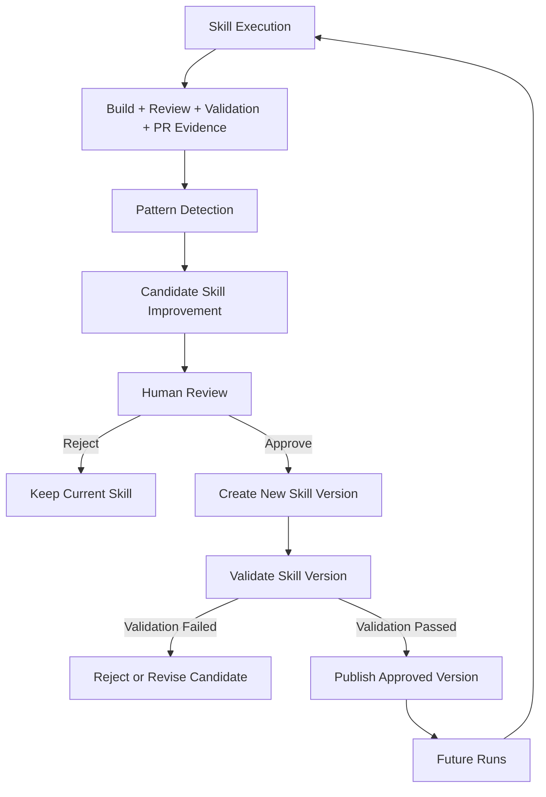
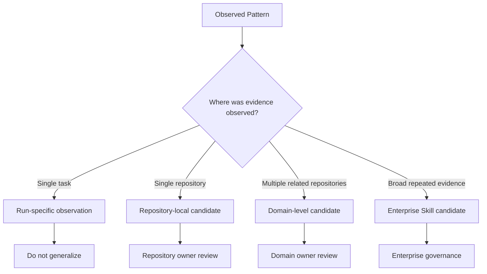
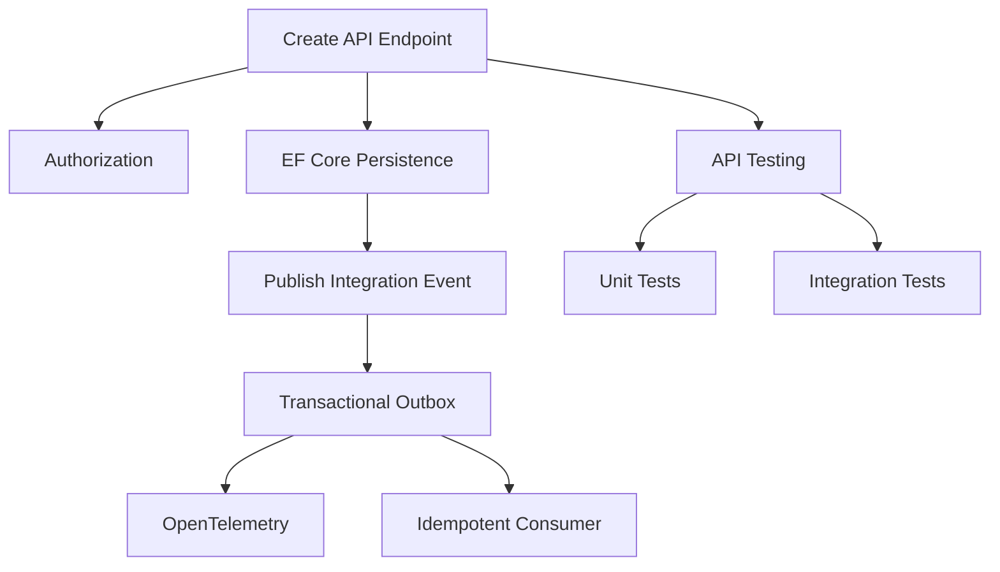
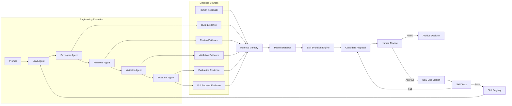
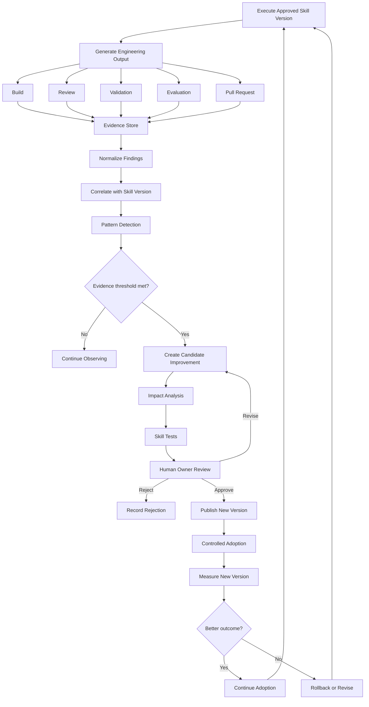
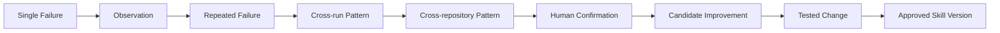
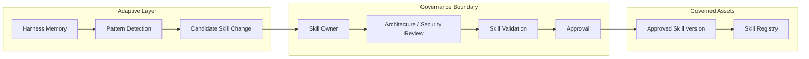
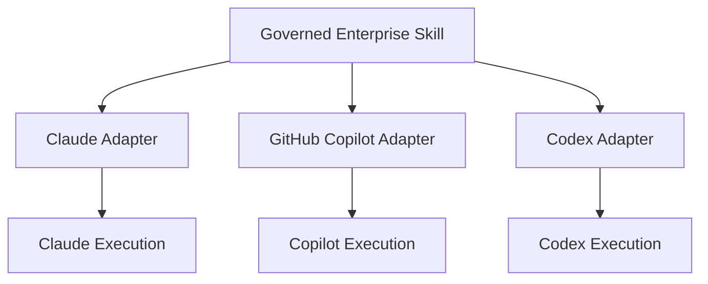

# Chapter 41 — Skill Evolution

## Story-driven Opening

Alpha Car Detailing had reached a point that would have seemed impossible when its AI-assisted engineering program began.

The development Harness could coordinate work across multiple AI Agents. The Lead Agent could interpret engineering tasks. The Developer Agent could implement changes. The Reviewer Agent could assess code quality and architecture. The Validator Agent could execute deterministic gates. The Evaluator Agent could assess whether the completed change satisfied its intended business outcome. Pull requests supplied another layer of evidence about what human engineers ultimately accepted, corrected, rejected, or merged.

The organization was no longer asking whether AI Agents could generate useful code.

They were asking a more difficult question:

**Could the engineering system improve the way it performed recurring work without allowing the system to rewrite its own engineering standards?**

The question became concrete during development of Alpha Car Detailing's fleet-booking capabilities.

Several services needed to publish integration events after successful business transactions. The organization already had a reusable Skill for implementing the transactional outbox pattern. The Skill instructed an AI Agent to create an outbox record in the same database transaction as the domain change, avoid publishing directly from the request transaction, create an asynchronous publisher, record delivery attempts, and make downstream consumers idempotent.

The Skill had worked.

But execution evidence revealed a recurring problem.

In three separate pull requests, the generated outbox implementation initially omitted sufficient telemetry around message publication failures. The applications still compiled. Most tests passed. The fundamental transactional-outbox architecture remained correct.

Yet reviewers repeatedly requested the same improvement:

- record the event type;
- record the outbox message identifier;
- record retry counts;
- emit traces around publication;
- expose failed publishing attempts to operational monitoring.

The first occurrence could have been incidental.

The second was interesting.

The third suggested a pattern.

A simplistic self-learning system might immediately rewrite the Skill:

> Always add these OpenTelemetry fields to every outbox implementation.

That would be dangerous.

Perhaps the telemetry requirement belonged in the organization's observability Instructions rather than the transactional-outbox Skill. Perhaps the requirement was specific to the Booking service. Perhaps another service used a different messaging abstraction. Perhaps the proposed change would conflict with an existing logging standard.

The Adaptive Harness therefore did something more disciplined.

It recorded the evidence.

It correlated the review findings.

It compared them with validation outcomes and pull-request history.

It identified that the same omission appeared repeatedly when the transactional-outbox Skill was used.

Then it created a **candidate Skill improvement**.

The current Skill remained unchanged.

A technical owner reviewed the proposal. The proposed Skill version was tested against representative repositories. Compatibility was evaluated. The change was approved. A new version of the Skill was published.

Future executions used the improved Skill.

The old version remained available for traceability and rollback.

That is Skill Evolution.

Skill Evolution is not an AI Agent spontaneously rewriting its own instructions.

It is a governed engineering process in which repeated execution evidence is converted into proposed improvements to reusable engineering workflows.

The distinction is fundamental.

A Skill captures a reusable way of performing recurring engineering work. In this handbook's terminology, Skills define how recurring implementation tasks are performed, while the Harness orchestrates execution, validation, evaluation, metrics, and history.

When an Adaptive Harness learns from builds, reviews, validation, evaluation, pull requests, and human feedback, Skills become one of the most valuable assets it can improve.

But they must evolve carefully.

The governing principle for this chapter is therefore:

> **Skills should evolve from repeated, high-confidence evidence. The Harness may recommend Skill improvements, but it must not silently modify governed Skills.**

This principle is consistent with the broader self-learning architecture of the handbook: the Harness may learn and recommend improvements, but human approval remains mandatory for governed changes.

---

# Learning Objectives

By the end of this chapter, you should be able to:

- explain Skill Evolution and its role in an Adaptive Harness;
- distinguish execution learning from uncontrolled self-modification;
- identify evidence that may indicate a weak, incomplete, or outdated Skill;
- combine build, review, validation, evaluation, pull-request, and human-feedback signals;
- define evidence thresholds before proposing Skill changes;
- measure Skill effectiveness across multiple executions;
- design candidate Skill improvements without immediately changing production Skills;
- version reusable Skills as governed engineering assets;
- test proposed Skill versions before adoption;
- evaluate backward compatibility and repository compatibility;
- design rollback strategies for Skill changes;
- establish ownership and approval workflows;
- manage Skill deprecation;
- prevent repository-specific learning from contaminating organization-wide Skills;
- use Harness Memory to support Skill Evolution without treating memory as unquestionable truth;
- understand how Skill composition affects evolution;
- define enterprise metrics for Skill quality and evolution;
- identify anti-patterns such as silent self-modification, overfitting, missing versioning, and optimization for speed alone;
- design a Skill Evolution pipeline that remains explainable, auditable, and reversible.

---

# Background

## Skills as Reusable Engineering Knowledge

A Prompt describes a task that needs to be performed.

An Instruction establishes persistent engineering expectations.

A Skill describes a reusable way of performing recurring engineering work.

A Harness coordinates the system that executes those assets.

These distinctions become increasingly important as AI-assisted development grows beyond isolated coding sessions.

Consider the following Alpha Car Detailing request:

```text
Add an endpoint that allows an authorized fleet manager
to create a recurring vehicle-detailing booking.
```

The task Prompt may define the immediate business requirement.

Repository Instructions may state that:

- APIs follow established endpoint conventions;
- business logic belongs in the application layer;
- authorization must be policy based;
- persistence uses EF Core;
- telemetry uses OpenTelemetry;
- integration events must use the transactional outbox;
- tests are required for business-critical paths.

Skills may provide reusable implementation procedures such as:

```text
create-api-endpoint
implement-ef-core-persistence
publish-integration-event
implement-transactional-outbox
create-idempotent-consumer
add-authorization-policy
instrument-opentelemetry
create-unit-tests
create-integration-tests
```

The Harness determines when and how these assets are used.

A Skill is therefore more than a convenient prompt fragment.

In a mature engineering organization, Skills become reusable engineering intellectual property.

They encode knowledge such as:

- sequencing;
- implementation patterns;
- expected artifacts;
- constraints;
- validation expectations;
- common edge cases;
- references to repository conventions;
- required handoffs between activities;
- expected evidence.

If the organization repeatedly performs the same engineering operation, the Skill that captures that operation can become increasingly important.

A weak Skill causes weak implementations repeatedly.

A strong Skill allows good engineering practices to propagate repeatedly.

This makes Skill quality an architectural concern.

---

## Why Skills Need Improvement

A Skill that was correct when created may become incomplete over time.

Several causes are common.

### Engineering standards evolve

An API Skill may have been created before the organization required standardized problem-details responses.

An observability Skill may predate distributed tracing requirements.

An authorization Skill may predate new policy-based access controls.

### Architecture becomes more sophisticated

Alpha Car Detailing may begin with a straightforward CRUD-oriented service.

Later, the organization may introduce:

- transactional outbox;
- idempotent consumers;
- asynchronous integration events;
- richer authorization boundaries;
- architecture tests;
- contract validation;
- distributed tracing.

Existing Skills may no longer represent the preferred implementation path.

### Repeated execution exposes hidden gaps

A Skill may look complete when read manually but repeatedly produce implementations that require correction.

For example:

```text
Skill: Create API Endpoint
```

may successfully generate:

- routes;
- request models;
- handlers;
- response models;
- persistence calls.

But reviewers may repeatedly request:

- authorization;
- cancellation tokens;
- structured error handling;
- telemetry;
- integration tests.

The Skill is not necessarily incorrect.

It may simply be incomplete.

### Tools and platform capabilities change

An organization may upgrade:

- .NET versions;
- EF Core conventions;
- messaging libraries;
- observability libraries;
- security tooling;
- CI/CD gates.

A reusable Skill should evolve when the underlying engineering environment changes.

### Human experience reveals better practices

Senior engineers may discover that a particular workflow consistently produces safer or simpler implementations.

That experience can eventually be captured as reusable engineering knowledge.

The important word is **eventually**.

One engineer's preference should not automatically rewrite an enterprise Skill.

Evidence must accumulate.

---

# Concepts

## What Is Skill Evolution?

**Skill Evolution is the governed process of improving reusable engineering Skills based on repeated execution evidence, human feedback, and measured effectiveness.**

A Skill Evolution system typically performs five activities:

1. observes Skill executions;
2. collects evidence about outcomes;
3. detects recurring patterns;
4. proposes candidate improvements;
5. subjects those improvements to ownership, testing, approval, and versioning.

Skill Evolution does not mean:

```text
Failure
   ↓
Rewrite Skill
```

A mature model is:

```text
Repeated Execution
      ↓
Evidence Collection
      ↓
Pattern Detection
      ↓
Confidence Assessment
      ↓
Candidate Improvement
      ↓
Human Review
      ↓
Testing
      ↓
Approval
      ↓
New Skill Version
```

The difference between these models is the difference between adaptive engineering and uncontrolled self-modification.

---

## The Skill Evolution Model

The core lifecycle can be expressed as:



This loop is deliberately conservative.

The system learns continuously.

Governed Skills change selectively.

---

# Learning Signals

Skill Evolution requires evidence.

No single signal is sufficient for every decision.

The Harness should aggregate multiple types of evidence before proposing changes.

## Build Failures

Build failures can reveal mechanical deficiencies in a Skill.

Suppose the `create-api-endpoint` Skill repeatedly produces code that omits a required package reference or uses an obsolete API.

The Harness may observe:

```text
Skill: create-api-endpoint
Executions: 27
Build failures related to missing package: 9
Human corrections: 8
Repositories affected: 4
```

That is stronger evidence than:

```text
Execution #124 failed to build.
```

A single failure may have many causes:

- incomplete repository setup;
- unrelated branch changes;
- dependency conflicts;
- environment problems;
- incorrect task interpretation;
- temporary package availability.

Skill Evolution should seek recurring relationships between the Skill and the failure.

---

## Review Findings

Reviewer findings are particularly valuable because they expose deficiencies that deterministic gates may not detect.

For example, the transactional-outbox Skill might repeatedly generate technically functioning code that reviewers consider operationally incomplete.

Review findings might include:

```text
Missing correlation identifiers.
Retry behavior is not observable.
Outbox processing has no cancellation handling.
The implementation bypasses the repository's standard clock abstraction.
```

If the same findings appear across several implementations, the Skill may need improvement.

However, the Harness should distinguish among:

- Skill problems;
- repository-specific conventions;
- implementation mistakes;
- reviewer preferences;
- architecture decisions.

Not every review comment belongs inside a Skill.

---

## Validation Failures

Validation failures provide deterministic evidence.

Examples include:

- unit-test failures;
- integration-test failures;
- architecture-test failures;
- security-policy failures;
- contract-validation failures;
- migration-validation failures;
- static-analysis violations.

Suppose the `implement-idempotent-consumer` Skill repeatedly generates consumers that pass unit tests but fail concurrency integration tests.

That evidence is significant.

The Skill may be missing explicit guidance about:

- unique constraints;
- transaction boundaries;
- race conditions;
- message-state persistence;
- duplicate detection timing.

The correct improvement may therefore be a stronger concurrency procedure inside the Skill.

---

## Evaluator Findings

The Evaluator Agent asks a different question:

> Did the implementation satisfy the intended engineering and business outcome?

A Skill may produce code that builds and passes tests yet still produce poor outcomes.

For example, a Skill that creates fleet-booking APIs may technically satisfy the endpoint contract but repeatedly fail to address:

- booking limits;
- fleet-specific authorization;
- scheduling conflicts;
- expected operational telemetry.

Evaluator findings can reveal systemic deficiencies in the workflow represented by the Skill.

---

## Pull-Request Outcomes

Pull requests provide important downstream evidence because they capture what happened after AI-generated work entered normal engineering governance.

Useful signals include:

- requested changes;
- repeated review discussions;
- approval count;
- architecture findings;
- security findings;
- validation results;
- time to approval;
- number of revision cycles;
- rejection;
- merge;
- revert after merge;
- hotfix after merge.

A Skill that frequently produces code requiring two or three review cycles may be less effective than one whose outputs are routinely accepted with minimal correction.

But merge rate alone is not enough.

A Skill could appear successful because review standards are weak.

Skill effectiveness must therefore combine multiple indicators.

---

## Human Feedback

Humans remain essential sources of knowledge.

Useful human feedback includes:

```text
This Skill consistently forgets cancellation support.

The generated tests are technically valid but do not cover failure paths.

Do not include service-specific event names in the shared Skill.

The Skill should reference the standard authorization Skill rather than duplicating it.

This pattern is now approved by the architecture board.
```

Human feedback may be:

- explicit;
- inferred from review corrections;
- recorded during retrospective analysis;
- attached to Skill-change proposals.

The Harness should preserve the origin of feedback.

A statement from an architecture owner should not be treated identically to an unverified observation from a single execution.

---

# Skill Effectiveness

If Skills are governed engineering assets, organizations need a way to evaluate whether they are effective.

A simplistic metric such as:

```text
Skill success rate = successful runs / total runs
```

is inadequate.

Consider a Skill that removes difficult validation checks.

Its success rate may improve.

Its engineering quality may decline.

Skill effectiveness should therefore be multidimensional.

A useful conceptual model is:

\[
Effectiveness =
f(Quality, Reliability, Compliance, ReviewAcceptance, Rework, Outcome)
\]

Possible measures include:

| Metric | Purpose |
| --- | --- |
| Build pass rate | Detects mechanical implementation problems |
| Validation pass rate | Measures deterministic conformity |
| Reviewer finding rate | Indicates recurring quality concerns |
| Evaluator satisfaction rate | Measures outcome satisfaction |
| PR first-pass approval rate | Indicates review readiness |
| Average revision cycles | Measures rework |
| Architecture violation rate | Tracks structural correctness |
| Security finding rate | Tracks security quality |
| Post-merge defect rate | Captures escaped problems |
| Skill completion rate | Shows whether the workflow produces required artifacts |
| Human override rate | Indicates how often engineers replace generated decisions |
| Rollback rate | Detects harmful Skill versions |

No metric should be interpreted alone.

---

# Detecting Incomplete or Weak Skills

A Skill becomes a candidate for evolution when evidence indicates that its guidance is incomplete, ambiguous, outdated, or consistently ineffective.

## Repeated Missing Artifacts

Suppose `create-api-endpoint` is expected to produce:

```text
Endpoint
Request model
Response model
Handler
Authorization
Telemetry
Unit tests
Integration tests
```

Across ten executions, telemetry is missing six times.

That suggests the Skill may not communicate telemetry expectations clearly enough.

---

## Repeated Reviewer Corrections

If reviewers repeatedly add:

```csharp
CancellationToken cancellationToken
```

to generated async operations, the Harness may identify:

```text
Pattern:
CancellationToken omitted in 14 of 22 executions using Skill v3.
```

This does not automatically mean the Skill should be changed.

The system must determine whether cancellation handling belongs to:

- the Skill;
- repository Instructions;
- a broader .NET engineering standard;
- a composed supporting Skill.

---

## High Variation in Outputs

Two agents may interpret the same Skill differently.

Example:

```text
Skill: Publish Integration Event
```

Execution A publishes directly inside the HTTP request.

Execution B uses the transactional outbox.

Execution C queues an in-memory background task.

If architecture requires the transactional outbox, this variation indicates that the Skill is too ambiguous or relies too heavily on unstated assumptions.

---

## Excessive Human Repair

Suppose the initial output usually requires human engineers to add:

- authorization;
- tracing;
- retries;
- tests;
- architecture alignment.

The Skill may technically execute, but it is transferring too much work to reviewers.

That is evidence of weak reusable guidance.

---

## Repeated Skill Bypass

Developers may repeatedly avoid a particular Skill.

That is also evidence.

Possible reasons include:

- the Skill is too restrictive;
- it produces outdated patterns;
- it is slow;
- it conflicts with repository architecture;
- its output is difficult to maintain;
- another Skill has become the preferred workflow.

Skill usage itself is therefore a useful metric.

---

# Evidence Thresholds

An Adaptive Harness should not propose modifications after every unusual outcome.

Organizations need evidence thresholds.

A threshold might include:

```yaml
skill_evolution:
  minimum_executions: 10
  minimum_repeated_findings: 3
  minimum_repositories: 2
  minimum_confidence: 0.80
  require_human_feedback: true
```

These numbers are illustrative.

Different organizations will require different policies.

A security-sensitive Skill may require stronger evidence and more formal approval.

A local experimental Skill may evolve more rapidly.

The key principle is:

> The cost of changing reusable engineering knowledge should increase with the scope of that knowledge.

A repository-local Skill can often evolve with less governance than an organization-wide Skill used by hundreds of repositories.

---

# Candidate Improvements

The Harness should separate **observations** from **proposed changes**.

An observation might be:

```text
Skill:
implement-transactional-outbox

Observation:
7 of the last 11 executions required reviewers to add
OpenTelemetry spans around message publication.

Repositories:
booking-service
fleet-service
notification-service

Related review categories:
observability
operational-diagnostics
```

A candidate improvement might be:

```text
Proposal:
Add an explicit observability step requiring:

1. Activity span around each publication attempt.
2. outbox.message_id attribute.
3. event.type attribute.
4. retry.attempt attribute.
5. success/failure outcome.
6. exception recording.
```

Those are different artifacts.

The first records evidence.

The second proposes an engineering change.

That separation improves auditability.

---

# Skill Versioning

Skills should be versioned.

Without versioning, the organization cannot reliably answer:

- Which Skill generated this implementation?
- What changed between two Skill versions?
- Why was the Skill changed?
- Which repositories are using the older version?
- Did the new Skill reduce review findings?
- Can we return to the previous version?

A simple Skill structure might be:

```text
skills/
└── transactional-outbox/
    ├── v1/
    │   ├── SKILL.md
    │   └── tests/
    ├── v2/
    │   ├── SKILL.md
    │   └── tests/
    ├── v3/
    │   ├── SKILL.md
    │   └── tests/
    └── metadata.yaml
```

Or version metadata may be maintained through Git tags or repository history.

The mechanism matters less than the guarantees.

The organization should be able to identify:

```text
Skill name
Skill version
Previous version
Owner
Approval record
Effective date
Change reason
Evidence references
Compatibility information
Validation results
Deprecation status
```

---

# Semantic Change Classification

Not every Skill change has the same impact.

A useful model classifies changes as:

### Patch change

Clarifies wording or fixes a small defect without changing expected behavior.

Example:

```text
v2.1.1
```

### Minor change

Adds backward-compatible capability.

Example:

```text
v2.2.0
```

such as adding optional OpenTelemetry guidance.

### Major change

Changes expected workflow or output significantly.

Example:

```text
v3.0.0
```

such as changing integration-event publishing from direct publication to mandatory transactional outbox.

Enterprise organizations may use other version schemes, but the distinction between low-impact and high-impact changes is important.

---

# Testing Skills

A Skill should not be considered safe merely because its Markdown looks reasonable.

Skills require tests.

The exact testing approach depends on the Skill.

## Structural Tests

Structural tests verify that required guidance exists.

For example:

```text
transactional-outbox Skill must include:
- same-transaction persistence
- asynchronous publisher
- retry handling
- observability
- idempotency guidance
- validation expectations
```

---

## Scenario Tests

Scenario tests execute the Skill against representative tasks.

For Alpha Car Detailing:

```text
Scenario 1:
Create booking and publish BookingCreated.

Scenario 2:
Update fleet booking and publish BookingRescheduled.

Scenario 3:
Cancel booking and publish BookingCancelled.
```

The generated implementations can then be evaluated.

---

## Negative Tests

Negative tests verify that the Skill prevents known bad patterns.

For example:

```text
The Skill must not produce direct event publication
before the database transaction commits.
```

or:

```text
The authorization Skill must not rely only on UI-level access control.
```

---

## Regression Tests

Whenever Skill Evolution fixes a recurring problem, a regression test should preserve the learning.

If Skill v4 was introduced because previous versions repeatedly omitted idempotency around event consumption, the test suite should include that scenario.

This transforms historical failures into future safeguards.

---

# Compatibility

A Skill that performs well in one repository may be inappropriate elsewhere.

Compatibility therefore matters.

The Harness should evaluate:

- architecture compatibility;
- framework compatibility;
- library compatibility;
- repository conventions;
- language/runtime compatibility;
- deployment-model compatibility;
- infrastructure compatibility;
- security-policy compatibility.

Consider an `ef-core-persistence` Skill.

Alpha Car Detailing's Booking service may use:

```text
.NET 10
EF Core
SQL Server
Clean Architecture
```

Another repository may use:

```text
Dapper
PostgreSQL
Vertical Slice Architecture
```

The Skill should not be promoted globally merely because it performs well inside Alpha Car Detailing.

---

# Repository-Specific Versus Global Learning

One of the most dangerous forms of Skill Evolution is accidental generalization.

Imagine that Alpha Car Detailing's Booking service requires this event naming convention:

```text
AlphaCarDetailing.Booking.BookingCreated.v1
```

After several successful executions, the Harness might conclude:

```text
Always use AlphaCarDetailing.<Domain>.<Event>.v1
```

That would be incorrect as an organization-wide Skill.

The pattern is repository specific.

The Harness should therefore classify learning scope.



Scope should be earned by evidence.

---

# Rollback

Any governed Skill evolution process must include rollback.

Even carefully tested Skill versions can produce unexpected consequences.

Suppose Skill v5 adds more aggressive test-generation requirements.

Results improve in one service but execution cost increases dramatically elsewhere.

Or Skill v6 introduces a new EF Core persistence pattern that conflicts with older repositories.

The organization needs the ability to restore:

```text
v6 → v5
```

without reconstructing the previous Skill manually.

Rollback should preserve:

- previous content;
- approval metadata;
- effective dates;
- affected repositories;
- migration notes;
- reasons for rollback.

A rollback should itself become evidence.

If a Skill version is frequently rolled back, the evolution process may be promoting changes too aggressively.

---

# Ownership

A Skill without an owner is difficult to govern.

Ownership may belong to:

- an architecture team;
- a platform engineering team;
- a security team;
- a domain team;
- an observability team;
- an engineering enablement group.

Ownership should follow subject-matter responsibility.

Examples:

| Skill | Likely Owner |
| --- | --- |
| Create API endpoint | Application/platform engineering |
| Transactional outbox | Architecture/platform engineering |
| Idempotent consumer | Architecture/platform engineering |
| Authorization | Security + platform engineering |
| OpenTelemetry | Observability/platform engineering |
| EF Core persistence | Data/application architecture |
| Unit-test generation | Engineering enablement |
| Integration-test generation | Engineering enablement/platform |

The Harness can identify patterns.

It should not replace accountable ownership.

---

# Human Approval

The Adaptive Harness may create a sophisticated proposal containing:

```text
Observed pattern
Evidence
Confidence
Affected Skill
Suggested diff
Expected benefit
Possible risks
Compatibility scope
Validation results
Repositories affected
```

But the final decision belongs to the authorized owner.

A human reviewer should be able to choose among:

```text
Approve
Reject
Revise
Request more evidence
Limit to repository scope
Run additional Skill tests
Defer
```

This is more useful than a simple yes/no workflow.

---

# Deprecation

Skills should not remain active forever simply because they once worked.

A Skill may become obsolete because:

- architecture changed;
- another Skill replaced it;
- a library was retired;
- security standards changed;
- a workflow was simplified;
- the Skill was merged into another reusable capability.

Deprecation should be explicit.

Example:

```yaml
skill: publish-integration-event
version: 2.0
status: deprecated
replacement: publish-event-with-transactional-outbox
deprecation_date: 2027-03-01
removal_target: 2027-09-01
```

The Harness can warn when deprecated Skills are selected.

It should not silently delete historical versions.

---

# Skill Composition

Mature Skills should avoid becoming large all-purpose workflows.

Consider this Skill:

```text
create-enterprise-api
```

If it tries to define:

- API design;
- persistence;
- authorization;
- telemetry;
- caching;
- integration events;
- outbox;
- testing;
- deployment;
- documentation;

it becomes difficult to maintain and evolve.

A better design composes focused Skills:

```text
create-api-endpoint
        ↓
add-authorization
        ↓
implement-persistence
        ↓
publish-integration-event
        ↓
transactional-outbox
        ↓
add-observability
        ↓
create-tests
```

Composition allows each reusable capability to evolve independently.

---

# Skill Dependency Graph

The Harness can maintain relationships between Skills.



This dependency graph becomes important during evolution.

If `transactional-outbox` changes significantly, the Harness can identify Skills that depend on it.

That enables impact analysis before approval.

---

# Harness Memory and Skill Evolution

Harness Memory plays an important role in Skill Evolution.

It can preserve historical evidence such as:

```text
Skill executions
Build outcomes
Review findings
Validation results
Evaluator findings
PR outcomes
Approved corrections
Rejected proposals
Rollback history
Performance metrics
Repository contexts
```

Memory provides continuity.

But memory is not automatically authoritative.

Historical observations may be:

- incomplete;
- outdated;
- repository-specific;
- incorrectly categorized;
- based on obsolete architecture.

The Adaptive Harness should therefore distinguish:

```text
Observed memory
Inferred pattern
Candidate recommendation
Approved governed knowledge
```

These categories must not collapse into one another.

A repeated observation in Harness Memory can justify investigation.

It does not automatically become an engineering standard.

---

# Skill Evolution Architecture

Skill Evolution should exist as an explicit subsystem inside the Adaptive Harness.

A representative architecture is:



This architecture creates clear boundaries.

Execution systems produce evidence.

Harness Memory stores historical observations.

Pattern detection identifies repeated signals.

The Skill Evolution Engine converts qualified patterns into proposals.

Governance approves or rejects the proposals.

The Skill Registry exposes approved versions for future runs.

---

# Evidence Model

A Skill Evolution subsystem benefits from structured evidence.

For example:

```json
{
  "skill": {
    "name": "transactional-outbox",
    "version": "3.1.0"
  },
  "execution": {
    "runId": "run-2026-11-00481",
    "repository": "alpha-car-detailing",
    "service": "booking-service"
  },
  "evidence": [
    {
      "source": "reviewer",
      "category": "observability",
      "finding": "Publication retry count is not emitted as telemetry."
    },
    {
      "source": "validator",
      "category": "integration-test",
      "result": "passed"
    },
    {
      "source": "pull-request",
      "category": "requested-change",
      "finding": "Add message id and retry attempt to Activity tags."
    }
  ]
}
```

After multiple executions, pattern detection may produce:

```json
{
  "patternId": "skill-pattern-0142",
  "skill": "transactional-outbox",
  "currentVersion": "3.1.0",
  "finding": "Missing standard telemetry around publication retries",
  "occurrences": 8,
  "executions": 12,
  "repositories": 3,
  "confidence": 0.91,
  "candidateAction": "Propose observability guidance update"
}
```

The data model matters because explainable evolution requires traceable evidence.

---

# Professional Diagrams

## End-to-End Skill Evolution Pipeline



---

## Evidence Confidence Model



The diagram illustrates an important concept:

**confidence should increase before governance scope increases.**

---

## Skill Governance Boundary



The Adaptive Layer may recommend.

The governance boundary decides.

The governed asset changes only after approval.

---

# Hands-on Example

## Scenario: Improving the Transactional Outbox Skill

Alpha Car Detailing uses integration events to communicate between services.

When a fleet booking is created, the Booking service must eventually publish:

```text
FleetBookingCreated
```

The organization uses a reusable Skill:

```text
skills/transactional-outbox/SKILL.md
```

Assume the currently approved version is:

```text
3.1.0
```

Its simplified guidance is:

```markdown
# Transactional Outbox

When a business transaction must publish an integration event:

1. Persist the business change.
2. Create the integration event.
3. Store the event in the OutboxMessages table.
4. Persist both changes in the same database transaction.
5. Do not publish directly inside the request transaction.
6. Process pending outbox messages asynchronously.
7. Retry transient publication failures.
8. Mark successfully published messages as processed.
9. Ensure consumers are idempotent.
10. Add unit and integration tests.
```

This Skill is architecturally correct.

But evidence begins to accumulate.

---

## Execution One

The Developer Agent uses Skill v3.1.0 to implement:

```text
FleetBookingCreated
```

The code builds.

Unit tests pass.

Integration tests pass.

The Reviewer Agent raises:

```text
The outbox publisher does not create a trace around message publication.
```

A developer adds the trace.

The pull request is merged.

The Harness records the finding.

No Skill change is proposed.

Correctly.

One review finding is not enough.

---

## Execution Two

Three weeks later, the same Skill is used for:

```text
FleetBookingCancelled
```

Again:

- build passes;
- tests pass;
- outbox semantics are correct.

The Reviewer Agent requests:

```text
Add the outbox message id and event type to the Activity tags.
```

The Harness correlates the finding with the earlier execution.

It records:

```text
Pattern candidate:
Missing publication telemetry.

Occurrences:
2

Action:
Continue observing.
```

Still no Skill modification.

---

## Execution Three

The Fleet service uses the same Skill.

The generated publisher contains logging, but operational traces still lack:

```text
message id
event type
retry number
publication result
```

The Evaluator Agent notes that operators cannot easily correlate message failures with distributed traces.

A human reviewer requests the same improvement.

The PR is corrected and merged.

The Harness now has evidence from:

```text
3 executions
2 services
2 repositories/modules
Reviewer findings
Evaluator findings
PR corrections
```

This exceeds the organization's repository-local candidate threshold.

The Skill Evolution Engine creates a proposal.

---

## Candidate Proposal

```markdown
# Candidate Skill Evolution

Skill:
transactional-outbox

Current version:
3.1.0

Proposed version:
3.2.0

## Evidence

Observed in 3 executions.

Common finding:
Publication operations lack standard OpenTelemetry context.

Evidence sources:
- Reviewer Agent
- Evaluator Agent
- Pull-request requested changes
- Human review comments

## Proposed Change

Add an observability step requiring:

- Activity span for publication attempts
- outbox.message_id
- messaging.event_type
- retry.attempt
- publication.outcome
- exception recording on failure

## Architecture Impact

None.

Transactional-outbox semantics remain unchanged.

## Compatibility

Backward compatible.

Repositories without OpenTelemetry support must compose the approved
observability abstraction rather than introduce a new tracing library.

## Risk

Telemetry naming may conflict with repository conventions.

## Required Reviewers

- Skill owner
- Observability owner
```

Notice what the proposal does **not** say:

```text
The Skill has been updated automatically.
```

The current version remains unchanged.

---

## Human Review

The observability owner reviews the proposal.

They reject one suggested attribute:

```text
messaging.event_type
```

because the organization already standardizes on:

```text
messaging.message.type
```

The proposal is revised.

This is precisely why human review matters.

The Adaptive Harness had identified the correct problem but did not possess enough authority to invent an enterprise telemetry convention.

---

## Revised Skill

The proposed addition becomes:

```markdown
## Publication Observability

For every outbox publication attempt:

1. Start an Activity using the repository-standard telemetry source.
2. Attach the outbox message identifier.
3. Attach the integration-event type.
4. Record the retry attempt where applicable.
5. Record the publication outcome.
6. Record exceptions on failed publication attempts.
7. Do not introduce a new telemetry library when the repository
   already provides an observability abstraction.
```

The proposal moves to testing.

---

## Skill Test Scenario

The Harness creates a controlled task:

```text
Implement BookingRescheduled using the transactional-outbox Skill.
```

Expected properties include:

```text
Business update and outbox message use one database transaction.
No direct broker publication occurs in the request transaction.
Background publisher exists.
Retry handling exists.
Publication Activity exists.
Message identifier is included in telemetry.
Event type is included in telemetry.
Failure is recorded.
Consumer remains idempotent.
```

The test implementation passes.

---

## Negative Test

A second scenario intentionally provides a repository with an existing observability abstraction.

The Skill must not introduce:

```csharp
new ActivitySource("TransactionalOutbox")
```

when the repository exposes:

```csharp
BookingTelemetry.ActivitySource
```

The test ensures the evolved Skill respects existing architecture.

---

## Approval

The Skill owner approves version:

```text
3.2.0
```

Metadata records:

```yaml
name: transactional-outbox
version: 3.2.0
previous_version: 3.1.0

change:
  type: minor
  reason: >
    Repeated evidence showed missing operational telemetry around
    outbox publication attempts.

evidence:
  executions: 3
  services: 2
  reviewer_findings: 3
  evaluator_findings: 1
  pull_request_corrections: 3

approvals:
  - skill-owner
  - observability-owner

validation:
  status: passed

rollback:
  version: 3.1.0
```

Future executions may now use v3.2.0.

The organization has learned.

But it has learned through governance.

---

# Skill Evolution for Alpha Car Detailing

The same model can improve many reusable Skills.

## Creating API Endpoints

Evidence may reveal that generated endpoints repeatedly omit:

- authorization;
- consistent error contracts;
- cancellation tokens;
- telemetry;
- validation;
- integration tests.

The Skill may evolve to require these elements explicitly.

But architecture decisions should remain external.

If Alpha Car Detailing moves from controllers to minimal APIs, that architectural decision should not originate from Skill Evolution.

The Skill should be updated **after** the architecture decision is approved.

---

## Publishing Integration Events

Evidence may reveal repeated problems involving:

- incorrect event naming;
- missing schema versions;
- publishing before transaction completion;
- missing correlation metadata;
- insufficient contract tests.

The Skill Evolution Engine may propose improvements.

It must not invent a new event architecture.

---

## Transactional Outbox

Possible learning signals include:

- direct publishing inside transactions;
- missing indexes;
- poor retry handling;
- missing telemetry;
- weak cleanup policies;
- concurrency issues;
- incomplete integration tests.

These observations can improve implementation guidance while preserving the approved architecture.

---

## Idempotent Consumers

Repeated validation failures may reveal weak guidance around concurrency.

For example:

```text
Message A → Consumer instance 1
Message A → Consumer instance 2
```

Both instances may check:

```text
Has message A been processed?
```

before either commits.

A weak Skill might generate:

```csharp
if (!await repository.Exists(messageId))
{
    await Handle(message);
    await repository.MarkProcessed(messageId);
}
```

This may look idempotent while still allowing a race condition.

Repeated concurrency-test failures could justify evolving the Skill to require:

- database uniqueness;
- transactional handling;
- atomic duplicate protection;
- concurrency tests.

---

## EF Core Persistence

Skill Evolution may reveal patterns such as:

- unnecessary tracking;
- missing cancellation tokens;
- N+1 queries;
- inconsistent transaction boundaries;
- unbounded result sets;
- missing indexes;
- incorrect concurrency handling.

A Skill might evolve to include stronger guidance about:

```csharp
AsNoTracking()
```

for read-only queries where appropriate.

But the Harness should not transform every observed optimization into a global rule.

Context still matters.

---

## Authorization

Authorization Skills require particularly strong governance.

Evidence may show that generated implementations repeatedly:

- check roles instead of policies;
- authorize at the UI but not the API;
- fail to validate resource ownership;
- confuse authentication with authorization.

These are valuable learning signals.

However, changes to authorization Skills should involve security ownership.

Skill Evolution must not weaken security checks to increase execution success.

---

## OpenTelemetry

Observability Skills may evolve based on repeated operational findings.

Examples include missing:

- spans;
- correlation attributes;
- error recording;
- domain-specific metrics;
- dependency instrumentation.

The goal is not to collect maximum telemetry.

The goal is to improve operational usefulness while respecting established telemetry conventions.

---

## Unit Tests

A test-generation Skill may produce large numbers of tests while still missing important behaviors.

Skill metrics should therefore avoid:

```text
More tests = better Skill.
```

Evidence should instead consider:

- defect detection;
- meaningful behavior coverage;
- edge cases;
- maintainability;
- deterministic execution;
- architecture alignment.

---

## Integration Tests

Integration-test Skills may learn from escaped defects.

Suppose several incidents involve:

```text
transactional outbox + database commit + message retry
```

while unit tests all passed.

The Harness may propose new representative integration-test scenarios.

This is a valuable form of institutional learning.

---

# Claude Example

Claude-based implementations can treat Skills as reusable contextual engineering assets and apply them during repository work.

The important architectural point is not the storage syntax used by a specific product.

The important point is that the Harness controls which approved Skill version is supplied to the Agent.

A simplified flow might be:

```text
Task
  ↓
Harness resolves Skill requirements
  ↓
Harness selects approved Skill versions
  ↓
Claude receives:
  - task Prompt
  - repository Instructions
  - relevant Skills
  - Steering Note
  - repository context
  ↓
Claude implements
  ↓
Harness captures evidence
```

For Alpha Car Detailing:

```text
Prompt:
Create the FleetBookingCancelled integration event.

Resolved Skills:
- publish-integration-event@2.4.0
- transactional-outbox@3.2.0
- opentelemetry@2.1.0
- integration-testing@4.0.0
```

The version information should be preserved with the run.

For example:

```json
{
  "runId": "run-5981",
  "agent": "developer",
  "skills": [
    {
      "name": "publish-integration-event",
      "version": "2.4.0"
    },
    {
      "name": "transactional-outbox",
      "version": "3.2.0"
    },
    {
      "name": "opentelemetry",
      "version": "2.1.0"
    }
  ]
}
```

If the generated implementation later receives review corrections, the Harness can correlate those findings with the exact Skill versions involved.

That correlation is essential.

Without it, the organization knows that something went wrong but cannot reliably identify which reusable guidance may have contributed.

Claude should not be asked to perform unrestricted self-modification such as:

```text
Review your previous work and permanently rewrite any Skills
you think could be improved.
```

A safer flow is:

```text
Analyze the evidence from these runs.

Identify recurring findings that may indicate weaknesses
in transactional-outbox@3.2.0.

Do not modify the Skill.

Produce a candidate improvement proposal containing:

- evidence
- repeated pattern
- proposed change
- expected benefit
- compatibility risks
- suggested validation scenarios
```

The distinction is deliberate.

Claude may assist with analysis.

Governance controls mutation.

---

# GitHub Copilot Comparison

GitHub Copilot can participate in a Skill-oriented engineering workflow, but the reusable-knowledge mechanism may be expressed through different repository artifacts, instructions, reusable prompts, agent configurations, or organizational tooling.

The enterprise architecture should therefore avoid coupling Skill Evolution to a single vendor-specific file format.

The Harness should model a Skill logically:

```text
Skill
├── Identity
├── Version
├── Purpose
├── Instructions
├── Inputs
├── Expected outputs
├── Dependencies
├── Tests
├── Owner
├── Approval metadata
└── Compatibility metadata
```

A vendor adapter can then translate that logical Skill into the form needed by a particular coding environment.

For example:



This design keeps Skill Evolution vendor neutral.

The organization learns about engineering workflows.

It does not merely optimize prompt syntax for one product.

When Copilot-generated code is reviewed through normal pull requests, the same learning evidence remains useful:

- build outcomes;
- validation failures;
- code-review comments;
- security findings;
- PR revisions;
- merge outcomes;
- human corrections.

The Harness can correlate those outcomes with whichever reusable guidance was supplied during the execution.

The enterprise principle remains unchanged:

> Reusable guidance should evolve through evidence, testing, ownership, approval, and versioning.

---

# Codex Comparison

Codex-based engineering workflows can follow the same model.

The Harness supplies:

```text
Task context
Repository context
Approved Instructions
Approved Skill versions
Execution constraints
Validation requirements
```

Codex performs the engineering task.

The surrounding Harness records:

```text
Which Skill versions were used?
What files changed?
Did the build pass?
Which gates failed?
What did reviewers change?
Was the PR approved?
Was the implementation later reverted?
```

Skill Evolution occurs outside the raw code-generation interaction.

This separation is important.

The coding Agent should not be both:

```text
the consumer of the Skill
```

and

```text
the unquestioned authority that permanently rewrites the Skill.
```

That creates a circular governance model.

Instead:

```text
Agent execution
      ↓
Evidence
      ↓
Independent analysis
      ↓
Candidate improvement
      ↓
Governance
```

The same architecture works across Claude, GitHub Copilot, Codex, and future coding agents.

---

# Best Practices

## Require Repeated Evidence

Do not change Skills because of one unusual execution.

Look for:

- recurrence;
- consistency;
- cross-run evidence;
- cross-repository evidence where appropriate;
- human confirmation.

---

## Preserve Evidence Provenance

Every recommendation should answer:

```text
Why is this change being proposed?
```

The answer should link back to:

- run IDs;
- build results;
- validation failures;
- review findings;
- PR discussions;
- human feedback;
- evaluator findings.

---

## Separate Observation from Governance

The Harness may observe:

```text
The Skill appears to under-specify authorization.
```

That is not equivalent to:

```text
The enterprise authorization standard has changed.
```

Keep these layers separate.

---

## Version Every Governed Change

Do not mutate shared Skills in place without history.

Preserve:

```text
old version
new version
diff
reason
owner
approval
evidence
validation results
```

---

## Test Skills Like Engineering Assets

A Skill should have:

- representative scenarios;
- negative tests;
- regression tests;
- compatibility tests where appropriate.

---

## Preserve Rollback

Every new version should have a known rollback target.

---

## Measure Outcomes After Promotion

Approval is not proof that the Skill improved outcomes.

After adoption, compare:

```text
before
versus
after
```

using the same quality metrics.

---

## Keep Skills Focused

Prefer composable Skills over giant workflows.

A Skill should have a clear responsibility.

---

## Maintain Explicit Ownership

Every governed Skill should have an accountable owner.

---

## Respect Architecture Boundaries

Skill Evolution should implement architecture decisions.

It should not make them implicitly.

---

## Separate Local and Global Learning

Repository-specific success should remain repository specific until broader evidence exists.

---

## Treat Security Skills Conservatively

Authorization, secrets handling, cryptography, dependency security, and similar Skills should require stronger evidence and stronger approval.

---

## Preserve Rejected Proposals

A rejected proposal is still useful knowledge.

It prevents the Harness from repeatedly recommending the same inappropriate change without new evidence.

---

# Anti-patterns

## Silent Self-Modifying Skills

This is the most serious anti-pattern.

```text
Execution fails
   ↓
Agent edits Skill
   ↓
Next execution uses modified Skill
```

No owner reviews the change.

No version is created.

No rollback exists.

No one knows why future behavior changed.

This is not adaptive engineering.

It is uncontrolled mutation.

---

## No Versioning

Without versioning, a team may ask:

> Why did the same Prompt generate different architecture last month?

and have no reliable answer.

Skill version must be part of execution provenance.

---

## No Rollback

A Skill can pass controlled tests and still cause problems at scale.

If the system cannot return to the previous version, evolution becomes risky.

---

## No Evidence Threshold

Without thresholds, the system becomes hypersensitive.

Every failure may generate a change.

Every review comment may modify reusable guidance.

The resulting Skills become unstable.

---

## No Skill Tests

A Skill modification is code-like engineering knowledge.

Changing it without testing is equivalent to changing a shared library without validation.

---

## Learning from Isolated Incidents

One failed implementation does not establish a pattern.

The problem may be:

- task ambiguity;
- environmental instability;
- incomplete context;
- incorrect repository state;
- agent error;
- unrelated code.

Repeated evidence matters.

---

## Overfitting Skills to One Repository

A Skill may work beautifully in Alpha Car Detailing while being inappropriate elsewhere.

Do not generalize:

```text
one repository
```

into:

```text
enterprise standard
```

without broader evidence.

---

## Allowing Skills to Become Large All-Purpose Workflows

Large Skills are difficult to:

- understand;
- test;
- version;
- compose;
- own;
- evolve.

Prefer focused capabilities.

---

## Optimizing Only for Faster Execution

Suppose Skill v5 reduces average execution time from:

```text
12 minutes → 7 minutes
```

but causes:

```text
more review findings
more defects
weaker tests
more architecture violations
```

The Skill has not improved.

Execution speed is only one dimension of effectiveness.

---

## Removing Validation to Improve Success Rates

This is a particularly dangerous optimization.

Imagine:

```text
Architecture-test failure rate: 18%
```

A naive learning engine might recommend removing the architecture tests.

Success rate would improve immediately.

Engineering quality would decline.

The system must optimize the implementation, not weaken the evidence.

---

## Allowing Skill Evolution to Change Architecture

Suppose generated implementations repeatedly struggle with the transactional outbox.

The Harness must not conclude:

```text
Remove the outbox and publish directly.
```

That is an architectural decision.

Skill Evolution may improve how the approved architecture is implemented.

It must not silently replace the architecture.

---

## Losing Historical Versions

Historical Skills are part of the audit trail.

Deleting them destroys:

- reproducibility;
- rollback;
- forensic analysis;
- historical comparison.

---

## Hiding Why a Skill Changed

A Skill version without explanation is incomplete governance.

Engineers should be able to inspect:

```text
Why was this change introduced?
Which evidence supported it?
Who approved it?
What problem was it intended to solve?
```

---

# Architect's Notes

> **Architect's Note — Adaptive Does Not Mean Autonomous Authority**
>
> An Adaptive Harness can identify engineering patterns more quickly than humans because it observes every run. That makes it a powerful analytical system. It does not automatically make it the authority for changing engineering standards.

---

> **Architect's Note — Skills Are Executable Institutional Knowledge**
>
> A mature Skill library represents accumulated engineering practice. Treat it with similar discipline to shared libraries, platform components, architecture standards, and CI/CD templates.

---

> **Architect's Note — Improve the Cause, Not the Metric**
>
> If a Skill repeatedly fails a validation gate, improve the Skill. Do not weaken the gate simply to produce a better success-rate graph.

---

> **Architect's Note — Evidence Scope Determines Recommendation Scope**
>
> Evidence from one repository justifies investigation of that repository. Enterprise-wide recommendations require enterprise-level evidence.

---

> **Architect's Note — Architecture Leads, Skills Follow**
>
> Architecture determines the approved approach. Skills encode reusable procedures for implementing that approach. Reversing this relationship allows accidental execution patterns to become architecture.

---

# Enterprise Tips

> **Enterprise Tip — Build a Skill Registry**
>
> Maintain a searchable registry containing Skill identity, owner, current version, previous versions, compatibility, dependencies, tests, approval records, and deprecation state.

---

> **Enterprise Tip — Record Skill Versions on Every Harness Run**
>
> If execution provenance does not include Skill versions, later learning analysis will be unreliable.

---

> **Enterprise Tip — Introduce Confidence Levels**
>
> Classify observations as low, medium, or high confidence before they become formal proposals.

---

> **Enterprise Tip — Use Controlled Rollouts**
>
> A major Skill version can be enabled first for selected repositories before enterprise-wide adoption.

---

> **Enterprise Tip — Measure Rework**
>
> Review-cycle count and human correction volume often reveal Skill weaknesses that build success rates miss.

---

> **Enterprise Tip — Route Proposals to Domain Owners**
>
> Security changes should reach security owners. Observability changes should reach observability owners. Persistence changes should reach data/platform owners.

---

> **Enterprise Tip — Preserve Failed Evolution Attempts**
>
> An unsuccessful Skill version provides valuable evidence about what not to repeat.

---

# Decision Points

## Decision Point: When Should the Harness Propose a Skill Change?

Ask:

```text
Has the issue occurred repeatedly?

Is it correlated with the same Skill?

Is there sufficient evidence to distinguish the Skill
from task-specific implementation mistakes?

Does the proposed change belong inside the Skill?

Is the evidence repository specific or broadly applicable?

Is there an accountable owner?

Can the candidate be tested?

Can the new version be rolled back?
```

If several answers are unclear, continue observing.

---

## Decision Point: Skill Change or Instruction Change?

Suppose every API implementation needs authorization.

Ask:

```text
Is authorization a reusable workflow?
```

If yes, a Skill may be appropriate.

But ask also:

```text
Is "all public APIs must be authorized" a persistent repository-wide rule?
```

That belongs more naturally in Instructions.

The implementation procedure may live in a Skill.

The architectural expectation may live in Instructions.

---

## Decision Point: Skill Change or Architecture Decision?

Suppose repeated evidence suggests that synchronous event publication is unreliable.

The Harness should not automatically change:

```text
synchronous publication
```

to:

```text
transactional outbox
```

unless that architecture has been formally approved.

The Harness may raise an architecture recommendation.

That recommendation belongs in architecture governance.

Only after approval should Skill Evolution encode the new approach.

---

## Decision Point: Local or Global Skill?

Use questions such as:

```text
How many repositories produced this evidence?

Do those repositories share the same architecture?

Is the pattern domain-specific?

Does the proposed change depend on one team's conventions?

Has the pattern been validated outside the original repository?
```

Promote scope cautiously.

---

## Decision Point: Modify or Deprecate?

Sometimes continued modification is worse than replacement.

If a Skill:

- has accumulated too many exceptions;
- has unclear responsibility;
- overlaps several newer Skills;
- cannot be tested reliably;

deprecation may be safer than another revision.

---

# Exercises

## Exercise 1 — Identify Skill Evolution Signals

Alpha Car Detailing has an `authorization` Skill.

Across eight executions:

- all builds pass;
- all unit tests pass;
- three pull requests require resource-level authorization fixes;
- one security review identifies an insecure object reference;
- two developers manually add ownership checks.

Determine:

1. whether sufficient evidence exists for a candidate improvement;
2. which evidence sources are strongest;
3. whether the proposal should be repository local or enterprise wide;
4. which owners should review the proposal;
5. what validation scenarios should be added.

---

## Exercise 2 — Design an Evidence Threshold

Define an evidence policy for the `transactional-outbox` Skill.

Include:

```text
minimum executions
minimum repeated findings
repository diversity
human confirmation
confidence threshold
security/architecture escalation rules
```

Explain why your thresholds are appropriate.

---

## Exercise 3 — Create Skill Version Metadata

Design metadata for:

```text
idempotent-consumer@2.0.0
```

Include:

- version;
- owner;
- previous version;
- evidence;
- compatibility;
- tests;
- approval;
- rollback;
- deprecation status.

---

## Exercise 4 — Detect Overfitting

Suppose Alpha Car Detailing uses SQL Server and a unique filtered index for idempotency tracking.

The Harness observes that this pattern succeeds in every consumer implementation.

Explain why the system should not automatically add this exact SQL Server implementation to a global `idempotent-consumer` Skill.

Design a safer abstraction.

---

## Exercise 5 — Define Skill Tests

Create Skill-level tests for:

```text
create-api-endpoint
```

Include:

- positive scenarios;
- negative scenarios;
- regression scenarios;
- compatibility scenarios.

---

## Exercise 6 — Compare Skill Versions

Assume:

```text
v2:
PR first-pass approval = 58%
Validation pass rate = 91%
Average execution = 7 minutes

v3:
PR first-pass approval = 76%
Validation pass rate = 96%
Average execution = 10 minutes
```

Determine whether v3 is better.

Explain which additional evidence you would examine.

---

## Exercise 7 — Design a Rollback

A new `ef-core-persistence` Skill version causes several repositories to generate incompatible query patterns.

Design:

- detection;
- rollback;
- notification;
- affected-run identification;
- root-cause analysis;
- new candidate-version process.

---

## Exercise 8 — Separate Architecture from Skill Evolution

The Harness finds repeated failures implementing direct integration-event publication.

Create two outputs:

1. an architecture recommendation;
2. a Skill Evolution proposal that would only become valid if the architecture recommendation were approved.

---

# Interview Questions

### 1. What is Skill Evolution?

Skill Evolution is the governed improvement of reusable engineering Skills based on repeated execution evidence, measured outcomes, and human feedback.

---

### 2. Why should a Harness not modify a Skill after one failure?

A single failure may result from task ambiguity, repository state, environmental problems, Agent error, or an isolated implementation problem. Skill changes require repeated evidence.

---

### 3. What evidence can support Skill Evolution?

Common evidence includes:

- build failures;
- reviewer findings;
- validation failures;
- evaluator findings;
- pull-request outcomes;
- human feedback;
- post-merge defects;
- rework;
- execution metrics.

---

### 4. Why is Skill versioning important?

Versioning provides reproducibility, traceability, rollback, comparison, and auditability.

---

### 5. What is the difference between Skill Evolution and architecture evolution?

Skill Evolution improves how an approved engineering workflow is executed. Architecture evolution changes the underlying engineering approach. Architecture decisions require separate governance.

---

### 6. How should repository-specific learning be handled?

It should remain repository scoped until sufficient evidence demonstrates broader applicability.

---

### 7. Why should Skill changes be tested?

Skills influence repeated future implementations. An untested defect in a Skill can propagate across many runs and repositories.

---

### 8. What is an evidence threshold?

An evidence threshold defines the minimum quantity, quality, recurrence, confidence, and scope of evidence required before creating or promoting a Skill-improvement proposal.

---

### 9. What role does Harness Memory play?

Harness Memory preserves historical execution evidence and allows patterns to be detected across runs. Memory informs recommendations but does not automatically become authoritative engineering knowledge.

---

### 10. Why is rollback essential?

A new Skill version may create unexpected regressions despite passing initial validation. Rollback allows the organization to restore a known-good version.

---

### 11. What is Skill composition?

Skill composition combines focused reusable Skills into a larger workflow instead of creating a monolithic Skill that handles every concern.

---

### 12. Why should Skill effectiveness not be measured only by success rate?

A higher execution-success rate can be achieved by weakening validation or quality controls. Effectiveness must include quality, compliance, review outcomes, rework, reliability, and business outcome.

---

### 13. Why should rejected Skill proposals be preserved?

They provide governance history and prevent the system from repeatedly recommending previously rejected changes without new evidence.

---

### 14. Can an Adaptive Harness automatically create Skill proposals?

Yes. Automated proposal generation is compatible with governance. Automatic modification of governed Skills without approval is not.

---

### 15. Who should own Skills?

Ownership should follow the engineering domain represented by the Skill, such as platform engineering, architecture, security, observability, data engineering, or engineering enablement.

---

### 16. How can PR data improve Skills?

Requested changes, repeated review comments, revision cycles, approvals, rejections, merge results, and post-merge outcomes provide evidence about how well a Skill prepares code for production engineering review.

---

### 17. What is a dangerous response to repeated validation failures?

Removing or weakening the failing validation gate simply to increase success rates.

---

### 18. What should happen before a new Skill version becomes the default?

It should have sufficient supporting evidence, ownership review, compatibility analysis, tests, approval, version metadata, and a rollback path.

---

# Chapter Summary

Skills transform recurring engineering practice into reusable execution knowledge.

That makes them one of the most important assets inside an enterprise AI Engineering system.

But reusable knowledge cannot remain static forever.

Repositories evolve.

Architecture matures.

Tools change.

Review findings accumulate.

Validation exposes recurring defects.

Evaluators identify outcome gaps.

Pull requests reveal what humans repeatedly correct.

Skill Evolution allows an Adaptive Harness to learn from this evidence.

The learning process begins with execution:

```text
Skill Execution
      ↓
Build + Review + Validation + Evaluation + PR Evidence
      ↓
Harness Memory
      ↓
Pattern Detection
      ↓
Candidate Improvement
```

But candidate generation is not the end of the process.

Governance remains essential:

```text
Candidate Improvement
      ↓
Human Review
      ↓
Testing
      ↓
Approval
      ↓
New Version
      ↓
Controlled Adoption
      ↓
Measurement
```

The central principle is simple:

> **Skills should evolve from repeated, high-confidence evidence.**

The equally important governance principle is:

> **The Harness may recommend Skill improvements, but it must not silently modify governed Skills.**

A mature Skill Evolution architecture therefore requires:

- structured evidence;
- evidence thresholds;
- Skill effectiveness metrics;
- Harness Memory;
- pattern detection;
- candidate proposals;
- versioning;
- Skill tests;
- compatibility analysis;
- ownership;
- human approval;
- controlled rollout;
- rollback;
- deprecation;
- auditability.

The Harness must never improve its metrics by weakening engineering discipline.

It must not:

- rewrite Skills after one failure;
- treat every successful run as proof of a superior pattern;
- remove deterministic validation to improve success rates;
- change architecture decisions through Skill Evolution;
- modify Skills without ownership and approval;
- promote repository-specific learning globally without evidence;
- lose historical versions;
- hide the reasons behind Skill changes.

The objective is not to create a system that endlessly rewrites itself.

The objective is to create an engineering organization that can convert repeated experience into governed reusable knowledge.

Once Skills can evolve safely, another question naturally follows.

Skills describe **how recurring engineering work is performed**.

But Prompts describe **what work the Harness asks the Agents to perform in a particular run**.

If repeated evidence can reveal weaknesses in a Skill, it can also reveal weaknesses in the Prompts that initiate, constrain, and coordinate engineering tasks.

That is the subject of the next chapter.

---

# Further Reading

Readers should continue by studying the following areas:

- reusable workflow design for AI-assisted engineering;
- software configuration and semantic versioning;
- policy-as-code and governance-as-code;
- software supply-chain provenance;
- experiment design for developer productivity;
- continuous improvement and feedback-loop design;
- human-in-the-loop AI governance;
- model evaluation and regression testing;
- architecture decision records;
- observability and OpenTelemetry;
- transactional outbox patterns;
- idempotent message processing;
- CI/CD quality gates;
- knowledge management and organizational learning;
- prompt and instruction lifecycle governance.

Within the Enterprise AI Engineering Handbook, this chapter should be read together with:

- **Chapter 7 — Skills**, for the foundational role and structure of reusable engineering Skills;
- **Chapter 12 — What Is a Harness?**, for the execution and governance boundary surrounding AI-assisted development;
- **Chapter 17 — Validator Agent**, for deterministic evidence;
- **Chapter 18 — Evaluator Agent**, for outcome-oriented assessment;
- **Chapter 20 — Metrics**, for measurement inside the Harness;
- **Chapter 29 — AI Governance**, for organizational control;
- **Chapter 31 — Human Approval**, for governed decision-making;
- **Chapter 32 — Audit Trails**, for traceability;
- **Chapter 36 — Static vs Adaptive Harnesses**, for the transition from fixed automation to evidence-driven adaptation;
- **Chapter 37 — Harness Memory**, for persistent learning evidence;
- **Chapter 38 — Learning from Builds**, for build-derived learning signals;
- **Chapter 39 — Learning from Reviews**, for reviewer-derived learning signals;
- **Chapter 40 — Learning from Pull Requests**, for downstream engineering evidence;
- **Chapter 42 — Prompt Evolution**, which extends the same governed-learning model to task instructions.

Chapter 41 status: Complete

## Skill Registry Contract

### Purpose and Architectural Responsibility

A Skill Registry is the governed system of record for reusable engineering Skills available to the Harness.

It provides a consistent contract for discovering, resolving, versioning, validating, approving, publishing, deprecating, and rolling back Skills.

Without a registry, the Harness may discover Skills from repository directories or contextual instructions, but it cannot reliably establish which version is approved, whether it is compatible with the target repository, or whether its use is permitted.

A Skill Registry is not the Skill Evolution Engine.

The Skill Evolution Engine analyzes evidence and proposes improvements. The Skill Registry maintains the authoritative inventory of approved, governed Skill artifacts and their lifecycle states.

The registry must answer five questions before a Skill is executed:

1. Identity: Which Skill is being requested?
2. Version: Which immutable version should be used?
3. Authority: Is that version approved and permitted for this execution?
4. Compatibility: Is the Skill compatible with the repository and its architectural constraints?
5. Integrity: Can the Harness verify that the resolved artifact is the exact version that was approved?

The fundamental contract is:

> A Harness must resolve an approved, immutable, compatible Skill version before execution and record the exact resolved artifact as part of run provenance.

### Registry Architecture

\#chatgpt-mermaid-\_r_135\_{font-family:-apple-system,BlinkMacSystemFont,"Segoe UI",sans-serif;font-size:14px;fill:rgb(255, 255, 255);}@keyframes edge-animation-frame{from{stroke-dashoffset:0;}}@keyframes dash{to{stroke-dashoffset:0;}}#chatgpt-mermaid-\_r_135\_ .edge-animation-slow{stroke-dasharray:9,5!important;stroke-dashoffset:900;animation:dash 50s linear infinite;stroke-linecap:round;}#chatgpt-mermaid-\_r_135\_ .edge-animation-fast{stroke-dasharray:9,5!important;stroke-dashoffset:900;animation:dash 20s linear infinite;stroke-linecap:round;}#chatgpt-mermaid-\_r_135\_ .error-icon{fill:rgba(255, 255, 255, 0.03);}#chatgpt-mermaid-\_r_135\_ .error-text{fill:rgb(255, 255, 255);stroke:rgb(255, 255, 255);}#chatgpt-mermaid-\_r_135\_ .edge-thickness-normal{stroke-width:1px;}#chatgpt-mermaid-\_r_135\_ .edge-thickness-thick{stroke-width:3.5px;}#chatgpt-mermaid-\_r_135\_ .edge-pattern-solid{stroke-dasharray:0;}#chatgpt-mermaid-\_r_135\_ .edge-thickness-invisible{stroke-width:0;fill:none;}#chatgpt-mermaid-\_r_135\_ .edge-pattern-dashed{stroke-dasharray:3;}#chatgpt-mermaid-\_r_135\_ .edge-pattern-dotted{stroke-dasharray:2;}#chatgpt-mermaid-\_r_135\_ .marker{fill:rgba(255, 255, 255, 0.498);stroke:rgba(255, 255, 255, 0.498);}#chatgpt-mermaid-\_r_135\_ .marker.cross{stroke:rgba(255, 255, 255, 0.498);}#chatgpt-mermaid-\_r_135\_ svg{font-family:-apple-system,BlinkMacSystemFont,"Segoe UI",sans-serif;font-size:14px;}#chatgpt-mermaid-\_r_135\_ p{margin:0;}#chatgpt-mermaid-\_r_135\_ .label{font-family:-apple-system,BlinkMacSystemFont,"Segoe UI",sans-serif;color:rgb(255, 255, 255);}#chatgpt-mermaid-\_r_135\_ .cluster-label text{fill:rgb(255, 255, 255);}#chatgpt-mermaid-\_r_135\_ .cluster-label span{color:rgb(255, 255, 255);}#chatgpt-mermaid-\_r_135\_ .cluster-label span p{background-color:transparent;}#chatgpt-mermaid-\_r_135\_ .label text,#chatgpt-mermaid-\_r_135\_ span{fill:rgb(255, 255, 255);color:rgb(255, 255, 255);}#chatgpt-mermaid-\_r_135\_ .node rect,#chatgpt-mermaid-\_r_135\_ .node circle,#chatgpt-mermaid-\_r_135\_ .node ellipse,#chatgpt-mermaid-\_r_135\_ .node polygon,#chatgpt-mermaid-\_r_135\_ .node path{fill:rgb(26, 40, 61);stroke:rgb(31, 78, 148);stroke-width:1px;}#chatgpt-mermaid-\_r_135\_ .rough-node .label text,#chatgpt-mermaid-\_r_135\_ .node .label text,#chatgpt-mermaid-\_r_135\_ .image-shape .label,#chatgpt-mermaid-\_r_135\_ .icon-shape .label{text-anchor:middle;}#chatgpt-mermaid-\_r_135\_ .node .katex path{fill:#000;stroke:#000;stroke-width:1px;}#chatgpt-mermaid-\_r_135\_ .rough-node .label,#chatgpt-mermaid-\_r_135\_ .node .label,#chatgpt-mermaid-\_r_135\_ .image-shape .label,#chatgpt-mermaid-\_r_135\_ .icon-shape .label{text-align:center;}#chatgpt-mermaid-\_r_135\_ .node.clickable{cursor:pointer;}#chatgpt-mermaid-\_r_135\_ .root .anchor path{fill:rgba(255, 255, 255, 0.498)!important;stroke-width:0;stroke:rgba(255, 255, 255, 0.498);}#chatgpt-mermaid-\_r_135\_ .arrowheadPath{fill:rgba(255, 255, 255, 0.498);}#chatgpt-mermaid-\_r_135\_ .edgePath .path{stroke:rgba(255, 255, 255, 0.498);stroke-width:1px;}#chatgpt-mermaid-\_r_135\_ .flowchart-link{stroke:rgba(255, 255, 255, 0.498);fill:none;}#chatgpt-mermaid-\_r_135\_ .edgeLabel{background-color:rgb(24, 24, 24);text-align:center;}#chatgpt-mermaid-\_r_135\_ .edgeLabel p{background-color:rgb(24, 24, 24);}#chatgpt-mermaid-\_r_135\_ .edgeLabel rect{opacity:0.5;background-color:rgb(24, 24, 24);fill:rgb(24, 24, 24);}#chatgpt-mermaid-\_r_135\_ .labelBkg{background-color:rgba(24, 24, 24, 0.5);}#chatgpt-mermaid-\_r_135\_ .cluster rect{fill:rgba(255, 255, 255, 0.03);stroke:rgba(255, 255, 255, 0.082);stroke-width:1px;}#chatgpt-mermaid-\_r_135\_ .cluster text{fill:rgb(255, 255, 255);}#chatgpt-mermaid-\_r_135\_ .cluster span{color:rgb(255, 255, 255);}#chatgpt-mermaid-\_r_135\_ div.mermaidTooltip{position:absolute;text-align:center;max-width:200px;padding:2px;font-family:-apple-system,BlinkMacSystemFont,"Segoe UI",sans-serif;font-size:12px;background:rgba(255, 255, 255, 0.03);border:1px solid rgba(255, 255, 255, 0.082);border-radius:2px;pointer-events:none;z-index:100;}#chatgpt-mermaid-\_r_135\_ .flowchartTitleText{text-anchor:middle;font-size:18px;fill:rgb(255, 255, 255);}#chatgpt-mermaid-\_r_135\_ rect.text{fill:none;stroke-width:0;}#chatgpt-mermaid-\_r_135\_ .icon-shape,#chatgpt-mermaid-\_r_135\_ .image-shape{background-color:rgb(24, 24, 24);text-align:center;}#chatgpt-mermaid-\_r_135\_ .icon-shape p,#chatgpt-mermaid-\_r_135\_ .image-shape p{background-color:rgb(24, 24, 24);padding:2px;}#chatgpt-mermaid-\_r_135\_ .icon-shape .label rect,#chatgpt-mermaid-\_r_135\_ .image-shape .label rect{opacity:0.5;background-color:rgb(24, 24, 24);fill:rgb(24, 24, 24);}#chatgpt-mermaid-\_r_135\_ .label-icon{display:inline-block;height:1em;overflow:visible;vertical-align:-0.125em;}#chatgpt-mermaid-\_r_135\_ .node .label-icon path{fill:currentColor;stroke:revert;stroke-width:revert;}#chatgpt-mermaid-\_r_135\_ .node .neo-node{stroke:rgb(31, 78, 148);}#chatgpt-mermaid-\_r_135\_ [data-look="neo"].node rect,#chatgpt-mermaid-\_r_135\_ [data-look="neo"].cluster rect,#chatgpt-mermaid-\_r_135\_ [data-look="neo"].node polygon{stroke:url(#chatgpt-mermaid-\_r_135\_-gradient);filter:drop-shadow( 1px 2px 2px rgba(185,185,185,1));}#chatgpt-mermaid-\_r_135\_ [data-look="neo"].swimlane.cluster rect{filter:none;}#chatgpt-mermaid-\_r_135\_ [data-look="neo"].node path{stroke:url(#chatgpt-mermaid-\_r_135\_-gradient);stroke-width:1px;}#chatgpt-mermaid-\_r_135\_ [data-look="neo"].node .outer-path{filter:drop-shadow( 1px 2px 2px rgba(185,185,185,1));}#chatgpt-mermaid-\_r_135\_ [data-look="neo"].node .neo-line path{stroke:rgb(31, 78, 148);filter:none;}#chatgpt-mermaid-\_r_135\_ [data-look="neo"].node circle{stroke:url(#chatgpt-mermaid-\_r_135\_-gradient);filter:drop-shadow( 1px 2px 2px rgba(185,185,185,1));}#chatgpt-mermaid-\_r_135\_ [data-look="neo"].node circle .state-start{fill:#000000;}#chatgpt-mermaid-\_r_135\_ [data-look="neo"].icon-shape .icon{fill:url(#chatgpt-mermaid-\_r_135\_-gradient);filter:drop-shadow( 1px 2px 2px rgba(185,185,185,1));}#chatgpt-mermaid-\_r_135\_ [data-look="neo"].icon-shape .icon-neo path{stroke:url(#chatgpt-mermaid-\_r_135\_-gradient);filter:drop-shadow( 1px 2px 2px rgba(185,185,185,1));}#chatgpt-mermaid-\_r_135\_ .node text{font-size:14px;font-weight:600;letter-spacing:normal;fill:rgb(153, 206, 255);}#chatgpt-mermaid-\_r_135\_ .edgeLabels text{font-size:13px;font-weight:600;letter-spacing:-0.08px;fill:rgb(153, 206, 255);}#chatgpt-mermaid-\_r_135\_ .node tspan[font-weight="normal"],#chatgpt-mermaid-\_r_135\_ .edgeLabels tspan[font-weight="normal"]{font-weight:600;}#chatgpt-mermaid-\_r_135\_ .edgeLabel .label rect{opacity:1;rx:13px;ry:13px;fill:rgb(0, 14, 26);stroke:rgb(26, 62, 95);stroke-width:1px;}#chatgpt-mermaid-\_r_135\_ .node rect,#chatgpt-mermaid-\_r_135\_ .node circle,#chatgpt-mermaid-\_r_135\_ .node ellipse,#chatgpt-mermaid-\_r_135\_ .node polygon,#chatgpt-mermaid-\_r_135\_ .node path{fill:rgb(0, 40, 77);stroke:rgba(255, 255, 255, 0.1);stroke-width:1px;}#chatgpt-mermaid-\_r_135\_ .node rect{rx:16px;ry:16px;}#chatgpt-mermaid-\_r_135\_ .mermaid-decision .label-container{fill:rgb(0, 14, 26);stroke:rgb(26, 62, 95);stroke-dasharray:2,2;}#chatgpt-mermaid-\_r_135\_ .edgePaths .flowchart-link{stroke:rgba(255, 255, 255, 0.498);stroke-width:1px;stroke-linecap:round;stroke-linejoin:round;}#chatgpt-mermaid-\_r_135\_ .marker{fill:rgba(255, 255, 255, 0.498);stroke:rgba(255, 255, 255, 0.498);}#chatgpt-mermaid-\_r_135\_ :root{--mermaid-font-family:-apple-system,BlinkMacSystemFont,"Segoe UI",sans-serif;}Lead AgentSkill ResolverSkill RegistrySkill MetadataVersion CatalogCompatibility RulesApproval RecordsArtifact ReferencesResolution Successful?Fail Closed or Request HumanDecisionVerify Artifact IntegrityDeveloper AgentReviewer / Validator /EvaluatorExecution EvidenceHarness MemorySkill Evolution EngineCandidate VersionHuman Approval andValidationNoYesInvalidValidApproved

The Skill Registry participates in two different workflows.

Execution workflow: The Harness reads the registry to resolve approved Skills.

Evolution workflow: A candidate Skill passes validation and governance before a new immutable version is published to the registry.

The execution workflow must never modify the registry's approved artifacts.

### 1. Canonical Skill Identity

Every Skill must have a stable, globally unambiguous identifier within its governance namespace.

A recommended identity format is:

```
<namespace>/<skill-name>@<version>
```

Examples:

```
enterprise/create-api-endpoint@2.3.0
enterprise/transactional-outbox@3.2.0
enterprise/idempotent-consumer@2.1.0
enterprise/opentelemetry@1.4.0
alpha-car-detailing/fleet-authorization@1.0.0
```

The namespace distinguishes ownership and scope.

| Namespace           | Governance scope                     | Example                           |
| ------------------- | ------------------------------------ | --------------------------------- |
| `enterprise`        | Organization-wide approved practices | `enterprise/transactional-outbox` |
| `domain/<name>`     | Shared domain-specific workflows     | `domain/fleet-booking`            |
| `repository/<name>` | Repository-local workflows           | `repository/alpha-car-detailing`  |
| `experimental`      | Nonproduction evaluation             | `experimental/api-generation`     |

A repository-local Skill must not become an enterprise Skill simply because it performs successfully.

Promotion requires evidence and approval at the broader governance scope.

### 2. Canonical Skill Manifest

Every registered Skill version must provide a machine-readable manifest.

The manifest describes identity, ownership, scope, artifact integrity, compatibility, composition, tests, and lifecycle state.

The following is a proposed enterprise contract rather than a specification imposed by any particular AI coding platform.

```
schemaVersion: "1.0"

kind: Skill

metadata:
  id: enterprise/transactional-outbox
  name: transactional-outbox
  version: 3.2.0
  title: Implement Transactional Outbox
  description: >
    Implements reliable integration-event publishing
    using the transactional outbox pattern.

  scope: enterprise

  owner:
    team: platform-architecture
    contact: platform-architecture@example.com

  maintainers:
    - platform-engineering

  labels:
    domain: messaging
    category: reliability
    technology: dotnet

spec:
  artifact:
    path: SKILL.md
    digest:
      algorithm: sha256
      value: "<verified-artifact-sha256>"

  execution:
    agentRoles:
      - developer

    inputs:
      required:
        - repositoryContext
        - targetService
        - integrationEvent

    outputs:
      expected:
        - outboxEntity
        - outboxPersistence
        - publisher
        - integrationTests

  compatibility:
    languages:
      - csharp

    frameworks:
      - name: dotnet
        versionRange: ">=10.0 <11.0"

    architectures:
      - clean-architecture

    requiredCapabilities:
      - relational-database
      - background-processing

  dependencies:
    skills:
      - id: enterprise/opentelemetry
        versionRange: ">=1.4.0 <2.0.0"

  constraints:
    prohibitedPatterns:
      - direct-event-publication-in-business-transaction

    requiredGates:
      - build
      - unit-tests
      - integration-tests
      - architecture-tests

  tests:
    suite: tests/skill-tests.yaml

  governance:
    approvalPolicy: enterprise-standard
    changeClassification: minor

    evidenceReferences:
      - skill-pattern-0142

status:
  lifecycle: active
  approved: true
  approvedBy:
    - platform-architecture
    - observability-owner

  approvedAt: "2026-11-13T10:00:00Z"
  publishedAt: "2026-11-13T11:00:00Z"

  supersedes: "3.1.0"
  replacement: null
  deprecatedAt: null
```

All names, versions, identities, paths, and approval records in this example are illustrative.

In a production registry, the digest must contain the actual verified hash of the canonical artifact. Placeholder digests must never pass publication or resolution checks.

The manifest deliberately separates `spec` from `status`.

The `spec` describes the published Skill contract.

The `status` records lifecycle and governance state.

In a mature implementation, lifecycle state and approval attestations may be stored separately from the immutable manifest so that deprecation or revocation does not require mutating historical Skill artifacts.

### 3. Skill Registry Operations

The Harness should interact with the registry through explicit operations rather than directly reading arbitrary Skill directories.

A minimal logical interface is:

```
public interface ISkillRegistry
{
    Task<SkillDescriptor?> GetAsync(
        string skillId,
        string version,
        CancellationToken cancellationToken);

    Task<IReadOnlyList<SkillDescriptor>> SearchAsync(
        SkillSearchQuery query,
        CancellationToken cancellationToken);

    Task<SkillResolutionResult> ResolveAsync(
        SkillResolutionRequest request,
        CancellationToken cancellationToken);

    Task<SkillValidationResult> ValidateCandidateAsync(
        SkillCandidate candidate,
        CancellationToken cancellationToken);

    Task<SkillDescriptor> PublishApprovedAsync(
        ApprovedSkillPublication publication,
        CancellationToken cancellationToken);

    Task<SkillLifecycleResult> DeprecateAsync(
        SkillDeprecationRequest request,
        CancellationToken cancellationToken);

    Task<SkillChannelResult> RollbackChannelAsync(
        SkillRollbackRequest request,
        CancellationToken cancellationToken);
}
```

These operations have distinct responsibilities.

| Operation                | Responsibility                                               | Expected authorization              |
| ------------------------ | ------------------------------------------------------------ | ----------------------------------- |
| `GetAsync`               | Retrieve metadata for an exact version                       | Harness reader                      |
| `SearchAsync`            | Discover relevant registered Skills                          | Harness reader                      |
| `ResolveAsync`           | Select an approved compatible version                        | Skill resolver                      |
| `ValidateCandidateAsync` | Check candidate integrity, contract, dependencies, and tests | Validation service                  |
| `PublishApprovedAsync`   | Publish a validated, approved immutable version              | Authorized publisher                |
| `DeprecateAsync`         | Mark a version as deprecated                                 | Skill owner or governance authority |
| `RollbackChannelAsync`   | Restore a previous approved version as the channel default   | Authorized release owner            |

Importantly, the registry does not expose an unrestricted operation such as:

```
UpdateSkillContentAsync(...)
```

against an already published version.

Approved Skill artifacts are immutable.

A changed Skill must receive a new version.

### 4. Skill Resolution Contract

A Skill Resolver translates a task requirement into an exact, approved Skill version.

For example, the Lead Agent may request:

```
{
  "skillId": "enterprise/transactional-outbox",
  "versionConstraint": "^3.0.0",
  "channel": "stable",
  "repository": {
    "id": "alpha-car-detailing",
    "language": "csharp",
    "framework": "dotnet",
    "frameworkVersion": "10.0",
    "architecture": "clean-architecture",
    "capabilities": [
      "relational-database",
      "background-processing"
    ]
  }
}
```

The resolver should check:

- identity;
- version constraint;
- approval status;
- lifecycle status;
- governance scope;
- repository compatibility;
- required dependencies;
- dependency version conflicts;
- required execution capabilities;
- artifact integrity;
- organization policy.

A successful resolution returns an exact version and its transitive dependency lock:

```
{
  "status": "resolved",
  "skill": {
    "id": "enterprise/transactional-outbox",
    "version": "3.2.0",
    "artifactDigest": "sha256:<verified-artifact-digest>",
    "approvalId": "approval-0412"
  },
  "dependencies": [
    {
      "id": "enterprise/opentelemetry",
      "version": "1.4.0",
      "artifactDigest": "sha256:<verified-dependency-digest>"
    }
  ],
  "resolutionId": "resolution-7291"
}
```

This dependency lock prevents the Harness from selecting different transitive Skill versions midway through the same run.

Resolution must fail closed when an approved compatible version cannot be established. The Harness must not silently fall back to an unapproved Skill or a different implementation pattern.

### 5. Skill Lifecycle State Machine

A Skill must have a defined lifecycle.

The lifecycle has several important guarantees.

Candidate: Not eligible for ordinary production execution.

Validated: Passed prescribed checks but not yet authorized for production.

Approved: Authorized for publication, subject to the recorded approval.

Active: Available for resolution under an allowed release channel.

Deprecated: Retained for historical use; new executions may be warned, blocked, or permitted under an explicit compatibility policy.

Retired: No longer selected for new executions; retained for auditability.

Revoked: Explicitly prohibited from new execution because of a serious security, integrity, or governance concern.

Rejected: A proposal that did not receive approval and cannot be published.

Revocation must take precedence over all version-selection and compatibility rules.

Rollback must never reactivate a revoked Skill.

### 6. Skill Publication Contract

Publishing a Skill must be a controlled transaction rather than a file-copy operation.

The required sequence is:

A publication must be rejected when:

- the Skill identifier is invalid;
- the version already exists with different content;
- required metadata is missing;
- mandatory tests fail;
- dependencies are missing or incompatible;
- the approval is absent, expired, or unauthorized;
- the approval refers to a different candidate digest;
- the artifact digest does not match the submitted content;
- the Skill violates an enterprise policy.

Approval must be bound to the exact candidate artifact digest.

Otherwise, an artifact could be changed after approval but before publication.

The registry should use atomic publication and audit recording, with retry-safe operations and unique version constraints. A failed publication must not leave a partially active version.

### 7. Run Provenance Contract

Every Harness run that uses a Skill must record the exact resolved version.

A representative record is:

```
{
  "runId": "run-2026-11-00481",
  "repository": "alpha-car-detailing",
  "task": "Implement FleetBookingCreated event",
  "skillResolution": {
    "resolutionId": "resolution-7291",
    "resolvedAt": "2026-11-13T11:30:00Z",
    "skills": [
      {
        "id": "enterprise/transactional-outbox",
        "version": "3.2.0",
        "digest": "sha256:<verified-artifact-digest>",
        "approvalId": "approval-0412"
      },
      {
        "id": "enterprise/opentelemetry",
        "version": "1.4.0",
        "digest": "sha256:<verified-dependency-digest>"
      }
    ]
  }
}
```

Execution evidence can then be correlated with the exact Skill version.

For example:

```
Skill version 3.1.0
    ↓
12 executions
    ↓
8 telemetry-related corrections
```

After a governed change:

```
Skill version 3.2.0
    ↓
12 comparable executions
    ↓
2 telemetry-related corrections
```

This supports effectiveness analysis.

It does not, by itself, prove that the Skill change caused the improvement. Task complexity, repository differences, agent versions, and validation changes must also be considered.

The Harness should preserve enough execution context to support meaningful comparisons.

### 8. Skill Composition Contract

A Skill may depend on other Skills, but those relationships must be explicit.

Example:

```
dependencies:
  skills:
    - id: enterprise/opentelemetry
      versionRange: ">=1.4.0 <2.0.0"
      required: true

    - id: enterprise/integration-testing
      versionRange: ">=2.0.0 <3.0.0"
      required: true
```

The registry must ensure:

1. dependencies exist;
2. selected versions are approved;
3. dependencies are compatible;
4. dependency graphs contain no prohibited cycles;
5. version constraints can be satisfied together;
6. dependency scope is permitted;
7. all resolved versions are recorded.

The Skill Resolver should use deterministic dependency selection.

If two Skills require incompatible versions of the same dependency, resolution should fail with a clear conflict rather than silently choosing one.

### 9. Rollback Contract

Rollback should not delete or overwrite the problematic version.

Instead, it should change which previously approved version is selected by the relevant release channel.

For example:

```
enterprise/transactional-outbox

stable → 3.2.0
```

After a regression:

```
stable → 3.1.0
```

Version `3.2.0` remains available for audit and investigation, subject to its lifecycle and access policy.

A rollback request should include:

```
{
  "skillId": "enterprise/transactional-outbox",
  "channel": "stable",
  "currentVersion": "3.2.0",
  "targetVersion": "3.1.0",
  "reason": "Regression in publication telemetry integration",
  "approvalId": "rollback-approval-019"
}
```

The registry must verify that the target version is approved, compatible, and not revoked.

A rollback must generate an audit event and identify potentially affected Harness runs.

Already-running executions should normally remain pinned to their resolved Skill versions. Emergency security revocation may instead require those runs to be stopped according to organizational policy.

### 10. Registry Audit Contract

Every governance-changing operation must create an append-only audit event.

A minimum audit record includes:

```
{
  "eventId": "skill-event-00821",
  "eventType": "SKILL_VERSION_PUBLISHED",
  "skillId": "enterprise/transactional-outbox",
  "version": "3.2.0",
  "actor": "skill-registry-publisher",
  "approvedBy": [
    "platform-architecture",
    "observability-owner"
  ],
  "approvalId": "approval-0412",
  "evidenceReferences": [
    "skill-pattern-0142"
  ],
  "previousVersion": "3.1.0",
  "timestamp": "2026-11-13T11:00:00Z"
}
```

Additional event types include:

```
SKILL_CANDIDATE_REGISTERED
SKILL_VALIDATION_PASSED
SKILL_VALIDATION_FAILED
SKILL_APPROVED
SKILL_REJECTED
SKILL_VERSION_PUBLISHED
SKILL_VERSION_DEPRECATED
SKILL_VERSION_RETIRED
SKILL_VERSION_REVOKED
SKILL_CHANNEL_ROLLED_BACK
SKILL_OWNERSHIP_CHANGED
```

Audit records must identify who or what performed an action, what was affected, when it happened, which authorization permitted it, and which evidence justified the decision.

The Harness should record read and resolution provenance separately from governance mutations.

### 11. Enterprise Registry Invariants

The following invariants should be enforced independently of the coding Agent.

| Invariant              | Required behavior                                                |
| ---------------------- | ---------------------------------------------------------------- |
| Immutable publication  | A published Skill version cannot be overwritten                  |
| Approved execution     | Ordinary production runs use only authorized versions            |
| Digest verification    | Executed artifacts match their approved content                  |
| Exact resolution       | Runs use pinned versions, not mutable floating content           |
| Dependency consistency | All transitive dependencies satisfy compatibility constraints    |
| Governed publication   | No new active Skill version without required authorization       |
| Revocation enforcement | Revoked Skills cannot be selected for new runs                   |
| Rollback support       | Previous approved versions remain recoverable                    |
| Lifecycle traceability | Deprecation, retirement, and revocation preserve history         |
| Provenance recording   | Every execution records Skill IDs, versions, and digests         |
| Scope enforcement      | Repository-local Skills are not silently promoted globally       |
| Separation of duties   | A learning Agent cannot authorize its own governed Skill changes |
| Evidence traceability  | Every approved evolution links to supporting evidence            |
| Validation protection  | Skill Evolution cannot disable required deterministic gates      |

These invariants should be enforced through registry services, authorization controls, storage constraints, and deterministic validation—not solely through natural-language instructions.

### 12. Applying the Contract to Alpha Car Detailing

Consider a fleet-booking enhancement that requires:

```
Create recurring fleet booking API
    ↓
Persist booking
    ↓
Publish integration event
    ↓
Ensure idempotent processing
    ↓
Add telemetry
    ↓
Create tests
```

The Lead Agent requests the required Skills.

The Skill Resolver returns a pinned set:

```
enterprise/create-api-endpoint@2.3.0
enterprise/ef-core-persistence@2.1.0
enterprise/transactional-outbox@3.2.0
enterprise/idempotent-consumer@2.1.0
enterprise/opentelemetry@1.4.0
enterprise/integration-testing@2.4.0
```

The Harness records the versions and artifact digests before execution.

The Developer Agent implements the feature using the resolved Skills.

The Reviewer, Validator, and Evaluator Agents assess the result.

The Harness stores the evidence.

If repeated findings expose a weakness in `enterprise/transactional-outbox@3.2.0`, the Skill Evolution Engine may produce a candidate for version `3.3.0`.

It cannot publish that candidate merely because its confidence score exceeds a threshold.

The candidate must still pass the registry publication contract.

This creates the necessary separation:

Harness Memory stores what happened. The Skill Evolution Engine proposes what should improve. The Skill Registry controls what is approved for reuse. The Harness executes only what has been authorized.

### Architect's Note — A Skill Registry Is a Governance Boundary

A directory containing Markdown files is a Skill library.

A service that can search those files is a Skill catalog.

A Skill Registry adds the contractual guarantees required for enterprise reuse: stable identity, immutable versions, controlled resolution, compatibility, provenance, ownership, approval, integrity, lifecycle management, and rollback.

The distinction matters because Skill Evolution increases the rate at which reusable engineering guidance may change.

As the system becomes more adaptive, governance must become more explicit—not less.

The registry is what allows the organization to improve engineering knowledge continuously while preserving control over which knowledge its AI Agents are permitted to execute.

Chapter 41 status: Complete
