# Chapter 46 — Business Domain

## Part VII — Alpha Car Detailing

Software architecture does not begin with services, databases, APIs, events, cloud resources, or AI-generated code.

It begins with the business.

This principle becomes especially important when AI coding agents participate in software development. An experienced engineering team may recognize an ambiguous requirement, question an unfamiliar term, or notice that two apparently simple rules contradict each other. An AI Agent, however, can produce a technically convincing implementation even when the underlying business understanding is incomplete.

That capability is powerful—and dangerous.

A well-structured solution built around the wrong business model is still the wrong solution.

The Alpha Car Detailing case study begins, therefore, not with Clean Architecture, microservices, event streams, database schemas, Kubernetes, or APIs. Those subjects belong to the chapters that follow. This chapter begins with the company itself: its customers, services, stations, fleets, bookings, capacity, commercial relationships, operational constraints, terminology, and expectations.

The business domain described here becomes the authoritative business context for the implementation chapters in Part VII. The handbook establishes Alpha Car Detailing as a nationwide vehicle washing and detailing company serving walk-in customers, corporate fleets, government departments, insurance companies, and rental companies.

---

# 1. Story-driven Opening

At 8:15 on Monday morning, the fleet administrator of Northstar Distribution opens the Alpha Car Detailing corporate portal.

Northstar operates 186 delivery vehicles across three cities. Twenty-four vehicles are due for exterior washing and interior cleaning before the beginning of a seasonal delivery campaign. The fleet administrator wants twelve vehicles serviced on Tuesday and another twelve on Wednesday.

At first glance, the request appears simple.

Select the vehicles.

Choose a detailing package.

Choose a station.

Choose a time.

Submit the booking.

But the business reality is considerably richer.

The selected station has six service bays, but only four are available for fleet bookings during the requested period. Two bays are reserved for retail customers. One technician is scheduled for training. Several existing bookings already consume part of the station's capacity.

Northstar's corporate agreement also establishes conditions that do not apply to walk-in customers. The company receives negotiated pricing. Individual drivers are not permitted to purchase premium services without authorization. The fleet administrator may book only vehicles registered under the corporate account. Some vehicles require a different service package because of their size. The customer's monthly credit limit must not be exceeded. The corporate agreement allows consolidated invoicing rather than immediate payment.

The station manager also has operational concerns.

Twenty-four vehicles cannot arrive simultaneously.

Vehicles must be distributed across available time windows.

Capacity must be reserved only after the booking satisfies the appropriate business validations.

If the customer submits the booking while another customer is reserving the same capacity, the business must avoid overbooking.

If a booking is accepted, the customer expects a confirmation.

If the service is completed, billing must be initiated.

If a vehicle does not arrive, the company may apply a different rule.

If a station becomes unavailable unexpectedly, affected customers must be informed.

An engineering team could immediately begin discussing services:

- Booking Service
- Fleet Service
- Billing Service
- Notification Service
- Capacity Service

It could begin drawing database tables.

It could define REST endpoints.

It could design events such as `BookingCreated`.

It could ask an AI coding agent to generate the implementation.

That would be premature.

The most important questions have not yet been answered.

What exactly is a fleet?

Who owns it?

Who is authorized to book its vehicles?

What constitutes station capacity?

Is capacity measured by service bay, technician, time slot, vehicle type, service duration, or some combination?

When does a booking become confirmed?

Can a corporate booking contain multiple vehicles?

Can the vehicles receive different services?

Does authorization happen before or after capacity is checked?

When is capacity considered reserved?

What happens when authorization succeeds but capacity disappears before reservation?

Who is responsible for payment?

Does a government department follow the same billing model as a commercial fleet?

Does an insurance company book services for vehicles it owns, vehicles owned by customers, or both?

These are business questions.

Until they are understood, technical design remains speculative.

> **Architect's Note**  
> Architecture can make business rules explicit, enforceable, observable, and scalable. It cannot determine what the business rules should be. That knowledge must come from the business domain.

The Alpha Car Detailing system will eventually contain sophisticated technical mechanisms: distributed components, APIs, asynchronous events, observability, security, CI/CD automation, and AI-assisted engineering workflows. But none of those mechanisms has meaning unless the system accurately represents how Alpha Car Detailing conducts business.

This chapter establishes that meaning.

---

# 2. Learning Objectives

By the end of this chapter, you should be able to:

- explain the Alpha Car Detailing business model without relying on implementation terminology;
- identify the major customer types and understand why their workflows differ;
- describe stations, vehicles, fleets, services, bookings, capacity, pricing, billing, payments, and notifications using business language;
- distinguish business capabilities from software services;
- recognize natural domain boundaries without prematurely converting them into microservices;
- describe the end-to-end corporate fleet booking workflow;
- identify important business rules, assumptions, uncertainties, risks, and constraints;
- identify meaningful business events without prematurely defining integration-event schemas;
- create a shared domain vocabulary that humans and AI Agents can use consistently;
- identify requirements that must be confirmed rather than invented;
- explain why business analysis must precede database, API, service, and event design;
- provide AI Agents with domain context without allowing them to manufacture business rules;
- recognize when an apparently technical disagreement is actually caused by unresolved business understanding.

The central principle is simple:

> **Business understanding precedes architecture and implementation.**

---

# 3. Background

## 3.1 Why Part VII Begins with the Business Domain

The earlier parts of this handbook established an enterprise approach to AI Engineering: repository intelligence, Instructions, Skills, Prompts, roles, harness engineering, governance, and controlled improvement.

Part VII applies those principles to a complete enterprise case study.

Alpha Car Detailing is not intended to be a small demonstration application. It represents a business with multiple customer categories, operational locations, fleet relationships, capacity constraints, financial processes, and cross-functional workflows.

The implementation chapters that follow will introduce progressively deeper technical decisions:

- Chapter 47 — Solution Architecture
- Chapter 48 — Clean Architecture
- Chapter 49 — Microservices
- Chapter 50 — Event Driven
- Chapter 51 — Security
- Chapter 52 — Observability
- Chapter 53 — CI/CD
- Chapter 54 — AI-assisted Development

This ordering matters. The agreed structure of the handbook places Business Domain immediately before Solution Architecture because architecture should respond to business reality rather than invent it.

The business model established in this chapter becomes an input to those later decisions.

It does not predetermine them.

For example, identifying **Booking** as a business capability does not automatically mean the implementation must contain a `BookingService` microservice. Likewise, identifying **Billing** as a distinct business concern does not automatically determine whether billing data belongs in one database, several databases, an external finance system, or a combination of systems.

Business capabilities describe what the organization must be able to do.

Technical components describe how software enables those capabilities.

Confusing the two is one of the most common causes of premature architecture.

---

## 3.2 The Alpha Car Detailing Business

Alpha Car Detailing is a nationwide company providing vehicle washing, cleaning, detailing, and related vehicle-care services.

Its operating model includes physical detailing stations where vehicles are serviced. Some customers arrive individually and purchase services directly. Other customers manage large vehicle populations and require contractual arrangements, authorization rules, consolidated bookings, negotiated pricing, centralized billing, reporting, and administrative controls.

The company serves several major customer categories:

| Customer Type | Typical Need | Commercial Characteristics |
| --- | --- | --- |
| Walk-in customer | Service for an individual vehicle | Immediate or near-immediate service, retail pricing, direct payment |
| Corporate fleet | Recurring servicing for company-owned or managed vehicles | Fleet controls, negotiated pricing, authorization, consolidated billing |
| Government department | Controlled servicing of official vehicles | Formal authorization, contractual rules, auditability, invoicing |
| Insurance company | Vehicle-related services associated with insured cases or managed programs | Case references, approval requirements, contractual pricing |
| Rental company | Frequent servicing of rental vehicles | High vehicle turnover, fleet scheduling, negotiated commercial terms |

These categories are deliberately described as business categories rather than software roles.

One company may interact with Alpha Car Detailing in several ways. An employee of a corporate customer may also visit a station privately as a retail customer. A rental company may operate several fleets. A government organization may contain departments with separate billing arrangements.

The domain must therefore reflect actual business relationships instead of assuming that every customer fits a single technical record structure.

---

## 3.3 Business Understanding Versus Technical Modeling

Business analysis asks:

- Who participates?
- What are they trying to accomplish?
- What constraints apply?
- What decisions must be made?
- What business information is required?
- What policies govern the activity?
- What constitutes success or failure?
- Which terms have specific meanings?
- Where does responsibility change?
- What events matter to the business?

Technical modeling asks different questions:

- What applications are required?
- What APIs should exist?
- What data should be stored?
- What services should communicate?
- What message infrastructure should be used?
- What consistency model is appropriate?
- What security controls are required?
- How should the system be deployed?

The second set of questions depends on the first.

A team that reverses the order often encounters an expensive pattern:

```text
Assumption
    ↓
Technical Design
    ↓
Implementation
    ↓
Testing
    ↓
Business Review
    ↓
Requirement Correction
    ↓
Architecture Rework
```

An AI-assisted team can move through the first four steps much faster than a conventional team.

That makes the problem worse, not better.

AI increases implementation velocity. It does not eliminate the cost of implementing the wrong requirement.

---

## 3.4 The Business Domain as Shared Context

The purpose of a business-domain model is not merely documentation.

It creates shared context between:

- business stakeholders;
- product owners;
- architects;
- developers;
- testers;
- operations teams;
- security teams;
- data teams;
- AI Agents;
- reviewers;
- validators;
- evaluators.

When these groups use different meanings for the same term, defects appear even when each group believes it understands the requirement.

Consider the word **booking**.

One person may mean a customer's request.

Another may mean a booking that passed validation.

Another may mean capacity that has already been reserved.

Another may mean a confirmed appointment.

Another may mean the completed service record.

Those are not equivalent concepts.

The domain must distinguish them where the distinction matters.

The same issue appears with apparently simple terms such as:

- customer;
- account;
- fleet;
- vehicle;
- station;
- service;
- package;
- slot;
- capacity;
- authorization;
- reservation;
- invoice;
- payment;
- completion.

A shared vocabulary prevents technical design from silently changing the meaning of the business.

---

## 3.5 AI Makes Domain Precision More Important

AI Agents work extremely well when supplied with clear goals, trustworthy context, explicit constraints, and stable terminology.

They become dangerous when asked to compensate for missing business knowledge.

Suppose an engineer asks:

> Implement a corporate fleet booking feature with validation and capacity reservation.

An AI Agent might reasonably infer:

- a fleet belongs to one corporate customer;
- every vehicle belongs to exactly one fleet;
- bookings are automatically approved;
- capacity is measured by available time slots;
- all services consume equal capacity;
- payment occurs during booking;
- bookings may be cancelled until service begins.

Each assumption might be technically sensible.

Any of them could also be wrong.

An AI Agent should be allowed to identify assumptions.

It should not be allowed to silently convert them into requirements.

> **Enterprise Tip**  
> When domain information is incomplete, require the AI Agent to separate **confirmed rules**, **assumptions**, and **open questions**. Never allow uncertainty to disappear inside generated code.

---

# 4. Concepts

## 4.1 Business Domain

A business domain is the area of business activity that the software exists to support.

For Alpha Car Detailing, the domain includes more than vehicle washing. It includes the commercial and operational system around that service:

- managing customers and accounts;
- managing fleets and vehicles;
- defining available services;
- scheduling work;
- controlling station capacity;
- applying commercial agreements;
- authorizing corporate activity;
- recording service completion;
- billing customers;
- collecting payments;
- communicating with customers.

A business domain is not a database schema.

It is not a namespace.

It is not a collection of classes.

It is not a set of microservices.

Those may eventually represent parts of the domain, but they are implementation artifacts.

---

## 4.2 Business Goals

Alpha Car Detailing's software capabilities should support business goals rather than exist for their own sake.

Representative goals include:

### Increase station utilization

Unused service capacity represents lost revenue. The company wants appropriate customers to find and reserve available service opportunities.

### Avoid overbooking

Accepting more work than a station can perform damages customer trust and disrupts operations.

### Support enterprise customers

Corporate fleets, government departments, insurers, and rental companies require controls beyond normal retail booking.

### Improve customer convenience

Customers should be able to understand services, identify availability, make bookings, receive confirmations, and know what happens next.

### Standardize operations

A nationwide company needs consistent business processes while still allowing location-specific operational capacity.

### Protect commercial agreements

Negotiated prices, authorization limits, customer eligibility, and payment terms must be applied correctly.

### Improve operational visibility

Managers need to understand demand, utilization, booking patterns, service completion, cancellations, and other operational outcomes.

### Support scalable growth

Business processes should work as the company adds stations, customers, fleets, vehicles, services, and transaction volume.

These goals will later influence architecture, but they are first business goals.

---

# 4.3 Customer Types

Customer type affects business behavior.

The domain should therefore avoid assuming that every customer follows the same booking, payment, authorization, and billing process.

## Walk-in Customers

A walk-in customer typically seeks service for an individual vehicle.

A common journey may be:

1. arrive at a station or initiate a retail booking;
2. select a service;
3. provide vehicle information;
4. receive an available service time;
5. receive service;
6. pay according to retail terms.

Walk-in customers generally have fewer organizational controls than corporate customers.

However, "walk-in" should not automatically be interpreted as "anonymous." Alpha Car Detailing may still maintain customer identity, loyalty information, service history, contact preferences, or digital bookings.

Those decisions require explicit business confirmation.

---

## Corporate Fleets

Corporate fleets are the primary scenario for this chapter because they expose the richer business rules required by enterprise customers.

A corporate organization may:

- maintain one or more fleets;
- register multiple vehicles;
- designate fleet administrators;
- restrict who may create bookings;
- negotiate service prices;
- define permitted services;
- impose spending or booking limits;
- require internal authorization;
- receive consolidated invoices;
- require reports or references.

The important concept is not merely that the customer owns many vehicles.

A fleet is a managed business grouping.

That grouping can affect authorization, reporting, booking, pricing, and billing.

---

## Government Departments

Government departments may resemble corporate fleets operationally but can differ commercially and procedurally.

Possible concerns include:

- approved contracts;
- departmental authorization;
- purchase-order references;
- audit requirements;
- approved stations;
- approved services;
- spending limits;
- formal invoice procedures.

The domain should not assume that corporate and government customers are identical merely because both operate fleets.

Shared behavior can be identified later.

Differences must remain visible.

---

## Insurance Companies

Insurance-related servicing may require additional business context.

For example, a service might be associated with:

- a claim;
- an insured vehicle;
- an authorized repair or cleaning activity;
- a case reference;
- a spending authorization;
- a partner agreement.

Not every insurance workflow necessarily belongs inside the initial Alpha Car Detailing implementation.

The important business-design principle is to represent confirmed behavior and avoid implementing speculative insurance logic because "insurance companies are customers."

---

## Rental Companies

Rental companies typically operate vehicle fleets with high utilization and frequent turnaround requirements.

Their needs may include:

- rapid scheduling;
- fleet-level booking;
- recurring service;
- vehicle availability coordination;
- negotiated packages;
- centralized billing;
- service history.

Rental companies illustrate an important modeling principle: two customer categories may use similar capabilities for different business reasons.

A corporate fleet may optimize employee or delivery vehicle maintenance.

A rental company may optimize vehicle turnaround between rentals.

The software should support business capabilities without erasing meaningful distinctions.

---

# 4.4 Corporate Accounts

A corporate customer requires a relationship broader than a simple customer record.

A corporate account may establish:

- legal or trading identity;
- account status;
- contract dates;
- permitted services;
- negotiated prices;
- billing arrangements;
- credit terms;
- booking rules;
- authorized users;
- fleet relationships;
- applicable stations;
- approval requirements.

A critical distinction is:

**customer organization** is not necessarily identical to **corporate account**.

A large organization could have multiple contracts, divisions, billing arrangements, or fleet groups.

The exact relationship must be confirmed from business requirements.

The architecture should not force a one-to-one relationship simply because that relationship is easier to model.

---

# 4.5 Stations and Service Locations

Alpha Car Detailing operates physical locations where services are performed.

A station may have:

- an operating schedule;
- service bays;
- equipment;
- personnel;
- supported services;
- vehicle restrictions;
- location-specific capacity;
- temporary closures;
- local operational constraints.

From a customer perspective, the station is a service destination.

From an operational perspective, it is a constrained resource environment.

This difference matters.

A station may be open while having no capacity for a particular service.

A station may support exterior washing but not a specialized detailing package.

A station may support passenger vehicles but have physical limitations for large commercial vehicles.

Therefore:

```text
Station Open
```

does not imply:

```text
Requested Service Available
```

and:

```text
Requested Service Available
```

does not imply:

```text
Capacity Available at Requested Time
```

These distinctions belong to the business domain before they belong to implementation logic.

---

# 4.6 Vehicle Management

Vehicles are central business objects in Alpha Car Detailing.

Relevant business information may include:

- registration identifier;
- vehicle type;
- make and model;
- fleet membership;
- account relationship;
- active or inactive status;
- service eligibility;
- size or classification;
- service history.

The business must determine which attributes materially affect service.

For example, pricing or capacity might differ among:

- passenger cars;
- SUVs;
- vans;
- trucks;
- specialty vehicles.

This chapter does not decide the technical representation of those categories.

It establishes the business question.

> **Common Mistake**  
> Adding every available vehicle attribute to the domain model creates complexity without business value. Domain information should exist because the business uses it to make decisions, enforce policies, perform work, or meet reporting obligations.

---

# 4.7 Fleet Management

A fleet groups vehicles for business administration.

A fleet may represent:

- an organizational division;
- a geographic region;
- a contract;
- a business unit;
- an operational vehicle group.

A corporate account may have one fleet or several.

A fleet may contain a small number of vehicles or thousands.

Business questions include:

- Can a vehicle move between fleets?
- Can a vehicle belong to multiple fleets?
- Who may manage fleet membership?
- Can inactive vehicles be booked?
- Can an account administrator access all fleets?
- Can a fleet administrator access only assigned fleets?
- Are booking limits defined at account level or fleet level?

These questions must be answered before access control and booking rules can be implemented correctly.

---

# 4.8 Services and Packages

Alpha Car Detailing sells services that customers understand in business terms.

Examples might include:

- exterior wash;
- interior cleaning;
- full wash;
- interior detailing;
- exterior detailing;
- complete detailing;
- specialized fleet packages.

A **service** describes work performed.

A **package** may group multiple services or represent a commercial offering.

The distinction should be explicit if the business uses both terms.

A service or package may have:

- a business name;
- description;
- expected duration;
- eligible vehicle categories;
- retail price;
- negotiated account pricing;
- station availability;
- operational requirements.

The system must not invent those properties merely because they are technically convenient.

---

# 4.9 Booking

A booking represents an arrangement for Alpha Car Detailing to perform one or more services for one or more eligible vehicles under defined conditions.

That definition intentionally avoids implementation detail.

For the corporate fleet scenario, a booking may include:

- corporate account;
- fleet;
- selected vehicles;
- station;
- selected service or package;
- requested schedule;
- commercial context;
- authorization information;
- booking status.

The business must determine whether one booking may span:

- multiple vehicles;
- multiple dates;
- multiple services;
- multiple stations.

For this case study, the primary scenario treats corporate fleet booking as a coordinated request involving multiple selected vehicles, while later design chapters may examine how that concept should be represented technically.

---

# 4.10 Scheduling

Scheduling concerns *when* service is expected to occur.

A schedule may be affected by:

- station opening hours;
- service duration;
- number of vehicles;
- available bays;
- employee availability;
- equipment constraints;
- vehicle classification;
- operational reservations;
- existing bookings.

Scheduling and capacity are closely related but not identical.

Scheduling establishes time.

Capacity determines whether the business can accept work within that time.

---

# 4.11 Capacity Management

Capacity management is one of the most important concepts in the case study.

A naive model might represent capacity as:

```text
20 bookings per hour
```

Real operations are often more complex.

Capacity can depend on:

```text
Station
+ Date
+ Time
+ Service Type
+ Vehicle Characteristics
+ Available Resources
+ Existing Commitments
```

For example, a station may have six bays but only two bays equipped for a particular service.

A service may occupy a bay for 30 minutes, while another requires two hours.

A commercial vehicle may consume more operational capacity than a passenger car.

Staff availability may reduce usable capacity even when physical bays remain free.

The precise capacity model is a business decision that later architecture must implement.

The essential rule is:

> **A booking may only consume capacity that the business considers available for that booking.**

---

# 4.12 Availability Versus Reservation

Availability describes capacity that appears usable.

Reservation changes the business state by committing some of that capacity.

This distinction becomes important when several customers act concurrently.

Consider:

1. Customer A checks availability.
2. Customer B checks the same availability.
3. Both customers see available capacity.
4. Customer A submits.
5. Customer B submits.

If availability checking is treated as reservation, capacity may be unnecessarily blocked.

If reservation happens too late, both bookings may be confirmed even though only one can be fulfilled.

The correct behavior depends on business policy and later technical consistency decisions.

The domain must at minimum distinguish:

- checking capacity;
- requesting capacity;
- reserving capacity;
- releasing capacity.

---

# 4.13 Pricing

Pricing determines the commercial amount associated with services.

Alpha Car Detailing may support:

- retail pricing;
- negotiated corporate pricing;
- fleet-specific pricing;
- contract pricing;
- vehicle-category pricing;
- package pricing;
- promotional pricing.

Pricing rules should not be inferred from database structures or coded directly from assumptions.

For example:

```text
Premium Detail = $120
```

is only a fact if the business has established it.

Likewise:

```text
Corporate customers receive 15% discount
```

is not a safe assumption simply because corporate customers often receive discounts.

A domain-aware system must know where the applicable commercial terms come from.

---

# 4.14 Billing

Billing determines what amount the customer owes and how that obligation is presented.

For a retail customer, billing may occur at service completion with immediate payment.

For a corporate account, billing may involve:

- account-level invoicing;
- consolidated periodic invoices;
- booking references;
- vehicle references;
- purchase-order references;
- contract pricing;
- payment terms.

Billing begins from business facts generated by completed commercial activity.

The later architecture must ensure those facts are reliable, but the business must first define what constitutes billable activity.

---

# 4.15 Payments

Payment represents settlement of an amount owed.

Payment behavior may differ by customer type.

Possible approaches include:

- card payment;
- cash;
- account credit;
- invoice settlement;
- bank transfer;
- external payment provider.

The domain should distinguish billing from payment.

They are related but not identical.

A service may be billable before it is paid.

An invoice may contain multiple completed services.

A corporate account may pay according to contractual terms rather than at booking time.

---

# 4.16 Notifications

Notifications communicate relevant business information to people or systems.

Examples include:

- booking received;
- booking confirmed;
- booking rejected;
- authorization required;
- booking changed;
- booking cancelled;
- service reminder;
- service completed;
- invoice available.

A notification is not merely a technical message.

It exists because a stakeholder needs to know that something meaningful occurred.

The business should define:

- which notifications matter;
- who receives them;
- when they should be sent;
- what information they may contain;
- whether delivery failure affects the business process.

Those decisions later influence implementation.

---

# 4.17 Authorization

Authorization in this domain has a business meaning in addition to any security meaning.

Security authorization asks:

> Is this authenticated identity allowed to perform this system action?

Business authorization may ask:

> Is this booking permitted under the customer's business agreement?

Examples might include:

- user is authorized to act for the fleet;
- selected vehicles belong to the account;
- requested service is permitted;
- transaction is within a booking or spending limit;
- required customer approval exists.

These concerns may overlap technically, but they should not be confused conceptually.

---

# 4.18 Validation

Validation determines whether a requested business action satisfies relevant requirements.

Corporate fleet booking might require validation of:

- account status;
- fleet status;
- vehicle eligibility;
- selected service;
- station suitability;
- requested schedule;
- customer authorization;
- commercial conditions;
- capacity.

Not every validation necessarily belongs at the same point in the workflow.

The business sequence matters.

---

# 4.19 Completion

A booking is not the same as completed service.

Service completion establishes that the expected work has been performed—or that the business has reached whatever state it defines as completion.

Completion may trigger:

- service history;
- billing;
- customer notification;
- operational reporting;
- downstream business events.

Completion is therefore an important business transition.

---

# 4.20 Business Rules

Business rules express policies and constraints governing business behavior.

Representative rules for Alpha Car Detailing may include:

| Business Area | Example Rule |
| --- | --- |
| Fleet | Only eligible vehicles belonging to the selected corporate context may be booked |
| Booking | A booking must identify a station and service |
| Capacity | A confirmed booking must not exceed available station capacity |
| Corporate account | Corporate privileges require an active account |
| Service | A selected station must support the requested service |
| Vehicle | A vehicle must satisfy service eligibility requirements |
| Authorization | Corporate booking must satisfy required customer authorization |
| Pricing | Applicable contractual pricing must be used when an agreement exists |
| Completion | Billing may be triggered only from qualifying completed service |
| Notification | Relevant stakeholders should be informed of defined booking transitions |

These examples establish the type of rule the domain contains. Specific values, limits, timing rules, and contractual exceptions must come from confirmed requirements.

---

# 4.21 Confirmed Rules, Assumptions, and Open Questions

An enterprise domain model should explicitly distinguish three categories.

## Confirmed Rule

A stakeholder or authoritative business source has established the behavior.

Example:

> Corporate fleet bookings may include only vehicles associated with the customer's eligible fleet.

## Assumption

The team currently believes something may be true but has not confirmed it.

Example:

> We assume fleet bookings may contain up to 50 vehicles.

## Open Question

The team knows a decision or clarification is required.

Example:

> Can one corporate booking include vehicles scheduled across multiple days?

The categories should never be collapsed into one another.

A useful requirements record is:

| Statement | Classification | Owner | Status |
| --- | --- | --- | --- |
| Corporate booking requires fleet selection | Confirmed | Product Owner | Approved |
| Maximum 50 vehicles per request | Assumption | Product Owner | Needs confirmation |
| Multi-station booking allowed? | Open question | Operations | Pending |
| Government invoice requires purchase-order reference | Confirmed for government contracts | Finance | Approved |

This discipline becomes particularly important when AI Agents consume business documentation.

---

# 4.22 Domain Terminology

The following terminology provides a shared starting vocabulary.

| Term | Business Meaning |
| --- | --- |
| Customer | A party receiving or purchasing Alpha Car Detailing services |
| Corporate Customer | An organization operating under an enterprise commercial relationship |
| Corporate Account | The commercial relationship governing enterprise services, permissions, pricing, and billing |
| Fleet | A managed grouping of vehicles within an organizational context |
| Vehicle | A vehicle eligible or potentially eligible for detailing services |
| Station | A physical Alpha Car Detailing service location |
| Service | A defined unit of detailing or vehicle-care work |
| Package | A commercial offering composed of one or more services or service conditions |
| Booking | A request or arrangement for service under defined conditions |
| Schedule | The planned date and time for service |
| Capacity | The amount of service work a station can accept within defined constraints |
| Availability | Capacity currently available for potential booking |
| Reservation | Capacity committed to an accepted business request |
| Authorization | Approval or entitlement required for a business action |
| Validation | Confirmation that a request satisfies applicable business requirements |
| Pricing | Determination of the applicable commercial amount |
| Billing | Creation of a financial obligation or invoice from qualifying business activity |
| Payment | Settlement of an amount owed |
| Notification | Communication triggered by a meaningful business condition or event |
| Service Completion | Confirmation that the agreed service activity reached its qualifying completed state |

Terminology should evolve only when business understanding improves.

Technical teams should resist replacing these terms with implementation-specific language.

---

# 4.23 Business Capabilities

A business capability describes something the organization must be able to do.

For Alpha Car Detailing, the high-level capability model is:

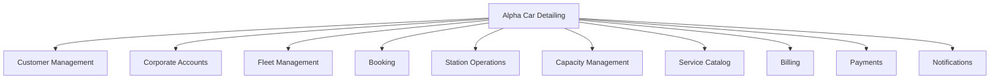

The capability view can also be represented hierarchically:

```text
Alpha Car Detailing
   ├── Customer Management
   ├── Corporate Accounts
   ├── Fleet Management
   ├── Booking
   ├── Station Operations
   ├── Capacity Management
   ├── Service Catalog
   ├── Billing
   ├── Payments
   └── Notifications
```

This model is deliberately independent of application structure.

It does **not** imply:

```text
CustomerManagementService
CorporateAccountsService
FleetManagementService
BookingService
...
```

That mapping, if appropriate, belongs to later architectural analysis.

---

# 4.24 Capability Responsibilities

## Customer Management

Supports business relationships with customers.

Responsibilities may include:

- customer identity;
- contact information;
- customer classification;
- customer status;
- customer preferences.

## Corporate Accounts

Supports enterprise commercial relationships.

Responsibilities may include:

- corporate agreements;
- authorized representatives;
- account status;
- permitted services;
- commercial conditions;
- billing terms.

## Fleet Management

Supports organized collections of vehicles.

Responsibilities may include:

- fleets;
- fleet membership;
- fleet administration;
- vehicle eligibility;
- fleet status.

## Booking

Supports requesting and managing planned service.

Responsibilities may include:

- booking request;
- selected vehicles;
- station selection;
- service selection;
- booking lifecycle;
- cancellation or modification policies.

## Station Operations

Represents operational service locations.

Responsibilities may include:

- stations;
- operating hours;
- supported services;
- operational restrictions.

## Capacity Management

Determines and manages how much work can be accepted.

Responsibilities may include:

- available capacity;
- capacity reservation;
- capacity release;
- operational constraints.

## Service Catalog

Defines what Alpha Car Detailing sells and performs.

Responsibilities may include:

- services;
- packages;
- service eligibility;
- service descriptions;
- commercial offerings.

## Billing

Determines and records amounts owed.

Responsibilities may include:

- billable activity;
- invoices;
- account billing;
- billing references.

## Payments

Supports settlement of financial obligations.

Responsibilities may include:

- payment collection;
- payment status;
- settlement references.

## Notifications

Communicates meaningful business changes.

Responsibilities may include:

- booking confirmations;
- reminders;
- cancellation notifications;
- completion notifications;
- billing notifications.

---

# 4.25 Business Capabilities Are Not Organizational Departments

A capability describes what the business can do.

It does not necessarily describe who performs it.

For example, Billing may involve:

- station operations;
- corporate account management;
- finance;
- external payment providers.

Similarly, Booking may involve:

- customers;
- fleet administrators;
- station personnel;
- automated processes.

Capabilities provide stable business structure even when organizational responsibilities change.

---

# 4.26 Domain Boundaries

Domain boundaries identify areas where business concepts, rules, ownership, or responsibilities differ sufficiently to warrant separation in the business model.

At this stage, useful conceptual boundaries include:

```text
Customer and Account Context
Fleet and Vehicle Context
Service Offering Context
Booking Context
Station and Capacity Context
Billing and Payment Context
Communication Context
```

These are not yet bounded contexts in a finalized DDD design, nor are they microservices.

They represent areas where the language and decisions begin to cluster.

### Customer and Account Context

Concerned with:

- who the customer is;
- what relationship exists;
- whether an enterprise account is active;
- who may represent that account.

### Fleet and Vehicle Context

Concerned with:

- what vehicles exist;
- how vehicles are grouped;
- whether a vehicle belongs to an appropriate fleet;
- whether a vehicle is eligible for requested activity.

### Service Offering Context

Concerned with:

- what services are offered;
- what packages exist;
- which vehicles and stations support them;
- what commercial offering applies.

### Booking Context

Concerned with:

- what the customer wants to schedule;
- booking lifecycle;
- requested vehicles;
- requested station;
- requested service.

### Station and Capacity Context

Concerned with:

- where service can occur;
- when it can occur;
- how much work can be accepted;
- what operational constraints apply.

### Billing and Payment Context

Concerned with:

- what is owed;
- how it is invoiced;
- how and when it is settled.

### Communication Context

Concerned with:

- who needs to be informed;
- what business changes require communication.

Chapter 47 will determine how architecture responds to these boundaries.

---

# 4.27 Key Workflows

Several workflows define the business.

Examples include:

- retail booking;
- corporate fleet booking;
- booking authorization;
- booking modification;
- booking cancellation;
- capacity reservation;
- service check-in;
- service completion;
- corporate billing;
- payment;
- notification.

The primary workflow for the remainder of this chapter is corporate fleet booking.

---

# 4.28 Corporate Fleet Booking

The corporate fleet booking scenario proceeds through ten major business steps:

1. Select a fleet.
2. Select vehicles.
3. Choose a station and service.
4. Check available capacity.
5. Submit a booking.
6. Receive authorization and validation.
7. Reserve capacity.
8. Receive confirmation.
9. Complete service.
10. Trigger billing and notifications.

These steps provide a business narrative.

They are not yet API calls, commands, events, services, database transactions, or queues.

---

# 4.29 Step 1 — Select a Fleet

The corporate user begins within an organizational context.

The selected fleet determines which vehicles the user intends to manage.

Business checks may include:

- account is active;
- fleet exists;
- fleet is active;
- user may operate on the fleet.

The system should not display or accept vehicles merely because they exist in a shared vehicle table.

The relevant question is business eligibility.

---

# 4.30 Step 2 — Select Vehicles

The customer selects vehicles requiring service.

The selected vehicles may need to satisfy rules such as:

- vehicle belongs to the selected fleet;
- vehicle is active;
- vehicle is eligible for the requested service;
- vehicle is not already committed to an incompatible booking.

The business must determine whether bookings are vehicle-specific or may use quantity-only requests.

For the case study, vehicle selection is explicit because fleet customers commonly require traceability to individual vehicles.

---

# 4.31 Step 3 — Choose a Station and Service

The customer chooses where the service should occur and what service is required.

The station must be capable of delivering that service.

This produces business questions such as:

- Does every station offer every service?
- Can service availability vary by day?
- Can certain vehicle types be serviced only at selected stations?
- Can corporate contracts restrict station selection?

These questions belong to business discovery.

---

# 4.32 Step 4 — Check Available Capacity

The requested work is evaluated against station capacity.

The business is asking:

> Can this station accept this work at the requested time under current operating conditions?

The answer may depend on:

- vehicle count;
- service duration;
- vehicle type;
- station resources;
- existing reservations;
- operational restrictions.

An availability response is informative.

It is not necessarily a commitment.

---

# 4.33 Step 5 — Submit a Booking

Submission indicates that the customer wishes to proceed.

At this point, the request becomes business-significant.

The booking request may contain:

- account;
- fleet;
- vehicles;
- station;
- service;
- requested schedule;
- customer references;
- optional instructions.

Submission does not automatically imply confirmation.

---

# 4.34 Step 6 — Authorization and Validation

The business evaluates whether the requested booking may proceed.

This may include:

```text
Account Valid?
Fleet Valid?
Vehicles Eligible?
User Authorized?
Service Permitted?
Station Suitable?
Commercial Rules Satisfied?
Capacity Still Available?
```

The distinction between validation and authorization is useful.

Validation asks whether conditions are valid.

Authorization asks whether the customer is permitted to perform the activity.

Depending on confirmed requirements, some checks may happen earlier for usability and be repeated later for correctness.

---

# 4.35 Step 7 — Reserve Capacity

Once the booking is acceptable, the required capacity must be committed.

The key business outcome is:

> Capacity required by the accepted booking is no longer available to competing bookings.

This point becomes extremely important in later architecture chapters because concurrent requests may compete for limited resources.

For now, the domain requirement is enough.

The business must prevent confirmed bookings from exceeding operational capacity.

---

# 4.36 Step 8 — Receive Confirmation

After successful acceptance and capacity reservation, the customer receives confirmation.

Confirmation establishes an important customer expectation:

> Alpha Car Detailing has accepted responsibility for servicing the confirmed vehicles according to the agreed booking conditions.

The confirmation may contain:

- booking reference;
- station;
- service;
- vehicles;
- scheduled date or time;
- customer instructions.

The exact content is a business decision.

---

# 4.37 Step 9 — Complete Service

At the scheduled time, vehicles are processed operationally.

Actual station operations may include:

- arrival;
- check-in;
- service start;
- service execution;
- quality checks;
- completion;
- release of vehicle.

This chapter treats those details at a high level.

The critical transition is that booked work eventually becomes completed service activity.

---

# 4.38 Step 10 — Trigger Billing and Notifications

Once qualifying service is completed, financial and communication activities may begin.

For corporate customers:

```text
Completed Service
      │
      ├──> Billing Activity
      │
      └──> Customer Notification
```

Billing may produce invoiceable items rather than immediate payment.

Notifications may inform relevant stakeholders that service is complete.

Later architecture must decide how these activities interact technically.

The business requirement comes first:

> Completed service must produce the appropriate commercial and customer outcomes.

---

# 4.39 Business Events

A business event records something meaningful that has happened in the domain.

Potential events include:

- Corporate Account Activated
- Fleet Created
- Vehicle Added to Fleet
- Booking Submitted
- Booking Authorized
- Booking Rejected
- Capacity Reserved
- Booking Confirmed
- Booking Cancelled
- Vehicle Checked In
- Service Started
- Service Completed
- Invoice Issued
- Payment Received
- Customer Notified

At this stage these are **business events**, not technical event contracts.

That distinction is essential.

The business may recognize:

> Booking Confirmed

Chapter 50 may later determine whether the architecture publishes something such as:

```text
BookingConfirmedV1
```

Those are different design levels.

---

# 4.40 Business Event Versus Technical Event

Consider the following statement:

> Service completion is important because billing must follow successful completion.

That is domain knowledge.

Now consider:

```json
{
  "eventType": "ServiceCompletedV1",
  "bookingId": "..."
}
```

That is technical design.

The second should be derived from the first—not the reverse.

Teams sometimes discover business requirements while designing event schemas. That is acceptable as a discovery mechanism, but the resulting requirement should be returned to business analysis and confirmed.

The event contract itself must not become the source of truth for an invented rule.

---

# 4.41 Business Expectations

Customers and operators do not describe successful systems in terms of message brokers or databases.

Their expectations are expressed in outcomes.

Corporate customers expect:

- only authorized users to manage their fleets;
- accurate vehicle information;
- clear service choices;
- reliable capacity information;
- predictable booking;
- correct contractual pricing;
- confirmation;
- timely service;
- accurate invoices;
- useful notifications.

Station personnel expect:

- realistic schedules;
- protection from overbooking;
- clear booking details;
- visibility into planned workload;
- manageable operational changes.

Finance teams expect:

- correct billable information;
- proper account references;
- consistent commercial rules;
- traceability.

Business leadership expects:

- scalable growth;
- improved station utilization;
- reliable operations;
- enterprise customer support;
- consistent customer experience.

These expectations later become quality attributes, architecture drivers, acceptance criteria, metrics, and operational controls.

But their origin is business need.

---

# 4.42 Risks and Constraints

The business domain contains risks before technical architecture is considered.

## Overbooking

The organization may promise more service than a station can deliver.

Impact:

- customer dissatisfaction;
- operational disruption;
- manual recovery;
- reputational damage.

## Incorrect Authorization

A user may book vehicles or services outside permitted corporate authority.

Impact:

- unauthorized spending;
- contractual disputes;
- security and compliance concerns.

## Incorrect Pricing

The wrong commercial terms may be applied.

Impact:

- revenue leakage;
- customer disputes;
- reconciliation work.

## Invalid Fleet Membership

A vehicle may be booked under the wrong account or fleet.

Impact:

- incorrect billing;
- authorization failures;
- poor reporting.

## Capacity Staleness

Availability may change between viewing and booking.

Impact:

- conflicting commitments;
- failed bookings;
- inconsistent customer experience.

## Service Mismatch

A selected station may not support the requested service or vehicle.

Impact:

- service failure;
- rescheduling;
- customer dissatisfaction.

## Ambiguous Requirements

Different stakeholders may interpret rules differently.

Impact:

- inconsistent implementations;
- repeated defects;
- architectural rework.

## AI-generated Assumptions

An AI Agent may fill domain gaps with plausible behavior.

Impact:

- rapid implementation of incorrect rules;
- false confidence;
- hidden policy decisions inside code.

---

# 4.43 Constraints Versus Requirements

A requirement describes what the business needs.

A constraint limits the ways that need may be satisfied.

Examples:

**Requirement**

> Corporate customers must be able to book multiple fleet vehicles.

**Constraint**

> A station can service only a limited number of vehicles simultaneously.

**Requirement**

> Customers must receive confirmation for accepted bookings.

**Constraint**

> Certain corporate bookings require authorization before confirmation.

Understanding the distinction helps later architecture identify where flexibility exists.

---

# 4.44 Business Invariants

A business invariant is a condition that must remain true.

Possible invariants for the case study include:

```text
A confirmed booking cannot reference an invalid station.

A corporate fleet booking cannot use an ineligible fleet.

A booked vehicle must be eligible under the applicable customer relationship.

Confirmed capacity must not exceed accepted operational capacity.

Billing must correspond to qualifying business activity.

Applicable contractual pricing must be honored.
```

Invariants are especially valuable for AI-assisted development because they provide stable constraints against which generated implementation can be reviewed and validated.

---

# 5. Architecture Discussion

This section is intentionally limited to **business architecture**.

Solution architecture begins in Chapter 47.

The goal here is to identify architectural inputs—not to prescribe services, databases, APIs, messaging technologies, or deployment models.

---

## 5.1 Architecture Starts with Business Capabilities

A useful architecture discussion begins with the question:

> What must Alpha Car Detailing be capable of doing?

The answer produces business capabilities:

```text
Customer Management
Corporate Accounts
Fleet Management
Booking
Station Operations
Capacity Management
Service Catalog
Billing
Payments
Notifications
```

The next question is:

> Which capabilities contain distinct business rules, vocabulary, responsibilities, and rates of change?

Only after understanding those characteristics should the architecture consider decomposition.

This protects the design from a common failure mode:

```text
Nouns in Requirements
        ↓
Microservices
```

For example:

```text
Customer
Fleet
Vehicle
Booking
Station
Invoice
```

should not automatically become:

```text
Customer Service
Fleet Service
Vehicle Service
Booking Service
Station Service
Invoice Service
```

Entity names are not architectural boundaries.

Business responsibility is more important.

---

# 5.2 Capability Model Before Service Model

The business capability model should remain independent of technology.

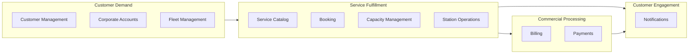

This diagram communicates relationships without deciding implementation topology.

A monolith, modular monolith, distributed system, or microservice architecture could all potentially implement the capability model.

The model survives those technical choices.

---

# 5.3 Domain Boundaries Before Deployment Boundaries

A domain boundary expresses separation in business meaning.

A deployment boundary expresses separation in runtime architecture.

These boundaries can correspond, but they do not have to.

For example, Booking and Capacity Management are conceptually different:

**Booking asks:**

> What service does the customer want?

**Capacity asks:**

> Can the business accept the requested work?

That conceptual separation is useful even if both are initially implemented within one deployable application.

Conversely, dividing them into independent deployable services without understanding their business interaction may introduce unnecessary distributed complexity.

Chapter 47 will revisit this distinction.

---

# 5.4 Business Ownership

Every important business rule should have an identifiable business owner.

Examples:

| Rule | Likely Business Owner |
| --- | --- |
| Fleet booking eligibility | Corporate Operations |
| Station capacity policy | Station Operations |
| Corporate pricing | Sales / Commercial Management |
| Billing terms | Finance |
| Service definitions | Service Operations / Product |
| Government authorization rules | Account Management / Compliance |
| Cancellation policy | Operations / Commercial Management |

The exact owner may vary by organization.

The principle does not.

A developer or AI Agent should not become the accidental owner of a business policy simply because the requirement was unclear.

---

# 5.5 Business Decisions Must Remain Visible

Architecture often hides unresolved business questions behind abstractions.

Consider:

```csharp
if (!policy.IsSatisfied(request))
{
    return BookingRejected();
}
```

The code is technically clean.

But what is the policy?

Who defined it?

What conditions does it contain?

What happens if those conditions change?

A well-designed abstraction can still hide a poorly understood requirement.

Business rules should be traceable to their rationale and ownership.

---

# 5.6 Do Not Let the Database Define the Domain

A relational schema might eventually contain tables such as:

```text
Customers
CorporateAccounts
Fleets
Vehicles
Stations
Services
Bookings
BookingVehicles
Invoices
Payments
```

These names may appear reasonable.

But starting from those tables creates several risks.

A table encourages a storage-centric view:

```text
What columns belong here?
```

The domain requires a behavioral view:

```text
What decisions does the business make?
What rules must remain true?
What transitions matter?
Who owns those decisions?
```

A `Bookings` table cannot tell the team:

- when a booking becomes confirmed;
- whether authorization precedes reservation;
- whether capacity is temporarily held;
- whether an account may exceed a credit limit;
- what happens when one vehicle in a multi-vehicle booking becomes ineligible.

Those are domain questions.

---

# 5.7 Do Not Let APIs Define the Domain

The same warning applies to APIs.

An early API proposal might contain:

```text
POST /bookings
GET /stations/{id}/capacity
POST /payments
```

These endpoints may eventually be useful.

But endpoint design should follow business understanding.

Otherwise, API shape begins dictating business semantics.

For example, `POST /bookings` raises unanswered questions:

- Does it submit or confirm?
- Does it reserve capacity?
- Can it fail after partial processing?
- Does it authorize the user?
- Does it calculate price?
- Does it support multiple vehicles?
- Does it immediately create billable activity?

The endpoint cannot answer the questions.

The domain must.

---

# 5.8 Do Not Let Events Define the Domain

Event-driven architecture can encourage another form of premature modeling.

A team starts with:

```text
BookingCreated
CapacityReserved
PaymentProcessed
```

and assumes the business workflow has been understood.

But `BookingCreated` is ambiguous.

Created as a draft?

Submitted?

Accepted?

Confirmed?

The business vocabulary should establish the meaningful state change before the technical event is named.

Good event design starts with meaningful business events, not infrastructure enthusiasm.

---

# 5.9 Do Not Let AI-generated Code Define the Domain

AI Agents can generate classes, controllers, validators, handlers, schemas, tests, and events at extraordinary speed.

That creates a new architectural risk:

> Implementation can become more detailed than the requirement.

Once detailed generated code exists, teams often begin treating it as authoritative.

For example, an AI Agent may generate:

```csharp
public const int MaximumFleetBookingSize = 25;
```

Soon afterward:

- unit tests enforce 25;
- APIs reject 26;
- UI validation displays 25;
- documentation mentions 25;
- other services depend on 25.

A speculative number has become institutionalized.

The AI Agent did not intentionally make a policy decision.

The engineering process allowed an assumption to harden into architecture.

---

# 5.10 Business Context Before Skills and Prompts

The same principle applies to AI Engineering artifacts.

A Skill that says:

> Implement a fleet booking endpoint with validation.

is incomplete if the business has not defined what validation means.

A Prompt that says:

> Add capacity checks.

is dangerous if the business has not defined capacity.

A repository Instruction that says:

> Every confirmed booking must reserve capacity.

is useful only if "confirmed" and "reserve capacity" are established domain terms.

Therefore the sequence should be:

```text
Business Understanding
        ↓
Domain Vocabulary
        ↓
Confirmed Rules
        ↓
Architecture Decisions
        ↓
Instructions
        ↓
Skills
        ↓
Prompts
        ↓
AI-generated Implementation
        ↓
Harness Validation
```

The AI Engineering machinery strengthens an understood domain.

It cannot substitute for one.

---

# 5.11 Business Context Before Harness Automation

A harness can deterministically verify:

- builds;
- tests;
- architecture rules;
- static analysis;
- security checks;
- formatting;
- quality gates;
- acceptance criteria.

But it can only validate rules that have been expressed.

If the team misunderstands the business requirement, the harness may repeatedly prove that the wrong implementation is internally consistent.

This creates a dangerous form of confidence.

```text
Wrong Requirement
      ↓
Wrong Implementation
      ↓
Correct Automated Tests
      ↓
Green Harness
      ↓
Wrong Business Outcome
```

The lesson is not that automation is weak.

The lesson is that automation must be anchored in valid business intent.

---

# 5.12 Traceability from Business Goal to Implementation

A mature engineering process should eventually support traceability such as:

```text
Business Goal
    ↓
Business Capability
    ↓
Business Rule
    ↓
Business Workflow
    ↓
Architecture Decision
    ↓
Implementation
    ↓
Test
    ↓
Operational Metric
```

For example:

```text
Goal:
Avoid station overbooking

    ↓

Capability:
Capacity Management

    ↓

Rule:
Confirmed reservations must not exceed available operational capacity

    ↓

Workflow:
Corporate fleet booking

    ↓

Architecture:
Defined in Chapter 47+

    ↓

Implementation:
Defined in later chapters

    ↓

Validation:
Automated tests and harness gates

    ↓

Metric:
Overbooking incidents / reservation failures / capacity utilization
```

This is the foundation of enterprise AI Engineering.

The AI Agent works inside a traceable engineering system rather than generating isolated code.

---

# 5.13 Domain Questions That Must Precede Architecture

Before the team commits to technical design, it should be able to answer questions such as:

### Customers

- What customer categories exist?
- Which differences affect system behavior?
- Can one organization have multiple accounts?

### Fleets

- What is a fleet?
- Who owns it?
- Who manages it?
- Can vehicles move between fleets?

### Vehicles

- What makes a vehicle eligible?
- Which attributes affect service or pricing?

### Services

- What is the difference between a service and a package?
- Which stations support which services?

### Booking

- What constitutes submission?
- What constitutes acceptance?
- What constitutes confirmation?
- Can bookings contain multiple vehicles?

### Capacity

- How is capacity measured?
- When does availability become reserved?
- What causes capacity to be released?

### Authorization

- Who may create a fleet booking?
- What business limits apply?

### Pricing

- Which pricing source takes precedence?
- When is price determined?

### Billing

- What activity becomes billable?
- When is an invoice created?

### Notifications

- Which transitions require communication?
- Who receives each communication?

If several answers are unknown, the architecture is not blocked from all progress, but those uncertainties should remain visible rather than being silently resolved in code.

---

# 6. Professional Diagrams

## 6.1 Business Context Diagram

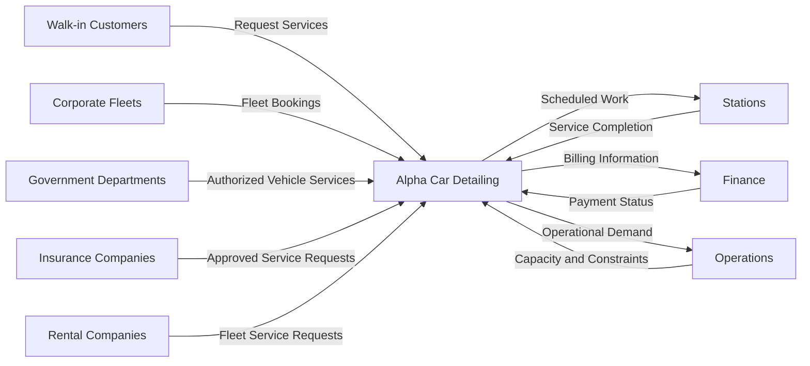

The diagram intentionally describes business relationships rather than applications.

---

## 6.2 Business Capability Map

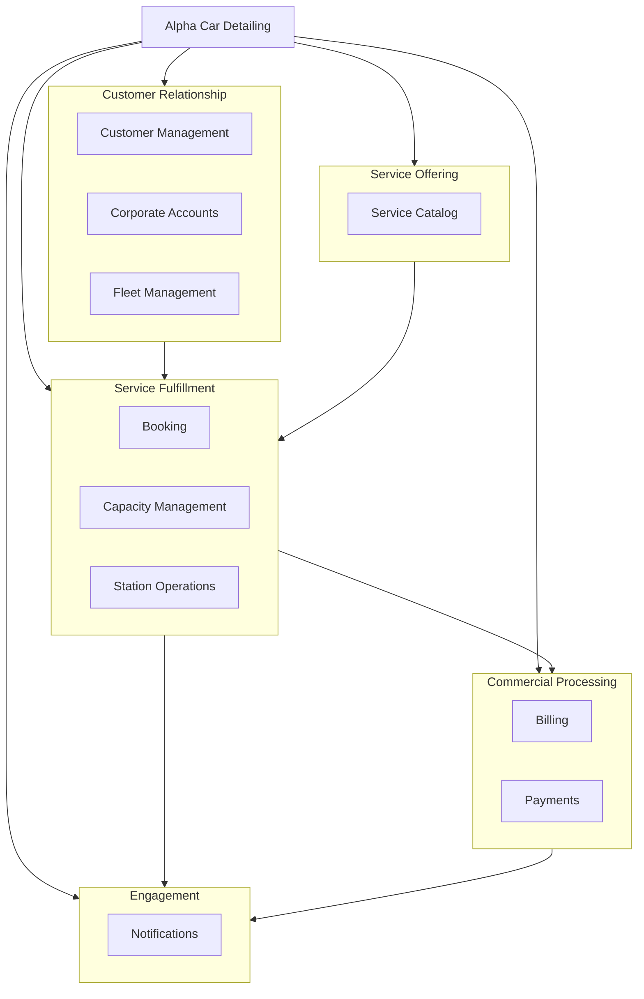

---

## 6.3 Corporate Fleet Booking Workflow

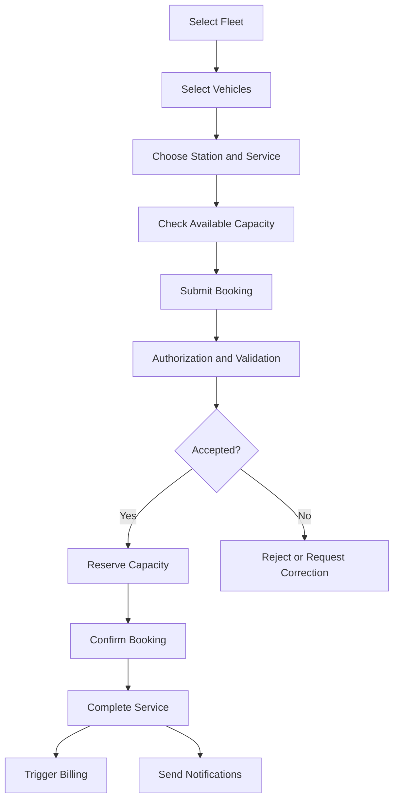

This diagram should be read as a business flow.

It deliberately avoids technical concepts such as APIs, queues, transactions, brokers, databases, or microservices.

---

## 6.4 Corporate Booking Business Interaction

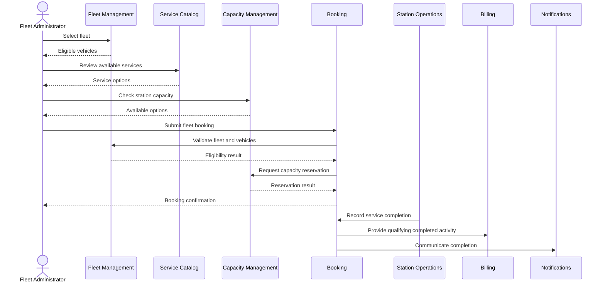

The participants represent business responsibilities.

They should not yet be interpreted as physical services.

---

## 6.5 Capacity Decision Model

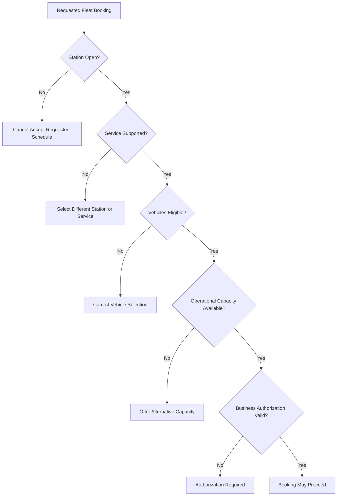

The model shows that capacity is only one business condition within booking acceptance.

---

## 6.6 Business State Progression

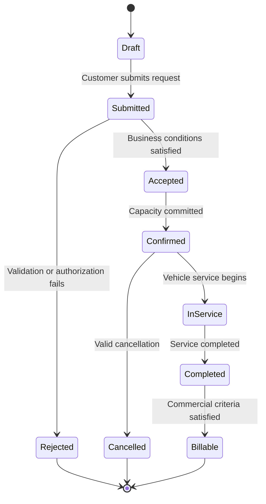

This diagram is illustrative rather than a final lifecycle specification.

Terms and transitions should be confirmed with stakeholders before later chapters encode them into software.

---

## 6.7 Business Event Timeline

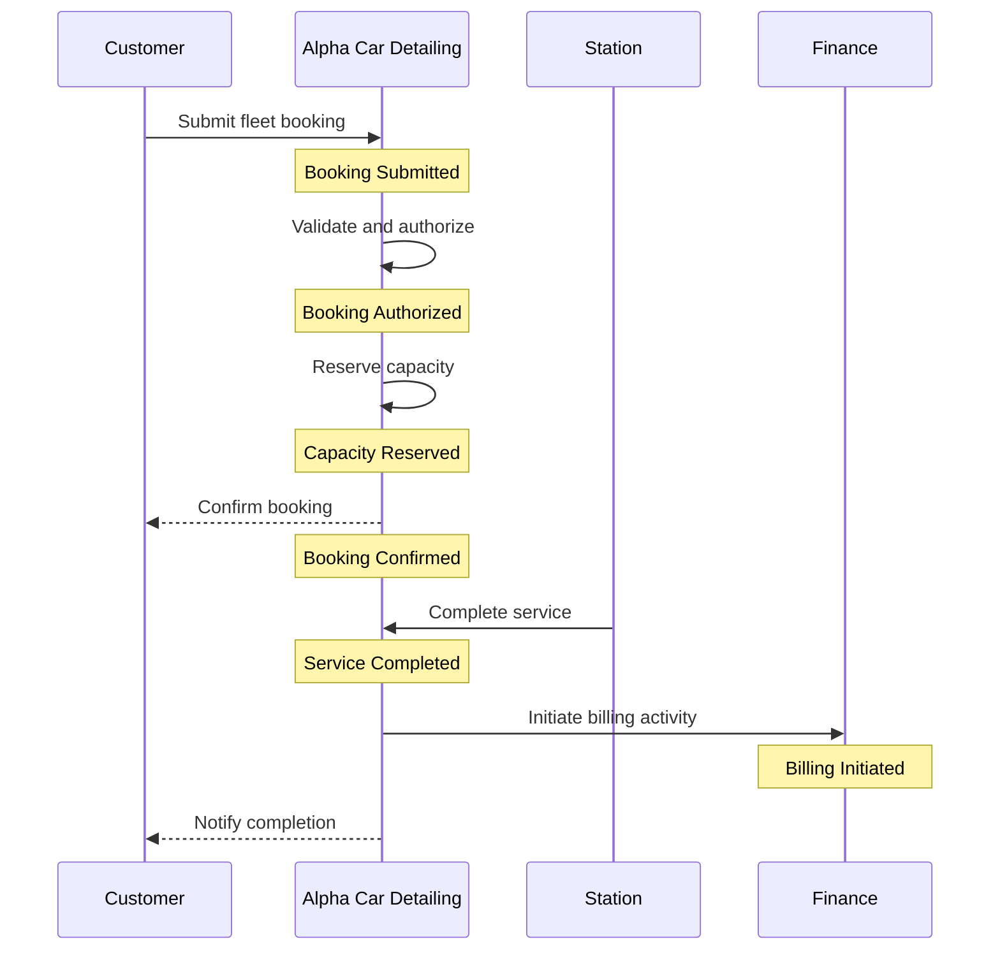

Again, these are business events.

Whether every event becomes an integration event is a later architecture decision.

---

## 6.8 Business Capability and Information Relationship

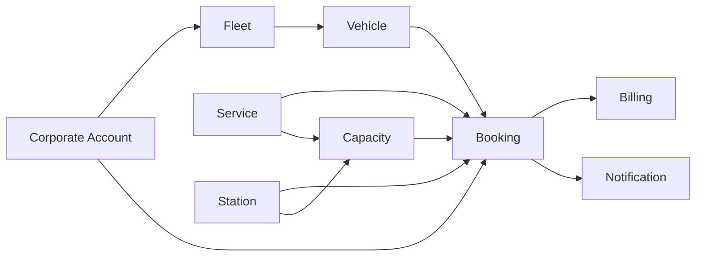

This view identifies business relationships without defining database foreign keys.

That distinction is important.

A line in a business model represents a meaningful relationship, not necessarily a relational database constraint.

---

## 6.9 Domain Boundary View

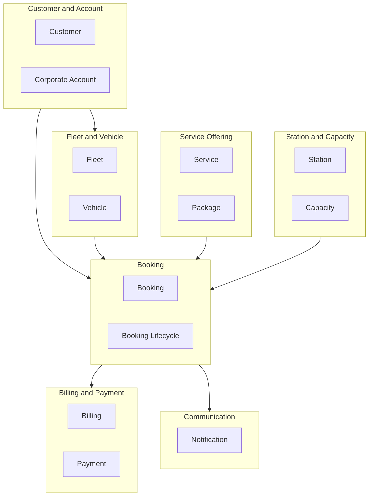

The diagram identifies candidate business boundaries.

Chapter 47 will evaluate how those boundaries influence solution architecture.

---

## 6.10 From Business Understanding to Engineering

The final diagram in this section captures the governing principle of the chapter.

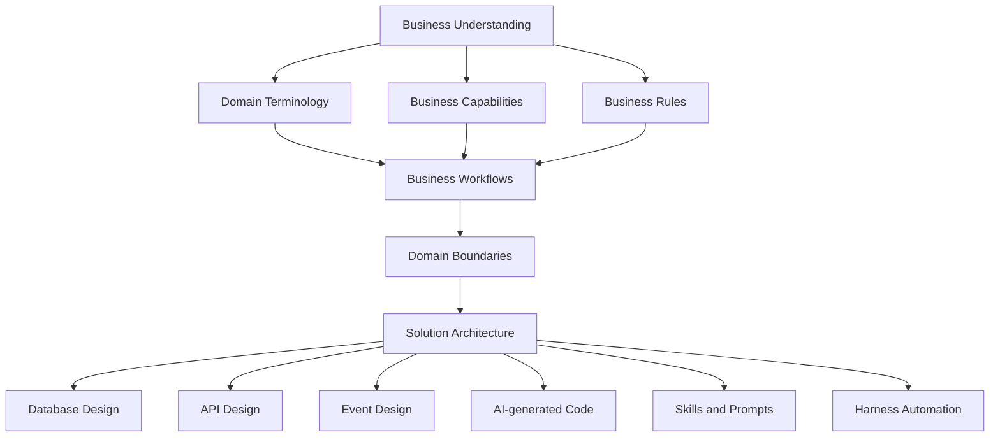

The direction of dependency is intentional.

Business understanding informs architecture.

Architecture informs implementation.

AI Engineering accelerates and governs implementation.

Reversing that sequence creates technical certainty around business uncertainty.

The remainder of Part VII will progressively transform the business understanding established here into architecture and working software. The discipline throughout those chapters is to preserve traceability back to the business domain rather than allowing technical artifacts to become detached from their purpose.

Chapter 46 status: In progress — next section: Hands-on Example
