# Chapter 47 — Solution Architecture

## Part VII — Alpha Car Detailing

Chapter 46 established the business context that architecture must serve: Alpha Car Detailing is a nationwide vehicle washing and detailing business with multiple customer types, corporate fleets, stations, bookings, capacity constraints, commercial agreements, billing, payments, and notifications. It also established a critical sequence for Part VII: understand the business first, then translate that understanding into architecture and implementation.

This chapter performs that translation.

The objective is not to begin with microservices, Kubernetes, an API gateway, a message broker, or a preferred cloud platform and then force the business into those technologies. The objective is to identify the architectural boundaries, communication patterns, ownership rules, quality attributes, operational controls, and deployment model required to support the business responsibly.

The governing principle is:

> **Architecture must follow business boundaries, quality attributes, and operational needs rather than technology preferences.**

That principle is especially important in AI-assisted engineering. An AI Agent can generate service projects, controllers, event handlers, container definitions, infrastructure manifests, and deployment pipelines extremely quickly. Speed does not make those decisions correct. If the architecture has not established ownership and boundaries first, AI accelerates architectural inconsistency just as effectively as it accelerates good engineering.

The seven-service model developed in this chapter is a **candidate reference architecture**, not evidence that seven services have already been independently deployed or that every proposed ADR has been approved. Business facts are distinguished from architecture proposals, and approval status must be established through the project's governance process.

---

## 1. Story-driven Opening

It is Monday afternoon, several hours after the Northstar Distribution fleet administrator submitted the corporate fleet request introduced in Chapter 46.

Twenty-four delivery vehicles require service across two days.

The business request appears to have progressed successfully. The corporate account is active. The fleet administrator is authorized. The vehicles belong to the expected fleet. The selected station can provide the required services. Capacity appears available. Northstar's commercial agreement permits consolidated invoicing.

The engineering team now has a different problem.

How should the software make all of those decisions safely?

One developer proposes a single endpoint:

```http
POST /api/fleet-bookings
```

The endpoint would read the corporate account, fleet, vehicle, station, capacity, pricing, booking, billing, and notification tables from one database, perform the validations, insert all required records, and return a booking confirmation.

From a local transaction perspective, the proposal appears attractive.

Everything happens together.

There is one database transaction.

There are no distributed failures.

There is no messaging infrastructure.

There are no eventual-consistency concerns.

Another developer proposes the opposite extreme.

Every noun becomes a service:

```text
Customer Service
Account Service
Fleet Service
Vehicle Service
Booking Service
Station Service
Capacity Service
Pricing Service
Invoice Service
Payment Service
Email Service
SMS Service
```

Every service receives its own database and API. A fleet booking now requires a long chain of synchronous calls.

The Booking Service calls the Account Service.

The Account Service calls the Contract Service.

The Booking Service then calls the Fleet Service.

The Fleet Service calls the Vehicle Service.

The Booking Service calls the Station Service.

The Station Service calls the Capacity Service.

The Booking Service calls Pricing.

Pricing calls Corporate Contracts.

After confirmation, Booking calls Billing.

Billing calls Payment.

Payment calls Notification.

The resulting diagram looks sophisticated.

The runtime behavior is fragile.

A booking cannot succeed if any service in the synchronous chain is temporarily unavailable. Latency accumulates. Retry behavior becomes difficult to reason about. Ownership is unclear. Some services contain almost no business logic. Other services must understand the internal decisions of several neighbors.

The architecture has become distributed without becoming well bounded.

The enterprise architect rejects both proposals.

The first proposal ignores important business boundaries.

The second proposal mistakes distribution for architecture.

Instead, the team begins with a different set of questions:

- Which business capability owns each decision?
- Which data must remain authoritative within that capability?
- Which interactions require an immediate answer?
- Which consequences can occur asynchronously?
- Where must atomic consistency exist?
- Where is eventual consistency acceptable?
- Which failures should prevent a booking?
- Which failures should be retried later?
- Which events represent facts that other capabilities may react to?
- Which security decisions belong at the edge, and which must still be enforced inside services?
- Which dependencies are operationally critical?
- Which components need independent scaling or deployment?
- Which architectural decisions are stable enough to encode into repository Instructions and validation gates?
- Which decisions still require human approval?

Those questions produce a very different architecture.

Corporate Account owns corporate-account status and commercial eligibility.

Fleet owns fleets and vehicle membership.

Station Operations owns station capability and operational capacity.

Booking owns the booking lifecycle.

Billing owns invoices and receivables.

Payment owns payment execution and payment status.

Notification owns communication delivery.

Each service owns its own data.

Services do not read another service's tables.

A service uses an API when it requires an immediate decision from another capability.

A service publishes an integration event when it announces a completed business fact whose downstream consequences do not need to block the originating transaction.

Transactional outbox processing protects reliable event publication.

Consumers are idempotent because delivery may occur more than once.

An API Gateway provides a controlled external entry point but does not become the location for business rules.

Security is enforced at multiple boundaries.

Observability crosses every runtime component.

Deployment boundaries are explicit.

Architecture decisions are recorded rather than hidden inside generated code.

The resulting design contains more moving parts than a single database application, but every moving part has a reason to exist.

That distinction matters.

> **Architect's Note**  
> A distributed architecture is justified by business boundaries and operational requirements—not by the desire to draw more boxes.

The architecture for Alpha Car Detailing therefore begins with ownership.

Before deciding how components communicate, the organization must know what each component is responsible for protecting.

---

## 2. Learning Objectives

By the end of this chapter, you should be able to:

- translate Alpha Car Detailing business capabilities into solution-architecture boundaries;
- identify the architecture drivers that shape the system independently of technology preference;
- define meaningful quality attributes and explain how they influence architecture;
- describe the system context for customer applications, enterprise users, station operations, payment providers, messaging infrastructure, and operational platforms;
- distinguish business boundaries, service boundaries, deployment boundaries, and data boundaries;
- explain the responsibilities of the Booking, Corporate Account, Fleet, Station Operations, Billing, Payment, and Notification services;
- define appropriate responsibilities for an API Gateway without placing business logic at the edge;
- decide when synchronous APIs are appropriate and when integration events are preferable;
- explain database ownership and why direct cross-service database access is prohibited;
- distinguish owned contracts from shared business logic;
- explain how transactional outbox processing supports reliable event publication;
- explain why integration-event consumers must be idempotent;
- define security and authorization boundaries across gateway, service, workload, and data layers;
- identify appropriate caching opportunities without treating caches as authoritative business state;
- design for dependency failure, retry, duplicate delivery, timeout, partial availability, and eventual consistency;
- define observability expectations across requests, messages, services, containers, and business workflows;
- explain how containers and Kubernetes support deployment without becoming the architecture itself;
- describe CI/CD controls that protect architectural boundaries;
- identify major architecture decisions, alternatives, trade-offs, and evolution strategies;
- recognize distributed-monolith characteristics before they become entrenched;
- prevent AI Agents from silently inventing or changing solution-architecture decisions;
- preserve traceability between business capabilities, architecture decisions, implementation, and operational evidence.

---

## 3. Background

### 3.1 From Business Architecture to Solution Architecture

Chapter 46 deliberately stopped before prescribing services, databases, APIs, messaging infrastructure, or deployment topology.

That separation is essential.

A business capability answers:

> What must the business be able to do?

A solution architecture answers:

> How will the software system organize responsibilities and interactions so that those business capabilities can be delivered with acceptable quality, security, reliability, operability, and changeability?

The two models are related, but they are not interchangeable.

For example:

```text
Business capability:
Corporate Account Management

Possible solution boundary:
Corporate Account Service
```

The first describes business responsibility.

The second is an architectural decision.

Similarly:

```text
Business capability:
Station and Capacity Management

Possible solution boundary:
Station Operations Service
```

Nothing requires every business capability to become a separately deployed service.

Nothing requires every service to correspond to a single database table.

Nothing requires the first deployment topology to be the final deployment topology.

The architecture must preserve the business distinctions while selecting a technical structure appropriate to organizational scale, quality attributes, operational maturity, and expected evolution.

---

### 3.2 Architecture Is a Set of Consequential Decisions

Architecture is sometimes reduced to diagrams.

A diagram is only a representation.

The architecture is the set of decisions behind it.

For Alpha Car Detailing, those decisions include questions such as:

```text
Who owns booking status?

Who owns fleet membership?

Who decides whether a corporate account is active?

Who owns station capacity?

Can Booking read the Fleet database?

Can Billing update Booking tables?

Must payment complete before a corporate booking is confirmed?

How does Billing learn that service has completed?

What happens if Notification is unavailable?

Can an integration event be processed twice?

How are breaking API changes introduced?

Which identity claims may be trusted?

Which authorization rules must be evaluated by the owning service?

Can a cache determine whether capacity is available?

What happens when the message broker is temporarily unavailable?

Which deployment units may scale independently?

Who approves a change to an architectural boundary?
```

A professional solution architecture must answer these questions explicitly.

If it does not, implementation teams will answer them independently.

AI Agents will answer them even faster.

The result will be accidental architecture.

---

### 3.3 Architecture Drivers

Architecture drivers are the forces that materially influence system structure.

For Alpha Car Detailing, the important drivers come from several categories.

| Driver | Architectural Implication |
| --- | --- |
| Multiple customer types | Authorization and commercial policies cannot assume one customer model |
| Corporate fleet booking | Fleet membership, account status, vehicle eligibility, booking, capacity, and billing cross business boundaries |
| Nationwide station operations | Operational state and capacity require clear ownership and scalable access patterns |
| Concurrent booking demand | Capacity-related operations must protect against overbooking and race conditions |
| Corporate billing | Booking confirmation and immediate payment cannot be treated as the same workflow |
| External payment integration | Payment-provider failures must be isolated from unrelated capabilities |
| Notifications | Communication failure should generally not invalidate completed business transactions |
| Independent business evolution | Corporate-account rules, station operations, booking, and payments may change at different rates |
| Security and auditability | Identity, authorization, sensitive operations, and architectural decisions require traceability |
| AI-assisted development | Architecture must be machine-readable enough to guide Agents but governed strongly enough to prevent invented decisions |
| Enterprise operations | Logs, metrics, traces, health signals, deployment history, and incident correlation are first-class requirements |
| Continuous delivery | Service boundaries must support controlled, repeatable deployment and rollback |
| Future growth | Architecture must permit evolution without assuming that every future capability requires immediate distribution |

Architecture drivers should be recorded because they explain *why* the architecture looks the way it does.

Without drivers, future engineers see only constraints.

With drivers, they can determine whether a constraint still makes sense.

---

### 3.4 Functional Requirements Are Not Enough

Functional requirements describe what the software must do.

Examples include:

- create a corporate booking;
- validate fleet membership;
- reserve station capacity;
- initiate billing;
- record payment;
- send confirmation.

Those requirements do not answer whether the system is acceptable in production.

A booking system that returns correct results but becomes unavailable whenever the notification provider fails is not acceptable.

A billing system that generates correct invoices but occasionally processes the same event twice and creates duplicates is not acceptable.

A fleet system that is fast but allows one corporate customer to access another customer's vehicles is not acceptable.

A service topology that functions correctly but cannot be diagnosed during an incident is not acceptable.

Architecture must therefore respond to quality attributes as well as features.

---

### 3.5 Quality Attributes

The Alpha Car Detailing architecture is shaped by the following quality attributes.

#### Availability

Critical customer and station workflows should remain available despite failures in noncritical downstream services.

A notification outage, for example, should not normally prevent a successfully validated booking from being recorded.

#### Reliability

Accepted business changes must not silently disappear.

If Booking commits a state transition that other services need to know about, reliable event publication is required.

#### Consistency

Strong consistency is required within selected ownership boundaries.

Cross-service workflows must explicitly choose between immediate coordination and eventual consistency rather than pretending that a distributed transaction exists.

#### Security

Every request must operate within an authenticated identity and an authorized business scope.

External network location alone is not authorization.

#### Auditability

Security-sensitive and financially significant actions must be attributable to actors, services, requests, and deployment versions.

#### Performance

Interactive operations such as fleet lookup, booking submission, and availability queries must respond within acceptable business latency.

Performance targets should be measurable rather than described as "fast."

#### Scalability

Demand may vary by customer, station, geography, campaign period, and service.

Components should be capable of scaling according to their workload rather than requiring the entire system to scale identically.

#### Resilience

Transient dependency failure must not automatically become end-user failure.

Timeouts, retries, circuit breaking, queue-based decoupling, dead-letter handling, and degraded operation should be deliberate.

#### Observability

Operations teams must be able to reconstruct the path of a request or business workflow across service and message boundaries.

#### Changeability

A change in notification delivery should not require rebuilding the booking domain.

A change in payment-provider integration should not require modifying fleet membership logic.

#### Deployability

Changes should be independently testable and deployable where the service boundary justifies independent release.

#### Interoperability

APIs and integration events must use explicit, versioned contracts.

#### Recoverability

The architecture must define how failed or partially processed work can be safely retried, replayed, reconciled, or repaired.

#### Governance

Significant architecture decisions, contract changes, and boundary changes must have identifiable ownership and approval paths.

> **Enterprise Tip**
> Quality attributes become useful only when teams can test or observe them. "Secure," "reliable," and "scalable" are aspirations until they are associated with concrete controls and measurable behavior.

---

### 3.6 Architecture Constraints

Architecture also operates within constraints.

For the Alpha Car Detailing reference solution, the technology direction includes .NET services, SQL Server, Redis where caching is justified, event-driven integration, containers, Kubernetes, OpenTelemetry, and automated CI/CD.

These technologies support the architecture.

They do not define it.

For example:

```text
Requirement:
Reliable propagation of committed business events

Architecture mechanism:
Transactional outbox

Possible technology implementation:
SQL Server outbox table + background publisher + messaging platform
```

The important architectural decision is reliable publication from committed service state.

The broker technology can change.

Likewise:

```text
Requirement:
Independent deployment and workload isolation

Architecture mechanism:
Containerized service deployment

Possible platform:
Kubernetes
```

The architecture should not become unintelligible if a future platform team replaces Kubernetes with another orchestration environment.

Stable principles should be separated from replaceable implementation technology.

---

### 3.7 Solution Architecture and Clean Architecture Are Different Concerns

This chapter defines the architecture **between** major solution components.

Chapter 48 will address structure **inside** those components.

That distinction prevents a common conceptual collapse.

This chapter asks:

```text
What services exist?
What does each service own?
How do they communicate?
Where does data live?
How are failures handled?
How are services secured?
How are they deployed and observed?
```

Chapter 48 will ask questions such as:

```text
How is a service internally layered?
Where does domain behavior live?
How are application use cases organized?
How are infrastructure concerns isolated?
How are dependencies directed?
```

A system may have excellent internal Clean Architecture and still have poor solution architecture.

For example, seven perfectly layered services can still form a distributed monolith if every request requires all seven to be online.

Conversely, strong service boundaries do not excuse poor internal design.

The two architectural levels complement each other.

---

## 4. Concepts

### 4.1 System Context

A system context identifies the Alpha Car Detailing platform and the external actors and systems with which it interacts.

At a high level, the platform serves:

- retail customers;
- corporate fleet administrators;
- station personnel;
- operations personnel;
- finance personnel;
- enterprise administrators;
- external identity infrastructure;
- payment providers;
- communication providers;
- operational and observability platforms.

The context establishes trust and responsibility boundaries before internal service topology is considered.

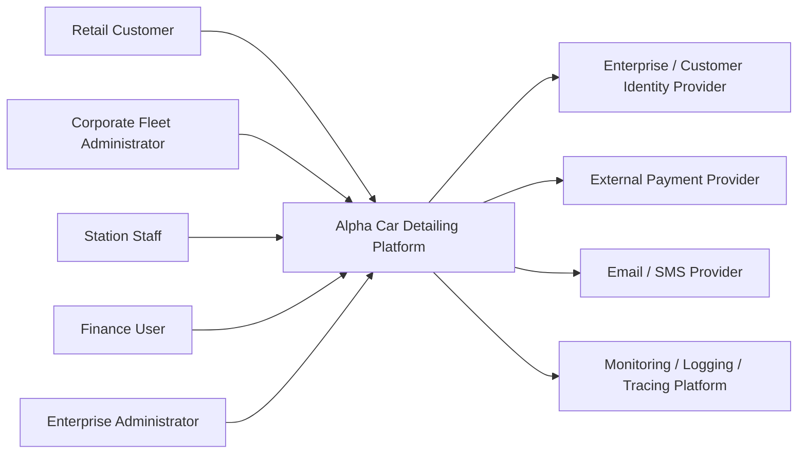

The system context deliberately avoids internal service details.

Its purpose is to make external dependencies and trust relationships visible.

---

### 4.2 Business Boundary, Service Boundary, and Deployment Boundary

These terms should not be treated as synonyms.

#### Business Boundary

A separation in business responsibility, terminology, rules, and ownership.

#### Service Boundary

A software boundary that exposes behavior and owns state associated with a coherent responsibility.

#### Deployment Boundary

A unit that can be deployed, scaled, versioned, and operated independently.

In a mature service architecture, these boundaries often align.

They are not automatically identical.

For example, Station Operations may contain closely related station and capacity responsibilities while still being one deployment unit.

Similarly, Notification may initially support email and SMS inside one service even though the delivery mechanisms differ internally.

Architecture should avoid premature fragmentation.

---

### 4.3 Service Ownership

Each service needs explicit ownership in two senses.

First, it needs **domain ownership**.

The service must be authoritative for specific business decisions and state.

Second, it needs **engineering ownership**.

A team or accountable group must be responsible for:

- service health;
- contract evolution;
- security posture;
- production support;
- deployment;
- data stewardship;
- technical debt;
- architecture conformance.

A box without ownership becomes organizational ambiguity.

A distributed system multiplies that ambiguity.

For Alpha Car Detailing, the proposed logical service model is:

| Service | Primary Responsibility | Authoritative Data |
| --- | --- | --- |
| Booking Service | Booking lifecycle and booking intent | Bookings, booking items, booking status, references to external entities |
| Corporate Account Service | Corporate customer eligibility and commercial-account rules | Corporate accounts, account status, contractual eligibility metadata |
| Fleet Service | Fleets, vehicle membership, fleet-level vehicle eligibility | Fleets, vehicles, membership |
| Station Operations Service | Stations, service capability, operational capacity and reservations | Stations, capacity, operational reservation state |
| Billing Service | Invoice generation, receivables, billing lifecycle | Invoices, invoice lines, billing status |
| Payment Service | Payment initiation and payment-result lifecycle | Payment attempts, provider references, payment status |
| Notification Service | Communication requests and delivery status | Notification records, channel attempts, delivery status |

This table is more important than a physical topology diagram.

It defines proposed authority for the seven primary services, but it is not a complete inventory of all business capabilities. In particular, the **canonical service catalog**, package definitions, base pricing, and contractual price application require explicit ownership decisions. Station Operations owns station-specific service availability; Corporate Account owns negotiated commercial terms; Billing owns billing records and their calculations from approved inputs. The owner of canonical offerings and rate definitions must be agreed rather than inferred from these adjacent responsibilities.

---

### 4.4 Booking Service

The Booking Service owns the booking lifecycle.

Its responsibilities include:

- accepting a booking request;
- maintaining booking identity;
- recording selected vehicles, station, service, schedule, and customer references needed by the booking;
- coordinating required validations;
- managing booking state transitions;
- determining whether the booking has reached a state such as submitted, pending, confirmed, rejected, cancelled, completed, or another approved lifecycle state;
- publishing booking-related facts for downstream consumers.

It must not become the owner of every rule involved in booking.

For example, Booking may need to know whether a corporate account is eligible.

That does not mean Booking should duplicate Corporate Account's eligibility rules.

Booking may need to know whether a vehicle belongs to a fleet.

That does not mean Booking should own fleet membership.

Booking may need capacity.

That does not mean Booking should directly update station-capacity tables.

The Booking Service orchestrates the booking lifecycle while respecting authority elsewhere.

> **Architect's Note**  
> Orchestration does not imply ownership. A service may coordinate a workflow without becoming authoritative for every decision involved in that workflow.

---

### 4.5 Corporate Account Service

The Corporate Account Service owns the corporate customer relationship.

Its authoritative concerns may include:

- corporate account identity;
- active, suspended, or otherwise approved account status;
- customer organization information;
- contractual eligibility;
- permitted commercial arrangements;
- billing relationship indicators;
- credit-related eligibility where confirmed by the business model;
- authorized organizational relationships relevant to corporate transactions.

The service answers questions such as:

```text
Is this corporate account active?

Is the account eligible to create this category of booking?

Does the account permit consolidated billing?

Which commercial agreement applies?
```

Other services may retain references or snapshots where required, but they must not silently reimplement the rules.

A copied `IsActive` column in Booking does not transfer ownership of account status.

---

### 4.6 Fleet Service

The Fleet Service owns fleet structure and vehicle membership.

It answers questions such as:

```text
Does this fleet exist?

Does vehicle X belong to fleet Y?

Is this vehicle active?

Are these vehicles eligible under the requested fleet context?
```

For corporate fleet booking, this boundary is significant because a booking request may reference many vehicles.

A request containing twenty-four vehicle identifiers should not be trusted merely because the identifiers are syntactically valid.

Fleet membership is business state.

That state belongs to Fleet.

The Fleet Service may expose batch-oriented validation APIs so Booking does not make twenty-four separate network calls.

This is a small but important architectural detail.

A correct service boundary does not require an inefficient API shape.

---

### 4.7 Station Operations Service

The Station Operations Service owns operational truth about stations.

Its responsibilities include:

- station identity and status;
- supported services;
- operational restrictions;
- capacity definitions;
- capacity availability;
- capacity reservation;
- capacity release;
- station-level operational changes relevant to fulfillment.

This service protects one of the most concurrency-sensitive parts of the system.

An availability query and a capacity reservation are not the same operation.

An availability query may report:

```text
10:00–11:00 appears available.
```

That does not necessarily guarantee:

```text
10:00–11:00 is reserved for your booking.
```

Between the query and reservation, another booking may consume the same capacity.

The service therefore owns the concurrency controls required to prevent accepted capacity from exceeding operational limits.

Booking should not implement this by reading and updating Station Operations tables.

Station Operations owns whether a station can deliver a particular offering, but that does not automatically make it the owner of the enterprise-wide service catalog or base prices. Those ownership decisions must be recorded before introducing catalog-specific APIs or databases. Operational service completion is authoritative here; Booking may update its own lifecycle representation from the corresponding integration event without becoming the source of truth for physical fulfillment.

---

### 4.8 Billing Service

Billing owns the financial obligation created by qualifying business activity.

For corporate customers, completion of service may generate a billable record rather than an immediate payment request. Under Northstar's consolidated invoicing arrangement, qualified service completions may accumulate until the agreed billing cutoff; invoice issuance does not necessarily occur after each individual vehicle is serviced.

Billing responsibilities may include:

- invoice creation;
- invoice-line calculation from approved commercial inputs;
- invoice status;
- billing references;
- consolidated billing behavior;
- receivables state;
- reconciliation with qualifying service completion.

Billing must not depend on direct access to Booking tables.

When the business has reached a fact that Billing needs—for example, a qualifying service has completed—the originating capability should communicate that fact through an approved contract.

Billing then processes it according to its own business rules. The architecture must also define the source of approved prices, contractual discounts, and immutable transaction snapshots. Without that decision, Billing could accidentally become a second owner of commercial eligibility or service-catalog pricing.

---

### 4.9 Payment Service

Payment is intentionally separated from Billing.

Billing answers:

> What amount is owed, by whom, and under what billing arrangement?

Payment answers:

> How is money collected or recorded against that obligation?

This separation supports different customer models.

A retail customer may pay immediately.

A corporate fleet customer may receive an invoice.

A government department may follow a different payment process.

The Payment Service isolates payment-provider integration, provider-specific identifiers, retry behavior, external callbacks, and payment execution state.

That separation also provides a useful failure boundary.

A payment-provider outage should not make fleet lookup unavailable.

---

### 4.10 Notification Service

Notification owns delivery of communications.

It may support:

- booking confirmations;
- booking changes;
- cancellations;
- station-disruption messages;
- invoice notifications;
- payment notifications;
- operational communication.

Notification should receive meaningful communication requests or business events.

It should not read Booking or Billing databases to discover work.

For example:

```text
Booking Confirmed
       ↓
Notification Service
       ↓
Email / SMS / Push
```

If email delivery fails, Notification records and retries the failure.

It does not roll back the booking.

This is one of the clearest examples of why asynchronous processing improves business resilience.

---

### 4.11 API Gateway

The API Gateway is the external entry point for supported client traffic.

Typical responsibilities include:

- TLS termination or integration with the platform ingress layer;
- authentication integration;
- routing;
- request-size controls;
- rate limiting;
- coarse-grained access policy;
- correlation propagation;
- API-version routing;
- protection from malformed or abusive traffic;
- edge observability.

The gateway should **not** become a business service.

It should not decide:

```text
whether a vehicle belongs to a fleet;

whether a booking exceeds a commercial limit;

whether station capacity can be reserved;

whether an invoice should be issued.
```

Those decisions belong to owning services.

Putting domain logic into the gateway creates hidden coupling and weakens testability and ownership.

---

### 4.12 Synchronous APIs

Synchronous APIs are appropriate when the caller needs an immediate answer before it can safely proceed.

Examples in corporate fleet booking may include:

```text
Booking → Corporate Account
"Is this account eligible for the requested operation?"

Booking → Fleet
"Are these vehicles valid members of this fleet?"

Booking → Station Operations
"Can the required capacity be reserved?"
```

The important phrase is **needs an immediate answer**.

Synchronous communication creates temporal coupling.

Caller and dependency must both be sufficiently available during the interaction.

It should therefore be used deliberately.

A system that turns every relationship into a synchronous call chain is a distributed monolith.

---

### 4.13 Integration Events

Integration events communicate business facts that have already occurred within the publishing service's authority.

Examples may include:

```text
BookingConfirmed
BookingCancelled
ServiceCompleted
InvoiceIssued
PaymentRecorded
StationAvailabilityChanged
```

An event should represent a fact, not a disguised remote procedure call.

Compare:

```text
Good:
BookingConfirmed
```

with:

```text
Poor:
CreateInvoiceNow
```

The first communicates a business fact.

The second tells another service how to behave and creates unnecessary coupling.

The consuming service decides what the fact means within its own boundary.

For example:

```text
BookingConfirmed
    ├── Notification may send confirmation
    └── Analytics may record booking activity
```

Later:

```text
ServiceCompleted
    ├── Billing may create an invoice
    └── Notification may send completion communication
```

Publishers should not need to know every consumer.

---

### 4.14 Event Ownership

The service that owns the business fact owns the event representing that fact.

Therefore:

```text
Booking Service
owns BookingConfirmed

Station Operations Service
owns ServiceCompleted
if service completion is authoritative there

Billing Service
owns InvoiceIssued

Payment Service
owns PaymentRecorded
```

The precise event catalog must follow confirmed domain ownership.

This principle prevents an integration platform or shared library from becoming the accidental owner of business semantics.

---

### 4.15 Data Ownership

The architecture follows a strict rule:

> **A service owns its operational data. Other services access that data only through approved contracts.**

This means:

```text
Booking Service ──X──> Fleet Database
Billing Service ──X──> Booking Database
Notification ─────X──> Billing Database
```

Those interactions are prohibited.

Instead:

```text
Booking Service ──API──> Fleet Service

Station Operations ──Event──> Billing Service

Billing Service ──Event──> Notification Service
```

A separate database per service is a strong physical enforcement mechanism, but the deeper rule is logical ownership.

Even if two schemas temporarily reside on the same managed SQL platform, one service must not treat another service's schema as its integration API.

---

### 4.16 Why Shared Databases Are Dangerous

A shared database initially appears efficient.

Teams can join any table.

Reports are simple.

Transactions can span capabilities.

No network call is required.

Over time, however, ownership erodes.

A change intended for Fleet breaks Booking.

Billing begins depending on internal Booking columns.

Station Operations reads account tables directly.

Database migrations require coordinated deployment.

Teams become afraid to change schemas because no one knows who depends on them.

The database becomes the real integration contract—but an undocumented one.

That is not service architecture.

It is a distributed application sharing one persistence model.

---

### 4.17 Local Transactions and Distributed Workflows

A service should preserve strong transactional guarantees for state it owns.

For example, Booking may atomically write:

```text
Booking
Booking Items
Booking Status
Outbox Message
```

inside one local transaction.

It should not attempt to extend that SQL transaction across Fleet, Station Operations, Billing, and Notification.

Cross-service workflows require other mechanisms:

- synchronous validation where immediate decisions are required;
- integration events for downstream consequences;
- retry;
- idempotency;
- compensation where the business permits it;
- reconciliation;
- explicit workflow state.

This architecture accepts an important reality:

> A distributed business process is not one database transaction.

Trying to hide that reality usually makes failure handling worse.

---

### 4.18 Transactional Outbox

Consider the following implementation:

```text
1. Booking is committed to SQL Server.
2. Application publishes BookingConfirmed.
```

What happens if step 1 succeeds but step 2 fails because the process terminates?

The booking exists.

The event does not.

Downstream systems never learn about the booking.

Reversing the order creates the opposite problem:

```text
1. Publish BookingConfirmed.
2. Commit booking.
```

If publication succeeds and the database commit fails, consumers receive an event describing a fact that never became authoritative.

The transactional outbox solves this coordination problem by storing both the business change and an outbound-message record in the same local transaction.

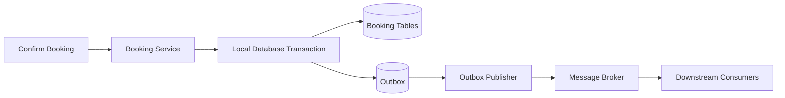

The sequence becomes:

```text
Begin local transaction

Update Booking

Insert Outbox record for BookingConfirmed

Commit transaction

Later:
Outbox publisher sends the event

Mark publication state according to implementation strategy
```

If publication temporarily fails, the durable outbox record remains available for retry.

The outbox does not guarantee that consumers receive only one delivery.

That is why idempotency is the companion pattern.

---

### 4.19 Idempotent Consumers

Message delivery systems may redeliver.

Publishers may retry.

Connections may fail after the broker accepts a message but before the publisher receives confirmation.

A consumer must therefore assume that the same integration event can be observed more than once.

Suppose Billing receives:

```text
ServiceCompleted
EventId: 8e9...
BookingId: BK-10481
```

twice.

A non-idempotent handler might create two invoices.

An idempotent handler recognizes that the business consequence for that event has already been processed.

Conceptually:

```text
Receive message

Has EventId already been processed?
    Yes → acknowledge without repeating effect
    No  → process business effect
          record EventId
          commit
```

The deduplication record and business side effect should normally participate in the same local transaction.

Idempotency is not an optional optimization.

It is part of correctness in event-driven systems.

---

### 4.20 Shared Contracts

A service architecture inevitably contains information that crosses boundaries.

The question is not whether something is shared.

The question is **what kind of thing is allowed to be shared**.

Appropriate shared artifacts may include:

- integration-event schemas;
- API schema definitions;
- common telemetry conventions;
- standardized error-envelope conventions;
- correlation-header definitions;
- platform security primitives.

Dangerous shared artifacts include:

- domain entities;
- business-rule engines;
- service-specific repository classes;
- shared persistence models;
- large "common" assemblies containing business behavior.

For example, a package containing:

```csharp
public static bool IsCorporateBookingAllowed(...)
```

and consumed by Booking, Corporate Account, and Billing creates distributed business ownership.

Which service owns the rule?

Who may change it?

Which deployment establishes the authoritative version?

A shared library can eliminate duplicated code while simultaneously creating duplicated authority.

That is a poor trade.

---

### 4.21 Contract Versioning

Contracts must evolve deliberately.

A contract is not only JSON.

It is a promise between independently changing components.

Breaking changes may include:

- removing a field;
- changing field meaning;
- changing required/optional behavior;
- changing identifier semantics;
- changing units;
- changing enum interpretation;
- changing event meaning.

Versioning policies should distinguish between backward-compatible additions and breaking semantic changes.

Consumers should not depend on undocumented fields simply because those fields happen to appear in serialized payloads.

Contract tests and schema validation should be part of CI/CD.

---

### 4.22 Security Boundaries

Security exists at several architectural layers.

```text
Client Identity
      ↓
API Gateway / Ingress
      ↓
Service Authentication
      ↓
Service Authorization
      ↓
Data Access
      ↓
Audit Evidence
```

The gateway may reject unauthenticated requests.

That does not eliminate service-level authorization.

For example, the fact that a user possesses a valid token does not prove that the user may book vehicles belonging to Northstar Distribution.

Authorization may need to combine:

```text
authenticated identity
+
tenant / organization context
+
role or permission
+
resource ownership
+
business policy
```

The owning service must participate in decisions that require its authoritative data.

---

### 4.23 Authentication Is Not Authorization

Authentication answers:

> Who are you?

Authorization answers:

> Are you permitted to perform this operation on this resource in this business context?

A corporate fleet administrator may be authenticated successfully and still be prohibited from:

- booking another company's fleet;
- selecting unassigned vehicles;
- requesting a restricted premium service;
- viewing another account's invoice;
- cancelling a booking outside permitted policy.

Architecture must therefore avoid the common mistake:

```text
Valid JWT
    ↓
Allow request
```

A valid token is only the beginning of the authorization decision.

---

### 4.24 Workload Identity

Service-to-service communication also requires identity.

A request from Booking to Fleet should not be trusted merely because it originates inside the Kubernetes cluster.

Internal network location is not identity.

Workload authentication should allow Fleet to establish:

```text
This request came from an approved Booking workload.
```

Authorization can then determine:

```text
Booking may call this operation.
```

The specific implementation may involve platform workload identity, certificates, signed tokens, managed identities, or another approved mechanism.

The architectural principle is stable:

> Internal services must authenticate each other according to the enterprise trust model.

---

### 4.25 Secrets

Secrets must not be embedded in:

- source code;
- container images;
- Kubernetes manifests committed in plaintext;
- AI prompts;
- generated documentation;
- logs.

Runtime secrets should be delivered through an approved secrets-management mechanism.

AI Agents should be explicitly instructed not to invent placeholder production credentials or copy discovered secrets into generated files.

---

### 4.26 Caching

Caching can improve performance, but it changes consistency behavior.

That makes it an architectural decision.

Potential cache candidates include relatively stable reference data or frequently requested read models.

Examples may include:

- service catalog information;
- selected station metadata;
- non-sensitive configuration;
- carefully designed corporate-account reference views.

Caching should be treated more cautiously for:

- authorization decisions;
- account suspension state;
- vehicle eligibility;
- current capacity;
- payment state.

A cached capacity response must never become an authoritative reservation.

Likewise, stale authorization data can become a security defect.

> **Common Mistake**  
> Do not use a cache to compensate for a badly designed synchronous dependency chain. Fix the boundary or interaction model first.

---

### 4.27 Reliability and Resiliency

Distributed systems fail partially.

That is their normal failure model.

Alpha Car Detailing must therefore distinguish between failures that prevent a workflow from safely proceeding and failures that can be deferred.

For example:

```text
Fleet validation unavailable
→ Booking may be unable to safely confirm.

Capacity reservation unavailable
→ Booking cannot claim capacity was reserved.

Notification provider unavailable
→ Booking can remain confirmed; notification can retry.

Observability exporter unavailable
→ Business transaction should normally continue while local buffering or failure telemetry is applied.
```

Reliability policies should be dependency-specific rather than globally applied.

---

### 4.28 Timeouts

Every remote call requires a timeout.

Without one, a dependency failure can consume threads, connections, request slots, and eventually system capacity.

Timeout values should correspond to the calling workflow.

A five-second timeout copied everywhere is not architecture.

The system should distinguish between:

- interactive client deadlines;
- service-to-service request deadlines;
- external-provider timeouts;
- background-processing deadlines.

Timeout budgets should compose.

If the client expects a response in three seconds, Booking cannot reasonably allow three separate downstream calls to consume three seconds each.

---

### 4.29 Retries

Retries are appropriate primarily for transient failure.

They are dangerous when applied indiscriminately.

Consider:

```http
POST /payments
```

If the caller times out after the provider processed the payment, blindly retrying without an idempotency mechanism may create duplicate financial effects.

Retries should therefore consider:

- operation idempotency;
- duplicate protection;
- backoff;
- jitter;
- retry limits;
- caller deadline;
- dependency behavior.

A retry policy is part of business safety, not merely an HTTP-client setting.

---

### 4.30 Circuit Breaking and Dependency Isolation

When a dependency is repeatedly failing, continuing to send requests can amplify the incident.

Circuit breaking can protect both caller and dependency.

Bulkheads and workload isolation can prevent one failing integration from exhausting all runtime resources.

For example, payment-provider degradation should not consume all execution capacity needed for booking queries.

The architecture should isolate different dependency classes where failure behavior differs materially.

---

### 4.31 Failure Classification

Failures should be classified.

A useful distinction is:

```text
Business rejection
    Example: vehicle not eligible

Validation failure
    Example: invalid requested schedule

Authorization failure
    Example: user cannot access fleet

Concurrency conflict
    Example: capacity was consumed before reservation

Transient technical failure
    Example: dependency timeout

Permanent integration failure
    Example: malformed event cannot be processed

Unknown failure
    Example: unhandled exception
```

These outcomes should not all become HTTP 500 or generic "booking failed."

Classification improves client behavior, retry behavior, operations, analytics, and incident response.

---

### 4.32 Observability

Observability must span both synchronous and asynchronous execution.

The architecture should provide:

- structured logs;
- metrics;
- distributed traces;
- correlation identifiers;
- service and dependency health;
- business workflow indicators;
- deployment metadata;
- error classification.

For a corporate booking, operators should be able to answer:

```text
Which request created this booking?

Which identity initiated it?

Which Booking instance handled it?

Which Corporate Account call was made?

Which Fleet validation occurred?

Which capacity reservation occurred?

Which outbox event was written?

When was the event published?

Which consumers processed it?

Did Billing react?

Was Notification delivered?

Which application version handled each step?
```

If those questions require manually searching unrelated logs using timestamps, observability is insufficient.

---

### 4.33 Technical and Business Observability

Technical telemetry answers questions such as:

```text
What is the API error rate?

What is p95 latency?

How many pods are unhealthy?

How many messages are in the retry queue?
```

Business telemetry answers questions such as:

```text
How many bookings were submitted?

How many were confirmed?

How many capacity reservations failed?

How long does booking confirmation take?

How many service completions have not produced expected billing outcomes?

How many notifications remain undelivered?
```

Both matter.

CPU utilization alone does not reveal whether customers can complete fleet bookings.

---

### 4.34 Containers

Each independently deployable service is packaged as a container image.

Containers provide a consistent deployment unit containing:

- application runtime;
- service binaries;
- required operating dependencies;
- versioned configuration expectations.

Containers do not create service boundaries.

Packaging a tightly coupled application into seven containers simply creates a containerized distributed monolith.

The service boundary must exist logically before the container becomes useful operationally.

---

### 4.35 Kubernetes

Kubernetes provides runtime orchestration capabilities such as:

- scheduling;
- scaling;
- service discovery;
- health-based replacement;
- configuration integration;
- secret integration;
- deployment rollout;
- workload isolation.

For Alpha Car Detailing, a conceptual deployment may contain:

```text
Booking Deployment
Corporate Account Deployment
Fleet Deployment
Station Operations Deployment
Billing Deployment
Payment Deployment
Notification Deployment
```

alongside platform components such as ingress, messaging integration, telemetry collection, and configuration infrastructure.

Kubernetes should remain a deployment concern.

Business workflows should not depend on Kubernetes-specific assumptions when avoidable.

---

### 4.36 Health Probes

Health must be meaningful.

A process being alive does not prove it can serve requests.

The architecture should distinguish between:

- liveness;
- readiness;
- startup health.

A service should not report itself ready if a required condition for serving traffic has not been established.

At the same time, readiness should not make services unnecessarily unavailable because an optional downstream system is degraded.

For example, Notification-provider unavailability should not necessarily make Booking unready.

Health design reflects dependency criticality.

---

### 4.37 CI/CD as an Architectural Control

CI/CD does more than compile and deploy code.

A mature pipeline protects architecture.

Relevant gates may include:

```text
Build
Unit Tests
Integration Tests
Contract Tests
Architecture Tests
Security Scanning
Container Scanning
Infrastructure Validation
Migration Validation
Policy Checks
Deployment
Smoke Tests
Observability Verification
```

Architecture tests can detect prohibited references.

Contract tests can detect breaking API or event changes.

Policy gates can ensure that required ownership metadata exists.

Infrastructure validation can detect security regressions before deployment.

The pipeline therefore becomes one mechanism by which architectural intent is enforced.

---

### 4.38 Architecture Decisions

Major decisions should be recorded as Architecture Decision Records or an equivalent governed mechanism.

Examples include:

```text
ADR-047-001 — Service boundaries for Alpha Car Detailing

ADR-047-002 — Database ownership per service

ADR-047-003 — Synchronous API versus integration-event guidance

ADR-047-004 — Transactional outbox for event publication

ADR-047-005 — Idempotent integration-event consumers

ADR-047-006 — API Gateway responsibilities

ADR-047-007 — Workload authentication model

ADR-047-008 — Container and Kubernetes deployment model

ADR-047-009 — Contract versioning strategy

ADR-047-010 — Observability correlation standard
```

The exact filenames may follow repository standards established elsewhere.

What matters is that significant architectural choices are reviewable and traceable.

---

### 4.39 Architecture Governance and AI Agents

AI Agents must not silently change architecture.

If an Agent determines that a requirement appears to need:

```text
a new service;
a shared database;
a new message broker;
a new cross-service dependency;
a breaking event schema;
a different authentication approach;
a new shared business library;
```

the appropriate response is not automatic implementation.

The Agent should identify the conflict, gather repository evidence, and create or request an architecture decision according to governance policy.

Architecture is one of the places where human approval remains especially important.

An Agent may:

- discover existing decisions;
- compare implementation with those decisions;
- propose alternatives;
- identify trade-offs;
- produce diagrams;
- draft ADRs;
- detect drift;
- validate boundaries.

It should not manufacture authority.

---

## 5. Architecture Discussion

### 5.1 Proposed High-Level Solution Architecture

The Alpha Car Detailing candidate reference architecture organizes the primary business capabilities as follows:

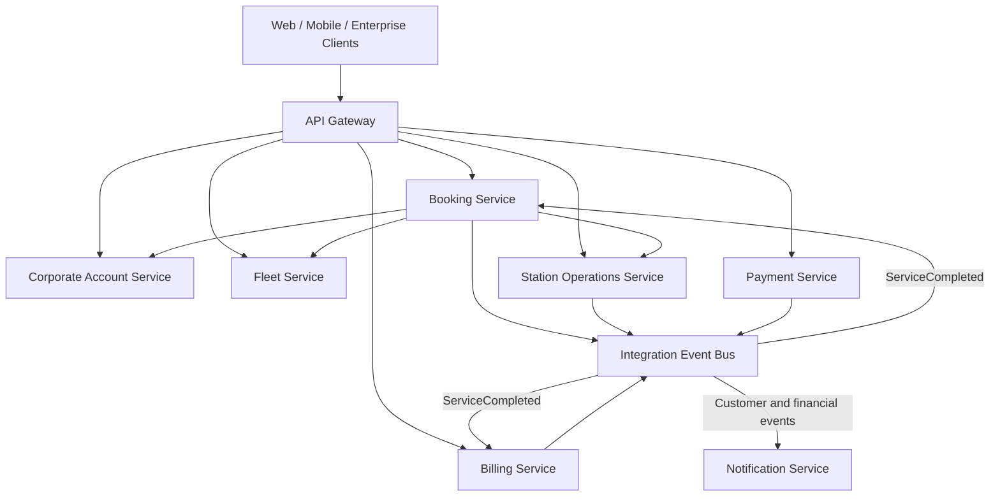

This diagram communicates three important architectural ideas.

First, the gateway is an edge component, not a business orchestrator.

Second, synchronous service calls exist only where immediate answers are required.

Third, downstream consequences use integration events where temporal decoupling is appropriate.

---

### 5.2 Corporate Fleet Booking Flow

The corporate fleet workflow combines synchronous validation with asynchronous consequences.

A simplified path is:

```text
Corporate Fleet Administrator
             ↓
        API Gateway
             ↓
       Booking Service
         ├──→ Corporate Account: eligibility
         ├──→ Fleet: vehicle membership
         └──→ Station Operations: capacity reservation
             ↓
    Booking database transaction
      (booking + outbox record)
             ↓
       Outbox publisher
             ↓
      BookingConfirmed event
             ↓
      Notification Service
```

The three validation and reservation calls are coordinated by Booking. They are **not** a call chain in which Corporate Account invokes Fleet and Fleet invokes Station Operations.

Later, after service fulfillment:

```text
Station Operations: service completed
             ↓
   ServiceCompleted event
        ├──→ Booking: reflect fulfillment status
        └──→ Billing: record qualifying billable work
                        ↓
           Contractual billing cutoff
                        ↓
                 InvoiceIssued
                        ↓
                Notification
```

For Northstar's consolidated invoicing, completion initiates billable-work processing; invoice issuance may occur at a later billing cutoff. The financial workflow is not a synchronous extension of booking confirmation.

Payment enters the flow according to the commercial model.

Corporate invoice-based customers do not need immediate payment to confirm the booking.

This is an example of architecture following business behavior instead of forcing every customer through the same technical transaction.

---

### 5.3 Why Booking Coordinates but Does Not Own Everything

Booking is the natural coordination point when a user submits a booking request.

That does not justify copying all required data into Booking and declaring it authoritative.

A booking request depends on several independent truths:

```text
Corporate Account:
Is the account allowed to transact?

Fleet:
Do these vehicles belong to this fleet?

Station Operations:
Can this work be accepted operationally?

Booking:
What is the lifecycle state of this booking?
```

Each truth belongs to its own capability.

Booking coordinates the decision.

It does not redefine the truth.

The corporate credit-limit constraint also needs an authoritative enforcement design. If multiple bookings consume a shared corporate allowance, checking a previously read balance is insufficient to prevent concurrent overcommitment. The business must confirm whether credit exposure is reserved at booking time, when it is released, and which capability owns the atomic decision. Corporate Account may own the commercial policy while another designated financial capability owns the ledger; this remains an explicit decision rather than a rule Booking should invent.

---

### 5.4 Immediate Checks Versus Deferred Consequences

A useful architecture technique is to ask of every dependency:

> Must this complete before the user can be told that the booking is accepted?

For corporate fleet booking:

| Interaction | Immediate? | Reason |
| --- | ---: | --- |
| Corporate-account eligibility | Usually yes | Booking should not confirm an ineligible account |
| Corporate credit or contract allowance | When required by contract | An authoritative owner must safely evaluate concurrent commitments; ownership and timing require approval |
| Fleet and vehicle validation | Usually yes | Booking must not confirm unrelated vehicles |
| Capacity reservation | Yes | Confirmation must not claim unavailable capacity |
| Notification delivery | No | Delivery can retry after booking is confirmed |
| Analytics update | No | Analytics should not block customer transaction |
| Corporate invoice creation | Typically no at booking time | Invoice usually follows qualifying service completion |
| Payment processing | Depends on customer/payment model | Corporate invoicing differs from immediate retail payment |

This decision table prevents accidental synchronous chains.

---

### 5.5 Booking Submission Sequence

The following sequence shows one architectural approach for the corporate scenario. It illustrates a successful individual reservation, not a final decision on whether Northstar's twenty-four vehicles form one booking, multiple bookings, or partially accepted reservations. Those semantics must be confirmed with the business.

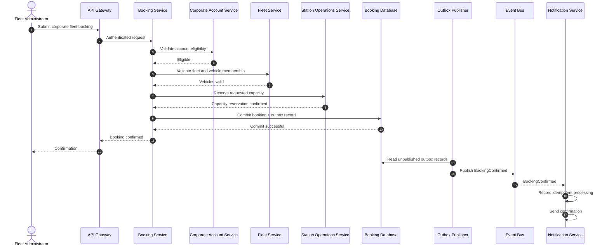

The diagram exposes an architectural question that must not be hidden:

What happens if capacity is reserved successfully but the Booking database transaction fails?

That is a cross-service partial failure.

The architecture needs a recovery strategy.

Possible approaches include:

- reservation tokens with expiry;
- explicit release/compensation;
- reservation confirmation only after booking establishment;
- workflow coordination with recoverable state.

The correct business semantics must determine the choice.

The important architectural requirement is that the failure mode is recognized and designed—not ignored.

---

### 5.6 Avoiding Distributed Transactions

A tempting solution is to demand one atomic transaction across:

```text
Corporate Account
Fleet
Station Operations
Booking
Billing
Notification
```

That would couple independent services into a single transactional unit.

It would reduce availability, complicate scaling, and make services operationally dependent.

The preferred model is:

```text
Strong consistency
inside service ownership

+

Explicit coordination
across service ownership

+

Reliable events
for asynchronous consequences
```

This creates more visible workflow states.

That visibility is beneficial.

Distributed complexity exists whether the architecture acknowledges it or not.

---

### 5.7 Database Architecture

Each service owns its database or logically isolated persistence boundary.

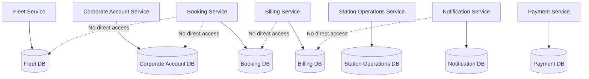

The dashed relationships represent prohibited shortcuts.

Reporting and analytical requirements should not weaken operational ownership.

If enterprise analytics requires cross-domain data, the organization should build approved analytical projections or data pipelines rather than allowing reporting queries to become an excuse for unrestricted operational joins.

---

### 5.8 References Across Service Boundaries

Booking will still need references such as:

```text
CorporateAccountId
FleetId
VehicleId
StationId
ServiceId
CapacityReservationId
```

An identifier does not imply database ownership.

Booking may store `FleetId` because that fleet is relevant to the booking.

It does not own the Fleet record.

Similarly, historical records may require selected snapshots.

For example, an invoice may need to preserve the commercial description or price that applied at the time of transaction rather than dynamically rereading today's value.

Snapshots should be intentional historical facts, not uncontrolled duplication.

---

### 5.9 API Boundary Design

Service APIs should express capability-level operations rather than raw table access.

Prefer:

```http
POST /fleet-validations
POST /capacity-reservations
GET  /corporate-accounts/{id}/eligibility
```

over generic interfaces such as:

```http
GET /tables/FleetVehicles
PUT /tables/CapacityRows
GET /database/CorporateAccount
```

An API should preserve business meaning.

A service boundary is weakened when clients must understand its internal persistence model.

---

### 5.10 Batch-Oriented Contracts

Corporate fleet workflows frequently operate on sets of vehicles.

The API should support that business shape.

For example:

```json
{
  "fleetId": "FLT-1007",
  "vehicleIds": [
    "VH-001",
    "VH-002",
    "VH-003"
  ]
}
```

is preferable to requiring Booking to issue one remote call per vehicle.

Good distributed architecture requires attention to call shape, not only service separation.

Network boundaries are more expensive than in-process method calls.

---

### 5.11 Event Architecture

A representative event flow may be:

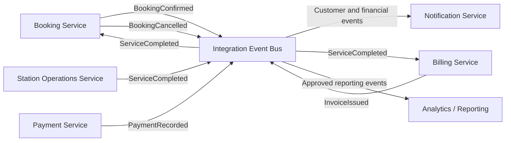

Consumers subscribe according to need.

The publisher should not be modified merely because a new consumer appears.

That is one of the major benefits of event-driven integration.

---

### 5.12 Event Schema Design

An integration event should contain sufficient information for its purpose without exposing the publisher's entire internal model.

For example:

```json
{
  "eventId": "9a3ecde8-...",
  "eventType": "BookingConfirmed",
  "occurredAtUtc": "2026-11-19T10:15:43Z",
  "bookingId": "BK-10481",
  "corporateAccountId": "CA-2007",
  "fleetId": "FLT-1007",
  "stationId": "ST-021"
}
```

Whether additional details belong in the event depends on consumer needs, privacy constraints, contract stability, and whether consumers should query the owner.

Events should not become database-row replication by default.

---

### 5.13 Outbox Per Publishing Service

Any service that publishes integration events based on committed local state should evaluate the transactional-outbox pattern.

Conceptually:

```text
Booking Database
├── Bookings
├── BookingItems
└── Outbox

Station Operations Database
├── Stations
├── Capacity
├── Reservations
└── Outbox

Billing Database
├── Invoices
├── InvoiceLines
└── Outbox
```

Each service owns its outbox.

There should not be one central database transaction controlling all service outboxes.

That would recreate the coupling the architecture is trying to remove.

---

### 5.14 Consumer Inbox or Processing Ledger

For high-value event processing, consumers may maintain a processing ledger:

```text
ProcessedMessages
-----------------
EventId
ConsumerName
ProcessedAtUtc
```

The exact implementation can vary.

The architectural requirement is that duplicate delivery does not repeat non-idempotent business effects.

For billing and payments, this deserves particular scrutiny.

---

### 5.15 Security Architecture

A high-level security flow is:

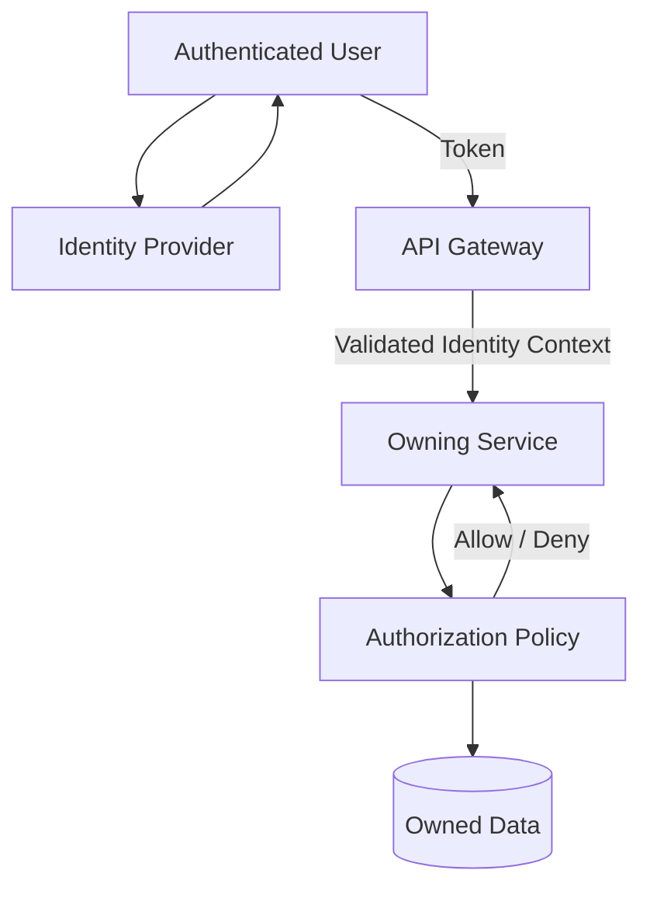

The service may need authoritative resource data to evaluate authorization.

For example, Fleet can validate whether the requested vehicles belong to the user's permitted organization.

Authorization therefore cannot always be completed at the gateway.

---

### 5.16 Tenant and Organization Isolation

Corporate accounts introduce an important isolation requirement.

Every resource access must maintain correct organizational context.

A request such as:

```http
GET /fleets/FLT-1007/vehicles
```

must not be authorized merely because the caller has the role:

```text
FleetAdministrator
```

The service must also establish that the caller may operate on the organization that owns `FLT-1007`.

This protects against horizontal privilege escalation.

Identifiers should be treated as references, not proof of entitlement.

---

### 5.17 Caching Architecture

Redis or another distributed cache can be useful for performance-sensitive read scenarios.

A conceptual use is:

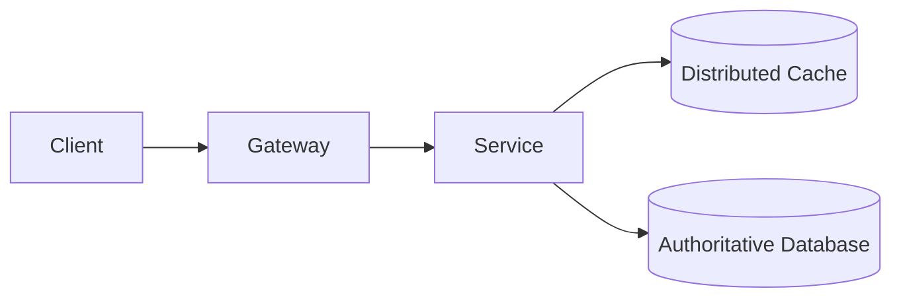

The service remains responsible for consistency policy.

The cache is not directly exposed as business authority.

Appropriate cache design must define:

```text
What is cached?
For how long?
How is it invalidated?
Can stale data be tolerated?
What happens during cache failure?
Is the cached data security-sensitive?
```

Cache availability should not automatically become service availability.

Where possible, a cache should be an optimization rather than the only copy of authoritative state.

---

### 5.18 Reliability Boundaries

The architecture should categorize dependencies by criticality.

#### Critical Synchronous Dependencies

Failure prevents safe continuation.

Examples during booking confirmation may include:

- required account eligibility;
- required fleet validation;
- required capacity reservation.

#### Deferred Dependencies

Failure can be processed later.

Examples include:

- notification delivery;
- analytics;
- noncritical downstream projections.

#### External Dependencies

Examples include:

- identity provider;
- payment provider;
- email/SMS provider.

External dependencies require especially careful timeout, retry, circuit-breaking, and observability policies.

---

### 5.19 Notification Failure Example

Consider this sequence:

```text
Booking confirmed
        ↓
BookingConfirmed event published
        ↓
Notification consumes event
        ↓
Email provider unavailable
```

The correct outcome is not:

```text
Undo booking
```

Instead:

```text
Record failed delivery attempt
        ↓
Retry according to policy
        ↓
Escalate / dead-letter if exhausted
        ↓
Expose operational signal
```

The architecture separates business transaction success from communication delivery success.

This improves both reliability and conceptual clarity.

---

### 5.20 Payment Failure Example

Payment requires different treatment.

Suppose a retail workflow needs payment before final confirmation.

The Payment Service calls an external provider and receives a timeout.

The correct state may be unknown.

The system cannot safely assume:

```text
payment failed
```

because the provider may have completed the charge.

The architecture may need:

- idempotency keys;
- provider transaction identifiers;
- payment status inquiry;
- webhook/callback reconciliation;
- pending states;
- manual reconciliation for exceptional cases.

This illustrates why failure handling must reflect business semantics.

---

### 5.21 Observability Architecture

Telemetry should carry correlation across both request and event boundaries.

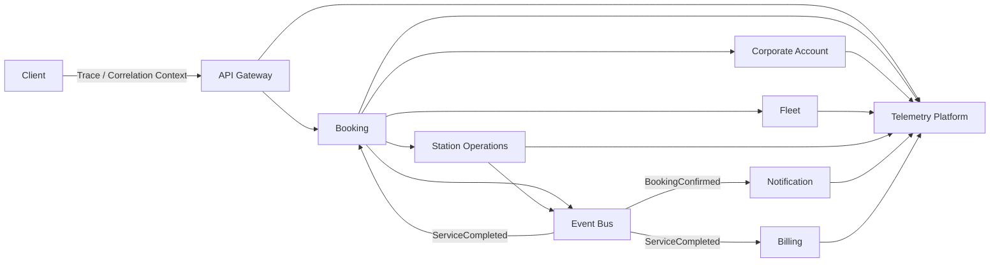

OpenTelemetry provides a suitable vendor-neutral instrumentation model for traces, metrics, and logs.

The architecture should standardize:

- service name;
- environment;
- deployment version;
- trace identifier;
- correlation identifier;
- message identifier;
- event type;
- business operation;
- result classification.

Sensitive data must not be indiscriminately placed into telemetry.

---

### 5.22 Deployment Architecture

A conceptual Kubernetes deployment may look like:

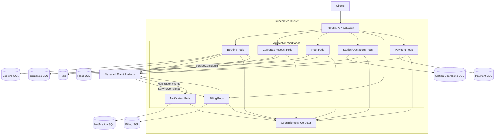

The diagram is intentionally conceptual.

Database topology, broker technology, namespace strategy, ingress technology, cluster topology, and cloud-specific implementation belong to detailed platform design.

---

### 5.23 Independent Scaling

Service boundaries permit workload-specific scaling.

For example:

```text
Booking:
high interactive traffic

Fleet:
high read traffic during large fleet operations

Station Operations:
capacity-intensive operational calls

Notification:
burst processing after large event volumes

Billing:
batch or event-driven financial processing
```

Kubernetes can scale these workloads differently.

That is more efficient than scaling one large application for the highest demand generated by any single capability.

Independent scaling is a benefit only when boundaries are sufficiently independent.

If every Booking instance synchronously depends on every other service for every request, scaling Booking alone may have little value.

---

### 5.24 Deployment Independence

Independent deployment means more than separate pipelines.

A service is not operationally independent if its release always requires simultaneous changes to three other services.

Contract compatibility is therefore central to deployment architecture.

Teams should favor:

```text
backward-compatible API evolution;

additive event evolution;

consumer-driven contract testing where appropriate;

expand-and-contract database migration strategies;

feature flags for controlled rollout.
```

A service architecture that requires coordinated release trains for routine changes has drifted toward distributed-monolith behavior.

---

### 5.25 CI/CD Flow

A high-level service pipeline may be:


The pipeline can reject changes that violate architecture.

Examples include:

```text
Booking references Fleet persistence assembly.

A service accesses another service's database connection.

An event schema breaks compatibility.

Container scanning identifies disallowed vulnerabilities.

Required telemetry instrumentation is missing.

Infrastructure configuration violates policy.

Architecture documentation is changed without approval metadata.
```

CI/CD becomes executable governance.

---

### 5.26 Architecture Drift

Architecture drift occurs when implementation stops matching approved design.

Examples include:

```text
Diagram:
Booking → Fleet API

Implementation:
Booking reads Fleet database directly
```

or:

```text
Diagram:
Notification consumes BookingConfirmed

Implementation:
Notification polls Booking tables
```

or:

```text
ADR:
No shared business libraries across service boundaries

Implementation:
SharedDomain.dll contains fleet eligibility and billing rules
```

An outdated diagram is not harmless documentation debt.

It creates false architectural evidence.

Architecture repositories should therefore be reviewed alongside implementation.

Automated checks should enforce what can be enforced mechanically.

Human review should examine what requires judgment.

---

### 5.27 Distributed Monolith Detection

A system may use microservice technologies and still behave as a monolith.

Warning signs include:

- one business request requires a long synchronous chain;
- services share databases;
- services share domain entities;
- one service deployment routinely requires several others;
- teams cannot test a service without starting the entire platform;
- events merely reproduce synchronous commands;
- changes require coordinated version updates;
- ownership is unclear;
- outages cascade across unrelated capabilities.

The architecture should periodically evaluate these signals.

Distribution creates operational cost.

That cost must purchase genuine independence.

---

### 5.28 Evolution Strategy

Alpha Car Detailing should evolve according to evidence.

The target service model defines clear ownership, but operational decomposition can still be introduced pragmatically.

A capability may initially be deployed with another capability if:

- ownership remains clear;
- internal module boundaries are enforced;
- data ownership can be separated;
- no direct cross-boundary shortcuts are introduced;
- future extraction remains practical.

Likewise, an existing service may later be divided if evidence shows:

- independent scaling need;
- distinct ownership;
- materially different release cadence;
- security isolation need;
- operational isolation need;
- domain complexity requiring stronger separation.

The rule is:

> **Evolve boundaries because the system has demonstrated a need—not because smaller services look more modern.**

---

### 5.29 Architecture Trade-offs

No architecture is free.

The service-based design introduces:

- network latency;
- messaging infrastructure;
- distributed tracing requirements;
- eventual consistency;
- contract governance;
- more deployment units;
- more operational tooling;
- more failure modes.

In return, it aims to provide:

- clearer ownership;
- independent evolution;
- failure isolation;
- workload-specific scaling;
- stronger data boundaries;
- better team autonomy;
- explicit integration contracts.

The decision is justified only when those benefits matter to the organization.

Architecture is not a search for zero complexity.

It is the deliberate placement of complexity.

---

### 5.30 Governance Requirements

The Alpha Car Detailing candidate solution architecture proposes the following governance expectations; they become enforceable standards only after the appropriate review and approval:

| Area | Governance Requirement |
| --- | --- |
| Service ownership | Every service has an accountable engineering owner |
| API ownership | Provider owns contract and compatibility policy |
| Event ownership | Business-fact owner owns the event |
| Database ownership | Only owning service accesses operational store directly |
| Security | Authentication and authorization controls are documented and tested |
| Contracts | APIs and events are versioned and compatibility-validated |
| Architecture decisions | Significant changes require recorded decision and approval |
| Observability | Required telemetry conventions apply to every service |
| Deployment | Services use approved pipeline and security gates |
| AI-generated changes | Agents must follow existing decisions and escalate unresolved architecture choices |
| Diagrams | Architecture representations must remain consistent with implementation |

Governance exists to preserve intentional architecture as the system changes.

---

## 6. Professional Diagrams

### 6.1 Complete Logical Architecture

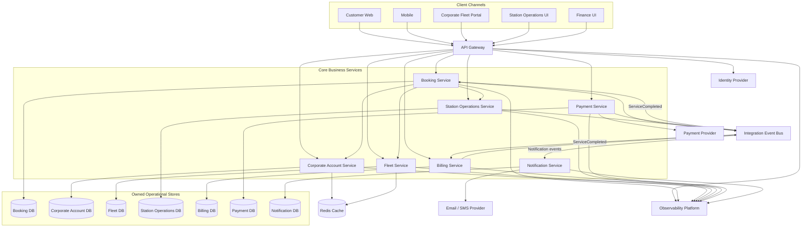

This is the logical architecture for the case study.

It does not imply that every arrow is used for every workflow.

The architecture should be read as a set of permitted relationships, not an instruction to maximize communication.

---

### 6.2 Ownership Model

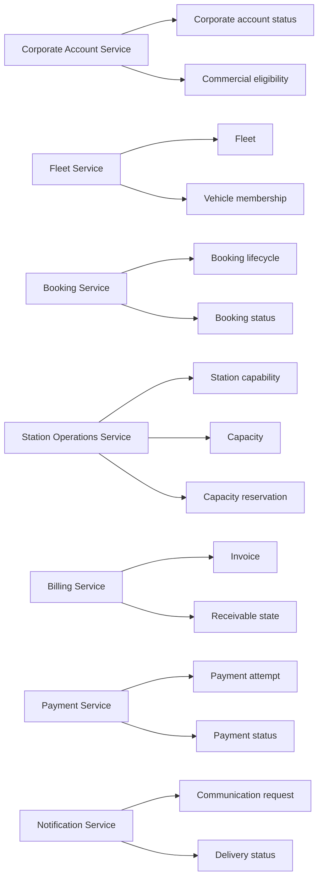

Ownership should remain understandable without referring to implementation language.

---

### 6.3 Corporate Fleet Booking Architecture

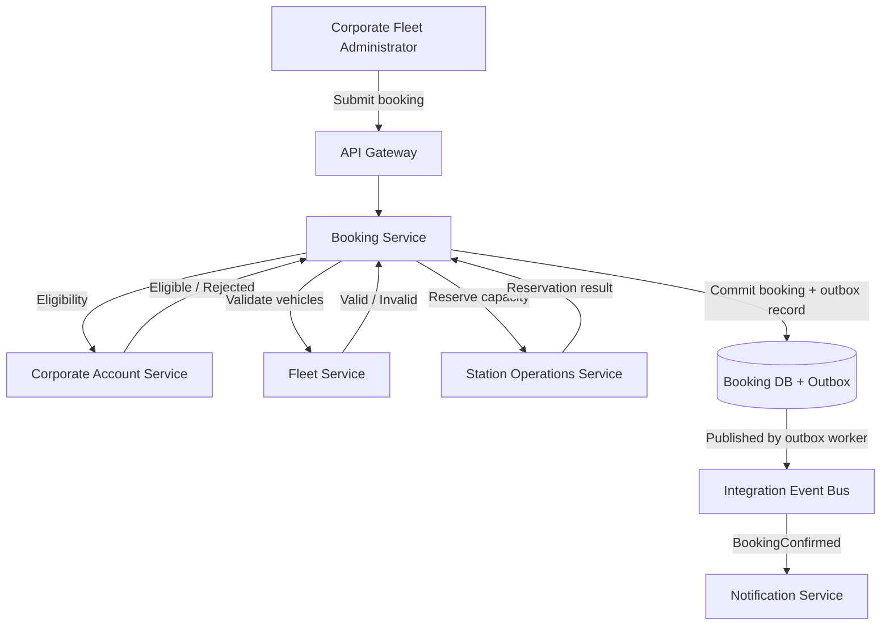

The Booking Service coordinates the workflow while each participating service retains its authority.

---

### 6.4 Service Completion to Billing

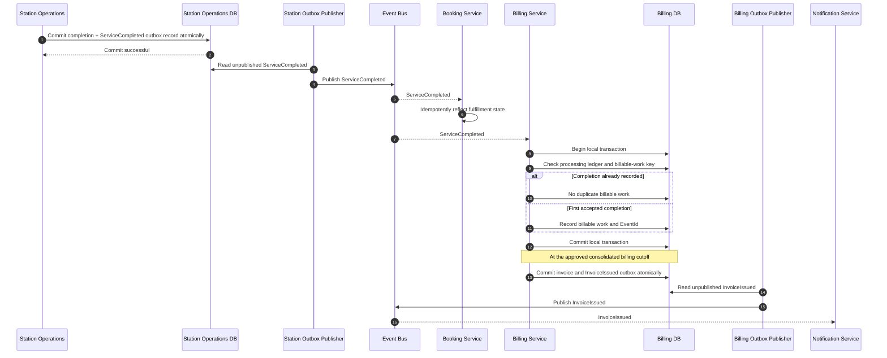

This sequence separates *recording billable work* from *issuing a consolidated invoice*. Billing's local idempotency transaction protects against duplicated service-completion effects; a later invoice-issuance transaction writes its own outbox record atomically. Notification receives the event only after the Billing outbox publisher has sent it. The exact billing cutoff and invoice grouping rules remain business-owned decisions.

---

### 6.5 Data Ownership and Prohibited Access

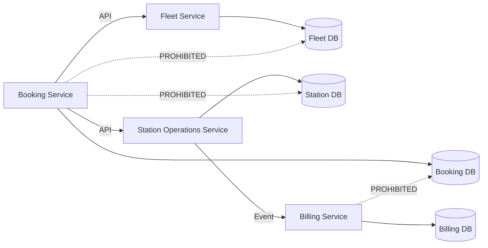

The prohibited lines are as important as the permitted lines.

Architecture defines what the system must *not* do.

---

### 6.6 Synchronous and Asynchronous Decision Model

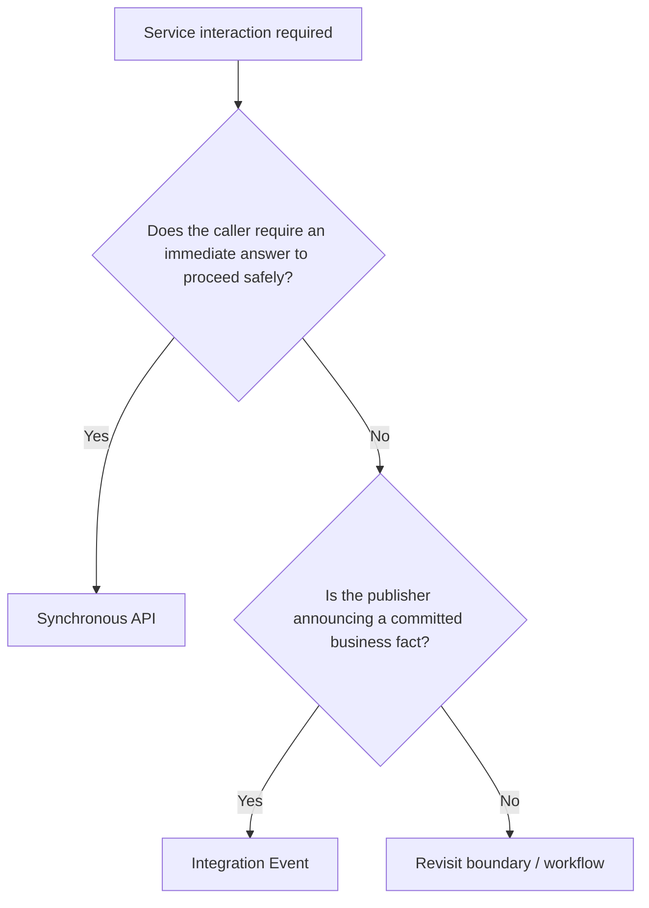

This is guidance rather than an absolute rule, but it provides a useful starting point during architecture reviews.

---

### 6.7 Reliability Model

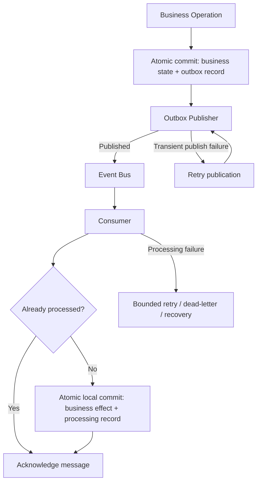

The processing record and business effect must be committed within the consumer's local transaction. Broker redelivery remains possible, so correctness is derived from idempotent effects rather than an assumption of exactly-once delivery.

Reliable architecture assumes failure and duplicate delivery.

It does not design only for the successful path.

---

### 6.8 Security Boundary Model

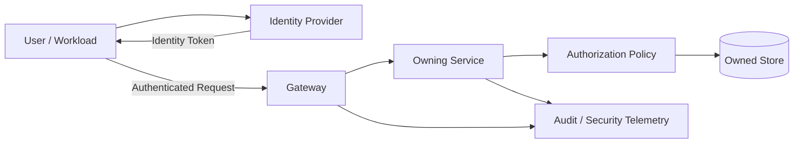

The architecture places authorization close enough to authoritative resources to make correct business decisions.

---

### 6.9 Container and Deployment View

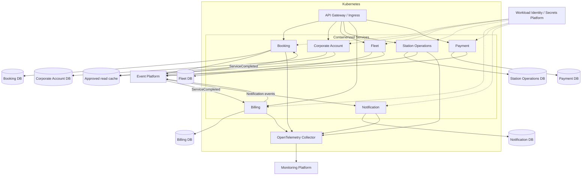

This view intentionally treats Kubernetes as the host for architectural components rather than the source of business architecture. Database nodes represent **separate service-owned data boundaries**, not tables within one shared operational database. The telemetry connections show representative flows; every deployed service remains subject to the common observability standard.

---

### 6.10 Architecture-to-Implementation Traceability

```mermaid
flowchart TD
    Business["Business Capability"]
    Boundary["Service Boundary"]
    ADR["Architecture Decision"]
    Contract["API / Event Contract"]
    Code["Implementation"]
    Tests["Architecture + Contract Tests"]
    Pipeline["CI/CD Gates"]
    Runtime["Runtime Deployment"]
    Telemetry["Operational Evidence"]

    Business --> Boundary
    Boundary --> ADR
    ADR --> Contract
    Contract --> Code
    Code --> Tests
    Tests --> Pipeline
    Pipeline --> Runtime
    Runtime --> Telemetry

    Telemetry -->|"Evidence for review"| ADR
```

This final diagram captures the architecture discipline used throughout the Alpha Car Detailing implementation.

Architecture is not complete when a diagram is approved.

It must remain connected to contracts, code, validation, deployment, and operational evidence.

For AI-assisted development, that traceability is particularly important.

An AI Agent should be able to discover:

```text
the business capability;

the approved service owner;

the relevant ADR;

the permitted dependencies;

the API or event contract;

the required validation gates.
```

That allows AI to work inside architecture rather than inventing architecture while generating code.

---

## 7. Hands-on Example

### 7.1 Designing the Corporate Fleet Booking Solution

The purpose of this hands-on example is to transform the business requirements established in Chapter 46 into an explicit, reviewable solution architecture.

The exercise focuses on architectural decisions rather than implementation details.

The outcome is an architecture baseline that can guide subsequent development of the Alpha Car Detailing platform, including its internal Clean Architecture implementation in Chapter 48, microservice implementation in Chapter 49, and event-driven integration in Chapter 50.

The central scenario remains Northstar Distribution.

Northstar operates 186 delivery vehicles across three cities. Its fleet administrator needs to schedule twenty-four vehicles for detailing over two days.

The solution must respect corporate-account eligibility, vehicle ownership, station capacity, service restrictions, commercial agreements, and downstream financial processing.

For this reference design, the team will use seven candidate service boundaries:

1. Booking Service
2. Corporate Account Service
3. Fleet Service
4. Station Operations Service
5. Billing Service
6. Payment Service
7. Notification Service

These represent the target logical service model. Whether every boundary requires a separate deployable application immediately is an additional architecture decision.

The exercise produces five principal artifacts:

- a service ownership model;
- an interaction and contract model;
- a data ownership model;
- a reliability and failure-handling model;
- an architecture decision and validation baseline.

Together, they form a foundation for implementation without prematurely specifying application-layer classes, repositories, controllers, or persistence mappings.

---

### 7.2 Step 1 — Establish Architecture Inputs

Architecture development begins by identifying its authoritative inputs.

The team should examine:

- the approved business-domain model from Chapter 46;
- corporate fleet booking requirements;
- corporate-account and contract rules;
- station capacity constraints;
- existing architecture decisions;
- enterprise security policies;
- operational requirements;
- organizational delivery constraints.

These inputs must be distinguished from assumptions.

For example, Northstar's ability to use consolidated invoicing is a business requirement.

The decision to implement that capability through an asynchronous integration event is an architectural proposal.

The decision to use a particular message broker is a technology decision.

The three should not be merged.

A practical architecture input register can capture this distinction.

| Architecture Input                                        | Source                   | Status                       |
| --------------------------------------------------------- | ------------------------ | ---------------------------- |
| Corporate users can book eligible fleet vehicles          | Business domain          | Established                  |
| Station capacity must not be overcommitted                | Business domain          | Established                  |
| Corporate agreements may allow consolidated invoicing     | Business domain          | Established                  |
| Canonical service-catalog and base-pricing ownership       | Business/architecture    | Requires approval            |
| Corporate credit exposure and concurrent allowance control | Business/architecture    | Requires approval            |
| Partial acceptance of multiple vehicles and time slots    | Business domain          | Requires approval            |
| Booking coordinates required eligibility checks           | Solution architecture    | Proposed                     |
| Each service owns its operational data                    | Solution architecture    | Proposed governance decision |
| Transactional outbox protects committed event publication | Reliability architecture | Proposed                     |
| SQL Server supports operational persistence               | Technology baseline      | Reference technology         |
| Kubernetes provides workload orchestration                | Deployment baseline      | Reference technology         |
| Booking availability SLO                                  | Operational requirements | Requires approval            |
| Recovery time and recovery point objectives               | Business continuity      | Requires approval            |

The architecture input register prevents assumptions from becoming invisible design constraints.

> **Architect's Note**  
> An architectural proposal must not be presented as an approved decision merely because it appears in an AI-generated diagram or document.

---

### 7.3 Step 2 — Define Architecture Quality Scenarios

General quality attributes must be translated into measurable scenarios.

Consider availability.

A statement such as "The booking system must be highly available" is incomplete.

A better scenario identifies the stimulus, the affected component, the operating condition, and the expected response.

For example:

**Scenario A — Notification Provider Outage**

During normal business operations, the email provider becomes unavailable after a corporate booking has been confirmed.

Expected architectural response:

The confirmed booking remains valid. The notification request is durably retained, delivery retries according to policy, and operations personnel can identify delivery failures.

**Scenario B — Concurrent Capacity Reservation**

Two customers attempt to reserve the final available station capacity for overlapping time windows.

Expected architectural response:

Station Operations enforces its capacity invariant. Conflicting reservations cannot both be committed as accepted capacity.

**Scenario C — Duplicate Integration Event**

Billing receives the same qualifying service-completion event twice.

Expected architectural response:

Billing does not record duplicate billable work or create duplicate financial obligations. If consolidated billing is used, the event may add a charge to a future invoice rather than issue an invoice immediately.

**Scenario D — Fleet Service Unavailable**

Booking cannot obtain authoritative fleet eligibility information.

Expected architectural response:

Booking does not confirm eligibility based on unverified or stale information. The operation returns a controlled outcome or remains pending under an explicitly approved workflow.

**Scenario E — Service Deployment**

A new Notification Service version is deployed.

Expected architectural response:

Booking remains available, and previously published compatible events continue to be processable.

These scenarios can later become acceptance tests, architecture tests, operational readiness tests, or resilience experiments.

---

### 7.4 Step 3 — Define Service Responsibilities

Each proposed service must have an explicit responsibility statement.

The responsibility should describe a business outcome, not a collection of tables.

| Service            | Owns                                                               | Must Not Own                                                 |
| ------------------ | ------------------------------------------------------------------ | ------------------------------------------------------------ |
| Booking            | Booking intent, lifecycle, status, and booking references          | Fleet membership, corporate-account status, station capacity |
| Corporate Account  | Corporate eligibility and commercial-account relationships         | Booking lifecycle or invoice settlement                      |
| Fleet              | Fleet identity, vehicle records, membership, vehicle eligibility   | Booking confirmation or station reservations                 |
| Station Operations | Station capability, capacity, reservation, operational fulfillment | Corporate billing and payment execution                      |
| Billing            | Invoices, receivables, billing state                               | Payment-provider transactions or fleet membership            |
| Payment            | Payment attempts, payment execution, payment status                | Invoice calculation and booking ownership                    |
| Notification       | Notification requests, templates, delivery status                  | Booking or invoice authority                                 |

A useful review question for each service is:

> If this service disappears from the system, which business responsibility no longer has an authoritative owner?

If the answer cannot be stated clearly, the boundary may be poorly defined.

---

### 7.5 Step 4 — Define API Contracts

The architecture should next identify which interactions require an immediate answer.

For corporate fleet booking, the reference design requires the Booking Service to obtain decisions from the Corporate Account, Fleet, and Station Operations services.

Representative contracts might include:

| Provider           | Operation                    | Consumer                  | Purpose                                                  |
| ------------------ | ---------------------------- | ------------------------- | -------------------------------------------------------- |
| Corporate Account  | Evaluate account eligibility | Booking                   | Determine whether the corporate transaction is permitted |
| Fleet              | Validate vehicle membership  | Booking                   | Verify the selected fleet and vehicles                   |
| Station Operations | Query availability           | Booking/UI                | Provide preliminary capacity information                 |
| Station Operations | Reserve capacity             | Booking                   | Secure the requested operational capacity                |
| Booking            | Submit booking               | Corporate portal          | Begin the booking workflow                               |
| Booking            | Retrieve booking status      | Corporate portal          | Display authoritative booking state                      |
| Billing            | Retrieve invoice             | Finance portal            | Obtain invoice information                               |
| Payment            | Initiate payment             | Approved payment workflow | Start payment execution                                  |

The contracts should express business intent.

For example:

```http
POST /api/v1/fleets/{fleetId}/vehicle-validations
```

A conceptual request:

```json
{
  "corporateAccountId": "CA-2007",
  "vehicleIds": [
    "VH-001",
    "VH-002",
    "VH-003"
  ]
}
```

A conceptual response:

```json
{
  "fleetId": "FLT-1007",
  "valid": true,
  "validatedVehicleIds": [
    "VH-001",
    "VH-002",
    "VH-003"
  ],
  "rejectedVehicles": []
}
```

This contract is illustrative rather than approved. Its exact semantics, authorization requirements, identifiers, and error model must be finalized through contract review.

The architecture should not expose a generic database interface or allow consumers to depend on internal schema details.

#### Contract Review Questions

An API review should establish:

- Who owns the contract?
- Who may call the operation?
- Does the operation expose the appropriate level of business abstraction?
- Which data is sensitive?
- Which failures are business rejections?
- Which failures are transient?
- Is the operation idempotent?
- Is an idempotency key required?
- What is the timeout budget?
- How will the contract evolve?

The API surface is part of the service boundary. It must be designed with the same care as the domain ownership model.

---

### 7.6 Step 5 — Design Booking and Capacity Coordination

The most consequential architectural interaction in this scenario is the relationship between Booking and Station Operations.

Booking determines whether a booking can progress through its lifecycle.

Station Operations determines whether operational capacity can be allocated.

A capacity query is not a reservation.

This distinction must be reflected in the architecture.

Consider the following failure sequence:

```text
1. Booking validates Northstar's corporate account.
2. Booking validates the selected vehicles.
3. Station Operations reserves capacity.
4. Booking attempts to commit its confirmed state.
5. Booking database commit fails.
```

Station Operations may now hold capacity for a booking that was never committed.

The architecture cannot assume this cannot happen.

A reference approach is to introduce a capacity-reservation lifecycle.

```text
Requested
    |
    v
Reserved
    |
    +----> Confirmed
    |
    +----> Released
    |
    +----> Expired
```

The exact state names depend on approved business terminology.

The important point is that capacity allocation is a recoverable operation.

An architect may select a reservation-token mechanism with expiry, explicit confirmation and release operations, or a durable workflow coordinator.

One possible protocol is:

1. Booking persists a request and its workflow identity.
2. Booking validates account and fleet eligibility.
3. Booking requests capacity using a stable reservation identifier.
4. Station Operations atomically reserves capacity and returns the identifier.
5. Booking commits its confirmed state with the reservation reference.
6. Booking records an event for downstream publication.
7. If the workflow cannot complete, recovery logic releases or expires the reservation according to business policy.

This protocol introduces additional states and recovery logic but avoids pretending that two services share one atomic transaction.

#### Failure Handling Matrix

| Failure                                        | Required Architectural Behavior                           |
| ---------------------------------------------- | --------------------------------------------------------- |
| Corporate-account eligibility rejected         | Booking cannot confirm                                    |
| Fleet membership rejected                      | Booking cannot confirm                                    |
| Capacity unavailable                           | Booking returns a conflict or appropriate pending outcome |
| Reservation succeeds, Booking commit fails     | Release, expire, or reconcile the reservation             |
| Booking commits, event publishing fails        | Outbox publisher retries                                  |
| BookingConfirmed delivered twice               | Consumer handles duplicate safely                         |
| Notification fails                             | Retry delivery independently                              |
| Station becomes unavailable after confirmation | Initiate approved disruption and rebooking workflow       |

The final protocol must address cancellation, timeout, duplicate requests, partial fleet bookings, and recovery after process restarts. A stable request idempotency key is required to avoid allocating capacity twice when the client retries after an ambiguous timeout. Any provisional hold must also have a documented release, confirmation, expiry, and reconciliation policy so that a Booking confirmation cannot silently outlive its operational reservation.

These are architectural matters because they determine which service is responsible for consistency and recovery.

---

### 7.7 Step 6 — Define the Integration Event Catalog

Not every domain event needs to become an integration event.

The architecture should publish only facts that other capabilities genuinely need.

An initial candidate event catalog is:

| Event                       | Owning Service     | Potential Consumers                             | Meaning                                    |
| --------------------------- | ------------------ | ----------------------------------------------- | ------------------------------------------ |
| BookingConfirmed            | Booking            | Notification, reporting                         | A booking reached confirmed state          |
| BookingCancelled            | Booking            | Notification, reporting, potentially operations | A booking was cancelled                    |
| CapacityReservationReleased | Station Operations | Booking, reporting                              | Previously allocated capacity was released |
| ServiceCompleted            | Station Operations | Booking, Billing, Notification                  | Qualifying operational work completed      |
| InvoiceIssued               | Billing            | Notification, reporting                         | An invoice was issued                      |
| PaymentRecorded             | Payment            | Billing, reporting                              | A payment outcome was recorded             |
| StationAvailabilityChanged  | Station Operations | Availability projections, operations            | Station availability changed               |

The event catalog establishes ownership.

It does not require every event to be implemented immediately.

For each event, the team should document its business meaning, publication conditions, schema owner, compatibility policy, privacy classification, expected ordering, and retention or replay expectations.

#### Example: ServiceCompleted

A conceptual integration contract might be:

```json
{
  "eventId": "6e3c8d5a-1f21-4e84-9e42-011204ce7e61",
  "eventType": "ServiceCompleted",
  "eventVersion": 1,
  "occurredAtUtc": "2026-11-19T12:30:00Z",
  "correlationId": "CORR-10481",
  "payload": {
    "bookingId": "BK-10481",
    "serviceCompletionId": "SC-20081",
    "corporateAccountId": "CA-2007",
    "stationId": "ST-021",
    "completedVehicleIds": [
      "VH-001",
      "VH-002"
    ]
  }
}
```

The event should not carry unrestricted customer records or internal persistence structures.

Billing may need additional approved contractual or pricing information to produce a legally and commercially correct invoice. That information should be obtained through an explicitly designed contract, an approved immutable snapshot, or another governed mechanism.

An event should not silently become a substitute for accurate financial data ownership.

---

### 7.8 Step 7 — Establish the Transactional Outbox

The outbox is an architectural mechanism for reliable event publication.

The reference design stores the business change and an outbound message in the same service-local database transaction.

For Booking:

```text
Booking Service
    |
    +-- Booking Database
          |
          +-- Bookings
          +-- Booking Items
          +-- Booking Status
          +-- Outbox Messages
```

A conceptual outbox record includes:

```text
MessageId
EventType
EventVersion
AggregateId
OccurredAtUtc
Payload
PublicationState
AttemptCount
LastAttemptAtUtc
```

The exact persistence schema is an implementation decision.

The architectural guarantees are more important:

1. An event cannot be durably scheduled for publication unless the corresponding business state is committed.
2. A committed event remains recoverable after publisher failure.
3. Publication retries are safe.
4. Duplicate delivery is expected.
5. Publication failures are observable.
6. Outbox retention and cleanup follow operational policy.

The publisher should not claim exactly-once end-to-end delivery.

That guarantee requires more than an outbox and cannot generally be assumed across arbitrary external consumers.

---

### 7.9 Step 8 — Establish Idempotent Consumers

The Notification and Billing services must tolerate duplicate integration events.

For Billing, duplicate prevention protects financial correctness.

For Notification, it protects against repeated communication attempts caused by message redelivery.

The consumer architecture should distinguish between message processing and external side effects.

Consider Billing:

```text
Receive ServiceCompleted
          |
          v
Check Processing Ledger
          |
          +-- Already processed --> Acknowledge
          |
          +-- New event
                  |
                  v
          Validate business effect
                  |
                  v
          Create invoice if applicable
                  |
                  v
          Record event as processed
                  |
                  v
          Commit local transaction
```

The processing record and database side effect should be committed atomically where possible.

External effects such as email delivery or payment-provider interaction require their own idempotency and recovery strategy because they cannot generally participate in the local SQL transaction.

The architecture must also consider the distinction between repeated delivery of the same event and two distinct events that would otherwise cause the same business effect. A unique event identifier protects against the former; a business-level uniqueness constraint may be needed for the latter.

---

### 7.10 Step 9 — Define Security Boundaries

The corporate booking scenario contains several distinct security decisions.

The first is authentication.

The system must establish the caller's identity through an approved identity provider.

The second is authorization.

The system must determine whether the caller can act for the specified corporate account and fleet.

The third is service-to-service trust.

Booking must be authorized to invoke Fleet and Station Operations contracts.

The fourth is data isolation.

Corporate Account and Fleet must prevent one organization from accessing another organization's records.

The fifth is auditability.

Sensitive actions must produce traceable evidence.

A practical security review should verify that a request cannot bypass ownership simply by changing identifiers.

For example:

```text
Authenticated user:
Northstar fleet administrator

Submitted CorporateAccountId:
Another company's account

Expected result:
Request rejected
```

Similarly, the API Gateway should validate external request identity and routing constraints, but the owning service must still enforce resource-level authorization.

Secrets, service credentials, connection strings, and signing material should come from approved secrets-management infrastructure, not repository files or AI-generated configuration.

---

### 7.11 Step 10 — Define Operational Observability

The architecture must be diagnosable before it is considered production-ready.

The corporate booking workflow should propagate trace context through synchronous calls and integration-event metadata.

A useful set of signals includes:

| Signal                         | Purpose                                                 |
| ------------------------------ | ------------------------------------------------------- |
| Booking submission count       | Measure incoming business demand                        |
| Booking confirmation rate      | Measure completed booking outcomes                      |
| Booking rejection reasons      | Distinguish business rejections from technical failures |
| Capacity reservation conflicts | Detect operational contention                           |
| Dependency call latency        | Identify synchronous bottlenecks                        |
| Outbox publication backlog     | Detect delayed downstream integration                   |
| Event processing failure rate  | Detect consumer issues                                  |
| Duplicate event count          | Monitor redelivery and idempotency                      |
| Invoice creation lag           | Measure completion-to-billing delay                     |
| Notification delivery failures | Detect communication degradation                        |
| Authorization denial count     | Identify access problems and suspicious activity        |
| Service error rate and latency | Measure technical health                                |

Business identifiers should be used carefully in telemetry.

Sensitive values should not become unrestricted log fields or high-cardinality metric labels.

Logs, traces, and metrics should support correlation without exposing personal or commercially sensitive information.

---

### 7.12 Step 11 — Define Deployment Boundaries

The reference solution targets containerized workloads.

Each independently deployable service may have:

```text
Container image
Deployment definition
Runtime configuration
Workload identity
Health endpoints
Resource limits
Scaling policy
Telemetry configuration
Release pipeline
```

However, the deployment model must account for shared platform dependencies.

These may include:

- ingress and API management;
- managed SQL infrastructure;
- Redis;
- messaging infrastructure;
- identity and secrets services;
- observability collection;
- container registry;
- deployment and policy tooling.

Deployment independence must also be verified operationally.

A service is not truly independent merely because it has a separate Dockerfile.

It must be possible to release a compatible change without requiring unnecessary simultaneous changes to neighboring services.

---

### 7.13 Step 12 — Define CI/CD Architecture Gates

The Alpha Car Detailing CI/CD workflow should enforce architectural expectations.

A representative gate matrix is:

| Gate                             | Architectural Purpose                                |
| -------------------------------- | ---------------------------------------------------- |
| Compile and unit tests           | Validate service-level implementation                |
| Integration tests                | Validate persistence and infrastructure interactions |
| API contract tests               | Validate provider-consumer compatibility             |
| Event schema tests               | Prevent breaking integration-event changes           |
| Architecture dependency tests    | Detect prohibited module or service dependencies     |
| Authorization tests              | Validate identity and resource restrictions          |
| Security scanning                | Detect known security problems                       |
| Container scanning               | Enforce image security policy                        |
| Infrastructure policy validation | Detect unsafe deployment configuration               |
| Smoke tests                      | Verify critical runtime paths                        |
| Observability checks             | Ensure required telemetry and health signals exist   |

For example, the architecture gate should reject a change that adds:

```text
Booking Service
    |
    v
Fleet.Persistence
```

as a direct project reference.

Likewise, a Booking Service configuration that contains an operational connection string to the Fleet database should trigger review.

These gates translate architectural guidance into repeatable enforcement.

---

### 7.14 Step 13 — Record the Architecture Decisions

The hands-on exercise concludes by documenting the significant decisions.

An example Architecture Decision Record is shown below.

#### ADR-047-002 — Database Ownership per Service

**Status:** Proposed for architecture review

**Context**

Alpha Car Detailing contains multiple business capabilities with distinct authority over bookings, corporate accounts, fleets, station operations, billing, payments, and notifications.

Allowing multiple services to read and modify the same operational tables would introduce coupling and weaken responsibility boundaries.

**Decision**

Each service will own its operational data.

Other services must interact through approved APIs, integration events, or governed data-access contracts.

Direct cross-service database access is prohibited.

**Consequences**

Positive:

- clearer data ownership;
- independent schema evolution;
- reduced hidden coupling;
- improved accountability;
- stronger service-level authorization.

Negative:

- cross-domain queries require explicit integration or projections;
- some workflows require distributed coordination;
- event consistency and synchronization become operational concerns;
- reporting may require a separate analytical architecture.

**Alternatives Considered**

- one shared operational database;
- separate schemas with unrestricted cross-schema queries;
- service-owned databases with approved API/event integration.

**Approval**

Requires review by the designated solution architect and relevant service owners.

This is a proposed decision, not an automatically approved standard.

---

### 7.15 Hands-on Acceptance Criteria

The architecture baseline is ready for implementation planning when the following conditions have been met:

- Every major business capability maps to an identified service or module owner.
- Every proposed service has a clear responsibility statement.
- API dependencies are documented.
- Integration-event ownership is documented.
- No service requires direct access to another service's operational database.
- Booking and capacity coordination includes partial-failure recovery.
- The outbox and idempotency strategies are documented.
- Authentication, authorization, and workload trust boundaries are identified.
- Operational failure scenarios have defined expected outcomes.
- Observability requirements cover the principal business workflows.
- Deployment boundaries are described.
- Architecture decisions and unresolved assumptions are recorded.
- The architecture has been reviewed against the business requirements.
- AI Agents are not permitted to treat unapproved proposals as authoritative instructions.

The result is an architecture package that engineers can implement incrementally.

The architecture does not need to predict every future change.

It must make the important present decisions explicit and preserve a controlled path for evolution.

---

## 8. Claude Example

### 8.1 AI-Assisted Solution Architecture

Claude Code can assist with architecture work when it has access to relevant repository context.

Its value is not that it can produce an attractive diagram from a short prompt.

Its value is that it can examine existing business requirements, architecture decisions, repository structure, contracts, and implementation evidence to help architects produce a consistent design.

For Alpha Car Detailing, Claude should work from the approved business-domain model and the existing enterprise engineering standards.

The Agent must distinguish between:

- documented facts;
- approved architecture decisions;
- implementation observations;
- proposed decisions;
- unresolved questions.

That distinction is essential.

An AI Agent must not interpret the existence of a technology in the repository as proof that the technology is architecturally appropriate.

---

### 8.2 Repository Intelligence Before Architecture

Before proposing changes, Claude should inspect the relevant sources.

Typical sources include:

```text
book/46-business-domain.md
book/47-solution-architecture.md

alpha-car-detailing/

docs/architecture/
docs/decisions/

CLAUDE.md
AGENTS.md

.github/

harness/
skills/
prompts/
```

The exact paths depend on the repository.

Some may not yet exist.

The Agent should discover the actual structure rather than inventing it.

If architecture decisions are missing, the Agent should report the gap.

If a business rule remains unresolved, the Agent should identify it as an assumption.

If the repository contains a conflicting implementation, the Agent should report the conflict rather than silently normalizing the architecture around it.

---

### 8.3 Example Claude Architecture Prompt

```text
You are acting as a Solution Architect for the
Enterprise AI Engineering Handbook project.

Scenario:
Alpha Car Detailing corporate fleet booking.

Read the approved business-domain documentation,
repository Instructions, existing architecture
decisions, and relevant implementation artifacts.

Task:
Review and propose the solution architecture.

Cover:
- Architecture drivers and quality attributes
- Service responsibilities and ownership
- Booking, Corporate Account, Fleet, Station
  Operations, Billing, Payment, and Notification
- API Gateway responsibilities
- Synchronous API dependencies
- Integration events and event ownership
- Data and database ownership
- Transactional outbox and idempotent consumers
- Security and authorization boundaries
- Reliability and partial-failure handling
- Observability
- Container and Kubernetes deployment boundaries
- CI/CD architecture gates
- Trade-offs and evolution strategy

Constraints:
- Do not invent business rules.
- Do not invent approved architecture decisions.
- Do not introduce cross-service database access.
- Do not duplicate business authority.
- Do not assume every business capability requires
  a separate deployed microservice.
- Do not modify implementation code.
- Do not change repository Instructions or ADRs
  without approval.
- Identify missing evidence and unresolved decisions.

Deliver:
1. Architecture assessment
2. Service ownership matrix
3. Interaction and event matrix
4. Data ownership matrix
5. Failure-handling matrix
6. Mermaid architecture diagrams
7. Proposed ADRs
8. Architecture risks and open questions

Clearly distinguish approved facts,
repository observations, and recommendations.
```

The prompt delegates architectural analysis, not architectural authority.

Claude may generate draft artifacts.

Human architects remain responsible for evaluating and approving consequential decisions.

---

### 8.4 Claude Architecture Review Workflow

A disciplined workflow begins with discovery.

```text
Repository Discovery
        |
        v
Business Requirements Review
        |
        v
Existing Architecture Decisions
        |
        v
Service and Contract Analysis
        |
        v
Architecture Proposal
        |
        v
Architecture Review
        |
        v
Approved ADRs
        |
        v
Implementation Planning
```

The Agent should produce evidence for every consequential recommendation.

For example:

**Recommendation:** Booking should not access the Fleet database directly.

**Basis:** Fleet owns vehicle membership, while Booking requires vehicle eligibility decisions.

**Implication:** Booking should use an approved Fleet API or another explicitly governed integration mechanism.

**Trade-off:** A network dependency is introduced, requiring timeout, authorization, and failure-handling policies.

This is more useful than simply stating that microservices should have separate databases.

---

### 8.5 Using Claude to Detect Architecture Drift

Once the architecture is approved, Claude can help inspect the repository for violations.

Examples include:

```text
Find any direct references from Booking projects
to Fleet persistence assemblies.

Find connection strings that appear to permit
cross-service database access.

Identify integration events without documented
schema ownership.

Find synchronous service calls without
documented timeout behavior.

Identify event consumers that lack duplicate
processing protection.

Compare existing service dependencies with
the approved architecture diagrams.
```

The Agent's findings should be verified.

Source-code inspection may reveal a dependency, but its architectural significance still requires context.

A generated report should distinguish confirmed violations from possible violations.

---

### 8.6 Claude and Harness Governance

The enterprise harness can incorporate architecture review into its normal workflow.

For example:

```text
Lead Agent
    |
    v
Architecture Context Review
    |
    v
Developer Agent
    |
    v
Reviewer Agent
    |
    v
Validator Agent
    |
    v
Evaluator Agent
    |
    v
Architecture Conformance Evidence
```

The Lead Agent coordinates the task.

The Developer Agent implements changes within the approved architecture.

The Reviewer Agent evaluates design consistency and implementation quality.

The Validator Agent executes deterministic checks.

The Evaluator Agent examines outcomes and evidence.

The harness may identify recurring architecture violations and recommend improvements to Instructions, Skills, or validation gates.

However:

> The harness must not silently rewrite approved architecture standards based on observed implementation behavior.

A repeatedly violated boundary may indicate a poor implementation practice, an outdated architecture decision, or a genuine need for redesign.

Only a governed review can determine which interpretation is correct.

---

## 9. GitHub Copilot Comparison

GitHub Copilot can support architecture-related engineering tasks through available chat, repository-context, and coding-agent workflows.

The architectural principles remain unchanged.

A service must still own its data.

An integration event must still have an owner.

A cross-service dependency must still be justified.

An AI-generated implementation must still comply with approved decisions.

The meaningful distinction is how the architecture context is supplied, enforced, reviewed, and incorporated into the team's development workflow.

### 9.1 Repository Instructions

GitHub Copilot can use repository instructions and other supported guidance mechanisms to help align generated changes with project standards.

For Alpha Car Detailing, these instructions should reinforce requirements such as:

```text
Booking must not directly access Fleet persistence.

Business rules must remain with owning capabilities.

Integration event schemas must be versioned.

New cross-service dependencies require review.

Every new service endpoint must have an
authorization strategy.

Architecture decisions require approval.
```

These instructions improve consistency, but they are not a security boundary.

The repository must still use tests, reviews, and pipeline gates to enforce the architecture.

---

### 9.2 Architecture Assistance in an IDE Workflow

An architect or senior engineer may use Copilot to examine:

- project references;
- API definitions;
- event contracts;
- dependency-injection configuration;
- service boundary violations;
- deployment configuration;
- architecture tests.

For example, an engineer reviewing Booking may ask Copilot to identify whether a proposed implementation introduces direct Fleet persistence dependencies.

The relevant output is not merely a code suggestion.

It is an explanation of how the change aligns with or violates the ownership model.

---

### 9.3 Comparison with Claude

| Dimension               | Claude-Centered Workflow                                 | GitHub Copilot-Centered Workflow                      |
| ----------------------- | -------------------------------------------------------- | ----------------------------------------------------- |
| Architecture context    | Repository discovery and governed Instructions           | Repository context and supported Copilot instructions |
| Primary interaction     | Agent-assisted repository analysis and engineering tasks | IDE, chat, and available coding-agent workflows       |
| Architecture proposals  | Draft assessments, diagrams, contracts, and ADRs         | Draft assessments, diagrams, contracts, and ADRs      |
| Implementation review   | Repository inspection and harness validation             | IDE/repository review and CI validation               |
| Human approval          | Required                                                 | Required                                              |
| Deterministic gates     | External tests and pipeline enforcement                  | External tests and pipeline enforcement               |
| Architectural authority | Human-governed decisions                                 | Human-governed decisions                              |

The enterprise should avoid equating product interaction differences with differences in architectural correctness.

Both tools can assist with architecture.

Neither should be the authority that approves enterprise design.

---

## 10. Codex Comparison

OpenAI Codex can also participate in repository-aware engineering workflows involving code inspection, architecture analysis, implementation, testing, and review.

As with Claude and GitHub Copilot, the architectural quality of the result depends heavily on the available evidence, repository guidance, permissions, and validation process.

### 10.1 Architecture Context

For Alpha Car Detailing, Codex should receive or discover the same authoritative architecture inputs.

These include:

- the corporate fleet business-domain model;
- approved service boundaries;
- architecture decision records;
- existing API and event contracts;
- repository Instructions;
- validation requirements.

The Agent should not interpret missing documentation as permission to create a new architectural standard.

An unresolved boundary must be surfaced.

---

### 10.2 Example Codex Task

```text
Review the Alpha Car Detailing solution architecture
against the existing repository implementation.

Focus on:
- Service ownership
- Cross-service project dependencies
- Database ownership
- API contracts
- Integration events
- Outbox and consumer idempotency
- Authorization boundaries
- Observability
- Deployment boundaries

Do not modify implementation code.

Report:
- Confirmed architecture violations
- Potential architectural risks
- Missing architecture evidence
- Recommendations requiring approval

Reference the relevant repository files
for each finding.
```

This task is suitable for a review-focused workflow.

It separates architecture assessment from automatic implementation.

---

### 10.3 Codex and Architecture Validation

Codex may assist in creating or improving deterministic architecture tests, provided the expected rules have already been approved.

Examples include:

```text
Booking must not reference Fleet.Persistence.

Billing must not depend on Booking.Infrastructure.

Notification must not reference Billing.Domain.

Only approved assemblies may contain
integration-event schemas.
```

Codex can help implement the checks.

The enterprise still needs to review the test logic to ensure it validates the intended constraints.

A test that merely looks architectural is not sufficient.

It must fail when a relevant violation is introduced.

---

### 10.4 Platform Comparison

| Architecture Concern                        | Claude                                 | GitHub Copilot                         | Codex                                  |
| ------------------------------------------- | -------------------------------------- | -------------------------------------- | -------------------------------------- |
| Analyze repository structure                | Supported through applicable workflows | Supported through applicable workflows | Supported through applicable workflows |
| Draft architecture documentation            | Yes                                    | Yes                                    | Yes                                    |
| Propose service boundaries                  | Yes, subject to review                 | Yes, subject to review                 | Yes, subject to review                 |
| Review implementation dependencies          | Yes                                    | Yes                                    | Yes                                    |
| Assist with architecture tests              | Yes                                    | Yes                                    | Yes                                    |
| Replace approved ADR process                | No                                     | No                                     | No                                     |
| Guarantee architectural correctness         | No                                     | No                                     | No                                     |
| Eliminate human architecture accountability | No                                     | No                                     | No                                     |

Product features and interaction models will evolve.

The stable enterprise requirement is to maintain consistent architecture standards across tools.

> **Architect's Note**  
> An architecture should remain valid when the organization changes AI coding platforms. Repository structure, contracts, ownership models, ADRs, and deterministic validation should not depend on one AI vendor.

---

## 11. Best Practices

### 11.1 Start with Business Ownership

Identify who owns each business decision before selecting service boundaries.

Avoid deriving architecture from database entity names or framework conventions.

For Alpha Car Detailing, fleet membership is a Fleet responsibility even when Booking needs to validate it.

This distinction should remain consistent across requirements, APIs, events, diagrams, and implementation.

### 11.2 Document Architecture Drivers

Record the business and operational needs behind major decisions.

A decision without context is difficult to evaluate later.

An architect reviewing the system two years after its introduction should be able to understand why Station Operations owns capacity reservations and why Billing is separate from Payment.

### 11.3 Maintain Explicit Service Contracts

Service boundaries should be defined by clear operations and integration events.

Use documented, compatible, versioned contracts.

Do not treat persistence structures as integration contracts.

### 11.4 Keep Data Ownership Local

A service should control updates to its own operational state.

Cross-service information needs should be satisfied through APIs, integration events, projections, or explicitly governed analytical pipelines.

Do not permit convenient database joins to undermine the ownership model.

### 11.5 Minimize Synchronous Coupling

Use synchronous calls when immediate correctness requires an answer.

Use asynchronous integration for independent downstream consequences.

Review synchronous dependency chains as part of architecture and performance assessments.

### 11.6 Design for Partial Failure

Every cross-service workflow should identify what happens when one step succeeds and another fails.

For corporate booking, capacity reservation followed by booking commit failure is a central example.

The architecture must provide recovery rather than assuming the happy path always completes.

### 11.7 Use Transactional Outbox for Reliable Publication

When an integration event must correspond to committed business state, use a mechanism that prevents the database-write/message-publish gap from silently losing events.

Transactional outbox is an appropriate default for many database-backed service architectures.

### 11.8 Make Consumers Idempotent

Assume duplicate message delivery.

Protect database side effects with appropriate processing ledgers and business uniqueness constraints.

Protect external effects with stable idempotency identifiers and reconciliation where supported.

### 11.9 Separate Authentication from Authorization

A valid identity token does not prove permission to access a particular fleet, booking, account, or invoice.

Enforce resource-level authorization through the owning capabilities.

### 11.10 Treat Caching as an Explicit Consistency Decision

Cache data when the performance benefit justifies the consistency risk.

Do not let stale cached state authorize sensitive actions or overcommit capacity.

Every cache must have an understood invalidation and failure strategy.

### 11.11 Build Observability into Service Contracts

Propagate correlation and trace context through synchronous and asynchronous interactions.

Standardize telemetry conventions across services.

Monitor business workflows as well as technical components.

### 11.12 Separate Logical and Physical Architecture

Distinguish:

- business capability boundaries;
- service ownership boundaries;
- database ownership boundaries;
- deployment boundaries.

Do not assume they are automatically identical.

### 11.13 Enforce Architecture Through CI/CD

Architecture guidance should be supported by deterministic validation where practical.

Examples include dependency tests, contract compatibility checks, security tests, and infrastructure policy validation.

### 11.14 Keep Architecture Diagrams Current

Diagrams must represent approved architectural intent and, where labeled as implemented views, actual system structure.

When a service dependency changes, the relevant diagrams and ADRs should be reviewed.

Documentation must not become a fictional representation of the system.

### 11.15 Govern AI-Generated Architecture Changes

AI Agents should work from the approved architecture.

They may propose improvements.

They must not silently introduce new services, databases, contracts, trust relationships, or deployment dependencies.

Architectural evolution requires evidence and accountable review.

---

## 12. Anti-patterns

### 12.1 Database-Table-Driven Service Boundaries

**Anti-pattern:** Every database table becomes a service.

For example:

```text
Vehicle Table
    ↓
Vehicle Service

Fleet Table
    ↓
Fleet Service

Booking Table
    ↓
Booking Service
```

This approach confuses persistence structure with business responsibility.

It often creates services too small to own meaningful behavior while forcing frequent network communication between closely related concepts.

**Preferred approach:** Identify cohesive business responsibilities, invariants, and rates of change before selecting service boundaries.

---

### 12.2 Shared Databases Across Services

**Anti-pattern:** Multiple services read and modify the same operational schema.

For example:

```text
Booking Service ──────┐
                      |
Fleet Service ────────┼──> Shared Database
                      |
Billing Service ──────┘
```

This creates hidden integration contracts through tables, columns, triggers, and stored procedures.

It also weakens migration independence and accountability.

**Preferred approach:** Establish explicit data ownership and approved integration contracts.

---

### 12.3 Excessive Synchronous Dependencies

**Anti-pattern:** Every operation requires a chain of remote calls.

```text
Booking
   ↓
Account
   ↓
Fleet
   ↓
Vehicle
   ↓
Station
   ↓
Capacity
   ↓
Pricing
   ↓
Billing
   ↓
Notification
```

The total latency and failure probability increase as the number of mandatory synchronous dependencies grows.

**Preferred approach:** Keep immediate checks focused and move independent downstream effects to asynchronous integration.

---

### 12.4 Distributed Monolith

**Anti-pattern:** Services are independently packaged but cannot be independently changed, tested, or operated.

Indicators include:

- coordinated releases for routine changes;
- shared persistence;
- shared domain assemblies;
- frequent cross-service data access;
- long synchronous call chains;
- inability to run meaningful service-level tests independently.

**Preferred approach:** Align service ownership, contracts, data boundaries, and deployment practices.

---

### 12.5 Shared Business Logic Libraries

**Anti-pattern:** Multiple services consume a shared library containing authoritative business decisions.

For example:

```text
SharedBusinessRules.dll
    |
    +-- Booking
    +-- Corporate Account
    +-- Fleet
    +-- Billing
```

This makes distributed ownership ambiguous.

A library update can force coordinated releases across otherwise separate services.

**Preferred approach:** Keep business rules with the owning capability. Share contracts and technical conventions only when justified.

---

### 12.6 Unversioned Contracts

**Anti-pattern:** An API or event schema changes without compatibility assessment.

Consumers unexpectedly fail because an existing field changes meaning, disappears, or becomes mandatory.

**Preferred approach:** Define schema ownership, versioning policy, compatibility checks, and migration procedures.

---

### 12.7 Missing Service Ownership

**Anti-pattern:** A service exists, but no team owns its contracts, operations, security, and architectural evolution.

During incidents, engineers disagree about responsibility.

During development, multiple teams modify the service without coordinated decisions.

**Preferred approach:** Assign explicit engineering and business accountability.

---

### 12.8 Architecture Diagrams That Do Not Match Implementation

**Anti-pattern:** Approved diagrams describe API integration while implementation uses direct database access.

Reviewers rely on documentation that no longer reflects the system.

**Preferred approach:** Treat architecture documentation as version-controlled engineering evidence and validate it against implementation.

---

### 12.9 Gateway as a Business Orchestrator

**Anti-pattern:** The API Gateway contains corporate eligibility, fleet-validation, booking, and capacity rules.

This turns a cross-cutting edge component into a hidden domain service.

**Preferred approach:** Keep the gateway responsible for edge concerns and place business decisions with owning services.

---

### 12.10 Treating Events as Remote Commands

**Anti-pattern:** Integration events are named and designed as imperative instructions to particular consumers.

For example:

```text
CreateInvoiceNow
SendBookingEmail
UpdateCustomerDashboard
```

When used indiscriminately as business events, these contracts couple publishers to consumer implementation.

**Preferred approach:** Publish meaningful business facts where event-driven integration is appropriate. Use explicit commands when the workflow genuinely requires a directed operation.

---

### 12.11 Assuming Exactly-Once Delivery

**Anti-pattern:** A team assumes that the message broker will prevent all duplicate processing.

A repeated service-completion message creates a second invoice.

**Preferred approach:** Design for at-least-once delivery and idempotent business effects unless stronger guarantees have been specifically established and verified across the complete interaction.

---

### 12.12 Unbounded Retries

**Anti-pattern:** Every failure is retried indefinitely.

A permanent business rejection, invalid payload, or unauthorized request cannot be fixed through repeated execution.

Unbounded retries amplify incidents and consume infrastructure capacity.

**Preferred approach:** Classify failures, use bounded retry policies, and provide dead-letter or operational recovery mechanisms.

---

### 12.13 Treating Internal Networks as Trusted

**Anti-pattern:** Services accept requests from any workload inside the Kubernetes cluster.

This allows compromised or misconfigured workloads to cross business boundaries.

**Preferred approach:** Use workload authentication, explicit service authorization, least privilege, network controls, and auditable access.

---

### 12.14 Using Stale Cached State for Critical Decisions

**Anti-pattern:** Booking confirms capacity or authorization based solely on a cache entry that may be outdated.

**Preferred approach:** Keep critical decisions with authoritative owners and design cache consistency according to business risk.

---

### 12.15 Technology-First Architecture

**Anti-pattern:** The team selects Kubernetes, Redis, a message broker, and multiple databases before understanding the required boundaries.

Technical capabilities become the reason for the architecture rather than mechanisms supporting requirements.

**Preferred approach:** Establish drivers, responsibilities, quality scenarios, and trade-offs first.

---

### 12.16 AI Agents Inventing Architecture Decisions

**Anti-pattern:** An AI Agent encounters an unresolved requirement and invents a new service, shared database, authorization rule, or integration event without evidence or approval.

The generated implementation may be technically coherent while violating business ownership.

**Preferred approach:** Require Agents to discover existing decisions, identify uncertainty, and propose changes for human review.

> **Common Mistake**  
> A successful build does not prove that the architecture is correct. A distributed monolith can compile successfully, pass unit tests, and deploy to Kubernetes while retaining serious ownership and reliability defects.

---

## 13. Architect's Notes

### 13.1 Architecture Is Primarily About Decisions

Architecture diagrams are useful because they communicate decisions.

They are not substitutes for those decisions.

For Alpha Car Detailing, the important architectural knowledge includes the reasons why Booking coordinates the fleet workflow, why Station Operations owns capacity, why Billing and Payment are distinct, and why Notification does not control booking success.

Those decisions should remain understandable even if the technologies change.

A strong architecture record describes both the selected approach and the alternatives considered.

---

### 13.2 Logical Boundaries Do Not Require Immediate Physical Separation

The reference architecture identifies seven candidate service boundaries.

That does not imply that seven independent deployments are always the best starting point.

A modular monolith can preserve business boundaries while reducing distributed operational complexity.

Conversely, separate deployments may be justified when scaling, team autonomy, security isolation, or release independence requires them.

The architecture should explicitly justify the movement from logical separation to physical distribution.

Premature distribution is not architectural maturity.

---

### 13.3 Consistency Must Follow Business Invariants

The most important consistency question is not:

> Should this system use eventual consistency?

It is:

> Which business facts must become consistent together, and which can become consistent over time?

Within Station Operations, capacity reservations may require strong transactional consistency.

Between Booking and Notification, eventual consistency is usually acceptable.

Between service completion and invoice creation, a durable asynchronous workflow may be appropriate, subject to billing requirements.

Architectural consistency choices should be justified individually.

---

### 13.4 Recovery Is Part of the Business Process

A workflow diagram that contains only success paths is incomplete.

Capacity may be reserved while Booking fails.

An invoice may be created while event acknowledgement fails.

A payment may succeed while the provider response is lost.

A notification may be accepted by a provider but not confirmed as delivered.

Each case requires explicit recovery semantics.

Compensation is not simply a technical rollback.

Whether a reservation may be released, an invoice voided, or a payment reversed depends on approved business and financial rules.

---

### 13.5 Ownership Must Survive Optimization

Teams frequently introduce architectural violations to improve performance.

A developer may replace a Fleet API call with a direct SQL query because the query is faster.

That optimization weakens ownership.

Performance should first be addressed through approved mechanisms such as batch operations, suitable read projections, caching with defined consistency, or better API design.

Optimization must not silently redefine the architecture.

---

### 13.6 The Service Model Is Not the Organization Chart

Service boundaries should be stable enough to reflect business responsibilities.

They should not be created solely because teams are currently arranged in a particular way.

Organizational structure influences architecture, but a temporary team assignment should not automatically become a permanent technical boundary.

Similarly, ownership must be assigned even when the organization operates with shared engineering teams.

---

### 13.7 Observability Is Architectural Evidence

Telemetry reveals whether the runtime matches the intended architecture.

Distributed traces can expose unexpectedly long synchronous chains.

Event metrics can reveal backlogs.

Deployment data can reveal coordinated releases.

Incident histories can reveal cascading failures.

These observations should inform architecture reviews.

They should not trigger automatic changes to architectural standards without evaluation.

---

### 13.8 Security Boundaries Follow Authority

The owning service often has the context required to make a correct authorization decision.

The API Gateway cannot necessarily determine whether a user is allowed to operate on a particular fleet.

Fleet and Corporate Account own information required for such decisions.

Security should therefore be designed around authoritative resource ownership rather than assuming a single edge authorization check is sufficient.

---

### 13.9 Architecture Must Be Enforceable

A rule that cannot be checked is easily forgotten.

Some architectural rules require human judgment.

Others can be expressed deterministically.

For example:

```text
Booking must not reference Fleet persistence.

Billing must not access Booking database credentials.

Integration-event schemas must be versioned.

Services must expose required health and telemetry signals.
```

The enterprise harness should enforce what it can and surface evidence for the rest.

---

### 13.10 Architecture Is a Living Contract

Architecture evolves.

That does not mean it should evolve accidentally.

A legitimate change may introduce a new capability, service, contract, or deployment boundary.

The appropriate process is to document the driver, evaluate alternatives, approve the decision, update the architecture, implement the change, and validate conformance.

The architecture remains living because it is governed—not because every developer or AI Agent is free to reinterpret it.

---

## 14. Enterprise Tips

### 14.1 Maintain a Capability-to-Service Map

Maintain a version-controlled mapping between business capabilities and solution ownership.

This helps business analysts, architects, developers, testers, and AI Agents identify the authoritative component for each concern.

The mapping should be reviewed when business responsibilities change.

### 14.2 Publish a Service Catalog

Every deployed service should have a discoverable entry containing its owner, responsibilities, contracts, dependencies, operational dashboard, repository location, release process, and support contacts.

This reduces reliance on informal knowledge.

### 14.3 Separate Architecture Standards from Task Instructions

Repository Instructions should contain stable engineering constraints.

Task-specific prompts should describe the current change.

Steering Notes should capture active priorities and temporary constraints.

Architecture decisions should remain in governed, durable records.

These artifacts should complement rather than duplicate or contradict each other.

### 14.4 Use Contract-First Integration Reviews

Before implementing new cross-service communication, review the proposed API or event contract.

This reduces incompatible assumptions and duplicated domain logic.

### 14.5 Require Ownership for Every Integration Event

An event without a provider owner becomes difficult to evolve.

Record the publishing service, schema version, business meaning, and compatibility expectations.

### 14.6 Establish Reliability Budgets

Define latency, timeout, retry, recovery, and availability expectations according to business criticality.

Do not apply the same generic resilience configuration to every dependency.

### 14.7 Monitor Business Workflow Delays

Track the time between:

```text
Booking submitted → Booking confirmed

Service completed → Invoice issued

Invoice issued → Notification delivered
```

These measures reveal business-impacting degradation that infrastructure metrics alone may miss.

### 14.8 Include Security in Architecture Reviews

Service boundaries and data ownership affect authorization.

Every new service or integration should be assessed for identity, workload trust, sensitive data, least privilege, and audit requirements.

### 14.9 Review Database Access Paths

Maintain a clear inventory of database credentials and access permissions.

A service should not possess credentials for another service's operational database without a documented and approved exception.

Where separation exists only logically, recognize that the physical control may still be weaker than intended.

### 14.10 Use Architecture Decision Records

ADRs are particularly valuable in AI-assisted engineering because they preserve the rationale that an Agent cannot reliably infer from source code alone.

Approved ADRs should be discoverable through Repository Intelligence.

### 14.11 Include Architecture Validation in the Harness

The harness should be able to detect dependency violations, contract incompatibilities, missing ownership metadata, and relevant security-policy failures.

It should produce evidence rather than merely reporting that architecture validation passed.

### 14.12 Test Failure Behavior Before Production

Resilience testing should include:

- broker outage;
- dependency timeout;
- duplicate event delivery;
- database transaction failure;
- notification-provider failure;
- capacity contention;
- service restart during event processing.

The acceptance criteria should describe business outcomes, not simply technical recovery.

### 14.13 Make Deployment Rollback Safe

A deployment rollback may restore application code without reversing database changes or already published events.

Use backward-compatible migrations and contracts so that rollback does not corrupt or invalidate ongoing workflows.

### 14.14 Evaluate Architecture Costs

Independent services introduce additional infrastructure and operational costs.

Architecture reviews should account for:

- database provisioning;
- messaging;
- networking;
- observability storage;
- compute;
- deployment automation;
- operational support;
- engineering complexity.

The objective is sustainable enterprise value rather than maximum technological sophistication.

### 14.15 Establish Periodic Architecture Reviews

Review architecture using evidence from:

- production incidents;
- service metrics;
- deployment history;
- contract changes;
- security findings;
- architecture tests;
- engineering feedback.

AI Agents may help summarize the evidence, but the review must retain accountable human decision-making.

---

## 15. Decision Points

The following decision points represent significant choices in the Alpha Car Detailing architecture.

They should be resolved through the appropriate architecture governance process.

### 15.1 Modular Monolith or Independently Deployed Services?

**Decision:** Should the seven logical service boundaries become seven independently deployed services immediately?

| Option                        | Benefits                                  | Costs                                                                |
| ----------------------------- | ----------------------------------------- | -------------------------------------------------------------------- |
| Modular monolith              | Simpler operations and local transactions | Requires strong internal module discipline; less independent scaling |
| Selected independent services | Targeted scaling and isolation            | Mixed deployment and integration complexity                          |
| Full microservice deployment  | Maximum potential deployment independence | Highest distributed-system and operational overhead                  |

**Guidance:** Preserve logical ownership first. Select physical decomposition according to organizational maturity, operational needs, and demonstrated quality attributes.

---

### 15.2 Where Should Capacity Reservation Be Owned?

**Decision:** Should Booking own capacity or should Station Operations own it?

**Guidance:** Station Operations is the natural owner because capacity is an operational invariant involving resources, station constraints, and concurrent reservations.

Booking should coordinate capacity reservation through an approved contract.

---

### 15.3 How Should Booking Handle Partial Failure?

**Decision:** What happens when capacity is reserved but Booking cannot commit its state?

Possible approaches include:

- reservation expiry;
- explicit compensation;
- durable workflow orchestration;
- recoverable pending states.

**Guidance:** Select a protocol that preserves capacity invariants and provides observable recovery. Do not rely solely on best-effort compensation calls.

---

### 15.4 Which Interactions Should Be Synchronous?

**Decision:** Which dependencies require immediate answers?

**Guidance:** Required eligibility checks and authoritative capacity reservation may justify synchronous interaction. Notification and many downstream financial consequences should be decoupled where business requirements permit.

---

### 15.5 How Should Business Events Be Published?

**Decision:** Should services publish events directly after committing database state?

**Guidance:** Use transactional outbox or an equivalently justified durable coordination mechanism when event publication must not be lost after a business commit.

---

### 15.6 How Should Duplicate Events Be Handled?

**Decision:** Should consumers rely on broker delivery behavior?

**Guidance:** Consumers must protect non-idempotent business effects against duplicates. Use local processing records, business uniqueness constraints, and provider-level idempotency as appropriate.

---

### 15.7 How Should Data Be Shared?

**Decision:** Can services read each other's databases?

**Guidance:** Operational cross-service database access should be prohibited. Use approved service APIs, integration events, projections, and governed analytical pipelines.

---

### 15.8 Should Business Logic Be Shared Through Libraries?

**Decision:** Should Booking, Corporate Account, and Billing share a common commercial-rule assembly?

**Guidance:** Avoid shared libraries that create multiple authoritative implementations of business rules. Keep decisions with owning capabilities.

---

### 15.9 Which Data Should Be Cached?

**Decision:** Can account eligibility, fleet membership, or capacity be served from cache?

**Guidance:** Evaluate each according to security and consistency risk. Do not use stale cache values as authoritative proof for critical decisions without an explicitly approved consistency model.

---

### 15.10 Where Should Authorization Be Enforced?

**Decision:** Is gateway authorization sufficient?

**Guidance:** No. The gateway can provide important edge controls, but resource-level business authorization must be enforced by the appropriate owning service.

---

### 15.11 What Deployment Platform Should Be Used?

**Decision:** Should Alpha Car Detailing use Kubernetes immediately?

**Guidance:** Kubernetes is consistent with the reference enterprise technology direction, but its operational value and cost must be justified. Container orchestration is not a substitute for clear service boundaries.

---

### 15.12 Who Approves Architecture Changes?

**Decision:** Can AI Agents introduce or modify significant architecture decisions during implementation?

**Guidance:** AI Agents may propose changes, prepare evidence, and draft ADRs. Approval remains with the authorized human architecture and governance process.

---

## 16. Exercises

### 16.1 Exercise 1 — Create a Service Ownership Matrix

Using the Alpha Car Detailing business-domain model, identify the owner of:

- corporate-account status;
- fleet membership;
- vehicle eligibility;
- booking state;
- station capacity;
- capacity reservations;
- invoice status;
- payment status;
- notification delivery status.

For each item, explain why the selected owner is authoritative.

**Expected deliverable:** A service ownership matrix with rationale and any unresolved ownership questions.

---

### 16.2 Exercise 2 — Evaluate Service Boundaries

An engineering team proposes separate services for Fleet, Vehicle, Vehicle Type, Vehicle Status, and Vehicle Ownership.

Evaluate whether these are meaningful service boundaries.

Consider:

- business invariants;
- transaction boundaries;
- change frequency;
- operational scaling;
- deployment independence;
- coupling.

**Expected deliverable:** A revised decomposition proposal supported by architecture drivers.

---

### 16.3 Exercise 3 — Design the Corporate Fleet Booking Sequence

Create a Mermaid sequence diagram that includes:

- API Gateway;
- Booking;
- Corporate Account;
- Fleet;
- Station Operations;
- Booking database;
- transactional outbox;
- message broker;
- Notification.

Show the successful booking path.

Then add at least three failure scenarios.

**Expected deliverable:** Sequence diagrams and a failure-handling matrix.

---

### 16.4 Exercise 4 — Design Capacity Reservation Recovery

Assume capacity reservation succeeds but Booking cannot commit the confirmed booking.

Evaluate two recovery approaches:

1. explicit release;
2. reservation expiry with reconciliation.

For each approach, analyze:

- operational correctness;
- failure handling;
- reservation leakage;
- concurrency;
- customer-visible state;
- monitoring requirements.

**Expected deliverable:** A proposed ADR with alternatives and consequences.

---

### 16.5 Exercise 5 — Design Event Contracts

Define candidate schemas for:

```text
BookingConfirmed
BookingCancelled
ServiceCompleted
InvoiceIssued
PaymentRecorded
```

For each event, identify:

- owning service;
- business meaning;
- required identifiers;
- versioning policy;
- privacy considerations;
- intended consumers.

**Expected deliverable:** A versioned event catalog.

---

### 16.6 Exercise 6 — Review Data Ownership

A developer proposes that Billing read Booking tables directly to obtain service details.

Evaluate the proposal.

Explain:

- which architectural boundary is violated;
- why the shortcut is attractive;
- its long-term consequences;
- alternative integration approaches.

**Expected deliverable:** Architecture review findings and a recommended contract approach.

---

### 16.7 Exercise 7 — Design Idempotent Invoice Creation

Assume Billing receives `ServiceCompleted` twice.

Design an idempotency strategy that prevents duplicate invoices.

Consider:

- event identity;
- processing ledger;
- local transaction;
- business-level uniqueness;
- message acknowledgement;
- retry behavior.

**Expected deliverable:** A processing sequence and acceptance tests.

---

### 16.8 Exercise 8 — Security Boundary Review

A corporate fleet administrator modifies an API request to reference another company's fleet.

Design the authorization flow.

Identify:

- authentication checks;
- organization context;
- resource ownership verification;
- service-to-service trust;
- audit evidence;
- expected rejection behavior.

**Expected deliverable:** Security sequence diagram and authorization test cases.

---

### 16.9 Exercise 9 — Define Observability Requirements

Design observability for corporate fleet booking.

Identify technical and business metrics, trace propagation, structured logging requirements, and operational alerts.

Include at least one scenario involving delayed event processing.

**Expected deliverable:** An observability requirements matrix.

---

### 16.10 Exercise 10 — Design Deployment Boundaries

Create a container and Kubernetes deployment view for the reference services.

Identify:

- deployments;
- service routing;
- managed persistence;
- messaging;
- secrets;
- health probes;
- observability;
- scaling boundaries.

Explain which components can scale independently.

**Expected deliverable:** Deployment diagram with operational assumptions.

---

### 16.11 Exercise 11 — Identify Distributed-Monolith Symptoms

A system has seven services, but every change requires all seven to be deployed.

All services share one database.

The Booking API synchronously calls six services before responding.

Identify the architectural problems.

Recommend a practical evolution strategy.

**Expected deliverable:** Architecture assessment with prioritized improvements.

---

### 16.12 Exercise 12 — AI Architecture Governance

An AI Agent proposes adding a Pricing Service and modifying Booking to call it synchronously.

The repository does not contain an approved Pricing Service ADR.

Define how the harness should respond.

Include:

- repository discovery;
- architecture evidence;
- impact analysis;
- proposed ADR;
- human approval;
- implementation authorization;
- validation.

**Expected deliverable:** A governed AI-assisted architecture-change workflow.

---

## 17. Interview Questions

### 17.1 Question 1 — What is the difference between business architecture and solution architecture?

**Expected discussion:**

Business architecture identifies capabilities, responsibilities, business rules, and workflows.

Solution architecture determines how software components, data boundaries, integrations, security controls, and deployment mechanisms will support those capabilities.

A strong answer explains why service boundaries should be derived from business responsibilities rather than assumed from entity names.

---

### 17.2 Question 2 — Why should Booking not access Fleet's database directly?

**Expected discussion:**

Direct access breaks data ownership, exposes internal schemas, creates hidden coupling, complicates migrations, and undermines independent change.

An appropriate solution uses an approved Fleet contract while recognizing the operational cost of the dependency.

---

### 17.3 Question 3 — How do you decide between synchronous APIs and integration events?

**Expected discussion:**

The decision depends on whether an immediate answer is required, consistency expectations, failure tolerance, latency, coupling, and workflow semantics.

Synchronous calls are appropriate for required immediate decisions.

Integration events are appropriate for communicating committed facts to independently processing consumers.

---

### 17.4 Question 4 — What problem does the transactional outbox solve?

**Expected discussion:**

It prevents a committed local business change from being silently disconnected from its required outbound event due to failure between database commit and message publication.

It does not eliminate duplicate delivery or provide universal exactly-once processing.

---

### 17.5 Question 5 — Why must consumers be idempotent?

**Expected discussion:**

At-least-once delivery, retries, and acknowledgement failures can cause redelivery.

Consumers must prevent duplicated business effects, especially financial effects.

A strong answer distinguishes event deduplication from business-level uniqueness.

---

### 17.6 Question 6 — What happens if capacity reservation succeeds but Booking fails?

**Expected discussion:**

The system has a cross-service partial failure.

Possible solutions include reservation expiry, compensation, reconciliation, and durable workflow coordination.

The choice depends on business invariants and operational requirements.

---

### 17.7 Question 7 — What is a distributed monolith?

**Expected discussion:**

A distributed monolith consists of separately deployed components that remain tightly coupled through data sharing, synchronous dependencies, coordinated releases, or shared business logic.

The candidate should explain why containerization alone does not create meaningful service independence.

---

### 17.8 Question 8 — Why are shared business libraries risky?

**Expected discussion:**

They can distribute authoritative business rules across multiple services, create ambiguous ownership, and force coordinated deployments.

Shared technical conventions and schema contracts may be appropriate, but business authority should remain with its owning capability.

---

### 17.9 Question 9 — How would you design authorization for corporate fleet booking?

**Expected discussion:**

Authenticate the caller, determine organization context, verify permissions, check resource ownership, enforce service authorization, and record appropriate audit evidence.

The candidate should explain why validating a JWT at the gateway is insufficient.

---

### 17.10 Question 10 — When is caching inappropriate?

**Expected discussion:**

Caching is risky when stale state can cause incorrect authorization, invalid capacity commitments, or inconsistent financial behavior.

The candidate should discuss authoritative state, invalidation, bounded staleness, and fallback behavior.

---

### 17.11 Question 11 — What makes an integration event a good contract?

**Expected discussion:**

Clear business meaning, authoritative publisher ownership, stable identifiers, controlled schema evolution, appropriate data minimization, and compatibility expectations.

A good event communicates a fact without exposing the publisher's internal database model.

---

### 17.12 Question 12 — How should an enterprise architect evaluate Kubernetes adoption?

**Expected discussion:**

Evaluate workload scale, deployment independence, platform maturity, operational cost, security, availability, and team capability.

Kubernetes should be selected because it supports requirements, not because microservices are assumed to require it.

---

### 17.13 Question 13 — How can observability reveal architecture problems?

**Expected discussion:**

Distributed traces reveal long call chains, event metrics reveal lag and failure, deployment history reveals coupling, and incident evidence reveals cascading outages.

Observability can expose differences between intended and actual architecture.

---

### 17.14 Question 14 — How can CI/CD enforce architecture?

**Expected discussion:**

Through architecture dependency tests, API and event contract validation, security checks, infrastructure policies, migration validation, and deployment verification.

The candidate should recognize that not all architectural quality can be verified deterministically.

---

### 17.15 Question 15 — How should an AI Agent handle a missing architecture decision?

**Expected discussion:**

The Agent should identify missing evidence, inspect existing standards, analyze alternatives, record assumptions, and propose an ADR.

It should not silently introduce a consequential architectural change.

---

### 17.16 Question 16 — What is the difference between service ownership and deployment ownership?

**Expected discussion:**

Service ownership concerns responsibility for a business capability and software contract.

Deployment ownership concerns operational responsibility for runtime delivery, configuration, scaling, health, and release.

The two should be aligned through accountable teams but are not the same concept.

---

### 17.17 Question 17 — What does independent deployment really mean?

**Expected discussion:**

A service can release a compatible change without requiring unnecessary simultaneous changes to other services.

Separate pipelines are insufficient if services share persistence contracts or require coordinated versions.

---

### 17.18 Question 18 — How should service boundaries evolve?

**Expected discussion:**

Through evidence about business complexity, ownership, scaling, failure isolation, security, and release independence.

Architecture evolution should be documented through reviewed decisions and supported by migration plans.

---

## 18. Chapter Summary

Solution architecture translates business understanding into an organized system of software responsibilities, integration boundaries, data ownership, security controls, reliability mechanisms, and operational structures.

This chapter established the proposed solution architecture for Alpha Car Detailing, using corporate fleet booking as the primary business scenario.

The architecture is organized around seven candidate service boundaries:

- Booking Service;
- Corporate Account Service;
- Fleet Service;
- Station Operations Service;
- Billing Service;
- Payment Service;
- Notification Service.

Each boundary represents a distinct responsibility.

Booking owns the booking lifecycle.

Corporate Account owns corporate eligibility and account relationships.

Fleet owns fleet membership and vehicle records.

Station Operations owns operational capacity and fulfillment.

Billing owns financial obligations and invoice state.

Payment owns payment processing.

Notification owns communication delivery.

The chapter also established that service decomposition is not simply the act of creating separate applications.

A meaningful service boundary requires business ownership, data ownership, explicit contracts, failure isolation, and a justified operational model.

The solution uses synchronous APIs where the caller requires an immediate authoritative decision.

It uses integration events to communicate committed facts whose downstream consequences can occur independently.

The transactional-outbox pattern protects reliable event publication.

Idempotent consumers protect against duplicate effects.

The architecture avoids direct cross-service database access, shared business-rule libraries, uncontrolled synchronous dependency chains, and unversioned integration contracts.

Security is treated as a system-wide architectural concern.

Authentication establishes identity.

Authorization establishes permission in the relevant business context.

Workload identity protects service-to-service interactions.

Data ownership supports appropriate access restrictions.

Caching is introduced only where its consistency implications are understood.

Reliability is addressed through explicit failure classification, timeouts, retries, circuit breaking, recovery workflows, and operational observability.

Containers and Kubernetes provide deployment capabilities, but they do not determine service boundaries.

CI/CD provides a mechanism for enforcing approved architectural constraints through deterministic tests, contract validation, security controls, and deployment verification.

Most importantly, the chapter established that architecture must remain governed when AI Agents participate in engineering.

Claude, GitHub Copilot, and Codex can help discover architecture, analyze trade-offs, draft ADRs, identify violations, and generate implementation.

They cannot replace accountable architecture ownership.

An AI-generated design is a proposal until it has been evaluated against business requirements, enterprise constraints, and approved decisions.

The chapter's central lesson is:

> **Good solution architecture places business authority, consistency, communication, failure handling, security, and operational responsibility at deliberate boundaries. Technologies implement those decisions; they must not substitute for them.**

The resulting Alpha Car Detailing architecture provides the structural foundation for the implementation chapters that follow.

---

## 19. Further Reading

The following references provide deeper coverage of solution architecture, distributed systems, domain boundaries, integration, reliability, observability, and architecture governance.

### 19.1 Software Architecture Foundations

**Mark Richards and Neal Ford — *Fundamentals of Software Architecture*, 2nd Edition**

A broad treatment of architectural characteristics, styles, trade-offs, and decision-making.

Relevant to the evaluation of architecture drivers and the selection of appropriate decomposition and deployment models.

**Neal Ford, Mark Richards, Pramod Sadalage, and Zhamak Dehghani — *Software Architecture: The Hard Parts***

Explores difficult architectural trade-offs, including service granularity, distributed data, and evolutionary design.

Particularly relevant to deciding where Alpha Car Detailing should introduce independent service deployments.

**Len Bass, Paul Clements, and Rick Kazman — *Software Architecture in Practice***

Provides a systematic treatment of quality attributes, architectural design, documentation, and evaluation.

Relevant to translating the business requirements of Alpha Car Detailing into measurable architectural scenarios.

---

### 19.2 Domain Boundaries and Service Design

**Eric Evans — *Domain-Driven Design: Tackling Complexity in the Heart of Software***

Foundational reading for domain modeling, bounded contexts, and the relationship between business concepts and software architecture.

**Vaughn Vernon — *Implementing Domain-Driven Design***

Provides guidance on strategic and tactical domain design, bounded contexts, aggregates, and integration patterns.

**Sam Newman — *Building Microservices*, 2nd Edition**

Discusses service boundaries, deployment independence, operational complexity, and the practical consequences of distributed systems.

These references reinforce the principle that business boundaries should guide service decomposition.

---

### 19.3 Distributed Data and Integration

**Martin Kleppmann — *Designing Data-Intensive Applications***

Explores distributed data, consistency, replication, transactions, messaging, and fault tolerance.

Useful for evaluating cross-service consistency and event-driven integration.

**Chris Richardson — *Microservices Patterns***

Covers service decomposition, database-per-service, transactional outbox, sagas, and other distributed application patterns.

**Gregor Hohpe and Bobby Woolf — *Enterprise Integration Patterns***

Provides a vocabulary for messaging, routing, delivery, and enterprise integration behavior.

These references help explain why reliable communication requires more than publishing messages to a broker.

---

### 19.4 Reliability and Operational Architecture

**Google — *Site Reliability Engineering***

Introduces service reliability, operational objectives, failure management, and production engineering practices.

**Google — *The Site Reliability Workbook***

Provides practical approaches to service-level objectives, incident response, and reliability improvements.

**OpenTelemetry Documentation**

Reference material for distributed traces, metrics, logs, context propagation, and vendor-neutral instrumentation.

Official documentation:

[https://opentelemetry.io/docs/](https://opentelemetry.io/docs/)

---

### 19.5 Containers and Deployment

**Kubernetes Documentation**

Authoritative technical reference for workload deployment, scheduling, services, health probes, scaling, and configuration.

[https://kubernetes.io/docs/](https://kubernetes.io/docs/)

**Docker Documentation**

Technical reference for container images, build practices, and container runtime concepts.

[https://docs.docker.com/](https://docs.docker.com/)

**Microsoft .NET Architecture Documentation**

Guidance for designing modern cloud-native and distributed .NET applications.

[https://learn.microsoft.com/dotnet/architecture/](https://learn.microsoft.com/dotnet/architecture/)

---

### 19.6 Architecture Decisions and Documentation

**Michael Nygard — *Documenting Architecture Decisions***

Introduces the Architecture Decision Record approach for preserving the context, rationale, and consequences of important decisions.

**C4 Model for Software Architecture — Simon Brown**

Provides a systematic approach to system context, container, component, and code-level architectural visualization.

[https://c4model.com/](https://c4model.com/)

**arc42 Architecture Documentation Template**

A structured approach to capturing architecture context, building blocks, runtime views, deployment views, quality requirements, and decisions.

[https://arc42.org/](https://arc42.org/)

These resources support the architecture documentation practices used throughout this chapter.

---

### 19.7 Recommended Continuation Within This Handbook

**Chapter 46 — Business Domain**

Defines the business capabilities, terminology, rules, actors, and workflows that provide the authoritative domain context for this architecture.

**Chapter 48 — Clean Architecture**

Explains how the responsibilities of an individual Alpha Car Detailing service are organized internally, including dependency direction, domain boundaries, application use cases, and infrastructure separation.

**Chapter 49 — Microservices**

Expands the logical service model into practical service implementation and deployment considerations.

**Chapter 50 — Event Driven**

Examines integration-event contracts, transactional outbox processing, message consumers, idempotency, and asynchronous workflow design.

**Chapter 51 — Security**

Develops the system's authentication, authorization, workload identity, secrets management, and security controls in greater detail.

**Chapter 52 — Observability**

Explains distributed tracing, logging, metrics, health monitoring, and operational correlation across services.

**Chapter 53 — CI/CD**

Applies automated build, test, security, container, infrastructure, and deployment gates to the Alpha Car Detailing solution.

**Chapter 54 — AI-assisted Development**

Connects the implemented Alpha Car Detailing system with the repository intelligence, Instructions, Skills, roles, governance, and harness engineering practices established earlier in the handbook.

These chapters progressively move from solution-level decisions to implementation, deployment, operational validation, and governed AI-assisted development.

The architectural boundaries established in Chapter 47 remain the reference against which those implementations should be evaluated.

---

**Chapter 47 status: Complete**
