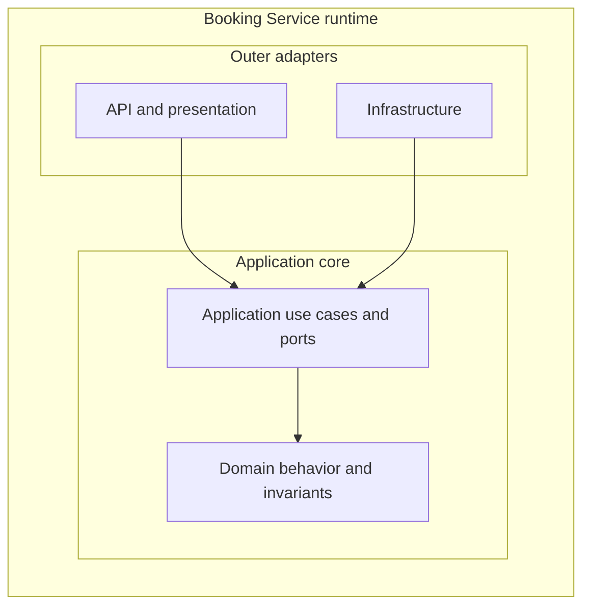
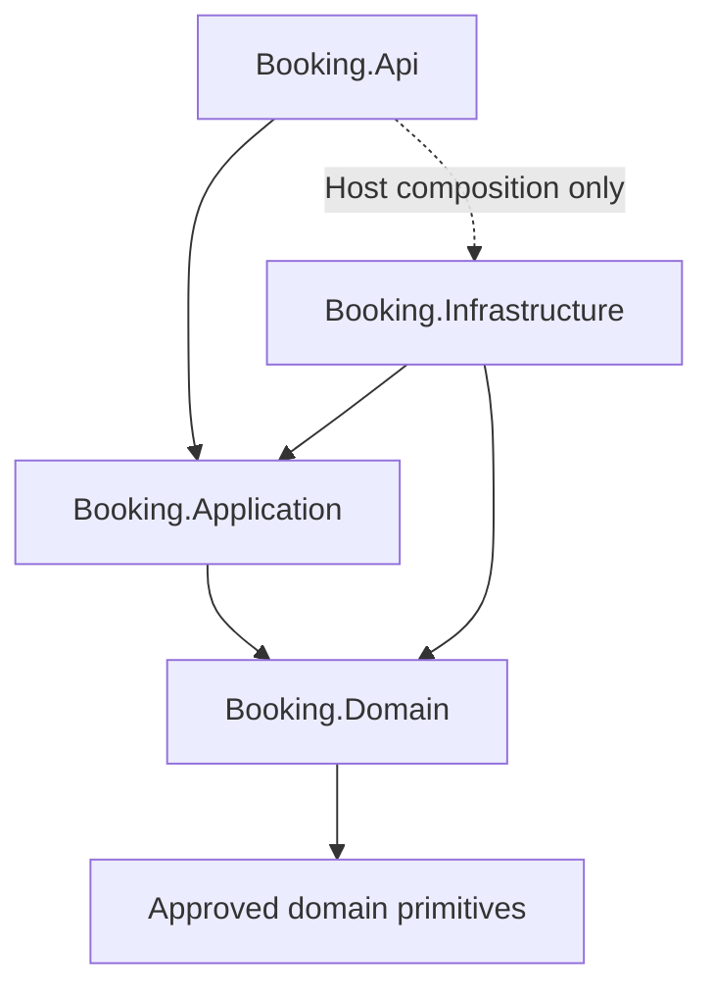
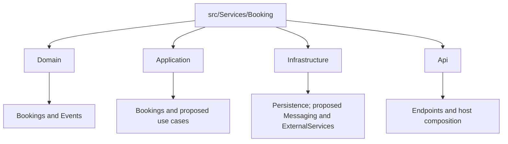
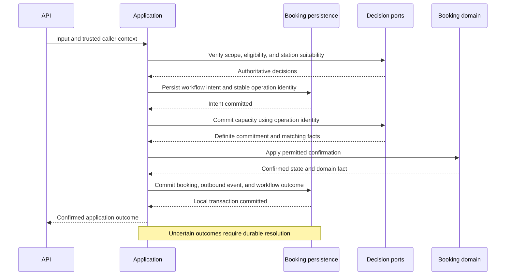
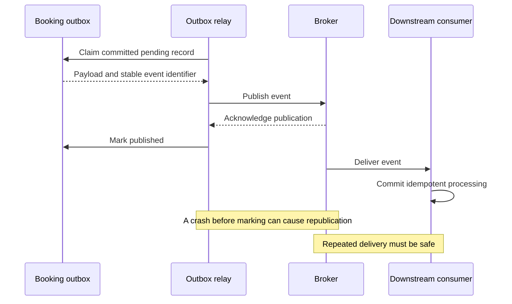
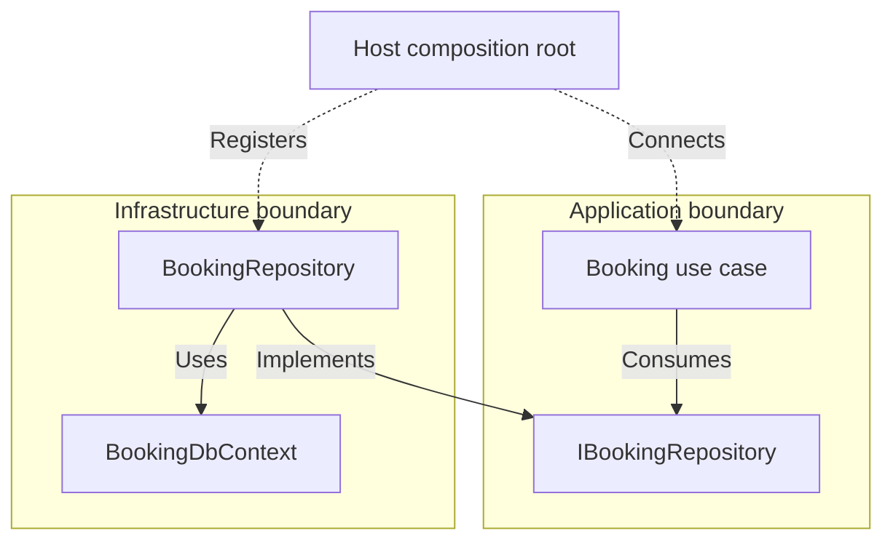
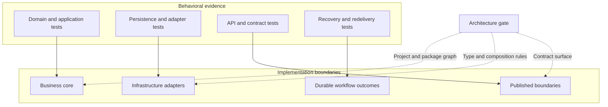

# Chapter 48 — Clean Architecture

*Part VII — Alpha Car Detailing*

## 1. Story-driven Opening

Northstar Distribution's request has reached the Booking implementation team. Twenty-four vehicles need service across two days. Chapter 46 established the business meaning of that request; Chapter 47 identified the capabilities responsible for account eligibility, fleet membership, station operations, and the booking lifecycle. The next question concerns the code inside Booking Service.

The first implementation proposal places the entire workflow in an HTTP endpoint. The endpoint inspects claims, checks the corporate account, validates each vehicle, queries station availability, creates EF Core entities, saves them, publishes a message, and sends a confirmation email.

The proposal appears convenient because every step is visible in one method. Its problems become apparent when the team examines what happens after the successful demonstration.

A second delivery channel would have to repeat the same rules. Testing a fleet rejection would require arranging HTTP, persistence, and remote-client behavior. A change to the capacity provider's response would affect the endpoint's business decisions. An email failure could make a committed booking appear unsuccessful. More seriously, the proposed implementation treats an available appointment as committed capacity and returns a confirmation before that commitment exists.

The architecture review separates two questions that the endpoint has combined: what makes a booking valid, and how the service obtains and stores the facts needed to make that decision.

Booking must protect its own lifecycle. Corporate Account remains authoritative for account and commercial eligibility. Fleet remains authoritative for vehicle membership and eligibility. Station Operations remains authoritative for capacity allocation. Booking coordinates those decisions without taking ownership of their databases or importing their implementation models.

The team assigns each responsibility to a boundary inside Booking Service. Domain contains booking behavior and invariants. Application coordinates the use case through interfaces. Infrastructure implements persistence, messaging, and external-service adapters. API translates an authenticated HTTP request into application input and translates the outcome back into an HTTP response.

The separation must survive an inconvenient change. When a different capacity adapter is introduced, the meaning of confirmation must remain intact. When a message consumer invokes the use case, fleet authorization must still apply. When the broker is unavailable after the local transaction commits, the booking must remain recorded and its publication obligation must remain durable.

These requirements give the project structure its purpose.

The existing companion application creates a `Pending` booking. The corporate workflow developed in this chapter is an extension of that baseline. A pending record, an accepted request, a capacity commitment, and a confirmed booking are distinct facts. Neither a folder structure nor an AI-generated implementation may collapse those distinctions.

The governing principle is:

> **Dependencies must point inward toward business rules. Domain and Application must not depend on Infrastructure or API concerns.**

That principle protects the business meaning of Northstar's request as the implementation evolves.

## 2. Learning Objectives

By the end of this chapter, you should be able to:

- distinguish source-code dependencies from runtime calls;
- assign booking behavior, use-case orchestration, persistence, and delivery responsibilities to the appropriate layers;
- model entities, value objects, aggregate invariants, and domain services without technology dependencies;
- define narrow application-owned interfaces for persistence and external decisions;
- connect implementations through a composition root while keeping endpoints independent of concrete adapters;
- place validation, authorization, error handling, and observability at the boundaries that own them;
- preserve capacity commitments, local transaction guarantees, and reliable event publication;
- organize projects and shared contracts without weakening service ownership;
- combine behavioral tests with deterministic architecture checks;
- review AI-generated changes against executable dependency rules.

## 3. Background

### 3.1 From Solution Boundaries to Implementation Boundaries

Chapter 47 asked which capability owns a decision and how other capabilities interact with that owner. This chapter asks how Booking Service organizes the implementation of its responsibilities.

These are different architectural scales. A Booking domain project is not a separately deployed business service. A repository interface is not a network contract. Moving persistence into an Infrastructure assembly does not create a distributed boundary.

The four layers can execute within one Booking host. A separate relay or worker may later use the same service-owned infrastructure, but deployment arrangements do not determine the direction of business dependencies.

Internal separation also cannot repair incorrect ownership. An Infrastructure adapter that reads Fleet's private tables still violates the service boundary, even if the Application project sees only an interface. Clean Architecture constrains dependencies inside a service; Chapter 47's ownership rules constrain what the adapters are permitted to do.

Chapter 49 develops microservice architecture in more detail. Here, the relevant external boundaries are inputs to the internal design.

### 3.2 Policy, Mechanisms, and Related Architectural Approaches

A booking's legal state transitions express business policy. SQL commands, HTTP serialization, dependency registration, and broker acknowledgments are mechanisms used to execute that policy.

Clean Architecture separates these concerns by controlling which code may depend on which other code. Hexagonal architecture expresses a closely related concern through ports and adapters: an application can be driven and tested through boundaries that do not require its eventual user interface or database. These approaches provide compatible ways to reason about the Booking implementation; they do not require identical project templates. See Alistair Cockburn's [original article on hexagonal architecture](https://alistair.cockburn.us/hexagonal-architecture/).

The practical test is a change in mechanism. Replacing a transport adapter should require adapting its mapping, configuration, and integration tests. It should not require rewriting the rule that confirmation requires committed capacity.

Independence therefore means controlling the effect of change. It does not promise a cost-free database migration, identical provider capabilities, or an application that can process real bookings when every dependency is unavailable.

### 3.3 The Existing Booking Baseline

The companion code already supplies the main project boundaries beneath:

`alpha-car-detailing/src/Services/Booking/`

Its current behavior is deliberately small.

| Baseline element | Current responsibility |
| --- | --- |
| `BookingEndpoints` | Exposes create and retrieve operations through HTTP. |
| `IBookingService` and `BookingService` | Provide direct application orchestration. |
| `IBookingRepository` | Defines persistence operations consumed by Application. |
| `Booking` | Creates a pending appointment and protects its construction rules. |
| `VehicleRegistrationNumber` | Validates and normalizes the registration value. |
| `BookingDbContext` and `BookingRepository` | Implement EF Core persistence using SQLite locally. |
| Domain and integration test projects | Exercise selected domain and API behavior. |

`POST /api/bookings` creates a pending booking; `GET /api/bookings/{bookingId}` retrieves one. Creation records a `BookingCreatedDomainEvent` in the aggregate's in-memory event collection. That collection is not an implemented transactional outbox or evidence of broker publication.

Accepted ADR 0001 establishes the four Clean Architecture projects. Accepted ADR 0002 retains a direct application service and defers CQRS. A feature folder or a class named `CreateBookingUseCase` does not require a mediator, command bus, or separate read model.

Corporate-account checks, batch fleet validation, capacity commitments, resource authorization, durable workflow recovery, and confirmation publication are proposed extensions in this chapter. They must not be described as capabilities already implemented by the initial create/read sample.

The distinction also applies to business policy. The chapter does not establish a numerical fleet limit, a reservation expiry, a group aggregate for all twenty-four vehicles, or a partial-acceptance policy. Those decisions remain open where Chapters 46–47 leave them open.

## 4. Concepts

### 4.1 The Dependency Rule

The dependency rule concerns what a source file, type, project, or package must know in order to compile and operate. An inner layer must not import an outer layer's implementation types.

Robert C. Martin's [description of Clean Architecture](https://blog.cleancoder.com/uncle-bob/2012/08/13/the-clean-architecture.html) places business policy toward the center and implementation details toward the outside. Booking applies that principle through a concrete rule: Domain does not reference Application, Infrastructure, or API; Application does not reference Infrastructure or API.

Consequently, `Booking` cannot depend on `DbContext`, `HttpContext`, a broker client, or a capacity provider's SDK. An application use case cannot instantiate `BookingRepository` or inspect an HTTP client's response object.

The rule does not prevent execution from reaching a database or remote service. Application invokes an interface that it owns; an outer implementation performs the operation. Section 6 distinguishes these source dependencies from runtime collaboration.

### 4.2 Domain: Meaning and Valid State

Domain represents the behavior Booking owns. It contains entities, value objects, domain events, and any domain services needed to express that behavior.

The existing `Booking.Create` method requires a customer, a station, a service code, and a future appointment. It creates a `Pending` booking rather than allowing callers to set an arbitrary status. The future-time comparison uses an explicit `currentUtc` argument; the aggregate does not read a hidden system clock.

The same discipline applies to confirmation. Once implemented, confirmation must be an operation that protects a legal transition and requires the appropriate evidence of capacity commitment and satisfied business prerequisites. It must not be a public status setter that any endpoint or repository can call.

Domain does not independently verify remote authority. A reservation identifier constructed from arbitrary request text proves nothing. Application must obtain the relevant fact from a trusted port implementation; Domain checks the local meaning of that fact, such as whether it matches the booking's station, appointment, and required service.

The aggregate can protect its own consistency. It cannot make an expired remote hold permanent or turn an availability observation into a reservation.

### 4.3 Entities and Aggregate Boundaries

An entity has identity that persists while its attributes change. A booking can move through its lifecycle while retaining its `BookingId`.

An aggregate is the consistency boundary through which related domain changes are controlled. The existing `Booking` aggregate provides a natural home for appointment lifecycle behavior. Persistence retrieves and stores that aggregate; application code requests meaningful operations on it.

The size of an HTTP request does not determine aggregate size. Northstar's twenty-four vehicles could lead to grouped appointments, independent bookings linked by a request reference, or another approved model. Choosing one large aggregate would imply consistency and lifecycle commitments that the business has not yet established.

Likewise, keeping all vehicles in a list does not decide whether accepting six out of ten is permissible. That is a customer-commitment decision with consequences for capacity, cancellation, billing, and notifications.

Booking refers to externally owned concepts by identity. A `FleetId` or corporate-account identifier identifies a related resource; it does not justify referencing the Fleet domain assembly. Historical snapshots may be appropriate when Booking must retain the facts used for a decision, but their purpose and freshness must be explicit.

### 4.4 Value Objects

A value object is defined by its value rather than a continuing entity identity. It protects a concept whose construction and equality should be consistent across its uses.

The existing `VehicleRegistrationNumber` is an example. It rejects blank input, trims surrounding whitespace, normalizes case, and enforces the baseline maximum length. Two instances with the same normalized value compare as values.

Those rules are local representation rules. A syntactically valid registration does not establish that the vehicle belongs to Northstar or is eligible for the requested service. Fleet supplies those authoritative facts.

Normalization must preserve business meaning. Additional punctuation removal or jurisdiction-specific validation should not be invented merely to simplify comparison.

EF Core conversion or owned-type mapping belongs in Infrastructure. JSON formatting belongs at a delivery boundary. Domain should express the registration concept without knowing which mechanism stores or transports it.

### 4.5 Domain Services

A domain service expresses a business operation that does not naturally belong to a single entity or value object. It can make a policy involving several domain concepts explicit without giving one entity responsibility for unrelated objects.

It is not a general home for procedural code. Booking creation and lifecycle transitions belong on `Booking` when they protect that aggregate's invariants. Calling Corporate Account, opening a transaction, or sending a message is application or infrastructure work.

A useful domain service may evaluate an approved booking policy using supplied facts. Its inputs and output remain domain concepts. Its execution must not secretly make network calls or inspect framework configuration.

A proposed `FleetBookingLimitPolicy` illustrates the danger of premature modeling. There is no legitimate implementation until the business defines the limit, its period and scope, exceptions, and the owner of concurrent consumption. An AI Agent must not supply a convenient number or count rows in Booking to replace an unresolved policy.

### 4.6 Application: A Business Operation in Context

Application coordinates a complete operation. It accepts input, establishes caller authority, obtains required facts, invokes domain behavior, arranges the local commit, and returns an application outcome.

For corporate booking, this means more than calling `Booking.Create`. The use case must establish authorized account and fleet scope, validate selected vehicles through Fleet, obtain station and capacity decisions through the appropriate ports, and preserve the distinction between pending and confirmed outcomes.

Application owns the sequence because that sequence expresses what the operation requires. Infrastructure supplies mechanisms for individual steps.

A direct application service remains appropriate for the current baseline. As responsibilities grow, cohesive use-case classes can prevent `BookingService` from becoming an oversized collection of unrelated workflows. This is an organizational refinement; it does not automatically introduce CQRS.

The same operation may later be invoked by an HTTP endpoint, a message consumer, or an authorized job. Those entry points adapt their inputs and identity evidence; they must not bypass the application checks shared by the operation.

### 4.7 Interfaces and Dependency Inversion

A port states what an inner policy needs from an outside mechanism. Its contract belongs to the layer that consumes the capability.

`IBookingRepository` therefore remains in Application, matching the repository baseline. Infrastructure implements it. Moving the interface into Infrastructure would require Application to depend outward merely to describe its persistence needs.

Proposed ports for account eligibility, batch vehicle eligibility, and capacity commitments follow the same pattern. They should describe business-relevant decisions and failure meanings rather than reproduce a provider API.

| Port characteristic | Appropriate boundary | Leakage to reject |
| --- | --- | --- |
| Input | Application identifiers and operation data | ASP.NET request objects or access tokens |
| Result | Explicit decision, facts, reference, and relevant version | `HttpResponseMessage` or provider DTO |
| Persistence | Aggregate operations and explicit commit semantics | `DbSet`, change trackers, or database transactions |
| Failure | Rejected, unavailable, or outcome unknown where meaningful | Provider exceptions used as business decisions |
| Query | A bounded operation returning materialized results | `IQueryable` for callers to build provider-dependent queries |

Dependency inversion determines ownership of the contract. Dependency injection supplies an implementation. Runtime polymorphism allows that implementation to satisfy the contract. These mechanisms work together, but registering a concrete repository in a container does not make an outward dependency acceptable.

Interfaces also have a cost. A one-method interface for every pure helper adds little if it introduces no meaningful boundary or variation. Ports are most useful where they protect policy from persistence, integration, or other mechanisms.

### 4.8 Infrastructure: Implementing the Ports

Infrastructure contains the mechanisms that connect Booking's application core to its environment. It owns EF Core mappings, database access, migrations, external clients, serialization, outbox storage, and broker publication.

An external adapter translates both data and meaning. A remote status code is interpreted according to the provider contract, then mapped into an application-owned outcome. An unavailable Fleet endpoint must not be translated into “vehicle ineligible” merely because both cases prevent immediate confirmation.

The adapter also applies provider-specific timeouts, safe retry behavior, credentials, and telemetry. Application decides the workflow consequence of an unavailable or uncertain result.

Database independence does not require duplicating every persistence class. EF Core can map an encapsulated domain aggregate through configuration outside Domain. A separate storage model is useful when storage shape or legacy constraints justify it, rather than as a mandatory extra representation.

### 4.9 API: Delivering the Use Case

API owns HTTP concerns: routes, binding, authentication, transport validation, response codes, public request and response contracts, and Problem Details.

A thin endpoint still performs meaningful work. It extracts trusted caller information, maps input into an application request, invokes the operation, and maps the outcome into a documented response. It does not decide whether a vehicle is commercially eligible or whether a booking can skip capacity commitment.

Public contracts should not expose EF Core models or the aggregate itself. Returning a domain entity makes encapsulation, serialization, and external compatibility depend on the same shape. An intentional response contract allows the public API and internal model to evolve at their own boundaries.

The baseline currently reuses an application request and DTO at the HTTP boundary. That can remain a deliberate choice while their semantics align. Separate transport contracts when public compatibility, versioning, or binding requirements diverge from application needs.

### 4.10 The Composition Root

The composition root connects the application to its implementations. In the Booking host, `Program.cs` and narrowly scoped registration extensions select persistence, external adapters, application services, and configuration.

The API project may reference Infrastructure for this purpose. Microsoft's [Clean Architecture guidance for .NET applications](https://learn.microsoft.com/en-us/dotnet/architecture/modern-web-apps-azure/common-web-application-architectures) describes this practical arrangement while restricting implementation references to the composition root.

That reference does not authorize an endpoint to inject `BookingDbContext` or instantiate a capacity client. Composition chooses mechanisms; endpoint behavior consumes the application boundary.

Lifetimes must also agree with ownership. The repository and its database context share an appropriate scope. A long-lived relay creates a processing scope rather than capturing a request-scoped context. Credentials and provider configuration are validated at the host boundary.

A service locator reverses this clarity by letting business code request arbitrary objects from a container. Constructor dependencies make required capabilities visible and mechanically inspectable.

### 4.11 Domain Events, Integration Events, and the Outbox

A domain event describes a fact within the domain model. An integration event describes a published fact under an external compatibility contract.

The existing `BookingCreatedDomainEvent` means that a pending booking has been created in the model. It does not mean capacity has been committed, the booking has been confirmed, or a message has been published.

A proposed `BookingConfirmed` integration event must correspond to the confirmed business fact. Mapping belongs outside the aggregate's transport-independent behavior. The public payload includes the approved information consumers need, rather than serializing the aggregate or its entire internal event collection.

Reliable publication requires separating three actions:

1. Domain records the business fact.
2. The local transaction stores Booking-owned changes and the outbound event record together.
3. A relay publishes the committed record through a broker adapter.

An in-memory event publisher between steps one and two cannot close the failure window between database commit and broker send. The outbox makes the publication obligation durable; it does not make delivery exactly once.

The relay retains a stable event identifier across retries. Consumers must handle repeated delivery. The confirmation path must not wait for notification delivery when the committed event is the agreed handoff to Notification.

### 4.12 Shared Contracts and Service Boundaries

A shared contract is an agreement between owners. A shared domain model distributes implementation decisions across owners.

Booking may publish a versioned event schema or use a governed client generated from another service's API. It should not reference Fleet's entity project, reuse Corporate Account's repository, or obtain a shared database context that exposes everyone's tables.

Small technical primitives may be shared when their dependency graph remains appropriate. Shared domain primitives are still part of Domain's dependency closure and require the same scrutiny as Domain itself.

Schema compatibility, delivery semantics, required fields, and ownership require explicit review. A package named `Contracts` is not safe merely because it contains DTOs; it can still import persistence types, expose private business state, or force coordinated deployments through incompatible changes.

The engineering Harness remains outside the runtime dependency graph. It can validate Booking, but Booking must not need a coding agent or Harness service to process customer traffic.

## 5. Architecture Discussion

### 5.1 Responsibilities and Allowed Dependencies

The implementation problem is to preserve business behavior while persistence, delivery, and integrations change. The recommended approach is to retain the four existing projects, make their permitted dependencies explicit, and enforce the rules against both code and build metadata.

| Project | Responsibility | Permitted references |
| --- | --- | --- |
| Domain | Booking behavior, invariants, and domain concepts | The runtime base libraries and approved technology-independent domain primitives |
| Application | Use cases, application outcomes, and consumed ports | Domain and explicitly approved application support abstractions |
| Infrastructure | Persistence, external adapters, and messaging mechanisms | Application and Domain |
| API | HTTP delivery and host composition | Application; Infrastructure at the composition boundary |

Domain and Application must not reference Infrastructure or API. Infrastructure must not reference API or another service's internal implementation projects.

The existing Application project uses dependency-injection abstractions for registration. This is a deliberate support dependency to review, not permission to add ASP.NET Core, EF Core, or provider packages to application behavior. Domain has no reason to depend on container registration.

Figure 48-2 shows the permitted source dependencies. Its composition reference is narrow: only designated host bootstrap and registration types may use Infrastructure. A project-level allowance must be accompanied by a type-level restriction if it is to protect endpoint behavior.

Folders help navigation, but a compiler does not treat a folder named `Domain` as a boundary. Separate projects strengthen enforcement; package checks and type-dependency checks complete the evidence.

### 5.2 Project Organization

Keep the established service root and project names. Within each layer, choose folders that make responsibilities easy to find.

| Project beneath the Booking service root | Existing organization | Proposed growth |
| --- | --- | --- |
| `AlphaCarDetailing.Booking.Domain` | `Bookings/` and `Bookings/Events/` | Additional value objects and lifecycle behavior; domain services only when needed |
| `AlphaCarDetailing.Booking.Application` | `Bookings/` | Cohesive use cases, application validation, and narrow integration ports |
| `AlphaCarDetailing.Booking.Infrastructure` | `Persistence/Configurations/` and `Persistence/Repositories/` | `Messaging/`, outbox persistence, and `ExternalServices/` adapters |
| `AlphaCarDetailing.Booking.Api` | `Endpoints/` and `Program.cs` | Feature-oriented endpoints, middleware, transport contracts, and composition registration |

A conceptual structure using `Entities`, `ValueObjects`, `DomainServices`, `UseCases`, and `Interfaces` is valid. The repository's existing `Bookings/` grouping is also valid. Architectural correctness depends on responsibility and dependency direction, rather than a mandatory spelling of folders.

Feature folders can improve cohesion as the service grows. A corporate-booking operation can have corresponding Application, API, and test folders without placing persistence implementations beside the use case in the same unrestricted assembly.

Figure 48-3 presents this organization as a package view. It identifies proposed additions without implying that every folder or workflow already exists.

Keep the initial refactoring small. Moving existing code and adding new fleet behavior in one large change makes regressions harder to attribute. Preserve create/read behavior while introducing the next boundary.

### 5.3 Respecting Authoritative Owners

Application ports must preserve the ownership established in Chapter 47.

| Decision or fact | Authoritative owner | Booking's responsibility |
| --- | --- | --- |
| Account and commercial eligibility | Corporate Account | Obtain the required decision and retain relevant evidence |
| Vehicle membership and eligibility | Fleet | Check selected vehicles within authorized fleet scope |
| Station suitability and capacity commitment | Station Operations | Request the required decision and honor its semantics |
| Booking lifecycle | Booking | Protect transitions and persist booking commitments |
| Financial processing | Billing and Payment, within their responsibilities | Publish appropriate facts without implementing their workflows |
| Communication delivery | Notification | Provide the agreed event or request without owning dispatch |

An interface does not transfer authority. A local adapter may use a documented projection where its freshness is acceptable, but a stale projection cannot silently replace a decision that requires current authoritative state.

This distinction matters for limits. If a contractual allowance must be consumed atomically, a read of “remaining allowance” followed by a Booking write is insufficient under concurrency. The agreed owner must provide a concurrency-safe consumption or commitment operation.

### 5.4 Corporate Fleet Booking Through the Layers

Consider one appointment commitment within Northstar's larger request. This unit of explanation avoids choosing the unresolved semantics of an entire fleet group.

API authenticates the caller and maps a proposed corporate request to application input. Caller scope comes from trusted identity and entitlement evidence. A corporate-account identifier in the request identifies a target; it does not grant access to that target.

Application then coordinates the required decisions.

| Approved rule | Enforcement in the proposed path |
| --- | --- |
| BR-FLT-001: act only within authorized fleet scope | Application verifies the caller's authority over the requested account and fleet. |
| BR-FLT-002: selected vehicles must be eligible | Application obtains Fleet's decision for the selected vehicle identities. |
| BR-SVC-001: station must support the service | Application obtains the authoritative station/service decision. |
| BR-CAP-001: availability lookup does not reserve | The capacity port distinguishes observations from commitments. |
| BR-CAP-002: confirmation requires committed capacity | Application obtains the commitment; Domain protects the confirmation transition. |
| BR-AUT-001: required business authorization precedes confirmation | Application establishes the required approval; the transition cannot bypass the prerequisite. |

Prefer a batch eligibility operation for a vehicle list when the Fleet contract supports one. Repeated calls per vehicle increase latency and can yield decisions from inconsistent observation times. Batch processing still needs explicit semantics for incomplete or stale results.

A durable workflow design records an operation identity and recovery intent before making a capacity-changing remote call. Application uses that identity when requesting or resolving the commitment. After a definite successful commitment, it invokes domain behavior and commits the Booking-owned state, outbound event, and local workflow outcome.

This is an illustrative implementation protocol, not a decision that all fleet requests are atomic or that reservations expire after a particular interval. The capacity contract must define what “committed” means and how uncertain outcomes are resolved.

Figure 48-4a shows these responsibilities. Figure 48-4b shows publication after the local commit.

### 5.5 Persistence, Transactions, and Concurrency

The persistence adapter translates aggregate state into storage operations. Domain should not expose setters solely to make arbitrary updates convenient. EF Core configuration can map private state, identifiers, and value objects outside the domain project.

The current `IBookingRepository` already offers `SaveChangesAsync`. Before introducing a separate unit-of-work interface, establish whether that commit boundary can correctly include the required Booking-owned changes and outbox records.

The important contract is atomicity. Confirmation state and its outbound event must commit together. EF Core ordinarily applies a single `SaveChanges` operation transactionally when the provider supports transactions; explicitly configured behavior and operations outside that call must also be considered. See the official [EF Core transaction guidance](https://learn.microsoft.com/en-us/ef/core/saving/transactions).

Two unrelated contexts or database connections do not share an atomic commit merely because both adapters were injected into the same use case. The implementation must establish the actual transaction boundary.

The baseline repository retrieves bookings with `AsNoTracking`. That is sufficient for its current read operation. A future confirmation workflow must deliberately load a tracked aggregate or implement an explicit update and concurrency contract; calling a method on an untracked object does not persist a transition.

Concurrency protections address different risks. A booking version can prevent conflicting lifecycle updates. A unique operation key can prevent duplicate local request registration. Station Operations must protect capacity allocation in its own boundary.

A check-then-insert sequence is not enough for duplicate requests arriving concurrently. Persist the scoped operation identity under a uniqueness constraint. Bind it to the request's normalized meaning, reject conflicting reuse, and reauthorize access before returning a stored result.

The scope and retention of idempotency records are explicit contract decisions. They must not be inferred from an arbitrary correlation identifier.

### 5.6 Integrations and Failure Recovery

External operations have more than successful and unsuccessful outcomes. A capacity request can be rejected, fail before being accepted, or time out after the owner has committed it.

A useful port preserves that distinction. Application needs a resolution path for an unknown result, such as querying the stable operation reference. Retrying with a fresh identity can create a second commitment.

| Failure | Required application interpretation |
| --- | --- |
| Fleet explicitly rejects an ineligible vehicle | Business rejection under the approved eligibility rule |
| Fleet cannot be reached | Required decision unavailable |
| Capacity owner rejects the requested allocation | Capacity not committed |
| Capacity call times out after submission | Commitment outcome may be unknown |
| Capacity succeeds; local Booking commit fails | Recovery must resolve the remote commitment and local state |
| Broker fails after a successful local commit | Keep the committed outbox record for publication retry |

Timeout and retry configuration belongs in the adapter, but application semantics determine whether an operation is safe to repeat. Propagate cancellation and deadlines without assuming cancellation reverses a remote side effect.

Do not hold a Booking database transaction open across network calls merely to make the method look atomic. The database cannot roll back a capacity commitment owned elsewhere.

If remote capacity succeeds and local persistence fails, the workflow must support the agreed recovery behavior: retrying the same local outcome, releasing the allocation, relying on a defined expiry, or reconciling unresolved operations. Durable intent and stable identities allow recovery after a process crash; an in-memory `catch` block alone cannot do that.

If the local commit itself has an uncertain outcome, first resolve whether it succeeded. Releasing capacity immediately could invalidate a booking that was actually confirmed.

### 5.7 Validation at the Right Boundary

Validation belongs wherever a boundary has a distinct obligation.

| Boundary | Obligation | Corporate example |
| --- | --- | --- |
| API | Parse and constrain the public representation | Reject malformed identifiers or invalid request shape |
| Application | Establish prerequisites, permissions, and external facts | Verify authorized fleet scope and eligibility |
| Domain | Preserve valid local values and transitions | Reject invalid appointment construction or illegal confirmation |
| Persistence | Enforce owned storage constraints and concurrency | Prevent duplicate operation keys and conflicting updates |

A field may be checked at more than one boundary for different reasons. API gives a useful error for malformed input; Domain still prevents an invalid value when invoked from another entry point.

This defense does not justify independently implementing Fleet's eligibility policy in both Application and an endpoint. Authoritative policy should retain one owner.

Transport validation cannot replace application authorization. A valid identifier may name another organization's fleet. Likewise, a domain invariant should not disappear because an API validation library normally checks it first.

Tests should exercise application and domain boundaries directly, so that correctness does not depend on one route's middleware arrangement.

### 5.8 Error Handling and Outcome Mapping

Application outcomes should express the meaning of a result without selecting an HTTP response code. Domain failures should express invalid business state without importing Problem Details.

| Outcome | HTTP boundary treatment |
| --- | --- |
| Malformed request | A documented client error with field information where appropriate |
| Unauthenticated caller | Authentication challenge |
| Unauthorized resource access | Authorization failure under the disclosure policy |
| Resource absent | Not found, subject to the same disclosure policy |
| Business rejection | A documented business-error response with a stable code |
| Concurrent state conflict | Conflict response or a contractually defined retry path |
| Required dependency unavailable | A retryable service failure when safe |
| Durably accepted, unresolved workflow | An accepted response with a protected status resource |
| Unexpected failure | Generic server error and correlated internal diagnostics |

The exact status-code policy belongs to the public API contract. Expected outcomes should be consistent across operations rather than chosen ad hoc in each endpoint.

An accepted response is valid only when the service has durably accepted responsibility and can expose meaningful progress. Returning an operation identifier held only in memory does not meet that obligation.

A timeout with an uncertain capacity result must not be presented as a definite business rejection. Similarly, a failed email after confirmation must not turn a committed booking into an apparent failed booking request.

Known invariant failures can be mapped deliberately. Unexpected exceptions belong at a centralized delivery boundary, with safe diagnostics. Avoid exposing provider stack traces or catching every exception and returning success.

### 5.9 Security Across Entry Points

Authentication establishes identity at the delivery boundary. Application authorization establishes whether that identity may perform this operation on these resources.

A general permission to create bookings does not establish access to Northstar's fleet. Resource-based authorization requires the relevant resource context; a route-level authorization attribute by itself cannot establish every resource decision. The official [ASP.NET Core resource authorization guidance](https://learn.microsoft.com/en-us/aspnet/core/security/authorization/resource-based?view=aspnetcore-10.0) explains this distinction.

Adapt authenticated evidence into a narrow caller context. Application should receive the identity, scope, and capabilities it needs without depending on `HttpContext`, raw tokens, or `ClaimsPrincipal`. Domain should not parse claims.

A body-supplied account, fleet, or customer identifier must be checked against that trusted context. Do not allow public input to set status, approval evidence, capacity references, or event identifiers that the workflow is responsible for obtaining.

A message consumer has a different trust boundary. Validating its workload identity does not automatically authorize an arbitrary user represented in its payload. The consumer needs an approved delegation or system-operation policy before invoking the shared use case.

Database, broker, and external-client identities receive the least privileges required by their adapters. Booking credentials must not permit reading another service's private tables. Secrets remain at the host and infrastructure boundary.

Idempotency lookups and operation-status endpoints require the same resource authorization as the original operation. Possession of an operation key is not an access grant.

### 5.10 Logging and Observability

Observability should make the workflow understandable without making the domain model depend on a telemetry provider.

Delivery boundaries establish trace and request context. Application records meaningful operation outcomes. Adapters report dependency latency, retries, and failure classification. Domain supplies business facts through state, outcomes, and events.

A trace identifier links execution. An operation identifier links durable workflow state. A reservation reference identifies an external commitment. An event identifier supports publication and consumer deduplication. These identifiers have different purposes and should not be substituted for one another.

Useful measurements include booking outcomes, dependency latency, unresolved capacity operations, outbox age, publication failures, and reconciliation backlog. Metrics should use bounded dimensions such as outcome category. Vehicle registrations, booking identifiers, and fleet identifiers are unsuitable as unbounded metric labels.

Logs should also avoid unnecessary personal or commercial data. Provider bodies can contain sensitive information even when the request appears operational.

Operational logs and traces do not replace a required durable audit record. If the business must retain who authorized a transition and which decision supported it, persist that evidence under its own access and retention rules. Application defines the requirement; Infrastructure implements storage.

### 5.11 Testing Behavior at Its Owning Boundary

Each test should target a failure that matters.

| Test boundary | Evidence sought |
| --- | --- |
| Domain | Valid values, future scheduling, legal transitions, and required confirmation facts |
| Application | Authorization, decision handling, workflow outcomes, and commit obligations through narrow fakes |
| Persistence integration | Mappings, constraints, concurrency, and atomic Booking/outbox storage |
| External-adapter contract | Correct translation of success, rejection, unavailable, and uncertain results |
| API integration | Authentication, resource access, request mapping, and stable error contracts |
| Selected workflow | Recovery after crashes, duplicate delivery, and remote/local uncertainty |
| Architecture | Conformance to permitted project, package, and type dependencies |

Domain tests need no host, database, or broker. Application tests use controlled facts and explicit time. They should assert observable outcomes and significant side effects, such as the absence of a capacity request after authorization failure.

A fake repository cannot prove transaction atomicity. Test the real persistence path with failure injection and verify that confirmation and its outbox record are committed together or absent together.

Likewise, an in-memory dictionary cannot prove database uniqueness under concurrent requests. Exercise competing operations against the intended provider. SQLite tests provide useful evidence for the local sample, but provider-specific locking, constraints, and concurrency behavior require tests against any different deployment database.

Outbox tests should include publication followed by a crash before the published marker is stored. The expected behavior is possible redelivery with the same event identifier, handled safely by consumers.

Figure 48-6 relates these behavioral boundaries to structural verification.

### 5.12 Deterministic Architecture Gates

Architecture tests turn accepted dependency rules into executable checks. A deterministic gate evaluates a defined revision and dependency graph under a pinned toolchain, producing the same pass or fail decision for the same inputs.

Several complementary checks are necessary.

| Check | Inputs | Violation it must detect |
| --- | --- | --- |
| Project graph | Evaluated project references for supported configurations | Domain referencing Application or an unrelated service implementation |
| Package graph | Restored direct and transitive dependencies, including native assets | SQLite, EF Core, ASP.NET Core, or provider dependencies in protected inner projects |
| Type dependencies | Compiled signatures, attributes, inheritance, and executable references | Infrastructure types used by an endpoint or leaked through an inner-layer port |
| Composition restriction | Explicit bootstrap type and registration-method allowance | Concrete adapter use outside the permitted host composition boundary |
| Contract boundary | Public schema and contract assembly surface | Domain entities, database models, or provider types exposed as shared contracts |

Do not substitute namespace searches for these checks. Aliases, generated code, attributes, base classes, and method bodies can create dependencies without an obvious source-text match. Conversely, comments and strings can contain forbidden names without creating a dependency.

A project file check also needs evaluated build information. Conditional references and centrally managed packages mean that reading one XML file is not a complete account of the restored graph.

The current checkout contains a concrete issue for this gate to expose: `SQLitePCLRaw.lib.e_sqlite3` appears in Booking Domain, Application, and the shared domain-primitives project. Its presence is a dependency violation to investigate and move outward through a validated change. A native package can undermine independence even when it contributes no managed type reference that an assembly scanner would detect.

The correct response is to repair the dependency placement while preserving the runtime's native-library requirements. Adding SQLite to an allowlist merely to obtain a passing architecture check defeats the rule.

A trustworthy gate also needs a controlled negative case. Use a disposable fixture or isolated test checkout to introduce a forbidden project reference, a native package dependency, and endpoint use of a concrete adapter. Each corresponding check must fail. The approved composition-root reference must pass.

Build and scan the actual target assemblies. Fail if a test discovers no Domain or Application assembly; an empty selection is not evidence of conformance. Bind the results to the tested revision and configuration, and rerun when those inputs change.

Architecture gates do not establish every architectural property. They cannot prove that an adapter's SQL respects data ownership, that a confirmation has valid capacity, or that a timeout is handled correctly. Those questions require permissions, integration tests, behavioral evidence, and review.

AI Agents must operate within the same gate. A faster implementation that adds an Infrastructure reference to Application has changed the architecture, even if its functional test passes. The Harness should reject that result rather than silently amend the accepted dependency rules.

### 5.13 Trade-offs and Incremental Evolution

Four projects introduce build and navigation overhead. For Booking, the accepted boundaries justify that cost because the service contains domain behavior and multiple changing mechanisms.

A simpler service may use lighter internal separation. The relevant question is whether its boundaries can be understood and enforced at the chosen scale. Creating empty projects and forwarding every call through an interface does not improve a service automatically.

Repository abstractions should express the operations Application needs. A generic repository exposing arbitrary queries and CRUD for every table often hides EF Core while retaining its coupling. For the baseline, keep the specific Booking repository and extend it only when a use case requires a clear new capability.

The same restraint applies to CQRS. A growing method count alone does not justify separate read stores or mediator pipelines. Evidence such as materially different read models, workloads, or consistency needs can justify a later ADR and focused migration.

Structural changes should remain reviewable: identify the violated boundary, move the mechanism, preserve behavior, and add the check that prevents recurrence. Preserve unresolved business decisions as unresolved rather than encoding them during cleanup.

## 6. Professional Diagrams

### 6.1 Figure 48-1 — Clean Architecture Layers

Sections 4.1–4.10 distinguish the business core from its delivery and infrastructure adapters. Figure 48-1 shows those responsibilities within one Booking runtime boundary.

*Figure 48-1. API and Infrastructure depend on the business core. The enclosing service is a runtime boundary; its internal layers are responsibility boundaries. Arrows indicate source dependencies, not request order.*

### 6.2 Figure 48-2 — Permitted Dependency Direction

Section 5.1 defines the allowed project relationships. Figure 48-2 includes the host's narrow composition reference and the shared primitives that belong within the protected dependency closure.

*Figure 48-2. Solid arrows show permitted inward source dependencies. The dashed arrow permits host composition only. Shared primitives must also remain independent of persistence and transport technologies. Domain and Application have no outward reference.*

An Infrastructure reference to Domain may be direct or available through its Application reference, according to the project configuration. Either arrangement must preserve the same permitted graph. The diagram grants no dependency on another service's internal projects.

### 6.3 Figure 48-3 — Booking Project Organization

Section 5.2 retains the existing projects while allowing cohesive folders within them. Figure 48-3 uses shortened project labels; the full names retain the `AlphaCarDetailing.Booking` prefix.

*Figure 48-3. This is a containment view, so arrows indicate organization rather than dependencies. Corporate use cases, messaging, and external-service adapters are additions to the baseline. Corresponding tests live under the service's test boundary.*

Folder names can change without altering the dependency matrix. Moving a use case into the same unrestricted assembly as persistence would require stronger checks to preserve that matrix.

### 6.4 Figure 48-4 — Corporate Booking Execution and Publication

Section 5.4 traces one appointment commitment through the proposed corporate workflow. Figure 48-4a shows an illustrative durable coordination path. The Decisions participant groups application-owned ports; their Infrastructure implementations call the authoritative owners.

*Figure 48-4a. Runtime calls can reach outer adapters through inner-layer ports without reversing source dependencies. The diagram depicts success for one appointment, without selecting fleet-group or partial-acceptance policy. Confirmation depends on an authoritative capacity commitment whose semantics the integration contract must define.*

The first intent commit does not confirm a booking. Its purpose is recoverability if the process stops around the remote operation. The later local transaction records the confirmed Booking outcome and publication obligation together.

Figure 48-4b continues after that local transaction. Publication belongs to the outbox relay, rather than the HTTP endpoint.

*Figure 48-4b. A committed outbox decouples Booking's local transaction from broker availability. Publication and delivery can repeat; stable event identity and idempotent consumers preserve the intended downstream effect.*

### 6.5 Figure 48-5 — Infrastructure Implements Inner Ports

Section 4.7 explains dependency inversion. Figure 48-5 shows how a use case can depend on its own persistence contract while EF Core remains outside Application.

*Figure 48-5. Solid arrows describe type relationships: Application consumes its interface and Infrastructure implements it. Dashed arrows describe composition. Runtime dispatch reaches the registered repository without Application importing the repository class or EF Core.*

Eligibility and capacity ports follow the same ownership principle. Their adapters translate remote contracts into application-owned outcomes.

### 6.6 Figure 48-6 — Verification Boundaries

Sections 5.11–5.12 distinguish behavior from structural conformance. Figure 48-6 shows why both forms of evidence are required.

*Figure 48-6. Solid arrows associate behavioral tests with their principal verification boundary. Dashed arrows show structural inspection. Architecture checks complement the tests; they do not prove authorization, transaction atomicity, or recovery correctness.*

Together, the figures provide two views of the same implementation: the dependencies the source code is permitted to express and the runtime responsibilities that must be demonstrated through tests.

Chapter 48 status: In progress — next section: Hands-on Example
