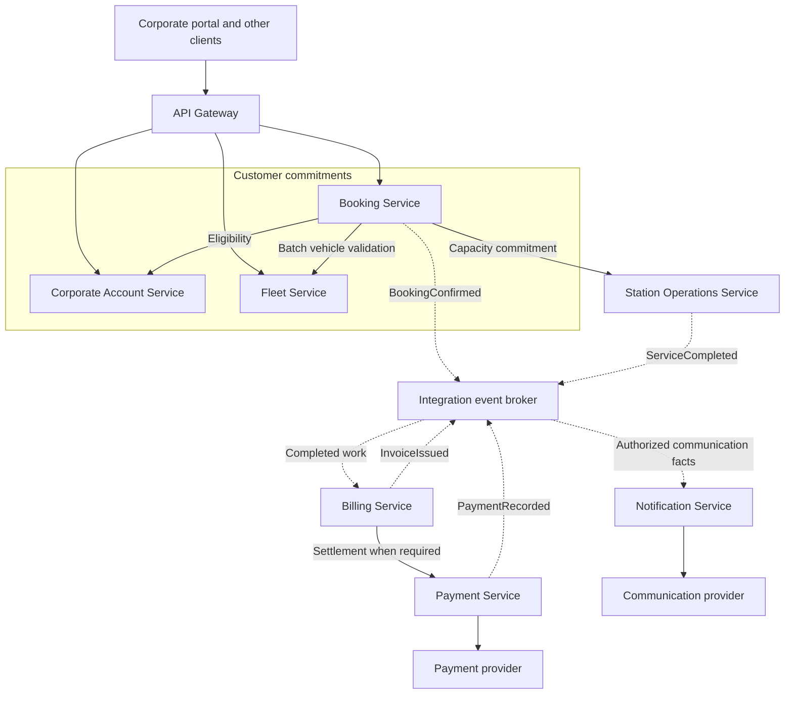
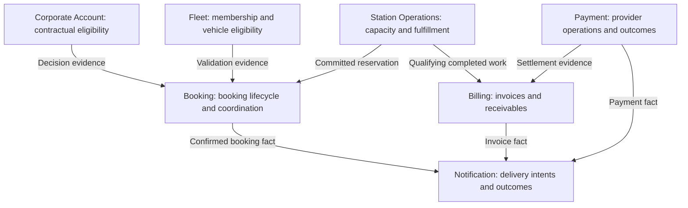
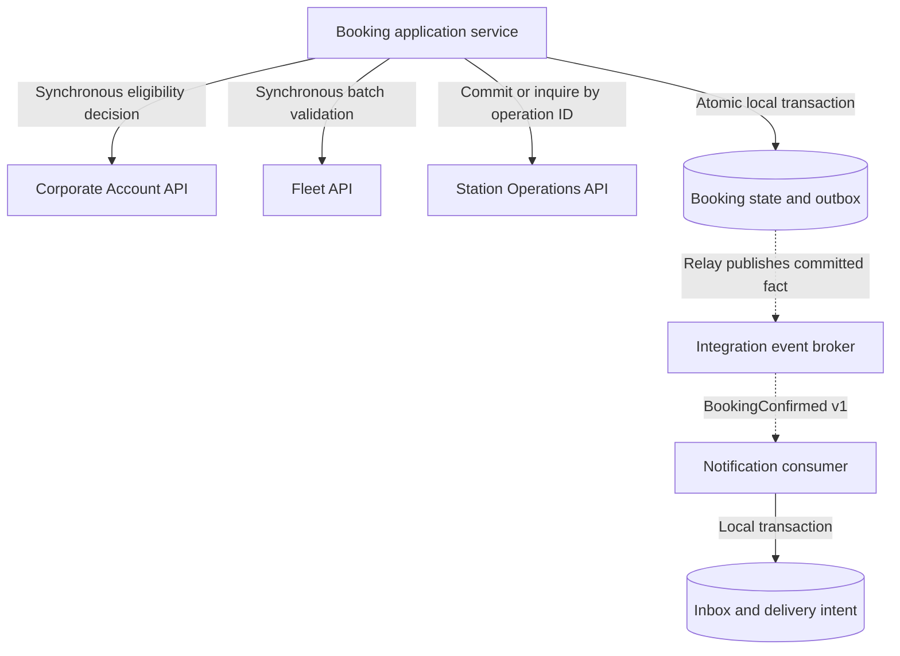
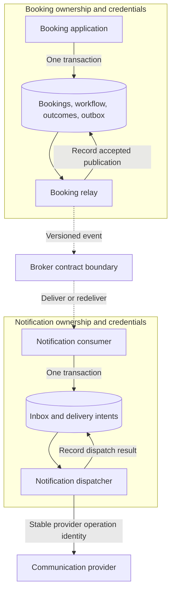
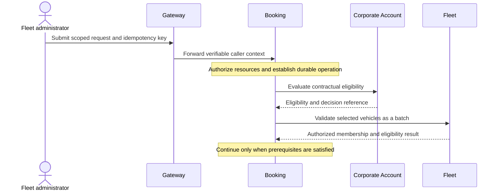
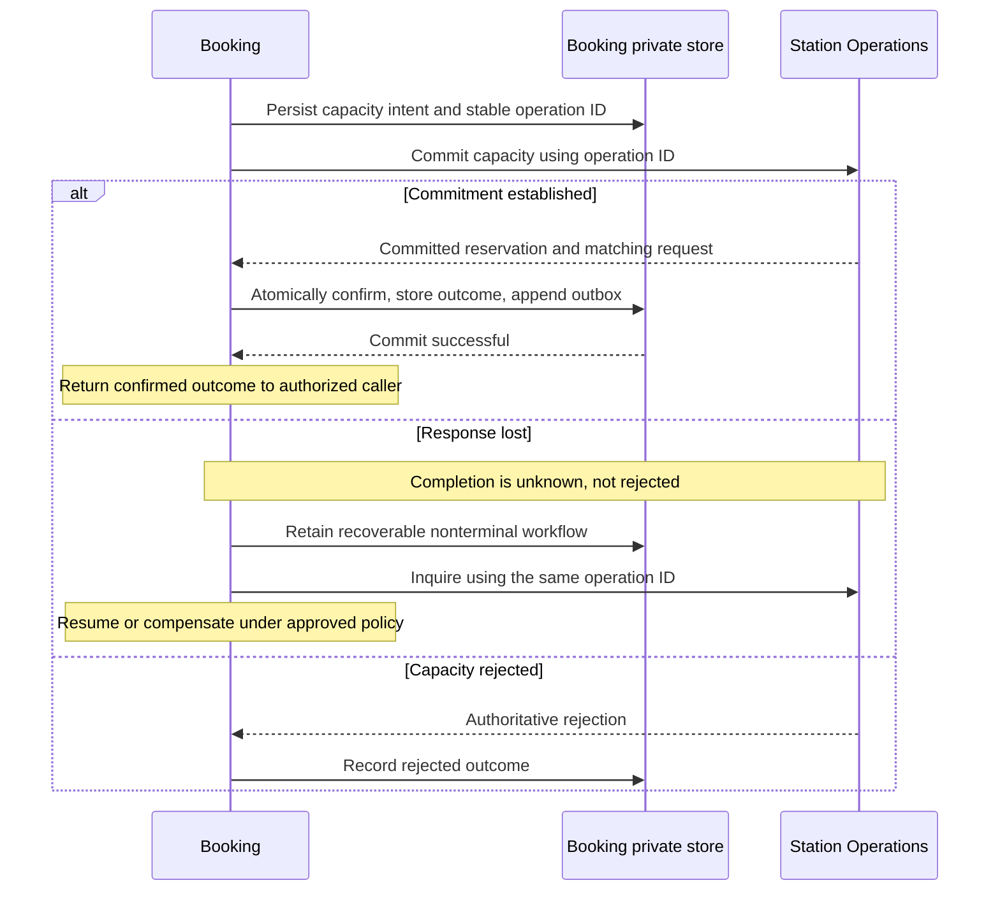
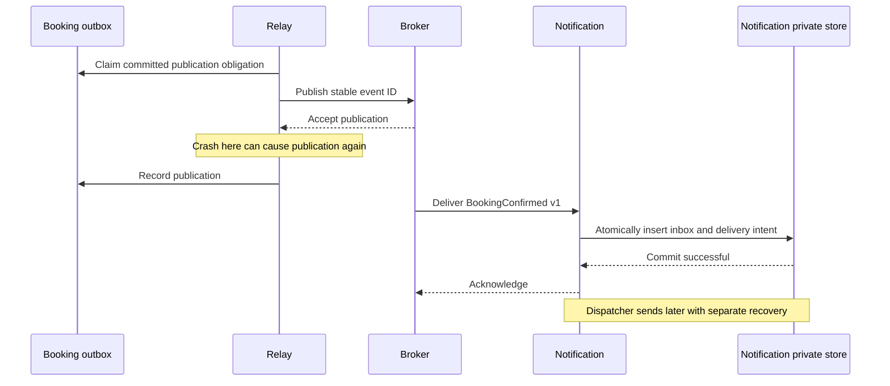
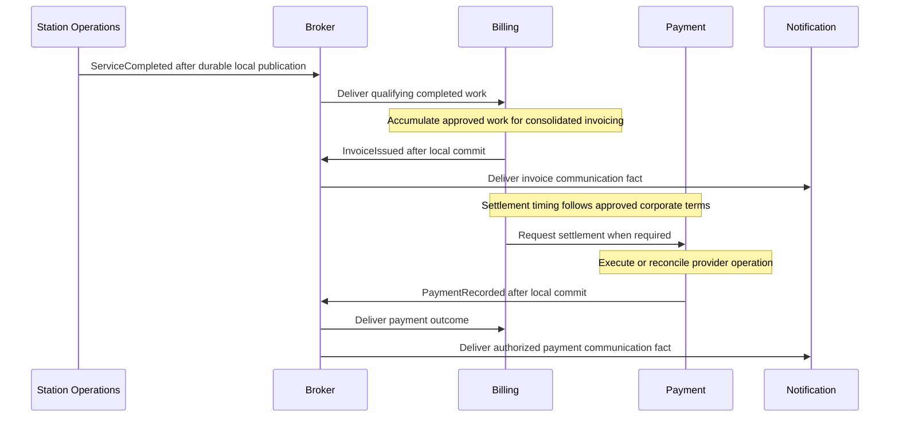
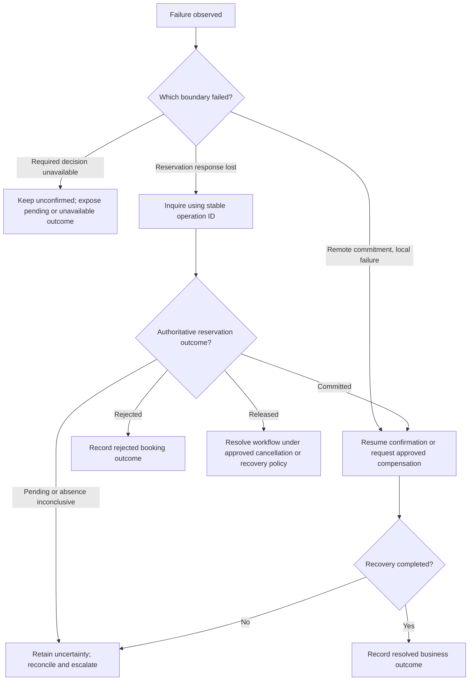
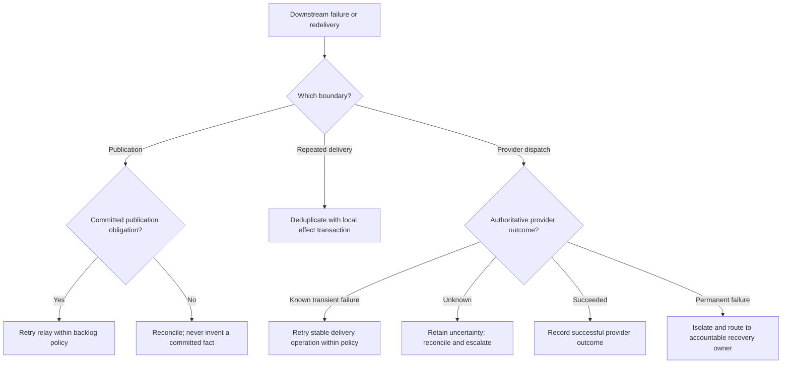

# Chapter 49 — Microservices

*Part VII — Alpha Car Detailing*

## 1. Story-driven Opening

Northstar Distribution's fleet administrator submits the request introduced in Chapter 46: twenty-four vehicles need washing and interior cleaning across two days. Inside Booking Service, the implementation now has recognizable Domain, Application, Infrastructure, and API boundaries. The code is easier to reason about. The proposed production workflow still has a dangerous dependency, however.

The first integration demonstration waits for Corporate Account, Fleet, Station Operations, Billing, Payment, and Notification before returning a successful booking response. On the demonstration laptop, every response arrives quickly. During a recovery exercise, the notification provider stops responding.

Station Operations has already committed capacity. Booking has already recorded confirmation. The administrator nevertheless receives a timeout because the endpoint is waiting for an email. Believing the booking failed, the administrator submits again. Meanwhile, another customer requests the same station capacity.

The team faces several questions that internal layering cannot answer. Who owns the capacity already committed? Does the second submission represent a retry or another business request? Can a failed email invalidate a confirmed appointment? Why did a corporate booking with consolidated invoicing have to wait for a payment provider at all?

The service names have separated processes, but the workflow still behaves as one tightly coupled application.

The architect redraws the boundary around each commitment. Corporate Account determines contractual eligibility. Fleet determines vehicle membership and eligibility. Station Operations commits operational capacity. Booking coordinates those prerequisites and owns the booking lifecycle. Notification communicates a committed outcome independently. Billing and Payment participate when completed work and the approved financial workflow require them.

The notification outage now has a different meaning. It creates delayed communication that must be recovered; it does not make an existing capacity commitment disappear. A capacity rejection has a different meaning again: Booking cannot confirm a request whose required capacity was not committed.

This is the architectural purpose of microservices in Alpha Car Detailing: give each business capability clear authority, explicit contracts, and an independently manageable lifecycle while preserving the correctness of the overall customer commitment.

> **Core principle**  
> Service boundaries follow business capabilities and ownership. Each service owns its behavior, published contracts, and private data.

## 2. Learning Objectives

After completing this chapter, the reader will be able to:

- derive service boundaries from business capabilities, bounded contexts, invariants, and evidence of change;
- distinguish business authority, engineering ownership, internal layers, and deployment units;
- explain the responsibilities of Booking, Corporate Account, Fleet, Station Operations, Billing, Payment, Notification, and the API Gateway;
- select synchronous APIs and asynchronous communication according to the timing of business decisions;
- protect service data and evolve contracts without forcing coordinated releases;
- design local transactions, capacity coordination, transactional outbox publication, and idempotent consumers;
- recognize ambiguous outcomes and recover distributed workflows without false confirmation or duplicate commitments;
- specify security, observability, configuration, deployment, testing, and operational responsibilities;
- govern AI-assisted changes without allowing an AI Agent to invent business policy or service boundaries.

## 3. Background

### 3.1 From Domain Understanding to Distributed Ownership

Chapter 46 established the business vocabulary and approved case-study invariants. Chapter 47 introduced a candidate service landscape. Chapter 48 explained Clean Architecture inside Booking Service. This chapter develops the responsibilities between services: who makes each decision, which contract exposes it, how failures are recovered, and what independent deployment actually requires.

The architectural scales remain distinct. Domain, Application, Infrastructure, and API are internal implementation layers. Deploying each layer as a separate service would distribute a technical stack while leaving business responsibility spread across the network. A booking operation would then require several deployments merely to execute one capability's logic.

Microservices introduce boundaries around cohesive business responsibilities. Clean Architecture can organize the implementation within each boundary. Neither approach substitutes for the other.

Chapter 50 develops event-driven architecture. Here, integration events, outboxes, and consumers are discussed only to establish reliable collaboration between independently owned services. Event sourcing, stream-processing topology, and broker-specific design are outside this chapter's scope.

### 3.2 The Reference Architecture and the Runnable Baseline

The seven services are a proposed reference architecture. Their appearance in a diagram does not establish that all seven have been implemented, deployed, or approved for immediate extraction.

The companion application's current Booking baseline exposes create and retrieve operations under `alpha-car-detailing/src/Services/Booking/`. `POST /api/bookings` creates a pending booking. Its in-memory `BookingCreatedDomainEvent` is neither a confirmation nor durable evidence of integration-event publication. The accepted baseline retains direct application services and defers CQRS and a mediator.

Corporate-account integration, batch fleet validation, committed capacity, durable confirmation workflows, and Notification integration extend that baseline. The hands-on example describes how to develop and verify that extension; it does not claim those capabilities already exist.

Northstar's negotiated pricing and consolidated invoicing belong to the case-study scenario. Numerical booking limits, credit thresholds, reservation expiry, pricing formulas, whole-request atomicity, and partial acceptance remain unresolved unless an approved decision specifies them. The fact that a request contains twenty-four vehicles does not establish one twenty-four-vehicle aggregate or an all-or-nothing commitment.

### 3.3 When Distribution Is Justified

A modular monolith can preserve capability boundaries while avoiding network calls and distributed recovery. It is a credible starting point when one team operates the system, workloads are similar, and independent releases offer little practical benefit.

Distribution becomes attractive when a capability needs a distinct release cadence, scaling profile, security boundary, ownership arrangement, or failure boundary. Notification delivery may need different worker capacity from interactive booking. Station Operations may change scheduling behavior without requiring a financial-service release. Payment may require tightly controlled access to provider credentials.

These benefits incur costs: contract maintenance, remote latency, partial failure, data duplication, eventual consistency, infrastructure operations, and more demanding incident diagnosis. Extracting a service should therefore answer a concrete operational or organizational need. The smallest number of well-owned services that satisfies the requirements is preferable to an arbitrary target service count.

## 4. Concepts

### 4.1 Capabilities, Bounded Contexts, and Services

A **business capability** describes an outcome the organization must provide, such as accepting bookings or collecting payments. A **bounded context** establishes where a particular model and vocabulary are consistent. A **microservice** adds a deployable and operational boundary around cohesive behavior.

The same real-world subject can have different models in different contexts. Fleet needs vehicle membership and eligibility. Station Operations needs the vehicle characteristics relevant to scheduling and fulfillment. Billing needs the completed service and approved commercial evidence. These contexts do not need one shared `Vehicle` class containing every attribute.

A bounded context is a candidate boundary, not an instruction to create exactly one process. It can initially exist as a module. A mature capability may later require several deployable components while retaining one coherent business model. Microsoft's domain-analysis guidance similarly starts from domain models and evaluates operational requirements before settling service boundaries. See [Use domain analysis to model microservices](https://learn.microsoft.com/en-us/azure/architecture/microservices/model/domain-analysis).

Boundary evaluation begins with invariants. If two operations must always succeed atomically against the same authoritative state, separating their writers may introduce a distributed protocol without providing useful autonomy. If they change independently and exchange a small stable contract, a service boundary may be appropriate.

### 4.2 Business Authority and Engineering Ownership

Business authority answers which capability may decide that something is true. Engineering ownership answers which accountable team maintains, releases, supports, and recovers the service implementing that authority.

Booking may coordinate capacity reservation, but Station Operations decides whether capacity can be committed. Notification may report delivery failure, but it cannot cancel a booking as a side effect of that failure.

An owner is responsible for more than source code. Ownership includes private data, schemas, APIs, integration events, access controls, service-level objectives, deployment, on-call arrangements, recovery, and deprecation. One team may own several services; each service must still have an identifiable accountable owner. A platform team can operate shared infrastructure without becoming the owner of booking or billing rules.

### 4.3 Synchronous and Asynchronous Collaboration

Synchronous communication is appropriate when the caller needs an authoritative answer before proceeding. Booking cannot confirm while required authorization is unknown. It also needs an actual capacity commitment, rather than a recent availability response.

Asynchronous communication is appropriate when a committed fact has consequences that can be processed independently. Notification can react to `BookingConfirmed` after Booking commits. Billing can process qualifying completed work after Station Operations records it.

| Interaction | Meaning | Architectural consequence |
| --- | --- | --- |
| Query | Request an observation or decision | Define freshness, authorization, and unavailable behavior. |
| Command | Request that the owner perform an action | Define acceptance, completion, idempotency, and inquiry. |
| Integration event | Announce a committed business fact | Define producer ownership, version, delivery, and replay behavior. |
| Transport acknowledgment | Confirm a transport or handling milestone | State precisely which milestone it proves. |

A broker acknowledgment does not establish that Notification delivered an email. An HTTP response acknowledging a reservation request does not necessarily establish that capacity was committed. The contract must distinguish acceptance from completion.

Using a broker also does not automatically remove coupling. A consumer that immediately calls the producer for every field may remain operationally dependent on it. Payload design and justified projections determine how much autonomy asynchronous transport provides.

### 4.4 Database-per-service and Private Models

Each service owns its persistent state and schema evolution. Other services use its published contracts; they do not access its tables, views, ORM mappings, stored procedures, or database credentials.

Database-per-service describes exclusive logical ownership. It does not require a dedicated physical database server for every service. Separate databases on shared infrastructure can preserve ownership, although resource contention, maintenance, and recovery remain shared operational risks. Separately permissioned schemas require equally strict controls and may provide weaker operational isolation. They must never become permission for cross-service joins.

Booking stores a `FleetId` as an external reference. It does not establish a foreign key into Fleet's private database. It may retain an approved decision snapshot when the historical basis of a booking must remain explainable. A snapshot is evidence for a local purpose, not a second authority over Fleet membership. Microsoft's [data sovereignty guidance](https://learn.microsoft.com/en-us/dotnet/architecture/microservices/architect-microservice-container-applications/data-sovereignty-per-microservice) describes the same relationship between private models, data, and autonomous lifecycles.

### 4.5 Contract Ownership and Versioning

An API provider owns the semantics of its API. An event producer owns the fact, schema, and publication conditions of its events. Consumers own their adapters, supported versions, handling behavior, and compatibility evidence.

A public contract is deliberately smaller and more stable than a domain model. It should not serialize an EF Core entity or require a consumer to import the producer's Domain or Application assembly. A generated client or schema package can be useful when it remains optional, contains no shared business policy, and permits consumers to migrate independently.

Versioning includes meaning as well as syntax. Adding an optional field may be compatible, but changing when an event is emitted can break a consumer without changing one JSON property. Changing time zones, error codes, enum values, defaults, or ordering assumptions can also be breaking.

Every published API and event needs an explicit version policy. It may use a versioned route, negotiated media type, schema identifier, or another governed convention. A schema version, package version, API version, and service build number represent different things and must not be conflated.

### 4.6 Local Consistency and Distributed Commitments

Inside a service, a local transaction protects the invariants that service owns. Across services, a workflow coordinates independently committed actions. An ordinary local rollback cannot undo a reservation already committed by Station Operations.

Eventual consistency is acceptable only where the business permits a delay between related states. It does not excuse overbooking, unauthorized confirmation, or an untracked reservation. The system must know what remains incomplete, who owns recovery, and how uncertainty becomes a resolved outcome.

An eligibility read is particularly easy to overinterpret. It can establish eligibility according to the owner's contract at a particular time. It does not consume a numerical allowance or prevent another request consuming the same allowance. If a future rule requires concurrent quota enforcement, the authoritative owner needs a transactional consumption or reservation operation. Its ownership cannot be invented by adding a cached count to Booking.

### 4.7 Transactional Outbox

An outbox makes the local business change and the obligation to publish atomic. Booking writes the confirmed state and a `BookingConfirmed` outbox record in the same database transaction. A relay publishes committed records later.

This removes the unsafe gap between saving a booking and separately attempting to publish its event. It does not create a transaction spanning Booking, the broker, and Notification. If the broker accepts an event and the relay crashes before recording publication, the relay can publish the event again. Stable event identity and idempotent consumption remain necessary. See the [transactional outbox pattern](https://docs.aws.amazon.com/prescriptive-guidance/latest/cloud-design-patterns/transactional-outbox.html).

An outbox is not an event store and does not require event sourcing. A local Domain event collection is not an outbox unless an implemented persistence mechanism turns it into durable publication obligations within the correct transaction.

### 4.8 Idempotency at Different Boundaries

Idempotency gives repeated attempts the intended effect of one logical operation. Its scope must match the boundary being protected.

| Boundary | Stable identity | Durable protection |
| --- | --- | --- |
| Client submission | Account, operation, and idempotency key | Unique key, canonical request fingerprint, stored outcome |
| Capacity operation | Reservation operation ID | Station-owned uniqueness, request match, status inquiry |
| Event handling | Consumer and event ID | Inbox record and local effect in one transaction |
| Provider dispatch | Delivery or payment operation ID | Provider-supported idempotency or explicit reconciliation |

A reused key with different request content is a conflict, not a successful retry. Concurrent attempts must meet a database constraint or equivalent atomic ownership mechanism. An in-memory lookup cannot protect multiple instances or survive a restart.

Retention is part of the guarantee. Deleting an inbox record while the associated event remains replayable can permit the effect again. A replay that preserves event identity should retain the original deduplication behavior. A deliberate new business action requires separate authorization and identity.

An inbox makes the consumer's local work repeatable. It cannot alone guarantee that an external provider sends one email or charges one payment. The provider boundary needs its own protocol.

### 4.9 Failure Isolation and Resilience

A timeout has two possible meanings: the remote service did not perform the operation, or it performed the operation and the response was lost. Treating both as failure can create duplicate reservations or charges.

Resilience begins by classifying outcomes. Business rejection, transient unavailability, permanent contract failure, and unknown completion require different responses. Bounded retries with backoff and jitter address selected transient failures. Circuit breakers stop repeated calls to an unhealthy dependency. Bulkheads and concurrency limits prevent one dependency consuming all workers or connections. Backpressure prevents accepted work from exceeding safe processing capacity.

Process separation is only one element of isolation. Shared database capacity, broker quotas, gateway limits, thread pools, and platform resources can propagate an incident across otherwise separate services.

### 4.10 Independent Deployment

An independently deployable service can release a compatible change without requiring its neighbors to release simultaneously. It still depends on required business capabilities at runtime. Booking cannot truthfully confirm capacity while the capacity authority is unavailable merely because the services deploy separately.

Autonomy requires compatible contracts, private schema evolution, service-owned configuration, independent release artifacts, and accountable operations. Containers, Kubernetes, a service mesh, or a specific broker may support those goals, but none defines microservices by itself.

## 5. Architecture Discussion

### 5.1 The Service Ownership Model

The design problem is to preserve Northstar's commitments across several authorities without making every capability part of one synchronous transaction. The reference architecture retains the seven logical services proposed in Chapter 47. Figure 49-1 shows their landscape; Figure 49-2 emphasizes authority rather than deployment technology.

| Service | Authoritative responsibility and private state | Accountable owner role |
| --- | --- | --- |
| Booking | Booking identity, lifecycle, prerequisite evidence, coordination state, request outcomes, booking events | Booking engineering owner |
| Corporate Account | Corporate-account status, authorized organizational relationships, agreement references, contractual eligibility | Corporate accounts engineering owner |
| Fleet | Fleets, vehicles, membership, vehicle eligibility | Fleet engineering owner |
| Station Operations | Station capability, operational capacity, reservations, fulfillment, qualifying completion facts | Operations engineering owner |
| Billing | Billable completed work, invoice lines, consolidated invoices, receivables | Billing engineering owner |
| Payment | Payment attempts, provider references, settlement outcomes, provider reconciliation | Payments engineering owner |
| Notification | Delivery intents, attempts, deduplication, delivery outcomes | Communications engineering owner |

The roles identify accountability to be assigned; they do not assert that seven separate teams exist. Each catalog entry also needs its actual owner, escalation route, contract locations, data classification, dependencies, service-level objectives, and recovery procedures.

Corporate Account supplies approved commercial terms; Billing calculates from approved inputs and retains the required evidence. Neither responsibility silently establishes ownership of the canonical service catalog, base rates, or every pricing rule. Chapter 47 leaves those ownership decisions open. Creating an eighth Pricing Service to fill the gap would require evidence and architectural approval.

Payment reports payment outcomes. Billing owns how those outcomes apply to receivables. Notification owns communication processing, not the business lifecycle being communicated.

### 5.2 The API Gateway and Service Discovery

The gateway provides an external entry point. Appropriate responsibilities include routing, authentication integration, request-size limits, rate limiting, supported-version routing, and correlation propagation. Services still validate the identities and resource permissions relevant to their operations.

The gateway must not validate fleet membership by reading Fleet's database or coordinate capacity, payment, and notification as one hidden business workflow. Moving orchestration into the gateway would make it a central business component and couple otherwise independent releases.

Internal service discovery answers where a logical service can be reached. Broker addressing identifies channels and subscriptions. These are separate from gateway routing. Local development can use configured logical endpoints; a deployed platform can resolve service names to healthy instances. Hard-coded instance addresses and an unnecessary custom registry add avoidable coupling.

The gateway itself needs redundancy, capacity planning, telemetry, and controlled configuration. Internal service traffic need not pass through the external gateway unless a justified security or routing design requires it.

### 5.3 Corporate Fleet Booking: Immediate Decisions

Figure 49-3 distinguishes request-time collaboration from deferred consequences. Figure 49-5 follows one approved booking unit through the commitment boundary. The grouping of Northstar's twenty-four vehicles remains a separate decision.

1. The gateway admits the request and forwards verifiable caller authority. Booking derives account scope from trusted identity and authorization evidence, then checks resource access.
2. Booking validates request shape and claims the account-scoped idempotency key. A matching existing operation returns its stored outcome or authorized status location; different content under the same key produces a conflict.
3. Corporate Account returns the applicable eligibility decision. Fleet validates the selected vehicle set in a batch against the authorized fleet context.
4. Booking durably records the coordination identity and intended capacity operation before attempting the remote mutation. Station Operations evaluates service suitability and commits capacity under a stable reservation operation ID.
5. Booking confirms only after required authorization and committed capacity are established. A temporary hold is sufficient only if an approved protocol converts it into the required commitment before confirmation.
6. One Booking transaction persists the lifecycle transition, the final request outcome, the workflow revision, and the versioned `BookingConfirmed` outbox record.
7. Booking returns the committed outcome. If work remains unresolved, it exposes an explicit pending or uncertain operation instead of reporting confirmation.

Account and fleet checks may run concurrently where their contracts and authorization dependencies permit it. Neither should form a hidden Account-to-Fleet-to-Station chain. Fleet validation should accept a batch rather than require one network call per vehicle.

The direct application service can coordinate these ports while retaining Chapter 48's dependency direction. Introducing the workflow does not require CQRS, a mediator, or a new orchestration microservice.

### 5.4 Deferred Consequences and Financial Timing

After Booking commits, its relay publishes `BookingConfirmed`. Notification records a delivery intent and dispatches independently. The booking remains confirmed if delivery is delayed.

Station Operations later records qualifying completed work and publishes its approved `ServiceCompleted` contract. Booking can update its lifecycle; Billing can recognize the billable work in its own transaction. Northstar's consolidated invoice follows its approved billing terms. Payment enters when the financial workflow requires settlement, rather than becoming an invented prerequisite to confirmation.

Notification may also consume approved invoice or payment facts. The event network is not a mandatory linear chain in which every notification must wait for Billing and Payment. Different business facts create different communications.

Recipient resolution needs an authorized contract or a justified Notification-owned projection. Notification must not read Booking's private tables to locate a recipient. Events should contain only the identities and facts needed for their declared purpose, with sensitive details obtained or retained under explicit rules.

### 5.5 Capacity Coordination and Recovery

The most consequential gap occurs between Station Operations committing capacity and Booking committing confirmation. These are separate transactions. A crash between them is an expected distributed failure case.

Before making the remote mutation, Booking persists the workflow ID, operation ID, request fingerprint, current revision, and intended next action. Station Operations associates the operation with the booking reference and the capacity request. It provides an authenticated status inquiry using the same operation ID.

The reservation contract must define at least the following:

| Concern | Required decision |
| --- | --- |
| Identity | Stable operation identity and owning account/booking reference |
| Commitment | Exact distinction between requested, held, committed, rejected, and released |
| Concurrency | Station-owned enforcement preventing excess committed capacity |
| Retry | Same identity and request return the same logical operation |
| Inquiry | Authoritative result after timeout or caller restart |
| Release | Authorized, repeatable release with explicit resulting state |
| Recovery | Reconciliation owner, escalation, and handling of unresolved operations |

If the response is lost, Booking queries the operation. A transport timeout does not justify a fresh operation ID. Even a `NotFound` inquiry may race with a request still in flight; the contract must define whether retrying the same identity is safe and how absence becomes conclusive.

If capacity is committed but Booking cannot finish, recovery can resume confirmation if prerequisites and workflow state still allow it. Otherwise, it requests an approved release or another approved compensating action. Automatic expiry is an alternative only when the business has approved its semantics; this chapter does not invent an expiry interval.

Cancellation can race with recovery. The coordinator must use concurrency control and permitted state transitions so a delayed success cannot resurrect a cancelled operation. A worker lease helps control execution, but database-enforced workflow revisions or equivalent fencing protect the actual state change. Station Operations must also define how release interacts with a late reservation request.

Compensation is a new business operation, not a database rollback. It can fail and needs retry, inquiry, and escalation. A reconciler searches for stale nonterminal workflows and unmatched commitments, then follows an auditable recovery procedure. Saga orchestration is one way to organize this durable coordination; it does not provide global transaction isolation. See [Saga orchestration pattern](https://docs.aws.amazon.com/prescriptive-guidance/latest/cloud-design-patterns/saga-orchestration.html).

### 5.6 Outbox, Inbox, Ordering, and Replay

Figure 49-4 locates outbox and inbox records inside their owners' stores. Figure 49-6 summarizes the recovery paths.

The Booking relay claims committed unpublished rows using a database-appropriate lease or atomic claim. Multiple relay instances must not rely on an unprotected read followed by an update. Claim expiry supports crash recovery; stable event identity makes duplicate publication safe for prepared consumers. Publication is recorded only after broker acceptance under the selected durability configuration.

Notification creates an inbox entry and delivery intent in one local transaction. A unique key on consumer and event ID arbitrates concurrent redelivery. The handler acknowledges only after that transaction commits. A crash before acknowledgment therefore repeats handling safely; it does not create a second intent.

The dispatcher then processes the durable intent. A stable provider operation key can prevent duplicate external sends where the provider supports that guarantee. Without such support or authoritative delivery inquiry, a crash after send and before recording success leaves an uncertain outcome. The runbook must choose reconciliation, escalation, or an approved duplicate-delivery policy; it cannot claim exactly-once email delivery.

No global event ordering is assumed. Where Booking lifecycle events require order, define an entity revision and a consumer policy for duplicates, stale events, and gaps. A relay's database query order alone does not establish end-to-end broker ordering. Some consumers can process independent facts without ordering; others must defer and reconcile a missing predecessor.

Dead-letter storage is an isolation mechanism, not successful completion. Replay preserves event identity, checks the intended consumer and schema, requires authorized operators, and records the action. Deduplication retention must cover the supported replay horizon. Rebuilding a projection with a separate consumer identity is a governed operation, especially if the consumer can trigger external side effects.

### 5.7 API and Event Contracts

Business-oriented contracts expose decisions and commitments rather than private tables. The following operations are proposed contract shapes, not claims about existing endpoints.

| Owner | Contract responsibility | Essential outcomes |
| --- | --- | --- |
| Corporate Account | Evaluate eligibility in the authorized context | Eligible, ineligible, required authorization pending, unavailable |
| Fleet | Validate selected vehicles as a batch | Eligible set, rejected references, forbidden scope, unavailable |
| Station Operations | Commit and inquire about capacity by operation ID | Committed, rejected, pending/unknown, conflict |
| Booking | Accept or retrieve a booking operation | Pending, confirmed, rejected, uncertain, authorized status location |
| Notification | Consume confirmed-booking facts | Durable intent, duplicate safely handled, invalid event isolated |

HTTP contracts define status codes, machine-readable errors, retry guidance, and authorization behavior. A `202 Accepted` response means durable work was accepted for processing; it is not a synonym for a confirmed booking. A dependency-unavailable response must not obscure a mutation whose outcome is unknown. Where acceptance cannot be established, callers still need safe retry and inquiry semantics.

Use OpenAPI to describe HTTP contracts and an explicit schema or message-contract description for integration events. The [OpenAPI Specification](https://spec.openapis.org/oas/latest.html) and [AsyncAPI Specification](https://www.asyncapi.com/docs/reference/specification/latest) describe interface formats; they do not decide ownership, business timing, or compatibility on the team's behalf.

The following event extends Chapter 47's illustrative `BookingConfirmed` fact with an explicit schema version and operational identity. Its adoption remains a proposed contract decision.

```json
{
  "eventId": "96284f4b-8398-447b-bef8-ae8ec2633551",
  "eventType": "BookingConfirmed",
  "schemaVersion": 1,
  "producer": "Booking",
  "occurredAtUtc": "2026-11-20T08:15:00Z",
  "correlationId": "9d28906c-f98c-451c-b0db-5dfe4c084dc9",
  "bookingId": "BK-10481",
  "bookingRevision": 2,
  "corporateAccountId": "CA-2007",
  "fleetId": "FLT-1007",
  "stationId": "ST-021",
  "reservationId": "RS-50817"
}
```

The occurrence time identifies the committed business fact, rather than each publication attempt. The event ID stays unchanged on redelivery. `bookingRevision` describes the proposed lifecycle revision convention; consumers must not assume that every revision necessarily publishes an event unless the contract promises that behavior.

`BookingCreatedDomainEvent` remains private to Booking. Chapter-specific names such as `BookingCreatedIntegrationEvent` or `BookingCreatedV1` must be inspected for their actual semantics before migration. Creation of a pending record must never be silently relabeled as confirmation. A contract registry records whether each earlier example is illustrative, implemented, superseded, or supported.

### 5.8 Data Ownership, Projections, and Retention

Private credentials enforce what diagrams declare. Booking's runtime principal can access Booking's store and outbox, not Fleet's or Billing's tables. Separate migration identities restrict schema changes. Backup, restore, retention, and recovery responsibilities follow the owning service.

Reporting across services should use an explicitly owned projection populated through approved interfaces or governed data export. It should not depend on operational cross-service joins. A projection records source identities and freshness; it must not become an undocumented authoritative writer.

Historical snapshots and refreshed projections solve different problems. A booking may need the agreement revision used when it was accepted. A portal may need a recently updated display name. Overwriting the former with the latter can destroy decision evidence.

Data minimization applies to copies, inbox payloads, outbox payloads, logs, dead letters, and backups. Retention and deletion policies must address those copies together while preserving required audit and financial evidence.

### 5.9 Resilience by Dependency

Required eligibility and capacity dependencies affect whether confirmation can proceed. Notification-provider availability affects communication delivery. Payment-provider availability affects the payment operation concerned. These failures must not be flattened into a universal rule that every dependency is required for every request.

Allocate an end-to-end deadline across the gateway, Booking, and remote calls. Retries consume that same budget. Avoid independent retry layers that multiply requests; designate responsibility and propagate cancellation for request-bound work. Once a durable operation is accepted, client disconnection does not erase its recovery obligations.

Business rejection should not be retried as a network failure. Contract-validation failures require correction or isolation. Ambiguous mutations require same-identity inquiry and recovery. Transient reads may permit bounded retries. Circuit breakers protect capacity; they do not authorize stale data to replace a required commitment.

During a broker outage, Booking may continue local commits only while its durable outbox, storage headroom, backlog policy, and recovery capacity support that mode. A backlog limit can require stopping new work rather than accumulating obligations indefinitely. Worker concurrency and retry queues also need limits.

Liveness asks whether the process should be restarted. Readiness asks whether it can safely accept the work being routed to it. An optional notification dependency should not automatically make Booking unready. A store required to durably accept booking operations is different. Dependency health should remain observable without configuring a cascade in which every service withdraws because a neighbor withdrew.

### 5.10 Configuration and Secrets

Service configuration includes logical endpoints, deadlines, concurrency, broker bindings, storage settings, and telemetry destinations. Environment configuration selects deployed resources. Secrets supply credentials. Business policy defines approved decisions. Feature controls govern rollout. Combining these concerns in one mutable settings file obscures ownership.

Validate required settings at startup and record nonsecret configuration revisions in deployment evidence. Define whether changes reload safely or require restart. Retry budgets and concurrency settings can change failure behavior and need review appropriate to their impact.

Use a controlled secret mechanism and workload identities where supported. Rotate credentials without embedding them in images or domain code. Secret values must not enter repository files, AI context, diagnostic logs, or validation artifacts.

### 5.11 Security Across Boundaries

Gateway authentication establishes an entry condition, not complete authorization. Booking verifies that the caller may operate within the account and fleet scope. Fleet enforces its own resource boundary. Station Operations authenticates the calling workload and checks whether its authority permits the requested capacity action.

Workload identity and delegated user authority are distinct. An authenticated Booking workload is not automatically allowed to act for any corporate account. Use a verifiable delegation mechanism or an explicitly authorized service operation; arbitrary forwarded headers and body-supplied account IDs are not evidence.

Restrict database access, broker publication, subscriptions, provider credentials, and administrative APIs by role. A service with permission to consume booking events should not automatically publish payment outcomes. Treat message input as untrusted data and validate schema, identity, and applicable business constraints.

Encrypt transport and protect sensitive persisted data under the deployment's controls. Authenticate payment callbacks, deduplicate provider event IDs, and verify the referenced operation. Replay, reconciliation, support overrides, and data export require narrow authorization and durable audit records.

### 5.12 Observability and Operational Ownership

A booking incident crosses several telemetry boundaries: gateway admission, eligibility, fleet validation, reservation, Booking commit, publication, consumer handling, and provider dispatch. Propagate trace context and correlate logs with the relevant operation. OpenTelemetry's [context propagation guidance](https://opentelemetry.io/docs/concepts/context-propagation/) explains the mechanism and the security implications of propagated context.

Trace IDs serve diagnosis. Stable workflow, booking, reservation, event, and provider operation IDs serve business recovery. A sampled or expired trace must not prevent a reconciler finding an incomplete operation. Propagated context is not an authorization credential, and sensitive business information should not be placed in baggage.

| Signal | Operational question | Primary responder |
| --- | --- | --- |
| Confirmation latency and outcomes | Are valid requests reaching a truthful outcome? | Booking owner |
| Age of unresolved reservations | Is remote capacity stranded or ambiguous? | Booking and Operations owners |
| Outbox age and failure count | Are committed facts awaiting publication? | Publishing service owner |
| Consumer lag and dead-letter growth | Are consequences delayed or isolated? | Consumer owner |
| Delivery uncertainty and retry age | Are customers awaiting communication? | Notification owner |
| Unreconciled payment operations | Could provider outcomes differ from local state? | Payment owner |

Set service-level objectives around meaningful promises. HTTP uptime alone does not describe a system that quickly accepts requests and leaves them unresolved. Alerts need an owner, recovery action, and escalation threshold. Use bounded metric labels; individual account, booking, and event IDs belong in controlled diagnostic records rather than high-cardinality metric dimensions. Operational telemetry complements durable audit evidence and does not replace it.

### 5.13 Independent Deployment and Schema Evolution

A monorepo can support independent releases. Each service still needs a distinct artifact, configuration, migration responsibility, and deployment record. A path-based pipeline should also account for affected contracts, shared build configuration, and permitted technical packages.

Support old and new service instances during rollout. Expand-and-contract schema migration introduces compatible storage changes before code relies on them and removes old structures only after the compatibility window closes. Event consumers must handle supported retained messages as well as new publications.

A service rollback is safe only if the older binary understands the current schema, contract behavior, and stored data. Reverting an image cannot undo an irreversible data transformation. Forward recovery may be safer. Record source revision, artifact digest, contract versions, migration revision, and validation evidence together.

An independently deployed Notification release is useful evidence: it accepts the supported Booking event versions, migrates only Notification's data, and requires no Booking deployment. Repeated mandatory coordinated releases are a reason to inspect the boundary, contract design, or shared dependencies.

### 5.14 Testing the Boundary

The test strategy should prove ownership and failure behavior without requiring all services for every change.

| Test level | Evidence it should provide |
| --- | --- |
| Domain and Application | Owned lifecycle rules, authorization decisions, permitted orchestration outcomes |
| Database integration | Unique keys, concurrent writes, state/outbox atomicity, inbox/effect atomicity |
| Provider and consumer contracts | Supported requests, responses, errors, event schemas, and meaning |
| Broker integration | Redelivery, acknowledgment timing, claim recovery, consumer restart |
| Focused workflow | Confirmation prerequisites and selected cross-service recovery paths |
| Security and architecture | Private-store isolation, cross-account denial, forbidden project references |
| Load and controlled failure | Deadline behavior, queue bounds, concurrency limits, recovery capacity |

An in-memory repository cannot prove a relational uniqueness race. A stubbed reservation API cannot prove Station Operations prevents overbooking. A broker-free consumer test cannot prove actual redelivery behavior. Each test report must identify the component or dependency it really exercised.

Preserve the existing pending-create and retrieve behavior while introducing the new workflow. Confirmation tests should demonstrate both success and refusal to confirm when prerequisites fail.

### 5.15 Governance and Evolution

Governance establishes consistent obligations while leaving services room to implement their responsibilities. Maintain a service catalog, contract registry, dependency map, data ownership map, and ADR history. Require review for new boundaries, breaking contracts, cross-service data access, significant synchronous dependencies, shared business packages, and changes to recovery policy.

Watch for evidence of a distributed monolith: synchronized releases, cyclic calls, shared schema changes, one business library controlling several services, and incidents that repeatedly spread across unrelated capabilities. Nano-services reveal the opposite form of the same problem: trivial deployables create network traffic and operational work without meaningful authority.

Extraction should be incremental, with one authoritative writer during migration. A controlled handover changes routing and ownership deliberately; dual writers without a conflict protocol undermine the boundary. Consolidation is also legitimate when repeated change and recovery costs show that a split does not serve the business.

AI Agents may investigate alternatives and propose ADRs. They must not create a new service boundary, adopt a shared domain package, or invent missing policy without supporting evidence and accountable approval. The engineering Harness validates changes and preserves evidence; it remains outside the runtime booking path.

## 6. Professional Diagrams

### 6.1 Figure 49-1 — Proposed Microservice Landscape

Figure 49-1 places the gateway at the external boundary and the broker between producers and independent consumers. The operations and financial paths are continuations of the business lifecycle, not additional prerequisites for every booking response.



*Figure 49-1. Proposed service landscape from Sections 5.1–5.4. Solid arrows represent API or provider interactions; dotted arrows represent event publication or delivery. The figure shows logical responsibilities, not seven completed deployments. Completion events may also update Booking through its own subscription.*

### 6.2 Figure 49-2 — Business Authority and Coordination

Figure 49-2 makes the ownership distinction explicit. Incoming evidence permits a Booking decision; it does not transfer the originating capability's authority to Booking.



*Figure 49-2. Authority map supporting Sections 4.1–4.2 and 5.1. Arrows identify published business relationships; they do not prescribe transport. Each node requires the accountable engineering owner identified in the service catalog.*

### 6.3 Figure 49-3 — Immediate Decisions and Deferred Consequences

Figure 49-3 narrows the landscape to the booking interaction. Notification processing starts from a committed event; it does not extend the request-time call chain.



*Figure 49-3. Communication model from Sections 4.3 and 5.3–5.7. Solid arrows show request or local persistence work; dotted arrows show asynchronous transport. The local commit requires previously established authorization and committed capacity.*

### 6.4 Figure 49-4 — Private Data and Durable Handoffs

Figure 49-4 expands the two-service publication boundary. The other five services retain their own private stores under the ownership model in Section 5.1. No consumer obtains the producer's database credential.



*Figure 49-4. Data ownership and recovery boundaries from Sections 5.6 and 5.8. Local atomicity ends at each private store. Provider dispatch crosses another failure boundary and requires separate idempotency or reconciliation.*

### 6.5 Figure 49-5 — Corporate Fleet Booking Sequence

The sequence is split into four panels. Panels A–C follow the same booking operation and event identities. Panel D continues the later fulfillment and financial lifecycle. Each panel keeps the participants readable without implying one distributed transaction.

**Panel A — Caller scope and business prerequisites**



**Panel B — Capacity and confirmation**



**Panel C — Publication and communication intent**



**Panel D — Later completion, billing, and settlement**



*Figure 49-5. Linked sequence panels for Sections 5.3–5.6. Confirmation follows committed capacity. Notification, completed work, invoicing, and settlement have distinct lifecycles. Grouping and partial acceptance of the twenty-four-vehicle request remain explicit business decisions.*

### 6.6 Figure 49-6 — Failure Classification and Recovery

Figure 49-6 connects a failure observation to the obligation that survives it. Panel A resolves capacity outcomes; Panel B follows publication, consumption, and provider effects. Recovery follows known business state rather than a generic retry-everything handler.

**Panel A - Capacity and booking recovery**



**Panel B - Publication, consumption, and provider recovery**



*Figure 49-6. Recovery flow for Sections 5.5–5.6, 5.9, and 5.12. Permanent contract failures also require isolation and correction. Publication and provider failures do not undo a confirmed booking.*

## 7. Hands-on Example

### 7.1 Establish the Scope and Baseline

Develop one governed slice: Booking confirms an authorized booking unit after committed capacity, then Notification creates a durable communication intent from a versioned event. Booking and Notification are the two deployables under exercise. Corporate Account, Fleet, and Station Operations initially use explicit contract fixtures or test adapters. Those adapters are test doubles, not completed services.

Inspect the existing Booking projects, accepted ADRs, repository Instructions, current endpoint behavior, and tests before changing code. Record which capabilities exist and which the exercise adds. Retain the original pending-create/read behavior and direct application-service approach.

From the repository root, the existing solution's verification entry point is:

```powershell
dotnet test alpha-car-detailing/AlphaCarDetailing.sln
```

The later service and recovery checks must be added to the appropriate test projects or a deliberately scoped test harness. A successful baseline test run alone does not prove the new distributed behavior.

Before implementing the full Northstar request, obtain a decision on its booking unit and acceptance policy. The laboratory can use a fixture that represents one approved unit of work without deciding whether all twenty-four vehicles form one transaction. No vehicle-count limit or reservation expiry is introduced.

### 7.2 Define the Ownership and Contract Artifacts

Create a small decision register alongside the proposed contracts. It identifies the approved business rules, unresolved policy, owner, and evidence needed before release. Publish the booking event schema and example fixtures under Booking ownership; let Notification maintain its own consumer mapping and supported-version fixtures.

| Baseline rule | Enforcement point | Required negative evidence |
| --- | --- | --- |
| BR-FLT-001: authorized fleet scope | Booking authorization and Fleet boundary | Caller from another account cannot book the fleet. |
| BR-FLT-002: eligible vehicles | Fleet batch decision and Booking prerequisite handling | A rejected vehicle set does not reach confirmation. |
| BR-SVC-001: station supports service | Station Operations commitment contract | Unsupported service cannot acquire valid capacity. |
| BR-CAP-001: availability is not reservation | Station contract and Booking workflow | Availability alone cannot confirm a booking. |
| BR-CAP-002: confirmation requires commitment | Booking transition and trusted reservation evidence | Missing or uncertain commitment leaves the booking unconfirmed. |
| BR-AUT-001: required authorization satisfied | Account decision and Booking transition | Pending authorization does not become confirmation. |
| BR-BIL-001: qualifying completed work supports billing | Later Station/Billing contracts | Booking confirmation alone does not create a completed-work charge. |

A transport DTO can represent the proposed event without importing the Booking domain model. The following declaration is self-contained C# and corresponds to Section 5.7's JSON under a camel-case JSON naming policy.

```csharp
using System;

namespace AlphaCarDetailing.Booking.Contracts.V1;

public sealed record BookingConfirmedV1(
    Guid EventId,
    string EventType,
    int SchemaVersion,
    string Producer,
    DateTimeOffset OccurredAtUtc,
    Guid CorrelationId,
    string BookingId,
    long BookingRevision,
    string CorporateAccountId,
    string FleetId,
    string StationId,
    string ReservationId);
```

The schema constrains `eventType` to `BookingConfirmed`, `schemaVersion` to `1`, required identifiers to valid nonempty values, and revisions to the agreed range. A record declaration alone does not enforce those constraints. Validate at publication and consumption boundaries. Notification can generate or define its own transport representation; it need not reference this assembly. No business behavior belongs in the contract package.

### 7.3 Implement the Booking Interaction Through Ports

Keep the application workflow in Booking's direct application service. Introduce narrow application-owned ports for account eligibility, batch vehicle validation, and capacity operations. Infrastructure adapters map the provider's contracts to those ports. Domain and Application must not import another service's projects or its HTTP/ORM implementation types.

The workflow first authorizes the caller and establishes the scoped request identity. Persist enough state before the remote capacity mutation for a restarted coordinator to find and inquire about the same operation. Use a canonical request fingerprint so semantically equivalent retries match consistently and materially different requests conflict.

Represent workflow state explicitly. The following vocabulary is illustrative; the implemented state machine must follow the approved reservation and cancellation protocol.

| State | Meaning | Permitted next action |
| --- | --- | --- |
| PrerequisitesPending | Required decisions are incomplete | Obtain or await decisions; do not confirm. |
| CapacityRequested | Durable intent exists; remote outcome is not established | Invoke or inquire using the same operation ID. |
| CapacityCommitted | Authoritative matching commitment is known | Complete local confirmation or enter approved recovery. |
| Confirmed | Booking, request outcome, and publication obligation committed | Return the outcome; process later lifecycle actions. |
| Rejected | A prerequisite or capacity authority rejected the operation | Return the recorded business result. |
| CompensationRequired | A remote commitment cannot be retained under the selected outcome | Release or reconcile, preserving uncertainty until resolved. |

An unknown outcome is represented by nonterminal state plus inquiry/recovery metadata. It must not be stored as rejected merely to simplify an endpoint response. Apply optimistic concurrency or equivalent protection to every terminal transition and compensation decision. Persist a status location for an accepted operation so callers can recover after disconnection.

### 7.4 Prove the Local Outbox Transaction

The following SQLite laboratory kernel demonstrates the local persistence boundary. SQLite matches the companion application's local storage baseline. The tables deliberately use laboratory names and do not replace the existing Booking schema or implement the complete workflow, authorization, relay, or service hosts.

Run this schema in a new, private Booking laboratory database. All referenced state belongs to Booking; `ReservationId` is an external identifier without a cross-service foreign key.

```sql
PRAGMA foreign_keys = ON;

CREATE TABLE BookingCommitments (
    BookingId TEXT NOT NULL PRIMARY KEY,
    CorporateAccountId TEXT NOT NULL,
    BookingRevision INTEGER NOT NULL CHECK (BookingRevision > 0),
    ReservationId TEXT NOT NULL UNIQUE,
    ConfirmedAtUtc TEXT NOT NULL
);

CREATE TABLE RequestOutcomes (
    CorporateAccountId TEXT NOT NULL,
    OperationName TEXT NOT NULL,
    IdempotencyKey TEXT NOT NULL,
    RequestFingerprint TEXT NOT NULL,
    BookingId TEXT NOT NULL REFERENCES BookingCommitments(BookingId),
    Outcome TEXT NOT NULL CHECK (Outcome = 'Confirmed'),
    PRIMARY KEY (CorporateAccountId, OperationName, IdempotencyKey)
);

CREATE TABLE EventOutbox (
    EventId TEXT NOT NULL PRIMARY KEY,
    BookingId TEXT NOT NULL REFERENCES BookingCommitments(BookingId),
    BookingRevision INTEGER NOT NULL,
    EventType TEXT NOT NULL,
    SchemaVersion INTEGER NOT NULL CHECK (SchemaVersion > 0),
    PayloadJson TEXT NOT NULL CHECK (json_valid(PayloadJson)),
    PublishedAtUtc TEXT NULL,
    UNIQUE (BookingId, BookingRevision, EventType)
);
```

For this fixture, authoritative adapters have already supplied the matching capacity commitment and satisfied the required prerequisites. The following transaction demonstrates only how that established fact is persisted atomically. The application maps the full versioned event to the outbox payload; the compact payload below is sufficient for this database-atomicity experiment and is not a complete publication contract.

```sql
BEGIN IMMEDIATE;

INSERT INTO BookingCommitments
    (BookingId, CorporateAccountId, BookingRevision,
     ReservationId, ConfirmedAtUtc)
VALUES
    ('BK-10481', 'CA-2007', 2, 'RS-50817', '2026-11-20T08:15:00Z');

INSERT INTO RequestOutcomes
    (CorporateAccountId, OperationName, IdempotencyKey,
     RequestFingerprint, BookingId, Outcome)
VALUES
    ('CA-2007', 'ConfirmCorporateBooking', 'northstar-request-001',
     'fixture-fingerprint-001', 'BK-10481', 'Confirmed');

INSERT INTO EventOutbox
    (EventId, BookingId, BookingRevision,
     EventType, SchemaVersion, PayloadJson)
VALUES
    ('96284f4b-8398-447b-bef8-ae8ec2633551', 'BK-10481', 2,
     'BookingConfirmed', 1,
     '{"bookingId":"BK-10481","corporateAccountId":"CA-2007"}');

COMMIT;
```

In the service implementation, the lifecycle transition, existing coordination row, request outcome, and outbox append participate in the same local unit of work. Do not open a database transaction around the remote eligibility and reservation calls. Database locks cannot make those remote operations atomic.

Inject a failure before the outbox insert and roll back. Neither the new commitment nor the confirmed request outcome should remain. Inject a failure after the transaction commits but before publication: the commitment and unpublished event must both remain. These two checks prove different sides of the persistence guarantee.

The application must inspect matching stored outcomes before replaying a write. A unique-key violation by itself is not a successful idempotent response: the implementation must verify the request fingerprint and return the authorized stored result. Handle exceptions by rolling back the whole transaction; do not continue to commit partial work after a failed statement.

### 7.5 Add the Relay and Notification Consumer

Implement the relay as a Booking-owned worker with a safe claim protocol, bounded concurrency, stable event identity, broker acknowledgment handling, and publication telemetry. A separate worker process can still belong to Booking's ownership boundary and use its private store. The selected database determines the correct claim implementation; the laboratory schema alone does not supply one.

Create a separate Notification host and private database. In a new Notification laboratory database, the following schema protects the local consumer effect:

```sql
PRAGMA foreign_keys = ON;

CREATE TABLE Inbox (
    ConsumerId TEXT NOT NULL,
    EventId TEXT NOT NULL,
    ProcessedAtUtc TEXT NOT NULL,
    PRIMARY KEY (ConsumerId, EventId)
);

CREATE TABLE DeliveryIntents (
    DeliveryId TEXT NOT NULL PRIMARY KEY,
    ConsumerId TEXT NOT NULL,
    EventId TEXT NOT NULL,
    BookingId TEXT NOT NULL,
    CorporateAccountId TEXT NOT NULL,
    NotificationType TEXT NOT NULL,
    State TEXT NOT NULL
        CHECK (State IN ('Pending', 'Sending', 'Sent', 'Uncertain', 'Failed')),
    UNIQUE (ConsumerId, EventId, NotificationType),
    FOREIGN KEY (ConsumerId, EventId) REFERENCES Inbox(ConsumerId, EventId)
);
```

The following transaction can be executed repeatedly with the same fixture. The `changes()` expression is SQLite-specific and refers to the immediately preceding inbox insert on the same connection. No intervening write may be inserted between these statements.

```sql
BEGIN IMMEDIATE;

INSERT INTO Inbox (ConsumerId, EventId, ProcessedAtUtc)
VALUES
    ('notification.booking-confirmed.v1',
     '96284f4b-8398-447b-bef8-ae8ec2633551',
     '2026-11-20T08:15:03Z')
ON CONFLICT (ConsumerId, EventId) DO NOTHING;

INSERT INTO DeliveryIntents
    (DeliveryId, ConsumerId, EventId, BookingId,
     CorporateAccountId, NotificationType, State)
SELECT
    'DL-62001', 'notification.booking-confirmed.v1',
    '96284f4b-8398-447b-bef8-ae8ec2633551', 'BK-10481',
    'CA-2007', 'BookingConfirmation', 'Pending'
WHERE changes() = 1;

COMMIT;
```

After repeated execution, one inbox record and one delivery intent should exist. In application code, use a database-appropriate atomic insert or uniqueness-handling pattern and commit both effects together. A preliminary `SELECT` without uniqueness enforcement cannot arbitrate two consumer instances.

The intent deliberately contains references rather than a recipient address. The dispatcher obtains authorized recipient information through the approved source contract or Notification-owned projection. It uses `DeliveryId` as the stable provider operation identity where supported and persists provider references and outcomes. A fake provider should support a deterministic failure mode and a send-succeeded/response-lost mode so the uncertainty path can be exercised.

### 7.6 Exercise Failure and Recovery

Run failures at precise handoff points and retain evidence of durable state before and after recovery. A test that only checks the final HTTP status misses much of the architecture.

| Injected condition | Required evidence |
| --- | --- |
| Account or Fleet unavailable | No false confirmation; bounded request behavior and an explicit recoverable or unavailable result |
| Station rejects capacity | Rejection recorded; no confirmed booking or confirmation event |
| Station commits but response is lost | Inquiry uses the original operation ID; no second capacity commitment |
| Booking restarts after remote commitment | Durable coordination locates the reservation and resumes or compensates |
| Confirmation races with cancellation | Concurrency rules prevent an invalid late confirmation |
| Local transaction fails before outbox commit | No partial confirmed state or publication obligation remains |
| Broker unavailable after Booking commit | Booking remains committed; unpublished outbox age becomes visible |
| Relay crashes after broker acceptance | Redelivery retains the event ID; consumer creates one local intent |
| Consumer crashes before acknowledgment | Inbox and intent survive together or neither survives; retry is safe |
| Provider send outcome is lost | Intent becomes uncertain or is safely reconciled; booking remains confirmed |
| Same key, different request | Conflict returned without another booking or reservation |
| Unauthorized account or fleet | Access denied without exposing another account's operation result |

Contract fixtures can demonstrate Booking's response to simulated reservation behavior. They cannot establish that a real Station implementation enforces capacity under concurrency. Repeat that part against the actual provider implementation when it exists.

### 7.7 Verify Independent Release

Release a compatible Notification change against its supported old and new event fixtures while Booking remains on the previous release. Migrate only Notification's store. Verify that retained supported events still process and that provider recovery remains valid.

Then deploy a compatible Booking change while an older supported Notification instance remains active. Validate the actual serialized event, rather than assuming a C# type comparison proves compatibility. Test unknown optional fields and supported defaults according to the agreed policy.

Record source and artifact revisions, contracts exercised, database migration state, configuration revision, and actual check results. Identify fixture-backed dependencies separately from real service and broker integration. Independent deployment is demonstrated by this evidence, not by the existence of two Dockerfiles.

### 7.8 Hands-on Acceptance Criteria

The slice is acceptable when authorized retries converge on one logical operation; cross-account access is denied; confirmation requires the approved prerequisites and committed capacity; and unknown outcomes remain discoverable after restart.

The Booking transaction must atomically retain its state, request outcome, and publication obligation. Publication failure must be visible and recoverable. Event redelivery must produce one durable Notification intent for the consumer/event identity. Provider uncertainty must be represented according to the provider's actual guarantees.

Services must access only their private stores and approved contracts. A compatible consumer release must succeed independently. Existing pending-create/read tests must still pass. Any remaining fixture, policy decision, or untested real dependency must be identified before the slice is represented as production ready.

## 8. Claude Example

### 8.1 Supply the Architecture Before Requesting Code

The Claude workflow begins with Repository Intelligence: the case-study rules, accepted ADRs, current code map, service catalog, data ownership map, contracts, supported fixtures, and applicable repository Instructions. An AI Agent cannot infer approval from a service name in a proposed diagram.

Keep the instruction types distinct. Persistent Instructions prohibit cross-service database access and shared domain models. A reusable Skill can describe the repository's established service-integration procedure. The Prompt defines this particular Booking-to-Notification task. A Steering Note can identify a temporary constraint, such as using provider fixtures during the current iteration. Temporary run observations do not become authoritative architecture knowledge without review.

The task should make uncertainty explicit. If grouping or partial acceptance has no approved decision, Claude should identify the missing decision and implement only work that does not depend on inventing it. This still permits contract analysis, ownership checks, and local outbox/inbox work.

### 8.2 A Focused Implementation Prompt

The following prompt requests one reviewable increment rather than unrestricted decomposition:

> Extend the existing Booking baseline with the approved corporate-booking confirmation slice and a separately owned Notification consumer. Inspect the current code, applicable Instructions, accepted ADRs, approved business rules, and contract fixtures before changing files.
>
> Preserve direct application services, existing pending-create/read behavior, and Clean Architecture dependency rules. Corporate Account, Fleet, and Station Operations remain explicit test adapters unless their real implementations are already present and approved for use.
>
> Require account/fleet resource authorization, a scoped idempotency key and request fingerprint, durable capacity-operation identity, authoritative commitment inquiry, and legal workflow transitions. Do not confirm from availability or a temporary hold whose commitment semantics are unapproved.
>
> Commit Booking state, the request outcome, and the versioned `BookingConfirmed` outbox obligation atomically. Implement safe relay claiming and stable event identity. In Notification, commit the inbox record and delivery intent together before acknowledging. Model provider uncertainty separately from local deduplication.
>
> Use only private service stores and published contracts. Do not add service boundaries, shared domain models, cross-service business libraries, CQRS, booking limits, reservation expiry, or partial-acceptance rules without an approved decision.
>
> Verify the acceptance criteria in Chapter 49, including lost reservation responses, restart after remote commitment, duplicate events, and cross-account attempts. Report changed files, actual validation commands and results, fixture-backed evidence, unresolved decisions, and any environment limitation. Do not describe unrun checks as passed.

This prompt supplies a bounded objective and acceptance evidence. It does not prescribe a specific broker, hosting platform, or workflow product where no ADR has selected one.

### 8.3 Apply the Established Harness Responsibilities

The Harness responsibilities from Chapters 12–18 divide the work into accountable activities. They are roles in the engineering process and do not require concurrent AI Agents or a separate runtime service.

| Responsibility | Contribution to this change |
| --- | --- |
| Lead Agent | Discover the baseline, identify dependencies and unresolved decisions, define a scoped change. |
| Developer Agent | Implement the approved slice and retain recovery state and contract mappings. |
| Reviewer Agent | Challenge authority, transaction boundaries, security, compatibility, and failure behavior. |
| Validator Agent | Execute deterministic checks and bind results to the tested revision. |
| Evaluator Agent | Assess whether evidence satisfies the business and architectural acceptance criteria. |

Useful deterministic gates reject forbidden project references, unsupported contract changes, accidental shared database credentials, failing cross-account tests, and regressions in the existing Booking behavior. Configuration and infrastructure checks can restrict private-store access. Code checks alone cannot prove deployed permissions or a recovery process that has never been exercised.

Accountable humans approve business policy, new service boundaries, breaking contracts, and release decisions. Claude may propose a correction; the proposal does not become approved merely because generated tests agree with the generated implementation.

## 9. GitHub Copilot Comparison

The same architectural task can be carried out in an IDE-centered Copilot workflow. The meaningful difference is how the engineer supplies context and reviews the evolving change, rather than a different definition of a correct microservice.

Keep the current service catalog, approved contracts, repository Instructions, and acceptance criteria available while editing. Review the entire change across projects, including generated clients, package references, persistence adapters, configuration, and deployment files. A locally convenient reference to Fleet's persistence project is a boundary violation even when the IDE resolves it successfully.

Pay particular attention to completions that turn a required decision into a cached lookup, wrap a non-idempotent write in an automatic retry, or serialize a domain entity as the public event. These can appear reasonable within one file while contradicting the service's contract and recovery model.

Use the same database, broker, compatibility, authorization, and recovery checks as the Claude example. Neither an IDE suggestion nor a passing unit test establishes independent deployment. The reviewed diff and actual verification evidence remain the basis for acceptance.

| Review concern | Evidence required in either workflow |
| --- | --- |
| Context accuracy | Current implementation and approved decisions identified separately from proposals |
| Boundary integrity | No cross-service domain/persistence imports or private-store access |
| Workflow correctness | Explicit pending, confirmed, rejected, and uncertain outcomes |
| Reliable side effects | Outbox/inbox transactions and provider-specific recovery evidence |
| Release autonomy | Compatible contracts and an independently deployed consumer change |

## 10. Codex Comparison

For the repository-oriented Codex workflow used here, start with discovery of applicable `AGENTS.md` Instructions, accepted ADRs, source projects, contract fixtures, and existing tests. The companion repository explicitly retains direct application services and defers CQRS. A familiar scaffolding pattern must not override that decision.

Keep the task scoped to the approved service slice. Inspect existing ownership before adding projects or packages. Report a missing service implementation as a dependency or fixture requirement; do not silently generate the rest of the proposed landscape and describe it as accepted architecture.

Use repository checks to inspect both code and configuration. A clean project-reference graph is useful, but an Infrastructure adapter can still violate a boundary through a raw connection string or SQL command. Likewise, a public schema can remain syntactically valid while changing the meaning of confirmation. Review executable evidence and semantic changes together.

The same acceptance rubric applies to Claude, Copilot, and Codex. Compare whether each workflow preserves ownership, exposes uncertainty, runs relevant checks, and reports limitations accurately. Avoid treating the number of created files, generated tests, or service projects as an architecture-quality metric.

The Harness remains an engineering control around the repository. It must not become a dependency that Booking calls to decide whether a customer's appointment can be confirmed.

## 11. Best Practices

### 11.1 Begin with Authority and Invariants

Write down who can make each business fact authoritative before selecting transports or creating projects. Keep strongly consistent invariants within the owning service where practical. When a workflow crosses owners, specify the commitment, inquiry, compensation, and reconciliation protocol explicitly.

For Northstar, this means that Fleet decides vehicle eligibility, Station Operations commits capacity, and Booking confirms its own lifecycle only when the required evidence exists. A capability map should make those answers clear to a new engineer and to an AI Agent.

### 11.2 Keep Contracts Smaller Than Internal Models

Publish business-oriented operations and facts. Give every contract an owner, a version policy, representative fixtures, and supported-consumer evidence. Keep domain entities and ORM types private. Translate external representations at the service boundary so an upstream implementation change does not spread directly into the local model.

### 11.3 Design Failure Behavior with the Success Path

For every remote mutation, define the stable operation identity and what happens when its response is lost. Persist workflow intent before making an irreversible or resource-consuming call. Use database-enforced concurrency rules for request identity and workflow transitions.

For publication and consumption, identify the local transaction and the acknowledgment that follows it. For provider effects, state the guarantee the provider actually offers and the recovery action when certainty is unavailable.

### 11.4 Prove Independent Evolution

Release a compatible change while supported neighboring versions remain deployed. Test schema migration, retained messages, and rollback assumptions. Keep service-specific artifacts, credentials, and configuration even when the source lives in a monorepo.

Review coordinated-release frequency, change coupling, synchronous call volume, and incident propagation. These observations provide better evidence for revisiting a boundary than a preferred service count.

### 11.5 Make Operations Part of Ownership

Every service needs useful telemetry, bounded work queues, service-level objectives, recovery procedures, and an accountable responder. Delayed publication, uncertain reservations, and failed delivery intents are business obligations with owners. They should be visible before a customer reports the symptom.

## 12. Anti-patterns

| Anti-pattern | How it appears in Alpha Car Detailing | Architectural correction |
| --- | --- | --- |
| Distributed monolith | Every booking waits for all seven services and all releases occur together. | Reduce the critical path, stabilize contracts, and reconsider inseparable boundaries. |
| Shared database | Booking joins Fleet tables or Notification reads Booking rows. | Enforce private stores and consume approved APIs or facts. |
| Nano-services | Separate deployments exist for a vehicle row, email template, or validation helper. | Group cohesive behavior around useful business authority. |
| Entity/table boundaries | Every noun or table becomes a service regardless of invariants. | Evaluate capability, lifecycle, consistency, change, and ownership. |
| Distributed technical layers | A Booking API calls a Business Logic Service that calls a Data Access Service. | Keep the capability's internal layers inside its ownership boundary. |
| Chatty synchronous communication | Booking calls Fleet once for each selected vehicle and chains unrelated downstream calls. | Use business-shaped batch contracts and defer independent consequences. |
| Shared domain library | Several services import the same eligibility or booking-rule package. | Keep business policy with its authority and publish narrow contracts. |
| Missing contract ownership | Producers change fields without knowing consumers or supported versions. | Assign ownership and maintain a contract registry and compatibility evidence. |
| Missing failure handling | Timeouts become generic failures and retries create new reservations. | Preserve operation identity, inquiry, uncertainty, and recovery state. |
| Tight deployment coupling | One contract change requires a platform-wide release and synchronized migrations. | Introduce compatible transitions and service-owned schema evolution. |
| Unversioned contracts | Event meaning changes under the same undocumented schema. | Publish explicit version and semantic compatibility policies. |
| Hidden ownership | Every service lists the platform team as owner, but nobody owns recovery. | Assign accountable business-service engineering owners and escalation. |
| Microservices without operational maturity | Services have no backlog alerts, recovery drills, or release evidence. | Build those capabilities or retain a simpler deployment model. |
| AI-created boundaries | An AI Agent introduces Pricing, Quota, or Workflow services to fill an ambiguous requirement. | Require evidence, explicit proposals, and accountable approval. |

Several implementation shortcuts deserve particular scrutiny. A successful availability query is not a capacity reservation. An inbox record is not proof of external delivery. A local database rollback is not compensation for remote work. A dead-lettered message is not a completed business consequence.

Likewise, a shared package containing telemetry helpers differs from one containing business policy. The latter makes independent services depend on the same business implementation and often the same release schedule. Renaming it `Common` does not change the coupling.

> **Common Mistake**  
> Replacing direct database access with a generic remote table API can preserve the same structural problem. A contract that exposes tables and requires callers to reconstruct the owner's rules does not encapsulate a business capability.

## 13. Architect's Notes

### 13.1 A Boundary Is a Hypothesis with Consequences

An initial service boundary reflects the best available understanding of the domain, change patterns, and operating model. It should be recorded with its evidence and revisited when that evidence changes. A boundary that repeatedly forces cross-service atomicity, synchronized releases, and shared debugging may be unsuitable.

Consolidating services can therefore improve architecture. The objective is sustainable ownership and change, not preserving the original diagram. The same reasoning supports extracting a module later when independent scaling or release needs become demonstrable.

### 13.2 Coordination Does Not Imply Centralized Authority

Booking is a natural coordinator for the customer's booking lifecycle. It can retain durable progress and request actions without becoming the owner of fleet rules, station capacity, payment execution, or notification delivery.

The warning sign is duplicated decision logic. If Booking starts calculating capacity from copied station rows or implementing Fleet's eligibility rules, coordination has become authority leakage. The corrective action is to restore a meaningful provider contract or reconsider the boundary.

### 13.3 Business Time and Distributed Time Differ

Business policy must say when a decision is binding. An account eligibility observation may precede a later account suspension. The architecture cannot promise that a remote fact remains unchanged unless the provider contract supplies that guarantee.

Where the decision must remain valid for the commitment, define an authorization token, decision reference with agreed semantics, owner-side reservation, or another approved protocol. Do not infer those guarantees from a timestamp alone. This concern is separate from the already established requirement that capacity actually be committed before confirmation.

### 13.4 Compensation Has Its Own Business Meaning

Releasing unused station capacity is different from reversing a completed wash, refunding a settled payment, or cancelling an issued invoice. Some actions can be compensated directly; others require a new financial or operational record.

Choose recovery actions with business owners. A framework can schedule retries and persist workflow state, but it cannot determine whether the proposed compensation is acceptable. Recovery policy deserves the same review as the successful business flow.

### 13.5 Independence Is Measurable

Measure how often services change and deploy together, how many remote calls one request requires, which incidents propagate, and how long recovery takes. Interpret those measures in context rather than optimizing a single number.

Two services may occasionally coordinate a breaking transition without forming a distributed monolith. If nearly every change requires coordination, however, the practical independence claimed by the architecture should be questioned.

## 14. Enterprise Tips

Maintain a compact service scorecard containing capability, actual owner, contracts, private data, dependency criticality, service-level objectives, dashboards, and recovery links. Review it during onboarding, ownership transfer, and significant architecture change.

Keep representative contract fixtures near the contracts and preserve supported historical examples. Include rejected, unauthorized, pending, and uncertain outcomes alongside successful payloads. These fixtures improve human review and AI task context without making the agent's interpretation authoritative.

Standardize a small operational baseline: identity, telemetry, timeout and retry policy, secret handling, compatibility checks, backlog monitoring, and evidence retention. Allow service-specific settings with a reason. A shared platform should reduce repeated technical work without taking over business policy.

Assign recovery before enabling asynchronous production flows. Identify who can replay a dead letter, investigate an unknown reservation, resolve an uncertain provider send, and approve an exceptional action. Rehearse at least one realistic restart-and-reconcile scenario for each critical workflow.

Review shared libraries periodically. Technical helpers can become vehicles for domain leakage as features accumulate. Require an owner and compatibility policy for permitted shared packages, and inspect whether updating one now forces unrelated business-service releases.

Keep diagrams and service catalogs aligned with deployed behavior. A diagram showing an event boundary is misleading when the implementation polls private tables. Bind validation evidence to the source, configuration, and contract revisions actually examined.

> **Enterprise Tip**  
> Include unresolved business operations in operational reviews. An aging reservation or publication obligation can represent a more serious customer risk than an elevated HTTP error rate.

## 15. Decision Points

| Decision | Alternatives | Evidence required |
| --- | --- | --- |
| Extract a capability now? | Module, cohesive service, or later extraction | Change patterns, scaling, security, actual ownership, operational cost |
| How are Northstar's vehicles grouped? | Independent bookings, linked group, or another approved aggregate | Customer commitment, cancellation, partial acceptance, capacity semantics |
| How is capacity committed? | Direct durable commitment or approved staged protocol | Reservation lifecycle, concurrency, inquiry, release, restart recovery |
| Who consumes an allowance? | Account-owned, Booking-owned, or another justified authority | Approved policy and one concurrency-safe authoritative writer |
| Which decision must be synchronous? | Live decision, authoritative command, or permitted projection | Deadline, freshness, unavailable result, business consequence |
| How is a workflow coordinated? | Local durable orchestration or independent event reactions | Number of obligations, deadlines, compensation, recovery ownership |
| Which external facts are copied? | Live API, historical snapshot, refreshed projection | Authority, acceptable staleness, privacy, retention |
| How are contracts changed? | Compatible extension, parallel version, managed migration | Consumer inventory, semantic tests, deprecation and rollback window |
| Which runtime products are selected? | Platform choices supported by ADRs | Delivery semantics, operations, cost, reproducibility, team capability |
| When should services merge? | Retain, redesign contract, or consolidate | Persistent atomicity needs, coordinated releases, incident and recovery costs |
| What requires Human Approval? | Routine compatible change or governed architecture/policy change | Ownership policy, boundary impact, security impact, contract compatibility |

These are decisions to resolve through the established governance process. An AI Agent can assemble evidence and propose alternatives. Missing evidence is not approval to select whichever alternative is easiest to generate.

## 16. Exercises

### 16.1 Evaluate a Proposed Decomposition

A team proposes Customer, Fleet, Vehicle, Booking, BookingItem, Station, Bay, InvoiceLine, Payment, Email, Validation, and Data Access services. Produce a capability map and identify which boundaries have independent business authority. Recommend a smaller initial deployment model and state what evidence could justify later extraction. Explain how the model preserves local invariants.

### 16.2 Publish an Ownership Catalog

Create the seven-service catalog for Alpha Car Detailing. For each service, record its authoritative decisions, private data, accountable owner role, contracts, required dependencies, and recovery responsibilities. Identify unresolved canonical-catalog and pricing ownership without inventing another service. Show how account and fleet identifiers can be referenced without shared domain entities or cross-database foreign keys.

### 16.3 Specify the Corporate Booking Protocol

Model successful, rejected, pending, and uncertain outcomes for Northstar's request. Separate fleet grouping from capacity commitment. Identify every business decision still needed, including partial acceptance and any reservation expiry. Your protocol must never equate availability, accepted processing, and confirmation.

### 16.4 Recover a Lost Reservation Response

Design a test in which Station Operations commits capacity and the response is lost. Restart Booking before it records the remote result. Demonstrate how durable intent and stable identity find the original commitment. Add a concurrent cancellation and show how stale recovery is prevented from confirming it. Explain who resolves a compensation failure.

### 16.5 Prove Local Atomicity and Consumer Deduplication

Execute the SQLite laboratory transactions. Force rollback before outbox insertion and before delivery-intent insertion. Verify that the paired local effects disappear together. Execute the Notification transaction twice and verify one inbox row and one intent. Then explain why this result alone cannot prove one external email send.

### 16.6 Evolve a Contract Independently

Propose an additive event change and a semantic breaking change. Provide old and new consumer fixtures, specify supported versions, and describe an independent rollout. Include retained-message handling and explain when rolling back a service binary would be unsafe.

### 16.7 Review Operational and Security Readiness

Define the identities, resource authorization checks, private-store permissions, configuration controls, service-level objectives, and backlog alerts needed for the slice. Include unauthorized operation-status access and privileged replay. Write a recovery procedure for uncertain provider dispatch that matches the provider's actual guarantees.

### 16.8 Review an AI-generated Change

An AI Agent adds a Fleet repository reference to Booking, a shared `CorporateRules` package, automatic retries that generate new reservation IDs, and a notification send inside the confirmation endpoint. Identify the violations, propose focused corrections, and define the evidence needed to accept the repaired change. Distinguish deterministic gates from decisions requiring accountable human judgment.

## 17. Interview Questions

1. **How do a capability, bounded context, microservice, and deployment unit differ?** A capability names a business outcome; a bounded context protects a consistent model; a microservice adds independently managed behavior and data; a deployment unit packages executable components. Their mappings require design rather than a mechanical one-to-one rule.
2. **What justifies extracting a service from a modular monolith?** Evidence of independent change, scaling, security, ownership, or failure needs that outweighs contract and operational costs.
3. **Which decisions does Booking own?** Its lifecycle, request outcomes, and coordination progress. Corporate eligibility, fleet eligibility, capacity commitments, receivables, provider payment execution, and delivery outcomes remain with their respective authorities.
4. **Can services share a physical database server?** They can use shared infrastructure while retaining private logical databases and credentials. Shared business tables, direct cross-service queries, and coordinated schema ownership violate autonomy; shared infrastructure also leaves operational coupling.
5. **When should a synchronous API be used?** When an authoritative answer or commitment is needed before the caller can proceed. Define freshness, deadlines, unavailable behavior, and ambiguous outcomes rather than treating synchronous transport as a correctness guarantee.
6. **Why does an eligibility read not enforce a quota?** Another operation can consume the allowance after the read. Concurrent consumption requires an approved authoritative writer and an atomic consumption or reservation protocol.
7. **What if capacity commits but Booking cannot save?** The remote commitment survives. Durable coordination must resume a permitted confirmation or request approved compensation and reconciliation.
8. **What does a reservation timeout prove?** Only that the caller did not obtain a conclusive response. Retry or inquiry must retain the original operation identity so a successful remote action is not duplicated.
9. **Which gap does the outbox close?** The local gap between committing business state and durably recording the publication obligation. Duplicate publication after broker acceptance remains possible.
10. **How do request idempotency, inbox deduplication, and provider idempotency differ?** They protect client operations, consumer-local effects, and external-provider effects respectively. None automatically extends its guarantee across the other boundaries.
11. **When is orchestration useful?** When a workflow needs explicit durable progress, deadlines, compensation, and recovery across several owners. Simple independent reactions may not require a coordinator, but unresolved obligations still need ownership.
12. **How do retries become dangerous?** Layered retries can amplify load, exceed deadlines, or duplicate non-idempotent mutations. Use bounded budgets, stable identity, classification, and inquiry for unknown outcomes.
13. **What belongs in an API Gateway?** External routing and edge policy such as authentication integration and rate limits. Fleet rules, capacity allocation, and booking orchestration belong within their business-service boundaries.
14. **Why must services authorize resources after gateway authentication?** Identity alone does not establish permission to act for a particular account, fleet, booking, or reservation. Workload authority and delegated user scope also need verification.
15. **Which signals reveal a stuck booking workflow?** Nonterminal workflow age, unresolved reservation age, compensation backlog, outbox age, consumer lag, dead-letter growth, and provider uncertainty, correlated through durable operation identities.
16. **What enables independent deployment?** Compatible public contracts, private schemas, service-specific artifacts and configuration, migration discipline, and evidence that supported neighboring versions remain functional.
17. **Which tests are most useful at service boundaries?** Real-database atomicity and concurrency tests, provider/consumer contract checks, broker recovery tests, security isolation checks, and selected workflow failures. An exhaustive end-to-end suite is an expensive substitute for clear responsibilities.
18. **What can a Harness enforce, and what remains a human decision?** It can verify declared dependency, compatibility, security, and behavioral checks against a revision. Business policy, new boundaries, material exceptions, and acceptance of architectural trade-offs remain accountable decisions.

## 18. Chapter Summary

Microservices give business capabilities explicit ownership and independently manageable lifecycles. In Alpha Car Detailing, Booking, Corporate Account, Fleet, Station Operations, Billing, Payment, and Notification have distinct authority. Internal Clean Architecture layers remain inside those service boundaries.

Corporate fleet booking combines immediate authoritative decisions with deferred consequences. Required authorization and actual capacity commitment precede confirmation. Notification follows the committed booking fact independently. Qualifying completed work supports Billing; Northstar's consolidated invoicing and later settlement follow approved commercial terms.

Private data and producer-owned contracts protect autonomy. Local transactions enforce local invariants. Durable coordination, stable operation identity, transactional outboxes, idempotent consumers, and explicit provider recovery address the failure boundaries between services. None removes the need to represent uncertainty or assign reconciliation ownership.

Independent deployment requires compatible contracts, private schema evolution, controlled configuration, useful observability, security, testing, and accountable operations. These responsibilities justify gradual extraction and can also justify consolidation when evidence shows an unsuitable split.

AI-assisted development operates within the same architecture. AI Agents may implement approved changes and propose alternatives, while the Harness supplies repeatable validation and evidence. New service boundaries and business policies require evidence and accountable approval.

Chapter 50 develops event-driven architecture: how committed facts, consumers, and message flows support broader collaboration across the service landscape.

## 19. Further Reading

- **Microsoft, [Use domain analysis to model microservices](https://learn.microsoft.com/en-us/azure/architecture/microservices/model/domain-analysis)** and **[Identify microservice boundaries](https://learn.microsoft.com/en-us/azure/architecture/microservices/model/microservice-boundaries)**. Read these for domain models, bounded contexts, cohesion, and evaluating candidate boundaries against operational requirements.
- **Microsoft, [Data sovereignty per microservice](https://learn.microsoft.com/en-us/dotnet/architecture/microservices/architect-microservice-container-applications/data-sovereignty-per-microservice)**. Explains private models and data as foundations for autonomous service lifecycles.
- **AWS Prescriptive Guidance, [Transactional outbox pattern](https://docs.aws.amazon.com/prescriptive-guidance/latest/cloud-design-patterns/transactional-outbox.html)**. Examines the dual-write problem and durable publication. Apply the chapter's explicit distinction between local atomicity, duplicate delivery, and external effects.
- **AWS Prescriptive Guidance, [Saga orchestration pattern](https://docs.aws.amazon.com/prescriptive-guidance/latest/cloud-design-patterns/saga-orchestration.html)**. Covers coordinated local transactions, compensating actions, idempotency, and isolation concerns. Product-specific examples are options rather than Alpha Car Detailing architecture decisions.
- **OpenAPI Initiative, [OpenAPI Specification](https://spec.openapis.org/oas/latest.html)**, and **AsyncAPI Initiative, [AsyncAPI Specification](https://www.asyncapi.com/docs/reference/specification/latest)**. Use these as primary references for machine-readable interface descriptions, alongside the project's explicit semantic and version policies.
- **OpenTelemetry, [Context propagation](https://opentelemetry.io/docs/concepts/context-propagation/)**. Explains distributed correlation and security considerations for propagated context. Durable business identities remain necessary for recovery.
- **Handbook foundations:** [Chapter 46 — Business Domain](46-business-domain.md), [Chapter 47 — Solution Architecture](47-solution-architecture.md), and [Chapter 48 — Clean Architecture](48-clean-architecture.md). These remain authoritative for case-study rules, proposed ownership, current implementation scope, and internal dependency direction.
- **Handbook engineering controls:** Chapters 12–18 establish Harness responsibilities; Chapters 29–34 address governance, security, Human Approval, audit trails, policies, and compliance; Chapters 44–45 develop dependency evidence and governed improvement. These controls apply to service changes as they do to other AI-assisted engineering work.

Chapter 49 status: Complete

