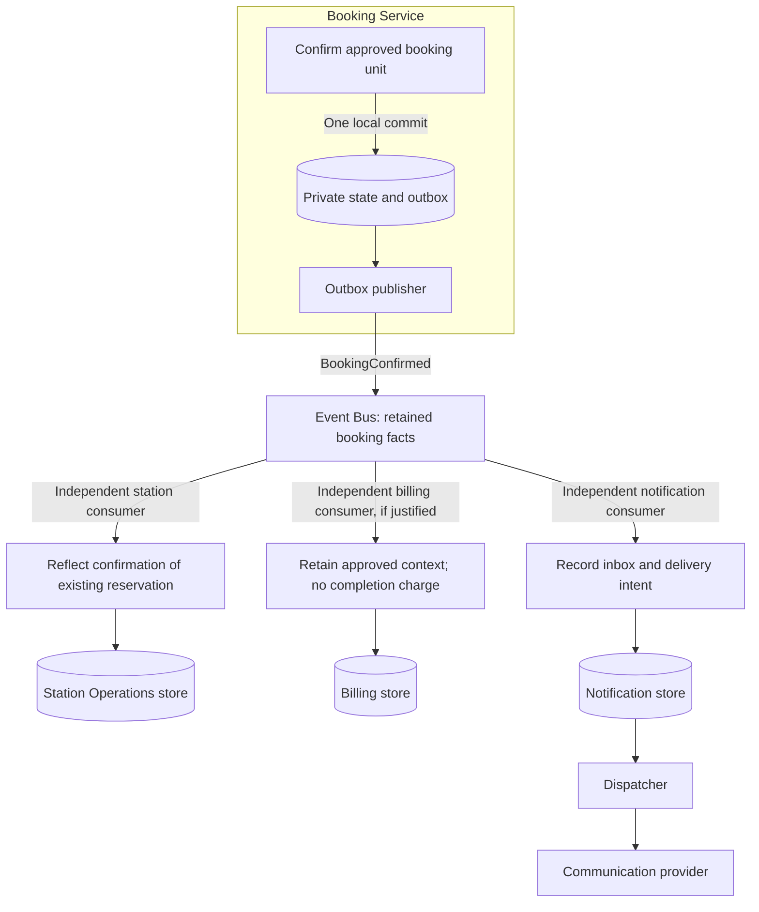
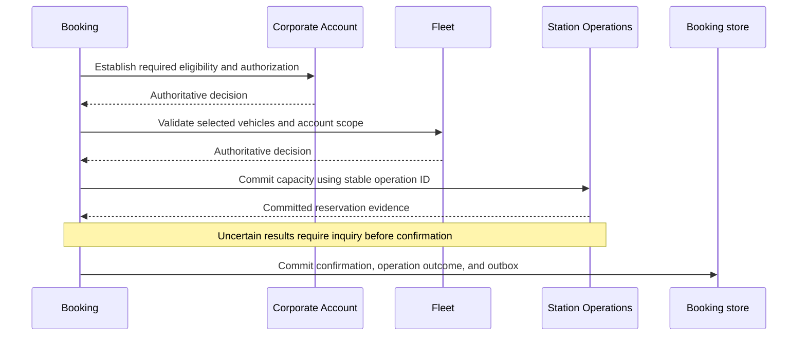
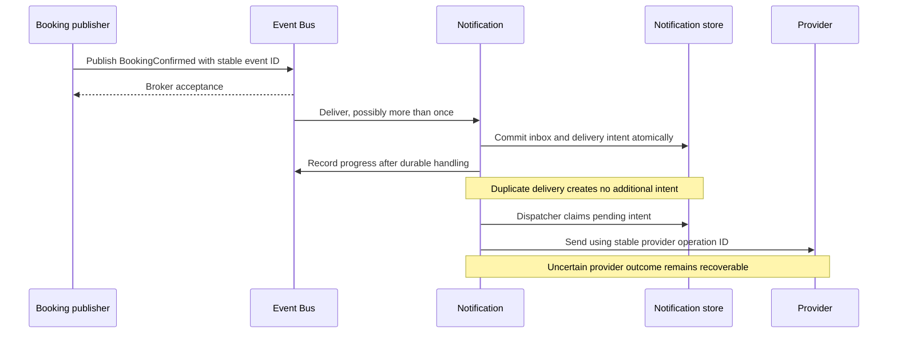
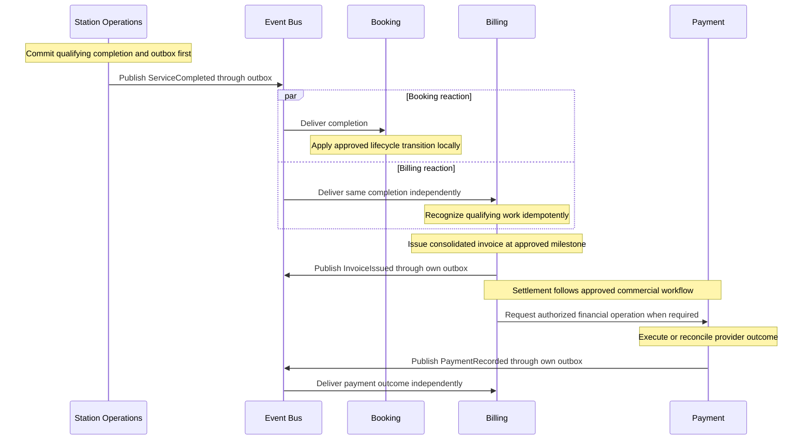
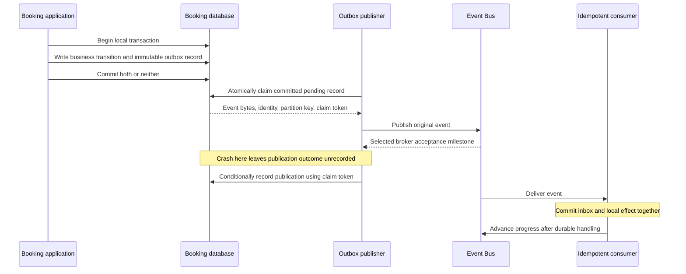
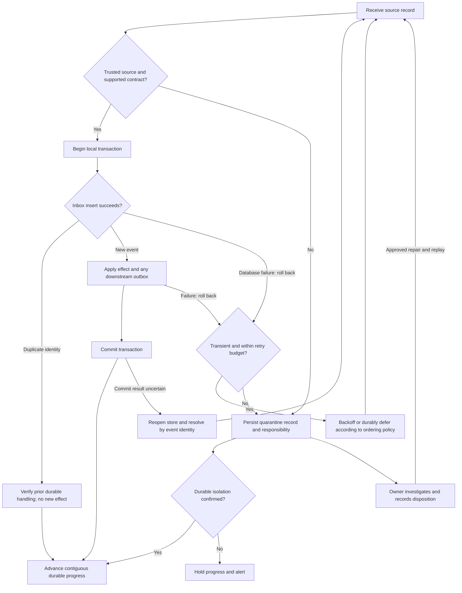
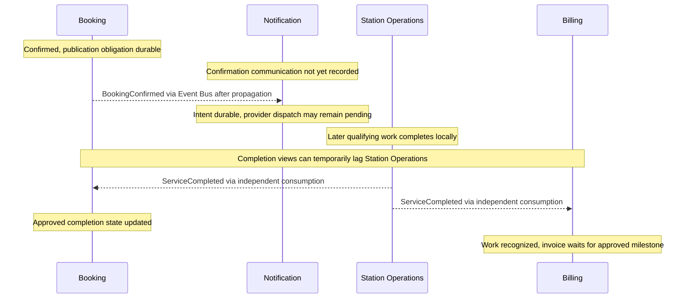
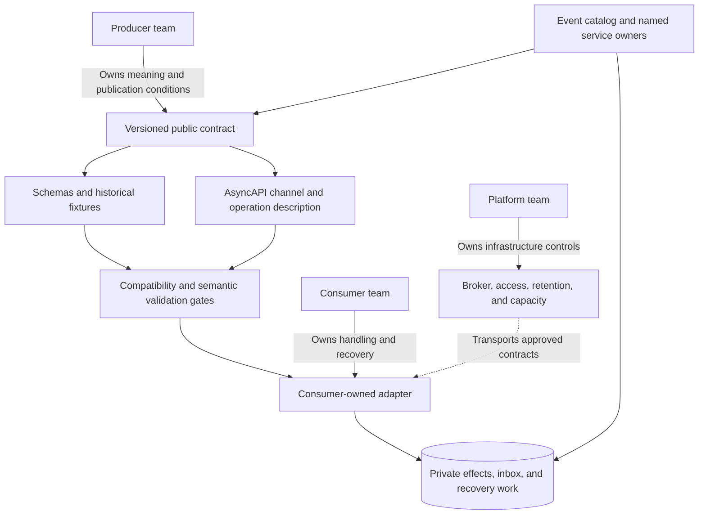

# Chapter 50 — Event-Driven Architecture

*Part VII — Alpha Car Detailing*

## 1. Story-driven Opening

Northstar Distribution's fleet administrator has arranged washing and interior cleaning for twenty-four vehicles across two days. The workflow introduced in Chapters 46–49 has reached a confirmed commitment: Corporate Account has established the required eligibility, Fleet has validated the selected vehicles, and Station Operations has committed the relevant capacity. Booking records confirmation.

The notification provider is unavailable.

This time, the booking request does not wait for an email. Booking commits its confirmation and a durable obligation to publish `BookingConfirmed` in the same local transaction. The administrator can retrieve the confirmed outcome. Notification will communicate that outcome when its own processing and provider recover.

The recovery exercise exposes a second failure. Booking's outbox publisher sends the event, receives broker acceptance, and stops before recording publication in its database. When the publisher restarts, it sends the same event again. Notification receives two deliveries describing one confirmation.

A handler that sends email immediately would turn infrastructure recovery into duplicate communication. A handler that records the event as processed before saving its work could lose the communication altogether. The correct outcome requires a stronger boundary: Notification records both its deduplication evidence and its delivery intent in one local transaction. Another delivery of the same fact creates no additional intent.

Several days later, Station Operations records qualifying completed work. Booking can update its lifecycle while Billing independently recognizes billable work. Northstar's consolidated invoice follows the approved commercial terms. Payment participates when the financial workflow requires it. These services react to related facts, but they do not complete one shared database transaction or depend on one uninterrupted chain of calls.

The team now has to answer operational questions as carefully as architectural ones. Which event owns the meaning of completion? What happens if Billing falls behind? How long can a consumer remain unavailable before retained history expires? Who investigates a rejected event? Can historical replay accidentally send another email or execute another payment?

Event-driven architecture gives Alpha Car Detailing a way to separate these commitments. Reliability comes from making the publication, processing, and recovery obligations explicit at every boundary.

> **Core principle**  
> Events represent facts that have already happened. Services publish events they own, and consumers take responsibility for their independent reactions.

The story describes the proposed production extension. The runnable companion application's current create operation still creates a pending booking; the distinctions established in the preceding chapters remain authoritative.

## 2. Learning Objectives

After completing this chapter, the reader will be able to:

- distinguish commands, domain events, integration events, queries, and transport acknowledgments;
- assign event ownership and define contracts whose meaning survives independent service releases;
- explain topics, subscriptions, consumer groups, partitions, offsets, and checkpoints;
- evaluate Apache Kafka and Azure Event Hubs against processing and recovery requirements;
- combine transactional outboxes, idempotent consumers, and at-least-once processing;
- handle duplicates, retries, dead-letter isolation, ordering, and eventual consistency deliberately;
- recover local processing and external effects without confusing an uncertain outcome with failure;
- connect correlation, causation, observability, security, contract testing, and schema evolution;
- govern AI-assisted event integrations through architectural evidence and deterministic validation.

## 3. Background

### 3.1 From Service Boundaries to Reliable Collaboration

Chapter 46 established Alpha Car Detailing's business vocabulary and case-study invariants. Chapter 47 introduced the proposed service landscape. Chapter 48 placed business behavior inside Clean Architecture boundaries. Chapter 49 assigned service ownership and separated authoritative booking prerequisites from independently recoverable consequences.

This chapter develops the asynchronous contracts and mechanisms that support those boundaries. A service publishes a fact through a durable channel. Other services decide whether that fact matters to their responsibilities and perform their work in their own stores. The [Azure Architecture Center's event-driven architecture guidance](https://learn.microsoft.com/en-us/azure/architecture/guide/architecture-styles/event-driven) describes the producer, channel, and consumer model and its architectural trade-offs.

The communication mechanism does not transfer business authority. A broker transports `ServiceCompleted`; Station Operations remains responsible for establishing that qualifying work actually completed. Billing determines how that completion participates in billable-work recognition and later invoicing under approved terms.

### 3.2 Preserve the Implementation Baseline

The current code under `alpha-car-detailing/src/Services/Booking/` provides create and retrieve operations. `POST /api/bookings` creates a `Pending` booking and raises an in-memory `BookingCreatedDomainEvent`. The endpoint's `201 Created` response establishes creation of that resource. It does not establish committed station capacity, confirmed fleet scheduling, or durable publication to another service.

The accepted decision in `alpha-car-detailing/docs/adr/0002-defer-cqrs.md` retains a direct `BookingService` application service and defers CQRS and a mediator. Event-driven integration does not require changing that decision. An application service can coordinate a domain transition and its publication obligation through ordinary ports and a local transaction.

The event catalog, persistent outbox, Notification consumer, dispatcher, and broker adapters developed here are proposed extensions. Their descriptions are architectural specifications and laboratory examples, rather than evidence that the companion system already runs them.

Northstar's twenty-four vehicles remain a scenario, rather than an approved aggregate boundary or numerical booking limit. Whole-request atomicity, partial acceptance, reservation expiry, credit thresholds, and invoice grouping require their own business decisions. An event schema must preserve those distinctions.

### 3.3 When Asynchronous Integration Is Appropriate

Asynchronous communication is useful when a committed outcome has independently owned consequences, consumers can tolerate propagation delay, and retaining work through temporary outages has business value. Notification should be able to catch up after an outage without making Booking unavailable. Billing should be able to process operational completion at a different rate from station activity.

Some interactions still require an authoritative decision before the caller can proceed. A recent availability projection does not reserve capacity. A cached account status does not necessarily establish current contractual eligibility. The booking workflow must obtain the commitments required by its invariants through the approved protocol, whether that protocol uses synchronous commands, durable asynchronous commands, or a combination.

The cost of asynchronous integration includes delayed views, retained contracts, duplicate handling, distributed diagnosis, recovery procedures, and operational ownership. A direct API can be the clearer choice when one accountable service must answer an immediate question and buffering provides little benefit.

Event-driven architecture, event sourcing, and CQRS are separate decisions. Publishing integration events does not require storing an aggregate as an event history, and it does not require separate command and query models. Alpha Car Detailing can retain ordinary relational state and direct application services while using reliable events between services.

## 4. Concepts

### 4.1 An Event Is a Fact with Publication Conditions

An event has a business meaning, an authoritative producer, and a condition under which that producer may publish it. Past-tense naming helps express that meaning: `BookingConfirmed`, `CapacityReserved`, and `ServiceCompleted` describe outcomes that their owners have established.

The name alone is insufficient. `ServiceCompleted` must identify what completed and which approved condition makes the work eligible for that fact. It must not silently alternate between a vehicle arriving, a technician finishing one task, and a booking becoming fully complete.

A fact's occurrence time differs from its publication, receipt, and processing times. A broker outage can delay publication without changing when the business transition occurred. A later cancellation does not erase an earlier confirmation; it establishes another fact that changes the current lifecycle state.

### 4.2 Commands, Events, Queries, and Acknowledgments

| Message kind | Meaning | Alpha Car Detailing example |
| --- | --- | --- |
| Command | Request an action from an accountable owner | Ask Station Operations to reserve specified capacity. |
| Event | Announce an outcome established by its owner | Station Operations publishes `CapacityReserved`. |
| Query | Request information without directing a new business transition | Inquire about a reservation operation by its stable operation ID. |
| Acknowledgment | Confirm a defined transport or processing milestone | The broker accepts a record for the configured durability conditions. |

A command can be rejected, accepted for later execution, completed, or left with an uncertain outcome after a communication failure. Its contract must explain how the requester distinguishes these states. Sending it through a broker changes the transport, not its imperative meaning.

An event does not require all consumers to respond before the producer's fact becomes valid. `BookingConfirmed` remains true when Notification is unavailable. A broker acknowledgment does not prove that Notification created an intent, that a provider accepted a message, or that a customer received it.

Names such as `SendInvoiceEvent` often conceal a command. `NotificationRequested` requires more careful interpretation: it can be a fact that Notification accepted and durably recorded a request. If another service is asking Notification to do work, that message is a command even if its name ends in “Requested.” Section 5.1 records the proposed ownership explicitly.

### 4.3 Domain Events and Integration Events

Domain events describe meaningful changes inside a bounded context. Their representation follows the owning domain model and can evolve with that implementation. A domain event raised in memory is not automatically durable and is not automatically suitable for external publication.

Integration events are public contracts between independently evolving services. Their payloads, publication conditions, compatibility rules, and retention obligations are deliberate commitments. Selected domain transitions can be mapped into those contracts without serializing aggregates, navigation properties, or database rows.

For Booking, the mapping must preserve the difference between pending creation and confirmation. `BookingCreatedDomainEvent` cannot be renamed to `BookingConfirmed` merely because a downstream handler would find that name convenient. Confirmation requires the approved prerequisites and a committed booking transition.

If a domain event contributes to an integration event, persist the external publication obligation in the same transaction as the originating state. Publishing from an in-memory callback after commit leaves a failure window unless a durable mechanism already protects the obligation.

### 4.4 Producers, Consumers, and Platform Ownership

The producer owns whether the fact is valid, when it becomes publishable, and what its contract means. It supports compatible evolution and recovery of committed publication obligations. A consumer owns its interpretation, local effects, progress tracking, and unresolved processing.

Platform engineers own the messaging infrastructure's availability, access mechanisms, capacity, and operational capabilities. They do not acquire authority to redefine booking confirmation or invoice issuance because they operate the broker.

Consumers remain coupled to documented meaning, even when they are decoupled from producer availability. A producer changing “completed” from completed vehicle work to completed fleet request changes business semantics whether the JSON fields change or not.

### 4.5 Event Notification and Event-Carried State

A small event containing only an entity reference can be sufficient for invalidating a cache. It may be insufficient for independent financial recognition. If every consumer must call the producer to discover the fact's meaning, a producer outage can stop asynchronous processing as effectively as a direct call would.

Event-carried state supplies the facts needed for a defined reaction. This does not justify embedding a complete domain object. A completion contract might contain a stable completion identity, approved service identifiers, relevant account and booking references, occurrence time, and justified commercial evidence. Recipient addresses, payment credentials, internal notes, and unrelated vehicle history do not belong in a broadly consumed completion event.

Choose the payload against actual consumer needs. Distinguish historical evidence, such as the agreement revision applicable to a transaction, from refreshable presentation data, such as an account display name. Replacing historical evidence with today's producer state can make replay produce different business results.

### 4.6 Identity, Envelopes, and Schemas

The chapter continues Chapter 49's flat illustrative envelope. Common metadata and business fields share one JSON object; “envelope” refers to their logical roles rather than requiring a nested `payload` property. This is a proposed convention, not a completed migration of earlier examples.

| Field or identifier | Purpose | Must not be confused with |
| --- | --- | --- |
| `eventId` with `producer` | Stable identity of one published fact in its documented source scope | Delivery attempt or broker position |
| `eventType` | Business contract name | Arbitrary CLR class name |
| `schemaVersion` | Public contract version | Service build or entity revision |
| `occurredAtUtc` | Time assigned to the originating business transition | Consumer processing time |
| `correlationId` | Stable association with a wider business operation | Authorization or uniqueness proof |
| Optional `causationId` | Immediate triggering message or operation under a documented convention | Every contributor to a multi-input decision |
| `bookingRevision` | Booking lifecycle revision under the proposed contract | A guarantee that every revision emitted a public event |
| Broker partition and offset | Transport position for a particular record | Permanent business identity |

A schema defines required fields, types, valid values, units, and optionality. A registry stores and checks supported schemas. An interface description documents channels and operations. These are complementary responsibilities. [AsyncAPI](https://www.asyncapi.com/docs/reference/specification/v3.0.0) provides a machine-readable format for asynchronous interfaces; it does not define Alpha Car Detailing's business policy.

[CloudEvents 1.0.2](https://github.com/cloudevents/spec/blob/v1.0.2/cloudevents/spec.md) provides a standard event context model, including identity scoped by `source` and `id`. The chapter's JSON is not presented as CloudEvents-compliant. Adopting that standard would require an explicit mapping, including `id`, `source`, `type`, and `specversion`. CloudEvents specification version and business-payload schema version remain different concepts.

### 4.7 Delivery Guarantees and Duplicate Effects

At-most-once processing permits work to be skipped after some failures. At-least-once processing permits repeated delivery or execution attempts. Exactly-once claims require a precise boundary within which an effect and progress can be committed together.

Alpha Car Detailing assumes at-least-once processing for the reference integration. Publisher retries, relay restarts, uncommitted consumer progress, and replay can all cause repeats. The guarantee also depends on configured durability, retention, recovery, and available storage; it is not a promise to preserve an event through every possible disaster indefinitely.

Kafka transactions can coordinate Kafka output records and consumed offsets within their supported processing model. They do not automatically make a separate service database transaction, email delivery, or payment-provider call exactly once. The [Kafka design documentation](https://kafka.apache.org/41/design/design/) explains this scope and the need for cooperation from external destinations.

Distinguish transport duplicates from business duplicates. Two deliveries with the same source and event ID describe one event. Two different IDs can still describe the same completed work if a producer bug or migration republishes that work as a new fact. Inbox deduplication addresses the former; a business uniqueness rule may be needed for the latter.

### 4.8 Ordering Is a Scoped Requirement

Partition order, entity lifecycle order, causal order, and global order are different properties. A partition can retain records in arrival order while two concurrent relays publish booking revision 8 before revision 7. A consumer can read in order but complete parallel handlers out of order.

Stateful consumers therefore need an explicit policy. They might serialize processing per booking, reject invalid transitions, defer a record whose prerequisite is missing, or apply a newer complete snapshot while ignoring older snapshots. A financial delta cannot be discarded merely because a later revision arrived first.

Entity revisions also need interpretation. If only selected changes produce public events, seeing revisions 4 and 7 does not prove that events 5 and 6 were lost. Detecting missing public events requires a contract that supplies the relevant continuity or an authoritative reconciliation protocol.

### 4.9 Eventual Consistency and Business Completion

Each service commits its own correct state immediately. Other services learn the relevant facts later. During that interval, Booking can be confirmed while Notification is pending, or Station Operations can have completed work that Billing has not yet recognized.

This interval must have an operational meaning: an acceptable delay, a freshness indicator, a monitoring signal, and a recovery owner. “Eventually” does not repair a permanently rejected schema or restart a failed worker. Convergence depends on retained obligations and functioning recovery.

An eventually consistent projection cannot enforce an invariant that requires a current authoritative commitment. Station availability displayed in a portal remains an observation until Station Operations commits capacity through its reservation protocol.

### 4.10 Choreography and Durable Coordination

Choreography works well when independently owned consumers react to established facts. Notification consuming `BookingConfirmed` does not need a central workflow to tell Booking that its confirmation now exists.

A workflow with deadlines, prerequisite commitments, compensation, and a defined completion condition may need durable orchestration. Booking can coordinate account, fleet, and reservation outcomes without owning those services' decisions. A missing capacity response requires inquiry and reconciliation, rather than optimistic confirmation.

An event graph should remain understandable as a business process. When responsibility for completion disappears into a long chain of handlers, the organization has distributed its uncertainty rather than its work.

## 5. Architecture Discussion

### 5.1 Establish a Governed Event Catalog

The architecture needs a catalog before it needs more event classes. Each entry identifies the fact, its owner, publication conditions, supported consumers, schema, ordering scope, data classification, retention, and recovery contact. The following names are proposed integration contracts or proposed additions; their appearance here does not establish an implemented deployment.

| Event | Authoritative producer | Meaning and permitted interpretation |
| --- | --- | --- |
| `FleetBookingCreated` | Booking | A defined corporate fleet request or booking unit was durably created. Its unit and acceptance policy need approval; creation does not establish confirmation. |
| `CapacityReserved` | Station Operations | A reservation was committed under the reservation contract. Booking must match it to the intended operation and handle later lifecycle changes. |
| `BookingConfirmed` | Booking | Required prerequisites were satisfied and the relevant booking transition committed. |
| `BookingRejected` | Booking | The booking workflow recorded a definitive rejection with an approved reason classification. A timeout alone is insufficient evidence. |
| `ServiceCompleted` | Station Operations | Qualifying operational work identified by the completion contract was recorded as complete. |
| `InvoiceCreated` | Billing | An invoice record was created, if a separately approved contract exposes that milestone. Creation may precede legal or business issuance. |
| `InvoiceIssued` | Billing | The invoice reached the issuance milestone retained from Chapters 47–49. |
| `PaymentReceived` | Payment | Receipt of funds was established under an approved definition, if this more specific contract is adopted. |
| `PaymentRecorded` | Payment | A specified payment outcome was recorded, as in the earlier catalog. Consumers must inspect the approved outcome semantics. |
| `NotificationRequested` | Notification | Notification accepted and recorded a communication intent, if another consumer needs that fact. An instruction to request communication remains a command. |

The existing catalog also includes `BookingCancelled`, `CapacityReservationReleased`, and `StationAvailabilityChanged`. They retain their established owners. Corporate Account and Fleet may publish justified changes to their own capabilities through separately reviewed contracts.

The requested names and earlier names are not automatic aliases. `InvoiceCreated` must not silently replace `InvoiceIssued`; a draft invoice can exist before issuance. `PaymentReceived` must not replace a general `PaymentRecorded` outcome without defining which receipt or settlement condition it proves. Where two versions describe the same business occurrence, migration must prevent consumers performing the effect twice.

The conceptual `FleetBookingCreated` fan-out can support Station Operations preparing a planning view, Billing retaining justified account context, and Notification acknowledging receipt of a pending request. It cannot authorize a capacity reservation, create a completed-work charge, or tell the customer the booking is confirmed. If these consumers have no demonstrated need for creation, do not introduce that public event. The reference reliability slice uses the established `BookingConfirmed` fact.

### 5.2 Select the Messaging Model Deliberately

“Event Bus” in the figures denotes a logical channel boundary. The deployment ADR must select a product, protocol, client, durability configuration, retention model, and operating responsibility. It does not require running Kafka and Event Hubs together.

| Concern | Apache Kafka reference | Azure Event Hubs reference |
| --- | --- | --- |
| Retained channel | Partitioned topic | Partitioned event hub |
| Independent consumption | Separate consumer groups with their own progress | Separate consumer groups providing independent stream views |
| Progress | Committed partition offsets | Application checkpoints with native clients, or protocol-specific offsets |
| Parallel processing | Partition assignment and group coordination under the selected consumer model | Partition ownership under the selected client and protocol |
| Recovery decision | Define retries, quarantine, replay, and external-store coordination | Define retries, quarantine, replay, and external-store coordination |

The [Event Hubs terminology documentation](https://learn.microsoft.com/en-us/azure/event-hubs/event-hubs-features) explains partitions, consumer groups, offsets, and checkpoints. A consumer group is an independent view of retained data, rather than a queue-style subscription that deletes each message after acknowledgment.

In publish/subscribe messaging, a subscription identifies an independent recipient responsibility. Multiple workers may compete within that responsibility. In a retained stream, independent consumer groups provide separate progress through shared history. These models can support similar business fan-out, but their failure and retention behavior must be designed according to the actual platform.

If the workload primarily requires per-message settlement, queue-style dead-lettering, or broker-side subscription filters, compare a messaging broker designed for those operations. Microsoft's [messaging-service comparison](https://learn.microsoft.com/en-us/azure/service-bus-messaging/compare-messaging-services) distinguishes streaming from enterprise transactional messaging. An Event Hubs requirement should not be inferred merely from the word “event.”

### 5.3 Topics, Consumer Groups, and Scaling

Organize channels around coherent ownership, access, retention, and workload requirements. One global topic containing every corporate, payment, and notification fact creates unnecessary access and operational coupling. One topic for every trivial field change creates excessive administration. The ADR should explain the chosen boundary.

Booking and Billing need independent consumption of `ServiceCompleted`. Assigning both to one ordinary competing consumer group would distribute records between them instead of ensuring that both responsibilities process each required fact. Multiple replicas of Billing can share Billing's group to divide its workload.

A group name is also not an authorization boundary by itself. Channel access and platform permissions must enforce the intended confidentiality. Do not place restricted payment data in a broadly readable stream and rely on consumers to ignore it.

Partition count, worker concurrency, batch size, and database throughput determine useful parallelism. A single hot corporate account key can concentrate work while other partitions sit idle. A booking key may distribute work better when ordering is required only within one booking. Load testing must include skew, not just evenly distributed synthetic traffic.

Backpressure should slow consumption or publication predictably when dependencies cannot keep up. Bounded buffers, controlled prefetch, and explicit backlog capacity prevent a database outage from becoming memory exhaustion. Retention must cover the agreed outage and catch-up horizon.

### 5.4 Follow the Corporate Fleet Workflow

The workflow separates the establishment of a customer commitment from its consequences:

1. Booking coordinates caller authorization, account eligibility, fleet validation, and committed station capacity through the approved protocol.
2. Booking commits confirmation, its recoverable operation outcome, and the `BookingConfirmed` publication obligation in one local transaction.
3. The outbox publisher sends the event when the selected broker is available.
4. Notification independently records a communication intent. Relevant station views may independently reflect confirmation without making a second reservation.
5. Station Operations later commits qualifying completion and a `ServiceCompleted` outbox record.
6. Booking and Billing process that completion separately. Billing recognizes the approved billable work without treating confirmation alone as a completed service.
7. Billing issues a consolidated invoice at the approved milestone and publishes `InvoiceIssued`.
8. Payment performs an authorized financial operation when required and publishes the recorded outcome. Invoice issuance alone is not authorization to charge a customer.

A `CapacityReserved` event can communicate a committed reservation, but it does not remove the need for stable reservation operation identity and inquiry after an uncertain response. A `BookingRejected` event communicates a recorded terminal outcome; dependency unavailability can instead leave the workflow pending reconciliation.

Figure 50-2 separates these milestones into linked panels. It intentionally leaves unresolved batch grouping and commercial policy outside the event transport design.

### 5.5 Make Publication a Durable Local Obligation

Directly committing Booking and then publishing to the broker is a dual write. The process can stop between the two operations. Publishing first creates the opposite problem: consumers can observe a fact whose business transaction later rolls back.

The transactional outbox stores the business transition and an immutable event record in one local transaction. A separate relay publishes committed records. The [transactional outbox pattern](https://microservices.io/patterns/data/transactional-outbox.html) describes this separation and the duplicate publication window that remains.

The event ID, occurrence time, contract version, partition key, and serialized business content are established once for the committed fact. A retry reuses them. Rebuilding the payload from current entity state during each send could turn one event ID into several different facts.

Publication metadata can change: attempt count, claim token, claim expiry, next attempt time, last failure classification, and publication time. These fields describe the relay's work rather than changing the event's meaning.

Concurrent relays claim work through database-supported atomic operations. An expiring lease needs a unique claim token and conditional completion so an obsolete worker cannot clear a successor's claim. Lease expiry can still permit duplicate sends; consumer idempotency remains necessary. Per-entity ordering, where required, additionally needs serialization of related publication work.

The relay marks publication only after the broker acceptance milestone selected by the ADR. If the send outcome is uncertain, it retains the obligation for retry or investigation. If broker acceptance succeeds but the local publication update fails, it sends the same event again after recovery. Figure 50-3 makes this boundary explicit.

Polling is a practical starting point when indexed queries and expected latency satisfy the workload. Change-data-capture publication can reduce polling overhead but introduces connector, log-retention, and restart-position responsibilities. Neither approach excuses omission of restart tests.

Outbox storage also needs capacity and retention policy. A sustained broker outage grows the backlog. Alert on its oldest age and available headroom. Stop or constrain new work according to an approved admission policy before storage exhaustion destroys the ability to record obligations. Cleanup must preserve the evidence and replay horizon the service promises.

### 5.6 Commit Deduplication and Local Effects Together

An idempotent consumer produces the intended local effect once despite repeated attempts. A common implementation inserts a processed-event record and applies business changes in the same transaction. Database uniqueness protects against concurrent deliveries; a check in application memory cannot do so. The [idempotent consumer pattern](https://microservices.io/patterns/communication-style/idempotent-consumer.html) describes the processed-message approach.

For the proposed Notification slice, uniqueness is scoped by logical consumer identity, producer, and event ID. The logical identity describes the responsibility, such as `notification.booking-confirmation`, rather than a process instance or deployment build. Changing it during every release would defeat deduplication.

Notification's transaction records the processed event and a delivery intent. A consumer that also publishes a new fact adds its own outbox record to that same transaction. Only after durable handling does its adapter advance processing progress.

If the database commit succeeds and the process stops before progress is recorded, the event returns and the inbox makes the repeat harmless. If the transaction rolls back, neither the inbox nor the business effect exists, and retry can perform the work.

Business uniqueness adds another boundary. Notification may need one confirmation intent per approved booking confirmation milestone and purpose. Billing may need one recognition entry per authoritative completion identity. These rules prevent different event IDs from creating the same business effect. A deduplication key chosen without domain evidence can also suppress legitimate work, so its scope must be reviewed.

Deduplication retention must cover the permitted redelivery and replay horizon. Deleting inbox rows after a short arbitrary interval while retaining events for much longer reopens old effects. Backup restoration can also remove inbox evidence while the broker retains records; recovery must reconcile these histories before enabling external effects.

### 5.7 Separate External Dispatch from Event Consumption

A local transaction cannot atomically commit an email at a provider and an inbox row in Notification's database. The consumer therefore records a durable delivery intent; a separate dispatcher performs the external operation.

The dispatcher uses a stable operation identifier and provider idempotency where available. The provider's key scope, validity period, and inquiry capabilities are part of the adapter contract. Reusing a key after its provider retention period may no longer protect against duplication.

If the provider accepts the operation and the dispatcher stops before recording that outcome, the intent is uncertain. Retry with the same supported key, inquiry by operation reference, reconciliation, or escalation resolves the uncertainty according to provider capabilities and approved policy. A provider lacking these mechanisms requires an explicit duplicate-risk decision; a local inbox cannot manufacture the missing guarantee.

Model outcomes precisely. `IntentRecorded`, `ProviderAccepted`, `Delivered` where independently evidenced, `Failed`, and `Unknown` are different milestones. Provider acceptance does not prove customer receipt. The equivalent Payment boundary requires the same discipline with stronger financial controls.

### 5.8 Bound Retries and Preserve Failed Work

Retry policy starts with failure classification.

| Failure class | Example | Treatment |
| --- | --- | --- |
| Transient infrastructure failure | Temporary database or broker unavailability | Bounded attempts with exponential backoff, jitter, and a dependency-aware budget |
| Invalid or unsupported contract | Unknown mandatory version or malformed identifier | Durable isolation and investigation; repeated immediate retry does not repair the record |
| Definitive business rejection | Owner rejects an authorized capacity request | Record and expose the approved business outcome |
| Uncertain external outcome | Provider may have accepted a payment before timeout | Inquiry or reconciliation using stable operation identity |
| Systemic configuration failure | All consumers lose broker authorization | Alert and pause or constrain the affected worker population |

Broker-client retries, handler retries, workflow retries, and provider retries have different scopes. Uncoordinated nesting can multiply load and exceed the operation's recovery budget. Give each layer a defined responsibility and an observable attempt history.

For retained streams, failed-record handling is an application and runtime design decision. [Microsoft's Event Hubs resilient-design guidance](https://learn.microsoft.com/en-us/azure/architecture/serverless/event-hubs-functions/resilient-design) explicitly notes that Event Hubs has no inherent dead-letter queue. Configure and test the chosen framework's behavior instead of assuming a poison record will be retained elsewhere automatically.

Before advancing past a failed record, persist either its successful effect or a durable transfer of responsibility to deferred work or quarantine. If that transfer fails, do not advance. With a separate retry topic, publishing the retry record and committing source progress creates another dual-write boundary unless a supported transaction or local durable handoff protects it.

A quarantine record includes the original bytes or a secure durable reference, event identity when readable, source channel and partition position, consumer identity, schema metadata, failure classification, attempts, timestamps, and investigation status. For an unparseable envelope, source coordinates identify the record. These stores require restricted access and retention controls.

Dead-letter handling is unresolved business work, not successful completion. Its owner investigates, repairs the implementation or approved contract mapping, replays under control, or records an authorized disposition. Figure 50-4 shows the transfer of responsibility.

### 5.9 Connect Ordering, Checkpoints, and Recovery

When the consumer model uses partition progress, a checkpoint represents a durable processing boundary. If offset 41 remains unresolved while offset 42 completes, advancing the partition beyond 42 can skip 41 after restart. Use the highest contiguous durably handled position, or durably transfer 41 into an independently recoverable work store before advancing.

Some APIs store the last handled position; others commit the next position to read. The adapter must implement the selected client's convention. The application invariant is unchanged: no required work disappears behind recorded progress.

Partition keys preserve useful locality only when the publication and processing design also respects it. Concurrent relay claims, concurrent handlers, retry streams, and partition remapping can disrupt lifecycle order. Consumer rebalances add overlap between an old worker finishing and a new worker receiving the same record. Local uniqueness and valid-transition checks still protect state.

Blocking a partition preserves its processing sequence but delays unrelated keys within it. Deferred processing improves availability but can allow later events for one booking to overtake an earlier failure. An ordered workflow can defer the affected key, track its prerequisites, and continue unrelated keys through a deliberately designed scheduler. The extra complexity must be justified by the workload.

Avoid declaring global order when the business requires only booking-local or reservation-local correctness. Ordering across service-owned streams requires an explicit protocol; matching partition keys in two different topics does not create one shared sequence.

### 5.10 Make Delayed State Understandable

| Authoritative milestone | Legitimate delayed state elsewhere | Required behavior |
| --- | --- | --- |
| Booking confirmed | Notification intent not yet recorded | Keep the confirmed booking visible; monitor communication propagation. |
| Notification intent recorded | Provider dispatch pending | Show or investigate communication status separately. |
| Station work completed | Booking or Billing has not consumed completion | Preserve the operational completion; catch up or reconcile the affected consumer. |
| Billable work recognized | Consolidated invoice not yet issued | Follow the approved invoice schedule and grouping rules. |
| Payment outcome recorded | Billing receivable view is behind | Reconcile by payment operation and approved outcome, without executing another payment. |

Specify acceptable freshness for each view and action. A portal can display when its projection last advanced and direct recovery-sensitive queries to the authoritative owner. An aggregate status such as “booking failed” is misleading if the only failure is communication delivery.

Reconciliation compares durable expectations with durable outcomes through approved interfaces or service-owned exports. It does not require cross-service database credentials. A completion missing from Billing can be investigated using completion identity, consumer progress, and recognition evidence. “Lag is zero” alone cannot prove that every required business effect exists; an incorrectly acknowledged record can leave no lag and still lose work.

### 5.11 Recover and Replay with a Defined Purpose

Redelivery retries the same record. Targeted repair reprocesses selected unresolved work. A projection rebuild reconstructs a disposable view. Historical reprocessing applies a deliberately changed interpretation to retained facts. These operations have different permissions and effect policies.

Ordinary replay preserves original event identity and occurrence time. A replay operation adds separate audit metadata; it does not pretend the original business fact happened again. A genuine business correction is a new owner-issued fact with its own identity and explicit relationship to the corrected occurrence.

Rebuilding a projection should use an isolated consumer identity and destination. External dispatch is disabled or routed to a non-dispatching path. Reusing the production notification or payment consumer as a convenient rebuild engine can repeat effects when its inbox evidence is absent or expired.

Recovery planning covers broker retention expiry, outbox cleanup, restored databases, lost checkpoints, connector positions, and downstream provider history. An archive is useful only if its schemas, access, completeness, and replay tooling are maintained. Where history is incomplete, a governed snapshot or reconciliation from the owning service may be necessary.

Catch-up capacity must exceed incoming work if the backlog is to shrink. As a simplified planning estimate, a backlog of B records with sustained arrival rate A and processing rate C takes approximately B / (C − A) time to drain when C is greater than A. Validate the estimate with payload size, dependency limits, skew, and retry load. It does not establish a production service-level objective by itself.

Every operational replay records its purpose, authorization, consumer, source range, schema and implementation versions, destination, external-effect policy, and results. Recovery is complete when the required outcomes are reconciled, not merely when a replay command exits successfully.

### 5.12 Evolve Contracts Across Retained History

Compatibility has structural and semantic dimensions. A schema registry can identify many field-level changes; it cannot prove that “received amount” still means the same financial milestone.

| Proposed change | Compatibility concern | Required evidence |
| --- | --- | --- |
| Add an optional field | Some consumers reject unknown fields or deserialize strictly | Old consumer reads new producer fixtures. |
| Add a required field | Historical records and old producers lack it | New consumer reads retained history, with an approved interpretation. |
| Add an enum value | Closed switches may fail or misclassify it | Explicit unknown-value behavior for each affected consumer. |
| Change units, identifier meaning, or completion granularity | Existing fields acquire different semantics | New contract or explicit migration with business review. |
| Change publication conditions | Same schema announces a different fact | Producer and consumer semantic acceptance review. |
| Publish two versions during migration | Both can trigger the same effect | Shared occurrence identity or an equivalent consumer migration rule. |

Test both directions: supported consumers against new producer output, and new consumers against supported producers and retained historical records. Compatibility mode must match the replay horizon, not only the immediately preceding deployment.

A breaking change may need parallel version support, a new channel, or a translation boundary. Track consumer migration and deprecation explicitly. Rollback must account for records already published in the new form; rolling back the producer cannot remove those records from every retained copy.

Chapter 47 used `eventVersion` in an illustrative envelope; Chapter 49 used `schemaVersion` and a flat contract. This chapter continues the latter convention for its proposed slice. Earlier nested payloads, versioned type names such as `BookingCreatedV1`, and different identifier forms are not silently compatible. A boundary adapter must identify the source contract and perform an approved mapping, or reject unsupported input. Never accept two conflicting version fields by guessing which one is authoritative.

### 5.13 Observe Publication, Processing, and Business Outcomes

Correlation associates work across the booking operation. Causation identifies an immediate trigger under the chosen convention. Event identity supports deduplication. Business operation identity supports recovery. Trace context supports diagnosis. None is a substitute for the others or for authorization.

When consuming one event produces another, preserve correlation and record the triggering event as causation where the convention permits. A consolidated invoice can depend on many completion facts. Retain those relationships in Billing's evidence rather than assigning one arbitrary completion as its sole cause.

Carry approved trace context through durable publication and use asynchronous span relationships for processing, batches, and delayed work. [OpenTelemetry's messaging conventions](https://opentelemetry.io/docs/specs/semconv/messaging/messaging-spans/) describe links between message creation and consumption. Pin instrumentation conventions for the deployed tooling; trace retention and sampling must not determine whether a business operation can be recovered.

| Signal | What it reveals | Accountable responder |
| --- | --- | --- |
| Oldest unpublished outbox age and count | Committed facts waiting for publication | Producer team |
| Commit-to-broker acceptance delay | Publication latency | Producer and platform teams |
| Consumer lag and oldest unhandled fact age | Consumer backlog and freshness risk | Consumer team |
| Retry rate, duration, and error class | Dependency failure or repeated invalid input | Consumer or dependency owner |
| Duplicate-delivery and business-conflict counts | Expected redelivery or an abnormal producer/migration pattern | Relevant producer and consumer teams |
| Quarantine count and oldest unresolved age | Work isolated without resolution | Named consumer recovery owner |
| Pending and uncertain dispatch age | External communication or payment uncertainty | Dispatch owner |
| Reconciliation differences | Missing or inconsistent business outcomes | Business capability owner |

Use event and operation IDs in structured logs and searchable evidence. Avoid unbounded metric labels such as individual booking IDs. Log selected metadata and failure classifications rather than full sensitive payloads. Distinguish business success, broker acceptance, durable consumer handling, and external delivery in dashboards.

### 5.14 Secure the Whole Event Lifecycle

Authenticate service workloads and grant only the channel and operation permissions they require. Booking may publish its own facts; it should not publish Payment's outcomes. Consumers must verify the trusted source context and allowed contract mapping. A `producer` string inside JSON is a claim, not authentication.

Channel ACLs can restrict which principals publish to a stream. Where several producers share a channel, the design must preserve verifiable source authority through platform metadata, isolated ingress, or another approved mechanism. The consumer must not infer it from a freely writable property.

Validate payload sizes, encoding, schema, identifiers, and resource scope before applying effects. Account and fleet IDs supplied in a record do not authorize arbitrary cross-account processing. Replay and support tooling need their own permissions and audit trail.

Encrypt transport and stored data according to policy. Protect outboxes, inbox payloads, deferred work, archives, dead letters, backups, and diagnostic exports as copies of business information. Keep card data, credentials, tokens, and unnecessary personal information out of events. Resolve communication destinations through an authorized Notification capability when that is the approved design, without creating a mandatory callback to Booking for every fact.

Retention and deletion responsibilities follow every copy. An immutable historical fact does not require indefinite retention of all personal details associated with it. Retain justified evidence under the applicable policy and remove or minimize unnecessary payload data through a governed lifecycle.

### 5.15 Test and Govern the Integration Boundary

Producer tests verify serialization, schema conformance, publication conditions, and immutable identity. Consumer tests verify supported versions, unknown-field behavior, duplicates, business uniqueness, lifecycle transitions, and authorized scope. Historical sanitized fixtures connect those tests across releases.

Use real persistence for transaction and uniqueness behavior. Use the selected broker and client for partition progress, restart, rebalance, retention, and failed-record tests. An in-memory bus cannot establish those guarantees. Failure injection should stop the process before and after each durable boundary, rather than only throwing an exception before work starts.

The event catalog records the owning team, meaning, schema location, status, consumers, channel, identity scope, partitioning, ordering, privacy classification, retention, compatibility policy, and recovery runbook. Changes to business meaning, financial authority, security exposure, or breaking interfaces require the established review process.

AI Agents can propose contracts and implement approved mappings. Repository Intelligence must supply existing names, ADRs, business rules, schemas, and consumers. Deterministic gates can reject unapproved schema changes, forbidden service references, incompatible fixtures, premature progress, and missing recovery evidence. Passing generated tests is insufficient if the tests encode an invented business rule.

The engineering Harness remains outside the runtime event path. Its role is to validate and preserve evidence about the integration, while accountable service owners retain responsibility for its business and operational behavior.

## 6. Professional Diagrams

The following figures describe proposed runtime extensions. They do not claim that the current companion application deploys these components. Solid arrows show requests, local processing, or durable writes; arrows labeled with event names show asynchronous publication or delivery. Each service's store remains private.

### Figure 50-1 — Event-driven Architecture

Section 5.4's confirmation path separates publication from independently owned reactions. The component view below includes the local stores and dispatch boundary that a simple fan-out diagram would conceal.



*Caption: A producer announces its committed fact. Consumers own their effects and progress. Optional Billing context does not make confirmation billable work, and Station Operations does not reserve the same capacity again. A proposed `FleetBookingCreated` channel could use the same topology for creation-specific reactions after its semantics and consumers are approved.*

### Figure 50-2 — Corporate Fleet Booking Event Flow

The three panels expand Section 5.4 without putting the entire service landscape into one sequence. Each panel begins from the durable milestone established by the preceding business activity; it is not one distributed transaction.

#### Panel A: Establish Prerequisites and Confirmation



#### Panel B: Publish Confirmation and Communicate Independently



#### Panel C: Completion, Billing, and Later Payment



*Caption: Authoritative prerequisites establish confirmation. Communication follows independently. Later completion, invoice issuance, and payment have separate owners and durability boundaries. Outbox-backed arrows imply a committed publication obligation before sending.*

### Figure 50-3 — Transactional Outbox

Section 5.5's remaining duplicate window appears after broker acceptance and before the relay records publication.



*Caption: The business transaction protects both state and publication obligation. The relay can send again after an uncertain or unrecorded result; the consumer protects its own effect against those repeats. There is no transaction spanning the producer store, broker, and consumer store.*

### Figure 50-4 — Consumer Retry and Dead-letter Flow

The branching flow implements Sections 5.8–5.9's rule for progress. Failure isolation must succeed durably before processing moves beyond a record.



*Caption: Successful handling, confirmed prior handling, and durable isolation are distinct outcomes. A database or coordination failure during inbox insertion is a processing failure, not proof of a duplicate. Replay re-enters the same identity and business-effect safeguards.*

### Figure 50-5 — Eventual Consistency Across Services

Section 5.10's consistency states can coexist without contradiction. The panels distinguish an immediate authoritative state from independently delayed projections and consequences.



*Caption: Time progresses downward. Dashed arrows abbreviate durable asynchronous transport. Consumer delay does not reverse an already committed producer fact; lag and unresolved work require explicit monitoring and reconciliation.*

### Figure 50-6 — Event Ownership and Contracts

Sections 5.1, 5.12, and 5.15 assign business meaning, compatibility, and operations to accountable owners.



*Caption: Shared schema and transport infrastructure supports independently owned implementations. It does not authorize shared databases, shared domain assemblies, or ownerless changes to business meaning.*

## 7. Hands-on Example

### 7.1 Define a Narrow, Reviewable Slice

Use Booking-to-Notification confirmation as the first reliable integration. The goal is to prove atomic publication obligations, duplicate-safe local handling, and visible external uncertainty before adding more consumers.

Begin by inspecting the current Booking code, applicable Instructions, ADRs, and test commands. The existing create/read path remains the baseline. Build the confirmation laboratory around one fixture representing an approved booking unit and prerequisite evidence. A test adapter may stand in for Corporate Account, Fleet, and Station Operations, but it must be named as a test adapter and must not claim production eligibility or capacity enforcement.

The proposed additions belong inside service boundaries:

| Artifact | Ownership and placement |
| --- | --- |
| `BookingConfirmed` schema and sanitized fixtures | Producer-owned public contract artifacts, reviewed with consumers |
| Confirmation use case and publication requirement | Booking Application, preserving direct application services |
| Outbox persistence, claim logic, publisher, and broker adapter | Booking Infrastructure and its worker composition root |
| Confirmation consumer and durable communication-intent use case | Notification Application |
| Inbox, intent persistence, quarantine, dispatcher, and provider adapter | Notification Infrastructure |
| Crash and compatibility evidence | Relevant service test projects and Harness evidence |

The names above describe proposed artifacts. Do not create a shared domain library or let Notification import Booking's entities. Transport schemas or generated DTOs expose contracts rather than business behavior.

### 7.2 Specify the Confirmation Contract

The fixture extends Chapter 49's proposed flat event with an optional causation reference. Identifiers such as `BK-10481` are illustrative external contract references; they do not change the current code's internal GUID-based model. An adopted boundary needs an explicit identifier mapping.

```json
{
  "eventId": "96284f4b-8398-447b-bef8-ae8ec2633551",
  "eventType": "BookingConfirmed",
  "schemaVersion": 1,
  "producer": "Booking",
  "occurredAtUtc": "2026-11-20T08:15:00Z",
  "correlationId": "9d28906c-f98c-451c-b0db-5dfe4c084dc9",
  "causationId": "booking-confirmation-operation-10481",
  "bookingId": "BK-10481",
  "bookingRevision": 2,
  "corporateAccountId": "CA-2007",
  "fleetId": "FLT-1007",
  "stationId": "ST-021",
  "reservationId": "RS-50817"
}
```

For this fixture, causation identifies the durable confirmation operation. If the immediate trigger is a consumed event, the adopted convention must identify its source-scoped event identity unambiguously. Absence of causation is preferable to a fabricated value.

The following JSON Schema 2020-12 document defines the laboratory event. Optional future properties are permitted deliberately; semantic compatibility still requires review.

```json
{
  "$schema": "https://json-schema.org/draft/2020-12/schema",
  "title": "BookingConfirmed version 1",
  "type": "object",
  "required": [
    "eventId", "eventType", "schemaVersion", "producer", "occurredAtUtc",
    "correlationId", "bookingId", "bookingRevision", "corporateAccountId",
    "fleetId", "stationId", "reservationId"
  ],
  "properties": {
    "eventId": {
      "type": "string",
      "format": "uuid",
      "not": { "const": "00000000-0000-0000-0000-000000000000" }
    },
    "eventType": { "const": "BookingConfirmed" },
    "schemaVersion": { "const": 1 },
    "producer": { "const": "Booking" },
    "occurredAtUtc": {
      "type": "string",
      "format": "date-time",
      "pattern": "Z$"
    },
    "correlationId": {
      "type": "string",
      "format": "uuid",
      "not": { "const": "00000000-0000-0000-0000-000000000000" }
    },
    "causationId": { "$ref": "#/$defs/reference" },
    "bookingId": { "$ref": "#/$defs/reference" },
    "bookingRevision": { "type": "integer", "minimum": 1 },
    "corporateAccountId": { "$ref": "#/$defs/reference" },
    "fleetId": { "$ref": "#/$defs/reference" },
    "stationId": { "$ref": "#/$defs/reference" },
    "reservationId": { "$ref": "#/$defs/reference" }
  },
  "$defs": {
    "reference": { "type": "string", "minLength": 1, "pattern": "\\S" }
  },
  "additionalProperties": true
}
```

Configure a validator that actually checks `uuid` and `date-time` formats. Under [JSON Schema's validation specification](https://json-schema.org/draft/2020-12/json-schema-validation), format annotation and format assertion are distinct capabilities. A passing structural check does not prove date validity, source authority, or business correctness.

The occurrence time is assigned once for the originating transition and preserved during retry. The confirmed event requires evidence that prerequisites were satisfied; no JSON validator can establish that evidence from these fields alone.

The minimal contract supports a notice that a booking was confirmed with a link to an authorized portal. A detailed schedule message needs an approved contract extension or an independently maintained, authorized view containing the required schedule facts. It must not obtain completeness by reading Booking's database.

### 7.3 Demonstrate Atomic Producer Persistence

Use SQLite for a focused persistence laboratory, consistent with the companion baseline's local database. The following reduced schema is an isolated teaching fixture, not a migration for the application's current `Bookings` table. It intentionally omits unrelated booking attributes.

```sql
PRAGMA foreign_keys = ON;

CREATE TABLE BookingState (
    BookingId TEXT PRIMARY KEY,
    CorporateAccountId TEXT NOT NULL,
    Status TEXT NOT NULL CHECK (Status IN ('Pending', 'Confirmed')),
    Revision INTEGER NOT NULL CHECK (Revision > 0)
);

CREATE TABLE EventOutbox (
    Producer TEXT NOT NULL,
    EventId TEXT NOT NULL,
    BookingId TEXT NOT NULL REFERENCES BookingState (BookingId),
    BookingRevision INTEGER NOT NULL,
    EventType TEXT NOT NULL,
    SchemaVersion INTEGER NOT NULL CHECK (SchemaVersion > 0),
    OccurredAtUtc TEXT NOT NULL,
    PartitionKey TEXT NOT NULL,
    PayloadJson TEXT NOT NULL CHECK (json_valid(PayloadJson)),
    Attempts INTEGER NOT NULL DEFAULT 0 CHECK (Attempts >= 0),
    ClaimToken TEXT NULL,
    ClaimUntilUtc TEXT NULL,
    NextAttemptAtUtc TEXT NOT NULL,
    PublishedAtUtc TEXT NULL,
    PRIMARY KEY (Producer, EventId),
    UNIQUE (BookingId, BookingRevision, EventType)
);

CREATE INDEX IX_EventOutbox_Pending
    ON EventOutbox (NextAttemptAtUtc, ClaimUntilUtc)
    WHERE PublishedAtUtc IS NULL;
```

The unique booking/revision/type constraint is specific to this fixture's rule of one confirmation fact per transition. It is not a universal rule that one business transition may emit only one event of a given type.

The adapter executes the following parameterized statements on one connection and transaction. It must check that the update affects exactly one row before inserting the outbox record. A zero-row update represents a conflict or a transition that did not occur; the adapter rolls back and resolves the durable operation outcome. Any later failure also rolls back both writes.

```sql
BEGIN IMMEDIATE;

UPDATE BookingState
SET Status = 'Confirmed', Revision = :expectedRevision + 1
WHERE BookingId = :bookingId
  AND CorporateAccountId = :corporateAccountId
  AND Status = 'Pending'
  AND Revision = :expectedRevision;

INSERT INTO EventOutbox (
    Producer, EventId, BookingId, BookingRevision, EventType,
    SchemaVersion, OccurredAtUtc, PartitionKey, PayloadJson, NextAttemptAtUtc
)
VALUES (
    'Booking', :eventId, :bookingId, :expectedRevision + 1, 'BookingConfirmed',
    1, :occurredAtUtc, :bookingId, :payloadJson, :occurredAtUtc
);

COMMIT;
```

Prerequisite validation and the durable confirmation-operation record belong to the approved workflow described in Chapter 49. This fixture tests the state/outbox boundary after that decision; it does not replace the full confirmation protocol. Validate that payload identity, booking revision, and account scope match the values being committed.

Stop after the update and roll back: neither confirmation nor outbox obligation should survive. Stop after commit with the broker unavailable: both should survive. Restart the publisher: the obligation should remain eligible for delivery.

### 7.4 Exercise the Publisher's Crash Window

The publisher claims a committed row, sends its stored bytes using the stored partition key, and conditionally marks publication using the claim token. Its transaction never stays open while waiting for the broker.

Use a recording transport test adapter with two observable milestones: accepted record and returned acknowledgment. Allow the test to terminate the publisher after acceptance but before the local publication update. On restart, the same event must be sent with the same identity, version, occurrence time, and business payload.

Test both a failed send and a lost acknowledgment. A method returning an exception does not prove the broker rejected the record. Preserve the obligation and allow a duplicate. A successful send followed by a failed database update must not be repaired by creating another event ID.

The claim implementation must also be tested against the selected production database. SQLite's local writer behavior does not prove that a SQL Server or PostgreSQL lease query has the intended locking and isolation semantics. If strict booking-local order is required, demonstrate it with overlapping relay claims rather than relying on an `ORDER BY` alone.

### 7.5 Commit Notification's Inbox and Intent

Create a separate Notification database. The reduced schema protects transport identity and the laboratory's business-effect identity independently.

```sql
CREATE TABLE ConsumerInbox (
    ConsumerName TEXT NOT NULL,
    Producer TEXT NOT NULL,
    EventId TEXT NOT NULL,
    ProcessedAtUtc TEXT NOT NULL,
    PRIMARY KEY (ConsumerName, Producer, EventId)
);

CREATE TABLE NotificationIntent (
    IntentId TEXT PRIMARY KEY,
    CorporateAccountId TEXT NOT NULL,
    BookingId TEXT NOT NULL,
    BookingRevision INTEGER NOT NULL CHECK (BookingRevision > 0),
    Purpose TEXT NOT NULL,
    ProviderOperationId TEXT NOT NULL UNIQUE,
    Status TEXT NOT NULL CHECK (
        Status IN ('Pending', 'ProviderAccepted', 'Delivered', 'Failed', 'Unknown')
    ),
    UNIQUE (CorporateAccountId, BookingId, BookingRevision, Purpose)
);
```

The handler inserts the inbox row and intent within one transaction. An inbox identity conflict means prior durable handling exists, subject to investigation if the same identity has inconsistent content. A database availability error is not a duplicate. If a new event ID encounters the business uniqueness constraint, verify that the existing intent represents the same approved effect before recording the new event as handled. Do not catch every constraint violation and report success.

The following self-contained C# illustrates the application boundary. The consumer's store port requires atomic recording; the Infrastructure implementation supplies the transaction and uniqueness behavior above. The transport adapter calls `HandleAsync`, then advances progress only if the call succeeds. It handles invalid contracts and failed persistence through the bounded recovery policy, rather than acknowledging them as successful effects.

```csharp
using System;
using System.Threading;
using System.Threading.Tasks;

namespace AlphaCarDetailing.Notification.Application;

public sealed record BookingConfirmedV1(
    Guid EventId,
    string EventType,
    int SchemaVersion,
    string Producer,
    DateTimeOffset OccurredAtUtc,
    Guid CorrelationId,
    string BookingId,
    long BookingRevision,
    string CorporateAccountId,
    string FleetId,
    string StationId,
    string ReservationId,
    string? CausationId = null);

public enum RecordingOutcome
{
    Recorded,
    AlreadyRecorded
}

public interface IConfirmationIntentStore
{
    // Atomically record inbox evidence and the approved intent,
    // or verify that the same effect is already durably represented.
    Task<RecordingOutcome> RecordAsync(
        string consumerName,
        BookingConfirmedV1 message,
        CancellationToken cancellationToken);
}

public sealed class BookingConfirmationConsumer(
    IConfirmationIntentStore store)
{
    public const string ConsumerName = "notification.booking-confirmation";

    public Task<RecordingOutcome> HandleAsync(
        BookingConfirmedV1 message,
        CancellationToken cancellationToken)
    {
        ArgumentNullException.ThrowIfNull(message);

        if (message.EventId == Guid.Empty ||
            message.CorrelationId == Guid.Empty ||
            message.EventType != "BookingConfirmed" ||
            message.SchemaVersion != 1 ||
            message.Producer != "Booking" ||
            message.OccurredAtUtc == default ||
            message.OccurredAtUtc.Offset != TimeSpan.Zero ||
            message.BookingRevision < 1)
        {
            throw new ArgumentException("Invalid BookingConfirmed metadata.");
        }

        RequireReference(message.BookingId);
        RequireReference(message.CorporateAccountId);
        RequireReference(message.FleetId);
        RequireReference(message.StationId);
        RequireReference(message.ReservationId);

        if (message.CausationId is not null)
        {
            RequireReference(message.CausationId);
        }

        return store.RecordAsync(ConsumerName, message, cancellationToken);
    }

    private static void RequireReference(string value)
    {
        if (string.IsNullOrWhiteSpace(value))
        {
            throw new ArgumentException("A required reference is missing.");
        }
    }
}
```

This class neither authenticates the producer nor authorizes account scope by comparing a string. The trusted adapter and authorized application path establish those controls before the transaction applies an effect. The adapter also enforces the complete wire schema; typed deserialization and this defensive validation do not replace it.

Use camel-case serialization for the fixture. Keep the optional causation field absent when it is unknown, rather than emitting a value with invented lineage. Structured logging at the adapter boundary records the event identity, consumer, outcome, and correlation without copying the full payload.

### 7.6 Add Dispatch, Quarantine, and Billing Recognition

Give each intent a stable provider operation ID and a dispatcher claim protocol. A test provider must support an accepted-but-response-lost case. After that failure, the intent remains `Unknown` until inquiry or safe retry establishes the result. The consumer's inbox remains processed because the responsibility was durably transferred to dispatch; this is different from claiming the provider completed delivery.

Introduce an unsupported schema version and a malformed record. Verify that bounded handling persists the original source and failure metadata before source progress moves on. Then repair the consumer and replay the original event identity. Ordinary duplicate suppression must not prevent repair of a record that was quarantined but never successfully handled.

Next, extend the exercise to Station Operations publishing `ServiceCompleted` and Billing recognizing qualifying work. Require the completion's stable business identity and approved granularity before defining a recognition uniqueness key. Inject two different event IDs for the same completion: Billing should not recognize the same work twice. Do not use `(bookingId)` alone when a booking can legitimately have several distinct completions.

Consolidated invoice timing and grouping remain separate business policy. The exercise proves recognition durability; it does not invent a billing cutoff, create a charge on confirmation, or initiate an unauthorized payment.

### 7.7 Acceptance Criteria and Review Evidence

| Injected condition | Required evidence |
| --- | --- |
| Business transaction rolls back | Neither the confirmed transition nor its outbox row exists. |
| Broker unavailable after local commit | State and publication obligation survive restart; backlog age is visible. |
| Broker accepts before publisher stops | Restart can republish the original event; identity and content remain stable. |
| Concurrent duplicate deliveries | Database constraints and transactions produce one approved local effect. |
| Consumer commit succeeds before progress update | Redelivery observes durable handling and creates no additional effect. |
| Invalid record or exhausted retry budget | Durable quarantine or deferred responsibility exists before progress advances. |
| Quarantine storage unavailable | Progress remains held and an actionable failure is visible. |
| Provider accepts before response is lost | Dispatch uncertainty is retained and recovered without a false delivery claim. |
| Separate event IDs describe the same completion | Business uniqueness prevents duplicate recognition. |
| Later event overtakes a failed predecessor | The documented per-consumer lifecycle and ordering policy remains valid. |
| Historical fixture is replayed | Supported schema interpretation remains correct; external effects follow replay policy. |
| Source or account scope is unauthorized | No local business effect is committed; security evidence identifies the rejection. |

Retain the source revision, fixture version, selected adapter configuration, failure point, commands actually executed, database evidence, and observed outcome. Mark checks requiring an unavailable broker or provider as unexecuted. A passing local persistence test is useful evidence for its boundary, rather than proof of the entire distributed architecture.

## 8. Claude Example

### 8.1 Give the AI Agent the Approved Meaning

Claude's task should begin with Repository Intelligence: the domain rules in Chapter 46, service ownership in Chapters 47–49, accepted ADRs, applicable Instructions, current Booking implementation, and the proposed contract fixtures. Its first useful contribution is identifying where those sources leave a decision unresolved.

Use a task such as the following:

> Implement the proposed Booking-to-Notification reliability slice described in Chapter 50. Inspect the repository, applicable Instructions, ADRs, and contract fixtures before editing. Preserve pending booking creation, direct application services, and existing service ownership.
>
> Use only approved confirmation semantics and prerequisite evidence. Identify any missing decision about booking units, acceptance policy, event identity, or notification content rather than inventing it. Keep proposed contracts distinct from implemented ones.
>
> Commit Booking's confirmed transition and immutable outbox obligation atomically. Implement safe claiming, stable identity on retry, and observable publication backlog. In Notification, commit inbox evidence and the approved communication intent together before recording consumer progress.
>
> Treat provider dispatch as separate durable work. Preserve uncertain outcomes, classify failures, bound retries, and durably isolate failed records before advancing. Do not add shared databases, shared domain assemblies, CQRS, financial rules, or new event meanings without architectural evidence.
>
> Demonstrate the acceptance criteria in Section 7.7, including concurrent duplicates, publisher interruption after broker acceptance, consumer interruption after commit, historical fixtures, and unauthorized scope. Report changed files, actual validation results, and remaining limitations.

This prompt specifies observable behavior rather than asking for a generic “production-ready event bus.” It leaves the implementation room to fit existing conventions while fixing the invariants that matter.

### 8.2 Apply the Established Harness Responsibilities

The Lead Agent identifies scope, required evidence, and unresolved decisions. The Developer Agent implements the approved slice. The Reviewer Agent examines transaction boundaries, event ownership, hidden callbacks, schema changes, and external effects. The Validator Agent runs deterministic checks, including real persistence and configured transport tests. The Evaluator Agent assesses whether the evidence demonstrates the business and recovery outcomes.

These responsibilities need not become five runtime services or five concurrent AI sessions. They are the review and execution model established earlier in the handbook. A single engineering workflow can apply them in sequence.

The reviewer should inspect the generated failure behavior closely. Code that writes an inbox row outside the effect transaction, acknowledges in a `finally` block, recreates an event ID on retry, or catches every exception as a duplicate can look concise while violating the architecture.

Human Approval remains attached to governed decisions: public contract meaning, unresolved business policy, financial authority, and operational replay under the organization's policy. Routine implementation within an already approved contract should continue through the normal validation workflow.

## 9. GitHub Copilot Comparison

Apply the same task and acceptance criteria when using GitHub Copilot. Repository context, schema fixtures, and the surrounding implementation should express the same constraints regardless of how the AI Agent receives them. The existing `.github/copilot-instructions.md` in the companion repository is one relevant source of project guidance; it is not evidence that generated code complies automatically.

An editor-centered review can examine a handler beside its transaction adapter and tests. That proximity is valuable only if the review also follows the work beyond the active file: where progress advances, how publisher claims expire, which consumer identity survives deployment, and what happens after an external provider timeout.

| Review target | Required check |
| --- | --- |
| Generated producer method | Confirm that state and outbox use the same actual transaction. |
| Generated handler | Confirm inbox and effect atomicity, database uniqueness, and correct error classification. |
| Generated retry code | Identify retry scope, budget, durable handoff, and ordering impact. |
| Generated DTO or schema | Trace fields and publication meaning to the approved catalog. |
| Generated tests | Verify real failure windows and independent expected outcomes. |

Do not compare tools by counting generated handlers or accepting a polished explanation. Compare whether the resulting change survives the same interruption and compatibility tests. A passing happy-path test with an in-memory bus establishes very little about a retained-stream integration.

## 10. Codex Comparison

For Codex, begin with repository discovery, applicable `AGENTS.md` Instructions, existing contracts, and the baseline behavior. The companion application's current `BookingCreatedDomainEvent` and pending-create semantics are evidence to preserve, not convenient gaps to fill with generated confirmation rules.

A focused task can direct Codex to inspect the state/outbox boundary, implement the approved adapters, execute available persistence and contract checks, and report the exact limitations of transport testing. Inspect the resulting diff for unauthorized service references, renamed event meanings, changed identifier conventions, and new side effects hidden inside a consumer.

The acceptance rubric remains shared:

| Criterion | Evidence for Claude, GitHub Copilot, and Codex |
| --- | --- |
| Business meaning | Publication conditions trace to approved rules and owners. |
| Publication durability | Rollback and restart tests preserve state/outbox atomicity. |
| Consumer correctness | Concurrent duplicates and commit-before-progress failures preserve one local effect. |
| Recovery | Failed work and uncertain provider outcomes remain visible and recoverable. |
| Compatibility | Supported consumer and retained-history fixtures pass. |
| Security | Source authority, channel permissions, and account scope prevent unauthorized effects. |
| Honest reporting | Executed checks are distinguished from proposed or unavailable checks. |

The context-delivery and review workflow can differ between tools and environments. The event contract, service authority, and reliability requirements do not. No AI Agent acquires permission to invent a contract because it can modify several projects in one task.

## 11. Best Practices

### 11.1 Publish the Smallest Useful Business Fact

Start with a real consumer responsibility and the producer-owned milestone that supports it. Define what the fact proves, when it may be published, and which interpretation it explicitly requires. Carry enough approved information for the reaction without distributing complete entities or unnecessary sensitive data.

Keep authoritative prerequisites explicit. Booking confirmation follows valid commitments; downstream communication follows confirmation. This prevents a convenient event subscription from becoming an unreviewed business decision.

### 11.2 Protect Every Durable Boundary

Commit the producer's transition and publication obligation together. Commit the consumer's deduplication evidence, local effect, and any new publication obligation together. Advance progress only after durable handling or durable transfer to an owned recovery mechanism.

External operations need their own intents, stable operation identities, and uncertainty handling. Review all three boundaries together, because a reliable outbox cannot compensate for a consumer that acknowledges too early or a dispatcher that repeats a payment blindly.

### 11.3 Design for Repetition and Interruption

Assume duplicate delivery, overlapping workers, process termination, and replay. Enforce uniqueness in persistent storage and define business-effect identity where transport identity is insufficient. Preserve event content during ordinary retry.

Select an ordering scope only where business behavior requires it. Then align relay concurrency, partitioning, consumer scheduling, retry paths, and lifecycle validation with that scope. Validate the design under interruption before increasing throughput.

### 11.4 Treat Delayed Work as Owned Work

Track the oldest unresolved obligation as well as its count. Assign owners for outbox backlog, consumer lag, quarantine, uncertain provider operations, and reconciliation differences. Define acceptable freshness and an escalation path for each consequential delay.

Compatibility, retention, and recovery belong to the same contract. A consumer cannot promise historical replay while discarding the schemas or business uniqueness evidence needed to make replay safe.

## 12. Anti-patterns

| Anti-pattern | Failure it creates | Architectural correction |
| --- | --- | --- |
| Event spaghetti | Cycles and hidden dependencies make completion and recovery unclear. | Map facts, reactions, and accountable workflow owners; remove unjustified edges. |
| Event chains with unclear ownership | Each handler assumes another service will resolve the final outcome. | Assign a durable coordinator where commitments, deadlines, or compensation require one. |
| Events used as disguised synchronous RPC | Producers wait for every consumer and inherit their availability. | Use an explicit command when a response is required; keep independent reactions independent. |
| Events for every interaction | Simple queries and local behavior acquire unnecessary distributed state. | Select APIs, commands, or events from authority and timing requirements. |
| Shared service databases | A consumer bypasses contracts and couples to private schemas. | Use published interfaces and consumer-owned projections. |
| Publishing another service's facts | The producer cannot establish the outcome it announces. | Publish only owner-established facts or request the owner through a command. |
| Dual writes without an outbox | A crash loses publication or exposes rolled-back state. | Persist transition and publication obligation atomically. |
| Non-idempotent consumers | Retries repeat charges, recognition, or communication intents. | Combine inbox uniqueness, local transactions, and justified business uniqueness. |
| Assuming exactly-once external effects | Broker or inbox guarantees are extended beyond their transaction boundary. | Specify provider operation identity and recover uncertain outcomes. |
| Premature offsets or checkpoints | Restart skips work that never became durable. | Advance only over contiguous handled or durably transferred obligations. |
| Unversioned schemas or semantic changes | Independent deployments interpret the same record differently. | Govern versions, compatibility fixtures, consumer migration, and retained history. |
| Infinite retries | Poison records consume capacity and delay unrelated work indefinitely. | Classify failures, bound attempts, and transfer unresolved work durably. |
| Missing or ignored dead-letter handling | Failed consumers disappear from business visibility. | Monitor unresolved isolation and assign investigation, replay, and disposition. |
| Large events containing complete domain objects | Internal models and sensitive data spread into retained copies. | Publish a minimal, stable contract based on consumer needs. |
| Unspecified ordering | Concurrency or retries silently corrupt lifecycle state. | Document per-consumer ordering and transition policies. |
| Accidental eventual consistency | Users see unexplained stale state and recovery has no owner. | Define freshness, status meaning, reconciliation, and escalation. |
| AI-invented event contracts | Generated code establishes unsupported ownership or policy. | Require traceability to business rules, ADRs, and approved consumers. |

Two failures are especially easy to miss in code review. A consumer may call the producer for every event, hiding a synchronous dependency behind asynchronous transport. A recovery script may create new event IDs for old facts, bypassing transport deduplication. Both require tests that examine behavior beyond serialization and the happy path.

> **Common Mistake**  
> A green consumer process and zero broker lag do not establish successful business processing. A handler can catch an error, advance progress, and leave no durable effect. Observe the effect and unresolved-work records as well as the transport.

## 13. Architect’s Notes

### 13.1 Autonomy Requires More Than an Asynchronous Arrow

A consumer is operationally independent only when it has enough authorized information, its own durable state, and a recovery path that fits its responsibilities. Mandatory producer callbacks, shared schemas, and synchronized releases can recreate tight coupling around a broker.

The right amount of event-carried state depends on the use case. Historical transaction evidence may need to remain stable; a display projection may be refreshable. Those choices also create data-retention and compatibility obligations. Independence is an architectural trade-off with an operating cost.

### 13.2 Invariants Determine the Consistency Boundary

No event topology makes stale availability equivalent to a reservation. No completion projection authorizes a financial operation merely because the relevant identifiers exist. Preserve the owner and evidence required for each invariant.

If a business rule repeatedly requires one atomic decision across proposed service boundaries, examine the boundary itself. A durable workflow can coordinate separate commitments, but it cannot eliminate a business requirement for atomicity by renaming it eventual consistency.

### 13.3 Public History Outlives a Deployment

A deployed consumer encounters retained records, delayed retries, repaired dead letters, and restored snapshots. Its contract obligations therefore extend beyond the producer version currently serving traffic.

Release planning should consider the entire supported recovery horizon. A rollback that restores yesterday's code may still encounter today's events. A recovery that restores yesterday's database may have lost deduplication evidence for external effects already executed today.

### 13.4 Separate the Four Reliability Records

The outbox records the producer's obligation to publish. The inbox records durable consumer handling. A dispatch intent records the obligation to perform an external effect. Reconciliation records and resolves differences or uncertainty that remain across those boundaries.

One mechanism cannot stand in for all four. Their state and retention policies must agree on which work can return and which effects must remain unique.

> **Architect’s Note**  
> Choose the simplest event network that makes business commitments and recovery understandable. Fewer ambiguous contracts are more useful than a larger catalog with uncertain ownership.

## 14. Enterprise Tips

Maintain a searchable event catalog with named producer and consumer owners. Link the contract, supported schemas, channel permissions, ordering scope, freshness expectations, and recovery procedure. Catalog entries should distinguish illustrative, proposed, implemented, supported, and superseded contracts.

Create a repeatable recovery drill around a small set of failures: unavailable broker, publisher termination after acceptance, consumer termination after commit, poison record, expired retry budget, restored inbox database, and uncertain provider result. Record what operators actually did and whether the expected business outcomes were reconciled.

Keep sanitized historical fixtures with their provenance and supported interpretation. Use them in compatibility checks and incident reproduction. Production payloads copied into an AI prompt or test suite can expose information through a new retention path, so use approved minimization and access controls.

Set service-level expectations around consequential age. A thousand old failed completions can be more serious than a million fresh analytics records. Count-based alerts alone often miss stranded work in otherwise healthy systems.

Give replay a usable operational interface: narrow source selection, preview of affected records, destination and consumer identity, effect policy, audit reference, and reconciliation result. Do not make an operator improvise offsets and payment safeguards during an incident.

> **Enterprise Tip**  
> After an event-related incident, update the relevant contract, test fixture, monitoring rule, or runbook through the governed workflow. An incident note by itself does not change the next execution.

## 15. Decision Points

| Decision | Choose according to | Evidence required before adoption |
| --- | --- | --- |
| API, command, or event? | Authority, required response timing, and independent reaction | Explicit acceptance, completion, rejection, and uncertainty semantics |
| Kafka, Event Hubs, or a queue-style broker? | Retention, replay, message settlement, throughput, and operating model | Selected client/protocol tests and operational cost assessment |
| Which facts become public? | Demonstrated consumer needs and producer authority | Publication conditions, owner, payload justification, and catalog status |
| Notification or event-carried state? | Consumer autonomy, historical evidence, privacy, and size | Required fields and dependency/failure analysis |
| Channel and group boundaries? | Independent responsibilities, access, retention, and scaling | Consumer inventory, permissions, and restart behavior |
| Partition key and ordering policy? | Business-local sequence requirements and workload skew | Concurrent publication, delayed-event, and retry-overtaking tests |
| Polling or change-data-capture outbox? | Database support, latency, and operational capability | Claim or connector recovery tests and backlog limits |
| Blocking retry or deferred processing? | Ordering needs, partition availability, and recovery complexity | Durable handoff proof and progress invariants |
| Choreography or orchestration? | Independent reactions versus coordinated commitments | Accountable completion, deadlines, uncertainty, and compensation rules |
| How are external effects protected? | Provider idempotency, inquiry, and retention capabilities | Accepted-but-response-lost test and approved uncertainty policy |
| How does a contract evolve? | Supported consumers and retained history | Structural and semantic compatibility tests, migration, and rollback plan |
| How long is recovery supported? | Business recovery objectives and data policy | Aligned broker/archive, inbox, outbox, and provider horizons |

These decisions should be recorded at the appropriate architectural or operational level. An AI Agent can assemble evidence and propose alternatives. Missing evidence must remain visible as a decision gap rather than becoming an implicit implementation choice.

## 16. Exercises

### 16.1 Classify the Message and Identify Its Owner

Review `ReserveCapacity`, `CapacityReserved`, `FleetBookingCreated`, `BookingConfirmed`, `BookingRejected`, `InvoiceCreated`, `InvoiceIssued`, `PaymentReceived`, `PaymentRecorded`, and `NotificationRequested`. For each, specify whether it is a command or event under your documented meaning, who can establish it, and what a consumer may infer.

**Acceptance:** The result preserves pending creation versus confirmation, invoice creation versus issuance, and recorded payment outcome versus established receipt. A timeout is not treated as a definitive rejection.

### 16.2 Build the Contract Catalog

Define catalog entries for `BookingConfirmed` and `ServiceCompleted`. Record status, publication conditions, source identity, required fields, schema, consumers, privacy classification, ordering, retention, and recovery owner. Identify the decisions needed before publishing `FleetBookingCreated`.

**Acceptance:** Every field and publication condition has business or operational justification. The catalog does not invent a fleet aggregate boundary, completion granularity, or commercial rule.

### 16.3 Prove Outbox Recovery

Interrupt execution before commit, after commit but before publication, and after broker acceptance but before publication recording. Repeat with two publisher workers and an expired claim.

**Acceptance:** No rolled-back transition produces an event. Every committed obligation remains recoverable. Repeated sends retain the original identity and content, and obsolete claim holders cannot incorrectly complete another worker's claim.

### 16.4 Prove Consumer Idempotency

Deliver the same event concurrently, terminate after consumer commit but before progress recording, and deliver a different event ID representing the same approved business effect.

**Acceptance:** Persistent uniqueness and transaction evidence demonstrate one intended effect. Unrelated database errors are not classified as duplicates, and the logical consumer identity remains stable across deployment.

### 16.5 Recover a Poison Record

Introduce an unsupported version and an unreadable envelope. Make quarantine storage unavailable during one attempt. Repair the supported case and perform a targeted replay.

**Acceptance:** Required work never disappears behind progress. Isolation includes source coordinates and a recovery owner. Replay retains original identity and distinguishes repaired handling from duplicate suppression.

### 16.6 Design Ordering for a Specific Consumer

Model confirmation, cancellation, delayed delivery, and retry overtaking for a booking projection. Then compare that projection with Billing's completion recognition.

**Acceptance:** Each consumer documents which stale or out-of-order records can be ignored, deferred, or reconciled. No financial delta is discarded solely because a larger unrelated revision arrived first. The design makes no global-order assumption.

### 16.7 Evolve a Retained Contract

Add an optional presentation field, then propose a change in completion granularity. Test new producer fixtures with supported old consumers and new consumers with historical fixtures.

**Acceptance:** The additive change is verified rather than presumed compatible. The semantic change has an explicit migration strategy, consumer inventory, rollback constraints, and protection against duplicate effects during version coexistence.

### 16.8 Review an AI-Generated Integration

Inspect a proposed change for shared data access, unapproved contracts, premature acknowledgment, unstable IDs, infinite retries, hidden callbacks, and external dispatch during replay. Include one scenario in which provider acceptance occurs but its response is lost.

**Acceptance:** The review identifies the violated boundary, proposes a focused correction, and supplies executable checks or clearly labeled environmental limitations. Generated tests are assessed against independently approved rules.

## 17. Interview Questions

1. **How do domain events differ from integration events?** Domain events belong to the internal bounded-context model. Integration events are explicitly governed external contracts with durability, compatibility, and consumer obligations.

2. **What distinguishes a command from an event?** A command requests an action from an accountable owner; an event announces an outcome its owner established. Transport and naming do not change that distinction.

3. **Why does `FleetBookingCreated` not prove confirmation?** Durable request creation does not by itself establish the required authorization, eligibility, and committed capacity. The publication conditions must state the exact milestone.

4. **Who owns a public event's meaning?** The service that establishes the fact. Consumers own their reactions, and platform operators own the transport infrastructure.

5. **How can asynchronous transport hide synchronous coupling?** A consumer may need a producer callback for every record, or a producer may wait for all consumer responses. Either design can recreate availability dependencies.

6. **Why do Booking and Billing need separate consumer groups for completion?** They have independent responsibilities and progress. One ordinary competing group distributes work among its members instead of ensuring both services process every required completion.

7. **What does a transactional outbox solve?** It atomically records local business state and the publication obligation. It does not eliminate duplicate sends after uncertain or unrecorded broker acceptance.

8. **Why must inbox evidence and local effects commit together?** Recording either alone creates a window for lost or repeated effects after restart. Their shared transaction makes redelivery safe for that local boundary.

9. **When is event-ID deduplication insufficient?** Different event IDs may describe the same logical completion or dispatch milestone. An approved business uniqueness key protects that additional boundary.

10. **Why is broker exactly-once processing insufficient for payments?** Its guarantees have a defined transactional scope. A separate database and payment provider require their own operation identity, durable state, and uncertainty recovery.

11. **What can invalidate an ordering assumption?** Concurrent publication, parallel handlers, retry overtaking, partition changes, and cross-stream dependencies can all break a lifecycle sequence that was never explicitly designed.

12. **When may progress advance past a failed event?** After required handling succeeds or responsibility transfers durably to an owned recovery mechanism under the ordering policy. Logging the exception is insufficient.

13. **Does dead-lettering complete the business work?** It isolates unresolved work. An owner must investigate, repair and replay, or record an authorized disposition.

14. **How do correlation and causation differ?** Correlation associates a wider operation; causation records an immediate trigger. A multi-input invoice also needs durable evidence of its contributing completions.

15. **What does contract compatibility need to cover?** Supported old and new deployments, retained historical records, and business semantics such as units, milestones, and completion granularity.

16. **Why can replay duplicate external effects?** Inbox evidence may be missing, expired, or bypassed by another consumer identity. External dispatch must follow an explicit replay policy and provider recovery protocol.

17. **Which controls establish trustworthy consumption?** Workload authentication, least-privilege channel access, verifiable producer authority, schema validation, resource-scope enforcement, and restricted replay tooling work together.

18. **What evidence should the Harness require from an AI-generated integration?** Traceable contract meaning, transaction and crash-window tests, concurrent deduplication, compatible historical fixtures, bounded failure handling, security checks, and honest reports of unexecuted validation.

## 18. Chapter Summary

Event-driven architecture coordinates independently owned services through durable facts and independently recoverable reactions. In Alpha Car Detailing, each producer remains authoritative for its business outcomes, and each consumer owns its local work, progress, and recovery.

Corporate fleet booking preserves the distinction between pending creation and confirmation. Required authorization, eligibility, and capacity commitments precede confirmation. Notification reacts afterward. Qualifying operational completion supports Billing's recognition of work, while consolidated invoice issuance and payment follow their approved commercial workflow.

The transactional outbox protects publication obligations. Idempotent consumers protect local effects against repeated attempts. Bounded retries, durable quarantine, explicit ordering, dispatch intents, and reconciliation address the failures between those boundaries. None justifies an unqualified exactly-once claim across databases and external providers.

Eventual consistency has business-visible meaning: known freshness, independent milestones, actionable delays, and accountable recovery. Versioned contracts, historical fixtures, correlation and causation, observability, security, and event governance make those obligations sustainable across deployments and retained history.

In Northstar's scenario, an unavailable communication provider delays a message while the booking remains confirmed. Publisher restart can repeat an event without creating another local intent. Later completion and financial processing proceed under their own owners. That separation is the practical value of reliable asynchronous integration.

AI Agents can help implement and verify the design when Repository Intelligence provides authoritative rules and contracts. The Harness preserves validation evidence; accountable owners retain control of business meaning and operational decisions.

## 19. Further Reading

- [Event-driven architecture style — Azure Architecture Center](https://learn.microsoft.com/en-us/azure/architecture/guide/architecture-styles/event-driven): producer, consumer, and channel relationships and their architectural trade-offs.
- [Apache Kafka design documentation, version 4.1](https://kafka.apache.org/41/design/design/): retained logs, delivery semantics, transactions, and the scope of guarantees involving external systems. Consult the documentation matching the version selected by the deployment ADR.
- [Event Hubs features and terminology — Microsoft Learn](https://learn.microsoft.com/en-us/azure/event-hubs/event-hubs-features): event hubs, partitions, consumer groups, offsets, and checkpoints.
- [Resilient design with Event Hubs and Azure Functions — Microsoft Learn](https://learn.microsoft.com/en-us/azure/architecture/serverless/event-hubs-functions/resilient-design): duplicates, processing failures, retry responsibilities, and consumer-side failed-event isolation.
- [Choose between Azure Event Grid, Event Hubs, and Service Bus — Microsoft Learn](https://learn.microsoft.com/en-us/azure/service-bus-messaging/compare-messaging-services): the distinction between event streaming, event routing, and transactional messaging.
- [Transactional outbox — Microservices.io](https://microservices.io/patterns/data/transactional-outbox.html): recording business state and publication obligations in one local transaction.
- [Idempotent consumer — Microservices.io](https://microservices.io/patterns/communication-style/idempotent-consumer.html): processed-message identity and local transaction boundaries.
- [CloudEvents specification, version 1.0.2](https://github.com/cloudevents/spec/blob/v1.0.2/cloudevents/spec.md): standard event context, source-scoped identity, and separation of specification and payload concerns.
- [AsyncAPI Specification, version 3.0.0](https://www.asyncapi.com/docs/reference/specification/v3.0.0): machine-readable asynchronous channels, messages, and operations. Use the version adopted by the repository's tooling.
- [JSON Schema validation, draft 2020-12](https://json-schema.org/draft/2020-12/json-schema-validation): structural constraints and the distinction between format annotation and assertion.
- [OpenTelemetry semantic conventions for messaging spans](https://opentelemetry.io/docs/specs/semconv/messaging/messaging-spans/): producer and consumer spans, message context, and asynchronous links.

Within the handbook, Chapters 46–49 provide the domain, solution, internal-layer, and service-ownership foundations. Chapters 12–18 establish Harness and agent responsibilities. Chapters 29–34 cover the governance, security, Human Approval, audit, policy, and compliance concerns that also apply to event production, consumption, and replay.

Chapter 50 status: Complete
