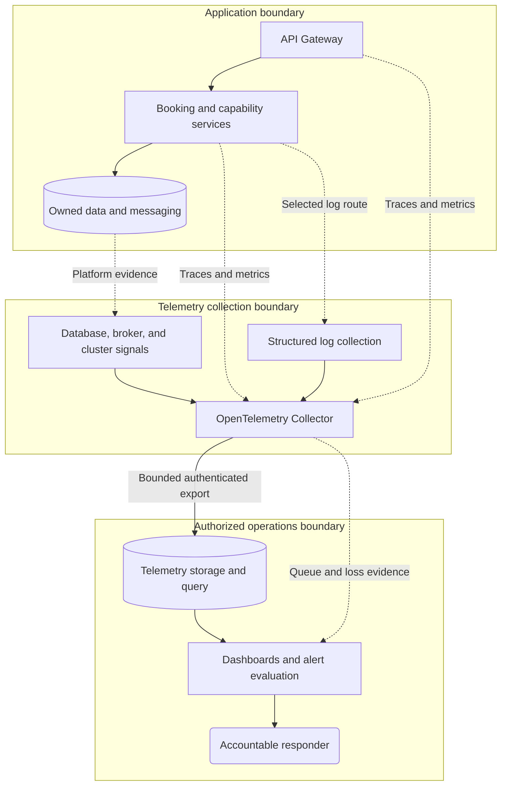
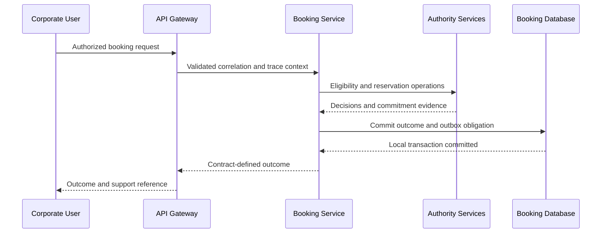
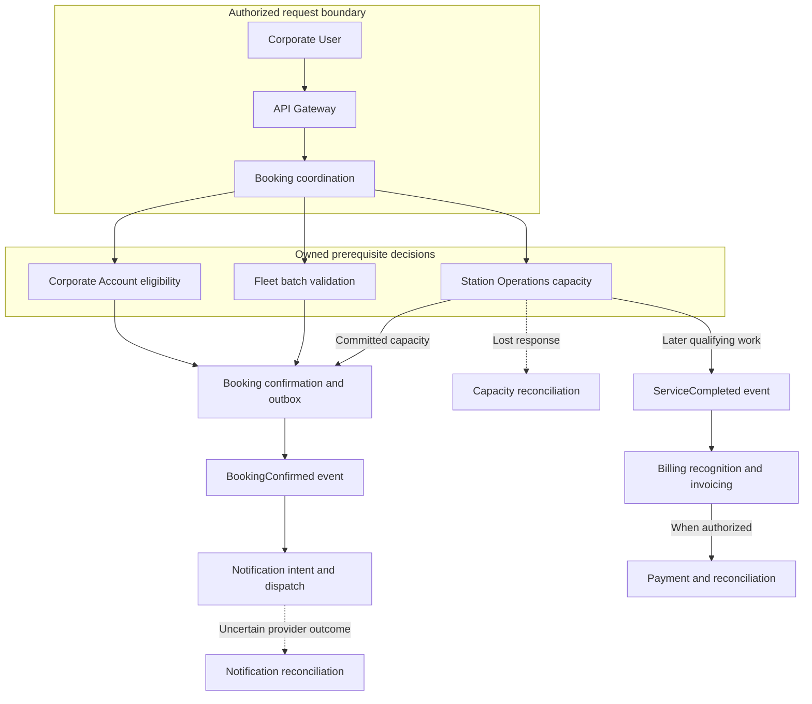
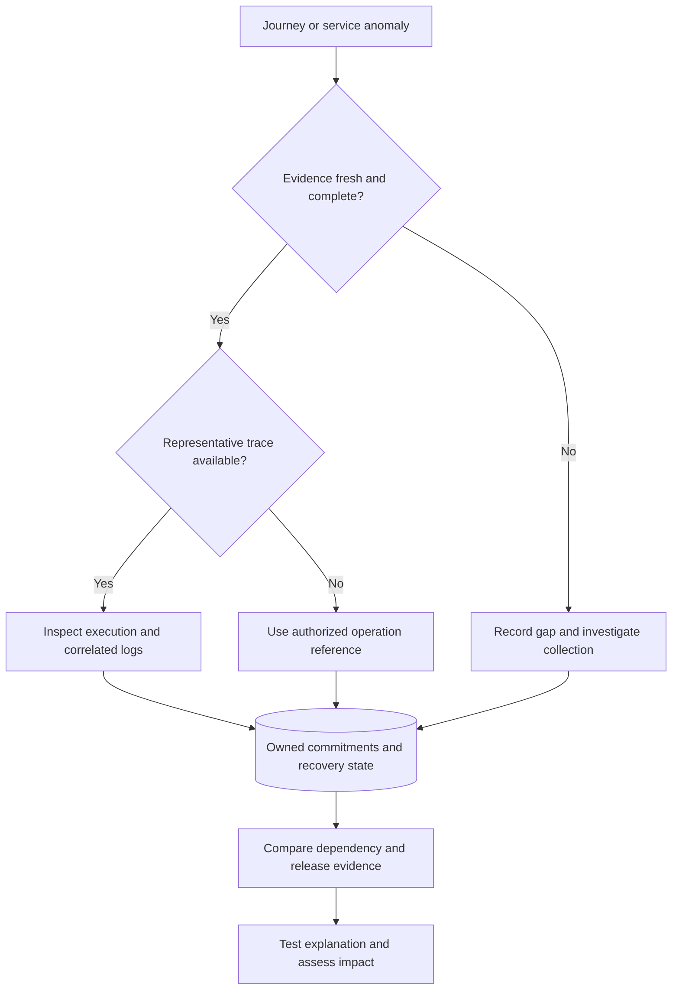
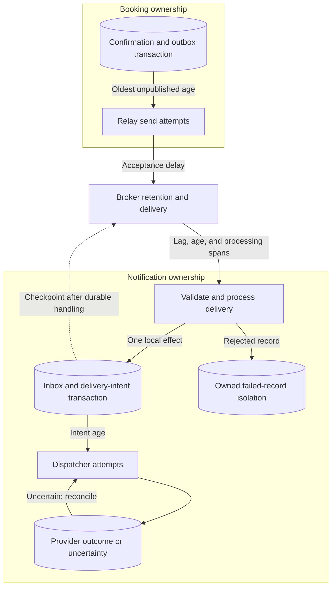
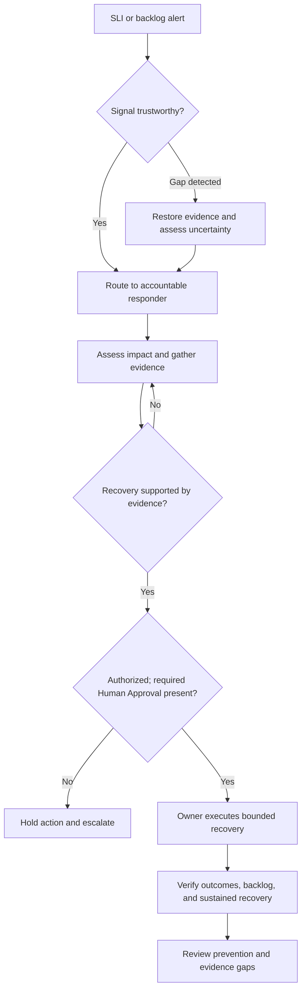

# Chapter 52 — Observability

*Part VII — Alpha Car Detailing*

## 1. Story-driven Opening

Northstar Distribution's fleet administrator has arranged washing and interior cleaning for twenty-four vehicles across two days. Booking Service reports the appointments as confirmed. Station Operations has committed the required capacity. The administrator can retrieve the confirmed outcome, but the expected notification has not arrived. A downstream operational view still shows older information.

The infrastructure dashboard is green. The Booking pods are running, the gateway returned a successful response, and the database accepts connections. One engineer searches Booking's logs and finds no exception. Another searches Notification and finds several provider timeouts. Neither observation establishes whether Northstar's notification was attempted, whether the provider accepted it, or whether other corporate customers are affected.

A proposal appears in the incident channel: cancel the booking and submit it again. That would change a valid customer commitment to repair a delayed consequence. Another proposal is to replay every recent event. That could repeat external effects whose outcomes are still uncertain.

The responder starts with the owned booking operation. Booking's record establishes confirmation and the reservation reference. The outbox establishes the publication obligation. The broker and consumer records establish delivery and local processing. Notification's durable intent remains unresolved, and the provider adapter records a timeout after dispatch began. The evidence narrows the problem to communication; it does not establish that the provider rejected the send.

The team now knows which commitment succeeded, which consequence is uncertain, who owns recovery, and which customers need attention. It also knows what remains unproven. A timeout is evidence that a response did not arrive within a deadline. It is insufficient evidence that the remote effect never occurred.

This is the purpose of observability in Alpha Car Detailing: make distributed behavior explainable well enough to support a correct operational decision.

> **Core principle**  
> Observability must make system behavior explainable through correlated logs, metrics, traces, and business signals. The evidence should establish what happened, where it happened, why the available evidence supports the diagnosis, and how users were affected.

The story continues the proposed distributed workflow from Chapters 49–51. It does not change the current companion application's pending-booking baseline.

## 2. Learning Objectives

After completing this chapter, the reader will be able to:

- design complementary logs, metrics, traces, and business indicators around corporate fleet booking;
- distinguish correlation, trace, span, event, causation, and durable operation identities;
- place .NET instrumentation at Clean Architecture boundaries and configure OpenTelemetry;
- preserve diagnostic context across HTTP, outbox publication, messaging, and consumer processing;
- monitor APIs, dependencies, databases, consumers, Kubernetes workloads, and the telemetry pipeline;
- define service-level indicators, objectives, dashboards, and actionable alerts;
- investigate partial failures while distinguishing observed facts, hypotheses, and uncertain outcomes;
- protect sensitive telemetry and use AI Agents under evidence and authorization constraints.

## 3. Background

### 3.1 Observability follows the architecture

Chapters 46–47 established Alpha Car Detailing's domain and candidate solution architecture. Chapter 48 separated Domain, Application, Infrastructure, and API responsibilities. Chapters 49–50 established independently owned services, reliable publication, idempotent consumers, and recovery. Chapter 51 protected identity, account scope, events, infrastructure, and engineering workflows.

Those boundaries determine what must be observable. Corporate Account owns contractual eligibility. Fleet owns vehicle eligibility. Station Operations owns operational capacity. Booking owns its lifecycle and coordination. Notification owns communication. Billing recognizes qualifying completed work and issues invoices according to approved terms. Payment owns authorized financial processing and reconciliation.

A central observability platform collects evidence from those owners. It does not acquire authority to change their records or decide their business policies.

### 3.2 Preserve the runnable baseline

The current companion application exposes Booking create and retrieve endpoints. `POST /api/bookings` creates a `Pending` booking. Its `201 Created` response establishes resource creation; it does not establish confirmed capacity, durable integration-event publication, notification delivery, or payment.

The accepted baseline uses direct application services and defers CQRS and a mediator. Its persistence implementation uses SQLite. The reference architecture's SQL Server, additional services, durable messaging, and Kubernetes deployment are extensions whose behavior requires separate verification.

This chapter instruments the existing create/read boundary first. The confirmation and event examples describe a proposed extension. Northstar's twenty-four vehicles remain a scenario rather than an approved batch limit, aggregate boundary, or all-or-nothing transaction guarantee.

### 3.3 Monitoring, observability, and diagnosis

Monitoring evaluates known signals: request failures exceed a threshold, unpublished work becomes too old, or memory approaches a limit. Observability provides the evidence needed to explore behavior, including failures that the original dashboard designer did not anticipate. Diagnosis interprets that evidence and tests explanations.

Collecting more data does not automatically improve any of these activities. A thousand unstructured messages saying “processing failed” reveal less than a small set of records that identify the owned operation, processing milestone, dependency, outcome category, and release.

Application reliability measurements also differ from the Harness and productivity measurements discussed earlier in the handbook. A successful AI-assisted engineering run does not establish that a customer's booking workflow is reliable in production.

## 4. Concepts

### 4.1 Begin with operational questions

The first design artifact is a set of questions the team must answer during an incident. Can Booking admit work? Which commitments are pending? Has Station Operations committed capacity? Did the event leave the outbox? Did Notification save a delivery intent? What evidence exists of provider acceptance? How many unique operations missed their deadline?

For each question, identify the observation point, owning service, durable lookup reference, expected delay, and recovery procedure. Then choose the telemetry. This prevents instrumentation from becoming a collection of convenient counters with no operational meaning.

Evidence has limits. Sampling, clock skew, ingestion delay, retention, and missing instrumentation can leave gaps. Record those gaps explicitly. Absence from a search result is not proof that an operation never occurred.

### 4.2 Logs, metrics, traces, and durable state

| Evidence | Principal question | Booking example |
| --- | --- | --- |
| Structured logs | What selected event or decision occurred? | A capacity query timed out during a named attempt. |
| Metrics | How frequently, how slowly, or how far behind? | The oldest unresolved reservation operation is growing older. |
| Traces | Which instrumented operations were related, and where was time spent? | Fleet validation consumed most of one request's elapsed time. |
| Durable business state | What commitment or recovery obligation currently exists? | Booking is confirmed and Notification still owns an unresolved intent. |

Metrics identify population-level behavior. A representative trace explains one execution. Correlated logs add selected decisions and diagnostic details. Durable records establish commitments and unfinished work independently of telemetry retention.

An exemplar, where supported, connects a metric observation to a trace. It is a diagnostic shortcut, not a requirement that every observation retain a trace. Sampled traces must not become the source of exact booking totals.

Microsoft's [.NET observability guidance](https://learn.microsoft.com/en-us/dotnet/core/diagnostics/observability-with-otel) describes how logging, metrics, and distributed tracing complement one another and how .NET exposes their instrumentation APIs.

### 4.3 Structured logging

Structured logging records named fields independently of the rendered message. A stable message template allows the backend to find all occurrences of an event and filter their properties without parsing prose.

Alpha Car Detailing's proposed diagnostic contract includes UTC timestamp, severity, stable event name, message template, service identity, release version, environment, operation, and outcome. Add correlation and execution identifiers where available. Add authorized resource references only when necessary for investigation.

```json
{
  "timestamp": "2026-11-21T08:15:03.241Z",
  "severity": "Information",
  "event.name": "BookingOperationFinished",
  "service.name": "alpha-booking",
  "service.version": "chapter52-lab",
  "deployment.environment.name": "Lab",
  "operation": "create",
  "outcome": "pending_created",
  "duration_ms": 41.7,
  "correlation_id": "b63ad22f821e4e26a875e18035556bbc",
  "trace_id": "4bf92f3577b34da6a3ce929d0e0e4736",
  "span_id": "00f067aa0ba902b7"
}
```

This is an illustrative normalized record, not a claim about a particular exporter's JSON layout. Notice the truthful outcome: `pending_created`.

Use `ILogger` message templates and scopes. The established Serilog direction can provide structured properties and configured destinations. Serilog and OpenTelemetry have different responsibilities; connecting both must not ingest the same log twice. See [Serilog's structured-event model](https://serilog.net/).

Use Information for selected meaningful outcomes, Warning for conditions requiring attention or recovery, and Error for unexpected failures at their responsible boundary. Debug detail should have an explicit purpose and bounded lifetime. Severity alone does not decide whether someone should be paged.

### 4.4 Identifiers have different jobs

| Identifier | Purpose | Boundary |
| --- | --- | --- |
| Correlation ID | Group related diagnostic work under a documented convention | Can cover several traces; grants no access. |
| Trace ID | Identify a diagnostic trace | Does not identify a durable booking obligation. |
| Span ID | Identify one operation within a trace | Changes across calls and attempts. |
| Workflow or operation ID | Find durable progress, uncertainty, and recovery state | Remains useful when traces expire. |
| Booking or reservation ID | Identify an owned resource or commitment | Requires resource and account authorization. |
| Producer and event ID | Identify one published fact in its source scope | Remains stable across redelivery. |
| Causation ID | Identify the immediate trigger under an agreed convention | Does not capture every input to a consolidated result. |

A retry can have the same operation ID and correlation ID but a new trace. Redelivery preserves the event ID while creating another processing span. A consolidated invoice can reference several completed service operations; selecting one booking as its sole causal identity would lose information.

Generate or validate diagnostic identifiers at entry points. Bound length and character sets. The gateway strips untrusted internal correlation headers and assigns the internal value under the ingress policy. Services accept that convention only from the authenticated gateway or other approved callers. A public support reference should be an opaque lookup aid, never an access credential.

### 4.5 Trace context and span relationships

Distributed tracing relates operations through a **trace context**. A trace contains spans with identifiers, timing, attributes, status, and relationships. Server spans describe inbound requests; client spans describe outbound calls; internal spans describe selected local work; producer and consumer spans describe messaging operations according to the chosen conventions.

W3C Trace Context defines `traceparent` and `tracestate`. The former carries the trace identifier, parent identifier, and flags; the latter carries supported tracing-system state. Outbound instrumentation updates the parent identifier for the outgoing operation. Reusing an unchanged parent identifier everywhere would erase execution structure. See [W3C Trace Context](https://www.w3.org/TR/trace-context/).

Use framework instrumentation and propagators rather than constructing headers in each handler. At external trust boundaries, explicitly choose whether to continue valid remote context or start an internal trace with a permitted link. Do not let an external sampling flag compel unlimited retention. Baggage is propagated application metadata with separate disclosure risks; credentials, account authority, and vehicle details do not belong there.

Elapsed request time is not the sum of all span durations when operations overlap. Queue waiting, processing time, and time until a business milestone are also different measurements. A service map shows observed instrumented relationships; it is not a complete dependency inventory.

### 4.6 Events, retries, and replay

HTTP context ends when the request ends. An outbox relay may run later in another process. Preserve the approved message creation context with the outbox obligation, then carry it through approved transport metadata. This context is diagnostic metadata, separate from the event's business meaning and authorization evidence.

Message creation, send attempts, receipt, processing, and later external dispatch are separate operations. A send attempt does not prove consumer processing. An inbox commit does not prove email delivery.

For a short, single-message interaction, a supported parent-child policy can continue the originating trace into the consumer. Delayed work, fan-out, batched messages, and replay often benefit from span links. A link relates another execution context without forcing it into one parent-child tree. OpenTelemetry's [messaging span conventions](https://opentelemetry.io/docs/specs/semconv/messaging/messaging-spans/) describe these alternatives; pin the selected convention and instrumentation versions because messaging conventions continue to evolve.

Every attempt receives distinct execution evidence. The producer/event identity and durable operation references remain stable. Never keep one span open for the days between booking, fulfillment, invoicing, and settlement. Later traces connect through durable references and appropriate links.

### 4.7 OpenTelemetry responsibilities

OpenTelemetry provides instrumentation APIs, SDKs, conventions, propagation, and export mechanisms. OpenTelemetry Protocol, or OTLP, transports telemetry. A Collector receives, processes, and exports configured signals. Storage, query execution, dashboards, and alert evaluation belong to the selected analysis platform.

In .NET, `ActivitySource` and `Activity` describe traced work, `Meter` describes metric instruments, and `ILogger` emits logs. Instrumentation libraries can observe ASP.NET Core, `HttpClient`, runtime behavior, and supported database clients. Explicit instrumentation adds the application's meaningful outcomes. These APIs and their integration are described in the [OpenTelemetry .NET documentation](https://opentelemetry.io/docs/languages/dotnet/instrumentation/).

Use stable resource identity: `service.name`, an appropriate namespace, release version, and environment. Instance, pod, and node metadata support diagnostics but need deliberate aggregation and retention policies. Instrumentation scope identity identifies the emitting library; it is distinct from the service resource.

Automatic instrumentation offers broad initial coverage. Explicit instrumentation adds semantic precision. Check their overlap: two libraries observing the same HTTP call can create duplicate spans and misleading counts.

### 4.8 Service metrics and cardinality

For service interfaces, measure request rate, error rate, and duration. For constrained resources, measure utilization, saturation, and errors. Include active requests, connection acquisition, thread-pool pressure, garbage collection, allocation, CPU throttling, and memory pressure when they answer a concrete operational question.

A counter accumulates occurrences. A gauge reports a current observation. A histogram records a distribution. Define units and aggregation windows with the instrument. Use compatible histogram boundaries when aggregating latency across instances; averaging instance-level p95 values does not produce a fleet-wide p95.

Metric cardinality grows with combinations of attribute values. Route templates such as `/api/bookings/{bookingId}` are bounded; raw paths containing identifiers are not. Use approved dimensions such as operation, service, dependency, and outcome. Exclude booking, event, vehicle, user, and arbitrary account IDs from metric attributes. A business identifier can be appropriate in an access-controlled diagnostic record while remaining inappropriate in a metric series.

Apply a per-instrument cardinality budget and test it. SDK limits are a final boundary, not a replacement for schema design. See [OpenTelemetry .NET metric practices](https://opentelemetry.io/docs/languages/dotnet/metrics/best-practices/).

### 4.9 Business signals

Service metrics describe execution. Business signals describe the commitments that matter to customers: pending creation, confirmation, rejection, cancellation, fulfillment, billable-work recognition, invoice issuance, and settlement. These outcomes must retain their approved lifecycle meanings.

Track unresolved capacity operations, oldest pending workflow age, overdue notification intents, unrecognized completed work, and uncertain financial operations. An unfinished operation is part of the population even when it emits no completion log.

Define the unit. One Northstar submission, twenty-four selected vehicles, several booking resources, and multiple HTTP attempts are different counts. Retrying an idempotent operation must not create another authoritative business success. In-process counters provide approximate operational activity; reconciled owner-produced records provide complete commercial reporting where required.

### 4.10 Health checks

| Check | Question | Intended consequence |
| --- | --- | --- |
| Startup | Has initialization completed? | Delay ordinary probe enforcement while startup proceeds. |
| Liveness | Is the process in a condition that warrants restart? | Restart under the workload policy. |
| Readiness | Can this instance currently admit its assigned traffic? | Remove it from ordinary service traffic when unready. |
| Worker progress | Is background work advancing when work exists? | Investigate stalls and backlog risk. |
| Synthetic journey | Can an external caller complete a defined journey? | Detect failures beyond one process boundary. |

Kubernetes assigns different behavior to startup, readiness, and liveness probes. Their design must reflect that distinction; see [Kubernetes probe guidance](https://kubernetes.io/docs/concepts/workloads/pods/probes/).

Do not place a notification-provider call inside Booking's liveness check. A shared provider outage should not restart every Booking instance. Readiness considers dependencies required for the traffic being admitted and the service's safe degraded mode. A durable outbox can permit temporary operation during a broker outage while storage, backlog age, and recovery headroom remain within explicit limits.

The current baseline registers health endpoints without substantive dependency checks. Their existence establishes neither database readiness nor complete observability. A healthy HTTP endpoint can coexist with a stalled consumer.

### 4.11 APIs and dependencies

Monitor gateway admission, route-level response categories, duration distributions, throttling, timeouts, disconnects, and the client-visible outcome. A service that finishes after the gateway deadline can report local success while the user experiences failure.

Separate valid business rejection, authorization denial, malformed input, capacity unavailability, cancellation, dependency failure, and internal defect. HTTP status is an input to this classification, not the complete business meaning. A service-generated `400` caused by a defect must not disappear behind a blanket exclusion of client errors.

Observe Corporate Account, Fleet, and Station Operations independently. Measure logical operations and physical attempts separately so retries do not inflate customer request counts. Record retry amplification, circuit-breaker changes, DNS and TLS failures, and connection-pool pressure using bounded categories. Batched Fleet validation remains the accepted direction; one call per vehicle must not be introduced merely to obtain more spans.

Use controlled synthetic accounts and defined cleanup for outside-in checks. Synthetic journeys must not accidentally issue production invoices, make real charges, or send uncontrolled customer messages.

### 4.12 Event producers and consumers

| Boundary | Useful signals | What they do not prove |
| --- | --- | --- |
| Producer transaction and outbox | Unpublished count, oldest age, write failures | Broker acceptance. |
| Relay and broker | Send latency, retries, accepted records, throttling | Consumer commitment. |
| Consumer | Delivery position, processing duration, failures, deduplication, checkpoints | External provider outcome. |
| Quarantine and replay | Failed-record age, reason, owner, replay result | That replay is safe without effect-specific checks. |
| Notification dispatcher | Intent age, dispatch attempts, acceptance and uncertainty | Customer receipt unless the provider supplies that evidence. |

Record-count lag, offset lag, elapsed age, and business freshness answer different questions. A quiet stream can contain one critically overdue record. A busy stream can contain many records that remain within the promised delay.

Specify the broker metric's observation point. Azure Event Hubs' AMQP delivery-lag measurement, for example, differs from a stored checkpoint measurement; the [monitoring reference](https://learn.microsoft.com/en-us/azure/event-hubs/monitor-event-hubs-reference) documents that distinction. Application-owned completion evidence is still required.

Kafka and Azure Event Hubs do not imply a queue-style dead-letter workflow for every failed record. Preserve Chapter 50's explicit isolation, checkpoint, retention, and recovery design. Monitor partition skew, rebalances, failed-record age, and the time available before retained history becomes unavailable.

### 4.13 Databases and caches

Observe connection acquisition, query and transaction duration, locks, deadlocks, timeouts, storage pressure, and growth of outbox, inbox, and recovery tables. Slow request spans can conceal time waiting for a connection before SQL execution starts.

Database instrumentation must match the actual provider. SQL Server client instrumentation does not automatically instrument the baseline's SQLite driver. Begin with application operation timing and verified provider capabilities; investigate engine-specific query plans through the owning service's authorized tools.

Avoid raw SQL parameter values, connection strings, and unrestricted statement capture. Query text can itself contain sensitive values. Cache monitoring includes latency, hit/miss rate, eviction, and projection age where relevant. A fast cache hit does not prove that authoritative eligibility or capacity remains valid.

### 4.14 Errors and exceptions

Classify failures with stable categories such as `dependency_timeout`, `schema_rejected`, or `internal_failure`. Keep expected domain outcomes distinct from unexpected exceptions. Record the responsible boundary once; repeated logging in repository, application service, endpoint, and gateway can turn one failure into four apparent incidents.

Exception messages, stack traces, nested exceptions, and provider responses may contain sensitive data. Ordinary diagnostics can record a sanitized category and error reference. A restricted error store can retain approved stack evidence under separate access and retention controls. Passing every exception object to a logger is not a safe default.

An operation can be failed, cancelled, rejected, or uncertain. If Station Operations may have committed capacity before its response was lost, classify the booking operation as awaiting reconciliation under the workflow contract. An error span does not authorize declaring that capacity free.

### 4.15 SLIs, SLOs, and error budgets

A **service-level indicator**, or SLI, measures a defined aspect of service behavior. A **service-level objective**, or SLO, specifies its target over a measurement window. An **error budget** is the permitted amount of failure under that objective. A contractual service-level agreement has separate commercial meaning.

For a ratio indicator, define good events and eligible events:

\[
SLI = \frac{\text{good eligible events}}{\text{all eligible events}},
\qquad
\text{allowed bad fraction} = 1 - SLO.
\]

The specification also needs a unit, observation point, deadline or latency threshold, exclusions, owner, data freshness, and missing-data policy. Component availability cannot be averaged to establish end-to-end journey availability. [Implementing SLOs](https://sre.google/workbook/implementing-slos/) provides the customer-oriented reliability foundation; the Alpha Car Detailing indicators are proposed below.

An asynchronous SLI must include unfinished work. Assign each notification intent a due time. At evaluation time, examine the cohort whose due times fall within the measurement window. Count an intent as good only if the agreed evidence milestone occurred by its due time. Overdue unresolved intents remain bad; later completion repairs the operation without rewriting its missed deadline as an on-time success.

Zero eligible traffic means no ratio observation, not automatically 100% success. Low traffic requires explicit treatment because one failure can dominate a short window. Missing telemetry means incomplete evidence; use completeness checks and durable reconciliation rather than silently removing the interval.

### 4.16 Dashboards and alerts

A dashboard should support a decision: continue admitting work, investigate a dependency, add consumer capacity, reconcile an uncertain operation, or communicate customer impact. Display units, windows, source freshness, release annotations, and links to accountable owners and runbooks.

An alert is a request for action. Specify its population, condition, duration, severity, owner, first useful query, escalation, and recovery criterion. Page for urgent customer risk or imminent loss of recoverability; create a ticket for slower degradation; retain ordinary diagnostic errors without paging every occurrence.

Burn rate compares observed bad-event fraction with the allowed fraction. For a proposed 99.9% objective, a 1.44% bad-event fraction has burn rate 14.4. Multiwindow rules require both a longer window showing sustained consumption and a shorter window showing the problem remains active. The [SRE Workbook's alerting guidance](https://sre.google/workbook/alerting-on-slos/) explains this pattern. Its example thresholds are starting points, not approved Alpha Car Detailing policy.

### 4.17 Audit and observability

| Record | Primary obligation | Completeness requirement |
| --- | --- | --- |
| Operational diagnostics | Explain execution and performance | Explicit sampling, retention, and loss limits. |
| Durable workflow state | Preserve commitments and recover unfinished work | Owning service's transactional guarantees. |
| Integration event | Communicate an owned fact | Approved publication and delivery contract. |
| Audit Trail | Preserve attributable evidence of governed actions | Action-specific integrity, durability, and retention policy. |

A trace can help locate an audited action. It does not become the authoritative Audit Trail. An inbox entry can prove local deduplication without providing every attribution field required for a sensitive replay.

Ordinary diagnostic export should have bounded impact on booking behavior. Chapter 51's mandatory audit guarantees remain action-specific: a protected action requiring durable audit acceptance cannot silently proceed when that guarantee is unavailable.

### 4.18 Sensitive data and access

Minimize data before emission. Use allowlists for log fields, span attributes, metric dimensions, baggage, and exported incident bundles. Exclude tokens, credentials, raw payment details, vehicle registrations, recipient addresses, full request bodies, and complete event payloads unless a specifically justified protected mechanism requires them.

Pseudonymized identifiers can still be linkable. Restrict queries and exports by role, environment, and permitted account scope. A dashboard variable or hidden panel is not an access-control boundary. Backend authorization must enforce the allowed view.

Protect telemetry in transit and at rest, restrict collection destinations, review access, and define deletion and preservation responsibilities. Collector redaction adds protection but cannot erase data already sent to another sink. OWASP's [Logging Cheat Sheet](https://cheatsheetseries.owasp.org/cheatsheets/Logging_Cheat_Sheet.html) discusses sensitive-field exclusion, sanitization, access, and logging failure tests.

### 4.19 Sampling, retention, and cost

Head sampling decides early which execution data to retain. Tail sampling evaluates received spans before deciding which traces to keep. Tail sampling can favor slow or failed traces, but needs buffering and trace-aware routing; it cannot recover spans discarded before collection. See [OpenTelemetry sampling](https://opentelemetry.io/docs/concepts/sampling/).

Choose policies using incident requirements, volume, privacy, and cost. Record ingestion, export, storage, and query budgets. Set explicit limits on telemetry queues and high-volume events. Preserve independent metric and durable-outcome policies; trace sampling does not justify incomplete financial evidence.

Clock skew and ingestion delay complicate cross-service timing. Use monotonic elapsed measurements for local duration and synchronized UTC clocks for event milestones. Display observation freshness. Avoid interpreting a negative computed delay as an extraordinary performance improvement.

## 5. Architecture Discussion

### 5.1 Assign evidence and recovery ownership

| Owner | Principal operational evidence | Recovery responsibility |
| --- | --- | --- |
| Booking | Pending age, confirmation timing, reservation uncertainty, outbox age | Reconcile booking commitments. |
| Corporate Account | Eligibility outcomes, authority failures, decision freshness | Restore authoritative account decisions. |
| Fleet | Batch-validation duration, eligibility, projection freshness | Restore correct fleet decisions. |
| Station Operations | Reservation outcomes, unresolved operations, completion publication | Reconcile capacity and fulfillment. |
| Billing | Unrecognized completed work, invoice age, reconciliation differences | Restore correct recognition and invoicing. |
| Payment | Uncertain attempts, provider outcomes, settlement evidence | Establish financial outcome before another effect. |
| Notification | Intent age, dispatch attempts, provider evidence | Recover communication without uncontrolled duplication. |
| Platform | Broker, database platform, cluster, Collector, backend, alert delivery | Restore shared infrastructure and evidence delivery. |

Logical ownership does not require seven engineering teams. It requires a named responder and authority for each decision. The service catalog links ownership, objectives, runbooks, dashboards, and escalation.

Instrument API and messaging entry points, application outcomes, and infrastructure adapters. Keep telemetry SDKs, backend clients, and exporter configuration outside Domain. Application can expose meaningful outcomes through existing contracts; an outer decorator can observe them without changing the domain model.

### 5.2 Follow the immediate booking execution

The proposed confirmation workflow begins at authenticated ingress. Booking obtains the required Corporate Account and Fleet decisions, then obtains the required capacity commitment through Station Operations. Independent eligibility checks can overlap only where their contracts permit. Fleet validation remains batched.

Booking confirms only after its prerequisites are established. Its local confirmation transaction also saves the outbox obligation. A lost reservation response leads to a lookup or reconciliation using the durable capacity operation ID. A slow Notification provider is outside that confirmation boundary.

The following teaching example follows one short interaction. Abbreviations in the table refer to complete synthetic values:

- `C1`: correlation ID `b63ad22f821e4e26a875e18035556bbc`.
- `T1`: trace ID `4bf92f3577b34da6a3ce929d0e0e4736`.
- `O1`: durable confirmation operation; `R1`: its capacity operation; `E1`: the producer-scoped `BookingConfirmed` event.

| Boundary | Diagnostic relationship | Durable meaning |
| --- | --- | --- |
| Gateway to Booking | `C1`, `T1`; Booking server span has the gateway client span as parent | An authorized request entered the workflow. |
| Booking to eligibility services | `C1`, `T1`; each outbound call and server operation has its own span | Required decisions are obtained. |
| Booking to Station Operations | `C1`, `T1`; separate reservation spans | `R1` identifies the capacity obligation. |
| Booking transaction | `C1`, `T1`; transaction and event-creation evidence | Confirmation and outbox `E1` commit together. |
| Relay send attempt | `C1`; send span linked to stored creation context | An attempt publishes the same `E1`. |
| Notification processing | `C1`; immediate single-message profile continues `T1` from stored creation context | Inbox and delivery intent commit together. |
| Later retry or dispatch | `C1`; distinct spans, possibly a linked new trace | The same intent advances or remains uncertain. |

For example, a message's `traceparent` might be `00-4bf92f3577b34da6a3ce929d0e0e4736-00f067aa0ba902b7-01`, identifying its stored creation span. The relay has its own send span; transport-specific instrumentation must implement the chosen creation-context convention consistently.

The same context crosses the API and event boundary without requiring every later execution to share one trace. Trace IDs can expire from storage while `O1`, `R1`, and `E1` still support recovery.

### 5.3 Connect later business milestones

Notification receives `BookingConfirmed` because it must communicate confirmation. Billing does not issue Northstar's consolidated invoice merely because a booking exists. Qualifying completed work from Station Operations supplies the relevant later fact under the approved commercial workflow.

Completion processing, billable-work recognition, invoice assembly, and authorized payment processing can each have separate traces. Retain owned associations among completion references, invoice lines, invoice references, and financial operations. A consolidated result may need several links and durable associations.

Track each milestone's deadline and uncertainty separately. Delayed notification does not cancel confirmed capacity. Late billing recognition does not prove payment failure. Payment remains outside the confirmation prerequisite unless an approved business policy changes that contract.

### 5.4 Collect telemetry through a bounded pipeline

Services emit approved telemetry to a Collector or supported direct destination. Container logs follow one selected collection path. Infrastructure and database signals enter their appropriate monitoring pipelines. The analysis platform correlates resources and identifiers without requiring one storage engine for every signal.

| Topology | Useful when | Main cost or risk |
| --- | --- | --- |
| Direct export | A small deployment has a supported managed destination | Service configuration and backend coupling multiply. |
| Node-level collection | Container logs and host-local evidence need collection | Node permissions and local buffering require care. |
| Collector gateway | Central policy, routing, and export control are valuable | Capacity, availability, and trace-aware routing become platform work. |

A practical deployment can combine node log collection with an OTLP gateway. Choose managed or self-operated storage according to access control, residency, query capability, retention, cost, and operating capacity. This chapter does not select a new production backend.

Configure authenticated receivers, collection limits, sanitization, batching, bounded queues, retry limits, and monitored exporters. Persistent buffering can reduce loss during Collector restarts; it still has disk, capacity, and retry limits. The [Collector resiliency guidance](https://opentelemetry.io/docs/collector/resiliency/) describes these failure boundaries.

Measure accepted, refused, exported, delayed, and dropped telemetry, queue saturation, backend ingestion freshness, and alert delivery. Use an independent heartbeat or external check for important monitoring failures. A backend outage must not turn routine booking requests into an unbounded wait for diagnostic export.

### 5.5 Observe Kubernetes and runtime conditions

Correlate service version and environment with namespace, workload, pod, node, and container evidence. Investigate scheduling failures, pending pods, restart reasons, `OOMKilled`, CPU throttling, node pressure, network failures, and rollout changes alongside application behavior.

Application metrics, object-state metrics, node metrics, control-plane signals, and Kubernetes events describe different layers. Capture ephemeral evidence before it disappears. Metrics Server supports resource-use functions such as autoscaling; it is not the durable investigation store. Kubernetes' [observability guidance](https://kubernetes.io/docs/concepts/cluster-administration/observability/) explains the broader signal landscape.

Use least-privileged collection permissions. Avoid sending the same JSON stdout record through both node log collection and a second application log export path. Short-lived workers and terminated pods can lose buffered telemetry; bounded flush improves delivery without guaranteeing it.

Scale consumers using backlog, throughput, partition ownership, and downstream capacity. A consumer with healthy probes and zero progress still needs investigation. Adding replicas beyond partition concurrency or provider limits may increase cost without draining work.

### 5.6 Define the proposed SLI catalog

Every indicator below requires agreement on numerical targets. The values used in exercises are laboratory proposals.

| Indicator | Population and good outcome | Observation point |
| --- | --- | --- |
| Booking API availability | Eligible admitted requests receiving contract-valid responses before the request deadline | Gateway or another defined ingress observer. |
| Booking API latency | Eligible requests meeting the approved response-time threshold | Same observer and explicit request population. |
| Booking decision timeliness | Unique eligible operations reaching a truthful contract-defined outcome by due time | Durable Booking operations and prerequisite evidence. |
| Confirmation communication | Required intents reaching the agreed acceptance or delivery milestone by due time | Notification's durable intents and provider evidence. |
| Completed-work recognition | Qualifying completions recognized by Billing by due time | Owned completion and recognition records. |
| Financial reconciliation | Uncertain financial operations resolved by their approved due time | Payment's reconciliation evidence. |

Define request eligibility before examining the incident. Valid domain rejection can be a correct response. A capacity rejection, an authorization denial, and a provider timeout have different meanings. Record excluded populations separately so changed classification cannot hide degradation.

For an illustrative notification lab, set the milestone to **provider acceptance within five minutes of intent creation**, the target to 99%, and the window to the previous 24 hours of due times. These values are not production commitments. If 1,000 intents became due and 980 were accepted on time, the indicator is 98%, including unresolved overdue intents in the denominator. Acceptance establishes the provider milestone, not customer receipt.

Publish the evaluator's last successful observation and source completeness. If the evaluator cannot read a required partition or owner-produced record, show incomplete coverage and alert on measurement failure instead of reporting a reassuring percentage.

### 5.7 Build dashboards and alerts around decisions

| View | Operational decision | Essential content |
| --- | --- | --- |
| Fleet-booking journey | Which commitments or consequences need attention? | Outcomes, pending age, reservation uncertainty, communication freshness. |
| Service and dependencies | Where is a request budget being consumed? | Rate, latency histograms, errors, saturation, dependency attempts, release markers. |
| Event processing | Can work catch up before its deadline? | Outbox age, lag definition, processing rate, quarantine age, dispatch uncertainty. |
| Data and infrastructure | Is shared capacity limiting progress? | Database waits, broker pressure, cluster resources, workload failures. |
| Evidence delivery | Can responders trust the visible time window? | Queue saturation, rejected telemetry, ingestion freshness, alert-channel checks. |

Provide authorized drill-down from an affected journey to a representative trace, related structured logs, durable operation status, owner, and runbook. Filter aggregate views by approved bounded dimensions. Enforce protected resource access in the backend and owning service.

A fast SLO burn can page the journey's responder. An unresolved reservation approaching its recovery deadline can page Booking and Station Operations through one coordinated incident. A steadily increasing Notification backlog may first create a ticket if sufficient recovery headroom remains. An uncertain payment requires the financial recovery owner, not a generic automatic retry.

Group related symptoms and suppress derivative notifications when appropriate, while preserving the underlying evidence. Define maintenance windows, silence expiry, escalation, and stable recovery windows. Test the alert's route and first useful query. An alert rule that evaluates correctly but reaches nobody provides no response capability.

### 5.8 Investigate Northstar's incident

Start by separating the customer's commitments. The appointments may be confirmed while communication is delayed and a read model is stale. Establish the affected time window, authorized account scope, service versions, and observation freshness.

| Evidence | Supported conclusion | Remaining question |
| --- | --- | --- |
| Booking record and reservation reference | Confirmation and its capacity commitment exist | Are any separate operations unresolved? |
| Outbox publication evidence | The event reached the defined publication milestone | Did Notification commit its local effect? |
| Notification inbox and intent | The event created one durable communication obligation | What happened at external dispatch? |
| Provider adapter timeout | The response deadline was exceeded | Did the provider accept the send? |
| Provider lookup or receipt | The documented provider milestone occurred, or remains unknown | Does the evidence support safe retry or continued reconciliation? |

These are illustrative incident records. In an actual investigation, reference the specific records and their timestamps rather than borrowing the teaching example's conclusion.

Compare hypotheses against disconfirming evidence. A slow Fleet call cannot explain a notification intent already committed after confirmation. A missing trace cannot establish a missing event. A recent deployment is a candidate contributing change, not proof of cause. Check retry amplification, database contention, provider behavior, stale projections, resource pressure, and telemetry gaps.

Recover through the owning service's reconciliation or controlled replay procedure. Preserve stable event and provider-operation identities. Apply the existing authorization and Human Approval requirements for the action. Avoid cross-service database edits and blind retries of uncertain sends or charges.

Close the incident only after the affected intent is resolved under its contract, relevant backlogs drain, indicators remain stable, and customer impact is accounted for. Record triggering failure, contributing conditions, evidence gaps, recovery, and prevention work separately.

### 5.9 Govern the observability contract

Service owners maintain instrumentation meaning, dashboards, and runbooks. Platform owns collection and backend operation. Security and data owners approve sensitive collection and access policy. Reliability and business owners approve objectives. Normal code review governs changes; privileged recovery follows its own action-specific controls.

Version signal contracts, alert rules, dashboard definitions, and runbooks with the owning changes. Revisit them when an API, event schema, service boundary, dependency, or deployment changes. Verify minimization, propagation, label bounds, outcome classification, and measurement completeness before release. Roll back a harmful telemetry change through its versioned deployment without corrupting business state.

## 6. Professional Diagrams

### Figure 52-1 — Observability architecture

Figure 52-1 separates application behavior from the evidence pipeline. The distributed services and production collection topology are proposed extensions to the current Booking baseline.



*Caption: Solid arrows show application or collection flow; dashed arrows show diagnostic evidence. The platform unifies access to evidence while service owners retain authority over recovery. Collection loss and ingestion freshness require their own checks.*

### Figure 52-2 — Distributed trace flow across APIs

Figure 52-2 expands the immediate request boundary. The authority adapter represents separately observed Corporate Account, batched Fleet validation, and capacity interactions; their business ordering remains governed by the workflow.



*Caption: Every instrumented boundary has its own spans. The gateway observes the caller-facing result, and the database commit establishes a local milestone. Figure 52-5 continues the evidence through asynchronous processing.*

### Figure 52-3 — Corporate fleet booking and later business work

Figure 52-3 distinguishes prerequisites, communication, and later financial work. It does not imply one transaction across these services.



*Caption: Edges show required contributions, not permission to execute all prerequisite decisions concurrently. Delayed communication does not undo confirmation. A lost capacity response requires reconciliation before interpreting the booking outcome. Billing follows qualifying completed work; Payment is not an invented confirmation prerequisite.*

### Figure 52-4 — Connect aggregate symptoms to owned evidence

Figure 52-4 shows how the investigation remains possible when a trace is missing or expired.



*Caption: Metrics reveal a pattern, execution records explain examples, and durable state establishes commitments. Missing diagnostic evidence remains visible throughout the investigation.*

### Figure 52-5 — Event consumer observability

Figure 52-5 separates publication, local processing, and external effects. The stored creation context accompanies the event; processing attempts receive distinct spans.



*Caption: Duplicate deliveries must not create another intent. Checkpoint progress, provider acceptance, and confirmed delivery are separate milestones. The reconciliation arrow does not authorize an unconditional resend.*

### Figure 52-6 — Alert, investigation, and controlled recovery

Figure 52-6 connects an actionable signal to accountable recovery. Human Approval appears where the existing action policy requires it.



*Caption: An alert starts investigation. Evidence and action-specific authority determine recovery; an AI-generated explanation cannot replace either.*

## 7. Hands-on Example

### 7.1 Scope and prerequisites

The first slice observes the existing Booking create/read service. It adds diagnostic context, an application-operation span, bounded operation metrics, and structured outcome logging. It preserves endpoints, persistence behavior, and pending creation. It introduces neither a mediator nor a distributed confirmation implementation.

Use the repository's .NET 10 toolchain, synthetic records, an isolated telemetry destination, and the existing domain and integration tests. The package integration shown here uses OpenTelemetry packages version `1.14.0` as a reproducible example, not a claim that this is the latest release. Pin and review versions through `alpha-car-detailing/Directory.Packages.props`.

The proposed API project references are `OpenTelemetry.Extensions.Hosting`, `OpenTelemetry.Exporter.OpenTelemetryProtocol`, `OpenTelemetry.Instrumentation.AspNetCore`, `OpenTelemetry.Instrumentation.Http`, and `OpenTelemetry.Instrumentation.Runtime`. The first four listings form an API-layer instrumentation slice. The registration fragment shows composition into the existing application. Messaging is a separate extension profile.

| Proposed component | Placement | Purpose |
| --- | --- | --- |
| `BookingTelemetry` | Booking API `Observability/` | Stable instrumentation identity and bounded metric schema. |
| `ObservedBookingService` | Booking API `Observability/` | Observe the existing application contract. |
| `RequestCorrelationMiddleware` | Booking API `Observability/` | Establish public-entry diagnostic context. |
| `ObservabilityRegistration` | Booking API `Observability/` | Configure the SDK and lab log route. |
| `MessageTraceContext` | Proposed messaging adapter | Persist and restore approved diagnostic metadata. |

These listings specify a proposed change; placing them in the manuscript does not change the companion application's source code or establish production validation.

### 7.2 Define bounded operation instruments

The instrument names are Alpha Car Detailing's proposed custom contract. They are not presented as standard OpenTelemetry semantic names.

```csharp
using System.Diagnostics;
using System.Diagnostics.Metrics;

namespace AlphaCarDetailing.Booking.Api.Observability;

public static class BookingTelemetry
{
    public const string ScopeName = "AlphaCarDetailing.Booking";
    public static readonly ActivitySource Activities = new(ScopeName);
    private static readonly Meter Meter = new(ScopeName, "1.0.0");

    private static readonly Counter<long> Operations = Meter.CreateCounter<long>(
        "acd.booking.operations", unit: "{operation}",
        description: "Observed application operation completions by outcome.");

    private static readonly Histogram<double> Duration = Meter.CreateHistogram<double>(
        "acd.booking.operation.duration", unit: "s",
        description: "Application operation elapsed time, including failed attempts.");

    public static void Record(string operation, string outcome, double seconds)
    {
        var tags = new TagList
        {
            { "acd.operation", operation },
            { "acd.outcome", outcome }
        };
        Operations.Add(1, tags);
        Duration.Record(seconds, tags);
    }
}
```

The caller controls both dimensions through fixed operation names and outcome branches. No request property becomes a label. These measurements count observed executions of the application boundary; they are not authoritative unique-booking totals and can be lost during abrupt termination or export failure.

### 7.3 Observe truthful outcomes

The decorator depends on the existing application contract. Domain remains unaware of tracing and logging providers.

```csharp
using System.Diagnostics;
using AlphaCarDetailing.Booking.Application.Bookings;
using AlphaCarDetailing.BuildingBlocks.Domain;
using Microsoft.Extensions.Logging;

namespace AlphaCarDetailing.Booking.Api.Observability;

public sealed class ObservedBookingService(
    IBookingService inner,
    ILogger<ObservedBookingService> logger) : IBookingService
{
    public Task<BookingDto> CreateAsync(
        CreateBookingRequest request, CancellationToken cancellationToken) =>
        ObserveAsync("create", "pending_created",
            ct => inner.CreateAsync(request, ct), cancellationToken);

    public Task<BookingDto?> GetAsync(
        Guid bookingId, CancellationToken cancellationToken) =>
        ObserveAsync("get", "found",
            ct => inner.GetAsync(bookingId, ct), cancellationToken);

    private async Task<T> ObserveAsync<T>(
        string operation, string successfulOutcome,
        Func<CancellationToken, Task<T>> execute,
        CancellationToken cancellationToken)
    {
        using var activity = BookingTelemetry.Activities.StartActivity(
            $"booking.{operation}", ActivityKind.Internal);
        var started = Stopwatch.GetTimestamp();
        var outcome = "internal_failure";

        try
        {
            var result = await execute(cancellationToken);
            outcome = result is null ? "not_found" : successfulOutcome;
            return result;
        }
        catch (DomainException)
        {
            outcome = "rejected";
            throw;
        }
        catch (OperationCanceledException) when (cancellationToken.IsCancellationRequested)
        {
            outcome = "cancelled";
            throw;
        }
        catch (Exception)
        {
            activity?.SetStatus(ActivityStatusCode.Error);
            activity?.SetTag("error.type", "internal_failure");
            throw;
        }
        finally
        {
            var elapsed = Stopwatch.GetElapsedTime(started);
            activity?.SetTag("acd.outcome", outcome);
            BookingTelemetry.Record(operation, outcome, elapsed.TotalSeconds);
            var level = outcome == "internal_failure"
                ? LogLevel.Error : LogLevel.Information;
            logger.Log(level, new EventId(5201, "BookingOperationFinished"),
                "Booking operation {Operation} finished with {Outcome} in {DurationMs} ms",
                operation, outcome, elapsed.TotalMilliseconds);
        }
    }
}
```

The baseline classifies `DomainException` as validation rejection. A future workflow with explicit dependency and uncertainty outcomes must extend the contract and observer accordingly. Do not keep the word `internal_failure` as a permanent catch-all for operational distinctions that responders need.

The observer deliberately avoids request serialization and raw exception messages. The approved error pipeline can retain sanitized restricted evidence separately. Configure framework and automatic-instrumentation exception capture as part of the same leakage review. The null-conditional activity calls preserve application behavior when no trace listener creates a span.

### 7.4 Establish context at the public entry

For the baseline lab, Booking is the public ingress boundary. It generates its own correlation ID and ignores arbitrary caller-supplied correlation values. The production gateway profile instead establishes a validated value and forwards it through authenticated internal adapters.

```csharp
using System.Diagnostics;
using Microsoft.AspNetCore.Http;
using Microsoft.Extensions.Logging;

namespace AlphaCarDetailing.Booking.Api.Observability;

public sealed class RequestCorrelationMiddleware(
    RequestDelegate next,
    ILogger<RequestCorrelationMiddleware> logger)
{
    public async Task InvokeAsync(HttpContext context)
    {
        var correlationId = Guid.NewGuid().ToString("N");
        context.Items["CorrelationId"] = correlationId;
        Activity.Current?.SetTag("acd.correlation_id", correlationId);
        context.Response.Headers["X-Correlation-ID"] = correlationId;

        using var scope = logger.BeginScope(new Dictionary<string, object>
        {
            ["CorrelationId"] = correlationId
        });
        await next(context);
    }
}
```

ASP.NET Core and outbound `HttpClient` tracing handle supported HTTP trace propagation when configured. The custom correlation header needs its own approved outbound handler or explicit adapter metadata. Do not assume a logging scope automatically becomes an HTTP header.

The middleware does not authenticate users, authorize bookings, or implement gateway trace-boundary policy. Those controls remain separate. With the OpenTelemetry log provider, active `Activity` identifiers supply trace/log correlation; see [OpenTelemetry .NET log correlation](https://opentelemetry.io/docs/languages/dotnet/logs/correlation/).

### 7.5 Configure collection at composition

This laboratory registration uses one OpenTelemetry `ILogger` export route to inspect correlation. A production deployment retaining Serilog must adapt the approved log route instead of enabling a second ingestion path. Removing existing providers is appropriate only for this isolated lab profile.

```csharp
using Microsoft.Extensions.DependencyInjection;
using Microsoft.Extensions.Logging;
using OpenTelemetry.Logs;
using OpenTelemetry.Metrics;
using OpenTelemetry.Resources;
using OpenTelemetry.Trace;

namespace AlphaCarDetailing.Booking.Api.Observability;

public static class ObservabilityRegistration
{
    public static IServiceCollection AddBookingObservability(
        this IServiceCollection services, ILoggingBuilder logging,
        string environment, string version)
    {
        void Describe(ResourceBuilder resource) => resource
            .AddService("alpha-booking", serviceVersion: version)
            .AddAttributes(new Dictionary<string, object>
            {
                ["deployment.environment.name"] = environment
            });

        services.AddOpenTelemetry()
            .ConfigureResource(Describe)
            .WithTracing(tracing => tracing
                .AddSource(BookingTelemetry.ScopeName)
                .AddAspNetCoreInstrumentation()
                .AddHttpClientInstrumentation()
                .AddOtlpExporter())
            .WithMetrics(metrics => metrics
                .AddMeter(BookingTelemetry.ScopeName)
                .AddAspNetCoreInstrumentation()
                .AddHttpClientInstrumentation()
                .AddRuntimeInstrumentation()
                .AddOtlpExporter());

        var logResource = ResourceBuilder.CreateDefault();
        Describe(logResource);
        logging.ClearProviders();
        logging.AddOpenTelemetry(options =>
        {
            options.SetResourceBuilder(logResource);
            options.IncludeScopes = true;
            options.IncludeFormattedMessage = false;
            options.AddOtlpExporter();
        });
        return services;
    }
}
```

Configure OTLP endpoint, transport, authentication, and TLS through the approved deployment configuration. The SDK integration does not provision a Collector or analysis backend. See [OpenTelemetry .NET exporters](https://opentelemetry.io/docs/languages/dotnet/exporters/) for supported export configuration.

The following composition fragment belongs after the existing application and infrastructure registrations, with middleware added before endpoint execution. It replaces the interface registration with an observed instance while retaining the direct application service:

```csharp
builder.Services.AddBookingObservability(
    builder.Logging, builder.Environment.EnvironmentName, "chapter52-lab");
builder.Services.AddScoped<IBookingService>(services =>
    new ObservedBookingService(
        new BookingService(
            services.GetRequiredService<IBookingRepository>(),
            services.GetRequiredService<TimeProvider>()),
        services.GetRequiredService<ILogger<ObservedBookingService>>()));

// After builder.Build(), before mapped endpoint execution:
app.UseMiddleware<RequestCorrelationMiddleware>();
```

This is a placement fragment, not a replacement `Program.cs`. Keep the existing application, infrastructure, endpoint, and exception-handler setup. The baseline's unregistered dependency checks still need a separate readiness implementation. ASP.NET Core supports separate health-check predicates and tagged registrations; see [Health checks in ASP.NET Core](https://learn.microsoft.com/en-us/aspnet/core/host-and-deploy/health-checks?view=aspnetcore-10.0).

### 7.6 Carry context through a proposed outbox fixture

The next listing handles diagnostic context only. It neither publishes an event nor implements inbox deduplication. Use it in the extension fixture with a configured listener for `AlphaCarDetailing.Messaging`.

```csharp
using System.Diagnostics;

namespace AlphaCarDetailing.Messaging.Observability;

public sealed record DiagnosticHeaders(
    string CorrelationId, string? TraceParent, string? TraceState);

public static class MessageTraceContext
{
    public static readonly ActivitySource Activities =
        new("AlphaCarDetailing.Messaging");

    public static DiagnosticHeaders Capture(string correlationId)
    {
        if (!Guid.TryParseExact(correlationId, "N", out _))
            throw new ArgumentException("Expected an internal correlation identifier.",
                nameof(correlationId));

        var current = Activity.Current;
        return new DiagnosticHeaders(correlationId,
            current?.IdFormat == ActivityIdFormat.W3C ? current.Id : null,
            current?.TraceStateString);
    }

    public static Activity? StartImmediateConsumer(DiagnosticHeaders headers)
    {
        var parent = default(ActivityContext);
        if (headers.TraceParent is { Length: <= 512 }
            && (headers.TraceState is null || headers.TraceState.Length <= 512))
        {
            ActivityContext.TryParse(headers.TraceParent, headers.TraceState,
                isRemote: true, out parent);
        }

        return Activities.StartActivity("notification.process",
            ActivityKind.Consumer, parentContext: parent);
    }
}
```

Capture inside the message-creation activity and save the returned headers with the outbox obligation in the business transaction. Store strings and identifiers, not a live `Activity`. The relay preserves that creation context while recording its own send attempts according to the selected messaging conventions.

The receiving adapter validates the authenticated producer, schema, metadata limits, and correlation convention before invoking the handler. It establishes a correlation logging scope explicitly. This helper bounds and parses trace metadata; it does not establish trust. Invalid or absent trace context creates local diagnostic work under the configured instrumentation policy instead of authorizing or rejecting the business operation.

The immediate single-message profile continues the creation context. Use a supported link-based profile for batch, delayed dispatch, or replay, and test its backend representation. Preserve event identity across redelivery. Commit Notification's inbox evidence and one intent together; checkpoint only after the durable handling boundary. Reconcile uncertain external outcomes before another effect.

### 7.7 Run and inspect the baseline slice

After applying and reviewing the proposed instrumentation, run the ordinary build and existing tests from the repository root:

```powershell
dotnet build ./alpha-car-detailing/AlphaCarDetailing.sln
dotnet test ./alpha-car-detailing/AlphaCarDetailing.sln --no-build
dotnet run --project ./alpha-car-detailing/src/Services/Booking/AlphaCarDetailing.Booking.Api --no-launch-profile --urls http://127.0.0.1:5082
```

Use the solution filename present in the checkout if it differs. Configure the isolated OTLP destination before starting the instrumented process. From another PowerShell session, submit synthetic data:

```powershell
$labRequest = @{
    customerId = '11111111-1111-4111-8111-111111111111'
    stationId = '22222222-2222-4222-8222-222222222222'
    vehicleRegistrationNumber = 'LAB-052'
    serviceCode = 'EXTERIOR_WASH'
    scheduledAtUtc = [DateTimeOffset]::UtcNow.AddDays(2).ToString('O')
}
$labResponse = Invoke-WebRequest -Method Post `
    -Uri 'http://127.0.0.1:5082/api/bookings' `
    -ContentType 'application/json' `
    -Body ($labRequest | ConvertTo-Json)
$labBooking = $labResponse.Content | ConvertFrom-Json
$labResponse.StatusCode
$labBooking.status
$labResponse.Headers['X-Correlation-ID']
```

Expected observations are `201`, `Pending`, a generated correlation ID, an HTTP server span, an internal `booking.create` span when sampled, a `pending_created` operation record, and a duration measurement. They do not include a verified SQL Server span, `BookingConfirmed`, a reserved slot, or an email.

Follow the returned resource with the existing read endpoint. Inspect trace/log correlation, resource identity, bounded metric attributes, and the absence of prohibited request fields. Verify domain rejection and cancellation separately; a response outside the measured application boundary can still require gateway or server instrumentation.

### 7.8 Inject failures and prove the measurement contract

The confirmation fixture uses synthetic Corporate Account, Fleet, and Station Operations adapters and a separate proposed outbox/Notification profile. Label adapter-only runs clearly; they do not prove a real broker's headers, checkpoints, driver behavior, or provider semantics.

| Controlled case | Expected evidence and behavior |
| --- | --- |
| Slow Fleet adapter | Increased dependency duration and request-budget pressure; no invented confirmation. |
| Lost capacity response | Durable operation remains reconcilable; uncertainty is visible. |
| Paused outbox relay | Oldest unpublished age rises while committed work remains durable. |
| Redelivery | Distinct processing spans, stable event identity, one intent. |
| Notification timeout | Dispatch uncertainty and intent age; confirmed booking remains confirmed. |
| Collector unavailable | Bounded application impact, visible export loss or delay, durable business progress independent of traces. |
| Missing trace | Investigation succeeds through authorized operation and event references. |
| Overdue unfinished intent | Deadline SLI counts it as bad even without a completion record. |

For the five-minute notification lab, send overdue synthetic intents to a test alert destination and verify owner, evidence links, acknowledgment, escalation, and recovery. Test invalid context, metric-cardinality limits, prohibited-field exclusion, and the telemetry-gap path. Exercise real transport and provider adapters in separate integration profiles before making claims about them.

Retain an evidence package with revision, dependency versions, fixture profile, exact commands and results, sanitized records, expected versus observed outcomes, and unperformed checks. Revert the instrumentation registration and lab configuration to roll back the slice; do not delete or rewrite business records to make the telemetry look healthy.

## 8. Claude Example

### 8.1 Implement a bounded observability change

Claude Code receives the same architecture and measurement contract as a human developer. Read applicable repository Instructions, including `CLAUDE.md` where present, the local `AGENTS.md`, the defer-CQRS ADR, Chapters 48–52, the current Booking code, and existing tests. Select the repository's applicable .NET and observability Skills after inspecting their actual contents; do not invent a Skill path.

Claude Code supports persistent project guidance through its documented instruction mechanisms. Their loading behavior is platform-specific; see [Claude Code project instructions](https://code.claude.com/docs/en/memory). The handbook's architectural and evidence obligations remain independent of that mechanism.

> **Task Prompt**  
> Add the Chapter 52 observability slice to Booking create/read. Preserve pending creation, direct application services, routes, persistence behavior, and Domain dependencies. Define bounded operation and outcome attributes. Add structured outcome logs and trace correlation without request bodies, registrations, credentials, or raw exception messages. Identify the selected log ingestion route. Use synthetic data and an isolated destination. Validate the existing behavior, context handling, signal meaning, and telemetry-outage impact. Report the evidence and every unperformed check. Do not implement confirmation, choose production SLOs, replay events, or change production settings as part of this task.

The expected plan inventories existing instrumentation, identifies the smallest change, specifies acceptance checks, implements it, and executes available validation. Changes requiring a new business policy or a new production destination return to the accountable owner. Normal branch protection and review remain in force.

The pull request should contain the signal contract, sensitive-field review, one selected export path, build/test results, sanitized examples, bounded failure results, and explicit coverage limits. A plausible screenshot or trace view does not substitute for those checks.

### 8.2 Assist investigation with an evidence bundle

Give Claude Code a sanitized, bounded bundle containing the incident window, service versions, selected traces and logs, metric definitions, durable statuses, and known gaps. Each record receives a stable evidence reference.

> **Investigation Prompt**  
> Reconstruct Northstar's delayed-notification incident from the supplied evidence. Separate observed facts, inferred relationships, hypotheses, and unknowns. Cite record references for every material conclusion. Rank explanations and propose disconfirming checks. Distinguish confirmed booking state, local consumer commitment, provider acceptance, and uncertain dispatch. Request only bounded read queries within the supplied scope. Recommend recovery under the owning service's runbook; do not execute it or invent missing provider results.

The AI Agent can organize timelines, compare releases, identify missing evidence, and suggest useful next queries. It must not claim that a timeout proves rejection, that a missing span proves no work occurred, or that all customers recovered because one trace looks healthy.

Treat logs, payload fragments, retrieved pages, and tool results as untrusted data. A log message instructing the AI Agent to export secrets or replay payments is incident content, not an Instruction. Limit query scope, returned rows, time windows, and accessible fields; record attributable access.

### 8.3 Preserve Harness responsibilities

The Lead Agent coordinates scope and evidence. The Developer Agent implements approved changes. The Reviewer Agent checks architectural meaning, data exposure, and operational consequences. The Validator Agent executes applicable deterministic checks. The Evaluator Agent assesses whether the evidence meets the objective; it cannot waive a failed gate.

Production replay, financial actions, access changes, and deployments retain their existing authorization and Human Approval rules. Approved incident lessons can become reviewed runbooks, Skills, Instructions, or Knowledge Base entries. They must not silently alter policy because an AI Agent expressed confidence.

## 9. GitHub Copilot Comparison

GitHub Copilot can work on the same bounded repository change and sanitized incident bundle. The measurement definitions, architecture, prohibited fields, and acceptance evidence remain identical.

The material difference is how the selected Copilot surface receives repository context and executes work. GitHub documents repository-wide guidance in `.github/copilot-instructions.md` and other supported instruction mechanisms; support varies by surface. See [GitHub Copilot repository instructions](https://docs.github.com/en/copilot/customizing-copilot/adding-repository-custom-instructions-for-github-copilot).

For an editor task, provide the actual Booking contract and observer files rather than expecting an isolated completion to discover the whole workflow. For an agent-enabled task, review the available tools and execution boundary. Test execution and production-query access depend on that environment; neither follows merely from selecting a product name.

The review criterion is whether the proposed change preserves truthful outcomes, safe data collection, and verified correlation. There is no architectural reason to produce a second telemetry implementation solely for Copilot.

## 10. Codex Comparison

Codex can apply the same contract in a repository workspace. Use applicable `AGENTS.md` guidance and provide the precise scope, current code, expected signals, and validation commands. OpenAI documents this instruction convention in [Custom instructions with AGENTS.md](https://learn.chatgpt.com/docs/agent-configuration/agents-md).

Workspace permissions, available dependencies, network access, and connected diagnostic tools determine the evidence the session can obtain. A local build can verify compilation. A fixture can verify controlled span relationships. Neither establishes production account isolation, real-broker propagation, or provider reconciliation behavior.

Require the final evidence to distinguish a check that passed, a check that failed, and a check that could not run. If production telemetry is not connected, use a sanitized bundle and report that limitation. Keep remediation separately authorized under the same runbook and Human Approval policy used for Claude Code and GitHub Copilot.

The useful comparison concerns context, execution, and review workflow. The observability architecture remains vendor-neutral.

## 11. Best Practices

- Start with customer commitments, their deadlines, and the decisions responders must make.
- Instrument owned boundaries and use stable signal names, units, and outcome categories.
- Preserve operation and event identity independently of trace sampling and retention.
- Carry approved context through HTTP, durable publication, and consumer adapters; test the actual transport.
- Measure unfinished work, uncertainty, backlog age, and external-effect milestones explicitly.
- Combine service and infrastructure signals with business outcomes and authorized durable lookups.
- Define SLI populations before evaluating incidents; show measurement gaps and source freshness.
- Make every alert actionable, owned, routed, and linked to a tested recovery procedure.
- Minimize sensitive data before emission and budget cardinality, volume, retention, and query cost.
- Exercise telemetry failure and verify business recovery without depending on retained traces.

## 12. Anti-patterns

| Anti-pattern | Consequence | Better approach |
| --- | --- | --- |
| Excessive unstructured logging | Cost grows while correlation and meaning remain weak. | Select structured events around operational questions. |
| Missing correlation and propagation | Service-local searches cannot reconstruct the journey. | Verify context at each boundary, including messaging. |
| Raw identifiers in metric dimensions | Unbounded series growth and data exposure. | Bounded labels and protected diagnostic lookup. |
| No distributed tracing | Latency attribution depends on fragmented guesses. | Instrument significant cross-service boundaries. |
| Every error pages someone | Noise hides urgent customer risk. | Impact, burn rate, age, and actionable thresholds. |
| Dashboards without a decision | Operators see activity without knowing what to do. | Link each view to a question and response. |
| Only infrastructure or HTTP success | Partial business failure disappears. | Observe commitments, consequences, and unfinished work. |
| Health checks treated as observability | Healthy processes conceal stalled workflows. | Progress, freshness, and journey indicators. |
| Completed-only latency reports | Work that never finishes disappears. | Deadline cohorts including overdue unresolved work. |
| Sensitive payload and exception capture | Diagnostics become another disclosure channel. | Allowlisted collection and restricted error evidence. |
| Telemetry added after failures | Essential identifiers and milestones are unavailable. | Include observability in contract and readiness review. |
| AI conclusions without evidence | Confident language drives unsafe recovery. | Record-supported claims and disconfirming checks. |

Additional traps include averaging percentiles, treating checkpoints as email-delivery proof, duplicating exports, allowing unbounded buffering, and using a trace ID as a deduplication key. Each confuses the meaning or delivery guarantees of one evidence type with another.

> **Common Mistake**  
> Notification is delayed while Booking is correctly confirmed. Changing the booking to “failed” makes one dashboard appear consistent by corrupting the customer commitment. Repair the communication obligation under Notification's recovery contract.

## 13. Architect's Notes

### 13.1 Evidence follows authority

An observability platform can show evidence across services without becoming the writer of their state. Recovery belongs to the owner that understands the invariant and holds the required authority. Cross-service database access as an incident shortcut weakens both architecture and account isolation.

### 13.2 Business time outlives execution time

A booking lifecycle spans many requests, messages, background executions, and external actions. Durable associations and deadlines make that lifecycle explainable after traces expire. One enormous trace cannot replace the model of commitments and recovery obligations.

### 13.3 Availability has several meanings

Process liveness, admission readiness, dependency availability, asynchronous freshness, and customer success can diverge. Choose indicators according to the promise being protected. Restarting a healthy process cannot reconcile an uncertain reservation or establish whether a provider accepted a charge.

### 13.4 Evidence quality is part of reliability

Sampling, access restrictions, clock skew, delayed export, and backend outages affect what responders can conclude. Show those limits. Keep required Audit Trails and recovery records under their own guarantees.

> **Architect's Note**  
> Choose the simplest telemetry architecture that makes commitments, ownership, uncertainty, and recovery understandable at the required scale. More components create operating obligations of their own.

## 14. Enterprise Tips

Maintain a service catalog that links owner, dependencies, SLO definitions, dashboards, runbooks, escalation, and recovery authority. Review those links during releases and incident exercises rather than treating the catalog as static documentation.

Include observability in API and event reviews. A new contract should explain its outcome categories, context propagation, sensitive fields, unfinished-work signals, and failure investigation path. Record release and configuration changes on operational views while retaining the discipline that temporal proximity does not prove cause.

Standardize bounded support queries, synthetic identities, incident exports, access review, and retention decisions. Test a slow dependency, stalled consumer, lost reservation response, uncertain provider outcome, and failed Collector. Review alert noise, evidence gaps, recovery time, telemetry cost, and overdue corrective work after incidents.

> **Enterprise Tip**  
> Require every production alert to identify the customer risk, accountable responder, first useful query, and safe recovery procedure. Exercise the delivery route as well as the condition.

## 15. Decision Points

| Decision | Selection criteria |
| --- | --- |
| Direct export or Collector tiers | Deployment size, routing policy, isolation, operating capacity, and backend coupling. |
| Managed or self-operated backend | Residency, access model, query needs, retention, total operating cost, and recovery capability. |
| Automatic or explicit instrumentation | Coverage, semantic precision, sensitive attributes, and duplication risk. |
| Parentage or links for asynchronous work | Messaging convention, batch behavior, delay, replay, retention, and backend support. |
| Sampling and retention | Incident evidence needs, privacy, ingestion capacity, and cost; preserve independent required records. |
| Counter or reconciled business indicator | Whether approximate activity or complete deduplicated outcomes support the decision. |
| Continue degraded admission or become unready | Dependency necessity, durable buffer headroom, deadline, and recovery capacity. |
| Page, ticket, or informational record | Customer impact, budget burn, time to irreversible harm, and responder authority. |
| AI bundle or constrained diagnostic access | Data classification, query controls, attribution, and evidence completeness. |

> **Decision Point**  
> During a broker outage, determine how long Booking can safely accept work into its durable outbox. Specify storage headroom, oldest-work limits, recovery throughput, the point at which admission stops, and the alert owner. “The broker is optional” is not a complete operating policy.

## 16. Exercises

### 16.1 Map the commitments

For Northstar's request, map each milestone to its owner, deadline, signal, stable lookup reference, and recovery action. Include a confirmed booking with delayed notification and a separate operation with an uncertain capacity result. Explain why their customer-facing statuses differ.

### 16.2 Review identity and data exposure

Design diagnostic metadata across HTTP, outbox, broker, consumer, and dispatcher. Distinguish correlation, trace, event, operation, and provider references. Identify prohibited fields and unsuitable metric labels. Demonstrate an authorized investigation after trace retention expires.

### 16.3 Implement and challenge the baseline observer

Apply the proposed create/read observer in an isolated branch. Verify pending creation, domain rejection, cancellation, useful service identity, bounded labels, and safe behavior when no activity is created. Inspect all enabled logging and tracing providers for sensitive automatic capture.

### 16.4 Specify two SLIs

Define a gateway request indicator and a notification deadline indicator. State units, observation points, good outcomes, eligibility, thresholds, windows, exclusions, missing-data handling, and owner. Calculate results with retries, one overdue unfinished intent, zero traffic, and a source gap.

### 16.5 Diagnose three failures

Prepare synthetic evidence for slow Fleet validation, a lost capacity response, and uncertain Notification dispatch. For each, write a supported hypothesis, disconfirming check, customer-impact statement, and safe recovery decision. Identify evidence that would change the decision.

### 16.6 Review Kubernetes and collection failure

Specify startup, liveness, readiness, worker-progress, and journey behavior for database failure, broker outage, pod termination, and Collector overload. Show which conditions stop admission, which page a responder, and which evidence can be lost.

### 16.7 Evaluate AI-assisted investigation

Give an AI Agent a sanitized bundle containing a missing trace, an embedded malicious instruction in a log, and an uncertain payment result. Assess whether it cites evidence, preserves uncertainty, resists the instruction, and keeps state-changing recovery within independent authorization.

## 17. Interview Questions

1. **How do logs, metrics, traces, and durable state contribute different evidence?** Explain aggregate detection, execution relationships, selected decisions, and authoritative commitments.
2. **Why is a correlation ID insufficient as a recovery key?** Discuss scope conventions, trust, trace expiry, and durable operation identity.
3. **How does context cross a transactional outbox?** Explain persisted creation metadata, relay attempts, consumer relationships, and stable event identity.
4. **When would span links be preferable to parent-child relationships?** Consider fan-out, batches, replay, delay, and consolidated financial work.
5. **Where should OpenTelemetry sit in Clean Architecture?** Separate Domain invariants, application outcomes, boundary observation, and composition.
6. **How can a gateway show failure while Booking records success?** Explain request deadlines, response loss, and operation reconciliation.
7. **Why can low consumer lag coexist with poor customer freshness?** Distinguish delivery, checkpoint, local effect, external dispatch, and business deadline.
8. **How would you prevent a metric-cardinality incident?** Identify bounded dimensions, raw-path risks, budgets, and validation.
9. **Why is averaging p95 values misleading?** Explain aggregation of distributions rather than aggregation of precomputed quantiles.
10. **How do you define an asynchronous SLI without hiding stalled work?** Describe due-time cohorts and overdue unresolved operations.
11. **How should zero traffic and missing data appear?** Distinguish no observation from unavailable evidence and degraded service.
12. **What differentiates liveness, readiness, and worker progress?** State their observation boundaries and intended actions.
13. **What can tail sampling preserve, and what can it never recover?** Discuss received evidence, upstream drops, buffering, and routing.
14. **How should Booking behave during a Collector outage?** Explain bounded diagnostic impact and separate mandatory audit guarantees.
15. **What makes an alert actionable?** Include impact, owner, urgency, first query, escalation, and verified recovery.
16. **How do you investigate a provider timeout safely?** Preserve uncertainty and obtain provider-operation evidence before repeating an effect.
17. **Why are structured logs not automatically an Audit Trail?** Compare completeness, attribution, integrity, retention, and delivery requirements.
18. **What evidence should an AI Agent provide before recommending remediation?** Require record references, uncertainty, alternative explanations, disconfirming checks, and the authorized runbook.

## 18. Chapter Summary

Northstar's missing notification began as an ambiguous symptom. Healthy pods, a successful Booking response, and isolated timeout logs could not establish the whole outcome. Correlated execution evidence and owned durable records separated confirmed capacity, published facts, local communication intent, and uncertain provider dispatch.

Alpha Car Detailing's observability architecture combines structured logs, meaningful metrics, distributed traces, and business signals. OpenTelemetry supplies common instrumentation and export mechanisms. The selected platform provides storage, queries, dashboards, and alert evaluation. Service owners retain authority over commitments and recovery.

Correlation and trace context cross APIs and approved event metadata, while operation, event, and provider identities preserve recovery independently of diagnostic retention. Database, dependency, consumer, Kubernetes, and collection-pipeline evidence explain where execution slows or stops. Deadline-based indicators include work that never finishes.

Useful dashboards support operational decisions. Alerts connect customer risk to accountable responders and tested procedures. Sensitive-data minimization, bounded cardinality, explicit loss limits, and separate Audit Trails protect the evidence. AI Agents can organize and challenge that evidence; their conclusions remain hypotheses until supported, and their recommendations do not grant recovery authority.

## 19. Further Reading

### OpenTelemetry and context

- [OpenTelemetry .NET instrumentation](https://opentelemetry.io/docs/languages/dotnet/instrumentation/) — SDK integration and explicit instrumentation.
- [OpenTelemetry .NET log correlation](https://opentelemetry.io/docs/languages/dotnet/logs/correlation/) — active trace and span context in log records.
- [OpenTelemetry messaging span conventions](https://opentelemetry.io/docs/specs/semconv/messaging/messaging-spans/) — message creation, processing, parentage, and links; verify the selected version.
- [W3C Trace Context](https://www.w3.org/TR/trace-context/) — interoperable trace headers and processing.
- [OpenTelemetry Collector configuration](https://opentelemetry.io/docs/collector/configuration/) and [resiliency](https://opentelemetry.io/docs/collector/resiliency/) — pipelines, buffering, export, and loss boundaries.
- [OpenTelemetry sampling](https://opentelemetry.io/docs/concepts/sampling/) — head and tail sampling trade-offs.

### .NET, infrastructure, and reliability

- [Microsoft: .NET observability with OpenTelemetry](https://learn.microsoft.com/en-us/dotnet/core/diagnostics/observability-with-otel) — .NET APIs and collection responsibilities.
- [Microsoft: Health checks in ASP.NET Core](https://learn.microsoft.com/en-us/aspnet/core/host-and-deploy/health-checks?view=aspnetcore-10.0) — health endpoints and check selection.
- [Serilog](https://serilog.net/) — structured logging and integration direction.
- [Azure Event Hubs monitoring reference](https://learn.microsoft.com/en-us/azure/event-hubs/monitor-event-hubs-reference) — precise meanings of broker and client monitoring signals.
- [Kubernetes observability](https://kubernetes.io/docs/concepts/cluster-administration/observability/) and [probe guidance](https://kubernetes.io/docs/concepts/workloads/pods/probes/) — cluster signals and probe behavior.
- [Google SRE Workbook: Implementing SLOs](https://sre.google/workbook/implementing-slos/) and [Alerting on SLOs](https://sre.google/workbook/alerting-on-slos/) — reliability definitions, budgets, and response-oriented alerts.

### Safe evidence and AI-assisted work

- [OWASP Logging Cheat Sheet](https://cheatsheetseries.owasp.org/cheatsheets/Logging_Cheat_Sheet.html) — event selection, sensitive information, sanitization, access, and verification.
- [Claude Code project instructions](https://code.claude.com/docs/en/memory), [GitHub Copilot repository instructions](https://docs.github.com/en/copilot/customizing-copilot/adding-repository-custom-instructions-for-github-copilot), and [Codex instructions with AGENTS.md](https://learn.chatgpt.com/docs/agent-configuration/agents-md) — platform-specific context mechanisms; verify the selected execution surface.
- Chapters 32 and 46–51 — Audit Trails, domain meaning, service authority, reliable events, and security boundaries in this handbook.

Chapter 52 status: Complete
