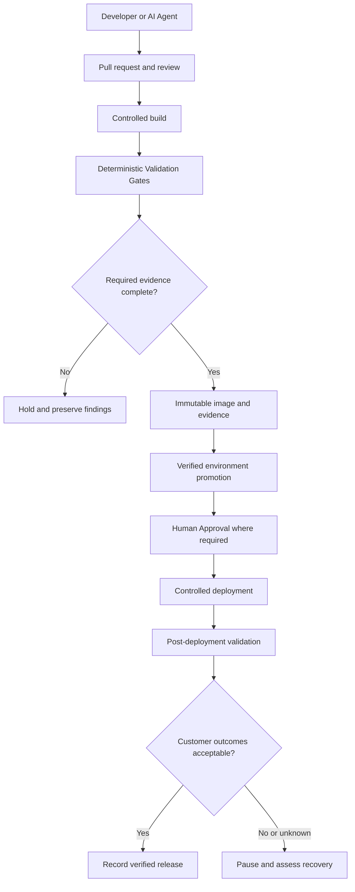
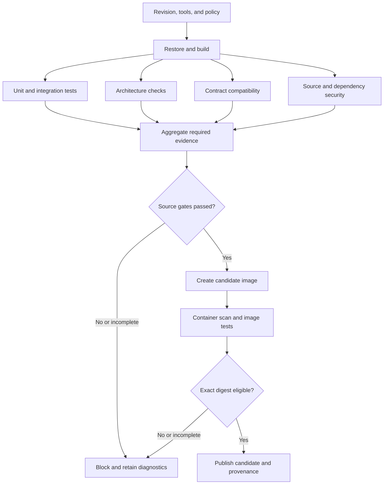
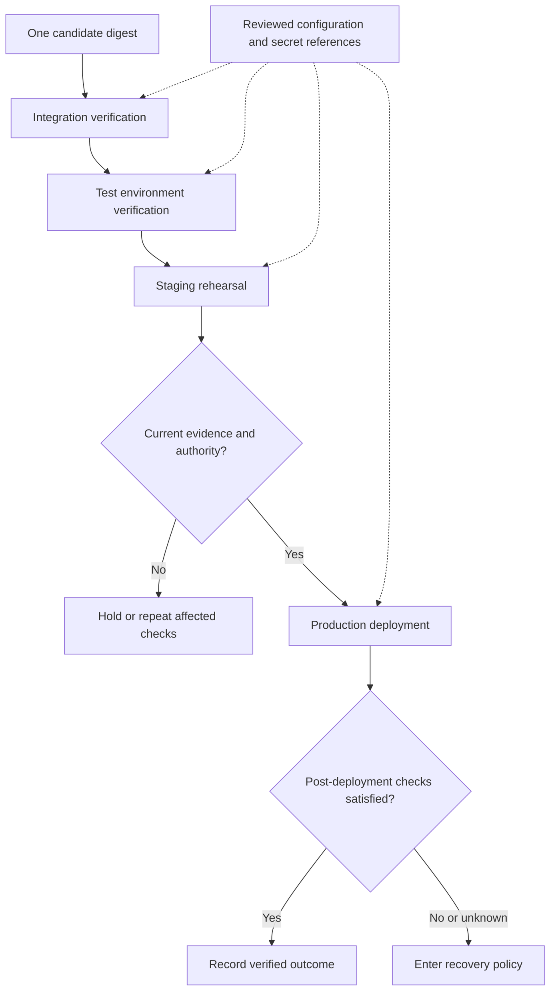
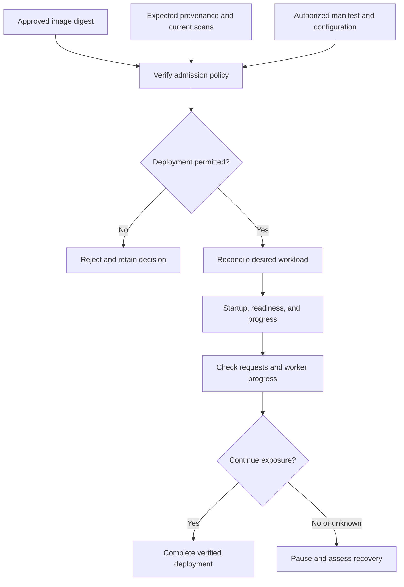
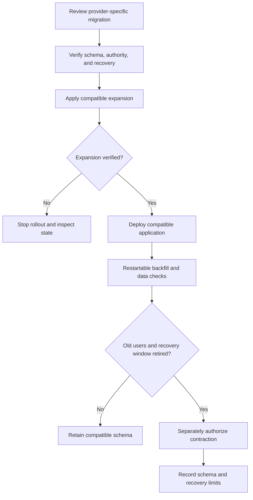
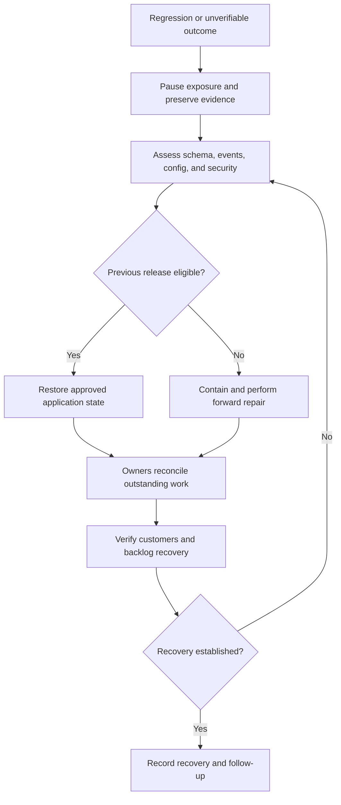

# Chapter 53 — CI/CD

*Part VII — Alpha Car Detailing*

## 1. Story-driven Opening

Northstar Distribution has scheduled detailing for twenty-four vehicles across two days. Its fleet administrator expects authorized access, reliable appointments, and clear notification of each confirmed outcome. A proposed Booking Service release adds an optional fleet reference, changes an integration-event serializer, and introduces a database column.

The build succeeds. The release dashboard is green.

The evidence tells a different story. An older Notification consumer rejects the new event representation. The container scanner stopped before producing a result. The schema change has been tested with the new Booking version but not with the version still running in production. A deployment could replace healthy pods with healthy pods while breaking Northstar's workflow and removing the team's recovery option.

The release owner holds the candidate. Compilation establishes one property: the selected source can be compiled under the recorded build conditions. It does not establish contract compatibility, security eligibility, migration safety, or application health.

The team corrects the serializer without changing the event's established meaning, obtains a complete image scan, and verifies both Booking versions against the expanded schema. It promotes the same image through staging, reviews the production configuration and recovery plan, and authorizes a controlled deployment. Afterward, it checks authorized booking behavior, publication progress, consumer processing, and customer-facing outcomes.

Northstar's existing commitments remain valid throughout. A delayed notification is recovered by Notification; it is not repaired by cancelling and recreating an otherwise valid booking.

> **Core principle**
>
> Every deployment must be built, tested, validated, secured, traceable, and recoverable.

The opening describes the proposed distributed architecture from Chapters 49–52. The companion application's implemented create/read baseline still creates a `Pending` booking. This chapter preserves that distinction throughout its delivery design.

## 2. Learning Objectives

After completing this chapter, the reader will be able to:

- distinguish Continuous Integration, Continuous Delivery, Continuous Deployment, deployment, and release;
- design protected source-control and pull-request workflows for independently owned services;
- define applicable build, test, architecture, contract, and security gates with explicit evidence;
- create immutable artifacts and connect their identities to source, tools, policies, and approvals;
- promote one candidate through environments using controlled infrastructure, configuration, and secrets;
- select Kubernetes rollout strategies and coordinate compatible database and event evolution;
- verify production behavior, choose safe recovery actions, and preserve release evidence;
- use AI Agents to improve CI/CD without granting authority to bypass gates or Human Approval.

## 3. Background

### 3.1 Delivery makes earlier architectural decisions executable

Chapters 46–50 established business ownership, Clean Architecture, service boundaries, and reliable asynchronous communication. Chapters 51–52 added security and observability. CI/CD makes those decisions enforceable whenever software changes.

A Booking pipeline must preserve inward dependencies. A contract gate must protect deployed consumers. A migration gate must preserve service-owned data and the stated compatibility window. A production gate must enforce the authorization policy. Post-deployment validation must establish whether the customer journey still works.

These controls also extend earlier Harness principles. The Lead Agent scopes work, the Developer Agent prepares changes, the Reviewer Agent examines them, the Validator Agent runs applicable checks, and the Evaluator Agent assesses the supported outcome. CI/CD supplies an independently controlled execution and promotion boundary. An AI Agent reporting that local tests passed does not satisfy a required CI check for another revision.

### 3.2 The implemented baseline and proposed extensions

The repository currently provides a .NET 10 Booking application with direct application services, deferred CQRS and mediator adoption, and SQLite persistence. `POST /api/bookings` creates a `Pending` booking; the retrieve endpoint reads it. A `201 Created` response does not establish capacity confirmation, integration-event publication, notification delivery, invoicing, or payment.

The companion includes Domain and API integration test projects, central package versions, `global.json`, and Instruction and Skill validators. Its existing workflow is located at `alpha-car-detailing/.github/workflows/build.yml`. In this handbook repository, GitHub workflow discovery occurs under the repository-root `.github/workflows/` directory. The nested file therefore documents an intended workflow; its presence does not establish that GitHub executes it.

The current SDK policy specifies `10.0.301` with `latestFeature` roll-forward. Central package versions do not, by themselves, lock every resolved transitive dependency. A release design must record the actual SDK selected and adopt reviewed lock files and locked restore when stronger dependency control is introduced.

SQL Server, durable messaging, additional deployable services, a registry, and Kubernetes environments remain proposed extensions. Production claims require implementation and execution evidence for those components. Northstar's twenty-four vehicles are a scenario, not an approved batch limit or an all-or-nothing transaction boundary.

### 3.3 Delivery scope follows ownership

Each service owns its release-sensitive behavior, published contracts, data changes, and recovery procedures. Platform engineering owns shared delivery capabilities such as runners, registries, cluster foundations, reusable workflows, and identity integration.

This logical ownership does not require seven teams or seven immediately deployed services. It requires that a pipeline cannot silently change another service's database or redefine another owner's business decision.

## 4. Concepts

### 4.1 CI, delivery, deployment, and release

| Term | Meaning in Alpha Car Detailing |
| --- | --- |
| Continuous Integration | Integrate small changes frequently and validate the integrated source. |
| Continuous Delivery | Maintain an eligible, deployable candidate and a repeatable promotion process, with authorization defined by policy. |
| Continuous Deployment | Automatically deploy eligible changes after independently enforced requirements pass. |
| Deployment | Install or activate a selected application and configuration revision in an environment. |
| Release | Make an approved capability available to its intended users, potentially after deployment. |

A feature flag can separate deployment from exposure. Its default, permitted audiences, owner, expiry, and removal plan belong in the release record. Disabling a flag does not reverse data already changed or events already published.

Repeatable delivery means the procedure and its inputs are controlled. Byte-for-byte reproducible builds require additional control over timestamps, dependency resolution, compiler inputs, and build environments. The team must not claim reproducibility merely because a workflow can be rerun.

### 4.2 Source control and pull requests

Alpha Car Detailing should favor focused changes on short-lived branches, integrated into a protected main branch. Release branches are justified when supported versions need separate maintenance; they carry additional merge and validation work.

A Booking pull request identifies the business behavior changed, affected consumers, migration implications, security impact, checks performed, observability changes, and recovery limits. Workflow files, infrastructure, migrations, shared build configuration, and governed guidance require review by their accountable owners.

Required checks must apply to the revision that will be integrated. A passing branch build can become stale after the base branch changes. Validate the merge candidate through the repository's chosen up-to-date-branch or merge-queue mechanism, and validate the final integrated source before producing a release candidate. Configure the corresponding event when a merge queue is used.

Code review, automated validation, risk exception approval, and production authorization are different decisions. A developer's review approval does not establish that a later image has passed its scans. A production approver cannot infer migration compatibility from a green unit-test result.

Protect the rules themselves. A proposed implementation must not remove a required test or weaken its own acceptance threshold to obtain a passing result. Enforce required workflows and branch rules outside the change being evaluated.

### 4.3 Build pipelines and controlled inputs

A build pipeline turns an identified source revision into validated outputs. It declares checkout identity, SDK and toolchain, package feeds, resolved dependencies, analyzers, target platform, commands, time limits, and evidence locations.

Use approved package sources. Where adopted, commit package lock files and use locked restore; do not enable a lock-file requirement before generating and reviewing those files. Record changes to SDK selection, reusable workflows, and container bases as changes to build inputs.

Caches reduce elapsed time. They do not establish artifact provenance. Separate cache trust between untrusted pull requests and privileged release jobs, validate cache keys, and prevent a cached executable or package from becoming an unaudited input.

Pull-request CI provides early feedback. Trusted candidate construction validates the final integrated revision and produces the artifact eligible for promotion. A later rebuild is a new candidate, even if its version label is unchanged.

### 4.4 Tests establish different properties

| Test boundary | Booking evidence | Limitation |
| --- | --- | --- |
| Unit | Lifecycle rules, value objects, application decisions, failure classification | Does not verify deployed adapters or service collaboration. |
| Integration | Routing, serialization, dependency injection, persistence, transactions, real adapters | Establishes behavior only for its declared dependency profile. |
| Architecture | Permitted references, layer direction, selected service boundaries | Cannot prove every runtime interaction or business rule. |
| Contract | Supported HTTP and event behavior across participating versions | Schema agreement alone does not establish business meaning. |
| Journey | A bounded workflow across selected deployed components | Must control data, side effects, timing, and environmental dependencies. |

Unit tests should use controlled clocks and narrow fixtures. Integration tests should use isolated databases and bounded waits. Report whether each dependency is real, emulated, or substituted. The current SQLite profile does not establish SQL Server transaction, locking, concurrency, or migration behavior.

Architecture checks should reject Domain dependencies on API or Infrastructure, unauthorized Application dependencies, references to another service's persistence assembly, and shared operational database access. Static checks need complementary review and runtime controls where access occurs through configuration or dynamically constructed connections.

Contract checks must include deployed producer and consumer versions, retained events, and supported replay windows. In the proposed confirmation extension, an optional field in `BookingConfirmed` must remain optional to older consumers. Reusing a field for another meaning can break compatibility even when JSON deserialization succeeds.

Test the period when old and new versions coexist. Also test whether the previous application can read data and events produced by the candidate. Forward compatibility during rollout and eligibility for rollback are separate requirements.

Coverage percentages help locate unexercised code. They do not prove that account isolation, capacity concurrency, outbox atomicity, or recovery has been tested.

### 4.5 Security, dependency, and container scanning

Source security checks include secret detection, static application security analysis, workflow analysis, and infrastructure policy validation. Selected dynamic checks belong in an isolated environment with controlled accounts and no unintended external effects. Authorization and account-isolation tests remain necessary even when scanners report no findings.

Dependency scanning examines resolved direct and transitive packages, advisory data, approved sources, and licensing requirements where policy applies. Record the scanner version, advisory source and timestamp, policy revision, findings, and dispositions. A software bill of materials, or SBOM, inventories relevant components associated with the candidate.

Container scanning examines the final image, including operating-system packages and application dependencies. Scan the digest and target architectures that will run. A clean source dependency report does not establish that the runtime base image is eligible.

Findings and execution failures require different outcomes. A scanner that cannot download its advisory database has not established that no vulnerabilities exist. An unsupported image architecture is a coverage gap. Both require visible incomplete evidence.

Risk policy defines blocking conditions, triage, remediation, and any exception authority. An exception identifies the finding, affected digest, environment, rationale, compensating controls, owner, and expiry. Preserve the original finding. An approved exception is a governed disposition, not permission to rewrite a failed scan as clean.

Continue assessing deployed images as advisories change. Remediation produces a new validated candidate; it does not mutate the running image in place.

### 4.6 Deterministic Validation Gates

A Deterministic Validation Gate evaluates declared evidence against explicit rules. Its contract identifies the owner, input revision or digest, command, tool and policy versions, execution profile, timeout, required evidence, and promotion boundary it can block.

| Outcome | Meaning | Promotion treatment |
| --- | --- | --- |
| Passed | Applicable requirements were evaluated and satisfied | May advance if every other requirement is satisfied. |
| Failed | A requirement was evaluated and violated | Block the applicable transition. |
| Incomplete | Required execution or trustworthy evidence is absent | Block; retain diagnostics and resolve the gap. |
| Not applicable | An independently evaluated scope rule excludes the check | Record the rule and justification. |

Do not infer applicability solely from whether a job ran. Path filters, skipped dependencies, cancelled runs, and test filters can remove required evidence. Compute the expected gate set from a reviewed impact map, then require a result for every applicable gate.

Deterministic evaluation does not make all inputs timeless. Vulnerability databases, deployment state, and operational telemetry change. Record their versions and freshness, and repeat the relevant evaluation when policy requires it.

AI review can identify risks and propose tests. Its semantic judgment does not replace an executable gate. Human Approval authorizes a specific action under policy; it does not prove an unexecuted test passed.

An aggregate gate must inspect every required outcome and its input identity. A successful summary job that ignored a failed dependency defeats the control it is intended to provide.


### 4.7 Artifact creation, identity, and provenance

The release candidate includes the application image and the associated migration artifact, deployment description, SBOM, scan records, and evidence index. Store each under an immutable identity or a protected version with a recorded checksum.

| Identity | Purpose |
| --- | --- |
| Service version | Human-readable release label under a documented versioning policy |
| Source commit | Exact integrated source |
| Image digest | Content identity selected for deployment |
| API or event version | Public compatibility boundary |
| Migration identity | Schema transition and expected starting state |
| Configuration revision | Reviewed runtime settings and feature exposure |
| Build and workflow revision | Execution origin and delivery procedure |

These identifiers are related; they are not interchangeable. A semantic version label asserts a compatibility policy. Tests and review establish whether the candidate honors it. Services can version independently.

Build the candidate once and promote the same image digest. A human-readable tag may point to it, but production desired state must identify the immutable digest. Prohibit `latest` or another movable tag as the production identity.

Provenance connects an artifact to its source, builder, invocation, and recorded inputs. Verification checks the expected issuer and builder, not merely the presence of a signature. Provenance and an SBOM answer different questions from functional tests and vulnerability assessment. None alone establishes release safety. See the [SLSA provenance specification](https://slsa.dev/spec/v1.2/provenance).

A registry copy must preserve the approved identity or trigger explicit verification of any changed representation. Retention must preserve usable recovery artifacts and their evidence for the declared recovery window.

### 4.8 Environment promotion

Each environment has a purpose, entry criteria, identity, configuration, test data, and exit evidence.

| Environment | Principal purpose | Required exit evidence |
| --- | --- | --- |
| Development or integration | Verify collaboration as capabilities are assembled | Declared profile works with synthetic data. |
| Test | Exercise compatibility, security behavior, and failure cases | Applicable suites and dependency profiles pass. |
| Staging | Rehearse the production deployment and recovery procedure | Candidate, schema, configuration, and observation plan are compatible. |
| Production | Serve authorized customer work | Authorized deployment and verified operational outcome. |

Promote the same application artifact while applying separately reviewed environment settings. Check configuration schema, required secret references, schema compatibility, target permissions, and current risk evidence before each transition.

Serialize deployments per service and environment. A lock prevents simultaneous execution; a candidate-order check prevents an older queued candidate from overwriting a newer accepted release. Do not cancel an active production migration simply because a newer commit arrived.

Preview environments need ownership, isolation, quotas, and cleanup. Use synthetic or appropriately governed data rather than an uncontrolled production copy.

### 4.9 Infrastructure as Code, configuration, and secrets

Infrastructure as Code versions the registry, networking, cluster, identity, database, broker, telemetry foundations, and environment bindings. Terraform is one provisioning option; Bicep is an Azure-specific alternative. Kubernetes workload packaging is a related but separate concern.

Validate syntax and policy, inspect the proposed change, evaluate affected services and destructive operations, and bind approval to the actual reviewed plan. Protect remote state and plan files because they can contain sensitive information. Use locking and re-plan when relevant state changes invalidate the review.

Keep application binaries, reviewed non-secret configuration, secret references, and runtime identity distinct. Validate required settings before admitting traffic. A missing database credential must not silently select a convenient development database in production.

Pipeline files must not contain secret values. Use a governed secret manager and narrowly scoped identity integration. Record reference and version metadata where needed; never copy secret contents into release evidence.

Rotation requires a defined reload or restart path and verification that revoked credentials are no longer used. Recovery must obtain eligible credentials rather than restoring an obsolete secret snapshot.

### 4.10 Kubernetes deployment and rollout strategies

In the proposed Kubernetes extension, a Deployment manages application replicas, a Service selects eligible endpoints, and ingress or gateway routing exposes the approved interface. Service accounts, RBAC, network policy, resource limits, and scheduling capacity constrain execution.

Startup, readiness, and liveness checks answer different questions. Startup protects initialization. Readiness controls eligibility for traffic. Liveness detects conditions that justify restarting the process. Do not make every remote dependency a liveness dependency: a broker outage should not create an endless restart cycle.

A Deployment progress deadline can report a stalled rollout. Kubernetes does not thereby perform the application-specific recovery decision. A delivery workflow or rollout controller must implement that policy. The distinction is documented in [Kubernetes Deployments](https://kubernetes.io/docs/concepts/workloads/controllers/deployment/).

| Strategy | Suitable use | Main constraint |
| --- | --- | --- |
| Rolling | Compatible incremental replacement with sufficient surge capacity | Old and new versions share the environment. |
| Blue-green | Verify a parallel application set before switching routing | Shared data, active workers, and external effects persist across the switch. |
| Canary | Expose a controlled cohort and expand using defined evidence | Requires suitable routing, representative traffic, and explicit analysis rules. |

Rolling deployment is a reasonable starting point for a compatible Booking API change. Define maximum unavailability, surge, progress deadlines, graceful termination, and observation criteria from the service's operating needs.

Blue-green deployment needs explicit worker ownership. An inactive application set must not independently dispatch the same notifications or financial operations. Retaining the previous application environment does not preserve an earlier database state.

A canary needs an analysis plan: cohort, comparison, minimum observations, windows, abort rules, telemetry freshness, and authority to continue. A low-traffic period or missing telemetry cannot automatically establish success.

HTTP traffic percentages do not control Kafka or Event Hubs consumption. Consumer groups, partitions, leases, acknowledgments, checkpoints, and provider side effects require a separate worker rollout design. On termination, stop new intake, drain bounded in-flight work, and preserve safe redelivery when completion cannot be established.

### 4.11 Database migrations and compatibility

Each service owns its migrations. Package reviewed provider-specific scripts or a migration bundle with a checksum and expected schema range. Use a separately authorized migration identity; the ordinary application identity should not require schema-alteration rights.

Apply an expand, migrate, and contract sequence:

1. Add compatible schema structures without removing the old representation.
2. Deploy code that can operate during the supported overlap.
3. Backfill data through a restartable, bounded procedure with validation.
4. Move reads and writes to the new representation under controlled exposure.
5. Remove obsolete structures only after old users and recovery dependencies are retired.

Define which representation is authoritative during overlap. If dual writes are necessary, keep local updates transactional or provide a reconciliation procedure; two assignments alone do not establish consistency.

Test realistic data volumes, constraints, locks, transaction behavior, timeouts, interrupted execution, and the previous application version. Coordinate one migration runner per database with appropriate locking and execution records. Idempotent scripts use migration history to select work; this does not prove arbitrary custom SQL or backfills are safely repeatable.

The companion uses `EnsureCreatedAsync` at startup. Moving an existing SQLite database to migrations requires a reviewed baselining or recreation procedure appropriate to its data. Selecting SQL Server also requires provider-specific implementation and tests. Neither transition is accomplished by adding a deployment job. [EF Core migration guidance](https://learn.microsoft.com/en-us/ef/core/managing-schemas/migrations/applying) describes scripts, bundles, and deployment permissions.

Database restoration is a separate recovery operation with recovery-point, recovery-time, and data-loss consequences. Do not describe a destructive down migration as an automatic rollback plan.

### 4.12 Human Approval and production authority

Human Approval binds an authorized person to a concrete candidate and action: service, digest, environment, configuration, infrastructure and migration intent, findings and exceptions, observation criteria, and recovery limits.

Separate pull-request approval, security exception approval, infrastructure authorization, migration authorization, and production authorization. The same organization may combine selected responsibilities under policy, but the evidence must show what was actually authorized.

Invalidate or re-evaluate approval when the candidate, relevant environment state, configuration, migration, or risk evidence changes. An implementing AI Agent cannot provide Human Approval or approve its own exception.

GitHub deployment environments can enforce configured protection rules before a referencing job runs or receives environment secrets. Feature availability depends on repository visibility and plan; verify the required controls rather than assuming that an `environment` key creates them. See [Managing environments](https://docs.github.com/en/actions/how-tos/deploy/configure-and-manage-deployments/manage-environments).

Emergency changes use attributable, time-limited authority and documented review. Urgency does not turn missing validation into a passed gate or justify unrestricted production access.

### 4.13 Rollback, forward repair, and business recovery

Recovery can mean pausing a rollout, shifting traffic, disabling a feature, restoring application and configuration state, or deploying a corrective candidate. Select the action from evidence.

Before restoring a previous image, verify that it is retained, still permitted by security policy, and compatible with current schema, configuration, produced data, retained events, and active consumers. Coordinate recovery with any deployment or GitOps reconciliation already in progress.

An application rollback cannot retract an event, release capacity, unsend a notification, reverse an invoice, or refund a payment. Those actions belong to the owning service's authorized reconciliation or compensation workflow, with stable operation identities and duplicate protection.

Define triggers, responder, decision deadline, permitted actions, and verification before deployment. When reversal is unsafe, contain exposure and perform forward repair. Preserve evidence without delaying urgent containment.

### 4.14 Post-deployment validation and observability

A successful deployment command establishes that the command completed according to its contract. Ready pods establish a narrower property than a working booking journey.

Verification combines rollout status, synthetic requests, account-isolation checks, dependency behavior, worker progress, and Chapter 52's customer indicators. In the implemented baseline, verify Pending-booking creation and retrieval. In the proposed extension, also verify capacity coordination, outbox progress, consumer processing, and the relevant downstream outcome.

Use release markers and resource metadata to associate behavior with service version, image, environment, and configuration. Keep high-cardinality operation identifiers out of metric labels.

An observation plan defines eligible traffic, sufficient observations, windows, acceptable outcomes, telemetry freshness, and failure handling. Include unfinished work: an outbox that stops publishing must not look successful merely because no consumer exceptions appear.

Treat missing or stale telemetry as insufficient evidence. Hold expansion, perform bounded diagnostic checks, or enter recovery according to policy. Do not silently mark the release verified.

### 4.15 Release evidence and Audit Trails

A protected evidence index connects the pull request, reviewed revision, integrated commit, build and workflow, expected gates, results, candidate digest, SBOM, scans, provenance, configuration, migrations, approvals, deployment, and recovery.

Record actor, action, UTC time, target, decision, outcome, and exceptions. Preserve failed attempts and superseded approvals. Retention and access follow business, contractual, and incident-investigation requirements; transient workflow logs should not be the sole record.

A release can be built, eligible, authorized, deploying, verified, held, failed, or recovered. Preserve these distinctions. A later successful recovery must not erase the failed deployment.

### 4.16 Pipeline security and AI assistance

The pipeline crosses trust boundaries between source, pull requests, runners, dependencies, caches, artifact stores, registries, identities, and deployment controllers. Treat build and test execution as code execution.

Keep untrusted pull-request jobs separate from privileged publication and deployment. Use read-only tokens by default, isolate runners, constrain network access, and prevent persistent runner state from transferring authority between jobs. Pin automation dependencies to reviewed immutable revisions and govern their updates.

Avoid interpolating untrusted pull-request text directly into shell code. Pass data through appropriate arguments or environment variables. Privileged workflows must not execute untrusted checkout content or blindly trust artifacts from lower-trust runs. These controls follow the [GitHub Actions secure use reference](https://docs.github.com/en/actions/reference/security/secure-use).

Where supported, use short-lived federated credentials. Bind trust to the expected repository, workflow, environment, audience, and other applicable claims. Separate image-publication, migration, application-deployment, and infrastructure identities. Requesting an OIDC token must not imply permission to administer production. See [GitHub OIDC guidance](https://docs.github.com/en/actions/how-tos/secure-your-work/security-harden-deployments/oidc-in-cloud-providers).

AI Agents can draft workflows, propose tests, explain failures, review plans, and summarize evidence. Require file references and execution records. Logs, dependency metadata, pull-request descriptions, and scan output are untrusted data; embedded instructions cannot authorize tool execution or access.

Validated lessons can improve reusable workflows, Instructions, and Skills through reviewed changes. Measure feedback time, gate failures, flaky tests, deployment frequency, lead time, and recovery with defined populations. An AI-generated explanation is not a replacement for evidence.

## 5. Architecture Discussion

### 5.1 Independent service delivery with shared controls

The architectural problem is to release related business capabilities without forcing every service into one synchronized deployment or weakening shared controls.

A monorepository supports common discovery, shared workflows, and atomic source changes. Separate repositories offer independent access and lifecycle management but require governed template distribution and cross-repository compatibility evidence. The handbook's current repository favors shared orchestration with service-specific validation profiles.

| Owner | Release-sensitive behavior | Priority evidence |
| --- | --- | --- |
| Booking | Lifecycle, authorized requests, coordination, publication | Rules, API compatibility, transactions, pending-operation recovery |
| Corporate Account | Membership and commercial eligibility | Account isolation, authority, decision compatibility |
| Fleet | Vehicle membership and eligibility | Scoped access, supported validation contracts |
| Station Operations | Capacity and qualifying completion | Concurrency, retry identity, uncertain-result reconciliation |
| Billing | Recognition and invoicing | Deduplication, commercial rules, reconciliation |
| Payment | Authorized provider operations | Provider contracts, callback authentication, uncertain outcomes |
| Notification | Communication intent and dispatch | Inbox/intent transaction, duplicate handling, provider evidence |

A service profile declares its dependencies, gates, deployment package, observation plan, and recovery rules. The platform provides reviewed implementations of common controls. Avoid copying a large workflow into every service: duplicated logic diverges, and a security correction becomes a search across independently modified files.

### 5.2 Impact analysis and compatibility

Changed-file paths are useful inputs, not a complete impact model. A shared package, SDK rule, container base, event schema, or pipeline template can affect services outside the changed directory.

Maintain an impact map connecting shared inputs and contracts to affected producers, consumers, and checks. Reconcile it with the current service inventory. When selection confidence is insufficient, run the broader applicable suite rather than silently omitting a consumer.

Deploy compatible contract and schema expansion before dependent behavior. Preserve old event meaning through delayed delivery and replay. Independent deployment depends on this compatibility discipline.

### 5.3 Deployment authority and desired state

For the worked extension, use reviewed Kubernetes manifests with Kustomize overlays and direct execution by a protected deployment job. Infrastructure provisioning remains a separate reviewed process. This offers a clear starting point without introducing another controller.

A pull-based GitOps alternative makes a controller reconcile an approved desired-state repository. It requires ownership of configuration changes, controller credentials, admission policy, drift correction, and recovery. A direct rollback that conflicts with GitOps desired state can be undone by the controller.

Either approach needs one authoritative desired state, protected changes, immutable image identity, and observable reconciliation. Choose a controller when its operational benefits justify the additional platform responsibility.

### 5.4 Scaling delivery without weakening evidence

Parallelize independent source checks, cache controlled inputs, and provision isolated test resources within quotas. Serialize changes to shared databases and service/environment deployment targets. Retain the aggregate gate when optimizing execution.

| Failure | Immediate treatment | Owner |
| --- | --- | --- |
| Package feed or scanner unavailable | Mark affected evidence incomplete; retain diagnostics | Build or security platform |
| Artifact missing or identity mismatched | Stop promotion; investigate integrity and retention | Release platform |
| IaC plan or approval stale | Re-plan and obtain the required current decision | Infrastructure owner |
| Migration interrupted | Stop dependent rollout; inspect committed schema and progress | Service data owner |
| Partial rollout or missing telemetry | Hold exposure and apply the observation/recovery policy | Service release owner |
| Provider outcome uncertain | Preserve operation identity and reconcile before repeating effects | Owning business service |

Northstar's path remains governed by the business owners. Notification delay does not invalidate a committed reservation. Billing waits for qualifying completed work under its terms; Payment remains separately authorized. Delivery automation must preserve these distinctions during both change and recovery.


## 6. Professional Diagrams

The following figures describe the proposed delivery architecture. They distinguish validation, authorization, deployment, and verified outcomes; they do not imply that the companion already operates these production components.

### Figure 53-1 — CI/CD Pipeline

Figure 53-1 connects the developer or AI Agent's proposed change to an accountable release outcome.



*Caption: Each transition requires evidence appropriate to its scope.* The failure branches preserve the distinction between an ineligible candidate and an unverified production outcome. Refer to Sections 4.2, 4.6–4.8, and 4.12–4.15.

### Figure 53-2 — Validation Gate Pipeline

Figure 53-2 shows how independent checks converge before packaging and final image qualification.



*Caption: Missing results block progression just as explicit violations do.* The final gate applies to the packaged image rather than assuming source checks cover every runtime component. Refer to Sections 4.4–4.7.

### Figure 53-3 — Environment Promotion

Figure 53-3 separates immutable application identity from environment-specific inputs and decisions.



*Caption: Promotion changes the target environment without rebuilding the application.* Dotted edges supply controlled runtime inputs; solid edges show progression. Refer to Sections 4.8–4.9 and 4.12–4.14.

### Figure 53-4 — Container Deployment

Figure 53-4 locates the admission and runtime checks around a Kubernetes rollout.



*Caption: Admission, pod eligibility, and customer verification protect different boundaries.* Worker progress remains necessary even when HTTP probes succeed. Refer to Sections 4.10 and 4.14.

### Figure 53-5 — Database Migration

Figure 53-5 separates compatible expansion from later destructive contraction.



*Caption: The ability to restore old application code is preserved deliberately and eventually retired explicitly.* Backfill does not automatically authorize contraction. Refer to Sections 4.11–4.13.

### Figure 53-6 — Recovery Decision

Figure 53-6 shows why restoring an earlier image is only one possible recovery action.



*Caption: Deployment recovery and business reconciliation are related, separately verified operations.* The loop prevents an attempted recovery from being recorded as established recovery. Refer to Sections 4.13–4.15.

## 7. Hands-on Example

### 7.1 Establish the Booking baseline

The first lab verifies the existing application. The second specifies a production-style extension. All proposed files in this section are implementation examples; their inclusion in the manuscript does not install a workflow, provision infrastructure, or establish a completed deployment.

From the repository root, inspect the companion's solution, SDK policy, central package versions, test projects, nested workflow, and validators. Then run the following PowerShell commands from `alpha-car-detailing/`:

```powershell
$ErrorActionPreference = 'Stop'
$PSNativeCommandUseErrorActionPreference = $true

dotnet --info
dotnet restore AlphaCarDetailing.sln
dotnet build AlphaCarDetailing.sln --configuration Release --no-restore
dotnet test AlphaCarDetailing.sln --configuration Release --no-build --no-restore
./scripts/instructions/validate-instructions.ps1
./scripts/skills/validate-skills.ps1
```

These commands require PowerShell 7.3 or later for the native-error preference shown. Record the revision, actual SDK, command outcomes, discovered tests, and dependency profile. A restore failure leaves validation incomplete.

The Instruction validator checks required files; the Skill validator checks required headings. Their success establishes structural requirements, not the semantic quality of all guidance. The current API integration test checks successful creation and Pending status. It does not establish the distributed fleet workflow.

### 7.2 A discoverable, bounded CI workflow

The following proposed file belongs at `.github/workflows/booking-ci.yml`, relative to the handbook repository root. It provides baseline build, test, and guidance validation. It deliberately grants no publication or production authority.

```yaml
name: Booking CI

on:
  pull_request:
  push:
    branches: [main]
  merge_group:

permissions:
  contents: read

concurrency:
  group: booking-ci-${{ github.ref }}
  cancel-in-progress: true

jobs:
  validate:
    runs-on: ubuntu-24.04
    timeout-minutes: 15
    defaults:
      run:
        shell: pwsh
        working-directory: alpha-car-detailing
    steps:
      - name: Check out source
        uses: actions/checkout@11bd71901bbe5b1630ceea73d27597364c9af683
        with:
          persist-credentials: false

      - name: Set up the declared SDK
        uses: actions/setup-dotnet@d4c94342e560b34958eacfc5d055d21461ed1c5d
        with:
          global-json-file: alpha-car-detailing/global.json

      - name: Record SDK
        run: dotnet --info

      - name: Restore
        run: dotnet restore AlphaCarDetailing.sln

      - name: Build
        run: dotnet build AlphaCarDetailing.sln -c Release --no-restore

      - name: Domain tests
        run: |
          dotnet test tests/Services/Booking/AlphaCarDetailing.Booking.Domain.Tests/AlphaCarDetailing.Booking.Domain.Tests.csproj -c Release --no-build --no-restore --logger "trx;LogFileName=domain.trx" --results-directory "$env:GITHUB_WORKSPACE/artifacts/domain"

      - name: API integration tests
        run: |
          dotnet test tests/Services/Booking/AlphaCarDetailing.Booking.IntegrationTests/AlphaCarDetailing.Booking.IntegrationTests.csproj -c Release --no-build --no-restore --logger "trx;LogFileName=api.trx" --results-directory "$env:GITHUB_WORKSPACE/artifacts/api"

      - name: Verify test execution evidence
        run: |
          $ErrorActionPreference = 'Stop'
          foreach ($suite in @('domain', 'api')) {
            $path = "$env:GITHUB_WORKSPACE/artifacts/$suite/$suite.trx"
            [xml]$report = Get-Content -LiteralPath $path -Raw
            $counts = $report.SelectSingleNode("//*[local-name()='Counters']")
            if ($null -eq $counts -or
                [int]$counts.total -le 0 -or
                [int]$counts.executed -ne [int]$counts.total -or
                [int]$counts.passed -ne [int]$counts.total) {
              throw "Required suite did not fully pass: $suite"
            }
          }

      - name: Validate Instructions
        run: ./scripts/instructions/validate-instructions.ps1

      - name: Validate Skills
        run: ./scripts/skills/validate-skills.ps1

      - name: Preserve test evidence
        if: ${{ always() }}
        uses: actions/upload-artifact@ea165f8d65b6e75b540449e92b4886f43607fa02
        with:
          name: booking-tests-${{ github.run_id }}-${{ github.run_attempt }}
          path: artifacts/
          if-no-files-found: error

  baseline-gate:
    if: ${{ always() }}
    needs: [validate]
    runs-on: ubuntu-24.04
    timeout-minutes: 2
    steps:
      - name: Require successful baseline validation
        shell: pwsh
        env:
          VALIDATION_RESULT: ${{ needs.validate.result }}
        run: |
          if ($env:VALIDATION_RESULT -ne 'success') {
            throw "Baseline validation is not successful."
          }
```

The action references identify fixed revisions, not a recommendation to freeze dependencies indefinitely. Review their origin, runner compatibility, support, and security eligibility when adopting or updating the example. Record the actual runner image and SDK; a hosted runner label is not a fully pinned operating-system image.

The evidence check rejects a missing report, zero discovered tests, skipped tests, and non-passing results for these two mandatory suites. Future quarantines need an explicit reviewed policy rather than silently weakening this assertion.

Configure the aggregate job as a required check under protected repository rules. Keep workflow ownership and required-check configuration outside an ordinary implementation's control. Test this protection with a failing test and a skipped or cancelled validation job.

This workflow is a baseline check. It cannot authorize container promotion because it does not implement architecture, contract, security, image, migration, or production verification gates. Diagnostic collection must also cover restore and runner failures through retained workflow records; the test upload cannot preserve reports that were never produced.

### 7.3 Extend the gate catalog before publishing candidates

The proposed distributed release adds the following mandatory checks. Introduce actual suites and scanner integrations before declaring them passed.

| Gate | Execution target | Required evidence |
| --- | --- | --- |
| Architecture | Booking projects and relevant shared references | Permitted dependency graph and rule revision |
| API contracts | Candidate and supported clients | Requests, responses, errors, and authorization expectations |
| Event contracts | Candidate producer and supported consumers | Old/new payloads, retained-event fixtures, replay behavior |
| Persistence | Selected deployment database engine | Transactions, constraints, concurrency, migration compatibility |
| Security | Source, dependencies, workflow, infrastructure | Complete tool reports and approved finding dispositions |
| Image | Exact candidate digest and platform | Container scan, startup, API behavior, runtime policy checks |

The aggregate production gate expects this declared set and checks identity, freshness, outcome, and evidence integrity. A self-reported JSON file from an untrusted PR is not authoritative gate evidence. Obtain job identity and results from the trusted execution system and verify the association to the candidate.

Challenge the gate with four negative cases: delete a report, substitute another commit's report, prevent the scanner from completing, and remove a required job through a filter. Each must prevent candidate eligibility.

### 7.4 Package one image

Use a multi-stage build to keep the SDK and build tools out of the runtime image. The following proposed Dockerfile uses the companion directory as its build context. Both image arguments are required and must resolve to reviewed digest-pinned .NET 10 SDK and ASP.NET runtime images for the selected platform.

```dockerfile
ARG SDK_IMAGE
ARG RUNTIME_IMAGE

FROM ${SDK_IMAGE} AS build
WORKDIR /src
COPY . .
RUN dotnet restore AlphaCarDetailing.sln
RUN dotnet build AlphaCarDetailing.sln -c Release --no-restore -p:UseAppHost=false
RUN dotnet test AlphaCarDetailing.sln -c Release --no-build --no-restore
RUN dotnet publish src/Services/Booking/AlphaCarDetailing.Booking.Api/AlphaCarDetailing.Booking.Api.csproj -c Release --no-build --no-restore -p:UseAppHost=false -o /out

FROM ${RUNTIME_IMAGE} AS runtime
WORKDIR /app
COPY --from=build /out/ ./
ENV ASPNETCORE_HTTP_PORTS=8080
EXPOSE 8080
USER 1654:1654
ENTRYPOINT ["dotnet", "AlphaCarDetailing.Booking.Api.dll"]
```

The production candidate profile must add its applicable architecture, contract, security, and provider-specific checks; this Dockerfile's test command covers only the suites present in the solution. Export candidate-build test reports as protected evidence, and challenge missing-test behavior just as in the baseline workflow.

Use a reviewed `.dockerignore` to exclude source-control metadata, `bin/`, `obj/`, local databases, evidence directories, local secret files, and unrelated outputs. Never supply package-feed secrets through persistent image layers or ordinary build arguments; use an approved ephemeral build-secret mechanism where required.

The fixed numeric user is part of this example's runtime contract. Verify file access and required runtime directories against the chosen base. The baseline SQLite database needs an explicitly writable, isolated location. Multiple replicas with separate local SQLite files are not a distributed production database.

In a trusted release job, validate the base-image references and build with the reviewed values. The following PowerShell fragment assumes a configured Buildx builder and a narrowly authorized candidate registry session:

```powershell
$ErrorActionPreference = 'Stop'
$PSNativeCommandUseErrorActionPreference = $true

foreach ($reference in @($env:BOOKING_SDK_IMAGE, $env:BOOKING_RUNTIME_IMAGE)) {
    if ($reference -notmatch '^mcr[.]microsoft[.]com/dotnet/.+@sha256:[0-9a-f]{64}$') {
        throw 'A reviewed digest-pinned .NET base image is required.'
    }
}
$sourceCommit = (git rev-parse HEAD).Trim()
$imageTag = "${env:BOOKING_IMAGE_REPOSITORY}:git-$sourceCommit"
docker buildx build --platform linux/amd64 --pull --push --tag $imageTag --build-arg "SDK_IMAGE=$env:BOOKING_SDK_IMAGE" --build-arg "RUNTIME_IMAGE=$env:BOOKING_RUNTIME_IMAGE" --metadata-file candidate-image.json .
$metadata = Get-Content candidate-image.json -Raw | ConvertFrom-Json
$digest = $metadata.'containerimage.digest'
if ($digest -notmatch '^sha256:[0-9a-f]{64}$') {
    throw 'The build did not return an immutable image digest.'
}
$imageReference = "$env:BOOKING_IMAGE_REPOSITORY@$digest"
$imageReference
```

Push initially to a candidate area without production eligibility. Qualify that digest with the selected scanner, packaged-application tests, SBOM, provenance, and policy evaluation before marking it promotable. An image index also requires evidence for the platform manifests that can be scheduled.

The build context must be a clean checkout of the recorded integrated revision, with reviewed build inputs and no untracked application modifications. The digest returned by the builder is an identity claim to verify against the registry and subsequent evidence.

Repeated source compilation for PR feedback is acceptable. Rebuilding the qualified candidate for staging or production is not. Promote the recorded image reference, and repeat only the environment-specific and freshness-sensitive checks.


### 7.5 Assemble the release evidence index

Construct the index from trusted execution records rather than asking the implementing AI Agent to declare the release safe.

| Index entry | Required association |
| --- | --- |
| Source and review | PR, reviewed revision, integrated commit, required review decisions |
| Build | Run and attempt, workflow revision, SDK, runner, resolved inputs |
| Gates | Expected catalog, input identity, outcome, policy, timestamps, report checksums |
| Image | Registry repository, immutable digest, platform manifests, runtime test results |
| Supply chain | SBOM, complete scans, provenance, verified builder identity |
| Deployment intent | Environment, rendered manifest checksum, configuration and secret references |
| Data changes | Migration checksum, starting schema, compatibility results, backfill plan |
| Authorization | Approver, scope, candidate, expiry, exceptions, decision |
| Outcome | Rollout, observation window, sufficient signals, failed attempts, recovery |

The initial record remains a candidate record. Add environment-specific decisions and observations as append-only events or protected versions. Restrict who may declare eligibility, authorize production, or mark verification complete.

For Northstar's proposed change, use this compatibility matrix before approving migration or exposure:

| Producer or writer | Consumer or reader | Required result |
| --- | --- | --- |
| Current Booking | Current Notification | Established event behavior remains supported. |
| Candidate Booking | Current Notification | Optional fleet reference does not break interpretation. |
| Current Booking and retained events | Candidate Notification | Missing optional reference is handled correctly. |
| Candidate Booking | Candidate Notification | New behavior works without changing confirmation meaning. |
| Previous Booking application | Expanded database and candidate-written data | Old behavior remains valid during the recovery window. |

Include duplicate delivery and retained-event replay. Keep the event's stable identity and the consumer's inbox behavior independent of pod version.

### 7.6 Rehearse the migration and promotion

For the proposed SQL Server extension, add a nullable `FleetAccountReference` to the service-owned Booking data model without initially removing or redefining existing fields. Implement its actual business meaning through the agreed contract; it is not a new source of account authority.

Before generating migration artifacts, implement the selected provider, a reviewed migration history, and a pinned EF toolchain. Test the starting-schema assumptions. Generate a reviewed script or bundle from that revision and retain its checksum.

Rehearse the following on an isolated database with representative synthetic data:

1. Run the previous application against the starting schema.
2. Apply the expansion through the coordinated migration runner.
3. Verify the previous application against the expanded schema.
4. Deploy the candidate and exercise reads, writes, and mixed-version operation.
5. Interrupt and resume any backfill, validating progress and final values.
6. Restore the previous eligible application and verify candidate-written data remains usable.
7. Record the conditions under which later contraction would end this recovery option.

The migration identity has schema permissions; ordinary application execution does not. Apply bounded execution and explicit locking. When a timeout occurs, inspect actual schema and transaction state before retrying. A client timeout does not establish that the database committed nothing.

Promote the recorded image through the selected environments. Attach each environment's configuration, scan-freshness decision, schema evidence, and verification outcome. Infrastructure changes follow a separately reviewed plan, with state and dependency checks before application.

Present the production approver with the concrete image and rendered deployment intent, unresolved risks, migration evidence, observation criteria, and recovery limits. A staging success does not authorize a later changed configuration.

### 7.7 Deploy a controlled Kubernetes workload

This proposed Deployment excerpt illustrates the runtime controls for the durable-database extension. It requires a complete manifest, Service and routing configuration, namespace policy, service account, external secret integration, admission rules, and implemented readiness checks. It is not a manifest for scaling the current local SQLite application.

The image name `booking` is a Kustomize replacement key. The protected release process must render it to the exact approved repository and digest, reject unresolved or mutable image references, and bind authorization to that rendered output.

```yaml
spec:
  replicas: 3
  minReadySeconds: 10
  progressDeadlineSeconds: 300
  revisionHistoryLimit: 5
  strategy:
    type: RollingUpdate
    rollingUpdate:
      maxUnavailable: 0
      maxSurge: 1
  template:
    spec:
      serviceAccountName: booking-runtime
      automountServiceAccountToken: false
      terminationGracePeriodSeconds: 45
      securityContext:
        runAsNonRoot: true
        runAsUser: 1654
        runAsGroup: 1654
        fsGroup: 1654
      containers:
        - name: booking
          image: booking
          ports:
            - name: http
              containerPort: 8080
          envFrom:
            - configMapRef:
                name: booking-runtime-config
          env:
            - name: ConnectionStrings__BookingDatabase
              valueFrom:
                secretKeyRef:
                  name: booking-database
                  key: connection-string
          resources:
            requests:
              cpu: 100m
              memory: 128Mi
            limits:
              cpu: "1"
              memory: 512Mi
          securityContext:
            allowPrivilegeEscalation: false
            readOnlyRootFilesystem: true
            capabilities:
              drop: ["ALL"]
          startupProbe:
            httpGet:
              path: /health/live
              port: http
            periodSeconds: 5
            failureThreshold: 24
          readinessProbe:
            httpGet:
              path: /health/ready
              port: http
            periodSeconds: 5
            timeoutSeconds: 2
          livenessProbe:
            httpGet:
              path: /health/live
              port: http
            periodSeconds: 10
            timeoutSeconds: 2
          volumeMounts:
            - name: temporary
              mountPath: /tmp
      volumes:
        - name: temporary
          emptyDir:
            sizeLimit: 128Mi
```

The resource values, replica count, and timing values are lab choices requiring capacity and failure testing. Zero planned unavailability needs enough spare scheduling capacity; it is not a guarantee against every failure. Configure additional controls such as seccomp and disruption budgets through the reviewed workload and platform policies.

The current baseline maps both health routes without dependency-specific checks. Before relying on this extension's readiness decision, implement and test checks for dependencies required to accept its work. A durable outbox can decouple temporary broker availability from request readiness only under a defined buffer and admission policy.

Validate connection settings at startup, remove production startup schema creation, and configure bounded graceful shutdown. Test request draining and load-balancer propagation rather than assuming the pod termination grace period alone prevents interrupted requests.

Render and inspect the complete manifest before approval. After the authorized application, capture rollout status and workload state. A `kubectl rollout status` success advances the verification procedure; it does not finish it.

### 7.8 Observe the result and exercise recovery

The implemented baseline's synthetic check creates a future-dated booking using disposable test identifiers, verifies Pending status, follows the returned resource location, and verifies persisted fields. It makes no claims about confirmation or downstream services.

The distributed extension uses separate synthetic accounts and controlled providers. Verification checks authorized and forbidden account access, truthful confirmation, capacity ownership, outbox age, consumer progress, and notification intent completion or an explicitly diagnosed delay. Billing and Payment checks run only for implemented, authorized scenarios that cannot create unintended financial effects.

Define the observation window and minimum evidence before starting. Compare candidate behavior with an appropriate baseline and examine unfinished operations. Keep the release unverified when traffic or telemetry is insufficient.

Exercise these failures independently:

| Injected condition | Expected decision |
| --- | --- |
| Candidate never becomes ready | Stop advancement; inspect startup, configuration, and dependency evidence. |
| Older consumer rejects the event | Block candidate eligibility in contract CI; contain exposure if discovered later. |
| Expansion fails or times out | Stop application rollout and establish actual database state. |
| Telemetry disappears | Hold expansion; invoke the missing-evidence policy. |
| Notification stops progressing | Diagnose and recover that owned consequence without invalidating a valid booking. |
| Previous image cannot read new durable state | Reject image rollback and select containment or forward repair. |

For an eligible application rollback, restore the approved previous image and compatible configuration through the authoritative deployment mechanism. Preserve the expanded schema. Verify HTTP behavior, worker recovery, backlog progress, and affected customer outcomes.

For an unsafe reversal, stop further exposure and deploy a validated corrective candidate or use an authorized containment procedure. Reconcile already committed operations through their owners. Neither case permits blind event replay or repeated external provider calls with new identities.

### 7.9 Lab acceptance evidence

The baseline lab is complete only when a discoverable workflow executes the intended commands, mandatory tests are discovered, negative gate cases block progression, and evidence identifies the tested revision.

The extension is complete only when the deployed digest matches the qualified candidate; affected contracts and architecture pass; provider-specific migration and previous-version compatibility are verified; authorization matches the final deployment intent; and observation and recovery cases produce retained records.

Inspect artifacts, manifests, logs, prompts, and evidence for prohibited secrets and sensitive fleet data. List unperformed checks explicitly. A design walkthrough, a local build, and a production verification run are different deliverables.

## 8. Claude Example

### 8.1 Give Claude Code a bounded delivery task

The Claude-first workflow uses the established repository guidance and acceptance contract. The task should identify permitted changes, available checks, absent infrastructure, and authority boundaries.

> Prepare a focused Booking CI change for Alpha Car Detailing. Read the repository guidance, SDK policy, project structure, existing tests, and nested build workflow. Preserve direct application services, SQLite, and Pending-booking behavior. Propose the repository-root workflow and reuse the existing validators. Record actual SDK selection, test execution, and failure evidence. Identify architecture, contract, security, and deployment checks that remain unimplemented. Keep publication and production authority outside PR execution. Do not remove tests, weaken gates, change risk policy, access production secrets, or deploy.

Claude Code can assist repository inspection, editing, and command execution within the configured tools and permissions. Its available execution surface must be verified for the actual environment; the task contract remains the same. See the [Claude Code overview](https://code.claude.com/docs/en/overview).

### 8.2 Apply the Harness responsibilities

The Lead Agent maps scope and affected controls. The Developer Agent prepares the workflow and associated evidence handling. The Reviewer Agent examines permissions, candidate identity, missing-result behavior, and recovery assumptions.

The Validator Agent executes applicable checks against the reviewed revision. The Evaluator Agent assesses whether the result meets the stated objective and whether the claims are supported. These are responsibilities; they need not imply that every small change requires five simultaneously running processes.

The workflow owner reviews changes to delivery controls. Production authorization and security exception approval remain with their designated authorities. An implementing AI Agent's successful local commands do not provide independent approval.

### 8.3 Diagnose a failed scan

Provide a sanitized scanner log showing a database-download failure, the expected gate catalog, and the candidate identity. Ask for a diagnosis with cited records and a bounded correction.

The supported conclusion is that the scan is incomplete. A reasonable proposal checks approved advisory connectivity, scanner configuration, or a governed cached database with permitted freshness. It retains the failed attempt and reruns the applicable gate.

Reject a proposal to add `continue-on-error`, lower the risk threshold, remove the scan, or use a different unqualified image. If policy permits an alternative verification path, the appropriate independent owner must authorize and record it.

## 9. GitHub Copilot Comparison

GitHub Copilot can assist repository questions, change preparation, and pull-request review on supported surfaces. Its GitHub integration can reduce context switching between a proposed workflow change and the review discussion. Feature availability and execution permissions must be checked for the selected organization and account. See [Copilot on GitHub](https://docs.github.com/en/copilot/concepts/copilot-surfaces/copilot-on-github).

Apply the same bounded task and evidence requirements used for Claude. The meaningful distinction is the integration surface, not a different standard of release safety.

| Activity | Copilot assistance | Independent control |
| --- | --- | --- |
| Workflow change | Draft YAML and explain affected jobs | Ownership review and protected workflow policy |
| Failure diagnosis | Summarize test or scanner evidence | Trusted execution records and gate evaluation |
| PR review | Identify possible defects and missing checks | Required review and checks for the merged candidate |
| Production handoff | Organize release information | Environment protection and authorized release decision |

GitHub Actions executes workflows; Copilot assistance does not itself establish that a required Actions check ran. An environment name in generated YAML also does not establish that the required protection rules have been configured.

Require the same negative cases: missing reports, skipped checks, untrusted artifacts, and stale approval. Do not duplicate the whole implementation merely to substitute an assistant name.

## 10. Codex Comparison

In a Codex workspace, the same task can use repository discovery, focused file edits, and the execution tools permitted by that environment. Instructions such as `AGENTS.md` provide project context; filesystem, network, credential, and tool restrictions determine which proposed checks can actually execute.

For this task, the useful comparison is whether the workspace can demonstrate the evidence chain. It must identify changed files, commands, exit outcomes, test discovery, and the relationship to the source revision. It must also distinguish an unavailable dependency or registry from a failed application assertion.

A blocked package restore leaves build and test claims unverified. A Dockerfile that was inspected but not built remains an inspected proposal. A Kubernetes fragment without a target cluster cannot establish rollout behavior.

Codex should prepare a reviewable diff and an evidence report under the same authority boundaries as the other platforms. Independent CI revalidates the candidate; the authorized delivery system publishes and deploys; Human Approval remains attributable to the designated person where required.

Across all three examples, a model's explanation can improve the engineering decision. The enforced controls and retained execution evidence establish whether the change may advance.


## 11. Best Practices

Keep changes small enough to review and recover deliberately. Bind source review, required checks, candidate construction, and deployment evidence to their exact identities.

Run fast checks early and parallelize independent work. Preserve the expected gate set when optimizing path selection or test execution. Missing evidence must remain visible.

Build one qualified candidate, deploy by digest, and promote it through environments. Keep configuration, infrastructure, contracts, and migrations independently versioned and associated with that candidate.

Separate untrusted validation from privileged publication and deployment. Use narrowly scoped, short-lived identities and verify provenance at promotion and admission boundaries.

Test forbidden behavior, mixed-version compatibility, migration interruption, and recovery alongside successful booking scenarios. Preserve account authority, service-owned data, durable publication, and duplicate protection.

Define production observation and recovery criteria before deployment. Verify customer outcomes and unfinished asynchronous work. Retain failed attempts and improve the delivery system through reviewed changes grounded in evidence.

## 12. Anti-patterns

| Anti-pattern | Consequence | Preferred approach |
| --- | --- | --- |
| Ad hoc manual production deployment | Local state and undocumented commands determine production behavior | Execute a reviewed, repeatable pipeline with attributable authorization. |
| Compilation treated as release readiness | Contracts, migrations, and security gaps remain untested | Require the complete applicable gate set. |
| Failed or missing gates ignored | Incomplete evidence authorizes change | Block progression and retain the actual outcome. |
| Environment-specific builds | Staging verified different bytes | Promote one immutable candidate. |
| Mutable production artifact | Actual execution identity can change silently | Deploy by digest and record it. |
| Missing security scans | Known or detectable exposure reaches release without assessment | Require complete, current, policy-evaluated reports. |
| Secrets in pipeline files | Source history and logs become credential exposure paths | Use governed secret references and scoped identity integration. |
| Long-lived shared deployment credentials | Compromise provides durable, broad authority | Use distinct short-lived identities and constrained trust. |
| Unrestricted production access | A build or implementation task gains operational control | Limit permission by action, target, identity, and duration. |
| Every pod migrates on startup | Schema changes race with application rollout | Coordinate separately authorized migration execution. |
| Uncontrolled destructive migration | Old applications, retained data, and recovery paths break | Separate expansion, backfill, retirement, and contraction. |
| No rollback or forward-repair strategy | Failure response becomes improvisation | Rehearse eligible reversal and unsafe-reversal cases. |
| Inactive blue-green workers still dispatch | Duplicate external effects occur | Control worker ownership and durable duplicate protection. |
| HTTP canary percentages applied to consumers | Worker exposure differs from the assumed cohort | Design consumer rollout separately. |
| Successful deployment treated as health proof | Customer failures and stalled work stay hidden | Verify journeys, dependencies, and worker progress. |
| No deployment evidence or hidden failures | Operators cannot reconstruct what changed | Preserve protected outcomes, decisions, and recovery records. |
| Pipeline logic copied across every service | Controls drift and fixes are inconsistently applied | Use governed reusable workflows with explicit service profiles. |
| AI Agent approves its own exception | Implementation and authorization collapse | Enforce independent approval and gate policy. |

> **Common Mistake**
>
> A green pipeline is meaningful only when its required checks evaluated the source, image, configuration, schema, and environment being released. An aggregate status that overlooks missing evidence creates confidence without establishing the claimed properties.

Human authorization inside an automated workflow is compatible with repeatable delivery. The anti-pattern is an unrecorded production procedure whose behavior depends on a person's workstation or memory.

## 13. Architect's Notes

Delivery architecture reveals coupling that source organization can conceal. If a Booking release always requires simultaneous Fleet, Notification, and Billing deployments, investigate the contracts, schema ownership, and support windows before adding a more elaborate release orchestrator.

Compatible APIs and events permit independent evolution. Shared operational databases, unversioned contracts, and immediate destructive migrations remove that freedom. Separate pipeline files cannot repair these dependencies.

The candidate's effective deployment state includes its image, configuration, schema assumptions, infrastructure bindings, and exposed features. Preserving the image alone is insufficient for recovery.

> **Architect's Note**
>
> Independent deployment is an architectural property supported by compatibility, ownership, evidence, and recovery. It is not established by assigning each service a separate deployment job.

Standardize the common control implementation while retaining justified service differences. Booking's request admission, Notification's dispatch, and Payment's uncertain provider outcomes require different post-deployment evidence.

## 14. Enterprise Tips

Maintain a service catalog with the release owner, approver, responder, supported contract versions, environment bindings, and recovery runbook. A release should not depend on finding an undocumented expert.

Version reusable pipeline templates and govern updates. Template changes can affect many services; validate their impact and provide a controlled adoption path. Keep exceptions scoped, attributable, and expiring.

Rehearse scanner outages, registry loss, migration interruption, revoked credentials, unavailable approval dependencies, and telemetry gaps. Test restoration separately from ordinary application deployment.

Give flaky tests owners and remediation dates. Preserve failed attempts and declared quarantine decisions so a retry does not erase instability. Measure first-attempt outcomes separately from eventual success.

Use synthetic corporate accounts, disposable resources, and provider test modes. A production verification request must not accidentally send a real customer message or initiate a charge.

> **Enterprise Tip**
>
> Present a compact release evidence index that lets an approver establish candidate identity, unresolved risks, scope, and recovery limits quickly. Link the raw reports rather than expecting the approver to reconstruct the release from scattered logs.

Retention must preserve both evidence and usable recovery artifacts. A record of a previous digest is insufficient if registry cleanup has deleted the image required by the runbook.

## 15. Decision Points

| Decision | Alternatives | Evidence that should decide |
| --- | --- | --- |
| Integration workflow | Short-lived branches, trunk-based work, justified release branches | Support obligations, integration delay, protection requirements |
| Pipeline organization | Shared orchestration, service entry points, separate repositories | Ownership, impact map, maintenance cost |
| Delivery platform | GitHub Actions, Azure DevOps, equivalent runner | Existing controls, integrations, identity model, operating needs |
| Desired-state authority | Protected direct deployment, pull-based GitOps | Drift handling, controller ownership, approval and recovery coordination |
| Workload packaging | Plain manifests, Kustomize, Helm | Reuse needs, configuration complexity, reviewability |
| Rollout strategy | Rolling, blue-green, canary | Compatibility, spare capacity, routing, worker ownership, observable traffic |
| Migration mechanism | Reviewed SQL, migration bundle, coordinated Job | Provider behavior, review needs, locking, restartability |
| Production authorization | Protected automatic policy, required Human Approval | Risk classification, authority, current evidence |
| Recovery action | Restore, disable exposure, contain, forward repair | Schema and event compatibility, security, durable effects |
| Validation scope | Service, affected services, broader suites | Shared inputs, dependency graph, confidence in selection |

> **Decision Point**
>
> Booking adds an optional fleet reference, Notification begins using it, and historical records require backfill. Older events remain replayable. Specify compatible reader and writer behavior, the retained recovery window, and worker exposure before choosing rolling, blue-green, or canary deployment.

## 16. Exercises

### 16.1 Map source to production

Map Booking's release path from PR to verified outcome. Identify each trust boundary, actor, identity, gate, artifact, approval, and evidence record. Explain where an AI Agent's authority ends.

### 16.2 Challenge the gate catalog

Define build, unit, integration, architecture, contract, security, and image gates. Include inputs, commands, policy, outcome, freshness, and evidence. Demonstrate a failing assertion, zero discovered tests, a skipped required job, an unavailable scanner, and a report from the wrong revision.

### 16.3 Review mixed-version behavior

Use the proposed fleet-reference change to test current and candidate producers and consumers. Include missing optional fields, unknown fields, semantic changes, duplicate delivery, and retained events. State the deployment and retirement order.

### 16.4 Trace the artifact

Build a lab release index connecting source, workflow, image, scans, SBOM, provenance, configuration, and staging. Substitute an image rebuilt from the same source and explain why the original qualification does not automatically transfer.

### 16.5 Rehearse a migration

Design compatible expansion, bounded backfill, application overlap, and later contraction. Include the actual database provider, starting schema, migration authority, lock behavior, interruption, previous-version tests, and restoration limits.

### 16.6 Compare rollout strategies

Choose strategies for Booking API and Notification workers. Explain HTTP routing, consumer groups, side effects, extra capacity, low traffic, missing telemetry, and the evidence required to expand exposure.

### 16.7 Recover two releases

Prepare one readiness regression with an eligible previous application and one candidate that wrote data the old application cannot interpret. Produce separate decisions, authorization requirements, reconciliation steps, and verification records.

### 16.8 Review pipeline and AI security

Review a workflow that executes untrusted PR code with production credentials, uses mutable dependencies, trusts an arbitrary artifact, and accepts an AI proposal to disable scanning. Correct the authority boundaries without hiding the original failures.

### 16.9 Prepare the authorization package

Present a concrete synthetic candidate with findings, exceptions, migration evidence, deployment intent, observation criteria, and recovery limits. Distinguish completed checks from incomplete evidence and proposed production work.

## 17. Interview Questions

1. **How do CI, Continuous Delivery, and Continuous Deployment differ?** Explain integration feedback, deployable candidates, and policy-controlled automatic production deployment.
2. **How does CI/CD complement a Harness?** Separate task orchestration and AI responsibilities from independently enforced artifact validation and promotion.
3. **Which revision must pass checks?** Explain reviewed source, merge candidates, and final integrated source; address stale approvals.
4. **What do the different test boundaries establish?** Contrast isolated rules, real adapters, structural dependencies, contracts, and deployed journeys.
5. **How would you detect cross-service database access?** Combine reference rules, review, runtime identity restrictions, and configuration or network controls.
6. **How should event compatibility be tested?** Include active versions, retained events, optional fields, meaning, redelivery, and replay.
7. **How does a gate handle missing evidence?** Mark it incomplete and block the applicable transition; do not infer success from absence.
8. **Why record policy and advisory versions?** Evaluation rules may be stable while vulnerability data and environment state change.
9. **How do dependency and container scans differ?** Discuss resolved packages, operating-system components, runtime bases, and platform-specific coverage.
10. **What do SBOMs and provenance establish?** Separate component inventory and verified build origin from functional and security eligibility.
11. **Why promote one image?** Explain how immutable identity preserves the association between qualification and deployed bytes.
12. **Which versions belong in a release index?** Distinguish service label, source, image, API/event contract, migration, configuration, and workflow.
13. **What can invalidate promotion?** Consider changed configuration, stale scans, incompatible schema, superseded candidates, and expired authorization.
14. **What needs protection in Infrastructure as Code?** Include plans, state, identities, destructive changes, locks, and drift.
15. **When would you choose rolling, blue-green, or canary?** Ground the answer in compatibility, capacity, routing, workers, and measurable outcomes.
16. **Does a Deployment progress deadline provide rollback?** Explain the reported condition and the separate delivery controller or workflow policy.
17. **How does expand-and-contract support recovery?** Preserve old/new operation before explicitly retiring obsolete readers and schema.
18. **Why separate migration and application identities?** Restrict schema authority to the controlled deployment operation.
19. **When is application rollback unsafe?** Assess current data, retained events, schema, configuration, external effects, and security eligibility.
20. **Why does rollback not reverse a payment or notification?** Separate application state restoration from owned business reconciliation and compensation.
21. **What must Human Approval identify?** Bind person, action, candidate, environment, relevant intent, conditions, and validity.
22. **What establishes post-deployment health?** Combine rollout, synthetic behavior, customer indicators, dependencies, and unfinished worker progress.
23. **How should a canary handle insufficient traffic?** Hold or follow an explicitly authorized alternative; absence of failure is insufficient.
24. **How should untrusted PR execution be isolated?** Address tokens, runners, caches, artifacts, publication, and federated production identities.
25. **What must an Audit Trail preserve?** Include failed attempts, actor, time, target, evidence, authorization, exceptions, and recovery.
26. **How can AI improve delivery safely?** Use bounded change preparation and diagnosis while retaining independent gates and authorization.

## 18. Chapter Summary

Northstar's proposed release initially had a successful build and incomplete release evidence. Contract incompatibility, an unfinished scan, and untested previous-version schema behavior made deployment unsafe. Correcting those gaps produced an eligible candidate; controlled promotion and authorization permitted deployment; operational evidence established the outcome.

Alpha Car Detailing's CI/CD architecture connects protected source control, explicit validation gates, immutable artifacts, compatible data and contract evolution, and accountable environment promotion. Pipeline security protects the authority that moves software into production.

Kubernetes rollout status, pod health, and customer outcomes establish different properties. Post-deployment verification combines these signals with asynchronous progress and durable business evidence. Recovery checks whether reversal is eligible and separately reconciles effects that deployment cannot undo.

AI Agents can improve workflows, tests, diagnosis, and release summaries. Their assistance remains within reviewed changes, independently enforced validation, and established Human Approval.

Every deployment must be built, tested, validated, secured, traceable, and recoverable.

## 19. Further Reading

### Handbook foundations

- [Chapter 12 — What Is a Harness?](12-what-is-a-harness.md), [Chapter 13 — Harness Architecture](13-harness-architecture.md), and [Chapter 17 — Validator Agent](17-validator-agent.md) — orchestration, evidence, and validation responsibilities.
- [Chapter 31 — Human Approval](31-human-approval.md), [Chapter 32 — Audit Trails](32-audit-trails.md), and [Chapter 33 — Policies](33-policies.md) — authority and accountable decisions.
- [Chapter 48 — Clean Architecture](48-clean-architecture.md), [Chapter 49 — Microservices](49-microservices.md), and [Chapter 50 — Event-Driven Architecture](50-event-driven.md) — ownership and compatibility.
- [Chapter 51 — Security](51-security.md) and [Chapter 52 — Observability](52-observability.md) — runtime controls and customer-impact evidence.

### Delivery security and provenance

- [GitHub Actions secure use reference](https://docs.github.com/en/actions/reference/security/secure-use) — tokens, third-party automation, untrusted code, and runner security.
- [GitHub workflow syntax](https://docs.github.com/en/actions/reference/workflows-and-actions/workflow-syntax) — events, permissions, job dependencies, and conditions.
- [GitHub OpenID Connect](https://docs.github.com/en/actions/how-tos/secure-your-work/security-harden-deployments/oidc-in-cloud-providers) — federated cloud authentication and trust conditions.
- [GitHub deployment environments](https://docs.github.com/en/actions/how-tos/deploy/configure-and-manage-deployments/manage-environments) — deployment protection and availability.
- [GitHub artifact attestations](https://docs.github.com/en/actions/concepts/security/artifact-attestations) and [SLSA provenance](https://slsa.dev/spec/v1.2/provenance) — origin, integrity, and verification.
- [NIST Secure Software Development Framework](https://csrc.nist.gov/pubs/sp/800/218/final) — secure development practices across the delivery lifecycle.

### Deployment and data evolution

- [ASP.NET Core container guidance](https://learn.microsoft.com/en-us/aspnet/core/host-and-deploy/docker/building-net-docker-images?view=aspnetcore-10.0) — application packaging; verify the selected runtime and base images.
- [Kubernetes Deployments](https://kubernetes.io/docs/concepts/workloads/controllers/deployment/) — rolling updates, progress, history, and reversal scope.
- [Kubernetes startup, readiness, and liveness probes](https://kubernetes.io/docs/tasks/configure-pod-container/configure-liveness-readiness-startup-probes/) — probe configuration and distinct failure behavior.
- [Kustomize with kubectl](https://kubernetes.io/docs/tasks/manage-kubernetes-objects/kustomization/) — declarative workload composition and environment overlays.
- [EF Core applying migrations](https://learn.microsoft.com/en-us/ef/core/managing-schemas/migrations/applying) — reviewed scripts, bundles, and deployment considerations.

Chapter 53 status: Complete
