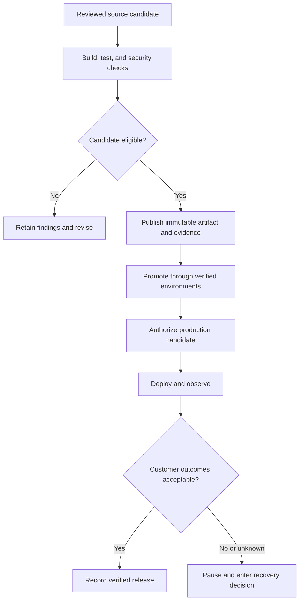
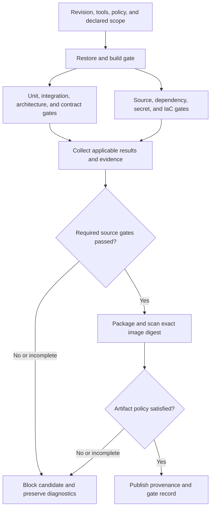
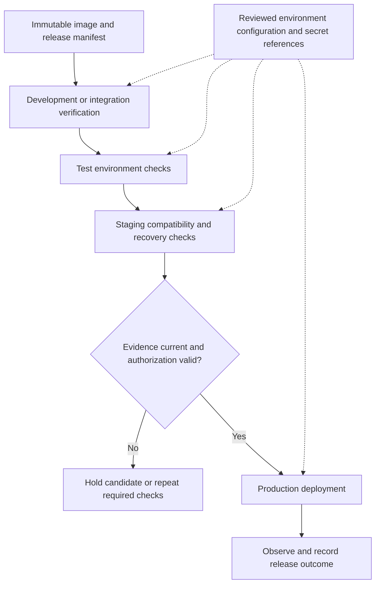
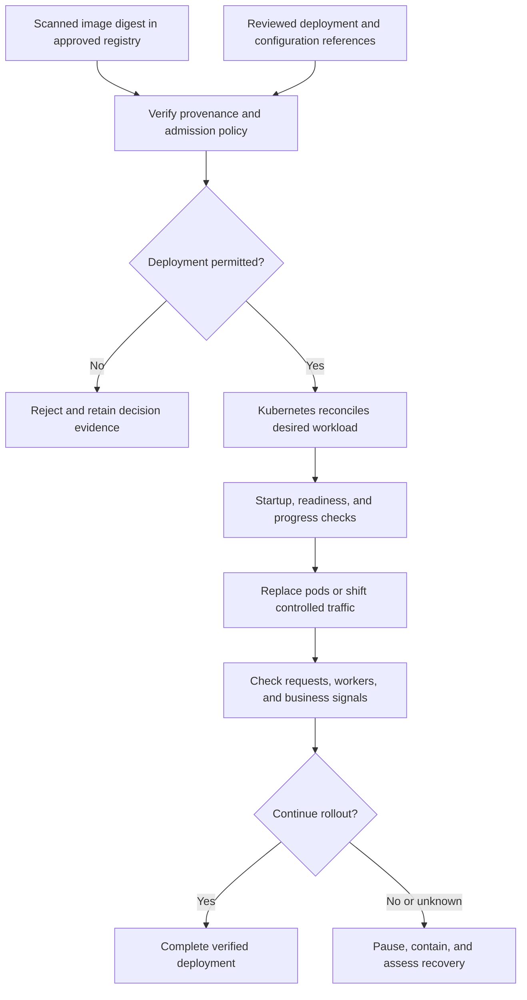
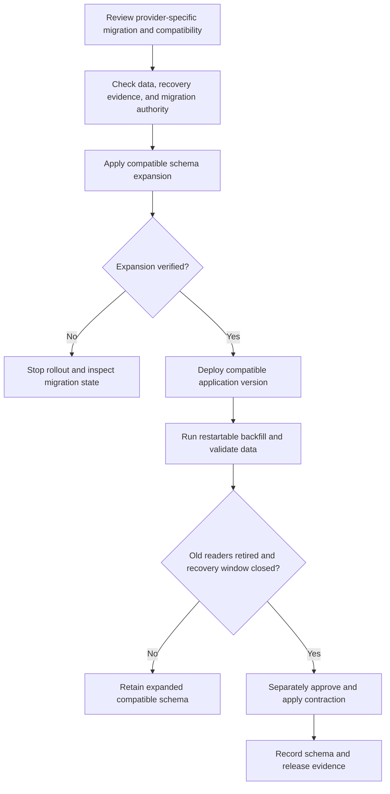
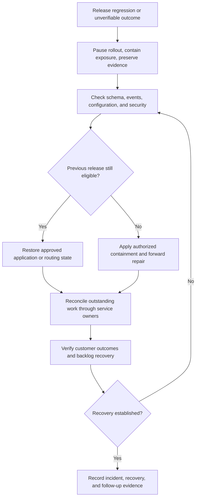

# Chapter 53 — CI/CD

**Part VII — Alpha Car Detailing**  
**Target file:** `book/53-ci-cd.md`  
**Status:** Detailed outline

**Chapter objective:** Explain how Alpha Car Detailing uses CI/CD to build, test, validate, secure, package, deploy, and monitor changes across its services.

> **Core principle:** Delivery automation must provide repeatable, traceable, secure, and verifiable movement from source code to production.

## 1. Story-driven Opening

### 1.1 A successful build with an unsafe release

- Continue Northstar Distribution's corporate fleet booking scenario: twenty-four vehicles scheduled across two days.
- Introduce a proposed Booking release containing an application change, an additive database migration, and an integration-contract change.
- Show competing evidence: compilation succeeds, but an older Notification consumer cannot interpret the proposed event, the image scan is incomplete, and the migration has not been tested with the previous Booking version.
- Establish the operational stakes: preserve authorized fleet access, committed station capacity, truthful booking outcomes, and independently recoverable downstream work.

### 1.2 Follow the release rather than the green dashboard

- Ask which source revision was reviewed, which tests actually ran, which image was scanned, what production will execute, and whether recovery remains possible.
- Introduce a pipeline that blocks incomplete evidence, packages the validated change, promotes the same artifact, and verifies business behavior after deployment.
- Return to Chapter 52's distinction between healthy infrastructure and a healthy customer journey.

## 2. Learning Objectives

After completing this chapter, the reader will be able to:

- Distinguish continuous integration, continuous delivery, continuous deployment, deployment, and release.
- Design a source-control and pull-request workflow with protected, independently enforced checks.
- Organize build, unit, integration, architecture, contract, and security validation around service ownership.
- Define Deterministic Validation Gates with explicit inputs, outcomes, evidence, and exception handling.
- Create immutable artifacts and connect source revisions, versions, container digests, provenance, and release records.
- Promote changes through environments using reviewed Infrastructure as Code, configuration, and secret references.
- Select Kubernetes deployment strategies and coordinate compatible application, event, and database evolution.
- Design approvals, rollback, forward recovery, post-deployment verification, and protected Audit Trails.
- Use AI Agents to assist delivery engineering while retaining independent validation and deployment authority.

## 3. Background

### 3.1 Relationship to Chapters 1–52

- Apply established Repository Intelligence, Instructions, Skills, Prompts, Steering Notes, and Harness responsibilities to delivery work.
- Carry forward Chapters 12–18's separation of orchestration, implementation, review, validation, and evaluation.
- Apply Chapters 29–34's governance, security, Human Approval, Audit Trails, policy, and compliance principles.
- Connect Chapters 38–40's learning from builds, reviews, and pull requests to governed pipeline improvement.
- Preserve Chapters 46–50's business invariants, Clean Architecture, service ownership, reliable publication, and idempotent consumption.
- Operationalize Chapter 51's secure release evidence and Chapter 52's release-correlated observability.

### 3.2 Preserve the implemented baseline

- Retain the existing .NET 10 Booking create/read application: `POST /api/bookings` creates a `Pending` booking; `201 Created` does not establish confirmed capacity or published integration events.
- Preserve direct application services, the decision to defer CQRS and a mediator, and the local SQLite persistence baseline.
- Inspect the existing companion build workflow, SDK configuration, package management, instruction validators, skill validators, and available tests before designing extensions.
- Verify workflow discovery at the actual repository root and command working directories; an example YAML file is insufficient evidence that CI executes.
- Label SQL Server deployment, durable messaging, additional services, container publication, and Kubernetes environments as proposed extensions until implemented and verified.
- Keep twenty-four vehicles separate from an approved booking limit, batch boundary, or atomicity guarantee.

### 3.3 CI/CD and the Harness

- Explain how the Harness coordinates AI-assisted engineering while CI/CD provides independently enforced build, verification, packaging, and deployment execution.
- Reuse validation commands and evidence contracts without creating a second competing delivery system.
- Distinguish an AI Agent's successful local run from authoritative checks on the exact release candidate.

## 4. Concepts

### 4.1 CI/CD principles and release terminology

- Continuous integration: integrate small changes frequently and validate the integrated source.
- Continuous delivery: keep validated changes deployable through a repeatable process, with policy-defined authorization before production.
- Continuous deployment: automatically deploy eligible changes when independently enforced requirements pass.
- Distinguish deploying software from exposing a feature; introduce controlled feature flags, ownership, expiry, and cleanup.
- Explain repeatability, short feedback cycles, immutable artifacts, least privilege, traceability, and independently verified outcomes.
- Separate repeatable execution from byte-for-byte reproducible builds; identify additional controls needed for the latter.

### 4.2 Source-control workflow

- Compare short-lived branches and trunk-based integration with release branches where support obligations justify them.
- Recommend small, focused changes and protected integration branches; align branching with the actual repository and team constraints.
- Define code ownership for services, shared libraries, workflows, infrastructure, migrations, and governed guidance.
- Require renewed validation when the reviewed revision or merge candidate changes; make emergency fixes rejoin the normal history.

### 4.3 Pull requests and review evidence

- Specify the objective, affected business behavior, service boundaries, contracts, migrations, security impact, validation, observability, and recovery plan.
- Distinguish code review, required automated checks, policy exceptions, and production authorization.
- Protect workflow and gate changes through ownership and review; a change must not weaken its own acceptance criteria to obtain a passing result.
- Bind approval and checks to the revision being merged; handle stale approvals and merge-queue validation where used.

### 4.4 Build pipelines and controlled inputs

- Define checkout, dependency resolution, compilation, analyzers, tests, packaging, and evidence collection as explicit stages with exit conditions.
- Control SDK, dependencies, build tools, operating-system assumptions, container base images, and workflow dependencies; record resolved versions.
- Explain lock files and locked restore where adopted, approved package sources, cache validation, and isolated build execution.
- Treat caches as performance aids; establish which outputs are authoritative release artifacts.
- Separate pull-request feedback from trusted release builds; validate the final integrated source and the artifact actually selected for promotion.

### 4.5 Unit tests

- Verify Booking lifecycle rules, value objects, application decisions, and failure classification without external infrastructure.
- Include authorized fleet scope, unsuitable services, invalid vehicles, and capacity prerequisites in the proposed distributed workflow's test plan.
- Use controlled clocks, identifiers, and data; distinguish fast deterministic checks from tests with environmental dependencies.
- Explain why coverage percentages and green unit tests alone cannot establish release readiness.

### 4.6 Integration tests

- Exercise API routing, serialization, dependency injection, persistence, transactions, and real adapter behavior within a declared profile.
- Use isolated databases, broker resources, and synthetic accounts; report whether a dependency is real, emulated, or substituted.
- Distinguish SQLite verification from SQL Server verification; test production-engine transaction and migration behavior before making production claims.
- For proposed event extensions, verify outbox atomicity, inbox deduplication, restart recovery, and uncertain external outcomes.
- Define bounded timeouts, cleanup, test isolation, and required evidence when infrastructure fails to start.

### 4.7 Architecture tests

- Enforce inward dependencies: Domain remains independent of API and Infrastructure; Application uses approved abstractions.
- Detect cross-service persistence references, shared operational database access, and forbidden coupling through common libraries.
- Check composition boundaries and selected conventions without pretending static rules prove all runtime behavior.
- Tie rule changes to approved architecture decisions and ownership.

### 4.8 Contract tests and compatibility

- Cover HTTP requests, responses, errors, authorization expectations, integration-event envelopes, schemas, and business meaning.
- Test producer and consumer compatibility against versions still deployed, retained events, and supported replay windows.
- Exercise mixed-version operation during deployment and application rollback; distinguish wire compatibility from semantic compatibility.
- Preserve event ownership, stable identities, deduplication behavior, and publication conditions.
- Explain why mock-only consumer tests and a newly passing schema do not prove older consumers can operate safely.

### 4.9 Security scanning

- Plan secret scanning, static application security testing, deployment-policy validation, and isolated dynamic checks where appropriate.
- Combine scanners with authorization, account-isolation, abuse, and negative tests from Chapter 51.
- Define scope, tool version, policy version, finding triage, evidence freshness, and approved risk thresholds.
- Treat failed execution, missing results, and unsupported coverage as incomplete evidence rather than a clean result.

### 4.10 Dependency scanning

- Inspect resolved direct and transitive packages, approved feeds, licenses where policy requires them, and dependency update proposals.
- Record advisory sources and database timestamps; evaluate exposure and remediation under the approved risk policy.
- Produce a software bill of materials (SBOM) associated with the release artifact.
- Continue assessing deployed dependencies as new vulnerabilities become known; remediation creates a newly validated artifact.

### 4.11 Container images and image scanning

- Plan multi-stage .NET builds, minimal supported runtime images, non-root execution, constrained privileges, and exclusion of build secrets.
- Record base-image and final-image digests; examine application dependencies, operating-system packages, and selected image configuration rules.
- Scan the exact candidate digest and target architectures that will run; preserve identity through registry transfer or verify any resulting change.
- Distinguish vulnerability findings from scanner outages and policy exceptions; signing an image does not establish that it is safe.

### 4.12 Deterministic Validation Gates

- Define each gate's owner, input revision or digest, command, policy baseline, execution environment, timeout, evidence, and blocking scope.
- Use explicit outcomes: passed, failed, incomplete, and justified not applicable; required checks must not disappear through path filters or skipped jobs.
- Fail the applicable promotion when mandatory evidence is absent or cannot be trusted; retain failed results and diagnostics.
- Separate deterministic policy evaluation from time-varying inputs such as vulnerability databases and operational telemetry; record those inputs.
- Keep semantic AI review advisory and distinguish governed Human Approval from executable technical validation.
- Define bounded, attributable exceptions with scope, rationale, compensating controls, expiry, and independent authority.

### 4.13 Artifact creation and provenance

- Identify container images, deployable binaries, migration bundles or scripts, deployment manifests, infrastructure plans, SBOMs, and evidence indexes.
- Build a release candidate once and promote its immutable identity; environment-specific configuration is controlled separately.
- Bind artifacts to source commit, build run, workflow revision, resolved inputs, checksums, and attestations.
- Verify provenance and the expected builder at promotion and admission boundaries; store artifacts and evidence under appropriate retention and access controls.
- Explain that attestation validates selected origin and integrity claims, while tests and policies establish different properties.

### 4.14 Versioning

- Distinguish service release version, source commit, image digest, API contract version, event schema version, migration identity, and configuration revision.
- Use semantic versioning only under a documented compatibility policy; a version label does not prove compatibility.
- Make release labels human-readable and deploy images by immutable digest; prohibit production dependence on mutable `latest` tags.
- Record a per-service release manifest without forcing all seven services into one synchronized version number.

### 4.15 Environment promotion

- Define proposed development/integration, test, staging, and production purposes, entry checks, owners, identities, and exit evidence.
- Promote the same verified image digest; repeat environment-specific checks and refresh policy evidence when freshness rules require it.
- Validate configuration, schema compatibility, deployment intent, and target-environment permissions before execution.
- Prevent stale releases overtaking newer ones through per-service/environment concurrency controls and candidate checks.
- Use representative synthetic data and controlled preview-environment cleanup; do not copy sensitive production data without an approved handling process.

### 4.16 Infrastructure as Code

- Version registry, network, cluster, identity, database, broker, observability, and environment definitions with accountable ownership.
- Compare Terraform and Bicep as provisioning alternatives; distinguish infrastructure provisioning from Kubernetes workload packaging.
- Validate syntax, policy, proposed changes, blast radius, drift, and destructive operations before application.
- Protect remote state, state locks, plans, identities, and secrets; bind approval to the reviewed plan and handle changed state explicitly.
- Treat shared infrastructure changes as releases with affected-service analysis and recovery requirements.

### 4.17 Kubernetes deployment

- Cover Deployments, Services, ingress or gateway routing, service accounts, RBAC, network policy, resources, and scheduling capacity.
- Compare plain manifests, Helm, and Kustomize; select one coherent packaging path for the worked extension rather than presenting all as mandatory.
- Apply startup, readiness, and liveness probes with distinct meanings; verify worker progress separately.
- Configure rollout progress checks, surge and unavailability budgets, graceful shutdown, request draining, and termination deadlines.
- Preserve in-flight consumer handling, acknowledgments, and retry safety during pod replacement.
- Explain that a Deployment progress deadline reports a failed rollout; rollback automation requires an explicitly designed controller or delivery workflow.

### 4.18 Configuration and secrets

- Separate application artifacts, reviewed non-secret configuration, secret references, and runtime identity.
- Validate required settings, configuration schemas, environment binding, compatible feature flags, and missing-secret failure behavior.
- Use the approved secret store and workload identity pattern; restrict pipeline access to the identities and secret operations it needs.
- Record secret reference or version metadata where appropriate without preserving secret values in artifacts, manifests, logs, or release evidence.
- Define rotation, revocation, reload or restart behavior, and recovery without restoring revoked credentials.

### 4.19 Deployment strategies

| Strategy | Planned coverage | Principal constraints |
| --- | --- | --- |
| Rolling deployment | Incremental pod replacement with readiness, capacity, and progress checks | Old and new versions coexist; schema, contracts, and shutdown must remain compatible. |
| Blue-green deployment | Prepare a parallel application environment, verify it, switch routing, and retain a recovery window | Shared data and background workers require explicit ownership; traffic switching cannot undo state changes. |
| Canary deployment | Expose a controlled cohort, compare signals, and expand or abort in steps | Requires reliable routing, representative traffic, compatible state, and defined analysis behavior. |

- Specify routing mechanism, release authority, success evidence, pause conditions, and recovery action for each strategy.
- Treat canary percentages and observation windows as illustrative until justified; handle low traffic and missing telemetry explicitly.
- Explain why HTTP traffic splitting does not control Kafka or Event Hubs consumers; define partition, group, worker, and side-effect behavior separately.
- Keep inactive blue-green consumers from accidentally duplicating notifications, invoices, or financial operations.

### 4.20 Database migrations

- Retain service-owned databases; each owner reviews and releases its schema changes.
- Use expand, migrate/backfill, and contract phases to preserve old/new application compatibility and the declared rollback window.
- Produce reviewed scripts or migration bundles for the actual database provider; validate against representative schema versions and data volumes.
- Use a separately authorized migration identity and a coordinated runner or Job; prevent concurrent or accidental repeated application.
- Plan lock duration, transaction behavior, restartability, data validation, progress, backup/restore evidence, and maintenance needs.
- Delay destructive contraction until obsolete readers, writers, replay paths, and recovery dependencies have been retired.
- Distinguish application rollback, forward schema repair, and database restoration; restoration requires recovery-point and data-loss decisions.

### 4.21 Approval gates

- Separate pull-request approval, security exceptions, infrastructure authorization, migration approval, and production release authorization.
- Present a concrete candidate: image digest, environment, configuration, migration, risk findings, verification plan, and recovery limits.
- Apply separation of duties according to the approved policy; an implementing AI Agent cannot supply Human Approval.
- Revalidate approval when the candidate, environment assumptions, or risk evidence changes.
- Define time-limited emergency access, attribution, retrospective review, and restrictions that remain mandatory.

### 4.22 Rollback and forward recovery

- Distinguish stopping rollout, routing traffic away, reverting application/configuration state, disabling a feature, and deploying a corrective release.
- Verify that the previous artifact is retained, still permitted by security policy, and compatible with current data, contracts, configuration, and retained events.
- Preserve evidence before recovery and serialize recovery against active deployments or infrastructure reconciliation.
- Explain why redeployment does not retract published events, release reserved capacity, reverse invoices, refund payments, or unsend messages.
- Route business recovery through the owning service's reconciliation or compensating operation, with idempotency and required authorization.
- Define rollback eligibility, trigger, owner, maximum decision time, verification, and the fallback when reversal is unsafe.

### 4.23 Observability after deployment

- Attach service version, image digest, configuration revision, environment, and release markers to the Chapter 52 diagnostic model.
- Combine rollout status, readiness, synthetic checks, request indicators, workflow age, dependency behavior, and event-processing progress.
- Track outbox age, consumer lag, unresolved capacity operations, notification intent age, Billing recognition freshness, and Payment uncertainty where implemented.
- Evaluate predefined observation windows and sufficient traffic; treat absent or stale telemetry as missing evidence.
- Separate successful process rollout from verified customer behavior and sustained recovery.

### 4.24 Release evidence and auditability

- Define an evidence index linking PR, reviewed commit, integrated commit, build run, gate results, artifacts, SBOM, scans, provenance, approvals, and deployment outcomes.
- Record tools, policies, advisory timestamps, infrastructure plan, migration execution, configuration references, and target-environment identity.
- Preserve actor, action, time, decision, exception, and recovery history in protected Audit Trails.
- Control evidence access, integrity, retention, and redaction; do not invent regulatory periods or treat transient pipeline logs as the sole record.
- Make incomplete validation and untested assumptions visible in release status.

### 4.25 Pipeline security

- Model source, pull requests, build runners, actions/tasks, package feeds, caches, artifact stores, registries, cloud identities, and deployment controllers as trust boundaries.
- Keep untrusted pull-request execution separate from privileged publication and deployment; restrict write tokens and secret access.
- Use short-lived federated credentials with narrowly bound repository, workflow, environment, and audience claims where supported.
- Pin third-party automation to reviewed immutable revisions; review updates and constrain reusable workflow permissions.
- Defend against script injection, malicious artifacts, poisoned caches, runner persistence, and unsafe privileged checkout of untrusted code.
- Verify artifact identity, signatures/provenance, and admission policy at deployment; protect signing and approval authority from the build under review.
- Define runner isolation, network access, cleanup, credential revocation, and incident response.

### 4.26 AI-assisted CI/CD and feedback

- Use AI Agents to draft workflow changes, identify missing tests, explain failures, review deployment diffs, and summarize release evidence.
- Require references to actual files and execution records; distinguish suggested commands, executed checks, and verified outcomes.
- Treat PR text, dependency metadata, logs, scan output, and retrieved documents as untrusted inputs that cannot authorize actions.
- Prevent AI-assisted changes from bypassing gates, altering acceptance baselines, approving exceptions, or acquiring production credentials.
- Feed validated lessons into governed Instructions, Skills, tests, and pipeline templates through reviewed changes.
- Monitor feedback time, failure rates, flaky tests, deployment frequency, lead time, and recovery measures with defined populations and without invented targets.

## 5. Architecture Discussion

### 5.1 Problem, context, and alternatives

- Frame the problem as independently releasing related business capabilities while preserving shared customer commitments.
- Compare a common monorepository pipeline with service-specific entry points against separate repositories using shared pipeline templates.
- Compare direct pipeline deployment with pull-based GitOps; identify who owns desired state, approvals, drift correction, and recovery.
- Recommend staged adoption: verify the current Booking baseline first, then add independently evidenced service and environment extensions.
- Evaluate operational overhead, blast radius, execution cost, deployment independence, and future evolution.

### 5.2 Service ownership and delivery evidence

| Service | Release-sensitive behavior | Priority validation |
| --- | --- | --- |
| Booking | Lifecycle, authorized requests, capacity coordination, durable publication | Application rules, API compatibility, transaction boundaries, pending-operation recovery. |
| Corporate Account | Account authority, agreement eligibility, membership decisions | Account isolation, authorization, decision compatibility, freshness and failure behavior. |
| Fleet | Fleet membership and vehicle eligibility | Scoped access, batch-validation contract, eligibility outcomes, compatible responses. |
| Station Operations | Capacity commitments and qualifying service completion | Concurrent reservations, retry identity, uncertain-response reconciliation, completion contracts. |
| Billing | Recognition of qualifying completed work and invoicing | Deduplicated recognition, commercial-rule tests, schema evolution, reconciliation. |
| Payment | Authorized provider operations and settlement reconciliation | Provider-contract fixtures, callback authentication, stable operation identities, uncertain outcomes. |
| Notification | Durable communication intents and controlled dispatch | Inbox/intent transactions, duplicate suppression, provider evidence, worker deployment safety. |

- Assign platform ownership for registry, build infrastructure, cluster, broker, secrets, and observability.
- Preserve logical ownership without assuming seven services require seven separate teams or immediate deployment units.

### 5.3 Pipeline stages and gate responsibilities

| Boundary | Required evidence | Blocking condition |
| --- | --- | --- |
| PR integration | Build, applicable tests, architecture/contracts, security results, review | Required result fails, is missing, or belongs to another revision. |
| Candidate publication | Final artifact, digest, image scan, SBOM, provenance | Artifact cannot be traced to approved inputs or required policy fails. |
| Environment promotion | Candidate identity, compatible configuration/schema, fresh policy evidence | Candidate, environment, or evidence no longer meets entry rules. |
| Production execution | Required authorization, approved deployment/migration intent, recovery readiness | Approval is absent/stale or recovery prerequisites are unmet. |
| Release verification | Rollout, synthetics, business/dependency signals, observation record | Observed regression, stalled rollout, or insufficient evidence. |

- Execute independent checks in parallel where useful; make dependency edges and aggregate gate outcomes explicit.
- Define incomplete and cancelled-run handling and prevent partial stage success from marking the release complete.

### 5.4 Independent service releases and shared changes

- Use service impact maps for changed code, shared packages, build tooling, contracts, and deployment templates.
- Revalidate affected consumers and producers when shared behavior changes; do not rely exclusively on path-based filters.
- Expand compatible contracts and schemas before deploying dependants; retire old behavior after an explicit support window.
- Preserve published event meaning across delayed delivery and replay; avoid synchronized release dependencies where compatibility can remove them.

### 5.5 Deploy Northstar's booking path safely

- Follow the proposed Booking candidate through review, controlled build, validation, artifact publication, staging, authorization, deployment, and observation.
- Keep Corporate Account, Fleet, and Station Operations authoritative for prerequisites while testing mixed-version collaboration.
- Keep Notification delay independently recoverable and preserve Billing's qualifying-completion basis and Payment's separately authorized role.
- Verify existing Pending-booking semantics separately from any proposed confirmation fixture.

### 5.6 Migration, deployment, and recovery coordination

- Bind migration artifact, application digest, schema compatibility, configuration, and rollback eligibility in one release manifest.
- Run expansion before dependent application code; coordinate restartable backfill and delay contraction.
- Compare previous-version redeployment with forward repair after an irreversible or externally visible change.
- Verify retention of needed artifacts, schema evidence, audit records, and operational references before the release window.

### 5.7 Failure modes and operational considerations

- Examine scanner outage, unavailable package feed, poisoned cache, missing artifact, registry failure, stale approval, and concurrent deployment.
- Examine failed IaC application, migration timeout, partial rollout, absent telemetry, stalled consumer, and uncertain external provider effects.
- Define owner, containment, evidence preservation, retry boundaries, recovery authority, and verification for each case.
- Address runner scaling, test-environment quotas, registry retention, deployment capacity, and cost without weakening mandatory checks.

## 6. Professional Diagrams

- Use the following outline diagrams as the basis for six publication figures.
- Give each final figure a title, caption, description, referenced sections, readable labels, and a legend where needed.
- Store editable Mermaid sources and publication exports under repository diagram conventions when preparing the manuscript.
- Label proposed production components and retain the distinction between implementation evidence and architectural design.

### Figure 53-1 — CI/CD Pipeline

- **Caption:** A release remains traceable from reviewed source to observed production behavior.
- **Description:** Show integration, packaging, promotion, authorization, and verification as separate evidence boundaries.
- **References:** Sections 4.1–4.4, 4.13–4.15, 4.21–4.24, and 5.3.

### Figure 53-2 — Validation Gate Pipeline

- **Caption:** Explicit aggregation prevents missing, skipped, or incomplete evidence from becoming success.
- **Description:** Parallel checks share controlled inputs; artifact checks inspect the final packaged candidate.
- **References:** Sections 4.5–4.13 and 5.3.

### Figure 53-3 — Environment Promotion Flow

- **Caption:** Promote the same artifact while validating each environment's configuration, identity, and obligations.
- **Description:** Keep configuration external to the image and attach environment-specific evidence to the release.
- **References:** Sections 4.15–4.18, 4.21, and 5.6.

### Figure 53-4 — Container Deployment Flow

- **Caption:** Admission, workload readiness, traffic exposure, and customer verification protect different boundaries.
- **Description:** Include worker progress and controlled shutdown in the supporting discussion, not just HTTP readiness.
- **References:** Sections 4.11, 4.17–4.19, 4.23, and 5.5.

### Figure 53-5 — Database Migration Flow

- **Caption:** Expansion and contraction are separate release decisions, preserving compatibility during change.
- **Description:** Mark application rollback eligibility before contraction and identify the forward-repair path after irreversible changes.
- **References:** Sections 4.20–4.22 and 5.6.

### Figure 53-6 — Rollback Flow

- **Caption:** Recovery chooses an eligible reversal or forward repair and separately reconciles durable business effects.
- **Description:** Include uncertainty and external effects; prevent a deployment reversal from being mistaken for business compensation.
- **References:** Sections 4.20–4.24 and 5.6–5.7.

## 7. Hands-on Example

### 7.1 Discover the existing Booking delivery baseline

- Inventory solution and project paths, SDK rules, dependencies, tests, current workflows, validators, and deployment assets.
- Verify repository-root workflow placement, command working directories, test discovery, and actual execution evidence.
- Define a bounded lab using synthetic corporate fleet data and isolated infrastructure; declare all unavailable production components.

### 7.2 Design the pull-request validation workflow

- Plan controlled restore/build and the existing unit/integration checks, then explicitly add the architecture and contract checks required by the proposed change.
- Add source, dependency, secret, and deployment-policy scanning under a documented lab policy.
- Produce machine-readable results and an aggregate required check; demonstrate a failing test, skipped required check, and scanner execution failure.
- Keep untrusted PR jobs free of production credentials and publication authority.

### 7.3 Package and identify the candidate

- Specify a multi-stage Booking image build and validate the packaged application, runtime settings, and declared target platform.
- Scan the final digest, generate an SBOM and provenance, and create a release manifest linking all evidence.
- Publish only through the trusted workflow; demonstrate digest verification and rejection of a mismatched artifact.

### 7.4 Prepare an isolated Kubernetes deployment extension

- Plan reviewed provisioning and workload definitions with scoped identities, resource settings, probes, configuration, and secret references.
- Use a declared lab cluster and database profile; verify persistence behavior rather than assuming SQLite is suitable for multiple production replicas.
- Separate optional SQL Server and broker integration profiles from adapter fixtures and local baseline tests.

### 7.5 Exercise migration and environment promotion

- Choose a bounded additive schema change that preserves approved business behavior; generate and inspect the provider-specific migration artifact.
- Verify old/new application compatibility, migration coordination, repeated execution behavior, and interrupted backfill recovery.
- Promote one image digest through isolated environments; attach configuration and policy evidence without rebuilding per environment.
- Prepare a concrete production-style authorization record without claiming an actual production deployment.

### 7.6 Deploy, observe, and recover

- Exercise a rolling deployment with mixed versions, readiness, graceful shutdown, and a bounded observation window.
- Inject a readiness failure, contract mismatch, migration failure, missing telemetry, and delayed consumer as separate cases where the selected profile supports them.
- Demonstrate an eligible application rollback and a second case requiring containment or forward repair.
- Verify Pending-booking behavior in the actual baseline; validate confirmation and downstream effects only in explicitly implemented extension fixtures.

### 7.7 Acceptance criteria and deliverables

- Required checks identify the exact source/artifact and cannot pass through missing or incomplete evidence.
- The image deployed matches the scanned and attested digest; environment promotion preserves that identity.
- Tested architecture and contracts preserve ownership and mixed-version compatibility.
- Migration evidence identifies the database provider, schema versions, old/new compatibility, and recovery limits.
- Inspected artifacts, logs, manifests, prompts, and evidence contain no prohibited secrets or sensitive fleet data.
- Deployment verification includes customer and worker behavior, not just pod readiness.
- Recovery preserves durable commitments and avoids uncontrolled duplicate external effects.
- Deliver workflow design, gate catalog, release manifest, deployment/migration plan, failure evidence, and recovery record; distinguish executed checks from planned production validation.

## 8. Claude Example

### 8.1 Define a bounded delivery task

- Provide Claude Code with the approved baseline, repository paths, relevant Instructions and Skills, allowed changes, gate commands, and expected evidence.
- Ask for a focused Booking pipeline change and explanations of permissions, artifact identity, and failure handling.
- Require unresolved policy, infrastructure, versioning, and business decisions to remain explicit.

### 8.2 Apply established Harness responsibilities

- Lead Agent scopes the work; Developer Agent prepares the change; Reviewer Agent examines architecture, security, and recovery assumptions.
- Validator Agent executes applicable deterministic checks; Evaluator Agent assesses the objective and evidence without replacing gates or Human Approval.
- Keep production authorization, exception approval, secret access, and standards changes under their established authority.

### 8.3 Diagnose a failed delivery safely

- Supply sanitized build, test, scan, migration, or rollout evidence and request a supported diagnosis with record references.
- Require the AI Agent to distinguish failure from incomplete execution, propose a bounded correction, and retain the failed evidence.
- Reject proposals that disable scanners, delete meaningful tests, widen deployment credentials, or silently edit policy thresholds.

## 9. GitHub Copilot Comparison

- Apply the same bounded pipeline task and acceptance evidence in the available GitHub Copilot workflow.
- Compare only materially different repository context, change preparation, execution, PR integration, and review capabilities verified during manuscript preparation.
- Distinguish AI assistance from GitHub Actions execution and environment protection; verify feature availability for the actual repository and account.
- Preserve identical limits on secrets, gate changes, privileged publication, exceptions, and production authorization.

## 10. Codex Comparison

- Apply the same repository discovery, pipeline change, and failure-diagnosis task using the available Codex workspace and execution tools.
- Explain how filesystem, network, tool, and credential boundaries limit which checks can actually run.
- Require file references, command outcomes, artifact identity, and explicit unperformed checks in the evidence report.
- Preserve independent CI validation and authorization; avoid duplicate examples that only substitute the platform name.

## 11. Best Practices

- Integrate focused changes frequently and bind review to the validated source.
- Keep fast feedback early and preserve required gates when optimizing execution.
- Test business invariants, forbidden behavior, service boundaries, compatibility, and recovery.
- Build once, identify artifacts immutably, and promote with environment-specific evidence.
- Scan the deployed image and continue reassessing running dependencies.
- Separate untrusted validation from privileged release execution.
- Version infrastructure, configuration, contracts, and migrations with accountable owners.
- Use compatible deployment and migration steps; test recovery before relying on it.
- Observe customer outcomes and asynchronous work before declaring release success.
- Protect release evidence and improve delivery through reviewed, evidence-based changes.

## 12. Anti-patterns

| Anti-pattern | Consequence | Preferred direction |
| --- | --- | --- |
| Compilation treated as release readiness | Untested contracts, migrations, and security risks reach deployment | Require the full applicable evidence set. |
| Rebuilding for each environment | Staging evidence belongs to different bytes | Promote a verified immutable candidate. |
| Mutable production image tags | Actual deployment identity becomes ambiguous | Deploy and record immutable digests. |
| Missing or failed scans reported as clean | Incomplete evidence silently authorizes promotion | Block the applicable gate and retain diagnostics. |
| Tests removed or thresholds weakened to pass | The release validates reduced requirements | Correct the implementation or obtain a scoped policy decision. |
| Shared production credentials on PR runners | Untrusted changes gain release authority | Isolate execution and use narrowly scoped short-lived identities. |
| Every pod runs schema changes on startup | Migration races and mixed-version failures | Coordinate reviewed migration execution. |
| Destructive migration before compatibility retirement | Previous versions and replay paths become unusable | Separate expansion, backfill, and contraction. |
| Blue-green environments dispatch the same work | Duplicate communications or financial effects | Control worker ownership and durable idempotency. |
| Canary success inferred from healthy pods | Business regressions and stalled work remain hidden | Evaluate defined journey and worker signals. |
| Blind image rollback after durable changes | Data, event, or external effects remain inconsistent | Assess compatibility and reconcile through owners. |
| AI-generated approval accepted as authorization | Implementation and approval authority collapse | Retain independent policy enforcement and Human Approval. |

> **Common Mistake**  
> Plan a callout explaining why a green pipeline is meaningful only when its required checks inspected the source, artifacts, configuration, and environment actually being released.

## 13. Architect's Notes

- Treat the delivery system as an architectural control with explicit trust boundaries and service ownership.
- Examine release coupling as evidence of contract, schema, or boundary problems; identify where compatible evolution can restore independence.
- Distinguish software deployment from business commitments already established by earlier executions.
- Keep platform standardization compatible with justified service-specific validation and recovery needs.
- Explain the long-term cost of shared databases, synchronized release trains, mutable artifacts, and ungoverned pipeline exceptions.

> **Architect's Note**  
> Plan a callout connecting independent deployment to compatible APIs, retained events, schemas, operational ownership, and tested recovery rather than separate pipeline files alone.

## 14. Enterprise Tips

- Maintain a service catalog with release owner, approver, on-call contact, contract support window, and recovery runbook.
- Provide reviewed reusable pipeline templates with controlled versions and an exception process.
- Protect workflows, registries, signing identities, IaC state, and evidence stores according to their authority.
- Rehearse migration interruption, registry unavailability, revoked credentials, failed approval dependencies, and telemetry loss.
- Track flaky tests with owners and remediation dates; keep any quarantine explicit and visible to release policy.
- Retain usable recovery artifacts and test restoration separately from ordinary deployment.
- Use synthetic booking and provider test modes that cannot create unintended production messages or charges.
- Define metrics and retention from business, operational, and contractual needs without inventing universal thresholds.

> **Enterprise Tip**  
> Plan a callout on a compact release evidence index that lets an approver establish candidate identity, unresolved risks, deployment scope, and recovery limits without reading every raw log.

## 15. Decision Points

| Decision | Alternatives to evaluate | Evidence needed |
| --- | --- | --- |
| Integration workflow | Trunk-based development, short-lived branches, justified release branches | Team workflow, support obligations, integration delay, branch-protection needs. |
| Pipeline ownership | Common orchestration, service-specific workflows, shared templates | Repository structure, impact map, service ownership, maintenance cost. |
| Delivery platform | GitHub Actions, Azure DevOps, equivalent runner | Existing enterprise controls, integrations, permissions, operating cost. |
| Deployment authority | Direct pipeline execution, pull-based GitOps | Desired-state ownership, drift handling, approval, rollback coordination. |
| Deployment strategy | Rolling, blue-green, canary | Compatibility, traffic control, worker behavior, capacity, measurable outcomes. |
| Migration execution | Reviewed SQL, migration bundle, coordinated Job | Provider support, review requirements, locking, restartability, recovery. |
| Production authorization | Protected automated policy, required Human Approval under policy | Risk classification, separation of duties, complete current evidence. |
| Recovery action | Previous-version redeployment, feature disablement, containment, forward repair | Schema/event compatibility, security eligibility, external effects, impact. |
| Validation scope | Changed-service checks, affected-service checks, wider suites | Dependency graph, shared changes, contract exposure, confidence in selection. |

> **Decision Point**  
> Ask the reader to choose a release strategy for a Booking change that adds a field, updates Notification behavior, and requires backfill while older events remain replayable. Require a compatibility and recovery argument before selecting tooling.

## 16. Exercises

### 16.1 Map the release path

- Produce a source-to-production map for Booking identifying owners, trust boundaries, artifacts, identities, gates, approvals, and evidence.

### 16.2 Design a gate catalog

- Specify build, unit, integration, architecture, contract, security, and image gates with inputs, commands, outcomes, evidence, and failure handling.
- Demonstrate how missing results and unjustified skipped checks block release.

### 16.3 Review mixed-version contracts

- Assess a Booking event change against old Notification consumers, retained records, duplicate delivery, and replay.
- Propose a compatible rollout and retirement sequence without changing the event's established meaning.

### 16.4 Trace an immutable artifact

- Create a release manifest linking reviewed/integrated commits, build, image digest, SBOM, scans, provenance, configuration, and environments.
- Identify a substituted or rebuilt candidate using the evidence chain.

### 16.5 Plan a service-owned migration

- Design expansion, backfill, application deployment, and later contraction for a bounded Booking schema change.
- Include previous-version compatibility, migration authority, interruption, recovery evidence, and contraction approval.

### 16.6 Select a deployment strategy

- Compare rolling, blue-green, and canary deployment for Booking and Notification.
- Address HTTP routing, background workers, old/new versions, extra capacity, observation windows, and insufficient traffic.

### 16.7 Exercise recovery

- Evaluate one readiness regression and one incompatible durable-state change.
- Produce separate recovery decisions, authorization needs, business reconciliation steps, and verification evidence.

### 16.8 Review pipeline and AI security

- Examine a workflow with privileged PR execution, mutable actions, broad credentials, and an AI-generated proposal to disable a failing scanner.
- Produce a corrected trust-boundary design and an evidence-based response to the scanner failure.

### 16.9 Prepare a release authorization package

- Present a concrete candidate with outstanding findings, scoped exceptions, environment intent, migration evidence, observation criteria, and recovery limits.
- Distinguish completed checks, incomplete evidence, proposed production work, and the decision requested from the authorized approver.

## 17. Interview Questions

1. How do continuous integration, continuous delivery, continuous deployment, deployment, and release differ?
2. How does CI/CD complement a Harness without replacing its orchestration responsibilities?
3. Which source revision must pass required checks when the reviewed branch differs from the merge result?
4. What distinguishes unit, integration, architecture, contract, and end-to-end evidence?
5. How would you detect Booking accessing Fleet's database or referencing its persistence assembly?
6. How do you validate event compatibility with old consumers and retained replayable records?
7. What makes a validation gate independently enforceable, and how should it handle missing results?
8. Why do deterministic gate rules still need tool, policy, and vulnerability-database version evidence?
9. How do source dependency scans and final container scans differ?
10. What do an SBOM, image signature, and provenance attestation each establish, and what remains unproven?
11. Why promote one immutable image rather than rebuilding it for every environment?
12. How do release versions, source commits, image digests, event versions, and schema versions relate?
13. What must an environment-promotion gate verify beyond a successful test deployment?
14. How do you protect IaC plans, state, identities, and destructive-change authorization?
15. When would you choose rolling, blue-green, or canary deployment, and how do consumers affect that choice?
16. What do readiness and rollout progress establish, and who implements rollback after a failed Deployment?
17. How does expand-and-contract migration preserve mixed-version operation and rollback eligibility?
18. Why should schema-migration authority differ from ordinary application database access?
19. When is application rollback unsafe, and what evidence supports containment or forward repair?
20. Why does redeploying an earlier image fail to reverse published events, notifications, or payments?
21. How should approvals change when the candidate, environment, or security evidence changes?
22. Which post-deployment signals establish customer impact beyond healthy pods?
23. How should a canary proceed when traffic is insufficient or telemetry is unavailable?
24. How do you isolate untrusted pull-request execution from artifact publication and production authority?
25. What should a release evidence package preserve for audit and incident investigation?
26. How can AI Agents improve delivery work while remaining unable to approve exceptions or bypass gates?

## 18. Chapter Summary

- Return to Northstar's release and show how compatibility, complete scans, migration evidence, and controlled promotion resolve the opening risks.
- Reinforce the distinction between successful build execution, eligible artifacts, authorized deployment, and verified business outcomes.
- Summarize independent service ownership, immutable identity, secure pipelines, compatible migrations, and accountable recovery.
- Connect production verification to Chapter 52's logs, metrics, traces, durable operation state, and customer-impact indicators.
- Preserve AI assistance within reviewed changes, independently enforced validation, and established approval authority.
- Reaffirm the core principle: repeatable, traceable, secure, and verifiable movement from source code to production.

## 19. Further Reading

### 19.1 Handbook cross-references

- Chapters 5–11: Repository Intelligence, Instructions, Skills, Prompts, Roles, Steering Notes, and Knowledge Sources.
- Chapters 12–18: Harness architecture, Deterministic Validation Gates, and agent responsibilities.
- Chapters 29–34: Governance, security, Human Approval, Audit Trails, policy, and compliance.
- Chapters 38–40: Learning from build, review, and pull-request evidence.
- Chapters 46–52: Business domain, solution architecture, Clean Architecture, microservices, event-driven architecture, security, and observability.

### 19.2 Delivery security and supply-chain evidence

- [GitHub Actions secure use reference](https://docs.github.com/en/actions/reference/security/secure-use): workflow trust boundaries, third-party actions, tokens, runners, and untrusted code.
- [GitHub Actions OpenID Connect](https://docs.github.com/en/actions/how-tos/secure-your-work/security-harden-deployments/oidc-in-cloud-providers): federated cloud access and constrained trust policies.
- [GitHub artifact attestations](https://docs.github.com/en/actions/concepts/security/artifact-attestations): provenance and artifact-verification concepts.
- [SLSA specification](https://slsa.dev/spec/v1.2/): supply-chain security requirements and provenance; assess the adopted version without claiming unverified conformance.
- [NIST Secure Software Development Framework](https://csrc.nist.gov/pubs/sp/800/218/final): secure development practices integrated with delivery controls.

### 19.3 Deployment, environments, and migrations

- [GitHub deployment environments](https://docs.github.com/en/actions/how-tos/deploy/configure-and-manage-deployments/manage-environments): environment protection and feature availability.
- [Kubernetes Deployments](https://kubernetes.io/docs/concepts/workloads/controllers/deployment/): rolling updates, rollout history, progress conditions, and rollback scope.
- [EF Core applying migrations](https://learn.microsoft.com/en-us/ef/core/managing-schemas/migrations/applying): reviewed SQL, migration bundles, deployment permissions, and provider-specific considerations.
- Plan implementation-time references for the selected Azure DevOps, Terraform/Bicep, Helm/Kustomize, registry, scanner, and GitOps components after those choices are explicit.
- Verify supported versions, permissions, plan restrictions, commands, and security behavior when preparing executable manuscript examples.

Chapter 53 outline is complete.
