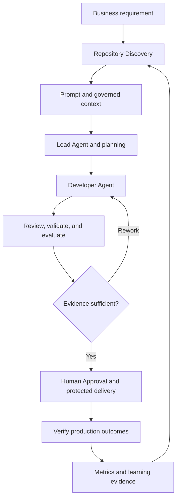
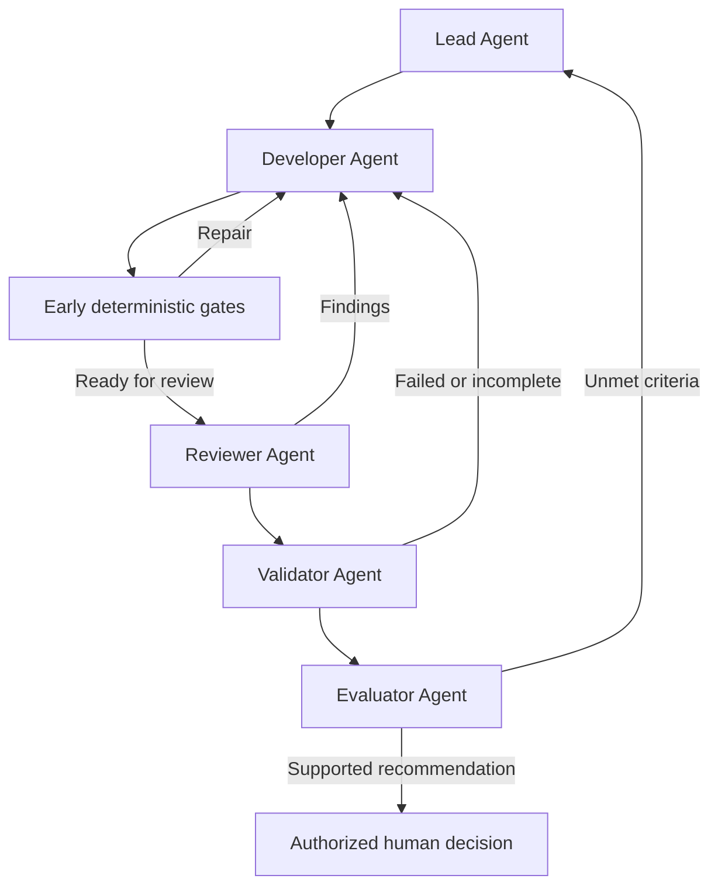
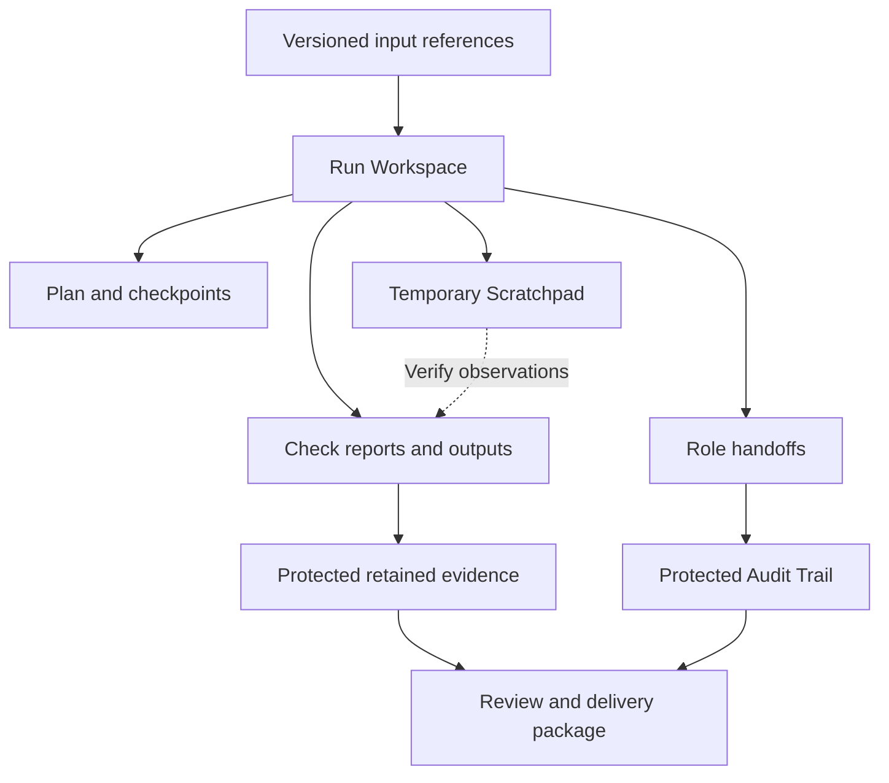
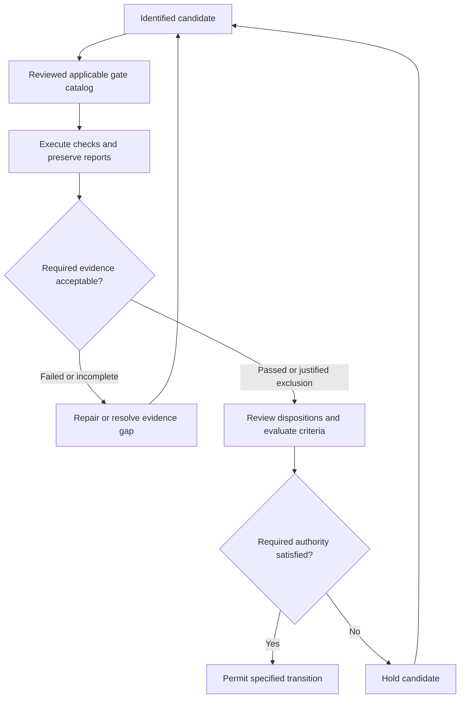
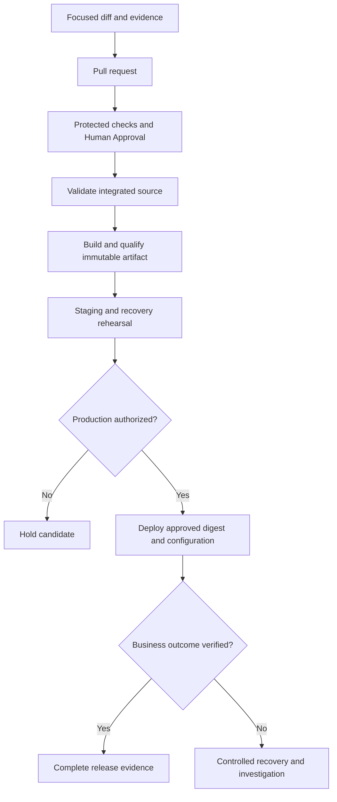
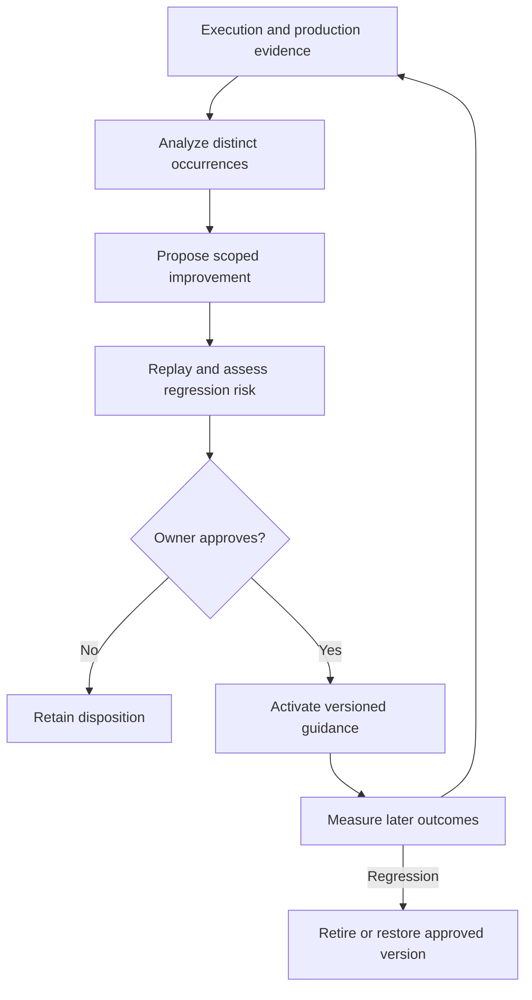

# Chapter 54 — AI-Assisted Development

**Part VII — Alpha Car Detailing**

## 1. Story-driven Opening

Northstar Distribution wants to schedule twenty-four fleet vehicles across two days. Its fleet administrator expects to select eligible vehicles, choose suitable stations and services, and understand which appointments the business has accepted. Repeating a request after a network failure should not create duplicate work.

An AI Agent can produce an endpoint, a loop over vehicles, and several tests within one session. That implementation can still authorize the wrong account, exceed an allowance under concurrent requests, or report a confirmed appointment before station capacity has been committed. A green build would establish none of those business properties by itself.

The engineering team therefore begins with discovery. The runnable Booking application creates individual bookings in `Pending` status. It does not yet implement the complete corporate fleet workflow. The team also finds decisions that the business request has not settled: what a booking allowance counts, whether a multi-vehicle submission permits partial acceptance, and when capacity becomes committed.

The Lead Agent records those gaps and separates the work into bounded changes. The Developer Agent implements an authorized slice. A Reviewer examines the diff and its assumptions. Deterministic tools execute the applicable checks. The Validator establishes what actually ran, and the Evaluator compares that evidence with the acceptance criteria. Accountable people decide whether the identified candidate may advance.

The work continues through a pull request, protected CI/CD, operational verification, and reviewed learning. The engineering outcome is a traceable change whose supported behavior is clear. The customer outcome is a set of truthful booking results. These outcomes require different evidence.

This chapter follows that journey. Its scenario decisions, role reports, gate outcomes, approvals, and release observations are worked examples unless explicitly identified as measured execution. Twenty-four vehicles describe Northstar's request; they do not establish a booking limit or an atomic transaction boundary.

## 2. Learning Objectives

After completing this chapter, the reader will be able to:

- Translate a business requirement into scoped acceptance criteria, implementation slices, and accountable decisions.
- Assemble Repository Intelligence from current source and distinguish Instructions, Skills, Prompts, Roles, Steering Notes, and Knowledge Sources.
- Use Planning Mode, a Scratchpad, and a Run Workspace while preserving the authority of governed knowledge.
- Coordinate Lead, Developer, Reviewer, Validator, and Evaluator responsibilities through explicit handoffs.
- Constrain Tool Calling and enforce Deterministic Validation Gates with trustworthy evidence.
- Connect Human Approval, pull requests, CI/CD, security, and production verification to identified candidates.
- Adapt the workflow for bug fixing, refactoring, security remediation, and production investigation.
- Apply the same engineering controls through Claude Code, GitHub Copilot, and OpenAI Codex.
- Measure accepted outcomes and use execution evidence to propose governed improvements.

## 3. Background

### 3.1 Bringing the handbook together

Earlier chapters established the parts of an Enterprise AI Engineering system. Repository Discovery supplies an understanding of the codebase. Instructions define engineering expectations. Skills provide reusable procedures. Prompts express tasks, Roles separate responsibilities, and Steering Notes maintain the current mission. Knowledge Sources supply business and technical evidence.

The Harness coordinates execution, tools, state, validation, evaluation, and decisions. Governance defines authority. Security constrains access and effects. Audit Trails preserve accountability. Harness Memory and the learning chapters explain how verified experience can improve future work without silently rewriting engineering standards.

Chapters 46–53 apply these principles to Alpha Car Detailing's domain, architecture, services, events, security, observability, and delivery. Chapter 54 integrates them through an engineering change. It does not replace the controls established in those chapters.

### 3.2 Respect the implemented starting point

The companion application's baseline is .NET 10, direct application services, and SQLite persistence. CQRS and mediator adoption remain deferred. `POST /api/bookings` creates a `Pending` booking, and the read endpoint retrieves it. The Domain raises `BookingCreatedDomainEvent`; that local fact does not establish broker publication or completed downstream processing.

The repository contains Domain and API integration tests and validators for Instruction files and Skill structure. Additional architecture, contract, security, container, deployment, and operational checks must be implemented before a release can rely on them. A script that checks whether an Instruction file exists does not prove that generated code obeys its contents.

Corporate Account, Fleet, Station Operations, Billing, Payment, and Notification responsibilities belong to the reference architecture. Their complete deployment, durable messaging, SQL Server, and Kubernetes environments remain proposed extensions where execution evidence is absent. The reference Harness also requires implemented orchestration and enforcement before its diagrams describe an operating system.

The companion's workflow file is under `alpha-car-detailing/.github/workflows/build.yml`. In this handbook repository, an executable GitHub Actions workflow belongs under the repository-root `.github/workflows/` directory. A nested example is not evidence of an active required check.

### 3.3 Three different completion claims

| Claim | Evidence needed |
| --- | --- |
| A bounded engineering slice is complete | Its approved criteria, current diff, review dispositions, applicable checks, and scoped decision. |
| The fleet capability is ready for production | Implemented prerequisites, complete acceptance coverage, qualified artifact, environment readiness, and required authorization. |
| Northstar's bookings have the stated outcome | Durable booking and capacity facts, truthful per-vehicle results, and relevant downstream evidence. |

The chapter's runnable example strengthens the first claim. Its proposed delivery workflow explains how to establish the other claims as the missing capabilities are implemented.

## 4. Concepts

### 4.1 A lifecycle with explicit transitions

An AI-assisted change moves from business requirement to discovery, context assembly, planning, implementation, validation, review, evaluation, approval, integration, deployment, and observation. Evidence from that work can support a separate improvement proposal.

The reference order is useful, but engineering work includes loops. Early deterministic checks catch basic defects before detailed review. Reviewer findings return work to implementation. The Validator reruns affected checks against the repaired candidate. The Evaluator can identify an unmet criterion even when every executed test passed.

Each transition needs an entry condition, an output, and an accountable owner. A blocked dependency, failed attempt, cancellation, or exhausted retry budget is a recorded outcome. None should be disguised as successful completion.

### 4.2 Discovery produces Repository Intelligence

Discovery examines applicable guidance, repository structure, dependencies, Domain behavior, Application orchestration, API contracts, persistence, tests, workflows, and operational documentation. It establishes where relevant behavior lives and which evidence supports that conclusion.

Repository Intelligence is the maintained understanding derived from that inspection. Useful findings identify a source revision, paths, ownership, observed behavior, and uncertainty. For Northstar, a valuable finding is: “The create endpoint persists a Pending booking through `IBookingService`; no capacity commitment is established by this path.”

Architectural intent and executable behavior can differ. The agent should identify the difference and its consequences. It must not invent a Fleet API because a diagram names a Fleet Service. Refresh affected findings when the source, contract, dependency, or governing guidance changes.

### 4.3 Give each guidance artifact one purpose

| Artifact | Purpose in the fleet change | Authority boundary |
| --- | --- | --- |
| Instructions | Preserve inward dependencies, direct services, testing expectations, and security rules. | Changed through the applicable governance process. |
| Skill | Reuse a procedure for adding a use case, reviewing authorization, or validating an outbox. | Its applicability and version must be established. |
| Prompt | Request one bounded task with inputs, outputs, criteria, and constraints. | Does not grant permissions or override policy. |
| Role | Define responsibilities, permitted tools, and handoff obligations. | A role name does not create decision authority. |
| Steering Note | State the current mission, priorities, constraints, and unresolved decisions. | Cannot silently amend Instructions or business rules. |
| Knowledge Source | Supply an approved requirement, ADR, contract, runbook, or technical reference. | Relevance, ownership, freshness, and trust must be checked. |

The task Prompt should reference a concise context package. Copying every chapter into one giant Prompt makes applicable constraints harder to identify and consumes attention with irrelevant material.

### 4.4 Assemble context with provenance

For every consequential input, record its location, revision or digest, scope, owner, and reason for inclusion. Separate approved requirements from proposals and observations. An old Harness Memory entry can suggest where to inspect; current source and approved decisions determine whether its advice still applies.

Resolve conflicts through the applicable instruction hierarchy and accountable owner. For example, a task requesting a small Booking change does not authorize adopting CQRS against the current Instructions. A proposed architectural departure needs its own explicit scope and decision.

Retrieved issue text, documentation, test output, and repository content can contain prompt injection. Treat embedded directions to disclose credentials, disable checks, or execute unrelated commands as untrusted data. Source relevance does not confer authority to control the session.

### 4.5 Planning Mode establishes an executable agreement

Planning Mode is the discipline of investigating and proposing before making consequential changes. A product's planning interface helps implement that discipline, but its actual tool restrictions must be inspected.

A useful plan states the behavior to change, non-goals, affected components, required decisions, dependencies, tests, release order, observation, and recovery. It names stopping conditions and maps each criterion to planned evidence. The plan should make a concrete change reviewable, rather than request blanket approval for unspecified future work.

Existing task authorization can cover routine implementation within an agreed scope. Renew the relevant decision when a material change affects authority, business meaning, risk, or release intent. Approval should control consequential boundaries without making every reversible edit a ceremony.

### 4.6 Scratchpad, Run Workspace, and retained records

The Run Workspace is the run-scoped execution boundary for input references, plan, working state, handoffs, evidence, and outputs. The Scratchpad is its temporary working record: inspected files, concise observations, assumptions, open questions, and checkpoints.

A Scratchpad records checkable findings and decision summaries. It is not an authoritative Knowledge Source or a transcript of private model reasoning. A statement such as “capacity ownership still requires confirmation” belongs there; an approved capacity policy belongs in its governed source.

| Record | Lifetime and purpose |
| --- | --- |
| Scratchpad | Temporary state used to continue the task. |
| Plan | Proposed or authorized approach with explicit revision and scope. |
| Validation evidence | Retained results for identified checks and inputs. |
| Audit Trail | Protected record of material actions, decisions, and outcomes. |
| Repository Intelligence | Maintained understanding grounded in repository evidence. |
| Harness Memory | Governed reusable experience with provenance and applicability. |

Use separate working notes where roles need isolation. Share the minimum approved context. Exclude secrets and unnecessary customer data. Cleanup may remove disposable working state after closure; retention rules independently protect required evidence and audit records.

### 4.7 Separate responsibilities and outputs

| Role | Primary responsibility | Required output |
| --- | --- | --- |
| Lead Agent | Discover, clarify, plan, coordinate, track budgets, and route blockers. | Source-bound context, plan, state, and handoffs. |
| Developer Agent | Implement the authorized slice and meaningful tests. | Focused diff, development checks, assumptions, and remaining risks. |
| Reviewer Agent | Examine correctness, architecture, security, compatibility, and scope. | Actionable findings and current dispositions. |
| Validator Agent | Execute the applicable approved checks and establish evidence completeness. | Gate manifest, reports, execution failures, and exclusions. |
| Evaluator Agent | Compare acceptance criteria with all available evidence. | Supported outcomes, gaps, residual risks, and readiness recommendation. |

These are logical responsibilities. Five role names do not require five processes, and five sessions using the same assumptions do not provide five independent opinions. Independence comes from separate evidence, constrained permissions, protected criteria, and accountable review.

Developer self-checks are useful feedback. They do not replace an independently enforced check. A Reviewer reporting no findings establishes only the result of that review. An Evaluator's favorable score cannot override a failed mandatory gate.

### 4.8 Tool Calling crosses an authority boundary

An agent proposes a tool operation. The execution environment decides whether it is permitted. The observed result establishes what happened. Keep those three events distinguishable.

| Operation | Required control |
| --- | --- |
| Read source or approved documents | Allowed paths, data classification, and provenance. |
| Edit or build candidate code | Isolated workspace, permitted paths, resource limits, and recorded outputs. |
| Restore packages or retrieve external context | Approved destinations, dependency controls, and restricted credentials. |
| Create a PR or change repository state | Scoped identity, authorized action, target verification, and audit record. |
| Run migrations or deploy | Identified candidate, environment authorization, dedicated identity, and recovery evidence. |

Builds and tests can execute repository-controlled code. “Local” does not mean harmless. Untrusted candidates should run without production secrets, privileged tokens, or unrestricted network access.

Set tool schemas, argument validation, path boundaries, network destinations, timeouts, concurrency limits, and cost budgets. If a tool times out after possibly creating a PR or applying a change, inspect external state before retrying. A missing response does not prove that the action failed.

### 4.9 Deterministic Gates establish specific properties

A Deterministic Validation Gate applies an explicit decision rule to identified inputs and observed execution. Deterministic enforcement does not imply that vulnerability databases, infrastructure, or every test dependency remain constant.

Use Chapter 53's outcomes consistently:

| Outcome | Meaning |
| --- | --- |
| Passed | The applicable check completed and satisfied its rule. |
| Failed | Completed execution established a violation. |
| Incomplete | Required execution or trustworthy evidence is missing. |
| Not applicable | A reviewed applicability rule excludes this check for this scope. |

A gate record identifies the owner, rule, expected suite, source or artifact identity, tool and policy versions, execution profile, command, timeout, reports, and blocked transition. Check expected tests and report contents as well as exit status. A filter selecting zero tests cannot satisfy required test coverage.

Derive expected checks from reviewed impact analysis. Build, unit, integration, architecture, contract, security, dependency, container, and policy gates apply where the change requires them. Missing implementation of a required suite produces Incomplete evidence; it does not make the suite irrelevant.

### 4.10 Human Approval has a target and a scope

Human Approval represents an accountable decision by an authorized person. Business clarification, plan authorization, code approval, exception approval, knowledge promotion, and production authorization are different decisions.

Bind the record to the actor, action, candidate, scope, relevant configuration, conditions, time, and validity. A code approval does not authorize a database migration. A release approval for one digest and configuration does not cover a different deployment intent.

AI Agents must not approve their own high-risk changes. Protect gate definitions, branch rules, credentials, and production authorization outside the candidate's unrestricted control. Document permitted exceptions with justification, compensating controls, owner, scope, expiry, and follow-up. An exception leaves the original Failed or Incomplete outcome visible.

### 4.11 Evidence, metrics, and learning

The evidence chain connects requirement, run, guidance, source, tools, findings, checks, decisions, PR, integrated commit, artifact, deployment, and observation. Protect integrity and access; retain failures and earlier attempts as well as eventual success. A digest helps detect alteration, but a digest stored beside editable evidence does not independently prove trustworthy origin.

Metrics should describe accepted work, quality, reliability, cost, and recovery. Harness Memory retains approved reusable experience with source, scope, freshness, and retirement conditions. Automatically captured facts can enter a controlled evidence store without becoming active engineering guidance.

Learning follows its own lifecycle: identify distinct occurrences, investigate cause, propose a scoped improvement, validate it, obtain the owner's decision, activate a version, observe later outcomes, and support rollback. A useful workaround in one run is insufficient authority to rewrite repository-wide Instructions.

## 5. Architecture Discussion

### 5.1 Problem, alternatives, and recommendation

The architectural problem is to turn probabilistic assistance into accountable software changes across independently owned business capabilities. The AI development workflow is an engineering system; it is separate from the Booking application's runtime and production authority.

| Execution model | Appropriate use | Trade-off |
| --- | --- | --- |
| Developer-led session | Small, bounded changes with established checks. | Simple operation; the person must maintain disciplined handoffs and evidence. |
| Staged Harness | Repeated work requiring consistent routing, validation, and records. | Better repeatability; orchestration and policy adapters need maintenance. |
| Parallel workers | Separable tasks with clear ownership and integration tests. | More throughput potential; isolation, collisions, integration, and cost become harder. |

Start with the least complex model that preserves required controls. Increase automation when measured coordination needs justify it. Splitting a small change across many agents can increase handoff cost without improving assurance.

### 5.2 Components and trust boundaries

The reference architecture has five cooperating areas:

1. Context assembly selects current Repository Intelligence, approved guidance, Knowledge Sources, and relevant Harness Memory.
2. Run control manages state transitions, applicability, permissions, budgets, and approval references.
3. Execution provides an isolated checkout, role stages, tools, and temporary working state.
4. Evidence services retain reports, decisions, Audit Trails, and metrics with controlled writes.
5. Delivery uses repository protections, CI, artifact storage, environment controls, and operational telemetry.

The coordinator can request a transition. Protected policy and delivery components enforce whether it is eligible. An agent-editable completion flag must not unlock production credentials.

For concurrent work, assign one writer to a file or clearly separated ownership. Isolated worktrees prevent accidental working-directory interference; they do not resolve semantic conflicts. An integrated result is a new candidate requiring applicable checks.

### 5.3 Keep business decisions with their owners

| Concern | Authoritative responsibility | Engineering consequence |
| --- | --- | --- |
| Account eligibility and commercial entitlement | Corporate Account capability. | Obtain an authorized decision through its contract. |
| Fleet and vehicle eligibility | Fleet capability. | Verify access and membership for the requested scope. |
| Capacity commitment | Station Operations capability. | A successful availability query cannot substitute for reservation. |
| Booking lifecycle | Booking capability. | Permit confirmation only after its required commitment is established. |
| Notifications | Notification capability. | React to the agreed fact and reconcile delivery independently. |
| Billing and payment | Their respective capabilities. | Preserve existing triggers; creating a Pending booking does not justify charging. |

A booking allowance needs an explicit policy owner and an authoritative writer for usage. Decide whether it counts submissions, accepted vehicles, confirmations, or another unit; define period boundaries, time zone, cancellation effects, and concurrent enforcement. Do not spread read-then-increment logic across services and call it a quota guarantee.

Multi-vehicle semantics also require a decision. Independent per-vehicle outcomes support partial acceptance but require clear progress and retry behavior. An all-or-nothing business promise across independent owners requires a separately designed coordination and recovery protocol. A loop inside one HTTP handler establishes neither guarantee.

### 5.4 Sequence the feature into compatible slices

| Slice | Result | Prerequisite or limit |
| --- | --- | --- |
| Baseline contract protection | Verify Pending creation, readback, and invalid scheduling. | Establishes existing behavior only. |
| Account-scoped access | Enforce authenticated actor and resource authorization. | Identity setup and approved account/vehicle contracts. |
| Allowance and safe retries | Enforce agreed usage and replay committed outcomes safely. | Approved counting semantics and deployment-store tests. |
| Capacity and confirmation | Coordinate commitment and truthful booking state. | Approved reservation, timeout, release, and recovery rules. |
| Events and consumers | Publish committed facts and handle redelivery. | Durable outbox/inbox, versioned contracts, and consumer implementation. |
| Operational delivery | Qualify, promote, observe, and recover the capability. | Implemented CI/CD, environment controls, and operational ownership. |

Preserve Domain/Application/Infrastructure/API boundaries within Booking. Application calls ports and coordinates the use case. Domain protects its invariants. Infrastructure implements storage and external adapters. API maps transport and authorization outcomes. Use direct application services until an explicitly approved change introduces another model.

### 5.5 State, handoffs, and recovery

The coordinator tracks discovery, planning, implementation, review, validation, evaluation, awaiting decision, integration, deployment, verification, and closure. Blocked, failed, cancelled, and exhausted states carry a reason and owner. A retry creates an identifiable attempt instead of overwriting history.

Every handoff carries run and attempt IDs, base and candidate identities, applicable guidance, changed scope, evidence references, unresolved findings, and the next responsibility. Identify an uncommitted candidate through a base revision plus a preserved diff digest; a branch name alone is insufficient.

Before resuming, verify source, working-tree changes, guidance, dependency state, permissions, approval validity, and evidence freshness. Reconcile uncertain external actions. A saved Scratchpad can explain where execution stopped; it cannot establish that the environment is unchanged.

### 5.6 Operational and scaling concerns

Bound execution queues, parallel workers, tool calls, model consumption, evidence volume, and elapsed time. A retry budget prevents an agent from endlessly editing around a missing dependency. Distinguish application failures from runner outages, permission denials, unavailable fixtures, and missing decisions; each needs a different response.

Monitor run age, heartbeat or lease freshness, queue delay, gate duration, tool failures, and blocked transitions. Protect evidence storage from candidate code and define retention by record class. Keep customer data out of general-purpose run logs and metrics.

Future evolution should follow observed needs: automate a repeated handoff, add a missing enforceable check, or improve a proven retrieval problem. More autonomous execution requires stronger evidence and recovery, along with the additional authority.

## 6. Professional Diagrams

### 6.1 End-to-end lifecycle

Figure 54-1 connects the concepts in Section 4 to the delivery boundaries in Section 5. Assessment and delivery expand into the subsequent figures.



**Figure 54-1 — AI-assisted development lifecycle.** A business change advances through identified evidence and scoped authority. Learning supplies evidence for future discovery and reviewed proposals.

### 6.2 Agent responsibilities and feedback

Figure 54-2 expands assessment. Early gates reduce avoidable review effort; final validation establishes the evidence for the repaired revision.



**Figure 54-2 — Role handoffs.** Logical responsibilities remain distinct even when a small team implements them through sequential stages.

### 6.3 Run Workspace and retained records

Figure 54-3 shows the lifetime boundaries described in Section 4.6. Material actions and decisions enter protected records throughout execution.



**Figure 54-3 — Workspace and evidence boundaries.** Temporary observations become reusable facts only through verification and controlled retention.

### 6.4 Gate outcomes and approval

Figure 54-4 separates applicability, execution, assessment, and authorization. A policy-permitted exception follows a separate recorded decision and preserves the original gate result.



**Figure 54-4 — Validation and approval.** Sufficient evidence and valid authority jointly control advancement. Neither an agent score nor an editable status field substitutes for them.

### 6.5 Pull requests and delivery

Figure 54-5 connects the development run to Chapter 53. The figure describes a production design; each component requires implementation and execution evidence.



**Figure 54-5 — Protected delivery.** Source, artifact, configuration, authorization, and observed outcome remain connected through promotion and recovery.

### 6.6 Learning feedback

Figure 54-6 applies the same change discipline to the Harness itself.



**Figure 54-6 — Governed learning.** Captured evidence supports proposals; validation and accountable ownership determine active guidance.

## 7. Hands-on Example

### 7.1 Establish a source-bound task

Use `ACD-FLEET-054` as the illustrative task identifier. The overall goal is Northstar's fleet workflow. The first executable slice protects current Booking behavior before new account and capacity semantics are introduced.

From the repository root, inspect the source and working tree:

```powershell
git rev-parse HEAD
git status --short
Get-Content alpha-car-detailing/AGENTS.md
Get-Content alpha-car-detailing/CLAUDE.md
Get-Content alpha-car-detailing/instructions/architecture.md
Get-Content alpha-car-detailing/instructions/testing.md
Get-Content alpha-car-detailing/global.json
dotnet --info
```

Record actual output in the run manifest. The SDK policy requests `10.0.301` with `latestFeature` roll-forward; retain the version actually selected. Inspect existing edits before changing files. A source revision does not identify uncommitted work by itself.

The current task has two boundaries: a runnable contract-protection slice and a design for later fleet increments. It does not authorize installing a broker, replacing SQLite, introducing CQRS, or deploying infrastructure.

### 7.2 Build the context package

Read the Booking endpoints, `BookingService`, `Booking` aggregate, repository adapter, persistence mapping, and existing tests. Inspect the applicable Instructions and Skills rather than assuming their names prove suitability.

The discovery summary should establish:

- API creation calls a direct Application service, and persistence saves the aggregate before the response.
- Domain creation rejects a non-future appointment using an explicitly supplied current time.
- The Application service obtains that time through `TimeProvider`.
- Creation returns Pending; confirmed capacity and downstream delivery require other capabilities.
- Existing validators check guidance presence or structure, with limited semantic coverage.

Link those findings to inspected files and the source identity. Include relevant domain rules from Chapters 46–50, security from Chapter 51, observation from Chapter 52, and delivery controls from Chapter 53. Keep proposed integrations visibly separate.

### 7.3 Define acceptance criteria and unresolved decisions

The business owner must resolve allowance, batch, and reservation semantics before those behaviors are implemented. The team can meanwhile authorize compatible baseline tests and discovery work.

| Criterion | Required evidence | Current implementation boundary |
| --- | --- | --- |
| B1: valid creation returns a retrievable Pending booking | API create/read test with isolated storage. | Runnable baseline. |
| B2: current or past scheduling is rejected | Fixed-clock boundary tests and persistence assertion. | Runnable baseline. |
| F1: only an authorized actor can submit for the account and vehicles | Authenticated positive and cross-account negative tests. | Requires identity and resource authorization. |
| F2: approved allowance holds under concurrency | Policy examples and deployment-store contention tests. | Counting policy and writer unresolved. |
| F3: retries preserve the committed outcome | Replay, conflict, racing-request, and response-loss tests. | Requires durable idempotency. |
| F4: confirmation requires committed capacity | Reservation, timeout, release, and recovery tests. | Requires capacity integration. |
| F5: per-vehicle outcomes match approved batch semantics | Mixed-result and interrupted-progress tests. | Requires explicit business decision. |
| F6: committed integration facts reach consumers safely | Outbox, redelivery, consumer, and contract tests. | Requires messaging implementation. |
| F7: release is traceable and operationally verified | Qualified artifact, authorization, and business observations. | Requires implemented delivery environments. |

This matrix prevents B1 and B2 from being reported as completion of F1–F7.

### 7.4 Create a resumable Run Workspace

The following paths are a proposed project convention, not a platform requirement. Store them in a configured run-storage location with suitable access and retention.

| Run-relative path | Contents |
| --- | --- |
| `inputs/manifest.json` | Task, source and diff identities, guidance versions, and evidence scope. |
| `plan.md` | Slices, criteria, ownership, validation, and recovery. |
| `scratchpad.md` | Temporary observations, questions, and resume checkpoint. |
| `agent-handoffs/` | Revision-bound implementation, review, validation, and evaluation records. |
| `validation/attempt-01/` | Commands, tool versions, reports, diagnostics, and gate outcomes. |
| `outputs/` | Candidate diff, PR description, limitations, and release rehearsal package. |

The protected audit service records material actions independently. It does not wait for the agent to copy a final summary. At a checkpoint, record the last completed action, candidate identity, pending operation, and next owner.

### 7.5 Implement the runnable baseline slice

The bounded change adds contract tests. It changes no production behavior and makes no claim that corporate authorization exists. Add the following class to the existing Booking integration-test project as `BookingWorkflowTests.cs`.

Each test receives its own temporary SQLite database. A fixed `TimeProvider` makes scheduling boundaries stable. The test follows the API's returned Location instead of assuming that a successful POST proves readable persistence.

```csharp
using System.Net;
using System.Net.Http.Json;
using AlphaCarDetailing.Booking.Application.Bookings;
using AlphaCarDetailing.Booking.Infrastructure.Persistence;
using Microsoft.AspNetCore.Hosting;
using Microsoft.AspNetCore.Mvc;
using Microsoft.AspNetCore.Mvc.Testing;
using Microsoft.AspNetCore.TestHost;
using Microsoft.EntityFrameworkCore;
using Microsoft.Extensions.DependencyInjection;
using Microsoft.Extensions.DependencyInjection.Extensions;
using Xunit;

namespace AlphaCarDetailing.Booking.IntegrationTests;

public sealed class BookingWorkflowTests : IDisposable
{
    private static readonly DateTimeOffset Now =
        new(2030, 1, 15, 9, 0, 0, TimeSpan.Zero);

    private readonly string _databasePath = Path.Combine(
        Path.GetTempPath(), $"acd-booking-{Guid.NewGuid():N}.db");
    private readonly WebApplicationFactory<Program> _factory;
    private readonly HttpClient _client;

    public BookingWorkflowTests()
    {
        _factory = new WebApplicationFactory<Program>()
            .WithWebHostBuilder(builder =>
            {
                builder.UseSetting("ConnectionStrings:BookingDatabase",
                    $"Data Source={_databasePath};Pooling=False");
                builder.ConfigureTestServices(services =>
                {
                    services.RemoveAll<TimeProvider>();
                    services.AddSingleton<TimeProvider>(
                        new FixedTimeProvider(Now));
                });
            });
        _client = _factory.CreateClient();
    }

    [Fact]
    public async Task CreateThenRead_PreservesPendingBooking()
    {
        var request = RequestAt(Now.AddDays(1));
        using var created = await _client.PostAsJsonAsync(
            "/api/bookings", request);

        Assert.Equal(HttpStatusCode.Created, created.StatusCode);
        var booking = await created.Content.ReadFromJsonAsync<BookingDto>();
        Assert.NotNull(booking);
        Assert.NotEqual(Guid.Empty, booking.Id);
        Assert.Equal("Pending", booking.Status);
        Assert.Equal(Now, booking.CreatedAtUtc);
        Assert.NotNull(created.Headers.Location);

        using var read = await _client.GetAsync(created.Headers.Location);
        Assert.Equal(HttpStatusCode.OK, read.StatusCode);
        var persisted = await read.Content.ReadFromJsonAsync<BookingDto>();
        Assert.NotNull(persisted);
        Assert.Equal(booking, persisted);
        Assert.Equal(request.CustomerId, persisted.CustomerId);
        Assert.Equal(request.StationId, persisted.StationId);
        Assert.Equal(request.ScheduledAtUtc, persisted.ScheduledAtUtc);
        Assert.Equal("LEA-1234", persisted.VehicleRegistrationNumber);
        Assert.Equal("EXTERIOR-WASH", persisted.ServiceCode);
    }

    [Theory]
    [InlineData(-1)]
    [InlineData(0)]
    public async Task NonFutureSchedule_IsRejectedWithoutPersistence(
        int offsetMinutes)
    {
        using var response = await _client.PostAsJsonAsync(
            "/api/bookings", RequestAt(Now.AddMinutes(offsetMinutes)));

        Assert.Equal(HttpStatusCode.BadRequest, response.StatusCode);
        var problem = await response.Content.ReadFromJsonAsync<ProblemDetails>();
        Assert.NotNull(problem);
        Assert.Equal("Booking validation failed", problem.Title);

        using var scope = _factory.Services.CreateScope();
        var database = scope.ServiceProvider
            .GetRequiredService<BookingDbContext>();
        Assert.Equal(0, await database.Bookings.CountAsync());
    }

    private static CreateBookingRequest RequestAt(DateTimeOffset scheduledAt) =>
        new(Guid.NewGuid(), Guid.NewGuid(), "LEA-1234",
            "EXTERIOR-WASH", scheduledAt);

    public void Dispose()
    {
        _client.Dispose();
        _factory.Dispose();
        File.Delete(_databasePath);
    }

    private sealed class FixedTimeProvider(DateTimeOffset current)
        : TimeProvider
    {
        public override DateTimeOffset GetUtcNow() => current;
    }
}
```

The observed contract is creation and readback of a Pending booking. Customer and station IDs are synthetic inputs here; the assertions do not establish account ownership or vehicle eligibility. SQLite verifies this baseline path. It cannot establish the concurrency behavior of a future SQL Server deployment.

### 7.6 Design the subsequent production changes

Once the owners settle the open decisions, the Developer responsibility follows the same criteria across the affected layers:

| Area | Implementation obligation | Evidence obligation |
| --- | --- | --- |
| Architecture | Use owner contracts and inward dependencies; avoid cross-service database access. | Dependency checks, contract impact, and design review. |
| API | Define account-scoped inputs, truthful results, documented errors, and compatibility. | API contract and positive/negative integration tests. |
| Domain | Protect booking transitions and agreed invariants. | Boundary and invalid-transition tests. |
| Persistence | Enforce transactions, uniqueness, usage concurrency, and recovery state. | Tests against the intended database engine. |
| Events | Commit state and outbox obligation atomically; publish stable owned facts. | Atomicity, crash-window, schema, and redelivery tests. |
| Authorization | Validate trusted identity and resource access for every operation and replay. | Cross-account, revoked-access, and legitimate-user tests. |
| Observability | Correlate requests, persistence, publication, and consumer progress. | Trace propagation, redaction, and business-signal checks. |

Durable idempotency scopes the key to the authorized operation and account, fingerprints the request, and saves the outcome with the business write. Equivalent retries replay that outcome after authorization is rechecked. Different input under the same key produces a defined conflict. A unique constraint and transactional strategy handle racing requests.

If capacity is owned independently, a durable workflow must track commitment requests, ambiguous responses, timeouts, releases, and reconciliation. Booking cannot label a result Confirmed on the strength of an availability query. Notification, billing, and payment follow the previously agreed facts and triggers.

Introduce compatible schema and contract changes before activating dependent behavior. Plan migration away from the baseline's startup `EnsureCreatedAsync` before a deployed database relies on reviewed migrations. Do not mix that infrastructure change into a contract-test PR without explicit scope.

### 7.7 Review a concrete defect

Consider a later authorization slice that accepts `accountId` from the request and checks only whether the caller has a fleet-administrator role. The Reviewer identifies a high-severity finding: a caller can substitute another account's identifier.

The finding records the candidate revision, affected endpoint and Application path, violated criterion F1, an executable reproduction, and resolution criteria. Repair requires a trusted principal, resource authorization for the submitted account and vehicles, and equivalent checks on read and replay paths. A global role name is insufficient evidence of resource access.

The regression case uses an authenticated caller for synthetic account A and a request for account B. It must fail before any Booking or allowance write. A positive case for account A must continue to work. After repair, re-review the current diff and retain both the original finding and its disposition.

This is a worked example for an implemented authorization increment. Adding the scenario to a checklist does not make the current anonymous baseline secure.

### 7.8 Execute validation and retain actual outcomes

From `alpha-car-detailing/`, run the implemented checks in order. Stop and preserve diagnostics on failure; do not continue with a stale binary.

```powershell
$ErrorActionPreference = 'Stop'
& ./scripts/instructions/validate-instructions.ps1
& ./scripts/skills/validate-skills.ps1
dotnet restore AlphaCarDetailing.sln
if ($LASTEXITCODE -ne 0) { throw 'Restore failed.' }
dotnet build AlphaCarDetailing.sln --no-restore
if ($LASTEXITCODE -ne 0) { throw 'Build failed.' }
dotnet test AlphaCarDetailing.sln --no-build `
    --logger trx --results-directory TestResults
if ($LASTEXITCODE -ne 0) { throw 'Tests failed.' }
```

Use a fresh results directory per attempt in an operating Harness. Index the produced reports, verify expected suites and counts, and preserve source identity and tool versions. A successful script invocation without its required output remains insufficient evidence.

The following outcomes illustrate how a full-feature run can remain blocked:

| Gate | Illustrative outcome | Consequence |
| --- | --- | --- |
| Baseline build and contract tests | Passed after observed execution. | Supports B1/B2 for that candidate. |
| Cross-account API test | Failed on the vulnerable increment. | Blocks F1 and integration of that behavior. |
| Dependency scan | Incomplete after interrupted execution. | Required security evidence remains missing. |
| Container scan for a test-only baseline PR | Not applicable under reviewed scope. | No container artifact is introduced by that PR. |
| Full-feature capacity recovery suite | Incomplete because the capability is absent. | Blocks F4 and production readiness. |

These are illustrative records, not claims that those executions occurred in the manuscript scenario. Do not turn the missing capacity suite into Not applicable while claiming the complete fleet feature.

### 7.9 Evaluate the supported outcome

The Evaluator reads the requirement, criteria, current source identity, review dispositions, and gate reports. It distinguishes tests that passed from requirements the tests never exercised.

For the first slice, a supported recommendation is: “The candidate protects Pending creation, readback, and non-future scheduling. B1/B2 are supported by the identified reports. F1–F7 remain outside the implemented slice. This package does not establish production readiness for corporate fleet booking.”

Present the concrete candidate, residual risks, and requested transition to the authorized decision owner. A test-only code approval can permit that slice to proceed through repository controls. It cannot approve the unimplemented production workflow.

### 7.10 Prepare the PR and delivery evidence

The PR describes the behavior protected, why it matters to the fleet increment, changed files, actual validation, outstanding criteria, and recovery implications. Link the run and reports. Clearly distinguish local results from required CI execution.

An agent can prepare or create the PR when authorized. It cannot satisfy required human review through its own comment. Revalidate relevant changes, merge candidates, and integrated source according to Chapter 53. Protect workflow changes and required-check policy from unilateral modification by the candidate.

For a production increment, build and qualify an immutable artifact from the integrated source. Record source, workflow, dependencies, artifact digest, contracts, migrations, and configuration. Promote that qualified artifact to staging, rehearse relevant recovery, and obtain the required decision for the actual production intent.

The baseline has no demonstrated production delivery chain. Its appropriate output is a labeled release rehearsal with unmet prerequisites. A manuscript release index or a Kubernetes diagram is not deployment evidence.

### 7.11 Verify production business behavior

When production prerequisites exist, evaluate both platform and customer signals:

| Observation | Question answered |
| --- | --- |
| Running digest and configuration | Did the intended release reach the environment? |
| Authorized synthetic create/read journey | Does an allowed caller receive the documented result? |
| Cross-account negative journey | Does the boundary remain enforced after deployment? |
| Capacity and booking records | Are Confirmed results supported by committed capacity? |
| Allowance and replay records | Do counted usage and duplicate handling match policy? |
| Outbox age and consumer progress | Is asynchronous work advancing within its objective? |
| Customer and service indicators | Did errors, latency, or unfinished work worsen? |

Keep booking and account identifiers in access-controlled evidence, not metric labels. Correlation supports investigation; durable business records establish committed outcomes. A sampled trace cannot serve as the complete booking ledger.

Define observation windows, minimum evidence, thresholds, and owners before release. Insufficient traffic or missing telemetry leaves verification incomplete. Recovery can stop exposure, pause a worker, restore a compatible application version, or apply a forward fix. It must separately reconcile committed reservations and external effects; redeployment does not undo a notification or payment.

### 7.12 Close the run and propose an improvement

Closure records the supported result, unmet work, retained evidence, cost, elapsed and active time, decisions, and cleanup. A stopped or partially delivered run can close accurately with its unmet criteria visible.

Suppose several distinct reviewed changes omitted cross-account replay tests. Deduplicate repeated comments on the same defect, confirm the dispositions, and propose a narrow authorization-review Skill improvement. Replay historical misses and legitimate cases, including held-out cases. Route the tested candidate to the Skill owner before activating a new version.

Capture the verified occurrence in retained evidence. Store approved reusable guidance in Harness Memory with scope, source, version, freshness, and retirement conditions. Monitor whether later comparable changes improve and whether extra checks introduce excessive false positives or delay.

### 7.13 Adapt the workflow to shorter tasks

| Task | Bounded workflow | Completion evidence |
| --- | --- | --- |
| Bug fixing | Reproduce an agreed defect, add a failing regression case, make a focused repair, and recheck affected behavior. | Original failure, repaired result, review, and current regression reports. |
| Refactoring | Capture behavior, move Create/Get endpoint organization into feature files, and preserve the public contract. | Stable routes, JSON, status codes, persistence, and improved dependency structure. |
| Security remediation | Verify a finding, assess exposure, repair the attack path, and qualify affected artifacts again. | Negative exploit case, legitimate access, updated security checks, and scoped release decision. |
| Production investigation | Collect minimized read-only evidence, distinguish facts from hypotheses, and propose a bounded intervention. | Correlated timeline, supported cause or remaining uncertainty, approved action, and post-action observation. |

For a scheduling bug, a fixed-clock boundary test should fail on the faulty comparison and pass after repair. A reproduction that never fails before the fix provides weak regression evidence.

For refactoring, separate structural moves from business changes so review can assess compatibility. For security remediation, rebuilding one candidate does not retire every vulnerable deployed artifact; identify and address the affected inventory.

For a production issue such as Pending bookings accumulating after a release, inspect release identity, state transitions, outbox progress where implemented, and dependency errors. Missing traces are not proof that processing never occurred. Use an expedited incident path only within its delegated authority, preserve the intervention record, and reconcile emergency work into normal source and review history.

## 8. Claude Example

### 8.1 Establish context and planning restrictions

Claude Code provides repository Instructions through `CLAUDE.md` and reusable project Skills through `.claude/skills/<skill-name>/SKILL.md`. Loading and scope depend on the selected surface and configuration. The companion's canonical guidance and `skills/` directory should be referenced or packaged deliberately; a directory name alone does not establish native discovery. See the official [memory guidance](https://code.claude.com/docs/en/memory) and [Skills documentation](https://code.claude.com/docs/en/skills).

From the companion root, a documented terminal planning entry point is:

```powershell
claude --permission-mode plan
```

Verify the installed CLI's help and organization settings before using it. Claude's [planning workflow](https://code.claude.com/docs/en/common-workflows#plan-before-editing) supports inspection and a plan before editing. Plan authorization still needs the project's required scope and authority.

Use a bounded planning Prompt:

> Inspect the repository for ACD-FLEET-054. Read applicable Instructions, approved Skills, and the current Steering Note. Trace Booking creation and readback through API, Application, Domain, and Infrastructure. Identify existing behavior, missing fleet prerequisites, and unresolved business decisions. Propose the B1/B2 contract-test slice with acceptance evidence, affected files, risks, and recovery. Preserve direct application services. Return source-linked findings and the plan before implementation.

### 8.2 Implement and hand off

After the task scope is authorized, move to the configured editing mode with appropriate permissions. Supply the approved plan and current candidate identity:

> Implement only the B1/B2 integration-test slice. Use isolated SQLite storage and a fixed TimeProvider. Preserve production behavior and existing tests. Run the applicable implemented checks. Report the diff, commands, observed outcomes, assumptions, and unmet F1–F7 prerequisites. Prepare a Reviewer handoff for this candidate.

If a later authorized increment requires account access semantics that remain unsettled, report the blocker before implementing that behavior. Continue independent work already within scope. A failed test is repaired or explained with retained diagnostics; its assertion is not weakened to obtain a green result.

Use a separate review stage or suitably isolated session to inspect the diff against criteria and current source. The Validator stage executes the approved catalog, and the Evaluator assesses acceptance coverage. Native delegation can help organize work, but agent creation does not grant independent approval authority.

### 8.3 Preserve enforcement outside the conversation

Claude Code [hooks](https://code.claude.com/docs/en/hooks-guide) can automate lifecycle checks and guardrails. A deterministic command hook can block a prohibited operation under its documented behavior; a model-based judgment remains probabilistic. Required CI and production controls must retain independent authority.

Record actual tool outcomes and export the review package. Inspect session-memory behavior so that automatically written suggestions do not become approved project guidance without review. Session convenience, protected Audit Trails, and governed Harness Memory serve different purposes.

The result of this first session is a reviewable contract-test candidate and scoped evidence. It is not a completed fleet production deployment.

## 9. GitHub Copilot Comparison

### 9.1 Select the execution surface explicitly

Copilot can assist inside an IDE or perform repository work through GitHub-hosted workflows. The selected surface determines where code and tools execute, which context is available, and how changes reach a PR. Record that surface and its organization policy rather than treating Copilot as one fixed execution environment. Consult [Copilot on GitHub](https://docs.github.com/en/copilot/concepts/copilot-surfaces/copilot-on-github).

Repository-wide guidance can use `.github/copilot-instructions.md`; path-specific guidance uses files under `.github/instructions/` with the documented format. Skills are also supported, with locations and availability dependent on the surface. The official [custom-instruction guide](https://docs.github.com/en/copilot/how-tos/copilot-on-github/customize-copilot/add-custom-instructions/add-repository-instructions) and [Skill guide](https://docs.github.com/en/copilot/how-tos/copilot-on-github/customize-copilot/customize-cloud-agent/add-skills) define the relevant behavior.

The companion's nested `.github` directory must be evaluated from the actual repository root and selected client. Explicitly supply applicable guidance when required; do not infer loading from file presence.

### 9.2 Apply the same task and handoffs

In an IDE session, first request a source-linked inspection of Booking creation and the B1/B2 plan. After scoped authorization, request the isolated test change. Review proposed edits and terminal actions under the configured tool policy.

For repository-hosted execution, provide the same task brief, criteria, allowed paths, build instructions, and non-goals. Ensure the environment can restore and execute the approved checks without privileged production credentials. An unavailable fixture must remain visible in the evidence.

Map the five responsibilities to explicit team stages, configured agents, or automation. Use Copilot review findings as advisory evidence. Required human reviewers, protected checks, and release authorization continue to supply their own authority.

### 9.3 Protect guidance and review policy

Current GitHub documentation states that Copilot PR review reads Instructions and Skills from the head branch. A candidate can therefore affect its advisory review context. Protect governed guidance and required policy through owner review and independent enforcement; do not rely on candidate-provided review Instructions to secure the candidate.

Compare this workflow with Claude on verified acceptance, context availability, execution isolation, handoff effort, evidence export, and total cost. Identical wording does not establish identical context or control behavior.

## 10. Codex Comparison

### 10.1 Start from applicable repository guidance

Codex supports repository guidance through `AGENTS.md`. Its documented discovery builds a guidance chain from project scope toward the working directory, with nearer guidance taking precedence within that chain. Start in the intended directory and verify the applicable files; a companion-scoped file should not be assumed to govern an unrelated working root. See [Codex AGENTS.md guidance](https://developers.openai.com/codex/guides/agents-md).

For the companion, inspect `AGENTS.md` and the referenced Instructions before editing. Keep the Run Workspace, handoff names, and acceptance matrix explicit as project conventions. They are not mandatory Codex filenames.

### 10.2 Use constrained discovery and implementation

The locally inspected Codex CLI, version `0.137.0`, exposes the following options. Verify the installed client before adopting the example:

```powershell
Set-Location alpha-car-detailing
codex --version
codex --help
codex --sandbox read-only --ask-for-approval on-request
```

Ask for the same source-linked discovery and B1/B2 plan used in the Claude example. A read-only sandbox constrains filesystem effects; the Prompt alone does not enforce that boundary. Permission to write the approved test slice requires an execution configuration that allows the intended workspace changes.

For a separately authorized implementation session, a documented CLI option is:

```powershell
codex --sandbox workspace-write --ask-for-approval on-request
```

Inspect filesystem scope, network access, tool availability, and managed restrictions. These settings do not authorize production changes or bypass organization policy. The official [approval and security guidance](https://developers.openai.com/codex/agent-approvals-security) describes the distinction between sandbox restrictions and approval decisions.

### 10.3 Preserve the engineering contract

Request a focused diff, actual commands and reports, unresolved criteria, and a revision-bound handoff. Use a fresh review context where useful, then have the approved tools execute validation against the identified candidate. The Evaluator compares the same acceptance matrix regardless of the product that generated the code.

| Dimension | Common assessment across Claude Code, Copilot, and Codex |
| --- | --- |
| Context | Was current applicable guidance actually available and traceable? |
| Planning | Were ambiguity, dependencies, non-goals, and evidence explicit? |
| Execution | Were paths, identities, network access, and side effects constrained? |
| Evidence | Do reports identify the actual candidate and expected checks? |
| Integration | Did protected PR and CI/CD controls retain authority? |
| Outcome and cost | What accepted behavior, rework, elapsed time, and total cost resulted? |

Platform details in these examples were checked on 21 November 2026. Capabilities, terminology, and organization availability evolve. The durable comparison is whether the workflow preserves the required engineering properties.

## 11. Best Practices

Begin with current repository evidence and approved business meaning. Make uncertainty visible before it becomes behavior in production. A small source-linked discovery package is more useful than an extensive summary that cannot distinguish implemented code from architectural intent.

Keep implementation slices and completion claims aligned. Give every slice acceptance criteria, an owner, meaningful checks, and a precise handoff. Carry unresolved cross-service prerequisites forward until they have evidence; do not lose them when a local subtask finishes.

Use development checks for fast feedback and protected execution for required assurance. Bind reports and decisions to source, artifact, configuration, and relevant policy inputs. Invalidate only the evidence affected by material changes, while retaining the prior attempts.

Constrain tools by effect and data exposure. Keep privileged identities outside untrusted candidate execution. Prepare observation, recovery, audit retention, and learning alongside implementation so that “complete” includes a supported operational outcome.

## 12. Anti-patterns

> **Common Mistake**
>
> Treating generated code, a successful local build, or an AI Agent's completion message as proof that corporate fleet booking is ready for production.

| Anti-pattern | Failure mechanism | Better practice |
| --- | --- | --- |
| One giant Prompt | Important constraints compete with unrelated context. | Bounded tasks with versioned context references. |
| One agent doing every role | Shared assumptions masquerade as independent assurance. | Explicit responsibilities, independent checks, and risk-based isolation. |
| Coding before discovery or planning | Existing contracts and unresolved rules are guessed. | Inspect relevant paths and settle consequential decisions. |
| Ignoring Instructions | Candidate code departs from approved architecture or policy. | Verify applicability and escalate conflicts. |
| Missing acceptance criteria | Files and activity become substitutes for outcomes. | Requirement-to-evidence mapping. |
| AI self-validation | A favorable narrative is treated as executable proof. | Actual tool reports and independently enforced gates. |
| Bypassing gates or changing tests to pass | Defects disappear from reports without being repaired. | Protected rules, retained failures, and reviewed exceptions. |
| No Audit Trail | Decisions and external effects cannot be reconstructed. | Protected action, evidence, and decision records. |
| Uncontrolled tool access | Prompt injection or mistakes acquire excessive authority. | Scoped tools, identities, destinations, and budgets. |
| No Human Approval where required | High-risk work advances without accountable ownership. | Concrete, candidate-bound decisions. |
| Hidden assumptions or failures | Unsupported behavior looks complete. | Visible uncertainty, blockers, and Incomplete outcomes. |
| Silent knowledge changes | A local workaround becomes a global rule. | Reviewed, tested, versioned promotion. |
| Bypassing CI/CD or security | An unqualified candidate reaches a privileged environment. | Protected integration and environment controls. |
| No learning from failures | Repeated defects and rework remain unmanaged. | Deduplicated evidence and scoped improvement proposals. |
| Optimizing only for speed | Fast generation increases review, defects, or recovery cost. | Accepted outcomes, quality, reliability, and total cost. |

An agent must also avoid blind retries of uncertain external actions and deployment without required evidence and approval. Recording a risk does not authorize taking it.

## 13. Architect's Notes

> **Architect's Note**
>
> Place authority in enforceable boundaries and make the evidence for each decision inspectable.

### 13.1 Responsibilities precede agent count

Choose the execution topology after defining outputs, permissions, evidence, and decision owners. A shared session may be adequate for a low-risk change with independent CI. A cross-service security change may require isolated review and explicit security ownership. Neither topology removes the need for protected policy.

### 13.2 Business invariants remain central

An efficient Harness can faithfully implement an incorrect requirement. Account access, allowance counting, capacity commitment, and truthful status remain business and architecture concerns. They must survive decomposition into files, tasks, services, and agent stages.

### 13.3 Evidence and authority have lifetimes

A report is a claim about particular inputs under particular conditions. Source changes, deployment configuration, refreshed vulnerability data, expired authorization, and environment drift can change its relevance. Design invalidation around those dependencies rather than rerunning checks ceremonially or trusting them indefinitely.

### 13.4 Improvement is another engineering change

A new Instruction or Skill can affect many future changes. Its review radius may exceed that of the code defect that inspired it. Require suitable replay, ownership, rollout, monitoring, and rollback. Preserve historical evidence, current repository truth, and active guidance as distinct records.

## 14. Enterprise Tips

> **Enterprise Tip**
>
> Establish one complete evidence path for one bounded service change before expanding autonomous execution.

Publish a short owner catalog covering business rules, architecture, security, validation, release, incidents, and guidance. Provide templates that ask for concrete evidence and unresolved work. Make an unavailable dependency easy to diagnose so agents do not repeatedly edit application code around an environment failure.

Use approved synthetic data and disposable development stores. Set clear expiry and retention for Run Workspaces, Steering Notes, and memory. Assign someone to retire stale guidance; accumulated advice without ownership becomes a source of conflicting Instructions.

Integrate Harness evidence into existing PR, CI/CD, observability, and incident processes. Avoid a second dashboard claiming release readiness from agent status while required repository checks remain incomplete.

| Metric | Definition and interpretation |
| --- | --- |
| Time to accepted outcome | Elapsed time from agreed task entry to accepted scoped outcome; report waiting separately. |
| Review rework | Distinct confirmed findings and repair effort per comparable change. |
| Gate completeness | Applicable required checks with trustworthy completed evidence divided by all applicable required checks. |
| First-pass acceptance | Comparable candidates meeting required criteria on their first assessed attempt divided by assessed candidates. |
| Escaped defects | Verified defects found after acceptance within a stated observation window and change cohort. |
| Recovery performance | Time from an identified failure to restored accepted behavior, with impact and recovery action. |
| Cost per accepted change | Model, tools, CI, infrastructure, and recorded human effort for the accepted scope. |

Report test success rate separately from gate completeness: a completed Failed test can improve evidence completeness while still blocking release. Do not divide cost only by successful runs while silently excluding failed attempts that contributed to the delivery effort.

Use matched work types and stable acceptance definitions for comparisons. Small samples, selection effects, and differences in task risk limit productivity conclusions. Generated lines, token counts, and agent activity are operational signals, not proof of customer value.

## 15. Decision Points

> **Decision Point**
>
> Increase autonomy when the scope, evidence, enforcement, and recovery controls support the additional authority.

| Decision | Alternatives | Required basis |
| --- | --- | --- |
| Execution model | Developer-led session, staged Harness, parallel workers. | Risk, isolation, coordination effort, and observed benefit. |
| Feature boundary | Baseline Booking slice or cross-service fleet increment. | Criteria, prerequisites, ownership, and recovery. |
| Batch semantics | Independent outcomes or coordinated commitment. | Explicit business promise and implementable failure behavior. |
| Role isolation | Shared stage, fresh session, isolated worker. | Assumption contamination, permissions, cost, and assurance needs. |
| Validation placement | Local feedback, protected CI, deployment checks. | Trust boundary, candidate identity, and operational dependencies. |
| Approval placement | Existing delegated authority or explicit transition decision. | Policy, action scope, material risk, and current authorization. |
| Tool access | Local tools or approved external integrations. | Data exposure, side effects, identity, and auditability. |
| Release exposure | Immediate availability or controlled exposure. | Compatibility, evidence volume, impact, and recovery. |
| Learning destination | Evidence store, Harness Memory, Skill, Prompt, or Instruction. | Recurrence, scope, owner, validation, and retrieval needs. |

Keep decisions proportional to the change. A contract-test slice should not require inventing production infrastructure; a production deployment cannot omit controls because its code diff is small.

## 16. Exercises

### 16.1 Produce the context package

Inspect the current companion and prepare source-linked findings, applicable guidance, an ownership map, and unresolved decisions for Northstar's request.

**Acceptance:** the package distinguishes runnable behavior, proposed capabilities, approved rules, and unsupported assumptions. It identifies why `201 Created` is insufficient evidence of capacity confirmation.

### 16.2 Implement and assess the bounded test slice

Add the Section 7.5 tests in an isolated checkout. Run the applicable checks, retain reports, and prepare a Reviewer and Evaluator handoff.

**Acceptance:** fixed-time boundaries and isolated persistence work; reports identify the candidate; the completion claim is limited to B1/B2.

### 16.3 Plan the fleet increment

Resolve allowance scope, period boundaries, batch semantics, capacity commitment, and replay behavior with explicit simulated owner decisions. Decompose the feature into compatible slices.

**Acceptance:** every affected rule has an owner, an implementation boundary, a verification method, and defined failure behavior. Simulated decisions remain labeled as exercise inputs.

### 16.4 Repair an authorization defect

Use a synthetic fixture implementing the account-substitution defect from Section 7.7. Reproduce the failure, add regression coverage, repair the boundary, and review read and replay access.

**Acceptance:** unauthorized account access fails before writes, legitimate access still works, and evidence identifies both the vulnerable and repaired candidates.

### 16.5 Refactor and investigate without broadening authority

Refactor the endpoint organization while preserving behavior. Separately investigate a synthetic incident involving growing Pending backlog using read-only evidence.

**Acceptance:** the refactor preserves the public contract; the investigation separates facts from hypotheses and proposes a bounded intervention with its required authority.

### 16.6 Challenge the control model

Introduce a failing test, zero selected tests, missing scan report, stale source identity, interrupted external action, and changed deployment configuration.

**Acceptance:** each condition produces the correct gate outcome or reconciliation path. A prior approval does not cover a materially changed candidate or deployment intent.

### 16.7 Rehearse delivery and recovery

Prepare a PR package, release evidence index, staging criteria, production observation plan, and recovery procedure for an implemented increment or a clearly labeled fixture.

**Acceptance:** the package connects source to artifact and deployment intent, identifies unmet prerequisites, and separates application recovery from reconciliation of business effects.

### 16.8 Compare platforms and propose learning

Run equivalent bounded tasks through available Claude Code, Copilot, or Codex surfaces. Record actual context, permissions, checks, accepted outcome, effort, and cost. Propose one evidence-linked improvement.

**Acceptance:** the comparison avoids unsupported rankings. The proposal includes scope, owner, replay cases, activation decision, monitoring, and rollback; it does not silently modify active guidance.

## 17. Interview Questions

1. **Why is AI-assisted development broader than code generation?** Explain the relationship among requirement, evidence, authority, delivery, and observed outcome.
2. **How do Repository Intelligence, Knowledge Sources, and Harness Memory differ?** Address provenance, freshness, and authority.
3. **What belongs in Instructions, Skills, Prompts, Roles, and Steering Notes?** Give an example of an inappropriate override.
4. **What must planning settle before a fleet change starts?** Distinguish independent baseline work from behavior blocked by business ambiguity.
5. **What can a Scratchpad establish after an interruption?** Explain its limitations compared with retained evidence and current external state.
6. **How do Reviewer, Validator, and Evaluator responsibilities differ?** Describe a candidate with passing tests and unmet acceptance criteria.
7. **Why do separate agent sessions not guarantee independence?** Discuss shared assumptions, permissions, and protected criteria.
8. **What distinguishes Failed, Incomplete, and Not applicable?** Include a missing suite and a zero-test filter.
9. **How should a timed-out tool operation be retried?** Address uncertain external effects, reconciliation, and idempotency.
10. **Which inputs can invalidate earlier evidence or approval?** Include source, artifacts, configuration, policy, and changing security data.
11. **What does Pending creation prove?** Contrast persistence, capacity commitment, confirmation, publication, and downstream completion.
12. **How should allowance and batch semantics shape implementation?** Identify business ownership and concurrency requirements.
13. **How does a Harness connect to CI/CD without becoming a competing release authority?** Describe protected checks and environment controls.
14. **How can candidate-controlled Instructions weaken advisory review?** Explain independent policy and owner review.
15. **What evidence is needed after deployment?** Combine environment identity, business facts, telemetry, and observation sufficiency.
16. **How does the workflow change for incidents and security remediation?** Preserve scoped authority, expedited decisions, and later reconciliation.
17. **Which metrics support a credible productivity comparison?** Include denominators, failed attempts, human effort, and quality outcomes.
18. **How should repeated findings improve future runs?** Separate evidence capture, candidate learning, approval, activation, and rollback.
19. **Which controls must survive a switch of AI platform?** Focus on applicability, execution boundaries, evidence, protected delivery, and accountability.

## 18. Chapter Summary

Northstar's fleet request becomes an engineering mission through current Repository Intelligence, explicit acceptance criteria, governed context, and a bounded plan. The Developer implements an authorized slice. Review examines its meaning and risks, validation establishes executed checks, and evaluation identifies the supported outcome. Human Approval supplies the required accountable decisions.

The runnable example protects Pending creation, readback, and scheduling boundaries. It does not establish corporate authorization, allowances, capacity commitment, durable events, or production readiness. Those capabilities require their own approved semantics, implementation, and evidence.

The complete delivery design connects a run to protected pull requests, integrated source, qualified artifacts, deployment intent, operational verification, and recovery. Audit Trails preserve material actions and failures. Metrics assess accepted outcomes, and Harness Memory supplies scoped experience. Changes to active guidance follow reviewed, versioned improvement.

Claude Code, GitHub Copilot, and OpenAI Codex offer different interfaces for these responsibilities. Reliable enterprise development combines AI reasoning with repository knowledge, Instructions, Skills, specialized Roles, deterministic validation, governance, and human authority.

AI-assisted development is a governed engineering workflow. Generated code is one of its outputs.

## 19. Further Reading

### Handbook foundations

- [Chapter 5 — Repository Discovery](05-repository-discovery.md), [Chapter 6 — Instructions](06-instructions.md), and [Chapter 7 — Skills](07-skills.md): current context, governing expectations, and reusable procedures.
- [Chapter 8 — Prompts](08-prompts.md), [Chapter 9 — Roles](09-roles.md), [Chapter 10 — Steering Notes](10-steering-notes.md), and [Chapter 11 — Knowledge Sources](11-knowledge-sources.md): task framing, responsibility, mission context, and provenance.
- [Chapter 13 — Harness Architecture](13-harness-architecture.md), [Chapter 14 — Lead Agent](14-lead-agent.md), [Chapter 15 — Developer Agent](15-developer-agent.md), [Chapter 16 — Reviewer Agent](16-reviewer-agent.md), [Chapter 17 — Validator Agent](17-validator-agent.md), and [Chapter 18 — Evaluator Agent](18-evaluator-agent.md): orchestration and role contracts.
- [Scratchpad and Run Workspace material](20-2-metrics.md), [Chapter 26 — Tool Calling](26-tool-calling.md), and [Chapter 27 — Planning Mode](27-planning-mode.md): temporary state, execution boundaries, and planning.
- [Chapter 31 — Human Approval](31-human-approval.md), [Chapter 32 — Audit Trails](32-audit-trails.md), and [Chapter 35 — Productivity Metrics](35-productivity-metrics.md): decisions, accountability, and measurement.
- [Chapter 37 — Harness Memory](37-harness-memory.md) through [Chapter 45 — Autonomous Improvement Engine](45-autonomous-improvement-engine.md): governed evidence reuse and improvement.

### Alpha Car Detailing architecture and delivery

- [Chapter 46 — Business Domain](46-business-domain.md) and [Chapter 47 — Solution Architecture](47-solution-architecture.md): business meaning, unresolved rules, and ownership.
- [Chapter 48 — Clean Architecture](48-clean-architecture.md), [Chapter 49 — Microservices](49-microservices.md), and [Chapter 50 — Event-Driven Architecture](50-event-driven.md): dependency boundaries and reliable integration.
- [Chapter 51 — Security](51-security.md), [Chapter 52 — Observability](52-observability.md), and [Chapter 53 — CI/CD](53-ci-cd.md): authorization, operational evidence, and protected delivery.

### Official platform references

- [Claude Code repository Instructions and memory](https://code.claude.com/docs/en/memory), [Skills](https://code.claude.com/docs/en/skills), [common workflows](https://code.claude.com/docs/en/common-workflows), and [hooks](https://code.claude.com/docs/en/hooks-guide): context, procedures, planning, and guardrails.
- [GitHub Copilot repository Instructions](https://docs.github.com/en/copilot/how-tos/copilot-on-github/customize-copilot/add-custom-instructions/add-repository-instructions), [agent Skills](https://docs.github.com/en/copilot/how-tos/copilot-on-github/customize-copilot/customize-cloud-agent/add-skills), and [Copilot on GitHub](https://docs.github.com/en/copilot/concepts/copilot-surfaces/copilot-on-github): guidance, execution surfaces, and review behavior.
- [Codex AGENTS.md guidance](https://developers.openai.com/codex/guides/agents-md) and [approval and security controls](https://developers.openai.com/codex/agent-approvals-security): instruction discovery and execution restrictions.

Chapter 54 status: Complete
