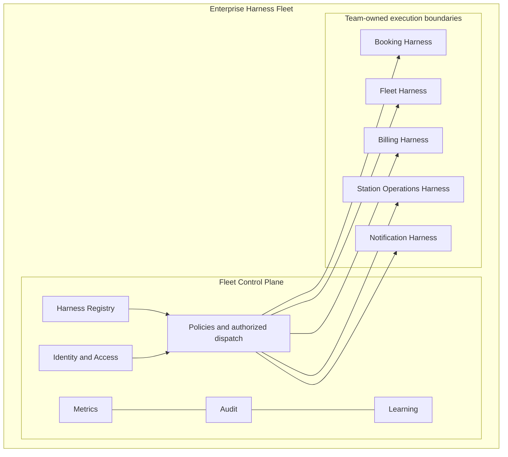
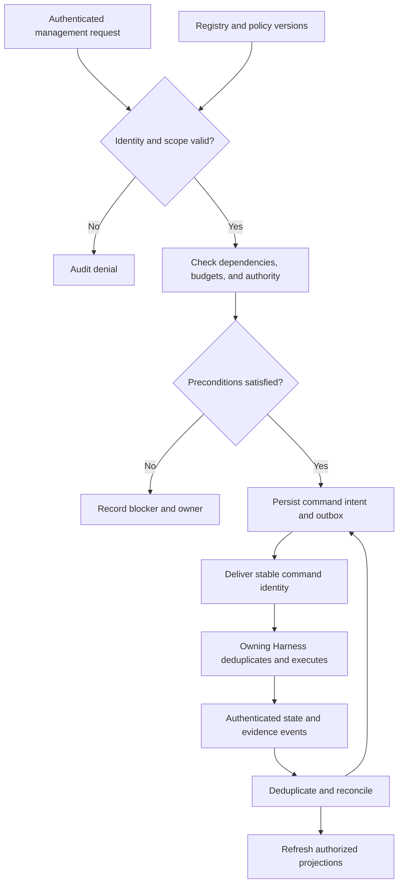
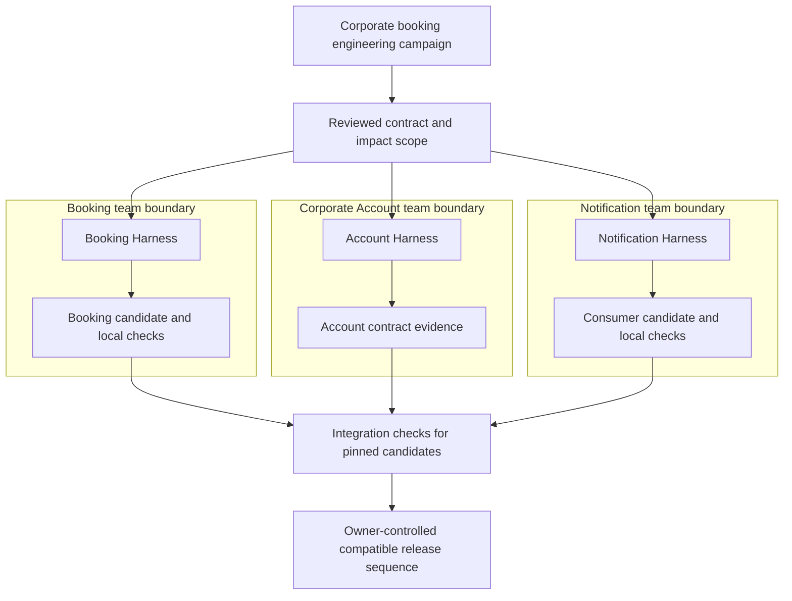
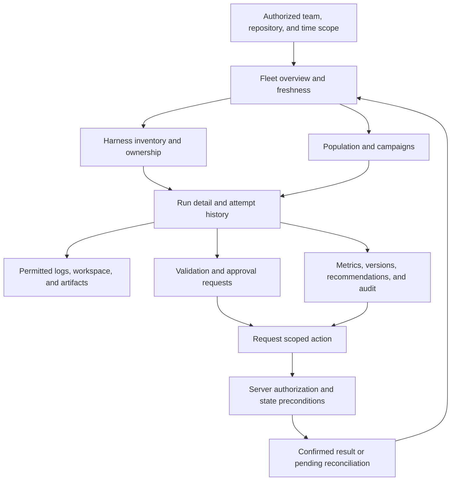
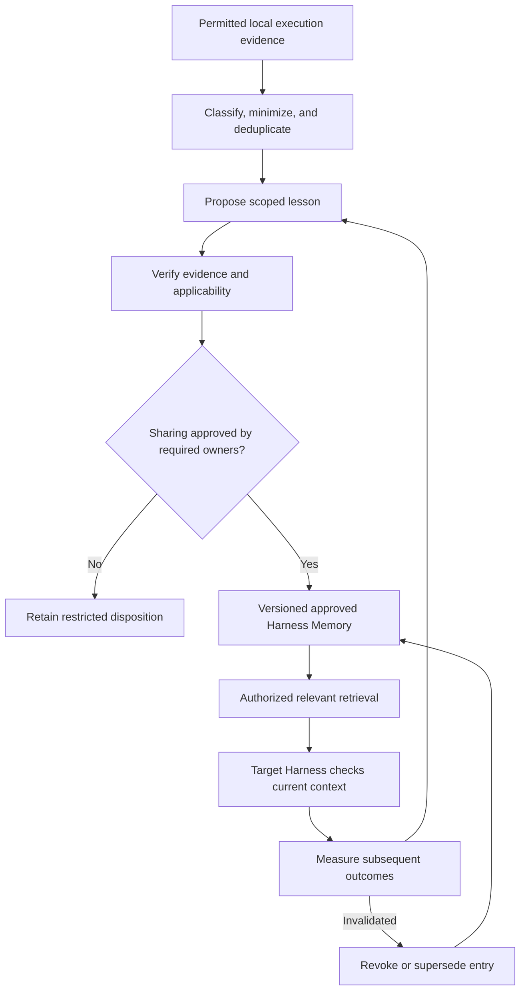
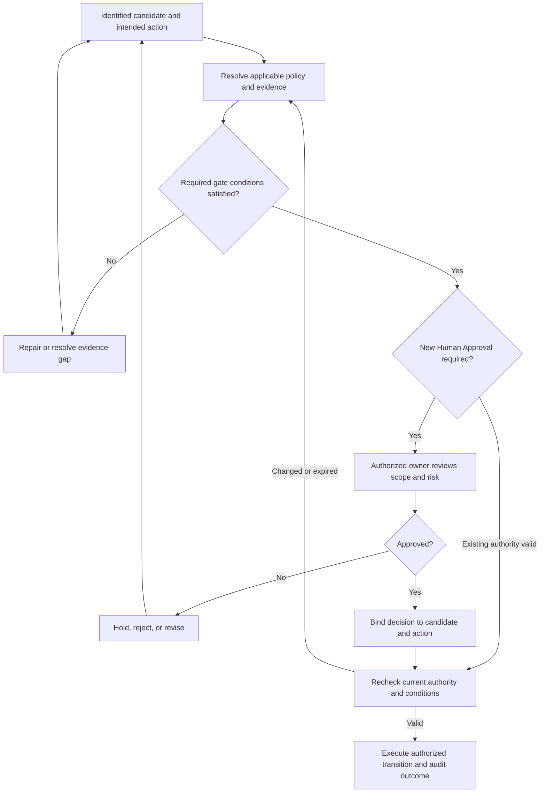

# Chapter 55 — Enterprise Harness Fleet

## 1. Story-driven Opening

Northstar Distribution's request still concerns twenty-four vehicles across two days. The engineering work now crosses several teams. Booking needs an account-authorization correction. Notification needs to accept a compatible event-contract extension. The platform team proposes a revised validation Skill after repeated review findings.

Each team can operate a reliable Harness and still struggle to explain the combined change. One dashboard reports a Booking run as `Running`, although its worker has stopped renewing its lease. Notification has passed its local checks against an earlier contract revision. Billing can see an improvement recommendation but has not established whether its financial workflow meets the recommendation's assumptions.

Launching another agent does not resolve these questions. The organization needs to know which Harness owns each item, which evidence is current, where authority resides, and whether a lesson may cross a repository boundary.

In the worked scenario, a Fleet operator locates the expired Booking assignment, identifies Notification's obsolete evidence, and sees that the new Skill is approved only for a pilot. The operator requests recovery through the Booking Harness. Notification's owner schedules the affected compatibility check. Billing's owner reviews applicability before adopting any guidance. Repository maintainers continue to control their changes and release decisions.

This is the purpose of an Enterprise Harness Fleet:

> A Harness controls one engineering workflow. A Harness Fleet provides organization-wide discovery, governance, visibility, security, Metrics, and learning across many Harnesses while preserving repository and team ownership.

The Harness Fleet manages engineering automation. Alpha Car Detailing's business fleet contains vehicles. These are separate concepts, even when the engineering campaign changes corporate fleet booking.

The teams, independent Harness deployments, incidents, records, costs, and outcomes in this chapter are worked examples. They extend the reference architecture; they do not establish that the complete platform already operates in the companion repository.

## 2. Learning Objectives

After completing this chapter, the reader will be able to:

- Distinguish an individual Harness, a Harness Fleet, a worker pool, and a multi-agent session.
- Design a Fleet control plane with explicit execution, identity, evidence, and knowledge boundaries.
- Register Harnesses and assign repository, team, domain, operational, and approval ownership.
- Combine shared Instructions and Skills with governed repository-specific configuration.
- Coordinate Population items, runs, attempts, dependencies, and parallel execution.
- Present Run Workspaces, gates, approvals, Metrics, costs, and Audit Trails through authorized views.
- Detect stale and exhausted work and recover without uncontrolled duplicate effects.
- Share evidence-backed Harness Memory under explicit applicability and confidentiality rules.
- Roll out Harness versions and management capabilities without silently changing active workflows.

## 3. Background

### 3.1 From one workflow to an operating estate

Chapter 54 followed one engineering change from Repository Discovery through implementation, review, deterministic validation, evaluation, Human Approval, delivery, and observation. A Fleet extends that evidence path across many independently accountable workflows.

The earlier concepts retain their purposes. Instructions establish engineering expectations. Skills define reusable procedures. Prompts request bounded work. Roles separate responsibilities. Steering Notes express the current mission. Knowledge Sources supply evidence. Population records durable work. A Scratchpad holds temporary observations; a Run Workspace organizes execution material. Harness Memory preserves approved reusable knowledge.

A Fleet does not replace these mechanisms with a larger conversation. It connects them through stable identities, shared contracts, access controls, and operational services.

### 3.2 Why Fleet management becomes necessary

An enterprise eventually needs answers that no single repository can provide. Which teams run an unsupported Harness version? Which approved changes await a shared dependency? Which runs consume budget without making progress? Where did a recurring security finding originate? Which repositories may use its remediation guidance?

Without common management, teams often build overlapping dashboards, inconsistent retry policies, and incompatible evidence formats. Unknown ownership becomes an incident-management problem. Shared credentials become a security problem. Unreviewed guidance propagation becomes a governance problem.

Fleet management is justified by these coordination needs. A small estate may need only an ownership registry, version reporting, and links to local evidence. Central scheduling and regional control services should follow demonstrated requirements. Repository count alone does not justify a complex platform.

### 3.3 Preserve the implemented baseline

Alpha Car Detailing's runnable baseline remains .NET 10, direct application services, deferred CQRS and mediator adoption, and SQLite persistence. `POST /api/bookings` creates a `Pending` booking. Its local `BookingCreatedDomainEvent` does not prove durable publication, station-capacity commitment, or completed downstream processing.

The full Corporate Account, Fleet, Station Operations, Billing, Payment, and Notification topology belongs to the reference architecture where implementation evidence is absent. Independently deployed engineering Harnesses and the Fleet control plane are also proposed extensions.

The management lab uses synthetic registrations and operational records. It demonstrates how to reason about management behavior. It does not turn the existing Booking application into a deployed multi-service system.

## 4. Concepts

### 4.1 Harness versus Harness Fleet

An individual Harness owns a bounded engineering workflow and its state transitions. It may coordinate several Roles and many attempts. A Harness Fleet manages the relationships, common controls, and operational visibility across registered Harnesses.

| Concern | Individual Harness | Harness Fleet |
| --- | --- | --- |
| Work | Owns a workflow and its Population items | Coordinates authorized campaigns across owners |
| Execution | Invokes Roles, tools, and applicable checks | Routes work and manages shared constraints |
| Repository context | Resolves current local guidance and source | Discovers ownership and approved capabilities |
| Validation | Executes checks and retains evidence | Correlates candidate-specific results across Harnesses |
| Authority | Applies delegated local permissions | Applies enterprise controls and routes scoped decisions |
| Learning | Produces and retrieves applicable knowledge | Governs approved sharing across boundaries |

A Fleet is a software management capability. It can use AI to explain incidents or recommend improvements, but assignment, permission checks, evidence identity, and state transitions require deterministic implementation.

A worker pool supplies execution capacity. A multi-agent session supplies collaborating AI Agents. Neither inherently supplies durable Population, repository ownership, enterprise policy, or protected Audit Trails.

### 4.2 Definitions, instances, and membership

A **Harness definition** describes a versioned workflow: Roles, tools, contracts, gates, and guidance. A **Harness instance** is a deployed installation operating that definition within an identified boundary. A **worker** performs assigned execution. An **agent session** supplies model interaction within that execution. **Fleet membership** records an approved relationship between an instance and the management system.

These identities must remain distinct. Restarting a worker does not create a new repository owner. Upgrading a definition does not erase earlier run evidence. Discovering an instance does not authorize a caller to use it.

There need not be one Harness per repository. A team may operate one Harness for several repositories, or use separate maintenance and security Harnesses against one repository. Each arrangement still needs explicit permissions, workflow ownership, and conflict controls.

### 4.3 Control plane and execution plane

The **Fleet control plane** manages enrollment, discovery, ownership, policies, authorized dispatch, shared limits, approvals, management projections, and learning catalogs.

The **execution plane** contains repository-scoped Harnesses, isolated workers, tools, checkouts, Run Workspaces, and local validation. It performs the engineering work under the resolved authority and policy.

The control plane may reference protected evidence without holding unrestricted copies. A dashboard is a projection of operational records. Its last successful refresh is an observation time, not proof that execution remains healthy.

### 4.4 Ownership and authority

Ownership includes several responsibilities that may belong to different people or teams.

| Responsibility | Accountable owner | Typical authority |
| --- | --- | --- |
| Repository behavior and architecture | Repository maintainer | Accept changes under repository policy |
| Harness operation | Team Harness owner | Configure workers and recover local execution |
| Shared platform | Fleet platform owner | Operate management services and compatibility contracts |
| Mandatory controls | Policy and security owners | Approve policy versions and scoped exceptions |
| Business acceptance | Product or domain owner | Resolve criteria and accepted business risk |
| Knowledge sharing | Source and target knowledge owners | Approve sharing and target adoption |
| Production advancement | Authorized release owner | Approve the identified environment action |

The Lead, Developer, Reviewer, Validator, and Evaluator are engineering Roles. They do not become authenticated security principals merely because a Prompt names them. Permissions belong to identities acting under scoped authorization.

A Fleet operator may inspect run health and request a pause while lacking permission to read source, approve a merge, change a policy, or deploy production. Platform administration must not implicitly grant those authorities.

### 4.5 Population, runs, attempts, and capacity

Population retains Chapter 19's meaning: the durable collection and lifecycle of engineering work items. It does not mean agent headcount.

A campaign groups related work across Harnesses. Each child Population item has an owning Harness, scope, dependencies, acceptance criteria, and lifecycle history. A run executes an authorized workflow for an item. An attempt records a bounded execution effort, including its failure or interruption. If an implementation uses a different run/attempt hierarchy, its adapter must document that mapping and retain the original identifiers.

Capacity is separate: workers, role concurrency, model quotas, CI slots, repository write limits, and spending reservations. Ten available workers do not make ten blocked Population items ready.

Avoid compressing several dimensions into one `Status` field:

| Dimension | Illustrative values | Question answered |
| --- | --- | --- |
| Work lifecycle | Ready, Running, Blocked, Failed, Exhausted, Completed | Where is the item in its owning workflow? |
| Run health | Healthy, Stale, Lost, Unknown | Is the recorded execution still credible? |
| Stage | Discovery, Implementation, Validation, AwaitingApproval | What is happening or awaited? |
| Gate outcome | Passed, Failed, Incomplete, Not applicable | What does the check evidence establish? |
| Acceptance | Unassessed, CriteriaUnmet, Accepted | Does the identified change meet its criteria? |
| Approval | NotRequired, Pending, Granted, Expired, Revoked | Is the intended action authorized? |

These are reference projections, not a replacement for each Harness's documented lifecycle. Preserve local values and explain their mapping. A stale observation can coexist with a locally recorded `Running` item; reconciliation resolves the discrepancy.

### 4.6 Shared guidance and local configuration

Enterprise policies define mandatory constraints. Shared Instructions express common engineering expectations. Shared Skills package reusable procedures. Repository Instructions and configuration add local architecture, commands, contracts, and applicability.

Alpha Car Detailing can share an authorization-review Skill while Booking retains its direct application services and Billing retains financial reconciliation requirements. The Skill must be parameterized or specialized where those workflows differ.

Every run needs an effective guidance manifest containing applicable sources, versions, integrity information, owners, and the policy-resolution result. Governed precedence determines how compatible guidance is combined. A local Prompt or Steering Note cannot silently weaken a mandatory control. Conflicting requirements produce a blocked decision or an authorized, recorded exception.

Distribution, loading, enforcement, and verification are different events. Downloading a Skill proves availability. A session reporting that it read the Skill proves neither correct application nor successful deterministic validation.

### 4.7 Run Workspaces and retained evidence

A Run Workspace contains task inputs, plans, checkpoints, Scratchpad material, handoffs, source changes, and tool outputs. Keep it scoped to the run and its authorized collaborators.

The Fleet usually needs metadata: owner, stage, candidate revision, heartbeat age, checkpoint, evidence availability, and permitted artifact references. Source, diffs, raw logs, and Scratchpads require additional authorization. A restricted artifact should appear as restricted only when even that metadata may be disclosed; otherwise omit its existence from the caller's view.

Temporary observations do not become Audit Trails or Harness Memory merely because the UI links to them. Retain the evidence needed for review and accountability in protected storage before workspace cleanup. Do not retain credentials or private model reasoning as audit evidence; use concise decisions and observed tool results.

### 4.8 Gates, evaluation, and Human Approval

Deterministic Validation Gates retain **Passed**, **Failed**, **Incomplete**, and **Not applicable** outcomes. Missing reports, wrong revisions, unavailable tools, and unverified applicability must not become Passed. A Not applicable result needs an owned applicability decision.

Reviewer findings, gate results, Evaluator recommendations, and Human Approval are separate records. Bind them to the relevant source revision, artifact digest, effective guidance, policy version, intended action, and validity conditions.

Required gates are necessary conditions for advancement. They do not prove all business criteria or grant permission. A healthy Harness can execute an unsuccessful run. A completed run can produce a rejected change. An accepted change can await production authorization. A deployed artifact can still fail its operational acceptance criteria.

### 4.9 Metrics, audit, and Harness Memory

Metrics describe execution and outcomes under defined cohorts. Audit Trails preserve attributable actions and decisions. Harness Memory preserves reviewed, reusable engineering knowledge. Their retention, access, and integrity requirements differ.

Automatically captured execution facts may support a learning candidate. Candidate knowledge requires review before promotion. Approved memory can inform another run only within its authorized, applicable scope. Changing active Instructions or Skills remains a separate governed change.

## 5. Architecture Discussion

### 5.1 Select a management topology

The architecture problem is to establish common controls and evidence across teams with different domains, permissions, release cadences, and operational constraints. Centralization simplifies some controls while increasing the impact of compromise and outage.

| Model | Appropriate context | Main trade-off |
| --- | --- | --- |
| Central management and execution | Small estate within one trust and operational boundary | Simple operation; concentrated privilege and outage impact |
| Team-owned management | Teams with strong separation and limited shared work | Autonomy; duplicated controls and harder aggregation |
| Shared control plane, distributed execution | Shared governance with accountable domain teams | Consistent contracts; reconciliation and compatibility work |
| Isolated Fleet partitions | Residency, classification, or customer boundaries prevent shared processing | Strong separation; limited global visibility and reuse |

The proposed Alpha Car Detailing design uses a federated operating model: common registration, control contracts, and visibility; locally accountable execution and evidence. Federation describes distributed authority and operation. It does not require every management component to be replicated into every team.

Start with a registry and read-only projections. Add dispatch, dependency coordination, and rollout services when their operational benefits justify their authority and maintenance cost.

### 5.2 Assign authoritative state explicitly

The reference control plane contains a Harness Registry, ownership catalog, policy service, dispatch service, campaign coordinator, approval integration, evidence index, Metrics projections, audit service, and learning catalog. These are logical responsibilities; an initial implementation can combine them in one deployable application.

| Record | Authoritative owner | Fleet treatment |
| --- | --- | --- |
| Registration and membership | Registry service with owner acceptance | Discover eligible, authorized instances |
| Local Population transition | Owning Harness work store | Consume attributable transition events |
| Cross-repository dependency | Campaign coordinator | Reference child acceptance records |
| Gate execution | Approved executor and evidence store | Verify identity, scope, and availability |
| Approval | Designated approval system | Revalidate scope and conditions at action time |
| Merge and deployment | Protected source and delivery systems | Request and observe existing controls |
| Dashboard | Projection service | Rebuild from durable source records |

If work ownership moves, use an explicit transfer: stop new claims, reconcile active attempts, establish the new owner, and record the transition. Two services must not independently declare the same item ready or completed.

Use versioned, authenticated commands and events. Include event identity, producer identity, aggregate identity, sequence or revision, correlation, and timestamps. Deduplicate repeated delivery and detect ordering gaps. Prefer authoritative sequence numbers to worker wall clocks when resolving state.

Persist an authorized dispatch intent with an outbox or equivalent recoverable mechanism. The receiver deduplicates the command and returns its existing run identity after a repeated request. A dispatcher timeout is an uncertain outcome until reconciled, not proof that no run started.

### 5.3 Register, discover, suspend, and retire Harnesses

Registration establishes a managed relationship. It must prove authenticated ownership and permitted capabilities rather than accepting self-declared privileges.

The registry records a stable Harness ID; team and operational contacts; repository IDs; domain; execution identity; endpoint; workflow capabilities; supported contracts; runner and guidance versions; policy profile; isolation class; region; capacity; and membership lifecycle.

Enrollment verifies the endpoint and workload identity, obtains repository-owner acceptance, and runs conformance checks. Only then may the instance become active. Discovery filters results by caller permission, repository scope, required capability, compatibility, capacity policy, and current eligibility.

Membership states such as Proposed, Active, Suspended, Draining, and Retired are separate from health. An Active Harness may be unavailable. Suspension blocks the actions defined by policy; it should not silently erase attempts already executing. Draining refuses new work while reconciling existing work.

Retirement revokes dispatch eligibility and credentials, resolves Population ownership, preserves required evidence, and disposes of temporary workspaces under retention policy. Repository moves, ownership transfers, and identity rotation require corresponding registry updates and audit records.

### 5.4 Distribute shared assets under version control

Publish Instruction and Skill packages with immutable version references, owners, provenance, integrity metadata, supported environments, dependencies, and rollback targets. A semantic version is useful to people; a content digest identifies the exact package consumed.

At dispatch, resolve enterprise, domain, repository, and task-specific guidance. Verify that the selected combinations are compatible and authorized. Save the resolution in the run manifest. If repository Instructions change, affected work must reassess guidance and evidence before advancement.

Mandatory controls need enforcement at their actual boundaries: filesystem and network isolation, tool authorization, protected gate definitions, source protections, artifact access, and deployment credentials. Instruction text alone cannot enforce them.

An exception records the requirement, owner, justification, affected action, compensating controls, scope, expiry, and decision. It retains the original gate result. An exception does not rewrite Failed as Passed.

### 5.5 Coordinate Population and run management

The campaign coordinator decomposes authorized goals into repository-owned work items with explicit dependencies. The owning Harness claims its ready items and controls local attempts. Fleet coordination observes those transitions and manages cross-team prerequisites.

Scheduling considers per-team quotas, urgency, dependency readiness, repository write limits, model and CI capacity, cost reservations, and fairness. Reserve emergency capacity through explicit policy so urgent security work does not depend on informal queue manipulation.

Pause, cancel, retry, reassign, and drain are commands with preconditions. Cancellation is not complete until the owning execution has acknowledged it or recovery has established its effects. Retrying an exhausted item requires the defined intervention and a retained history, not a new identity that hides the earlier budget consumption.

The platform should support bounded retries for classified transient failures. Policy denial, unresolved business criteria, and a deterministic contract failure usually need a changed condition or repair rather than immediate repetition.

### 5.6 Coordinate multi-repository changes and parallel execution

A corporate booking campaign might change Booking's authorization logic, extend a producer-owned event, and validate Notification compatibility. Corporate Account and Fleet owners supply their own contract decisions. Billing participates only where its actual dependencies are affected.

Preserve the business lifecycle established in Chapters 49-50. `BookingConfirmed` concerns a committed booking outcome. Billing recognizes qualifying completed work through its approved workflow; adding campaign coordination does not make booking creation an invoice or payment trigger.

Build a dependency graph from reviewed contracts and change impact. Independent discovery, test preparation, and unrelated repairs may proceed concurrently. Work requiring an approved contract revision waits for that revision. Composed integration checks identify every participating source revision, artifact, configuration, and contract version.

Give each concurrent attempt an isolated checkout or worktree and Run Workspace. A worktree separates source changes; it does not itself isolate credentials, caches, model context, or network access. Apply those controls separately. Reserve shared files or serialize incompatible writes.

Multiple pull requests are not one atomic transaction. Plan compatible release order, feature activation, and partial failure. Prefer additive contracts where they meet the requirement. If one repository cannot advance, preserve already completed compatible work and hold the dependent campaign criteria. Do not merge every repository merely to make a campaign appear complete.

### 5.7 Coordinate gates and approvals without bypassing local controls

The Fleet builds a candidate matrix from required local checks and composed integration checks. Each record identifies the gate owner, applicability, candidate, tool and version, timestamps, outcome, and protected evidence reference.

A cross-repository campaign cannot advance on an average pass rate. Every required criterion must have sufficient evidence for the intended transition. A passing Booking build does not compensate for a failing Notification compatibility test.

The designated owners review the relevant business, architecture, security, or release decisions. Existing delegated authority remains valid within its recorded conditions. New Human Approval is required when the intended action exceeds that scope or policy requires a new decision.

Recheck authority and evidence at action time. A material source change, policy change, expired decision, revoked identity, or different artifact may invalidate the applicable decision. Revalidate affected dependencies; retain unaffected evidence only when its applicability remains established.

Integrate existing PR protections and CI/CD. The Fleet must not create a second route that merges or deploys around a repository's required checks and approvers.

### 5.8 Detect stale work and recover safely

Track heartbeat time, last meaningful progress, lease expiry, stage deadline, and projection observation time separately. A heartbeat says that a component reported; it does not prove engineering progress. A lease identifies time-bounded assignment authority; it does not prove a previous worker has stopped.

Set thresholds by execution profile. A short code-analysis stage and a long integration suite need different progress expectations. `AwaitingApproval` uses decision-age escalation rather than the heartbeat expectations of a running worker. A connectivity incident can make the management projection stale while execution continues locally.

Use a monotonic assignment generation or equivalent fencing mechanism. Protected state changes reject writes from an expired owner or superseded generation. Before reassignment, reconcile the worker, source system, CI jobs, artifact uploads, and any external actions already requested.

Fencing the work store cannot undo a PR already opened or a deployment already submitted. Those boundaries need idempotent operation identities or explicit external reconciliation. Where the effect remains unknown, hold the item for investigation.

Bound recovery attempts, retain their history, and quarantine workers that fail conformance or exhibit repeated unsafe behavior. Detect orphaned assignments, abandoned workspaces, growing queue age, stalled stages, and exhausted retries as distinct conditions with distinct owners.

During a control-plane outage, permit only locally authorized actions supported by valid cached policy and available evidence, where the organization's outage policy allows this. Pause transitions that require fresh central authorization or revocation checks. Reconcile local events after recovery. Loss of visibility must not relax release controls.

### 5.9 Enforce security, isolation, and protected audit

Scope identities to the required repository, action, environment, tenant, and data classification. A centrally operated identity broker may issue short-lived credentials, but workers must not receive a universal token or another Harness's secrets. Separate management identity from source-edit, validation, and deployment identities.

Isolate checkouts, workspaces, caches, logs, artifacts, and model context. Shared caches need classification and integrity controls; they can transmit confidential data or poisoned dependencies even when source directories are separate. Select process, container, virtual machine, or host boundaries according to the trust model. A namespace or directory name alone is not proof of tenant isolation.

Treat repository content, tool output, retrieved memory, and Skill packages as possible prompt-injection or supply-chain inputs. Authenticate package provenance, restrict egress, constrain tools, and protect gate definitions. A malicious repository must not gain control-plane permissions through its Instructions.

Apply authorization before search retrieval, artifact delivery, aggregation, export, and notification. UI filters are presentation controls. They cannot replace server-side checks. Suppress or coarsen small aggregates when they would disclose restricted activity.

Audit records identify the actor, action, target, repository, run and attempt, policy decision, effective version, evidence references, time, and outcome. Protect integrity and access, synchronize time sources, and define retention, legal-hold, redaction, and deletion behavior. Logs help diagnose events; they are not automatically a complete or tamper-resistant Audit Trail.

> **Security Consideration**
>
> A compromised control plane can influence many workflows even without universal repository credentials. Restrict its dispatch authority, authenticate commands at the receiving Harness, and provide a tested suspension and revocation path.

### 5.10 Define Metrics and cost attribution

Show availability, queue age, blocked work, active runs, stale observations, retry exhaustion, approval waiting, and evidence freshness. Measure engineering outcomes through accepted changes, rework, escaped defects, and recovery time. Define the cohort, eligible denominator, time boundary, and exclusions for every rate.

For example, first-attempt acceptance rate is the number of eligible items accepted after their first attempt divided by the eligible items with a resolved acceptance outcome in the stated cohort. Pending items are disclosed separately. A run success percentage measures something different.

Attribute model usage, tool calls, CI, storage, and infrastructure to attempts, repositories, teams, and campaigns. Include failed, cancelled, and exhausted attempts. Keep measured usage, rate-versioned estimates, billed amounts, allocated platform costs, and recorded human effort distinct.

Cost per accepted outcome uses all included cohort costs divided by accepted outcomes under that definition. A cohort with no accepted outcomes has no finite cost-per-accepted value. Show its expenditure and unresolved work directly.

Deduplicate usage records and avoid adding campaign totals to the same child-attempt totals. Treat missing usage as unknown rather than zero. Reserve budget for active work where required, and define how in-flight calls are handled when a limit is reached.

Use repository context when comparing trends. A security remediation campaign and a documentation campaign are different workloads. More runs, tokens, or generated lines are not evidence of higher engineering productivity.

### 5.11 Govern cross-repository learning

The learning catalog accepts permitted evidence from builds, reviews, gates, PRs, recovery, and operational observation. Classify and minimize it before broader processing. Deduplicate repeated reports of the same change or incident; ten retries are not ten independent confirmations.

A learning candidate records the failure pattern, confirmed cause, supporting and conflicting evidence, known applicability, exclusions, proposed audience, owner, and intended improvement. Repeated account-authorization findings may justify a review-Skill proposal. They do not justify imposing Booking's account model on Payment.

Promotion requires the designated review and Human Approval. Source-sharing permission and target-adoption authority are separate. Approved Harness Memory includes provenance, scope, classification, version, retrieval conditions, review date, expiry or reassessment trigger, and revocation state.

Enforce those rules in indexes, embeddings, summaries, caches, and search results. An authorized source document does not automatically authorize its summary for a wider audience. Preserve the approved derivative's classification and access rules.

At retrieval, the target Harness verifies current repository applicability. Record the memory versions that influenced the run. If a source decision changes, revoke or supersede affected entries and identify impacted runs. Recommendations remain proposals until their target owners approve the relevant change and validation.

### 5.12 Version, pilot, and roll out Harness changes

Version the runner, Role contracts, Instructions, Skills, policy bundle, model configuration, tools, gate catalog, event schemas, and management API as needed. Record their resolved versions and content identities for every run. Reproducibility means knowing what executed; it does not imply a model will produce identical output on replay.

Use compatibility checks and representative replay before a pilot. Include prior failures and clean cases. Define promotion criteria and an observation window before starting the rollout. Expand by approved cohorts, compare contextualized outcomes, and stop when failure or uncertainty exceeds the agreed limits.

Pin active attempts. Routine updates should affect new eligible runs after approved activation, not silently alter a running session's guidance. Drain or checkpoint where a change requires it. Emergency revocation is a separate audited process that can stop affected actions and invalidate prior eligibility.

Rollback restores a supported component combination. It does not erase decisions, retract knowledge already disclosed, or reverse external side effects. Schema migrations need their own compatibility and recovery design. Retain the earlier manifests so historical evidence remains attributable.

### 5.13 Design the management UI around evidence and action

The UI should let an authorized operator move from a scoped overview to an accountable owner and an actionable record.

| View | Required information | Action or boundary |
| --- | --- | --- |
| Fleet overview | Harness eligibility, availability, freshness, scoped totals | Filter by team, repository, domain, and time |
| Harness inventory | Owners, versions, policy profile, capacity, membership | Request suspend, drain, or approved upgrade |
| Population and campaigns | Ready and queued work, dependencies, blocked and exhausted items | Route work and inspect acceptance coverage |
| Run detail | Stage, attempts, health, heartbeat, progress, lease, candidate | Request pause, cancel, or reconciled retry |
| Validation | Applicable gates, outcomes, revisions, report availability | Open authorized evidence and identify blockers |
| Approvals | Action, candidate, risk, decision owner, expiry | Decide only within granted authority |
| Workspace and artifacts | Permitted logs, handoffs, diffs, artifacts, retention | Authorize every retrieval independently |
| Metrics and cost | Cohorts, usage completeness, estimates, billing, allocation | Compare context and enforce scoped budgets |
| Learning | Recommendations, applicability, provenance, approval state | Propose or review governed adoption |
| Audit and versions | Attributable history, package changes, rollout decisions | Investigate and export within access scope |

Show `Requested`, `Pending`, `Denied`, `Failed`, and `Confirmed` management-action outcomes. A button click is not confirmation that a worker stopped. Include source-of-truth links, observation timestamps, synchronization errors, clear empty states, and accessible labels that do not depend on color.

### 5.14 Establish operational governance

Assign platform service owners, team Harness owners, policy owners, knowledge owners, budget owners, and incident responders. Define escalation paths for ambiguous external effects, stale assignments, exhausted work, and unavailable evidence.

Set locally justified service objectives for dispatch, projection freshness, evidence availability, and recovery. Review access, exceptions, unsupported versions, dormant Harnesses, retained workspaces, and aging knowledge. Give teams a documented route to challenge incorrect shared guidance and contribute a reviewed correction.

Governance should make ownership clearer as execution expands. It should not require a central committee to choose every implementation detail.

## 6. Professional Diagrams

### 6.1 Enterprise Harness Fleet architecture

Figure 55-1 shows the proposed Alpha Car Detailing topology from Sections 4.2-4.4 and 5.1. The business Fleet Harness manages engineering work for the Fleet domain; it is one member of the Enterprise Harness Fleet.



*Figure 55-1 — Enterprise Harness Fleet architecture. Shared management supplies scoped dispatch, identity, policies, Metrics, Audit Trails, and learning while teams retain execution ownership. Corporate Account and Payment can enroll under the same rules.*

The diagram represents engineering ownership and management relationships. Evidence and knowledge flows are expanded in Figures 55-2 and 55-5. It does not show application service calls, shared databases, universal credentials, or an implemented deployment.

### 6.2 Fleet control-plane command lifecycle

Figure 55-2 expands the authorization and reconciliation design from Sections 5.2-5.5.



*Figure 55-2 — Fleet control-plane command lifecycle. A durable command bridges management intent and local execution; reconciled events establish the observed result.*

Repeated delivery uses the same command identity. The feedback path reconciles durable records; it does not instruct the system to repeat completed side effects.

### 6.3 Multi-team campaign topology

Figure 55-3 applies Sections 5.6-5.7 to repository-owned candidates.



*Figure 55-3 — Multi-team campaign topology. The campaign combines attributable local and integration evidence while each team retains its own change authority.*

Billing, Fleet, Station Operations, and Payment participate when reviewed impact requires them. Fleet membership does not make every repository a dependency of every change.

### 6.4 Management UI navigation and actions

Figure 55-4 supports the screen responsibilities in Section 5.13.



*Figure 55-4 — Management UI navigation and actions. The interface links status to evidence and sends consequential actions through current authorization and state checks.*

Navigating to a run does not grant access to its contents. Authorization applies again at each evidence endpoint and action service.

### 6.5 Fleet learning flow

Figure 55-5 illustrates the promotion boundaries from Section 5.11.



*Figure 55-5 — Fleet learning flow. Evidence becomes reusable knowledge through review, controlled sharing, authorized retrieval, and later reassessment.*

Sharing approval does not authorize a target Instruction change. Such a change follows its own reviewed versioning, validation, and rollout process.

### 6.6 Governance and approval flow

Figure 55-6 combines evidence and authority checks from Sections 4.8, 5.7, and 5.14.



*Figure 55-6 — Governance and approval flow. Sufficient evidence and valid action-specific authority permit a transition; changed conditions require reassessment.*

An approved exception remains explicit in the evidence decision. It does not alter a check's historical outcome or grant unrelated permissions.

## 7. Hands-on Example

### 7.1 Establish the management lab

The lab follows campaign `ACD-C55-01`: prepare a governed corporate booking change across proposed team Harnesses. It uses the real Booking baseline for architectural context and synthetic fixtures for Fleet behavior. No remote dispatch, source modification, merge, deployment, or external-provider call is required.

Use a disposable lab workspace with separate folders for registry fixtures, manifests, Population records, gate reports, approval records, usage, learning candidates, and rollout decisions. These are proposed lab conventions, not directories that the current companion automatically discovers.

Record the actual inspected Git revision when conducting repository discovery. Fixture labels such as `booking-b1` and `booking-b2` below are symbolic identities for teaching; they are not Git hashes, signed attestations, or valid live release identities.

| Harness | Team owner | Lab responsibility |
| --- | --- | --- |
| Booking | Booking engineering | Account-authorization repair and producer compatibility |
| Corporate Account | Corporate accounts engineering | Eligibility-contract clarification |
| Fleet | Fleet engineering | Independent vehicle-membership checks |
| Notification | Customer communications engineering | Consumer compatibility and delivery semantics |
| Station Operations | Station engineering | Capacity-contract review |
| Billing | Finance engineering | Review applicability of a shared recommendation |

The first acceptance condition is documentary: every proposed Harness has an owner, allowed repositories, execution identity, policy profile, and evidence boundary. A name in a table is not accepted enrollment.

### 7.2 Register Harnesses and test discovery boundaries

Listing 55-1 is an illustrative registration contract. The `.invalid` hostname is intentionally nonoperational.

```json
{
  "schemaVersion": "1.0",
  "simulation": true,
  "fleetId": "acd-engineering",
  "harnessId": "booking-harness",
  "ownerTeamId": "booking-engineering",
  "operationalOwnerId": "booking-platform-oncall",
  "repositoryIds": ["acd-booking"],
  "domain": "Booking",
  "endpoint": "https://booking-harness.example.invalid",
  "workloadIdentityId": "booking-worker-development",
  "capabilities": ["repository-change", "contract-validation"],
  "contracts": {"dispatch": "1.0", "evidence": "1.0"},
  "versions": {
    "runner": "3.2.1",
    "instructions": "acd-security@2.1.0",
    "validationSkill": "contract-check@1.4.2"
  },
  "policyProfile": "team-repository-development",
  "isolationClass": "team-private",
  "region": "approved-development-region",
  "capacity": {"maxConcurrentRuns": 2},
  "membershipState": "Proposed"
}
```

*Listing 55-1 — Synthetic Booking Harness registration. The receiver verifies ownership and capabilities before changing Proposed membership to Active.*

Exercise enrollment with the following expected decisions. Retain the authenticated actor, policy version, and observed result when implementing the contract.

| Case | Expected decision |
| --- | --- |
| Booking identity, accepted owner, compatible contracts, conformance passed | Activate within the approved scope |
| Notification identity claims ownership of the Booking repository | Reject enrollment and record denial |
| Caller requests a capability outside its repository authorization | Exclude that Harness from eligible discovery |
| Active instance becomes unavailable | Retain membership; report unavailable health |
| Owner suspends dispatch after an incident | Remove new-dispatch eligibility; reconcile in-flight work |

Create equivalent fixtures for the remaining teams. Discovery must prove both suitability and permission. Do not return restricted endpoints merely because the requester can view a general Fleet count.

### 7.3 Resolve shared guidance and repository specialization

Pin `acd-security@2.1.0` and `contract-check@1.4.2` in the worked run manifest. Booking adds its current architecture decisions: direct application services, no initial CQRS or mediator, and honest `Pending` creation semantics.

Resolve these three cases:

| Local request | Resolution |
| --- | --- |
| Add the Booking test command and preserve direct application services | Compatible specialization; retain both guidance sources |
| Skip required account-boundary tests to finish within budget | Mandatory-control conflict; block affected advancement |
| Temporarily use a compensating check because a required service is unavailable | Route an explicit exception to its designated owner |

The effective manifest records immutable guidance identities and the resolution decision. In a live implementation, package digests and repository revisions must be verified, not inferred from these fixture version strings.

### 7.4 Create Population and dispatch dependent work

The campaign has repository-owned child items rather than one global mutable task.

| Item | Owner | Dependency | Acceptance evidence |
| --- | --- | --- | --- |
| `C55-A` | Corporate Account Harness | None | Owned eligibility-contract decision |
| `C55-B` | Booking Harness | `C55-A` | Authorization tests and producer candidate |
| `C55-N` | Notification Harness | Approved producer contract | Compatibility evidence for the pinned candidates |
| `C55-F` | Fleet Harness | None | Independent membership-regression evidence |
| `C55-S` | Station Operations Harness | Agreed capacity-contract scope | Capacity-contract disposition |

The campaign coordinator owns these dependency links. Each Harness owns its local lifecycle. Record command `dispatch-C55-B-1` once, then deliver it twice in the fixture. The receiver must return the same run identity rather than create a second run.

If Booking already uses both permitted slots, another ready item remains queued. It is not failed. If `C55-A` is unresolved, `C55-B` is dependency-blocked even when a worker is free. A priority change records its actor and reason without discarding the dependency.

### 7.5 Run independent work in parallel

Fleet can prepare its independent membership checks while Corporate Account resolves the contract and Notification prepares consumer fixtures. Booking implementation waits for the contract decision it actually needs.

Assign a unique workspace and credential scope to each attempt. Separate attempts must not write the same checkout or reuse another team's temporary context. For coordinated edits in one repository, use isolated branches plus an explicit integration or reservation rule.

| Audience | Visible by default in this lab | Additional grant needed |
| --- | --- | --- |
| Fleet operator | Permitted owner, stage, health, queue, and evidence availability | Source, diffs, raw logs, and restricted artifacts |
| Booking maintainer | Booking task, authorized workspace, local evidence | Other teams' private workspaces |
| Release approver | Required candidate and decision evidence within release scope | Unrelated source and customer data |
| Auditor | Authorized action history and retained evidence references | Secrets and private working context remain excluded |

Test an artifact URL directly with an unauthorized identity. The server must deny retrieval even if a user copied the URL from an authorized session. Evidence required by an approver must either be accessible under an appropriate grant or be supplied through an approved review process; a hidden report is not an implicit pass.

### 7.6 Aggregate gates and bind approvals to candidates

The initial candidate contains `booking-b1` and `notification-n1`.

| Check | Outcome | Consequence |
| --- | --- | --- |
| Booking build and local tests for `booking-b1` | Passed | Local execution evidence available |
| Authorization regression for `booking-b1` | Passed | Specified access cases covered |
| Notification compatibility with `booking-b1` | Failed | Campaign acceptance blocked |
| Composed suite for the repaired pair | Incomplete | No claim about an unexecuted candidate |
| Payment-provider check | Not applicable | Impact owner confirms no payment-boundary change |

Notification repairs the incompatibility. The new composed candidate is `booking-b2` plus `notification-n2`, with its contract and configuration identities. Rerun the affected local and integration checks. Record the Reviewer dispositions and acceptance evaluation separately.

Approval `APP-C55-07` authorizes the specified transition for that identified pair under the recorded policy and expiry. It does not authorize any later pair. Change the Booking fixture to `booking-b3`: the approval lookup must reject the mismatch and request reassessment of affected evidence.

This is a fixture decision. A production approval uses verified source and artifact identities and the existing protected delivery controls.

### 7.7 Detect a stale assignment and reconcile recovery

Use an explicit incident timeline:

| Time, UTC | Observation or decision |
| --- | --- |
| 10:00 | Booking worker owns attempt 1 with assignment generation 41 |
| 10:01 | Worker stops reporting; external PR request may already have reached the source system |
| 10:02 | Work lease expires; expiry alone does not establish the external outcome |
| 10:05 | Fresh controller observation flags stale execution and opens recovery |
| 10:06 | Controller fences generation 41 and reconciles the PR operation identity |
| 10:07 | Existing PR is found; recovery records it and avoids a duplicate |
| 10:08 | Authorized retry starts attempt 2 under generation 42, within budget |
| 10:09 | Late result from generation 41 is rejected by the protected state store |

Recovery must also check any continuing external job before allowing conflicting writes. Where an external system cannot enforce fencing, use its supported idempotency, cancel-and-confirm, or serialized reconciliation protocol.

Repeat the tabletop with delayed management telemetry, a long approval wait, an exhausted retry budget, and an external action whose outcome cannot be determined. The correct results differ: unknown visibility, decision escalation, intervention required, and hold for investigation. None justifies a blind restart.

### 7.8 Reproduce a dashboard snapshot and cost ledger

Listing 55-2 is a self-contained PowerShell 7 fixture replay. It classifies recorded health and totals synthetic attempt costs without contacting a worker or writing files. It is a projection example, not a lease manager, authorization service, or production stale detector.

```powershell
Set-StrictMode -Version Latest
$ErrorActionPreference = 'Stop'
$now = [datetimeoffset]'2026-11-22T10:05:00Z'

$runs = @'
[
  {"id":"R-B","team":"Booking","state":"Running","stage":"Validation","heartbeat":"2026-11-22T10:00:00Z","lease":"2026-11-22T10:02:00Z","observed":"2026-11-22T10:04:55Z"},
  {"id":"R-N","team":"Notification","state":"Failed","stage":"Validation","heartbeat":null,"lease":null,"observed":"2026-11-22T10:04:55Z"},
  {"id":"R-A","team":"CorporateAccount","state":"Running","stage":"AwaitingApproval","heartbeat":"2026-11-22T09:00:00Z","lease":null,"observed":"2026-11-22T10:04:55Z"},
  {"id":"R-F","team":"Fleet","state":"Queued","stage":"Dispatch","heartbeat":null,"lease":null,"observed":"2026-11-22T10:04:55Z"},
  {"id":"R-S","team":"StationOperations","state":"Exhausted","stage":"Review","heartbeat":null,"lease":null,"observed":"2026-11-22T10:04:55Z"},
  {"id":"R-P","team":"Booking","state":"Completed","stage":"Accepted","heartbeat":null,"lease":null,"observed":"2026-11-22T10:04:55Z"}
]
'@ | ConvertFrom-Json

function Get-RecordedRunHealth {
    param(
        [Parameter(Mandatory)] $Run,
        [Parameter(Mandatory)] [datetimeoffset] $At
    )
    if (($At - [datetimeoffset]$Run.observed).TotalSeconds -gt 90) {
        return 'Unknown'
    }
    if ($Run.state -ne 'Running') { return $Run.state }
    if ($Run.stage -eq 'AwaitingApproval') { return 'AwaitingApproval' }
    if (-not $Run.heartbeat -or -not $Run.lease) { return 'Unknown' }
    if ([datetimeoffset]$Run.lease -le $At) { return 'Stale' }
    if (($At - [datetimeoffset]$Run.heartbeat).TotalSeconds -gt 60) {
        return 'Stale'
    }
    return 'Healthy'
}

$snapshot = @($runs | ForEach-Object {
    [pscustomobject]@{
        RunId = $_.id
        Team = $_.team
        RecordedState = $_.state
        Health = Get-RecordedRunHealth -Run $_ -At $now
    }
})
$snapshot | Format-Table -AutoSize

if (@($snapshot | Where-Object Health -eq 'Stale').Count -ne 1) {
    throw 'Expected one stale recorded execution.'
}
if (@($snapshot | Where-Object Health -eq 'AwaitingApproval').Count -ne 1) {
    throw 'Approval waiting was misclassified.'
}
$delayed = $runs[0] | ConvertTo-Json | ConvertFrom-Json
$delayed.observed = '2026-11-22T09:59:00Z'
if ((Get-RecordedRunHealth -Run $delayed -At $now) -ne 'Unknown') {
    throw 'Delayed management observations must remain uncertain.'
}

# Amounts are fixture estimates in USD, not provider prices or bills.
$usage = @'
[
  {"eventId":"U1","attempt":"R-B/1","usd":8.00},
  {"eventId":"U2","attempt":"R-N/1","usd":12.00},
  {"eventId":"U3","attempt":"R-A/1","usd":3.00},
  {"eventId":"U4","attempt":"R-S/1","usd":5.00},
  {"eventId":"U5","attempt":"R-S/2","usd":7.00},
  {"eventId":"U6","attempt":"R-P/1","usd":10.00},
  {"eventId":"U2","attempt":"R-N/1","usd":12.00}
]
'@ | ConvertFrom-Json

$seen = [System.Collections.Generic.Dictionary[string,string]]::new()
$estimatedUsd = [decimal]0
foreach ($entry in $usage) {
    $amount = [decimal]$entry.usd
    if ($amount -lt 0) { throw 'Unexpected negative fixture usage.' }
    $canonical = '{0}|{1}' -f $entry.attempt,
        $amount.ToString([System.Globalization.CultureInfo]::InvariantCulture)
    if ($seen.ContainsKey($entry.eventId)) {
        if ($seen[$entry.eventId] -ne $canonical) {
            throw "Conflicting usage identity: $($entry.eventId)"
        }
        continue
    }
    $seen.Add($entry.eventId, $canonical)
    $estimatedUsd += $amount
}
if ($seen.Count -ne 6 -or $estimatedUsd -ne [decimal]45) {
    throw 'Usage reconciliation failed.'
}
[pscustomobject]@{
    SnapshotRuns = $snapshot.Count
    UniqueUsageEvents = $seen.Count
    EstimatedUSD = $estimatedUsd
    Simulation = $true
} | Format-List
```

*Listing 55-2 — Synthetic run-health projection and deduplicated usage. Fixed UTC inputs make the expected snapshot reproducible.*

Expected health labels are Stale, Failed, AwaitingApproval, Queued, Exhausted, and Completed for `R-B` through `R-P`, respectively. There are six snapshot records, six unique usage events, and USD 45.00 in fixture estimates. The repeated `U2` contributes once. Both exhausted Station Operations attempts contribute to cost.

Two records retain local `Running` state; their management health differs. Show these dimensions separately so a stale flag does not silently rewrite the owning Harness's Population history. This snapshot is illustrative operational work, not the complete campaign item list from Section 7.4.

For a real collector, include tenant and producer scope in the event key, use an explicit currency and rate version, reconcile corrections, and record usage completeness. The fixture assumes one trusted producer and complete synthetic usage. It intentionally does not calculate productivity or cost per accepted campaign.

### 7.9 Propose a shared improvement

Create learning candidate `LC-C55-01` from three independently confirmed authorization-review findings. Link each to its distinct change and retained evidence. Remove customer identifiers and confidential source before proposing broader access.

The proposed improvement asks the authorization-review Skill to identify the account boundary, verify server-side authorization, and request regression evidence for allowed and denied access. Its applicability includes eligible corporate-account APIs. It excludes financial reconciliation and provider settlement rules unless separately assessed.

The source knowledge owner approves the permitted derivative and audience. Booking pilots the revised Skill. Billing receives a recommendation to assess applicability, not an automatic Instruction update. The target owner accepts, narrows, or rejects adoption with a recorded reason.

Verify that pending, revoked, expired, and unauthorized memory entries are excluded from retrieval. An approved entry still directs the target to inspect current source and Instructions.

### 7.10 Pilot an upgrade and close the campaign

Pilot `contract-check@1.5.0` on new Booking runs after replay against prior misses and clean cases. Keep active attempts on `1.4.2`. Record the pilot owner, compatibility requirements, observation window, and promotion criteria.

Introduce a fixture incompatibility in a consumer report schema. The rollout should stop before broader activation, record the failed compatibility result, and restore the supported combination for subsequent runs. Earlier evidence retains its original manifest; it is not relabeled as having used the restored version.

Close `ACD-C55-01` only when its scoped acceptance criteria have current evidence and the required decisions. An unresolved capacity-contract item keeps its dependent criteria open. Separate accepted child work from campaign acceptance and from production release.

The lab package consists of owned registrations, guidance resolution, dependency records, run/attempt history, gate and approval cases, the health-and-cost snapshot, a recovery decision, a learning disposition, and a rollout record. These demonstrate management contracts and synthetic decisions. Durable dispatch, identity integration, isolated workers, protected evidence, live enforcement, and multi-service business behavior require implementation and verification.

## 8. Claude Example

### 8.1 Map the repository workflow to a Fleet adapter

Claude Code can supply the AI-assisted execution inside a repository-owned Harness. Use `CLAUDE.md` for the selected repository guidance and package project Skills in a documented location such as `.claude/skills/<name>/SKILL.md`. Verify actual discovery under the installed version, working directory, and managed settings. A canonical `skills/` directory in the handbook is not automatically a native project-Skill installation.

The official [repository guidance](https://code.claude.com/docs/en/memory), [Skills](https://code.claude.com/docs/en/skills), and [permissions](https://code.claude.com/docs/en/permissions) documentation describes these mechanisms. Product memory and Instruction files provide context; enforce mandatory boundaries through the execution environment and protected services.

The Fleet adapter supplies the approved task, manifest, allowed tools, workspace, evidence destinations, and cancellation protocol. It records observed execution results. Fleet Population, campaign dependencies, budgets, audit, and Human Approval remain explicit platform responsibilities; a Claude session is not their system of record.

### 8.2 Execute one authorized Booking slice

Use a task Prompt with the reference adapter contract:

> Work on the Booking-owned slice of ACD-C55-01 in the assigned isolated checkout. Inspect the current repository Instructions and the pinned guidance manifest before editing. Preserve direct application services and the existing Pending booking-creation semantics. Implement only the approved account-authorization correction where its required contracts exist. If a prerequisite is absent, report that blocker and continue independent authorized work. Run the applicable implemented checks. Return the candidate revision, changed files, actual commands and outcomes, Reviewer handoff, unmet criteria, usage availability, and protected evidence references. Stop at the recorded authority boundary for merge or deployment. Propose learning as a separate reviewable artifact.

The adapter carries stable task, run, attempt, and command identities outside the Prompt. Lead, Developer, Reviewer, Validator, and Evaluator stages retain the handoffs established in Chapter 54. A model's claim that a check passed is reconciled with the actual tool report.

If the session disconnects, inspect durable run state and external effects before resuming. Automatic session notes may be useful working context; they do not become approved Fleet Harness Memory without the required review.

## 9. GitHub Copilot Comparison

Select the Copilot execution surface explicitly. An IDE session and repository-hosted execution can differ in environment, available tools, identity, persistence, and PR workflow. Record those properties in the adapter manifest rather than assuming one universal Copilot environment. The official [Copilot surface documentation](https://docs.github.com/en/copilot/concepts/copilot-surfaces/copilot-on-github) describes the relevant choices.

Repository-wide guidance can use `.github/copilot-instructions.md`; path-specific guidance can use documented files under `.github/instructions/`. Confirm support for the chosen surface using the [repository Instructions guide](https://docs.github.com/en/copilot/how-tos/copilot-on-github/customize-copilot/add-custom-instructions/add-repository-instructions). The handbook companion's nested `.github` directory must be evaluated relative to the actual repository and execution root.

| Fleet concern | Copilot adapter responsibility | Authority retained elsewhere |
| --- | --- | --- |
| Task context | Supply the same owned slice and current guidance | Repository owners define applicable requirements |
| Execution | Record the selected surface, identity, tools, and candidate | Environment and organization controls constrain effects |
| Results | Correlate session or PR observations with actual checks | Protected CI establishes required check outcomes |
| Campaign | Map results to the owning item and dependencies | Durable Population and campaign stores |
| Decisions and learning | Export reviewable evidence and proposals | Scoped approval and knowledge-governance systems |

Use vendor enterprise controls where they meet the requirement. Verify their configured behavior rather than duplicating them automatically or assuming that a task interface provides cross-repository governance. A PR opened by an agent does not establish campaign acceptance or authorize release.

## 10. Codex Comparison

Codex supports repository guidance through `AGENTS.md`. Its documented discovery layers project guidance toward the working directory, with more specific files affecting that scope. Start in the intended repository context and verify the applicable chain. See the official [AGENTS.md guide](https://developers.openai.com/codex/guides/agents-md).

The execution surface determines the environment, available tools, credentials, and task lifecycle. For local execution, verify filesystem and network restrictions and the applicable approval policy. For hosted execution, verify the actual environment and authorization configuration. The [agent approvals and security documentation](https://developers.openai.com/codex/agent-approvals-security) distinguishes execution restrictions from approval decisions.

Apply the same Booking task and Fleet adapter contract used in Section 8. The adapter must correlate the Codex task or session identity with Population item, run, attempt, candidate, and evidence references. Conversation history is working context; task status alone is not independent validation, a protected Audit Trail, or approved Harness Memory.

Across all three platforms, keep the following contract stable: attributable inputs, constrained effects, explicit blockers, actual tool outcomes, candidate-bound evidence, scoped decisions, retained history, and governed improvement. Platform adapters may normalize status formats. They must not invent a Passed result or discard a local repository's Instructions to fit the Fleet projection.

## 11. Best Practices

1. **Establish ownership before dispatch.** Register accountable team and operational owners, repository scope, capabilities, and escalation paths. Reject work whose authority cannot be established.
2. **Keep state authority singular.** Assign one owner to each Population transition and each campaign dependency. Build dashboards as recoverable projections of those records.
3. **Pin the effective execution context.** Record source, guidance, tools, gates, policy, model configuration, and artifact identities. Resolve conflicts before the affected action.
4. **Enforce controls at the boundary.** Protect tools, identities, filesystems, networks, artifact stores, PRs, and deployment systems. Guidance supports these controls; it does not replace them.
5. **Preserve evidence dimensions.** Show local lifecycle, management freshness, gate outcomes, acceptance, and approval separately. Make missing or restricted evidence explicit within authorized views.
6. **Use bounded concurrency and retries.** Separate ready work from available capacity. Reconcile uncertain effects and fence old assignments before safe reassignment.
7. **Validate composed candidates.** Retain repository checks and identify every revision participating in cross-repository integration evidence. Plan compatible release order and partial failure.
8. **Measure accepted outcomes with context.** Include failed attempts and disclose usage gaps, workload mix, denominators, and estimate-versus-billing differences.
9. **Promote knowledge deliberately.** Verify evidence, source-sharing permission, target applicability, classification, and approval. Record retrieval and support revocation.
10. **Roll out shared changes visibly.** Replay, pilot, observe, and promote approved versions. Keep active manifests attributable and rehearse rollback and emergency suspension.

## 12. Anti-patterns

| Anti-pattern | Failure introduced | Preferred control |
| --- | --- | --- |
| One giant global Harness | Universal context, privilege, and failure impact | Bounded Harnesses with accountable local owners |
| Central control of every engineering decision | Bottlenecks and weakened domain accountability | Explicit common controls and local implementation authority |
| Shared mutable run state | Teams overwrite checkpoints, assumptions, or outputs | Isolated Run Workspaces and owned state transitions |
| No tenant or team isolation | Source, customer data, and execution effects cross boundaries | Enforced identity, compute, storage, and context separation |
| Centralized credentials reused everywhere | One compromised worker gains broad access | Scoped short-lived identities and protected credential issuance |
| No Harness ownership | Failed runs and unsafe configuration lack accountable responders | Accepted ownership and escalation before activation |
| Population treated as agent count | Work history, dependencies, and retries disappear | Durable work records separate from capacity inventory |
| No version control | Guidance and results cannot be attributed or reviewed | Immutable package identities and retained run manifests |
| Silent Instruction or Skill deployment | Active behavior changes without a governed decision | Reviewed activation and staged rollout |
| No audit trail | Actions and exceptions cannot be reconstructed | Protected attributable decision and action history |
| Fleet Metrics without repository context | Workload differences become misleading performance claims | Defined cohorts, denominators, and contextual comparisons |
| Green Fleet average overrides a local gate | A required failure or evidence gap advances | Preserve blocking local and composed checks |
| Stale flag immediately starts another worker | Duplicate writes and external side effects | Reconcile, fence, and apply bounded recovery |
| All workspaces visible to all operators | Temporary state becomes an information leak | Authorized metadata and independently protected artifacts |
| Uncontrolled cross-repository learning | Confidential or irrelevant advice becomes active guidance | Governed promotion and scoped retrieval |
| Global recommendations applied without checks | A valid local remedy harms a different architecture | Target applicability review and local validation |
| One Harness bypasses another repository's Instructions | Campaign convenience overrides local authority | Owner-controlled handoffs and conflict resolution |
| Old approval reused after material change | Permission outlives the reviewed candidate | Candidate binding and action-time revalidation |

> **Common Mistake**
>
> Treating centralized visibility as proof of centralized authority or reliable completion. A dashboard can display a run without owning its source, understanding its acceptance criteria, or holding permission to advance it.

## 13. Architect's Notes

> **Architect's Note**
>
> A Fleet should make the enterprise's ownership and authority model more explicit as execution expands.

Design the compromise model and the outage model together. A control plane that can suspend every Harness can also become a broad disruption point. Restrict administrative actions, protect policy publication, scope dispatch permissions, and rehearse recovery of the management services themselves.

Choose consistency according to the decision. A dashboard may tolerate a stated delay. Assignment ownership, permission revocation, approval consumption, and dispatch deduplication require stronger guarantees at their authoritative boundaries. A rapidly refreshed projection cannot compensate for competing writers in the work store.

Keep engineering coordination separate from business transactions. The Fleet can coordinate a Booking and Notification change; it does not own the customer's booking state or make distributed business commits atomic. Likewise, successful campaign coordination does not authorize a production deployment.

Shared infrastructure does not erase logical ownership. A monorepository can contain multiple team and data boundaries. Multiple repositories can belong to one team. Select Harness boundaries from authority, workflow, and isolation requirements rather than deriving them mechanically from Git repository count.

Treat shared-guidance rollout as a distinct change stream. It can affect many future engineering changes, even when it modifies no application source. Give it compatibility evidence, impact analysis, approval, and rollback appropriate to that reach.

## 14. Enterprise Tips

> **Enterprise Tip**
>
> Begin with a trustworthy inventory, clear ownership, and evidence-linked run visibility. Add autonomous management actions only after the corresponding authority and recovery contracts work.

Publish a concise ownership catalog containing the Harness owner, repository owner, operational contact, policy profile, and escalation route. Supply standard registration, run, evidence, approval, and learning templates so teams can conform without duplicating the entire platform design.

Show heartbeat age, progress age, lease expiry, and projection freshness beside one another. During an incident, those fields answer different questions. Link operators to the owning system and the next permitted action rather than exposing unrestricted logs.

Budget for failure and recovery. Reserve capacity for urgent security work, retain the cost of unsuccessful attempts, and distinguish spending alerts from enforced dispatch limits. Review whether budget policy should pause new work while allowing an already authorized recovery step to complete.

Rehearse unauthorized enrollment, identity revocation, stale-run recovery, delayed telemetry, uncertain external effects, control-plane outage, and failed rollout using synthetic work. A successful normal run does not establish these recovery properties.

Review dormant Harnesses, unsupported package combinations, expired exceptions, orphaned workspaces, and stale memory on a defined cadence. Retirement is an operational process with evidence and ownership obligations, not merely deleting a dashboard tile.

## 15. Decision Points

> **Decision Point**
>
> Centralize a capability when its common control or coordination requirement justifies the additional authority, operational dependency, and security cost.

| Decision | Alternatives | Basis for selection |
| --- | --- | --- |
| Management topology | Centralized, team-owned, federated | Ownership, coordination needs, outage impact |
| Deployment boundary | Shared platform or isolated partitions | Residency, tenant trust, classification, operations |
| Population authority | Local ownership or explicitly delegated central ownership | Transition consistency, transfer, recovery |
| Repository mapping | Per-repository, multi-repository, specialized Harnesses | Workflow reuse, permission scope, write conflicts |
| Shared guidance | Pinned packages or governed local copies | Reproducibility, offline operation, drift |
| Parallelism | Independent runs or coordinated campaign | Dependencies, shared files, composed validation |
| Workspace visibility | Metadata, scoped artifacts, restricted access | Audience authority and evidence needs |
| Knowledge scope | Repository, team, domain, Fleet | Applicability, confidentiality, ownership, approval |
| Version rollout | Pilot, staged cohorts, emergency revocation | Compatibility, reach, urgency, reversibility |
| Outage behavior | Bounded local continuation or pause | Valid cached authority, policy freshness, action effects |

For Alpha Car Detailing, shared discovery and evidence contracts are useful early. Central production credentials and universal workspace access are unnecessary for that purpose. Coordinated dispatch becomes appropriate when durable ownership, deduplication, isolation, and recovery are implemented.

## 16. Exercises

1. **Design the topology.** Map the proposed Booking, Corporate Account, Fleet, Station Operations, Billing, Payment, and Notification Harnesses. Identify management and execution boundaries. **Acceptance:** owners, shared controls, local decisions, and proposed capabilities are explicit.
2. **Challenge enrollment and discovery.** Define authorized, unauthorized, suspended, and retired registration cases. **Acceptance:** an identity cannot claim another team's repository or discover a restricted endpoint through an unfiltered query.
3. **Resolve guidance.** Combine enterprise security Instructions, a shared validation Skill, and Booking's direct-application-service decisions. **Acceptance:** compatible specialization succeeds, mandatory weakening blocks, and exceptions retain their original evidence outcomes.
4. **Coordinate a campaign.** Create repository-owned Population items, a dependency graph, isolated attempts, and a candidate matrix. **Acceptance:** a required failed consumer-contract check prevents campaign acceptance while unrelated work may continue.
5. **Test recovery.** Simulate worker loss, delayed telemetry, an expired lease, a late writer, and an uncertain external operation. **Acceptance:** stale observation is separated from known failure, obsolete ownership cannot mutate protected state, and no retry assumes an unknown effect did not occur.
6. **Specify management views.** Extend Listing 55-2 with policy-controlled queries, projection freshness, usage gaps, and restricted artifacts. **Acceptance:** totals reconcile, both exhausted attempts remain in cost, and direct artifact access enforces authorization.
7. **Govern a lesson.** Promote an authorization-review finding from Booking to an eligible target. **Acceptance:** evidence, distinct occurrence, source-sharing permission, target applicability, classification, approval, expiry, and revocation are demonstrated.
8. **Rehearse rollout.** Pilot a revised Skill, introduce an incompatible report schema, and restore a supported version. **Acceptance:** promotion stops, active manifests retain their identities, and rollback limitations are recorded.
9. **Review authority.** Assign owners for a policy exception, shared Instruction change, stale-run recovery, business acceptance, and production release. **Acceptance:** Fleet administration alone grants none of these decisions implicitly.

## 17. Interview Questions

### 17.1 What does a Harness Fleet add to an individual Harness?

It adds governed discovery, ownership mapping, common controls, cross-Harness coordination, authorized visibility, and shared learning. Local Harnesses retain responsibility for their bounded workflows and applicable repository requirements.

### 17.2 How does a Fleet differ from an agent pool?

An agent pool supplies execution capacity. A Fleet also manages durable work, identity, authority, dependencies, evidence, versions, and recovery across ownership boundaries.

### 17.3 Why choose a federated operating model?

It combines common controls with locally accountable execution and information boundaries. The cost is explicit compatibility, synchronization, and outage handling. A simpler shared deployment may suit a small estate within one trust boundary.

### 17.4 What must registration establish?

Authenticated identity, accepted ownership, allowed repositories, verified capabilities, compatible contracts, policy conformance, and operational responsibility. Self-declared metadata is insufficient.

### 17.5 How should Population work across Harnesses?

Each transition has one authoritative owner. Campaign records reference local items, dependencies, runs, attempts, and acceptance evidence. Capacity inventory and dashboard projections remain separate.

### 17.6 How can teams customize shared Instructions safely?

They add applicable domain and repository requirements within mandatory constraints, pin the resolved versions, detect conflicts, and route exceptions to the designated owner. Local specificity does not authorize silent policy weakening.

### 17.7 Why does a Fleet administrator lack automatic deployment authority?

Platform operation and production risk acceptance are separate permissions. Deployment requires the designated identity, candidate-specific evidence, applicable approval, and existing environment controls.

### 17.8 What should the UI expose about a Run Workspace?

Authorized metadata and evidence references sufficient for the viewer's role. Source, diffs, logs, Scratchpads, and artifacts need their own access rules. Missing visibility must not imply a successful result.

### 17.9 Can an Incomplete repository gate be hidden by a green Fleet score?

No. A required evidence gap blocks the affected transition unless the policy's explicit exception process authorizes that action. The original result remains Incomplete.

### 17.10 How are multi-repository changes accepted and released?

Validate local candidates and their composed behavior against pinned revisions and artifacts. Keep repository approval and protected delivery intact. Plan compatible release order, partial completion, and recovery because several PRs do not form one atomic transaction.

### 17.11 What distinguishes stale execution from approval waiting?

Stale execution concerns missing or expired execution evidence under its profile. Approval waiting concerns an outstanding decision with its own deadline. Stale management telemetry can make either observation uncertain.

### 17.12 Why can a timeout make retry unsafe?

The remote action may already have occurred. Reconcile the operation identity and effects, fence obsolete ownership where enforceable, and retry under an idempotent or explicitly safe protocol.

### 17.13 Which operations need stronger consistency than dashboards?

Assignment, work claims, authoritative transitions, authorization, approval use, and dispatch deduplication. Dashboard projections can be eventually updated when their freshness and limitations are disclosed.

### 17.14 How should Fleet costs be compared?

Use defined cohorts, complete attempt attribution, contextualized outcomes, and explicit shared-cost allocation. Distinguish estimates from bills and disclose missing usage. Include failed work in the cohort's costs.

### 17.15 When may a lesson cross a repository boundary?

When its evidence, source-sharing permission, classification, intended audience, target applicability, and required approvals permit it. Retrieval authorization and local validation remain necessary after promotion.

### 17.16 Why is Harness Memory not a universal Instruction store?

Memory supplies approved experience under stated conditions. Current repository evidence, Instructions, policies, and human authority remain controlling. Updating active guidance requires a separate governed change.

### 17.17 How should upgrades affect active runs?

Pin active attempts and apply routine upgrades to approved new work. Drain or checkpoint incompatible execution. Emergency revocation may stop affected actions, but every change retains attribution and rollback limits.

### 17.18 What should happen during a control-plane outage?

Continue only actions supported by valid local authorization and policy where outage rules permit. Pause transitions requiring unavailable fresh decisions, retain local events, and reconcile after recovery. Do not weaken release gates.

### 17.19 Which requirements survive an AI-platform change?

Ownership, scoped identity, isolation, durable Population, trustworthy evidence, deterministic gates, Human Approval, Audit Trails, versioning, recovery, and governed learning. Platform adapters change how those contracts are fulfilled.

## 18. Chapter Summary

Northstar's engineering campaign becomes manageable when the organization can locate accountable Harnesses, identify current candidates, inspect trustworthy evidence, and route decisions to the correct owners. The Fleet operator coordinates recovery and visibility. Repository teams retain their implementation and release responsibilities.

A Harness controls a bounded engineering workflow. A Harness Fleet supplies discovery, common controls, coordination, security, Metrics, audit, and governed learning across many Harnesses. Population remains durable work state; execution capacity remains a separate concern.

Reliable Fleet operation depends on singular state ownership, versioned contracts, idempotent dispatch, isolated Run Workspaces, candidate-specific gates, scoped Human Approval, and safe recovery. Dashboards expose these properties through authorized projections; they do not create them.

Cross-repository learning requires evidence, permission, applicability, review, and controlled retrieval. Shared Instruction and Skill changes require versioned rollout. Neither recommendations nor Fleet administration remove local authority or human decision boundaries.

The chapter's lab demonstrates synthetic registration decisions, dependency and approval cases, stale-run reasoning, reproducible health-and-cost projection, and governed learning and rollout records. The complete enterprise platform and distributed business workflow remain proposed until their execution and enforcement are implemented and verified. Northstar's actual booking outcomes still require the business evidence established in Chapters 46-54.

## 19. Further Reading

### 19.1 Handbook foundations

- [Chapter 5 — Repository Discovery](05-repository-discovery.md), [Chapter 6 — Instructions](06-instructions.md), and [Chapter 7 — Skills](07-skills.md): source understanding and reusable engineering guidance.
- [Chapter 8 — Prompts](08-prompts.md), [Chapter 9 — Roles](09-roles.md), [Chapter 10 — Steering Notes](10-steering-notes.md), and [Chapter 11 — Knowledge Sources](11-knowledge-sources.md): task, responsibility, mission, and evidence boundaries.
- [Chapter 12 — What Is a Harness?](12-what-is-a-harness.md) and [Chapter 13 — Harness Architecture](13-harness-architecture.md), with Chapters 14-18: workflow orchestration and specialized engineering responsibilities.
- [Chapter 19 — Population](19-population.md), [Chapter 20 — Metrics](20-metrics.md), [Scratchpad and Run Workspace](20-2-metrics.md), and [Chapter 21 — Enterprise Harness Patterns](21-enterprise-harness-patterns.md): durable work, measurements, temporary state, and execution profiles.
- [Chapter 29 — AI Governance](29-ai-governance.md), [Chapter 30 — Security](30-security.md), [Chapter 31 — Human Approval](31-human-approval.md), [Chapter 32 — Audit Trails](32-audit-trails.md), and [Chapter 33 — Policies](33-policies.md): authority, enforcement, and accountability.
- [Chapter 35 — Productivity Metrics](35-productivity-metrics.md), [Chapter 37 — Harness Memory](37-harness-memory.md), and [Chapter 45 — Autonomous Improvement Engine](45-autonomous-improvement-engine.md), with Chapters 38-44: contextualized outcomes and governed knowledge evolution.
- [Chapter 49 — Microservices](49-microservices.md), [Chapter 50 — Event-Driven Architecture](50-event-driven.md), [Chapter 51 — Security](51-security.md), [Chapter 52 — Observability](52-observability.md), [Chapter 53 — CI/CD](53-ci-cd.md), and [Chapter 54 — AI-Assisted Development](54-ai-assisted-development.md): the Alpha Car Detailing ownership, integration, evidence, and delivery model.

### 19.2 Primary platform references

The following rolling documentation was consulted on November 22, 2026. Verify the selected client version, execution surface, organization policy, and supported integration contracts before implementing an adapter; these references do not define a universal Fleet protocol.

- [Claude Code repository guidance and memory](https://code.claude.com/docs/en/memory), [Skills](https://code.claude.com/docs/en/skills), and [permissions](https://code.claude.com/docs/en/permissions): guidance discovery, reusable procedures, and execution controls.
- [GitHub Copilot surfaces](https://docs.github.com/en/copilot/concepts/copilot-surfaces/copilot-on-github) and [repository Instructions](https://docs.github.com/en/copilot/how-tos/copilot-on-github/customize-copilot/add-custom-instructions/add-repository-instructions): selected environments and repository context.
- [OpenAI Codex AGENTS.md guidance](https://developers.openai.com/codex/guides/agents-md) and [agent approvals and security](https://developers.openai.com/codex/agent-approvals-security): applicable Instructions and execution authority.

### 19.3 Operational design references

- [OpenTelemetry Collector deployment patterns](https://opentelemetry.io/docs/collector/deploy/): collection topology and telemetry transport. Telemetry remains distinct from authoritative Population and approval records.
- [Kubernetes Leases](https://kubernetes.io/docs/concepts/architecture/leases/): a concrete platform example of lease-based coordination and heartbeat reporting. A lease alone does not supply end-to-end fencing for arbitrary external effects.
- The repository's current Instructions, approved architecture decisions, [architecture guide](../Alpha%20Car%20Detailing%20-%20Project%20Structure%20and%20Architecture.md), and [development tracker](../Chapter%20Development%20Tracker.md): distinguish existing artifacts, planned capabilities, and verified execution.

Chapter 55 status: Complete
