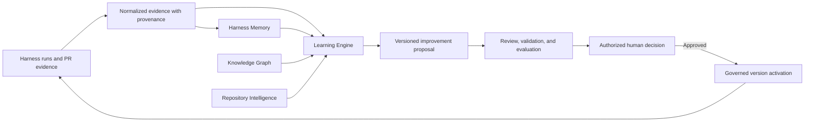
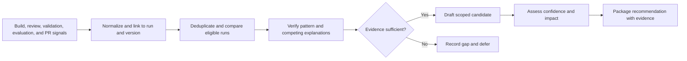
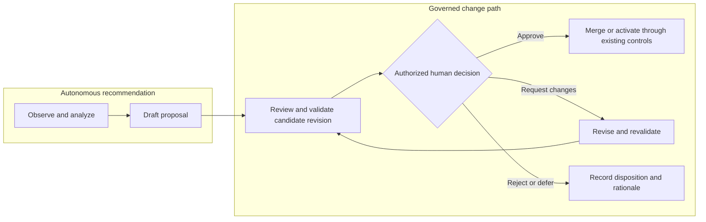
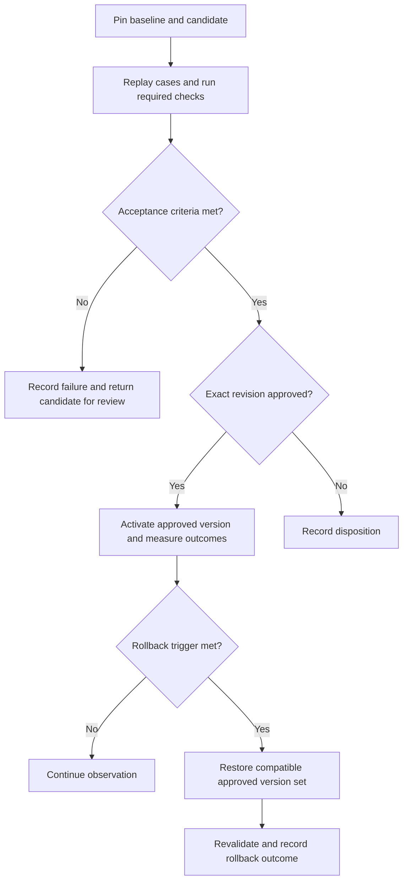
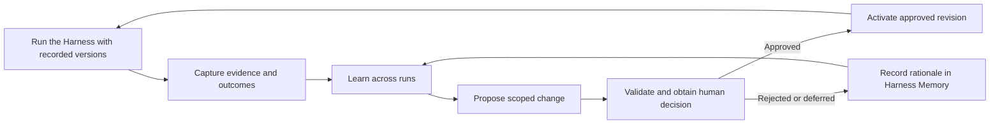

# Chapter 45 — Autonomous Improvement Engine

**Part VI — Self-Learning AI Systems**  
**Target file** · `book/45-autonomous-improvement-engine.md`

## Story-driven opening

- Open with Alpha Car Detailing changing a booking event. The producer build passes, but a Reviewer Agent notices that a downstream notification consumer was omitted from validation. A later fleet-booking change produces a similar finding.
- Follow one finding through the review, validation rerun, and PR evidence bundle. These records describe the same occurrence. The later change supplies a separate occurrence.
- Pose the chapter question. How can the Harness learn from both changes and recommend a better default while preserving the authority of the Skill owner, applicable Instructions, and the existing approval gates?
- State the governing principle. The Harness may learn and recommend autonomously. Governed engineering changes require evidence, validation, and human approval.

## Learning objectives

- Explain how the Autonomous Improvement Engine uses the Learning Engine, Harness Memory, Repository Intelligence, and Knowledge Graph.
- Normalize and correlate learning signals, identify independent occurrences, and evaluate competing explanations.
- Choose the appropriate improvement surface, assess confidence and impact, and prepare a reviewable proposal.
- Design baseline comparisons, evaluation criteria, human approval, versioned activation, monitoring, and rollback.
- Trace a recommendation from source evidence to the version used on a later Harness run.

## Background

- Connect Chapters 36–40 from adaptive Harness behavior through durable Harness Memory and learning from builds, reviews, and PRs.
- Carry forward the artifact ownership distinctions from Chapters 41–43. Skills encode reusable procedures, Prompts frame tasks, and Instructions express standing expectations within their authority and scope. Steering Notes keep their original scope and lifetime.
- Use Chapter 44 to explain how graph relationships expose producers, consumers, owners, affected artifacts, and candidate validation gates. Check derived relationships against authoritative contracts, repository artifacts, and ADRs.
- Reuse the human approval, audit trail, policy, and security boundaries established in Chapters 29–34.

## Concepts

### What the engine does

- Present the Autonomous Improvement Engine as the governed recommendation capability of the self-learning Harness. Map its cross-run analysis and candidate generation to the Learning Engine described in preceding chapters.
- Trace the lifecycle from observed evidence to a pattern, candidate, validation result, human decision, approved version, and measured outcome.
- Distinguish automatic capture of verified run facts from governed changes to active artifacts, permissions, policy, and authoritative knowledge.

### Inputs and learning signals

- **Builds** — record run and commit identity, build stage, failed or skipped checks, retries, environment, and the configuration used. Separate persistent defects from flaky tests and infrastructure failures.
- **Reviews** — distinguish verified findings and human dispositions from unresolved Agent hypotheses, duplicate comments, and stylistic preferences.
- **Validation** — capture gate applicability, execution, result, coverage, skipped checks, exceptions, and evidence artifacts. Distinguish missing coverage from a failing check.
- **Evaluation** — capture task and business outcomes, rubric and dataset versions, acceptance results, evaluator identity, and evaluator uncertainty. Use notification delivery behavior alongside technical contract results.
- **PRs** — link the diff and commit, initial findings, fixes, revalidation, evaluation, reviewer decisions, and disposition. Treat reverts and post-merge regressions as additional signals.
- **Harness Memory** — retrieve durable run context, prior recommendations, rejected or superseded proposals, approval records, and post-release outcomes with provenance and retention controls.
- **Knowledge Graph** — resolve artifact identities and versions, traverse declared dependencies, identify owners and affected consumers, and surface uncertain or stale links for verification. Use Repository Intelligence for current repository context.
- Sketch the normalized evidence record. Include source reference, run and occurrence identity, artifact and configuration versions, timestamp, repository and environment, classification, verification state, access scope, and applicable decision.

### Pattern detection

- Deduplicate findings within a run and across linked review, CI, validation, and PR records. Compare independent occurrences against eligible runs, including successful counterexamples and runs where the gate was inapplicable.
- Group comparable cases by workflow stage, task type, artifact revision, dependency, and failure signature. Flag regressions after version changes and track drift across comparable cohorts.
- Investigate alternative causes such as stale consumer metadata, an existing Skill step being skipped, ambiguous Prompt wording, or a transient tool failure. Mark correlation and supporting evidence separately.
- Give sparse, conflicting, or stale evidence a defer path. Route urgent incidents through established incident and escalation procedures.

### Candidate improvements

| Surface | Alpha Car Detailing candidate | Validation focus |
| --- | --- | --- |
| Skill | Add consumer discovery and applicable contract checks to the event-change procedure | Replay event changes and verify the procedure remains usable when dependencies are missing |
| Prompt | Ask for named consumers and applicable checks in the event-change task plan | Compare plan completeness and fidelity across representative tasks |
| Instructions | Propose scoped wording only if an enduring ownership or compatibility obligation is genuinely absent | Verify precedence, policy and ADR alignment, scope, and owner approval |
| Workflow | Route event-contract changes to an existing consumer-validation stage | Check trigger precision, failure handling, sequencing, and approval flow |
| Tool selection | Prefer an approved contract checker for supported event schemas | Compare coverage, reliability, permission scope, and fallback behavior |
| Validation strategy | Add downstream fixtures, negative controls, and consumer contract coverage | Measure missed incompatibilities, false positives, flakiness, and runtime |
| Knowledge | Propose correction of a stale event-to-consumer relationship and cite authoritative evidence | Verify entity identity, source, freshness, ownership, and affected queries |

- Select the smallest surface that owns the gap. Record alternatives, expected benefit, owner, base version, suggested diff, affected dependencies, validation plan, and rollback target. Preserve a documented defer or reject outcome.

### Confidence scoring and impact analysis

- Define confidence in the proposed explanation and expected benefit using evidence reliability, independent recurrence, context match, recency, counterevidence, and replay results. Explain each factor and avoid treating a model's self-rating as calibrated confidence.
- Keep confidence, impact, and approval status separate. Use qualitative tiers or an illustrative rubric with explicit criteria. Show how sparse evidence or contradictory runs lower confidence and how a high-confidence change can still require broad review.
- Trace impact through Skills, Prompts, Instructions, Agent roles, workflow triggers, tools, services, contracts, validation gates, knowledge consumers, and owners. Estimate blast radius, reversibility, cost, latency, coverage, and failure severity. Record unknowns and verify critical graph edges against authoritative sources.

## Architecture discussion

### Components and interfaces

- Map evidence collection to Harness run records, CI, review, Validator Agent, Evaluator Agent, and PR evidence. Preserve original evidence and normalize references for access-controlled analysis.
- Map Harness Memory to historical records, the Knowledge Graph to relationships and provenance, and Repository Intelligence to current artifact and dependency context.
- Place pattern detection, candidate drafting, scoring, and impact analysis on the recommendation side. Hand off a versioned proposal and evidence bundle to the established engineering review path.
- Identify the Lead Agent's coordination role, Developer Agent or maintainer's candidate preparation, Reviewer Agent's findings, Validator Agent's gate evidence, Evaluator Agent's outcome assessment, and the authorized human's disposition. Preserve separation of duties appropriate to the change.
- Keep proposal states visible. Cover observed, candidate, validating, awaiting approval, approved, activated, rejected, deferred, superseded, and rolled back. Tie decisions and results to the candidate revision so edits and stale base versions trigger appropriate revalidation.

### Governance, safety, and auditability

- Treat logs, review comments, and retrieved content as evidence with trust and authorization metadata. Filter secrets and sensitive data, enforce repository and tenant scope at retrieval, and cover indirect prompt injection and evidence poisoning.
- Bound tool permissions, replay environments, spend, execution scope, and data retention. Keep active artifact writes, merge, activation, policy changes, and permission grants behind their existing controls. Require independent enforcement of mandatory gates.
- Record evidence identifiers, base and candidate revisions, applicable policy, scores and rationale, test artifacts, reviewer findings, human identity and decision, version activated, and rollback or follow-up outcomes. Retain rejected and deferred decisions so equivalent proposals require new evidence or changed context.
- Define behavior when provenance, an owner, or validation evidence is missing. Defer or escalate with a recorded reason. Use a proposal identifier and revision to prevent duplicate processing and invalid reuse of approval.

### Testing, versioning, and recovery

- Capture a baseline and pin artifact versions, tools, environment, fixtures, and evaluation rubric. Replay historical failures and successful runs, add held-out and negative cases, and compare coverage, compatibility, runtime, cost, and false positives.
- Test candidate changes in isolation. Use regression and boundary checks for Instructions and permissions, and shadow or limited rollout where the existing release process supports it.
- Require the applicable gates and authorized approval for the exact revision before activation. Record the version in each subsequent Harness run and preserve links across jointly versioned dependencies.
- Define monitoring windows and rollback triggers before release. Restore a compatible previously approved version set through the authorized recovery path, rerun affected checks, verify active version and outcomes, and link the rollback to the original proposal.

## Professional diagrams

### Autonomous Improvement Engine architecture

### Evidence-to-recommendation pipeline

### Human approval boundary

### Validation and rollback flow

### Continuous improvement loop

## Hands-on example

1. Assemble an illustrative evidence bundle for the two Alpha Car Detailing booking-event changes. Include one clean comparison run and a retry caused by infrastructure.
2. Join review findings, missing gate records, evaluation outcomes, and PR dispositions to the relevant run and commit. Count separate occurrences and identify the remaining uncertainties.
3. Traverse producer-to-event-to-consumer edges to find affected services and owners. Verify the notification dependency against current repository or contract evidence.
4. Compare updating the event-change Skill, adding a workflow trigger, and correcting graph metadata. Draft a narrow Skill candidate if the procedure owns the gap and record rationale, confidence, impact, and alternatives.
5. Replay failing and clean cases against baseline and candidate. Include a change unrelated to event contracts, an incompatible payload, and a missing dependency record. Compare detection, unnecessary checks, and runtime.
6. Prepare the reviewable PR evidence bundle with the diff, source links, check outputs, evaluation, approval criteria, and exact version references. Show the disposition for insufficient evidence and for authorized approval.
7. Follow the approved version through a subsequent run. Simulate an unacceptable increase in false positives, restore the prior approved version, and verify effective version and consumer validation behavior.
8. Capture proposal and rollout outcomes in Harness Memory. Link factual records in the Knowledge Graph and route semantic corrections through the applicable governance process.

## Claude example

- Outline the Claude-first exercise using a scoped, sanitized evidence bundle, the current Skill revision, explicit access limits, and the graph-backed dependency view.
- Ask Claude to group independent occurrences, cite sources, surface counterexamples, propose the smallest justified diff, and produce a test plan and rollback target. Include a defer response when evidence is insufficient.
- Show what the reviewer verifies independently before the candidate enters normal PR review and validation.

## GitHub Copilot comparison

- Apply the same Alpha Car Detailing evidence bundle and rubric in a repository-centered workflow. Compare preparation of the candidate diff, use of PR context, traceability to source evidence, and handoff to owners and CI.
- Identify which steps the Harness supplies for cross-run memory, evidence normalization, and governance. Verify product-specific claims before drafting the chapter.

## Codex comparison

- Apply the same scope in an isolated checkout or candidate branch. Outline inspection of repository artifacts, preparation of the proposed patch, execution of approved fixtures, and presentation of exact version and test evidence.
- Compare reproducibility, tool permissions, evidence preservation, and review handoff using the same rubric. Verify product-specific claims before drafting the chapter.

## Best practices

- Capture provenance and version context at the source. Deduplicate by occurrence and preserve counterexamples.
- Prefer small, reversible changes whose owner, expected effect, acceptance criteria, and rollback target can be reviewed together.
- Track proposal acceptance alongside held-out pass rate, escaped regressions, repeat findings, false positives, runtime, and rollback frequency. Segment comparisons by comparable work and versions.
- Retain decisions and alternate explanations so later evidence can confirm, supersede, or reopen the proposal deliberately.

## Anti-patterns

> **Common Mistake**  
> Counting one review finding, build rerun, and PR comment as three independent failures inflates confidence and can trigger an unnecessary change.

- Rewarding green builds or recommendation volume while missing business or downstream regressions.
- Converting transient task guidance into permanent Instructions, treating a graph inference as policy, or widening the scope of a fix to unrelated workflows.
- Allowing proposals to suppress gates, expand tool permissions, approve themselves, or change active versions through an unintended write path.
- Tuning on the same cases used to judge success, approving a moving diff, releasing without a recoverable baseline, or resubmitting rejected proposals without new evidence.

## Architect's notes

> **Architect's Note**  
> Design the proposal interface so reviewers can reconstruct the evidence, rationale, affected versions, and resulting decision even if the recommendation model changes.

- Show where to keep deterministic identity checks, deduplication, authorization, and version enforcement. Use Agent judgment for hypothesis formation and candidate drafting.
- Discuss the tradeoff between shared Skills and local variants, including dependency blast radius and ownership.
- Address feedback loops where a changed gate alters the observed signal. Preserve stable comparison cases and track changes to measurement policy.

## Enterprise tips

> **Enterprise Tip**  
> Start with one owned Skill and one measurable class of recurrence. Scale when owners can audit decisions, reproduce validation, and restore the previous version.

- Define accountable owners and exception handling for shared artifacts. Use existing PR protection, approval routing, and audit retention requirements.
- Set review capacity and prioritization using severity, expected benefit, uncertainty, validation cost, and reversibility. Monitor queue age and rejected-proposal recurrence.

## Decision points

> **Decision Point**  
> Choose the artifact that owns the missing responsibility. A missed check can come from a deficient Skill, a skipped workflow step, an ambiguous task Prompt, or stale dependency information.

- Decide how many independent and comparable observations justify a proposal and how severe incidents enter a separate escalation path.
- Decide how to scope candidate testing and who must approve changes to local versus shared artifacts.
- Decide what constitutes a compatible rollback set and which metrics trigger recovery.
- Decide which graph updates can reflect verified facts automatically and which changes require semantic review.

## Exercises

1. Normalize an illustrative evidence bundle and justify the number of independent occurrences.
2. Trace the affected consumers and owners in the graph. Flag a stale edge and identify the authoritative source needed to verify it.
3. Draft a candidate for each of two plausible root causes. Select one based on scope, ownership, and evidence.
4. Score a candidate with conflicting review and evaluation signals. Record confidence, impact, and the disposition separately.
5. Design a held-out replay suite, acceptance criteria, and rollback triggers for the Alpha Car Detailing Skill change.
6. Reconstruct an audit trail from proposal through approval, activation, and rollback, identifying each required evidence link.

## Interview questions

1. How do Harness Memory, Repository Intelligence, and the Knowledge Graph each support cross-run learning?
2. How would you distinguish a recurring defect from duplicate observations, flaky checks, or a change in workload?
3. When should a repeated issue result in a Skill change, Prompt revision, Instruction proposal, or workflow change?
4. How would you handle a high-confidence proposal with broad impact and incomplete consumer evidence?
5. How do you prevent a changed proposal from inheriting a prior approval?
6. How would you measure whether a new validation gate improved outcomes, and when would you roll it back?
7. How would you respond to untrusted PR content that tries to redirect the Learning Engine or relax a mandatory gate?
8. What records would you need to explain why a given Harness run used a particular version?

## Chapter summary

- Recap the path from traceable run evidence through cross-run pattern detection, candidate selection, confidence assessment, and impact analysis.
- Revisit the Alpha Car Detailing example from duplicate observations and independent recurrence through validation, approval, activation, and recovery.
- Close the loop with post-activation outcomes entering Harness Memory and the Knowledge Graph under the applicable evidence and governance rules.

## Further reading

- Link Chapters 29–34 for governance, security, approval, audit trails, policies, and compliance.
- Link Chapters 36–40 for adaptive Harnesses, Harness Memory, and evidence from builds, reviews, and PRs.
- Link Chapters 41–44 for Skill, Prompt, and Instruction Evolution and the Knowledge Graph.

Chapter 45 outline is complete.
