# Chapter 46 — Business Domain  

**Part VII — Alpha Car Detailing**  
**Target file:** `book/46-business-domain.md`

Chapter 46 begins Part VII, where Alpha Car Detailing becomes the complete enterprise implementation case study. The project defines Alpha Car Detailing as a nationwide vehicle washing and detailing company serving walk-in customers, corporate fleets, government departments, insurance companies, and rental companies.  Part VII then progresses from Business Domain through Solution Architecture, Clean Architecture, Microservices, Event-Driven Architecture, Security, Observability, CI/CD, and AI-assisted Development.

The outline below follows the frozen 19-section chapter template.

---

## 1. Story-Driven Opening — Before Architecture Comes Understanding

### 1.1 The Architecture Meeting

- Alpha Car Detailing is preparing to modernize its nationwide operations.
- Business stakeholders request:
  - online bookings,
  - walk-in servicing,
  - corporate fleet management,
  - government account support,
  - centralized billing,
  - payments,
  - notifications,
  - capacity management,
  - operational reporting.
- Architecture and engineering teams immediately begin discussing:
  - microservices,
  - APIs,
  - databases,
  - events,
  - queues,
  - Kubernetes,
  - cloud infrastructure.

### 1.2 The Missing Question

- What business are we actually designing for?
- What constitutes a booking?
- Who owns a vehicle?
- What makes a corporate fleet booking different from a retail booking?
- Can multiple vehicles belong to one booking?
- How is station capacity determined?
- Who defines service pricing?
- When does a booking become billable?
- What happens when capacity changes?
- Which business events matter?

### 1.3 Why AI Makes Domain Clarity More Important

- AI agents can generate architecture and code rapidly.
- Incorrect domain assumptions can therefore propagate faster.
- AI agents require explicit business context to reason correctly.
- Repository intelligence cannot compensate for undefined business rules.
- Domain understanding becomes an engineering control.

### 1.4 Core Principle
>
> AI-assisted engineering must begin with a clear understanding of the business domain, business rules, actors, workflows, boundaries, and desired outcomes before architecture or code is designed.

### 1.5 Transition into Part VII

- Chapters 1–45 established the AI engineering methods.
- Part VII applies those methods to one enterprise-scale system.
- Chapter 46 establishes the authoritative business foundation.
- Chapter 47 will translate this domain understanding into solution architecture.

---

## 2. Learning Objectives

By the end of the chapter, readers should be able to:

- explain the Alpha Car Detailing business model;
- identify major business actors and customer types;
- describe the company's core business capabilities;
- distinguish retail, corporate fleet, government, insurance, and rental-company scenarios;
- identify key domain entities and concepts;
- explain stations, vehicles, fleets, services, packages, bookings, capacity, pricing, billing, and payments;
- identify major business rules and invariants;
- distinguish business capabilities from software components;
- identify preliminary domain boundaries without prematurely designing microservices;
- model important workflows;
- identify meaningful business events;
- document explicit domain assumptions;
- recognize business and operational risks;
- define non-functional business expectations;
- create a shared domain vocabulary;
- explain how AI agents consume domain knowledge;
- recognize when AI-generated architecture is based on unsupported assumptions.

---

## 3. Background — Understanding Alpha Car Detailing

### 3.1 Company Overview

- Nationwide vehicle washing and detailing organization.
- Multiple physical service locations.
- Mix of consumer and enterprise customers.
- Centralized digital platform supporting distributed operations.
- Combination of scheduled and walk-in business.

### 3.2 Why Alpha Car Detailing Is an Enterprise Domain

- Multiple customer segments.
- Multiple locations.
- Capacity-sensitive operations.
- Fleet-scale transactions.
- Complex pricing arrangements.
- Contract customers.
- Government customers.
- Billing and payment differences by customer type.
- Operational and financial reporting.
- Security and audit requirements.
- Integration requirements.
- High transaction concurrency during busy periods.

### 3.3 Business Goals

#### Customer Experience

- Make services easy to discover and book.
- Reduce booking friction.
- Provide reliable appointment availability.
- Provide accurate status notifications.
- Support repeat customers efficiently.

#### Operational Efficiency

- Optimize station utilization.
- Reduce idle service capacity.
- avoid overbooking.
- improve employee and bay utilization.
- standardize services nationally.

#### Enterprise Growth

- Support corporate fleets.
- Support rental companies.
- Support insurance-company relationships.
- Support government contracts.
- Enable negotiated pricing.

#### Financial Control

- Improve billing accuracy.
- Reduce payment reconciliation problems.
- Support centralized enterprise invoicing.
- Provide auditable financial records.

#### Digital Transformation

- Establish a reusable enterprise platform.
- Enable future automation.
- Provide reliable operational data.
- Prepare the business for AI-assisted engineering and operations.

---

# 4. Concepts

## 4.1 Business Domain Model

Introduce the high-level business concepts:

- Customer
- Customer Account
- Corporate Account
- Government Account
- Fleet
- Vehicle
- Service
- Detailing Package
- Service Station
- Service Bay
- Booking
- Booking Item
- Schedule
- Capacity
- Price
- Contract Price
- Invoice
- Payment
- Notification

Clarify that these are **business concepts first**, not database tables or software classes.

---

## 4.2 Customer Types

### 4.2.1 Walk-In Customers

- Arrive without a prior booking.
- Select available services.
- Capacity must be evaluated at arrival.
- Usually pay immediately.

### 4.2.2 Individual Booking Customers

- Schedule service in advance.
- Select vehicle, station, service, date, and time.
- Receive confirmation and reminders.

### 4.2.3 Corporate Fleet Customers

- Maintain one or more fleets.
- Register many vehicles.
- May schedule vehicles individually or in batches.
- May receive negotiated pricing.
- May use centralized billing.

### 4.2.4 Government Customers

- Organization-based accounts.
- Potential contract pricing.
- Purchase-order or authorization requirements.
- Strong auditability requirements.
- Possible payment-after-service arrangements.

### 4.2.5 Insurance Companies

- May authorize services for customer vehicles.
- May require claim or authorization references.
- May use contracted rates.

### 4.2.6 Rental Companies

- Large vehicle inventories.
- Frequent recurring service requirements.
- Fleet-scale scheduling.
- Centralized account management and billing.

---

## 4.3 Business Actors

Identify human and organizational actors.

### External Actors

- Individual Customer
- Fleet Manager
- Corporate Account Administrator
- Government Representative
- Insurance Representative
- Rental Fleet Manager

### Internal Actors

- Station Manager
- Service Advisor
- Detailer / Technician
- Cashier
- Operations Manager
- Corporate Account Manager
- Finance Team
- Customer Support
- System Administrator
- Business Administrator

### System Actors

- Payment Provider
- Notification Provider
- Identity Provider
- Reporting / Analytics Platform
- External enterprise systems where applicable

### Diagram — Key Actors

```text
                    ┌─────────────────────┐
                    │ Alpha Car Detailing │
                    └──────────┬──────────┘
                               │
          ┌────────────────────┼───────────────────────┐
          │                    │                       │
      Customers           Enterprise              Internal
                             Clients               Operations
          │                    │                       │
   ┌──────┼──────┐      ┌──────┼────────┐      ┌──────┼─────────┐
Individual Walk-In      Corporate Government    Station Manager
                        Fleets                  Service Advisor
                        Rental                  Finance
                        Insurance               Support
```

Final diagram should be professionally rendered in the handbook.

---

## 4.4 Vehicle Concepts

### Vehicle

Potential attributes:

- unique vehicle identity;
- registration / license plate;
- make;
- model;
- year;
- vehicle type;
- ownership or account association;
- service history.

### Vehicle Types

Examples:

- sedan;
- SUV;
- pickup;
- van;
- commercial vehicle.

### Business Significance

Vehicle characteristics may influence:

- service duration;
- pricing;
- station capability;
- required resources;
- capacity calculations.

---

## 4.5 Fleet Concepts

### Fleet

- Logical collection of vehicles owned or managed by an organization.
- A corporate account may manage multiple fleets.

### Fleet Membership

- Vehicles can enter or leave fleets.
- Historical information must remain traceable.

### Fleet Manager

- Responsible for fleet administration.
- Can schedule eligible vehicles.
- May review booking and service history.

### Fleet-Level Operations

- Bulk booking.
- recurring service scheduling.
- centralized invoicing.
- usage reporting.
- service policy enforcement.

---

## 4.6 Stations and Service Locations

### Station

Represents a physical Alpha Car Detailing operating location.

Potential characteristics:

- address;
- operating hours;
- supported services;
- service bays;
- workforce capacity;
- local pricing;
- blackout periods;
- temporary closures.

### Service Bay

- Physical capacity unit.
- May support specific categories of service.
- May differ in equipment and vehicle compatibility.

### Station Capability

Not every station necessarily provides every service.

### Station Calendar

Should account for:

- business hours;
- holidays;
- maintenance;
- closures;
- local capacity restrictions.

---

## 4.7 Services and Detailing Packages

### Individual Services

Examples:

- exterior wash;
- interior cleaning;
- waxing;
- polishing;
- upholstery cleaning;
- tire detailing;
- engine-bay cleaning.

### Detailing Packages

Bundles several services into commercial offerings.

Possible package levels:

- Basic;
- Standard;
- Premium;
- Fleet-specific package.

### Package Rules

- Services included.
- Expected duration.
- Vehicle eligibility.
- Station availability.
- Base price.
- customer-specific pricing overrides.

### Distinguish

- **Service** — work performed.
- **Package** — commercial grouping of services.

---

## 4.8 Booking and Scheduling

### Booking Definition

A commitment to perform one or more services for one or more eligible vehicles at an agreed location and time.

### Booking Information

- customer;
- account;
- vehicle;
- station;
- requested services;
- time slot;
- price;
- booking status.

### Booking Channels

- online;
- mobile;
- service desk;
- call center;
- corporate portal;
- walk-in.

### Booking Status Model

Possible lifecycle:

```text
Requested
   ↓
Pending Confirmation
   ↓
Confirmed
   ↓
Checked In
   ↓
In Service
   ↓
Completed
   ↓
Billed
   ↓
Closed
```

Alternative paths:

- Cancelled
- Rejected
- No Show

---

## 4.9 Booking Lifecycle

### Diagram — Booking Lifecycle

```text
Request Booking
      │
      ▼
Validate Customer
      │
      ▼
Validate Vehicle
      │
      ▼
Select Service
      │
      ▼
Check Station Capability
      │
      ▼
Check Capacity
      │
      ▼
Calculate Price
      │
      ▼
Confirm Booking
      │
      ▼
Notify Customer
      │
      ▼
Check In
      │
      ▼
Perform Service
      │
      ▼
Complete Service
      │
      ▼
Bill / Pay
      │
      ▼
Close Booking
```

Include cancellation, rescheduling, rejection, and no-show branches in the final professional diagram.

---

## 4.10 Corporate Fleet Booking

Explain why fleet booking is not simply a larger retail booking.

### Corporate Requirements

- Account authorization.
- Fleet eligibility.
- Multiple vehicles.
- Multiple services.
- Booking limits.
- Contract pricing.
- station capacity.
- invoice-based settlement.

### Bulk Booking

A request may contain:

- tens;
- hundreds;
- potentially larger batches of vehicles.

### Scheduling Choices

- same station;
- multiple dates;
- multiple time slots;
- potentially multiple stations.

### Booking Limits

Potential rules:

- maximum vehicles per booking;
- maximum vehicles per time window;
- account-specific limits;
- station capacity limits.

### Partial Acceptance

Discuss whether:

- entire fleet booking succeeds or fails together;
- eligible vehicles may be accepted while others are rejected;
- business policy determines the answer.

### Diagram — Corporate Fleet Booking Workflow

```text
Fleet Manager
     │
     ▼
Select Corporate Account
     │
     ▼
Select Fleet / Vehicles
     │
     ▼
Select Services
     │
     ▼
Validate Contract
     │
     ▼
Validate Vehicle Eligibility
     │
     ▼
Apply Booking Limits
     │
     ▼
Check Station Capacity
     │
     ▼
Apply Contract Pricing
     │
     ▼
Reserve Capacity
     │
     ▼
Create Booking(s)
     │
     ▼
Send Confirmation
```

---

## 4.11 Capacity Management

### Why Capacity Is a Business Concept

Capacity represents the organization's ability to fulfill customer commitments.

### Capacity Factors

- number of service bays;
- operating hours;
- service duration;
- staffing;
- equipment;
- vehicle type;
- service type;
- maintenance periods;
- existing bookings.

### Capacity Questions

- Is capacity measured in vehicles, bays, minutes, or resource units?
- Can capacity be temporarily overridden?
- Can managers intentionally overbook?
- Can enterprise customers reserve capacity blocks?
- How far ahead can capacity be allocated?

### Capacity Reservation

Differentiate:

- capacity inquiry;
- tentative hold;
- confirmed reservation;
- released capacity.

### Concurrency Risk

- Two requests may attempt to reserve the last available slot.
- Business correctness requires deterministic capacity protection.

---

## 4.12 Pricing

### Pricing Sources

- standard service price;
- package price;
- station-specific price;
- vehicle-type adjustment;
- promotion;
- corporate contract;
- government contract;
- negotiated rate.

### Pricing Precedence

Define conceptually:

```text
Base Price
    ↓
Vehicle Adjustment
    ↓
Station Adjustment
    ↓
Contract Price
    ↓
Eligible Discount / Promotion
    ↓
Final Agreed Price
```

### Price Snapshot

- A confirmed booking should preserve the commercially agreed price.
- Later catalog changes should not silently alter existing bookings.

---

## 4.13 Billing

### Retail Billing

Typically associated with immediate payment.

### Corporate Billing

Potential model:

- completed services accumulated;
- invoice generated periodically;
- invoice sent to corporate account;
- payment reconciled later.

### Government Billing

May involve:

- purchase orders;
- approved contract references;
- invoice authorization;
- defined payment terms.

### Billing Concepts

- billable service;
- invoice;
- invoice line;
- billing account;
- billing period;
- credit;
- adjustment.

---

## 4.14 Payments

### Payment Methods

Possible channels:

- card;
- digital payment;
- corporate account settlement;
- bank transfer;
- invoice payment.

### Payment States

- Pending
- Authorized
- Completed
- Failed
- Refunded

### Payment vs Booking

Explain that:

- booking confirmation;
- service fulfillment;
- billing;
- payment

are related but distinct business concepts.

---

## 4.15 Government and Enterprise Customers

### Enterprise Account Characteristics

- contractual relationships;
- defined account administrators;
- vehicle eligibility;
- negotiated services;
- negotiated pricing;
- spending controls;
- centralized billing;
- reporting requirements.

### Government-Specific Expectations

- authorization;
- procurement controls;
- traceability;
- invoicing standards;
- audit records;
- retention policies.

### Business Rule Variation

Rules should be configurable where legitimately different by account rather than embedded as customer-name-specific logic.

---

## 4.16 Notifications

### Notification Purposes

- booking confirmation;
- reminder;
- rescheduling;
- cancellation;
- check-in confirmation;
- service completion;
- payment receipt;
- invoice availability.

### Channels

- email;
- SMS;
- push notification;
- enterprise integration where appropriate.

### Important Distinction

A notification failure should not necessarily invalidate an otherwise valid business transaction.

---

## 4.17 Core Business Rules

Candidate rules to establish explicitly:

- bookings require an eligible customer or account;
- vehicles must be eligible for the requesting account;
- stations may accept only supported services;
- bookings cannot exceed available capacity;
- corporate booking limits must be enforced;
- confirmed capacity cannot be double allocated;
- contract pricing applies only while the contract is valid;
- confirmed prices must remain traceable;
- completed service cannot be silently removed;
- payments must not be applied twice;
- booking cancellation rules depend on booking state;
- completed bookings require appropriate financial disposition;
- government bookings may require valid authorization;
- fleet managers may act only within permitted accounts;
- business operations requiring retries must behave safely and idempotently.

Include distinction between:

- business rule;
- policy;
- validation rule;
- technical constraint.

---

## 4.18 Domain Terminology

Create an authoritative glossary for Part VII.

| Term | Business Meaning |
| --- | --- |
| Customer | Person or organization receiving services |
| Account | Commercial relationship under which transactions occur |
| Vehicle | Vehicle eligible to receive a service |
| Fleet | Managed collection of vehicles |
| Station | Physical Alpha Car Detailing location |
| Service | Individual unit of work offered |
| Package | Commercial bundle of services |
| Booking | Commitment to deliver services |
| Capacity | Ability of a station to fulfill bookings |
| Price | Commercial value assigned to service |
| Invoice | Formal request for payment |
| Payment | Financial settlement |
| Corporate Fleet Booking | Booking operation covering vehicles belonging to an enterprise fleet |

Emphasize ubiquitous language.

---

# 5. Architecture Discussion — From Business Domain to System Boundaries

## 5.1 Business Capabilities Before Software Services

Explain why business capabilities should not immediately be translated into:

- microservices;
- databases;
- APIs;
- repositories.

Chapter 47 will make those architectural decisions.

---

## 5.2 Core Business Capabilities

Candidate capabilities:

- Customer Management
- Corporate Account Management
- Fleet Management
- Vehicle Management
- Service Catalog Management
- Station Management
- Booking Management
- Scheduling
- Capacity Management
- Pricing
- Billing
- Payments
- Notifications
- Service Fulfillment
- Reporting and Analytics

### Diagram — Business Capability Map

```text
Alpha Car Detailing
│
├── Customer Management
├── Enterprise Account Management
│   ├── Corporate Accounts
│   ├── Government Accounts
│   └── Contract Management
│
├── Fleet Management
│   ├── Fleets
│   └── Vehicles
│
├── Service Management
│   ├── Services
│   └── Packages
│
├── Operations
│   ├── Stations
│   ├── Scheduling
│   ├── Capacity
│   └── Service Fulfillment
│
├── Booking
│   ├── Retail Booking
│   └── Fleet Booking
│
├── Commerce
│   ├── Pricing
│   ├── Billing
│   └── Payments
│
└── Customer Engagement
    ├── Notifications
    └── Support
```

---

## 5.3 Domain Boundaries

Introduce preliminary logical domain boundaries without locking them to deployable services.

Candidate boundaries:

### Customer Domain

- individuals;
- organizations;
- account relationships.

### Fleet Domain

- fleets;
- vehicles;
- fleet membership.

### Service Catalog Domain

- services;
- packages;
- service definitions.

### Station Operations Domain

- locations;
- service capabilities;
- operational calendars.

### Booking Domain

- booking requests;
- booking lifecycle;
- cancellations;
- rescheduling.

### Capacity Domain

- availability;
- reservations;
- utilization.

### Pricing Domain

- standard prices;
- contract prices;
- adjustments.

### Billing Domain

- invoices;
- billing cycles;
- adjustments.

### Payment Domain

- payment processing;
- reconciliation;
- refunds.

### Notification Domain

- communication requests;
- delivery tracking.

---

## 5.4 Domain Context Map

### Diagram — Domain Context Map

```text
                    ┌─────────────────┐
                    │ Customer Domain │
                    └────────┬────────┘
                             │
                 ┌───────────▼───────────┐
                 │    Booking Domain     │
                 └───────┬───────┬───────┘
                         │       │
             ┌───────────▼─┐   ┌─▼────────────┐
             │ Fleet Domain │   │Service Catalog│
             └──────────────┘   └──────────────┘
                         │
                 ┌───────▼─────────┐
                 │ Capacity Domain │
                 └───────┬─────────┘
                         │
                 ┌───────▼──────────┐
                 │Station Operations│
                 └──────────────────┘

Booking ───────► Pricing
Booking ───────► Notification
Completed Work ► Billing ─────► Payment
```

Explain that this map represents business relationships, not yet physical deployment architecture.

---

## 5.5 Key Workflows

### Retail Booking

Customer → service selection → station → availability → price → confirmation.

### Walk-In Service

Arrival → service selection → capacity assessment → booking/work order → service → payment.

### Corporate Fleet Booking

Fleet → vehicle selection → authorization → limits → capacity → contract pricing → reservation.

### Service Fulfillment

Check-in → work started → work completed → customer notified.

### Billing

Completed services → billable entries → invoice → payment → reconciliation.

### Cancellation

Cancellation request → policy evaluation → capacity release → payment adjustment → notification.

---

## 5.6 Business Events

Introduce events as business facts, not messaging-technology constructs.

Candidate events:

- CustomerRegistered
- CorporateAccountCreated
- VehicleRegistered
- VehicleAddedToFleet
- ServicePackageChanged
- BookingRequested
- BookingConfirmed
- BookingRejected
- BookingRescheduled
- BookingCancelled
- CapacityReserved
- CapacityReleased
- VehicleCheckedIn
- ServiceStarted
- ServiceCompleted
- InvoiceGenerated
- PaymentAuthorized
- PaymentCompleted
- PaymentFailed
- RefundIssued

### Diagram — Major Business Events

```text
BookingRequested
      │
      ├──► BookingRejected
      │
      └──► CapacityReserved
                │
                ▼
         BookingConfirmed
                │
                ▼
        VehicleCheckedIn
                │
                ▼
         ServiceStarted
                │
                ▼
        ServiceCompleted
                │
                ├──► InvoiceGenerated
                │
                └──► PaymentAuthorized
                           │
                           ▼
                    PaymentCompleted
```

Explain:

- command vs event;
- request vs fact;
- state change vs notification.

---

## 5.7 Business Risks

### Operational Risks

- overbooking;
- unavailable station;
- incorrect capacity;
- station outage;
- resource shortages.

### Financial Risks

- incorrect price;
- double payment;
- missing invoice;
- duplicate billing;
- invalid contract pricing.

### Customer Risks

- lost booking;
- incorrect schedule;
- failed notification;
- service mismatch.

### Enterprise Risks

- unauthorized fleet access;
- incorrect government billing;
- contract violation;
- insufficient audit records.

### AI Engineering Risks

- AI inventing business rules;
- AI translating assumptions directly into code;
- inconsistent terminology across agents;
- generated components crossing domain boundaries;
- outdated domain knowledge being treated as authoritative.

---

## 5.8 Non-Functional Business Expectations

Focus first on business expectations rather than technical implementation.

### Availability

Customers must be able to book reliably.

### Correctness

Capacity, price, billing, and payment information must be trustworthy.

### Scalability

Platform should accommodate nationwide operations and large fleet bookings.

### Performance

Availability and booking responses should remain responsive.

### Resilience

Transient infrastructure problems should not corrupt bookings or payments.

### Security

Enterprise and government information requires controlled access.

### Auditability

Important business decisions and financial transactions must be traceable.

### Privacy

Customer and account information must be protected.

### Observability

Operations teams must be able to understand business transaction health.

### Recoverability

Interrupted processes must be recoverable without duplicating business outcomes.

---

## 5.9 Domain Assumptions

Create an explicit assumption register.

Initial examples:

- Alpha Car Detailing operates multiple stations nationwide.
- Stations may offer different services.
- A vehicle may belong to an individual or organizational account.
- Enterprise accounts may contain multiple fleets.
- A fleet contains multiple vehicles.
- Corporate customers may receive contract pricing.
- A booking consumes station capacity.
- Capacity varies by station and time.
- Corporate bookings may contain multiple vehicles.
- Completed services become eligible for billing.
- Retail and enterprise payment models may differ.

### Assumption Classification

For each assumption record:

- confirmed;
- provisional;
- requires stakeholder validation;
- intentionally deferred.

### Key Rule

AI agents must never silently convert an unverified assumption into an authoritative business rule.

---

## 5.10 Alpha Car Detailing Roadmap

### Phase 1 — Core Operations

- customers;
- vehicles;
- services;
- stations;
- retail booking;
- availability;
- payment.

### Phase 2 — Enterprise Accounts

- corporate customers;
- fleets;
- bulk bookings;
- contract pricing;
- invoice billing.

### Phase 3 — Government and Partner Operations

- government customers;
- insurance integrations;
- rental-company workflows;
- advanced authorization.

### Phase 4 — Operational Intelligence

- capacity optimization;
- demand forecasting;
- utilization analytics;
- customer analytics.

### Phase 5 — AI-Enhanced Operations

- intelligent scheduling recommendations;
- operational anomaly detection;
- support automation;
- engineering automation through the enterprise AI harness.

Clarify that roadmap items must not be treated as current requirements until approved.

---

# 6. Professional Diagrams

The chapter should contain six primary diagrams:

1. **Alpha Car Detailing Business Capability Map**
   - business capabilities and sub-capabilities.

2. **Domain Context Map**
   - major business domains and relationships.

3. **Key Actors Diagram**
   - customers, enterprise actors, internal staff, external systems.

4. **Booking Lifecycle**
   - booking from request through closure, including alternate paths.

5. **Corporate Fleet Booking Workflow**
   - vehicle selection through validation, capacity, pricing, and confirmation.

6. **Major Business Events**
   - important domain facts and their sequence.

### Diagram Standards

- Business-oriented notation.
- Vendor-neutral.
- No premature Azure or implementation technology.
- Consistent terminology.
- Suitable for later architectural traceability.

The handbook requires professional diagrams as part of every chapter's frozen structure.

---

# 7. Hands-on Example — Discovering a Corporate Fleet Booking Requirement

## 7.1 Scenario

A corporate customer requests detailing for 75 fleet vehicles.

## 7.2 Initial Requirement
>
> Schedule 75 corporate fleet vehicles for detailing next week.

## 7.3 Questions the Engineering Team Must Ask

### Customer and Authorization

- Which corporate account?
- Who is authorized to make the booking?

### Vehicles

- Which vehicles?
- Are all vehicles currently assigned to that fleet?
- Are all vehicle types supported?

### Services

- Same package for every vehicle?
- Different services for different vehicles?

### Scheduling

- One station or several?
- One day or multiple days?
- Required completion deadline?

### Capacity

- Can the selected station process 75 vehicles?
- What is the allowed daily limit?

### Pricing

- Contract rate?
- Vehicle-specific rate?
- Package discount?

### Billing

- Individual payment?
- Consolidated invoice?
- Purchase-order reference?

## 7.4 Resulting Domain Knowledge

Show how one seemingly simple requirement exposes:

- account rules;
- vehicle rules;
- fleet rules;
- capacity rules;
- pricing rules;
- booking limits;
- billing rules.

## 7.5 Domain Artifact

Create a concise business requirement specification suitable for consumption by later AI agents.

---

# 8. Claude Example — Using Domain Knowledge Before Implementation

## 8.1 Repository Context

Provide Claude with authoritative Alpha Car Detailing domain documentation.

## 8.2 Example Task

Request analysis of the corporate fleet booking requirement.

## 8.3 Expected Claude Behavior

Claude should:

- inspect domain documentation;
- identify known rules;
- identify missing information;
- distinguish facts from assumptions;
- identify affected business capabilities;
- identify likely business events;
- avoid designing implementation prematurely.

## 8.4 Example Reasoning Output Structure

- Known domain facts
- Applicable business rules
- Open questions
- Assumptions
- Affected capabilities
- Candidate events
- Risks
- Recommended next decision

## 8.5 Incorrect Behavior

Claude should not immediately invent:

- database tables;
- microservices;
- event topics;
- API endpoints;
- Azure resources.

## 8.6 Connection to Repository Intelligence

Show domain documentation becoming an authoritative knowledge source for:

- Lead Agent;
- Developer Agent;
- Reviewer Agent;
- Validator Agent;
- Evaluator Agent.

---

# 9. GitHub Copilot Comparison

## 9.1 Common Domain Requirement

Use the same corporate fleet scenario.

## 9.2 Context Availability

Compare how repository instructions and contextual files provide business knowledge.

## 9.3 Strength

- implementation assistance within development workflow.

## 9.4 Risk

- generated implementation may follow nearby code patterns even when domain assumptions are incomplete.

## 9.5 Enterprise Guidance

Regardless of tooling:

- domain knowledge must be explicit;
- assumptions must be visible;
- business rules must be governed;
- implementation must trace back to domain requirements.

Avoid product feature comparison unless it materially affects the workflow, consistent with the handbook's vendor-neutral approach. AI development handbook

---

# 10. Codex Comparison

## 10.1 Same Domain Task

Evaluate the fleet-booking requirement using the same authoritative domain information.

## 10.2 Repository-Level Context

Discuss how domain documents constrain engineering work.

## 10.3 Tool-Independent Principle

The quality of AI-generated engineering depends heavily on:

- context quality;
- domain clarity;
- explicit rules;
- clear acceptance criteria.

## 10.4 Comparison Focus

Compare only:

- context consumption;
- planning workflow;
- repository interaction;
- validation behavior,

where materially relevant.

## 10.5 Key Lesson

Domain knowledge belongs to the engineering system, not to a specific AI vendor.

---

# 11. Best Practices

- Begin architecture with business capabilities, not technology.
- Establish ubiquitous language.
- Maintain an authoritative domain glossary.
- Separate confirmed rules from assumptions.
- Record unresolved business questions explicitly.
- Express rules independently of UI and infrastructure.
- Model business events as meaningful facts.
- Document exception paths as carefully as happy paths.
- Treat capacity as a first-class domain concept.
- Treat enterprise customer rules explicitly.
- Preserve agreed prices and other historically significant business facts.
- Design fleet workflows independently from individual customer workflows where their business behavior differs.
- Trace architecture decisions back to business needs.
- Give AI agents access to authoritative domain documentation.
- Require agents to identify assumptions before implementation.
- Review AI-generated domain interpretations with business stakeholders.
- Version significant domain decisions.

---

# 12. Anti-Patterns

## 12.1 Architecture-First Discovery

Selecting microservices before understanding the business.

## 12.2 Database-Driven Domain Modeling

Treating database tables as the domain model.

## 12.3 API-as-the-Domain

Defining the business around HTTP endpoints.

## 12.4 AI-Invented Requirements

Allowing an AI agent to fill business gaps silently.

## 12.5 Generic Customer Model

Assuming individual and enterprise customers behave identically.

## 12.6 Fleet Equals List of Vehicles

Ignoring authorization, booking limits, pricing, scheduling, and billing.

## 12.7 Capacity Equals Appointment Count

Ignoring service duration, bays, workforce, equipment, and vehicle type.

## 12.8 Event Everything

Creating events for technical activity instead of meaningful business facts.

## 12.9 Customer-Specific Hardcoding

Embedding `if customer == GovernmentAgencyX` rather than modeling legitimate policy differences.

## 12.10 Treating Assumptions as Facts

Allowing provisional requirements to become permanent architecture accidentally.

## 12.11 Premature Microservice Boundaries

Converting every domain noun into a service.

## 12.12 Domain Documentation That Becomes Stale

Failing to update authoritative knowledge when business behavior changes.

---

# 13. Architect's Notes

### Architect's Note — Domain Before Architecture

The architecture must emerge from business capabilities, transactional boundaries, consistency requirements, scale, security, and organizational needs—not from fashionable technology.

### Architect's Note — Boundaries Are Hypotheses

The domain boundaries introduced here are business-oriented candidates. Chapter 47 should evaluate them before translating them into solution boundaries.

### Architect's Note — Enterprise Customers Change the Model

Corporate and government requirements introduce authorization, contractual pricing, bulk operations, invoicing, auditing, and account-level controls that fundamentally alter the domain.

### Architect's Note — Business Events Become Architectural Inputs

Events identified here may later influence event-driven architecture, but this chapter defines their business meaning first.

---

# 14. Enterprise Tips

### Enterprise Tip — Maintain a Domain Knowledge Pack

Store:

- glossary;
- actor definitions;
- business rules;
- workflows;
- assumptions;
- business events;
- capability map.

### Enterprise Tip — Assign Ownership

Each major business capability should have an accountable business owner.

### Enterprise Tip — Track Open Questions

Do not bury unresolved questions in meeting notes.

### Enterprise Tip — Make Domain Knowledge AI-Readable

Use structured Markdown and consistent terminology so humans and AI agents consume the same authoritative information.

### Enterprise Tip — Govern Changes

A change to a business rule can be as consequential as a code change and should follow appropriate review.

---

# 15. Decision Points

### Decision Point 1 — What Constitutes a Booking?

- one vehicle;
- multiple vehicles;
- booking header plus vehicle-level items.

### Decision Point 2 — Fleet Booking Atomicity

- all-or-nothing;
- partial acceptance;
- separate booking per vehicle.

### Decision Point 3 — Capacity Model

- appointments;
- bays;
- service minutes;
- resource capacity.

### Decision Point 4 — Pricing Ownership

Determine where authoritative business pricing originates.

### Decision Point 5 — Enterprise Billing

- immediate payment;
- consolidated invoice;
- contractual billing cycle.

### Decision Point 6 — Vehicle Ownership

Determine relationship among:

- customer;
- account;
- fleet;
- vehicle.

### Decision Point 7 — Price Preservation

Determine when price becomes immutable for a transaction.

### Decision Point 8 — Booking Cancellation Policy

Define when and how bookings may be cancelled.

### Decision Point 9 — Enterprise Capacity Reservation

Determine whether contracted customers may reserve capacity ahead of general availability.

### Decision Point 10 — Domain Knowledge Governance

Determine who approves changes to authoritative business definitions and rules.

---

# 16. Exercises

## Exercise 1 — Identify Business Capabilities

Create a capability map for Alpha Car Detailing without mentioning software components.

## Exercise 2 — Model a Retail Booking

Document the complete retail booking workflow.

## Exercise 3 — Model a Fleet Booking

Design the business flow for 100 corporate vehicles across three days.

## Exercise 4 — Capacity Rules

Identify at least ten factors that could affect station capacity.

## Exercise 5 — Business Rule Classification

Classify sample statements as:

- business rule;
- policy;
- technical validation;
- assumption.

## Exercise 6 — Domain Events

Identify events generated during:

- booking;
- cancellation;
- service completion;
- invoicing;
- payment.

## Exercise 7 — Assumption Register

Create a structured assumption register containing:

- assumption;
- reason;
- risk;
- owner;
- validation status.

## Exercise 8 — Government Customer Scenario

Describe additional rules that may apply to government bookings.

## Exercise 9 — AI Domain Review

Give an AI agent an intentionally ambiguous booking request and require it to identify missing domain information before proposing implementation.

## Exercise 10 — Boundary Analysis

Evaluate whether Booking, Capacity, Pricing, Billing, and Payment represent genuinely different business responsibilities.

---

# 17. Interview Questions

1. Why should domain understanding precede software architecture?
2. What is the difference between a business capability and a software service?
3. What is ubiquitous language?
4. Why is terminology especially important when using AI coding agents?
5. What is a domain boundary?
6. Why should domain boundaries not automatically become microservices?
7. What makes corporate fleet booking different from individual booking?
8. Why should capacity be modeled as a first-class business concept?
9. What factors influence capacity in Alpha Car Detailing?
10. What is the difference between pricing, billing, and payment?
11. Why should a confirmed price often be preserved?
12. What makes a good business event?
13. What is the difference between `BookingRequested` and `BookingConfirmed`?
14. Why should AI agents distinguish assumptions from facts?
15. What risks arise when AI agents invent missing business requirements?
16. How should enterprise customer rules be modeled?
17. Why can government customers introduce additional domain complexity?
18. How does domain knowledge improve Lead Agent planning?
19. How can Reviewer and Validator Agents use business rules?
20. Why should domain documentation be governed like other engineering assets?

---

# 18. Chapter Summary

The summary should reinforce that:

- Alpha Car Detailing is the enterprise case study for Part VII.
- Architecture begins with business understanding.
- The domain contains multiple customer models.
- Enterprise fleet operations materially increase complexity.
- stations, services, vehicles, fleets, bookings, capacity, pricing, billing, and payments are distinct business concerns.
- business capabilities should be understood before software components are selected.
- domain boundaries are architectural inputs, not automatic microservices.
- business events describe meaningful facts.
- assumptions must remain explicit until validated.
- non-functional expectations originate in business needs.
- AI agents require governed domain knowledge.
- AI agents must not silently invent domain rules.
- Chapter 47 will translate the business domain into the Alpha Car Detailing solution architecture.

---

# 19. Further Reading

Plan references around:

### Domain-Driven Design

- Eric Evans — *Domain-Driven Design*
- Vaughn Vernon — *Implementing Domain-Driven Design*

### Enterprise Architecture

- Martin Fowler — enterprise architecture and domain modeling material.
- Microsoft architecture guidance relevant to domain modeling and distributed systems.

### Business Architecture

- business capability modeling;
- value streams;
- business context mapping.

### Event-Driven Domain Modeling

- domain events;
- event storming;
- business process modeling.

### AI-Assisted Engineering

- authoritative context management;
- repository knowledge;
- human-in-the-loop requirements validation;
- AI governance of business knowledge.

The final references should remain vendor-neutral where discussing engineering principles; Claude remains the primary implementation platform, while GitHub Copilot and Codex comparisons are included only where materially different. AI development handbook

**Chapter 46 outline is complete.**


+++++++++++++++++

# Chapter 46 — Business Domain

## Part VII — Alpha Car Detailing

Software architecture does not begin with services, databases, APIs, events, cloud resources, or AI-generated code.

It begins with the business.

This principle becomes especially important when AI coding agents participate in software development. An experienced engineering team may recognize an ambiguous requirement, question an unfamiliar term, or notice that two apparently simple rules contradict each other. An AI Agent, however, can produce a technically convincing implementation even when the underlying business understanding is incomplete.

That capability is powerful—and dangerous.

A well-structured solution built around the wrong business model is still the wrong solution.

The Alpha Car Detailing case study begins, therefore, not with Clean Architecture, microservices, event streams, database schemas, Kubernetes, or APIs. Those subjects belong to the chapters that follow. This chapter begins with the company itself: its customers, services, stations, fleets, bookings, capacity, commercial relationships, operational constraints, terminology, and expectations.

The business domain described here becomes the authoritative business context for the implementation chapters in Part VII. The handbook establishes Alpha Car Detailing as a nationwide vehicle washing and detailing company serving walk-in customers, corporate fleets, government departments, insurance companies, and rental companies. :chatgpt-content-reference{index="0"}

---

# 1. Story-driven Opening

At 8:15 on Monday morning, the fleet administrator of Northstar Distribution opens the Alpha Car Detailing corporate portal.

Northstar operates 186 delivery vehicles across three cities. Twenty-four vehicles are due for exterior washing and interior cleaning before the beginning of a seasonal delivery campaign. The fleet administrator wants twelve vehicles serviced on Tuesday and another twelve on Wednesday.

At first glance, the request appears simple.

Select the vehicles.

Choose a detailing package.

Choose a station.

Choose a time.

Submit the booking.

But the business reality is considerably richer.

The selected station has six service bays, but only four are available for fleet bookings during the requested period. Two bays are reserved for retail customers. One technician is scheduled for training. Several existing bookings already consume part of the station's capacity.

Northstar's corporate agreement also establishes conditions that do not apply to walk-in customers. The company receives negotiated pricing. Individual drivers are not permitted to purchase premium services without authorization. The fleet administrator may book only vehicles registered under the corporate account. Some vehicles require a different service package because of their size. The customer's monthly credit limit must not be exceeded. The corporate agreement allows consolidated invoicing rather than immediate payment.

The station manager also has operational concerns.

Twenty-four vehicles cannot arrive simultaneously.

Vehicles must be distributed across available time windows.

Capacity must be reserved only after the booking satisfies the appropriate business validations.

If the customer submits the booking while another customer is reserving the same capacity, the business must avoid overbooking.

If a booking is accepted, the customer expects a confirmation.

If the service is completed, billing must be initiated.

If a vehicle does not arrive, the company may apply a different rule.

If a station becomes unavailable unexpectedly, affected customers must be informed.

An engineering team could immediately begin discussing services:

- Booking Service
- Fleet Service
- Billing Service
- Notification Service
- Capacity Service

It could begin drawing database tables.

It could define REST endpoints.

It could design events such as `BookingCreated`.

It could ask an AI coding agent to generate the implementation.

That would be premature.

The most important questions have not yet been answered.

What exactly is a fleet?

Who owns it?

Who is authorized to book its vehicles?

What constitutes station capacity?

Is capacity measured by service bay, technician, time slot, vehicle type, service duration, or some combination?

When does a booking become confirmed?

Can a corporate booking contain multiple vehicles?

Can the vehicles receive different services?

Does authorization happen before or after capacity is checked?

When is capacity considered reserved?

What happens when authorization succeeds but capacity disappears before reservation?

Who is responsible for payment?

Does a government department follow the same billing model as a commercial fleet?

Does an insurance company book services for vehicles it owns, vehicles owned by customers, or both?

These are business questions.

Until they are understood, technical design remains speculative.

> **Architect's Note**  
> Architecture can make business rules explicit, enforceable, observable, and scalable. It cannot determine what the business rules should be. That knowledge must come from the business domain.

The Alpha Car Detailing system will eventually contain sophisticated technical mechanisms: distributed components, APIs, asynchronous events, observability, security, CI/CD automation, and AI-assisted engineering workflows. But none of those mechanisms has meaning unless the system accurately represents how Alpha Car Detailing conducts business.

This chapter establishes that meaning.

---

# 2. Learning Objectives

By the end of this chapter, you should be able to:

- explain the Alpha Car Detailing business model without relying on implementation terminology;
- identify the major customer types and understand why their workflows differ;
- describe stations, vehicles, fleets, services, bookings, capacity, pricing, billing, payments, and notifications using business language;
- distinguish business capabilities from software services;
- recognize natural domain boundaries without prematurely converting them into microservices;
- describe the end-to-end corporate fleet booking workflow;
- identify important business rules, assumptions, uncertainties, risks, and constraints;
- identify meaningful business events without prematurely defining integration-event schemas;
- create a shared domain vocabulary that humans and AI Agents can use consistently;
- identify requirements that must be confirmed rather than invented;
- explain why business analysis must precede database, API, service, and event design;
- provide AI Agents with domain context without allowing them to manufacture business rules;
- recognize when an apparently technical disagreement is actually caused by unresolved business understanding.

The central principle is simple:

> **Business understanding precedes architecture and implementation.**

---

# 3. Background

## 3.1 Why Part VII Begins with the Business Domain

The earlier parts of this handbook established an enterprise approach to AI Engineering: repository intelligence, Instructions, Skills, Prompts, roles, harness engineering, governance, and controlled improvement.

Part VII applies those principles to a complete enterprise case study.

Alpha Car Detailing is not intended to be a small demonstration application. It represents a business with multiple customer categories, operational locations, fleet relationships, capacity constraints, financial processes, and cross-functional workflows.

The implementation chapters that follow will introduce progressively deeper technical decisions:

- Chapter 47 — Solution Architecture
- Chapter 48 — Clean Architecture
- Chapter 49 — Microservices
- Chapter 50 — Event Driven
- Chapter 51 — Security
- Chapter 52 — Observability
- Chapter 53 — CI/CD
- Chapter 54 — AI-assisted Development

This ordering matters. The agreed structure of the handbook places Business Domain immediately before Solution Architecture because architecture should respond to business reality rather than invent it. :chatgpt-content-reference{index="1"}

The business model established in this chapter becomes an input to those later decisions.

It does not predetermine them.

For example, identifying **Booking** as a business capability does not automatically mean the implementation must contain a `BookingService` microservice. Likewise, identifying **Billing** as a distinct business concern does not automatically determine whether billing data belongs in one database, several databases, an external finance system, or a combination of systems.

Business capabilities describe what the organization must be able to do.

Technical components describe how software enables those capabilities.

Confusing the two is one of the most common causes of premature architecture.

---

## 3.2 The Alpha Car Detailing Business

Alpha Car Detailing is a nationwide company providing vehicle washing, cleaning, detailing, and related vehicle-care services.

Its operating model includes physical detailing stations where vehicles are serviced. Some customers arrive individually and purchase services directly. Other customers manage large vehicle populations and require contractual arrangements, authorization rules, consolidated bookings, negotiated pricing, centralized billing, reporting, and administrative controls.

The company serves several major customer categories:

| Customer Type | Typical Need | Commercial Characteristics |
| --- | --- | --- |
| Walk-in customer | Service for an individual vehicle | Immediate or near-immediate service, retail pricing, direct payment |
| Corporate fleet | Recurring servicing for company-owned or managed vehicles | Fleet controls, negotiated pricing, authorization, consolidated billing |
| Government department | Controlled servicing of official vehicles | Formal authorization, contractual rules, auditability, invoicing |
| Insurance company | Vehicle-related services associated with insured cases or managed programs | Case references, approval requirements, contractual pricing |
| Rental company | Frequent servicing of rental vehicles | High vehicle turnover, fleet scheduling, negotiated commercial terms |

These categories are deliberately described as business categories rather than software roles.

One company may interact with Alpha Car Detailing in several ways. An employee of a corporate customer may also visit a station privately as a retail customer. A rental company may operate several fleets. A government organization may contain departments with separate billing arrangements.

The domain must therefore reflect actual business relationships instead of assuming that every customer fits a single technical record structure.

---

## 3.3 Business Understanding Versus Technical Modeling

Business analysis asks:

- Who participates?
- What are they trying to accomplish?
- What constraints apply?
- What decisions must be made?
- What business information is required?
- What policies govern the activity?
- What constitutes success or failure?
- Which terms have specific meanings?
- Where does responsibility change?
- What events matter to the business?

Technical modeling asks different questions:

- What applications are required?
- What APIs should exist?
- What data should be stored?
- What services should communicate?
- What message infrastructure should be used?
- What consistency model is appropriate?
- What security controls are required?
- How should the system be deployed?

The second set of questions depends on the first.

A team that reverses the order often encounters an expensive pattern:

```text
Assumption
    ↓
Technical Design
    ↓
Implementation
    ↓
Testing
    ↓
Business Review
    ↓
Requirement Correction
    ↓
Architecture Rework
```

An AI-assisted team can move through the first four steps much faster than a conventional team.

That makes the problem worse, not better.

AI increases implementation velocity. It does not eliminate the cost of implementing the wrong requirement.

---

## 3.4 The Business Domain as Shared Context

The purpose of a business-domain model is not merely documentation.

It creates shared context between:

- business stakeholders;
- product owners;
- architects;
- developers;
- testers;
- operations teams;
- security teams;
- data teams;
- AI Agents;
- reviewers;
- validators;
- evaluators.

When these groups use different meanings for the same term, defects appear even when each group believes it understands the requirement.

Consider the word **booking**.

One person may mean a customer's request.

Another may mean a booking that passed validation.

Another may mean capacity that has already been reserved.

Another may mean a confirmed appointment.

Another may mean the completed service record.

Those are not equivalent concepts.

The domain must distinguish them where the distinction matters.

The same issue appears with apparently simple terms such as:

- customer;
- account;
- fleet;
- vehicle;
- station;
- service;
- package;
- slot;
- capacity;
- authorization;
- reservation;
- invoice;
- payment;
- completion.

A shared vocabulary prevents technical design from silently changing the meaning of the business.

---

## 3.5 AI Makes Domain Precision More Important

AI Agents work extremely well when supplied with clear goals, trustworthy context, explicit constraints, and stable terminology.

They become dangerous when asked to compensate for missing business knowledge.

Suppose an engineer asks:

> Implement a corporate fleet booking feature with validation and capacity reservation.

An AI Agent might reasonably infer:

- a fleet belongs to one corporate customer;
- every vehicle belongs to exactly one fleet;
- bookings are automatically approved;
- capacity is measured by available time slots;
- all services consume equal capacity;
- payment occurs during booking;
- bookings may be cancelled until service begins.

Each assumption might be technically sensible.

Any of them could also be wrong.

An AI Agent should be allowed to identify assumptions.

It should not be allowed to silently convert them into requirements.

> **Enterprise Tip**  
> When domain information is incomplete, require the AI Agent to separate **confirmed rules**, **assumptions**, and **open questions**. Never allow uncertainty to disappear inside generated code.

---

# 4. Concepts

## 4.1 Business Domain

A business domain is the area of business activity that the software exists to support.

For Alpha Car Detailing, the domain includes more than vehicle washing. It includes the commercial and operational system around that service:

- managing customers and accounts;
- managing fleets and vehicles;
- defining available services;
- scheduling work;
- controlling station capacity;
- applying commercial agreements;
- authorizing corporate activity;
- recording service completion;
- billing customers;
- collecting payments;
- communicating with customers.

A business domain is not a database schema.

It is not a namespace.

It is not a collection of classes.

It is not a set of microservices.

Those may eventually represent parts of the domain, but they are implementation artifacts.

---

## 4.2 Business Goals

Alpha Car Detailing's software capabilities should support business goals rather than exist for their own sake.

Representative goals include:

### Increase station utilization

Unused service capacity represents lost revenue. The company wants appropriate customers to find and reserve available service opportunities.

### Avoid overbooking

Accepting more work than a station can perform damages customer trust and disrupts operations.

### Support enterprise customers

Corporate fleets, government departments, insurers, and rental companies require controls beyond normal retail booking.

### Improve customer convenience

Customers should be able to understand services, identify availability, make bookings, receive confirmations, and know what happens next.

### Standardize operations

A nationwide company needs consistent business processes while still allowing location-specific operational capacity.

### Protect commercial agreements

Negotiated prices, authorization limits, customer eligibility, and payment terms must be applied correctly.

### Improve operational visibility

Managers need to understand demand, utilization, booking patterns, service completion, cancellations, and other operational outcomes.

### Support scalable growth

Business processes should work as the company adds stations, customers, fleets, vehicles, services, and transaction volume.

These goals will later influence architecture, but they are first business goals.

---

# 4.3 Customer Types

Customer type affects business behavior.

The domain should therefore avoid assuming that every customer follows the same booking, payment, authorization, and billing process.

## Walk-in Customers

A walk-in customer typically seeks service for an individual vehicle.

A common journey may be:

1. arrive at a station or initiate a retail booking;
2. select a service;
3. provide vehicle information;
4. receive an available service time;
5. receive service;
6. pay according to retail terms.

Walk-in customers generally have fewer organizational controls than corporate customers.

However, "walk-in" should not automatically be interpreted as "anonymous." Alpha Car Detailing may still maintain customer identity, loyalty information, service history, contact preferences, or digital bookings.

Those decisions require explicit business confirmation.

---

## Corporate Fleets

Corporate fleets are the primary scenario for this chapter because they expose the richer business rules required by enterprise customers.

A corporate organization may:

- maintain one or more fleets;
- register multiple vehicles;
- designate fleet administrators;
- restrict who may create bookings;
- negotiate service prices;
- define permitted services;
- impose spending or booking limits;
- require internal authorization;
- receive consolidated invoices;
- require reports or references.

The important concept is not merely that the customer owns many vehicles.

A fleet is a managed business grouping.

That grouping can affect authorization, reporting, booking, pricing, and billing.

---

## Government Departments

Government departments may resemble corporate fleets operationally but can differ commercially and procedurally.

Possible concerns include:

- approved contracts;
- departmental authorization;
- purchase-order references;
- audit requirements;
- approved stations;
- approved services;
- spending limits;
- formal invoice procedures.

The domain should not assume that corporate and government customers are identical merely because both operate fleets.

Shared behavior can be identified later.

Differences must remain visible.

---

## Insurance Companies

Insurance-related servicing may require additional business context.

For example, a service might be associated with:

- a claim;
- an insured vehicle;
- an authorized repair or cleaning activity;
- a case reference;
- a spending authorization;
- a partner agreement.

Not every insurance workflow necessarily belongs inside the initial Alpha Car Detailing implementation.

The important business-design principle is to represent confirmed behavior and avoid implementing speculative insurance logic because "insurance companies are customers."

---

## Rental Companies

Rental companies typically operate vehicle fleets with high utilization and frequent turnaround requirements.

Their needs may include:

- rapid scheduling;
- fleet-level booking;
- recurring service;
- vehicle availability coordination;
- negotiated packages;
- centralized billing;
- service history.

Rental companies illustrate an important modeling principle: two customer categories may use similar capabilities for different business reasons.

A corporate fleet may optimize employee or delivery vehicle maintenance.

A rental company may optimize vehicle turnaround between rentals.

The software should support business capabilities without erasing meaningful distinctions.

---

# 4.4 Corporate Accounts

A corporate customer requires a relationship broader than a simple customer record.

A corporate account may establish:

- legal or trading identity;
- account status;
- contract dates;
- permitted services;
- negotiated prices;
- billing arrangements;
- credit terms;
- booking rules;
- authorized users;
- fleet relationships;
- applicable stations;
- approval requirements.

A critical distinction is:

**customer organization** is not necessarily identical to **corporate account**.

A large organization could have multiple contracts, divisions, billing arrangements, or fleet groups.

The exact relationship must be confirmed from business requirements.

The architecture should not force a one-to-one relationship simply because that relationship is easier to model.

---

# 4.5 Stations and Service Locations

Alpha Car Detailing operates physical locations where services are performed.

A station may have:

- an operating schedule;
- service bays;
- equipment;
- personnel;
- supported services;
- vehicle restrictions;
- location-specific capacity;
- temporary closures;
- local operational constraints.

From a customer perspective, the station is a service destination.

From an operational perspective, it is a constrained resource environment.

This difference matters.

A station may be open while having no capacity for a particular service.

A station may support exterior washing but not a specialized detailing package.

A station may support passenger vehicles but have physical limitations for large commercial vehicles.

Therefore:

```text
Station Open
```

does not imply:

```text
Requested Service Available
```

and:

```text
Requested Service Available
```

does not imply:

```text
Capacity Available at Requested Time
```

These distinctions belong to the business domain before they belong to implementation logic.

---

# 4.6 Vehicle Management

Vehicles are central business objects in Alpha Car Detailing.

Relevant business information may include:

- registration identifier;
- vehicle type;
- make and model;
- fleet membership;
- account relationship;
- active or inactive status;
- service eligibility;
- size or classification;
- service history.

The business must determine which attributes materially affect service.

For example, pricing or capacity might differ among:

- passenger cars;
- SUVs;
- vans;
- trucks;
- specialty vehicles.

This chapter does not decide the technical representation of those categories.

It establishes the business question.

> **Common Mistake**  
> Adding every available vehicle attribute to the domain model creates complexity without business value. Domain information should exist because the business uses it to make decisions, enforce policies, perform work, or meet reporting obligations.

---

# 4.7 Fleet Management

A fleet groups vehicles for business administration.

A fleet may represent:

- an organizational division;
- a geographic region;
- a contract;
- a business unit;
- an operational vehicle group.

A corporate account may have one fleet or several.

A fleet may contain a small number of vehicles or thousands.

Business questions include:

- Can a vehicle move between fleets?
- Can a vehicle belong to multiple fleets?
- Who may manage fleet membership?
- Can inactive vehicles be booked?
- Can an account administrator access all fleets?
- Can a fleet administrator access only assigned fleets?
- Are booking limits defined at account level or fleet level?

These questions must be answered before access control and booking rules can be implemented correctly.

---

# 4.8 Services and Packages

Alpha Car Detailing sells services that customers understand in business terms.

Examples might include:

- exterior wash;
- interior cleaning;
- full wash;
- interior detailing;
- exterior detailing;
- complete detailing;
- specialized fleet packages.

A **service** describes work performed.

A **package** may group multiple services or represent a commercial offering.

The distinction should be explicit if the business uses both terms.

A service or package may have:

- a business name;
- description;
- expected duration;
- eligible vehicle categories;
- retail price;
- negotiated account pricing;
- station availability;
- operational requirements.

The system must not invent those properties merely because they are technically convenient.

---

# 4.9 Booking

A booking represents an arrangement for Alpha Car Detailing to perform one or more services for one or more eligible vehicles under defined conditions.

That definition intentionally avoids implementation detail.

For the corporate fleet scenario, a booking may include:

- corporate account;
- fleet;
- selected vehicles;
- station;
- selected service or package;
- requested schedule;
- commercial context;
- authorization information;
- booking status.

The business must determine whether one booking may span:

- multiple vehicles;
- multiple dates;
- multiple services;
- multiple stations.

For this case study, the primary scenario treats corporate fleet booking as a coordinated request involving multiple selected vehicles, while later design chapters may examine how that concept should be represented technically.

---

# 4.10 Scheduling

Scheduling concerns *when* service is expected to occur.

A schedule may be affected by:

- station opening hours;
- service duration;
- number of vehicles;
- available bays;
- employee availability;
- equipment constraints;
- vehicle classification;
- operational reservations;
- existing bookings.

Scheduling and capacity are closely related but not identical.

Scheduling establishes time.

Capacity determines whether the business can accept work within that time.

---

# 4.11 Capacity Management

Capacity management is one of the most important concepts in the case study.

A naive model might represent capacity as:

```text
20 bookings per hour
```

Real operations are often more complex.

Capacity can depend on:

```text
Station
+ Date
+ Time
+ Service Type
+ Vehicle Characteristics
+ Available Resources
+ Existing Commitments
```

For example, a station may have six bays but only two bays equipped for a particular service.

A service may occupy a bay for 30 minutes, while another requires two hours.

A commercial vehicle may consume more operational capacity than a passenger car.

Staff availability may reduce usable capacity even when physical bays remain free.

The precise capacity model is a business decision that later architecture must implement.

The essential rule is:

> **A booking may only consume capacity that the business considers available for that booking.**

---

# 4.12 Availability Versus Reservation

Availability describes capacity that appears usable.

Reservation changes the business state by committing some of that capacity.

This distinction becomes important when several customers act concurrently.

Consider:

1. Customer A checks availability.
2. Customer B checks the same availability.
3. Both customers see available capacity.
4. Customer A submits.
5. Customer B submits.

If availability checking is treated as reservation, capacity may be unnecessarily blocked.

If reservation happens too late, both bookings may be confirmed even though only one can be fulfilled.

The correct behavior depends on business policy and later technical consistency decisions.

The domain must at minimum distinguish:

- checking capacity;
- requesting capacity;
- reserving capacity;
- releasing capacity.

---

# 4.13 Pricing

Pricing determines the commercial amount associated with services.

Alpha Car Detailing may support:

- retail pricing;
- negotiated corporate pricing;
- fleet-specific pricing;
- contract pricing;
- vehicle-category pricing;
- package pricing;
- promotional pricing.

Pricing rules should not be inferred from database structures or coded directly from assumptions.

For example:

```text
Premium Detail = $120
```

is only a fact if the business has established it.

Likewise:

```text
Corporate customers receive 15% discount
```

is not a safe assumption simply because corporate customers often receive discounts.

A domain-aware system must know where the applicable commercial terms come from.

---

# 4.14 Billing

Billing determines what amount the customer owes and how that obligation is presented.

For a retail customer, billing may occur at service completion with immediate payment.

For a corporate account, billing may involve:

- account-level invoicing;
- consolidated periodic invoices;
- booking references;
- vehicle references;
- purchase-order references;
- contract pricing;
- payment terms.

Billing begins from business facts generated by completed commercial activity.

The later architecture must ensure those facts are reliable, but the business must first define what constitutes billable activity.

---

# 4.15 Payments

Payment represents settlement of an amount owed.

Payment behavior may differ by customer type.

Possible approaches include:

- card payment;
- cash;
- account credit;
- invoice settlement;
- bank transfer;
- external payment provider.

The domain should distinguish billing from payment.

They are related but not identical.

A service may be billable before it is paid.

An invoice may contain multiple completed services.

A corporate account may pay according to contractual terms rather than at booking time.

---

# 4.16 Notifications

Notifications communicate relevant business information to people or systems.

Examples include:

- booking received;
- booking confirmed;
- booking rejected;
- authorization required;
- booking changed;
- booking cancelled;
- service reminder;
- service completed;
- invoice available.

A notification is not merely a technical message.

It exists because a stakeholder needs to know that something meaningful occurred.

The business should define:

- which notifications matter;
- who receives them;
- when they should be sent;
- what information they may contain;
- whether delivery failure affects the business process.

Those decisions later influence implementation.

---

# 4.17 Authorization

Authorization in this domain has a business meaning in addition to any security meaning.

Security authorization asks:

> Is this authenticated identity allowed to perform this system action?

Business authorization may ask:

> Is this booking permitted under the customer's business agreement?

Examples might include:

- user is authorized to act for the fleet;
- selected vehicles belong to the account;
- requested service is permitted;
- transaction is within a booking or spending limit;
- required customer approval exists.

These concerns may overlap technically, but they should not be confused conceptually.

---

# 4.18 Validation

Validation determines whether a requested business action satisfies relevant requirements.

Corporate fleet booking might require validation of:

- account status;
- fleet status;
- vehicle eligibility;
- selected service;
- station suitability;
- requested schedule;
- customer authorization;
- commercial conditions;
- capacity.

Not every validation necessarily belongs at the same point in the workflow.

The business sequence matters.

---

# 4.19 Completion

A booking is not the same as completed service.

Service completion establishes that the expected work has been performed—or that the business has reached whatever state it defines as completion.

Completion may trigger:

- service history;
- billing;
- customer notification;
- operational reporting;
- downstream business events.

Completion is therefore an important business transition.

---

# 4.20 Business Rules

Business rules express policies and constraints governing business behavior.

Representative rules for Alpha Car Detailing may include:

| Business Area | Example Rule |
| --- | --- |
| Fleet | Only eligible vehicles belonging to the selected corporate context may be booked |
| Booking | A booking must identify a station and service |
| Capacity | A confirmed booking must not exceed available station capacity |
| Corporate account | Corporate privileges require an active account |
| Service | A selected station must support the requested service |
| Vehicle | A vehicle must satisfy service eligibility requirements |
| Authorization | Corporate booking must satisfy required customer authorization |
| Pricing | Applicable contractual pricing must be used when an agreement exists |
| Completion | Billing may be triggered only from qualifying completed service |
| Notification | Relevant stakeholders should be informed of defined booking transitions |

These examples establish the type of rule the domain contains. Specific values, limits, timing rules, and contractual exceptions must come from confirmed requirements.

---

# 4.21 Confirmed Rules, Assumptions, and Open Questions

An enterprise domain model should explicitly distinguish three categories.

## Confirmed Rule

A stakeholder or authoritative business source has established the behavior.

Example:

> Corporate fleet bookings may include only vehicles associated with the customer's eligible fleet.

## Assumption

The team currently believes something may be true but has not confirmed it.

Example:

> We assume fleet bookings may contain up to 50 vehicles.

## Open Question

The team knows a decision or clarification is required.

Example:

> Can one corporate booking include vehicles scheduled across multiple days?

The categories should never be collapsed into one another.

A useful requirements record is:

| Statement | Classification | Owner | Status |
| --- | --- | --- | --- |
| Corporate booking requires fleet selection | Confirmed | Product Owner | Approved |
| Maximum 50 vehicles per request | Assumption | Product Owner | Needs confirmation |
| Multi-station booking allowed? | Open question | Operations | Pending |
| Government invoice requires purchase-order reference | Confirmed for government contracts | Finance | Approved |

This discipline becomes particularly important when AI Agents consume business documentation.

---

# 4.22 Domain Terminology

The following terminology provides a shared starting vocabulary.

| Term | Business Meaning |
| --- | --- |
| Customer | A party receiving or purchasing Alpha Car Detailing services |
| Corporate Customer | An organization operating under an enterprise commercial relationship |
| Corporate Account | The commercial relationship governing enterprise services, permissions, pricing, and billing |
| Fleet | A managed grouping of vehicles within an organizational context |
| Vehicle | A vehicle eligible or potentially eligible for detailing services |
| Station | A physical Alpha Car Detailing service location |
| Service | A defined unit of detailing or vehicle-care work |
| Package | A commercial offering composed of one or more services or service conditions |
| Booking | A request or arrangement for service under defined conditions |
| Schedule | The planned date and time for service |
| Capacity | The amount of service work a station can accept within defined constraints |
| Availability | Capacity currently available for potential booking |
| Reservation | Capacity committed to an accepted business request |
| Authorization | Approval or entitlement required for a business action |
| Validation | Confirmation that a request satisfies applicable business requirements |
| Pricing | Determination of the applicable commercial amount |
| Billing | Creation of a financial obligation or invoice from qualifying business activity |
| Payment | Settlement of an amount owed |
| Notification | Communication triggered by a meaningful business condition or event |
| Service Completion | Confirmation that the agreed service activity reached its qualifying completed state |

Terminology should evolve only when business understanding improves.

Technical teams should resist replacing these terms with implementation-specific language.

---

# 4.23 Business Capabilities

A business capability describes something the organization must be able to do.

For Alpha Car Detailing, the high-level capability model is:

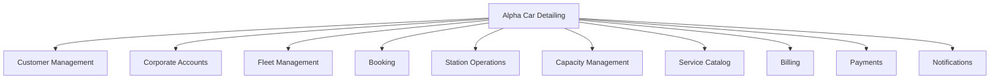

The capability view can also be represented hierarchically:

```text
Alpha Car Detailing
   ├── Customer Management
   ├── Corporate Accounts
   ├── Fleet Management
   ├── Booking
   ├── Station Operations
   ├── Capacity Management
   ├── Service Catalog
   ├── Billing
   ├── Payments
   └── Notifications
```

This model is deliberately independent of application structure.

It does **not** imply:

```text
CustomerManagementService
CorporateAccountsService
FleetManagementService
BookingService
...
```

That mapping, if appropriate, belongs to later architectural analysis.

---

# 4.24 Capability Responsibilities

## Customer Management

Supports business relationships with customers.

Responsibilities may include:

- customer identity;
- contact information;
- customer classification;
- customer status;
- customer preferences.

## Corporate Accounts

Supports enterprise commercial relationships.

Responsibilities may include:

- corporate agreements;
- authorized representatives;
- account status;
- permitted services;
- commercial conditions;
- billing terms.

## Fleet Management

Supports organized collections of vehicles.

Responsibilities may include:

- fleets;
- fleet membership;
- fleet administration;
- vehicle eligibility;
- fleet status.

## Booking

Supports requesting and managing planned service.

Responsibilities may include:

- booking request;
- selected vehicles;
- station selection;
- service selection;
- booking lifecycle;
- cancellation or modification policies.

## Station Operations

Represents operational service locations.

Responsibilities may include:

- stations;
- operating hours;
- supported services;
- operational restrictions.

## Capacity Management

Determines and manages how much work can be accepted.

Responsibilities may include:

- available capacity;
- capacity reservation;
- capacity release;
- operational constraints.

## Service Catalog

Defines what Alpha Car Detailing sells and performs.

Responsibilities may include:

- services;
- packages;
- service eligibility;
- service descriptions;
- commercial offerings.

## Billing

Determines and records amounts owed.

Responsibilities may include:

- billable activity;
- invoices;
- account billing;
- billing references.

## Payments

Supports settlement of financial obligations.

Responsibilities may include:

- payment collection;
- payment status;
- settlement references.

## Notifications

Communicates meaningful business changes.

Responsibilities may include:

- booking confirmations;
- reminders;
- cancellation notifications;
- completion notifications;
- billing notifications.

---

# 4.25 Business Capabilities Are Not Organizational Departments

A capability describes what the business can do.

It does not necessarily describe who performs it.

For example, Billing may involve:

- station operations;
- corporate account management;
- finance;
- external payment providers.

Similarly, Booking may involve:

- customers;
- fleet administrators;
- station personnel;
- automated processes.

Capabilities provide stable business structure even when organizational responsibilities change.

---

# 4.26 Domain Boundaries

Domain boundaries identify areas where business concepts, rules, ownership, or responsibilities differ sufficiently to warrant separation in the business model.

At this stage, useful conceptual boundaries include:

```text
Customer and Account Context
Fleet and Vehicle Context
Service Offering Context
Booking Context
Station and Capacity Context
Billing and Payment Context
Communication Context
```

These are not yet bounded contexts in a finalized DDD design, nor are they microservices.

They represent areas where the language and decisions begin to cluster.

### Customer and Account Context

Concerned with:

- who the customer is;
- what relationship exists;
- whether an enterprise account is active;
- who may represent that account.

### Fleet and Vehicle Context

Concerned with:

- what vehicles exist;
- how vehicles are grouped;
- whether a vehicle belongs to an appropriate fleet;
- whether a vehicle is eligible for requested activity.

### Service Offering Context

Concerned with:

- what services are offered;
- what packages exist;
- which vehicles and stations support them;
- what commercial offering applies.

### Booking Context

Concerned with:

- what the customer wants to schedule;
- booking lifecycle;
- requested vehicles;
- requested station;
- requested service.

### Station and Capacity Context

Concerned with:

- where service can occur;
- when it can occur;
- how much work can be accepted;
- what operational constraints apply.

### Billing and Payment Context

Concerned with:

- what is owed;
- how it is invoiced;
- how and when it is settled.

### Communication Context

Concerned with:

- who needs to be informed;
- what business changes require communication.

Chapter 47 will determine how architecture responds to these boundaries.

---

# 4.27 Key Workflows

Several workflows define the business.

Examples include:

- retail booking;
- corporate fleet booking;
- booking authorization;
- booking modification;
- booking cancellation;
- capacity reservation;
- service check-in;
- service completion;
- corporate billing;
- payment;
- notification.

The primary workflow for the remainder of this chapter is corporate fleet booking.

---

# 4.28 Corporate Fleet Booking

The corporate fleet booking scenario proceeds through ten major business steps:

1. Select a fleet.
2. Select vehicles.
3. Choose a station and service.
4. Check available capacity.
5. Submit a booking.
6. Receive authorization and validation.
7. Reserve capacity.
8. Receive confirmation.
9. Complete service.
10. Trigger billing and notifications.

These steps provide a business narrative.

They are not yet API calls, commands, events, services, database transactions, or queues.

---

# 4.29 Step 1 — Select a Fleet

The corporate user begins within an organizational context.

The selected fleet determines which vehicles the user intends to manage.

Business checks may include:

- account is active;
- fleet exists;
- fleet is active;
- user may operate on the fleet.

The system should not display or accept vehicles merely because they exist in a shared vehicle table.

The relevant question is business eligibility.

---

# 4.30 Step 2 — Select Vehicles

The customer selects vehicles requiring service.

The selected vehicles may need to satisfy rules such as:

- vehicle belongs to the selected fleet;
- vehicle is active;
- vehicle is eligible for the requested service;
- vehicle is not already committed to an incompatible booking.

The business must determine whether bookings are vehicle-specific or may use quantity-only requests.

For the case study, vehicle selection is explicit because fleet customers commonly require traceability to individual vehicles.

---

# 4.31 Step 3 — Choose a Station and Service

The customer chooses where the service should occur and what service is required.

The station must be capable of delivering that service.

This produces business questions such as:

- Does every station offer every service?
- Can service availability vary by day?
- Can certain vehicle types be serviced only at selected stations?
- Can corporate contracts restrict station selection?

These questions belong to business discovery.

---

# 4.32 Step 4 — Check Available Capacity

The requested work is evaluated against station capacity.

The business is asking:

> Can this station accept this work at the requested time under current operating conditions?

The answer may depend on:

- vehicle count;
- service duration;
- vehicle type;
- station resources;
- existing reservations;
- operational restrictions.

An availability response is informative.

It is not necessarily a commitment.

---

# 4.33 Step 5 — Submit a Booking

Submission indicates that the customer wishes to proceed.

At this point, the request becomes business-significant.

The booking request may contain:

- account;
- fleet;
- vehicles;
- station;
- service;
- requested schedule;
- customer references;
- optional instructions.

Submission does not automatically imply confirmation.

---

# 4.34 Step 6 — Authorization and Validation

The business evaluates whether the requested booking may proceed.

This may include:

```text
Account Valid?
Fleet Valid?
Vehicles Eligible?
User Authorized?
Service Permitted?
Station Suitable?
Commercial Rules Satisfied?
Capacity Still Available?
```

The distinction between validation and authorization is useful.

Validation asks whether conditions are valid.

Authorization asks whether the customer is permitted to perform the activity.

Depending on confirmed requirements, some checks may happen earlier for usability and be repeated later for correctness.

---

# 4.35 Step 7 — Reserve Capacity

Once the booking is acceptable, the required capacity must be committed.

The key business outcome is:

> Capacity required by the accepted booking is no longer available to competing bookings.

This point becomes extremely important in later architecture chapters because concurrent requests may compete for limited resources.

For now, the domain requirement is enough.

The business must prevent confirmed bookings from exceeding operational capacity.

---

# 4.36 Step 8 — Receive Confirmation

After successful acceptance and capacity reservation, the customer receives confirmation.

Confirmation establishes an important customer expectation:

> Alpha Car Detailing has accepted responsibility for servicing the confirmed vehicles according to the agreed booking conditions.

The confirmation may contain:

- booking reference;
- station;
- service;
- vehicles;
- scheduled date or time;
- customer instructions.

The exact content is a business decision.

---

# 4.37 Step 9 — Complete Service

At the scheduled time, vehicles are processed operationally.

Actual station operations may include:

- arrival;
- check-in;
- service start;
- service execution;
- quality checks;
- completion;
- release of vehicle.

This chapter treats those details at a high level.

The critical transition is that booked work eventually becomes completed service activity.

---

# 4.38 Step 10 — Trigger Billing and Notifications

Once qualifying service is completed, financial and communication activities may begin.

For corporate customers:

```text
Completed Service
      │
      ├──> Billing Activity
      │
      └──> Customer Notification
```

Billing may produce invoiceable items rather than immediate payment.

Notifications may inform relevant stakeholders that service is complete.

Later architecture must decide how these activities interact technically.

The business requirement comes first:

> Completed service must produce the appropriate commercial and customer outcomes.

---

# 4.39 Business Events

A business event records something meaningful that has happened in the domain.

Potential events include:

- Corporate Account Activated
- Fleet Created
- Vehicle Added to Fleet
- Booking Submitted
- Booking Authorized
- Booking Rejected
- Capacity Reserved
- Booking Confirmed
- Booking Cancelled
- Vehicle Checked In
- Service Started
- Service Completed
- Invoice Issued
- Payment Received
- Customer Notified

At this stage these are **business events**, not technical event contracts.

That distinction is essential.

The business may recognize:

> Booking Confirmed

Chapter 50 may later determine whether the architecture publishes something such as:

```text
BookingConfirmedV1
```

Those are different design levels.

---

# 4.40 Business Event Versus Technical Event

Consider the following statement:

> Service completion is important because billing must follow successful completion.

That is domain knowledge.

Now consider:

```json
{
  "eventType": "ServiceCompletedV1",
  "bookingId": "..."
}
```

That is technical design.

The second should be derived from the first—not the reverse.

Teams sometimes discover business requirements while designing event schemas. That is acceptable as a discovery mechanism, but the resulting requirement should be returned to business analysis and confirmed.

The event contract itself must not become the source of truth for an invented rule.

---

# 4.41 Business Expectations

Customers and operators do not describe successful systems in terms of message brokers or databases.

Their expectations are expressed in outcomes.

Corporate customers expect:

- only authorized users to manage their fleets;
- accurate vehicle information;
- clear service choices;
- reliable capacity information;
- predictable booking;
- correct contractual pricing;
- confirmation;
- timely service;
- accurate invoices;
- useful notifications.

Station personnel expect:

- realistic schedules;
- protection from overbooking;
- clear booking details;
- visibility into planned workload;
- manageable operational changes.

Finance teams expect:

- correct billable information;
- proper account references;
- consistent commercial rules;
- traceability.

Business leadership expects:

- scalable growth;
- improved station utilization;
- reliable operations;
- enterprise customer support;
- consistent customer experience.

These expectations later become quality attributes, architecture drivers, acceptance criteria, metrics, and operational controls.

But their origin is business need.

---

# 4.42 Risks and Constraints

The business domain contains risks before technical architecture is considered.

## Overbooking

The organization may promise more service than a station can deliver.

Impact:

- customer dissatisfaction;
- operational disruption;
- manual recovery;
- reputational damage.

## Incorrect Authorization

A user may book vehicles or services outside permitted corporate authority.

Impact:

- unauthorized spending;
- contractual disputes;
- security and compliance concerns.

## Incorrect Pricing

The wrong commercial terms may be applied.

Impact:

- revenue leakage;
- customer disputes;
- reconciliation work.

## Invalid Fleet Membership

A vehicle may be booked under the wrong account or fleet.

Impact:

- incorrect billing;
- authorization failures;
- poor reporting.

## Capacity Staleness

Availability may change between viewing and booking.

Impact:

- conflicting commitments;
- failed bookings;
- inconsistent customer experience.

## Service Mismatch

A selected station may not support the requested service or vehicle.

Impact:

- service failure;
- rescheduling;
- customer dissatisfaction.

## Ambiguous Requirements

Different stakeholders may interpret rules differently.

Impact:

- inconsistent implementations;
- repeated defects;
- architectural rework.

## AI-generated Assumptions

An AI Agent may fill domain gaps with plausible behavior.

Impact:

- rapid implementation of incorrect rules;
- false confidence;
- hidden policy decisions inside code.

---

# 4.43 Constraints Versus Requirements

A requirement describes what the business needs.

A constraint limits the ways that need may be satisfied.

Examples:

**Requirement**

> Corporate customers must be able to book multiple fleet vehicles.

**Constraint**

> A station can service only a limited number of vehicles simultaneously.

**Requirement**

> Customers must receive confirmation for accepted bookings.

**Constraint**

> Certain corporate bookings require authorization before confirmation.

Understanding the distinction helps later architecture identify where flexibility exists.

---

# 4.44 Business Invariants

A business invariant is a condition that must remain true.

Possible invariants for the case study include:

```text
A confirmed booking cannot reference an invalid station.

A corporate fleet booking cannot use an ineligible fleet.

A booked vehicle must be eligible under the applicable customer relationship.

Confirmed capacity must not exceed accepted operational capacity.

Billing must correspond to qualifying business activity.

Applicable contractual pricing must be honored.
```

Invariants are especially valuable for AI-assisted development because they provide stable constraints against which generated implementation can be reviewed and validated.

---

# 5. Architecture Discussion

This section is intentionally limited to **business architecture**.

Solution architecture begins in Chapter 47.

The goal here is to identify architectural inputs—not to prescribe services, databases, APIs, messaging technologies, or deployment models.

---

## 5.1 Architecture Starts with Business Capabilities

A useful architecture discussion begins with the question:

> What must Alpha Car Detailing be capable of doing?

The answer produces business capabilities:

```text
Customer Management
Corporate Accounts
Fleet Management
Booking
Station Operations
Capacity Management
Service Catalog
Billing
Payments
Notifications
```

The next question is:

> Which capabilities contain distinct business rules, vocabulary, responsibilities, and rates of change?

Only after understanding those characteristics should the architecture consider decomposition.

This protects the design from a common failure mode:

```text
Nouns in Requirements
        ↓
Microservices
```

For example:

```text
Customer
Fleet
Vehicle
Booking
Station
Invoice
```

should not automatically become:

```text
Customer Service
Fleet Service
Vehicle Service
Booking Service
Station Service
Invoice Service
```

Entity names are not architectural boundaries.

Business responsibility is more important.

---

# 5.2 Capability Model Before Service Model

The business capability model should remain independent of technology.

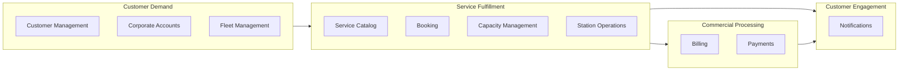

This diagram communicates relationships without deciding implementation topology.

A monolith, modular monolith, distributed system, or microservice architecture could all potentially implement the capability model.

The model survives those technical choices.

---

# 5.3 Domain Boundaries Before Deployment Boundaries

A domain boundary expresses separation in business meaning.

A deployment boundary expresses separation in runtime architecture.

These boundaries can correspond, but they do not have to.

For example, Booking and Capacity Management are conceptually different:

**Booking asks:**

> What service does the customer want?

**Capacity asks:**

> Can the business accept the requested work?

That conceptual separation is useful even if both are initially implemented within one deployable application.

Conversely, dividing them into independent deployable services without understanding their business interaction may introduce unnecessary distributed complexity.

Chapter 47 will revisit this distinction.

---

# 5.4 Business Ownership

Every important business rule should have an identifiable business owner.

Examples:

| Rule | Likely Business Owner |
| --- | --- |
| Fleet booking eligibility | Corporate Operations |
| Station capacity policy | Station Operations |
| Corporate pricing | Sales / Commercial Management |
| Billing terms | Finance |
| Service definitions | Service Operations / Product |
| Government authorization rules | Account Management / Compliance |
| Cancellation policy | Operations / Commercial Management |

The exact owner may vary by organization.

The principle does not.

A developer or AI Agent should not become the accidental owner of a business policy simply because the requirement was unclear.

---

# 5.5 Business Decisions Must Remain Visible

Architecture often hides unresolved business questions behind abstractions.

Consider:

```csharp
if (!policy.IsSatisfied(request))
{
    return BookingRejected();
}
```

The code is technically clean.

But what is the policy?

Who defined it?

What conditions does it contain?

What happens if those conditions change?

A well-designed abstraction can still hide a poorly understood requirement.

Business rules should be traceable to their rationale and ownership.

---

# 5.6 Do Not Let the Database Define the Domain

A relational schema might eventually contain tables such as:

```text
Customers
CorporateAccounts
Fleets
Vehicles
Stations
Services
Bookings
BookingVehicles
Invoices
Payments
```

These names may appear reasonable.

But starting from those tables creates several risks.

A table encourages a storage-centric view:

```text
What columns belong here?
```

The domain requires a behavioral view:

```text
What decisions does the business make?
What rules must remain true?
What transitions matter?
Who owns those decisions?
```

A `Bookings` table cannot tell the team:

- when a booking becomes confirmed;
- whether authorization precedes reservation;
- whether capacity is temporarily held;
- whether an account may exceed a credit limit;
- what happens when one vehicle in a multi-vehicle booking becomes ineligible.

Those are domain questions.

---

# 5.7 Do Not Let APIs Define the Domain

The same warning applies to APIs.

An early API proposal might contain:

```text
POST /bookings
GET /stations/{id}/capacity
POST /payments
```

These endpoints may eventually be useful.

But endpoint design should follow business understanding.

Otherwise, API shape begins dictating business semantics.

For example, `POST /bookings` raises unanswered questions:

- Does it submit or confirm?
- Does it reserve capacity?
- Can it fail after partial processing?
- Does it authorize the user?
- Does it calculate price?
- Does it support multiple vehicles?
- Does it immediately create billable activity?

The endpoint cannot answer the questions.

The domain must.

---

# 5.8 Do Not Let Events Define the Domain

Event-driven architecture can encourage another form of premature modeling.

A team starts with:

```text
BookingCreated
CapacityReserved
PaymentProcessed
```

and assumes the business workflow has been understood.

But `BookingCreated` is ambiguous.

Created as a draft?

Submitted?

Accepted?

Confirmed?

The business vocabulary should establish the meaningful state change before the technical event is named.

Good event design starts with meaningful business events, not infrastructure enthusiasm.

---

# 5.9 Do Not Let AI-generated Code Define the Domain

AI Agents can generate classes, controllers, validators, handlers, schemas, tests, and events at extraordinary speed.

That creates a new architectural risk:

> Implementation can become more detailed than the requirement.

Once detailed generated code exists, teams often begin treating it as authoritative.

For example, an AI Agent may generate:

```csharp
public const int MaximumFleetBookingSize = 25;
```

Soon afterward:

- unit tests enforce 25;
- APIs reject 26;
- UI validation displays 25;
- documentation mentions 25;
- other services depend on 25.

A speculative number has become institutionalized.

The AI Agent did not intentionally make a policy decision.

The engineering process allowed an assumption to harden into architecture.

---

# 5.10 Business Context Before Skills and Prompts

The same principle applies to AI Engineering artifacts.

A Skill that says:

> Implement a fleet booking endpoint with validation.

is incomplete if the business has not defined what validation means.

A Prompt that says:

> Add capacity checks.

is dangerous if the business has not defined capacity.

A repository Instruction that says:

> Every confirmed booking must reserve capacity.

is useful only if "confirmed" and "reserve capacity" are established domain terms.

Therefore the sequence should be:

```text
Business Understanding
        ↓
Domain Vocabulary
        ↓
Confirmed Rules
        ↓
Architecture Decisions
        ↓
Instructions
        ↓
Skills
        ↓
Prompts
        ↓
AI-generated Implementation
        ↓
Harness Validation
```

The AI Engineering machinery strengthens an understood domain.

It cannot substitute for one.

---

# 5.11 Business Context Before Harness Automation

A harness can deterministically verify:

- builds;
- tests;
- architecture rules;
- static analysis;
- security checks;
- formatting;
- quality gates;
- acceptance criteria.

But it can only validate rules that have been expressed.

If the team misunderstands the business requirement, the harness may repeatedly prove that the wrong implementation is internally consistent.

This creates a dangerous form of confidence.

```text
Wrong Requirement
      ↓
Wrong Implementation
      ↓
Correct Automated Tests
      ↓
Green Harness
      ↓
Wrong Business Outcome
```

The lesson is not that automation is weak.

The lesson is that automation must be anchored in valid business intent.

---

# 5.12 Traceability from Business Goal to Implementation

A mature engineering process should eventually support traceability such as:

```text
Business Goal
    ↓
Business Capability
    ↓
Business Rule
    ↓
Business Workflow
    ↓
Architecture Decision
    ↓
Implementation
    ↓
Test
    ↓
Operational Metric
```

For example:

```text
Goal:
Avoid station overbooking

    ↓

Capability:
Capacity Management

    ↓

Rule:
Confirmed reservations must not exceed available operational capacity

    ↓

Workflow:
Corporate fleet booking

    ↓

Architecture:
Defined in Chapter 47+

    ↓

Implementation:
Defined in later chapters

    ↓

Validation:
Automated tests and harness gates

    ↓

Metric:
Overbooking incidents / reservation failures / capacity utilization
```

This is the foundation of enterprise AI Engineering.

The AI Agent works inside a traceable engineering system rather than generating isolated code.

---

# 5.13 Domain Questions That Must Precede Architecture

Before the team commits to technical design, it should be able to answer questions such as:

### Customers

- What customer categories exist?
- Which differences affect system behavior?
- Can one organization have multiple accounts?

### Fleets

- What is a fleet?
- Who owns it?
- Who manages it?
- Can vehicles move between fleets?

### Vehicles

- What makes a vehicle eligible?
- Which attributes affect service or pricing?

### Services

- What is the difference between a service and a package?
- Which stations support which services?

### Booking

- What constitutes submission?
- What constitutes acceptance?
- What constitutes confirmation?
- Can bookings contain multiple vehicles?

### Capacity

- How is capacity measured?
- When does availability become reserved?
- What causes capacity to be released?

### Authorization

- Who may create a fleet booking?
- What business limits apply?

### Pricing

- Which pricing source takes precedence?
- When is price determined?

### Billing

- What activity becomes billable?
- When is an invoice created?

### Notifications

- Which transitions require communication?
- Who receives each communication?

If several answers are unknown, the architecture is not blocked from all progress, but those uncertainties should remain visible rather than being silently resolved in code.

---

# 6. Professional Diagrams

## 6.1 Business Context Diagram

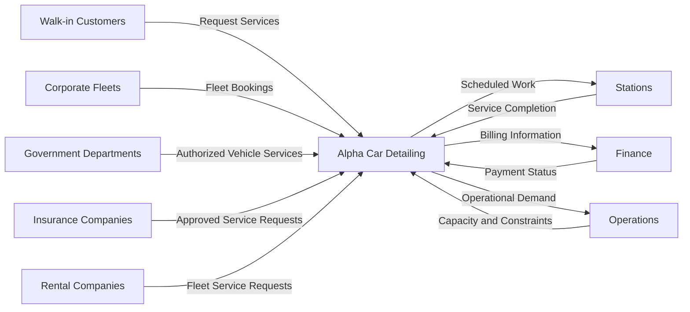

The diagram intentionally describes business relationships rather than applications.

---

## 6.2 Business Capability Map

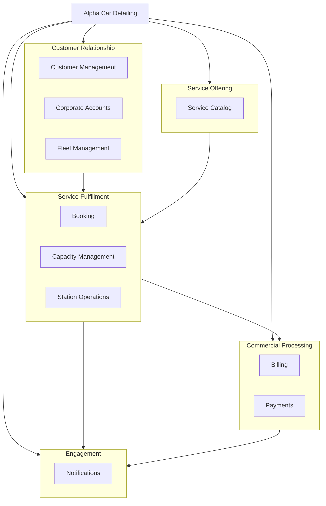

---

## 6.3 Corporate Fleet Booking Workflow

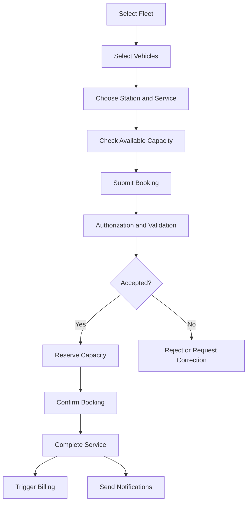

This diagram should be read as a business flow.

It deliberately avoids technical concepts such as APIs, queues, transactions, brokers, databases, or microservices.

---

## 6.4 Corporate Booking Business Interaction

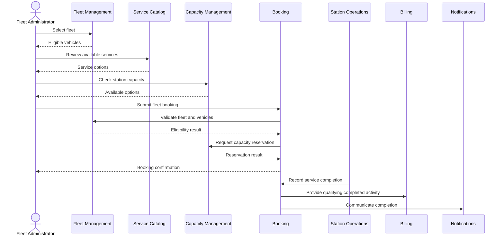

The participants represent business responsibilities.

They should not yet be interpreted as physical services.

---

## 6.5 Capacity Decision Model

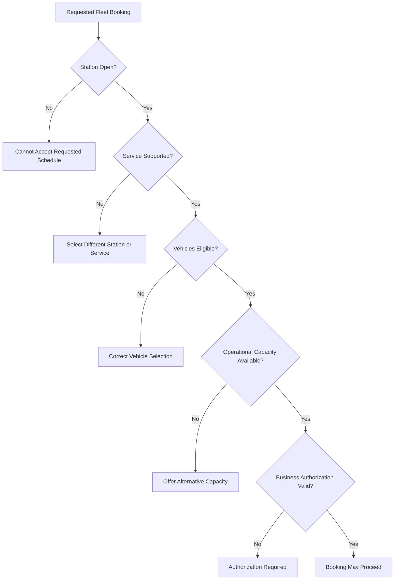

The model shows that capacity is only one business condition within booking acceptance.

---

## 6.6 Business State Progression

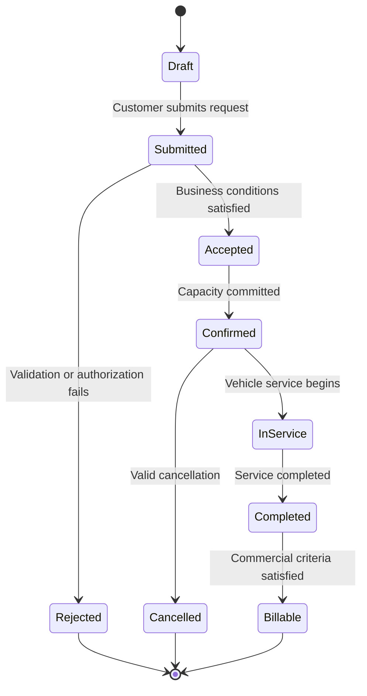

This diagram is illustrative rather than a final lifecycle specification.

Terms and transitions should be confirmed with stakeholders before later chapters encode them into software.

---

## 6.7 Business Event Timeline

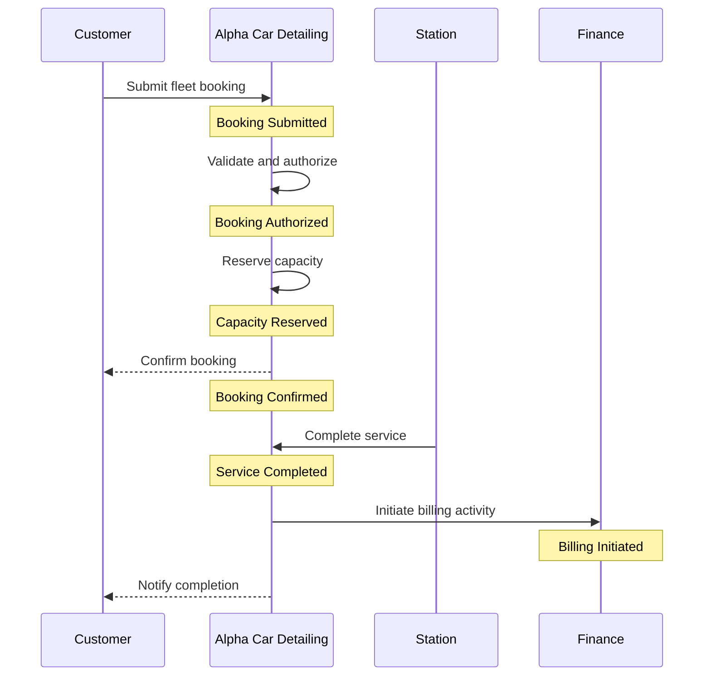

Again, these are business events.

Whether every event becomes an integration event is a later architecture decision.

---

## 6.8 Business Capability and Information Relationship

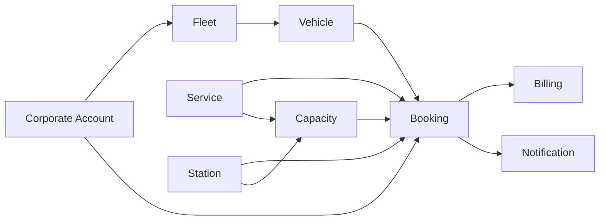

This view identifies business relationships without defining database foreign keys.

That distinction is important.

A line in a business model represents a meaningful relationship, not necessarily a relational database constraint.

---

## 6.9 Domain Boundary View

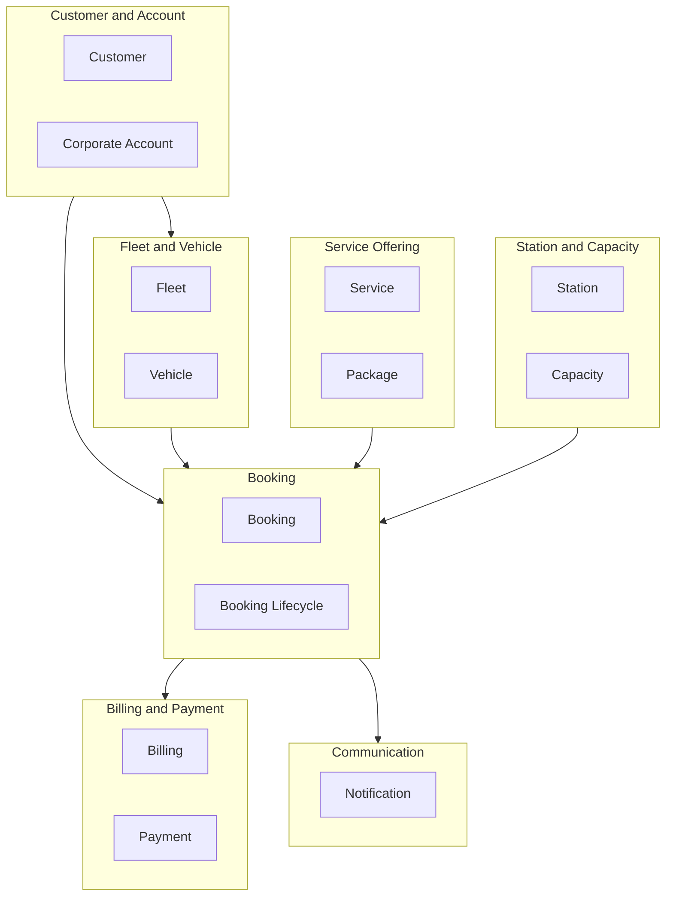

The diagram identifies candidate business boundaries.

Chapter 47 will evaluate how those boundaries influence solution architecture.

---

## 6.10 From Business Understanding to Engineering

The final diagram in this section captures the governing principle of the chapter.

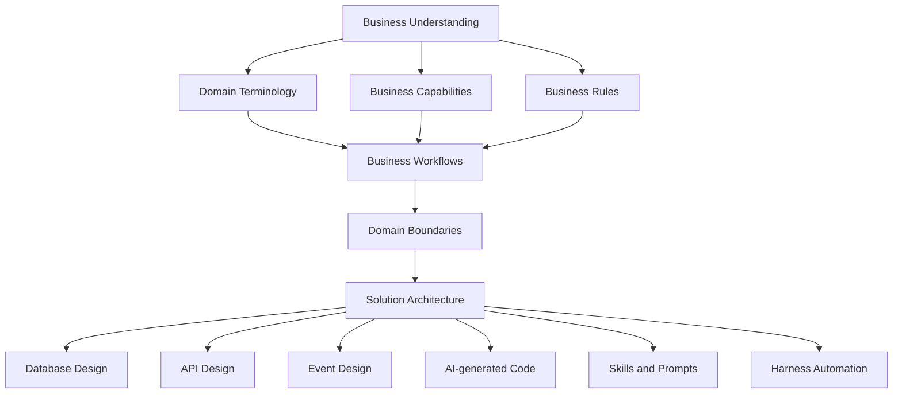

The direction of dependency is intentional.

Business understanding informs architecture.

Architecture informs implementation.

AI Engineering accelerates and governs implementation.

Reversing that sequence creates technical certainty around business uncertainty.

The remainder of Part VII will progressively transform the business understanding established here into architecture and working software. The discipline throughout those chapters is to preserve traceability back to the business domain rather than allowing technical artifacts to become detached from their purpose.

Chapter 46 status: In progress — next section: Hands-on Example
# 7. Hands-on Example

## 7.1 Scenario: Corporate Fleet Booking at Alpha Car Detailing

The objective of this exercise is to translate a realistic business request into a structured, reviewable domain specification before any solution architecture or implementation work begins.

The exercise follows the corporate fleet booking scenario introduced earlier in this chapter.

Northstar Distribution is an enterprise customer of Alpha Car Detailing. It operates delivery vehicles across several cities and wants to schedule detailing services for a selected group of vehicles at an Alpha Car Detailing station.

The fleet administrator needs to:

1. Select a fleet.
2. Select eligible vehicles.
3. Choose a station and detailing service.
4. Check available capacity.
5. Submit the booking.
6. Satisfy authorization and business validation.
7. Reserve the required capacity.
8. Receive booking confirmation.
9. Have the vehicles serviced.
10. Trigger billing and notifications when service is completed.

The engineering objective is not to implement this workflow yet.

Instead, the team will produce five business artifacts:

- A business scenario specification.
- A domain terminology and capability model.
- A business rule and decision register.
- A corporate fleet booking workflow.
- Business acceptance scenarios.

These artifacts will provide the domain foundation for Chapter 47, Solution Architecture, and the implementation chapters that follow.

## 7.2 Establishing the Business Scenario

Northstar Distribution manages 186 delivery vehicles.

For the current exercise, the fleet administrator wants to book 24 vehicles for an exterior wash and interior cleaning package.

The requested work is distributed across two days at an Alpha Car Detailing station.

The station operates multiple service bays, and capacity must be evaluated before accepting the requested schedule.

Northstar has an active corporate account with negotiated pricing and consolidated billing arrangements.

The fleet administrator is authorized to manage an assigned fleet but cannot automatically book every vehicle belonging to the organization.

These details establish the scenario's business context.

They do not establish every business policy.

For example, the exercise does not yet define:

- the maximum number of vehicles permitted in one booking;
- how service duration is calculated;
- whether multiple dates may be represented by one booking;
- how long a temporary capacity reservation may remain valid;
- whether additional approval is required for premium packages;
- what happens if one vehicle fails eligibility validation.

Such questions must remain visible until the appropriate business owners confirm the answers.

### Business scenario record

| Attribute             | Description                                                                             |
| --------------------- | --------------------------------------------------------------------------------------- |
| Scenario ID           | ACD-BUS-001                                                                             |
| Name                  | Corporate Fleet Booking                                                                 |
| Primary actor         | Corporate Fleet Administrator                                                           |
| Customer              | Northstar Distribution                                                                  |
| Business objective    | Schedule detailing services for selected fleet vehicles                                 |
| Trigger               | Fleet administrator identifies vehicles requiring service                               |
| Preconditions         | Corporate relationship, fleet, vehicles, and selected service information are available |
| Expected outcome      | Eligible vehicles receive confirmed service arrangements within available capacity      |
| Financial outcome     | Qualifying completed services become available for corporate billing                    |
| Communication outcome | Relevant booking and completion notifications are produced                              |
| Primary business risk | Accepting work exceeding station capacity                                               |

The scenario record provides a stable business reference.

Future architecture decisions, implementation tasks, tests, and AI-generated artifacts should be traceable to this scenario or its confirmed requirements.

## 7.3 Identifying the Business Actors

A business workflow cannot be understood solely by listing its operations.

The team must identify who participates and what each participant is responsible for.

For corporate fleet booking, the relevant actors are:

| Actor                          | Business Responsibility                                                 |
| ------------------------------ | ----------------------------------------------------------------------- |
| Fleet Administrator            | Select fleets and vehicles, request services, manage permitted bookings |
| Corporate Account Manager      | Maintain the business relationship and relevant contractual information |
| Station Manager                | Manage local operational capacity and service availability              |
| Station Staff                  | Receive vehicles and perform authorized services                        |
| Corporate Approver             | Approve requests where the customer's business policy requires approval |
| Finance Team                   | Manage corporate billing and financial reconciliation                   |
| Customer Contact               | Receive appropriate booking and service communications                  |
| Alpha Car Detailing Operations | Establish service and operational policies                              |

An individual may perform more than one role.

For example, a small corporate customer might allow the fleet administrator to approve booking requests. A larger organization may separate booking submission from approval.

The team should not hardcode the assumption that these roles must always belong to different people.

The correct distinction is between business responsibility and person.

### Actor responsibility model

\#chatgpt-mermaid-\_r_d43\_{font-family:-apple-system,BlinkMacSystemFont,"Segoe UI",sans-serif;font-size:14px;fill:rgb(255, 255, 255);}@keyframes edge-animation-frame{from{stroke-dashoffset:0;}}@keyframes dash{to{stroke-dashoffset:0;}}#chatgpt-mermaid-\_r_d43\_ .edge-animation-slow{stroke-dasharray:9,5!important;stroke-dashoffset:900;animation:dash 50s linear infinite;stroke-linecap:round;}#chatgpt-mermaid-\_r_d43\_ .edge-animation-fast{stroke-dasharray:9,5!important;stroke-dashoffset:900;animation:dash 20s linear infinite;stroke-linecap:round;}#chatgpt-mermaid-\_r_d43\_ .error-icon{fill:rgba(255, 255, 255, 0.03);}#chatgpt-mermaid-\_r_d43\_ .error-text{fill:rgb(255, 255, 255);stroke:rgb(255, 255, 255);}#chatgpt-mermaid-\_r_d43\_ .edge-thickness-normal{stroke-width:1px;}#chatgpt-mermaid-\_r_d43\_ .edge-thickness-thick{stroke-width:3.5px;}#chatgpt-mermaid-\_r_d43\_ .edge-pattern-solid{stroke-dasharray:0;}#chatgpt-mermaid-\_r_d43\_ .edge-thickness-invisible{stroke-width:0;fill:none;}#chatgpt-mermaid-\_r_d43\_ .edge-pattern-dashed{stroke-dasharray:3;}#chatgpt-mermaid-\_r_d43\_ .edge-pattern-dotted{stroke-dasharray:2;}#chatgpt-mermaid-\_r_d43\_ .marker{fill:rgba(255, 255, 255, 0.498);stroke:rgba(255, 255, 255, 0.498);}#chatgpt-mermaid-\_r_d43\_ .marker.cross{stroke:rgba(255, 255, 255, 0.498);}#chatgpt-mermaid-\_r_d43\_ svg{font-family:-apple-system,BlinkMacSystemFont,"Segoe UI",sans-serif;font-size:14px;}#chatgpt-mermaid-\_r_d43\_ p{margin:0;}#chatgpt-mermaid-\_r_d43\_ .label{font-family:-apple-system,BlinkMacSystemFont,"Segoe UI",sans-serif;color:rgb(255, 255, 255);}#chatgpt-mermaid-\_r_d43\_ .cluster-label text{fill:rgb(255, 255, 255);}#chatgpt-mermaid-\_r_d43\_ .cluster-label span{color:rgb(255, 255, 255);}#chatgpt-mermaid-\_r_d43\_ .cluster-label span p{background-color:transparent;}#chatgpt-mermaid-\_r_d43\_ .label text,#chatgpt-mermaid-\_r_d43\_ span{fill:rgb(255, 255, 255);color:rgb(255, 255, 255);}#chatgpt-mermaid-\_r_d43\_ .node rect,#chatgpt-mermaid-\_r_d43\_ .node circle,#chatgpt-mermaid-\_r_d43\_ .node ellipse,#chatgpt-mermaid-\_r_d43\_ .node polygon,#chatgpt-mermaid-\_r_d43\_ .node path{fill:rgb(26, 40, 61);stroke:rgb(31, 78, 148);stroke-width:1px;}#chatgpt-mermaid-\_r_d43\_ .rough-node .label text,#chatgpt-mermaid-\_r_d43\_ .node .label text,#chatgpt-mermaid-\_r_d43\_ .image-shape .label,#chatgpt-mermaid-\_r_d43\_ .icon-shape .label{text-anchor:middle;}#chatgpt-mermaid-\_r_d43\_ .node .katex path{fill:#000;stroke:#000;stroke-width:1px;}#chatgpt-mermaid-\_r_d43\_ .rough-node .label,#chatgpt-mermaid-\_r_d43\_ .node .label,#chatgpt-mermaid-\_r_d43\_ .image-shape .label,#chatgpt-mermaid-\_r_d43\_ .icon-shape .label{text-align:center;}#chatgpt-mermaid-\_r_d43\_ .node.clickable{cursor:pointer;}#chatgpt-mermaid-\_r_d43\_ .root .anchor path{fill:rgba(255, 255, 255, 0.498)!important;stroke-width:0;stroke:rgba(255, 255, 255, 0.498);}#chatgpt-mermaid-\_r_d43\_ .arrowheadPath{fill:rgba(255, 255, 255, 0.498);}#chatgpt-mermaid-\_r_d43\_ .edgePath .path{stroke:rgba(255, 255, 255, 0.498);stroke-width:1px;}#chatgpt-mermaid-\_r_d43\_ .flowchart-link{stroke:rgba(255, 255, 255, 0.498);fill:none;}#chatgpt-mermaid-\_r_d43\_ .edgeLabel{background-color:rgb(24, 24, 24);text-align:center;}#chatgpt-mermaid-\_r_d43\_ .edgeLabel p{background-color:rgb(24, 24, 24);}#chatgpt-mermaid-\_r_d43\_ .edgeLabel rect{opacity:0.5;background-color:rgb(24, 24, 24);fill:rgb(24, 24, 24);}#chatgpt-mermaid-\_r_d43\_ .labelBkg{background-color:rgba(24, 24, 24, 0.5);}#chatgpt-mermaid-\_r_d43\_ .cluster rect{fill:rgba(255, 255, 255, 0.03);stroke:rgba(255, 255, 255, 0.082);stroke-width:1px;}#chatgpt-mermaid-\_r_d43\_ .cluster text{fill:rgb(255, 255, 255);}#chatgpt-mermaid-\_r_d43\_ .cluster span{color:rgb(255, 255, 255);}#chatgpt-mermaid-\_r_d43\_ div.mermaidTooltip{position:absolute;text-align:center;max-width:200px;padding:2px;font-family:-apple-system,BlinkMacSystemFont,"Segoe UI",sans-serif;font-size:12px;background:rgba(255, 255, 255, 0.03);border:1px solid rgba(255, 255, 255, 0.082);border-radius:2px;pointer-events:none;z-index:100;}#chatgpt-mermaid-\_r_d43\_ .flowchartTitleText{text-anchor:middle;font-size:18px;fill:rgb(255, 255, 255);}#chatgpt-mermaid-\_r_d43\_ rect.text{fill:none;stroke-width:0;}#chatgpt-mermaid-\_r_d43\_ .icon-shape,#chatgpt-mermaid-\_r_d43\_ .image-shape{background-color:rgb(24, 24, 24);text-align:center;}#chatgpt-mermaid-\_r_d43\_ .icon-shape p,#chatgpt-mermaid-\_r_d43\_ .image-shape p{background-color:rgb(24, 24, 24);padding:2px;}#chatgpt-mermaid-\_r_d43\_ .icon-shape .label rect,#chatgpt-mermaid-\_r_d43\_ .image-shape .label rect{opacity:0.5;background-color:rgb(24, 24, 24);fill:rgb(24, 24, 24);}#chatgpt-mermaid-\_r_d43\_ .label-icon{display:inline-block;height:1em;overflow:visible;vertical-align:-0.125em;}#chatgpt-mermaid-\_r_d43\_ .node .label-icon path{fill:currentColor;stroke:revert;stroke-width:revert;}#chatgpt-mermaid-\_r_d43\_ .node .neo-node{stroke:rgb(31, 78, 148);}#chatgpt-mermaid-\_r_d43\_ [data-look="neo"].node rect,#chatgpt-mermaid-\_r_d43\_ [data-look="neo"].cluster rect,#chatgpt-mermaid-\_r_d43\_ [data-look="neo"].node polygon{stroke:url(#chatgpt-mermaid-\_r_d43\_-gradient);filter:drop-shadow( 1px 2px 2px rgba(185,185,185,1));}#chatgpt-mermaid-\_r_d43\_ [data-look="neo"].swimlane.cluster rect{filter:none;}#chatgpt-mermaid-\_r_d43\_ [data-look="neo"].node path{stroke:url(#chatgpt-mermaid-\_r_d43\_-gradient);stroke-width:1px;}#chatgpt-mermaid-\_r_d43\_ [data-look="neo"].node .outer-path{filter:drop-shadow( 1px 2px 2px rgba(185,185,185,1));}#chatgpt-mermaid-\_r_d43\_ [data-look="neo"].node .neo-line path{stroke:rgb(31, 78, 148);filter:none;}#chatgpt-mermaid-\_r_d43\_ [data-look="neo"].node circle{stroke:url(#chatgpt-mermaid-\_r_d43\_-gradient);filter:drop-shadow( 1px 2px 2px rgba(185,185,185,1));}#chatgpt-mermaid-\_r_d43\_ [data-look="neo"].node circle .state-start{fill:#000000;}#chatgpt-mermaid-\_r_d43\_ [data-look="neo"].icon-shape .icon{fill:url(#chatgpt-mermaid-\_r_d43\_-gradient);filter:drop-shadow( 1px 2px 2px rgba(185,185,185,1));}#chatgpt-mermaid-\_r_d43\_ [data-look="neo"].icon-shape .icon-neo path{stroke:url(#chatgpt-mermaid-\_r_d43\_-gradient);filter:drop-shadow( 1px 2px 2px rgba(185,185,185,1));}#chatgpt-mermaid-\_r_d43\_ .node text{font-size:14px;font-weight:600;letter-spacing:normal;fill:rgb(153, 206, 255);}#chatgpt-mermaid-\_r_d43\_ .edgeLabels text{font-size:13px;font-weight:600;letter-spacing:-0.08px;fill:rgb(153, 206, 255);}#chatgpt-mermaid-\_r_d43\_ .node tspan[font-weight="normal"],#chatgpt-mermaid-\_r_d43\_ .edgeLabels tspan[font-weight="normal"]{font-weight:600;}#chatgpt-mermaid-\_r_d43\_ .edgeLabel .label rect{opacity:1;rx:13px;ry:13px;fill:rgb(0, 14, 26);stroke:rgb(26, 62, 95);stroke-width:1px;}#chatgpt-mermaid-\_r_d43\_ .node rect,#chatgpt-mermaid-\_r_d43\_ .node circle,#chatgpt-mermaid-\_r_d43\_ .node ellipse,#chatgpt-mermaid-\_r_d43\_ .node polygon,#chatgpt-mermaid-\_r_d43\_ .node path{fill:rgb(0, 40, 77);stroke:rgba(255, 255, 255, 0.1);stroke-width:1px;}#chatgpt-mermaid-\_r_d43\_ .node rect{rx:16px;ry:16px;}#chatgpt-mermaid-\_r_d43\_ .mermaid-decision .label-container{fill:rgb(0, 14, 26);stroke:rgb(26, 62, 95);stroke-dasharray:2,2;}#chatgpt-mermaid-\_r_d43\_ .edgePaths .flowchart-link{stroke:rgba(255, 255, 255, 0.498);stroke-width:1px;stroke-linecap:round;stroke-linejoin:round;}#chatgpt-mermaid-\_r_d43\_ .marker{fill:rgba(255, 255, 255, 0.498);stroke:rgba(255, 255, 255, 0.498);}#chatgpt-mermaid-\_r_d43\_ :root{--mermaid-font-family:-apple-system,BlinkMacSystemFont,"Segoe UI",sans-serif;}Fleet AdministratorCorporate ApproverStation ManagerStation StaffFinance TeamCorporate Fleet BookingRequests servicesApproves when requiredProvides operational constraintsPerforms scheduled workProvides billable activity

The diagram identifies participation without deciding whether the eventual system will use separate applications, services, or user interfaces.

## 7.4 Running a Business Discovery Workshop

Before defining the detailed workflow, the architect facilitates a focused business discovery session.

Representatives should include corporate operations, station operations, finance, account management, and the product owner.

The purpose is to uncover rules that would otherwise become implicit assumptions.

Consider the following conversation.

Architect: When a fleet administrator selects a fleet, what determines which vehicles are available?

Corporate Operations Representative: The administrator should see vehicles assigned to the fleets they are permitted to manage.

Architect: Can a vehicle belong to more than one fleet?

Corporate Operations Representative: We need to confirm whether that occurs for shared vehicles.

Architect: Can one booking include services scheduled across multiple days?

Product Owner: We want to support bulk scheduling, but we have not finalized whether that becomes one booking or multiple related bookings.

Architect: What determines whether a station can accept the work?

Station Manager: We need to consider existing reservations, available service bays, working hours, service duration, and staff availability.

Architect: Does an availability check reserve that capacity?

Station Manager: No. Viewing availability should not block other customers.

Architect: When may the customer consider the booking confirmed?

Product Owner: Only after the required business checks pass and the necessary station capacity has been reserved.

The conversation yields three kinds of information.

First, it confirms that fleet access must be restricted.

Second, it establishes an important distinction between checking availability and reserving capacity.

Third, it identifies unresolved questions around fleet membership and multi-day booking structure.

A disciplined engineering team records all three outcomes.

It does not treat the unanswered questions as permission to make convenient technical decisions.

## 7.5 Creating the Business Rule Register

The next artifact records the rules governing the corporate fleet booking scenario.

A rule register should distinguish confirmed requirements from proposals awaiting approval.

### Initial business rule register

| Rule ID    | Business Rule                                                          | Classification               | Responsible Owner    |
| ---------- | ---------------------------------------------------------------------- | ---------------------------- | -------------------- |
| BR-FLT-001 | The administrator may select only fleets they are authorized to manage | Confirmed for exercise       | Corporate Operations |
| BR-FLT-002 | Selected vehicles must be eligible under the selected corporate fleet  | Confirmed for exercise       | Corporate Operations |
| BR-SVC-001 | The selected station must support the requested service                | Confirmed for exercise       | Station Operations   |
| BR-CAP-001 | Displaying available capacity does not reserve capacity                | Confirmed for exercise       | Station Operations   |
| BR-CAP-002 | A confirmed booking must have the required capacity reserved           | Confirmed for exercise       | Station Operations   |
| BR-ACC-001 | Corporate bookings must satisfy applicable account restrictions        | Confirmed at principle level | Account Management   |
| BR-AUT-001 | Required business approvals must be satisfied before confirmation      | Confirmed at principle level | Corporate Operations |
| BR-BIL-001 | Qualifying completed services must support corporate billing           | Confirmed for exercise       | Finance              |
| BR-BKG-001 | A single booking may include vehicles scheduled on different days      | Proposed                     | Product Owner        |
| BR-CAP-003 | Capacity reservations expire after a predefined period                 | Proposed                     | Station Operations   |
| BR-FLT-003 | A vehicle may belong to multiple active fleets                         | Unresolved                   | Corporate Operations |

The phrase confirmed for exercise is important. It means the rule is accepted as a scenario baseline for the handbook, not that a real customer or operations team has approved it for production.

This distinction prevents training material from being mistaken for authoritative production policy.

### A useful rule record

An individual rule should capture more than its text.

For example:

```
rule_id: BR-CAP-002
title: Confirmed booking requires reserved capacity

statement: >
  A corporate booking may be confirmed only when
  the required station capacity has been reserved.

business_capability: Capacity Management

related_scenario: ACD-BUS-001

business_owner: Station Operations

classification: Confirmed for case-study exercise

rationale: >
  Prevent commitments exceeding the station's
  accepted operational capacity.

verification:
  - A confirmed booking has an associated capacity commitment.
  - Competing bookings cannot consume the same capacity commitment.

open_questions:
  - How is capacity calculated for different vehicle categories?
  - Can capacity be reserved for individual vehicles in a bulk request?
```

This example uses YAML as a readable documentation format, not as an implementation contract.

A future AI Agent can consume the rule without needing to infer its purpose.

A reviewer can identify its owner.

A tester can trace a business acceptance scenario back to it.

The architect can recognize where later consistency decisions will matter.

## 7.6 Documenting the Business Workflow

The team now expands the ten-step corporate fleet booking scenario into a sequence of business activities and outcomes.

### Workflow specification

| Step | Business Activity                 | Required Business Outcome                                   |
| ---- | --------------------------------- | ----------------------------------------------------------- |
| 1    | Select fleet                      | Authorized fleet context established                        |
| 2    | Select vehicles                   | Eligible vehicle selection identified                       |
| 3    | Choose station and service        | Compatible service request established                      |
| 4    | Check capacity                    | Available scheduling options identified                     |
| 5    | Submit booking                    | Business request formally submitted                         |
| 6    | Authorize and validate            | Applicable requirements satisfied or request rejected       |
| 7    | Reserve capacity                  | Required operational capacity committed                     |
| 8    | Confirm booking                   | Customer receives an accepted service commitment            |
| 9    | Complete service                  | Actual service activity recorded                            |
| 10   | Trigger billing and notifications | Appropriate commercial and communication outcomes initiated |

The workflow captures the successful path.

However, production business processes cannot be understood through successful outcomes alone.

The team must also investigate exceptions.

## 7.7 Exploring Alternative Business Flows

### Alternative A: Fleet Administrator Lacks Permission

The administrator attempts to select a fleet outside their authorized scope.

The business outcome is that the fleet must not be available for unauthorized booking.

The request should not proceed using that fleet.

The team must determine whether unauthorized fleets are hidden, explicitly rejected, or both.

That decision affects user experience and security design, but the underlying business restriction comes first.

### Alternative B: Vehicle Is Ineligible

The administrator selects a vehicle that is inactive or otherwise ineligible.

Possible business responses include:

- reject the entire request;
- remove the ineligible vehicle and allow correction;
- allow the remaining valid vehicles to proceed.

The correct behavior must be confirmed.

It should not be decided by whichever implementation is simplest.

### Alternative C: Station Cannot Provide the Service

The selected station does not support the requested package.

The customer must be prevented from confirming an impossible service arrangement.

The business may offer an alternative station or service.

Whether the system must automatically suggest alternatives is a separate requirement.

### Alternative D: Capacity Is No Longer Available

The administrator checks availability and sees capacity for the requested date.

Before the booking is submitted, another customer reserves the remaining capacity.

When Northstar submits, the required capacity is no longer available.

The business must not confirm an unsupported commitment.

A suitable outcome may be to reject the requested schedule or offer alternatives.

The eventual technical solution must handle this situation, but the domain establishes the required behavior.

### Alternative E: Authorization Is Required

The administrator submits a request exceeding an applicable approval threshold.

The booking cannot proceed directly to confirmation.

The business must identify:

- who approves;
- what is approved;
- how long approval remains valid;
- whether approval must be repeated if the booking changes;
- what happens if approval is rejected.

The threshold itself remains an unresolved requirement unless explicitly established.

### Alternative F: Partial Fleet Booking

A fleet administrator selects ten vehicles.

Capacity exists for six vehicles but not all ten.

Should Alpha Car Detailing:

- reject the complete request;
- accept six vehicles;
- offer another schedule for the remaining four;
- create a coordinated split booking?

This is a major business decision.

It influences the meaning of a booking, confirmation, capacity reservation, cancellation, and billing.

The architecture should not choose the answer independently.

### Alternative G: Service Cannot Be Completed

A vehicle reaches the station but cannot receive the scheduled service.

Possible reasons include a vehicle condition, station equipment failure, or operational interruption.

The business must determine how to distinguish:

- not started;
- partially completed;
- rescheduled;
- cancelled;
- completed.

It must also determine which outcomes are billable.

These questions should be resolved before defining the final service lifecycle.

## 7.8 Defining Business Acceptance Scenarios

Business acceptance scenarios translate confirmed rules into observable behavior.

They describe what must happen without dictating the implementation mechanism.

The following Gherkin-style scenarios are suitable as business acceptance artifacts. They are not yet executable automated tests.

### Scenario 1: Successful Corporate Fleet Booking

```
Feature: Corporate fleet booking

  Scenario: Authorized administrator books eligible fleet vehicles
    Given Northstar Distribution has an active corporate account
    And the administrator is authorized to manage Fleet A
    And the selected vehicles are eligible under Fleet A
    And the selected station supports the requested service
    And sufficient operational capacity is available
    And the applicable corporate authorization requirements are satisfied
    When the administrator submits the fleet booking
    And the required capacity is successfully reserved
    Then the booking is confirmed
    And the confirmed vehicles are associated with the booking
    And the administrator receives booking confirmation
```

The scenario describes the business result.

It does not require a specific API, database, or message broker.

### Scenario 2: Unauthorized Fleet

```
Scenario: Administrator cannot book an unauthorized fleet
  Given the administrator is not authorized to manage Fleet B
  When the administrator attempts to submit a booking for Fleet B
  Then the booking is not accepted
  And no capacity is reserved for that request
```

### Scenario 3: Insufficient Capacity

```
Scenario: Booking cannot be confirmed without capacity
  Given the administrator has selected eligible fleet vehicles
  And the selected station supports the requested service
  And insufficient capacity exists for the requested schedule
  When the administrator submits the booking
  Then the booking is not confirmed
  And the customer is informed that the requested capacity is unavailable
```

### Scenario 4: Availability Is Not a Reservation

```
Scenario: Checking availability does not reserve station capacity
  Given a station has available capacity
  When a customer checks that capacity
  Then the customer can view the available scheduling options
  And no capacity reservation is created by the availability check
```

### Scenario 5: Completed Service Becomes Billable

```
Scenario: Completed corporate service triggers billing activity
  Given a confirmed corporate booking exists
  And the scheduled service qualifies for corporate billing
  When the service is recorded as completed
  Then the completed service is available for billing
  And the required completion notification is initiated
```

These scenarios provide a valuable foundation for later tests.

They should be reviewed against the rule register and refined when the business resolves outstanding questions.

## 7.9 Separating Business Rules from Implementation Decisions

One objective of the hands-on exercise is to learn how to recognize implementation leakage in requirements.

Consider these statements:

| Statement                                               | Classification          | Explanation                                            |
| ------------------------------------------------------- | ----------------------- | ------------------------------------------------------ |
| A confirmed booking must have reserved capacity         | Business rule           | Describes a required business invariant                |
| Store reservations in SQL Server                        | Implementation decision | Selects a storage technology                           |
| Fleet administrators may manage only authorized fleets  | Business rule           | Defines permitted business behavior                    |
| Use JWT claims for fleet authorization                  | Implementation decision | Specifies an authorization mechanism                   |
| Service completion triggers qualifying billing activity | Business rule           | Establishes a commercial outcome                       |
| Publish `ServiceCompletedV1` to Azure Event Hubs        | Implementation decision | Defines an integration mechanism                       |
| A station must support the selected service             | Business rule           | Defines service eligibility                            |
| Use Redis for capacity availability caching             | Implementation decision | Defines a performance technique                        |
| Booking requests must avoid conflicting commitments     | Business requirement    | Defines the outcome under competing demand             |
| Use a transactional outbox                              | Implementation decision | Specifies one technique for reliable event publication |

This distinction is not intended to prevent technical discussion.

Instead, it establishes a reliable sequence:

Understand the desired business behavior, then evaluate the technical alternatives capable of delivering it.

For example, a transactional outbox may become appropriate in a later chapter when the team needs reliable coordination between committed business state and event publication.

But it should not appear in the business requirements as though the company itself sells or manages outboxes.

## 7.10 Creating a Business Capability Traceability Matrix

The team should now connect each significant workflow activity to the relevant business capability and rule.

| Workflow Activity | Business Capability          | Rule Reference                      | Business Outcome                         |
| ----------------- | ---------------------------- | ----------------------------------- | ---------------------------------------- |
| Select fleet      | Fleet Management             | BR-FLT-001                          | Authorized fleet selected                |
| Select vehicles   | Fleet Management             | BR-FLT-002                          | Eligible vehicles identified             |
| Choose service    | Service Catalog              | BR-SVC-001                          | Supported service identified             |
| Choose station    | Station Operations           | BR-SVC-001                          | Suitable service location selected       |
| Check capacity    | Capacity Management          | BR-CAP-001                          | Availability assessed without commitment |
| Validate booking  | Booking / Corporate Accounts | BR-ACC-001, BR-AUT-001              | Request meets applicable policies        |
| Reserve capacity  | Capacity Management          | BR-CAP-002                          | Operational commitment established       |
| Confirm booking   | Booking                      | BR-CAP-002                          | Accepted service arrangement confirmed   |
| Complete service  | Station Operations           | Completion criteria to be confirmed | Service result established               |
| Initiate billing  | Billing                      | BR-BIL-001                          | Completed service becomes billable       |
| Notify customer   | Notifications                | Notification policy to be confirmed | Relevant stakeholder informed            |

This traceability matrix provides several benefits.

First, it makes gaps visible. The completion criteria and notification policy still require confirmation.

Second, it identifies which capabilities participate in the workflow without converting them into services.

Third, it gives future AI Agents and reviewers a clear relationship between the requested behavior and its business justification.

Finally, it supports change analysis.

If the business changes the conditions for corporate fleet eligibility, the team can identify the affected workflow stages and later implementation artifacts.

## 7.11 Recording Open Business Questions

An important deliverable from business discovery is not merely a set of answers.

It is an explicit list of unanswered questions.

For the corporate fleet booking scenario:

| Question ID | Open Question                                                 | Business Owner             | Why It Matters                          |
| ----------- | ------------------------------------------------------------- | -------------------------- | --------------------------------------- |
| BQ-001      | Can one booking contain vehicles scheduled on multiple dates? | Product Owner              | Determines booking semantics            |
| BQ-002      | Can one vehicle belong to multiple active fleets?             | Corporate Operations       | Affects eligibility and authorization   |
| BQ-003      | What is the maximum number of vehicles in a booking?          | Corporate Operations       | Affects booking limits                  |
| BQ-004      | Can a booking be partially accepted?                          | Product Owner / Operations | Affects capacity and confirmation       |
| BQ-005      | How is capacity calculated for different services?            | Station Operations         | Determines available scheduling options |
| BQ-006      | How long may capacity be held before confirmation?            | Station Operations         | Affects reservation policy              |
| BQ-007      | What approval thresholds apply to corporate accounts?         | Account Management         | Determines authorization behavior       |
| BQ-008      | When is the corporate price finalized?                        | Commercial Management      | Affects financial commitments           |
| BQ-009      | What constitutes billable service completion?                 | Finance / Operations       | Determines billing eligibility          |
| BQ-010      | Which customer notifications are mandatory?                   | Product Owner              | Determines communication obligations    |

The architect should avoid allowing these questions to remain only in meeting notes or private conversations.

They belong in a controlled, accessible business decision register.

AI Agents should be able to see them as unresolved.

They should not silently resolve them.

## 7.12 Defining a Business Decision Record

A business decision record captures a clarified rule, its rationale, its owner, and its consequences.

It resembles an architectural decision record in discipline, but its subject is business policy rather than technical design.

Consider a fictional decision made for the case study.

### BDR-001 — Availability Checks Do Not Reserve Capacity

Context

Customers may inspect several stations and schedules before selecting a service appointment.

If every availability check reserved capacity, customers browsing options could prevent other customers from booking.

Decision

Viewing available station capacity does not establish a reservation.

Capacity becomes committed only when the required business acceptance conditions have been met and a reservation succeeds.

Rationale

The company must distinguish exploratory availability searches from actual booking commitments.

Business consequences

- Multiple customers may see the same available capacity.
- Availability may change between viewing and submission.
- A booking cannot be confirmed solely because earlier availability was displayed.
- Booking confirmation requires a successful capacity commitment.

Owner

Station Operations and Product Owner.

Status

Approved for the case-study scenario.

This record is especially valuable because it establishes behavior without prescribing the technical implementation.

Chapter 47 and subsequent chapters can use it when evaluating consistency, concurrency, and reservation strategies.

## 7.13 Reviewing the Domain Model with Stakeholders

Once the scenario, rules, workflows, and acceptance scenarios exist, the team conducts a domain review.

The review should include representatives from the business capabilities involved.

It should not be limited to developers or architects.

The purpose is to answer questions such as:

- Does the workflow reflect what actually happens?
- Are important actors missing?
- Are business rules expressed accurately?
- Have assumptions been identified?
- Are important exceptions documented?
- Does the terminology match the organization's language?
- Are billing and authorization responsibilities correct?
- Are business decisions owned by the appropriate stakeholders?

A review may reveal that the phrase fleet booking has two different meanings.

Corporate Operations may use it to mean one bulk request containing multiple vehicles.

Station Operations may use it to mean a collection of individually scheduled appointments.

Finance may use it to mean all completed services billed under a corporate reference.

Those interpretations can coexist operationally, but they must not remain ambiguous.

The team should establish the intended business meaning before later architecture decides how the concept is represented.

## 7.14 Preparing the Domain Context for AI Agents

After the business artifacts have been reviewed, the approved information can be made available to AI Agents.

A practical companion repository could organize the domain documentation as follows:

```
alpha-car-detailing/
└── docs/
    └── business-domain/
        ├── README.md
        ├── business-overview.md
        ├── domain-glossary.md
        ├── capability-model.md
        ├── business-rules.md
        ├── workflows/
        │   └── corporate-fleet-booking.md
        ├── acceptance-scenarios/
        │   └── corporate-fleet-booking.feature
        ├── decisions/
        │   └── BDR-001-availability-vs-reservation.md
        └── open-questions.md
```

This is a proposed documentation structure for the case study, not a claim that these files already exist in the repository.

The purpose of the structure is to make authoritative business context discoverable and reviewable.

The domain documents should identify their approval status and ownership.

An AI Agent should be able to distinguish approved requirements from proposed behavior.

### Domain context precedence

When preparing an AI task, the engineering team should use a defined authority model.

For example:

1. Approved business rules and business decisions.
2. Approved workflow specifications.
3. Approved domain terminology.
4. Current authorized task requirements.
5. Explicitly identified working assumptions.
6. Open questions requiring human resolution.

Working assumptions must not override approved business requirements.

Task instructions should not silently change established business policy.

If an inconsistency appears, the AI Agent should report it rather than choosing a convenient interpretation.

## 7.15 Example Domain Context Package

For the hands-on exercise, the team can assemble a compact business context document.

```
# Alpha Car Detailing — Corporate Fleet Booking

## Business Objective

Enable authorized corporate fleet administrators to request
detailing services for eligible vehicles at supported stations,
subject to applicable authorization and capacity constraints.

## Primary Actor

Corporate Fleet Administrator

## Business Capabilities

- Corporate Accounts
- Fleet Management
- Service Catalog
- Booking
- Station Operations
- Capacity Management
- Billing
- Notifications

## Confirmed Scenario Rules

BR-FLT-001:
Administrators may manage only authorized fleets.

BR-FLT-002:
Selected vehicles must be eligible under the chosen fleet.

BR-SVC-001:
The selected station must support the requested service.

BR-CAP-001:
Checking availability does not reserve capacity.

BR-CAP-002:
A booking must have the required capacity reserved
before it can be confirmed.

BR-BIL-001:
Qualifying completed services support corporate billing.

## Business Workflow

1. Select fleet.
2. Select vehicles.
3. Select station and service.
4. Check availability.
5. Submit booking.
6. Validate and authorize.
7. Reserve capacity.
8. Confirm booking.
9. Complete service.
10. Initiate billing and notifications.

## Open Questions

- Can a booking span multiple dates?
- Can the booking be partially accepted?
- How long may capacity be held?
- What approval thresholds apply?
- When is price finalized?
- What makes a service billable?

## Constraints

Do not infer unresolved business rules.

Do not introduce technical service boundaries.

Do not design database schemas or APIs.

Do not treat assumptions as approved requirements.
```

This package is intentionally business-focused.

It can guide future repository intelligence, Prompts, Skills, AI Agent tasks, and harness workflows without prematurely selecting an architecture.

## 7.16 Evaluating the Quality of the Domain Specification

A domain specification should be evaluated for completeness and accuracy before it is promoted into authoritative project knowledge.

A useful review rubric is:

| Evaluation Area       | Review Question                                           | Acceptance Expectation              |
| --------------------- | --------------------------------------------------------- | ----------------------------------- |
| Business purpose      | Is the business outcome clear?                            | Explicit business goal              |
| Actors                | Are participating roles identified?                       | Responsibilities documented         |
| Terminology           | Are important terms defined consistently?                 | Shared vocabulary                   |
| Capabilities          | Are business responsibilities identified?                 | Capability coverage                 |
| Business rules        | Are important constraints expressed?                      | Identifiable, reviewable rules      |
| Rule authority        | Are assumptions separated from confirmed requirements?    | Clear classification                |
| Workflows             | Are major steps and outcomes documented?                  | End-to-end flow                     |
| Exceptions            | Are significant failure paths considered?                 | Relevant alternatives               |
| Capacity              | Is availability distinguished from reservation?           | Explicit business distinction       |
| Financial outcomes    | Are billing conditions understood?                        | Defined or flagged as open          |
| Traceability          | Can scenarios be linked to rules?                         | Stable identifiers                  |
| Ownership             | Are decisions assigned to business owners?                | Defined accountability              |
| Technology neutrality | Is the document free of premature implementation choices? | No unjustified solution commitments |

A specification is not necessarily complete because every row contains an answer.

A specification can be responsibly ready for the next stage when unresolved issues are explicitly identified, assessed for their impact, and assigned owners.

However, decisions that materially affect the architecture should be resolved before the architecture commits to them.

For example, whether partial fleet bookings are permitted may affect booking identity, reservation behavior, failure handling, and billing.

That question should not remain hidden while those areas are designed.

## 7.17 The Cost of Skipping the Exercise

Consider what might happen if the team skips business discovery and immediately asks an AI Agent to generate the corporate fleet booking feature.

The Agent might produce:

```
public class FleetBookingRequest
{
    public Guid FleetId { get; set; }

    public List<Guid> VehicleIds { get; set; } = [];

    public Guid StationId { get; set; }

    public Guid ServiceId { get; set; }

    public DateTime ScheduledAt { get; set; }
}
```

The model appears reasonable.

But it contains several implicit decisions.

`ScheduledAt` suggests one date and time for the entire request.

Is that correct for 24 vehicles requiring multiple service periods?

The single `ServiceId` suggests all vehicles receive the same service.

Is that a confirmed business requirement?

The single `StationId` suggests one station per request.

Is that mandatory?

The request does not indicate which corporate account governs the booking.

Can that context be reliably derived from the authenticated user, or can a user administer several accounts?

It does not indicate whether additional authorization is required.

It does not capture corporate references that finance may need.

None of these observations proves that the generated model is incorrect.

They prove that its correctness cannot be established without domain knowledge.

This is precisely why business discovery must precede implementation.

The danger is not that the code fails to compile.

The danger is that it compiles, passes tests, and still represents the wrong business process.

## 7.18 Hands-on Exercise Deliverables

At the conclusion of this exercise, the team should have a coherent set of domain artifacts rather than an implementation.

| Deliverable                     | Purpose                                                     | Expected State                  |
| ------------------------------- | ----------------------------------------------------------- | ------------------------------- |
| Business scenario specification | Establishes the corporate fleet booking objective and scope | Ready for stakeholder review    |
| Actor responsibility model      | Identifies business participants and responsibilities       | Reviewed                        |
| Domain glossary                 | Establishes shared terminology                              | Maintained and versioned        |
| Capability model                | Identifies what the business must be able to do             | Technology-neutral              |
| Business rule register          | Records business policies and constraints                   | Classified by approval status   |
| Workflow specification          | Describes successful and alternative business flows         | Reviewed                        |
| Acceptance scenarios            | Expresses observable business outcomes                      | Linked to rules                 |
| Business decision record        | Captures confirmed policy decisions and rationale           | Approved for case study         |
| Open questions register         | Makes unresolved requirements visible                       | Owned and tracked               |
| Traceability matrix             | Connects workflows, capabilities, and rules                 | Available for architecture work |

These deliverables form the entry point to Chapter 47.

They do not eliminate the need for continued business discovery.

Instead, they establish a controlled foundation on which solution architecture can proceed.

## 7.19 What the Architect Should Take Forward

The hands-on exercise establishes several important conclusions.

First, corporate fleet booking is not merely a form submission. It coordinates business identity, fleet eligibility, service selection, station suitability, authorization, capacity, fulfillment, billing, and communication.

Second, the business capability model helps organize understanding without committing prematurely to software service boundaries.

Third, availability and reservation are distinct business concepts. Their distinction must remain explicit in later consistency and concurrency discussions.

Fourth, confirmed business rules should be identifiable, owned, versioned, and traceable. Unknown policies must remain open questions rather than becoming AI-generated defaults.

Fifth, business acceptance scenarios should precede technical tests. The eventual test suite must prove meaningful business outcomes rather than merely demonstrate that code follows its own assumptions.

Finally, architecture should consume business decisions—not manufacture them.

> Architect's Note
>
> The most valuable outcome of domain discovery is not the number of diagrams or requirements produced. It is the reduction of uncertainty around decisions that would otherwise become expensive to reverse.
>
> Before moving into solution architecture, confirm the meaning of the central business concepts, identify ownership of important rules, and make unresolved decisions visible. A technically sophisticated architecture cannot compensate for an inaccurate business model.

The Alpha Car Detailing corporate fleet booking scenario is now sufficiently described to serve as a structured case-study foundation, with outstanding decisions explicitly identified. The next sections will demonstrate how AI coding platforms can assist with this domain-discovery work while preserving human ownership of business policy.

Chapter 46 status: In progress — next section: Claude Example

# 8. Claude Example

## 8.1 Using Claude Code for Business Domain Discovery

Claude Code can support business domain discovery by examining existing repository knowledge, organizing business terminology, identifying incomplete requirements, analyzing workflows, and preparing structured domain documentation.

Its role during this stage is fundamentally different from its role during implementation.

When implementing an approved feature, Claude Code may generate source code, tests, configurations, and other engineering artifacts.

During business discovery, its primary responsibility is to help the engineering team understand and document what the business requires.

For Alpha Car Detailing, Claude Code can assist with:

- examining existing business and repository documentation;
- extracting domain entities, terminology, and business capabilities;
- identifying business rules from approved source materials;
- comparing workflow descriptions for inconsistencies;
- distinguishing confirmed requirements from assumptions;
- identifying missing decisions and ambiguous terminology;
- producing business workflow diagrams;
- preparing acceptance scenarios;
- maintaining traceability between business rules and scenarios;
- proposing questions for business stakeholders.

Claude Code must not independently decide Alpha Car Detailing's business policies.

The governing principle is:

> Claude Code may discover, organize, analyze, and propose business knowledge. It must not manufacture authoritative business knowledge.

This distinction is essential because Claude Code can generate well-written documentation that appears complete even when its underlying assumptions are unsupported.

A polished domain specification is not necessarily a correct domain specification.

## 8.2 Positioning Claude Code in the Domain Discovery Process

The business discovery process should have identifiable human ownership and explicit review boundaries.

A suitable workflow is:

\#chatgpt-mermaid-\_r_d5g\_{font-family:-apple-system,BlinkMacSystemFont,"Segoe UI",sans-serif;font-size:14px;fill:rgb(255, 255, 255);}@keyframes edge-animation-frame{from{stroke-dashoffset:0;}}@keyframes dash{to{stroke-dashoffset:0;}}#chatgpt-mermaid-\_r_d5g\_ .edge-animation-slow{stroke-dasharray:9,5!important;stroke-dashoffset:900;animation:dash 50s linear infinite;stroke-linecap:round;}#chatgpt-mermaid-\_r_d5g\_ .edge-animation-fast{stroke-dasharray:9,5!important;stroke-dashoffset:900;animation:dash 20s linear infinite;stroke-linecap:round;}#chatgpt-mermaid-\_r_d5g\_ .error-icon{fill:rgba(255, 255, 255, 0.03);}#chatgpt-mermaid-\_r_d5g\_ .error-text{fill:rgb(255, 255, 255);stroke:rgb(255, 255, 255);}#chatgpt-mermaid-\_r_d5g\_ .edge-thickness-normal{stroke-width:1px;}#chatgpt-mermaid-\_r_d5g\_ .edge-thickness-thick{stroke-width:3.5px;}#chatgpt-mermaid-\_r_d5g\_ .edge-pattern-solid{stroke-dasharray:0;}#chatgpt-mermaid-\_r_d5g\_ .edge-thickness-invisible{stroke-width:0;fill:none;}#chatgpt-mermaid-\_r_d5g\_ .edge-pattern-dashed{stroke-dasharray:3;}#chatgpt-mermaid-\_r_d5g\_ .edge-pattern-dotted{stroke-dasharray:2;}#chatgpt-mermaid-\_r_d5g\_ .marker{fill:rgba(255, 255, 255, 0.498);stroke:rgba(255, 255, 255, 0.498);}#chatgpt-mermaid-\_r_d5g\_ .marker.cross{stroke:rgba(255, 255, 255, 0.498);}#chatgpt-mermaid-\_r_d5g\_ svg{font-family:-apple-system,BlinkMacSystemFont,"Segoe UI",sans-serif;font-size:14px;}#chatgpt-mermaid-\_r_d5g\_ p{margin:0;}#chatgpt-mermaid-\_r_d5g\_ .label{font-family:-apple-system,BlinkMacSystemFont,"Segoe UI",sans-serif;color:rgb(255, 255, 255);}#chatgpt-mermaid-\_r_d5g\_ .cluster-label text{fill:rgb(255, 255, 255);}#chatgpt-mermaid-\_r_d5g\_ .cluster-label span{color:rgb(255, 255, 255);}#chatgpt-mermaid-\_r_d5g\_ .cluster-label span p{background-color:transparent;}#chatgpt-mermaid-\_r_d5g\_ .label text,#chatgpt-mermaid-\_r_d5g\_ span{fill:rgb(255, 255, 255);color:rgb(255, 255, 255);}#chatgpt-mermaid-\_r_d5g\_ .node rect,#chatgpt-mermaid-\_r_d5g\_ .node circle,#chatgpt-mermaid-\_r_d5g\_ .node ellipse,#chatgpt-mermaid-\_r_d5g\_ .node polygon,#chatgpt-mermaid-\_r_d5g\_ .node path{fill:rgb(26, 40, 61);stroke:rgb(31, 78, 148);stroke-width:1px;}#chatgpt-mermaid-\_r_d5g\_ .rough-node .label text,#chatgpt-mermaid-\_r_d5g\_ .node .label text,#chatgpt-mermaid-\_r_d5g\_ .image-shape .label,#chatgpt-mermaid-\_r_d5g\_ .icon-shape .label{text-anchor:middle;}#chatgpt-mermaid-\_r_d5g\_ .node .katex path{fill:#000;stroke:#000;stroke-width:1px;}#chatgpt-mermaid-\_r_d5g\_ .rough-node .label,#chatgpt-mermaid-\_r_d5g\_ .node .label,#chatgpt-mermaid-\_r_d5g\_ .image-shape .label,#chatgpt-mermaid-\_r_d5g\_ .icon-shape .label{text-align:center;}#chatgpt-mermaid-\_r_d5g\_ .node.clickable{cursor:pointer;}#chatgpt-mermaid-\_r_d5g\_ .root .anchor path{fill:rgba(255, 255, 255, 0.498)!important;stroke-width:0;stroke:rgba(255, 255, 255, 0.498);}#chatgpt-mermaid-\_r_d5g\_ .arrowheadPath{fill:rgba(255, 255, 255, 0.498);}#chatgpt-mermaid-\_r_d5g\_ .edgePath .path{stroke:rgba(255, 255, 255, 0.498);stroke-width:1px;}#chatgpt-mermaid-\_r_d5g\_ .flowchart-link{stroke:rgba(255, 255, 255, 0.498);fill:none;}#chatgpt-mermaid-\_r_d5g\_ .edgeLabel{background-color:rgb(24, 24, 24);text-align:center;}#chatgpt-mermaid-\_r_d5g\_ .edgeLabel p{background-color:rgb(24, 24, 24);}#chatgpt-mermaid-\_r_d5g\_ .edgeLabel rect{opacity:0.5;background-color:rgb(24, 24, 24);fill:rgb(24, 24, 24);}#chatgpt-mermaid-\_r_d5g\_ .labelBkg{background-color:rgba(24, 24, 24, 0.5);}#chatgpt-mermaid-\_r_d5g\_ .cluster rect{fill:rgba(255, 255, 255, 0.03);stroke:rgba(255, 255, 255, 0.082);stroke-width:1px;}#chatgpt-mermaid-\_r_d5g\_ .cluster text{fill:rgb(255, 255, 255);}#chatgpt-mermaid-\_r_d5g\_ .cluster span{color:rgb(255, 255, 255);}#chatgpt-mermaid-\_r_d5g\_ div.mermaidTooltip{position:absolute;text-align:center;max-width:200px;padding:2px;font-family:-apple-system,BlinkMacSystemFont,"Segoe UI",sans-serif;font-size:12px;background:rgba(255, 255, 255, 0.03);border:1px solid rgba(255, 255, 255, 0.082);border-radius:2px;pointer-events:none;z-index:100;}#chatgpt-mermaid-\_r_d5g\_ .flowchartTitleText{text-anchor:middle;font-size:18px;fill:rgb(255, 255, 255);}#chatgpt-mermaid-\_r_d5g\_ rect.text{fill:none;stroke-width:0;}#chatgpt-mermaid-\_r_d5g\_ .icon-shape,#chatgpt-mermaid-\_r_d5g\_ .image-shape{background-color:rgb(24, 24, 24);text-align:center;}#chatgpt-mermaid-\_r_d5g\_ .icon-shape p,#chatgpt-mermaid-\_r_d5g\_ .image-shape p{background-color:rgb(24, 24, 24);padding:2px;}#chatgpt-mermaid-\_r_d5g\_ .icon-shape .label rect,#chatgpt-mermaid-\_r_d5g\_ .image-shape .label rect{opacity:0.5;background-color:rgb(24, 24, 24);fill:rgb(24, 24, 24);}#chatgpt-mermaid-\_r_d5g\_ .label-icon{display:inline-block;height:1em;overflow:visible;vertical-align:-0.125em;}#chatgpt-mermaid-\_r_d5g\_ .node .label-icon path{fill:currentColor;stroke:revert;stroke-width:revert;}#chatgpt-mermaid-\_r_d5g\_ .node .neo-node{stroke:rgb(31, 78, 148);}#chatgpt-mermaid-\_r_d5g\_ [data-look="neo"].node rect,#chatgpt-mermaid-\_r_d5g\_ [data-look="neo"].cluster rect,#chatgpt-mermaid-\_r_d5g\_ [data-look="neo"].node polygon{stroke:url(#chatgpt-mermaid-\_r_d5g\_-gradient);filter:drop-shadow( 1px 2px 2px rgba(185,185,185,1));}#chatgpt-mermaid-\_r_d5g\_ [data-look="neo"].swimlane.cluster rect{filter:none;}#chatgpt-mermaid-\_r_d5g\_ [data-look="neo"].node path{stroke:url(#chatgpt-mermaid-\_r_d5g\_-gradient);stroke-width:1px;}#chatgpt-mermaid-\_r_d5g\_ [data-look="neo"].node .outer-path{filter:drop-shadow( 1px 2px 2px rgba(185,185,185,1));}#chatgpt-mermaid-\_r_d5g\_ [data-look="neo"].node .neo-line path{stroke:rgb(31, 78, 148);filter:none;}#chatgpt-mermaid-\_r_d5g\_ [data-look="neo"].node circle{stroke:url(#chatgpt-mermaid-\_r_d5g\_-gradient);filter:drop-shadow( 1px 2px 2px rgba(185,185,185,1));}#chatgpt-mermaid-\_r_d5g\_ [data-look="neo"].node circle .state-start{fill:#000000;}#chatgpt-mermaid-\_r_d5g\_ [data-look="neo"].icon-shape .icon{fill:url(#chatgpt-mermaid-\_r_d5g\_-gradient);filter:drop-shadow( 1px 2px 2px rgba(185,185,185,1));}#chatgpt-mermaid-\_r_d5g\_ [data-look="neo"].icon-shape .icon-neo path{stroke:url(#chatgpt-mermaid-\_r_d5g\_-gradient);filter:drop-shadow( 1px 2px 2px rgba(185,185,185,1));}#chatgpt-mermaid-\_r_d5g\_ .node text{font-size:14px;font-weight:600;letter-spacing:normal;fill:rgb(153, 206, 255);}#chatgpt-mermaid-\_r_d5g\_ .edgeLabels text{font-size:13px;font-weight:600;letter-spacing:-0.08px;fill:rgb(153, 206, 255);}#chatgpt-mermaid-\_r_d5g\_ .node tspan[font-weight="normal"],#chatgpt-mermaid-\_r_d5g\_ .edgeLabels tspan[font-weight="normal"]{font-weight:600;}#chatgpt-mermaid-\_r_d5g\_ .edgeLabel .label rect{opacity:1;rx:13px;ry:13px;fill:rgb(0, 14, 26);stroke:rgb(26, 62, 95);stroke-width:1px;}#chatgpt-mermaid-\_r_d5g\_ .node rect,#chatgpt-mermaid-\_r_d5g\_ .node circle,#chatgpt-mermaid-\_r_d5g\_ .node ellipse,#chatgpt-mermaid-\_r_d5g\_ .node polygon,#chatgpt-mermaid-\_r_d5g\_ .node path{fill:rgb(0, 40, 77);stroke:rgba(255, 255, 255, 0.1);stroke-width:1px;}#chatgpt-mermaid-\_r_d5g\_ .node rect{rx:16px;ry:16px;}#chatgpt-mermaid-\_r_d5g\_ .mermaid-decision .label-container{fill:rgb(0, 14, 26);stroke:rgb(26, 62, 95);stroke-dasharray:2,2;}#chatgpt-mermaid-\_r_d5g\_ .edgePaths .flowchart-link{stroke:rgba(255, 255, 255, 0.498);stroke-width:1px;stroke-linecap:round;stroke-linejoin:round;}#chatgpt-mermaid-\_r_d5g\_ .marker{fill:rgba(255, 255, 255, 0.498);stroke:rgba(255, 255, 255, 0.498);}#chatgpt-mermaid-\_r_d5g\_ :root{--mermaid-font-family:-apple-system,BlinkMacSystemFont,"Segoe UI",sans-serif;}Business RequestBusiness StakeholdersProduct OwnerArchitectClaude CodeDomain ContextRequirements AnalysisOpen QuestionsDraft Domain DocumentationHuman Domain ReviewApproved Business KnowledgeApprovedClarification required

The diagram establishes several boundaries.

Claude Code may analyze the business context and prepare draft artifacts.

The product owner and relevant business stakeholders remain responsible for approving business rules.

The architect ensures that the domain documentation is coherent, technically neutral, and suitable for later architectural analysis.

Only approved business knowledge should be promoted into the authoritative domain specification.

This approach allows Claude Code to accelerate discovery without transferring policy authority to an AI Agent.

## 8.3 Preparing the Repository for Domain Discovery

The Alpha Car Detailing repository should provide a discoverable location for business-domain documentation.

For this example, assume the following proposed structure:

```
alpha-car-detailing/
└── docs/
    └── business-domain/
        ├── README.md
        ├── business-overview.md
        ├── domain-glossary.md
        ├── capability-model.md
        ├── business-rules.md
        ├── workflows/
        │   └── corporate-fleet-booking.md
        ├── acceptance-scenarios/
        │   └── corporate-fleet-booking.feature
        ├── decisions/
        │   └── BDR-001-availability-vs-reservation.md
        └── open-questions.md
```

These paths are illustrative repository artifacts for the exercise. They should not be interpreted as files that have already been created.

The directory separates business-domain knowledge from application implementation.

This distinction provides several benefits.

First, business documentation remains accessible even if the solution architecture changes.

Second, the repository can evolve from a modular application to a distributed architecture without requiring business concepts to be renamed after technical components.

Third, AI Agents can be directed to authoritative domain information rather than inferring business behavior from source code.

Fourth, the documentation can be reviewed and versioned using the same engineering discipline applied to implementation artifacts.

### Repository knowledge versus working assumptions

Claude Code should distinguish between three forms of information:

| Information Type            | Example                                            | Authority                               |
| --------------------------- | -------------------------------------------------- | --------------------------------------- |
| Approved business knowledge | Corporate booking requires authorized fleet access | Authoritative within its approved scope |
| Working assumption          | One booking can contain no more than 50 vehicles   | Not authoritative                       |
| Proposed business decision  | Allow partial acceptance of bulk bookings          | Requires stakeholder approval           |

The distinction is particularly important when Claude Code creates new documents.

A generated statement does not become an approved rule merely because it appears in a Markdown file.

## 8.4 Establishing Domain Discovery Instructions

Claude Code can use repository-level Instructions to understand how it should interact with the project.

For this handbook, the primary Claude Code instruction file is `CLAUDE.md`.

The purpose of Instructions is to establish persistent engineering expectations. They should not be confused with task-specific Prompts or reusable Skills.

A suitable domain-discovery section within `CLAUDE.md` could be:

```
# Alpha Car Detailing — Business Domain Instructions

## Domain Authority

Approved business-domain documentation is authoritative
for business meaning within its stated scope.

Do not invent business rules, contractual conditions,
pricing values, booking limits, or authorization policies.

## Business Knowledge Classification

Distinguish between:

- Confirmed business requirements
- Proposed requirements
- Working assumptions
- Open questions

Never silently promote an assumption into a requirement.

## Domain Terminology

Use the terminology defined in:

alpha-car-detailing/docs/business-domain/domain-glossary.md

Identify conflicting terminology rather than inventing
new meanings.

## Business Discovery

When analyzing a business request:

1. Identify relevant business capabilities.
2. Identify participating business actors.
3. Extract explicitly supported business rules.
4. Describe successful and alternative workflows.
5. Identify unresolved decisions.
6. Preserve traceability to source material.
7. Prepare documentation for human review.

## Architecture Boundary

During business-domain discovery, do not:

- Design microservices.
- Define database schemas.
- Create API endpoints.
- Define technical event contracts.
- Select cloud infrastructure.
- Generate application implementation.

These activities belong to later architecture and
implementation tasks.

## Governance

Business policy changes require approval from the
appropriate business owner.

Propose changes separately.

Do not silently modify approved business rules.
```

These Instructions define how Claude Code should work.

They do not themselves establish Alpha Car Detailing's specific business rules.

The actual business rules belong in approved domain documentation.

That separation is important.

`CLAUDE.md` governs the AI Agent's behavior.

The business-domain documents describe the business.

## 8.5 Starting a Domain Discovery Session

Consider the following scenario.

The architect wants Claude Code to examine the existing Alpha Car Detailing documentation and identify the business knowledge relevant to corporate fleet booking.

The architect starts Claude Code from the repository root:

```
cd C:\ZeeWork\Enterprise-AI-Engineering-Handbook

claude
```

The architect then provides a task-specific Prompt.

### Prompt: Discover the Corporate Fleet Booking Domain

```
Analyze the Alpha Car Detailing business domain.

Focus on corporate fleet booking.

Read the existing repository Instructions and relevant
business-domain documentation before producing an analysis.

Identify:

1. Business objective
2. Business actors
3. Business capabilities
4. Domain terminology
5. Explicitly confirmed business rules
6. Main workflow
7. Alternative and failure workflows
8. Business events
9. Unresolved requirements
10. Potential terminology conflicts

For every claimed business rule, reference its source.

Classify information as:

- Confirmed
- Proposed
- Assumption
- Open Question

Do not invent business rules.

Do not design services, databases, APIs, or events.

Do not generate application code.

Return a structured business-domain analysis suitable
for review by the product owner and architect.
```

The Prompt establishes a bounded discovery task.

It deliberately avoids requesting implementation.

It also requires Claude Code to preserve uncertainty rather than fill gaps.

### Expected analytical output

Claude Code should produce an analysis resembling the following:

| Category           | Finding                                                                  | Classification                 |
| ------------------ | ------------------------------------------------------------------------ | ------------------------------ |
| Business Objective | Enable corporate administrators to schedule detailing for fleet vehicles | Confirmed case-study objective |
| Primary Actor      | Corporate Fleet Administrator                                            | Confirmed                      |
| Capability         | Fleet Management                                                         | Confirmed                      |
| Capability         | Booking                                                                  | Confirmed                      |
| Capability         | Capacity Management                                                      | Confirmed                      |
| Rule               | Administrators may manage authorized fleets only                         | Confirmed for exercise         |
| Rule               | Availability checks do not reserve capacity                              | Confirmed for exercise         |
| Rule               | Booking confirmation requires reserved capacity                          | Confirmed for exercise         |
| Assumption         | One fleet booking supports only one station                              | Unconfirmed                    |
| Question           | Can multi-vehicle requests be partially accepted?                        | Open                           |
| Question           | When is corporate pricing finalized?                                     | Open                           |

The AI Agent should attach concrete source references to its findings when the relevant documentation exists.

If no source supports a statement, the Agent should report that limitation.

It should not invent a supporting reference.

## 8.6 Using Claude Code to Identify Business Capabilities

The next task is to refine the capability model.

For Alpha Car Detailing, the initial model includes:

```
Alpha Car Detailing
   ├── Customer Management
   ├── Corporate Accounts
   ├── Fleet Management
   ├── Booking
   ├── Station Operations
   ├── Capacity Management
   ├── Service Catalog
   ├── Billing
   ├── Payments
   └── Notifications
```

The architect can ask Claude Code to evaluate the model without modifying it automatically.

### Prompt: Review the Business Capability Model

```
Review the Alpha Car Detailing business capability model.

Use the approved business-domain documentation as the source.

For each capability:

- Explain its business purpose.
- Identify its responsibilities.
- Identify participating business actors.
- Identify relevant business rules.
- Identify relationships with other capabilities.

Report:

- Missing capabilities supported by evidence
- Overlapping responsibilities
- Ambiguous terminology
- Unresolved ownership questions

Do not convert capabilities into microservices.

Do not recommend technical architecture.

Present findings for architect review.
```

The value of this exercise is not that Claude Code generates a more elaborate diagram.

The value is that it helps expose unclear capability ownership.

For example, the relationship between Corporate Accounts and Fleet Management may be straightforward at a high level but ambiguous in detail.

Who determines whether a fleet administrator may access a particular fleet?

Is that a corporate account responsibility?

A fleet management responsibility?

A joint business policy?

Claude Code can identify the ambiguity and present alternatives.

The responsible business stakeholders must determine the intended rule.

## 8.7 Analyzing the Corporate Fleet Booking Workflow

The architect now asks Claude Code to analyze the complete business workflow.

The Prompt should preserve the ten-step sequence established in the case study.

### Prompt: Analyze the Booking Workflow

```
Analyze the corporate fleet booking workflow for
Alpha Car Detailing.

Use these business steps:

1. Select fleet.
2. Select vehicles.
3. Choose station and service.
4. Check available capacity.
5. Submit booking.
6. Validate and authorize.
7. Reserve capacity.
8. Confirm booking.
9. Complete service.
10. Initiate billing and notifications.

For every step, identify:

- Business actor
- Required business information
- Applicable business rules
- Preconditions
- Successful outcome
- Possible business failure
- Open questions

Use only supported domain information.

Do not assume that validation guarantees later capacity.
Do not assume that an availability check reserves capacity.

Do not design technical implementation.

Produce a workflow analysis table and a Mermaid flowchart.
```

### Example workflow analysis

| Step                   | Preconditions                       | Business Outcome                   | Potential Exception                   |
| ---------------------- | ----------------------------------- | ---------------------------------- | ------------------------------------- |
| Select fleet           | Authorized corporate context        | Fleet selected                     | Fleet unavailable or unauthorized     |
| Select vehicles        | Fleet selected                      | Eligible vehicles identified       | Ineligible or inactive vehicle        |
| Choose service         | Service catalog available           | Requested service selected         | Unsupported service                   |
| Choose station         | Station information available       | Suitable location selected         | Station does not support service      |
| Check capacity         | Schedule and service known          | Availability assessed              | Insufficient capacity                 |
| Submit booking         | Required information supplied       | Request submitted                  | Invalid request information           |
| Authorize and validate | Business policies available         | Request accepted for reservation   | Unauthorized or invalid request       |
| Reserve capacity       | Required capacity available         | Operational commitment established | Capacity lost before commitment       |
| Confirm booking        | Capacity committed                  | Customer commitment established    | Confirmation cannot be completed      |
| Complete service       | Confirmed work reaches fulfillment  | Service result recorded            | Service interrupted                   |
| Trigger billing        | Qualifying activity established     | Billing activity initiated         | Financial rule requires clarification |
| Notify stakeholders    | Relevant business transition occurs | Communication initiated            | Delivery failure                      |

The workflow analysis may have more rows than the ten original steps because individual business decisions can be examined separately.

This is acceptable as long as the business meaning remains consistent.

## 8.8 Using Claude Code to Discover Missing Business Rules

One of Claude Code's most valuable contributions is identifying questions that stakeholders have not yet considered.

Consider the requirement:

> Corporate fleet administrators can schedule multiple vehicles at the same station.

An AI Agent may identify several missing decisions:

- Can a booking contain multiple vehicle categories?
- Can different vehicles receive different services?
- Can one booking span multiple time slots?
- Can the booking be partially accepted?
- What happens when a selected vehicle is already booked?
- Can the customer modify the booking after confirmation?
- Does a modification require authorization again?
- Can corporate pricing change after submission?
- What happens if a station closes unexpectedly?
- Are cancellations subject to a fee?

These are useful questions.

They are not answers.

### Prompt: Identify Missing Business Decisions

```
Review the corporate fleet booking domain specification.

Identify business questions that must be resolved before
solution architecture and implementation.

Focus on:

- Corporate account eligibility
- Fleet authorization
- Vehicle eligibility
- Multi-vehicle booking
- Service selection
- Station restrictions
- Capacity
- Booking confirmation
- Partial acceptance
- Cancellation
- Pricing
- Billing
- Notifications

For each question, provide:

1. Question ID
2. Business question
3. Why the answer matters
4. Likely business owner
5. Potential architectural impact
6. Priority for clarification

Do not answer questions without authoritative evidence.

Do not invent default values.

Separate confirmed rules from unresolved decisions.
```

The expected output should be an open questions register.

### Example output

| Question ID | Business Question                                    | Business Owner        | Architectural Importance |
| ----------- | ---------------------------------------------------- | --------------------- | ------------------------ |
| BQ-001      | Can a booking span multiple dates?                   | Product Owner         | High                     |
| BQ-002      | Is partial fleet booking permitted?                  | Corporate Operations  | High                     |
| BQ-003      | Can a vehicle belong to multiple fleets?             | Corporate Operations  | Medium                   |
| BQ-004      | How is operational capacity calculated?              | Station Operations    | High                     |
| BQ-005      | Is customer approval required for specific services? | Account Management    | High                     |
| BQ-006      | At what point is pricing finalized?                  | Commercial Management | High                     |
| BQ-007      | When does completed work become billable?            | Finance               | High                     |
| BQ-008      | What is the cancellation policy?                     | Operations            | Medium                   |

Priority indicates the need for clarification before dependent decisions are finalized.

It does not authorize Claude Code to resolve the question.

## 8.9 Using Claude Code to Develop a Domain Glossary

Domain terminology requires particular attention because AI Agents may treat superficially similar words as interchangeable.

Consider:

- Corporate Customer
- Corporate Account
- Fleet
- Vehicle
- Booking
- Reservation
- Service
- Package
- Completion
- Billing

If these terms are undefined, generated documents and code may use them inconsistently.

Claude Code can help create a glossary from approved business sources.

### Prompt: Build the Domain Glossary

```
Create a business-domain glossary for Alpha Car Detailing.

Use the available approved business documentation.

Include terms related to:

- Customers
- Corporate accounts
- Fleets
- Vehicles
- Stations
- Services
- Packages
- Booking
- Scheduling
- Capacity
- Reservation
- Authorization
- Billing
- Payments
- Notifications

For each term, provide:

- Preferred business term
- Definition
- Related concepts
- Source reference
- Ambiguities, if any

Do not invent definitions where documentation is missing.

Mark proposed definitions as requiring business approval.

Do not introduce implementation terminology.
```

A useful glossary might contain:

| Term              | Business Meaning                                            | Distinction                                         |
| ----------------- | ----------------------------------------------------------- | --------------------------------------------------- |
| Corporate Account | Enterprise commercial relationship with Alpha Car Detailing | Not necessarily identical to the legal organization |
| Fleet             | Managed grouping of vehicles                                | Not necessarily the same as corporate account       |
| Booking           | Requested or accepted service arrangement                   | May require lifecycle qualification                 |
| Availability      | Capacity available for possible service                     | Does not establish reservation                      |
| Reservation       | Capacity committed to accepted work                         | Changes available capacity                          |
| Confirmation      | Acknowledgment of an accepted service commitment            | Not equivalent to initial submission                |
| Billing           | Establishment and communication of amounts owed             | Not equivalent to payment                           |
| Payment           | Settlement of financial obligation                          | May happen after service completion                 |

Where the source materials contain competing definitions, Claude Code should report the conflict.

It should not select one definition merely because it appears more common in software engineering literature.

## 8.10 Generating Business Process Diagrams

Claude Code can produce Mermaid diagrams to communicate business workflows.

However, diagrams should be checked against the approved workflow rather than treated as authoritative simply because they are visually coherent.

### Prompt: Generate the Business Workflow Diagram

```
Generate a Mermaid flowchart representing the
Alpha Car Detailing corporate fleet booking workflow.

Use the approved business workflow and rules.

Include:

- Fleet selection
- Vehicle selection
- Station and service selection
- Availability check
- Booking submission
- Authorization and validation
- Capacity reservation
- Booking confirmation
- Service completion
- Billing and notifications

Include relevant rejection paths.

Use business terminology.

Do not include:

- Microservices
- Controllers
- Databases
- Message brokers
- APIs
- Technical event names

If a workflow decision is unresolved, label it
as an open business question rather than assuming an answer.
```

### Example diagram

\#chatgpt-mermaid-\_r_d70\_{font-family:-apple-system,BlinkMacSystemFont,"Segoe UI",sans-serif;font-size:14px;fill:rgb(255, 255, 255);}@keyframes edge-animation-frame{from{stroke-dashoffset:0;}}@keyframes dash{to{stroke-dashoffset:0;}}#chatgpt-mermaid-\_r_d70\_ .edge-animation-slow{stroke-dasharray:9,5!important;stroke-dashoffset:900;animation:dash 50s linear infinite;stroke-linecap:round;}#chatgpt-mermaid-\_r_d70\_ .edge-animation-fast{stroke-dasharray:9,5!important;stroke-dashoffset:900;animation:dash 20s linear infinite;stroke-linecap:round;}#chatgpt-mermaid-\_r_d70\_ .error-icon{fill:rgba(255, 255, 255, 0.03);}#chatgpt-mermaid-\_r_d70\_ .error-text{fill:rgb(255, 255, 255);stroke:rgb(255, 255, 255);}#chatgpt-mermaid-\_r_d70\_ .edge-thickness-normal{stroke-width:1px;}#chatgpt-mermaid-\_r_d70\_ .edge-thickness-thick{stroke-width:3.5px;}#chatgpt-mermaid-\_r_d70\_ .edge-pattern-solid{stroke-dasharray:0;}#chatgpt-mermaid-\_r_d70\_ .edge-thickness-invisible{stroke-width:0;fill:none;}#chatgpt-mermaid-\_r_d70\_ .edge-pattern-dashed{stroke-dasharray:3;}#chatgpt-mermaid-\_r_d70\_ .edge-pattern-dotted{stroke-dasharray:2;}#chatgpt-mermaid-\_r_d70\_ .marker{fill:rgba(255, 255, 255, 0.498);stroke:rgba(255, 255, 255, 0.498);}#chatgpt-mermaid-\_r_d70\_ .marker.cross{stroke:rgba(255, 255, 255, 0.498);}#chatgpt-mermaid-\_r_d70\_ svg{font-family:-apple-system,BlinkMacSystemFont,"Segoe UI",sans-serif;font-size:14px;}#chatgpt-mermaid-\_r_d70\_ p{margin:0;}#chatgpt-mermaid-\_r_d70\_ .label{font-family:-apple-system,BlinkMacSystemFont,"Segoe UI",sans-serif;color:rgb(255, 255, 255);}#chatgpt-mermaid-\_r_d70\_ .cluster-label text{fill:rgb(255, 255, 255);}#chatgpt-mermaid-\_r_d70\_ .cluster-label span{color:rgb(255, 255, 255);}#chatgpt-mermaid-\_r_d70\_ .cluster-label span p{background-color:transparent;}#chatgpt-mermaid-\_r_d70\_ .label text,#chatgpt-mermaid-\_r_d70\_ span{fill:rgb(255, 255, 255);color:rgb(255, 255, 255);}#chatgpt-mermaid-\_r_d70\_ .node rect,#chatgpt-mermaid-\_r_d70\_ .node circle,#chatgpt-mermaid-\_r_d70\_ .node ellipse,#chatgpt-mermaid-\_r_d70\_ .node polygon,#chatgpt-mermaid-\_r_d70\_ .node path{fill:rgb(26, 40, 61);stroke:rgb(31, 78, 148);stroke-width:1px;}#chatgpt-mermaid-\_r_d70\_ .rough-node .label text,#chatgpt-mermaid-\_r_d70\_ .node .label text,#chatgpt-mermaid-\_r_d70\_ .image-shape .label,#chatgpt-mermaid-\_r_d70\_ .icon-shape .label{text-anchor:middle;}#chatgpt-mermaid-\_r_d70\_ .node .katex path{fill:#000;stroke:#000;stroke-width:1px;}#chatgpt-mermaid-\_r_d70\_ .rough-node .label,#chatgpt-mermaid-\_r_d70\_ .node .label,#chatgpt-mermaid-\_r_d70\_ .image-shape .label,#chatgpt-mermaid-\_r_d70\_ .icon-shape .label{text-align:center;}#chatgpt-mermaid-\_r_d70\_ .node.clickable{cursor:pointer;}#chatgpt-mermaid-\_r_d70\_ .root .anchor path{fill:rgba(255, 255, 255, 0.498)!important;stroke-width:0;stroke:rgba(255, 255, 255, 0.498);}#chatgpt-mermaid-\_r_d70\_ .arrowheadPath{fill:rgba(255, 255, 255, 0.498);}#chatgpt-mermaid-\_r_d70\_ .edgePath .path{stroke:rgba(255, 255, 255, 0.498);stroke-width:1px;}#chatgpt-mermaid-\_r_d70\_ .flowchart-link{stroke:rgba(255, 255, 255, 0.498);fill:none;}#chatgpt-mermaid-\_r_d70\_ .edgeLabel{background-color:rgb(24, 24, 24);text-align:center;}#chatgpt-mermaid-\_r_d70\_ .edgeLabel p{background-color:rgb(24, 24, 24);}#chatgpt-mermaid-\_r_d70\_ .edgeLabel rect{opacity:0.5;background-color:rgb(24, 24, 24);fill:rgb(24, 24, 24);}#chatgpt-mermaid-\_r_d70\_ .labelBkg{background-color:rgba(24, 24, 24, 0.5);}#chatgpt-mermaid-\_r_d70\_ .cluster rect{fill:rgba(255, 255, 255, 0.03);stroke:rgba(255, 255, 255, 0.082);stroke-width:1px;}#chatgpt-mermaid-\_r_d70\_ .cluster text{fill:rgb(255, 255, 255);}#chatgpt-mermaid-\_r_d70\_ .cluster span{color:rgb(255, 255, 255);}#chatgpt-mermaid-\_r_d70\_ div.mermaidTooltip{position:absolute;text-align:center;max-width:200px;padding:2px;font-family:-apple-system,BlinkMacSystemFont,"Segoe UI",sans-serif;font-size:12px;background:rgba(255, 255, 255, 0.03);border:1px solid rgba(255, 255, 255, 0.082);border-radius:2px;pointer-events:none;z-index:100;}#chatgpt-mermaid-\_r_d70\_ .flowchartTitleText{text-anchor:middle;font-size:18px;fill:rgb(255, 255, 255);}#chatgpt-mermaid-\_r_d70\_ rect.text{fill:none;stroke-width:0;}#chatgpt-mermaid-\_r_d70\_ .icon-shape,#chatgpt-mermaid-\_r_d70\_ .image-shape{background-color:rgb(24, 24, 24);text-align:center;}#chatgpt-mermaid-\_r_d70\_ .icon-shape p,#chatgpt-mermaid-\_r_d70\_ .image-shape p{background-color:rgb(24, 24, 24);padding:2px;}#chatgpt-mermaid-\_r_d70\_ .icon-shape .label rect,#chatgpt-mermaid-\_r_d70\_ .image-shape .label rect{opacity:0.5;background-color:rgb(24, 24, 24);fill:rgb(24, 24, 24);}#chatgpt-mermaid-\_r_d70\_ .label-icon{display:inline-block;height:1em;overflow:visible;vertical-align:-0.125em;}#chatgpt-mermaid-\_r_d70\_ .node .label-icon path{fill:currentColor;stroke:revert;stroke-width:revert;}#chatgpt-mermaid-\_r_d70\_ .node .neo-node{stroke:rgb(31, 78, 148);}#chatgpt-mermaid-\_r_d70\_ [data-look="neo"].node rect,#chatgpt-mermaid-\_r_d70\_ [data-look="neo"].cluster rect,#chatgpt-mermaid-\_r_d70\_ [data-look="neo"].node polygon{stroke:url(#chatgpt-mermaid-\_r_d70\_-gradient);filter:drop-shadow( 1px 2px 2px rgba(185,185,185,1));}#chatgpt-mermaid-\_r_d70\_ [data-look="neo"].swimlane.cluster rect{filter:none;}#chatgpt-mermaid-\_r_d70\_ [data-look="neo"].node path{stroke:url(#chatgpt-mermaid-\_r_d70\_-gradient);stroke-width:1px;}#chatgpt-mermaid-\_r_d70\_ [data-look="neo"].node .outer-path{filter:drop-shadow( 1px 2px 2px rgba(185,185,185,1));}#chatgpt-mermaid-\_r_d70\_ [data-look="neo"].node .neo-line path{stroke:rgb(31, 78, 148);filter:none;}#chatgpt-mermaid-\_r_d70\_ [data-look="neo"].node circle{stroke:url(#chatgpt-mermaid-\_r_d70\_-gradient);filter:drop-shadow( 1px 2px 2px rgba(185,185,185,1));}#chatgpt-mermaid-\_r_d70\_ [data-look="neo"].node circle .state-start{fill:#000000;}#chatgpt-mermaid-\_r_d70\_ [data-look="neo"].icon-shape .icon{fill:url(#chatgpt-mermaid-\_r_d70\_-gradient);filter:drop-shadow( 1px 2px 2px rgba(185,185,185,1));}#chatgpt-mermaid-\_r_d70\_ [data-look="neo"].icon-shape .icon-neo path{stroke:url(#chatgpt-mermaid-\_r_d70\_-gradient);filter:drop-shadow( 1px 2px 2px rgba(185,185,185,1));}#chatgpt-mermaid-\_r_d70\_ .node text{font-size:14px;font-weight:600;letter-spacing:normal;fill:rgb(153, 206, 255);}#chatgpt-mermaid-\_r_d70\_ .edgeLabels text{font-size:13px;font-weight:600;letter-spacing:-0.08px;fill:rgb(153, 206, 255);}#chatgpt-mermaid-\_r_d70\_ .node tspan[font-weight="normal"],#chatgpt-mermaid-\_r_d70\_ .edgeLabels tspan[font-weight="normal"]{font-weight:600;}#chatgpt-mermaid-\_r_d70\_ .edgeLabel .label rect{opacity:1;rx:13px;ry:13px;fill:rgb(0, 14, 26);stroke:rgb(26, 62, 95);stroke-width:1px;}#chatgpt-mermaid-\_r_d70\_ .node rect,#chatgpt-mermaid-\_r_d70\_ .node circle,#chatgpt-mermaid-\_r_d70\_ .node ellipse,#chatgpt-mermaid-\_r_d70\_ .node polygon,#chatgpt-mermaid-\_r_d70\_ .node path{fill:rgb(0, 40, 77);stroke:rgba(255, 255, 255, 0.1);stroke-width:1px;}#chatgpt-mermaid-\_r_d70\_ .node rect{rx:16px;ry:16px;}#chatgpt-mermaid-\_r_d70\_ .mermaid-decision .label-container{fill:rgb(0, 14, 26);stroke:rgb(26, 62, 95);stroke-dasharray:2,2;}#chatgpt-mermaid-\_r_d70\_ .edgePaths .flowchart-link{stroke:rgba(255, 255, 255, 0.498);stroke-width:1px;stroke-linecap:round;stroke-linejoin:round;}#chatgpt-mermaid-\_r_d70\_ .marker{fill:rgba(255, 255, 255, 0.498);stroke:rgba(255, 255, 255, 0.498);}#chatgpt-mermaid-\_r_d70\_ :root{--mermaid-font-family:-apple-system,BlinkMacSystemFont,"Segoe UI",sans-serif;}Select Authorized FleetSelect Eligible VehiclesChoose Station and ServiceCheck AvailabilityAvailability Found?Submit BookingValidate and AuthorizeBusiness RequirementsSatisfied?Reserve CapacityReservation Successful?Confirm BookingPerform ServiceRecord Service CompletionInitiate BillingInitiate NotificationsChoose Alternative ScheduleReject or Correct RequestCapacity No Longer AvailableNoYesNoYesNoYes

The diagram preserves the distinction between availability and reservation.

It also recognizes that capacity may change after the initial availability check.

That behavior is part of the domain requirement, not a particular technical solution.

## 8.11 Generating Business Acceptance Scenarios

Once the business rules have been identified and reviewed, Claude Code can help prepare acceptance scenarios.

The key requirement is traceability.

Every generated scenario should correspond to a confirmed business rule or be explicitly marked as a proposal.

### Prompt: Create Business Acceptance Scenarios

```
Create Gherkin-style business acceptance scenarios
for Alpha Car Detailing corporate fleet booking.

Use only confirmed business rules.

Cover:

1. Successful booking
2. Unauthorized fleet
3. Ineligible vehicle
4. Unsupported station service
5. Insufficient capacity
6. Capacity becoming unavailable before reservation
7. Booking confirmation
8. Service completion
9. Corporate billing initiation
10. Customer notification

For every scenario:

- Reference the relevant business rule IDs.
- Express observable business outcomes.
- Avoid technical implementation details.
- Do not invent business limits or policies.

If a scenario requires an unresolved rule,
mark it as proposed and explain the dependency.

Do not generate application code or automated test code.
```

### Example acceptance scenario

```
# Rule: BR-CAP-002
# Capacity reservation required for confirmation

Feature: Corporate fleet booking capacity

  Scenario: Booking cannot be confirmed when capacity is unavailable
    Given an authorized fleet administrator has selected eligible vehicles
    And the chosen station supports the requested service
    And sufficient capacity was visible during an earlier availability check
    But the required capacity is no longer available
    When the administrator submits the booking
    Then the booking is not confirmed
    And the customer is informed that the requested capacity is unavailable
```

This scenario captures a significant business invariant.

It does not dictate whether the future implementation uses database transactions, optimistic concurrency, a reservation coordinator, or another mechanism.

Those choices belong to the solution architecture.

## 8.12 Asking Claude Code to Identify Contradictions

Business documents often evolve over time.

A rule may be updated in one document while another document retains outdated language.

For example:

Document A

> Capacity is reserved when the administrator checks availability.

Document B

> Checking availability does not reserve capacity.

The two statements conflict.

Claude Code can identify such contradictions when both documents are available in its context.

### Prompt: Detect Domain Contradictions

```
Review the Alpha Car Detailing business-domain documentation.

Identify inconsistencies between:

- Business rules
- Workflow specifications
- Domain glossary
- Business decisions
- Acceptance scenarios

For every inconsistency:

1. Identify the conflicting statements.
2. Cite the source documents and relevant sections.
3. Explain the business impact.
4. Identify the business owner who should resolve it.
5. Recommend a clarification question.

Do not resolve conflicts by assumption.

Do not silently update approved documentation.

Produce a contradiction report for human review.
```

### Example contradiction report

| Conflict ID | Source A                             | Source B                                              | Business Impact                       |
| ----------- | ------------------------------------ | ----------------------------------------------------- | ------------------------------------- |
| CON-001     | Availability check reserves capacity | Availability check does not reserve capacity          | Booking and capacity behavior unclear |
| CON-002     | Booking may contain one vehicle      | Corporate booking supports multiple selected vehicles | Booking semantics unclear             |
| CON-003     | Invoice created at booking           | Billing initiated after service completion            | Financial timing unclear              |

The contradiction report is a discovery artifact.

The AI Agent should not automatically change the documents.

The appropriate business owner should determine which statement is correct.

## 8.13 Using Claude Code Planning Mode

Claude Code's planning workflow can help organize a larger domain-analysis task before artifacts are created or changed.

For example, the architect may want to review the entire Alpha Car Detailing business-domain documentation set.

The architect can instruct Claude Code to plan the analysis first.

### Prompt: Plan a Business Domain Review

```
Plan a complete business-domain review of Alpha Car Detailing.

Do not modify repository files.

The review should cover:

- Business overview
- Customer types
- Corporate accounts
- Fleets and vehicles
- Stations
- Service catalog
- Booking
- Capacity
- Pricing
- Billing
- Payments
- Notifications
- Business events
- Domain terminology
- Business boundaries

Produce a review plan containing:

1. Source documents to inspect
2. Business capabilities to analyze
3. Expected review artifacts
4. Business stakeholders needed
5. Major domain risks
6. Unresolved decisions requiring confirmation
7. Acceptance criteria for the review

Keep the plan business-focused.

Do not propose solution architecture.
```

The resulting plan should help the architect conduct a controlled review.

It should not become a substitute for stakeholder engagement.

A plan is useful when it organizes discovery work.

It becomes harmful when it presents speculative business decisions as settled facts.

## 8.14 Using Claude Code Roles for Domain Review

The handbook introduced AI Agent roles earlier, including Lead, Developer, Reviewer, Validator, and Evaluator.

These roles can contribute to domain-analysis work, but their responsibilities should be adapted to the current stage.

The Developer Agent should not be asked to implement the corporate fleet booking feature before the domain is ready.

Instead, the workflow may assign narrower analysis responsibilities.

| AI Agent Role   | Contribution During Business Domain Discovery                                              |
| --------------- | ------------------------------------------------------------------------------------------ |
| Lead Agent      | Coordinates analysis, identifies required sources, tracks unresolved questions             |
| Developer Agent | Assesses whether business specifications are sufficiently precise for later implementation |
| Reviewer Agent  | Examines terminology, contradictions, completeness, and unsupported assumptions            |
| Validator Agent | Checks documented business rules against review criteria and source traceability           |
| Evaluator Agent | Assesses the overall quality and readiness of the domain artifacts                         |

No AI Agent becomes the business policy authority.

The Lead Agent does not approve commercial terms.

The Reviewer Agent does not decide fleet eligibility.

The Validator Agent does not invent capacity rules.

The Evaluator Agent does not authorize a business decision simply because the documentation is internally consistent.

Human approval remains mandatory.

### Example review flow

\#chatgpt-mermaid-\_r_d7n\_{font-family:-apple-system,BlinkMacSystemFont,"Segoe UI",sans-serif;font-size:14px;fill:rgb(255, 255, 255);}@keyframes edge-animation-frame{from{stroke-dashoffset:0;}}@keyframes dash{to{stroke-dashoffset:0;}}#chatgpt-mermaid-\_r_d7n\_ .edge-animation-slow{stroke-dasharray:9,5!important;stroke-dashoffset:900;animation:dash 50s linear infinite;stroke-linecap:round;}#chatgpt-mermaid-\_r_d7n\_ .edge-animation-fast{stroke-dasharray:9,5!important;stroke-dashoffset:900;animation:dash 20s linear infinite;stroke-linecap:round;}#chatgpt-mermaid-\_r_d7n\_ .error-icon{fill:rgba(255, 255, 255, 0.03);}#chatgpt-mermaid-\_r_d7n\_ .error-text{fill:rgb(255, 255, 255);stroke:rgb(255, 255, 255);}#chatgpt-mermaid-\_r_d7n\_ .edge-thickness-normal{stroke-width:1px;}#chatgpt-mermaid-\_r_d7n\_ .edge-thickness-thick{stroke-width:3.5px;}#chatgpt-mermaid-\_r_d7n\_ .edge-pattern-solid{stroke-dasharray:0;}#chatgpt-mermaid-\_r_d7n\_ .edge-thickness-invisible{stroke-width:0;fill:none;}#chatgpt-mermaid-\_r_d7n\_ .edge-pattern-dashed{stroke-dasharray:3;}#chatgpt-mermaid-\_r_d7n\_ .edge-pattern-dotted{stroke-dasharray:2;}#chatgpt-mermaid-\_r_d7n\_ .marker{fill:rgba(255, 255, 255, 0.498);stroke:rgba(255, 255, 255, 0.498);}#chatgpt-mermaid-\_r_d7n\_ .marker.cross{stroke:rgba(255, 255, 255, 0.498);}#chatgpt-mermaid-\_r_d7n\_ svg{font-family:-apple-system,BlinkMacSystemFont,"Segoe UI",sans-serif;font-size:14px;}#chatgpt-mermaid-\_r_d7n\_ p{margin:0;}#chatgpt-mermaid-\_r_d7n\_ .label{font-family:-apple-system,BlinkMacSystemFont,"Segoe UI",sans-serif;color:rgb(255, 255, 255);}#chatgpt-mermaid-\_r_d7n\_ .cluster-label text{fill:rgb(255, 255, 255);}#chatgpt-mermaid-\_r_d7n\_ .cluster-label span{color:rgb(255, 255, 255);}#chatgpt-mermaid-\_r_d7n\_ .cluster-label span p{background-color:transparent;}#chatgpt-mermaid-\_r_d7n\_ .label text,#chatgpt-mermaid-\_r_d7n\_ span{fill:rgb(255, 255, 255);color:rgb(255, 255, 255);}#chatgpt-mermaid-\_r_d7n\_ .node rect,#chatgpt-mermaid-\_r_d7n\_ .node circle,#chatgpt-mermaid-\_r_d7n\_ .node ellipse,#chatgpt-mermaid-\_r_d7n\_ .node polygon,#chatgpt-mermaid-\_r_d7n\_ .node path{fill:rgb(26, 40, 61);stroke:rgb(31, 78, 148);stroke-width:1px;}#chatgpt-mermaid-\_r_d7n\_ .rough-node .label text,#chatgpt-mermaid-\_r_d7n\_ .node .label text,#chatgpt-mermaid-\_r_d7n\_ .image-shape .label,#chatgpt-mermaid-\_r_d7n\_ .icon-shape .label{text-anchor:middle;}#chatgpt-mermaid-\_r_d7n\_ .node .katex path{fill:#000;stroke:#000;stroke-width:1px;}#chatgpt-mermaid-\_r_d7n\_ .rough-node .label,#chatgpt-mermaid-\_r_d7n\_ .node .label,#chatgpt-mermaid-\_r_d7n\_ .image-shape .label,#chatgpt-mermaid-\_r_d7n\_ .icon-shape .label{text-align:center;}#chatgpt-mermaid-\_r_d7n\_ .node.clickable{cursor:pointer;}#chatgpt-mermaid-\_r_d7n\_ .root .anchor path{fill:rgba(255, 255, 255, 0.498)!important;stroke-width:0;stroke:rgba(255, 255, 255, 0.498);}#chatgpt-mermaid-\_r_d7n\_ .arrowheadPath{fill:rgba(255, 255, 255, 0.498);}#chatgpt-mermaid-\_r_d7n\_ .edgePath .path{stroke:rgba(255, 255, 255, 0.498);stroke-width:1px;}#chatgpt-mermaid-\_r_d7n\_ .flowchart-link{stroke:rgba(255, 255, 255, 0.498);fill:none;}#chatgpt-mermaid-\_r_d7n\_ .edgeLabel{background-color:rgb(24, 24, 24);text-align:center;}#chatgpt-mermaid-\_r_d7n\_ .edgeLabel p{background-color:rgb(24, 24, 24);}#chatgpt-mermaid-\_r_d7n\_ .edgeLabel rect{opacity:0.5;background-color:rgb(24, 24, 24);fill:rgb(24, 24, 24);}#chatgpt-mermaid-\_r_d7n\_ .labelBkg{background-color:rgba(24, 24, 24, 0.5);}#chatgpt-mermaid-\_r_d7n\_ .cluster rect{fill:rgba(255, 255, 255, 0.03);stroke:rgba(255, 255, 255, 0.082);stroke-width:1px;}#chatgpt-mermaid-\_r_d7n\_ .cluster text{fill:rgb(255, 255, 255);}#chatgpt-mermaid-\_r_d7n\_ .cluster span{color:rgb(255, 255, 255);}#chatgpt-mermaid-\_r_d7n\_ div.mermaidTooltip{position:absolute;text-align:center;max-width:200px;padding:2px;font-family:-apple-system,BlinkMacSystemFont,"Segoe UI",sans-serif;font-size:12px;background:rgba(255, 255, 255, 0.03);border:1px solid rgba(255, 255, 255, 0.082);border-radius:2px;pointer-events:none;z-index:100;}#chatgpt-mermaid-\_r_d7n\_ .flowchartTitleText{text-anchor:middle;font-size:18px;fill:rgb(255, 255, 255);}#chatgpt-mermaid-\_r_d7n\_ rect.text{fill:none;stroke-width:0;}#chatgpt-mermaid-\_r_d7n\_ .icon-shape,#chatgpt-mermaid-\_r_d7n\_ .image-shape{background-color:rgb(24, 24, 24);text-align:center;}#chatgpt-mermaid-\_r_d7n\_ .icon-shape p,#chatgpt-mermaid-\_r_d7n\_ .image-shape p{background-color:rgb(24, 24, 24);padding:2px;}#chatgpt-mermaid-\_r_d7n\_ .icon-shape .label rect,#chatgpt-mermaid-\_r_d7n\_ .image-shape .label rect{opacity:0.5;background-color:rgb(24, 24, 24);fill:rgb(24, 24, 24);}#chatgpt-mermaid-\_r_d7n\_ .label-icon{display:inline-block;height:1em;overflow:visible;vertical-align:-0.125em;}#chatgpt-mermaid-\_r_d7n\_ .node .label-icon path{fill:currentColor;stroke:revert;stroke-width:revert;}#chatgpt-mermaid-\_r_d7n\_ .node .neo-node{stroke:rgb(31, 78, 148);}#chatgpt-mermaid-\_r_d7n\_ [data-look="neo"].node rect,#chatgpt-mermaid-\_r_d7n\_ [data-look="neo"].cluster rect,#chatgpt-mermaid-\_r_d7n\_ [data-look="neo"].node polygon{stroke:url(#chatgpt-mermaid-\_r_d7n\_-gradient);filter:drop-shadow( 1px 2px 2px rgba(185,185,185,1));}#chatgpt-mermaid-\_r_d7n\_ [data-look="neo"].swimlane.cluster rect{filter:none;}#chatgpt-mermaid-\_r_d7n\_ [data-look="neo"].node path{stroke:url(#chatgpt-mermaid-\_r_d7n\_-gradient);stroke-width:1px;}#chatgpt-mermaid-\_r_d7n\_ [data-look="neo"].node .outer-path{filter:drop-shadow( 1px 2px 2px rgba(185,185,185,1));}#chatgpt-mermaid-\_r_d7n\_ [data-look="neo"].node .neo-line path{stroke:rgb(31, 78, 148);filter:none;}#chatgpt-mermaid-\_r_d7n\_ [data-look="neo"].node circle{stroke:url(#chatgpt-mermaid-\_r_d7n\_-gradient);filter:drop-shadow( 1px 2px 2px rgba(185,185,185,1));}#chatgpt-mermaid-\_r_d7n\_ [data-look="neo"].node circle .state-start{fill:#000000;}#chatgpt-mermaid-\_r_d7n\_ [data-look="neo"].icon-shape .icon{fill:url(#chatgpt-mermaid-\_r_d7n\_-gradient);filter:drop-shadow( 1px 2px 2px rgba(185,185,185,1));}#chatgpt-mermaid-\_r_d7n\_ [data-look="neo"].icon-shape .icon-neo path{stroke:url(#chatgpt-mermaid-\_r_d7n\_-gradient);filter:drop-shadow( 1px 2px 2px rgba(185,185,185,1));}#chatgpt-mermaid-\_r_d7n\_ .node text{font-size:14px;font-weight:600;letter-spacing:normal;fill:rgb(153, 206, 255);}#chatgpt-mermaid-\_r_d7n\_ .edgeLabels text{font-size:13px;font-weight:600;letter-spacing:-0.08px;fill:rgb(153, 206, 255);}#chatgpt-mermaid-\_r_d7n\_ .node tspan[font-weight="normal"],#chatgpt-mermaid-\_r_d7n\_ .edgeLabels tspan[font-weight="normal"]{font-weight:600;}#chatgpt-mermaid-\_r_d7n\_ .edgeLabel .label rect{opacity:1;rx:13px;ry:13px;fill:rgb(0, 14, 26);stroke:rgb(26, 62, 95);stroke-width:1px;}#chatgpt-mermaid-\_r_d7n\_ .node rect,#chatgpt-mermaid-\_r_d7n\_ .node circle,#chatgpt-mermaid-\_r_d7n\_ .node ellipse,#chatgpt-mermaid-\_r_d7n\_ .node polygon,#chatgpt-mermaid-\_r_d7n\_ .node path{fill:rgb(0, 40, 77);stroke:rgba(255, 255, 255, 0.1);stroke-width:1px;}#chatgpt-mermaid-\_r_d7n\_ .node rect{rx:16px;ry:16px;}#chatgpt-mermaid-\_r_d7n\_ .mermaid-decision .label-container{fill:rgb(0, 14, 26);stroke:rgb(26, 62, 95);stroke-dasharray:2,2;}#chatgpt-mermaid-\_r_d7n\_ .edgePaths .flowchart-link{stroke:rgba(255, 255, 255, 0.498);stroke-width:1px;stroke-linecap:round;stroke-linejoin:round;}#chatgpt-mermaid-\_r_d7n\_ .marker{fill:rgba(255, 255, 255, 0.498);stroke:rgba(255, 255, 255, 0.498);}#chatgpt-mermaid-\_r_d7n\_ :root{--mermaid-font-family:-apple-system,BlinkMacSystemFont,"Segoe UI",sans-serif;}Product Owner / BusinessOwnerLead AgentDeveloper AgentReviewer AgentValidator AgentEvaluator AgentDraft Domain KnowledgeOpen QuestionsApproved Domain KnowledgeProvides business contextReview findingsReadiness assessmentBusiness approval

The workflow can accelerate document review and consistency analysis.

It cannot eliminate the need for accountable business decisions.

## 8.15 Preventing Claude Code from Promoting Assumptions

A common failure in AI-assisted domain analysis occurs when an assumption is repeated across several generated artifacts.

Consider:

> A corporate fleet booking may contain no more than 25 vehicles.

Suppose Claude Code proposes this limit because a fixed-size booking seems operationally manageable.

If that statement is copied into the business rule register, acceptance scenarios, workflow documentation, and implementation tasks, it can acquire apparent authority.

The problem is not repetition itself.

The problem is the loss of provenance.

A robust process requires every business statement to retain its classification and source.

### Example assumption record

```
assumption_id: ASSUMP-BKG-001

statement: >
  A corporate fleet booking may contain no more than
  25 vehicles.

classification: Unconfirmed assumption

source: >
  Proposed during domain analysis.
  No authoritative business source identified.

business_owner: Corporate Operations

required_action: >
  Confirm or reject the proposed limit before
  implementation.

implementation_allowed: false
```

The value of 25 is illustrative only.

It must not appear as an authoritative rule in later implementation unless approved.

### Proposed safeguards

A domain-analysis workflow should check that:

- new business rules identify their source;
- unresolved assumptions remain explicitly labeled;
- proposed limits are not represented as approved policies;
- generated acceptance scenarios reference confirmed rules;
- conflicting statements are reported;
- approval status survives document revisions.

These safeguards should apply regardless of which AI coding platform is used.

## 8.16 The Relationship Between Claude Code and Repository Intelligence

Repository Intelligence helps AI Agents understand the current project.

For Alpha Car Detailing, relevant repository knowledge may include:

- domain documentation;
- approved business decisions;
- the domain glossary;
- business workflow descriptions;
- acceptance scenarios;
- existing architecture decisions;
- implementation artifacts from previous chapters.

However, repository content can differ in authority.

A source file may represent an implementation decision.

A business document may represent an approved requirement.

A scratchpad may contain working observations.

A historical Prompt may describe an abandoned proposal.

Claude Code should not treat these sources as equally authoritative.

For example, finding the following code:

```
public const int MaxVehiclesPerBooking = 25;
```

does not prove that the business officially limits bookings to 25 vehicles.

The value might be:

- an approved business limit;
- a temporary implementation constraint;
- an obsolete rule;
- a test fixture;
- an unsupported AI-generated assumption.

Repository discovery provides evidence about existing behavior.

It does not automatically establish the legitimacy of that behavior.

> Architect's Note
>
> Existing code is evidence of what a system does, not necessarily evidence of what the business intended. In AI-assisted modernization and greenfield development alike, distinguish implemented behavior from approved business requirements.

## 8.17 Using Claude Code to Prepare a Business Domain Review Report

After completing the analysis, the architect can ask Claude Code to consolidate its findings.

### Prompt: Produce a Business Domain Review Report

```
Prepare a business-domain review report for
Alpha Car Detailing corporate fleet booking.

Use the approved documents and the analysis performed
during this session.

Include:

1. Executive summary
2. Business objective
3. Actors and responsibilities
4. Business capability model
5. Domain terminology
6. Confirmed business rules
7. Corporate fleet booking workflow
8. Alternative business flows
9. Business events
10. Risks and constraints
11. Open questions
12. Contradictions
13. Business decisions requiring approval
14. Traceability matrix
15. Domain readiness assessment

For every finding, identify supporting source material.

Do not invent business requirements.

Do not resolve unanswered questions without evidence.

Do not propose microservices, APIs, database schemas,
or infrastructure.

Mark the report as Draft — Business Review Required.
```

The report should provide stakeholders with a coherent view of the domain.

Its primary purpose is to make review efficient.

It should not create the impression that the AI Agent has independently certified the domain.

## 8.18 Example Domain Readiness Assessment

A useful final output from Claude Code is a readiness assessment.

For the corporate fleet booking case study, the assessment might look like this:

| Domain Area         | Readiness               | Explanation                                                                    |
| ------------------- | ----------------------- | ------------------------------------------------------------------------------ |
| Business objective  | Defined                 | Primary scenario and expected business outcome are clear                       |
| Business actors     | Defined                 | Major roles and responsibilities identified                                    |
| Capability model    | Defined                 | Major business capabilities identified                                         |
| Fleet authorization | Partially defined       | Core restriction known; detailed ownership rules require confirmation          |
| Vehicle eligibility | Partially defined       | General eligibility established; exceptions remain open                        |
| Service selection   | Partially defined       | Station compatibility required; package rules need refinement                  |
| Capacity management | Partially defined       | Availability/reservation distinction established; calculation rules unresolved |
| Booking lifecycle   | Partially defined       | Major states understood; partial booking and cancellation behavior unresolved  |
| Pricing             | Requires clarification  | Contractual pricing source and finalization timing not fully specified         |
| Billing             | Partially defined       | Completion triggers qualifying billing; detailed financial policy unresolved   |
| Notifications       | Requires clarification  | Notification triggers and recipients need confirmation                         |
| Business events     | Initial model available | Events identified but not finalized                                            |
| Domain ownership    | Partially defined       | Business owners identified; formal approvals still required                    |

The assessment should not collapse these findings into a simple claim that the domain is complete.

A more responsible conclusion would be:

> The corporate fleet booking domain has sufficient structure to begin evaluating architectural alternatives. However, decisions involving partial booking, capacity calculation, authorization thresholds, pricing finalization, and billing eligibility must be resolved before dependent architecture and implementation decisions are finalized.

This is a meaningful engineering assessment.

It explains what is known, what remains uncertain, and where technical work could be premature.

## 8.19 Claude Code as an Assistant to Domain Experts

Claude Code can accelerate the mechanics of business analysis:

- reading large documentation sets;
- organizing information;
- identifying recurring terminology;
- comparing requirements;
- generating diagrams;
- finding inconsistencies;
- preparing review questions;
- maintaining structured artifacts.

It cannot independently establish the legitimacy of a business policy.

The responsibility for domain correctness remains with the organization.

For example, Claude Code may identify that corporate pricing requires clarification.

It cannot decide Northstar Distribution's negotiated discount.

It may identify that capacity should account for service duration.

It cannot establish the station's operational limits without authoritative information.

It may suggest that partial booking behavior requires a decision.

It cannot determine whether partial acceptance is commercially acceptable.

The distinction can be summarized as follows:

| Claude Code Can                   | Claude Code Must Not                                      |
| --------------------------------- | --------------------------------------------------------- |
| Extract documented business rules | Invent unsupported business policies                      |
| Identify domain terminology       | Silently redefine business concepts                       |
| Generate draft capability models  | Treat capabilities as automatic microservice boundaries   |
| Analyze workflows                 | Assume missing approval behavior                          |
| Identify contradictions           | Resolve conflicting requirements without authority        |
| Prepare acceptance scenarios      | Present speculative behavior as confirmed                 |
| Produce business diagrams         | Introduce unapproved implementation decisions             |
| Recommend clarification questions | Replace stakeholder approval                              |
| Assess documentation readiness    | Certify business correctness without authoritative review |

This division of responsibility protects both the engineering team and the business.

It also makes AI-assisted domain discovery repeatable.

## 8.20 Applying Harness Governance to Domain Artifacts

Although the current chapter is business-focused, domain documentation can still benefit from the governance principles established earlier in the handbook.

The harness should not attempt to validate business truth through automation alone.

It can, however, help verify the structure, consistency, and traceability of the domain artifacts.

For example, future governance checks might verify that:

- every business rule has an identifier;
- every rule has a classification;
- confirmed rules identify a business owner;
- proposed rules are not marked as approved;
- acceptance scenarios reference existing rules;
- business decision records include an approval status;
- open questions have owners;
- Mermaid diagrams use valid syntax;
- required domain files exist;
- unauthorized changes to approved documents are detected.

These checks validate documentation discipline.

They do not establish whether the business rule itself is correct.

### Governance boundary

\#chatgpt-mermaid-\_r_d8c\_{font-family:-apple-system,BlinkMacSystemFont,"Segoe UI",sans-serif;font-size:14px;fill:rgb(255, 255, 255);}@keyframes edge-animation-frame{from{stroke-dashoffset:0;}}@keyframes dash{to{stroke-dashoffset:0;}}#chatgpt-mermaid-\_r_d8c\_ .edge-animation-slow{stroke-dasharray:9,5!important;stroke-dashoffset:900;animation:dash 50s linear infinite;stroke-linecap:round;}#chatgpt-mermaid-\_r_d8c\_ .edge-animation-fast{stroke-dasharray:9,5!important;stroke-dashoffset:900;animation:dash 20s linear infinite;stroke-linecap:round;}#chatgpt-mermaid-\_r_d8c\_ .error-icon{fill:rgba(255, 255, 255, 0.03);}#chatgpt-mermaid-\_r_d8c\_ .error-text{fill:rgb(255, 255, 255);stroke:rgb(255, 255, 255);}#chatgpt-mermaid-\_r_d8c\_ .edge-thickness-normal{stroke-width:1px;}#chatgpt-mermaid-\_r_d8c\_ .edge-thickness-thick{stroke-width:3.5px;}#chatgpt-mermaid-\_r_d8c\_ .edge-pattern-solid{stroke-dasharray:0;}#chatgpt-mermaid-\_r_d8c\_ .edge-thickness-invisible{stroke-width:0;fill:none;}#chatgpt-mermaid-\_r_d8c\_ .edge-pattern-dashed{stroke-dasharray:3;}#chatgpt-mermaid-\_r_d8c\_ .edge-pattern-dotted{stroke-dasharray:2;}#chatgpt-mermaid-\_r_d8c\_ .marker{fill:rgba(255, 255, 255, 0.498);stroke:rgba(255, 255, 255, 0.498);}#chatgpt-mermaid-\_r_d8c\_ .marker.cross{stroke:rgba(255, 255, 255, 0.498);}#chatgpt-mermaid-\_r_d8c\_ svg{font-family:-apple-system,BlinkMacSystemFont,"Segoe UI",sans-serif;font-size:14px;}#chatgpt-mermaid-\_r_d8c\_ p{margin:0;}#chatgpt-mermaid-\_r_d8c\_ .label{font-family:-apple-system,BlinkMacSystemFont,"Segoe UI",sans-serif;color:rgb(255, 255, 255);}#chatgpt-mermaid-\_r_d8c\_ .cluster-label text{fill:rgb(255, 255, 255);}#chatgpt-mermaid-\_r_d8c\_ .cluster-label span{color:rgb(255, 255, 255);}#chatgpt-mermaid-\_r_d8c\_ .cluster-label span p{background-color:transparent;}#chatgpt-mermaid-\_r_d8c\_ .label text,#chatgpt-mermaid-\_r_d8c\_ span{fill:rgb(255, 255, 255);color:rgb(255, 255, 255);}#chatgpt-mermaid-\_r_d8c\_ .node rect,#chatgpt-mermaid-\_r_d8c\_ .node circle,#chatgpt-mermaid-\_r_d8c\_ .node ellipse,#chatgpt-mermaid-\_r_d8c\_ .node polygon,#chatgpt-mermaid-\_r_d8c\_ .node path{fill:rgb(26, 40, 61);stroke:rgb(31, 78, 148);stroke-width:1px;}#chatgpt-mermaid-\_r_d8c\_ .rough-node .label text,#chatgpt-mermaid-\_r_d8c\_ .node .label text,#chatgpt-mermaid-\_r_d8c\_ .image-shape .label,#chatgpt-mermaid-\_r_d8c\_ .icon-shape .label{text-anchor:middle;}#chatgpt-mermaid-\_r_d8c\_ .node .katex path{fill:#000;stroke:#000;stroke-width:1px;}#chatgpt-mermaid-\_r_d8c\_ .rough-node .label,#chatgpt-mermaid-\_r_d8c\_ .node .label,#chatgpt-mermaid-\_r_d8c\_ .image-shape .label,#chatgpt-mermaid-\_r_d8c\_ .icon-shape .label{text-align:center;}#chatgpt-mermaid-\_r_d8c\_ .node.clickable{cursor:pointer;}#chatgpt-mermaid-\_r_d8c\_ .root .anchor path{fill:rgba(255, 255, 255, 0.498)!important;stroke-width:0;stroke:rgba(255, 255, 255, 0.498);}#chatgpt-mermaid-\_r_d8c\_ .arrowheadPath{fill:rgba(255, 255, 255, 0.498);}#chatgpt-mermaid-\_r_d8c\_ .edgePath .path{stroke:rgba(255, 255, 255, 0.498);stroke-width:1px;}#chatgpt-mermaid-\_r_d8c\_ .flowchart-link{stroke:rgba(255, 255, 255, 0.498);fill:none;}#chatgpt-mermaid-\_r_d8c\_ .edgeLabel{background-color:rgb(24, 24, 24);text-align:center;}#chatgpt-mermaid-\_r_d8c\_ .edgeLabel p{background-color:rgb(24, 24, 24);}#chatgpt-mermaid-\_r_d8c\_ .edgeLabel rect{opacity:0.5;background-color:rgb(24, 24, 24);fill:rgb(24, 24, 24);}#chatgpt-mermaid-\_r_d8c\_ .labelBkg{background-color:rgba(24, 24, 24, 0.5);}#chatgpt-mermaid-\_r_d8c\_ .cluster rect{fill:rgba(255, 255, 255, 0.03);stroke:rgba(255, 255, 255, 0.082);stroke-width:1px;}#chatgpt-mermaid-\_r_d8c\_ .cluster text{fill:rgb(255, 255, 255);}#chatgpt-mermaid-\_r_d8c\_ .cluster span{color:rgb(255, 255, 255);}#chatgpt-mermaid-\_r_d8c\_ div.mermaidTooltip{position:absolute;text-align:center;max-width:200px;padding:2px;font-family:-apple-system,BlinkMacSystemFont,"Segoe UI",sans-serif;font-size:12px;background:rgba(255, 255, 255, 0.03);border:1px solid rgba(255, 255, 255, 0.082);border-radius:2px;pointer-events:none;z-index:100;}#chatgpt-mermaid-\_r_d8c\_ .flowchartTitleText{text-anchor:middle;font-size:18px;fill:rgb(255, 255, 255);}#chatgpt-mermaid-\_r_d8c\_ rect.text{fill:none;stroke-width:0;}#chatgpt-mermaid-\_r_d8c\_ .icon-shape,#chatgpt-mermaid-\_r_d8c\_ .image-shape{background-color:rgb(24, 24, 24);text-align:center;}#chatgpt-mermaid-\_r_d8c\_ .icon-shape p,#chatgpt-mermaid-\_r_d8c\_ .image-shape p{background-color:rgb(24, 24, 24);padding:2px;}#chatgpt-mermaid-\_r_d8c\_ .icon-shape .label rect,#chatgpt-mermaid-\_r_d8c\_ .image-shape .label rect{opacity:0.5;background-color:rgb(24, 24, 24);fill:rgb(24, 24, 24);}#chatgpt-mermaid-\_r_d8c\_ .label-icon{display:inline-block;height:1em;overflow:visible;vertical-align:-0.125em;}#chatgpt-mermaid-\_r_d8c\_ .node .label-icon path{fill:currentColor;stroke:revert;stroke-width:revert;}#chatgpt-mermaid-\_r_d8c\_ .node .neo-node{stroke:rgb(31, 78, 148);}#chatgpt-mermaid-\_r_d8c\_ [data-look="neo"].node rect,#chatgpt-mermaid-\_r_d8c\_ [data-look="neo"].cluster rect,#chatgpt-mermaid-\_r_d8c\_ [data-look="neo"].node polygon{stroke:url(#chatgpt-mermaid-\_r_d8c\_-gradient);filter:drop-shadow( 1px 2px 2px rgba(185,185,185,1));}#chatgpt-mermaid-\_r_d8c\_ [data-look="neo"].swimlane.cluster rect{filter:none;}#chatgpt-mermaid-\_r_d8c\_ [data-look="neo"].node path{stroke:url(#chatgpt-mermaid-\_r_d8c\_-gradient);stroke-width:1px;}#chatgpt-mermaid-\_r_d8c\_ [data-look="neo"].node .outer-path{filter:drop-shadow( 1px 2px 2px rgba(185,185,185,1));}#chatgpt-mermaid-\_r_d8c\_ [data-look="neo"].node .neo-line path{stroke:rgb(31, 78, 148);filter:none;}#chatgpt-mermaid-\_r_d8c\_ [data-look="neo"].node circle{stroke:url(#chatgpt-mermaid-\_r_d8c\_-gradient);filter:drop-shadow( 1px 2px 2px rgba(185,185,185,1));}#chatgpt-mermaid-\_r_d8c\_ [data-look="neo"].node circle .state-start{fill:#000000;}#chatgpt-mermaid-\_r_d8c\_ [data-look="neo"].icon-shape .icon{fill:url(#chatgpt-mermaid-\_r_d8c\_-gradient);filter:drop-shadow( 1px 2px 2px rgba(185,185,185,1));}#chatgpt-mermaid-\_r_d8c\_ [data-look="neo"].icon-shape .icon-neo path{stroke:url(#chatgpt-mermaid-\_r_d8c\_-gradient);filter:drop-shadow( 1px 2px 2px rgba(185,185,185,1));}#chatgpt-mermaid-\_r_d8c\_ .node text{font-size:14px;font-weight:600;letter-spacing:normal;fill:rgb(153, 206, 255);}#chatgpt-mermaid-\_r_d8c\_ .edgeLabels text{font-size:13px;font-weight:600;letter-spacing:-0.08px;fill:rgb(153, 206, 255);}#chatgpt-mermaid-\_r_d8c\_ .node tspan[font-weight="normal"],#chatgpt-mermaid-\_r_d8c\_ .edgeLabels tspan[font-weight="normal"]{font-weight:600;}#chatgpt-mermaid-\_r_d8c\_ .edgeLabel .label rect{opacity:1;rx:13px;ry:13px;fill:rgb(0, 14, 26);stroke:rgb(26, 62, 95);stroke-width:1px;}#chatgpt-mermaid-\_r_d8c\_ .node rect,#chatgpt-mermaid-\_r_d8c\_ .node circle,#chatgpt-mermaid-\_r_d8c\_ .node ellipse,#chatgpt-mermaid-\_r_d8c\_ .node polygon,#chatgpt-mermaid-\_r_d8c\_ .node path{fill:rgb(0, 40, 77);stroke:rgba(255, 255, 255, 0.1);stroke-width:1px;}#chatgpt-mermaid-\_r_d8c\_ .node rect{rx:16px;ry:16px;}#chatgpt-mermaid-\_r_d8c\_ .mermaid-decision .label-container{fill:rgb(0, 14, 26);stroke:rgb(26, 62, 95);stroke-dasharray:2,2;}#chatgpt-mermaid-\_r_d8c\_ .edgePaths .flowchart-link{stroke:rgba(255, 255, 255, 0.498);stroke-width:1px;stroke-linecap:round;stroke-linejoin:round;}#chatgpt-mermaid-\_r_d8c\_ .marker{fill:rgba(255, 255, 255, 0.498);stroke:rgba(255, 255, 255, 0.498);}#chatgpt-mermaid-\_r_d8c\_ :root{--mermaid-font-family:-apple-system,BlinkMacSystemFont,"Segoe UI",sans-serif;}Draft Domain DocumentationAutomated DocumentationChecksAI-assisted ReviewHuman Business ReviewApproved Domain KnowledgeApprovedChanges Required

The automated process can detect a missing business owner.

It cannot decide who the correct business owner should be without organizational evidence.

It can detect conflicting statements.

It cannot determine which conflicting statement represents the approved policy.

It can verify that an acceptance scenario references `BR-CAP-002`.

It cannot prove that `BR-CAP-002` reflects the real operational policy of Alpha Car Detailing.

This separation should remain intact as the handbook progresses into more advanced AI-assisted engineering workflows.

## 8.21 Complete Claude Code Domain Discovery Prompt

The following Prompt consolidates the practices introduced throughout this section.

It is intended for use when the business domain has initial source documentation but still requires analysis and refinement.

```
You are supporting business-domain discovery for the
Enterprise AI Engineering Handbook.

Project:
Alpha Car Detailing

Focus:
Corporate Fleet Booking

Objective:
Produce a structured, evidence-based business-domain
analysis that can support later solution architecture.

Read:
- Repository Instructions
- Business overview
- Domain glossary
- Capability model
- Business rules
- Corporate fleet booking workflow
- Business decisions
- Acceptance scenarios
- Open questions

Use only sources that actually exist and are accessible.
Report missing sources.

Tasks:

1. Identify the business objective and expected outcomes.

2. Identify all relevant business actors and responsibilities.

3. Review the business capability model.

4. Extract confirmed business rules with source references.

5. Analyze the ten-step corporate fleet booking workflow.

6. Identify alternative flows and business failure conditions.

7. Review terminology for ambiguity and inconsistency.

8. Identify significant business events.

9. Identify assumptions and unresolved decisions.

10. Prepare clarification questions for the appropriate
    business stakeholders.

11. Create or propose a traceability matrix linking:
    business goals, capabilities, rules, workflows,
    and acceptance scenarios.

12. Assess whether the available domain knowledge is
    sufficiently complete for solution architecture.

Rules:

- Do not invent business policies.
- Do not invent pricing, limits, or approval thresholds.
- Do not treat existing code as proof of business intent.
- Do not silently resolve contradictions.
- Do not promote assumptions to confirmed requirements.
- Do not change approved business rules.
- Do not introduce solution architecture.
- Do not design databases, APIs, or microservices.
- Do not generate application code.
- Do not define technical event contracts.

For each business claim, provide a source reference
or label it as an unsupported proposal.

Deliverables:

- Business-domain analysis
- Capability review
- Domain terminology review
- Business rule register
- Workflow analysis
- Alternative flows
- Open questions
- Contradiction report
- Traceability matrix
- Domain readiness assessment

Mark all generated artifacts as drafts requiring
appropriate human review.

Do not commit or modify files without explicit approval.
```

This Prompt can be reused across domain-discovery tasks while remaining specific to the Alpha Car Detailing case study.

If it becomes part of a repeated engineering workflow, the team may later formalize it into a governed Skill.

That decision should follow observed reuse rather than assuming every Prompt deserves to become a Skill.

## 8.22 Architectural Lessons from the Claude Example

The Claude Code example demonstrates several principles that extend beyond the Alpha Car Detailing case study.

Business knowledge must be authoritative before it becomes executable. A rule can eventually appear in code, tests, APIs, database constraints, and automation. Its legitimacy must originate from the business, not the AI Agent.

Repository Intelligence must preserve source authority. An AI Agent should distinguish approved requirements, historical documents, working assumptions, and existing implementation behavior.

Prompts and Instructions should constrain AI behavior without inventing domain meaning. They can require evidence, traceability, and review. They should not establish arbitrary booking limits or commercial policies.

AI-assisted review is not business approval. Automated analysis can identify omissions, inconsistencies, and potential risks. Human stakeholders must resolve domain decisions.

Business-domain readiness is not binary. Some capabilities may be well understood while others still contain major uncertainties. The team should assess whether unresolved decisions affect the architecture it intends to design.

The purpose of Claude Code is to accelerate disciplined engineering. The objective is not to produce more documentation or faster code at any cost. It is to improve the quality, consistency, and traceability of the knowledge on which implementation depends.

> Enterprise Tip
>
> Treat AI-generated domain artifacts as reviewable proposals until their business meaning has been verified. Require source references, explicit uncertainty classifications, and identifiable business ownership. This approach allows AI Agents to contribute substantial analytical value without becoming unaccountable decision-makers.

In the Alpha Car Detailing case study, Claude Code helps transform the corporate fleet booking scenario into structured domain knowledge: capabilities, terminology, rules, workflows, exceptions, decisions, and acceptance criteria.

That knowledge will later inform solution decomposition, Clean Architecture, distributed coordination, business events, security, observability, and AI-assisted implementation.

But those technical concerns must remain downstream of the business domain.

The successful outcome of this Claude Code exercise is not generated code. It is a clearer, more trustworthy understanding of the business that the code must eventually serve.

Chapter 46 status: In progress — next section: GitHub Copilot Comparison

# 9. GitHub Copilot Comparison

## 9.1 Business Domain Discovery with GitHub Copilot

GitHub Copilot can support the same business-domain discovery activities demonstrated with Claude Code in the previous section. Both platforms can analyze repository documentation, organize business terminology, identify incomplete requirements, prepare workflow specifications, and assist with drafting acceptance scenarios.

The essential engineering principle remains unchanged:

> An AI Agent may assist with understanding and documenting a business domain, but business stakeholders remain responsible for defining and approving its rules.

For Alpha Car Detailing, the objective is not to determine which AI coding platform can generate a booking implementation fastest. It is to determine how each platform can help an engineering team establish reliable business knowledge before implementation begins.

GitHub Copilot offers several mechanisms for this work, including Copilot Chat, repository custom instructions, reusable prompt files, agent skills, and agent-oriented workflows. GitHub documents these as distinct customization mechanisms whose availability and behavior depend on the client and execution environment.&#x20;

[image](https://www.google.com/s2/favicons?domain=https://docs.github.com\&sz=32)

GitHub Docs+2

The comparison should therefore focus on how business knowledge is supplied, how analysis is controlled, how artifacts are reviewed, and how domain authority is preserved.

## 9.2 Claude Code and GitHub Copilot: Conceptual Comparison

The two platforms can support similar domain-analysis outcomes while offering different working experiences.

| Dimension               | Claude Code                                             | GitHub Copilot                                                            |
| ----------------------- | ------------------------------------------------------- | ------------------------------------------------------------------------- |
| Primary interaction     | Agent-oriented development workflow through Claude Code | IDE, GitHub, and supported Copilot agent workflows                        |
| Repository discovery    | Examines accessible repository context and files        | Uses repository, workspace, and explicitly supplied context               |
| Persistent Instructions | `CLAUDE.md`                                             | `.github/copilot-instructions.md` and other supported instruction formats |
| Task-specific Prompts   | Interactive Prompts and repository-maintained workflows | Copilot Chat and reusable prompt files                                    |
| Skills                  | Reusable agent workflows                                | Agent skills supported in applicable Copilot environments                 |
| Domain documentation    | Markdown and other repository artifacts                 | Markdown and other repository artifacts                                   |
| Workflow analysis       | Interactive or agent-assisted analysis                  | Chat-based, plan-oriented, or agent-assisted analysis                     |
| Artifact generation     | Can prepare and edit domain documentation               | Can prepare and edit domain documentation in supported modes              |
| Human approval          | Required by project governance                          | Required by project governance                                            |
| Business rule authority | Business stakeholders                                   | Business stakeholders                                                     |

The differences in interface and automation do not change the source of business truth.

A corporate account's authorization policy is not more valid because Claude Code generated it.

A capacity rule is not more valid because GitHub Copilot included it in a proposed change.

Business correctness depends on verified requirements, not the originating platform.

## 9.3 Repository Instructions with GitHub Copilot

The Alpha Car Detailing project uses persistent Instructions to establish expectations for AI Agents.

In the Claude Code example, these expectations were represented through `CLAUDE.md`.

GitHub Copilot supports repository custom instructions through:

```
.github/copilot-instructions.md
```

It also supports more specific instruction mechanisms in applicable environments.&#x20;

[image](https://www.google.com/s2/favicons?domain=https://docs.github.com\&sz=32)

GitHub Docs+1

For business discovery, the Instructions should emphasize source authority, terminology, requirements classification, and the separation between business analysis and solution architecture.

### Example: Copilot Business Domain Instructions

```
# Alpha Car Detailing — Business Domain Instructions

## Business Domain Authority

Use approved business-domain documentation as the
authoritative source for business requirements.

Do not invent:

- Business rules
- Corporate pricing
- Fleet booking limits
- Authorization thresholds
- Capacity policies
- Billing conditions

## Requirements Classification

Classify findings as:

- Confirmed
- Proposed
- Assumption
- Open Question

Do not treat assumptions as approved requirements.

## Domain Terminology

Use terminology defined in:

alpha-car-detailing/docs/business-domain/domain-glossary.md

Report conflicting definitions.

## Business Analysis

When analyzing requirements:

1. Identify relevant business capabilities.
2. Identify business actors.
3. Extract supported business rules.
4. Analyze business workflows.
5. Identify alternate flows.
6. Record unresolved requirements.
7. Preserve source traceability.

## Architecture Boundary

Do not introduce:

- Microservice decomposition
- Database schemas
- API contracts
- Technical event schemas
- Infrastructure decisions

unless the task explicitly concerns a later
architecture or implementation stage.

## Governance

Business rules require approval from their
designated business owners.

Do not silently modify approved policies.
```

These Instructions serve the same purpose as the domain-discovery guidance in the Claude Code example.

They constrain the AI Agent's behavior without replacing approved domain specifications.

### Important distinction

Repository Instructions should describe how Copilot works with domain information.

They should not become the sole repository of business facts.

For example, the statement:

> Use approved business rules and report missing information.

belongs naturally in persistent Instructions.

The statement:

> Corporate customers may book a maximum of 25 vehicles.

belongs in approved business-domain documentation, assuming the business has actually authorized that rule.

This separation keeps policy ownership independent of the AI coding platform.

## 9.4 Working with Copilot Chat

Copilot Chat provides a conversational way to inspect and reason about relevant project documentation.

For Alpha Car Detailing, the architect can use Copilot Chat to examine the corporate fleet booking scenario and identify missing business information.

The architect should explicitly provide or reference relevant domain documents. The precise method of selecting files or workspace context depends on the supported Copilot client.

### Example Prompt: Corporate Fleet Booking Discovery

```
Analyze the Alpha Car Detailing corporate fleet
booking business domain.

Use the available business-domain documents
as the source of truth.

Identify:

1. Business objective
2. Business actors
3. Business capabilities
4. Domain terminology
5. Confirmed business rules
6. Main booking workflow
7. Alternative flows
8. Business events
9. Risks and constraints
10. Open business questions

For each claimed business rule, identify its source.

Separate:

- Confirmed requirements
- Proposed requirements
- Assumptions
- Open questions

Do not invent business policies.

Do not generate application code.

Do not design microservices, databases, APIs,
or technical event contracts.

Return a structured business analysis
for stakeholder review.
```

The expected result should resemble the analysis produced in the Claude Code example.

The important evaluation criterion is not whether the answer appears comprehensive.

It is whether the findings are grounded in available evidence.

If Copilot identifies a rule without a supporting source, the architect should classify it as an unsupported proposal or unresolved assumption.

The absence of a source should remain visible.

## 9.5 Using GitHub Copilot Prompt Files

One useful GitHub Copilot capability is the support for reusable prompt files.

For the Alpha Car Detailing repository, business analysis Prompts can be maintained under:

```
.github/prompts/
```

GitHub describes prompt files as reusable, task-focused instructions that can be invoked explicitly in supported environments.&#x20;

[image](https://www.google.com/s2/favicons?domain=https://docs.github.com\&sz=32)

GitHub Docs+1

A proposed repository structure is:

```
.github/
├── copilot-instructions.md
└── prompts/
    ├── discover-business-domain.prompt.md
    ├── analyze-business-rules.prompt.md
    ├── review-domain-glossary.prompt.md
    ├── analyze-business-workflow.prompt.md
    └── review-domain-readiness.prompt.md
```

These files are proposed examples for the handbook. They are not assumed to exist in the repository already.

### Example: Reusable Domain Discovery Prompt

The following content could be stored in:

```
.github/prompts/discover-business-domain.prompt.md
```

```
---
description: Analyze Alpha Car Detailing business-domain requirements
---

# Business Domain Discovery

Analyze the Alpha Car Detailing business domain.

Focus on the corporate fleet booking scenario.

Read the relevant business-domain documentation
available in the current repository context.

## Analysis

Identify:

1. Business objective
2. Business actors
3. Business capabilities
4. Domain terminology
5. Confirmed rules
6. Main workflow
7. Alternative workflows
8. Business events
9. Business constraints
10. Open questions

## Evidence

For each finding:

- Identify its source.
- Distinguish approved information from proposals.
- Report missing source material.
- Do not invent missing business rules.

## Boundaries

Do not:

- Design microservices.
- Design databases.
- Define APIs.
- Define technical event contracts.
- Generate application code.

## Output

Produce a business-domain discovery report.

Mark unsupported conclusions and unresolved
questions explicitly.

The report requires stakeholder review.
```

The advantage of a reusable prompt file is consistency.

Different engineers can invoke the same analysis procedure against different business capabilities.

For example, the procedure could be reused for:

- corporate fleet booking;
- retail booking;
- station capacity management;
- service catalog management;
- corporate billing;
- payment reconciliation.

The Prompt standardizes the analysis process.

It does not standardize the business answer.

That distinction preserves the difference between reusable engineering instructions and domain-specific knowledge.

## 9.6 Comparing Prompt Reuse Between Claude Code and Copilot

Both platforms support reusable workflows, but their organization and invocation can differ.

In the Alpha Car Detailing project, the engineering team should preserve a platform-neutral analytical method.

For example:

```
Discover Business Domain
        ↓
Read Authoritative Sources
        ↓
Extract Business Capabilities
        ↓
Identify Business Rules
        ↓
Analyze Workflows
        ↓
Identify Contradictions
        ↓
Record Open Questions
        ↓
Prepare Review Artifacts
        ↓
Request Human Approval
```

The Claude Code implementation may use a task Prompt and reusable Skill.

The Copilot implementation may use a prompt file and, when appropriate, an agent skill or custom agent.

The underlying procedure should remain consistent.

A team should avoid developing one definition of corporate fleet booking for Claude Code and another for GitHub Copilot.

Both platforms should consume the same approved business-domain documents.

## 9.7 Using GitHub Copilot Agent Workflows

GitHub Copilot supports agent-oriented workflows in applicable IDE and GitHub environments, allowing it to undertake multi-step tasks and work with project files. These capabilities are useful for substantial documentation analysis, but their tool permissions and review controls should be verified in the selected environment.&#x20;

[image](https://www.google.com/s2/favicons?domain=https://docs.github.com\&sz=32)

GitHub Docs+1

For the corporate fleet booking scenario, the architect may assign Copilot a bounded task:

> Review the domain documentation, identify inconsistencies, and prepare a draft report without modifying approved business rules.

An appropriate task might involve:

1. Reviewing the domain glossary.
2. Reading the corporate fleet booking workflow.
3. Comparing the workflow with the business rule register.
4. Identifying missing acceptance scenarios.
5. Preparing a contradiction report.
6. Drafting suggested documentation changes for human review.

The Agent should not be instructed to resolve every contradiction automatically.

### Example: Agent-oriented Domain Review

```
Review the Alpha Car Detailing corporate fleet
booking domain documentation.

Analyze the existing files under:

alpha-car-detailing/docs/business-domain/

Tasks:

1. Identify terminology conflicts.
2. Identify missing business rules.
3. Identify workflow inconsistencies.
4. Identify unsupported assumptions.
5. Identify acceptance scenarios without
   confirmed rule references.
6. Prepare a review report.

Do not modify approved business rules.

Do not make business decisions.

Do not generate application implementation.

Produce proposed changes separately.

Human review is required before changes
become authoritative.
```

This workflow demonstrates where agent-oriented automation can help.

Copilot may perform the mechanical work of inspecting multiple files, comparing statements, and drafting corrections.

The business owner remains responsible for determining the correct policy.

## 9.8 Using Copilot to Review the Business Rule Register

Consider the corporate fleet booking business rule:

BR-CAP-002

> A booking may be confirmed only when the required station capacity has been reserved.

This rule establishes a business invariant.

A Copilot review can examine whether the workflow and acceptance scenarios preserve the invariant.

### Example Prompt

```
Review business rule BR-CAP-002.

Rule:

A corporate booking may be confirmed only when
the required station capacity has been reserved.

Inspect the related business workflow and
acceptance scenarios.

Identify:

- Statements that support the rule
- Statements that contradict the rule
- Missing acceptance scenarios
- Ambiguous terminology
- Unresolved business questions

Do not design implementation mechanisms.

Do not introduce database locking,
distributed transactions, queues,
or event infrastructure.

Provide findings for architect review.
```

A useful response may identify that the workflow correctly requires capacity reservation before confirmation.

It may also identify a missing negative scenario:

> What happens when capacity was available during an earlier check but becomes unavailable before reservation?

That finding improves the business specification.

It does not require Copilot to decide the technical concurrency mechanism.

### Business rule review matrix

| Review Question                                    | Expected Result                      |
| -------------------------------------------------- | ------------------------------------ |
| Is reservation required before confirmation?       | Explicitly represented               |
| Does availability checking imply reservation?      | No                                   |
| Can capacity change after an availability check?   | Recognized as a business possibility |
| Is confirmation allowed after reservation failure? | No                                   |
| Is partial acceptance defined?                     | Report as unresolved if not approved |
| Is a technical consistency mechanism prescribed?   | No                                   |

This makes the output measurable without confusing domain validation with implementation testing.

## 9.9 Using Copilot to Identify Terminology Conflicts

Terminology consistency is one of the most useful applications of AI-assisted document analysis.

Suppose the Alpha Car Detailing documentation contains these statements:

Business glossary

> A fleet is a managed grouping of vehicles under an organizational context.

Booking workflow

> The user selects a corporate account and its assigned fleet.

Draft requirement

> Every fleet must belong to exactly one customer.

These statements are not necessarily contradictory, but the third introduces a cardinality rule that may not be established by the first two.

Copilot can identify the potential inconsistency.

### Example Prompt

```
Compare the use of these business terms:

- Customer
- Corporate Account
- Fleet
- Vehicle

Review all relevant domain documents.

Identify:

1. Conflicting definitions
2. Unsupported relationship assumptions
3. Inconsistent terminology
4. Business ownership questions
5. Clarifications required before architecture

Do not infer database relationships.

Do not impose one-to-one or one-to-many
relationships without business evidence.

Return a terminology review report.
```

The response might recommend clarifying:

- whether one organization can maintain multiple corporate accounts;
- whether one fleet can be associated with more than one account;
- whether vehicles can move between fleets;
- whether a vehicle can participate in multiple active fleet groupings.

These questions are particularly important because technical teams often turn unverified cardinality assumptions into database relationships.

Once those relationships are implemented, changing them can require substantial rework.

## 9.10 Preparing Business Acceptance Scenarios with Copilot

Copilot can help draft acceptance scenarios from confirmed business rules.

As in the Claude Code example, those scenarios should describe observable business outcomes rather than implementation details.

### Example Prompt

```
Generate business acceptance scenarios for
Alpha Car Detailing corporate fleet booking.

Use the approved business rule register.

Cover:

- Authorized fleet selection
- Vehicle eligibility
- Station service compatibility
- Capacity availability
- Booking submission
- Business authorization
- Capacity reservation
- Booking confirmation
- Service completion
- Corporate billing
- Customer notifications

Use Gherkin-style scenarios.

Reference business rule IDs.

Do not invent limits, fees, approval
thresholds, or cancellation policies.

Mark scenarios that depend on unresolved
business questions.

Do not generate automated test code.
```

### Example Generated Scenario

```
# BR-FLT-001 — Authorized fleet access

Feature: Corporate fleet booking authorization

  Scenario: Fleet administrator cannot book an unauthorized fleet
    Given the administrator is associated with a corporate account
    And the administrator is authorized to manage Fleet A
    And the administrator is not authorized to manage Fleet B
    When the administrator attempts to submit a booking for Fleet B
    Then the booking is not accepted
    And no station capacity is reserved for that request
```

This scenario can later guide application tests.

However, its immediate purpose is business verification.

The business stakeholder should confirm that the scenario accurately represents the organization's intended authorization policy.

## 9.11 Comparing Claude Code and Copilot in Domain Analysis

The most meaningful comparison is practical rather than promotional.

Both platforms can assist with the domain-analysis tasks introduced throughout this chapter.

| Domain Discovery Task         | Claude Code Approach                | GitHub Copilot Approach                                          |
| ----------------------------- | ----------------------------------- | ---------------------------------------------------------------- |
| Read business documentation   | Repository-oriented agent analysis  | Workspace/repository context through supported Copilot workflows |
| Apply persistent guidance     | `CLAUDE.md`                         | `.github/copilot-instructions.md`                                |
| Reuse discovery procedures    | Prompts and Skills                  | Prompt files and agent skills                                    |
| Analyze business workflows    | Prompt-driven multi-step analysis   | Chat-based or agent-oriented analysis                            |
| Identify missing requirements | Source-grounded questions           | Source-grounded questions                                        |
| Prepare domain glossary       | Generate reviewable documentation   | Generate reviewable documentation                                |
| Detect contradictions         | Compare authoritative files         | Compare authoritative files                                      |
| Prepare Mermaid diagrams      | Generate draft diagrams             | Generate draft diagrams                                          |
| Draft acceptance scenarios    | Rule-based generation               | Rule-based generation                                            |
| Review documentation changes  | Repository diff and review workflow | IDE/GitHub review workflows                                      |
| Approve business policy       | Human business owner                | Human business owner                                             |

Neither platform should be regarded as inherently authoritative on Alpha Car Detailing's business domain.

The quality of the outcome depends heavily on source material, task boundaries, review discipline, and human decision-making.

## 9.12 Using Shared Business Knowledge Across Both Platforms

An enterprise team may use Claude Code as its primary platform while allowing engineers to use GitHub Copilot for selected workflows.

That arrangement should not create duplicate business-domain authorities.

The repository should maintain one approved business knowledge base.

For Alpha Car Detailing:

```
alpha-car-detailing/
└── docs/
    └── business-domain/
        ├── business-overview.md
        ├── domain-glossary.md
        ├── capability-model.md
        ├── business-rules.md
        ├── workflows/
        ├── decisions/
        ├── acceptance-scenarios/
        └── open-questions.md
```

Claude Code and Copilot should both use this shared documentation.

Their platform-specific Instructions should describe how to interpret and work with it.

### Shared knowledge model

\#chatgpt-mermaid-\_r_dav\_{font-family:-apple-system,BlinkMacSystemFont,"Segoe UI",sans-serif;font-size:14px;fill:rgb(255, 255, 255);}@keyframes edge-animation-frame{from{stroke-dashoffset:0;}}@keyframes dash{to{stroke-dashoffset:0;}}#chatgpt-mermaid-\_r_dav\_ .edge-animation-slow{stroke-dasharray:9,5!important;stroke-dashoffset:900;animation:dash 50s linear infinite;stroke-linecap:round;}#chatgpt-mermaid-\_r_dav\_ .edge-animation-fast{stroke-dasharray:9,5!important;stroke-dashoffset:900;animation:dash 20s linear infinite;stroke-linecap:round;}#chatgpt-mermaid-\_r_dav\_ .error-icon{fill:rgba(255, 255, 255, 0.03);}#chatgpt-mermaid-\_r_dav\_ .error-text{fill:rgb(255, 255, 255);stroke:rgb(255, 255, 255);}#chatgpt-mermaid-\_r_dav\_ .edge-thickness-normal{stroke-width:1px;}#chatgpt-mermaid-\_r_dav\_ .edge-thickness-thick{stroke-width:3.5px;}#chatgpt-mermaid-\_r_dav\_ .edge-pattern-solid{stroke-dasharray:0;}#chatgpt-mermaid-\_r_dav\_ .edge-thickness-invisible{stroke-width:0;fill:none;}#chatgpt-mermaid-\_r_dav\_ .edge-pattern-dashed{stroke-dasharray:3;}#chatgpt-mermaid-\_r_dav\_ .edge-pattern-dotted{stroke-dasharray:2;}#chatgpt-mermaid-\_r_dav\_ .marker{fill:rgba(255, 255, 255, 0.498);stroke:rgba(255, 255, 255, 0.498);}#chatgpt-mermaid-\_r_dav\_ .marker.cross{stroke:rgba(255, 255, 255, 0.498);}#chatgpt-mermaid-\_r_dav\_ svg{font-family:-apple-system,BlinkMacSystemFont,"Segoe UI",sans-serif;font-size:14px;}#chatgpt-mermaid-\_r_dav\_ p{margin:0;}#chatgpt-mermaid-\_r_dav\_ .label{font-family:-apple-system,BlinkMacSystemFont,"Segoe UI",sans-serif;color:rgb(255, 255, 255);}#chatgpt-mermaid-\_r_dav\_ .cluster-label text{fill:rgb(255, 255, 255);}#chatgpt-mermaid-\_r_dav\_ .cluster-label span{color:rgb(255, 255, 255);}#chatgpt-mermaid-\_r_dav\_ .cluster-label span p{background-color:transparent;}#chatgpt-mermaid-\_r_dav\_ .label text,#chatgpt-mermaid-\_r_dav\_ span{fill:rgb(255, 255, 255);color:rgb(255, 255, 255);}#chatgpt-mermaid-\_r_dav\_ .node rect,#chatgpt-mermaid-\_r_dav\_ .node circle,#chatgpt-mermaid-\_r_dav\_ .node ellipse,#chatgpt-mermaid-\_r_dav\_ .node polygon,#chatgpt-mermaid-\_r_dav\_ .node path{fill:rgb(26, 40, 61);stroke:rgb(31, 78, 148);stroke-width:1px;}#chatgpt-mermaid-\_r_dav\_ .rough-node .label text,#chatgpt-mermaid-\_r_dav\_ .node .label text,#chatgpt-mermaid-\_r_dav\_ .image-shape .label,#chatgpt-mermaid-\_r_dav\_ .icon-shape .label{text-anchor:middle;}#chatgpt-mermaid-\_r_dav\_ .node .katex path{fill:#000;stroke:#000;stroke-width:1px;}#chatgpt-mermaid-\_r_dav\_ .rough-node .label,#chatgpt-mermaid-\_r_dav\_ .node .label,#chatgpt-mermaid-\_r_dav\_ .image-shape .label,#chatgpt-mermaid-\_r_dav\_ .icon-shape .label{text-align:center;}#chatgpt-mermaid-\_r_dav\_ .node.clickable{cursor:pointer;}#chatgpt-mermaid-\_r_dav\_ .root .anchor path{fill:rgba(255, 255, 255, 0.498)!important;stroke-width:0;stroke:rgba(255, 255, 255, 0.498);}#chatgpt-mermaid-\_r_dav\_ .arrowheadPath{fill:rgba(255, 255, 255, 0.498);}#chatgpt-mermaid-\_r_dav\_ .edgePath .path{stroke:rgba(255, 255, 255, 0.498);stroke-width:1px;}#chatgpt-mermaid-\_r_dav\_ .flowchart-link{stroke:rgba(255, 255, 255, 0.498);fill:none;}#chatgpt-mermaid-\_r_dav\_ .edgeLabel{background-color:rgb(24, 24, 24);text-align:center;}#chatgpt-mermaid-\_r_dav\_ .edgeLabel p{background-color:rgb(24, 24, 24);}#chatgpt-mermaid-\_r_dav\_ .edgeLabel rect{opacity:0.5;background-color:rgb(24, 24, 24);fill:rgb(24, 24, 24);}#chatgpt-mermaid-\_r_dav\_ .labelBkg{background-color:rgba(24, 24, 24, 0.5);}#chatgpt-mermaid-\_r_dav\_ .cluster rect{fill:rgba(255, 255, 255, 0.03);stroke:rgba(255, 255, 255, 0.082);stroke-width:1px;}#chatgpt-mermaid-\_r_dav\_ .cluster text{fill:rgb(255, 255, 255);}#chatgpt-mermaid-\_r_dav\_ .cluster span{color:rgb(255, 255, 255);}#chatgpt-mermaid-\_r_dav\_ div.mermaidTooltip{position:absolute;text-align:center;max-width:200px;padding:2px;font-family:-apple-system,BlinkMacSystemFont,"Segoe UI",sans-serif;font-size:12px;background:rgba(255, 255, 255, 0.03);border:1px solid rgba(255, 255, 255, 0.082);border-radius:2px;pointer-events:none;z-index:100;}#chatgpt-mermaid-\_r_dav\_ .flowchartTitleText{text-anchor:middle;font-size:18px;fill:rgb(255, 255, 255);}#chatgpt-mermaid-\_r_dav\_ rect.text{fill:none;stroke-width:0;}#chatgpt-mermaid-\_r_dav\_ .icon-shape,#chatgpt-mermaid-\_r_dav\_ .image-shape{background-color:rgb(24, 24, 24);text-align:center;}#chatgpt-mermaid-\_r_dav\_ .icon-shape p,#chatgpt-mermaid-\_r_dav\_ .image-shape p{background-color:rgb(24, 24, 24);padding:2px;}#chatgpt-mermaid-\_r_dav\_ .icon-shape .label rect,#chatgpt-mermaid-\_r_dav\_ .image-shape .label rect{opacity:0.5;background-color:rgb(24, 24, 24);fill:rgb(24, 24, 24);}#chatgpt-mermaid-\_r_dav\_ .label-icon{display:inline-block;height:1em;overflow:visible;vertical-align:-0.125em;}#chatgpt-mermaid-\_r_dav\_ .node .label-icon path{fill:currentColor;stroke:revert;stroke-width:revert;}#chatgpt-mermaid-\_r_dav\_ .node .neo-node{stroke:rgb(31, 78, 148);}#chatgpt-mermaid-\_r_dav\_ [data-look="neo"].node rect,#chatgpt-mermaid-\_r_dav\_ [data-look="neo"].cluster rect,#chatgpt-mermaid-\_r_dav\_ [data-look="neo"].node polygon{stroke:url(#chatgpt-mermaid-\_r_dav\_-gradient);filter:drop-shadow( 1px 2px 2px rgba(185,185,185,1));}#chatgpt-mermaid-\_r_dav\_ [data-look="neo"].swimlane.cluster rect{filter:none;}#chatgpt-mermaid-\_r_dav\_ [data-look="neo"].node path{stroke:url(#chatgpt-mermaid-\_r_dav\_-gradient);stroke-width:1px;}#chatgpt-mermaid-\_r_dav\_ [data-look="neo"].node .outer-path{filter:drop-shadow( 1px 2px 2px rgba(185,185,185,1));}#chatgpt-mermaid-\_r_dav\_ [data-look="neo"].node .neo-line path{stroke:rgb(31, 78, 148);filter:none;}#chatgpt-mermaid-\_r_dav\_ [data-look="neo"].node circle{stroke:url(#chatgpt-mermaid-\_r_dav\_-gradient);filter:drop-shadow( 1px 2px 2px rgba(185,185,185,1));}#chatgpt-mermaid-\_r_dav\_ [data-look="neo"].node circle .state-start{fill:#000000;}#chatgpt-mermaid-\_r_dav\_ [data-look="neo"].icon-shape .icon{fill:url(#chatgpt-mermaid-\_r_dav\_-gradient);filter:drop-shadow( 1px 2px 2px rgba(185,185,185,1));}#chatgpt-mermaid-\_r_dav\_ [data-look="neo"].icon-shape .icon-neo path{stroke:url(#chatgpt-mermaid-\_r_dav\_-gradient);filter:drop-shadow( 1px 2px 2px rgba(185,185,185,1));}#chatgpt-mermaid-\_r_dav\_ .node text{font-size:14px;font-weight:600;letter-spacing:normal;fill:rgb(153, 206, 255);}#chatgpt-mermaid-\_r_dav\_ .edgeLabels text{font-size:13px;font-weight:600;letter-spacing:-0.08px;fill:rgb(153, 206, 255);}#chatgpt-mermaid-\_r_dav\_ .node tspan[font-weight="normal"],#chatgpt-mermaid-\_r_dav\_ .edgeLabels tspan[font-weight="normal"]{font-weight:600;}#chatgpt-mermaid-\_r_dav\_ .edgeLabel .label rect{opacity:1;rx:13px;ry:13px;fill:rgb(0, 14, 26);stroke:rgb(26, 62, 95);stroke-width:1px;}#chatgpt-mermaid-\_r_dav\_ .node rect,#chatgpt-mermaid-\_r_dav\_ .node circle,#chatgpt-mermaid-\_r_dav\_ .node ellipse,#chatgpt-mermaid-\_r_dav\_ .node polygon,#chatgpt-mermaid-\_r_dav\_ .node path{fill:rgb(0, 40, 77);stroke:rgba(255, 255, 255, 0.1);stroke-width:1px;}#chatgpt-mermaid-\_r_dav\_ .node rect{rx:16px;ry:16px;}#chatgpt-mermaid-\_r_dav\_ .mermaid-decision .label-container{fill:rgb(0, 14, 26);stroke:rgb(26, 62, 95);stroke-dasharray:2,2;}#chatgpt-mermaid-\_r_dav\_ .edgePaths .flowchart-link{stroke:rgba(255, 255, 255, 0.498);stroke-width:1px;stroke-linecap:round;stroke-linejoin:round;}#chatgpt-mermaid-\_r_dav\_ .marker{fill:rgba(255, 255, 255, 0.498);stroke:rgba(255, 255, 255, 0.498);}#chatgpt-mermaid-\_r_dav\_ :root{--mermaid-font-family:-apple-system,BlinkMacSystemFont,"Segoe UI",sans-serif;}Approved Business DomainKnowledgeClaude Code InstructionsGitHub Copilot InstructionsClaude CodeGitHub CopilotDraft Domain AnalysisDraft Domain AnalysisHuman Business ReviewApproved changes

The important relationship is that both platforms consume the same business knowledge.

They may propose changes, but they do not independently redefine the domain.

## 9.13 GitHub Copilot and Business Capability Boundaries

Copilot can help assess capability boundaries by examining responsibilities and relationships.

However, the architect must prevent a common implementation-oriented response: converting each business capability into a technical service.

For example, Copilot may encounter:

```
Customer Management
Corporate Accounts
Fleet Management
Booking
Capacity Management
Billing
Notifications
```

A technically oriented response might propose an independent microservice for each capability.

That proposal is premature in Chapter 46.

The relevant business question is:

> Which business responsibilities belong together, and which represent distinct concepts or decisions?

### Example Prompt: Review Capability Boundaries

```
Review the Alpha Car Detailing business
capability model.

Analyze the responsibilities of:

- Corporate Accounts
- Fleet Management
- Booking
- Capacity Management
- Station Operations
- Billing
- Notifications

Identify:

1. Business responsibilities
2. Distinct business terminology
3. Business rules owned by each capability
4. Shared business workflows
5. Potential responsibility overlaps
6. Unresolved ownership decisions

Do not translate capabilities into
microservices or deployable applications.

Do not recommend database boundaries.

Keep the analysis at the business-domain level.
```

The result can help prepare architectural inputs.

It should not predetermine the technical architecture.

## 9.14 Business Domain Governance with Copilot

GitHub Copilot may be used to prepare documentation changes, review proposed changes, or assist with repository workflows.

The organization should ensure that business-domain changes follow an approval process appropriate to their impact.

For Alpha Car Detailing, a business-domain change might involve:

- adding a new customer category;
- changing a fleet authorization rule;
- modifying booking eligibility;
- defining partial booking behavior;
- changing capacity policy;
- introducing a new corporate pricing condition;
- modifying when service becomes billable.

These changes affect business meaning.

They should not be treated as ordinary editorial corrections.

### Example review process

\#chatgpt-mermaid-\_r_dbe\_{font-family:-apple-system,BlinkMacSystemFont,"Segoe UI",sans-serif;font-size:14px;fill:rgb(255, 255, 255);}@keyframes edge-animation-frame{from{stroke-dashoffset:0;}}@keyframes dash{to{stroke-dashoffset:0;}}#chatgpt-mermaid-\_r_dbe\_ .edge-animation-slow{stroke-dasharray:9,5!important;stroke-dashoffset:900;animation:dash 50s linear infinite;stroke-linecap:round;}#chatgpt-mermaid-\_r_dbe\_ .edge-animation-fast{stroke-dasharray:9,5!important;stroke-dashoffset:900;animation:dash 20s linear infinite;stroke-linecap:round;}#chatgpt-mermaid-\_r_dbe\_ .error-icon{fill:rgba(255, 255, 255, 0.03);}#chatgpt-mermaid-\_r_dbe\_ .error-text{fill:rgb(255, 255, 255);stroke:rgb(255, 255, 255);}#chatgpt-mermaid-\_r_dbe\_ .edge-thickness-normal{stroke-width:1px;}#chatgpt-mermaid-\_r_dbe\_ .edge-thickness-thick{stroke-width:3.5px;}#chatgpt-mermaid-\_r_dbe\_ .edge-pattern-solid{stroke-dasharray:0;}#chatgpt-mermaid-\_r_dbe\_ .edge-thickness-invisible{stroke-width:0;fill:none;}#chatgpt-mermaid-\_r_dbe\_ .edge-pattern-dashed{stroke-dasharray:3;}#chatgpt-mermaid-\_r_dbe\_ .edge-pattern-dotted{stroke-dasharray:2;}#chatgpt-mermaid-\_r_dbe\_ .marker{fill:rgba(255, 255, 255, 0.498);stroke:rgba(255, 255, 255, 0.498);}#chatgpt-mermaid-\_r_dbe\_ .marker.cross{stroke:rgba(255, 255, 255, 0.498);}#chatgpt-mermaid-\_r_dbe\_ svg{font-family:-apple-system,BlinkMacSystemFont,"Segoe UI",sans-serif;font-size:14px;}#chatgpt-mermaid-\_r_dbe\_ p{margin:0;}#chatgpt-mermaid-\_r_dbe\_ .label{font-family:-apple-system,BlinkMacSystemFont,"Segoe UI",sans-serif;color:rgb(255, 255, 255);}#chatgpt-mermaid-\_r_dbe\_ .cluster-label text{fill:rgb(255, 255, 255);}#chatgpt-mermaid-\_r_dbe\_ .cluster-label span{color:rgb(255, 255, 255);}#chatgpt-mermaid-\_r_dbe\_ .cluster-label span p{background-color:transparent;}#chatgpt-mermaid-\_r_dbe\_ .label text,#chatgpt-mermaid-\_r_dbe\_ span{fill:rgb(255, 255, 255);color:rgb(255, 255, 255);}#chatgpt-mermaid-\_r_dbe\_ .node rect,#chatgpt-mermaid-\_r_dbe\_ .node circle,#chatgpt-mermaid-\_r_dbe\_ .node ellipse,#chatgpt-mermaid-\_r_dbe\_ .node polygon,#chatgpt-mermaid-\_r_dbe\_ .node path{fill:rgb(26, 40, 61);stroke:rgb(31, 78, 148);stroke-width:1px;}#chatgpt-mermaid-\_r_dbe\_ .rough-node .label text,#chatgpt-mermaid-\_r_dbe\_ .node .label text,#chatgpt-mermaid-\_r_dbe\_ .image-shape .label,#chatgpt-mermaid-\_r_dbe\_ .icon-shape .label{text-anchor:middle;}#chatgpt-mermaid-\_r_dbe\_ .node .katex path{fill:#000;stroke:#000;stroke-width:1px;}#chatgpt-mermaid-\_r_dbe\_ .rough-node .label,#chatgpt-mermaid-\_r_dbe\_ .node .label,#chatgpt-mermaid-\_r_dbe\_ .image-shape .label,#chatgpt-mermaid-\_r_dbe\_ .icon-shape .label{text-align:center;}#chatgpt-mermaid-\_r_dbe\_ .node.clickable{cursor:pointer;}#chatgpt-mermaid-\_r_dbe\_ .root .anchor path{fill:rgba(255, 255, 255, 0.498)!important;stroke-width:0;stroke:rgba(255, 255, 255, 0.498);}#chatgpt-mermaid-\_r_dbe\_ .arrowheadPath{fill:rgba(255, 255, 255, 0.498);}#chatgpt-mermaid-\_r_dbe\_ .edgePath .path{stroke:rgba(255, 255, 255, 0.498);stroke-width:1px;}#chatgpt-mermaid-\_r_dbe\_ .flowchart-link{stroke:rgba(255, 255, 255, 0.498);fill:none;}#chatgpt-mermaid-\_r_dbe\_ .edgeLabel{background-color:rgb(24, 24, 24);text-align:center;}#chatgpt-mermaid-\_r_dbe\_ .edgeLabel p{background-color:rgb(24, 24, 24);}#chatgpt-mermaid-\_r_dbe\_ .edgeLabel rect{opacity:0.5;background-color:rgb(24, 24, 24);fill:rgb(24, 24, 24);}#chatgpt-mermaid-\_r_dbe\_ .labelBkg{background-color:rgba(24, 24, 24, 0.5);}#chatgpt-mermaid-\_r_dbe\_ .cluster rect{fill:rgba(255, 255, 255, 0.03);stroke:rgba(255, 255, 255, 0.082);stroke-width:1px;}#chatgpt-mermaid-\_r_dbe\_ .cluster text{fill:rgb(255, 255, 255);}#chatgpt-mermaid-\_r_dbe\_ .cluster span{color:rgb(255, 255, 255);}#chatgpt-mermaid-\_r_dbe\_ div.mermaidTooltip{position:absolute;text-align:center;max-width:200px;padding:2px;font-family:-apple-system,BlinkMacSystemFont,"Segoe UI",sans-serif;font-size:12px;background:rgba(255, 255, 255, 0.03);border:1px solid rgba(255, 255, 255, 0.082);border-radius:2px;pointer-events:none;z-index:100;}#chatgpt-mermaid-\_r_dbe\_ .flowchartTitleText{text-anchor:middle;font-size:18px;fill:rgb(255, 255, 255);}#chatgpt-mermaid-\_r_dbe\_ rect.text{fill:none;stroke-width:0;}#chatgpt-mermaid-\_r_dbe\_ .icon-shape,#chatgpt-mermaid-\_r_dbe\_ .image-shape{background-color:rgb(24, 24, 24);text-align:center;}#chatgpt-mermaid-\_r_dbe\_ .icon-shape p,#chatgpt-mermaid-\_r_dbe\_ .image-shape p{background-color:rgb(24, 24, 24);padding:2px;}#chatgpt-mermaid-\_r_dbe\_ .icon-shape .label rect,#chatgpt-mermaid-\_r_dbe\_ .image-shape .label rect{opacity:0.5;background-color:rgb(24, 24, 24);fill:rgb(24, 24, 24);}#chatgpt-mermaid-\_r_dbe\_ .label-icon{display:inline-block;height:1em;overflow:visible;vertical-align:-0.125em;}#chatgpt-mermaid-\_r_dbe\_ .node .label-icon path{fill:currentColor;stroke:revert;stroke-width:revert;}#chatgpt-mermaid-\_r_dbe\_ .node .neo-node{stroke:rgb(31, 78, 148);}#chatgpt-mermaid-\_r_dbe\_ [data-look="neo"].node rect,#chatgpt-mermaid-\_r_dbe\_ [data-look="neo"].cluster rect,#chatgpt-mermaid-\_r_dbe\_ [data-look="neo"].node polygon{stroke:url(#chatgpt-mermaid-\_r_dbe\_-gradient);filter:drop-shadow( 1px 2px 2px rgba(185,185,185,1));}#chatgpt-mermaid-\_r_dbe\_ [data-look="neo"].swimlane.cluster rect{filter:none;}#chatgpt-mermaid-\_r_dbe\_ [data-look="neo"].node path{stroke:url(#chatgpt-mermaid-\_r_dbe\_-gradient);stroke-width:1px;}#chatgpt-mermaid-\_r_dbe\_ [data-look="neo"].node .outer-path{filter:drop-shadow( 1px 2px 2px rgba(185,185,185,1));}#chatgpt-mermaid-\_r_dbe\_ [data-look="neo"].node .neo-line path{stroke:rgb(31, 78, 148);filter:none;}#chatgpt-mermaid-\_r_dbe\_ [data-look="neo"].node circle{stroke:url(#chatgpt-mermaid-\_r_dbe\_-gradient);filter:drop-shadow( 1px 2px 2px rgba(185,185,185,1));}#chatgpt-mermaid-\_r_dbe\_ [data-look="neo"].node circle .state-start{fill:#000000;}#chatgpt-mermaid-\_r_dbe\_ [data-look="neo"].icon-shape .icon{fill:url(#chatgpt-mermaid-\_r_dbe\_-gradient);filter:drop-shadow( 1px 2px 2px rgba(185,185,185,1));}#chatgpt-mermaid-\_r_dbe\_ [data-look="neo"].icon-shape .icon-neo path{stroke:url(#chatgpt-mermaid-\_r_dbe\_-gradient);filter:drop-shadow( 1px 2px 2px rgba(185,185,185,1));}#chatgpt-mermaid-\_r_dbe\_ .node text{font-size:14px;font-weight:600;letter-spacing:normal;fill:rgb(153, 206, 255);}#chatgpt-mermaid-\_r_dbe\_ .edgeLabels text{font-size:13px;font-weight:600;letter-spacing:-0.08px;fill:rgb(153, 206, 255);}#chatgpt-mermaid-\_r_dbe\_ .node tspan[font-weight="normal"],#chatgpt-mermaid-\_r_dbe\_ .edgeLabels tspan[font-weight="normal"]{font-weight:600;}#chatgpt-mermaid-\_r_dbe\_ .edgeLabel .label rect{opacity:1;rx:13px;ry:13px;fill:rgb(0, 14, 26);stroke:rgb(26, 62, 95);stroke-width:1px;}#chatgpt-mermaid-\_r_dbe\_ .node rect,#chatgpt-mermaid-\_r_dbe\_ .node circle,#chatgpt-mermaid-\_r_dbe\_ .node ellipse,#chatgpt-mermaid-\_r_dbe\_ .node polygon,#chatgpt-mermaid-\_r_dbe\_ .node path{fill:rgb(0, 40, 77);stroke:rgba(255, 255, 255, 0.1);stroke-width:1px;}#chatgpt-mermaid-\_r_dbe\_ .node rect{rx:16px;ry:16px;}#chatgpt-mermaid-\_r_dbe\_ .mermaid-decision .label-container{fill:rgb(0, 14, 26);stroke:rgb(26, 62, 95);stroke-dasharray:2,2;}#chatgpt-mermaid-\_r_dbe\_ .edgePaths .flowchart-link{stroke:rgba(255, 255, 255, 0.498);stroke-width:1px;stroke-linecap:round;stroke-linejoin:round;}#chatgpt-mermaid-\_r_dbe\_ .marker{fill:rgba(255, 255, 255, 0.498);stroke:rgba(255, 255, 255, 0.498);}#chatgpt-mermaid-\_r_dbe\_ :root{--mermaid-font-family:-apple-system,BlinkMacSystemFont,"Segoe UI",sans-serif;}Business Requirement orChangeCopilot-assisted AnalysisProposed DomainDocumentationArchitect ReviewBusiness Owner ReviewApproved?Update Authoritative DomainKnowledgeRevise or Reject ProposalYesNo

For instance, Copilot could prepare a pull request proposing clarification of booking terminology.

The pull request should distinguish:

- editorial improvements;
- clarifications supported by existing approved requirements;
- new proposed business rules;
- unresolved business decisions.

Reviewers should not approve an invented business rule merely because the pull request passes automated checks.

## 9.15 Common Failure Modes with GitHub Copilot

The following failure modes are not unique to Copilot. They apply broadly to AI-assisted domain analysis.

### Treating repository implementation as business authority

Copilot examines an existing booking class and infers that all bookings must contain a single vehicle.

The class may simply reflect an earlier implementation limitation.

The correct response is to compare the implementation with approved business requirements.

### Inventing business defaults

Copilot generates a maximum booking size, cancellation period, discount, or approval threshold without a supporting source.

These values must remain proposals until approved.

### Converting capability names into microservices

Copilot suggests a microservice for every business capability.

That confuses business architecture with solution architecture.

### Hiding uncertainty in complete-looking documentation

Copilot produces a comprehensive business specification without highlighting unanswered questions.

The document appears publication-ready but lacks evidence.

### Generating tests from unsupported rules

Copilot writes acceptance scenarios around an invented booking limit.

Once implemented, those tests may make the false requirement appear permanent.

### Mixing technical terminology with business terminology

Copilot describes business activities using controllers, handlers, tables, queues, or events before the business concepts are established.

This makes it harder for business stakeholders to review the specification.

### Automatically updating approved business documents

An Agent attempts to reconcile conflicting requirements by editing one of the approved documents.

The correct approach is to report the contradiction and request an authorized decision.

## 9.16 Recommended Copilot Workflow for Alpha Car Detailing

A disciplined Copilot-assisted domain discovery workflow can be organized into five phases.

### Phase 1 — Read

Copilot examines the relevant repository Instructions and approved business-domain documentation.

The objective is understanding, not modification.

### Phase 2 — Analyze

Copilot identifies capabilities, actors, terminology, rules, workflows, events, and unresolved decisions.

Every significant finding should have supporting evidence or an explicit uncertainty classification.

### Phase 3 — Propose

Copilot prepares draft domain artifacts and potential clarifications.

Proposed changes remain separate from approved business knowledge.

### Phase 4 — Review

The architect evaluates consistency, completeness, and traceability.

Business stakeholders review the correctness of policies and decisions.

### Phase 5 — Approve

Authorized stakeholders approve business changes.

Only then are those changes promoted into authoritative project knowledge.

\#chatgpt-mermaid-\_r_dbl\_{font-family:-apple-system,BlinkMacSystemFont,"Segoe UI",sans-serif;font-size:14px;fill:rgb(255, 255, 255);}@keyframes edge-animation-frame{from{stroke-dashoffset:0;}}@keyframes dash{to{stroke-dashoffset:0;}}#chatgpt-mermaid-\_r_dbl\_ .edge-animation-slow{stroke-dasharray:9,5!important;stroke-dashoffset:900;animation:dash 50s linear infinite;stroke-linecap:round;}#chatgpt-mermaid-\_r_dbl\_ .edge-animation-fast{stroke-dasharray:9,5!important;stroke-dashoffset:900;animation:dash 20s linear infinite;stroke-linecap:round;}#chatgpt-mermaid-\_r_dbl\_ .error-icon{fill:rgba(255, 255, 255, 0.03);}#chatgpt-mermaid-\_r_dbl\_ .error-text{fill:rgb(255, 255, 255);stroke:rgb(255, 255, 255);}#chatgpt-mermaid-\_r_dbl\_ .edge-thickness-normal{stroke-width:1px;}#chatgpt-mermaid-\_r_dbl\_ .edge-thickness-thick{stroke-width:3.5px;}#chatgpt-mermaid-\_r_dbl\_ .edge-pattern-solid{stroke-dasharray:0;}#chatgpt-mermaid-\_r_dbl\_ .edge-thickness-invisible{stroke-width:0;fill:none;}#chatgpt-mermaid-\_r_dbl\_ .edge-pattern-dashed{stroke-dasharray:3;}#chatgpt-mermaid-\_r_dbl\_ .edge-pattern-dotted{stroke-dasharray:2;}#chatgpt-mermaid-\_r_dbl\_ .marker{fill:rgba(255, 255, 255, 0.498);stroke:rgba(255, 255, 255, 0.498);}#chatgpt-mermaid-\_r_dbl\_ .marker.cross{stroke:rgba(255, 255, 255, 0.498);}#chatgpt-mermaid-\_r_dbl\_ svg{font-family:-apple-system,BlinkMacSystemFont,"Segoe UI",sans-serif;font-size:14px;}#chatgpt-mermaid-\_r_dbl\_ p{margin:0;}#chatgpt-mermaid-\_r_dbl\_ .label{font-family:-apple-system,BlinkMacSystemFont,"Segoe UI",sans-serif;color:rgb(255, 255, 255);}#chatgpt-mermaid-\_r_dbl\_ .cluster-label text{fill:rgb(255, 255, 255);}#chatgpt-mermaid-\_r_dbl\_ .cluster-label span{color:rgb(255, 255, 255);}#chatgpt-mermaid-\_r_dbl\_ .cluster-label span p{background-color:transparent;}#chatgpt-mermaid-\_r_dbl\_ .label text,#chatgpt-mermaid-\_r_dbl\_ span{fill:rgb(255, 255, 255);color:rgb(255, 255, 255);}#chatgpt-mermaid-\_r_dbl\_ .node rect,#chatgpt-mermaid-\_r_dbl\_ .node circle,#chatgpt-mermaid-\_r_dbl\_ .node ellipse,#chatgpt-mermaid-\_r_dbl\_ .node polygon,#chatgpt-mermaid-\_r_dbl\_ .node path{fill:rgb(26, 40, 61);stroke:rgb(31, 78, 148);stroke-width:1px;}#chatgpt-mermaid-\_r_dbl\_ .rough-node .label text,#chatgpt-mermaid-\_r_dbl\_ .node .label text,#chatgpt-mermaid-\_r_dbl\_ .image-shape .label,#chatgpt-mermaid-\_r_dbl\_ .icon-shape .label{text-anchor:middle;}#chatgpt-mermaid-\_r_dbl\_ .node .katex path{fill:#000;stroke:#000;stroke-width:1px;}#chatgpt-mermaid-\_r_dbl\_ .rough-node .label,#chatgpt-mermaid-\_r_dbl\_ .node .label,#chatgpt-mermaid-\_r_dbl\_ .image-shape .label,#chatgpt-mermaid-\_r_dbl\_ .icon-shape .label{text-align:center;}#chatgpt-mermaid-\_r_dbl\_ .node.clickable{cursor:pointer;}#chatgpt-mermaid-\_r_dbl\_ .root .anchor path{fill:rgba(255, 255, 255, 0.498)!important;stroke-width:0;stroke:rgba(255, 255, 255, 0.498);}#chatgpt-mermaid-\_r_dbl\_ .arrowheadPath{fill:rgba(255, 255, 255, 0.498);}#chatgpt-mermaid-\_r_dbl\_ .edgePath .path{stroke:rgba(255, 255, 255, 0.498);stroke-width:1px;}#chatgpt-mermaid-\_r_dbl\_ .flowchart-link{stroke:rgba(255, 255, 255, 0.498);fill:none;}#chatgpt-mermaid-\_r_dbl\_ .edgeLabel{background-color:rgb(24, 24, 24);text-align:center;}#chatgpt-mermaid-\_r_dbl\_ .edgeLabel p{background-color:rgb(24, 24, 24);}#chatgpt-mermaid-\_r_dbl\_ .edgeLabel rect{opacity:0.5;background-color:rgb(24, 24, 24);fill:rgb(24, 24, 24);}#chatgpt-mermaid-\_r_dbl\_ .labelBkg{background-color:rgba(24, 24, 24, 0.5);}#chatgpt-mermaid-\_r_dbl\_ .cluster rect{fill:rgba(255, 255, 255, 0.03);stroke:rgba(255, 255, 255, 0.082);stroke-width:1px;}#chatgpt-mermaid-\_r_dbl\_ .cluster text{fill:rgb(255, 255, 255);}#chatgpt-mermaid-\_r_dbl\_ .cluster span{color:rgb(255, 255, 255);}#chatgpt-mermaid-\_r_dbl\_ div.mermaidTooltip{position:absolute;text-align:center;max-width:200px;padding:2px;font-family:-apple-system,BlinkMacSystemFont,"Segoe UI",sans-serif;font-size:12px;background:rgba(255, 255, 255, 0.03);border:1px solid rgba(255, 255, 255, 0.082);border-radius:2px;pointer-events:none;z-index:100;}#chatgpt-mermaid-\_r_dbl\_ .flowchartTitleText{text-anchor:middle;font-size:18px;fill:rgb(255, 255, 255);}#chatgpt-mermaid-\_r_dbl\_ rect.text{fill:none;stroke-width:0;}#chatgpt-mermaid-\_r_dbl\_ .icon-shape,#chatgpt-mermaid-\_r_dbl\_ .image-shape{background-color:rgb(24, 24, 24);text-align:center;}#chatgpt-mermaid-\_r_dbl\_ .icon-shape p,#chatgpt-mermaid-\_r_dbl\_ .image-shape p{background-color:rgb(24, 24, 24);padding:2px;}#chatgpt-mermaid-\_r_dbl\_ .icon-shape .label rect,#chatgpt-mermaid-\_r_dbl\_ .image-shape .label rect{opacity:0.5;background-color:rgb(24, 24, 24);fill:rgb(24, 24, 24);}#chatgpt-mermaid-\_r_dbl\_ .label-icon{display:inline-block;height:1em;overflow:visible;vertical-align:-0.125em;}#chatgpt-mermaid-\_r_dbl\_ .node .label-icon path{fill:currentColor;stroke:revert;stroke-width:revert;}#chatgpt-mermaid-\_r_dbl\_ .node .neo-node{stroke:rgb(31, 78, 148);}#chatgpt-mermaid-\_r_dbl\_ [data-look="neo"].node rect,#chatgpt-mermaid-\_r_dbl\_ [data-look="neo"].cluster rect,#chatgpt-mermaid-\_r_dbl\_ [data-look="neo"].node polygon{stroke:url(#chatgpt-mermaid-\_r_dbl\_-gradient);filter:drop-shadow( 1px 2px 2px rgba(185,185,185,1));}#chatgpt-mermaid-\_r_dbl\_ [data-look="neo"].swimlane.cluster rect{filter:none;}#chatgpt-mermaid-\_r_dbl\_ [data-look="neo"].node path{stroke:url(#chatgpt-mermaid-\_r_dbl\_-gradient);stroke-width:1px;}#chatgpt-mermaid-\_r_dbl\_ [data-look="neo"].node .outer-path{filter:drop-shadow( 1px 2px 2px rgba(185,185,185,1));}#chatgpt-mermaid-\_r_dbl\_ [data-look="neo"].node .neo-line path{stroke:rgb(31, 78, 148);filter:none;}#chatgpt-mermaid-\_r_dbl\_ [data-look="neo"].node circle{stroke:url(#chatgpt-mermaid-\_r_dbl\_-gradient);filter:drop-shadow( 1px 2px 2px rgba(185,185,185,1));}#chatgpt-mermaid-\_r_dbl\_ [data-look="neo"].node circle .state-start{fill:#000000;}#chatgpt-mermaid-\_r_dbl\_ [data-look="neo"].icon-shape .icon{fill:url(#chatgpt-mermaid-\_r_dbl\_-gradient);filter:drop-shadow( 1px 2px 2px rgba(185,185,185,1));}#chatgpt-mermaid-\_r_dbl\_ [data-look="neo"].icon-shape .icon-neo path{stroke:url(#chatgpt-mermaid-\_r_dbl\_-gradient);filter:drop-shadow( 1px 2px 2px rgba(185,185,185,1));}#chatgpt-mermaid-\_r_dbl\_ .node text{font-size:14px;font-weight:600;letter-spacing:normal;fill:rgb(153, 206, 255);}#chatgpt-mermaid-\_r_dbl\_ .edgeLabels text{font-size:13px;font-weight:600;letter-spacing:-0.08px;fill:rgb(153, 206, 255);}#chatgpt-mermaid-\_r_dbl\_ .node tspan[font-weight="normal"],#chatgpt-mermaid-\_r_dbl\_ .edgeLabels tspan[font-weight="normal"]{font-weight:600;}#chatgpt-mermaid-\_r_dbl\_ .edgeLabel .label rect{opacity:1;rx:13px;ry:13px;fill:rgb(0, 14, 26);stroke:rgb(26, 62, 95);stroke-width:1px;}#chatgpt-mermaid-\_r_dbl\_ .node rect,#chatgpt-mermaid-\_r_dbl\_ .node circle,#chatgpt-mermaid-\_r_dbl\_ .node ellipse,#chatgpt-mermaid-\_r_dbl\_ .node polygon,#chatgpt-mermaid-\_r_dbl\_ .node path{fill:rgb(0, 40, 77);stroke:rgba(255, 255, 255, 0.1);stroke-width:1px;}#chatgpt-mermaid-\_r_dbl\_ .node rect{rx:16px;ry:16px;}#chatgpt-mermaid-\_r_dbl\_ .mermaid-decision .label-container{fill:rgb(0, 14, 26);stroke:rgb(26, 62, 95);stroke-dasharray:2,2;}#chatgpt-mermaid-\_r_dbl\_ .edgePaths .flowchart-link{stroke:rgba(255, 255, 255, 0.498);stroke-width:1px;stroke-linecap:round;stroke-linejoin:round;}#chatgpt-mermaid-\_r_dbl\_ .marker{fill:rgba(255, 255, 255, 0.498);stroke:rgba(255, 255, 255, 0.498);}#chatgpt-mermaid-\_r_dbl\_ :root{--mermaid-font-family:-apple-system,BlinkMacSystemFont,"Segoe UI",sans-serif;}ReadAnalyzeProposeReviewApproveClarification needed

This workflow is intentionally similar to the Claude Code example.

The objective is not to create platform-specific business methodologies.

It is to establish a stable enterprise engineering methodology that can be executed through different AI coding platforms.

## 9.17 When GitHub Copilot Is a Practical Choice

GitHub Copilot can be particularly useful when domain analysis occurs alongside everyday repository work.

For example, an engineer investigating corporate fleet booking may already be working in Visual Studio or Visual Studio Code.

The engineer can use Copilot to compare a business rule with an existing class, examine the related documentation, or draft a clarification question.

Similarly, a reviewer may use Copilot while evaluating a proposed documentation change.

The advantage is workflow continuity.

However, the engineering team should distinguish convenience from authority.

A requirement discovered during coding still needs business validation if its meaning is unclear.

A rule inferred from existing code is not automatically approved.

An acceptance scenario generated inside an IDE is not automatically a verified business specification.

The same governance process must apply regardless of where the analysis originates.

## 9.18 Enterprise Decision Guidance

The decision to use Claude Code or GitHub Copilot for domain analysis should be based on organizational workflow requirements rather than assumptions that one platform inherently understands business domains better.

| Consideration                                        | Recommended Approach                                                   |
| ---------------------------------------------------- | ---------------------------------------------------------------------- |
| Primary organizational AI platform is Claude Code    | Use Claude Code for the standard domain-analysis workflow              |
| Team already works extensively with Copilot          | Use Copilot for repository-local analysis and documentation assistance |
| Multiple AI platforms are used                       | Maintain shared authoritative domain documents                         |
| Business rules are unclear                           | Obtain stakeholder clarification before implementation                 |
| Large documentation changes are proposed             | Require reviewable changes and appropriate approvals                   |
| Domain analysis is repeated frequently               | Standardize the procedure through governed reusable Prompts or Skills  |
| Requirements have architectural consequences         | Record the unresolved decision and its impact                          |
| AI output conflicts with approved business knowledge | Preserve the approved source and escalate the conflict                 |
| AI generates plausible but unsupported rules         | Classify them as proposals, not requirements                           |

The choice of AI coding platform should not determine the company's booking, authorization, pricing, capacity, or billing policy.

Those decisions belong to Alpha Car Detailing.

## 9.19 Architect's Perspective

Claude Code and GitHub Copilot can both reduce the mechanical effort associated with business-domain analysis.

They can help engineering teams read documentation, organize information, prepare diagrams, find inconsistencies, generate review questions, and maintain structured artifacts.

But these capabilities introduce a risk when engineering teams mistake coherent output for verified domain knowledge.

The architect must establish a boundary between three responsibilities:

Business stakeholders define what the business requires.

Architects determine how those requirements influence the structure and qualities of the solution.

AI Agents assist with analysis, documentation, and engineering tasks within the authority granted to them.

This division becomes especially important as the Alpha Car Detailing example moves from the business domain into solution architecture.

Consider the capacity reservation rule.

The business establishes:

> A booking may be confirmed only after the required operational capacity is reserved.

The architect must later evaluate the required consistency behavior.

The implementation team must build and validate the selected approach.

Claude Code or Copilot may support all three activities, but the authority for the underlying business policy remains with the business.

> Architect's Note
>
> A vendor-neutral engineering process is not one that avoids platform-specific capabilities. It is one in which business knowledge, architecture principles, quality standards, and approval responsibilities remain valid when the AI coding platform changes.

## 9.20 Key Takeaways

The GitHub Copilot comparison reinforces the central argument of Chapter 46.

Business-domain discovery is an engineering discipline in its own right.

It should not be reduced to the preliminary generation of entity classes, database tables, APIs, or service boundaries.

GitHub Copilot can support this discipline through repository context, persistent Instructions, reusable prompt files, agent workflows, and reviewable documentation changes.

Its outputs must remain evidence-based and subject to human validation.

The Alpha Car Detailing business-domain model should remain shared and authoritative across Claude Code, GitHub Copilot, Codex, and future AI coding platforms.

The business does not change when the AI Agent changes.

Only the means of analyzing and implementing it may differ.

The enduring objective is to ensure that AI-assisted engineering accelerates the implementation of verified business requirements rather than accelerating the institutionalization of unsupported assumptions.

Chapter 46 status: In progress — next section: Codex Comparison

# 10. Codex Comparison

## 10.1 Business Domain Discovery with OpenAI Codex

OpenAI Codex provides another approach to AI-assisted business domain discovery. Like Claude Code and GitHub Copilot, Codex can examine repository documentation, analyze business requirements, identify inconsistencies, and prepare structured artifacts for review.

Codex is particularly useful when the engineering task involves coordinated analysis across repository files, repeatable procedures, controlled file modifications, and verifiable results.

However, its ability to operate within an engineering repository does not grant it authority over business policy.

For Alpha Car Detailing, Codex must work within the same business boundaries established earlier in this chapter.

The business determines:

- who may manage a corporate fleet;
- which vehicles are eligible for booking;
- which services a station may perform;
- how operational capacity is measured;
- when a booking becomes confirmed;
- which corporate pricing conditions apply;
- when completed services become billable;
- which stakeholders receive notifications.

Codex can help discover, document, analyze, and verify the consistency of those requirements.

It must not independently establish them.

The governing principle remains:

> AI Agents may accelerate business-domain analysis, but they cannot replace business ownership, authoritative requirements, or human approval.

This principle is vendor-neutral. The same business rules must remain valid whether the engineering team uses Claude Code, GitHub Copilot, Codex, or another AI coding platform.

## 10.2 Positioning Codex in the Business Discovery Lifecycle

OpenAI Codex supports repository-oriented engineering work through interfaces that include a command-line environment, IDE integrations, and supported hosted workflows. Its customization mechanisms include repository Instructions through `AGENTS.md` and reusable Skills.&#x20;

[image](https://www.google.com/s2/favicons?domain=https://learn.chatgpt.com\&sz=32)

ChatGPT Learn+2

These capabilities allow an architect to delegate a bounded documentation-analysis task while retaining control over source authority, permitted changes, and review requirements.

For Alpha Car Detailing, Codex can help perform four categories of work.

| Activity                  | Codex Responsibility                                                  | Required Human Responsibility                     |
| ------------------------- | --------------------------------------------------------------------- | ------------------------------------------------- |
| Domain discovery          | Examine accessible business documents and identify relevant concepts  | Confirm source authority and completeness         |
| Requirements analysis     | Extract rules, assumptions, contradictions, and open questions        | Resolve business ambiguity                        |
| Documentation preparation | Draft glossary, capability model, workflows, and acceptance scenarios | Review and approve content                        |
| Domain verification       | Check traceability, consistency, and documentation structure          | Confirm that rules reflect actual business policy |

The distinction between verification and approval is critical.

Codex can verify that a booking acceptance scenario is consistent with an approved rule.

It cannot establish that the approved rule is commercially appropriate merely by examining repository files.

For example, Codex may determine that all available documentation consistently states that booking confirmation requires a successful capacity reservation.

That is a meaningful consistency finding.

It does not establish whether Alpha Car Detailing should allow temporary reservations, partial fleet bookings, or exceptions for particular corporate contracts.

Those remain business decisions.

## 10.3 Codex in the Alpha Car Detailing Repository

The proposed domain-discovery environment continues to use the same shared business documentation introduced in the previous sections.

```
Enterprise-AI-Engineering-Handbook/
│
├── AGENTS.md
├── CLAUDE.md
│
├── .github/
│   ├── copilot-instructions.md
│   └── prompts/
│
├── book/
│   └── 46-business-domain.md
│
├── alpha-car-detailing/
│   └── docs/
│       └── business-domain/
│           ├── README.md
│           ├── business-overview.md
│           ├── domain-glossary.md
│           ├── capability-model.md
│           ├── business-rules.md
│           ├── workflows/
│           │   └── corporate-fleet-booking.md
│           ├── acceptance-scenarios/
│           │   └── corporate-fleet-booking.feature
│           ├── decisions/
│           └── open-questions.md
│
└── .agents/
    └── skills/
        └── business-domain-review/
            └── SKILL.md
```

This is an illustrative repository structure for the case study, not a statement that every listed file currently exists.

Its most important characteristic is the separation between shared business knowledge and platform-specific AI Agent configuration.

`CLAUDE.md` supplies Claude Code guidance.

`.github/copilot-instructions.md` supplies GitHub Copilot guidance.

`AGENTS.md` supplies Codex guidance.

The domain documents remain shared.

An organization should not maintain different business definitions for different coding agents.

For example, the meaning of capacity reservation must be the same regardless of which AI Agent analyzes it.

## 10.4 Using AGENTS.md for Domain Discovery

Codex uses `AGENTS.md` to establish durable repository guidance. Instructions can also be scoped more specifically to areas of a repository through appropriately placed files.&#x20;

[image](https://www.google.com/s2/favicons?domain=https://learn.chatgpt.com\&sz=32)

ChatGPT Learn+1

For Alpha Car Detailing, `AGENTS.md` should establish how Codex discovers, interprets, and handles business information.

It should not become a duplicate business rule register.

### Example: AGENTS.md

```
# Alpha Car Detailing — Codex Instructions

## Project Context

This repository supports the Enterprise AI Engineering
Handbook and the Alpha Car Detailing case study.

The business-domain documentation is the primary
source for approved business meaning.

## Business Domain Authority

Use approved business documentation as authoritative
within its stated scope.

Do not invent:

- Business rules
- Booking limits
- Contract pricing
- Approval thresholds
- Capacity policies
- Billing conditions
- Government contract conditions

## Requirements Classification

Classify findings as:

- Confirmed
- Proposed
- Assumption
- Open Question

Preserve source references.

Never silently promote assumptions into requirements.

## Domain Discovery

When analyzing a business capability:

1. Read the relevant approved documents.
2. Identify business objectives.
3. Identify participating actors.
4. Identify domain terminology.
5. Extract supported business rules.
6. Analyze successful and alternative workflows.
7. Identify contradictions.
8. Record unresolved questions.
9. Prepare reviewable findings.

## Architecture Boundary

During business-domain discovery, do not:

- Decompose the solution into microservices.
- Design database schemas.
- Define API contracts.
- Create technical event contracts.
- Select infrastructure.
- Generate implementation code.

## Document Governance

Do not modify approved business rules without
explicit authorization.

Prepare proposed changes separately.

All business policy changes require review
by the responsible business owner.
```

This example follows the same conceptual discipline as the Claude Code and GitHub Copilot Instructions.

The difference lies primarily in how the platform consumes the guidance.

The engineering principle remains unchanged.

### An important distinction

`AGENTS.md` tells Codex how to perform the work.

The business-domain documentation tells Codex what the business means.

The task Prompt tells Codex what to analyze now.

The Skill, when used, provides a reusable procedure for conducting that analysis.

These responsibilities should remain distinct.

## 10.5 Starting a Codex Domain Discovery Session

Consider the same corporate fleet booking scenario used throughout Chapter 46.

Northstar Distribution wants to book 24 fleet vehicles for detailing services across two days.

The architect wants Codex to examine the business-domain documentation and determine whether the available knowledge is sufficient for later solution architecture.

Using the Codex CLI, an engineer can begin from the repository root:

```
cd C:\ZeeWork\Enterprise-AI-Engineering-Handbook

codex
```

The Codex CLI provides an interactive repository-oriented workflow in which tasks can be described, examined, and carried out subject to the configured environment and permissions.&#x20;

[image](https://www.google.com/s2/favicons?domain=https://learn.chatgpt.com\&sz=32)

ChatGPT Learn

The architect supplies the following Prompt.

### Prompt: Discover the Corporate Fleet Booking Domain

```
Analyze the Alpha Car Detailing business domain.

Focus on corporate fleet booking.

Read AGENTS.md and the relevant business-domain
documentation before performing the analysis.

Business scenario:

Northstar Distribution wants to schedule detailing
services for 24 selected fleet vehicles across
two days.

Identify:

1. Business objective
2. Business actors
3. Relevant business capabilities
4. Domain terminology
5. Confirmed business rules
6. Main booking workflow
7. Alternative business workflows
8. Business events
9. Risks and constraints
10. Open business questions

For each business rule, identify its supporting source.

Distinguish confirmed requirements from assumptions.

Do not invent business rules or commercial policies.

Do not design APIs, databases, microservices,
or technical event contracts.

Do not generate application code.

Do not modify repository files.

Produce a structured business-domain discovery report.
```

The Prompt is intentionally explicit about both the desired result and the boundaries of authority.

The architect is requesting analysis, not implementation.

The expected result should provide a structured view of the domain without treating unanswered questions as confirmed requirements.

## 10.6 Expected Codex Domain Analysis

A useful Codex response would organize the corporate fleet booking scenario into business concerns.

### Business objective

Enable authorized corporate customers to schedule services for eligible fleet vehicles at suitable stations while respecting operational capacity and applicable commercial conditions.

### Business actors

- Corporate Fleet Administrator
- Corporate Approver
- Corporate Account Manager
- Station Manager
- Station Staff
- Finance Team

### Business capabilities

- Corporate Accounts
- Fleet Management
- Booking
- Service Catalog
- Station Operations
- Capacity Management
- Billing
- Notifications

### Confirmed case-study rules

| Rule ID    | Rule                                                        | Evidence                        |
| ---------- | ----------------------------------------------------------- | ------------------------------- |
| BR-FLT-001 | Administrators may manage only authorized fleets            | Approved exercise rule register |
| BR-FLT-002 | Selected vehicles must be eligible under the selected fleet | Approved exercise rule register |
| BR-SVC-001 | The station must support the requested service              | Approved exercise rule register |
| BR-CAP-001 | Availability checking does not reserve capacity             | BDR-001                         |
| BR-CAP-002 | Confirmation requires successful capacity reservation       | Approved exercise rule register |
| BR-BIL-001 | Qualifying completed services support corporate billing     | Approved exercise rule register |

The rule references in this example represent the case-study records established in the previous section. In an actual Codex session, the Agent must verify that the corresponding source files exist and contain the stated rules.

If the files do not exist, Codex should report their absence rather than manufacture references.

### Unresolved questions

Codex should also identify questions such as:

- Can one booking contain multiple dates?
- Can vehicles receive different service packages within one booking?
- Can a corporate booking be partially accepted?
- How is station capacity calculated?
- How long may a capacity reservation remain active?
- What approval thresholds apply?
- When is contractual pricing finalized?
- When does a completed service become billable?

The result is useful because it clarifies the state of domain knowledge.

It should not be evaluated primarily by its length.

A shorter report that identifies real gaps and preserves evidence is more valuable than a comprehensive document built on unsupported assumptions.

## 10.7 Codex and Read-Only Domain Analysis

Codex can operate with configurable sandbox and approval controls in supported local environments. These controls influence its ability to read files, modify files, run commands, and access resources.&#x20;

[image](https://www.google.com/s2/favicons?domain=https://learn.chatgpt.com\&sz=32)

ChatGPT Learn+1

For business-domain discovery, the architect should prefer a workflow that does not modify approved documentation during initial analysis.

This can be achieved through a combination of:

- explicit task Instructions;
- appropriately restricted permissions;
- separation of draft and approved artifacts;
- review of proposed changes;
- human approval for modifications.

Prompt-level instructions alone should not be mistaken for a technical security boundary.

A statement such as:

> Do not modify files.

expresses an expected behavior.

An appropriately configured read-only execution environment provides an additional technical control.

The distinction matters when Codex has access to files containing approved business policies.

### Recommended operating modes

| Domain Activity                | Preferred Control             |
| ------------------------------ | ----------------------------- |
| Read business documentation    | Read-only analysis            |
| Identify contradictions        | Read-only analysis            |
| Generate glossary suggestions  | Draft output                  |
| Propose rule changes           | Separate proposed artifact    |
| Update approved business rules | Authorized change with review |
| Commit approved documentation  | Governed repository workflow  |

The engineering team should not provide broad modification permissions merely because the AI Agent is performing business analysis.

## 10.8 Codex and Business Capability Analysis

The corporate fleet booking scenario involves multiple business capabilities.

Codex can analyze the relationships among these capabilities without assuming they correspond to independent software services.

### Prompt: Analyze Business Capability Responsibilities

```
Review the Alpha Car Detailing business capability model.

Focus on:

- Corporate Accounts
- Fleet Management
- Service Catalog
- Booking
- Station Operations
- Capacity Management
- Billing
- Notifications

For each capability:

1. Describe its business purpose.
2. Identify its primary responsibilities.
3. Identify participating business actors.
4. Identify relevant rules.
5. Identify interactions with other capabilities.
6. Identify unclear ownership boundaries.

Use approved domain terminology.

Do not convert capabilities into microservices.

Do not identify database ownership.

Do not define APIs or technical events.

Produce a capability responsibility matrix.
```

### Example capability responsibility matrix

| Capability          | Business Responsibility                                 | Important Relationship                |
| ------------------- | ------------------------------------------------------- | ------------------------------------- |
| Corporate Accounts  | Governs enterprise commercial relationships             | Fleet Management, Booking, Billing    |
| Fleet Management    | Manages fleet organization and vehicle eligibility      | Corporate Accounts, Booking           |
| Service Catalog     | Defines available services and packages                 | Booking, Station Operations           |
| Booking             | Manages customer service requests and booking lifecycle | Fleet Management, Capacity Management |
| Station Operations  | Manages physical service delivery                       | Booking, Capacity Management          |
| Capacity Management | Determines and reserves operational capacity            | Booking, Station Operations           |
| Billing             | Converts qualifying activity into financial obligations | Booking, Corporate Accounts           |
| Notifications       | Communicates meaningful business changes                | Booking, Billing                      |

The matrix is a business architecture artifact.

It does not establish deployment boundaries.

For example, identifying Capacity Management as a distinct capability does not mean Codex should create a separate capacity microservice.

That decision belongs to Chapter 47 and subsequent architecture chapters.

## 10.9 Using Codex to Identify Missing Business Rules

Codex can assist with requirements gap analysis.

This is especially useful when a business process appears simple but contains hidden decision points.

Consider the requirement:

> A corporate fleet administrator can submit a booking for multiple vehicles.

The statement leaves several issues unresolved.

The architect can ask Codex to identify those gaps.

### Prompt: Corporate Booking Requirements Gap Analysis

```
Analyze this business requirement:

"A corporate fleet administrator can submit a
booking for multiple vehicles."

Use the Alpha Car Detailing domain documentation.

Identify missing decisions concerning:

- Account eligibility
- Fleet access
- Vehicle eligibility
- Vehicle count
- Station selection
- Service selection
- Capacity
- Authorization
- Confirmation
- Partial acceptance
- Cancellation
- Pricing
- Billing
- Notifications

For each missing decision, provide:

- Question ID
- Business question
- Relevant capability
- Likely business owner
- Business impact
- Potential architectural impact

Do not supply answers without authoritative evidence.

Do not invent business limits.

Mark unresolved matters explicitly.
```

Codex may identify that the business has not specified whether a booking can be partially accepted.

That question has significant consequences.

Suppose the customer selects ten vehicles but the station can service only six.

The business might require rejection of the entire request.

Alternatively, it might permit partial acceptance.

Both behaviors are plausible.

Only one may be consistent with Alpha Car Detailing's intended commercial and operational process.

Codex should identify the choice, not make it.

## 10.10 Business Assumptions and Provenance

One of the major risks in AI-assisted engineering is the transformation of assumptions into apparent facts.

Consider a Codex-generated statement:

> Corporate customers may reserve station capacity for fifteen minutes before confirmation.

Nothing in the established business scenario authorizes a fifteen-minute reservation period.

The value may sound reasonable because temporary reservations are common in other scheduling domains.

Nevertheless, it is unsupported.

Codex should classify it as a proposed rule.

### Example assumption register

```
assumption_id: ASSUMP-CAP-001

title: Temporary capacity reservation duration

statement: >
  A temporary capacity reservation may expire
  after a predefined interval.

classification: Proposed

source:
  type: AI-assisted analysis
  business_evidence: Not identified

business_owner: Station Operations

required_decision: >
  Confirm whether temporary reservations exist
  and establish the applicable expiry policy.

approval_status: Pending

implementation_allowed: false
```

The record preserves an essential distinction.

An AI Agent can suggest a business mechanism.

The business decides whether that mechanism is required.

The implementation team must not convert the suggestion into a permanent constraint before approval.

## 10.11 Codex and Domain Terminology Review

Codex can inspect multiple Markdown documents and identify inconsistent business terminology.

For Alpha Car Detailing, one recurring source of ambiguity is the relationship between booking, reservation, and confirmation.

These terms describe different aspects of the business process.

A booking represents a service request or arrangement.

A reservation represents committed operational capacity.

Confirmation represents an accepted commitment communicated to the customer.

If documents use these terms interchangeably, implementation decisions may become inconsistent.

### Prompt: Review Domain Terminology

```
Review the Alpha Car Detailing domain glossary
and corporate fleet booking workflow.

Focus on these terms:

- Booking
- Booking Request
- Reservation
- Availability
- Confirmation
- Capacity
- Service Completion
- Billing

Identify:

1. Inconsistent definitions
2. Ambiguous usage
3. Unsupported interpretations
4. Missing terminology
5. Clarifications required

For every finding, reference the source document.

Do not silently rewrite approved definitions.

Produce a terminology consistency report.
```

### Example findings

| Finding  | Description                                                     | Required Action                             |
| -------- | --------------------------------------------------------------- | ------------------------------------------- |
| TERM-001 | Booking and confirmation are used interchangeably               | Clarify booking lifecycle                   |
| TERM-002 | Availability is incorrectly described as reserved capacity      | Correct terminology through approved change |
| TERM-003 | Service completion and booking completion are not distinguished | Confirm lifecycle definitions               |
| TERM-004 | Billing and payment are treated as equivalent                   | Clarify financial terminology               |

These findings can improve both business documentation and future technical design.

An incorrect definition of booking completion can affect event design, billing, reporting, and operational monitoring.

The terminology review therefore has value beyond documentation quality.

## 10.12 Using Codex to Develop Business Acceptance Scenarios

Codex can draft Gherkin-style acceptance scenarios from approved business rules.

The important constraint is that acceptance scenarios must not introduce unsupported policies.

For example, consider:

BR-CAP-001

> Checking availability does not reserve capacity.

BR-CAP-002

> A booking may be confirmed only when the required station capacity has been reserved.

Codex can translate these rules into observable business outcomes.

### Prompt: Generate Capacity Acceptance Scenarios

```
Generate business acceptance scenarios for
Alpha Car Detailing corporate fleet booking.

Use these approved case-study rules:

BR-CAP-001:
Checking availability does not reserve capacity.

BR-CAP-002:
Booking confirmation requires successful
capacity reservation.

Cover:

1. Availability checking
2. Successful reservation
3. Capacity becoming unavailable
4. Booking confirmation
5. Reservation failure

Use Gherkin-style scenarios.

Reference the related rule IDs.

Do not introduce technical implementation details.

Do not invent reservation expiry periods.

Do not generate automated test code.
```

### Example acceptance scenario

```
# Rule: BR-CAP-002

Feature: Corporate fleet booking capacity

  Scenario: Booking is not confirmed when capacity reservation fails
    Given an authorized fleet administrator has submitted a valid booking
    And the selected station supports the requested service
    And the required capacity is no longer available
    When Alpha Car Detailing attempts to reserve capacity
    Then the reservation is unsuccessful
    And the booking is not confirmed
    And the customer is informed that the requested schedule is unavailable
```

This scenario remains independent of implementation.

The later architecture may introduce concurrency controls, reliable messaging, idempotency, or transactional guarantees to satisfy the business requirement.

Those mechanisms should be selected because the business rule requires reliable capacity commitment.

They should not be mistaken for the rule itself.

## 10.13 Using Codex Skills for Repeatable Domain Analysis

Codex supports reusable Skills, allowing teams to package task-specific instructions and supporting resources into repeatable workflows. A Skill can include a `SKILL.md` file and, where appropriate, supporting reference documents or scripts.&#x20;

[image](https://www.google.com/s2/favicons?domain=https://learn.chatgpt.com\&sz=32)

ChatGPT Learn+1

This capability can support a standardized domain-review procedure across the Alpha Car Detailing project.

However, creating a Skill is appropriate only when the workflow has demonstrated repeatable value.

A single business analysis Prompt does not necessarily require a Skill.

For the handbook, consider a recurring need to review business capabilities before solution design.

A proposed Skill could be stored as:

```
.agents/
└── skills/
    └── business-domain-review/
        └── SKILL.md
```

### Example: Business Domain Review Skill

```
---
name: business-domain-review
description: >
  Review enterprise business-domain documentation,
  terminology, rules, workflows, and unresolved
  requirements before solution architecture.
---

# Business Domain Review

## Purpose

Analyze business-domain information and prepare
a structured review report.

Do not create implementation artifacts.

## Inputs

- Business overview
- Domain glossary
- Capability model
- Business rule register
- Business workflows
- Business decisions
- Acceptance scenarios
- Open questions

## Procedure

1. Identify available authoritative sources.
2. Report missing source documents.
3. Extract relevant business capabilities.
4. Identify business actors.
5. Extract supported business rules.
6. Classify assumptions and open questions.
7. Analyze successful and alternative workflows.
8. Identify terminology conflicts.
9. Identify contradictory requirements.
10. Evaluate business acceptance scenarios.
11. Prepare a traceability matrix.
12. Produce a domain readiness assessment.

## Constraints

Do not invent business rules.

Do not approve business policies.

Do not design microservices.

Do not define database schemas or APIs.

Do not generate implementation code.

Do not modify approved domain documentation
without explicit authorization.

## Output

Produce:

- Domain analysis
- Rule review
- Workflow review
- Contradiction report
- Open questions
- Traceability matrix
- Readiness assessment

Mark proposed changes as requiring human review.
```

The Skill standardizes the method of analysis.

It does not contain the authoritative booking rules themselves.

Those remain in the business-domain documents.

This separation allows the same Skill to be used for corporate fleet booking, retail booking, station operations, and corporate billing.

## 10.14 Comparing Skills Across Claude Code, Copilot, and Codex

The handbook's principle of reusable engineering workflows applies to all three platforms.

The platforms may differ in how workflows are stored, discovered, and invoked, but their business purpose can remain consistent.

| Concern                        | Claude Code              | GitHub Copilot                    | Codex                    |
| ------------------------------ | ------------------------ | --------------------------------- | ------------------------ |
| Persistent repository guidance | `CLAUDE.md`              | `.github/copilot-instructions.md` | `AGENTS.md`              |
| Task-specific request          | Prompt                   | Chat Prompt or prompt file        | Prompt                   |
| Reusable procedure             | Skill                    | Prompt file or Skill              | Skill                    |
| Shared business knowledge      | Domain documentation     | Domain documentation              | Domain documentation     |
| Review output                  | Draft analysis artifacts | Draft analysis artifacts          | Draft analysis artifacts |
| Business approval              | Human owner              | Human owner                       | Human owner              |

For Alpha Car Detailing, the same business-domain review criteria should apply regardless of platform.

A domain glossary should not pass review under Codex while failing under Claude Code because the two agents were given different business definitions.

Likewise, a booking rule should not be considered approved merely because an AI Agent generated acceptance scenarios for it.

The repository's governed domain knowledge should remain the common reference.

## 10.15 Codex and Parallel Domain Analysis

Complex business domains may benefit from dividing analysis into focused areas.

Codex supports agent-oriented workflows, including delegation to specialized subagents in supported environments.&#x20;

[image](https://www.google.com/s2/favicons?domain=https://learn.chatgpt.com\&sz=32)

ChatGPT Learn+1

For Alpha Car Detailing, an architect might divide the domain review into several independent analytical tasks.

| Review Area         | Analytical Objective                              |
| ------------------- | ------------------------------------------------- |
| Corporate Accounts  | Review authorization and commercial relationships |
| Fleet Management    | Review fleet and vehicle eligibility              |
| Capacity Management | Review availability and reservation terminology   |
| Booking             | Review booking workflow and lifecycle             |
| Billing             | Review financial triggers and obligations         |

These tasks may be performed independently at first.

However, the findings must eventually be reconciled.

For example:

- The Booking analysis may assume that capacity is reserved during submission.
- The Capacity Management analysis may establish that reservation occurs only after authorization.
- The Corporate Accounts analysis may identify an approval step not represented in the Booking workflow.

These differences are not merely documentation errors.

They reveal cross-capability dependencies requiring business decisions.

### Parallel review and reconciliation

\#chatgpt-mermaid-\_r_cuk\_{font-family:-apple-system,BlinkMacSystemFont,"Segoe UI",sans-serif;font-size:14px;fill:rgb(255, 255, 255);}@keyframes edge-animation-frame{from{stroke-dashoffset:0;}}@keyframes dash{to{stroke-dashoffset:0;}}#chatgpt-mermaid-\_r_cuk\_ .edge-animation-slow{stroke-dasharray:9,5!important;stroke-dashoffset:900;animation:dash 50s linear infinite;stroke-linecap:round;}#chatgpt-mermaid-\_r_cuk\_ .edge-animation-fast{stroke-dasharray:9,5!important;stroke-dashoffset:900;animation:dash 20s linear infinite;stroke-linecap:round;}#chatgpt-mermaid-\_r_cuk\_ .error-icon{fill:rgba(255, 255, 255, 0.03);}#chatgpt-mermaid-\_r_cuk\_ .error-text{fill:rgb(255, 255, 255);stroke:rgb(255, 255, 255);}#chatgpt-mermaid-\_r_cuk\_ .edge-thickness-normal{stroke-width:1px;}#chatgpt-mermaid-\_r_cuk\_ .edge-thickness-thick{stroke-width:3.5px;}#chatgpt-mermaid-\_r_cuk\_ .edge-pattern-solid{stroke-dasharray:0;}#chatgpt-mermaid-\_r_cuk\_ .edge-thickness-invisible{stroke-width:0;fill:none;}#chatgpt-mermaid-\_r_cuk\_ .edge-pattern-dashed{stroke-dasharray:3;}#chatgpt-mermaid-\_r_cuk\_ .edge-pattern-dotted{stroke-dasharray:2;}#chatgpt-mermaid-\_r_cuk\_ .marker{fill:rgba(255, 255, 255, 0.498);stroke:rgba(255, 255, 255, 0.498);}#chatgpt-mermaid-\_r_cuk\_ .marker.cross{stroke:rgba(255, 255, 255, 0.498);}#chatgpt-mermaid-\_r_cuk\_ svg{font-family:-apple-system,BlinkMacSystemFont,"Segoe UI",sans-serif;font-size:14px;}#chatgpt-mermaid-\_r_cuk\_ p{margin:0;}#chatgpt-mermaid-\_r_cuk\_ .label{font-family:-apple-system,BlinkMacSystemFont,"Segoe UI",sans-serif;color:rgb(255, 255, 255);}#chatgpt-mermaid-\_r_cuk\_ .cluster-label text{fill:rgb(255, 255, 255);}#chatgpt-mermaid-\_r_cuk\_ .cluster-label span{color:rgb(255, 255, 255);}#chatgpt-mermaid-\_r_cuk\_ .cluster-label span p{background-color:transparent;}#chatgpt-mermaid-\_r_cuk\_ .label text,#chatgpt-mermaid-\_r_cuk\_ span{fill:rgb(255, 255, 255);color:rgb(255, 255, 255);}#chatgpt-mermaid-\_r_cuk\_ .node rect,#chatgpt-mermaid-\_r_cuk\_ .node circle,#chatgpt-mermaid-\_r_cuk\_ .node ellipse,#chatgpt-mermaid-\_r_cuk\_ .node polygon,#chatgpt-mermaid-\_r_cuk\_ .node path{fill:rgb(26, 40, 61);stroke:rgb(31, 78, 148);stroke-width:1px;}#chatgpt-mermaid-\_r_cuk\_ .rough-node .label text,#chatgpt-mermaid-\_r_cuk\_ .node .label text,#chatgpt-mermaid-\_r_cuk\_ .image-shape .label,#chatgpt-mermaid-\_r_cuk\_ .icon-shape .label{text-anchor:middle;}#chatgpt-mermaid-\_r_cuk\_ .node .katex path{fill:#000;stroke:#000;stroke-width:1px;}#chatgpt-mermaid-\_r_cuk\_ .rough-node .label,#chatgpt-mermaid-\_r_cuk\_ .node .label,#chatgpt-mermaid-\_r_cuk\_ .image-shape .label,#chatgpt-mermaid-\_r_cuk\_ .icon-shape .label{text-align:center;}#chatgpt-mermaid-\_r_cuk\_ .node.clickable{cursor:pointer;}#chatgpt-mermaid-\_r_cuk\_ .root .anchor path{fill:rgba(255, 255, 255, 0.498)!important;stroke-width:0;stroke:rgba(255, 255, 255, 0.498);}#chatgpt-mermaid-\_r_cuk\_ .arrowheadPath{fill:rgba(255, 255, 255, 0.498);}#chatgpt-mermaid-\_r_cuk\_ .edgePath .path{stroke:rgba(255, 255, 255, 0.498);stroke-width:1px;}#chatgpt-mermaid-\_r_cuk\_ .flowchart-link{stroke:rgba(255, 255, 255, 0.498);fill:none;}#chatgpt-mermaid-\_r_cuk\_ .edgeLabel{background-color:rgb(24, 24, 24);text-align:center;}#chatgpt-mermaid-\_r_cuk\_ .edgeLabel p{background-color:rgb(24, 24, 24);}#chatgpt-mermaid-\_r_cuk\_ .edgeLabel rect{opacity:0.5;background-color:rgb(24, 24, 24);fill:rgb(24, 24, 24);}#chatgpt-mermaid-\_r_cuk\_ .labelBkg{background-color:rgba(24, 24, 24, 0.5);}#chatgpt-mermaid-\_r_cuk\_ .cluster rect{fill:rgba(255, 255, 255, 0.03);stroke:rgba(255, 255, 255, 0.082);stroke-width:1px;}#chatgpt-mermaid-\_r_cuk\_ .cluster text{fill:rgb(255, 255, 255);}#chatgpt-mermaid-\_r_cuk\_ .cluster span{color:rgb(255, 255, 255);}#chatgpt-mermaid-\_r_cuk\_ div.mermaidTooltip{position:absolute;text-align:center;max-width:200px;padding:2px;font-family:-apple-system,BlinkMacSystemFont,"Segoe UI",sans-serif;font-size:12px;background:rgba(255, 255, 255, 0.03);border:1px solid rgba(255, 255, 255, 0.082);border-radius:2px;pointer-events:none;z-index:100;}#chatgpt-mermaid-\_r_cuk\_ .flowchartTitleText{text-anchor:middle;font-size:18px;fill:rgb(255, 255, 255);}#chatgpt-mermaid-\_r_cuk\_ rect.text{fill:none;stroke-width:0;}#chatgpt-mermaid-\_r_cuk\_ .icon-shape,#chatgpt-mermaid-\_r_cuk\_ .image-shape{background-color:rgb(24, 24, 24);text-align:center;}#chatgpt-mermaid-\_r_cuk\_ .icon-shape p,#chatgpt-mermaid-\_r_cuk\_ .image-shape p{background-color:rgb(24, 24, 24);padding:2px;}#chatgpt-mermaid-\_r_cuk\_ .icon-shape .label rect,#chatgpt-mermaid-\_r_cuk\_ .image-shape .label rect{opacity:0.5;background-color:rgb(24, 24, 24);fill:rgb(24, 24, 24);}#chatgpt-mermaid-\_r_cuk\_ .label-icon{display:inline-block;height:1em;overflow:visible;vertical-align:-0.125em;}#chatgpt-mermaid-\_r_cuk\_ .node .label-icon path{fill:currentColor;stroke:revert;stroke-width:revert;}#chatgpt-mermaid-\_r_cuk\_ .node .neo-node{stroke:rgb(31, 78, 148);}#chatgpt-mermaid-\_r_cuk\_ [data-look="neo"].node rect,#chatgpt-mermaid-\_r_cuk\_ [data-look="neo"].cluster rect,#chatgpt-mermaid-\_r_cuk\_ [data-look="neo"].node polygon{stroke:url(#chatgpt-mermaid-\_r_cuk\_-gradient);filter:drop-shadow( 1px 2px 2px rgba(185,185,185,1));}#chatgpt-mermaid-\_r_cuk\_ [data-look="neo"].swimlane.cluster rect{filter:none;}#chatgpt-mermaid-\_r_cuk\_ [data-look="neo"].node path{stroke:url(#chatgpt-mermaid-\_r_cuk\_-gradient);stroke-width:1px;}#chatgpt-mermaid-\_r_cuk\_ [data-look="neo"].node .outer-path{filter:drop-shadow( 1px 2px 2px rgba(185,185,185,1));}#chatgpt-mermaid-\_r_cuk\_ [data-look="neo"].node .neo-line path{stroke:rgb(31, 78, 148);filter:none;}#chatgpt-mermaid-\_r_cuk\_ [data-look="neo"].node circle{stroke:url(#chatgpt-mermaid-\_r_cuk\_-gradient);filter:drop-shadow( 1px 2px 2px rgba(185,185,185,1));}#chatgpt-mermaid-\_r_cuk\_ [data-look="neo"].node circle .state-start{fill:#000000;}#chatgpt-mermaid-\_r_cuk\_ [data-look="neo"].icon-shape .icon{fill:url(#chatgpt-mermaid-\_r_cuk\_-gradient);filter:drop-shadow( 1px 2px 2px rgba(185,185,185,1));}#chatgpt-mermaid-\_r_cuk\_ [data-look="neo"].icon-shape .icon-neo path{stroke:url(#chatgpt-mermaid-\_r_cuk\_-gradient);filter:drop-shadow( 1px 2px 2px rgba(185,185,185,1));}#chatgpt-mermaid-\_r_cuk\_ .node text{font-size:14px;font-weight:600;letter-spacing:normal;fill:rgb(153, 206, 255);}#chatgpt-mermaid-\_r_cuk\_ .edgeLabels text{font-size:13px;font-weight:600;letter-spacing:-0.08px;fill:rgb(153, 206, 255);}#chatgpt-mermaid-\_r_cuk\_ .node tspan[font-weight="normal"],#chatgpt-mermaid-\_r_cuk\_ .edgeLabels tspan[font-weight="normal"]{font-weight:600;}#chatgpt-mermaid-\_r_cuk\_ .edgeLabel .label rect{opacity:1;rx:13px;ry:13px;fill:rgb(0, 14, 26);stroke:rgb(26, 62, 95);stroke-width:1px;}#chatgpt-mermaid-\_r_cuk\_ .node rect,#chatgpt-mermaid-\_r_cuk\_ .node circle,#chatgpt-mermaid-\_r_cuk\_ .node ellipse,#chatgpt-mermaid-\_r_cuk\_ .node polygon,#chatgpt-mermaid-\_r_cuk\_ .node path{fill:rgb(0, 40, 77);stroke:rgba(255, 255, 255, 0.1);stroke-width:1px;}#chatgpt-mermaid-\_r_cuk\_ .node rect{rx:16px;ry:16px;}#chatgpt-mermaid-\_r_cuk\_ .mermaid-decision .label-container{fill:rgb(0, 14, 26);stroke:rgb(26, 62, 95);stroke-dasharray:2,2;}#chatgpt-mermaid-\_r_cuk\_ .edgePaths .flowchart-link{stroke:rgba(255, 255, 255, 0.498);stroke-width:1px;stroke-linecap:round;stroke-linejoin:round;}#chatgpt-mermaid-\_r_cuk\_ .marker{fill:rgba(255, 255, 255, 0.498);stroke:rgba(255, 255, 255, 0.498);}#chatgpt-mermaid-\_r_cuk\_ :root{--mermaid-font-family:-apple-system,BlinkMacSystemFont,"Segoe UI",sans-serif;}Lead Domain ReviewCorporate Accounts AnalysisFleet AnalysisBooking AnalysisCapacity AnalysisBilling AnalysisConsolidated Domain FindingsCross-Capability ConsistencyReviewBusiness Stakeholder ReviewApproved Domain Knowledge

Parallel analysis improves throughput, but it can also multiply assumptions.

Every analytical task should use the same approved source material and terminology.

The consolidation phase should detect conflicting findings rather than silently selecting one.

Human stakeholders should resolve policy disagreements.

## 10.16 Codex and Business Event Discovery

Codex can help identify important business events in the corporate fleet booking lifecycle.

Examples include:

- Booking Submitted
- Booking Authorized
- Capacity Reserved
- Booking Confirmed
- Booking Rejected
- Service Started
- Service Completed
- Billing Initiated
- Invoice Issued
- Customer Notified

At this stage, these are business events.

They are not technical event contracts.

### Prompt: Discover Business Events

```
Analyze the Alpha Car Detailing corporate fleet
booking workflow.

Identify significant business events.

For each event, describe:

1. Business event name
2. Business meaning
3. Triggering business activity
4. Relevant business capability
5. Interested business stakeholders
6. Potential business consequences
7. Supporting source or unresolved assumption

Use past-tense business language.

Do not define event payload schemas.

Do not select message brokers.

Do not introduce event version numbers.

Do not design event-driven architecture.
```

A useful result might be:

| Business Event     | Meaning                                                   | Interested Capability        |
| ------------------ | --------------------------------------------------------- | ---------------------------- |
| Booking Submitted  | Customer formally requested service                       | Booking                      |
| Booking Authorized | Required authorization conditions were satisfied          | Corporate Accounts / Booking |
| Capacity Reserved  | Required operational capacity was committed               | Capacity Management          |
| Booking Confirmed  | Accepted service arrangement became a customer commitment | Booking                      |
| Service Completed  | Qualifying service work was completed                     | Station Operations           |
| Billing Initiated  | Completed activity entered the billing process            | Billing                      |

The event names are intended to represent business occurrences.

Later chapters may decide which events require technical publication.

Not every business event must become an asynchronous integration event.

Some may exist only as business state transitions.

Others may support reporting, operational coordination, or financial processing.

The correct technical treatment depends on architecture requirements that have not yet been established.

## 10.17 Codex and Business-to-Architecture Traceability

One valuable use of Codex is preparing traceability artifacts that connect business goals, capabilities, rules, and workflows.

For the corporate fleet booking scenario, consider the objective:

> Prevent station overbooking.

The business establishes a supporting rule:

> Confirmed bookings must not exceed accepted operational capacity.

Codex can help construct a traceability chain.

\#chatgpt-mermaid-\_r_cuv\_{font-family:-apple-system,BlinkMacSystemFont,"Segoe UI",sans-serif;font-size:14px;fill:rgb(255, 255, 255);}@keyframes edge-animation-frame{from{stroke-dashoffset:0;}}@keyframes dash{to{stroke-dashoffset:0;}}#chatgpt-mermaid-\_r_cuv\_ .edge-animation-slow{stroke-dasharray:9,5!important;stroke-dashoffset:900;animation:dash 50s linear infinite;stroke-linecap:round;}#chatgpt-mermaid-\_r_cuv\_ .edge-animation-fast{stroke-dasharray:9,5!important;stroke-dashoffset:900;animation:dash 20s linear infinite;stroke-linecap:round;}#chatgpt-mermaid-\_r_cuv\_ .error-icon{fill:rgba(255, 255, 255, 0.03);}#chatgpt-mermaid-\_r_cuv\_ .error-text{fill:rgb(255, 255, 255);stroke:rgb(255, 255, 255);}#chatgpt-mermaid-\_r_cuv\_ .edge-thickness-normal{stroke-width:1px;}#chatgpt-mermaid-\_r_cuv\_ .edge-thickness-thick{stroke-width:3.5px;}#chatgpt-mermaid-\_r_cuv\_ .edge-pattern-solid{stroke-dasharray:0;}#chatgpt-mermaid-\_r_cuv\_ .edge-thickness-invisible{stroke-width:0;fill:none;}#chatgpt-mermaid-\_r_cuv\_ .edge-pattern-dashed{stroke-dasharray:3;}#chatgpt-mermaid-\_r_cuv\_ .edge-pattern-dotted{stroke-dasharray:2;}#chatgpt-mermaid-\_r_cuv\_ .marker{fill:rgba(255, 255, 255, 0.498);stroke:rgba(255, 255, 255, 0.498);}#chatgpt-mermaid-\_r_cuv\_ .marker.cross{stroke:rgba(255, 255, 255, 0.498);}#chatgpt-mermaid-\_r_cuv\_ svg{font-family:-apple-system,BlinkMacSystemFont,"Segoe UI",sans-serif;font-size:14px;}#chatgpt-mermaid-\_r_cuv\_ p{margin:0;}#chatgpt-mermaid-\_r_cuv\_ .label{font-family:-apple-system,BlinkMacSystemFont,"Segoe UI",sans-serif;color:rgb(255, 255, 255);}#chatgpt-mermaid-\_r_cuv\_ .cluster-label text{fill:rgb(255, 255, 255);}#chatgpt-mermaid-\_r_cuv\_ .cluster-label span{color:rgb(255, 255, 255);}#chatgpt-mermaid-\_r_cuv\_ .cluster-label span p{background-color:transparent;}#chatgpt-mermaid-\_r_cuv\_ .label text,#chatgpt-mermaid-\_r_cuv\_ span{fill:rgb(255, 255, 255);color:rgb(255, 255, 255);}#chatgpt-mermaid-\_r_cuv\_ .node rect,#chatgpt-mermaid-\_r_cuv\_ .node circle,#chatgpt-mermaid-\_r_cuv\_ .node ellipse,#chatgpt-mermaid-\_r_cuv\_ .node polygon,#chatgpt-mermaid-\_r_cuv\_ .node path{fill:rgb(26, 40, 61);stroke:rgb(31, 78, 148);stroke-width:1px;}#chatgpt-mermaid-\_r_cuv\_ .rough-node .label text,#chatgpt-mermaid-\_r_cuv\_ .node .label text,#chatgpt-mermaid-\_r_cuv\_ .image-shape .label,#chatgpt-mermaid-\_r_cuv\_ .icon-shape .label{text-anchor:middle;}#chatgpt-mermaid-\_r_cuv\_ .node .katex path{fill:#000;stroke:#000;stroke-width:1px;}#chatgpt-mermaid-\_r_cuv\_ .rough-node .label,#chatgpt-mermaid-\_r_cuv\_ .node .label,#chatgpt-mermaid-\_r_cuv\_ .image-shape .label,#chatgpt-mermaid-\_r_cuv\_ .icon-shape .label{text-align:center;}#chatgpt-mermaid-\_r_cuv\_ .node.clickable{cursor:pointer;}#chatgpt-mermaid-\_r_cuv\_ .root .anchor path{fill:rgba(255, 255, 255, 0.498)!important;stroke-width:0;stroke:rgba(255, 255, 255, 0.498);}#chatgpt-mermaid-\_r_cuv\_ .arrowheadPath{fill:rgba(255, 255, 255, 0.498);}#chatgpt-mermaid-\_r_cuv\_ .edgePath .path{stroke:rgba(255, 255, 255, 0.498);stroke-width:1px;}#chatgpt-mermaid-\_r_cuv\_ .flowchart-link{stroke:rgba(255, 255, 255, 0.498);fill:none;}#chatgpt-mermaid-\_r_cuv\_ .edgeLabel{background-color:rgb(24, 24, 24);text-align:center;}#chatgpt-mermaid-\_r_cuv\_ .edgeLabel p{background-color:rgb(24, 24, 24);}#chatgpt-mermaid-\_r_cuv\_ .edgeLabel rect{opacity:0.5;background-color:rgb(24, 24, 24);fill:rgb(24, 24, 24);}#chatgpt-mermaid-\_r_cuv\_ .labelBkg{background-color:rgba(24, 24, 24, 0.5);}#chatgpt-mermaid-\_r_cuv\_ .cluster rect{fill:rgba(255, 255, 255, 0.03);stroke:rgba(255, 255, 255, 0.082);stroke-width:1px;}#chatgpt-mermaid-\_r_cuv\_ .cluster text{fill:rgb(255, 255, 255);}#chatgpt-mermaid-\_r_cuv\_ .cluster span{color:rgb(255, 255, 255);}#chatgpt-mermaid-\_r_cuv\_ div.mermaidTooltip{position:absolute;text-align:center;max-width:200px;padding:2px;font-family:-apple-system,BlinkMacSystemFont,"Segoe UI",sans-serif;font-size:12px;background:rgba(255, 255, 255, 0.03);border:1px solid rgba(255, 255, 255, 0.082);border-radius:2px;pointer-events:none;z-index:100;}#chatgpt-mermaid-\_r_cuv\_ .flowchartTitleText{text-anchor:middle;font-size:18px;fill:rgb(255, 255, 255);}#chatgpt-mermaid-\_r_cuv\_ rect.text{fill:none;stroke-width:0;}#chatgpt-mermaid-\_r_cuv\_ .icon-shape,#chatgpt-mermaid-\_r_cuv\_ .image-shape{background-color:rgb(24, 24, 24);text-align:center;}#chatgpt-mermaid-\_r_cuv\_ .icon-shape p,#chatgpt-mermaid-\_r_cuv\_ .image-shape p{background-color:rgb(24, 24, 24);padding:2px;}#chatgpt-mermaid-\_r_cuv\_ .icon-shape .label rect,#chatgpt-mermaid-\_r_cuv\_ .image-shape .label rect{opacity:0.5;background-color:rgb(24, 24, 24);fill:rgb(24, 24, 24);}#chatgpt-mermaid-\_r_cuv\_ .label-icon{display:inline-block;height:1em;overflow:visible;vertical-align:-0.125em;}#chatgpt-mermaid-\_r_cuv\_ .node .label-icon path{fill:currentColor;stroke:revert;stroke-width:revert;}#chatgpt-mermaid-\_r_cuv\_ .node .neo-node{stroke:rgb(31, 78, 148);}#chatgpt-mermaid-\_r_cuv\_ [data-look="neo"].node rect,#chatgpt-mermaid-\_r_cuv\_ [data-look="neo"].cluster rect,#chatgpt-mermaid-\_r_cuv\_ [data-look="neo"].node polygon{stroke:url(#chatgpt-mermaid-\_r_cuv\_-gradient);filter:drop-shadow( 1px 2px 2px rgba(185,185,185,1));}#chatgpt-mermaid-\_r_cuv\_ [data-look="neo"].swimlane.cluster rect{filter:none;}#chatgpt-mermaid-\_r_cuv\_ [data-look="neo"].node path{stroke:url(#chatgpt-mermaid-\_r_cuv\_-gradient);stroke-width:1px;}#chatgpt-mermaid-\_r_cuv\_ [data-look="neo"].node .outer-path{filter:drop-shadow( 1px 2px 2px rgba(185,185,185,1));}#chatgpt-mermaid-\_r_cuv\_ [data-look="neo"].node .neo-line path{stroke:rgb(31, 78, 148);filter:none;}#chatgpt-mermaid-\_r_cuv\_ [data-look="neo"].node circle{stroke:url(#chatgpt-mermaid-\_r_cuv\_-gradient);filter:drop-shadow( 1px 2px 2px rgba(185,185,185,1));}#chatgpt-mermaid-\_r_cuv\_ [data-look="neo"].node circle .state-start{fill:#000000;}#chatgpt-mermaid-\_r_cuv\_ [data-look="neo"].icon-shape .icon{fill:url(#chatgpt-mermaid-\_r_cuv\_-gradient);filter:drop-shadow( 1px 2px 2px rgba(185,185,185,1));}#chatgpt-mermaid-\_r_cuv\_ [data-look="neo"].icon-shape .icon-neo path{stroke:url(#chatgpt-mermaid-\_r_cuv\_-gradient);filter:drop-shadow( 1px 2px 2px rgba(185,185,185,1));}#chatgpt-mermaid-\_r_cuv\_ .node text{font-size:14px;font-weight:600;letter-spacing:normal;fill:rgb(153, 206, 255);}#chatgpt-mermaid-\_r_cuv\_ .edgeLabels text{font-size:13px;font-weight:600;letter-spacing:-0.08px;fill:rgb(153, 206, 255);}#chatgpt-mermaid-\_r_cuv\_ .node tspan[font-weight="normal"],#chatgpt-mermaid-\_r_cuv\_ .edgeLabels tspan[font-weight="normal"]{font-weight:600;}#chatgpt-mermaid-\_r_cuv\_ .edgeLabel .label rect{opacity:1;rx:13px;ry:13px;fill:rgb(0, 14, 26);stroke:rgb(26, 62, 95);stroke-width:1px;}#chatgpt-mermaid-\_r_cuv\_ .node rect,#chatgpt-mermaid-\_r_cuv\_ .node circle,#chatgpt-mermaid-\_r_cuv\_ .node ellipse,#chatgpt-mermaid-\_r_cuv\_ .node polygon,#chatgpt-mermaid-\_r_cuv\_ .node path{fill:rgb(0, 40, 77);stroke:rgba(255, 255, 255, 0.1);stroke-width:1px;}#chatgpt-mermaid-\_r_cuv\_ .node rect{rx:16px;ry:16px;}#chatgpt-mermaid-\_r_cuv\_ .mermaid-decision .label-container{fill:rgb(0, 14, 26);stroke:rgb(26, 62, 95);stroke-dasharray:2,2;}#chatgpt-mermaid-\_r_cuv\_ .edgePaths .flowchart-link{stroke:rgba(255, 255, 255, 0.498);stroke-width:1px;stroke-linecap:round;stroke-linejoin:round;}#chatgpt-mermaid-\_r_cuv\_ .marker{fill:rgba(255, 255, 255, 0.498);stroke:rgba(255, 255, 255, 0.498);}#chatgpt-mermaid-\_r_cuv\_ :root{--mermaid-font-family:-apple-system,BlinkMacSystemFont,"Segoe UI",sans-serif;}Business Goal: PreventOverbookingCapacity ManagementCapabilityBR-CAP-002: ReservationRequiredCorporate Fleet BookingWorkflowBusiness Acceptance ScenariosArchitecture InputHuman Review

This chain provides a controlled transition toward solution architecture.

A useful Codex task might be:

```
Create a business traceability matrix for
Alpha Car Detailing corporate fleet booking.

Link:

- Business goals
- Business capabilities
- Confirmed business rules
- Workflow steps
- Acceptance scenarios
- Identified business risks

Use the existing approved documentation.

Report missing links.

Do not invent requirements to complete the matrix.

Do not propose technical architecture.

Mark incomplete traceability explicitly.
```

The resulting matrix should reveal where additional business analysis is required.

For example, the workflow may include billing initiation while the billing eligibility conditions remain undefined.

Rather than inventing those conditions, Codex should identify the gap.

## 10.18 Reviewing Codex-generated Domain Changes

Codex can prepare file changes for review, but business documentation requires a more specific approval discipline than ordinary editorial changes.

Consider three possible changes.

### Editorial correction

A document contains a spelling error in the definition of a corporate account.

Correcting the spelling does not change business meaning.

### Supported clarification

An approved decision record explicitly states that availability checking does not reserve capacity, but another document uses ambiguous wording.

Codex may propose clearer wording supported by the decision record.

The change still requires review, but the underlying business policy is established.

### New business policy

Codex proposes:

> Corporate customers may cancel confirmed bookings without penalty up to two hours before service.

This is not an editorial correction.

It is a new commercial and operational policy.

It must not be accepted without business approval.

### Domain change classification

| Change Type        | Example                              | Approval Concern      |
| ------------------ | ------------------------------------ | --------------------- |
| Editorial          | Correct terminology spelling         | Document quality      |
| Clarification      | Align workflow with an approved rule | Semantic consistency  |
| Rule modification  | Change cancellation eligibility      | Business policy       |
| New rule           | Introduce corporate booking limits   | Business policy       |
| Commercial change  | Modify pricing or billing conditions | Financial authority   |
| Operational change | Modify capacity allocation policy    | Operational authority |

Codex should clearly identify the type of change it proposes.

The reviewer should evaluate the change against the appropriate business authority.

## 10.19 Codex and Human Approval Boundaries

Business approval and technical execution approval are different.

Codex may operate under permissions that control whether it can modify files or execute commands.

Those permissions do not determine whether a proposed business rule is correct.

For example, an engineer might authorize Codex to edit a Markdown document.

That authorization permits a repository action.

It does not authorize Codex to establish a new corporate pricing policy.

The organization should therefore maintain two distinct forms of governance.

Technical execution governance controls what the Agent may do within the engineering environment.

Business decision governance controls which policies and requirements are valid.

### Dual approval model

\#chatgpt-mermaid-\_r_cva\_{font-family:-apple-system,BlinkMacSystemFont,"Segoe UI",sans-serif;font-size:14px;fill:rgb(255, 255, 255);}@keyframes edge-animation-frame{from{stroke-dashoffset:0;}}@keyframes dash{to{stroke-dashoffset:0;}}#chatgpt-mermaid-\_r_cva\_ .edge-animation-slow{stroke-dasharray:9,5!important;stroke-dashoffset:900;animation:dash 50s linear infinite;stroke-linecap:round;}#chatgpt-mermaid-\_r_cva\_ .edge-animation-fast{stroke-dasharray:9,5!important;stroke-dashoffset:900;animation:dash 20s linear infinite;stroke-linecap:round;}#chatgpt-mermaid-\_r_cva\_ .error-icon{fill:rgba(255, 255, 255, 0.03);}#chatgpt-mermaid-\_r_cva\_ .error-text{fill:rgb(255, 255, 255);stroke:rgb(255, 255, 255);}#chatgpt-mermaid-\_r_cva\_ .edge-thickness-normal{stroke-width:1px;}#chatgpt-mermaid-\_r_cva\_ .edge-thickness-thick{stroke-width:3.5px;}#chatgpt-mermaid-\_r_cva\_ .edge-pattern-solid{stroke-dasharray:0;}#chatgpt-mermaid-\_r_cva\_ .edge-thickness-invisible{stroke-width:0;fill:none;}#chatgpt-mermaid-\_r_cva\_ .edge-pattern-dashed{stroke-dasharray:3;}#chatgpt-mermaid-\_r_cva\_ .edge-pattern-dotted{stroke-dasharray:2;}#chatgpt-mermaid-\_r_cva\_ .marker{fill:rgba(255, 255, 255, 0.498);stroke:rgba(255, 255, 255, 0.498);}#chatgpt-mermaid-\_r_cva\_ .marker.cross{stroke:rgba(255, 255, 255, 0.498);}#chatgpt-mermaid-\_r_cva\_ svg{font-family:-apple-system,BlinkMacSystemFont,"Segoe UI",sans-serif;font-size:14px;}#chatgpt-mermaid-\_r_cva\_ p{margin:0;}#chatgpt-mermaid-\_r_cva\_ .label{font-family:-apple-system,BlinkMacSystemFont,"Segoe UI",sans-serif;color:rgb(255, 255, 255);}#chatgpt-mermaid-\_r_cva\_ .cluster-label text{fill:rgb(255, 255, 255);}#chatgpt-mermaid-\_r_cva\_ .cluster-label span{color:rgb(255, 255, 255);}#chatgpt-mermaid-\_r_cva\_ .cluster-label span p{background-color:transparent;}#chatgpt-mermaid-\_r_cva\_ .label text,#chatgpt-mermaid-\_r_cva\_ span{fill:rgb(255, 255, 255);color:rgb(255, 255, 255);}#chatgpt-mermaid-\_r_cva\_ .node rect,#chatgpt-mermaid-\_r_cva\_ .node circle,#chatgpt-mermaid-\_r_cva\_ .node ellipse,#chatgpt-mermaid-\_r_cva\_ .node polygon,#chatgpt-mermaid-\_r_cva\_ .node path{fill:rgb(26, 40, 61);stroke:rgb(31, 78, 148);stroke-width:1px;}#chatgpt-mermaid-\_r_cva\_ .rough-node .label text,#chatgpt-mermaid-\_r_cva\_ .node .label text,#chatgpt-mermaid-\_r_cva\_ .image-shape .label,#chatgpt-mermaid-\_r_cva\_ .icon-shape .label{text-anchor:middle;}#chatgpt-mermaid-\_r_cva\_ .node .katex path{fill:#000;stroke:#000;stroke-width:1px;}#chatgpt-mermaid-\_r_cva\_ .rough-node .label,#chatgpt-mermaid-\_r_cva\_ .node .label,#chatgpt-mermaid-\_r_cva\_ .image-shape .label,#chatgpt-mermaid-\_r_cva\_ .icon-shape .label{text-align:center;}#chatgpt-mermaid-\_r_cva\_ .node.clickable{cursor:pointer;}#chatgpt-mermaid-\_r_cva\_ .root .anchor path{fill:rgba(255, 255, 255, 0.498)!important;stroke-width:0;stroke:rgba(255, 255, 255, 0.498);}#chatgpt-mermaid-\_r_cva\_ .arrowheadPath{fill:rgba(255, 255, 255, 0.498);}#chatgpt-mermaid-\_r_cva\_ .edgePath .path{stroke:rgba(255, 255, 255, 0.498);stroke-width:1px;}#chatgpt-mermaid-\_r_cva\_ .flowchart-link{stroke:rgba(255, 255, 255, 0.498);fill:none;}#chatgpt-mermaid-\_r_cva\_ .edgeLabel{background-color:rgb(24, 24, 24);text-align:center;}#chatgpt-mermaid-\_r_cva\_ .edgeLabel p{background-color:rgb(24, 24, 24);}#chatgpt-mermaid-\_r_cva\_ .edgeLabel rect{opacity:0.5;background-color:rgb(24, 24, 24);fill:rgb(24, 24, 24);}#chatgpt-mermaid-\_r_cva\_ .labelBkg{background-color:rgba(24, 24, 24, 0.5);}#chatgpt-mermaid-\_r_cva\_ .cluster rect{fill:rgba(255, 255, 255, 0.03);stroke:rgba(255, 255, 255, 0.082);stroke-width:1px;}#chatgpt-mermaid-\_r_cva\_ .cluster text{fill:rgb(255, 255, 255);}#chatgpt-mermaid-\_r_cva\_ .cluster span{color:rgb(255, 255, 255);}#chatgpt-mermaid-\_r_cva\_ div.mermaidTooltip{position:absolute;text-align:center;max-width:200px;padding:2px;font-family:-apple-system,BlinkMacSystemFont,"Segoe UI",sans-serif;font-size:12px;background:rgba(255, 255, 255, 0.03);border:1px solid rgba(255, 255, 255, 0.082);border-radius:2px;pointer-events:none;z-index:100;}#chatgpt-mermaid-\_r_cva\_ .flowchartTitleText{text-anchor:middle;font-size:18px;fill:rgb(255, 255, 255);}#chatgpt-mermaid-\_r_cva\_ rect.text{fill:none;stroke-width:0;}#chatgpt-mermaid-\_r_cva\_ .icon-shape,#chatgpt-mermaid-\_r_cva\_ .image-shape{background-color:rgb(24, 24, 24);text-align:center;}#chatgpt-mermaid-\_r_cva\_ .icon-shape p,#chatgpt-mermaid-\_r_cva\_ .image-shape p{background-color:rgb(24, 24, 24);padding:2px;}#chatgpt-mermaid-\_r_cva\_ .icon-shape .label rect,#chatgpt-mermaid-\_r_cva\_ .image-shape .label rect{opacity:0.5;background-color:rgb(24, 24, 24);fill:rgb(24, 24, 24);}#chatgpt-mermaid-\_r_cva\_ .label-icon{display:inline-block;height:1em;overflow:visible;vertical-align:-0.125em;}#chatgpt-mermaid-\_r_cva\_ .node .label-icon path{fill:currentColor;stroke:revert;stroke-width:revert;}#chatgpt-mermaid-\_r_cva\_ .node .neo-node{stroke:rgb(31, 78, 148);}#chatgpt-mermaid-\_r_cva\_ [data-look="neo"].node rect,#chatgpt-mermaid-\_r_cva\_ [data-look="neo"].cluster rect,#chatgpt-mermaid-\_r_cva\_ [data-look="neo"].node polygon{stroke:url(#chatgpt-mermaid-\_r_cva\_-gradient);filter:drop-shadow( 1px 2px 2px rgba(185,185,185,1));}#chatgpt-mermaid-\_r_cva\_ [data-look="neo"].swimlane.cluster rect{filter:none;}#chatgpt-mermaid-\_r_cva\_ [data-look="neo"].node path{stroke:url(#chatgpt-mermaid-\_r_cva\_-gradient);stroke-width:1px;}#chatgpt-mermaid-\_r_cva\_ [data-look="neo"].node .outer-path{filter:drop-shadow( 1px 2px 2px rgba(185,185,185,1));}#chatgpt-mermaid-\_r_cva\_ [data-look="neo"].node .neo-line path{stroke:rgb(31, 78, 148);filter:none;}#chatgpt-mermaid-\_r_cva\_ [data-look="neo"].node circle{stroke:url(#chatgpt-mermaid-\_r_cva\_-gradient);filter:drop-shadow( 1px 2px 2px rgba(185,185,185,1));}#chatgpt-mermaid-\_r_cva\_ [data-look="neo"].node circle .state-start{fill:#000000;}#chatgpt-mermaid-\_r_cva\_ [data-look="neo"].icon-shape .icon{fill:url(#chatgpt-mermaid-\_r_cva\_-gradient);filter:drop-shadow( 1px 2px 2px rgba(185,185,185,1));}#chatgpt-mermaid-\_r_cva\_ [data-look="neo"].icon-shape .icon-neo path{stroke:url(#chatgpt-mermaid-\_r_cva\_-gradient);filter:drop-shadow( 1px 2px 2px rgba(185,185,185,1));}#chatgpt-mermaid-\_r_cva\_ .node text{font-size:14px;font-weight:600;letter-spacing:normal;fill:rgb(153, 206, 255);}#chatgpt-mermaid-\_r_cva\_ .edgeLabels text{font-size:13px;font-weight:600;letter-spacing:-0.08px;fill:rgb(153, 206, 255);}#chatgpt-mermaid-\_r_cva\_ .node tspan[font-weight="normal"],#chatgpt-mermaid-\_r_cva\_ .edgeLabels tspan[font-weight="normal"]{font-weight:600;}#chatgpt-mermaid-\_r_cva\_ .edgeLabel .label rect{opacity:1;rx:13px;ry:13px;fill:rgb(0, 14, 26);stroke:rgb(26, 62, 95);stroke-width:1px;}#chatgpt-mermaid-\_r_cva\_ .node rect,#chatgpt-mermaid-\_r_cva\_ .node circle,#chatgpt-mermaid-\_r_cva\_ .node ellipse,#chatgpt-mermaid-\_r_cva\_ .node polygon,#chatgpt-mermaid-\_r_cva\_ .node path{fill:rgb(0, 40, 77);stroke:rgba(255, 255, 255, 0.1);stroke-width:1px;}#chatgpt-mermaid-\_r_cva\_ .node rect{rx:16px;ry:16px;}#chatgpt-mermaid-\_r_cva\_ .mermaid-decision .label-container{fill:rgb(0, 14, 26);stroke:rgb(26, 62, 95);stroke-dasharray:2,2;}#chatgpt-mermaid-\_r_cva\_ .edgePaths .flowchart-link{stroke:rgba(255, 255, 255, 0.498);stroke-width:1px;stroke-linecap:round;stroke-linejoin:round;}#chatgpt-mermaid-\_r_cva\_ .marker{fill:rgba(255, 255, 255, 0.498);stroke:rgba(255, 255, 255, 0.498);}#chatgpt-mermaid-\_r_cva\_ :root{--mermaid-font-family:-apple-system,BlinkMacSystemFont,"Segoe UI",sans-serif;}Codex Proposed ChangeTechnical Action Permitted?Stop or Request ExecutionApprovalPrepare Reviewable ChangeChanges Business Meaning?Engineering DocumentationReviewBusiness Owner ReviewApproved Repository ChangeRevise or Reject ProposalNoYesNoYesApprovedRejected

This separation prevents a common governance failure: confusing permission to edit a file with authority to change business policy.

## 10.20 Comparing Codex with Claude Code for Domain Discovery

Claude Code is the primary platform used for examples throughout this handbook, while Codex provides an important alternative implementation of the same engineering principles.

The comparison should focus on practical workflow considerations rather than broad claims of platform superiority.

| Dimension                             | Claude Code                                    | Codex                                          |
| ------------------------------------- | ---------------------------------------------- | ---------------------------------------------- |
| Repository Instructions               | `CLAUDE.md`                                    | `AGENTS.md`                                    |
| Task execution                        | Agent-oriented development workflow            | Agent-oriented development workflow            |
| Repository analysis                   | Reads accessible project context               | Reads accessible project context               |
| Reusable workflows                    | Skills                                         | Skills                                         |
| Domain review                         | Prompt-driven source analysis                  | Prompt-driven source analysis                  |
| File modification                     | Subject to configured permissions and workflow | Subject to configured permissions and workflow |
| Parallel analysis                     | Supported agent delegation patterns            | Supported agent delegation patterns            |
| Business source authority             | Approved domain documentation                  | Approved domain documentation                  |
| Human business approval               | Mandatory                                      | Mandatory                                      |
| Solution architecture decision-making | Architect-led                                  | Architect-led                                  |

The actual effectiveness of either platform depends on the selected model, context availability, task instructions, permissions, repository structure, and review process.

Neither platform should be expected to resolve missing business requirements reliably without authoritative information.

For Alpha Car Detailing, both should identify the same unresolved questions concerning partial fleet booking, capacity calculation, authorization thresholds, pricing, and billing.

If the two platforms produce different conclusions, the engineering team should compare their supporting evidence.

The disagreement should trigger investigation, not an automatic preference for one Agent's answer.

## 10.21 Comparing Codex with GitHub Copilot

GitHub Copilot and Codex can both support repository-oriented analysis, but the way engineering teams integrate them into daily workflows may differ.

Copilot is commonly used through supported IDE and GitHub experiences.

Codex offers dedicated agent-oriented workflows through its supported interfaces.

Both can analyze documentation, propose changes, and assist with requirements review.

For business-domain discovery, the most significant differences are operational.

| Concern                  | GitHub Copilot                              | Codex                                           |
| ------------------------ | ------------------------------------------- | ----------------------------------------------- |
| Typical interaction      | IDE or GitHub-centered workflow             | Codex CLI, IDE, app, or hosted workflow         |
| Persistent guidance      | Copilot custom instructions                 | `AGENTS.md`                                     |
| Reusable analysis        | Prompt files and Skills                     | Skills and reusable task instructions           |
| Repository modifications | Available in supported agent workflows      | Available in supported agent workflows          |
| Domain review            | Contextual document and repository analysis | Agent-oriented document and repository analysis |
| Review governance        | Human review process                        | Human review process                            |
| Business ownership       | Business stakeholders                       | Business stakeholders                           |

For a team already using GitHub Copilot extensively, Copilot may be convenient for localized domain analysis during everyday development.

Codex may fit a workflow in which the architect delegates a bounded repository analysis, examines the resulting artifacts, and then authorizes follow-up work.

Neither choice should change the business methodology.

## 10.22 Common Failure Modes with Codex

Codex introduces the same fundamental domain risks as other AI coding agents.

### Inventing a complete business model from incomplete requirements

Codex encounters a brief corporate fleet booking description and generates a detailed specification containing unsupported approval limits, pricing policies, and cancellation rules.

The output appears comprehensive but is not authoritative.

### Treating implementation as business truth

Codex discovers an existing database column named `MaxVehiclesPerBooking` and assumes the stored value represents an approved enterprise policy.

The value may instead reflect an implementation limitation or obsolete requirement.

### Premature service decomposition

Codex identifies Booking, Fleet Management, Capacity Management, and Billing as business capabilities and immediately proposes separate microservices.

The domain analysis has been converted into solution architecture before business boundaries have been adequately evaluated.

### Automatically resolving contradictions

Codex discovers conflicting definitions of booking confirmation and updates one document to match the other.

The change may eliminate textual inconsistency while preserving the wrong policy.

### Treating successful tests as proof of business correctness

Codex generates acceptance scenarios from an unsupported requirement and later produces code that passes those tests.

The tests confirm conformance to the invented requirement, not correctness against actual business expectations.

### Overextending analytical authority

Codex produces a domain readiness report indicating that all requirements are approved because its documentation checks succeeded.

Automated consistency does not constitute business approval.

### Uncontrolled modification of domain documents

A broad agent task allows changes to multiple approved documents without clearly separating editorial corrections from policy modifications.

The resulting repository changes may be difficult to review and trace.

These risks should be controlled through source discipline, explicit task boundaries, appropriate execution permissions, structured output, and accountable human review.

## 10.23 Recommended Codex Workflow for Alpha Car Detailing

A disciplined Codex-assisted business discovery process can be organized into six phases.

### Phase 1 — Establish Authority

Identify approved documents, governing Instructions, business owners, and unresolved requirements.

### Phase 2 — Discover

Inspect the relevant domain documentation and extract business facts with source references.

### Phase 3 — Analyze

Identify capabilities, actors, workflows, rules, exceptions, events, and terminology.

### Phase 4 — Challenge

Identify contradictions, unsupported assumptions, missing decisions, and incomplete acceptance scenarios.

### Phase 5 — Propose

Prepare reviewable domain artifacts and clarification questions without modifying approved business policies.

### Phase 6 — Approve

Route proposed business decisions to the appropriate stakeholders and promote only approved changes into authoritative domain knowledge.

\#chatgpt-mermaid-\_r_cvh\_{font-family:-apple-system,BlinkMacSystemFont,"Segoe UI",sans-serif;font-size:14px;fill:rgb(255, 255, 255);}@keyframes edge-animation-frame{from{stroke-dashoffset:0;}}@keyframes dash{to{stroke-dashoffset:0;}}#chatgpt-mermaid-\_r_cvh\_ .edge-animation-slow{stroke-dasharray:9,5!important;stroke-dashoffset:900;animation:dash 50s linear infinite;stroke-linecap:round;}#chatgpt-mermaid-\_r_cvh\_ .edge-animation-fast{stroke-dasharray:9,5!important;stroke-dashoffset:900;animation:dash 20s linear infinite;stroke-linecap:round;}#chatgpt-mermaid-\_r_cvh\_ .error-icon{fill:rgba(255, 255, 255, 0.03);}#chatgpt-mermaid-\_r_cvh\_ .error-text{fill:rgb(255, 255, 255);stroke:rgb(255, 255, 255);}#chatgpt-mermaid-\_r_cvh\_ .edge-thickness-normal{stroke-width:1px;}#chatgpt-mermaid-\_r_cvh\_ .edge-thickness-thick{stroke-width:3.5px;}#chatgpt-mermaid-\_r_cvh\_ .edge-pattern-solid{stroke-dasharray:0;}#chatgpt-mermaid-\_r_cvh\_ .edge-thickness-invisible{stroke-width:0;fill:none;}#chatgpt-mermaid-\_r_cvh\_ .edge-pattern-dashed{stroke-dasharray:3;}#chatgpt-mermaid-\_r_cvh\_ .edge-pattern-dotted{stroke-dasharray:2;}#chatgpt-mermaid-\_r_cvh\_ .marker{fill:rgba(255, 255, 255, 0.498);stroke:rgba(255, 255, 255, 0.498);}#chatgpt-mermaid-\_r_cvh\_ .marker.cross{stroke:rgba(255, 255, 255, 0.498);}#chatgpt-mermaid-\_r_cvh\_ svg{font-family:-apple-system,BlinkMacSystemFont,"Segoe UI",sans-serif;font-size:14px;}#chatgpt-mermaid-\_r_cvh\_ p{margin:0;}#chatgpt-mermaid-\_r_cvh\_ .label{font-family:-apple-system,BlinkMacSystemFont,"Segoe UI",sans-serif;color:rgb(255, 255, 255);}#chatgpt-mermaid-\_r_cvh\_ .cluster-label text{fill:rgb(255, 255, 255);}#chatgpt-mermaid-\_r_cvh\_ .cluster-label span{color:rgb(255, 255, 255);}#chatgpt-mermaid-\_r_cvh\_ .cluster-label span p{background-color:transparent;}#chatgpt-mermaid-\_r_cvh\_ .label text,#chatgpt-mermaid-\_r_cvh\_ span{fill:rgb(255, 255, 255);color:rgb(255, 255, 255);}#chatgpt-mermaid-\_r_cvh\_ .node rect,#chatgpt-mermaid-\_r_cvh\_ .node circle,#chatgpt-mermaid-\_r_cvh\_ .node ellipse,#chatgpt-mermaid-\_r_cvh\_ .node polygon,#chatgpt-mermaid-\_r_cvh\_ .node path{fill:rgb(26, 40, 61);stroke:rgb(31, 78, 148);stroke-width:1px;}#chatgpt-mermaid-\_r_cvh\_ .rough-node .label text,#chatgpt-mermaid-\_r_cvh\_ .node .label text,#chatgpt-mermaid-\_r_cvh\_ .image-shape .label,#chatgpt-mermaid-\_r_cvh\_ .icon-shape .label{text-anchor:middle;}#chatgpt-mermaid-\_r_cvh\_ .node .katex path{fill:#000;stroke:#000;stroke-width:1px;}#chatgpt-mermaid-\_r_cvh\_ .rough-node .label,#chatgpt-mermaid-\_r_cvh\_ .node .label,#chatgpt-mermaid-\_r_cvh\_ .image-shape .label,#chatgpt-mermaid-\_r_cvh\_ .icon-shape .label{text-align:center;}#chatgpt-mermaid-\_r_cvh\_ .node.clickable{cursor:pointer;}#chatgpt-mermaid-\_r_cvh\_ .root .anchor path{fill:rgba(255, 255, 255, 0.498)!important;stroke-width:0;stroke:rgba(255, 255, 255, 0.498);}#chatgpt-mermaid-\_r_cvh\_ .arrowheadPath{fill:rgba(255, 255, 255, 0.498);}#chatgpt-mermaid-\_r_cvh\_ .edgePath .path{stroke:rgba(255, 255, 255, 0.498);stroke-width:1px;}#chatgpt-mermaid-\_r_cvh\_ .flowchart-link{stroke:rgba(255, 255, 255, 0.498);fill:none;}#chatgpt-mermaid-\_r_cvh\_ .edgeLabel{background-color:rgb(24, 24, 24);text-align:center;}#chatgpt-mermaid-\_r_cvh\_ .edgeLabel p{background-color:rgb(24, 24, 24);}#chatgpt-mermaid-\_r_cvh\_ .edgeLabel rect{opacity:0.5;background-color:rgb(24, 24, 24);fill:rgb(24, 24, 24);}#chatgpt-mermaid-\_r_cvh\_ .labelBkg{background-color:rgba(24, 24, 24, 0.5);}#chatgpt-mermaid-\_r_cvh\_ .cluster rect{fill:rgba(255, 255, 255, 0.03);stroke:rgba(255, 255, 255, 0.082);stroke-width:1px;}#chatgpt-mermaid-\_r_cvh\_ .cluster text{fill:rgb(255, 255, 255);}#chatgpt-mermaid-\_r_cvh\_ .cluster span{color:rgb(255, 255, 255);}#chatgpt-mermaid-\_r_cvh\_ div.mermaidTooltip{position:absolute;text-align:center;max-width:200px;padding:2px;font-family:-apple-system,BlinkMacSystemFont,"Segoe UI",sans-serif;font-size:12px;background:rgba(255, 255, 255, 0.03);border:1px solid rgba(255, 255, 255, 0.082);border-radius:2px;pointer-events:none;z-index:100;}#chatgpt-mermaid-\_r_cvh\_ .flowchartTitleText{text-anchor:middle;font-size:18px;fill:rgb(255, 255, 255);}#chatgpt-mermaid-\_r_cvh\_ rect.text{fill:none;stroke-width:0;}#chatgpt-mermaid-\_r_cvh\_ .icon-shape,#chatgpt-mermaid-\_r_cvh\_ .image-shape{background-color:rgb(24, 24, 24);text-align:center;}#chatgpt-mermaid-\_r_cvh\_ .icon-shape p,#chatgpt-mermaid-\_r_cvh\_ .image-shape p{background-color:rgb(24, 24, 24);padding:2px;}#chatgpt-mermaid-\_r_cvh\_ .icon-shape .label rect,#chatgpt-mermaid-\_r_cvh\_ .image-shape .label rect{opacity:0.5;background-color:rgb(24, 24, 24);fill:rgb(24, 24, 24);}#chatgpt-mermaid-\_r_cvh\_ .label-icon{display:inline-block;height:1em;overflow:visible;vertical-align:-0.125em;}#chatgpt-mermaid-\_r_cvh\_ .node .label-icon path{fill:currentColor;stroke:revert;stroke-width:revert;}#chatgpt-mermaid-\_r_cvh\_ .node .neo-node{stroke:rgb(31, 78, 148);}#chatgpt-mermaid-\_r_cvh\_ [data-look="neo"].node rect,#chatgpt-mermaid-\_r_cvh\_ [data-look="neo"].cluster rect,#chatgpt-mermaid-\_r_cvh\_ [data-look="neo"].node polygon{stroke:url(#chatgpt-mermaid-\_r_cvh\_-gradient);filter:drop-shadow( 1px 2px 2px rgba(185,185,185,1));}#chatgpt-mermaid-\_r_cvh\_ [data-look="neo"].swimlane.cluster rect{filter:none;}#chatgpt-mermaid-\_r_cvh\_ [data-look="neo"].node path{stroke:url(#chatgpt-mermaid-\_r_cvh\_-gradient);stroke-width:1px;}#chatgpt-mermaid-\_r_cvh\_ [data-look="neo"].node .outer-path{filter:drop-shadow( 1px 2px 2px rgba(185,185,185,1));}#chatgpt-mermaid-\_r_cvh\_ [data-look="neo"].node .neo-line path{stroke:rgb(31, 78, 148);filter:none;}#chatgpt-mermaid-\_r_cvh\_ [data-look="neo"].node circle{stroke:url(#chatgpt-mermaid-\_r_cvh\_-gradient);filter:drop-shadow( 1px 2px 2px rgba(185,185,185,1));}#chatgpt-mermaid-\_r_cvh\_ [data-look="neo"].node circle .state-start{fill:#000000;}#chatgpt-mermaid-\_r_cvh\_ [data-look="neo"].icon-shape .icon{fill:url(#chatgpt-mermaid-\_r_cvh\_-gradient);filter:drop-shadow( 1px 2px 2px rgba(185,185,185,1));}#chatgpt-mermaid-\_r_cvh\_ [data-look="neo"].icon-shape .icon-neo path{stroke:url(#chatgpt-mermaid-\_r_cvh\_-gradient);filter:drop-shadow( 1px 2px 2px rgba(185,185,185,1));}#chatgpt-mermaid-\_r_cvh\_ .node text{font-size:14px;font-weight:600;letter-spacing:normal;fill:rgb(153, 206, 255);}#chatgpt-mermaid-\_r_cvh\_ .edgeLabels text{font-size:13px;font-weight:600;letter-spacing:-0.08px;fill:rgb(153, 206, 255);}#chatgpt-mermaid-\_r_cvh\_ .node tspan[font-weight="normal"],#chatgpt-mermaid-\_r_cvh\_ .edgeLabels tspan[font-weight="normal"]{font-weight:600;}#chatgpt-mermaid-\_r_cvh\_ .edgeLabel .label rect{opacity:1;rx:13px;ry:13px;fill:rgb(0, 14, 26);stroke:rgb(26, 62, 95);stroke-width:1px;}#chatgpt-mermaid-\_r_cvh\_ .node rect,#chatgpt-mermaid-\_r_cvh\_ .node circle,#chatgpt-mermaid-\_r_cvh\_ .node ellipse,#chatgpt-mermaid-\_r_cvh\_ .node polygon,#chatgpt-mermaid-\_r_cvh\_ .node path{fill:rgb(0, 40, 77);stroke:rgba(255, 255, 255, 0.1);stroke-width:1px;}#chatgpt-mermaid-\_r_cvh\_ .node rect{rx:16px;ry:16px;}#chatgpt-mermaid-\_r_cvh\_ .mermaid-decision .label-container{fill:rgb(0, 14, 26);stroke:rgb(26, 62, 95);stroke-dasharray:2,2;}#chatgpt-mermaid-\_r_cvh\_ .edgePaths .flowchart-link{stroke:rgba(255, 255, 255, 0.498);stroke-width:1px;stroke-linecap:round;stroke-linejoin:round;}#chatgpt-mermaid-\_r_cvh\_ .marker{fill:rgba(255, 255, 255, 0.498);stroke:rgba(255, 255, 255, 0.498);}#chatgpt-mermaid-\_r_cvh\_ :root{--mermaid-font-family:-apple-system,BlinkMacSystemFont,"Segoe UI",sans-serif;}Establish Business AuthorityDiscover Domain KnowledgeAnalyze Business BehaviorChallenge Assumptions andContradictionsPrepare Proposed ArtifactsHuman Business ReviewApproved?Authoritative DomainKnowledgeClarification or RevisionYesNo

The workflow is compatible with the broader harness principles established earlier in this handbook.

Its purpose is to produce reliable business knowledge that can support later engineering automation.

It does not require the domain to be fully automated.

## 10.24 Complete Codex Domain Discovery Prompt

The following Prompt consolidates the practices introduced throughout this section.

It is designed for the Alpha Car Detailing corporate fleet booking case study.

```
You are supporting enterprise business-domain discovery
for the Enterprise AI Engineering Handbook.

Project:
Alpha Car Detailing

Focus:
Corporate Fleet Booking

Objective:
Produce an evidence-based business-domain analysis
that can support later solution architecture.

Repository Context:
Read AGENTS.md and the relevant approved
business-domain documentation.

Use only documents that exist and are accessible.
Report missing source documents.

Business Scenario:
A corporate fleet administrator wants to schedule
detailing services for multiple eligible fleet vehicles
at an Alpha Car Detailing station.

Analyze:

1. Business objective and expected outcomes

2. Business actors and responsibilities

3. Business capability model

4. Domain terminology

5. Confirmed business rules

6. Corporate fleet booking workflow

7. Alternative and failure workflows

8. Capacity availability and reservation

9. Authorization and validation

10. Pricing and billing considerations

11. Business events

12. Business risks and constraints

13. Missing requirements

14. Contradictions and ambiguities

15. Traceability and domain readiness

For every business claim:

- Reference the authoritative source.
- Identify its approval status.
- Distinguish facts from proposals.
- Identify unresolved questions.

Do not:

- Invent business policies.
- Invent booking limits.
- Invent pricing or approval thresholds.
- Resolve contradictions without evidence.
- Treat existing code as business authority.
- Design microservices.
- Define database schemas.
- Design APIs.
- Define technical event contracts.
- Generate application implementation.
- Modify approved business documentation.

Deliverables:

- Business-domain analysis report
- Business capability responsibility matrix
- Domain glossary review
- Business rule register
- Workflow analysis
- Alternative flow analysis
- Business event inventory
- Contradiction report
- Open questions register
- Business traceability matrix
- Domain readiness assessment

Mark all proposed artifacts as:

Draft — Business Review Required

Do not commit or modify repository files
without explicit authorization.

Identify the business decisions that must be
resolved before dependent solution architecture
decisions can be finalized.
```

This Prompt is deliberately similar in intent to the Claude Code and GitHub Copilot examples.

That similarity is desirable.

An enterprise engineering methodology should not depend on the wording conventions of a particular AI platform.

The business analysis procedure should remain stable, even when the execution mechanism changes.

## 10.25 Enterprise Platform Selection Considerations

Organizations may select one primary AI coding platform while allowing other platforms for specialized tasks.

For Alpha Car Detailing, the handbook adopts Claude Code as the primary example platform.

Codex and GitHub Copilot remain valid alternatives for supporting the same domain-discovery discipline.

An enterprise platform evaluation should consider:

| Evaluation Area        | Business Domain Consideration                                      |
| ---------------------- | ------------------------------------------------------------------ |
| Repository context     | Can the Agent access the required authoritative documents?         |
| Instruction support    | Can persistent domain-discovery expectations be applied?           |
| Workflow reuse         | Can approved analytical procedures be reused?                      |
| Source traceability    | Can findings be linked to supporting documents?                    |
| Uncertainty handling   | Can assumptions and unresolved questions be clearly distinguished? |
| Reviewability          | Can proposed documentation changes be inspected?                   |
| Permission control     | Can access and modifications be restricted appropriately?          |
| Governance integration | Can changes follow existing approval processes?                    |
| Team adoption          | Does the workflow align with enterprise engineering practices?     |
| Vendor independence    | Can business artifacts remain useful if the platform changes?      |

No single feature should outweigh the fundamental requirement for business correctness.

A platform that generates documentation quickly but encourages unsupported assumptions may increase downstream rework.

A platform that supports rigorous, source-grounded analysis and review can contribute meaningful value even before any application code is written.

## 10.26 Architect's Perspective

The Alpha Car Detailing example illustrates why business-domain discovery should remain distinct from solution architecture.

Codex can examine the corporate fleet booking scenario and identify the relationship between Booking, Fleet Management, Corporate Accounts, Capacity Management, Station Operations, Billing, and Notifications.

It can recognize that these capabilities participate in a coordinated workflow.

It can identify potential business invariants.

It can surface unresolved questions.

It can draft diagrams and acceptance scenarios.

But it cannot independently decide:

- whether partial fleet bookings are commercially acceptable;
- how long capacity may be reserved;
- whether corporate administrators require secondary approval;
- which pricing terms apply to a particular customer;
- whether a cancelled booking incurs a fee;
- when service becomes billable.

Those decisions are outside the authority of the AI Agent.

The architect's responsibility is to make that boundary explicit.

The domain model should establish the meaning of the business.

The solution architecture should establish how the system supports that meaning.

AI Agents should assist within both stages without confusing them.

> Architect's Note
>
> The strongest AI-assisted engineering workflow is not the one that gives an Agent the greatest freedom to make decisions. It is the one that gives the Agent sufficient context, clear responsibility, reliable evidence, and explicit authority boundaries.
>
> In business-domain discovery, the Agent's most valuable contribution is often identifying what the organization has not yet decided.

## 10.27 Key Takeaways

OpenAI Codex can provide substantial assistance with business-domain discovery, particularly when analysis involves multiple repository documents, repeatable procedures, structured artifact generation, and reviewable changes.

Its repository Instructions, task Prompts, and reusable Skills can help establish consistent analytical behavior.

However, these mechanisms must remain separate from authoritative business knowledge.

For Alpha Car Detailing, the domain documents define the meaning of corporate accounts, fleets, vehicles, stations, services, bookings, capacity reservations, billing, and notifications.

Codex should consume those definitions rather than independently redefining them.

It should identify unsupported assumptions rather than silently resolving them.

It should prepare business acceptance scenarios from confirmed rules rather than inventing rules to complete a test suite.

It should distinguish business capabilities from software services and business events from technical event contracts.

Most importantly, it should preserve human accountability for business decisions.

### Final comparison

The central differences among the three AI coding platforms concern their interaction models, customization mechanisms, and engineering workflows.

Their responsibility toward business-domain knowledge is the same.

\#chatgpt-mermaid-\_r_cvs\_{font-family:-apple-system,BlinkMacSystemFont,"Segoe UI",sans-serif;font-size:14px;fill:rgb(255, 255, 255);}@keyframes edge-animation-frame{from{stroke-dashoffset:0;}}@keyframes dash{to{stroke-dashoffset:0;}}#chatgpt-mermaid-\_r_cvs\_ .edge-animation-slow{stroke-dasharray:9,5!important;stroke-dashoffset:900;animation:dash 50s linear infinite;stroke-linecap:round;}#chatgpt-mermaid-\_r_cvs\_ .edge-animation-fast{stroke-dasharray:9,5!important;stroke-dashoffset:900;animation:dash 20s linear infinite;stroke-linecap:round;}#chatgpt-mermaid-\_r_cvs\_ .error-icon{fill:rgba(255, 255, 255, 0.03);}#chatgpt-mermaid-\_r_cvs\_ .error-text{fill:rgb(255, 255, 255);stroke:rgb(255, 255, 255);}#chatgpt-mermaid-\_r_cvs\_ .edge-thickness-normal{stroke-width:1px;}#chatgpt-mermaid-\_r_cvs\_ .edge-thickness-thick{stroke-width:3.5px;}#chatgpt-mermaid-\_r_cvs\_ .edge-pattern-solid{stroke-dasharray:0;}#chatgpt-mermaid-\_r_cvs\_ .edge-thickness-invisible{stroke-width:0;fill:none;}#chatgpt-mermaid-\_r_cvs\_ .edge-pattern-dashed{stroke-dasharray:3;}#chatgpt-mermaid-\_r_cvs\_ .edge-pattern-dotted{stroke-dasharray:2;}#chatgpt-mermaid-\_r_cvs\_ .marker{fill:rgba(255, 255, 255, 0.498);stroke:rgba(255, 255, 255, 0.498);}#chatgpt-mermaid-\_r_cvs\_ .marker.cross{stroke:rgba(255, 255, 255, 0.498);}#chatgpt-mermaid-\_r_cvs\_ svg{font-family:-apple-system,BlinkMacSystemFont,"Segoe UI",sans-serif;font-size:14px;}#chatgpt-mermaid-\_r_cvs\_ p{margin:0;}#chatgpt-mermaid-\_r_cvs\_ .label{font-family:-apple-system,BlinkMacSystemFont,"Segoe UI",sans-serif;color:rgb(255, 255, 255);}#chatgpt-mermaid-\_r_cvs\_ .cluster-label text{fill:rgb(255, 255, 255);}#chatgpt-mermaid-\_r_cvs\_ .cluster-label span{color:rgb(255, 255, 255);}#chatgpt-mermaid-\_r_cvs\_ .cluster-label span p{background-color:transparent;}#chatgpt-mermaid-\_r_cvs\_ .label text,#chatgpt-mermaid-\_r_cvs\_ span{fill:rgb(255, 255, 255);color:rgb(255, 255, 255);}#chatgpt-mermaid-\_r_cvs\_ .node rect,#chatgpt-mermaid-\_r_cvs\_ .node circle,#chatgpt-mermaid-\_r_cvs\_ .node ellipse,#chatgpt-mermaid-\_r_cvs\_ .node polygon,#chatgpt-mermaid-\_r_cvs\_ .node path{fill:rgb(26, 40, 61);stroke:rgb(31, 78, 148);stroke-width:1px;}#chatgpt-mermaid-\_r_cvs\_ .rough-node .label text,#chatgpt-mermaid-\_r_cvs\_ .node .label text,#chatgpt-mermaid-\_r_cvs\_ .image-shape .label,#chatgpt-mermaid-\_r_cvs\_ .icon-shape .label{text-anchor:middle;}#chatgpt-mermaid-\_r_cvs\_ .node .katex path{fill:#000;stroke:#000;stroke-width:1px;}#chatgpt-mermaid-\_r_cvs\_ .rough-node .label,#chatgpt-mermaid-\_r_cvs\_ .node .label,#chatgpt-mermaid-\_r_cvs\_ .image-shape .label,#chatgpt-mermaid-\_r_cvs\_ .icon-shape .label{text-align:center;}#chatgpt-mermaid-\_r_cvs\_ .node.clickable{cursor:pointer;}#chatgpt-mermaid-\_r_cvs\_ .root .anchor path{fill:rgba(255, 255, 255, 0.498)!important;stroke-width:0;stroke:rgba(255, 255, 255, 0.498);}#chatgpt-mermaid-\_r_cvs\_ .arrowheadPath{fill:rgba(255, 255, 255, 0.498);}#chatgpt-mermaid-\_r_cvs\_ .edgePath .path{stroke:rgba(255, 255, 255, 0.498);stroke-width:1px;}#chatgpt-mermaid-\_r_cvs\_ .flowchart-link{stroke:rgba(255, 255, 255, 0.498);fill:none;}#chatgpt-mermaid-\_r_cvs\_ .edgeLabel{background-color:rgb(24, 24, 24);text-align:center;}#chatgpt-mermaid-\_r_cvs\_ .edgeLabel p{background-color:rgb(24, 24, 24);}#chatgpt-mermaid-\_r_cvs\_ .edgeLabel rect{opacity:0.5;background-color:rgb(24, 24, 24);fill:rgb(24, 24, 24);}#chatgpt-mermaid-\_r_cvs\_ .labelBkg{background-color:rgba(24, 24, 24, 0.5);}#chatgpt-mermaid-\_r_cvs\_ .cluster rect{fill:rgba(255, 255, 255, 0.03);stroke:rgba(255, 255, 255, 0.082);stroke-width:1px;}#chatgpt-mermaid-\_r_cvs\_ .cluster text{fill:rgb(255, 255, 255);}#chatgpt-mermaid-\_r_cvs\_ .cluster span{color:rgb(255, 255, 255);}#chatgpt-mermaid-\_r_cvs\_ div.mermaidTooltip{position:absolute;text-align:center;max-width:200px;padding:2px;font-family:-apple-system,BlinkMacSystemFont,"Segoe UI",sans-serif;font-size:12px;background:rgba(255, 255, 255, 0.03);border:1px solid rgba(255, 255, 255, 0.082);border-radius:2px;pointer-events:none;z-index:100;}#chatgpt-mermaid-\_r_cvs\_ .flowchartTitleText{text-anchor:middle;font-size:18px;fill:rgb(255, 255, 255);}#chatgpt-mermaid-\_r_cvs\_ rect.text{fill:none;stroke-width:0;}#chatgpt-mermaid-\_r_cvs\_ .icon-shape,#chatgpt-mermaid-\_r_cvs\_ .image-shape{background-color:rgb(24, 24, 24);text-align:center;}#chatgpt-mermaid-\_r_cvs\_ .icon-shape p,#chatgpt-mermaid-\_r_cvs\_ .image-shape p{background-color:rgb(24, 24, 24);padding:2px;}#chatgpt-mermaid-\_r_cvs\_ .icon-shape .label rect,#chatgpt-mermaid-\_r_cvs\_ .image-shape .label rect{opacity:0.5;background-color:rgb(24, 24, 24);fill:rgb(24, 24, 24);}#chatgpt-mermaid-\_r_cvs\_ .label-icon{display:inline-block;height:1em;overflow:visible;vertical-align:-0.125em;}#chatgpt-mermaid-\_r_cvs\_ .node .label-icon path{fill:currentColor;stroke:revert;stroke-width:revert;}#chatgpt-mermaid-\_r_cvs\_ .node .neo-node{stroke:rgb(31, 78, 148);}#chatgpt-mermaid-\_r_cvs\_ [data-look="neo"].node rect,#chatgpt-mermaid-\_r_cvs\_ [data-look="neo"].cluster rect,#chatgpt-mermaid-\_r_cvs\_ [data-look="neo"].node polygon{stroke:url(#chatgpt-mermaid-\_r_cvs\_-gradient);filter:drop-shadow( 1px 2px 2px rgba(185,185,185,1));}#chatgpt-mermaid-\_r_cvs\_ [data-look="neo"].swimlane.cluster rect{filter:none;}#chatgpt-mermaid-\_r_cvs\_ [data-look="neo"].node path{stroke:url(#chatgpt-mermaid-\_r_cvs\_-gradient);stroke-width:1px;}#chatgpt-mermaid-\_r_cvs\_ [data-look="neo"].node .outer-path{filter:drop-shadow( 1px 2px 2px rgba(185,185,185,1));}#chatgpt-mermaid-\_r_cvs\_ [data-look="neo"].node .neo-line path{stroke:rgb(31, 78, 148);filter:none;}#chatgpt-mermaid-\_r_cvs\_ [data-look="neo"].node circle{stroke:url(#chatgpt-mermaid-\_r_cvs\_-gradient);filter:drop-shadow( 1px 2px 2px rgba(185,185,185,1));}#chatgpt-mermaid-\_r_cvs\_ [data-look="neo"].node circle .state-start{fill:#000000;}#chatgpt-mermaid-\_r_cvs\_ [data-look="neo"].icon-shape .icon{fill:url(#chatgpt-mermaid-\_r_cvs\_-gradient);filter:drop-shadow( 1px 2px 2px rgba(185,185,185,1));}#chatgpt-mermaid-\_r_cvs\_ [data-look="neo"].icon-shape .icon-neo path{stroke:url(#chatgpt-mermaid-\_r_cvs\_-gradient);filter:drop-shadow( 1px 2px 2px rgba(185,185,185,1));}#chatgpt-mermaid-\_r_cvs\_ .node text{font-size:14px;font-weight:600;letter-spacing:normal;fill:rgb(153, 206, 255);}#chatgpt-mermaid-\_r_cvs\_ .edgeLabels text{font-size:13px;font-weight:600;letter-spacing:-0.08px;fill:rgb(153, 206, 255);}#chatgpt-mermaid-\_r_cvs\_ .node tspan[font-weight="normal"],#chatgpt-mermaid-\_r_cvs\_ .edgeLabels tspan[font-weight="normal"]{font-weight:600;}#chatgpt-mermaid-\_r_cvs\_ .edgeLabel .label rect{opacity:1;rx:13px;ry:13px;fill:rgb(0, 14, 26);stroke:rgb(26, 62, 95);stroke-width:1px;}#chatgpt-mermaid-\_r_cvs\_ .node rect,#chatgpt-mermaid-\_r_cvs\_ .node circle,#chatgpt-mermaid-\_r_cvs\_ .node ellipse,#chatgpt-mermaid-\_r_cvs\_ .node polygon,#chatgpt-mermaid-\_r_cvs\_ .node path{fill:rgb(0, 40, 77);stroke:rgba(255, 255, 255, 0.1);stroke-width:1px;}#chatgpt-mermaid-\_r_cvs\_ .node rect{rx:16px;ry:16px;}#chatgpt-mermaid-\_r_cvs\_ .mermaid-decision .label-container{fill:rgb(0, 14, 26);stroke:rgb(26, 62, 95);stroke-dasharray:2,2;}#chatgpt-mermaid-\_r_cvs\_ .edgePaths .flowchart-link{stroke:rgba(255, 255, 255, 0.498);stroke-width:1px;stroke-linecap:round;stroke-linejoin:round;}#chatgpt-mermaid-\_r_cvs\_ .marker{fill:rgba(255, 255, 255, 0.498);stroke:rgba(255, 255, 255, 0.498);}#chatgpt-mermaid-\_r_cvs\_ :root{--mermaid-font-family:-apple-system,BlinkMacSystemFont,"Segoe UI",sans-serif;}Approved Alpha Car DetailingBusiness DomainClaude CodeGitHub CopilotOpenAI CodexDraft Analysis and ProposalsHuman Business ReviewApproved changes

The engineering methodology must remain stable even as AI coding platforms evolve.

Business understanding comes first. AI-assisted analysis improves that understanding. Solution architecture and implementation follow only when the necessary business meaning is sufficiently clear.

This is the foundation on which the Alpha Car Detailing solution will be designed in Chapter 47.

Chapter 46 status: In progress — next section: Best Practices
# 11. Best Practices

Business-domain understanding is a foundational engineering responsibility, not a preliminary documentation exercise. The quality of the domain model determines whether architecture, implementation, testing, and AI-assisted development ultimately support the intended business outcomes.

For Alpha Car Detailing, corporate fleet booking illustrates why this responsibility cannot be delegated entirely to technical tools. The workflow crosses customer relationships, fleet ownership, authorization, service eligibility, station operations, capacity, billing, and notifications. Each area introduces business rules that must remain coherent even when the software architecture evolves.

The following practices establish a disciplined approach to business-domain discovery, documentation, validation, and governance.

## 11.1 Begin with Business Outcomes, Not Technical Components

The first question should be:

> What business outcome must Alpha Car Detailing achieve?

For corporate fleet booking, the expected outcome is that an authorized corporate customer can arrange detailing services for eligible fleet vehicles, within operational capacity and applicable commercial conditions.

This statement establishes the purpose without committing to a technical solution.

A premature technical interpretation might immediately propose:

- a Booking microservice;
- a Fleet microservice;
- a Capacity database;
- REST APIs;
- asynchronous events;
- a distributed reservation mechanism.

These may become appropriate later, but they do not establish the business objective.

The recommended sequence is:

\#chatgpt-mermaid-\_r_d03\_{font-family:-apple-system,BlinkMacSystemFont,"Segoe UI",sans-serif;font-size:14px;fill:rgb(255, 255, 255);}@keyframes edge-animation-frame{from{stroke-dashoffset:0;}}@keyframes dash{to{stroke-dashoffset:0;}}#chatgpt-mermaid-\_r_d03\_ .edge-animation-slow{stroke-dasharray:9,5!important;stroke-dashoffset:900;animation:dash 50s linear infinite;stroke-linecap:round;}#chatgpt-mermaid-\_r_d03\_ .edge-animation-fast{stroke-dasharray:9,5!important;stroke-dashoffset:900;animation:dash 20s linear infinite;stroke-linecap:round;}#chatgpt-mermaid-\_r_d03\_ .error-icon{fill:rgba(255, 255, 255, 0.03);}#chatgpt-mermaid-\_r_d03\_ .error-text{fill:rgb(255, 255, 255);stroke:rgb(255, 255, 255);}#chatgpt-mermaid-\_r_d03\_ .edge-thickness-normal{stroke-width:1px;}#chatgpt-mermaid-\_r_d03\_ .edge-thickness-thick{stroke-width:3.5px;}#chatgpt-mermaid-\_r_d03\_ .edge-pattern-solid{stroke-dasharray:0;}#chatgpt-mermaid-\_r_d03\_ .edge-thickness-invisible{stroke-width:0;fill:none;}#chatgpt-mermaid-\_r_d03\_ .edge-pattern-dashed{stroke-dasharray:3;}#chatgpt-mermaid-\_r_d03\_ .edge-pattern-dotted{stroke-dasharray:2;}#chatgpt-mermaid-\_r_d03\_ .marker{fill:rgba(255, 255, 255, 0.498);stroke:rgba(255, 255, 255, 0.498);}#chatgpt-mermaid-\_r_d03\_ .marker.cross{stroke:rgba(255, 255, 255, 0.498);}#chatgpt-mermaid-\_r_d03\_ svg{font-family:-apple-system,BlinkMacSystemFont,"Segoe UI",sans-serif;font-size:14px;}#chatgpt-mermaid-\_r_d03\_ p{margin:0;}#chatgpt-mermaid-\_r_d03\_ .label{font-family:-apple-system,BlinkMacSystemFont,"Segoe UI",sans-serif;color:rgb(255, 255, 255);}#chatgpt-mermaid-\_r_d03\_ .cluster-label text{fill:rgb(255, 255, 255);}#chatgpt-mermaid-\_r_d03\_ .cluster-label span{color:rgb(255, 255, 255);}#chatgpt-mermaid-\_r_d03\_ .cluster-label span p{background-color:transparent;}#chatgpt-mermaid-\_r_d03\_ .label text,#chatgpt-mermaid-\_r_d03\_ span{fill:rgb(255, 255, 255);color:rgb(255, 255, 255);}#chatgpt-mermaid-\_r_d03\_ .node rect,#chatgpt-mermaid-\_r_d03\_ .node circle,#chatgpt-mermaid-\_r_d03\_ .node ellipse,#chatgpt-mermaid-\_r_d03\_ .node polygon,#chatgpt-mermaid-\_r_d03\_ .node path{fill:rgb(26, 40, 61);stroke:rgb(31, 78, 148);stroke-width:1px;}#chatgpt-mermaid-\_r_d03\_ .rough-node .label text,#chatgpt-mermaid-\_r_d03\_ .node .label text,#chatgpt-mermaid-\_r_d03\_ .image-shape .label,#chatgpt-mermaid-\_r_d03\_ .icon-shape .label{text-anchor:middle;}#chatgpt-mermaid-\_r_d03\_ .node .katex path{fill:#000;stroke:#000;stroke-width:1px;}#chatgpt-mermaid-\_r_d03\_ .rough-node .label,#chatgpt-mermaid-\_r_d03\_ .node .label,#chatgpt-mermaid-\_r_d03\_ .image-shape .label,#chatgpt-mermaid-\_r_d03\_ .icon-shape .label{text-align:center;}#chatgpt-mermaid-\_r_d03\_ .node.clickable{cursor:pointer;}#chatgpt-mermaid-\_r_d03\_ .root .anchor path{fill:rgba(255, 255, 255, 0.498)!important;stroke-width:0;stroke:rgba(255, 255, 255, 0.498);}#chatgpt-mermaid-\_r_d03\_ .arrowheadPath{fill:rgba(255, 255, 255, 0.498);}#chatgpt-mermaid-\_r_d03\_ .edgePath .path{stroke:rgba(255, 255, 255, 0.498);stroke-width:1px;}#chatgpt-mermaid-\_r_d03\_ .flowchart-link{stroke:rgba(255, 255, 255, 0.498);fill:none;}#chatgpt-mermaid-\_r_d03\_ .edgeLabel{background-color:rgb(24, 24, 24);text-align:center;}#chatgpt-mermaid-\_r_d03\_ .edgeLabel p{background-color:rgb(24, 24, 24);}#chatgpt-mermaid-\_r_d03\_ .edgeLabel rect{opacity:0.5;background-color:rgb(24, 24, 24);fill:rgb(24, 24, 24);}#chatgpt-mermaid-\_r_d03\_ .labelBkg{background-color:rgba(24, 24, 24, 0.5);}#chatgpt-mermaid-\_r_d03\_ .cluster rect{fill:rgba(255, 255, 255, 0.03);stroke:rgba(255, 255, 255, 0.082);stroke-width:1px;}#chatgpt-mermaid-\_r_d03\_ .cluster text{fill:rgb(255, 255, 255);}#chatgpt-mermaid-\_r_d03\_ .cluster span{color:rgb(255, 255, 255);}#chatgpt-mermaid-\_r_d03\_ div.mermaidTooltip{position:absolute;text-align:center;max-width:200px;padding:2px;font-family:-apple-system,BlinkMacSystemFont,"Segoe UI",sans-serif;font-size:12px;background:rgba(255, 255, 255, 0.03);border:1px solid rgba(255, 255, 255, 0.082);border-radius:2px;pointer-events:none;z-index:100;}#chatgpt-mermaid-\_r_d03\_ .flowchartTitleText{text-anchor:middle;font-size:18px;fill:rgb(255, 255, 255);}#chatgpt-mermaid-\_r_d03\_ rect.text{fill:none;stroke-width:0;}#chatgpt-mermaid-\_r_d03\_ .icon-shape,#chatgpt-mermaid-\_r_d03\_ .image-shape{background-color:rgb(24, 24, 24);text-align:center;}#chatgpt-mermaid-\_r_d03\_ .icon-shape p,#chatgpt-mermaid-\_r_d03\_ .image-shape p{background-color:rgb(24, 24, 24);padding:2px;}#chatgpt-mermaid-\_r_d03\_ .icon-shape .label rect,#chatgpt-mermaid-\_r_d03\_ .image-shape .label rect{opacity:0.5;background-color:rgb(24, 24, 24);fill:rgb(24, 24, 24);}#chatgpt-mermaid-\_r_d03\_ .label-icon{display:inline-block;height:1em;overflow:visible;vertical-align:-0.125em;}#chatgpt-mermaid-\_r_d03\_ .node .label-icon path{fill:currentColor;stroke:revert;stroke-width:revert;}#chatgpt-mermaid-\_r_d03\_ .node .neo-node{stroke:rgb(31, 78, 148);}#chatgpt-mermaid-\_r_d03\_ [data-look="neo"].node rect,#chatgpt-mermaid-\_r_d03\_ [data-look="neo"].cluster rect,#chatgpt-mermaid-\_r_d03\_ [data-look="neo"].node polygon{stroke:url(#chatgpt-mermaid-\_r_d03\_-gradient);filter:drop-shadow( 1px 2px 2px rgba(185,185,185,1));}#chatgpt-mermaid-\_r_d03\_ [data-look="neo"].swimlane.cluster rect{filter:none;}#chatgpt-mermaid-\_r_d03\_ [data-look="neo"].node path{stroke:url(#chatgpt-mermaid-\_r_d03\_-gradient);stroke-width:1px;}#chatgpt-mermaid-\_r_d03\_ [data-look="neo"].node .outer-path{filter:drop-shadow( 1px 2px 2px rgba(185,185,185,1));}#chatgpt-mermaid-\_r_d03\_ [data-look="neo"].node .neo-line path{stroke:rgb(31, 78, 148);filter:none;}#chatgpt-mermaid-\_r_d03\_ [data-look="neo"].node circle{stroke:url(#chatgpt-mermaid-\_r_d03\_-gradient);filter:drop-shadow( 1px 2px 2px rgba(185,185,185,1));}#chatgpt-mermaid-\_r_d03\_ [data-look="neo"].node circle .state-start{fill:#000000;}#chatgpt-mermaid-\_r_d03\_ [data-look="neo"].icon-shape .icon{fill:url(#chatgpt-mermaid-\_r_d03\_-gradient);filter:drop-shadow( 1px 2px 2px rgba(185,185,185,1));}#chatgpt-mermaid-\_r_d03\_ [data-look="neo"].icon-shape .icon-neo path{stroke:url(#chatgpt-mermaid-\_r_d03\_-gradient);filter:drop-shadow( 1px 2px 2px rgba(185,185,185,1));}#chatgpt-mermaid-\_r_d03\_ .node text{font-size:14px;font-weight:600;letter-spacing:normal;fill:rgb(153, 206, 255);}#chatgpt-mermaid-\_r_d03\_ .edgeLabels text{font-size:13px;font-weight:600;letter-spacing:-0.08px;fill:rgb(153, 206, 255);}#chatgpt-mermaid-\_r_d03\_ .node tspan[font-weight="normal"],#chatgpt-mermaid-\_r_d03\_ .edgeLabels tspan[font-weight="normal"]{font-weight:600;}#chatgpt-mermaid-\_r_d03\_ .edgeLabel .label rect{opacity:1;rx:13px;ry:13px;fill:rgb(0, 14, 26);stroke:rgb(26, 62, 95);stroke-width:1px;}#chatgpt-mermaid-\_r_d03\_ .node rect,#chatgpt-mermaid-\_r_d03\_ .node circle,#chatgpt-mermaid-\_r_d03\_ .node ellipse,#chatgpt-mermaid-\_r_d03\_ .node polygon,#chatgpt-mermaid-\_r_d03\_ .node path{fill:rgb(0, 40, 77);stroke:rgba(255, 255, 255, 0.1);stroke-width:1px;}#chatgpt-mermaid-\_r_d03\_ .node rect{rx:16px;ry:16px;}#chatgpt-mermaid-\_r_d03\_ .mermaid-decision .label-container{fill:rgb(0, 14, 26);stroke:rgb(26, 62, 95);stroke-dasharray:2,2;}#chatgpt-mermaid-\_r_d03\_ .edgePaths .flowchart-link{stroke:rgba(255, 255, 255, 0.498);stroke-width:1px;stroke-linecap:round;stroke-linejoin:round;}#chatgpt-mermaid-\_r_d03\_ .marker{fill:rgba(255, 255, 255, 0.498);stroke:rgba(255, 255, 255, 0.498);}#chatgpt-mermaid-\_r_d03\_ :root{--mermaid-font-family:-apple-system,BlinkMacSystemFont,"Segoe UI",sans-serif;}Business GoalBusiness CapabilitiesBusiness RulesBusiness WorkflowsBusiness Acceptance CriteriaSolution ArchitectureImplementation

For Alpha Car Detailing, the business goal of preventing overbooking should produce an explicit capacity rule before the architecture chooses how to enforce it.

The architect should be able to explain every major technical decision in terms of the business requirement it supports.

## 11.2 Use Business Language Consistently

A shared business vocabulary is essential for communication among stakeholders, architects, developers, testers, and AI Agents.

Terms such as booking, reservation, confirmation, and service completion must not be treated as interchangeable.

For Alpha Car Detailing:

| Term                 | Preferred Business Meaning                                                  |
| -------------------- | --------------------------------------------------------------------------- |
| Booking Request      | A customer's submitted request for service                                  |
| Availability         | Capacity that may be available for requested work                           |
| Capacity Reservation | A commitment of operational capacity                                        |
| Booking Confirmation | Acceptance of a service arrangement after required conditions are satisfied |
| Service Completion   | Recognition that the service reached its qualifying completed state         |
| Billing              | Establishment of a financial obligation for qualifying activity             |
| Payment              | Settlement of an amount owed                                                |

The exact lifecycle terminology must be confirmed by the business.

Once approved, it should remain consistent across business documentation, architecture, APIs, events, code, tests, and operational reporting.

Technical terminology should not replace business terminology during discovery.

For example, stakeholders should not need to understand an aggregate root to explain the meaning of a corporate fleet booking.

### Practical guidance

Maintain one governed domain glossary. Require significant business concepts to reference it, and treat terminology changes as potentially meaningful changes rather than automatically as editorial corrections.

## 11.3 Identify Business Actors and Responsibilities Explicitly

Business workflows are performed by people and organizational roles, not by software services.

For corporate fleet booking, the primary actor is the Fleet Administrator. Other participants may include the Corporate Approver, Station Manager, Station Staff, Account Manager, and Finance Team.

Each actor should have a defined responsibility.

The distinction between a business role and an individual person must remain clear.

One person may fulfill several responsibilities, while one responsibility may be assigned to different people across organizations.

For example, a small corporate customer may allow a fleet administrator to submit and approve bookings. A government department may require separate approval authority.

These differences must be established through business requirements.

Do not assume that every customer type follows the same authorization process.

## 11.4 Model Business Capabilities Before Software Services

A business capability describes what Alpha Car Detailing must be able to do.

A software service describes one possible implementation of that capability.

The following capabilities are part of the business model:

```
Customer Management
Corporate Accounts
Fleet Management
Booking
Station Operations
Capacity Management
Service Catalog
Billing
Payments
Notifications
```

The fact that these capabilities exist does not mean each must become a separate microservice.

Several capabilities may initially be supported by one application.

A capability may span multiple applications.

A single capability may later require several technical components.

The architect should evaluate business cohesion, ownership, responsibilities, and interactions before determining technical boundaries.

> Architect's Note
>
> A business capability map is an input to service decomposition, not the output of service decomposition. Preserve the business model independently of deployment decisions.

## 11.5 Separate Confirmed Rules from Assumptions

Every significant business statement should have an identifiable classification.

The recommended categories are:

| Classification | Meaning                                  | Permitted Treatment                                |
| -------------- | ---------------------------------------- | -------------------------------------------------- |
| Confirmed      | Supported by an approved business source | May guide implementation within its approved scope |
| Proposed       | Suggested behavior awaiting approval     | May be analyzed but not treated as policy          |
| Assumption     | Unverified working belief                | Must remain visible and be validated               |
| Open Question  | Missing business decision                | Requires clarification from the responsible owner  |

For example:

Confirmed case-study rule

A booking may be confirmed only after the required capacity is reserved.

Assumption

A corporate booking may contain no more than 25 vehicles.

Open question

Can a bulk booking be partially accepted when capacity exists for only some selected vehicles?

An AI Agent may identify or propose the second and third statements.

It must not silently promote them into confirmed requirements.

This is especially important when generated documentation is reused by multiple AI Agents.

An unsupported assumption can otherwise propagate into Skills, Prompts, code, acceptance tests, and architecture decisions.

## 11.6 Assign Ownership to Business Rules

Every important business rule should have an identifiable owner.

A rule without ownership is difficult to validate, maintain, or change responsibly.

For Alpha Car Detailing, ownership may be distributed as follows:

| Business Concern              | Responsible Business Function            |
| ----------------------------- | ---------------------------------------- |
| Corporate account eligibility | Corporate Account Management             |
| Fleet access and eligibility  | Corporate Operations                     |
| Station capacity              | Station Operations                       |
| Service eligibility           | Service Operations                       |
| Contractual pricing           | Commercial Management                    |
| Billing eligibility           | Finance                                  |
| Payment terms                 | Finance                                  |
| Customer communications       | Customer Operations / Product Management |

These assignments are illustrative and must be adapted to the organization's actual responsibilities.

For each important rule, record its identifier, statement, rationale, source, owner, approval status, and relevant effective conditions.

A useful rule record should also identify affected workflows and acceptance scenarios.

This makes business changes traceable.

## 11.7 Treat Capacity as a Business Constraint, Not a Simple Number

Capacity management is one of the most important domain concerns in Alpha Car Detailing.

A simplistic definition such as ten vehicles per hour may not accurately represent station operations.

Real capacity may depend on:

- the station;
- service bays;
- available personnel;
- operating hours;
- service duration;
- vehicle category;
- required equipment;
- existing commitments;
- temporary operational restrictions.

The business must determine which factors actually affect the ability to accept work.

For example, a station with six service bays may not be capable of servicing six vehicles simultaneously if certain packages require specialist equipment or personnel.

The best practice is to document capacity in operational language first.

Only after the business defines the capacity policy should the engineering team evaluate its technical representation.

### Preserve the availability-reservation distinction

Availability indicates that capacity may be usable.

Reservation establishes a commitment.

For corporate fleet booking:

```
Capacity Available
        ↓
Booking Submitted
        ↓
Authorization and Validation
        ↓
Capacity Reserved
        ↓
Booking Confirmed
```

Availability checks must not be confused with confirmed capacity commitments.

If capacity changes between checking and reservation, the business must not confirm work that cannot be accommodated.

This invariant becomes a major architecture driver in later chapters.

## 11.8 Define the Complete Business Lifecycle

A business workflow should describe more than the successful path.

The corporate fleet booking lifecycle includes submission, validation, authorization, capacity reservation, confirmation, service execution, completion, and commercial processing.

However, real business operations also involve:

- rejected requests;
- unavailable capacity;
- invalid vehicles;
- authorization failures;
- booking modifications;
- cancellations;
- missed appointments;
- interrupted service;
- incomplete service;
- station closures;
- billing exceptions.

Not all of these behaviors need to be implemented immediately.

They should nevertheless be identified and classified so that the architecture does not unintentionally prevent future business requirements.

### Recommended practice

For each meaningful business transition, document:

1. The triggering business activity.
2. The required preconditions.
3. The business actor or responsible function.
4. The successful outcome.
5. Possible rejection or failure outcomes.
6. Relevant rules.
7. Unresolved decisions.

This approach makes the workflow suitable for later architectural and acceptance-test analysis.

## 11.9 Distinguish Multi-vehicle Requests from Individual Service Commitments

Corporate fleet booking introduces an important modeling question.

A customer may request services for 24 vehicles, but that does not necessarily mean all vehicles share the same operational schedule or outcome.

Some vehicles may be serviced on Tuesday.

Others may be serviced on Wednesday.

Some may require different service durations.

One vehicle may be unavailable when its scheduled appointment begins.

The business must determine whether a fleet booking represents:

- one indivisible commitment;
- a parent request containing individual vehicle appointments;
- a group of independently accepted bookings;
- another business-defined arrangement.

This decision should not be inferred from the preferred database schema.

It affects authorization, capacity, confirmation, cancellation, service completion, pricing, and billing.

For the Alpha Car Detailing case study, the architecture should not finalize the internal booking model until these business semantics are sufficiently understood.

## 11.10 Analyze Alternative Flows Before Finalizing Requirements

Successful workflows often hide the most expensive business ambiguities.

For every major step in corporate fleet booking, examine what happens when the step cannot be completed.

| Activity          | Alternative Condition              | Business Question                       |
| ----------------- | ---------------------------------- | --------------------------------------- |
| Fleet selection   | User lacks permission              | Is the fleet hidden, rejected, or both? |
| Vehicle selection | One vehicle is ineligible          | Reject all or allow correction?         |
| Service selection | Station does not support service   | Offer another service or station?       |
| Capacity check    | Requested capacity unavailable     | Offer alternative scheduling?           |
| Authorization     | Approval is pending                | Can capacity be held?                   |
| Reservation       | Capacity disappears                | What outcome is communicated?           |
| Confirmation      | Customer communication fails       | Does the booking remain confirmed?      |
| Service execution | Vehicle does not arrive            | Is a fee applicable?                    |
| Completion        | Only part of the work is completed | What becomes billable?                  |
| Billing           | Contract information is incomplete | What happens to the financial process?  |

These questions frequently reveal requirements that are more architecturally significant than the successful path.

The team should record unresolved alternatives explicitly rather than allowing AI Agents to choose behavior based on general industry patterns.

## 11.11 Preserve Business Invariants

A business invariant represents a condition that must remain true during relevant business operations.

For Alpha Car Detailing, important candidate invariants include:

- A corporate booking must respect the user's authorized business scope.
- Selected vehicles must meet applicable fleet eligibility requirements.
- The selected station must support the requested service.
- A confirmed booking must have the required capacity committed.
- Confirmed commitments must not exceed accepted operational capacity.
- Applicable commercial terms must be honored.
- Billing must be based on qualifying business activity.

These invariants provide a bridge between business understanding and later implementation.

They are especially valuable in AI Engineering because they can guide:

- architecture decisions;
- implementation constraints;
- acceptance scenarios;
- code reviews;
- automated tests;
- harness validation criteria.

However, only approved invariants should become enforceable application policy.

## 11.12 Identify Business Events Before Technical Events

Business events describe meaningful occurrences in the domain.

Examples include:

```
Booking Submitted
Booking Authorized
Capacity Reserved
Booking Confirmed
Service Started
Service Completed
Invoice Issued
Payment Received
```

The engineering team should first establish what these events mean to the business.

A business event should identify:

- what happened;
- which business capability is concerned;
- what circumstances produced the event;
- which stakeholders care;
- what business consequences may follow.

It should not initially require a technical payload schema, message broker, partitioning scheme, or event version.

For example, Service Completed is a business event.

`ServiceCompletedV1` may later become a technical event contract.

Not every business event needs to become a published integration event.

The distinction will become important in Chapter 50, Event Driven.

## 11.13 Keep Pricing, Billing, and Payments Distinct

Financial terminology must be precise.

For Alpha Car Detailing:

Pricing determines the applicable commercial amount.

Billing establishes and communicates what the customer owes.

Payment settles the financial obligation.

These are related business capabilities but not interchangeable activities.

Corporate accounts may have negotiated pricing and consolidated invoices.

Walk-in customers may pay directly at the station.

Government departments may require specific authorization or financial references.

Rental companies may use contractual billing arrangements.

The business must establish which conditions apply to each customer category.

Avoid automatically applying retail payment behavior to corporate fleet bookings.

Similarly, do not assume that booking confirmation means an invoice must be issued immediately.

Billing should follow the approved commercial policy.

## 11.14 Make Domain Boundaries Explicit Without Premature Decomposition

Business-domain boundaries help architects identify areas where terminology, ownership, rules, and responsibilities differ.

For Alpha Car Detailing, useful candidate boundaries include:

```
Customer and Corporate Accounts
Fleet and Vehicle Management
Service Offering
Booking
Station and Capacity Operations
Billing and Payments
Communications
```

These boundaries should be examined for:

- distinct business responsibilities;
- differences in business terminology;
- policy ownership;
- important business invariants;
- relationships with other capabilities;
- independent business change;
- coordination requirements.

The purpose is to improve understanding.

It is not to produce an immediate microservice inventory.

Chapter 47 will evaluate how these business boundaries inform the solution architecture.

## 11.15 Maintain Business-to-Engineering Traceability

Traceability ensures that technical work can be connected to a legitimate business need.

A recommended traceability chain is:

\#chatgpt-mermaid-\_r_d0q\_{font-family:-apple-system,BlinkMacSystemFont,"Segoe UI",sans-serif;font-size:14px;fill:rgb(255, 255, 255);}@keyframes edge-animation-frame{from{stroke-dashoffset:0;}}@keyframes dash{to{stroke-dashoffset:0;}}#chatgpt-mermaid-\_r_d0q\_ .edge-animation-slow{stroke-dasharray:9,5!important;stroke-dashoffset:900;animation:dash 50s linear infinite;stroke-linecap:round;}#chatgpt-mermaid-\_r_d0q\_ .edge-animation-fast{stroke-dasharray:9,5!important;stroke-dashoffset:900;animation:dash 20s linear infinite;stroke-linecap:round;}#chatgpt-mermaid-\_r_d0q\_ .error-icon{fill:rgba(255, 255, 255, 0.03);}#chatgpt-mermaid-\_r_d0q\_ .error-text{fill:rgb(255, 255, 255);stroke:rgb(255, 255, 255);}#chatgpt-mermaid-\_r_d0q\_ .edge-thickness-normal{stroke-width:1px;}#chatgpt-mermaid-\_r_d0q\_ .edge-thickness-thick{stroke-width:3.5px;}#chatgpt-mermaid-\_r_d0q\_ .edge-pattern-solid{stroke-dasharray:0;}#chatgpt-mermaid-\_r_d0q\_ .edge-thickness-invisible{stroke-width:0;fill:none;}#chatgpt-mermaid-\_r_d0q\_ .edge-pattern-dashed{stroke-dasharray:3;}#chatgpt-mermaid-\_r_d0q\_ .edge-pattern-dotted{stroke-dasharray:2;}#chatgpt-mermaid-\_r_d0q\_ .marker{fill:rgba(255, 255, 255, 0.498);stroke:rgba(255, 255, 255, 0.498);}#chatgpt-mermaid-\_r_d0q\_ .marker.cross{stroke:rgba(255, 255, 255, 0.498);}#chatgpt-mermaid-\_r_d0q\_ svg{font-family:-apple-system,BlinkMacSystemFont,"Segoe UI",sans-serif;font-size:14px;}#chatgpt-mermaid-\_r_d0q\_ p{margin:0;}#chatgpt-mermaid-\_r_d0q\_ .label{font-family:-apple-system,BlinkMacSystemFont,"Segoe UI",sans-serif;color:rgb(255, 255, 255);}#chatgpt-mermaid-\_r_d0q\_ .cluster-label text{fill:rgb(255, 255, 255);}#chatgpt-mermaid-\_r_d0q\_ .cluster-label span{color:rgb(255, 255, 255);}#chatgpt-mermaid-\_r_d0q\_ .cluster-label span p{background-color:transparent;}#chatgpt-mermaid-\_r_d0q\_ .label text,#chatgpt-mermaid-\_r_d0q\_ span{fill:rgb(255, 255, 255);color:rgb(255, 255, 255);}#chatgpt-mermaid-\_r_d0q\_ .node rect,#chatgpt-mermaid-\_r_d0q\_ .node circle,#chatgpt-mermaid-\_r_d0q\_ .node ellipse,#chatgpt-mermaid-\_r_d0q\_ .node polygon,#chatgpt-mermaid-\_r_d0q\_ .node path{fill:rgb(26, 40, 61);stroke:rgb(31, 78, 148);stroke-width:1px;}#chatgpt-mermaid-\_r_d0q\_ .rough-node .label text,#chatgpt-mermaid-\_r_d0q\_ .node .label text,#chatgpt-mermaid-\_r_d0q\_ .image-shape .label,#chatgpt-mermaid-\_r_d0q\_ .icon-shape .label{text-anchor:middle;}#chatgpt-mermaid-\_r_d0q\_ .node .katex path{fill:#000;stroke:#000;stroke-width:1px;}#chatgpt-mermaid-\_r_d0q\_ .rough-node .label,#chatgpt-mermaid-\_r_d0q\_ .node .label,#chatgpt-mermaid-\_r_d0q\_ .image-shape .label,#chatgpt-mermaid-\_r_d0q\_ .icon-shape .label{text-align:center;}#chatgpt-mermaid-\_r_d0q\_ .node.clickable{cursor:pointer;}#chatgpt-mermaid-\_r_d0q\_ .root .anchor path{fill:rgba(255, 255, 255, 0.498)!important;stroke-width:0;stroke:rgba(255, 255, 255, 0.498);}#chatgpt-mermaid-\_r_d0q\_ .arrowheadPath{fill:rgba(255, 255, 255, 0.498);}#chatgpt-mermaid-\_r_d0q\_ .edgePath .path{stroke:rgba(255, 255, 255, 0.498);stroke-width:1px;}#chatgpt-mermaid-\_r_d0q\_ .flowchart-link{stroke:rgba(255, 255, 255, 0.498);fill:none;}#chatgpt-mermaid-\_r_d0q\_ .edgeLabel{background-color:rgb(24, 24, 24);text-align:center;}#chatgpt-mermaid-\_r_d0q\_ .edgeLabel p{background-color:rgb(24, 24, 24);}#chatgpt-mermaid-\_r_d0q\_ .edgeLabel rect{opacity:0.5;background-color:rgb(24, 24, 24);fill:rgb(24, 24, 24);}#chatgpt-mermaid-\_r_d0q\_ .labelBkg{background-color:rgba(24, 24, 24, 0.5);}#chatgpt-mermaid-\_r_d0q\_ .cluster rect{fill:rgba(255, 255, 255, 0.03);stroke:rgba(255, 255, 255, 0.082);stroke-width:1px;}#chatgpt-mermaid-\_r_d0q\_ .cluster text{fill:rgb(255, 255, 255);}#chatgpt-mermaid-\_r_d0q\_ .cluster span{color:rgb(255, 255, 255);}#chatgpt-mermaid-\_r_d0q\_ div.mermaidTooltip{position:absolute;text-align:center;max-width:200px;padding:2px;font-family:-apple-system,BlinkMacSystemFont,"Segoe UI",sans-serif;font-size:12px;background:rgba(255, 255, 255, 0.03);border:1px solid rgba(255, 255, 255, 0.082);border-radius:2px;pointer-events:none;z-index:100;}#chatgpt-mermaid-\_r_d0q\_ .flowchartTitleText{text-anchor:middle;font-size:18px;fill:rgb(255, 255, 255);}#chatgpt-mermaid-\_r_d0q\_ rect.text{fill:none;stroke-width:0;}#chatgpt-mermaid-\_r_d0q\_ .icon-shape,#chatgpt-mermaid-\_r_d0q\_ .image-shape{background-color:rgb(24, 24, 24);text-align:center;}#chatgpt-mermaid-\_r_d0q\_ .icon-shape p,#chatgpt-mermaid-\_r_d0q\_ .image-shape p{background-color:rgb(24, 24, 24);padding:2px;}#chatgpt-mermaid-\_r_d0q\_ .icon-shape .label rect,#chatgpt-mermaid-\_r_d0q\_ .image-shape .label rect{opacity:0.5;background-color:rgb(24, 24, 24);fill:rgb(24, 24, 24);}#chatgpt-mermaid-\_r_d0q\_ .label-icon{display:inline-block;height:1em;overflow:visible;vertical-align:-0.125em;}#chatgpt-mermaid-\_r_d0q\_ .node .label-icon path{fill:currentColor;stroke:revert;stroke-width:revert;}#chatgpt-mermaid-\_r_d0q\_ .node .neo-node{stroke:rgb(31, 78, 148);}#chatgpt-mermaid-\_r_d0q\_ [data-look="neo"].node rect,#chatgpt-mermaid-\_r_d0q\_ [data-look="neo"].cluster rect,#chatgpt-mermaid-\_r_d0q\_ [data-look="neo"].node polygon{stroke:url(#chatgpt-mermaid-\_r_d0q\_-gradient);filter:drop-shadow( 1px 2px 2px rgba(185,185,185,1));}#chatgpt-mermaid-\_r_d0q\_ [data-look="neo"].swimlane.cluster rect{filter:none;}#chatgpt-mermaid-\_r_d0q\_ [data-look="neo"].node path{stroke:url(#chatgpt-mermaid-\_r_d0q\_-gradient);stroke-width:1px;}#chatgpt-mermaid-\_r_d0q\_ [data-look="neo"].node .outer-path{filter:drop-shadow( 1px 2px 2px rgba(185,185,185,1));}#chatgpt-mermaid-\_r_d0q\_ [data-look="neo"].node .neo-line path{stroke:rgb(31, 78, 148);filter:none;}#chatgpt-mermaid-\_r_d0q\_ [data-look="neo"].node circle{stroke:url(#chatgpt-mermaid-\_r_d0q\_-gradient);filter:drop-shadow( 1px 2px 2px rgba(185,185,185,1));}#chatgpt-mermaid-\_r_d0q\_ [data-look="neo"].node circle .state-start{fill:#000000;}#chatgpt-mermaid-\_r_d0q\_ [data-look="neo"].icon-shape .icon{fill:url(#chatgpt-mermaid-\_r_d0q\_-gradient);filter:drop-shadow( 1px 2px 2px rgba(185,185,185,1));}#chatgpt-mermaid-\_r_d0q\_ [data-look="neo"].icon-shape .icon-neo path{stroke:url(#chatgpt-mermaid-\_r_d0q\_-gradient);filter:drop-shadow( 1px 2px 2px rgba(185,185,185,1));}#chatgpt-mermaid-\_r_d0q\_ .node text{font-size:14px;font-weight:600;letter-spacing:normal;fill:rgb(153, 206, 255);}#chatgpt-mermaid-\_r_d0q\_ .edgeLabels text{font-size:13px;font-weight:600;letter-spacing:-0.08px;fill:rgb(153, 206, 255);}#chatgpt-mermaid-\_r_d0q\_ .node tspan[font-weight="normal"],#chatgpt-mermaid-\_r_d0q\_ .edgeLabels tspan[font-weight="normal"]{font-weight:600;}#chatgpt-mermaid-\_r_d0q\_ .edgeLabel .label rect{opacity:1;rx:13px;ry:13px;fill:rgb(0, 14, 26);stroke:rgb(26, 62, 95);stroke-width:1px;}#chatgpt-mermaid-\_r_d0q\_ .node rect,#chatgpt-mermaid-\_r_d0q\_ .node circle,#chatgpt-mermaid-\_r_d0q\_ .node ellipse,#chatgpt-mermaid-\_r_d0q\_ .node polygon,#chatgpt-mermaid-\_r_d0q\_ .node path{fill:rgb(0, 40, 77);stroke:rgba(255, 255, 255, 0.1);stroke-width:1px;}#chatgpt-mermaid-\_r_d0q\_ .node rect{rx:16px;ry:16px;}#chatgpt-mermaid-\_r_d0q\_ .mermaid-decision .label-container{fill:rgb(0, 14, 26);stroke:rgb(26, 62, 95);stroke-dasharray:2,2;}#chatgpt-mermaid-\_r_d0q\_ .edgePaths .flowchart-link{stroke:rgba(255, 255, 255, 0.498);stroke-width:1px;stroke-linecap:round;stroke-linejoin:round;}#chatgpt-mermaid-\_r_d0q\_ .marker{fill:rgba(255, 255, 255, 0.498);stroke:rgba(255, 255, 255, 0.498);}#chatgpt-mermaid-\_r_d0q\_ :root{--mermaid-font-family:-apple-system,BlinkMacSystemFont,"Segoe UI",sans-serif;}Business GoalBusiness CapabilityBusiness RuleBusiness WorkflowAcceptance ScenarioArchitecture DecisionImplementationValidationOperational Evidence

Consider the Alpha Car Detailing goal of preventing overbooking.

| Traceability Level    | Example                                                            |
| --------------------- | ------------------------------------------------------------------ |
| Business goal         | Prevent station overbooking                                        |
| Business capability   | Capacity Management                                                |
| Business rule         | BR-CAP-002 — confirmation requires reserved capacity               |
| Workflow              | Corporate Fleet Booking                                            |
| Acceptance scenario   | Booking cannot be confirmed after reservation failure              |
| Architecture decision | To be determined in Chapter 47 and later chapters                  |
| Implementation        | To be developed in later chapters                                  |
| Validation            | Verify confirmed bookings cannot exceed accepted capacity          |
| Operational evidence  | Reservation conflicts, overbooking incidents, capacity utilization |

The domain model provides the starting point.

Without that starting point, teams may create elaborate tests and metrics that demonstrate technical activity without proving business value.

## 11.16 Keep AI-generated Domain Artifacts Reviewable

Claude Code, GitHub Copilot, and Codex can all assist with business-domain analysis.

Their outputs should be treated as reviewable artifacts rather than automatically accepted knowledge.

For every significant generated domain artifact, the team should know:

- which sources were examined;
- which findings are supported;
- which findings are proposed;
- which business decisions remain unresolved;
- which stakeholder must approve changes;
- what existing rules or workflows may be affected.

For example, if an AI Agent proposes that corporate fleet bookings should allow partial acceptance, it should record this as a proposal.

It should not modify the approved booking workflow to include partial acceptance without authorization.

### Recommended domain artifact review

| Review Area           | Expected Evidence                                   |
| --------------------- | --------------------------------------------------- |
| Source authority      | References to approved business documents           |
| Rule classification   | Confirmed, proposed, assumed, or unresolved         |
| Terminology           | Consistency with the domain glossary                |
| Business ownership    | Identifiable decision owner                         |
| Workflow coherence    | Valid relationships between activities and outcomes |
| Traceability          | Links between rules, scenarios, and capabilities    |
| Technology neutrality | No unjustified implementation commitments           |
| Approval              | Explicit human review for policy changes            |

This creates a controlled path from AI-assisted analysis to authoritative project knowledge.

## 11.17 Avoid Using AI Consensus as Business Evidence

An increasingly important risk in multi-agent engineering is treating agreement among AI Agents as confirmation of correctness.

Suppose Claude Code, GitHub Copilot, and Codex all suggest that a corporate booking should have a maximum of 25 vehicles.

The apparent consensus does not establish a business rule.

All three Agents may be relying on similar assumptions or patterns.

The correct question is:

> Which authoritative Alpha Car Detailing business source establishes this limit?

If no source exists, the limit remains a proposal.

AI agreement can increase confidence that a statement is plausible.

It cannot substitute for accountable business approval.

This distinction is particularly important in the self-learning harness workflows discussed earlier in the handbook.

Repeated successful execution must not silently convert an assumption into a policy.

## 11.18 Manage Business Knowledge as a Governed Asset

Business-domain documentation should be maintained with the same discipline applied to other important engineering assets.

Recommended controls include:

- version control;
- identifiable ownership;
- reviewable changes;
- approval status;
- stable business rule identifiers;
- source traceability;
- change history;
- separation of approved and proposed information;
- periodic review where business policies change.

The domain glossary, capability model, rule register, workflows, and decision records should remain mutually consistent.

A change to a business rule may require updates to several artifacts.

For example, approving partial fleet booking could affect:

- the definition of a booking;
- booking confirmation rules;
- capacity reservation behavior;
- cancellation policies;
- service completion;
- billing;
- customer communication;
- acceptance scenarios.

The team should assess these consequences before approving the change.

## 11.19 Apply the Same Governance Across AI Platforms

The Alpha Car Detailing business model should not vary according to the AI coding agent.

Claude Code may use `CLAUDE.md`.

GitHub Copilot may use `.github/copilot-instructions.md`.

Codex may use `AGENTS.md`.

All three should consume the same approved business-domain knowledge.

A recommended conceptual relationship is:

\#chatgpt-mermaid-\_r_d11\_{font-family:-apple-system,BlinkMacSystemFont,"Segoe UI",sans-serif;font-size:14px;fill:rgb(255, 255, 255);}@keyframes edge-animation-frame{from{stroke-dashoffset:0;}}@keyframes dash{to{stroke-dashoffset:0;}}#chatgpt-mermaid-\_r_d11\_ .edge-animation-slow{stroke-dasharray:9,5!important;stroke-dashoffset:900;animation:dash 50s linear infinite;stroke-linecap:round;}#chatgpt-mermaid-\_r_d11\_ .edge-animation-fast{stroke-dasharray:9,5!important;stroke-dashoffset:900;animation:dash 20s linear infinite;stroke-linecap:round;}#chatgpt-mermaid-\_r_d11\_ .error-icon{fill:rgba(255, 255, 255, 0.03);}#chatgpt-mermaid-\_r_d11\_ .error-text{fill:rgb(255, 255, 255);stroke:rgb(255, 255, 255);}#chatgpt-mermaid-\_r_d11\_ .edge-thickness-normal{stroke-width:1px;}#chatgpt-mermaid-\_r_d11\_ .edge-thickness-thick{stroke-width:3.5px;}#chatgpt-mermaid-\_r_d11\_ .edge-pattern-solid{stroke-dasharray:0;}#chatgpt-mermaid-\_r_d11\_ .edge-thickness-invisible{stroke-width:0;fill:none;}#chatgpt-mermaid-\_r_d11\_ .edge-pattern-dashed{stroke-dasharray:3;}#chatgpt-mermaid-\_r_d11\_ .edge-pattern-dotted{stroke-dasharray:2;}#chatgpt-mermaid-\_r_d11\_ .marker{fill:rgba(255, 255, 255, 0.498);stroke:rgba(255, 255, 255, 0.498);}#chatgpt-mermaid-\_r_d11\_ .marker.cross{stroke:rgba(255, 255, 255, 0.498);}#chatgpt-mermaid-\_r_d11\_ svg{font-family:-apple-system,BlinkMacSystemFont,"Segoe UI",sans-serif;font-size:14px;}#chatgpt-mermaid-\_r_d11\_ p{margin:0;}#chatgpt-mermaid-\_r_d11\_ .label{font-family:-apple-system,BlinkMacSystemFont,"Segoe UI",sans-serif;color:rgb(255, 255, 255);}#chatgpt-mermaid-\_r_d11\_ .cluster-label text{fill:rgb(255, 255, 255);}#chatgpt-mermaid-\_r_d11\_ .cluster-label span{color:rgb(255, 255, 255);}#chatgpt-mermaid-\_r_d11\_ .cluster-label span p{background-color:transparent;}#chatgpt-mermaid-\_r_d11\_ .label text,#chatgpt-mermaid-\_r_d11\_ span{fill:rgb(255, 255, 255);color:rgb(255, 255, 255);}#chatgpt-mermaid-\_r_d11\_ .node rect,#chatgpt-mermaid-\_r_d11\_ .node circle,#chatgpt-mermaid-\_r_d11\_ .node ellipse,#chatgpt-mermaid-\_r_d11\_ .node polygon,#chatgpt-mermaid-\_r_d11\_ .node path{fill:rgb(26, 40, 61);stroke:rgb(31, 78, 148);stroke-width:1px;}#chatgpt-mermaid-\_r_d11\_ .rough-node .label text,#chatgpt-mermaid-\_r_d11\_ .node .label text,#chatgpt-mermaid-\_r_d11\_ .image-shape .label,#chatgpt-mermaid-\_r_d11\_ .icon-shape .label{text-anchor:middle;}#chatgpt-mermaid-\_r_d11\_ .node .katex path{fill:#000;stroke:#000;stroke-width:1px;}#chatgpt-mermaid-\_r_d11\_ .rough-node .label,#chatgpt-mermaid-\_r_d11\_ .node .label,#chatgpt-mermaid-\_r_d11\_ .image-shape .label,#chatgpt-mermaid-\_r_d11\_ .icon-shape .label{text-align:center;}#chatgpt-mermaid-\_r_d11\_ .node.clickable{cursor:pointer;}#chatgpt-mermaid-\_r_d11\_ .root .anchor path{fill:rgba(255, 255, 255, 0.498)!important;stroke-width:0;stroke:rgba(255, 255, 255, 0.498);}#chatgpt-mermaid-\_r_d11\_ .arrowheadPath{fill:rgba(255, 255, 255, 0.498);}#chatgpt-mermaid-\_r_d11\_ .edgePath .path{stroke:rgba(255, 255, 255, 0.498);stroke-width:1px;}#chatgpt-mermaid-\_r_d11\_ .flowchart-link{stroke:rgba(255, 255, 255, 0.498);fill:none;}#chatgpt-mermaid-\_r_d11\_ .edgeLabel{background-color:rgb(24, 24, 24);text-align:center;}#chatgpt-mermaid-\_r_d11\_ .edgeLabel p{background-color:rgb(24, 24, 24);}#chatgpt-mermaid-\_r_d11\_ .edgeLabel rect{opacity:0.5;background-color:rgb(24, 24, 24);fill:rgb(24, 24, 24);}#chatgpt-mermaid-\_r_d11\_ .labelBkg{background-color:rgba(24, 24, 24, 0.5);}#chatgpt-mermaid-\_r_d11\_ .cluster rect{fill:rgba(255, 255, 255, 0.03);stroke:rgba(255, 255, 255, 0.082);stroke-width:1px;}#chatgpt-mermaid-\_r_d11\_ .cluster text{fill:rgb(255, 255, 255);}#chatgpt-mermaid-\_r_d11\_ .cluster span{color:rgb(255, 255, 255);}#chatgpt-mermaid-\_r_d11\_ div.mermaidTooltip{position:absolute;text-align:center;max-width:200px;padding:2px;font-family:-apple-system,BlinkMacSystemFont,"Segoe UI",sans-serif;font-size:12px;background:rgba(255, 255, 255, 0.03);border:1px solid rgba(255, 255, 255, 0.082);border-radius:2px;pointer-events:none;z-index:100;}#chatgpt-mermaid-\_r_d11\_ .flowchartTitleText{text-anchor:middle;font-size:18px;fill:rgb(255, 255, 255);}#chatgpt-mermaid-\_r_d11\_ rect.text{fill:none;stroke-width:0;}#chatgpt-mermaid-\_r_d11\_ .icon-shape,#chatgpt-mermaid-\_r_d11\_ .image-shape{background-color:rgb(24, 24, 24);text-align:center;}#chatgpt-mermaid-\_r_d11\_ .icon-shape p,#chatgpt-mermaid-\_r_d11\_ .image-shape p{background-color:rgb(24, 24, 24);padding:2px;}#chatgpt-mermaid-\_r_d11\_ .icon-shape .label rect,#chatgpt-mermaid-\_r_d11\_ .image-shape .label rect{opacity:0.5;background-color:rgb(24, 24, 24);fill:rgb(24, 24, 24);}#chatgpt-mermaid-\_r_d11\_ .label-icon{display:inline-block;height:1em;overflow:visible;vertical-align:-0.125em;}#chatgpt-mermaid-\_r_d11\_ .node .label-icon path{fill:currentColor;stroke:revert;stroke-width:revert;}#chatgpt-mermaid-\_r_d11\_ .node .neo-node{stroke:rgb(31, 78, 148);}#chatgpt-mermaid-\_r_d11\_ [data-look="neo"].node rect,#chatgpt-mermaid-\_r_d11\_ [data-look="neo"].cluster rect,#chatgpt-mermaid-\_r_d11\_ [data-look="neo"].node polygon{stroke:url(#chatgpt-mermaid-\_r_d11\_-gradient);filter:drop-shadow( 1px 2px 2px rgba(185,185,185,1));}#chatgpt-mermaid-\_r_d11\_ [data-look="neo"].swimlane.cluster rect{filter:none;}#chatgpt-mermaid-\_r_d11\_ [data-look="neo"].node path{stroke:url(#chatgpt-mermaid-\_r_d11\_-gradient);stroke-width:1px;}#chatgpt-mermaid-\_r_d11\_ [data-look="neo"].node .outer-path{filter:drop-shadow( 1px 2px 2px rgba(185,185,185,1));}#chatgpt-mermaid-\_r_d11\_ [data-look="neo"].node .neo-line path{stroke:rgb(31, 78, 148);filter:none;}#chatgpt-mermaid-\_r_d11\_ [data-look="neo"].node circle{stroke:url(#chatgpt-mermaid-\_r_d11\_-gradient);filter:drop-shadow( 1px 2px 2px rgba(185,185,185,1));}#chatgpt-mermaid-\_r_d11\_ [data-look="neo"].node circle .state-start{fill:#000000;}#chatgpt-mermaid-\_r_d11\_ [data-look="neo"].icon-shape .icon{fill:url(#chatgpt-mermaid-\_r_d11\_-gradient);filter:drop-shadow( 1px 2px 2px rgba(185,185,185,1));}#chatgpt-mermaid-\_r_d11\_ [data-look="neo"].icon-shape .icon-neo path{stroke:url(#chatgpt-mermaid-\_r_d11\_-gradient);filter:drop-shadow( 1px 2px 2px rgba(185,185,185,1));}#chatgpt-mermaid-\_r_d11\_ .node text{font-size:14px;font-weight:600;letter-spacing:normal;fill:rgb(153, 206, 255);}#chatgpt-mermaid-\_r_d11\_ .edgeLabels text{font-size:13px;font-weight:600;letter-spacing:-0.08px;fill:rgb(153, 206, 255);}#chatgpt-mermaid-\_r_d11\_ .node tspan[font-weight="normal"],#chatgpt-mermaid-\_r_d11\_ .edgeLabels tspan[font-weight="normal"]{font-weight:600;}#chatgpt-mermaid-\_r_d11\_ .edgeLabel .label rect{opacity:1;rx:13px;ry:13px;fill:rgb(0, 14, 26);stroke:rgb(26, 62, 95);stroke-width:1px;}#chatgpt-mermaid-\_r_d11\_ .node rect,#chatgpt-mermaid-\_r_d11\_ .node circle,#chatgpt-mermaid-\_r_d11\_ .node ellipse,#chatgpt-mermaid-\_r_d11\_ .node polygon,#chatgpt-mermaid-\_r_d11\_ .node path{fill:rgb(0, 40, 77);stroke:rgba(255, 255, 255, 0.1);stroke-width:1px;}#chatgpt-mermaid-\_r_d11\_ .node rect{rx:16px;ry:16px;}#chatgpt-mermaid-\_r_d11\_ .mermaid-decision .label-container{fill:rgb(0, 14, 26);stroke:rgb(26, 62, 95);stroke-dasharray:2,2;}#chatgpt-mermaid-\_r_d11\_ .edgePaths .flowchart-link{stroke:rgba(255, 255, 255, 0.498);stroke-width:1px;stroke-linecap:round;stroke-linejoin:round;}#chatgpt-mermaid-\_r_d11\_ .marker{fill:rgba(255, 255, 255, 0.498);stroke:rgba(255, 255, 255, 0.498);}#chatgpt-mermaid-\_r_d11\_ :root{--mermaid-font-family:-apple-system,BlinkMacSystemFont,"Segoe UI",sans-serif;}Approved Business DomainClaude CodeGitHub CopilotCodexReviewable AnalysisHuman Business ApprovalApproved Changes

Platform-specific Instructions may differ.

Business policies should not.

This is a foundational requirement for vendor-neutral Enterprise AI Engineering.

## 11.20 Distinguish Domain Validation from Technical Validation

Technical validation can determine whether software satisfies defined conditions.

Business validation determines whether those conditions represent the intended business behavior.

For example, an automated test may verify that a booking containing 26 vehicles is rejected.

The test can pass consistently.

But if the business never approved a 25-vehicle limit, the implementation may still be incorrect.

The team must therefore maintain two complementary validation activities.

| Validation Type      | Primary Question                                           |
| -------------------- | ---------------------------------------------------------- |
| Business validation  | Are the requirements and rules correct?                    |
| Technical validation | Does the implementation satisfy the approved requirements? |

The harness can automate substantial portions of technical validation.

It can also support documentation consistency and traceability checks.

However, automated checks cannot independently determine the legitimacy of commercial policies.

A green build is not proof of business correctness.

A complete set of generated tests is not proof that the right business rules were selected.

## 11.21 Design for Business Change Without Inventing Future Requirements

A nationwide service organization will evolve.

Alpha Car Detailing may introduce:

- new detailing packages;
- additional stations;
- new customer categories;
- different corporate contracts;
- revised capacity policies;
- new billing arrangements;
- additional authorization requirements.

The domain model should clearly identify responsibilities and concepts so that changes can be understood and localized where practical.

However, future flexibility should not justify speculative complexity.

For example, the team should not implement elaborate insurance claim workflows merely because insurance companies appear among the customer categories.

The approved domain should identify current requirements, anticipated changes supported by business evidence, and explicitly deferred possibilities.

Architectural flexibility should respond to credible business variation—not imagined complexity.

## 11.22 Review the Domain Before Major Architecture Decisions

A domain review should occur before finalizing decisions that depend heavily on business semantics.

For corporate fleet booking, significant architectural consequences may arise from questions such as:

- Can one booking span multiple stations?
- Is partial acceptance permitted?
- Does every vehicle require an independent reservation?
- Must authorization happen before capacity can be committed?
- Can pricing change after confirmation?
- What happens when only some services are completed?
- Is billing based on booking confirmation or completed service activity?

These questions affect the eventual solution structure.

An architect may explore alternatives while answers remain pending, but should make dependencies explicit.

Do not present a conditional architecture decision as final when its underlying business requirement remains unresolved.

## 11.23 Establish Domain Readiness Criteria

Business-domain analysis does not need to answer every imaginable question before architecture begins.

It must, however, provide enough reliable knowledge to support the decisions being made.

The architect should evaluate readiness at the level of each major business capability and workflow.

### Domain readiness checklist

| Criterion                 | Expected Result                                        |
| ------------------------- | ------------------------------------------------------ |
| Business purpose          | Clear objectives and expected outcomes                 |
| Customer types            | Relevant differences identified                        |
| Actors                    | Responsibilities documented                            |
| Terminology               | Core concepts consistently defined                     |
| Capabilities              | Major business responsibilities identified             |
| Rules                     | Important policies documented with authority           |
| Workflows                 | Successful and significant alternative paths described |
| Business invariants       | Critical conditions identified                         |
| Open questions            | Visible, owned, and prioritized                        |
| Financial semantics       | Pricing, billing, and payment distinctions understood  |
| Business events           | Meaningful occurrences identified                      |
| Traceability              | Rules linked to workflows and acceptance criteria      |
| Governance                | Review and approval process defined                    |
| Architecture dependencies | Business decisions affecting architecture identified   |

A domain may be ready for preliminary architectural exploration while remaining unready for implementation of certain business rules.

This distinction should be explicit.

### Domain readiness decision

\#chatgpt-mermaid-\_r_d18\_{font-family:-apple-system,BlinkMacSystemFont,"Segoe UI",sans-serif;font-size:14px;fill:rgb(255, 255, 255);}@keyframes edge-animation-frame{from{stroke-dashoffset:0;}}@keyframes dash{to{stroke-dashoffset:0;}}#chatgpt-mermaid-\_r_d18\_ .edge-animation-slow{stroke-dasharray:9,5!important;stroke-dashoffset:900;animation:dash 50s linear infinite;stroke-linecap:round;}#chatgpt-mermaid-\_r_d18\_ .edge-animation-fast{stroke-dasharray:9,5!important;stroke-dashoffset:900;animation:dash 20s linear infinite;stroke-linecap:round;}#chatgpt-mermaid-\_r_d18\_ .error-icon{fill:rgba(255, 255, 255, 0.03);}#chatgpt-mermaid-\_r_d18\_ .error-text{fill:rgb(255, 255, 255);stroke:rgb(255, 255, 255);}#chatgpt-mermaid-\_r_d18\_ .edge-thickness-normal{stroke-width:1px;}#chatgpt-mermaid-\_r_d18\_ .edge-thickness-thick{stroke-width:3.5px;}#chatgpt-mermaid-\_r_d18\_ .edge-pattern-solid{stroke-dasharray:0;}#chatgpt-mermaid-\_r_d18\_ .edge-thickness-invisible{stroke-width:0;fill:none;}#chatgpt-mermaid-\_r_d18\_ .edge-pattern-dashed{stroke-dasharray:3;}#chatgpt-mermaid-\_r_d18\_ .edge-pattern-dotted{stroke-dasharray:2;}#chatgpt-mermaid-\_r_d18\_ .marker{fill:rgba(255, 255, 255, 0.498);stroke:rgba(255, 255, 255, 0.498);}#chatgpt-mermaid-\_r_d18\_ .marker.cross{stroke:rgba(255, 255, 255, 0.498);}#chatgpt-mermaid-\_r_d18\_ svg{font-family:-apple-system,BlinkMacSystemFont,"Segoe UI",sans-serif;font-size:14px;}#chatgpt-mermaid-\_r_d18\_ p{margin:0;}#chatgpt-mermaid-\_r_d18\_ .label{font-family:-apple-system,BlinkMacSystemFont,"Segoe UI",sans-serif;color:rgb(255, 255, 255);}#chatgpt-mermaid-\_r_d18\_ .cluster-label text{fill:rgb(255, 255, 255);}#chatgpt-mermaid-\_r_d18\_ .cluster-label span{color:rgb(255, 255, 255);}#chatgpt-mermaid-\_r_d18\_ .cluster-label span p{background-color:transparent;}#chatgpt-mermaid-\_r_d18\_ .label text,#chatgpt-mermaid-\_r_d18\_ span{fill:rgb(255, 255, 255);color:rgb(255, 255, 255);}#chatgpt-mermaid-\_r_d18\_ .node rect,#chatgpt-mermaid-\_r_d18\_ .node circle,#chatgpt-mermaid-\_r_d18\_ .node ellipse,#chatgpt-mermaid-\_r_d18\_ .node polygon,#chatgpt-mermaid-\_r_d18\_ .node path{fill:rgb(26, 40, 61);stroke:rgb(31, 78, 148);stroke-width:1px;}#chatgpt-mermaid-\_r_d18\_ .rough-node .label text,#chatgpt-mermaid-\_r_d18\_ .node .label text,#chatgpt-mermaid-\_r_d18\_ .image-shape .label,#chatgpt-mermaid-\_r_d18\_ .icon-shape .label{text-anchor:middle;}#chatgpt-mermaid-\_r_d18\_ .node .katex path{fill:#000;stroke:#000;stroke-width:1px;}#chatgpt-mermaid-\_r_d18\_ .rough-node .label,#chatgpt-mermaid-\_r_d18\_ .node .label,#chatgpt-mermaid-\_r_d18\_ .image-shape .label,#chatgpt-mermaid-\_r_d18\_ .icon-shape .label{text-align:center;}#chatgpt-mermaid-\_r_d18\_ .node.clickable{cursor:pointer;}#chatgpt-mermaid-\_r_d18\_ .root .anchor path{fill:rgba(255, 255, 255, 0.498)!important;stroke-width:0;stroke:rgba(255, 255, 255, 0.498);}#chatgpt-mermaid-\_r_d18\_ .arrowheadPath{fill:rgba(255, 255, 255, 0.498);}#chatgpt-mermaid-\_r_d18\_ .edgePath .path{stroke:rgba(255, 255, 255, 0.498);stroke-width:1px;}#chatgpt-mermaid-\_r_d18\_ .flowchart-link{stroke:rgba(255, 255, 255, 0.498);fill:none;}#chatgpt-mermaid-\_r_d18\_ .edgeLabel{background-color:rgb(24, 24, 24);text-align:center;}#chatgpt-mermaid-\_r_d18\_ .edgeLabel p{background-color:rgb(24, 24, 24);}#chatgpt-mermaid-\_r_d18\_ .edgeLabel rect{opacity:0.5;background-color:rgb(24, 24, 24);fill:rgb(24, 24, 24);}#chatgpt-mermaid-\_r_d18\_ .labelBkg{background-color:rgba(24, 24, 24, 0.5);}#chatgpt-mermaid-\_r_d18\_ .cluster rect{fill:rgba(255, 255, 255, 0.03);stroke:rgba(255, 255, 255, 0.082);stroke-width:1px;}#chatgpt-mermaid-\_r_d18\_ .cluster text{fill:rgb(255, 255, 255);}#chatgpt-mermaid-\_r_d18\_ .cluster span{color:rgb(255, 255, 255);}#chatgpt-mermaid-\_r_d18\_ div.mermaidTooltip{position:absolute;text-align:center;max-width:200px;padding:2px;font-family:-apple-system,BlinkMacSystemFont,"Segoe UI",sans-serif;font-size:12px;background:rgba(255, 255, 255, 0.03);border:1px solid rgba(255, 255, 255, 0.082);border-radius:2px;pointer-events:none;z-index:100;}#chatgpt-mermaid-\_r_d18\_ .flowchartTitleText{text-anchor:middle;font-size:18px;fill:rgb(255, 255, 255);}#chatgpt-mermaid-\_r_d18\_ rect.text{fill:none;stroke-width:0;}#chatgpt-mermaid-\_r_d18\_ .icon-shape,#chatgpt-mermaid-\_r_d18\_ .image-shape{background-color:rgb(24, 24, 24);text-align:center;}#chatgpt-mermaid-\_r_d18\_ .icon-shape p,#chatgpt-mermaid-\_r_d18\_ .image-shape p{background-color:rgb(24, 24, 24);padding:2px;}#chatgpt-mermaid-\_r_d18\_ .icon-shape .label rect,#chatgpt-mermaid-\_r_d18\_ .image-shape .label rect{opacity:0.5;background-color:rgb(24, 24, 24);fill:rgb(24, 24, 24);}#chatgpt-mermaid-\_r_d18\_ .label-icon{display:inline-block;height:1em;overflow:visible;vertical-align:-0.125em;}#chatgpt-mermaid-\_r_d18\_ .node .label-icon path{fill:currentColor;stroke:revert;stroke-width:revert;}#chatgpt-mermaid-\_r_d18\_ .node .neo-node{stroke:rgb(31, 78, 148);}#chatgpt-mermaid-\_r_d18\_ [data-look="neo"].node rect,#chatgpt-mermaid-\_r_d18\_ [data-look="neo"].cluster rect,#chatgpt-mermaid-\_r_d18\_ [data-look="neo"].node polygon{stroke:url(#chatgpt-mermaid-\_r_d18\_-gradient);filter:drop-shadow( 1px 2px 2px rgba(185,185,185,1));}#chatgpt-mermaid-\_r_d18\_ [data-look="neo"].swimlane.cluster rect{filter:none;}#chatgpt-mermaid-\_r_d18\_ [data-look="neo"].node path{stroke:url(#chatgpt-mermaid-\_r_d18\_-gradient);stroke-width:1px;}#chatgpt-mermaid-\_r_d18\_ [data-look="neo"].node .outer-path{filter:drop-shadow( 1px 2px 2px rgba(185,185,185,1));}#chatgpt-mermaid-\_r_d18\_ [data-look="neo"].node .neo-line path{stroke:rgb(31, 78, 148);filter:none;}#chatgpt-mermaid-\_r_d18\_ [data-look="neo"].node circle{stroke:url(#chatgpt-mermaid-\_r_d18\_-gradient);filter:drop-shadow( 1px 2px 2px rgba(185,185,185,1));}#chatgpt-mermaid-\_r_d18\_ [data-look="neo"].node circle .state-start{fill:#000000;}#chatgpt-mermaid-\_r_d18\_ [data-look="neo"].icon-shape .icon{fill:url(#chatgpt-mermaid-\_r_d18\_-gradient);filter:drop-shadow( 1px 2px 2px rgba(185,185,185,1));}#chatgpt-mermaid-\_r_d18\_ [data-look="neo"].icon-shape .icon-neo path{stroke:url(#chatgpt-mermaid-\_r_d18\_-gradient);filter:drop-shadow( 1px 2px 2px rgba(185,185,185,1));}#chatgpt-mermaid-\_r_d18\_ .node text{font-size:14px;font-weight:600;letter-spacing:normal;fill:rgb(153, 206, 255);}#chatgpt-mermaid-\_r_d18\_ .edgeLabels text{font-size:13px;font-weight:600;letter-spacing:-0.08px;fill:rgb(153, 206, 255);}#chatgpt-mermaid-\_r_d18\_ .node tspan[font-weight="normal"],#chatgpt-mermaid-\_r_d18\_ .edgeLabels tspan[font-weight="normal"]{font-weight:600;}#chatgpt-mermaid-\_r_d18\_ .edgeLabel .label rect{opacity:1;rx:13px;ry:13px;fill:rgb(0, 14, 26);stroke:rgb(26, 62, 95);stroke-width:1px;}#chatgpt-mermaid-\_r_d18\_ .node rect,#chatgpt-mermaid-\_r_d18\_ .node circle,#chatgpt-mermaid-\_r_d18\_ .node ellipse,#chatgpt-mermaid-\_r_d18\_ .node polygon,#chatgpt-mermaid-\_r_d18\_ .node path{fill:rgb(0, 40, 77);stroke:rgba(255, 255, 255, 0.1);stroke-width:1px;}#chatgpt-mermaid-\_r_d18\_ .node rect{rx:16px;ry:16px;}#chatgpt-mermaid-\_r_d18\_ .mermaid-decision .label-container{fill:rgb(0, 14, 26);stroke:rgb(26, 62, 95);stroke-dasharray:2,2;}#chatgpt-mermaid-\_r_d18\_ .edgePaths .flowchart-link{stroke:rgba(255, 255, 255, 0.498);stroke-width:1px;stroke-linecap:round;stroke-linejoin:round;}#chatgpt-mermaid-\_r_d18\_ .marker{fill:rgba(255, 255, 255, 0.498);stroke:rgba(255, 255, 255, 0.498);}#chatgpt-mermaid-\_r_d18\_ :root{--mermaid-font-family:-apple-system,BlinkMacSystemFont,"Segoe UI",sans-serif;}Review Domain ArtifactsCritical Business Rules Clear?Major ArchitectureDependencies Resolved?Proceed to SolutionArchitectureContinue Targeted BusinessDiscoveryRecord ConditionalArchitecture OptionsNoYesYesNo

The objective is not to delay engineering unnecessarily.

It is to prevent irreversible technical decisions from being built upon unresolved business meaning.

## 11.24 Maintain a Clear Boundary Between Chapter 46 and Chapter 47

This chapter establishes the Alpha Car Detailing business domain.

Chapter 47 will examine Solution Architecture.

The distinction must be preserved.

| Chapter 46 — Business Domain         | Chapter 47 — Solution Architecture                      |
| ------------------------------------ | ------------------------------------------------------- |
| What does the business do?           | How should the system support it?                       |
| Who are the customers and actors?    | What applications and components are needed?            |
| What are the business capabilities?  | How should responsibilities be allocated?               |
| What rules must be satisfied?        | How should those rules be enforced?                     |
| What is station capacity?            | How should capacity be represented and coordinated?     |
| What does booking confirmation mean? | How should confirmation be implemented reliably?        |
| What business events matter?         | Which technical events and integrations are required?   |
| What makes service billable?         | How should billing processing be designed?              |
| What are the business risks?         | Which architecture qualities and controls address them? |

This separation is methodological rather than absolute.

Architecture discovery may uncover missing business questions.

When that occurs, the team should return the question to the appropriate business owner.

The answer should then update the domain knowledge before dependent implementation proceeds.

## 11.25 Business Domain Best Practices Checklist

Before closing the business-domain discovery phase, the architect should verify the following:

- Business goals are documented in measurable or observable terms.
- Customer categories and important differences are identified.
- Business actors and responsibilities are explicit.
- The domain glossary defines important concepts.
- Business capabilities are not confused with software services.
- Major workflows have successful and alternative paths.
- Confirmed rules have identifiable sources and owners.
- Assumptions remain distinguishable from approved requirements.
- Open questions have responsible owners.
- Capacity availability and reservation are clearly distinguished.
- Booking submission, authorization, reservation, and confirmation have distinct meanings.
- Pricing, billing, and payment semantics are understood.
- Business events are identified without premature technical schemas.
- Domain boundaries are described without automatic microservice decomposition.
- Acceptance scenarios trace to business rules.
- AI-generated proposals require review before promotion.
- Critical architecture dependencies are visible.
- The domain is sufficiently understood for the next stage of engineering.

This checklist should be applied to the corporate fleet booking scenario and reused as other Alpha Car Detailing capabilities are developed.

## 11.26 Final Architectural Guidance

The most important best practice is to maintain a continuous relationship between business intent and engineering implementation.

For Alpha Car Detailing, the corporate fleet booking workflow begins with a customer's operational need and ends with completed services, financial processing, and communication.

Between those points, the business imposes requirements concerning fleet eligibility, station suitability, capacity, authorization, confirmation, and service fulfillment.

Those requirements are not implementation details.

They are the foundation of the implementation.

AI Agents can help make that foundation more precise by organizing information, identifying missing decisions, producing draft artifacts, and evaluating consistency.

They cannot replace the people accountable for determining what the organization requires.

> Architect's Note
>
> A business-domain model should remain recognizable to the people who operate the business. If a station manager, fleet administrator, or finance representative cannot understand the model without learning software architecture terminology, the model has probably moved too far into technical design.

A successful business-domain effort produces more than a collection of documents. It establishes a shared language, a defensible set of requirements, visible decision ownership, and traceability between business goals and future engineering work.

These practices prepare Alpha Car Detailing for the solution architecture decisions introduced in Chapter 47.

Business understanding is not a phase to be completed and forgotten. It is an enduring source of truth against which architecture, AI-generated implementation, tests, and operational outcomes must continually be evaluated.

Chapter 46 status: In progress — next section: Anti-patterns

# 12. Anti-patterns

Understanding a business domain is not simply a matter of collecting requirements and translating them into software. It requires disciplined interpretation, clear terminology, explicit ownership, and continuous verification of business meaning.

In enterprise AI Engineering, weaknesses in business analysis can become particularly expensive. AI coding agents can transform incomplete requirements into extensive implementations with remarkable speed. Once those implementations contain database structures, APIs, business logic, automated tests, and integration events, unsupported assumptions become difficult to recognize and costly to reverse.

The Alpha Car Detailing case study illustrates how this occurs.

A seemingly straightforward requirement—allow corporate customers to book detailing services for multiple fleet vehicles—introduces questions about customer relationships, vehicle eligibility, service selection, capacity allocation, authorization, booking confirmation, fulfillment, and billing.

If those questions are not resolved appropriately, even technically sophisticated implementations may produce incorrect business outcomes.

This section examines the most significant anti-patterns associated with business-domain discovery and explains how architects can recognize and prevent them.

## 12.1 Designing Services Before Understanding the Domain

### The anti-pattern

The engineering team receives a request to implement corporate fleet booking and immediately begins defining software services.

A proposed architecture might contain:

```
Customer Service
Fleet Service
Vehicle Service
Booking Service
Capacity Service
Station Service
Billing Service
Notification Service
```

The decomposition appears reasonable because the service names match familiar business concepts.

However, the team has not yet established the responsibilities, policies, or boundaries associated with those concepts.

For example:

- Does Fleet Management determine booking eligibility?
- Does Corporate Accounts own the authorization policy?
- Does Booking control when capacity is committed?
- Can capacity be reserved before corporate approval?
- Does a multi-vehicle booking represent one commitment or several?
- Which business activity creates a billing obligation?

Without answers, the proposed service boundaries are speculative.

### Why it fails

Premature decomposition turns incomplete domain understanding into structural commitments.

Once those commitments exist, teams may create:

- independent repositories;
- separate databases;
- integration contracts;
- deployment pipelines;
- service ownership assignments;
- distributed workflows.

If the business understanding later changes, these technical boundaries may become obstacles rather than enablers.

An AI Agent can amplify the problem by generating complete service implementations from a premature decomposition.

### Alpha Car Detailing example

Suppose an AI Agent creates a separate `FleetService` and `BookingService`.

The team later discovers that fleet eligibility depends on the specific corporate contract, not simply on vehicle membership.

The initial design may have placed important authorization rules in the wrong business area.

The resulting corrections can affect several technical components.

### Corrective approach

Begin with a business capability model.

Identify responsibilities, terminology, ownership, and interactions.

Allow business boundaries to inform the later solution architecture without assuming a one-to-one relationship between capabilities and deployable services.

> Architect's Note
>
> Service decomposition should be a consequence of domain understanding, not a substitute for it.

## 12.2 Treating Database Tables as the Domain Model

### The anti-pattern

The team begins business analysis by defining tables:

```
Customers
Accounts
Fleets
Vehicles
Stations
Services
Bookings
BookingVehicles
Invoices
Payments
```

The database schema becomes the primary representation of the business.

Requirements discussions focus on columns, keys, and relationships rather than behavior.

For example, a developer asks:

> Should `FleetId` be nullable in the `Vehicles` table?

The business question might actually be:

> Can a vehicle exist independently of a corporate fleet, and can it move between fleets?

The database question is useful only after the business relationship is understood.

### Why it fails

A table-oriented model naturally emphasizes data storage.

Business domains also contain:

- policies;
- decisions;
- responsibilities;
- lifecycle transitions;
- authorization conditions;
- commercial obligations;
- operational constraints.

These elements cannot be understood through database structures alone.

### Alpha Car Detailing example

A `Bookings` table might contain:

```
BookingId
CustomerId
FleetId
StationId
ServiceId
ScheduledAt
Status
```

The structure does not explain whether one booking can contain 24 vehicles scheduled across two days.

Nor does it explain:

- what confirmation means;
- when capacity becomes committed;
- whether partial booking is permitted;
- how authorization works;
- what triggers billing.

The schema may be technically valid while the business model remains incomplete.

### Corrective approach

Model business concepts and behavior first.

Use the domain glossary, rule register, workflow descriptions, and acceptance scenarios to establish meaning.

Design persistence only after the relevant business relationships and constraints are understood.

## 12.3 Allowing AI Agents to Invent Business Rules

### The anti-pattern

An architect asks an AI Agent:

> Implement corporate fleet booking with validation, capacity management, and billing.

The Agent encounters unspecified behavior and introduces plausible defaults.

For example:

```
public const int MaximumVehiclesPerBooking = 25;
public const int ReservationExpiryMinutes = 15;
public const decimal CorporateDiscountPercent = 10m;
```

These values may seem reasonable.

None is necessarily supported by Alpha Car Detailing's approved business policies.

### Why it fails

AI Agents are capable of generating coherent solutions even when critical domain facts are missing.

A generated business rule can quickly spread into:

- validation logic;
- user interfaces;
- automated tests;
- API documentation;
- integration contracts;
- operational procedures.

As the rule becomes embedded in multiple artifacts, developers may begin treating it as authoritative.

The original uncertainty disappears.

### Alpha Car Detailing example

Northstar Distribution attempts to book 30 vehicles.

The application rejects the request because the AI Agent introduced a 25-vehicle limit.

The engineering team initially interprets the rejection as correct because the automated tests pass.

The business later confirms that no such fixed limit exists.

The implementation is internally consistent but commercially incorrect.

### Corrective approach

Require AI Agents to classify business statements as confirmed, proposed, assumed, or unresolved.

Every confirmed rule should reference an authoritative source.

Unsupported values must not become production policy.

Use AI Agents to identify questions rather than manufacture answers.

## 12.4 Using Technical Terminology Instead of Business Language

### The anti-pattern

Business discussions become dominated by technical concepts:

> The Booking aggregate publishes an event consumed by the Capacity bounded context, which updates its reservation projection.

This language may be appropriate during architecture discussions.

It is unsuitable as the primary explanation of the business process.

A fleet administrator needs to understand:

> When the booking is accepted, the required station capacity must be reserved before confirmation.

### Why it fails

Technical language can hide misunderstandings.

Business stakeholders may approve a diagram without understanding the actual behavior being proposed.

Developers may also interpret implementation concepts as business requirements.

### Alpha Car Detailing example

The team discusses whether the booking event should be published before or after reservation.

However, the business has not yet determined whether authorization must precede capacity commitment.

The technical conversation is occurring at the wrong level.

### Corrective approach

Use business terminology during domain discovery.

Translate business requirements into technical concepts only during solution architecture.

Maintain a glossary that distinguishes business terms from implementation terms.

For example:

| Business Concept        | Possible Later Technical Representation               |
| ----------------------- | ----------------------------------------------------- |
| Booking Confirmation    | State transition, domain behavior, or published event |
| Capacity Reservation    | Reservation record and consistency mechanism          |
| Corporate Authorization | Policy evaluation and access controls                 |
| Service Completion      | Domain state transition and downstream processing     |

The technical representation must not redefine the business meaning.

## 12.5 Mixing Unrelated Business Capabilities

### The anti-pattern

The team treats corporate fleet booking as responsible for every activity associated with the customer journey.

The resulting conceptual model includes:

- customer registration;
- fleet management;
- vehicle ownership;
- service pricing;
- station scheduling;
- payment collection;
- invoice generation;
- notifications.

All of these responsibilities are placed inside a single undifferentiated booking concept.

### Why it fails

The model loses meaningful responsibility boundaries.

Different business policies become tightly coupled.

Changes to corporate pricing may unexpectedly affect booking behavior.

Changes to station capacity may require modifications to unrelated financial rules.

The problem is not necessarily that the software is deployed as one application.

A single application can maintain clear business boundaries.

The problem is that unrelated responsibilities are not distinguished conceptually.

### Alpha Car Detailing example

A team defines a booking as responsible for calculating contractual discounts, deciding vehicle eligibility, managing station resources, and issuing invoices.

The concept becomes too broad to explain clearly.

### Corrective approach

Identify distinct business capabilities and their responsibilities.

Describe the interactions among them.

Do not assume conceptual separation requires distributed deployment.

The later architecture may preserve these boundaries within a modular application or across several components.

## 12.6 Hiding Unclear Requirements Behind Architecture

### The anti-pattern

A business requirement remains ambiguous, but the team responds by designing a sophisticated architecture.

For example:

> The system must support partial fleet booking.

The business has not defined what partial booking means.

Instead of clarifying the requirement, the team designs:

- distributed reservation coordination;
- compensating actions;
- asynchronous event processing;
- multiple booking statuses.

### Why it fails

Technical sophistication creates an illusion of progress.

The architecture may solve a problem that the business never intended to have.

### Alpha Car Detailing example

Northstar submits a request for ten vehicles.

Capacity exists for six.

The architecture supports automatically accepting six and rejecting four.

Later, Corporate Operations explains that the organization requires the entire booking to succeed or fail as a group.

The system has implemented a technically complex but incorrect behavior.

### Corrective approach

Identify the underlying business decision.

Record alternatives and their implications.

Ask the responsible stakeholder to confirm the intended behavior.

Only then should the architecture select an implementation approach.

## 12.7 Treating Assumptions as Confirmed Requirements

### The anti-pattern

A business analyst writes:

> Corporate fleet bookings probably require manager approval above a certain amount.

During documentation refinement, the statement becomes:

> Corporate fleet bookings require manager approval above $1,000.

Later, an AI Agent generates acceptance scenarios enforcing that threshold.

The assumption has become a requirement without an explicit decision.

### Why it fails

Assumptions often acquire apparent authority through repetition.

Their origin is forgotten.

A document may appear trustworthy because it is well formatted, version-controlled, and referenced by tests.

But none of those characteristics proves business approval.

### Corrective approach

Maintain explicit classification and provenance.

| Statement                                        | Correct Classification                 |
| ------------------------------------------------ | -------------------------------------- |
| Booking confirmation requires reserved capacity  | Confirmed case-study rule              |
| Corporate bookings above $1,000 require approval | Unsupported assumption unless approved |
| Partial bookings are permitted                   | Open until explicitly decided          |
| A selected station must support the service      | Confirmed case-study rule              |

Do not promote an assumption into approved domain knowledge without a recorded business decision.

## 12.8 Confusing Availability with Reservation

### The anti-pattern

The system assumes that checking available station capacity automatically commits it.

Alternatively, the system confirms a booking based only on capacity that was available during an earlier search.

Both interpretations are dangerous.

### Why it fails

Availability is an observation.

Reservation is a commitment.

Between observation and commitment, operational conditions may change.

### Alpha Car Detailing example

Two corporate customers request the last available service window.

Both see available capacity.

Both submit bookings.

If the business workflow confirms both without successfully committing the required capacity, the station becomes overbooked.

Conversely, if merely viewing availability holds capacity, customers browsing schedules may prevent legitimate bookings.

### Corrective approach

Maintain explicit business distinctions among:

- capacity availability;
- booking submission;
- business authorization;
- capacity reservation;
- booking confirmation.

Document the required outcome when capacity changes before reservation.

Leave the technical concurrency strategy to the architecture chapters.

## 12.9 Treating Multi-vehicle Booking as a Single-vehicle Booking Repeated Many Times

### The anti-pattern

The engineering team assumes that corporate fleet booking is simply a loop around the retail booking process.

Conceptually:

```
For each selected vehicle:
    Create a retail booking
```

This approach ignores possible fleet-level business behavior.

### Why it fails

Corporate bookings may have requirements concerning:

- collective authorization;
- contract pricing;
- grouped confirmation;
- coordinated scheduling;
- partial acceptance;
- consolidated reporting;
- consolidated billing.

Repeating an individual booking operation does not necessarily satisfy those requirements.

### Alpha Car Detailing example

Northstar wants to schedule 24 delivery vehicles across two days.

The customer expects a coordinated booking experience and clear visibility into accepted and rejected vehicles.

The business may require a shared corporate reference or a defined group-level outcome.

A simple repetition of retail booking behavior may not preserve that meaning.

### Corrective approach

Establish whether a bulk fleet booking is a distinct business concept.

Clarify grouping, acceptance, authorization, cancellation, and billing semantics.

Only then determine whether the technical implementation can reuse existing booking behavior.

## 12.10 Confusing Customer Categories with Authorization Roles

### The anti-pattern

The domain model assumes every corporate customer has one fleet administrator and that customer type determines all system permissions.

For example:

```
CustomerType = Corporate
    → Allow all fleet bookings
```

### Why it fails

Customer classification and authorization are different business concerns.

A corporate customer may contain:

- multiple fleets;
- several administrators;
- regional managers;
- approvers;
- finance contacts;
- users with restricted access.

An individual user may manage one fleet but not another.

### Alpha Car Detailing example

A Northstar fleet administrator responsible for Lahore vehicles attempts to book vehicles managed by another regional division.

The fact that the administrator belongs to Northstar does not necessarily authorize access to every fleet.

### Corrective approach

Separate:

- customer category;
- organizational relationship;
- corporate account;
- fleet membership;
- business role;
- permitted action.

Confirm the authorization model with the business before implementing technical access controls.

## 12.11 Treating Every Customer Category as Identical

### The anti-pattern

The team creates one universal customer workflow and assumes it applies to walk-in customers, corporate fleets, government departments, insurers, and rental companies.

### Why it fails

The customer categories may share services while differing in contractual and operational requirements.

For example:

| Customer Type         | Potential Distinguishing Requirement               |
| --------------------- | -------------------------------------------------- |
| Walk-in               | Immediate service and direct payment               |
| Corporate fleet       | Fleet authorization and consolidated billing       |
| Government department | Formal authorization and audit references          |
| Insurance company     | Case-specific approvals and references             |
| Rental company        | High-volume scheduling and turnaround coordination |

These are possible distinctions, not automatically approved policies.

### Corrective approach

Identify shared capabilities and customer-specific business variations.

Model confirmed differences without creating unnecessary duplication.

Avoid introducing customer-specific workflows that have no supporting business evidence.

## 12.12 Confusing Booking Confirmation with Service Completion

### The anti-pattern

The domain treats a confirmed booking as though the service has already been performed.

This can lead to premature billing, inaccurate reporting, and incorrect operational states.

### Why it fails

Booking confirmation establishes an accepted future service commitment.

Service completion records the outcome of actual work.

These are distinct business events.

### Alpha Car Detailing example

Northstar confirms a booking for twelve vehicles.

Only ten arrive.

If billing is automatically based on booking confirmation, the company may invoice for services that were not performed.

There may be legitimate contractual fees for nonattendance, but those must be explicitly defined.

### Corrective approach

Separate booking lifecycle from service fulfillment.

Define what constitutes qualifying completed service.

Establish billing eligibility independently of confirmation.

## 12.13 Treating Billing and Payment as the Same Activity

### The anti-pattern

The system assumes every completed service must be paid immediately.

This may fit some retail transactions but not contractual corporate billing.

### Why it fails

Billing establishes an amount owed.

Payment settles that obligation.

Corporate customers may have consolidated invoicing and payment terms.

### Alpha Car Detailing example

Northstar receives a monthly invoice covering qualifying completed services.

An implementation that requires card payment for every booking would conflict with that arrangement.

### Corrective approach

Model pricing, billing, and payment as distinct business capabilities.

Document how the relevant customer agreement affects each process.

Do not assume one payment workflow applies to every customer category.

## 12.14 Defining Business Events from Technical Infrastructure

### The anti-pattern

The engineering team begins with a message broker and designs events based on technical operations.

Examples include:

```
BookingRowInserted
CapacityTableUpdated
InvoiceRecordSaved
```

The event vocabulary reflects persistence operations rather than business meaning.

### Why it fails

Technical events do not necessarily communicate meaningful business outcomes.

They may also expose implementation details to other components.

### Corrective approach

Start with business events:

```
Booking Submitted
Capacity Reserved
Booking Confirmed
Service Completed
Invoice Issued
```

Confirm what each event means.

Later determine which events require technical publication and how they should be represented.

## 12.15 Generating Acceptance Tests from Unapproved Assumptions

### The anti-pattern

An AI Agent invents a maximum fleet booking size and then generates tests enforcing it.

The tests pass.

The harness reports success.

The team interprets the result as evidence that the business requirement is satisfied.

### Why it fails

Automated tests verify expected behavior as written.

They do not independently establish that the expectations are legitimate.

A consistent implementation of the wrong business rule remains incorrect.

### Alpha Car Detailing example

```
Scenario: Reject a fleet booking above the allowed limit
  Given the maximum fleet booking size is 25 vehicles
  When the administrator selects 26 vehicles
  Then the booking is rejected
```

The scenario is not authoritative unless the 25-vehicle limit has been approved.

### Corrective approach

Require acceptance scenarios to reference confirmed business rules.

Separate proposed scenarios from approved scenarios.

The harness should verify traceability and implementation conformance, while business stakeholders remain responsible for the correctness of the rules themselves.

## 12.16 Treating AI Agent Agreement as Business Approval

### The anti-pattern

Claude Code, GitHub Copilot, and Codex independently propose the same booking policy.

The engineering team interprets agreement among the Agents as confirmation that the policy is correct.

### Why it fails

AI Agents may draw from similar assumptions, common design patterns, or incomplete documentation.

Agreement is not evidence of organizational authorization.

### Alpha Car Detailing example

All three Agents suggest a 15-minute capacity reservation period.

That agreement does not establish whether Alpha Car Detailing wants temporary reservations or how long they should last.

### Corrective approach

Evaluate claims against authoritative business evidence.

Use multiple Agents to challenge analysis and identify gaps.

Do not use AI consensus as a substitute for business decisions.

## 12.17 Allowing AI-generated Documentation to Become Automatically Authoritative

### The anti-pattern

An AI Agent produces a comprehensive business-domain specification.

The document is committed to the repository and treated as approved because it is complete, professionally written, and internally consistent.

### Why it fails

Document quality and business correctness are separate characteristics.

An AI-generated specification may contain:

- unsupported business rules;
- invented limits;
- missing exceptions;
- incorrect terminology;
- assumptions presented as facts.

### Corrective approach

Maintain a promotion process.

\#chatgpt-mermaid-\_r_d36\_{font-family:-apple-system,BlinkMacSystemFont,"Segoe UI",sans-serif;font-size:14px;fill:rgb(255, 255, 255);}@keyframes edge-animation-frame{from{stroke-dashoffset:0;}}@keyframes dash{to{stroke-dashoffset:0;}}#chatgpt-mermaid-\_r_d36\_ .edge-animation-slow{stroke-dasharray:9,5!important;stroke-dashoffset:900;animation:dash 50s linear infinite;stroke-linecap:round;}#chatgpt-mermaid-\_r_d36\_ .edge-animation-fast{stroke-dasharray:9,5!important;stroke-dashoffset:900;animation:dash 20s linear infinite;stroke-linecap:round;}#chatgpt-mermaid-\_r_d36\_ .error-icon{fill:rgba(255, 255, 255, 0.03);}#chatgpt-mermaid-\_r_d36\_ .error-text{fill:rgb(255, 255, 255);stroke:rgb(255, 255, 255);}#chatgpt-mermaid-\_r_d36\_ .edge-thickness-normal{stroke-width:1px;}#chatgpt-mermaid-\_r_d36\_ .edge-thickness-thick{stroke-width:3.5px;}#chatgpt-mermaid-\_r_d36\_ .edge-pattern-solid{stroke-dasharray:0;}#chatgpt-mermaid-\_r_d36\_ .edge-thickness-invisible{stroke-width:0;fill:none;}#chatgpt-mermaid-\_r_d36\_ .edge-pattern-dashed{stroke-dasharray:3;}#chatgpt-mermaid-\_r_d36\_ .edge-pattern-dotted{stroke-dasharray:2;}#chatgpt-mermaid-\_r_d36\_ .marker{fill:rgba(255, 255, 255, 0.498);stroke:rgba(255, 255, 255, 0.498);}#chatgpt-mermaid-\_r_d36\_ .marker.cross{stroke:rgba(255, 255, 255, 0.498);}#chatgpt-mermaid-\_r_d36\_ svg{font-family:-apple-system,BlinkMacSystemFont,"Segoe UI",sans-serif;font-size:14px;}#chatgpt-mermaid-\_r_d36\_ p{margin:0;}#chatgpt-mermaid-\_r_d36\_ .label{font-family:-apple-system,BlinkMacSystemFont,"Segoe UI",sans-serif;color:rgb(255, 255, 255);}#chatgpt-mermaid-\_r_d36\_ .cluster-label text{fill:rgb(255, 255, 255);}#chatgpt-mermaid-\_r_d36\_ .cluster-label span{color:rgb(255, 255, 255);}#chatgpt-mermaid-\_r_d36\_ .cluster-label span p{background-color:transparent;}#chatgpt-mermaid-\_r_d36\_ .label text,#chatgpt-mermaid-\_r_d36\_ span{fill:rgb(255, 255, 255);color:rgb(255, 255, 255);}#chatgpt-mermaid-\_r_d36\_ .node rect,#chatgpt-mermaid-\_r_d36\_ .node circle,#chatgpt-mermaid-\_r_d36\_ .node ellipse,#chatgpt-mermaid-\_r_d36\_ .node polygon,#chatgpt-mermaid-\_r_d36\_ .node path{fill:rgb(26, 40, 61);stroke:rgb(31, 78, 148);stroke-width:1px;}#chatgpt-mermaid-\_r_d36\_ .rough-node .label text,#chatgpt-mermaid-\_r_d36\_ .node .label text,#chatgpt-mermaid-\_r_d36\_ .image-shape .label,#chatgpt-mermaid-\_r_d36\_ .icon-shape .label{text-anchor:middle;}#chatgpt-mermaid-\_r_d36\_ .node .katex path{fill:#000;stroke:#000;stroke-width:1px;}#chatgpt-mermaid-\_r_d36\_ .rough-node .label,#chatgpt-mermaid-\_r_d36\_ .node .label,#chatgpt-mermaid-\_r_d36\_ .image-shape .label,#chatgpt-mermaid-\_r_d36\_ .icon-shape .label{text-align:center;}#chatgpt-mermaid-\_r_d36\_ .node.clickable{cursor:pointer;}#chatgpt-mermaid-\_r_d36\_ .root .anchor path{fill:rgba(255, 255, 255, 0.498)!important;stroke-width:0;stroke:rgba(255, 255, 255, 0.498);}#chatgpt-mermaid-\_r_d36\_ .arrowheadPath{fill:rgba(255, 255, 255, 0.498);}#chatgpt-mermaid-\_r_d36\_ .edgePath .path{stroke:rgba(255, 255, 255, 0.498);stroke-width:1px;}#chatgpt-mermaid-\_r_d36\_ .flowchart-link{stroke:rgba(255, 255, 255, 0.498);fill:none;}#chatgpt-mermaid-\_r_d36\_ .edgeLabel{background-color:rgb(24, 24, 24);text-align:center;}#chatgpt-mermaid-\_r_d36\_ .edgeLabel p{background-color:rgb(24, 24, 24);}#chatgpt-mermaid-\_r_d36\_ .edgeLabel rect{opacity:0.5;background-color:rgb(24, 24, 24);fill:rgb(24, 24, 24);}#chatgpt-mermaid-\_r_d36\_ .labelBkg{background-color:rgba(24, 24, 24, 0.5);}#chatgpt-mermaid-\_r_d36\_ .cluster rect{fill:rgba(255, 255, 255, 0.03);stroke:rgba(255, 255, 255, 0.082);stroke-width:1px;}#chatgpt-mermaid-\_r_d36\_ .cluster text{fill:rgb(255, 255, 255);}#chatgpt-mermaid-\_r_d36\_ .cluster span{color:rgb(255, 255, 255);}#chatgpt-mermaid-\_r_d36\_ div.mermaidTooltip{position:absolute;text-align:center;max-width:200px;padding:2px;font-family:-apple-system,BlinkMacSystemFont,"Segoe UI",sans-serif;font-size:12px;background:rgba(255, 255, 255, 0.03);border:1px solid rgba(255, 255, 255, 0.082);border-radius:2px;pointer-events:none;z-index:100;}#chatgpt-mermaid-\_r_d36\_ .flowchartTitleText{text-anchor:middle;font-size:18px;fill:rgb(255, 255, 255);}#chatgpt-mermaid-\_r_d36\_ rect.text{fill:none;stroke-width:0;}#chatgpt-mermaid-\_r_d36\_ .icon-shape,#chatgpt-mermaid-\_r_d36\_ .image-shape{background-color:rgb(24, 24, 24);text-align:center;}#chatgpt-mermaid-\_r_d36\_ .icon-shape p,#chatgpt-mermaid-\_r_d36\_ .image-shape p{background-color:rgb(24, 24, 24);padding:2px;}#chatgpt-mermaid-\_r_d36\_ .icon-shape .label rect,#chatgpt-mermaid-\_r_d36\_ .image-shape .label rect{opacity:0.5;background-color:rgb(24, 24, 24);fill:rgb(24, 24, 24);}#chatgpt-mermaid-\_r_d36\_ .label-icon{display:inline-block;height:1em;overflow:visible;vertical-align:-0.125em;}#chatgpt-mermaid-\_r_d36\_ .node .label-icon path{fill:currentColor;stroke:revert;stroke-width:revert;}#chatgpt-mermaid-\_r_d36\_ .node .neo-node{stroke:rgb(31, 78, 148);}#chatgpt-mermaid-\_r_d36\_ [data-look="neo"].node rect,#chatgpt-mermaid-\_r_d36\_ [data-look="neo"].cluster rect,#chatgpt-mermaid-\_r_d36\_ [data-look="neo"].node polygon{stroke:url(#chatgpt-mermaid-\_r_d36\_-gradient);filter:drop-shadow( 1px 2px 2px rgba(185,185,185,1));}#chatgpt-mermaid-\_r_d36\_ [data-look="neo"].swimlane.cluster rect{filter:none;}#chatgpt-mermaid-\_r_d36\_ [data-look="neo"].node path{stroke:url(#chatgpt-mermaid-\_r_d36\_-gradient);stroke-width:1px;}#chatgpt-mermaid-\_r_d36\_ [data-look="neo"].node .outer-path{filter:drop-shadow( 1px 2px 2px rgba(185,185,185,1));}#chatgpt-mermaid-\_r_d36\_ [data-look="neo"].node .neo-line path{stroke:rgb(31, 78, 148);filter:none;}#chatgpt-mermaid-\_r_d36\_ [data-look="neo"].node circle{stroke:url(#chatgpt-mermaid-\_r_d36\_-gradient);filter:drop-shadow( 1px 2px 2px rgba(185,185,185,1));}#chatgpt-mermaid-\_r_d36\_ [data-look="neo"].node circle .state-start{fill:#000000;}#chatgpt-mermaid-\_r_d36\_ [data-look="neo"].icon-shape .icon{fill:url(#chatgpt-mermaid-\_r_d36\_-gradient);filter:drop-shadow( 1px 2px 2px rgba(185,185,185,1));}#chatgpt-mermaid-\_r_d36\_ [data-look="neo"].icon-shape .icon-neo path{stroke:url(#chatgpt-mermaid-\_r_d36\_-gradient);filter:drop-shadow( 1px 2px 2px rgba(185,185,185,1));}#chatgpt-mermaid-\_r_d36\_ .node text{font-size:14px;font-weight:600;letter-spacing:normal;fill:rgb(153, 206, 255);}#chatgpt-mermaid-\_r_d36\_ .edgeLabels text{font-size:13px;font-weight:600;letter-spacing:-0.08px;fill:rgb(153, 206, 255);}#chatgpt-mermaid-\_r_d36\_ .node tspan[font-weight="normal"],#chatgpt-mermaid-\_r_d36\_ .edgeLabels tspan[font-weight="normal"]{font-weight:600;}#chatgpt-mermaid-\_r_d36\_ .edgeLabel .label rect{opacity:1;rx:13px;ry:13px;fill:rgb(0, 14, 26);stroke:rgb(26, 62, 95);stroke-width:1px;}#chatgpt-mermaid-\_r_d36\_ .node rect,#chatgpt-mermaid-\_r_d36\_ .node circle,#chatgpt-mermaid-\_r_d36\_ .node ellipse,#chatgpt-mermaid-\_r_d36\_ .node polygon,#chatgpt-mermaid-\_r_d36\_ .node path{fill:rgb(0, 40, 77);stroke:rgba(255, 255, 255, 0.1);stroke-width:1px;}#chatgpt-mermaid-\_r_d36\_ .node rect{rx:16px;ry:16px;}#chatgpt-mermaid-\_r_d36\_ .mermaid-decision .label-container{fill:rgb(0, 14, 26);stroke:rgb(26, 62, 95);stroke-dasharray:2,2;}#chatgpt-mermaid-\_r_d36\_ .edgePaths .flowchart-link{stroke:rgba(255, 255, 255, 0.498);stroke-width:1px;stroke-linecap:round;stroke-linejoin:round;}#chatgpt-mermaid-\_r_d36\_ .marker{fill:rgba(255, 255, 255, 0.498);stroke:rgba(255, 255, 255, 0.498);}#chatgpt-mermaid-\_r_d36\_ :root{--mermaid-font-family:-apple-system,BlinkMacSystemFont,"Segoe UI",sans-serif;}AI-generated Domain DraftSource and Traceability ReviewBusiness Stakeholder ReviewApproved?Authoritative DomainKnowledgeClarification or RevisionRequiredYesNo

Generated business documentation should remain a proposal until reviewed by the appropriate authority.

## 12.18 Using Architecture to Conceal Organizational Disagreement

### The anti-pattern

Different departments disagree about a business policy.

Rather than resolving the disagreement, the architecture accommodates multiple interpretations without defining which one is authoritative.

### Why it fails

Technical flexibility cannot replace business accountability.

The system may produce inconsistent outcomes across locations or customer categories.

### Alpha Car Detailing example

Corporate Operations believes that fleet administrators may cancel bookings until service begins.

Station Operations believes that cancellations must be restricted after capacity is committed.

Finance expects certain cancellations to incur a fee.

The architecture cannot determine which policy is correct.

### Corrective approach

Record the disagreement as a business decision requiring resolution.

Identify responsible stakeholders.

Clarify whether policies differ by contract, customer category, service, or station.

Only then design the software behavior.

## 12.19 Overengineering the Domain for Hypothetical Future Needs

### The anti-pattern

The team introduces complex business concepts because they might eventually become useful.

For example:

- multi-country corporate hierarchies;
- arbitrary vehicle ownership structures;
- unlimited pricing policy combinations;
- fully customizable approval chains;
- complex insurance claim lifecycles;
- cross-organization fleet sharing.

None of these capabilities has been confirmed as part of the required business scope.

### Why it fails

Speculative complexity increases the cost of understanding, implementing, reviewing, and maintaining the system.

AI Agents may amplify this tendency by producing elaborate designs based on familiar enterprise patterns.

### Corrective approach

Distinguish current requirements, supported future expectations, and speculative possibilities.

Preserve clear domain boundaries without implementing unsupported business behavior.

Design for credible change, not unlimited hypothetical flexibility.

## 12.20 Neglecting Operational Exceptions

### The anti-pattern

The domain model contains only the successful booking path.

It ignores operational realities such as:

- vehicle nonarrival;
- service delays;
- station closure;
- equipment failure;
- partial completion;
- booking cancellation;
- capacity reduction;
- incorrect vehicle information.

### Why it fails

Enterprise operations rarely follow only the expected path.

Exceptions can introduce requirements affecting capacity, billing, customer communication, and service reporting.

### Alpha Car Detailing example

A station unexpectedly loses two service bays after confirming several bookings.

The business must determine how affected commitments are managed.

Without an established policy, the implementation team may invent cancellation or rescheduling behavior.

### Corrective approach

Include significant alternative flows in domain discovery.

Prioritize those with operational, financial, contractual, or customer impact.

Explicitly defer lower-priority scenarios rather than allowing them to remain invisible.

## 12.21 Failing to Track Business Rule Ownership

### The anti-pattern

The repository contains many business rules, but no one knows who approved them or who may change them.

### Why it fails

Rules evolve.

Corporate agreements change.

Station operations change.

New customer categories introduce different policies.

Without ownership, changes may be approved by people who understand the code but not the commercial or operational consequences.

### Corrective approach

Maintain a business rule register containing:

| Attribute                    | Purpose                      |
| ---------------------------- | ---------------------------- |
| Rule ID                      | Stable reference             |
| Rule statement               | Approved business behavior   |
| Business owner               | Accountable authority        |
| Source                       | Supporting business evidence |
| Approval status              | Current governance state     |
| Effective conditions         | Scope and applicability      |
| Related workflows            | Affected business processes  |
| Related acceptance scenarios | Expected observable behavior |

An AI Agent may propose corrections.

Only authorized stakeholders may approve policy changes.

## 12.22 Losing Traceability Between Business Requirements and Code

### The anti-pattern

The team implements features directly from informal conversations or AI-generated suggestions.

Later, no clear relationship exists between business decisions and implementation artifacts.

### Why it fails

When a rule changes, engineers cannot reliably determine which components, tests, or workflows are affected.

Defect investigations become difficult because the intended behavior is unclear.

### Corrective approach

Maintain traceability from business goals through confirmed rules and acceptance scenarios to later architecture and implementation.

For example:

```
Business Goal:
Prevent Overbooking
        ↓
Capability:
Capacity Management
        ↓
Rule:
BR-CAP-002
        ↓
Workflow:
Corporate Fleet Booking
        ↓
Acceptance Scenario:
Reservation failure prevents confirmation
        ↓
Architecture Decision:
Defined in later chapters
        ↓
Implementation and Validation
```

The traceability chain helps ensure that code continues to reflect business intent as the system evolves.

## 12.23 Treating a Green Harness as Proof of Business Correctness

### The anti-pattern

An AI-assisted engineering harness reports:

```
Build: Passed
Unit Tests: Passed
Architecture Checks: Passed
Security Checks: Passed
Evaluation: Passed
```

The team concludes that the business feature must be correct.

### Why it fails

These checks provide valuable technical evidence.

They do not prove that the original requirements accurately describe the business.

A harness can verify an invented booking limit perfectly.

It can also validate a technically correct implementation of an incorrect billing policy.

### Corrective approach

Separate business validation from technical validation.

Use the harness to enforce approved acceptance criteria, traceability requirements, and technical quality gates.

Retain stakeholder review for business decisions.

> Enterprise Tip
>
> The more effective the harness becomes at enforcing requirements, the more important it is that those requirements originate from trustworthy business knowledge.

## 12.24 Anti-pattern Summary

The following table consolidates the major failure modes.

| Anti-pattern                                       | Primary Risk                                 | Corrective Practice                        |
| -------------------------------------------------- | -------------------------------------------- | ------------------------------------------ |
| Designing services before domain discovery         | Incorrect technical boundaries               | Model business capabilities first          |
| Database-first domain modeling                     | Storage structures dictate behavior          | Establish business concepts and rules      |
| AI-invented business rules                         | Unsupported policies enter production        | Require source evidence and approval       |
| Technical terminology replacing business language  | Stakeholder misunderstanding                 | Maintain shared domain vocabulary          |
| Mixing unrelated capabilities                      | Unclear responsibilities                     | Identify conceptual business boundaries    |
| Hiding requirements behind architecture            | Technically sophisticated wrong solution     | Resolve business questions first           |
| Treating assumptions as facts                      | False requirements become permanent          | Classify and track uncertainty             |
| Confusing availability with reservation            | Overbooking or unnecessary blocking          | Define distinct business commitments       |
| Treating bulk bookings as repeated retail bookings | Missing fleet-level behavior                 | Confirm multi-vehicle semantics            |
| Confusing customer category with authorization     | Unauthorized business activity               | Model permissions separately               |
| Treating customer types identically                | Incorrect commercial or operational behavior | Identify confirmed customer variations     |
| Confusing confirmation with completion             | Incorrect billing and reporting              | Define distinct lifecycles                 |
| Combining billing and payment                      | Incorrect financial workflows                | Separate financial capabilities            |
| Technical-event-first design                       | Infrastructure dictates business meaning     | Identify business events first             |
| Tests based on invented rules                      | False validation confidence                  | Trace tests to approved rules              |
| AI consensus as approval                           | Unsupported policy decisions                 | Require business evidence                  |
| Automatically approving generated documents        | Incorrect authoritative knowledge            | Govern document promotion                  |
| Architecture hiding stakeholder disagreement       | Inconsistent business behavior               | Record and resolve decisions               |
| Speculative domain overengineering                 | Unnecessary complexity                       | Implement evidence-based requirements      |
| Ignoring operational exceptions                    | Incomplete workflows                         | Analyze significant alternative paths      |
| Missing rule ownership                             | Uncontrolled policy changes                  | Assign accountable business owners         |
| Lost business traceability                         | Expensive maintenance and rework             | Maintain rule-to-implementation links      |
| Green harness treated as business proof            | Technically valid wrong outcomes             | Separate business and technical validation |

## 12.25 A Practical Anti-pattern Detection Review

Before moving to solution architecture, the architect should examine the domain artifacts for symptoms of premature technical design or unsupported business assumptions.

A useful review can be organized around five questions.

First: Are we describing the business or the implementation?

If the domain model primarily contains services, controllers, database tables, APIs, and message brokers, business understanding may be insufficient.

Second: Can every important rule be traced to an authorized source?

If a booking limit, pricing condition, or approval threshold has no identifiable business owner or supporting decision, it should not be treated as confirmed.

Third: Have significant alternative workflows been considered?

If the corporate fleet booking specification covers only the successful path, operational and commercial exceptions may remain hidden.

Fourth: Are business capabilities being mistaken for deployment boundaries?

If every capability automatically becomes a microservice, the architecture may be determined by naming conventions rather than domain cohesion.

Fifth: Can business stakeholders understand and validate the model?

If the model requires detailed knowledge of distributed systems to explain the booking process, it has likely crossed into implementation too early.

The outcome of this review should be a list of corrections, unresolved decisions, and any areas requiring further stakeholder engagement.

## 12.26 Architectural Lessons from the Anti-patterns

The anti-patterns share a common underlying failure: technical artifacts are being allowed to establish business meaning.

This may occur through database-first design, premature service decomposition, AI-generated assumptions, technical event contracts, or automated tests built on unsupported requirements.

The sequence becomes:

\#chatgpt-mermaid-\_r_d3l\_{font-family:-apple-system,BlinkMacSystemFont,"Segoe UI",sans-serif;font-size:14px;fill:rgb(255, 255, 255);}@keyframes edge-animation-frame{from{stroke-dashoffset:0;}}@keyframes dash{to{stroke-dashoffset:0;}}#chatgpt-mermaid-\_r_d3l\_ .edge-animation-slow{stroke-dasharray:9,5!important;stroke-dashoffset:900;animation:dash 50s linear infinite;stroke-linecap:round;}#chatgpt-mermaid-\_r_d3l\_ .edge-animation-fast{stroke-dasharray:9,5!important;stroke-dashoffset:900;animation:dash 20s linear infinite;stroke-linecap:round;}#chatgpt-mermaid-\_r_d3l\_ .error-icon{fill:rgba(255, 255, 255, 0.03);}#chatgpt-mermaid-\_r_d3l\_ .error-text{fill:rgb(255, 255, 255);stroke:rgb(255, 255, 255);}#chatgpt-mermaid-\_r_d3l\_ .edge-thickness-normal{stroke-width:1px;}#chatgpt-mermaid-\_r_d3l\_ .edge-thickness-thick{stroke-width:3.5px;}#chatgpt-mermaid-\_r_d3l\_ .edge-pattern-solid{stroke-dasharray:0;}#chatgpt-mermaid-\_r_d3l\_ .edge-thickness-invisible{stroke-width:0;fill:none;}#chatgpt-mermaid-\_r_d3l\_ .edge-pattern-dashed{stroke-dasharray:3;}#chatgpt-mermaid-\_r_d3l\_ .edge-pattern-dotted{stroke-dasharray:2;}#chatgpt-mermaid-\_r_d3l\_ .marker{fill:rgba(255, 255, 255, 0.498);stroke:rgba(255, 255, 255, 0.498);}#chatgpt-mermaid-\_r_d3l\_ .marker.cross{stroke:rgba(255, 255, 255, 0.498);}#chatgpt-mermaid-\_r_d3l\_ svg{font-family:-apple-system,BlinkMacSystemFont,"Segoe UI",sans-serif;font-size:14px;}#chatgpt-mermaid-\_r_d3l\_ p{margin:0;}#chatgpt-mermaid-\_r_d3l\_ .label{font-family:-apple-system,BlinkMacSystemFont,"Segoe UI",sans-serif;color:rgb(255, 255, 255);}#chatgpt-mermaid-\_r_d3l\_ .cluster-label text{fill:rgb(255, 255, 255);}#chatgpt-mermaid-\_r_d3l\_ .cluster-label span{color:rgb(255, 255, 255);}#chatgpt-mermaid-\_r_d3l\_ .cluster-label span p{background-color:transparent;}#chatgpt-mermaid-\_r_d3l\_ .label text,#chatgpt-mermaid-\_r_d3l\_ span{fill:rgb(255, 255, 255);color:rgb(255, 255, 255);}#chatgpt-mermaid-\_r_d3l\_ .node rect,#chatgpt-mermaid-\_r_d3l\_ .node circle,#chatgpt-mermaid-\_r_d3l\_ .node ellipse,#chatgpt-mermaid-\_r_d3l\_ .node polygon,#chatgpt-mermaid-\_r_d3l\_ .node path{fill:rgb(26, 40, 61);stroke:rgb(31, 78, 148);stroke-width:1px;}#chatgpt-mermaid-\_r_d3l\_ .rough-node .label text,#chatgpt-mermaid-\_r_d3l\_ .node .label text,#chatgpt-mermaid-\_r_d3l\_ .image-shape .label,#chatgpt-mermaid-\_r_d3l\_ .icon-shape .label{text-anchor:middle;}#chatgpt-mermaid-\_r_d3l\_ .node .katex path{fill:#000;stroke:#000;stroke-width:1px;}#chatgpt-mermaid-\_r_d3l\_ .rough-node .label,#chatgpt-mermaid-\_r_d3l\_ .node .label,#chatgpt-mermaid-\_r_d3l\_ .image-shape .label,#chatgpt-mermaid-\_r_d3l\_ .icon-shape .label{text-align:center;}#chatgpt-mermaid-\_r_d3l\_ .node.clickable{cursor:pointer;}#chatgpt-mermaid-\_r_d3l\_ .root .anchor path{fill:rgba(255, 255, 255, 0.498)!important;stroke-width:0;stroke:rgba(255, 255, 255, 0.498);}#chatgpt-mermaid-\_r_d3l\_ .arrowheadPath{fill:rgba(255, 255, 255, 0.498);}#chatgpt-mermaid-\_r_d3l\_ .edgePath .path{stroke:rgba(255, 255, 255, 0.498);stroke-width:1px;}#chatgpt-mermaid-\_r_d3l\_ .flowchart-link{stroke:rgba(255, 255, 255, 0.498);fill:none;}#chatgpt-mermaid-\_r_d3l\_ .edgeLabel{background-color:rgb(24, 24, 24);text-align:center;}#chatgpt-mermaid-\_r_d3l\_ .edgeLabel p{background-color:rgb(24, 24, 24);}#chatgpt-mermaid-\_r_d3l\_ .edgeLabel rect{opacity:0.5;background-color:rgb(24, 24, 24);fill:rgb(24, 24, 24);}#chatgpt-mermaid-\_r_d3l\_ .labelBkg{background-color:rgba(24, 24, 24, 0.5);}#chatgpt-mermaid-\_r_d3l\_ .cluster rect{fill:rgba(255, 255, 255, 0.03);stroke:rgba(255, 255, 255, 0.082);stroke-width:1px;}#chatgpt-mermaid-\_r_d3l\_ .cluster text{fill:rgb(255, 255, 255);}#chatgpt-mermaid-\_r_d3l\_ .cluster span{color:rgb(255, 255, 255);}#chatgpt-mermaid-\_r_d3l\_ div.mermaidTooltip{position:absolute;text-align:center;max-width:200px;padding:2px;font-family:-apple-system,BlinkMacSystemFont,"Segoe UI",sans-serif;font-size:12px;background:rgba(255, 255, 255, 0.03);border:1px solid rgba(255, 255, 255, 0.082);border-radius:2px;pointer-events:none;z-index:100;}#chatgpt-mermaid-\_r_d3l\_ .flowchartTitleText{text-anchor:middle;font-size:18px;fill:rgb(255, 255, 255);}#chatgpt-mermaid-\_r_d3l\_ rect.text{fill:none;stroke-width:0;}#chatgpt-mermaid-\_r_d3l\_ .icon-shape,#chatgpt-mermaid-\_r_d3l\_ .image-shape{background-color:rgb(24, 24, 24);text-align:center;}#chatgpt-mermaid-\_r_d3l\_ .icon-shape p,#chatgpt-mermaid-\_r_d3l\_ .image-shape p{background-color:rgb(24, 24, 24);padding:2px;}#chatgpt-mermaid-\_r_d3l\_ .icon-shape .label rect,#chatgpt-mermaid-\_r_d3l\_ .image-shape .label rect{opacity:0.5;background-color:rgb(24, 24, 24);fill:rgb(24, 24, 24);}#chatgpt-mermaid-\_r_d3l\_ .label-icon{display:inline-block;height:1em;overflow:visible;vertical-align:-0.125em;}#chatgpt-mermaid-\_r_d3l\_ .node .label-icon path{fill:currentColor;stroke:revert;stroke-width:revert;}#chatgpt-mermaid-\_r_d3l\_ .node .neo-node{stroke:rgb(31, 78, 148);}#chatgpt-mermaid-\_r_d3l\_ [data-look="neo"].node rect,#chatgpt-mermaid-\_r_d3l\_ [data-look="neo"].cluster rect,#chatgpt-mermaid-\_r_d3l\_ [data-look="neo"].node polygon{stroke:url(#chatgpt-mermaid-\_r_d3l\_-gradient);filter:drop-shadow( 1px 2px 2px rgba(185,185,185,1));}#chatgpt-mermaid-\_r_d3l\_ [data-look="neo"].swimlane.cluster rect{filter:none;}#chatgpt-mermaid-\_r_d3l\_ [data-look="neo"].node path{stroke:url(#chatgpt-mermaid-\_r_d3l\_-gradient);stroke-width:1px;}#chatgpt-mermaid-\_r_d3l\_ [data-look="neo"].node .outer-path{filter:drop-shadow( 1px 2px 2px rgba(185,185,185,1));}#chatgpt-mermaid-\_r_d3l\_ [data-look="neo"].node .neo-line path{stroke:rgb(31, 78, 148);filter:none;}#chatgpt-mermaid-\_r_d3l\_ [data-look="neo"].node circle{stroke:url(#chatgpt-mermaid-\_r_d3l\_-gradient);filter:drop-shadow( 1px 2px 2px rgba(185,185,185,1));}#chatgpt-mermaid-\_r_d3l\_ [data-look="neo"].node circle .state-start{fill:#000000;}#chatgpt-mermaid-\_r_d3l\_ [data-look="neo"].icon-shape .icon{fill:url(#chatgpt-mermaid-\_r_d3l\_-gradient);filter:drop-shadow( 1px 2px 2px rgba(185,185,185,1));}#chatgpt-mermaid-\_r_d3l\_ [data-look="neo"].icon-shape .icon-neo path{stroke:url(#chatgpt-mermaid-\_r_d3l\_-gradient);filter:drop-shadow( 1px 2px 2px rgba(185,185,185,1));}#chatgpt-mermaid-\_r_d3l\_ .node text{font-size:14px;font-weight:600;letter-spacing:normal;fill:rgb(153, 206, 255);}#chatgpt-mermaid-\_r_d3l\_ .edgeLabels text{font-size:13px;font-weight:600;letter-spacing:-0.08px;fill:rgb(153, 206, 255);}#chatgpt-mermaid-\_r_d3l\_ .node tspan[font-weight="normal"],#chatgpt-mermaid-\_r_d3l\_ .edgeLabels tspan[font-weight="normal"]{font-weight:600;}#chatgpt-mermaid-\_r_d3l\_ .edgeLabel .label rect{opacity:1;rx:13px;ry:13px;fill:rgb(0, 14, 26);stroke:rgb(26, 62, 95);stroke-width:1px;}#chatgpt-mermaid-\_r_d3l\_ .node rect,#chatgpt-mermaid-\_r_d3l\_ .node circle,#chatgpt-mermaid-\_r_d3l\_ .node ellipse,#chatgpt-mermaid-\_r_d3l\_ .node polygon,#chatgpt-mermaid-\_r_d3l\_ .node path{fill:rgb(0, 40, 77);stroke:rgba(255, 255, 255, 0.1);stroke-width:1px;}#chatgpt-mermaid-\_r_d3l\_ .node rect{rx:16px;ry:16px;}#chatgpt-mermaid-\_r_d3l\_ .mermaid-decision .label-container{fill:rgb(0, 14, 26);stroke:rgb(26, 62, 95);stroke-dasharray:2,2;}#chatgpt-mermaid-\_r_d3l\_ .edgePaths .flowchart-link{stroke:rgba(255, 255, 255, 0.498);stroke-width:1px;stroke-linecap:round;stroke-linejoin:round;}#chatgpt-mermaid-\_r_d3l\_ .marker{fill:rgba(255, 255, 255, 0.498);stroke:rgba(255, 255, 255, 0.498);}#chatgpt-mermaid-\_r_d3l\_ :root{--mermaid-font-family:-apple-system,BlinkMacSystemFont,"Segoe UI",sans-serif;}Incomplete BusinessRequirementUnsupported AssumptionAI-generated DesignImplementationAutomated TestsApparent Technical ConfidenceIncorrect Business Outcome

The corrective sequence is fundamentally different:

\#chatgpt-mermaid-\_r_d3s\_{font-family:-apple-system,BlinkMacSystemFont,"Segoe UI",sans-serif;font-size:14px;fill:rgb(255, 255, 255);}@keyframes edge-animation-frame{from{stroke-dashoffset:0;}}@keyframes dash{to{stroke-dashoffset:0;}}#chatgpt-mermaid-\_r_d3s\_ .edge-animation-slow{stroke-dasharray:9,5!important;stroke-dashoffset:900;animation:dash 50s linear infinite;stroke-linecap:round;}#chatgpt-mermaid-\_r_d3s\_ .edge-animation-fast{stroke-dasharray:9,5!important;stroke-dashoffset:900;animation:dash 20s linear infinite;stroke-linecap:round;}#chatgpt-mermaid-\_r_d3s\_ .error-icon{fill:rgba(255, 255, 255, 0.03);}#chatgpt-mermaid-\_r_d3s\_ .error-text{fill:rgb(255, 255, 255);stroke:rgb(255, 255, 255);}#chatgpt-mermaid-\_r_d3s\_ .edge-thickness-normal{stroke-width:1px;}#chatgpt-mermaid-\_r_d3s\_ .edge-thickness-thick{stroke-width:3.5px;}#chatgpt-mermaid-\_r_d3s\_ .edge-pattern-solid{stroke-dasharray:0;}#chatgpt-mermaid-\_r_d3s\_ .edge-thickness-invisible{stroke-width:0;fill:none;}#chatgpt-mermaid-\_r_d3s\_ .edge-pattern-dashed{stroke-dasharray:3;}#chatgpt-mermaid-\_r_d3s\_ .edge-pattern-dotted{stroke-dasharray:2;}#chatgpt-mermaid-\_r_d3s\_ .marker{fill:rgba(255, 255, 255, 0.498);stroke:rgba(255, 255, 255, 0.498);}#chatgpt-mermaid-\_r_d3s\_ .marker.cross{stroke:rgba(255, 255, 255, 0.498);}#chatgpt-mermaid-\_r_d3s\_ svg{font-family:-apple-system,BlinkMacSystemFont,"Segoe UI",sans-serif;font-size:14px;}#chatgpt-mermaid-\_r_d3s\_ p{margin:0;}#chatgpt-mermaid-\_r_d3s\_ .label{font-family:-apple-system,BlinkMacSystemFont,"Segoe UI",sans-serif;color:rgb(255, 255, 255);}#chatgpt-mermaid-\_r_d3s\_ .cluster-label text{fill:rgb(255, 255, 255);}#chatgpt-mermaid-\_r_d3s\_ .cluster-label span{color:rgb(255, 255, 255);}#chatgpt-mermaid-\_r_d3s\_ .cluster-label span p{background-color:transparent;}#chatgpt-mermaid-\_r_d3s\_ .label text,#chatgpt-mermaid-\_r_d3s\_ span{fill:rgb(255, 255, 255);color:rgb(255, 255, 255);}#chatgpt-mermaid-\_r_d3s\_ .node rect,#chatgpt-mermaid-\_r_d3s\_ .node circle,#chatgpt-mermaid-\_r_d3s\_ .node ellipse,#chatgpt-mermaid-\_r_d3s\_ .node polygon,#chatgpt-mermaid-\_r_d3s\_ .node path{fill:rgb(26, 40, 61);stroke:rgb(31, 78, 148);stroke-width:1px;}#chatgpt-mermaid-\_r_d3s\_ .rough-node .label text,#chatgpt-mermaid-\_r_d3s\_ .node .label text,#chatgpt-mermaid-\_r_d3s\_ .image-shape .label,#chatgpt-mermaid-\_r_d3s\_ .icon-shape .label{text-anchor:middle;}#chatgpt-mermaid-\_r_d3s\_ .node .katex path{fill:#000;stroke:#000;stroke-width:1px;}#chatgpt-mermaid-\_r_d3s\_ .rough-node .label,#chatgpt-mermaid-\_r_d3s\_ .node .label,#chatgpt-mermaid-\_r_d3s\_ .image-shape .label,#chatgpt-mermaid-\_r_d3s\_ .icon-shape .label{text-align:center;}#chatgpt-mermaid-\_r_d3s\_ .node.clickable{cursor:pointer;}#chatgpt-mermaid-\_r_d3s\_ .root .anchor path{fill:rgba(255, 255, 255, 0.498)!important;stroke-width:0;stroke:rgba(255, 255, 255, 0.498);}#chatgpt-mermaid-\_r_d3s\_ .arrowheadPath{fill:rgba(255, 255, 255, 0.498);}#chatgpt-mermaid-\_r_d3s\_ .edgePath .path{stroke:rgba(255, 255, 255, 0.498);stroke-width:1px;}#chatgpt-mermaid-\_r_d3s\_ .flowchart-link{stroke:rgba(255, 255, 255, 0.498);fill:none;}#chatgpt-mermaid-\_r_d3s\_ .edgeLabel{background-color:rgb(24, 24, 24);text-align:center;}#chatgpt-mermaid-\_r_d3s\_ .edgeLabel p{background-color:rgb(24, 24, 24);}#chatgpt-mermaid-\_r_d3s\_ .edgeLabel rect{opacity:0.5;background-color:rgb(24, 24, 24);fill:rgb(24, 24, 24);}#chatgpt-mermaid-\_r_d3s\_ .labelBkg{background-color:rgba(24, 24, 24, 0.5);}#chatgpt-mermaid-\_r_d3s\_ .cluster rect{fill:rgba(255, 255, 255, 0.03);stroke:rgba(255, 255, 255, 0.082);stroke-width:1px;}#chatgpt-mermaid-\_r_d3s\_ .cluster text{fill:rgb(255, 255, 255);}#chatgpt-mermaid-\_r_d3s\_ .cluster span{color:rgb(255, 255, 255);}#chatgpt-mermaid-\_r_d3s\_ div.mermaidTooltip{position:absolute;text-align:center;max-width:200px;padding:2px;font-family:-apple-system,BlinkMacSystemFont,"Segoe UI",sans-serif;font-size:12px;background:rgba(255, 255, 255, 0.03);border:1px solid rgba(255, 255, 255, 0.082);border-radius:2px;pointer-events:none;z-index:100;}#chatgpt-mermaid-\_r_d3s\_ .flowchartTitleText{text-anchor:middle;font-size:18px;fill:rgb(255, 255, 255);}#chatgpt-mermaid-\_r_d3s\_ rect.text{fill:none;stroke-width:0;}#chatgpt-mermaid-\_r_d3s\_ .icon-shape,#chatgpt-mermaid-\_r_d3s\_ .image-shape{background-color:rgb(24, 24, 24);text-align:center;}#chatgpt-mermaid-\_r_d3s\_ .icon-shape p,#chatgpt-mermaid-\_r_d3s\_ .image-shape p{background-color:rgb(24, 24, 24);padding:2px;}#chatgpt-mermaid-\_r_d3s\_ .icon-shape .label rect,#chatgpt-mermaid-\_r_d3s\_ .image-shape .label rect{opacity:0.5;background-color:rgb(24, 24, 24);fill:rgb(24, 24, 24);}#chatgpt-mermaid-\_r_d3s\_ .label-icon{display:inline-block;height:1em;overflow:visible;vertical-align:-0.125em;}#chatgpt-mermaid-\_r_d3s\_ .node .label-icon path{fill:currentColor;stroke:revert;stroke-width:revert;}#chatgpt-mermaid-\_r_d3s\_ .node .neo-node{stroke:rgb(31, 78, 148);}#chatgpt-mermaid-\_r_d3s\_ [data-look="neo"].node rect,#chatgpt-mermaid-\_r_d3s\_ [data-look="neo"].cluster rect,#chatgpt-mermaid-\_r_d3s\_ [data-look="neo"].node polygon{stroke:url(#chatgpt-mermaid-\_r_d3s\_-gradient);filter:drop-shadow( 1px 2px 2px rgba(185,185,185,1));}#chatgpt-mermaid-\_r_d3s\_ [data-look="neo"].swimlane.cluster rect{filter:none;}#chatgpt-mermaid-\_r_d3s\_ [data-look="neo"].node path{stroke:url(#chatgpt-mermaid-\_r_d3s\_-gradient);stroke-width:1px;}#chatgpt-mermaid-\_r_d3s\_ [data-look="neo"].node .outer-path{filter:drop-shadow( 1px 2px 2px rgba(185,185,185,1));}#chatgpt-mermaid-\_r_d3s\_ [data-look="neo"].node .neo-line path{stroke:rgb(31, 78, 148);filter:none;}#chatgpt-mermaid-\_r_d3s\_ [data-look="neo"].node circle{stroke:url(#chatgpt-mermaid-\_r_d3s\_-gradient);filter:drop-shadow( 1px 2px 2px rgba(185,185,185,1));}#chatgpt-mermaid-\_r_d3s\_ [data-look="neo"].node circle .state-start{fill:#000000;}#chatgpt-mermaid-\_r_d3s\_ [data-look="neo"].icon-shape .icon{fill:url(#chatgpt-mermaid-\_r_d3s\_-gradient);filter:drop-shadow( 1px 2px 2px rgba(185,185,185,1));}#chatgpt-mermaid-\_r_d3s\_ [data-look="neo"].icon-shape .icon-neo path{stroke:url(#chatgpt-mermaid-\_r_d3s\_-gradient);filter:drop-shadow( 1px 2px 2px rgba(185,185,185,1));}#chatgpt-mermaid-\_r_d3s\_ .node text{font-size:14px;font-weight:600;letter-spacing:normal;fill:rgb(153, 206, 255);}#chatgpt-mermaid-\_r_d3s\_ .edgeLabels text{font-size:13px;font-weight:600;letter-spacing:-0.08px;fill:rgb(153, 206, 255);}#chatgpt-mermaid-\_r_d3s\_ .node tspan[font-weight="normal"],#chatgpt-mermaid-\_r_d3s\_ .edgeLabels tspan[font-weight="normal"]{font-weight:600;}#chatgpt-mermaid-\_r_d3s\_ .edgeLabel .label rect{opacity:1;rx:13px;ry:13px;fill:rgb(0, 14, 26);stroke:rgb(26, 62, 95);stroke-width:1px;}#chatgpt-mermaid-\_r_d3s\_ .node rect,#chatgpt-mermaid-\_r_d3s\_ .node circle,#chatgpt-mermaid-\_r_d3s\_ .node ellipse,#chatgpt-mermaid-\_r_d3s\_ .node polygon,#chatgpt-mermaid-\_r_d3s\_ .node path{fill:rgb(0, 40, 77);stroke:rgba(255, 255, 255, 0.1);stroke-width:1px;}#chatgpt-mermaid-\_r_d3s\_ .node rect{rx:16px;ry:16px;}#chatgpt-mermaid-\_r_d3s\_ .mermaid-decision .label-container{fill:rgb(0, 14, 26);stroke:rgb(26, 62, 95);stroke-dasharray:2,2;}#chatgpt-mermaid-\_r_d3s\_ .edgePaths .flowchart-link{stroke:rgba(255, 255, 255, 0.498);stroke-width:1px;stroke-linecap:round;stroke-linejoin:round;}#chatgpt-mermaid-\_r_d3s\_ .marker{fill:rgba(255, 255, 255, 0.498);stroke:rgba(255, 255, 255, 0.498);}#chatgpt-mermaid-\_r_d3s\_ :root{--mermaid-font-family:-apple-system,BlinkMacSystemFont,"Segoe UI",sans-serif;}Business ObjectiveDomain DiscoveryConfirmed Rules and OpenQuestionsHuman Business DecisionsReviewed Domain KnowledgeSolution ArchitectureAI-assisted ImplementationTechnical and BusinessValidation

The second sequence does not eliminate uncertainty.

Instead, it manages uncertainty explicitly and prevents unsupported assumptions from becoming hidden commitments.

This is especially important for the Alpha Car Detailing corporate fleet booking scenario because the workflow spans several business capabilities and contains operational constraints that cannot be correctly inferred from technology alone.

The architect must ensure that business decisions remain owned by the business, architectural decisions remain traceable to business requirements, and AI Agents operate within clearly defined authority boundaries.

The fundamental anti-pattern is not using AI too early. It is allowing AI-assisted implementation to proceed as though unresolved business assumptions were established facts.

Chapter 46 status: In progress — next section: Architect’s Notes

# 13. Architect’s Notes

Business-domain discovery is one of the most consequential responsibilities of an enterprise software architect. It determines whether the solution will reflect the organization's actual business capabilities, operational constraints, commercial agreements, and desired outcomes.

In conventional software engineering, incomplete domain knowledge often becomes visible during design reviews, implementation, or testing. In AI-assisted engineering, the same uncertainty can be translated into working software much faster.

This creates a new architectural challenge: the ability to generate implementation may exceed the organization's ability to validate business understanding.

For Alpha Car Detailing, the corporate fleet booking scenario illustrates this challenge. A relatively simple customer objective—schedule detailing services for multiple fleet vehicles—crosses several business capabilities and raises decisions about authorization, fleet eligibility, station capacity, booking confirmation, pricing, service completion, and billing.

The architect must ensure that those decisions are understood before they become technical commitments.

The following notes examine the architectural implications of domain discovery without prematurely defining the solution architecture reserved for Chapter 47.

## 13.1 The Architect Is Responsible for Preserving Business Meaning

An architect does not own every business policy.

The business defines its operational and commercial requirements.

However, the architect is responsible for ensuring those requirements are represented consistently when they become part of the solution.

Consider the Alpha Car Detailing rule:

> A corporate booking may be confirmed only after the required station capacity has been reserved.

This statement has a business meaning independent of technology.

The architect must preserve that meaning when later evaluating:

- application boundaries;
- booking lifecycle;
- consistency requirements;
- data ownership;
- API behavior;
- integration mechanisms;
- failure recovery;
- automated validation.

The architect must not weaken the business rule merely because enforcing it across technical components is difficult.

Likewise, the architect must not introduce stronger behavior than the business requires without explaining the consequences.

For example, the business rule does not automatically require capacity to be reserved when an administrator first views availability.

That additional behavior would represent a separate business decision.

Architectural responsibility begins with preserving what the business actually means.

## 13.2 Domain Understanding Is an Architectural Input, Not an Architectural Output

A common mistake is to design the solution and then write business documentation that reflects the chosen implementation.

This reverses the proper relationship.

Business-domain knowledge should exist independently of whether Alpha Car Detailing ultimately uses:

- a modular monolith;
- microservices;
- synchronous application communication;
- asynchronous event-driven integration;
- one database;
- multiple databases;
- cloud-managed infrastructure;
- containerized workloads.

The domain model should describe the same business regardless of those technical decisions.

For example, a fleet remains a managed grouping of vehicles even if the implementation changes from one application to several services.

Booking confirmation retains its business meaning even if its technical coordination mechanism changes.

The following relationship should remain explicit:

\#chatgpt-mermaid-\_r_dto\_{font-family:-apple-system,BlinkMacSystemFont,"Segoe UI",sans-serif;font-size:14px;fill:rgb(255, 255, 255);}@keyframes edge-animation-frame{from{stroke-dashoffset:0;}}@keyframes dash{to{stroke-dashoffset:0;}}#chatgpt-mermaid-\_r_dto\_ .edge-animation-slow{stroke-dasharray:9,5!important;stroke-dashoffset:900;animation:dash 50s linear infinite;stroke-linecap:round;}#chatgpt-mermaid-\_r_dto\_ .edge-animation-fast{stroke-dasharray:9,5!important;stroke-dashoffset:900;animation:dash 20s linear infinite;stroke-linecap:round;}#chatgpt-mermaid-\_r_dto\_ .error-icon{fill:rgba(255, 255, 255, 0.03);}#chatgpt-mermaid-\_r_dto\_ .error-text{fill:rgb(255, 255, 255);stroke:rgb(255, 255, 255);}#chatgpt-mermaid-\_r_dto\_ .edge-thickness-normal{stroke-width:1px;}#chatgpt-mermaid-\_r_dto\_ .edge-thickness-thick{stroke-width:3.5px;}#chatgpt-mermaid-\_r_dto\_ .edge-pattern-solid{stroke-dasharray:0;}#chatgpt-mermaid-\_r_dto\_ .edge-thickness-invisible{stroke-width:0;fill:none;}#chatgpt-mermaid-\_r_dto\_ .edge-pattern-dashed{stroke-dasharray:3;}#chatgpt-mermaid-\_r_dto\_ .edge-pattern-dotted{stroke-dasharray:2;}#chatgpt-mermaid-\_r_dto\_ .marker{fill:rgba(255, 255, 255, 0.498);stroke:rgba(255, 255, 255, 0.498);}#chatgpt-mermaid-\_r_dto\_ .marker.cross{stroke:rgba(255, 255, 255, 0.498);}#chatgpt-mermaid-\_r_dto\_ svg{font-family:-apple-system,BlinkMacSystemFont,"Segoe UI",sans-serif;font-size:14px;}#chatgpt-mermaid-\_r_dto\_ p{margin:0;}#chatgpt-mermaid-\_r_dto\_ .label{font-family:-apple-system,BlinkMacSystemFont,"Segoe UI",sans-serif;color:rgb(255, 255, 255);}#chatgpt-mermaid-\_r_dto\_ .cluster-label text{fill:rgb(255, 255, 255);}#chatgpt-mermaid-\_r_dto\_ .cluster-label span{color:rgb(255, 255, 255);}#chatgpt-mermaid-\_r_dto\_ .cluster-label span p{background-color:transparent;}#chatgpt-mermaid-\_r_dto\_ .label text,#chatgpt-mermaid-\_r_dto\_ span{fill:rgb(255, 255, 255);color:rgb(255, 255, 255);}#chatgpt-mermaid-\_r_dto\_ .node rect,#chatgpt-mermaid-\_r_dto\_ .node circle,#chatgpt-mermaid-\_r_dto\_ .node ellipse,#chatgpt-mermaid-\_r_dto\_ .node polygon,#chatgpt-mermaid-\_r_dto\_ .node path{fill:rgb(26, 40, 61);stroke:rgb(31, 78, 148);stroke-width:1px;}#chatgpt-mermaid-\_r_dto\_ .rough-node .label text,#chatgpt-mermaid-\_r_dto\_ .node .label text,#chatgpt-mermaid-\_r_dto\_ .image-shape .label,#chatgpt-mermaid-\_r_dto\_ .icon-shape .label{text-anchor:middle;}#chatgpt-mermaid-\_r_dto\_ .node .katex path{fill:#000;stroke:#000;stroke-width:1px;}#chatgpt-mermaid-\_r_dto\_ .rough-node .label,#chatgpt-mermaid-\_r_dto\_ .node .label,#chatgpt-mermaid-\_r_dto\_ .image-shape .label,#chatgpt-mermaid-\_r_dto\_ .icon-shape .label{text-align:center;}#chatgpt-mermaid-\_r_dto\_ .node.clickable{cursor:pointer;}#chatgpt-mermaid-\_r_dto\_ .root .anchor path{fill:rgba(255, 255, 255, 0.498)!important;stroke-width:0;stroke:rgba(255, 255, 255, 0.498);}#chatgpt-mermaid-\_r_dto\_ .arrowheadPath{fill:rgba(255, 255, 255, 0.498);}#chatgpt-mermaid-\_r_dto\_ .edgePath .path{stroke:rgba(255, 255, 255, 0.498);stroke-width:1px;}#chatgpt-mermaid-\_r_dto\_ .flowchart-link{stroke:rgba(255, 255, 255, 0.498);fill:none;}#chatgpt-mermaid-\_r_dto\_ .edgeLabel{background-color:rgb(24, 24, 24);text-align:center;}#chatgpt-mermaid-\_r_dto\_ .edgeLabel p{background-color:rgb(24, 24, 24);}#chatgpt-mermaid-\_r_dto\_ .edgeLabel rect{opacity:0.5;background-color:rgb(24, 24, 24);fill:rgb(24, 24, 24);}#chatgpt-mermaid-\_r_dto\_ .labelBkg{background-color:rgba(24, 24, 24, 0.5);}#chatgpt-mermaid-\_r_dto\_ .cluster rect{fill:rgba(255, 255, 255, 0.03);stroke:rgba(255, 255, 255, 0.082);stroke-width:1px;}#chatgpt-mermaid-\_r_dto\_ .cluster text{fill:rgb(255, 255, 255);}#chatgpt-mermaid-\_r_dto\_ .cluster span{color:rgb(255, 255, 255);}#chatgpt-mermaid-\_r_dto\_ div.mermaidTooltip{position:absolute;text-align:center;max-width:200px;padding:2px;font-family:-apple-system,BlinkMacSystemFont,"Segoe UI",sans-serif;font-size:12px;background:rgba(255, 255, 255, 0.03);border:1px solid rgba(255, 255, 255, 0.082);border-radius:2px;pointer-events:none;z-index:100;}#chatgpt-mermaid-\_r_dto\_ .flowchartTitleText{text-anchor:middle;font-size:18px;fill:rgb(255, 255, 255);}#chatgpt-mermaid-\_r_dto\_ rect.text{fill:none;stroke-width:0;}#chatgpt-mermaid-\_r_dto\_ .icon-shape,#chatgpt-mermaid-\_r_dto\_ .image-shape{background-color:rgb(24, 24, 24);text-align:center;}#chatgpt-mermaid-\_r_dto\_ .icon-shape p,#chatgpt-mermaid-\_r_dto\_ .image-shape p{background-color:rgb(24, 24, 24);padding:2px;}#chatgpt-mermaid-\_r_dto\_ .icon-shape .label rect,#chatgpt-mermaid-\_r_dto\_ .image-shape .label rect{opacity:0.5;background-color:rgb(24, 24, 24);fill:rgb(24, 24, 24);}#chatgpt-mermaid-\_r_dto\_ .label-icon{display:inline-block;height:1em;overflow:visible;vertical-align:-0.125em;}#chatgpt-mermaid-\_r_dto\_ .node .label-icon path{fill:currentColor;stroke:revert;stroke-width:revert;}#chatgpt-mermaid-\_r_dto\_ .node .neo-node{stroke:rgb(31, 78, 148);}#chatgpt-mermaid-\_r_dto\_ [data-look="neo"].node rect,#chatgpt-mermaid-\_r_dto\_ [data-look="neo"].cluster rect,#chatgpt-mermaid-\_r_dto\_ [data-look="neo"].node polygon{stroke:url(#chatgpt-mermaid-\_r_dto\_-gradient);filter:drop-shadow( 1px 2px 2px rgba(185,185,185,1));}#chatgpt-mermaid-\_r_dto\_ [data-look="neo"].swimlane.cluster rect{filter:none;}#chatgpt-mermaid-\_r_dto\_ [data-look="neo"].node path{stroke:url(#chatgpt-mermaid-\_r_dto\_-gradient);stroke-width:1px;}#chatgpt-mermaid-\_r_dto\_ [data-look="neo"].node .outer-path{filter:drop-shadow( 1px 2px 2px rgba(185,185,185,1));}#chatgpt-mermaid-\_r_dto\_ [data-look="neo"].node .neo-line path{stroke:rgb(31, 78, 148);filter:none;}#chatgpt-mermaid-\_r_dto\_ [data-look="neo"].node circle{stroke:url(#chatgpt-mermaid-\_r_dto\_-gradient);filter:drop-shadow( 1px 2px 2px rgba(185,185,185,1));}#chatgpt-mermaid-\_r_dto\_ [data-look="neo"].node circle .state-start{fill:#000000;}#chatgpt-mermaid-\_r_dto\_ [data-look="neo"].icon-shape .icon{fill:url(#chatgpt-mermaid-\_r_dto\_-gradient);filter:drop-shadow( 1px 2px 2px rgba(185,185,185,1));}#chatgpt-mermaid-\_r_dto\_ [data-look="neo"].icon-shape .icon-neo path{stroke:url(#chatgpt-mermaid-\_r_dto\_-gradient);filter:drop-shadow( 1px 2px 2px rgba(185,185,185,1));}#chatgpt-mermaid-\_r_dto\_ .node text{font-size:14px;font-weight:600;letter-spacing:normal;fill:rgb(153, 206, 255);}#chatgpt-mermaid-\_r_dto\_ .edgeLabels text{font-size:13px;font-weight:600;letter-spacing:-0.08px;fill:rgb(153, 206, 255);}#chatgpt-mermaid-\_r_dto\_ .node tspan[font-weight="normal"],#chatgpt-mermaid-\_r_dto\_ .edgeLabels tspan[font-weight="normal"]{font-weight:600;}#chatgpt-mermaid-\_r_dto\_ .edgeLabel .label rect{opacity:1;rx:13px;ry:13px;fill:rgb(0, 14, 26);stroke:rgb(26, 62, 95);stroke-width:1px;}#chatgpt-mermaid-\_r_dto\_ .node rect,#chatgpt-mermaid-\_r_dto\_ .node circle,#chatgpt-mermaid-\_r_dto\_ .node ellipse,#chatgpt-mermaid-\_r_dto\_ .node polygon,#chatgpt-mermaid-\_r_dto\_ .node path{fill:rgb(0, 40, 77);stroke:rgba(255, 255, 255, 0.1);stroke-width:1px;}#chatgpt-mermaid-\_r_dto\_ .node rect{rx:16px;ry:16px;}#chatgpt-mermaid-\_r_dto\_ .mermaid-decision .label-container{fill:rgb(0, 14, 26);stroke:rgb(26, 62, 95);stroke-dasharray:2,2;}#chatgpt-mermaid-\_r_dto\_ .edgePaths .flowchart-link{stroke:rgba(255, 255, 255, 0.498);stroke-width:1px;stroke-linecap:round;stroke-linejoin:round;}#chatgpt-mermaid-\_r_dto\_ .marker{fill:rgba(255, 255, 255, 0.498);stroke:rgba(255, 255, 255, 0.498);}#chatgpt-mermaid-\_r_dto\_ :root{--mermaid-font-family:-apple-system,BlinkMacSystemFont,"Segoe UI",sans-serif;}Business DomainBusiness Requirements andInvariantsArchitectural DriversSolution ArchitectureImplementationValidation and OperationalEvidenceBusiness feedback

The feedback relationship matters because domain understanding continues to evolve.

Architecture must respond to confirmed changes in business knowledge rather than treating the initial model as permanently complete.

## 13.3 Distinguish Business Complexity from Technical Complexity

Some business requirements are simple to describe but difficult to implement reliably.

Other requirements are technically straightforward but involve complicated business policies.

The architect should distinguish these forms of complexity.

Consider two Alpha Car Detailing examples.

Example A: Booking confirmation

The business rule is relatively simple:

> Do not confirm bookings without the required capacity.

However, concurrent booking requests may make reliable enforcement technically challenging.

Example B: Corporate pricing

The technical calculation might appear straightforward.

However, contractual pricing could depend on customer agreements, service packages, vehicle categories, effective dates, or negotiated exceptions.

The business complexity may be substantial even if the arithmetic is simple.

These differences influence the questions architects must ask.

| Concern                           | Primary Complexity                                                      |
| --------------------------------- | ----------------------------------------------------------------------- |
| Preventing concurrent overbooking | Operational requirement with potential technical consistency complexity |
| Corporate contract pricing        | Business policy complexity                                              |
| Fleet authorization               | Business responsibility and security complexity                         |
| Multi-vehicle booking             | Business lifecycle and coordination complexity                          |
| Consolidated billing              | Financial policy and process complexity                                 |
| Notifications                     | Communication policy and delivery expectations                          |

The architect should resist assuming that technical complexity is always the dominant source of risk.

Sometimes the most important work is clarifying a business rule.

## 13.4 Capability Boundaries Are Not Automatically Service Boundaries

Alpha Car Detailing has identifiable business capabilities:

```
Customer Management
Corporate Accounts
Fleet Management
Booking
Station Operations
Capacity Management
Service Catalog
Billing
Payments
Notifications
```

These capabilities describe organizational responsibilities.

They do not constitute a deployment topology.

For example, Booking and Capacity Management are distinct business concerns.

Booking is concerned with the customer's requested service arrangement.

Capacity Management is concerned with the operational ability to accept and commit work.

The distinction is useful regardless of whether the capabilities are implemented within one application or separate deployable services.

Similarly, Billing and Payments are distinct business concepts even if the initial implementation uses a shared financial application.

The architect should examine capability relationships before selecting technical boundaries.

Important considerations include:

- ownership of business decisions;
- cohesion of business behavior;
- consistency requirements;
- operational coordination;
- independently changing policies;
- organizational responsibilities;
- consequences of failure.

These considerations will inform Chapter 47.

The business capability map should not be converted mechanically into a microservice inventory.

## 13.5 Identify Business Invariants Before Choosing Consistency Mechanisms

An invariant is a condition that must remain true within its applicable business scope.

For Alpha Car Detailing, the capacity invariant is especially important:

> Confirmed capacity commitments must not exceed the operational capacity accepted by the business.

The invariant establishes the required outcome.

It does not specify the implementation mechanism.

Later architecture may evaluate transactional boundaries, concurrency controls, reservation policies, or coordination patterns.

Those decisions should derive from the invariant.

The architect should first ask:

1. What condition must remain true?
2. At what business transition must it be enforced?
3. What information is needed to evaluate it?
4. Who owns the underlying business policy?
5. What happens when the condition cannot be satisfied?
6. Which exceptions are permitted?
7. What evidence will demonstrate compliance?

Only after these questions are understood should technical enforcement mechanisms be evaluated.

### Alpha Car Detailing example

Two corporate administrators request the final available station capacity.

Both previously observed that the capacity was available.

The business does not require both requests to succeed.

It requires that confirmation not create conflicting capacity commitments.

The technical architecture must preserve that requirement.

The architect's responsibility is to ensure the later design addresses the invariant rather than merely implementing an availability lookup.

## 13.6 Separate Business Authorization from Technical Access Control

The term authorization can refer to different concerns.

Technical access control determines whether an authenticated identity may perform an action.

Business authorization determines whether the proposed activity is permitted under applicable business policy.

In Alpha Car Detailing, a fleet administrator might be authenticated and permitted to access the corporate booking feature.

That does not necessarily mean the administrator may book every fleet or every service.

Additional business checks may include:

- access to the selected fleet;
- eligibility of the selected vehicles;
- authority to request a particular service;
- contractual booking restrictions;
- spending limits;
- required customer approvals.

These business requirements should be established before the architect chooses identity, permission, or policy-enforcement mechanisms.

A technically secure system can still permit unauthorized business activity if the business rules are incomplete.

Conversely, a correctly documented business policy cannot protect the system if the eventual technical authorization controls fail to enforce it.

Both forms of authorization are necessary, but they must not be confused.

## 13.7 Model Business Commitments Explicitly

Not every business state creates the same obligation.

For the corporate fleet booking scenario, the following concepts represent different levels of commitment:

| Business State    | Meaning                                                            |
| ----------------- | ------------------------------------------------------------------ |
| Draft             | Customer is preparing a request                                    |
| Submitted         | Customer has formally requested service                            |
| Authorized        | Applicable authorization requirements have been satisfied          |
| Capacity Reserved | Required operational capacity has been committed                   |
| Confirmed         | Alpha Car Detailing has accepted the service arrangement           |
| In Service        | Operational work is being performed                                |
| Completed         | Service has reached its qualifying completion state                |
| Billable          | Applicable conditions for financial processing have been satisfied |

These states are illustrative and require final business confirmation before they become an implementation lifecycle.

The important architectural observation is that business commitments differ.

A submitted request may not be confirmed.

An authorized request may still lack capacity.

A confirmed booking may not have been serviced.

A completed service may still require financial processing.

The architect should avoid collapsing these distinctions into a generic `Status` concept without understanding the transitions and obligations involved.

### A critical question

At what point does Alpha Car Detailing become committed to delivering the requested service?

The answer affects customer expectations, capacity policy, failure handling, and communication.

It is therefore a business decision with architectural consequences.

## 13.8 Treat Time as a Business Concept

Time appears throughout the Alpha Car Detailing domain.

Examples include:

- station operating hours;
- service duration;
- requested appointment time;
- authorization validity;
- capacity reservation duration;
- cancellation deadlines;
- contractual effective dates;
- invoice periods;
- payment terms.

The architect should distinguish the business meaning of these times before choosing their technical representation.

For example, a customer's requested appointment time is not the same as the time the booking was submitted.

The time capacity becomes reserved is not necessarily the time the customer viewed availability.

A service completion time is not necessarily the time billing begins.

These distinctions affect workflows and reporting.

For a nationwide business, station-local time and operating calendars may also matter.

The business must establish which dates and times govern each policy.

The later technical design must represent them accurately.

## 13.9 Understand the Business Meaning of Partial Success

Partial success is one of the most important unresolved questions in the corporate fleet booking scenario.

Suppose Northstar Distribution requests services for ten vehicles.

Capacity exists for six.

Several interpretations are possible.

All-or-nothing booking

The complete request must be accepted or rejected.

Partial acceptance

Six vehicles may be accepted while four are rejected.

Alternative scheduling

The customer may accept another schedule for the remaining vehicles.

Coordinated group booking

The business may retain one group reference while managing individual vehicle appointments.

These alternatives can produce very different business outcomes.

They also have different architectural consequences.

The architect should not choose a technical implementation until the business establishes the intended behavior.

A similar issue appears during service completion.

If ten vehicles are scheduled and only eight receive service, does the booking remain partially completed? Are the eight completed services independently billable? What happens to the remaining two?

These are business lifecycle questions.

Their answers will later influence data modeling, coordination, events, and billing.

## 13.10 Define Ownership of Business Decisions Before Data Ownership

Software architects often discuss which component should own a particular entity or database record.

That discussion is more effective when the business decision ownership is already understood.

For example:

| Business Decision                     | Candidate Business Owner     |
| ------------------------------------- | ---------------------------- |
| Whether a fleet is active             | Corporate Operations         |
| Whether a user may administer a fleet | Corporate Account Management |
| Whether a station supports a service  | Station Operations           |
| Whether capacity is available         | Station Operations           |
| Whether corporate pricing applies     | Commercial Management        |
| Whether completed work is billable    | Finance / Commercial Policy  |

These ownership assignments are illustrative and must be confirmed.

The architect should distinguish between the function that defines a rule and the software component that eventually enforces it.

They may not correspond one-to-one.

Nevertheless, business ownership provides important context for later component boundaries and change management.

## 13.11 Distinguish Business Events from Integration Contracts

A business event describes something meaningful that has occurred.

Examples include:

- Booking Submitted
- Capacity Reserved
- Booking Confirmed
- Service Completed
- Invoice Issued

These events help the architect understand business transitions and dependencies.

They are not automatically messages that must be published to a broker.

For example, Booking Confirmed may become an integration event if other components need to respond independently.

Alternatively, the business transition may initially be handled within one application.

The architectural decision depends on the required communication and consistency behavior.

Business events should therefore be discovered before technical event contracts are designed.

This also prevents technical naming from replacing business meaning.

A message called `BookingUpdated` may be technically convenient but insufficiently precise if downstream business processes depend specifically on confirmation or cancellation.

Chapter 50 will examine the technical implications.

## 13.12 Separate Business Boundaries from Organizational Boundaries

Business capabilities may be performed by several organizational departments.

For example, corporate fleet booking may involve:

- corporate account management;
- station operations;
- finance;
- customer support.

It would be a mistake to assume that the software architecture must mirror the organization's current reporting structure.

Organizations change.

Teams merge.

Responsibilities move.

Software boundaries based entirely on reporting lines can become unstable.

The architect should instead understand the business capabilities, decisions, and interactions.

Organizational ownership remains important for governance and support, but it should not be the only basis for architecture.

A useful distinction is:

Business capability: What the organization must do.

Business owner: Who is accountable for the relevant policy or outcome.

Software component: How the capability is supported technically.

Delivery team: Who builds and maintains the implementation.

These are related but different concepts.

## 13.13 Treat Business Variability as an Architecture Driver

Alpha Car Detailing serves several customer categories:

- walk-in customers;
- corporate fleets;
- government departments;
- insurance companies;
- rental companies.

These customers may share services while differing in policies and workflows.

The architect should distinguish stable business concepts from variable policies.

For example, vehicle eligibility and station capacity may be common concerns.

Authorization requirements, contractual pricing, billing references, and payment terms may vary.

However, variation must be established through evidence.

Do not design an elaborate configuration system merely because the organization serves multiple customer categories.

The correct process is to identify confirmed variability and determine its likely rate of change.

### Example

A corporate account may use consolidated monthly billing.

A walk-in customer may pay at the station.

These are meaningful business differences.

The architect must preserve them without unnecessarily duplicating the entire service fulfillment model.

This balance between shared business behavior and policy variation will be important in later architecture chapters.

## 13.14 Avoid Premature Generalization

Architects are often tempted to produce a universal model capable of supporting every imaginable business scenario.

For example, a generalized booking model might attempt to support:

- any customer type;
- any vehicle type;
- any service;
- any station;
- arbitrary approval workflows;
- arbitrary capacity rules;
- arbitrary billing arrangements;
- unlimited combinations of schedules.

Such a model may appear extensible.

It may also obscure the actual business requirements.

For Alpha Car Detailing, the architect should begin with known capabilities and representative workflows.

The corporate fleet booking scenario is deliberately complex enough to expose meaningful enterprise concerns.

It should not become a justification for implementing unconfirmed business functionality.

A sound domain model is precise about the business it supports and explicit about unresolved future possibilities.

## 13.15 Recognize Architecture-significant Business Questions

Not every unanswered business question has the same architectural impact.

Some questions can be resolved during detailed implementation.

Others can change fundamental architectural decisions.

For Alpha Car Detailing, the architect should prioritize questions such as:

| Business Question                                         | Potential Architectural Consequence      |
| --------------------------------------------------------- | ---------------------------------------- |
| Can one booking contain multiple appointments?            | Booking identity and lifecycle           |
| Is partial acceptance permitted?                          | Coordination and consistency behavior    |
| Can one booking span multiple stations?                   | Responsibility and capacity coordination |
| When is capacity committed?                               | Reservation consistency                  |
| Can pricing change after confirmation?                    | Commercial state and historical accuracy |
| What constitutes completed service?                       | Fulfillment and billing integration      |
| Can corporate accounts have different approval workflows? | Authorization and policy variability     |
| What happens when a station becomes unavailable?          | Recovery and customer communication      |

These questions should be resolved, or their architectural dependencies explicitly documented, before finalizing affected design decisions.

An architect may explore alternative solutions while answers remain pending.

The important discipline is to label those alternatives as conditional.

## 13.16 Use Domain Scenarios to Evaluate Architectural Decisions

Architecture should eventually be evaluated against representative business scenarios.

For Alpha Car Detailing, the primary scenario is corporate fleet booking.

However, architecture evaluation should also consider significant variations.

Examples include:

Scenario A — Concurrent booking

Two customers request the same limited station capacity.

Scenario B — Partial operational availability

A station can service only a subset of requested vehicles.

Scenario C — Corporate authorization

A fleet administrator requests a service requiring additional approval.

Scenario D — Station disruption

A station becomes unavailable after bookings are confirmed.

Scenario E — Incomplete service

Some scheduled vehicles do not receive service.

Scenario F — Financial processing

Completed services must be billed under the correct corporate agreement.

These scenarios should be derived from approved business requirements or clearly identified as exploratory cases.

They provide a practical basis for evaluating architecture quality.

A design that performs well under a simple single-vehicle retail booking may still be unsuitable for enterprise fleet operations.

## 13.17 Preserve Business Traceability Across AI Agent Roles

The handbook's AI Engineering approach includes specialized roles such as Lead, Developer, Reviewer, Validator, and Evaluator Agents.

Each role should preserve business traceability.

For example:

| AI Agent Role   | Domain-related Responsibility                                                     |
| --------------- | --------------------------------------------------------------------------------- |
| Lead Agent      | Ensure tasks reference approved requirements and identify unresolved decisions    |
| Developer Agent | Implement assigned behavior without inventing business policies                   |
| Reviewer Agent  | Check that implementation aligns with established business meaning                |
| Validator Agent | Verify approved acceptance criteria through appropriate validation                |
| Evaluator Agent | Assess whether the engineering outcome satisfies the intended business objectives |

The roles must not independently redefine business policy.

A Developer Agent should not add a booking limit merely because it simplifies implementation.

A Reviewer Agent should not approve a commercial policy based only on code quality.

A Validator Agent should not treat a passing test suite as proof that an unsupported requirement is correct.

An Evaluator Agent should not silently change the accepted business objective to match an implementation.

The architect must ensure that the underlying source of authority remains visible throughout the workflow.

## 13.18 The Harness Must Enforce Approved Intent, Not Generate It

The harness can play an important role in maintaining consistency between approved business rules and implementation.

For example, it may eventually verify that:

- confirmed business rules have identifiers;
- implementation tasks reference approved requirements;
- acceptance scenarios link to business rules;
- prohibited dependencies are not introduced;
- automated tests cover critical business invariants;
- generated changes pass review and validation gates.

However, these checks do not independently establish business correctness.

Consider:

```
Business Assumption:
Maximum 25 vehicles per booking
         ↓
AI-generated Implementation
         ↓
AI-generated Tests
         ↓
Harness Validation Passes
```

The harness may report complete technical success.

The original assumption may still be wrong.

The correct governance model is:

\#chatgpt-mermaid-\_r_du7\_{font-family:-apple-system,BlinkMacSystemFont,"Segoe UI",sans-serif;font-size:14px;fill:rgb(255, 255, 255);}@keyframes edge-animation-frame{from{stroke-dashoffset:0;}}@keyframes dash{to{stroke-dashoffset:0;}}#chatgpt-mermaid-\_r_du7\_ .edge-animation-slow{stroke-dasharray:9,5!important;stroke-dashoffset:900;animation:dash 50s linear infinite;stroke-linecap:round;}#chatgpt-mermaid-\_r_du7\_ .edge-animation-fast{stroke-dasharray:9,5!important;stroke-dashoffset:900;animation:dash 20s linear infinite;stroke-linecap:round;}#chatgpt-mermaid-\_r_du7\_ .error-icon{fill:rgba(255, 255, 255, 0.03);}#chatgpt-mermaid-\_r_du7\_ .error-text{fill:rgb(255, 255, 255);stroke:rgb(255, 255, 255);}#chatgpt-mermaid-\_r_du7\_ .edge-thickness-normal{stroke-width:1px;}#chatgpt-mermaid-\_r_du7\_ .edge-thickness-thick{stroke-width:3.5px;}#chatgpt-mermaid-\_r_du7\_ .edge-pattern-solid{stroke-dasharray:0;}#chatgpt-mermaid-\_r_du7\_ .edge-thickness-invisible{stroke-width:0;fill:none;}#chatgpt-mermaid-\_r_du7\_ .edge-pattern-dashed{stroke-dasharray:3;}#chatgpt-mermaid-\_r_du7\_ .edge-pattern-dotted{stroke-dasharray:2;}#chatgpt-mermaid-\_r_du7\_ .marker{fill:rgba(255, 255, 255, 0.498);stroke:rgba(255, 255, 255, 0.498);}#chatgpt-mermaid-\_r_du7\_ .marker.cross{stroke:rgba(255, 255, 255, 0.498);}#chatgpt-mermaid-\_r_du7\_ svg{font-family:-apple-system,BlinkMacSystemFont,"Segoe UI",sans-serif;font-size:14px;}#chatgpt-mermaid-\_r_du7\_ p{margin:0;}#chatgpt-mermaid-\_r_du7\_ .label{font-family:-apple-system,BlinkMacSystemFont,"Segoe UI",sans-serif;color:rgb(255, 255, 255);}#chatgpt-mermaid-\_r_du7\_ .cluster-label text{fill:rgb(255, 255, 255);}#chatgpt-mermaid-\_r_du7\_ .cluster-label span{color:rgb(255, 255, 255);}#chatgpt-mermaid-\_r_du7\_ .cluster-label span p{background-color:transparent;}#chatgpt-mermaid-\_r_du7\_ .label text,#chatgpt-mermaid-\_r_du7\_ span{fill:rgb(255, 255, 255);color:rgb(255, 255, 255);}#chatgpt-mermaid-\_r_du7\_ .node rect,#chatgpt-mermaid-\_r_du7\_ .node circle,#chatgpt-mermaid-\_r_du7\_ .node ellipse,#chatgpt-mermaid-\_r_du7\_ .node polygon,#chatgpt-mermaid-\_r_du7\_ .node path{fill:rgb(26, 40, 61);stroke:rgb(31, 78, 148);stroke-width:1px;}#chatgpt-mermaid-\_r_du7\_ .rough-node .label text,#chatgpt-mermaid-\_r_du7\_ .node .label text,#chatgpt-mermaid-\_r_du7\_ .image-shape .label,#chatgpt-mermaid-\_r_du7\_ .icon-shape .label{text-anchor:middle;}#chatgpt-mermaid-\_r_du7\_ .node .katex path{fill:#000;stroke:#000;stroke-width:1px;}#chatgpt-mermaid-\_r_du7\_ .rough-node .label,#chatgpt-mermaid-\_r_du7\_ .node .label,#chatgpt-mermaid-\_r_du7\_ .image-shape .label,#chatgpt-mermaid-\_r_du7\_ .icon-shape .label{text-align:center;}#chatgpt-mermaid-\_r_du7\_ .node.clickable{cursor:pointer;}#chatgpt-mermaid-\_r_du7\_ .root .anchor path{fill:rgba(255, 255, 255, 0.498)!important;stroke-width:0;stroke:rgba(255, 255, 255, 0.498);}#chatgpt-mermaid-\_r_du7\_ .arrowheadPath{fill:rgba(255, 255, 255, 0.498);}#chatgpt-mermaid-\_r_du7\_ .edgePath .path{stroke:rgba(255, 255, 255, 0.498);stroke-width:1px;}#chatgpt-mermaid-\_r_du7\_ .flowchart-link{stroke:rgba(255, 255, 255, 0.498);fill:none;}#chatgpt-mermaid-\_r_du7\_ .edgeLabel{background-color:rgb(24, 24, 24);text-align:center;}#chatgpt-mermaid-\_r_du7\_ .edgeLabel p{background-color:rgb(24, 24, 24);}#chatgpt-mermaid-\_r_du7\_ .edgeLabel rect{opacity:0.5;background-color:rgb(24, 24, 24);fill:rgb(24, 24, 24);}#chatgpt-mermaid-\_r_du7\_ .labelBkg{background-color:rgba(24, 24, 24, 0.5);}#chatgpt-mermaid-\_r_du7\_ .cluster rect{fill:rgba(255, 255, 255, 0.03);stroke:rgba(255, 255, 255, 0.082);stroke-width:1px;}#chatgpt-mermaid-\_r_du7\_ .cluster text{fill:rgb(255, 255, 255);}#chatgpt-mermaid-\_r_du7\_ .cluster span{color:rgb(255, 255, 255);}#chatgpt-mermaid-\_r_du7\_ div.mermaidTooltip{position:absolute;text-align:center;max-width:200px;padding:2px;font-family:-apple-system,BlinkMacSystemFont,"Segoe UI",sans-serif;font-size:12px;background:rgba(255, 255, 255, 0.03);border:1px solid rgba(255, 255, 255, 0.082);border-radius:2px;pointer-events:none;z-index:100;}#chatgpt-mermaid-\_r_du7\_ .flowchartTitleText{text-anchor:middle;font-size:18px;fill:rgb(255, 255, 255);}#chatgpt-mermaid-\_r_du7\_ rect.text{fill:none;stroke-width:0;}#chatgpt-mermaid-\_r_du7\_ .icon-shape,#chatgpt-mermaid-\_r_du7\_ .image-shape{background-color:rgb(24, 24, 24);text-align:center;}#chatgpt-mermaid-\_r_du7\_ .icon-shape p,#chatgpt-mermaid-\_r_du7\_ .image-shape p{background-color:rgb(24, 24, 24);padding:2px;}#chatgpt-mermaid-\_r_du7\_ .icon-shape .label rect,#chatgpt-mermaid-\_r_du7\_ .image-shape .label rect{opacity:0.5;background-color:rgb(24, 24, 24);fill:rgb(24, 24, 24);}#chatgpt-mermaid-\_r_du7\_ .label-icon{display:inline-block;height:1em;overflow:visible;vertical-align:-0.125em;}#chatgpt-mermaid-\_r_du7\_ .node .label-icon path{fill:currentColor;stroke:revert;stroke-width:revert;}#chatgpt-mermaid-\_r_du7\_ .node .neo-node{stroke:rgb(31, 78, 148);}#chatgpt-mermaid-\_r_du7\_ [data-look="neo"].node rect,#chatgpt-mermaid-\_r_du7\_ [data-look="neo"].cluster rect,#chatgpt-mermaid-\_r_du7\_ [data-look="neo"].node polygon{stroke:url(#chatgpt-mermaid-\_r_du7\_-gradient);filter:drop-shadow( 1px 2px 2px rgba(185,185,185,1));}#chatgpt-mermaid-\_r_du7\_ [data-look="neo"].swimlane.cluster rect{filter:none;}#chatgpt-mermaid-\_r_du7\_ [data-look="neo"].node path{stroke:url(#chatgpt-mermaid-\_r_du7\_-gradient);stroke-width:1px;}#chatgpt-mermaid-\_r_du7\_ [data-look="neo"].node .outer-path{filter:drop-shadow( 1px 2px 2px rgba(185,185,185,1));}#chatgpt-mermaid-\_r_du7\_ [data-look="neo"].node .neo-line path{stroke:rgb(31, 78, 148);filter:none;}#chatgpt-mermaid-\_r_du7\_ [data-look="neo"].node circle{stroke:url(#chatgpt-mermaid-\_r_du7\_-gradient);filter:drop-shadow( 1px 2px 2px rgba(185,185,185,1));}#chatgpt-mermaid-\_r_du7\_ [data-look="neo"].node circle .state-start{fill:#000000;}#chatgpt-mermaid-\_r_du7\_ [data-look="neo"].icon-shape .icon{fill:url(#chatgpt-mermaid-\_r_du7\_-gradient);filter:drop-shadow( 1px 2px 2px rgba(185,185,185,1));}#chatgpt-mermaid-\_r_du7\_ [data-look="neo"].icon-shape .icon-neo path{stroke:url(#chatgpt-mermaid-\_r_du7\_-gradient);filter:drop-shadow( 1px 2px 2px rgba(185,185,185,1));}#chatgpt-mermaid-\_r_du7\_ .node text{font-size:14px;font-weight:600;letter-spacing:normal;fill:rgb(153, 206, 255);}#chatgpt-mermaid-\_r_du7\_ .edgeLabels text{font-size:13px;font-weight:600;letter-spacing:-0.08px;fill:rgb(153, 206, 255);}#chatgpt-mermaid-\_r_du7\_ .node tspan[font-weight="normal"],#chatgpt-mermaid-\_r_du7\_ .edgeLabels tspan[font-weight="normal"]{font-weight:600;}#chatgpt-mermaid-\_r_du7\_ .edgeLabel .label rect{opacity:1;rx:13px;ry:13px;fill:rgb(0, 14, 26);stroke:rgb(26, 62, 95);stroke-width:1px;}#chatgpt-mermaid-\_r_du7\_ .node rect,#chatgpt-mermaid-\_r_du7\_ .node circle,#chatgpt-mermaid-\_r_du7\_ .node ellipse,#chatgpt-mermaid-\_r_du7\_ .node polygon,#chatgpt-mermaid-\_r_du7\_ .node path{fill:rgb(0, 40, 77);stroke:rgba(255, 255, 255, 0.1);stroke-width:1px;}#chatgpt-mermaid-\_r_du7\_ .node rect{rx:16px;ry:16px;}#chatgpt-mermaid-\_r_du7\_ .mermaid-decision .label-container{fill:rgb(0, 14, 26);stroke:rgb(26, 62, 95);stroke-dasharray:2,2;}#chatgpt-mermaid-\_r_du7\_ .edgePaths .flowchart-link{stroke:rgba(255, 255, 255, 0.498);stroke-width:1px;stroke-linecap:round;stroke-linejoin:round;}#chatgpt-mermaid-\_r_du7\_ .marker{fill:rgba(255, 255, 255, 0.498);stroke:rgba(255, 255, 255, 0.498);}#chatgpt-mermaid-\_r_du7\_ :root{--mermaid-font-family:-apple-system,BlinkMacSystemFont,"Segoe UI",sans-serif;}Business Requirement orDecisionHuman Business ApprovalAuthoritative DomainKnowledgeArchitecture andImplementationHarness ValidationOperational FeedbackProposed improvement

This preserves the distinction between authoritative business decisions and automated engineering execution.

## 13.19 Use AI Agents to Challenge Assumptions

One of the most valuable applications of AI during business discovery is adversarial analysis.

Rather than asking an Agent only to produce a complete domain specification, the architect can ask it to challenge the specification.

For example:

> Identify every place where the corporate fleet booking workflow assumes behavior that has not been explicitly established.

The Agent may identify:

- assumed one-to-many relationships;
- unsupported booking limits;
- missing authorization thresholds;
- undefined partial success behavior;
- ambiguous completion criteria;
- missing cancellation rules;
- inconsistent pricing terminology.

The architect should then use those findings to guide stakeholder clarification.

This is more valuable than asking the Agent to fill every gap automatically.

A useful principle is:

> AI Agents should expose uncertainty before they are allowed to reduce it through implementation.

The reduction of business uncertainty requires authoritative evidence or an accountable decision.

## 13.20 Distinguish Domain Readiness from Implementation Readiness

A business domain does not need to be perfectly documented before any architectural work begins.

However, the architect should assess whether the available knowledge is sufficient for the decisions currently being considered.

For Alpha Car Detailing:

| Area                            | Domain Understanding                   | Next Engineering Implication                           |
| ------------------------------- | -------------------------------------- | ------------------------------------------------------ |
| Customer categories             | Established at high level              | Architecture may examine shared and variable workflows |
| Corporate account relationships | Partially established                  | Authorization details require further confirmation     |
| Fleet and vehicle eligibility   | Core principles identified             | Detailed relationship rules remain important           |
| Station and service selection   | Core behavior established              | Station eligibility must be represented                |
| Capacity reservation            | Critical invariant established         | Consistency requirements can be evaluated              |
| Partial fleet booking           | Unresolved                             | Dependent booking design should remain conditional     |
| Pricing                         | Commercial concept established         | Detailed policy requires clarification                 |
| Billing                         | Completion-based principle established | Financial lifecycle needs further detail               |
| Notifications                   | Major communication needs identified   | Specific triggers and recipients require confirmation  |

This assessment supports incremental progress without concealing uncertainty.

The architect can begin exploring architecture options based on confirmed domain constraints.

Decisions that depend on unresolved policies should remain provisional.

## 13.21 Treat Business Knowledge as a Long-lived Enterprise Asset

The Alpha Car Detailing domain model should not exist solely to support the initial implementation.

It should remain useful throughout the lifecycle of the system.

As the company evolves, the domain knowledge may support:

- new detailing services;
- additional station locations;
- revised corporate agreements;
- changing fleet authorization policies;
- different customer categories;
- modified billing arrangements;
- operational process improvements;
- AI-assisted maintenance and modernization.

This requires governance.

Business rules, decisions, terminology, and workflows should be versioned and reviewable.

Changes should preserve rationale and ownership.

AI-generated proposals should remain distinguishable from approved business knowledge.

A business-domain repository is most valuable when it accurately reflects the current business and retains enough history to explain why important decisions were made.

## 13.22 Domain Knowledge and Self-learning AI Systems

The earlier chapters introduced self-learning harnesses, memory, knowledge graphs, and autonomous improvement mechanisms.

Those capabilities can identify recurring implementation problems and recommend improvements.

However, they must not silently alter the business domain.

Suppose the harness observes repeated booking failures related to capacity reservation.

It might recommend:

- clearer capacity-related acceptance scenarios;
- improved error handling;
- stronger validation coverage;
- better documentation of booking states;
- investigation of capacity contention.

These are legitimate improvement proposals.

The harness must not independently decide to increase station capacity, relax confirmation rules, or permit overbooking.

Those changes affect business policy and operational commitments.

The self-learning system can identify evidence and recommend a review.

The business remains responsible for deciding whether the rule should change.

## 13.23 Architecture Decision Records Must Reference Business Decisions

When Chapter 47 begins establishing solution architecture, significant technical decisions should reference the relevant business requirements.

For example, an architecture decision concerning capacity coordination should identify:

- the business objective of avoiding overbooking;
- the confirmed capacity reservation rule;
- the corporate fleet booking workflow;
- relevant acceptance scenarios;
- operational constraints;
- outstanding business questions.

This creates a traceable relationship between business intent and engineering design.

A useful conceptual structure is:

```
Business Decision
      ↓
Business Rule
      ↓
Architecture Driver
      ↓
Architecture Decision Record
      ↓
Implementation
      ↓
Validation Evidence
```

The architect should be able to explain not only what was selected, but why the business required the selected behavior.

Without that relationship, architecture decisions can become isolated technical preferences.

## 13.24 The Architect Must Know When to Stop Designing

An important architectural skill is recognizing when additional technical discussion will not resolve the uncertainty.

Consider the following unresolved question:

> Can a corporate fleet booking be partially accepted?

The team may explore:

- transactional booking;
- independent vehicle reservations;
- coordinated booking groups;
- asynchronous reservation processing.

These discussions can reveal consequences.

However, they cannot establish which behavior Alpha Car Detailing wants.

At some point, the architect must return the decision to the business.

The correct action is to document the alternatives, explain their operational implications, and request a decision from the responsible stakeholder.

Continuing to design without that decision risks producing a sophisticated solution to the wrong problem.

This principle applies equally to human architects and AI Agents.

## 13.25 Architect's Domain Review Questions

Before proceeding to Chapter 47, the architect should be able to answer or explicitly track the following questions.

Business purpose: What outcomes must Alpha Car Detailing deliver for each major customer category?

Customer relationships: How do corporate accounts, fleets, vehicles, and authorized users relate?

Service offering: What makes a service or package available to a particular vehicle at a particular station?

Booking semantics: What does submission mean? What does confirmation mean? Can a booking contain several appointments?

Capacity: How does the business calculate availability, and when does capacity become committed?

Authorization: Which business actions require approval, and who owns those policies?

Partial outcomes: What happens when only some requested vehicles can be accommodated or serviced?

Financial processing: What establishes the applicable price, and what makes work billable?

Events: Which business transitions are meaningful to other stakeholders or capabilities?

Governance: Which rules are approved, which remain provisional, and who is authorized to resolve uncertainty?

These questions provide a practical assessment of domain readiness.

Not every possible future requirement must be answered.

But the answers needed for significant architectural commitments must be established or explicitly identified as unresolved dependencies.

## 13.26 Closing Architectural Perspective

The role of business-domain discovery is not to constrain architecture unnecessarily.

It is to ensure that architectural freedom is exercised within legitimate business boundaries.

For Alpha Car Detailing, understanding corporate fleet booking requires more than identifying a Booking entity.

It requires understanding the customer relationship, authorized fleet access, vehicle eligibility, service selection, station capacity, operational commitments, service fulfillment, and financial outcomes.

Each of these concepts introduces decisions that architecture must preserve.

AI Agents can accelerate analysis, identify gaps, organize requirements, and prepare reviewable artifacts.

They can also accelerate the consequences of incorrect assumptions if the engineering process fails to preserve source authority.

The architect must therefore establish a disciplined relationship among business stakeholders, domain knowledge, architectural decisions, AI Agents, and validation.

> Architect's Note
>
> The most expensive architecture mistake is not always choosing the wrong technology. It is building an internally consistent system around an incorrect understanding of the business.
>
> Business-domain knowledge must remain authoritative, reviewable, and independent of implementation. Architecture should preserve that knowledge, and AI-assisted engineering should accelerate its reliable realization.

As Alpha Car Detailing moves toward Solution Architecture in Chapter 47, the business-domain model established here becomes the reference point for evaluating technical alternatives.

The next chapter will begin converting these business capabilities, workflows, constraints, and invariants into architectural decisions while preserving the separation between business meaning and technical implementation.

Chapter 46 status: In progress — next section: Enterprise Tips

# 14. Enterprise Tips

Business-domain discovery becomes significantly more challenging when an application must support multiple customer categories, geographically distributed operations, contractual obligations, financial processes, and independently evolving business policies.

Alpha Car Detailing represents this enterprise context. Its operations extend beyond individual vehicle washing into corporate fleet management, station scheduling, capacity allocation, contractual pricing, billing, payments, and customer communication.

At this scale, understanding the business domain requires more than identifying entities and drawing workflows. Organizations must establish repeatable practices for acquiring, validating, governing, and maintaining business knowledge.

These practices are particularly important when AI Agents participate in software development. The ability to generate implementation quickly increases the importance of ensuring that generated behavior is grounded in authoritative business requirements.

The following enterprise recommendations focus on making Alpha Car Detailing's business-domain knowledge reliable, reusable, auditable, and suitable for long-term AI-assisted engineering.

## 14.1 Establish a Single Authoritative Business Knowledge Base

Enterprise systems frequently suffer from fragmented business knowledge.

Requirements may be distributed across:

- product backlog items;
- meeting notes;
- architecture documents;
- spreadsheets;
- customer agreements;
- operational procedures;
- support tickets;
- implementation code;
- informal conversations.

Different teams may interpret these sources differently.

For Alpha Car Detailing, the definition of a corporate fleet booking should not depend on whether the engineer consults the product backlog, a previous implementation, or an AI-generated document.

The organization should establish an authoritative business-domain knowledge base.

A suitable repository organization is:

```
alpha-car-detailing/
└── docs/
    └── business-domain/
        ├── README.md
        ├── business-overview.md
        ├── domain-glossary.md
        ├── capability-model.md
        ├── business-rules.md
        ├── customer-types.md
        ├── workflows/
        │   ├── corporate-fleet-booking.md
        │   ├── retail-booking.md
        │   └── service-completion.md
        ├── decisions/
        ├── acceptance-scenarios/
        └── open-questions.md
```

This structure is a proposed organization for the case study rather than a claim about files already present in the repository.

The key practice is establishing one governed source of business meaning.

Other artifacts may reference or summarize that source, but they should not silently introduce competing rules.

> Enterprise Tip
>
> Establish a single authoritative business knowledge base that can be consumed by business stakeholders, architects, developers, testers, and AI Agents. Platform-specific Instructions should reference this knowledge rather than maintain independent copies of business policies.

## 14.2 Assign Business Ownership Before Technical Ownership

Enterprise engineering teams often assign ownership based on applications, services, databases, or development teams.

Business rules require a different form of ownership.

For example, the team responsible for implementing capacity reservation does not necessarily have authority to change station capacity policies.

Similarly, developers maintaining corporate billing functionality should not independently modify contractual payment terms.

For Alpha Car Detailing, establish ownership at the business capability or rule level.

| Business Capability | Candidate Business Owner      | Primary Responsibility                     |
| ------------------- | ----------------------------- | ------------------------------------------ |
| Customer Management | Customer Operations           | Customer relationships and classifications |
| Corporate Accounts  | Corporate Account Management  | Enterprise account policies                |
| Fleet Management    | Corporate Operations          | Fleet administration and eligibility       |
| Service Catalog     | Service Operations            | Service definitions and eligibility        |
| Booking             | Product / Booking Operations  | Booking lifecycle and customer experience  |
| Station Operations  | Regional / Station Operations | Service delivery policies                  |
| Capacity Management | Station Operations            | Capacity allocation and availability       |
| Billing             | Finance                       | Billable activity and invoicing            |
| Payments            | Finance                       | Payment and settlement policies            |
| Notifications       | Customer Operations           | Communication requirements                 |

These assignments must be confirmed against the organization's actual responsibilities.

Technical ownership can be established later.

The two ownership models should remain linked but distinct.

## 14.3 Create a Domain Governance Model

Business-domain documentation should follow a defined governance process.

Not every modification requires the same level of approval.

Correcting a spelling error differs from changing a booking authorization policy.

For Alpha Car Detailing, domain changes may be classified as:

| Change Category            | Example                                     | Expected Review                   |
| -------------------------- | ------------------------------------------- | --------------------------------- |
| Editorial                  | Correct a typo in the domain glossary       | Documentation review              |
| Terminology clarification  | Clarify the meaning of capacity reservation | Domain owner review               |
| Business rule addition     | Introduce a fleet booking restriction       | Business owner approval           |
| Business rule modification | Change a cancellation policy                | Business owner approval           |
| Commercial policy change   | Modify corporate pricing rules              | Commercial / Finance approval     |
| Operational policy change  | Modify station capacity allocation          | Operations approval               |
| Cross-capability change    | Introduce partial fleet booking             | Relevant multiple business owners |

A proposed governance workflow is:

\#chatgpt-mermaid-\_r_dv9\_{font-family:-apple-system,BlinkMacSystemFont,"Segoe UI",sans-serif;font-size:14px;fill:rgb(255, 255, 255);}@keyframes edge-animation-frame{from{stroke-dashoffset:0;}}@keyframes dash{to{stroke-dashoffset:0;}}#chatgpt-mermaid-\_r_dv9\_ .edge-animation-slow{stroke-dasharray:9,5!important;stroke-dashoffset:900;animation:dash 50s linear infinite;stroke-linecap:round;}#chatgpt-mermaid-\_r_dv9\_ .edge-animation-fast{stroke-dasharray:9,5!important;stroke-dashoffset:900;animation:dash 20s linear infinite;stroke-linecap:round;}#chatgpt-mermaid-\_r_dv9\_ .error-icon{fill:rgba(255, 255, 255, 0.03);}#chatgpt-mermaid-\_r_dv9\_ .error-text{fill:rgb(255, 255, 255);stroke:rgb(255, 255, 255);}#chatgpt-mermaid-\_r_dv9\_ .edge-thickness-normal{stroke-width:1px;}#chatgpt-mermaid-\_r_dv9\_ .edge-thickness-thick{stroke-width:3.5px;}#chatgpt-mermaid-\_r_dv9\_ .edge-pattern-solid{stroke-dasharray:0;}#chatgpt-mermaid-\_r_dv9\_ .edge-thickness-invisible{stroke-width:0;fill:none;}#chatgpt-mermaid-\_r_dv9\_ .edge-pattern-dashed{stroke-dasharray:3;}#chatgpt-mermaid-\_r_dv9\_ .edge-pattern-dotted{stroke-dasharray:2;}#chatgpt-mermaid-\_r_dv9\_ .marker{fill:rgba(255, 255, 255, 0.498);stroke:rgba(255, 255, 255, 0.498);}#chatgpt-mermaid-\_r_dv9\_ .marker.cross{stroke:rgba(255, 255, 255, 0.498);}#chatgpt-mermaid-\_r_dv9\_ svg{font-family:-apple-system,BlinkMacSystemFont,"Segoe UI",sans-serif;font-size:14px;}#chatgpt-mermaid-\_r_dv9\_ p{margin:0;}#chatgpt-mermaid-\_r_dv9\_ .label{font-family:-apple-system,BlinkMacSystemFont,"Segoe UI",sans-serif;color:rgb(255, 255, 255);}#chatgpt-mermaid-\_r_dv9\_ .cluster-label text{fill:rgb(255, 255, 255);}#chatgpt-mermaid-\_r_dv9\_ .cluster-label span{color:rgb(255, 255, 255);}#chatgpt-mermaid-\_r_dv9\_ .cluster-label span p{background-color:transparent;}#chatgpt-mermaid-\_r_dv9\_ .label text,#chatgpt-mermaid-\_r_dv9\_ span{fill:rgb(255, 255, 255);color:rgb(255, 255, 255);}#chatgpt-mermaid-\_r_dv9\_ .node rect,#chatgpt-mermaid-\_r_dv9\_ .node circle,#chatgpt-mermaid-\_r_dv9\_ .node ellipse,#chatgpt-mermaid-\_r_dv9\_ .node polygon,#chatgpt-mermaid-\_r_dv9\_ .node path{fill:rgb(26, 40, 61);stroke:rgb(31, 78, 148);stroke-width:1px;}#chatgpt-mermaid-\_r_dv9\_ .rough-node .label text,#chatgpt-mermaid-\_r_dv9\_ .node .label text,#chatgpt-mermaid-\_r_dv9\_ .image-shape .label,#chatgpt-mermaid-\_r_dv9\_ .icon-shape .label{text-anchor:middle;}#chatgpt-mermaid-\_r_dv9\_ .node .katex path{fill:#000;stroke:#000;stroke-width:1px;}#chatgpt-mermaid-\_r_dv9\_ .rough-node .label,#chatgpt-mermaid-\_r_dv9\_ .node .label,#chatgpt-mermaid-\_r_dv9\_ .image-shape .label,#chatgpt-mermaid-\_r_dv9\_ .icon-shape .label{text-align:center;}#chatgpt-mermaid-\_r_dv9\_ .node.clickable{cursor:pointer;}#chatgpt-mermaid-\_r_dv9\_ .root .anchor path{fill:rgba(255, 255, 255, 0.498)!important;stroke-width:0;stroke:rgba(255, 255, 255, 0.498);}#chatgpt-mermaid-\_r_dv9\_ .arrowheadPath{fill:rgba(255, 255, 255, 0.498);}#chatgpt-mermaid-\_r_dv9\_ .edgePath .path{stroke:rgba(255, 255, 255, 0.498);stroke-width:1px;}#chatgpt-mermaid-\_r_dv9\_ .flowchart-link{stroke:rgba(255, 255, 255, 0.498);fill:none;}#chatgpt-mermaid-\_r_dv9\_ .edgeLabel{background-color:rgb(24, 24, 24);text-align:center;}#chatgpt-mermaid-\_r_dv9\_ .edgeLabel p{background-color:rgb(24, 24, 24);}#chatgpt-mermaid-\_r_dv9\_ .edgeLabel rect{opacity:0.5;background-color:rgb(24, 24, 24);fill:rgb(24, 24, 24);}#chatgpt-mermaid-\_r_dv9\_ .labelBkg{background-color:rgba(24, 24, 24, 0.5);}#chatgpt-mermaid-\_r_dv9\_ .cluster rect{fill:rgba(255, 255, 255, 0.03);stroke:rgba(255, 255, 255, 0.082);stroke-width:1px;}#chatgpt-mermaid-\_r_dv9\_ .cluster text{fill:rgb(255, 255, 255);}#chatgpt-mermaid-\_r_dv9\_ .cluster span{color:rgb(255, 255, 255);}#chatgpt-mermaid-\_r_dv9\_ div.mermaidTooltip{position:absolute;text-align:center;max-width:200px;padding:2px;font-family:-apple-system,BlinkMacSystemFont,"Segoe UI",sans-serif;font-size:12px;background:rgba(255, 255, 255, 0.03);border:1px solid rgba(255, 255, 255, 0.082);border-radius:2px;pointer-events:none;z-index:100;}#chatgpt-mermaid-\_r_dv9\_ .flowchartTitleText{text-anchor:middle;font-size:18px;fill:rgb(255, 255, 255);}#chatgpt-mermaid-\_r_dv9\_ rect.text{fill:none;stroke-width:0;}#chatgpt-mermaid-\_r_dv9\_ .icon-shape,#chatgpt-mermaid-\_r_dv9\_ .image-shape{background-color:rgb(24, 24, 24);text-align:center;}#chatgpt-mermaid-\_r_dv9\_ .icon-shape p,#chatgpt-mermaid-\_r_dv9\_ .image-shape p{background-color:rgb(24, 24, 24);padding:2px;}#chatgpt-mermaid-\_r_dv9\_ .icon-shape .label rect,#chatgpt-mermaid-\_r_dv9\_ .image-shape .label rect{opacity:0.5;background-color:rgb(24, 24, 24);fill:rgb(24, 24, 24);}#chatgpt-mermaid-\_r_dv9\_ .label-icon{display:inline-block;height:1em;overflow:visible;vertical-align:-0.125em;}#chatgpt-mermaid-\_r_dv9\_ .node .label-icon path{fill:currentColor;stroke:revert;stroke-width:revert;}#chatgpt-mermaid-\_r_dv9\_ .node .neo-node{stroke:rgb(31, 78, 148);}#chatgpt-mermaid-\_r_dv9\_ [data-look="neo"].node rect,#chatgpt-mermaid-\_r_dv9\_ [data-look="neo"].cluster rect,#chatgpt-mermaid-\_r_dv9\_ [data-look="neo"].node polygon{stroke:url(#chatgpt-mermaid-\_r_dv9\_-gradient);filter:drop-shadow( 1px 2px 2px rgba(185,185,185,1));}#chatgpt-mermaid-\_r_dv9\_ [data-look="neo"].swimlane.cluster rect{filter:none;}#chatgpt-mermaid-\_r_dv9\_ [data-look="neo"].node path{stroke:url(#chatgpt-mermaid-\_r_dv9\_-gradient);stroke-width:1px;}#chatgpt-mermaid-\_r_dv9\_ [data-look="neo"].node .outer-path{filter:drop-shadow( 1px 2px 2px rgba(185,185,185,1));}#chatgpt-mermaid-\_r_dv9\_ [data-look="neo"].node .neo-line path{stroke:rgb(31, 78, 148);filter:none;}#chatgpt-mermaid-\_r_dv9\_ [data-look="neo"].node circle{stroke:url(#chatgpt-mermaid-\_r_dv9\_-gradient);filter:drop-shadow( 1px 2px 2px rgba(185,185,185,1));}#chatgpt-mermaid-\_r_dv9\_ [data-look="neo"].node circle .state-start{fill:#000000;}#chatgpt-mermaid-\_r_dv9\_ [data-look="neo"].icon-shape .icon{fill:url(#chatgpt-mermaid-\_r_dv9\_-gradient);filter:drop-shadow( 1px 2px 2px rgba(185,185,185,1));}#chatgpt-mermaid-\_r_dv9\_ [data-look="neo"].icon-shape .icon-neo path{stroke:url(#chatgpt-mermaid-\_r_dv9\_-gradient);filter:drop-shadow( 1px 2px 2px rgba(185,185,185,1));}#chatgpt-mermaid-\_r_dv9\_ .node text{font-size:14px;font-weight:600;letter-spacing:normal;fill:rgb(153, 206, 255);}#chatgpt-mermaid-\_r_dv9\_ .edgeLabels text{font-size:13px;font-weight:600;letter-spacing:-0.08px;fill:rgb(153, 206, 255);}#chatgpt-mermaid-\_r_dv9\_ .node tspan[font-weight="normal"],#chatgpt-mermaid-\_r_dv9\_ .edgeLabels tspan[font-weight="normal"]{font-weight:600;}#chatgpt-mermaid-\_r_dv9\_ .edgeLabel .label rect{opacity:1;rx:13px;ry:13px;fill:rgb(0, 14, 26);stroke:rgb(26, 62, 95);stroke-width:1px;}#chatgpt-mermaid-\_r_dv9\_ .node rect,#chatgpt-mermaid-\_r_dv9\_ .node circle,#chatgpt-mermaid-\_r_dv9\_ .node ellipse,#chatgpt-mermaid-\_r_dv9\_ .node polygon,#chatgpt-mermaid-\_r_dv9\_ .node path{fill:rgb(0, 40, 77);stroke:rgba(255, 255, 255, 0.1);stroke-width:1px;}#chatgpt-mermaid-\_r_dv9\_ .node rect{rx:16px;ry:16px;}#chatgpt-mermaid-\_r_dv9\_ .mermaid-decision .label-container{fill:rgb(0, 14, 26);stroke:rgb(26, 62, 95);stroke-dasharray:2,2;}#chatgpt-mermaid-\_r_dv9\_ .edgePaths .flowchart-link{stroke:rgba(255, 255, 255, 0.498);stroke-width:1px;stroke-linecap:round;stroke-linejoin:round;}#chatgpt-mermaid-\_r_dv9\_ .marker{fill:rgba(255, 255, 255, 0.498);stroke:rgba(255, 255, 255, 0.498);}#chatgpt-mermaid-\_r_dv9\_ :root{--mermaid-font-family:-apple-system,BlinkMacSystemFont,"Segoe UI",sans-serif;}Proposed Domain ChangeChange ClassificationImpact AnalysisResponsible Business ReviewApproved?Update AuthoritativeKnowledgeNotify Affected EngineeringTeamsRevise or RejectYesNo

The process should be proportionate to the risk of the change.

However, business policy changes must never be accepted solely because an AI Agent or technical reviewer considers them reasonable.

## 14.4 Maintain an Enterprise Domain Glossary

A shared vocabulary becomes more important as the number of teams increases.

Without an authoritative glossary, different teams may use the same term to describe different concepts.

For example, account might refer to:

- a customer profile;
- a corporate commercial agreement;
- a billing account;
- a user login account.

Similarly, reservation could refer to:

- a customer booking;
- a temporary capacity hold;
- a confirmed capacity commitment;
- a scheduled vehicle appointment.

These differences should be resolved explicitly.

For each term, record:

| Attribute                 | Purpose                                  |
| ------------------------- | ---------------------------------------- |
| Preferred term            | Approved business vocabulary             |
| Definition                | Meaning within Alpha Car Detailing       |
| Business context          | Area in which the term applies           |
| Related terms             | Relevant relationships                   |
| Distinguishing conditions | How it differs from similar concepts     |
| Business owner            | Authority responsible for the definition |
| Source                    | Supporting business document             |
| Status                    | Approved or proposed                     |

The glossary should be available to all AI coding platforms used by the organization.

A change in AI Agent should not produce a change in domain meaning.

## 14.5 Build a Business Capability Map That Survives Organizational Change

Enterprise organizations evolve.

Departments may be reorganized, delivery teams reassigned, and technologies replaced.

A business capability model should remain relatively stable through these changes.

Alpha Car Detailing's capability map identifies what the organization must be able to do:

```
Alpha Car Detailing
   ├── Customer Management
   ├── Corporate Accounts
   ├── Fleet Management
   ├── Booking
   ├── Station Operations
   ├── Capacity Management
   ├── Service Catalog
   ├── Billing
   ├── Payments
   └── Notifications
```

The model should not depend on the name of a development team or software service.

For example, the Booking capability remains meaningful whether it is implemented in a modular application or through several independently deployed components.

The architecture should evolve around enduring business responsibilities.

> Enterprise Tip
>
> Use the business capability model to connect business priorities, engineering investments, application ownership, and architecture roadmaps. Do not use it as an automatic microservice decomposition diagram.

## 14.6 Classify Business Rules by Risk and Impact

Not every business rule has the same consequences when violated.

For Alpha Car Detailing, incorrect notification wording may create customer confusion.

Incorrect capacity reservation may create operational overbooking.

Incorrect corporate authorization may permit unauthorized commercial activity.

Incorrect pricing or billing may produce financial disputes.

A risk-based classification helps prioritize validation and governance.

| Rule Category       | Example                                                          | Potential Impact                   |
| ------------------- | ---------------------------------------------------------------- | ---------------------------------- |
| Operational         | Confirmed capacity must not exceed availability                  | Station disruption                 |
| Authorization       | Administrator may manage only permitted fleets                   | Unauthorized activity              |
| Commercial          | Contractual pricing must be applied                              | Revenue loss or disputes           |
| Financial           | Billable activity must meet completion criteria                  | Incorrect invoices                 |
| Customer experience | Confirmation must communicate accepted arrangements              | Customer dissatisfaction           |
| Compliance          | Government-specific obligations must be followed when applicable | Contractual or regulatory exposure |

The organization should establish severity using its own risk methodology.

The classification should influence review rigor and acceptance criteria, not encourage the AI Agent to invent additional policies.

## 14.7 Prioritize Business Invariants for Automated Validation

Certain business conditions are particularly important because violations directly affect customer commitments, finances, or operational integrity.

For Alpha Car Detailing, these may include:

- confirmed bookings require committed capacity;
- corporate bookings respect applicable fleet authorization;
- vehicles meet service eligibility requirements;
- stations support the requested services;
- contractual pricing is applied correctly;
- billing corresponds to qualifying business activity.

These invariants should eventually inform deterministic tests and harness validation gates.

However, automated validation should begin only after the business meaning has been confirmed.

A useful progression is:

\#chatgpt-mermaid-\_r_dvk\_{font-family:-apple-system,BlinkMacSystemFont,"Segoe UI",sans-serif;font-size:14px;fill:rgb(255, 255, 255);}@keyframes edge-animation-frame{from{stroke-dashoffset:0;}}@keyframes dash{to{stroke-dashoffset:0;}}#chatgpt-mermaid-\_r_dvk\_ .edge-animation-slow{stroke-dasharray:9,5!important;stroke-dashoffset:900;animation:dash 50s linear infinite;stroke-linecap:round;}#chatgpt-mermaid-\_r_dvk\_ .edge-animation-fast{stroke-dasharray:9,5!important;stroke-dashoffset:900;animation:dash 20s linear infinite;stroke-linecap:round;}#chatgpt-mermaid-\_r_dvk\_ .error-icon{fill:rgba(255, 255, 255, 0.03);}#chatgpt-mermaid-\_r_dvk\_ .error-text{fill:rgb(255, 255, 255);stroke:rgb(255, 255, 255);}#chatgpt-mermaid-\_r_dvk\_ .edge-thickness-normal{stroke-width:1px;}#chatgpt-mermaid-\_r_dvk\_ .edge-thickness-thick{stroke-width:3.5px;}#chatgpt-mermaid-\_r_dvk\_ .edge-pattern-solid{stroke-dasharray:0;}#chatgpt-mermaid-\_r_dvk\_ .edge-thickness-invisible{stroke-width:0;fill:none;}#chatgpt-mermaid-\_r_dvk\_ .edge-pattern-dashed{stroke-dasharray:3;}#chatgpt-mermaid-\_r_dvk\_ .edge-pattern-dotted{stroke-dasharray:2;}#chatgpt-mermaid-\_r_dvk\_ .marker{fill:rgba(255, 255, 255, 0.498);stroke:rgba(255, 255, 255, 0.498);}#chatgpt-mermaid-\_r_dvk\_ .marker.cross{stroke:rgba(255, 255, 255, 0.498);}#chatgpt-mermaid-\_r_dvk\_ svg{font-family:-apple-system,BlinkMacSystemFont,"Segoe UI",sans-serif;font-size:14px;}#chatgpt-mermaid-\_r_dvk\_ p{margin:0;}#chatgpt-mermaid-\_r_dvk\_ .label{font-family:-apple-system,BlinkMacSystemFont,"Segoe UI",sans-serif;color:rgb(255, 255, 255);}#chatgpt-mermaid-\_r_dvk\_ .cluster-label text{fill:rgb(255, 255, 255);}#chatgpt-mermaid-\_r_dvk\_ .cluster-label span{color:rgb(255, 255, 255);}#chatgpt-mermaid-\_r_dvk\_ .cluster-label span p{background-color:transparent;}#chatgpt-mermaid-\_r_dvk\_ .label text,#chatgpt-mermaid-\_r_dvk\_ span{fill:rgb(255, 255, 255);color:rgb(255, 255, 255);}#chatgpt-mermaid-\_r_dvk\_ .node rect,#chatgpt-mermaid-\_r_dvk\_ .node circle,#chatgpt-mermaid-\_r_dvk\_ .node ellipse,#chatgpt-mermaid-\_r_dvk\_ .node polygon,#chatgpt-mermaid-\_r_dvk\_ .node path{fill:rgb(26, 40, 61);stroke:rgb(31, 78, 148);stroke-width:1px;}#chatgpt-mermaid-\_r_dvk\_ .rough-node .label text,#chatgpt-mermaid-\_r_dvk\_ .node .label text,#chatgpt-mermaid-\_r_dvk\_ .image-shape .label,#chatgpt-mermaid-\_r_dvk\_ .icon-shape .label{text-anchor:middle;}#chatgpt-mermaid-\_r_dvk\_ .node .katex path{fill:#000;stroke:#000;stroke-width:1px;}#chatgpt-mermaid-\_r_dvk\_ .rough-node .label,#chatgpt-mermaid-\_r_dvk\_ .node .label,#chatgpt-mermaid-\_r_dvk\_ .image-shape .label,#chatgpt-mermaid-\_r_dvk\_ .icon-shape .label{text-align:center;}#chatgpt-mermaid-\_r_dvk\_ .node.clickable{cursor:pointer;}#chatgpt-mermaid-\_r_dvk\_ .root .anchor path{fill:rgba(255, 255, 255, 0.498)!important;stroke-width:0;stroke:rgba(255, 255, 255, 0.498);}#chatgpt-mermaid-\_r_dvk\_ .arrowheadPath{fill:rgba(255, 255, 255, 0.498);}#chatgpt-mermaid-\_r_dvk\_ .edgePath .path{stroke:rgba(255, 255, 255, 0.498);stroke-width:1px;}#chatgpt-mermaid-\_r_dvk\_ .flowchart-link{stroke:rgba(255, 255, 255, 0.498);fill:none;}#chatgpt-mermaid-\_r_dvk\_ .edgeLabel{background-color:rgb(24, 24, 24);text-align:center;}#chatgpt-mermaid-\_r_dvk\_ .edgeLabel p{background-color:rgb(24, 24, 24);}#chatgpt-mermaid-\_r_dvk\_ .edgeLabel rect{opacity:0.5;background-color:rgb(24, 24, 24);fill:rgb(24, 24, 24);}#chatgpt-mermaid-\_r_dvk\_ .labelBkg{background-color:rgba(24, 24, 24, 0.5);}#chatgpt-mermaid-\_r_dvk\_ .cluster rect{fill:rgba(255, 255, 255, 0.03);stroke:rgba(255, 255, 255, 0.082);stroke-width:1px;}#chatgpt-mermaid-\_r_dvk\_ .cluster text{fill:rgb(255, 255, 255);}#chatgpt-mermaid-\_r_dvk\_ .cluster span{color:rgb(255, 255, 255);}#chatgpt-mermaid-\_r_dvk\_ div.mermaidTooltip{position:absolute;text-align:center;max-width:200px;padding:2px;font-family:-apple-system,BlinkMacSystemFont,"Segoe UI",sans-serif;font-size:12px;background:rgba(255, 255, 255, 0.03);border:1px solid rgba(255, 255, 255, 0.082);border-radius:2px;pointer-events:none;z-index:100;}#chatgpt-mermaid-\_r_dvk\_ .flowchartTitleText{text-anchor:middle;font-size:18px;fill:rgb(255, 255, 255);}#chatgpt-mermaid-\_r_dvk\_ rect.text{fill:none;stroke-width:0;}#chatgpt-mermaid-\_r_dvk\_ .icon-shape,#chatgpt-mermaid-\_r_dvk\_ .image-shape{background-color:rgb(24, 24, 24);text-align:center;}#chatgpt-mermaid-\_r_dvk\_ .icon-shape p,#chatgpt-mermaid-\_r_dvk\_ .image-shape p{background-color:rgb(24, 24, 24);padding:2px;}#chatgpt-mermaid-\_r_dvk\_ .icon-shape .label rect,#chatgpt-mermaid-\_r_dvk\_ .image-shape .label rect{opacity:0.5;background-color:rgb(24, 24, 24);fill:rgb(24, 24, 24);}#chatgpt-mermaid-\_r_dvk\_ .label-icon{display:inline-block;height:1em;overflow:visible;vertical-align:-0.125em;}#chatgpt-mermaid-\_r_dvk\_ .node .label-icon path{fill:currentColor;stroke:revert;stroke-width:revert;}#chatgpt-mermaid-\_r_dvk\_ .node .neo-node{stroke:rgb(31, 78, 148);}#chatgpt-mermaid-\_r_dvk\_ [data-look="neo"].node rect,#chatgpt-mermaid-\_r_dvk\_ [data-look="neo"].cluster rect,#chatgpt-mermaid-\_r_dvk\_ [data-look="neo"].node polygon{stroke:url(#chatgpt-mermaid-\_r_dvk\_-gradient);filter:drop-shadow( 1px 2px 2px rgba(185,185,185,1));}#chatgpt-mermaid-\_r_dvk\_ [data-look="neo"].swimlane.cluster rect{filter:none;}#chatgpt-mermaid-\_r_dvk\_ [data-look="neo"].node path{stroke:url(#chatgpt-mermaid-\_r_dvk\_-gradient);stroke-width:1px;}#chatgpt-mermaid-\_r_dvk\_ [data-look="neo"].node .outer-path{filter:drop-shadow( 1px 2px 2px rgba(185,185,185,1));}#chatgpt-mermaid-\_r_dvk\_ [data-look="neo"].node .neo-line path{stroke:rgb(31, 78, 148);filter:none;}#chatgpt-mermaid-\_r_dvk\_ [data-look="neo"].node circle{stroke:url(#chatgpt-mermaid-\_r_dvk\_-gradient);filter:drop-shadow( 1px 2px 2px rgba(185,185,185,1));}#chatgpt-mermaid-\_r_dvk\_ [data-look="neo"].node circle .state-start{fill:#000000;}#chatgpt-mermaid-\_r_dvk\_ [data-look="neo"].icon-shape .icon{fill:url(#chatgpt-mermaid-\_r_dvk\_-gradient);filter:drop-shadow( 1px 2px 2px rgba(185,185,185,1));}#chatgpt-mermaid-\_r_dvk\_ [data-look="neo"].icon-shape .icon-neo path{stroke:url(#chatgpt-mermaid-\_r_dvk\_-gradient);filter:drop-shadow( 1px 2px 2px rgba(185,185,185,1));}#chatgpt-mermaid-\_r_dvk\_ .node text{font-size:14px;font-weight:600;letter-spacing:normal;fill:rgb(153, 206, 255);}#chatgpt-mermaid-\_r_dvk\_ .edgeLabels text{font-size:13px;font-weight:600;letter-spacing:-0.08px;fill:rgb(153, 206, 255);}#chatgpt-mermaid-\_r_dvk\_ .node tspan[font-weight="normal"],#chatgpt-mermaid-\_r_dvk\_ .edgeLabels tspan[font-weight="normal"]{font-weight:600;}#chatgpt-mermaid-\_r_dvk\_ .edgeLabel .label rect{opacity:1;rx:13px;ry:13px;fill:rgb(0, 14, 26);stroke:rgb(26, 62, 95);stroke-width:1px;}#chatgpt-mermaid-\_r_dvk\_ .node rect,#chatgpt-mermaid-\_r_dvk\_ .node circle,#chatgpt-mermaid-\_r_dvk\_ .node ellipse,#chatgpt-mermaid-\_r_dvk\_ .node polygon,#chatgpt-mermaid-\_r_dvk\_ .node path{fill:rgb(0, 40, 77);stroke:rgba(255, 255, 255, 0.1);stroke-width:1px;}#chatgpt-mermaid-\_r_dvk\_ .node rect{rx:16px;ry:16px;}#chatgpt-mermaid-\_r_dvk\_ .mermaid-decision .label-container{fill:rgb(0, 14, 26);stroke:rgb(26, 62, 95);stroke-dasharray:2,2;}#chatgpt-mermaid-\_r_dvk\_ .edgePaths .flowchart-link{stroke:rgba(255, 255, 255, 0.498);stroke-width:1px;stroke-linecap:round;stroke-linejoin:round;}#chatgpt-mermaid-\_r_dvk\_ .marker{fill:rgba(255, 255, 255, 0.498);stroke:rgba(255, 255, 255, 0.498);}#chatgpt-mermaid-\_r_dvk\_ :root{--mermaid-font-family:-apple-system,BlinkMacSystemFont,"Segoe UI",sans-serif;}Business InvariantBusiness Owner ApprovalAcceptance ScenarioTechnical ImplementationAutomated ValidationOperational Monitoring

This creates a direct relationship between business intent and validation evidence.

The harness can later confirm that the implementation satisfies a rule.

It cannot independently confirm that the business should have adopted that rule.

## 14.8 Preserve Contractual Variability Without Duplicating the Entire Domain

Alpha Car Detailing serves different enterprise customer categories.

Corporate fleets, government departments, insurance companies, and rental companies may share operational capabilities while differing in contractual conditions.

For example:

| Business Concern   | Shared Capability                  | Potential Variation                     |
| ------------------ | ---------------------------------- | --------------------------------------- |
| Vehicle management | Identify and manage vehicles       | Fleet relationships and eligibility     |
| Service selection  | Select available services          | Contractually permitted services        |
| Booking            | Request scheduled work             | Authorization and approval requirements |
| Capacity           | Determine operational availability | Customer-specific allocation policies   |
| Pricing            | Determine applicable price         | Negotiated agreements                   |
| Billing            | Record amounts owed                | Consolidation and invoice references    |
| Payment            | Settle financial obligations       | Payment terms and methods               |

The architect should identify confirmed variations before solution design.

Do not duplicate entire business workflows merely because customer categories differ.

At the same time, do not force genuinely different policies into an oversimplified universal workflow.

The objective is to preserve shared business meaning while making important variation explicit.

## 14.9 Establish Effective Dates and Policy Versioning

Enterprise business policies may change over time.

Corporate contracts can be renewed.

Service prices can change.

Station operating policies can be revised.

Authorization conditions may be modified.

The domain must distinguish a policy's current definition from the policy applicable to a historical business transaction.

For example, Northstar's negotiated service price may change after a booking is confirmed.

The business must determine whether the booking retains the original price or adopts the updated price.

This is not merely a data-storage question.

It is a commercial policy decision.

Business rule records should identify effective dates and applicability where relevant.

A useful conceptual record is:

```
rule_id: BR-PRC-001

title: Corporate contractual pricing

business_owner: Commercial Management

statement: >
  Applicable corporate pricing is determined
  according to the approved customer agreement.

classification: Confirmed at principle level

effective_from: To be established

effective_to: To be established

open_questions:
  - When is the booking price finalized?
  - How are contract renewals handled?
  - What happens to bookings spanning a price change?
```

The example deliberately avoids inventing the pricing finalization policy.

The architectural implication is that business rules can have temporal meaning that must be preserved.

## 14.10 Keep Business Decisions Separate from Architecture Decisions

Business Decision Records and Architecture Decision Records serve related but different purposes.

A Business Decision Record captures what the organization has decided about business behavior.

An Architecture Decision Record captures a significant technical choice made to support the requirements.

For example:

Business Decision

> Availability checking does not reserve station capacity.

Architecture Decision

> Select a technical mechanism that prevents conflicting capacity commitments when multiple booking requests compete.

The business decision establishes required behavior.

The architecture decision determines how the solution will support it.

The eventual architecture may consider several alternatives.

The business rule should remain stable regardless of the selected technology.

Maintaining this separation makes later modernization easier.

Technical components can be replaced without redefining business commitments.

## 14.11 Introduce Traceability Before Large-scale AI-assisted Development

As Alpha Car Detailing grows, multiple AI Agents and engineering teams may work on different capabilities.

Without traceability, a change to one business policy can have unexpected consequences elsewhere.

For example, a change to fleet eligibility may affect:

- corporate account management;
- vehicle selection;
- booking authorization;
- acceptance scenarios;
- reporting;
- customer support procedures.

The organization should maintain relationships between business rules and affected artifacts.

### Example traceability matrix

| Business Rule | Capability          | Workflow                      | Acceptance Scenario                |
| ------------- | ------------------- | ----------------------------- | ---------------------------------- |
| BR-FLT-001    | Fleet Management    | Corporate Fleet Booking       | Unauthorized fleet rejected        |
| BR-FLT-002    | Fleet Management    | Vehicle Selection             | Ineligible vehicle rejected        |
| BR-SVC-001    | Service Catalog     | Station and Service Selection | Unsupported service unavailable    |
| BR-CAP-001    | Capacity Management | Availability Check            | Checking does not reserve capacity |
| BR-CAP-002    | Capacity Management | Booking Confirmation          | Reservation required               |
| BR-BIL-001    | Billing             | Service Completion            | Qualifying work becomes billable   |

Later chapters will extend this traceability to architecture, implementation, tests, and operational metrics.

The benefit is not documentation volume.

It is the ability to understand change impact.

## 14.12 Use AI Agents for Evidence-based Domain Analysis

Claude Code, GitHub Copilot, and Codex can all support structured domain analysis.

Enterprise adoption should emphasize evidence rather than answer fluency.

A useful analysis task requires the Agent to provide:

- a clear business finding;
- the supporting source;
- the classification of the finding;
- any contradiction;
- the relevant business owner;
- any unresolved question.

For example, an Agent may report:

Finding: Corporate booking confirmation requires capacity reservation.

Source: Approved case-study rule BR-CAP-002.

Classification: Confirmed.

Implication: Booking confirmation must not precede successful capacity commitment.

This is substantially more valuable than a generic statement such as:

> The booking service should use a robust reservation architecture.

The first statement preserves business authority.

The second prematurely introduces solution design.

## 14.13 Prevent Cross-agent Assumption Propagation

A multi-agent workflow can unintentionally amplify unsupported assumptions.

Consider:

1. The Lead Agent proposes a 25-vehicle booking limit.
2. The Developer Agent implements the limit.
3. The Reviewer Agent approves the code structure.
4. The Validator Agent generates tests for the limit.
5. The Evaluator Agent reports that the feature is complete.

Each Agent may perform its assigned technical responsibility correctly.

The original business assumption remains unverified.

This illustrates a critical governance risk.

\#chatgpt-mermaid-\_r_e00\_{font-family:-apple-system,BlinkMacSystemFont,"Segoe UI",sans-serif;font-size:14px;fill:rgb(255, 255, 255);}@keyframes edge-animation-frame{from{stroke-dashoffset:0;}}@keyframes dash{to{stroke-dashoffset:0;}}#chatgpt-mermaid-\_r_e00\_ .edge-animation-slow{stroke-dasharray:9,5!important;stroke-dashoffset:900;animation:dash 50s linear infinite;stroke-linecap:round;}#chatgpt-mermaid-\_r_e00\_ .edge-animation-fast{stroke-dasharray:9,5!important;stroke-dashoffset:900;animation:dash 20s linear infinite;stroke-linecap:round;}#chatgpt-mermaid-\_r_e00\_ .error-icon{fill:rgba(255, 255, 255, 0.03);}#chatgpt-mermaid-\_r_e00\_ .error-text{fill:rgb(255, 255, 255);stroke:rgb(255, 255, 255);}#chatgpt-mermaid-\_r_e00\_ .edge-thickness-normal{stroke-width:1px;}#chatgpt-mermaid-\_r_e00\_ .edge-thickness-thick{stroke-width:3.5px;}#chatgpt-mermaid-\_r_e00\_ .edge-pattern-solid{stroke-dasharray:0;}#chatgpt-mermaid-\_r_e00\_ .edge-thickness-invisible{stroke-width:0;fill:none;}#chatgpt-mermaid-\_r_e00\_ .edge-pattern-dashed{stroke-dasharray:3;}#chatgpt-mermaid-\_r_e00\_ .edge-pattern-dotted{stroke-dasharray:2;}#chatgpt-mermaid-\_r_e00\_ .marker{fill:rgba(255, 255, 255, 0.498);stroke:rgba(255, 255, 255, 0.498);}#chatgpt-mermaid-\_r_e00\_ .marker.cross{stroke:rgba(255, 255, 255, 0.498);}#chatgpt-mermaid-\_r_e00\_ svg{font-family:-apple-system,BlinkMacSystemFont,"Segoe UI",sans-serif;font-size:14px;}#chatgpt-mermaid-\_r_e00\_ p{margin:0;}#chatgpt-mermaid-\_r_e00\_ .label{font-family:-apple-system,BlinkMacSystemFont,"Segoe UI",sans-serif;color:rgb(255, 255, 255);}#chatgpt-mermaid-\_r_e00\_ .cluster-label text{fill:rgb(255, 255, 255);}#chatgpt-mermaid-\_r_e00\_ .cluster-label span{color:rgb(255, 255, 255);}#chatgpt-mermaid-\_r_e00\_ .cluster-label span p{background-color:transparent;}#chatgpt-mermaid-\_r_e00\_ .label text,#chatgpt-mermaid-\_r_e00\_ span{fill:rgb(255, 255, 255);color:rgb(255, 255, 255);}#chatgpt-mermaid-\_r_e00\_ .node rect,#chatgpt-mermaid-\_r_e00\_ .node circle,#chatgpt-mermaid-\_r_e00\_ .node ellipse,#chatgpt-mermaid-\_r_e00\_ .node polygon,#chatgpt-mermaid-\_r_e00\_ .node path{fill:rgb(26, 40, 61);stroke:rgb(31, 78, 148);stroke-width:1px;}#chatgpt-mermaid-\_r_e00\_ .rough-node .label text,#chatgpt-mermaid-\_r_e00\_ .node .label text,#chatgpt-mermaid-\_r_e00\_ .image-shape .label,#chatgpt-mermaid-\_r_e00\_ .icon-shape .label{text-anchor:middle;}#chatgpt-mermaid-\_r_e00\_ .node .katex path{fill:#000;stroke:#000;stroke-width:1px;}#chatgpt-mermaid-\_r_e00\_ .rough-node .label,#chatgpt-mermaid-\_r_e00\_ .node .label,#chatgpt-mermaid-\_r_e00\_ .image-shape .label,#chatgpt-mermaid-\_r_e00\_ .icon-shape .label{text-align:center;}#chatgpt-mermaid-\_r_e00\_ .node.clickable{cursor:pointer;}#chatgpt-mermaid-\_r_e00\_ .root .anchor path{fill:rgba(255, 255, 255, 0.498)!important;stroke-width:0;stroke:rgba(255, 255, 255, 0.498);}#chatgpt-mermaid-\_r_e00\_ .arrowheadPath{fill:rgba(255, 255, 255, 0.498);}#chatgpt-mermaid-\_r_e00\_ .edgePath .path{stroke:rgba(255, 255, 255, 0.498);stroke-width:1px;}#chatgpt-mermaid-\_r_e00\_ .flowchart-link{stroke:rgba(255, 255, 255, 0.498);fill:none;}#chatgpt-mermaid-\_r_e00\_ .edgeLabel{background-color:rgb(24, 24, 24);text-align:center;}#chatgpt-mermaid-\_r_e00\_ .edgeLabel p{background-color:rgb(24, 24, 24);}#chatgpt-mermaid-\_r_e00\_ .edgeLabel rect{opacity:0.5;background-color:rgb(24, 24, 24);fill:rgb(24, 24, 24);}#chatgpt-mermaid-\_r_e00\_ .labelBkg{background-color:rgba(24, 24, 24, 0.5);}#chatgpt-mermaid-\_r_e00\_ .cluster rect{fill:rgba(255, 255, 255, 0.03);stroke:rgba(255, 255, 255, 0.082);stroke-width:1px;}#chatgpt-mermaid-\_r_e00\_ .cluster text{fill:rgb(255, 255, 255);}#chatgpt-mermaid-\_r_e00\_ .cluster span{color:rgb(255, 255, 255);}#chatgpt-mermaid-\_r_e00\_ div.mermaidTooltip{position:absolute;text-align:center;max-width:200px;padding:2px;font-family:-apple-system,BlinkMacSystemFont,"Segoe UI",sans-serif;font-size:12px;background:rgba(255, 255, 255, 0.03);border:1px solid rgba(255, 255, 255, 0.082);border-radius:2px;pointer-events:none;z-index:100;}#chatgpt-mermaid-\_r_e00\_ .flowchartTitleText{text-anchor:middle;font-size:18px;fill:rgb(255, 255, 255);}#chatgpt-mermaid-\_r_e00\_ rect.text{fill:none;stroke-width:0;}#chatgpt-mermaid-\_r_e00\_ .icon-shape,#chatgpt-mermaid-\_r_e00\_ .image-shape{background-color:rgb(24, 24, 24);text-align:center;}#chatgpt-mermaid-\_r_e00\_ .icon-shape p,#chatgpt-mermaid-\_r_e00\_ .image-shape p{background-color:rgb(24, 24, 24);padding:2px;}#chatgpt-mermaid-\_r_e00\_ .icon-shape .label rect,#chatgpt-mermaid-\_r_e00\_ .image-shape .label rect{opacity:0.5;background-color:rgb(24, 24, 24);fill:rgb(24, 24, 24);}#chatgpt-mermaid-\_r_e00\_ .label-icon{display:inline-block;height:1em;overflow:visible;vertical-align:-0.125em;}#chatgpt-mermaid-\_r_e00\_ .node .label-icon path{fill:currentColor;stroke:revert;stroke-width:revert;}#chatgpt-mermaid-\_r_e00\_ .node .neo-node{stroke:rgb(31, 78, 148);}#chatgpt-mermaid-\_r_e00\_ [data-look="neo"].node rect,#chatgpt-mermaid-\_r_e00\_ [data-look="neo"].cluster rect,#chatgpt-mermaid-\_r_e00\_ [data-look="neo"].node polygon{stroke:url(#chatgpt-mermaid-\_r_e00\_-gradient);filter:drop-shadow( 1px 2px 2px rgba(185,185,185,1));}#chatgpt-mermaid-\_r_e00\_ [data-look="neo"].swimlane.cluster rect{filter:none;}#chatgpt-mermaid-\_r_e00\_ [data-look="neo"].node path{stroke:url(#chatgpt-mermaid-\_r_e00\_-gradient);stroke-width:1px;}#chatgpt-mermaid-\_r_e00\_ [data-look="neo"].node .outer-path{filter:drop-shadow( 1px 2px 2px rgba(185,185,185,1));}#chatgpt-mermaid-\_r_e00\_ [data-look="neo"].node .neo-line path{stroke:rgb(31, 78, 148);filter:none;}#chatgpt-mermaid-\_r_e00\_ [data-look="neo"].node circle{stroke:url(#chatgpt-mermaid-\_r_e00\_-gradient);filter:drop-shadow( 1px 2px 2px rgba(185,185,185,1));}#chatgpt-mermaid-\_r_e00\_ [data-look="neo"].node circle .state-start{fill:#000000;}#chatgpt-mermaid-\_r_e00\_ [data-look="neo"].icon-shape .icon{fill:url(#chatgpt-mermaid-\_r_e00\_-gradient);filter:drop-shadow( 1px 2px 2px rgba(185,185,185,1));}#chatgpt-mermaid-\_r_e00\_ [data-look="neo"].icon-shape .icon-neo path{stroke:url(#chatgpt-mermaid-\_r_e00\_-gradient);filter:drop-shadow( 1px 2px 2px rgba(185,185,185,1));}#chatgpt-mermaid-\_r_e00\_ .node text{font-size:14px;font-weight:600;letter-spacing:normal;fill:rgb(153, 206, 255);}#chatgpt-mermaid-\_r_e00\_ .edgeLabels text{font-size:13px;font-weight:600;letter-spacing:-0.08px;fill:rgb(153, 206, 255);}#chatgpt-mermaid-\_r_e00\_ .node tspan[font-weight="normal"],#chatgpt-mermaid-\_r_e00\_ .edgeLabels tspan[font-weight="normal"]{font-weight:600;}#chatgpt-mermaid-\_r_e00\_ .edgeLabel .label rect{opacity:1;rx:13px;ry:13px;fill:rgb(0, 14, 26);stroke:rgb(26, 62, 95);stroke-width:1px;}#chatgpt-mermaid-\_r_e00\_ .node rect,#chatgpt-mermaid-\_r_e00\_ .node circle,#chatgpt-mermaid-\_r_e00\_ .node ellipse,#chatgpt-mermaid-\_r_e00\_ .node polygon,#chatgpt-mermaid-\_r_e00\_ .node path{fill:rgb(0, 40, 77);stroke:rgba(255, 255, 255, 0.1);stroke-width:1px;}#chatgpt-mermaid-\_r_e00\_ .node rect{rx:16px;ry:16px;}#chatgpt-mermaid-\_r_e00\_ .mermaid-decision .label-container{fill:rgb(0, 14, 26);stroke:rgb(26, 62, 95);stroke-dasharray:2,2;}#chatgpt-mermaid-\_r_e00\_ .edgePaths .flowchart-link{stroke:rgba(255, 255, 255, 0.498);stroke-width:1px;stroke-linecap:round;stroke-linejoin:round;}#chatgpt-mermaid-\_r_e00\_ .marker{fill:rgba(255, 255, 255, 0.498);stroke:rgba(255, 255, 255, 0.498);}#chatgpt-mermaid-\_r_e00\_ :root{--mermaid-font-family:-apple-system,BlinkMacSystemFont,"Segoe UI",sans-serif;}Unsupported AssumptionLead Agent PlanningDeveloper ImplementationReviewer ApprovalValidator TestsEvaluator ReportFalse Confidence

The solution is to establish an authoritative source boundary.

Every business rule used by an Agent should have an identifiable approval status.

Agents should not treat outputs from other Agents as independent evidence of business correctness.

> Enterprise Tip
>
> In a multi-agent harness, propagate business rule identifiers and source references—not merely the previous Agent's interpretation. This helps prevent an unsupported assumption from becoming authoritative through repetition.

## 14.14 Maintain Separation Between Scratchpad and Authoritative Knowledge

AI Agents often maintain temporary working information during analysis.

For Alpha Car Detailing, that information may include:

- observations;
- assumptions;
- conflicting statements;
- files under investigation;
- stakeholder questions;
- intermediate interpretations;
- potential workflow alternatives.

This information belongs in a task-scoped scratchpad or run workspace.

It should not automatically become authoritative domain knowledge.

For example:

```
Observation:
The current documentation does not define
partial fleet booking behavior.

Possible alternatives:
- Reject the entire request.
- Accept available vehicles.
- Offer alternative schedules.

Status:
Unresolved.

Required owner:
Product Owner / Station Operations.
```

This is legitimate working state.

It is not a business decision.

Promotion into authoritative knowledge should require review, evidence, and approval.

The distinction prevents temporary AI reasoning from silently changing project policy.

## 14.15 Establish Business-focused Quality Gates for Documentation

The organization can apply deterministic checks to domain artifacts without claiming to automate business approval.

Examples include verifying that:

- business rules have identifiers;
- each confirmed rule identifies an owner;
- approval status is present;
- acceptance scenarios reference existing rules;
- open questions have assigned owners;
- required documentation sections exist;
- diagrams use valid syntax;
- references do not point to missing documents.

These checks improve documentation discipline.

They do not determine whether the underlying business policy is correct.

A useful distinction is:

| Automated Check                          | Human Review                                   |
| ---------------------------------------- | ---------------------------------------------- |
| Rule ID exists                           | Rule accurately reflects business policy       |
| Rule owner field exists                  | Correct owner has approved the rule            |
| Acceptance scenario references a rule    | Scenario captures intended behavior            |
| Domain glossary is structurally complete | Definitions match business usage               |
| Diagram syntax is valid                  | Workflow reflects actual operations            |
| Decision record has approval status      | Decision was made by an authorized stakeholder |

This division of responsibility should be maintained throughout the AI Engineering lifecycle.

## 14.16 Keep Regulatory and Contractual Requirements Explicit

Alpha Car Detailing serves government departments and insurance companies in addition to commercial customers.

These relationships may introduce contractual, reporting, approval, retention, or audit obligations.

However, the existence of a customer category does not automatically establish a specific regulatory requirement.

For example, the team should not assume that every government booking requires the same purchase-order process or approval chain.

The applicable requirements must be derived from authoritative contracts, policies, or regulations.

A suitable requirements record should identify:

- the obligation;
- its source;
- the customer or activity to which it applies;
- the business owner;
- relevant effective dates;
- required evidence;
- affected workflows.

AI Agents may help extract and compare documented obligations.

They should not provide unsupported legal or contractual interpretations as confirmed business rules.

## 14.17 Use Realistic Enterprise Scenarios to Challenge the Domain Model

A domain model should be evaluated against scenarios that reflect real operational complexity.

For Alpha Car Detailing, useful review scenarios include:

Concurrent booking: Two customers compete for the same remaining capacity.

Fleet authorization: An administrator attempts to book vehicles outside their assigned fleet.

Multi-day scheduling: A corporate customer requests service for vehicles across several dates.

Station disruption: A confirmed station becomes unavailable.

Partial completion: Some vehicles receive service while others do not.

Contract change: A corporate pricing agreement changes while bookings remain outstanding.

Billing exception: Completed work lacks information required for invoicing.

These scenarios can reveal missing rules and poorly understood boundaries.

They should not automatically become approved requirements.

Use them to ask better questions and evaluate the completeness of confirmed business knowledge.

## 14.18 Use Business Domain Readiness as an Architecture Entry Criterion

Before moving from Chapter 46 into Chapter 47, the team should evaluate whether sufficient domain knowledge exists to support meaningful architecture decisions.

The following model illustrates possible readiness outcomes.

| Readiness Level                | Characteristics                                                     | Recommended Action                           |
| ------------------------------ | ------------------------------------------------------------------- | -------------------------------------------- |
| Initial                        | Business goals identified; major rules unclear                      | Continue domain discovery                    |
| Developing                     | Capabilities and workflows documented; significant questions remain | Explore architecture alternatives cautiously |
| Architecture-ready             | Critical rules and dependencies sufficiently established            | Begin solution architecture                  |
| Implementation-ready for scope | Relevant requirements approved and acceptance criteria defined      | Implement the approved scope                 |
| Governed and maintained        | Ownership, traceability, and change control established             | Continue controlled evolution                |

These levels are guidance, not a universal maturity certification.

Readiness should be assessed for the scope of the proposed work.

A team may be ready to design customer registration while still lacking sufficient information to finalize complex corporate fleet capacity behavior.

This allows incremental progress without concealing uncertainty.

## 14.19 Make Business Change Impact Visible

When a business rule changes, the engineering team should be able to identify affected capabilities and workflows.

Consider a proposed change:

> Corporate customers may reserve capacity before final authorization.

This change could affect:

- the corporate booking workflow;
- authorization timing;
- capacity utilization;
- reservation expiry policy;
- confirmation rules;
- customer communications;
- operational reporting.

The architect should require an impact assessment before the change becomes authoritative.

A useful business impact record is:

| Field                 | Description                                                  |
| --------------------- | ------------------------------------------------------------ |
| Proposed change       | Permit capacity reservation before final authorization       |
| Business objective    | Improve corporate booking experience                         |
| Affected capabilities | Booking, Corporate Accounts, Capacity Management             |
| Potential benefits    | Earlier capacity commitment                                  |
| Potential risks       | Capacity blocked by requests that may not be approved        |
| Open questions        | Reservation duration, expiry, cancellation, approval failure |
| Business owner        | Product Owner / Station Operations                           |
| Status                | Proposed                                                     |

The purpose is to make consequences visible before implementation.

## 14.20 Connect Business Goals to Operational Metrics

Enterprise business models should eventually support measurement.

For Alpha Car Detailing, representative business metrics may include:

| Business Goal                  | Potential Metric                      |
| ------------------------------ | ------------------------------------- |
| Improve station utilization    | Percentage of available capacity used |
| Reduce overbooking             | Confirmed booking conflicts           |
| Improve booking reliability    | Successful booking confirmation rate  |
| Improve service delivery       | Scheduled versus completed services   |
| Support enterprise customers   | Fleet booking volume                  |
| Improve customer experience    | Cancellation and rescheduling rates   |
| Improve financial accuracy     | Billing correction rate               |
| Improve operational efficiency | Service throughput by station         |

These are candidate metrics, not established targets.

The business should define the precise calculation and expected threshold for each metric.

For example, capacity utilization is meaningful only if the organization has defined what constitutes usable capacity.

An AI Agent should not invent KPI targets or measurement formulas without business evidence.

Metrics should reflect approved business goals and definitions.

## 14.21 Plan for Domain Evolution

Business domains evolve continuously.

Alpha Car Detailing may open new stations, introduce new service packages, negotiate different contracts, or expand its customer categories.

The domain documentation should support controlled change.

A useful lifecycle is:

\#chatgpt-mermaid-\_r_e0b\_{font-family:-apple-system,BlinkMacSystemFont,"Segoe UI",sans-serif;font-size:14px;fill:rgb(255, 255, 255);}@keyframes edge-animation-frame{from{stroke-dashoffset:0;}}@keyframes dash{to{stroke-dashoffset:0;}}#chatgpt-mermaid-\_r_e0b\_ .edge-animation-slow{stroke-dasharray:9,5!important;stroke-dashoffset:900;animation:dash 50s linear infinite;stroke-linecap:round;}#chatgpt-mermaid-\_r_e0b\_ .edge-animation-fast{stroke-dasharray:9,5!important;stroke-dashoffset:900;animation:dash 20s linear infinite;stroke-linecap:round;}#chatgpt-mermaid-\_r_e0b\_ .error-icon{fill:rgba(255, 255, 255, 0.03);}#chatgpt-mermaid-\_r_e0b\_ .error-text{fill:rgb(255, 255, 255);stroke:rgb(255, 255, 255);}#chatgpt-mermaid-\_r_e0b\_ .edge-thickness-normal{stroke-width:1px;}#chatgpt-mermaid-\_r_e0b\_ .edge-thickness-thick{stroke-width:3.5px;}#chatgpt-mermaid-\_r_e0b\_ .edge-pattern-solid{stroke-dasharray:0;}#chatgpt-mermaid-\_r_e0b\_ .edge-thickness-invisible{stroke-width:0;fill:none;}#chatgpt-mermaid-\_r_e0b\_ .edge-pattern-dashed{stroke-dasharray:3;}#chatgpt-mermaid-\_r_e0b\_ .edge-pattern-dotted{stroke-dasharray:2;}#chatgpt-mermaid-\_r_e0b\_ .marker{fill:rgba(255, 255, 255, 0.498);stroke:rgba(255, 255, 255, 0.498);}#chatgpt-mermaid-\_r_e0b\_ .marker.cross{stroke:rgba(255, 255, 255, 0.498);}#chatgpt-mermaid-\_r_e0b\_ svg{font-family:-apple-system,BlinkMacSystemFont,"Segoe UI",sans-serif;font-size:14px;}#chatgpt-mermaid-\_r_e0b\_ p{margin:0;}#chatgpt-mermaid-\_r_e0b\_ .label{font-family:-apple-system,BlinkMacSystemFont,"Segoe UI",sans-serif;color:rgb(255, 255, 255);}#chatgpt-mermaid-\_r_e0b\_ .cluster-label text{fill:rgb(255, 255, 255);}#chatgpt-mermaid-\_r_e0b\_ .cluster-label span{color:rgb(255, 255, 255);}#chatgpt-mermaid-\_r_e0b\_ .cluster-label span p{background-color:transparent;}#chatgpt-mermaid-\_r_e0b\_ .label text,#chatgpt-mermaid-\_r_e0b\_ span{fill:rgb(255, 255, 255);color:rgb(255, 255, 255);}#chatgpt-mermaid-\_r_e0b\_ .node rect,#chatgpt-mermaid-\_r_e0b\_ .node circle,#chatgpt-mermaid-\_r_e0b\_ .node ellipse,#chatgpt-mermaid-\_r_e0b\_ .node polygon,#chatgpt-mermaid-\_r_e0b\_ .node path{fill:rgb(26, 40, 61);stroke:rgb(31, 78, 148);stroke-width:1px;}#chatgpt-mermaid-\_r_e0b\_ .rough-node .label text,#chatgpt-mermaid-\_r_e0b\_ .node .label text,#chatgpt-mermaid-\_r_e0b\_ .image-shape .label,#chatgpt-mermaid-\_r_e0b\_ .icon-shape .label{text-anchor:middle;}#chatgpt-mermaid-\_r_e0b\_ .node .katex path{fill:#000;stroke:#000;stroke-width:1px;}#chatgpt-mermaid-\_r_e0b\_ .rough-node .label,#chatgpt-mermaid-\_r_e0b\_ .node .label,#chatgpt-mermaid-\_r_e0b\_ .image-shape .label,#chatgpt-mermaid-\_r_e0b\_ .icon-shape .label{text-align:center;}#chatgpt-mermaid-\_r_e0b\_ .node.clickable{cursor:pointer;}#chatgpt-mermaid-\_r_e0b\_ .root .anchor path{fill:rgba(255, 255, 255, 0.498)!important;stroke-width:0;stroke:rgba(255, 255, 255, 0.498);}#chatgpt-mermaid-\_r_e0b\_ .arrowheadPath{fill:rgba(255, 255, 255, 0.498);}#chatgpt-mermaid-\_r_e0b\_ .edgePath .path{stroke:rgba(255, 255, 255, 0.498);stroke-width:1px;}#chatgpt-mermaid-\_r_e0b\_ .flowchart-link{stroke:rgba(255, 255, 255, 0.498);fill:none;}#chatgpt-mermaid-\_r_e0b\_ .edgeLabel{background-color:rgb(24, 24, 24);text-align:center;}#chatgpt-mermaid-\_r_e0b\_ .edgeLabel p{background-color:rgb(24, 24, 24);}#chatgpt-mermaid-\_r_e0b\_ .edgeLabel rect{opacity:0.5;background-color:rgb(24, 24, 24);fill:rgb(24, 24, 24);}#chatgpt-mermaid-\_r_e0b\_ .labelBkg{background-color:rgba(24, 24, 24, 0.5);}#chatgpt-mermaid-\_r_e0b\_ .cluster rect{fill:rgba(255, 255, 255, 0.03);stroke:rgba(255, 255, 255, 0.082);stroke-width:1px;}#chatgpt-mermaid-\_r_e0b\_ .cluster text{fill:rgb(255, 255, 255);}#chatgpt-mermaid-\_r_e0b\_ .cluster span{color:rgb(255, 255, 255);}#chatgpt-mermaid-\_r_e0b\_ div.mermaidTooltip{position:absolute;text-align:center;max-width:200px;padding:2px;font-family:-apple-system,BlinkMacSystemFont,"Segoe UI",sans-serif;font-size:12px;background:rgba(255, 255, 255, 0.03);border:1px solid rgba(255, 255, 255, 0.082);border-radius:2px;pointer-events:none;z-index:100;}#chatgpt-mermaid-\_r_e0b\_ .flowchartTitleText{text-anchor:middle;font-size:18px;fill:rgb(255, 255, 255);}#chatgpt-mermaid-\_r_e0b\_ rect.text{fill:none;stroke-width:0;}#chatgpt-mermaid-\_r_e0b\_ .icon-shape,#chatgpt-mermaid-\_r_e0b\_ .image-shape{background-color:rgb(24, 24, 24);text-align:center;}#chatgpt-mermaid-\_r_e0b\_ .icon-shape p,#chatgpt-mermaid-\_r_e0b\_ .image-shape p{background-color:rgb(24, 24, 24);padding:2px;}#chatgpt-mermaid-\_r_e0b\_ .icon-shape .label rect,#chatgpt-mermaid-\_r_e0b\_ .image-shape .label rect{opacity:0.5;background-color:rgb(24, 24, 24);fill:rgb(24, 24, 24);}#chatgpt-mermaid-\_r_e0b\_ .label-icon{display:inline-block;height:1em;overflow:visible;vertical-align:-0.125em;}#chatgpt-mermaid-\_r_e0b\_ .node .label-icon path{fill:currentColor;stroke:revert;stroke-width:revert;}#chatgpt-mermaid-\_r_e0b\_ .node .neo-node{stroke:rgb(31, 78, 148);}#chatgpt-mermaid-\_r_e0b\_ [data-look="neo"].node rect,#chatgpt-mermaid-\_r_e0b\_ [data-look="neo"].cluster rect,#chatgpt-mermaid-\_r_e0b\_ [data-look="neo"].node polygon{stroke:url(#chatgpt-mermaid-\_r_e0b\_-gradient);filter:drop-shadow( 1px 2px 2px rgba(185,185,185,1));}#chatgpt-mermaid-\_r_e0b\_ [data-look="neo"].swimlane.cluster rect{filter:none;}#chatgpt-mermaid-\_r_e0b\_ [data-look="neo"].node path{stroke:url(#chatgpt-mermaid-\_r_e0b\_-gradient);stroke-width:1px;}#chatgpt-mermaid-\_r_e0b\_ [data-look="neo"].node .outer-path{filter:drop-shadow( 1px 2px 2px rgba(185,185,185,1));}#chatgpt-mermaid-\_r_e0b\_ [data-look="neo"].node .neo-line path{stroke:rgb(31, 78, 148);filter:none;}#chatgpt-mermaid-\_r_e0b\_ [data-look="neo"].node circle{stroke:url(#chatgpt-mermaid-\_r_e0b\_-gradient);filter:drop-shadow( 1px 2px 2px rgba(185,185,185,1));}#chatgpt-mermaid-\_r_e0b\_ [data-look="neo"].node circle .state-start{fill:#000000;}#chatgpt-mermaid-\_r_e0b\_ [data-look="neo"].icon-shape .icon{fill:url(#chatgpt-mermaid-\_r_e0b\_-gradient);filter:drop-shadow( 1px 2px 2px rgba(185,185,185,1));}#chatgpt-mermaid-\_r_e0b\_ [data-look="neo"].icon-shape .icon-neo path{stroke:url(#chatgpt-mermaid-\_r_e0b\_-gradient);filter:drop-shadow( 1px 2px 2px rgba(185,185,185,1));}#chatgpt-mermaid-\_r_e0b\_ .node text{font-size:14px;font-weight:600;letter-spacing:normal;fill:rgb(153, 206, 255);}#chatgpt-mermaid-\_r_e0b\_ .edgeLabels text{font-size:13px;font-weight:600;letter-spacing:-0.08px;fill:rgb(153, 206, 255);}#chatgpt-mermaid-\_r_e0b\_ .node tspan[font-weight="normal"],#chatgpt-mermaid-\_r_e0b\_ .edgeLabels tspan[font-weight="normal"]{font-weight:600;}#chatgpt-mermaid-\_r_e0b\_ .edgeLabel .label rect{opacity:1;rx:13px;ry:13px;fill:rgb(0, 14, 26);stroke:rgb(26, 62, 95);stroke-width:1px;}#chatgpt-mermaid-\_r_e0b\_ .node rect,#chatgpt-mermaid-\_r_e0b\_ .node circle,#chatgpt-mermaid-\_r_e0b\_ .node ellipse,#chatgpt-mermaid-\_r_e0b\_ .node polygon,#chatgpt-mermaid-\_r_e0b\_ .node path{fill:rgb(0, 40, 77);stroke:rgba(255, 255, 255, 0.1);stroke-width:1px;}#chatgpt-mermaid-\_r_e0b\_ .node rect{rx:16px;ry:16px;}#chatgpt-mermaid-\_r_e0b\_ .mermaid-decision .label-container{fill:rgb(0, 14, 26);stroke:rgb(26, 62, 95);stroke-dasharray:2,2;}#chatgpt-mermaid-\_r_e0b\_ .edgePaths .flowchart-link{stroke:rgba(255, 255, 255, 0.498);stroke-width:1px;stroke-linecap:round;stroke-linejoin:round;}#chatgpt-mermaid-\_r_e0b\_ .marker{fill:rgba(255, 255, 255, 0.498);stroke:rgba(255, 255, 255, 0.498);}#chatgpt-mermaid-\_r_e0b\_ :root{--mermaid-font-family:-apple-system,BlinkMacSystemFont,"Segoe UI",sans-serif;}New Business NeedDomain Impact AnalysisBusiness DecisionUpdate Domain KnowledgeEvaluate Architecture ImpactUpdate ImplementationValidate Business OutcomeCollect Operational Feedback

This approach keeps the business model connected to real operational needs.

It also provides an appropriate boundary for self-learning AI systems.

The harness may identify opportunities for improvement.

Business owners determine whether policies should change.

Engineering teams implement approved changes.

## 14.22 Establish Enterprise Acceptance Criteria for Domain Knowledge

A domain specification should not be accepted merely because it contains all required headings.

Its quality should be evaluated through evidence.

For Alpha Car Detailing, a domain review should establish that:

1. Business objectives are clear.
2. Major customer categories are identified.
3. Business actors and responsibilities are understood.
4. Core terminology is defined consistently.
5. Major business capabilities are documented.
6. Important business rules have identifiable sources.
7. Business rules have accountable owners.
8. Confirmed rules are distinguished from assumptions.
9. Major workflows include relevant alternative paths.
10. Capacity availability and reservation have distinct meanings.
11. Corporate authorization requirements are visible.
12. Financial concepts are appropriately separated.
13. Significant business events are identified.
14. Architectural dependencies are explicit.
15. Acceptance scenarios trace to business rules.
16. Business stakeholders have reviewed critical decisions.
17. Unresolved questions are recorded and assigned.
18. AI-generated proposals remain distinguishable from approved knowledge.

The review should produce a readiness decision and a list of outstanding risks.

This is more useful than declaring the entire business domain complete.

## 14.23 Recommended Enterprise Domain Operating Model

The enterprise practices can be combined into an operating model that connects business knowledge, AI-assisted analysis, engineering governance, and architecture.

\#chatgpt-mermaid-\_r_e0i\_{font-family:-apple-system,BlinkMacSystemFont,"Segoe UI",sans-serif;font-size:14px;fill:rgb(255, 255, 255);}@keyframes edge-animation-frame{from{stroke-dashoffset:0;}}@keyframes dash{to{stroke-dashoffset:0;}}#chatgpt-mermaid-\_r_e0i\_ .edge-animation-slow{stroke-dasharray:9,5!important;stroke-dashoffset:900;animation:dash 50s linear infinite;stroke-linecap:round;}#chatgpt-mermaid-\_r_e0i\_ .edge-animation-fast{stroke-dasharray:9,5!important;stroke-dashoffset:900;animation:dash 20s linear infinite;stroke-linecap:round;}#chatgpt-mermaid-\_r_e0i\_ .error-icon{fill:rgba(255, 255, 255, 0.03);}#chatgpt-mermaid-\_r_e0i\_ .error-text{fill:rgb(255, 255, 255);stroke:rgb(255, 255, 255);}#chatgpt-mermaid-\_r_e0i\_ .edge-thickness-normal{stroke-width:1px;}#chatgpt-mermaid-\_r_e0i\_ .edge-thickness-thick{stroke-width:3.5px;}#chatgpt-mermaid-\_r_e0i\_ .edge-pattern-solid{stroke-dasharray:0;}#chatgpt-mermaid-\_r_e0i\_ .edge-thickness-invisible{stroke-width:0;fill:none;}#chatgpt-mermaid-\_r_e0i\_ .edge-pattern-dashed{stroke-dasharray:3;}#chatgpt-mermaid-\_r_e0i\_ .edge-pattern-dotted{stroke-dasharray:2;}#chatgpt-mermaid-\_r_e0i\_ .marker{fill:rgba(255, 255, 255, 0.498);stroke:rgba(255, 255, 255, 0.498);}#chatgpt-mermaid-\_r_e0i\_ .marker.cross{stroke:rgba(255, 255, 255, 0.498);}#chatgpt-mermaid-\_r_e0i\_ svg{font-family:-apple-system,BlinkMacSystemFont,"Segoe UI",sans-serif;font-size:14px;}#chatgpt-mermaid-\_r_e0i\_ p{margin:0;}#chatgpt-mermaid-\_r_e0i\_ .label{font-family:-apple-system,BlinkMacSystemFont,"Segoe UI",sans-serif;color:rgb(255, 255, 255);}#chatgpt-mermaid-\_r_e0i\_ .cluster-label text{fill:rgb(255, 255, 255);}#chatgpt-mermaid-\_r_e0i\_ .cluster-label span{color:rgb(255, 255, 255);}#chatgpt-mermaid-\_r_e0i\_ .cluster-label span p{background-color:transparent;}#chatgpt-mermaid-\_r_e0i\_ .label text,#chatgpt-mermaid-\_r_e0i\_ span{fill:rgb(255, 255, 255);color:rgb(255, 255, 255);}#chatgpt-mermaid-\_r_e0i\_ .node rect,#chatgpt-mermaid-\_r_e0i\_ .node circle,#chatgpt-mermaid-\_r_e0i\_ .node ellipse,#chatgpt-mermaid-\_r_e0i\_ .node polygon,#chatgpt-mermaid-\_r_e0i\_ .node path{fill:rgb(26, 40, 61);stroke:rgb(31, 78, 148);stroke-width:1px;}#chatgpt-mermaid-\_r_e0i\_ .rough-node .label text,#chatgpt-mermaid-\_r_e0i\_ .node .label text,#chatgpt-mermaid-\_r_e0i\_ .image-shape .label,#chatgpt-mermaid-\_r_e0i\_ .icon-shape .label{text-anchor:middle;}#chatgpt-mermaid-\_r_e0i\_ .node .katex path{fill:#000;stroke:#000;stroke-width:1px;}#chatgpt-mermaid-\_r_e0i\_ .rough-node .label,#chatgpt-mermaid-\_r_e0i\_ .node .label,#chatgpt-mermaid-\_r_e0i\_ .image-shape .label,#chatgpt-mermaid-\_r_e0i\_ .icon-shape .label{text-align:center;}#chatgpt-mermaid-\_r_e0i\_ .node.clickable{cursor:pointer;}#chatgpt-mermaid-\_r_e0i\_ .root .anchor path{fill:rgba(255, 255, 255, 0.498)!important;stroke-width:0;stroke:rgba(255, 255, 255, 0.498);}#chatgpt-mermaid-\_r_e0i\_ .arrowheadPath{fill:rgba(255, 255, 255, 0.498);}#chatgpt-mermaid-\_r_e0i\_ .edgePath .path{stroke:rgba(255, 255, 255, 0.498);stroke-width:1px;}#chatgpt-mermaid-\_r_e0i\_ .flowchart-link{stroke:rgba(255, 255, 255, 0.498);fill:none;}#chatgpt-mermaid-\_r_e0i\_ .edgeLabel{background-color:rgb(24, 24, 24);text-align:center;}#chatgpt-mermaid-\_r_e0i\_ .edgeLabel p{background-color:rgb(24, 24, 24);}#chatgpt-mermaid-\_r_e0i\_ .edgeLabel rect{opacity:0.5;background-color:rgb(24, 24, 24);fill:rgb(24, 24, 24);}#chatgpt-mermaid-\_r_e0i\_ .labelBkg{background-color:rgba(24, 24, 24, 0.5);}#chatgpt-mermaid-\_r_e0i\_ .cluster rect{fill:rgba(255, 255, 255, 0.03);stroke:rgba(255, 255, 255, 0.082);stroke-width:1px;}#chatgpt-mermaid-\_r_e0i\_ .cluster text{fill:rgb(255, 255, 255);}#chatgpt-mermaid-\_r_e0i\_ .cluster span{color:rgb(255, 255, 255);}#chatgpt-mermaid-\_r_e0i\_ div.mermaidTooltip{position:absolute;text-align:center;max-width:200px;padding:2px;font-family:-apple-system,BlinkMacSystemFont,"Segoe UI",sans-serif;font-size:12px;background:rgba(255, 255, 255, 0.03);border:1px solid rgba(255, 255, 255, 0.082);border-radius:2px;pointer-events:none;z-index:100;}#chatgpt-mermaid-\_r_e0i\_ .flowchartTitleText{text-anchor:middle;font-size:18px;fill:rgb(255, 255, 255);}#chatgpt-mermaid-\_r_e0i\_ rect.text{fill:none;stroke-width:0;}#chatgpt-mermaid-\_r_e0i\_ .icon-shape,#chatgpt-mermaid-\_r_e0i\_ .image-shape{background-color:rgb(24, 24, 24);text-align:center;}#chatgpt-mermaid-\_r_e0i\_ .icon-shape p,#chatgpt-mermaid-\_r_e0i\_ .image-shape p{background-color:rgb(24, 24, 24);padding:2px;}#chatgpt-mermaid-\_r_e0i\_ .icon-shape .label rect,#chatgpt-mermaid-\_r_e0i\_ .image-shape .label rect{opacity:0.5;background-color:rgb(24, 24, 24);fill:rgb(24, 24, 24);}#chatgpt-mermaid-\_r_e0i\_ .label-icon{display:inline-block;height:1em;overflow:visible;vertical-align:-0.125em;}#chatgpt-mermaid-\_r_e0i\_ .node .label-icon path{fill:currentColor;stroke:revert;stroke-width:revert;}#chatgpt-mermaid-\_r_e0i\_ .node .neo-node{stroke:rgb(31, 78, 148);}#chatgpt-mermaid-\_r_e0i\_ [data-look="neo"].node rect,#chatgpt-mermaid-\_r_e0i\_ [data-look="neo"].cluster rect,#chatgpt-mermaid-\_r_e0i\_ [data-look="neo"].node polygon{stroke:url(#chatgpt-mermaid-\_r_e0i\_-gradient);filter:drop-shadow( 1px 2px 2px rgba(185,185,185,1));}#chatgpt-mermaid-\_r_e0i\_ [data-look="neo"].swimlane.cluster rect{filter:none;}#chatgpt-mermaid-\_r_e0i\_ [data-look="neo"].node path{stroke:url(#chatgpt-mermaid-\_r_e0i\_-gradient);stroke-width:1px;}#chatgpt-mermaid-\_r_e0i\_ [data-look="neo"].node .outer-path{filter:drop-shadow( 1px 2px 2px rgba(185,185,185,1));}#chatgpt-mermaid-\_r_e0i\_ [data-look="neo"].node .neo-line path{stroke:rgb(31, 78, 148);filter:none;}#chatgpt-mermaid-\_r_e0i\_ [data-look="neo"].node circle{stroke:url(#chatgpt-mermaid-\_r_e0i\_-gradient);filter:drop-shadow( 1px 2px 2px rgba(185,185,185,1));}#chatgpt-mermaid-\_r_e0i\_ [data-look="neo"].node circle .state-start{fill:#000000;}#chatgpt-mermaid-\_r_e0i\_ [data-look="neo"].icon-shape .icon{fill:url(#chatgpt-mermaid-\_r_e0i\_-gradient);filter:drop-shadow( 1px 2px 2px rgba(185,185,185,1));}#chatgpt-mermaid-\_r_e0i\_ [data-look="neo"].icon-shape .icon-neo path{stroke:url(#chatgpt-mermaid-\_r_e0i\_-gradient);filter:drop-shadow( 1px 2px 2px rgba(185,185,185,1));}#chatgpt-mermaid-\_r_e0i\_ .node text{font-size:14px;font-weight:600;letter-spacing:normal;fill:rgb(153, 206, 255);}#chatgpt-mermaid-\_r_e0i\_ .edgeLabels text{font-size:13px;font-weight:600;letter-spacing:-0.08px;fill:rgb(153, 206, 255);}#chatgpt-mermaid-\_r_e0i\_ .node tspan[font-weight="normal"],#chatgpt-mermaid-\_r_e0i\_ .edgeLabels tspan[font-weight="normal"]{font-weight:600;}#chatgpt-mermaid-\_r_e0i\_ .edgeLabel .label rect{opacity:1;rx:13px;ry:13px;fill:rgb(0, 14, 26);stroke:rgb(26, 62, 95);stroke-width:1px;}#chatgpt-mermaid-\_r_e0i\_ .node rect,#chatgpt-mermaid-\_r_e0i\_ .node circle,#chatgpt-mermaid-\_r_e0i\_ .node ellipse,#chatgpt-mermaid-\_r_e0i\_ .node polygon,#chatgpt-mermaid-\_r_e0i\_ .node path{fill:rgb(0, 40, 77);stroke:rgba(255, 255, 255, 0.1);stroke-width:1px;}#chatgpt-mermaid-\_r_e0i\_ .node rect{rx:16px;ry:16px;}#chatgpt-mermaid-\_r_e0i\_ .mermaid-decision .label-container{fill:rgb(0, 14, 26);stroke:rgb(26, 62, 95);stroke-dasharray:2,2;}#chatgpt-mermaid-\_r_e0i\_ .edgePaths .flowchart-link{stroke:rgba(255, 255, 255, 0.498);stroke-width:1px;stroke-linecap:round;stroke-linejoin:round;}#chatgpt-mermaid-\_r_e0i\_ .marker{fill:rgba(255, 255, 255, 0.498);stroke:rgba(255, 255, 255, 0.498);}#chatgpt-mermaid-\_r_e0i\_ :root{--mermaid-font-family:-apple-system,BlinkMacSystemFont,"Segoe UI",sans-serif;}Review and GovernanceAI-assisted EngineeringGoverned Domain KnowledgeBusiness AuthorityDomain ReviewTraceabilityHuman ApprovalClaude CodeGitHub CopilotCodexDomain GlossaryBusiness RulesBusiness WorkflowsBusiness DecisionsAcceptance ScenariosBusiness OwnersProduct OwnerDomain Knowledge OwnersSolution ArchitectureApproved updates

The operating model reinforces a deliberate separation of responsibilities.

Business owners establish authoritative meaning.

The knowledge base preserves that meaning.

AI Agents perform bounded analysis and propose changes.

Governance controls the promotion of those changes.

Solution architecture consumes the resulting business knowledge.

This model allows an enterprise to benefit from AI-assisted engineering without surrendering ownership of its business policies.

## 14.24 Enterprise Readiness Checklist

Before Alpha Car Detailing proceeds into detailed solution architecture, the following organizational controls should be established or planned according to project risk.

| Enterprise Practice         | Readiness Question                                                  |
| --------------------------- | ------------------------------------------------------------------- |
| Domain authority            | Is there an identifiable authoritative source for business rules?   |
| Business ownership          | Are responsible business owners identified?                         |
| Terminology                 | Is the domain glossary maintained consistently?                     |
| Capability model            | Are major business responsibilities documented?                     |
| Rule governance             | Are business policy changes reviewed appropriately?                 |
| Requirements classification | Are assumptions and proposals distinguishable from confirmed rules? |
| Traceability                | Can critical business rules be linked to workflows and scenarios?   |
| AI Agent governance         | Are AI-generated proposals subject to review?                       |
| Document quality            | Are deterministic consistency checks available where useful?        |
| Change management           | Are cross-capability impacts assessed?                              |
| Contractual obligations     | Are applicable requirements supported by authoritative sources?     |
| Operational measurement     | Are candidate metrics linked to business goals?                     |
| Architecture readiness      | Are critical business decisions sufficiently resolved?              |

A project may begin preliminary architecture work while some organizational controls are still maturing.

However, unresolved controls that affect business correctness, security, financial obligations, or critical operational commitments should not be ignored.

## 14.25 Closing Enterprise Perspective

The business-domain model is more than a prerequisite for system design.

It is an enterprise asset that connects business intent to engineering execution.

For Alpha Car Detailing, the model must remain meaningful as the company introduces new stations, customer agreements, fleet structures, detailing services, booking policies, and operational processes.

It must also remain trustworthy as AI Agents increasingly participate in analysis, implementation, review, validation, and improvement.

The enterprise challenge is not merely to provide AI Agents with more context.

It is to provide them with governed context.

That context must distinguish authoritative rules from assumptions, establish ownership, preserve business terminology, and maintain traceability across engineering activities.

> Enterprise Tip
>
> The most valuable business-domain repository is not the one containing the most documentation. It is the one in which important business decisions can be understood, traced, reviewed, and safely changed without relying on undocumented assumptions.

When these practices are established, Alpha Car Detailing can progress toward solution architecture with greater confidence.

The business-domain knowledge becomes a stable reference for architecture decisions, AI-generated implementation, automated validation, and operational feedback.

Enterprise AI Engineering succeeds when engineering automation remains accountable to verified business intent—and when business knowledge remains governed independently of the tools used to implement it.

Chapter 46 status: In progress — next section: Decision Points

# 15. Decision Points

Business-domain discovery involves decisions that directly influence how an enterprise system will be designed, implemented, operated, and evolved.

Some decisions define the meaning of business concepts. Others establish operational policies, commercial obligations, authorization boundaries, or lifecycle behavior. A third category identifies unresolved requirements that must be clarified before architecture can proceed confidently.

For Alpha Car Detailing, corporate fleet booking provides a representative example. The customer wants to schedule services for multiple vehicles, but fulfilling that request involves corporate accounts, fleet eligibility, stations, services, capacity, authorization, booking confirmation, fulfillment, billing, and notifications.

The architect must distinguish between business decisions that belong to accountable stakeholders and technical decisions that belong to solution architecture.

The purpose of this section is to identify the major business-domain decisions, explain their alternatives and consequences, and establish how they should be recorded and governed.

The decisions described here are not automatically approved Alpha Car Detailing policies. Where the case study has not established a definitive business rule, alternatives remain explicitly open for stakeholder confirmation.

## 15.1 Decision Point: What Constitutes a Corporate Fleet Booking?

The first major decision concerns the meaning of a fleet booking.

A corporate customer may select several vehicles and request detailing services. However, that activity can represent different business arrangements.

### Option A — One Booking for the Entire Fleet Request

The organization treats the selected vehicles as one coordinated booking.

The request has a shared business identity and a collective outcome.

Advantages

- Provides a simple customer-facing booking reference.
- Supports coordinated scheduling.
- Simplifies communication about the overall request.
- Aligns with customers who manage vehicle groups.

Trade-offs

- Partial acceptance and completion may become more complex.
- Different schedules may require additional business rules.
- Individual vehicle outcomes must remain traceable.

### Option B — Independent Booking for Each Vehicle

Each selected vehicle receives its own booking.

The fleet administrator may initiate several bookings through one customer interaction.

Advantages

- Individual vehicle scheduling is explicit.
- Each booking has an independent lifecycle.
- Vehicle-level cancellation and completion are easier to describe.

Trade-offs

- A coordinated fleet request may lose its collective identity.
- Authorization and confirmation may require repeated decisions.
- Corporate customers may have difficulty tracking the overall request.

### Option C — A Coordinated Fleet Request with Individual Appointments

The business distinguishes the overall fleet request from the service arrangements for individual vehicles.

Advantages

- Preserves a shared corporate request.
- Supports individual vehicle scheduling.
- Allows the business to distinguish group-level and vehicle-level outcomes.
- May accommodate complex fleet operations.

Trade-offs

- Introduces additional business concepts.
- Requires clear rules for collective and individual status.
- May be unnecessary if the business does not need those distinctions.

### Decision guidance

Before choosing, the business must clarify:

- Can one request contain vehicles scheduled on different days?
- Can different vehicles receive different services?
- Can vehicles be assigned to different stations?
- Can individual vehicles be cancelled?
- Does the customer expect one confirmation or several?
- Can the overall request be partially completed?

Decision status: Open.

The architect should not finalize booking identity or lifecycle design until the required business semantics are sufficiently established.

## 15.2 Decision Point: Can a Fleet Booking Be Partially Accepted?

This decision determines how Alpha Car Detailing responds when a request cannot be fulfilled completely.

Consider Northstar Distribution submitting a booking for ten vehicles when station capacity supports only six.

### Option A — All-or-Nothing Acceptance

The entire request is accepted only when all selected vehicles can be accommodated.

Advantages

- Provides a clear collective outcome.
- Avoids unexpected partial commitments.
- May simplify customer approval requirements.

Trade-offs

- Available capacity may remain unused.
- Customers may need to resubmit requests.
- Large fleet bookings may be harder to schedule.

### Option B — Automatic Partial Acceptance

The business accepts the vehicles that can be accommodated and rejects the remainder.

Advantages

- Can improve capacity utilization.
- Allows some requested work to proceed.
- May reduce scheduling delays.

Trade-offs

- Customers may receive an outcome they did not intend.
- Authorization may need to apply to the accepted subset.
- Pricing, billing, and confirmation may become more complex.

### Option C — Customer-approved Partial Acceptance

The system identifies available capacity and presents a proposed partial arrangement for customer acceptance.

Advantages

- Preserves customer control.
- Makes the accepted commitment explicit.
- May balance flexibility with predictability.

Trade-offs

- Adds another business decision step.
- Capacity may change while the customer considers alternatives.
- Requires clear rules for approval and reservation timing.

### Decision guidance

The business should determine whether a fleet booking is an indivisible commitment or whether individual vehicles can proceed independently.

It should also clarify whether partial acceptance affects contractual pricing or authorization.

Decision status: Open.

This decision is architecture-significant because it affects booking lifecycle, reservation semantics, confirmation, and recovery behavior.

## 15.3 Decision Point: How Is Station Capacity Defined?

Capacity must reflect the work that a station can realistically perform.

The simplest possible policy counts vehicles. However, Alpha Car Detailing offers different detailing services, operates multiple stations, and may service different vehicle categories.

### Option A — Vehicle-count Capacity

Capacity is expressed as the maximum number of vehicles accepted in a defined period.

Advantages

- Easy to communicate.
- Simple operational planning.
- Suitable for relatively uniform services.

Limitations

- Different services may consume different amounts of time.
- Larger vehicles may need different resources.
- Physical and personnel limitations may be hidden.

### Option B — Service-duration Capacity

Capacity is determined primarily by the time required to perform selected services.

Advantages

- Reflects differences in service duration.
- Supports more precise scheduling.
- Can improve operational utilization.

Limitations

- Duration estimates must be maintained.
- Actual service times may vary.
- Resource constraints may still be overlooked.

### Option C — Resource-based Capacity

Capacity considers relevant operational resources, potentially including service bays, personnel, equipment, vehicle types, and service duration.

Advantages

- Better reflects operational constraints.
- Supports stations with different capabilities.
- Can distinguish services requiring specialist resources.

Limitations

- Requires reliable operational information.
- Introduces more business configuration.
- Needs clear policies for unavailable resources.

### Decision guidance

Station Operations should establish how capacity is measured and which factors determine service availability.

The architect should not assume that the number of physical bays equals the number of simultaneous bookings.

Decision status: Partially defined.

The case study establishes that operational capacity must constrain confirmation. Its precise calculation remains a business decision.

## 15.4 Decision Point: When Does Availability Become a Reservation?

The distinction between checking availability and reserving capacity is central to the corporate fleet booking workflow.

The case study establishes that simply viewing availability does not reserve it.

However, the business must still define when commitment occurs.

### Option A — Reserve After Authorization and Validation

The request passes applicable business checks before capacity is committed.

Advantages

- Reduces capacity commitments for ineligible requests.
- Aligns reservation with accepted business conditions.
- Avoids holding resources for requests known to be invalid.

Trade-offs

- Capacity may disappear during authorization.
- Customers may require alternative scheduling after approval.

### Option B — Temporary Reservation Before Final Authorization

Capacity may be held while approval or other business checks are completed.

Advantages

- May improve the likelihood that previously selected capacity remains available.
- Can support longer approval workflows.

Trade-offs

- Unapproved requests consume scarce capacity.
- Expiry and release policies are required.
- Operational utilization may suffer.

### Option C — Reserve Only at Final Booking Acceptance

Reservation occurs as part of the business transition into an accepted commitment.

Advantages

- Provides a clear relationship between acceptance and capacity commitment.
- Minimizes unnecessary holds.

Trade-offs

- The business must define what happens when capacity cannot be committed at the final step.
- Other business activities may need to be repeated.

### Decision guidance

The business must clarify authorization timing, acceptable reservation duration, and the consequence of reservation failure.

Regardless of the selected policy, a confirmed booking must not exist without the required capacity commitment.

Decision status: Partially defined.

The availability-versus-reservation distinction is established. Detailed reservation timing remains subject to business confirmation.

## 15.5 Decision Point: What Happens When Capacity Changes?

Capacity may change between the customer's initial availability check and actual booking submission.

This can occur because of:

- competing bookings;
- employee absence;
- equipment failure;
- station closure;
- changes to operating hours;
- other operational commitments.

### Option A — Reject the Requested Schedule

The business declines the booking when the required capacity is no longer available.

This preserves operational integrity but requires the customer to select another schedule.

### Option B — Offer Alternative Capacity

The business identifies another available time or station.

This may improve the customer experience but introduces scheduling and customer-choice considerations.

### Option C — Escalate for Operational Review

The request is referred to station personnel for possible manual accommodation.

This may support important corporate relationships but requires explicit rules governing operational exceptions.

### Decision guidance

The business should establish whether alternative scheduling is mandatory, optional, or outside the initial scope.

It should also define who may authorize exceptional capacity arrangements.

Decision status: Open for alternatives; the requirement to avoid unsupported confirmation is established.

> Architect's Note
>
> The architecture must eventually handle changes in capacity reliably. However, the business decides what outcome the customer should experience when requested capacity becomes unavailable.

## 15.6 Decision Point: What Is the Corporate Authorization Model?

Corporate fleet booking requires a clear distinction between authenticated access and business authorization.

A user may have access to the booking application without being authorized to book every fleet or service.

### Option A — Account-wide Authorization

An authorized corporate administrator may manage all fleets associated with the corporate account.

This may fit organizations with centralized fleet management.

### Option B — Fleet-specific Authorization

Administrators may operate only on assigned fleets.

This supports organizations with regional or departmental responsibilities.

### Option C — Delegated Approval

Administrators may submit requests, but designated approvers must authorize certain bookings.

This can support spending limits, premium services, or contractual controls.

These approaches are not necessarily mutually exclusive.

An organization may use fleet-specific access together with approval requirements.

### Decision guidance

The business must define:

- who may create bookings;
- which fleets are accessible;
- who may approve bookings;
- which conditions require additional approval;
- whether permissions differ by customer agreement;
- what happens when authorization is withdrawn.

Decision status: Partially defined.

The case study establishes that fleet access must be authorized. Detailed approval policies remain open.

## 15.7 Decision Point: How Are Vehicles Associated with Fleets?

A fleet is a managed grouping of vehicles, but the exact membership relationship requires business clarification.

### Option A — Exclusive Fleet Membership

A vehicle belongs to one active fleet at a time.

This provides straightforward ownership and administration.

### Option B — Multiple Fleet Membership

A vehicle may participate in several fleet groupings.

This may support shared operational structures but creates additional eligibility questions.

### Option C — Time-dependent Fleet Membership

Fleet relationships may change over time, and historical membership remains meaningful.

This may be important for service history, authorization, and billing.

### Decision guidance

The business must clarify:

- whether fleet membership is exclusive;
- who may change membership;
- whether historical membership matters;
- how inactive vehicles are handled;
- how transfers affect existing bookings.

Decision status: Open.

The architect should not derive these rules from a preferred database relationship.

## 15.8 Decision Point: How Are Services and Packages Defined?

Alpha Car Detailing provides different detailing services and packages.

The business must determine how these offerings relate.

### Option A — Independent Services

Each service represents a separately selectable activity.

### Option B — Fixed Packages

A package combines a predefined collection of services.

### Option C — Configurable Packages

Customers may choose a permitted combination of services.

These alternatives influence service duration, pricing, station eligibility, and customer expectations.

### Decision guidance

The business should define:

- what constitutes a service;
- what constitutes a package;
- whether packages can be customized;
- which vehicle types are eligible;
- whether services vary by station;
- how package changes affect existing bookings.

Decision status: Partially defined.

The existence of services and packages is established; their detailed composition and flexibility require confirmation.

## 15.9 Decision Point: When Is Pricing Finalized?

Pricing has important commercial consequences.

For corporate customers, negotiated agreements may apply.

However, the business must determine when the amount becomes binding.

### Option A — Price Established at Booking Submission

The submitted request captures the applicable commercial price.

This can improve transparency but requires policies for later changes.

### Option B — Price Established at Confirmation

The accepted booking establishes the applicable price.

This aligns pricing with the confirmed commitment.

### Option C — Price Determined from Qualifying Completed Work

The final billable amount depends on the services actually performed.

This may support operational variation but requires clear customer expectations.

Hybrid policies are also possible. For example, an agreed price may be retained while separately authorized additional work creates new charges.

### Decision guidance

Commercial Management and Finance should establish:

- when prices are determined;
- whether quoted prices are binding;
- how contract changes affect outstanding bookings;
- whether additional services require authorization;
- how cancelled or partially completed services are charged.

Decision status: Open.

No AI Agent should invent these policies.

## 15.10 Decision Point: What Makes Service Billable?

A confirmed booking does not necessarily represent completed work.

The business must determine the conditions under which a financial obligation arises.

### Option A — Billing Based on Completed Services

Only qualifying completed work becomes billable.

### Option B — Billing Based on Booking Commitments

Certain accepted bookings may generate contractual charges regardless of completion.

### Option C — Billing Based on Completion and Applicable Exceptions

Completed work is billable, while approved policies may also define cancellation, nonattendance, or additional-service charges.

### Decision guidance

The business should establish:

- what constitutes completion;
- whether partial completion is billable;
- whether cancellation fees exist;
- how nonattendance is handled;
- whether additional work needs approval;
- which references must appear on corporate invoices.

Decision status: Partially defined.

The case study establishes that qualifying completed services support billing. Detailed exceptions and contractual conditions remain unresolved.

## 15.11 Decision Point: How Should Corporate Billing Be Organized?

Corporate customers may expect consolidated billing rather than immediate retail payment.

Several arrangements are possible.

| Alternative                   | Business Meaning                                             | Important Consideration          |
| ----------------------------- | ------------------------------------------------------------ | -------------------------------- |
| Per-service billing           | Each completed service creates a separate billing obligation | High transaction volume          |
| Per-booking billing           | Charges are grouped by booking                               | Booking completion semantics     |
| Periodic consolidated billing | Qualifying activity is invoiced over an agreed period        | Billing cycle and reconciliation |
| Account-specific billing      | Billing follows negotiated account terms                     | Contractual variability          |

These arrangements may coexist for different customer categories.

### Decision guidance

Finance should define invoice grouping, billing periods, references, adjustments, and payment terms.

The architect should preserve the distinction between billing and payment.

Decision status: Partially defined.

Corporate consolidated billing is part of the case-study business context. Its detailed rules remain subject to Finance approval.

## 15.12 Decision Point: Which Business Events Matter?

The domain contains meaningful business transitions.

However, not every transition must become a technical integration event.

Potential events include:

- Booking Submitted
- Booking Authorized
- Capacity Reserved
- Booking Confirmed
- Booking Cancelled
- Service Completed
- Invoice Issued
- Payment Received

### Alternative A — Minimal Business Event Inventory

Document only major cross-capability milestones.

This reduces analytical complexity but may overlook important operational transitions.

### Alternative B — Detailed Business Event Inventory

Document all significant lifecycle changes.

This provides richer business understanding but may introduce unnecessary detail if every minor state change is treated as equally important.

### Decision guidance

The business event inventory should capture occurrences that influence responsibilities, commitments, reporting, or downstream business behavior.

The technical architecture will later determine which events require integration contracts.

Decision status: Initial event inventory established; detailed semantics require further review.

## 15.13 Decision Point: Which Notifications Are Required?

Notifications should reflect meaningful business outcomes.

The company may notify customers when:

- a booking is received;
- approval is required;
- a booking is confirmed;
- a booking is rejected;
- a schedule changes;
- service is completed;
- an invoice becomes available.

The business must decide which communications are mandatory.

### Decision considerations

For each notification, identify:

- triggering business event;
- intended recipient;
- required information;
- preferred or permitted communication channel;
- timing expectations;
- confidentiality requirements;
- consequence of delivery failure.

For example, failure to deliver a confirmation message does not necessarily mean the underlying booking was not confirmed.

That distinction must be established by the business.

Decision status: Open for detailed notification policy.

## 15.14 Decision Point: How Are Operational Exceptions Handled?

Enterprise station operations cannot assume every confirmed booking will complete normally.

Possible exceptions include:

- station closure;
- equipment failure;
- employee unavailability;
- late vehicle arrival;
- customer cancellation;
- vehicle nonattendance;
- incomplete detailing;
- service quality concerns.

The business may respond through cancellation, rescheduling, alternative stations, escalation, or financial adjustments.

These options can have significantly different consequences.

### Decision guidance

For each major exception, establish:

1. Who is responsible for detecting it?
2. Who may decide the response?
3. What happens to the existing booking commitment?
4. What happens to reserved capacity?
5. What communication is required?
6. What financial consequences apply?
7. What evidence must be retained?

Decision status: Open for detailed exception policy.

The domain should identify these scenarios even when their implementation is deferred.

## 15.15 Decision Point: Which Customer Variations Are Genuine?

Alpha Car Detailing serves walk-in customers, corporate fleets, government departments, insurance companies, and rental companies.

Some business capabilities are shared.

Others may vary according to contractual or operational requirements.

The architect must avoid two extremes.

Excessive uniformity forces every customer through the same workflow even when business conditions differ.

Excessive specialization creates completely separate models for every customer category.

The business should identify which differences are real.

### Decision matrix

| Business Concern    | Shared Principle                             | Potential Variation                      |
| ------------------- | -------------------------------------------- | ---------------------------------------- |
| Vehicle eligibility | Vehicles must satisfy relevant service rules | Ownership and fleet relationships        |
| Booking             | Requested service must be accepted           | Authorization process                    |
| Capacity            | Work must fit accepted operational capacity  | Contract-specific allocations            |
| Pricing             | Applicable price must be determined          | Retail versus negotiated pricing         |
| Billing             | Qualifying activity creates obligations      | Immediate versus consolidated billing    |
| Notifications       | Relevant stakeholders are informed           | Recipient and communication requirements |

Decision status: Customer categories established; detailed variation remains subject to confirmation.

## 15.16 Decision Point: How Much Domain Detail Is Required Before Architecture?

Business discovery can continue indefinitely if the team attempts to answer every possible future question.

Conversely, architecture becomes risky when critical requirements remain unknown.

The architect needs a proportionate readiness decision.

### Option A — Require Complete Domain Specification

All conceivable rules and workflows must be documented before architecture begins.

This offers apparent certainty but can delay useful work and encourage speculative requirements.

### Option B — Begin Architecture with Minimal Business Knowledge

Architecture begins once the broad business concept is understood.

This can produce rapid progress but increases the risk of costly redesign.

### Option C — Risk-based Domain Readiness

The team confirms the business information necessary for the architecture decisions currently under consideration.

Unresolved questions are recorded, assessed for impact, and assigned owners.

This is generally the most practical enterprise approach.

### Decision guidance

For Alpha Car Detailing, the team may begin evaluating architecture alternatives using confirmed concepts such as corporate accounts, fleets, stations, services, booking, and capacity reservation.

However, dependent decisions involving partial acceptance, multi-day booking identity, reservation timing, and billing semantics should remain provisional until the relevant business policies are confirmed.

Recommended approach: Risk-based domain readiness.

This is an engineering process recommendation, not a new Alpha Car Detailing business policy.

## 15.17 Decision Point: What Authority May AI Agents Exercise?

The organization must explicitly define the role of AI Agents during business discovery.

### Option A — AI Agents May Independently Complete Business Specifications

This approach maximizes automation but creates unacceptable risk when requirements are incomplete or ambiguous.

### Option B — AI Agents May Only Read Business Documentation

This reduces policy risk but underuses their analytical capabilities.

### Option C — AI Agents May Analyze and Propose, with Human Approval for Business Decisions

Agents may:

- extract documented rules;
- identify inconsistencies;
- propose terminology clarifications;
- draft workflows;
- prepare acceptance scenarios;
- identify missing decisions;
- produce review reports.

They may not independently approve business policies.

This approach provides meaningful automation while preserving accountability.

Recommended approach: Controlled AI-assisted analysis with explicit business approval.

The same governance principle applies to Claude Code, GitHub Copilot, Codex, and future AI coding platforms.

## 15.18 Decision Point: When Should Domain Knowledge Become Authoritative?

AI-assisted engineering produces many artifacts:

- draft specifications;
- analysis reports;
- working assumptions;
- diagrams;
- business rule proposals;
- acceptance scenarios;
- review findings.

Not every artifact should become authoritative knowledge.

A proposed lifecycle is:

\#chatgpt-mermaid-\_r_e1i\_{font-family:-apple-system,BlinkMacSystemFont,"Segoe UI",sans-serif;font-size:14px;fill:rgb(255, 255, 255);}@keyframes edge-animation-frame{from{stroke-dashoffset:0;}}@keyframes dash{to{stroke-dashoffset:0;}}#chatgpt-mermaid-\_r_e1i\_ .edge-animation-slow{stroke-dasharray:9,5!important;stroke-dashoffset:900;animation:dash 50s linear infinite;stroke-linecap:round;}#chatgpt-mermaid-\_r_e1i\_ .edge-animation-fast{stroke-dasharray:9,5!important;stroke-dashoffset:900;animation:dash 20s linear infinite;stroke-linecap:round;}#chatgpt-mermaid-\_r_e1i\_ .error-icon{fill:rgba(255, 255, 255, 0.03);}#chatgpt-mermaid-\_r_e1i\_ .error-text{fill:rgb(255, 255, 255);stroke:rgb(255, 255, 255);}#chatgpt-mermaid-\_r_e1i\_ .edge-thickness-normal{stroke-width:1px;}#chatgpt-mermaid-\_r_e1i\_ .edge-thickness-thick{stroke-width:3.5px;}#chatgpt-mermaid-\_r_e1i\_ .edge-pattern-solid{stroke-dasharray:0;}#chatgpt-mermaid-\_r_e1i\_ .edge-thickness-invisible{stroke-width:0;fill:none;}#chatgpt-mermaid-\_r_e1i\_ .edge-pattern-dashed{stroke-dasharray:3;}#chatgpt-mermaid-\_r_e1i\_ .edge-pattern-dotted{stroke-dasharray:2;}#chatgpt-mermaid-\_r_e1i\_ .marker{fill:rgba(255, 255, 255, 0.498);stroke:rgba(255, 255, 255, 0.498);}#chatgpt-mermaid-\_r_e1i\_ .marker.cross{stroke:rgba(255, 255, 255, 0.498);}#chatgpt-mermaid-\_r_e1i\_ svg{font-family:-apple-system,BlinkMacSystemFont,"Segoe UI",sans-serif;font-size:14px;}#chatgpt-mermaid-\_r_e1i\_ p{margin:0;}#chatgpt-mermaid-\_r_e1i\_ .label{font-family:-apple-system,BlinkMacSystemFont,"Segoe UI",sans-serif;color:rgb(255, 255, 255);}#chatgpt-mermaid-\_r_e1i\_ .cluster-label text{fill:rgb(255, 255, 255);}#chatgpt-mermaid-\_r_e1i\_ .cluster-label span{color:rgb(255, 255, 255);}#chatgpt-mermaid-\_r_e1i\_ .cluster-label span p{background-color:transparent;}#chatgpt-mermaid-\_r_e1i\_ .label text,#chatgpt-mermaid-\_r_e1i\_ span{fill:rgb(255, 255, 255);color:rgb(255, 255, 255);}#chatgpt-mermaid-\_r_e1i\_ .node rect,#chatgpt-mermaid-\_r_e1i\_ .node circle,#chatgpt-mermaid-\_r_e1i\_ .node ellipse,#chatgpt-mermaid-\_r_e1i\_ .node polygon,#chatgpt-mermaid-\_r_e1i\_ .node path{fill:rgb(26, 40, 61);stroke:rgb(31, 78, 148);stroke-width:1px;}#chatgpt-mermaid-\_r_e1i\_ .rough-node .label text,#chatgpt-mermaid-\_r_e1i\_ .node .label text,#chatgpt-mermaid-\_r_e1i\_ .image-shape .label,#chatgpt-mermaid-\_r_e1i\_ .icon-shape .label{text-anchor:middle;}#chatgpt-mermaid-\_r_e1i\_ .node .katex path{fill:#000;stroke:#000;stroke-width:1px;}#chatgpt-mermaid-\_r_e1i\_ .rough-node .label,#chatgpt-mermaid-\_r_e1i\_ .node .label,#chatgpt-mermaid-\_r_e1i\_ .image-shape .label,#chatgpt-mermaid-\_r_e1i\_ .icon-shape .label{text-align:center;}#chatgpt-mermaid-\_r_e1i\_ .node.clickable{cursor:pointer;}#chatgpt-mermaid-\_r_e1i\_ .root .anchor path{fill:rgba(255, 255, 255, 0.498)!important;stroke-width:0;stroke:rgba(255, 255, 255, 0.498);}#chatgpt-mermaid-\_r_e1i\_ .arrowheadPath{fill:rgba(255, 255, 255, 0.498);}#chatgpt-mermaid-\_r_e1i\_ .edgePath .path{stroke:rgba(255, 255, 255, 0.498);stroke-width:1px;}#chatgpt-mermaid-\_r_e1i\_ .flowchart-link{stroke:rgba(255, 255, 255, 0.498);fill:none;}#chatgpt-mermaid-\_r_e1i\_ .edgeLabel{background-color:rgb(24, 24, 24);text-align:center;}#chatgpt-mermaid-\_r_e1i\_ .edgeLabel p{background-color:rgb(24, 24, 24);}#chatgpt-mermaid-\_r_e1i\_ .edgeLabel rect{opacity:0.5;background-color:rgb(24, 24, 24);fill:rgb(24, 24, 24);}#chatgpt-mermaid-\_r_e1i\_ .labelBkg{background-color:rgba(24, 24, 24, 0.5);}#chatgpt-mermaid-\_r_e1i\_ .cluster rect{fill:rgba(255, 255, 255, 0.03);stroke:rgba(255, 255, 255, 0.082);stroke-width:1px;}#chatgpt-mermaid-\_r_e1i\_ .cluster text{fill:rgb(255, 255, 255);}#chatgpt-mermaid-\_r_e1i\_ .cluster span{color:rgb(255, 255, 255);}#chatgpt-mermaid-\_r_e1i\_ div.mermaidTooltip{position:absolute;text-align:center;max-width:200px;padding:2px;font-family:-apple-system,BlinkMacSystemFont,"Segoe UI",sans-serif;font-size:12px;background:rgba(255, 255, 255, 0.03);border:1px solid rgba(255, 255, 255, 0.082);border-radius:2px;pointer-events:none;z-index:100;}#chatgpt-mermaid-\_r_e1i\_ .flowchartTitleText{text-anchor:middle;font-size:18px;fill:rgb(255, 255, 255);}#chatgpt-mermaid-\_r_e1i\_ rect.text{fill:none;stroke-width:0;}#chatgpt-mermaid-\_r_e1i\_ .icon-shape,#chatgpt-mermaid-\_r_e1i\_ .image-shape{background-color:rgb(24, 24, 24);text-align:center;}#chatgpt-mermaid-\_r_e1i\_ .icon-shape p,#chatgpt-mermaid-\_r_e1i\_ .image-shape p{background-color:rgb(24, 24, 24);padding:2px;}#chatgpt-mermaid-\_r_e1i\_ .icon-shape .label rect,#chatgpt-mermaid-\_r_e1i\_ .image-shape .label rect{opacity:0.5;background-color:rgb(24, 24, 24);fill:rgb(24, 24, 24);}#chatgpt-mermaid-\_r_e1i\_ .label-icon{display:inline-block;height:1em;overflow:visible;vertical-align:-0.125em;}#chatgpt-mermaid-\_r_e1i\_ .node .label-icon path{fill:currentColor;stroke:revert;stroke-width:revert;}#chatgpt-mermaid-\_r_e1i\_ .node .neo-node{stroke:rgb(31, 78, 148);}#chatgpt-mermaid-\_r_e1i\_ [data-look="neo"].node rect,#chatgpt-mermaid-\_r_e1i\_ [data-look="neo"].cluster rect,#chatgpt-mermaid-\_r_e1i\_ [data-look="neo"].node polygon{stroke:url(#chatgpt-mermaid-\_r_e1i\_-gradient);filter:drop-shadow( 1px 2px 2px rgba(185,185,185,1));}#chatgpt-mermaid-\_r_e1i\_ [data-look="neo"].swimlane.cluster rect{filter:none;}#chatgpt-mermaid-\_r_e1i\_ [data-look="neo"].node path{stroke:url(#chatgpt-mermaid-\_r_e1i\_-gradient);stroke-width:1px;}#chatgpt-mermaid-\_r_e1i\_ [data-look="neo"].node .outer-path{filter:drop-shadow( 1px 2px 2px rgba(185,185,185,1));}#chatgpt-mermaid-\_r_e1i\_ [data-look="neo"].node .neo-line path{stroke:rgb(31, 78, 148);filter:none;}#chatgpt-mermaid-\_r_e1i\_ [data-look="neo"].node circle{stroke:url(#chatgpt-mermaid-\_r_e1i\_-gradient);filter:drop-shadow( 1px 2px 2px rgba(185,185,185,1));}#chatgpt-mermaid-\_r_e1i\_ [data-look="neo"].node circle .state-start{fill:#000000;}#chatgpt-mermaid-\_r_e1i\_ [data-look="neo"].icon-shape .icon{fill:url(#chatgpt-mermaid-\_r_e1i\_-gradient);filter:drop-shadow( 1px 2px 2px rgba(185,185,185,1));}#chatgpt-mermaid-\_r_e1i\_ [data-look="neo"].icon-shape .icon-neo path{stroke:url(#chatgpt-mermaid-\_r_e1i\_-gradient);filter:drop-shadow( 1px 2px 2px rgba(185,185,185,1));}#chatgpt-mermaid-\_r_e1i\_ .node text{font-size:14px;font-weight:600;letter-spacing:normal;fill:rgb(153, 206, 255);}#chatgpt-mermaid-\_r_e1i\_ .edgeLabels text{font-size:13px;font-weight:600;letter-spacing:-0.08px;fill:rgb(153, 206, 255);}#chatgpt-mermaid-\_r_e1i\_ .node tspan[font-weight="normal"],#chatgpt-mermaid-\_r_e1i\_ .edgeLabels tspan[font-weight="normal"]{font-weight:600;}#chatgpt-mermaid-\_r_e1i\_ .edgeLabel .label rect{opacity:1;rx:13px;ry:13px;fill:rgb(0, 14, 26);stroke:rgb(26, 62, 95);stroke-width:1px;}#chatgpt-mermaid-\_r_e1i\_ .node rect,#chatgpt-mermaid-\_r_e1i\_ .node circle,#chatgpt-mermaid-\_r_e1i\_ .node ellipse,#chatgpt-mermaid-\_r_e1i\_ .node polygon,#chatgpt-mermaid-\_r_e1i\_ .node path{fill:rgb(0, 40, 77);stroke:rgba(255, 255, 255, 0.1);stroke-width:1px;}#chatgpt-mermaid-\_r_e1i\_ .node rect{rx:16px;ry:16px;}#chatgpt-mermaid-\_r_e1i\_ .mermaid-decision .label-container{fill:rgb(0, 14, 26);stroke:rgb(26, 62, 95);stroke-dasharray:2,2;}#chatgpt-mermaid-\_r_e1i\_ .edgePaths .flowchart-link{stroke:rgba(255, 255, 255, 0.498);stroke-width:1px;stroke-linecap:round;stroke-linejoin:round;}#chatgpt-mermaid-\_r_e1i\_ .marker{fill:rgba(255, 255, 255, 0.498);stroke:rgba(255, 255, 255, 0.498);}#chatgpt-mermaid-\_r_e1i\_ :root{--mermaid-font-family:-apple-system,BlinkMacSystemFont,"Segoe UI",sans-serif;}Working ObservationDraft Domain ProposalSource and Consistency ReviewBusiness Owner DecisionApproved?Authoritative DomainKnowledgeRetain as Open or RejectedProposalYesNo

An AI-generated rule may move into the authoritative domain model only when it has the required evidence and approval.

The organization should retain enough decision history to understand why the rule was accepted, changed, or rejected.

Recommended approach: Controlled promotion of reviewed and approved domain knowledge.

## 15.19 Consolidated Business Decision Matrix

The major decisions from this section can be summarized as follows.

| Decision ID | Business Decision                                  | Current State                   | Responsible Function                 |
| ----------- | -------------------------------------------------- | ------------------------------- | ------------------------------------ |
| BD-001      | Meaning and structure of a corporate fleet booking | Open                            | Product Owner / Corporate Operations |
| BD-002      | Partial booking acceptance                         | Open                            | Product Owner / Station Operations   |
| BD-003      | Station capacity calculation                       | Partially defined               | Station Operations                   |
| BD-004      | Timing of capacity reservation                     | Partially defined               | Station Operations / Product Owner   |
| BD-005      | Response when capacity changes                     | Partially defined               | Station Operations                   |
| BD-006      | Corporate authorization model                      | Partially defined               | Corporate Account Management         |
| BD-007      | Fleet membership relationships                     | Open                            | Corporate Operations                 |
| BD-008      | Service and package structure                      | Partially defined               | Service Operations                   |
| BD-009      | Pricing finalization                               | Open                            | Commercial Management                |
| BD-010      | Billing eligibility                                | Partially defined               | Finance                              |
| BD-011      | Corporate invoice organization                     | Partially defined               | Finance                              |
| BD-012      | Business event semantics                           | Initial inventory               | Relevant Business Owners             |
| BD-013      | Notification policy                                | Open                            | Customer Operations                  |
| BD-014      | Operational exception handling                     | Open                            | Station Operations                   |
| BD-015      | Customer-specific policy variations                | Partially defined               | Account Management / Product Owner   |
| BD-016      | Domain readiness criteria                          | Recommended process decision    | Architect / Product Owner            |
| BD-017      | AI Agent business authority                        | Recommended governance decision | Enterprise Governance                |
| BD-018      | Promotion of domain knowledge                      | Recommended governance decision | Business Knowledge Owners            |

The table is a decision register for the case study.

It must not be interpreted as evidence that all listed business decisions have been approved.

The status column intentionally preserves uncertainty.

## 15.20 Prioritizing Decisions by Architectural Impact

Not all open questions should block architectural exploration.

The architect should prioritize decisions according to their potential impact.

| Priority   | Decision Area                            | Reason                                              |
| ---------- | ---------------------------------------- | --------------------------------------------------- |
| Critical   | Booking structure and partial acceptance | Can fundamentally change lifecycle and coordination |
| Critical   | Capacity calculation and commitment      | Determines enforceable operational constraints      |
| High       | Corporate authorization                  | Affects business permissions and security           |
| High       | Pricing finalization                     | Affects commercial commitments                      |
| High       | Billing eligibility                      | Affects financial accuracy                          |
| High       | Fleet membership semantics               | Affects eligibility and relationships               |
| Medium     | Notification details                     | Affects customer communication requirements         |
| Medium     | Package customization                    | Affects service selection and pricing               |
| Medium     | Operational exception workflows          | Affects recovery and customer experience            |
| Governance | AI Agent authority and domain approval   | Controls the legitimacy of future implementation    |

These are illustrative priorities for the Alpha Car Detailing case study.

An actual enterprise program should assess them using business impact, uncertainty, urgency, contractual obligations, and implementation dependencies.

A high-priority decision may require resolution before a particular architecture choice.

A lower-priority decision may remain open if it does not affect the current scope.

## 15.21 Recording a Business Decision

Significant decisions should be recorded with enough information to support future review.

A useful Business Decision Record contains:

```
decision_id: BD-002

title: Partial Acceptance of Corporate Fleet Bookings

business_capabilities:
  - Booking
  - Capacity Management
  - Corporate Accounts

context: >
  Corporate fleet bookings may contain multiple
  vehicles. Available station capacity may be
  insufficient for the complete request.

options:
  - All-or-nothing acceptance
  - Automatic partial acceptance
  - Customer-approved partial acceptance

decision: Pending

business_owner:
  - Product Owner
  - Station Operations

impact:
  - Booking lifecycle
  - Capacity reservation
  - Authorization
  - Confirmation
  - Billing
  - Notifications

status: Open

architecture_dependency: >
  Do not finalize dependent booking coordination
  behavior until the business decision is confirmed.
```

The record deliberately leaves the decision unresolved.

An AI Agent may prepare the record and identify alternatives.

It should not select an option without business authority.

## 15.22 Moving from Business Decisions to Architecture Decisions

The distinction between business decisions and architecture decisions is the final and most important boundary in this section.

Consider the business decision:

> Confirmed bookings must have successfully reserved capacity.

The architecture must eventually determine how to implement that rule.

Potential technical concerns include:

- concurrency;
- consistency;
- transaction boundaries;
- failure recovery;
- data ownership;
- service coordination;
- observability.

However, selecting a technical approach must not change the required business outcome.

The relationship is:

\#chatgpt-mermaid-\_r_e1u\_{font-family:-apple-system,BlinkMacSystemFont,"Segoe UI",sans-serif;font-size:14px;fill:rgb(255, 255, 255);}@keyframes edge-animation-frame{from{stroke-dashoffset:0;}}@keyframes dash{to{stroke-dashoffset:0;}}#chatgpt-mermaid-\_r_e1u\_ .edge-animation-slow{stroke-dasharray:9,5!important;stroke-dashoffset:900;animation:dash 50s linear infinite;stroke-linecap:round;}#chatgpt-mermaid-\_r_e1u\_ .edge-animation-fast{stroke-dasharray:9,5!important;stroke-dashoffset:900;animation:dash 20s linear infinite;stroke-linecap:round;}#chatgpt-mermaid-\_r_e1u\_ .error-icon{fill:rgba(255, 255, 255, 0.03);}#chatgpt-mermaid-\_r_e1u\_ .error-text{fill:rgb(255, 255, 255);stroke:rgb(255, 255, 255);}#chatgpt-mermaid-\_r_e1u\_ .edge-thickness-normal{stroke-width:1px;}#chatgpt-mermaid-\_r_e1u\_ .edge-thickness-thick{stroke-width:3.5px;}#chatgpt-mermaid-\_r_e1u\_ .edge-pattern-solid{stroke-dasharray:0;}#chatgpt-mermaid-\_r_e1u\_ .edge-thickness-invisible{stroke-width:0;fill:none;}#chatgpt-mermaid-\_r_e1u\_ .edge-pattern-dashed{stroke-dasharray:3;}#chatgpt-mermaid-\_r_e1u\_ .edge-pattern-dotted{stroke-dasharray:2;}#chatgpt-mermaid-\_r_e1u\_ .marker{fill:rgba(255, 255, 255, 0.498);stroke:rgba(255, 255, 255, 0.498);}#chatgpt-mermaid-\_r_e1u\_ .marker.cross{stroke:rgba(255, 255, 255, 0.498);}#chatgpt-mermaid-\_r_e1u\_ svg{font-family:-apple-system,BlinkMacSystemFont,"Segoe UI",sans-serif;font-size:14px;}#chatgpt-mermaid-\_r_e1u\_ p{margin:0;}#chatgpt-mermaid-\_r_e1u\_ .label{font-family:-apple-system,BlinkMacSystemFont,"Segoe UI",sans-serif;color:rgb(255, 255, 255);}#chatgpt-mermaid-\_r_e1u\_ .cluster-label text{fill:rgb(255, 255, 255);}#chatgpt-mermaid-\_r_e1u\_ .cluster-label span{color:rgb(255, 255, 255);}#chatgpt-mermaid-\_r_e1u\_ .cluster-label span p{background-color:transparent;}#chatgpt-mermaid-\_r_e1u\_ .label text,#chatgpt-mermaid-\_r_e1u\_ span{fill:rgb(255, 255, 255);color:rgb(255, 255, 255);}#chatgpt-mermaid-\_r_e1u\_ .node rect,#chatgpt-mermaid-\_r_e1u\_ .node circle,#chatgpt-mermaid-\_r_e1u\_ .node ellipse,#chatgpt-mermaid-\_r_e1u\_ .node polygon,#chatgpt-mermaid-\_r_e1u\_ .node path{fill:rgb(26, 40, 61);stroke:rgb(31, 78, 148);stroke-width:1px;}#chatgpt-mermaid-\_r_e1u\_ .rough-node .label text,#chatgpt-mermaid-\_r_e1u\_ .node .label text,#chatgpt-mermaid-\_r_e1u\_ .image-shape .label,#chatgpt-mermaid-\_r_e1u\_ .icon-shape .label{text-anchor:middle;}#chatgpt-mermaid-\_r_e1u\_ .node .katex path{fill:#000;stroke:#000;stroke-width:1px;}#chatgpt-mermaid-\_r_e1u\_ .rough-node .label,#chatgpt-mermaid-\_r_e1u\_ .node .label,#chatgpt-mermaid-\_r_e1u\_ .image-shape .label,#chatgpt-mermaid-\_r_e1u\_ .icon-shape .label{text-align:center;}#chatgpt-mermaid-\_r_e1u\_ .node.clickable{cursor:pointer;}#chatgpt-mermaid-\_r_e1u\_ .root .anchor path{fill:rgba(255, 255, 255, 0.498)!important;stroke-width:0;stroke:rgba(255, 255, 255, 0.498);}#chatgpt-mermaid-\_r_e1u\_ .arrowheadPath{fill:rgba(255, 255, 255, 0.498);}#chatgpt-mermaid-\_r_e1u\_ .edgePath .path{stroke:rgba(255, 255, 255, 0.498);stroke-width:1px;}#chatgpt-mermaid-\_r_e1u\_ .flowchart-link{stroke:rgba(255, 255, 255, 0.498);fill:none;}#chatgpt-mermaid-\_r_e1u\_ .edgeLabel{background-color:rgb(24, 24, 24);text-align:center;}#chatgpt-mermaid-\_r_e1u\_ .edgeLabel p{background-color:rgb(24, 24, 24);}#chatgpt-mermaid-\_r_e1u\_ .edgeLabel rect{opacity:0.5;background-color:rgb(24, 24, 24);fill:rgb(24, 24, 24);}#chatgpt-mermaid-\_r_e1u\_ .labelBkg{background-color:rgba(24, 24, 24, 0.5);}#chatgpt-mermaid-\_r_e1u\_ .cluster rect{fill:rgba(255, 255, 255, 0.03);stroke:rgba(255, 255, 255, 0.082);stroke-width:1px;}#chatgpt-mermaid-\_r_e1u\_ .cluster text{fill:rgb(255, 255, 255);}#chatgpt-mermaid-\_r_e1u\_ .cluster span{color:rgb(255, 255, 255);}#chatgpt-mermaid-\_r_e1u\_ div.mermaidTooltip{position:absolute;text-align:center;max-width:200px;padding:2px;font-family:-apple-system,BlinkMacSystemFont,"Segoe UI",sans-serif;font-size:12px;background:rgba(255, 255, 255, 0.03);border:1px solid rgba(255, 255, 255, 0.082);border-radius:2px;pointer-events:none;z-index:100;}#chatgpt-mermaid-\_r_e1u\_ .flowchartTitleText{text-anchor:middle;font-size:18px;fill:rgb(255, 255, 255);}#chatgpt-mermaid-\_r_e1u\_ rect.text{fill:none;stroke-width:0;}#chatgpt-mermaid-\_r_e1u\_ .icon-shape,#chatgpt-mermaid-\_r_e1u\_ .image-shape{background-color:rgb(24, 24, 24);text-align:center;}#chatgpt-mermaid-\_r_e1u\_ .icon-shape p,#chatgpt-mermaid-\_r_e1u\_ .image-shape p{background-color:rgb(24, 24, 24);padding:2px;}#chatgpt-mermaid-\_r_e1u\_ .icon-shape .label rect,#chatgpt-mermaid-\_r_e1u\_ .image-shape .label rect{opacity:0.5;background-color:rgb(24, 24, 24);fill:rgb(24, 24, 24);}#chatgpt-mermaid-\_r_e1u\_ .label-icon{display:inline-block;height:1em;overflow:visible;vertical-align:-0.125em;}#chatgpt-mermaid-\_r_e1u\_ .node .label-icon path{fill:currentColor;stroke:revert;stroke-width:revert;}#chatgpt-mermaid-\_r_e1u\_ .node .neo-node{stroke:rgb(31, 78, 148);}#chatgpt-mermaid-\_r_e1u\_ [data-look="neo"].node rect,#chatgpt-mermaid-\_r_e1u\_ [data-look="neo"].cluster rect,#chatgpt-mermaid-\_r_e1u\_ [data-look="neo"].node polygon{stroke:url(#chatgpt-mermaid-\_r_e1u\_-gradient);filter:drop-shadow( 1px 2px 2px rgba(185,185,185,1));}#chatgpt-mermaid-\_r_e1u\_ [data-look="neo"].swimlane.cluster rect{filter:none;}#chatgpt-mermaid-\_r_e1u\_ [data-look="neo"].node path{stroke:url(#chatgpt-mermaid-\_r_e1u\_-gradient);stroke-width:1px;}#chatgpt-mermaid-\_r_e1u\_ [data-look="neo"].node .outer-path{filter:drop-shadow( 1px 2px 2px rgba(185,185,185,1));}#chatgpt-mermaid-\_r_e1u\_ [data-look="neo"].node .neo-line path{stroke:rgb(31, 78, 148);filter:none;}#chatgpt-mermaid-\_r_e1u\_ [data-look="neo"].node circle{stroke:url(#chatgpt-mermaid-\_r_e1u\_-gradient);filter:drop-shadow( 1px 2px 2px rgba(185,185,185,1));}#chatgpt-mermaid-\_r_e1u\_ [data-look="neo"].node circle .state-start{fill:#000000;}#chatgpt-mermaid-\_r_e1u\_ [data-look="neo"].icon-shape .icon{fill:url(#chatgpt-mermaid-\_r_e1u\_-gradient);filter:drop-shadow( 1px 2px 2px rgba(185,185,185,1));}#chatgpt-mermaid-\_r_e1u\_ [data-look="neo"].icon-shape .icon-neo path{stroke:url(#chatgpt-mermaid-\_r_e1u\_-gradient);filter:drop-shadow( 1px 2px 2px rgba(185,185,185,1));}#chatgpt-mermaid-\_r_e1u\_ .node text{font-size:14px;font-weight:600;letter-spacing:normal;fill:rgb(153, 206, 255);}#chatgpt-mermaid-\_r_e1u\_ .edgeLabels text{font-size:13px;font-weight:600;letter-spacing:-0.08px;fill:rgb(153, 206, 255);}#chatgpt-mermaid-\_r_e1u\_ .node tspan[font-weight="normal"],#chatgpt-mermaid-\_r_e1u\_ .edgeLabels tspan[font-weight="normal"]{font-weight:600;}#chatgpt-mermaid-\_r_e1u\_ .edgeLabel .label rect{opacity:1;rx:13px;ry:13px;fill:rgb(0, 14, 26);stroke:rgb(26, 62, 95);stroke-width:1px;}#chatgpt-mermaid-\_r_e1u\_ .node rect,#chatgpt-mermaid-\_r_e1u\_ .node circle,#chatgpt-mermaid-\_r_e1u\_ .node ellipse,#chatgpt-mermaid-\_r_e1u\_ .node polygon,#chatgpt-mermaid-\_r_e1u\_ .node path{fill:rgb(0, 40, 77);stroke:rgba(255, 255, 255, 0.1);stroke-width:1px;}#chatgpt-mermaid-\_r_e1u\_ .node rect{rx:16px;ry:16px;}#chatgpt-mermaid-\_r_e1u\_ .mermaid-decision .label-container{fill:rgb(0, 14, 26);stroke:rgb(26, 62, 95);stroke-dasharray:2,2;}#chatgpt-mermaid-\_r_e1u\_ .edgePaths .flowchart-link{stroke:rgba(255, 255, 255, 0.498);stroke-width:1px;stroke-linecap:round;stroke-linejoin:round;}#chatgpt-mermaid-\_r_e1u\_ .marker{fill:rgba(255, 255, 255, 0.498);stroke:rgba(255, 255, 255, 0.498);}#chatgpt-mermaid-\_r_e1u\_ :root{--mermaid-font-family:-apple-system,BlinkMacSystemFont,"Segoe UI",sans-serif;}Business GoalBusiness DecisionApproved Business RuleBusiness Acceptance ScenarioArchitecture DriverArchitecture DecisionImplementation and Validation

For Alpha Car Detailing:

| Business Domain Decision                        | Later Architecture Question                                        |
| ----------------------------------------------- | ------------------------------------------------------------------ |
| Corporate booking may contain multiple vehicles | How should booking responsibilities and state be represented?      |
| Confirmation requires capacity reservation      | How should reservation consistency be enforced?                    |
| Fleet administrators have restricted access     | How should authorization policies be implemented?                  |
| Services vary by station                        | How should service availability be maintained?                     |
| Corporate pricing follows agreements            | How should applicable commercial terms be evaluated and preserved? |
| Completed services become billable              | How should fulfillment and billing coordinate?                     |
| Important business changes require notification | How should reliable communication be supported?                    |

These questions will guide Chapter 47 and the implementation chapters that follow.

The architecture should not begin by selecting technologies.

It should begin by evaluating which solution structures can reliably satisfy the established business decisions.

## 15.23 Final Decision Guidance

The Alpha Car Detailing business domain contains decisions with different levels of certainty.

Some principles are established:

- fleet booking must respect business authorization;
- selected vehicles must satisfy eligibility requirements;
- stations must support requested services;
- availability checking does not itself reserve capacity;
- booking confirmation requires the necessary capacity commitment;
- qualifying completed services support corporate billing.

Other details remain open:

- multi-day booking structure;
- partial acceptance;
- precise capacity calculation;
- reservation duration;
- approval thresholds;
- pricing finalization;
- cancellation policies;
- detailed billing behavior.

The architect's responsibility is not to eliminate uncertainty through technical assumptions.

It is to identify which uncertainty matters, assign ownership, record alternatives, and obtain decisions before dependent architecture becomes fixed.

> Decision Point
>
> When a business question remains unresolved, the architect has three legitimate choices: obtain a business decision, defer the dependent technical decision, or explore conditional architecture alternatives with the uncertainty explicitly documented.
>
> Silently inventing business behavior is not an acceptable fourth choice.

The resulting decision register becomes an important bridge between Chapter 46, Business Domain, and Chapter 47, Solution Architecture.

It ensures that technical design begins with a clear understanding of which requirements are authoritative, which decisions remain open, and which business outcomes the architecture must preserve.

Architecture should implement business decisions—not accidentally become the mechanism through which those decisions are made.

Chapter 46 status: In progress — next section: Exercises

# 16. Exercises

The exercises in this section reinforce the principles of business-domain discovery, domain modeling, business capability analysis, requirements governance, and AI-assisted engineering established throughout Chapter 46.

They use Alpha Car Detailing as a complete enterprise case study, with corporate fleet booking as the primary scenario.

The objective is not to generate application code or design microservices. Instead, the exercises develop the ability to translate complex business requirements into clear, authoritative, traceable, and reviewable domain knowledge.

Each exercise builds toward a business-domain specification that can serve as a reliable input to Chapter 47, Solution Architecture.

The exercises are intended for software architects, senior developers, technical leads, engineering managers, business analysts, and enterprise AI Engineering teams.

## Exercise 16.1 — Develop the Alpha Car Detailing Business Context

Objective: Establish a clear understanding of Alpha Car Detailing's business model independently of any technical implementation.

### Scenario

Alpha Car Detailing operates a nationwide network of vehicle washing and detailing stations.

Its customer categories include:

- walk-in customers;
- corporate fleets;
- government departments;
- insurance companies;
- rental companies.

Each category requires vehicle-related services, but commercial arrangements, authorization, scheduling, and billing expectations may differ.

### Tasks

1. Describe Alpha Car Detailing's primary business purpose.
2. Identify its major customer categories and their likely operational needs.
3. Identify the major activities required to deliver detailing services.
4. Distinguish business activities from technical implementation responsibilities.
5. Identify five business goals that the future system should support.
6. Propose measurable business outcomes associated with those goals.
7. Identify business information that must be verified before the model can be considered authoritative.

### Deliverables

Produce a business context document containing:

- business overview;
- customer categories;
- business goals;
- major business activities;
- expected business outcomes;
- assumptions and open questions.

### Acceptance criteria

The document must remain understandable to business stakeholders without knowledge of software architecture.

It must not contain a proposed database schema, API structure, microservice decomposition, or cloud infrastructure design.

Architectural reflection: Which parts of the business context are likely to remain stable even if Alpha Car Detailing replaces its entire technology platform?

## Exercise 16.2 — Build a Business Capability Model

Objective: Identify what Alpha Car Detailing must be capable of doing without treating capabilities as software services.

### Scenario

The organization wants a consistent capability model that can guide future architecture decisions and engineering investments.

Use the initial capability structure:

```
Alpha Car Detailing
   ├── Customer Management
   ├── Corporate Accounts
   ├── Fleet Management
   ├── Booking
   ├── Station Operations
   ├── Capacity Management
   ├── Service Catalog
   ├── Billing
   ├── Payments
   └── Notifications
```

### Tasks

1. Define the business purpose of each capability.
2. Identify its primary responsibilities.
3. Identify the business actors who participate in it.
4. Describe its relationships with other capabilities.
5. Identify responsibilities that appear to overlap.
6. Determine which areas require further business clarification.
7. Prepare a capability diagram using Mermaid.

### Deliverables

Create a capability responsibility matrix containing:

| Capability          | Business Purpose                        | Main Responsibilities               | Related Capabilities        | Open Questions                        |
| ------------------- | --------------------------------------- | ----------------------------------- | --------------------------- | ------------------------------------- |
| Booking             | Manage service requests and commitments | Submission, lifecycle, confirmation | Fleet, Capacity, Stations   | Can bookings be partially accepted?   |
| Capacity Management | Control accepted operational workload   | Availability, reservation, release  | Booking, Station Operations | How is capacity calculated?           |
| Billing             | Establish financial obligations         | Billable activity, invoices         | Corporate Accounts, Booking | What constitutes billable completion? |

Extend the matrix to cover the remaining capabilities.

### Acceptance criteria

The model must describe business responsibilities, not deployment structures.

A capability must not automatically become a microservice.

Architectural reflection: Which capability relationships appear particularly important for maintaining business consistency, and why?

## Exercise 16.3 — Create a Corporate Fleet Booking Domain Glossary

Objective: Establish consistent business terminology across stakeholders and AI Agents.

### Scenario

The Alpha Car Detailing team discovers that several departments use the word booking differently.

Corporate Operations uses it to describe a bulk fleet request.

Station Operations uses it to describe an individual service appointment.

Finance associates it with the reference used for invoicing.

The differences create ambiguity in requirements discussions.

### Tasks

Define the following terms:

- Customer
- Corporate Customer
- Corporate Account
- Fleet
- Vehicle
- Station
- Service
- Package
- Booking Request
- Booking
- Availability
- Capacity
- Reservation
- Authorization
- Confirmation
- Service Completion
- Billing
- Payment
- Notification

For every term, identify its meaning, related concepts, and potential ambiguities.

Determine whether any terms require separate definitions in different business contexts.

### Deliverables

Prepare a domain glossary with the following structure:

| Term                 | Definition                            | Related Terms              | Business Owner       | Approval Status          |
| -------------------- | ------------------------------------- | -------------------------- | -------------------- | ------------------------ |
| Fleet                | A managed grouping of vehicles        | Vehicle, Corporate Account | Corporate Operations | Proposed                 |
| Capacity Reservation | Commitment of operational capacity    | Capacity, Booking          | Station Operations   | Confirmed for case study |
| Booking Confirmation | Acceptance of the service arrangement | Booking, Reservation       | Product Owner        | Proposed                 |

### Acceptance criteria

Definitions must use business language.

Any meaning that has not been established by the case study must be classified as proposed or unresolved.

Architectural reflection: How could an ambiguous glossary definition cause inconsistent APIs, events, or database relationships in later chapters?

## Exercise 16.4 — Analyze the End-to-End Corporate Fleet Booking Workflow

Objective: Document a complete business workflow involving multiple capabilities.

### Scenario

Northstar Distribution operates 186 delivery vehicles.

Its fleet administrator needs to schedule exterior washing and interior cleaning for 24 vehicles over two days.

The selected station has limited resources and existing commitments.

### Tasks

Analyze the following workflow:

1. Select fleet.
2. Select vehicles.
3. Choose station and service.
4. Check capacity.
5. Submit booking.
6. Authorize and validate.
7. Reserve capacity.
8. Confirm booking.
9. Complete service.
10. Initiate billing and notifications.

For each step, identify:

- responsible business actor;
- required information;
- applicable rules;
- preconditions;
- successful outcome;
- possible failure;
- unresolved questions.

### Deliverables

Produce a workflow table and a Mermaid activity diagram.

### Acceptance criteria

The workflow must preserve the distinction between availability checking and capacity reservation.

It must not assume that booking submission automatically means confirmation.

It must include at least three alternative flows.

Architectural reflection: Which workflow transitions create meaningful business commitments, and which merely provide information?

## Exercise 16.5 — Investigate Corporate Fleet Authorization

Objective: Separate organizational relationships, business permissions, and approval policies.

### Scenario

Northstar Distribution has several fleets managed by different administrators.

A fleet administrator responsible for one regional fleet attempts to schedule services for vehicles belonging to another fleet.

### Tasks

1. Identify the relevant business actors.
2. Determine what information is needed to evaluate authorization.
3. Distinguish account-level access from fleet-level permission.
4. Identify circumstances that might require additional approval.
5. Record questions about delegated authorization.
6. Define the expected business outcome of unauthorized booking attempts.
7. Produce business acceptance scenarios.

### Deliverables

Create an authorization decision table.

| Condition                              | Expected Business Treatment                             |
| -------------------------------------- | ------------------------------------------------------- |
| User authorized for selected fleet     | Request may proceed to other business checks            |
| User not authorized for selected fleet | Booking must not be accepted                            |
| Fleet inactive                         | Eligibility policy must be evaluated                    |
| Additional approval required           | Request follows the applicable approval policy          |
| Approval rejected                      | Booking cannot proceed under the rejected authorization |

### Acceptance criteria

The exercise must not prescribe JWT claims, role tables, identity providers, or other implementation mechanisms.

Architectural reflection: Why can a technically authenticated user still lack authority to perform a particular business action?

## Exercise 16.6 — Define Station Capacity as a Business Concept

Objective: Investigate the operational meaning of capacity before selecting a technical calculation method.

### Scenario

An Alpha Car Detailing station has six service bays.

However, not every bay can perform every detailing package, and staff availability varies throughout the day.

The station manager must determine whether a request for twelve vehicles can be accommodated.

### Tasks

1. Identify the operational resources that may affect capacity.
2. Distinguish physical capacity from usable capacity.
3. Analyze the influence of service duration.
4. Consider different vehicle categories.
5. Identify how existing bookings affect availability.
6. Determine which capacity assumptions require confirmation.
7. Prepare a list of business questions for Station Operations.

### Deliverables

Produce a capacity factors matrix.

| Capacity Factor      | Potential Business Impact         | Verification Needed            |
| -------------------- | --------------------------------- | ------------------------------ |
| Service bays         | Limits simultaneous physical work | Confirm bay allocation rules   |
| Personnel            | Limits work that can be performed | Confirm staffing constraints   |
| Service duration     | Determines time consumption       | Confirm duration policy        |
| Vehicle category     | May affect resource usage         | Confirm classification         |
| Equipment            | May restrict supported services   | Confirm equipment requirements |
| Existing commitments | Reduce available capacity         | Confirm reservation treatment  |

### Acceptance criteria

Do not assume that six service bays equal six available appointments.

Do not define database locking, caching, or distributed coordination.

Architectural reflection: Why must the meaning of operational capacity be established before architects can define a reliable reservation strategy?

## Exercise 16.7 — Evaluate Concurrent Booking Requests

Objective: Identify the business invariant governing competing requests for limited capacity.

### Scenario

Two corporate customers view the same remaining station availability.

Both submit booking requests.

The station can accommodate only one request.

### Tasks

1. Describe the sequence of business activities.
2. Identify the difference between observed availability and committed capacity.
3. Define the required business invariant.
4. Describe acceptable and unacceptable business outcomes.
5. Identify what the unsuccessful customer should be told.
6. Prepare acceptance scenarios covering the conflict.
7. Identify the architectural questions that should be carried forward to Chapter 47.

### Deliverables

Produce a business sequence diagram and at least three acceptance scenarios.

### Acceptance criteria

The confirmed bookings must not exceed accepted operational capacity.

The exercise must not prescribe a specific concurrency mechanism.

Architectural reflection: Why is a business invariant more durable than a technical implementation strategy?

## Exercise 16.8 — Analyze Partial Fleet Booking

Objective: Evaluate how unresolved business decisions influence future architecture.

### Scenario

Northstar Distribution requests service for ten vehicles.

Only six can be accommodated at the selected station and schedule.

The current business documentation does not define whether partial acceptance is permitted.

### Tasks

Evaluate three alternatives:

1. Reject the entire booking.
2. Accept the six available vehicles automatically.
3. Request customer approval for a partial arrangement.

For each alternative, examine:

- customer experience;
- authorization;
- capacity commitment;
- booking confirmation;
- individual vehicle scheduling;
- cancellation;
- billing;
- notification;
- operational reporting.

### Deliverables

Prepare a business decision record containing the alternatives, trade-offs, affected capabilities, and responsible business owners.

### Acceptance criteria

Do not select an alternative without an explicit case-study decision.

Mark the business decision as unresolved.

Architectural reflection: Which aspects of the eventual solution architecture would be most difficult to change if partial acceptance were decided incorrectly?

## Exercise 16.9 — Model Corporate Pricing and Billing

Objective: Distinguish pricing, billing, and payment responsibilities.

### Scenario

Northstar Distribution has a corporate service agreement.

It receives negotiated pricing and consolidated billing rather than paying for every individual service immediately.

### Tasks

1. Define the business meaning of pricing, billing, and payment.
2. Identify which activities may affect contractual pricing.
3. Determine what business information a billing process needs.
4. Examine whether booking confirmation establishes the final price.
5. Analyze partial service completion.
6. Identify potential billing exceptions.
7. Record unresolved commercial policies.

### Deliverables

Produce a financial workflow description and business rule register.

### Acceptance criteria

Do not invent discount percentages, credit limits, payment deadlines, or invoice cycles.

Where the case study lacks a definitive policy, record an open question.

Architectural reflection: Why can an incorrect financial domain model be more damaging than an inefficient technical implementation?

## Exercise 16.10 — Identify Business Events

Objective: Discover meaningful business events without prematurely designing technical event contracts.

### Scenario

A corporate fleet booking progresses from submission through service completion and billing.

Several business capabilities need to recognize important changes.

### Tasks

1. Identify significant business events.
2. Describe their business meanings.
3. Identify the triggering activities.
4. Identify interested business stakeholders.
5. Identify potential downstream consequences.
6. Distinguish confirmed events from proposed events.
7. Prepare an event timeline.

### Deliverables

Produce a business event inventory.

| Event             | Business Meaning                    | Trigger                 | Interested Capability        |
| ----------------- | ----------------------------------- | ----------------------- | ---------------------------- |
| Booking Submitted | Customer formally requested service | Booking submission      | Booking                      |
| Capacity Reserved | Operational capacity was committed  | Successful reservation  | Capacity Management          |
| Booking Confirmed | Service commitment accepted         | Confirmation transition | Booking / Notifications      |
| Service Completed | Qualifying work completed           | Completion recorded     | Station Operations / Billing |
| Invoice Issued    | Financial document created          | Invoice issuance        | Billing / Corporate Accounts |

### Acceptance criteria

Event names should describe meaningful business occurrences.

Do not introduce technical payload schemas, message brokers, event version numbers, or integration endpoints.

Architectural reflection: Why should not every business event automatically become an asynchronous integration event?

## Exercise 16.11 — Compare Customer-specific Business Variations

Objective: Identify shared capabilities and genuine differences among customer categories.

### Scenario

Alpha Car Detailing serves walk-in customers, corporate fleets, government departments, insurers, and rental companies.

### Tasks

Compare the customer categories across:

- vehicle eligibility;
- service selection;
- booking;
- authorization;
- capacity;
- pricing;
- billing;
- payments;
- notifications.

Distinguish documented behavior from potential variation requiring confirmation.

### Deliverables

Create a customer capability variation matrix.

### Acceptance criteria

Do not invent government, insurance, or contractual requirements.

Where authoritative information is missing, mark the variation as proposed or requiring clarification.

Architectural reflection: How can an architect support customer-specific policies without duplicating every business capability?

## Exercise 16.12 — Conduct an AI-assisted Domain Discovery Session

Objective: Use an AI coding agent to assist with business analysis while preserving business authority.

### Scenario

The architect has access to the Alpha Car Detailing domain documents and wants to evaluate whether they are sufficiently clear for solution architecture.

Use Claude Code as the primary platform. GitHub Copilot or Codex may be used for comparison.

### Tasks

Prepare a Prompt directing the AI Agent to:

1. Read relevant domain documentation.
2. Extract business capabilities.
3. Identify business actors.
4. Extract confirmed business rules.
5. Identify assumptions.
6. Analyze workflows.
7. Detect contradictions.
8. Identify missing requirements.
9. Produce stakeholder questions.
10. Prepare a domain readiness assessment.

### Example Prompt

```
Analyze the Alpha Car Detailing corporate fleet
booking business domain.

Read the approved business documents.

Identify:

- Business capabilities
- Business actors
- Domain terminology
- Confirmed business rules
- Successful workflows
- Alternative workflows
- Business events
- Assumptions
- Contradictions
- Open questions

For every business rule, provide a source reference.

Do not invent business policies.

Do not design APIs, databases, microservices,
or technical event contracts.

Do not generate application code.

Produce a structured report for stakeholder review.
```

### Deliverables

Produce the AI-assisted discovery report and a separate human review of its findings.

### Acceptance criteria

Every unsupported rule must remain a proposal or assumption.

The Agent must not become the authority approving business policy.

Architectural reflection: What controls would prevent an AI-generated domain assumption from becoming authoritative through repeated use?

## Exercise 16.13 — Compare Claude Code, GitHub Copilot, and Codex

Objective: Evaluate whether business-domain analysis remains consistent across AI coding platforms.

### Scenario

The same corporate fleet booking specification is analyzed by three AI Agents.

Each receives access to the same approved business knowledge.

### Tasks

1. Prepare equivalent task Instructions for each platform.
2. Request business capability analysis.
3. Request missing-rule identification.
4. Request a contradiction report.
5. Compare the outputs.
6. Identify unsupported assumptions.
7. Compare source references.
8. Determine whether the platforms produce consistent business interpretations.

### Deliverables

Prepare a comparison matrix.

| Evaluation Area                  | Claude Code | GitHub Copilot | Codex    |
| -------------------------------- | ----------- | -------------- | -------- |
| Identifies relevant capabilities | Evaluate    | Evaluate       | Evaluate |
| Preserves terminology            | Evaluate    | Evaluate       | Evaluate |
| References authoritative rules   | Evaluate    | Evaluate       | Evaluate |
| Detects unresolved requirements  | Evaluate    | Evaluate       | Evaluate |
| Avoids invented policies         | Evaluate    | Evaluate       | Evaluate |
| Produces reviewable artifacts    | Evaluate    | Evaluate       | Evaluate |

### Acceptance criteria

Do not treat agreement among Agents as proof of business correctness.

Evaluate outputs against authoritative documents.

Architectural reflection: What should the architect do when two AI Agents provide conflicting interpretations of the same business rule?

## Exercise 16.14 — Create a Business Rule Traceability Matrix

Objective: Establish traceability from business objectives to acceptance scenarios.

### Scenario

The Alpha Car Detailing team wants to ensure that later technical work can be connected to confirmed requirements.

### Tasks

For each major rule:

1. Identify its business objective.
2. Associate it with a capability.
3. Identify relevant workflow steps.
4. Identify acceptance scenarios.
5. Identify the responsible business owner.
6. Record unresolved implementation dependencies.

### Deliverables

Create a traceability matrix.

| Goal                           | Capability          | Rule       | Workflow                   | Acceptance Scenario              |
| ------------------------------ | ------------------- | ---------- | -------------------------- | -------------------------------- |
| Prevent overbooking            | Capacity Management | BR-CAP-002 | Confirm booking            | Reservation required             |
| Restrict unauthorized activity | Fleet Management    | BR-FLT-001 | Select fleet               | Unauthorized fleet rejected      |
| Ensure service feasibility     | Service Catalog     | BR-SVC-001 | Choose station and service | Unsupported service rejected     |
| Support correct billing        | Billing             | BR-BIL-001 | Complete service           | Qualifying work becomes billable |

### Acceptance criteria

Do not invent missing rules merely to complete the matrix.

Record gaps explicitly.

Architectural reflection: How could the traceability matrix support later AI-assisted code review and harness validation?

## Exercise 16.15 — Perform a Domain Anti-pattern Review

Objective: Detect weaknesses in business-domain modeling before they influence solution architecture.

### Scenario

An engineering team proposes the following approach:

> We will build a Customer microservice, Fleet microservice, Vehicle microservice, Booking microservice, Capacity microservice, and Billing microservice. Each will have its own database. Corporate bookings will support a maximum of 25 vehicles, and reservations will expire after 15 minutes.

No business discovery has established those limits or service boundaries.

### Tasks

1. Identify every premature architecture decision.
2. Identify unsupported business assumptions.
3. Explain why database ownership has been decided too early.
4. Identify missing business questions.
5. Recommend the correct sequence of analysis.
6. Rewrite the proposal as a business-domain discovery objective.

### Deliverables

Produce an anti-pattern review report containing findings, risks, and corrective actions.

### Acceptance criteria

The revised approach must not prescribe technical decomposition before business boundaries are understood.

Architectural reflection: Why does AI-generated architectural detail sometimes increase rather than reduce engineering risk?

## Exercise 16.16 — Prepare a Domain Readiness Assessment

Objective: Determine whether Alpha Car Detailing has sufficient business knowledge to begin solution architecture.

### Scenario

The corporate fleet booking documentation contains:

- an established business objective;
- identified customer types;
- a business capability model;
- an initial domain glossary;
- a documented workflow;
- several confirmed business invariants;
- unresolved partial booking and pricing policies.

### Tasks

Assess the readiness of:

1. Customer relationships.
2. Corporate accounts.
3. Fleet management.
4. Booking semantics.
5. Capacity management.
6. Authorization.
7. Service catalog.
8. Pricing.
9. Billing.
10. Notifications.

Classify each area as:

- Defined
- Partially Defined
- Requires Clarification

For every incomplete area, identify its potential architectural impact.

### Deliverables

Prepare a domain readiness report.

### Acceptance criteria

The assessment must distinguish between readiness for architectural exploration and readiness for implementing particular business behavior.

It must identify critical decisions requiring resolution.

Architectural reflection: Can architecture begin when the domain remains partially incomplete? Explain under what conditions.

## Exercise 16.17 — Advanced Case Study: Multi-station Corporate Fleet Booking

Objective: Investigate how expanding business scope affects domain semantics.

### Scenario

Northstar Distribution operates fleets in Lahore, Karachi, and Islamabad.

The company asks Alpha Car Detailing to schedule 60 vehicles across several stations during one week.

The corporate administrator wants a single view of the overall request.

However, stations have different:

- operating hours;
- available capacity;
- supported services;
- resource constraints.

### Tasks

1. Determine whether the request should be treated as one business booking or several related bookings.
2. Identify the participating business capabilities.
3. Analyze station-specific capacity requirements.
4. Identify corporate authorization considerations.
5. Investigate how partial acceptance could affect the request.
6. Identify customer confirmation expectations.
7. Determine which service completion events may become billable.
8. Record business decisions required before architecture.

### Deliverables

Produce a scenario specification, business workflow diagram, decision register, and unresolved questions list.

### Acceptance criteria

Do not design distributed transactions, APIs, microservices, or cross-region deployment.

Focus on business semantics.

Architectural reflection: Which domain questions become more important when one customer request spans several operational locations?

## Exercise 16.18 — Advanced Case Study: Business Policy Change Impact

Objective: Analyze the impact of a business policy change across capabilities and workflows.

### Scenario

Alpha Car Detailing considers a proposed policy:

> Corporate customers may reserve station capacity before final booking authorization.

This represents a possible change to the existing workflow.

### Tasks

1. Identify the business objective behind the proposed change.
2. Compare the proposed behavior with the current case-study workflow.
3. Identify affected capabilities.
4. Determine potential operational risks.
5. Identify whether reservation expiry rules would be required.
6. Analyze the impact of authorization rejection.
7. Identify affected acceptance scenarios.
8. Prepare questions for business stakeholders.
9. Produce a proposed Business Decision Record.

### Deliverables

Prepare a business change impact assessment.

### Acceptance criteria

The proposed policy must not be treated as approved.

The exercise must explicitly identify the business owner and required decision.

Architectural reflection: Why should business policy changes be evaluated before modifying AI Instructions, Skills, Prompts, or implementation code?

## Exercise 16.19 — Advanced Case Study: AI-generated Rule Contamination

Objective: Identify how an unsupported assumption can spread through an AI-assisted engineering workflow.

### Scenario

A Lead Agent proposes that a corporate booking may include no more than 25 vehicles.

A Developer Agent implements the rule.

A Reviewer Agent approves the code.

A Validator Agent creates tests enforcing the limit.

An Evaluator Agent reports that the feature is complete.

The business has never approved the limit.

### Tasks

1. Identify the original governance failure.
2. Explain why each Agent may appear to have performed its role correctly.
3. Determine why passing tests do not prove business correctness.
4. Identify how rule provenance was lost.
5. Propose safeguards at each AI Agent role.
6. Define the required human approval boundary.
7. Recommend how the organization should handle the contaminated artifacts.

### Deliverables

Create a failure analysis report and a corrected governance workflow.

### Acceptance criteria

The proposed controls must preserve source traceability and prevent unsupported rules from silently entering authoritative knowledge.

Architectural reflection: How should a self-learning harness respond when it discovers repeated implementation failures caused by an unapproved business assumption?

## Exercise 16.20 — Capstone: Produce the Alpha Car Detailing Business Domain Package

Objective: Consolidate the chapter into a complete, reviewable business-domain baseline suitable for the next stage of enterprise architecture.

### Scenario

Alpha Car Detailing is preparing to begin detailed solution architecture.

The organization needs a business-domain package that can be understood and reviewed by corporate operations, station operations, finance, product management, and the architecture team.

### Tasks

Produce the following artifacts:

1. Business Overview — describe the company, customer categories, goals, and operational model.
2. Business Capability Model — define the major capabilities and their responsibilities.
3. Domain Glossary — establish the preferred business terminology.
4. Business Actor Model — identify roles, responsibilities, and authorization concerns.
5. Corporate Fleet Booking Workflow — document the ten-step primary scenario and significant alternatives.
6. Business Rule Register — record confirmed, proposed, and unresolved rules.
7. Business Event Inventory — identify meaningful business transitions.
8. Business Decision Register — describe the major open decisions and their consequences.
9. Acceptance Scenarios — define observable outcomes supported by confirmed rules.
10. Traceability Matrix — connect goals, capabilities, rules, workflows, and scenarios.
11. Risk Register — identify operational, commercial, financial, and governance risks.
12. Domain Readiness Assessment — determine what is sufficiently defined for Chapter 47.

### Proposed artifact structure

```
alpha-car-detailing/
└── docs/
    └── business-domain/
        ├── README.md
        ├── business-overview.md
        ├── customer-types.md
        ├── capability-model.md
        ├── domain-glossary.md
        ├── business-actors.md
        ├── business-rules.md
        ├── business-events.md
        ├── risks-and-constraints.md
        ├── domain-readiness.md
        │
        ├── workflows/
        │   └── corporate-fleet-booking.md
        │
        ├── decisions/
        │   ├── business-decision-register.md
        │   └── BDR-001-availability-vs-reservation.md
        │
        ├── acceptance-scenarios/
        │   └── corporate-fleet-booking.feature
        │
        └── traceability/
            └── business-traceability-matrix.md
```

### Acceptance criteria

The resulting package must satisfy the following conditions:

- It uses consistent business terminology.
- It identifies all major Alpha Car Detailing capabilities.
- It distinguishes customer categories and relevant business variations.
- It documents the corporate fleet booking workflow.
- It includes significant alternative flows.
- It distinguishes availability from reservation.
- It preserves the requirement that confirmed bookings have committed capacity.
- It separates pricing, billing, and payment concepts.
- It identifies business rule ownership.
- It classifies assumptions and unresolved decisions.
- It traces acceptance scenarios to business rules.
- It contains no unsupported commercial policies or arbitrary limits.
- It does not prematurely prescribe technical architecture.
- It identifies decisions that must be resolved before dependent design work.
- It is suitable for stakeholder review.

### Capstone review

The completed domain package should be reviewed by the appropriate business owners and the architect.

The review should not ask whether the documents look complete.

It should ask whether they accurately describe Alpha Car Detailing's intended business behavior and explicitly identify what remains unknown.

The result should be either an approved case-study baseline or a documented set of required corrections and outstanding decisions.

## 16.21 Exercise Assessment Framework

The exercises should be evaluated through the quality of reasoning and business evidence rather than the quantity of generated documents.

A recommended assessment rubric is:

| Assessment Dimension   | Weight | Evaluation Focus                                               |
| ---------------------- | ------ | -------------------------------------------------------------- |
| Business understanding | 20%    | Correct interpretation of business objectives and capabilities |
| Domain terminology     | 10%    | Precision and consistency of business language                 |
| Business rules         | 15%    | Clear rules, source authority, and ownership                   |
| Workflow analysis      | 15%    | Successful paths, alternatives, and commitments                |
| Domain boundaries      | 10%    | Separation of responsibilities without premature decomposition |
| Traceability           | 10%    | Relationships among goals, rules, workflows, and scenarios     |
| Governance             | 10%    | Treatment of assumptions, approval, and AI Agent authority     |
| Architecture readiness | 10%    | Identification of critical architectural dependencies          |

The total score is 100%.

A technically elaborate submission should not receive a high assessment if it invents business policies or replaces domain analysis with implementation design.

Similarly, a concise but accurate specification that identifies critical unanswered questions may demonstrate stronger enterprise engineering judgment than a complete-looking document built on assumptions.

## 16.22 Expected Competencies

After completing the exercises, the reader should be able to perform several tasks independently.

Business discovery: Translate a business request into a structured description of goals, actors, capabilities, rules, and workflows.

Domain modeling: Establish meaningful business terminology and relationships without relying on database structures.

Business rule analysis: Identify rules, invariants, assumptions, and unresolved requirements.

Capability analysis: Distinguish business responsibilities from software deployment boundaries.

Workflow analysis: Model successful behavior, exceptions, authorization, capacity commitments, and financial outcomes.

Governance: Maintain ownership, provenance, approval status, and change traceability.

AI-assisted analysis: Use Claude Code, GitHub Copilot, or Codex to accelerate discovery without transferring business authority to the Agent.

Architecture preparation: Identify which business decisions must guide later technical design.

These competencies are essential for enterprise AI Engineering because AI-generated implementation is only as trustworthy as the requirements and decisions on which it is based.

## 16.23 Closing Exercise Perspective

The Alpha Car Detailing exercises demonstrate that business-domain discovery is not a passive documentation activity.

It is an analytical discipline that requires asking difficult questions, identifying responsibilities, distinguishing commitments, evaluating alternatives, and preserving uncertainty where evidence is incomplete.

Corporate fleet booking is a useful enterprise scenario because it connects several areas of the business.

A booking cannot be understood correctly without considering fleet authorization, vehicle eligibility, service availability, station capacity, confirmation, fulfillment, pricing, billing, and communication.

The exercises also demonstrate the proper role of AI coding agents.

Claude Code, GitHub Copilot, and Codex can accelerate analysis, identify contradictions, prepare domain artifacts, and support review.

They cannot replace the business stakeholders responsible for establishing policies.

> Architect's Note
>
> A successful domain exercise does not necessarily produce an answer to every question. It produces a defensible understanding of what is known, identifies what remains uncertain, and explains which decisions must be resolved before implementation.
>
> The ability to recognize and manage uncertainty is one of the defining competencies of an enterprise architect.

The completed exercises provide a practical transition into Chapter 47, where the approved Alpha Car Detailing business-domain knowledge will become an input to solution architecture.

The central lesson is that architecture should begin with verified business meaning, not with the technical artifacts an AI Agent is capable of generating.

Chapter 46 status: In progress — next section: Interview Questions

# 17. Interview Questions

Business-domain understanding is a fundamental competency for software architects, senior engineers, technical leads, and professionals responsible for enterprise AI-assisted development.

Architectural interviews often focus on technologies, distributed systems, design patterns, and infrastructure. However, an architect's effectiveness also depends on the ability to translate business requirements into coherent models, identify ambiguities, establish boundaries, and preserve business meaning throughout implementation.

AI coding agents make these competencies even more important. An engineer who cannot distinguish a verified business rule from an AI-generated assumption may deliver technically impressive software that fails to satisfy the organization's actual requirements.

The following interview questions use Alpha Car Detailing and its corporate fleet booking scenario to evaluate domain understanding, architectural judgment, requirements analysis, business governance, and AI Engineering practices.

Each question includes a model answer and, where appropriate, additional discussion points expected from experienced enterprise architects.

## 17.1 Foundational Business Domain Questions

### Question 1: What is a business domain, and why must it be understood before software architecture begins?

Model Answer

A business domain represents the activities, concepts, rules, responsibilities, and outcomes that an organization needs software to support.

Understanding the domain establishes what the organization does and why particular behavior is required.

Software architecture determines how technology will support those requirements.

If architecture begins before the domain is sufficiently understood, technical structures may be based on incorrect assumptions.

For Alpha Car Detailing, corporate fleet booking requires an understanding of corporate accounts, fleets, vehicles, stations, services, authorization, capacity, booking confirmation, and billing before the system can be designed reliably.

Senior architect discussion: Explain how incorrect business assumptions can propagate into database relationships, API contracts, integration events, and automated tests.

### Question 2: What is the difference between a business domain model and a database model?

Model Answer

A business domain model describes business concepts, relationships, behavior, rules, and responsibilities.

A database model describes how information is stored and related within a persistence mechanism.

The two models may contain similar concepts, but they serve different purposes.

For example, an Alpha Car Detailing database may contain a `Bookings` table.

That table alone does not define when a booking becomes confirmed, whether partial fleet booking is permitted, or what happens when capacity becomes unavailable.

Those behaviors must be established through business analysis.

A database schema should support the domain model rather than determine it.

### Question 3: What is the difference between a business capability and a software service?

Model Answer

A business capability describes something an organization must be able to do.

A software service is a technical component that may support one or more business capabilities.

Alpha Car Detailing's Capacity Management capability concerns the organization's ability to determine and control operational capacity.

That capability does not automatically require an independently deployed capacity microservice.

The solution may implement the capability within a modular application or through distributed components.

The appropriate technical boundary depends on architectural requirements.

### Question 4: Why is a shared domain vocabulary important?

Model Answer

A shared vocabulary reduces ambiguity among business stakeholders, architects, developers, testers, and AI Agents.

It ensures that important terms have consistent meanings.

For Alpha Car Detailing, booking submission, capacity reservation, and booking confirmation represent distinct concepts.

If these terms are used interchangeably, different teams may implement contradictory behavior.

A governed domain glossary helps preserve consistent business meaning across documentation, code, tests, and integration contracts.

### Question 5: How does business-domain discovery differ from requirements collection?

Model Answer

Requirements collection identifies requested features, conditions, and expectations.

Business-domain discovery develops a broader understanding of how the organization operates.

It examines business actors, responsibilities, concepts, policies, workflows, decisions, constraints, and relationships among capabilities.

For example, collecting the requirement corporate customers must book multiple vehicles is only the starting point.

Domain discovery must also investigate fleet eligibility, authorization, capacity, partial acceptance, confirmation, service completion, and billing.

The goal is to understand the business behavior behind the requirement.

## 17.2 Business Capability and Boundary Questions

### Question 6: How would you identify the major business capabilities of Alpha Car Detailing?

Model Answer

I would begin by understanding the organization's goals, customer journeys, operational responsibilities, and commercial processes.

I would then group related business activities into capabilities based on their business purpose.

For Alpha Car Detailing, the initial capability model includes Customer Management, Corporate Accounts, Fleet Management, Booking, Station Operations, Capacity Management, Service Catalog, Billing, Payments, and Notifications.

I would validate the responsibilities and relationships with business stakeholders before treating the model as an architectural input.

I would not automatically convert these capabilities into microservices.

### Question 7: How do you determine whether two business capabilities should remain separate?

Model Answer

I examine whether they involve distinct business responsibilities, terminology, decisions, rules, ownership, and rates of change.

For example, Booking and Capacity Management participate in the same workflow but represent different business concerns.

Booking manages the requested service arrangement.

Capacity Management determines whether operational resources can support and commit that work.

Keeping these concepts distinct improves business clarity.

It does not necessarily require separate applications or deployment units.

### Question 8: Should every business capability become a microservice?

Model Answer

No.

Business capabilities and microservices represent different levels of abstraction.

A capability describes business responsibility.

A microservice is a technical deployment and ownership boundary.

Automatically mapping capabilities to microservices can create unnecessary distributed complexity and poorly aligned boundaries.

For Alpha Car Detailing, the capability model should inform solution architecture, but service decomposition requires additional analysis of cohesion, consistency, operational requirements, and ownership.

### Question 9: What is the difference between a business boundary and an organizational boundary?

Model Answer

A business boundary separates responsibilities or concepts that have distinct business meaning.

An organizational boundary reflects how people and departments are arranged.

They may align, but they are not necessarily identical.

For example, Alpha Car Detailing's Booking capability may involve corporate account managers, station personnel, and customer operations.

The capability should not be divided into technical components solely because different departments participate.

Business boundaries should reflect meaningful responsibilities rather than only the current organizational chart.

### Question 10: How would you identify unclear responsibility boundaries in the Alpha Car Detailing domain?

Model Answer

I would review important business decisions and determine which capability and stakeholder owns each decision.

For example:

- Who determines whether a fleet administrator may access a fleet?
- Who establishes whether a service is supported at a station?
- Who determines available capacity?
- Who approves corporate pricing?
- Who decides whether completed work is billable?

Where ownership overlaps or remains unclear, I would record the issue and seek clarification.

I would avoid using software service boundaries to conceal unresolved business responsibility.

## 17.3 Corporate Fleet Booking Questions

### Question 11: Explain the corporate fleet booking workflow in Alpha Car Detailing

Model Answer

The primary workflow has ten business steps:

1. Select a fleet.
2. Select eligible vehicles.
3. Choose a station and service.
4. Check available capacity.
5. Submit the booking.
6. Satisfy authorization and validation.
7. Reserve the required capacity.
8. Receive booking confirmation.
9. Complete the scheduled service.
10. Initiate applicable billing and notifications.

The workflow coordinates several business capabilities.

An important distinction is that checking availability does not reserve capacity, and submission does not automatically mean confirmation.

A booking may be confirmed only after the required conditions, including capacity commitment, have been satisfied.

### Question 12: What makes corporate fleet booking different from individual retail booking?

Model Answer

Corporate fleet booking may involve multiple vehicles, organizational authorization, managed fleets, contractual pricing, coordinated scheduling, and consolidated billing.

An individual retail booking typically involves a smaller service request with fewer organizational controls.

However, the distinction must be based on confirmed business requirements.

For Alpha Car Detailing, fleet booking requires explicit attention to fleet eligibility, corporate account relationships, capacity commitments, and commercial terms.

The implementation should reuse shared business capabilities where appropriate without assuming the two workflows are identical.

### Question 13: Can a corporate fleet booking simply be implemented as a loop of retail bookings?

Model Answer

Not without confirming the business semantics.

A corporate fleet request may have group-level authorization, confirmation, pricing, reporting, and billing requirements.

Creating independent retail bookings may fail to preserve those relationships.

For example, Northstar Distribution may request services for 24 vehicles under one coordinated corporate arrangement.

The business must determine whether this represents one booking, several bookings, or a group request with individual appointments.

Only after that decision should the technical implementation be chosen.

### Question 14: What questions would you ask before designing a multi-vehicle booking feature?

Model Answer

I would ask:

- Can one booking contain multiple vehicles?
- Can vehicles have different service packages?
- Can the booking span multiple dates or stations?
- Is partial acceptance permitted?
- Are individual vehicle cancellations allowed?
- What authorization applies to the overall request?
- When is capacity reserved?
- How are individual service outcomes recorded?
- How does billing treat incomplete or partially completed work?
- What confirmation does the customer expect?

The answers influence the business model and later architecture.

### Question 15: How would you handle a booking request for ten vehicles when capacity exists for only six?

Model Answer

I would first determine the approved business policy.

Possible alternatives include rejecting the entire request, accepting a subset, or requesting customer approval for an alternative arrangement.

I would evaluate the implications for authorization, confirmation, capacity, billing, and customer communication.

I would not independently select partial acceptance merely because it improves utilization.

The decision belongs to the business.

The architecture must implement the approved outcome.

## 17.4 Capacity Management Questions

### Question 16: What is the difference between capacity availability and capacity reservation?

Model Answer

Availability represents operational capacity that appears usable for a requested service and schedule.

Reservation represents a commitment of that capacity.

Viewing available capacity does not necessarily create a reservation.

For Alpha Car Detailing, two customers may observe the same available time before either submits a booking.

The system must ensure that confirmed commitments do not exceed accepted operational capacity.

The distinction is a business invariant that later influences technical consistency mechanisms.

### Question 17: Why is station capacity more complex than counting available service bays?

Model Answer

Operational capacity may depend on several factors:

- service bay availability;
- staff availability;
- equipment;
- station operating hours;
- service duration;
- vehicle classification;
- existing reservations;
- operational restrictions.

A station with six bays may not be capable of performing six specialized detailing services simultaneously.

The business must establish which factors determine usable capacity.

The architect can then evaluate an implementation that respects those conditions.

### Question 18: How should the business respond when capacity becomes unavailable between checking and booking?

Model Answer

The business must not confirm a booking that lacks the required capacity commitment.

Possible customer outcomes include rejecting the requested schedule or offering alternatives.

The specific policy should be defined by Station Operations and the product owner.

The architecture must later provide reliable behavior when competing requests attempt to reserve the same capacity.

The technical mechanism is separate from the business rule.

### Question 19: What is the most important business invariant in the capacity reservation scenario?

Model Answer

The principal invariant is that confirmed booking commitments must not exceed the operational capacity accepted by the business.

A related rule is that booking confirmation requires successful reservation of the necessary capacity.

These conditions must remain true even when multiple customers submit requests concurrently.

The eventual architecture must enforce the invariant using an appropriate consistency strategy.

### Question 20: Does the requirement to prevent overbooking automatically imply distributed transactions?

Model Answer

No.

Preventing overbooking establishes a required business outcome, not a particular technical mechanism.

The appropriate approach depends on later architectural decisions, including application boundaries, data ownership, concurrency patterns, and failure requirements.

A modular application and a distributed architecture may enforce the same business invariant through different mechanisms.

The architect should understand the invariant before choosing the implementation strategy.

## 17.5 Business Rules and Authorization Questions

### Question 21: What is a business invariant, and how does it differ from an ordinary business rule?

Model Answer

A business rule defines a policy or condition governing business activity.

A business invariant is a condition that must remain true within its applicable scope.

For example, Alpha Car Detailing may require that a station support the requested service.

A critical invariant is that confirmed capacity commitments must not exceed accepted operational capacity.

Invariants are particularly important because they often require reliable enforcement during significant business transitions.

The distinction helps architects identify requirements that must be preserved under concurrency, failure, and system change.

### Question 22: How do you distinguish business authorization from technical authorization?

Model Answer

Technical authorization determines whether an authenticated identity may perform a system action.

Business authorization determines whether the proposed action is permitted under business policy.

For example, a Northstar fleet administrator may be allowed to access the booking feature but may not be authorized to book vehicles from every fleet.

The domain must establish the fleet authorization policy.

The later security architecture must enforce it.

A technically authenticated user is not necessarily authorized for every business operation.

### Question 23: Who should own business rules in an enterprise system?

Model Answer

Business rules should be owned by stakeholders accountable for the relevant operational or commercial policies.

For Alpha Car Detailing:

- Corporate Operations may own fleet eligibility policies.
- Station Operations may own capacity policies.
- Commercial Management may own contractual pricing.
- Finance may own billing eligibility and invoicing policies.

The exact ownership must be confirmed organizationally.

Architects and developers are responsible for representing and implementing approved rules, but they should not independently invent or approve them.

### Question 24: How would you manage a conflict between two approved-looking business documents?

Model Answer

I would identify the conflicting statements, their sources, approval status, effective dates, and responsible owners.

I would evaluate the potential operational impact.

I would not silently select one statement.

The conflict should be escalated to the appropriate business authority for resolution.

Once resolved, the decision should be recorded, and affected documentation should be updated through a governed process.

AI Agents can help detect contradictions but should not independently resolve business policy disputes.

### Question 25: How should assumptions be handled during domain discovery?

Model Answer

Assumptions should be explicitly recorded and classified as unconfirmed.

Each significant assumption should identify:

- the proposed statement;
- its source or origin;
- the responsible business owner;
- the consequence if it is incorrect;
- the decision required.

An assumption should not become an enforceable business rule until approved.

This is especially important in AI-assisted development because generated assumptions can propagate rapidly into code, tests, and documentation.

## 17.6 Financial and Operational Questions

### Question 26: What is the difference between pricing, billing, and payment?

Model Answer

Pricing determines the applicable commercial amount.

Billing establishes and communicates the amount owed for qualifying activity.

Payment settles that financial obligation.

For Alpha Car Detailing, a walk-in customer may pay directly after service.

A corporate customer may receive negotiated pricing and consolidated invoicing under contractual terms.

These activities are related but distinct.

The domain model should preserve those differences.

### Question 27: When should a corporate booking become billable?

Model Answer

The business must define the conditions that create a billing obligation.

For the Alpha Car Detailing case study, qualifying completed services support corporate billing.

However, detailed policies concerning cancellation, nonattendance, partial completion, and contractual charges remain subject to business confirmation.

The architect should not assume that booking submission or confirmation automatically makes the service billable.

### Question 28: How would you model station service eligibility?

Model Answer

I would begin by establishing the business conditions under which a station may provide a particular service.

Potential factors include supported service packages, equipment, personnel, vehicle categories, and operating restrictions.

I would distinguish service eligibility from available scheduling capacity.

A station may support a service but have no available capacity at the requested time.

Those concepts should remain separate in the business model.

### Question 29: How should the domain address station closure after booking confirmation?

Model Answer

The domain must define the business response to an unavailable station.

Possible outcomes include rescheduling, transferring the service to another station, cancellation, escalation, and customer notification.

The applicable policy should be established by Station Operations and relevant commercial stakeholders.

The architect should identify the implications for existing capacity commitments, customer obligations, and financial treatment.

Technical recovery mechanisms should follow the approved business behavior.

### Question 30: How would you identify which operational metrics matter to the business?

Model Answer

I would start with business goals.

For example:

- improving station utilization;
- reducing overbooking;
- increasing successful booking completion;
- improving customer experience;
- ensuring billing accuracy.

I would then identify candidate metrics that provide evidence of progress toward those goals.

The business should confirm metric definitions and targets.

For example, capacity utilization cannot be measured meaningfully until usable capacity has a clear business definition.

## 17.7 Business Events and Domain Modeling Questions

### Question 31: What is the difference between a business event and an integration event?

Model Answer

A business event describes something meaningful that happened in the domain.

An integration event is a technical communication mechanism used to inform other components or systems.

For example, Booking Confirmed is a business event.

A technical contract such as `BookingConfirmedV1` may later represent that event.

Not every business event requires asynchronous publication.

The architecture determines which events need technical communication based on business and system requirements.

### Question 32: Why should business events be identified before designing event schemas?

Model Answer

Business event discovery establishes the meaning and significance of a transition.

Technical event design establishes how information about that transition is communicated.

If schema design occurs first, technical naming and payload structures may dictate business semantics.

For Alpha Car Detailing, the business must first distinguish booking submission, authorization, reservation, and confirmation.

Only then should the architecture determine which events require contracts and what information they must contain.

### Question 33: What is the role of domain terminology in API and event design?

Model Answer

Approved domain terminology provides a consistent vocabulary for technical contracts.

For example, if Booking Confirmed has a precise business meaning, APIs and events should not use that term for a merely submitted request.

Consistent language reduces ambiguity between components and helps ensure that technical behavior reflects business expectations.

The glossary should inform technical design without becoming coupled to one particular technology.

### Question 34: How can a domain model remain stable while the implementation architecture changes?

Model Answer

The domain model should describe business concepts, policies, and responsibilities independently of deployment structures.

For example, Alpha Car Detailing's Fleet Management and Booking capabilities remain meaningful whether implemented within one application or several services.

If architecture changes, technical components can be reorganized while preserving approved business semantics.

The domain model should change when business understanding or policies change, not merely because the organization selects a different infrastructure platform.

### Question 35: How do you determine whether an entity relationship is a confirmed domain fact or a technical assumption?

Model Answer

I examine the supporting business evidence.

For example, a database designer may assume that every vehicle belongs to exactly one fleet.

That relationship should be confirmed through business operations and policies.

Questions include whether vehicles may transfer between fleets, participate in multiple fleet groupings, or exist independently of a corporate account.

A technically convenient relationship is not automatically a business rule.

## 17.8 AI Engineering and Governance Questions

### Question 36: Why does AI-assisted development make business-domain understanding more important?

Model Answer

AI Agents can produce substantial implementations rapidly, including classes, APIs, data models, tests, and documentation.

When requirements are incomplete, they may generate plausible behavior based on assumptions.

This can cause incorrect business rules to spread across many artifacts before the uncertainty is recognized.

Domain precision, source traceability, and human approval are therefore critical.

The faster implementation becomes, the more important it is to validate the intended business behavior before implementation.

### Question 37: What should an AI Agent do when a business rule is missing?

Model Answer

The Agent should identify the missing rule, explain why it matters, and formulate a clarification question.

It may describe possible alternatives when useful.

It should classify those alternatives as proposals.

It must not silently select an option and present it as approved business policy.

For example, if partial fleet booking behavior is undefined, the Agent should record the issue rather than automatically implementing partial acceptance.

### Question 38: How do Claude Code, GitHub Copilot, and Codex differ in their responsibility toward business requirements?

Model Answer

Their interaction models, repository customization mechanisms, and workflows may differ, but their responsibility toward business authority is the same.

Claude Code may use `CLAUDE.md`.

GitHub Copilot may use `.github/copilot-instructions.md`.

Codex may use `AGENTS.md`.

All should consume the same approved Alpha Car Detailing business-domain knowledge.

None should independently invent or approve business policies.

The engineering methodology should remain vendor-neutral.

### Question 39: What is the difference between an Instruction, a Skill, and a Prompt during domain discovery?

Model Answer

An Instruction establishes persistent expectations for AI Agent behavior.

For example:

> Do not invent business rules.

A Skill defines a reusable analytical workflow.

For example:

> Review a business capability, extract rules, identify contradictions, and produce a domain readiness report.

A Prompt provides the current task.

For example:

> Analyze corporate fleet booking and identify missing capacity policies.

These artifacts should guide the AI Agent without replacing authoritative business documentation.

### Question 40: Why should the harness not silently modify business rules?

Model Answer

Business rules represent organizational policies and commitments.

A harness can identify defects, evaluate tests, analyze recurring failures, and recommend improvements.

It cannot independently determine whether a commercial or operational policy should change.

For example, repeated capacity reservation failures do not authorize the harness to permit overbooking.

The harness may recommend investigation or propose a change, but business approval is required before modifying the authoritative policy.

### Question 41: How would you prevent AI-generated assumptions from contaminating the implementation?

Model Answer

I would establish controls at several levels.

First, approved domain knowledge would be clearly identified and versioned.

Second, requirements would be classified as confirmed, proposed, assumed, or unresolved.

Third, AI Prompts and Instructions would prohibit unsupported policy decisions.

Fourth, implementation tasks would reference approved business rules.

Fifth, reviews and acceptance scenarios would verify traceability.

Finally, changes to business policy would require appropriate human approval.

These controls prevent repeated AI output from acquiring false authority.

### Question 42: Can passing automated tests prove business correctness?

Model Answer

Not by themselves.

Automated tests can demonstrate that implementation behaves according to defined expectations.

They cannot independently establish that those expectations represent the correct business policies.

For example, tests may verify a 25-vehicle booking limit perfectly even though Alpha Car Detailing never approved that limit.

Business validation must establish the legitimacy of requirements.

Technical validation then verifies their implementation.

Both are necessary.

### Question 43: What is the role of Repository Intelligence in business-domain discovery?

Model Answer

Repository Intelligence helps AI Agents locate and understand relevant project information.

This may include business documentation, decisions, workflows, acceptance scenarios, existing implementation, and architectural records.

However, repository content has different levels of authority.

Existing code may describe current behavior without proving that behavior is correct.

A scratchpad may contain temporary assumptions.

A draft specification may contain unapproved proposals.

The Agent must distinguish these sources rather than treating every repository artifact as authoritative.

### Question 44: How should a self-learning harness respond when repeated failures reveal a possible business rule problem?

Model Answer

The harness should collect evidence, identify recurring patterns, and propose an investigation or improvement.

For example, repeated failures involving capacity reservation may indicate incomplete acceptance scenarios or unclear business requirements.

The harness may recommend reviewing the reservation policy.

It must not silently change the policy.

Business stakeholders should evaluate and approve any proposed change, after which engineering artifacts can be updated through controlled workflows.

### Question 45: Why is agreement among multiple AI Agents insufficient to establish a business rule?

Model Answer

Multiple Agents may share similar assumptions, training patterns, or incomplete source context.

Their agreement can indicate that an interpretation is plausible.

It does not establish that the organization has authorized the policy.

For example, Claude Code, Copilot, and Codex might all propose a 15-minute reservation hold.

Unless Alpha Car Detailing has approved that rule, it remains a proposal.

Business authority must come from accountable stakeholders and verified sources.

## 17.9 Advanced Architecture Scenario Questions

### Question 46: You are asked to design Alpha Car Detailing's solution architecture, but partial fleet booking behavior is unresolved. What do you do?

Model Answer

I would identify how the unresolved policy affects booking identity, capacity reservation, confirmation, cancellation, and billing.

I would document the possible alternatives and their architectural consequences.

I would request clarification from the responsible business owner.

Where useful, I could explore conditional architecture options without committing to one.

I would avoid finalizing dependent design decisions until the required business behavior is established.

Senior architect discussion: Explain which design choices can proceed safely and which should remain provisional.

### Question 47: Two teams disagree about whether booking confirmation occurs before or after capacity reservation. How would you resolve the disagreement?

Model Answer

I would return to the approved business rule and clarify the meaning of confirmation.

For the Alpha Car Detailing case study, confirmation requires the necessary capacity commitment.

The team should not redefine confirmation based on implementation convenience.

If source documents conflict, I would identify the responsible business owner and obtain a formal clarification.

The resulting decision should update the domain documentation and inform later technical design.

### Question 48: How would you handle different authorization requirements for corporate fleets and government departments?

Model Answer

I would first identify shared authorization concepts and confirmed customer-specific variations.

I would document the business actors, permitted actions, required approvals, and contractual or policy sources.

I would not assume that every government organization follows the same authorization process.

The domain model should preserve common business meaning while making legitimate variations explicit.

The later architecture can evaluate how those policies should be implemented.

### Question 49: How would you evaluate whether the Alpha Car Detailing domain is ready for solution architecture?

Model Answer

I would assess the completeness and authority of business goals, capabilities, terminology, rules, workflows, invariants, business events, and acceptance scenarios.

I would identify unresolved decisions and evaluate their architectural impact.

Readiness would be assessed against the proposed scope rather than requiring every possible future requirement to be resolved.

For example, the team may begin exploring architecture alternatives while partial booking behavior remains open, but it should not finalize design decisions that depend directly on that behavior.

### Question 50: How would you explain the value of business-domain discovery to an executive who wants implementation to begin immediately?

Model Answer

I would explain that domain discovery reduces the risk of implementing the wrong business behavior.

AI Agents can accelerate coding, but they cannot independently establish contractual policies, operational limits, or customer obligations.

For Alpha Car Detailing, an incorrect assumption about capacity reservation could lead to overbooking, while an incorrect billing rule could create financial disputes.

Focused domain discovery identifies the decisions that matter most before they become expensive technical commitments.

The objective is not documentation for its own sake. It is to reduce rework, protect operational reliability, and ensure engineering effort produces the intended business outcomes.

## 17.10 Architecture Interview Case Study

### Case: Corporate Fleet Booking Under Operational Constraints

An interviewer presents the following scenario:

Northstar Distribution manages 186 vehicles.

It wants Alpha Car Detailing to schedule detailing services for 24 vehicles over two days.

The selected station has limited capacity.

The corporate account uses negotiated pricing and consolidated billing.

Several administrators can submit requests.

The business has not finalized partial acceptance or cancellation policies.

Interview assignment

Explain how you would approach the problem before designing the software architecture.

### Expected senior architect response

A strong candidate should begin by clarifying the business domain rather than immediately drawing microservices.

The candidate should identify:

Business objective

Enable reliable, authorized scheduling of fleet services while respecting operational capacity and contractual conditions.

Business actors

Fleet Administrator, Corporate Approver, Station Manager, Station Staff, Account Management, and Finance.

Business capabilities

Corporate Accounts, Fleet Management, Service Catalog, Booking, Capacity Management, Station Operations, Billing, and Notifications.

Critical business invariants

Confirmed bookings require capacity commitment.

Unauthorized fleet activity must not be accepted.

Selected stations must support requested services.

Qualifying completed work must be processed according to applicable financial policies.

Unresolved decisions

Partial acceptance, multi-day booking semantics, reservation timing, pricing finalization, cancellation behavior, and billing exceptions.

Business events

Booking Submitted, Booking Authorized, Capacity Reserved, Booking Confirmed, Service Completed, and Billing Initiated.

Expected artifacts

Domain glossary, capability model, rule register, workflow specification, acceptance scenarios, open questions register, and traceability matrix.

Architecture readiness

The candidate should explain which decisions can be explored immediately and which depend on business clarification.

### Weak responses

A weak candidate may immediately propose:

```
Fleet Microservice
Booking Microservice
Capacity Microservice
Billing Microservice
Kafka
Redis
SQL Server
Kubernetes
```

Those technologies may eventually be appropriate, but they do not answer the business questions.

Another weak response would invent booking limits, service durations, reservation expiry periods, or commercial discounts without evidence.

### Strong responses

A strong candidate recognizes that business-domain discovery is an engineering responsibility.

The candidate asks targeted questions, distinguishes confirmed rules from assumptions, identifies critical invariants, and explains the consequences of unresolved decisions.

Only then does the candidate begin evaluating architectural alternatives.

## 17.11 Interview Evaluation Matrix

The following rubric can be used to evaluate candidates for senior engineering and architecture roles.

| Competency              | Developing Response            | Strong Response                                | Expert Response                                                            |
| ----------------------- | ------------------------------ | ---------------------------------------------- | -------------------------------------------------------------------------- |
| Business understanding  | Repeats feature requirements   | Identifies goals, actors, rules, and workflows | Connects domain behavior to business outcomes and risks                    |
| Capability modeling     | Lists entities or services     | Identifies meaningful capabilities             | Explains responsibility boundaries and variability                         |
| Domain terminology      | Uses terms loosely             | Defines important concepts                     | Resolves ambiguity and preserves consistent language                       |
| Business rules          | Assumes reasonable defaults    | Distinguishes confirmed rules from assumptions | Establishes provenance, ownership, and governance                          |
| Workflow analysis       | Describes the successful path  | Includes significant alternatives              | Identifies commitments, invariants, and cross-capability consequences      |
| Capacity understanding  | Counts available slots         | Distinguishes availability and reservation     | Recognizes operational constraints and architecture-significant invariants |
| Financial understanding | Treats billing as payment      | Distinguishes pricing, billing, and payment    | Analyzes contractual variation and financial obligations                   |
| Architecture judgment   | Designs components immediately | Identifies domain boundaries first             | Manages uncertainty and defers dependent technical decisions               |
| AI Engineering          | Trusts generated output        | Reviews AI-generated assumptions               | Establishes source authority, traceability, and controlled approval        |
| Governance              | Relies on informal approval    | Records business decisions                     | Maintains accountable, versioned, auditable domain knowledge               |

The rubric emphasizes reasoning and decision quality rather than memorization of technical patterns.

An expert architect should be able to explain not only how a system could be built, but why the proposed behavior is legitimate and which business decisions authorize it.

## 17.12 Final Interview Perspective

The interview questions in this section highlight a distinction that becomes increasingly important in enterprise AI Engineering.

Technical knowledge determines whether an engineer can construct a solution.

Business-domain understanding determines whether that solution addresses the correct problem.

For Alpha Car Detailing, a candidate who can explain microservices, event-driven architecture, distributed transactions, and database consistency—but cannot distinguish booking submission from confirmation or availability from reservation—has not yet demonstrated sufficient understanding to design the corporate fleet booking solution responsibly.

Conversely, a candidate who identifies the relevant business capabilities, clarifies ambiguous policies, preserves critical invariants, and establishes traceability has created the conditions for sound technical design.

AI coding agents can help with both analysis and implementation.

They do not remove the need for this judgment.

> Architect's Note
>
> An experienced enterprise architect should be comfortable saying, "We do not yet have enough business information to make that decision."
>
> The important next step is to identify precisely what is missing, who owns the decision, and which technical choices depend on the answer.

The ability to manage uncertainty without disguising it as technical certainty is a defining competency of enterprise architecture.

The strongest interview answers demonstrate that business understanding, architectural judgment, and AI-assisted engineering must operate together—while preserving clear responsibility for the decisions each discipline is authorized to make.

Chapter 46 status: In progress — next section: Chapter Summary

# 18. Chapter Summary

Business understanding is the foundation of reliable enterprise software architecture and AI-assisted engineering.

This chapter introduced the Alpha Car Detailing business domain and established the business context that will guide the solution architecture and implementation chapters in Part VII.

Alpha Car Detailing is a nationwide vehicle washing and detailing company serving walk-in customers, corporate fleets, government departments, insurance companies, and rental companies. Its business operations involve customer relationships, fleet administration, vehicle eligibility, stations, detailing services, scheduling, capacity management, authorization, pricing, billing, payments, and notifications.

Although these activities may appear straightforward individually, they form interconnected business workflows with important operational, commercial, and organizational constraints.

The corporate fleet booking scenario demonstrated why those constraints must be understood before technical architecture begins.

The central principle of the chapter is:

> Architecture and AI-generated implementation must be grounded in a clear, verified, and governed understanding of the business domain.

## 18.1 Business Understanding Must Precede Architecture

Software architecture should begin with business objectives, not technology selection.

Before designing microservices, databases, APIs, events, or cloud infrastructure, the engineering team must understand:

- what the business does;
- who participates in its activities;
- what outcomes customers expect;
- which business rules apply;
- what operational constraints exist;
- where responsibilities belong;
- which decisions remain unresolved.

For Alpha Car Detailing, the requirement to support corporate fleet booking cannot be reduced to creating a booking API.

It requires an understanding of corporate accounts, fleets, vehicles, stations, services, capacity, authorization, confirmation, fulfillment, and financial processing.

An architecture that overlooks those relationships may be technically sound while failing to represent the intended business behavior.

## 18.2 The Business Capability Model Establishes a Stable Foundation

The chapter introduced the following business capability model:

```
Alpha Car Detailing
   ├── Customer Management
   ├── Corporate Accounts
   ├── Fleet Management
   ├── Booking
   ├── Station Operations
   ├── Capacity Management
   ├── Service Catalog
   ├── Billing
   ├── Payments
   └── Notifications
```

These capabilities describe what the organization must be able to do.

They do not automatically prescribe software services, databases, applications, or deployment boundaries.

For example, Booking and Capacity Management are distinct business capabilities because they address different responsibilities.

Booking concerns the customer's requested service arrangement.

Capacity Management concerns the operational resources available to accept and fulfill that arrangement.

The architecture may preserve those responsibilities within one application or across several components.

That decision belongs to later architectural analysis.

Business capabilities should inform technical decomposition without becoming an automatic microservice inventory.

## 18.3 Corporate Fleet Booking Is the Primary Business Scenario

The chapter used Northstar Distribution's fleet booking request to demonstrate the interaction among several Alpha Car Detailing capabilities.

The primary workflow contains ten steps:

1. Select a fleet.
2. Select vehicles.
3. Choose a station and service.
4. Check available capacity.
5. Submit a booking.
6. Satisfy authorization and validation.
7. Reserve capacity.
8. Receive confirmation.
9. Complete service.
10. Initiate billing and notifications.

The workflow demonstrates that corporate fleet booking is not simply a collection of repeated retail bookings.

It may involve group-level customer requests, individual vehicle eligibility, coordinated scheduling, negotiated commercial arrangements, and multiple operational outcomes.

The business must determine how these concepts relate before implementation begins.

### Corporate fleet booking business flow

\#chatgpt-mermaid-\_r_e58\_{font-family:-apple-system,BlinkMacSystemFont,"Segoe UI",sans-serif;font-size:14px;fill:rgb(255, 255, 255);}@keyframes edge-animation-frame{from{stroke-dashoffset:0;}}@keyframes dash{to{stroke-dashoffset:0;}}#chatgpt-mermaid-\_r_e58\_ .edge-animation-slow{stroke-dasharray:9,5!important;stroke-dashoffset:900;animation:dash 50s linear infinite;stroke-linecap:round;}#chatgpt-mermaid-\_r_e58\_ .edge-animation-fast{stroke-dasharray:9,5!important;stroke-dashoffset:900;animation:dash 20s linear infinite;stroke-linecap:round;}#chatgpt-mermaid-\_r_e58\_ .error-icon{fill:rgba(255, 255, 255, 0.03);}#chatgpt-mermaid-\_r_e58\_ .error-text{fill:rgb(255, 255, 255);stroke:rgb(255, 255, 255);}#chatgpt-mermaid-\_r_e58\_ .edge-thickness-normal{stroke-width:1px;}#chatgpt-mermaid-\_r_e58\_ .edge-thickness-thick{stroke-width:3.5px;}#chatgpt-mermaid-\_r_e58\_ .edge-pattern-solid{stroke-dasharray:0;}#chatgpt-mermaid-\_r_e58\_ .edge-thickness-invisible{stroke-width:0;fill:none;}#chatgpt-mermaid-\_r_e58\_ .edge-pattern-dashed{stroke-dasharray:3;}#chatgpt-mermaid-\_r_e58\_ .edge-pattern-dotted{stroke-dasharray:2;}#chatgpt-mermaid-\_r_e58\_ .marker{fill:rgba(255, 255, 255, 0.498);stroke:rgba(255, 255, 255, 0.498);}#chatgpt-mermaid-\_r_e58\_ .marker.cross{stroke:rgba(255, 255, 255, 0.498);}#chatgpt-mermaid-\_r_e58\_ svg{font-family:-apple-system,BlinkMacSystemFont,"Segoe UI",sans-serif;font-size:14px;}#chatgpt-mermaid-\_r_e58\_ p{margin:0;}#chatgpt-mermaid-\_r_e58\_ .label{font-family:-apple-system,BlinkMacSystemFont,"Segoe UI",sans-serif;color:rgb(255, 255, 255);}#chatgpt-mermaid-\_r_e58\_ .cluster-label text{fill:rgb(255, 255, 255);}#chatgpt-mermaid-\_r_e58\_ .cluster-label span{color:rgb(255, 255, 255);}#chatgpt-mermaid-\_r_e58\_ .cluster-label span p{background-color:transparent;}#chatgpt-mermaid-\_r_e58\_ .label text,#chatgpt-mermaid-\_r_e58\_ span{fill:rgb(255, 255, 255);color:rgb(255, 255, 255);}#chatgpt-mermaid-\_r_e58\_ .node rect,#chatgpt-mermaid-\_r_e58\_ .node circle,#chatgpt-mermaid-\_r_e58\_ .node ellipse,#chatgpt-mermaid-\_r_e58\_ .node polygon,#chatgpt-mermaid-\_r_e58\_ .node path{fill:rgb(26, 40, 61);stroke:rgb(31, 78, 148);stroke-width:1px;}#chatgpt-mermaid-\_r_e58\_ .rough-node .label text,#chatgpt-mermaid-\_r_e58\_ .node .label text,#chatgpt-mermaid-\_r_e58\_ .image-shape .label,#chatgpt-mermaid-\_r_e58\_ .icon-shape .label{text-anchor:middle;}#chatgpt-mermaid-\_r_e58\_ .node .katex path{fill:#000;stroke:#000;stroke-width:1px;}#chatgpt-mermaid-\_r_e58\_ .rough-node .label,#chatgpt-mermaid-\_r_e58\_ .node .label,#chatgpt-mermaid-\_r_e58\_ .image-shape .label,#chatgpt-mermaid-\_r_e58\_ .icon-shape .label{text-align:center;}#chatgpt-mermaid-\_r_e58\_ .node.clickable{cursor:pointer;}#chatgpt-mermaid-\_r_e58\_ .root .anchor path{fill:rgba(255, 255, 255, 0.498)!important;stroke-width:0;stroke:rgba(255, 255, 255, 0.498);}#chatgpt-mermaid-\_r_e58\_ .arrowheadPath{fill:rgba(255, 255, 255, 0.498);}#chatgpt-mermaid-\_r_e58\_ .edgePath .path{stroke:rgba(255, 255, 255, 0.498);stroke-width:1px;}#chatgpt-mermaid-\_r_e58\_ .flowchart-link{stroke:rgba(255, 255, 255, 0.498);fill:none;}#chatgpt-mermaid-\_r_e58\_ .edgeLabel{background-color:rgb(24, 24, 24);text-align:center;}#chatgpt-mermaid-\_r_e58\_ .edgeLabel p{background-color:rgb(24, 24, 24);}#chatgpt-mermaid-\_r_e58\_ .edgeLabel rect{opacity:0.5;background-color:rgb(24, 24, 24);fill:rgb(24, 24, 24);}#chatgpt-mermaid-\_r_e58\_ .labelBkg{background-color:rgba(24, 24, 24, 0.5);}#chatgpt-mermaid-\_r_e58\_ .cluster rect{fill:rgba(255, 255, 255, 0.03);stroke:rgba(255, 255, 255, 0.082);stroke-width:1px;}#chatgpt-mermaid-\_r_e58\_ .cluster text{fill:rgb(255, 255, 255);}#chatgpt-mermaid-\_r_e58\_ .cluster span{color:rgb(255, 255, 255);}#chatgpt-mermaid-\_r_e58\_ div.mermaidTooltip{position:absolute;text-align:center;max-width:200px;padding:2px;font-family:-apple-system,BlinkMacSystemFont,"Segoe UI",sans-serif;font-size:12px;background:rgba(255, 255, 255, 0.03);border:1px solid rgba(255, 255, 255, 0.082);border-radius:2px;pointer-events:none;z-index:100;}#chatgpt-mermaid-\_r_e58\_ .flowchartTitleText{text-anchor:middle;font-size:18px;fill:rgb(255, 255, 255);}#chatgpt-mermaid-\_r_e58\_ rect.text{fill:none;stroke-width:0;}#chatgpt-mermaid-\_r_e58\_ .icon-shape,#chatgpt-mermaid-\_r_e58\_ .image-shape{background-color:rgb(24, 24, 24);text-align:center;}#chatgpt-mermaid-\_r_e58\_ .icon-shape p,#chatgpt-mermaid-\_r_e58\_ .image-shape p{background-color:rgb(24, 24, 24);padding:2px;}#chatgpt-mermaid-\_r_e58\_ .icon-shape .label rect,#chatgpt-mermaid-\_r_e58\_ .image-shape .label rect{opacity:0.5;background-color:rgb(24, 24, 24);fill:rgb(24, 24, 24);}#chatgpt-mermaid-\_r_e58\_ .label-icon{display:inline-block;height:1em;overflow:visible;vertical-align:-0.125em;}#chatgpt-mermaid-\_r_e58\_ .node .label-icon path{fill:currentColor;stroke:revert;stroke-width:revert;}#chatgpt-mermaid-\_r_e58\_ .node .neo-node{stroke:rgb(31, 78, 148);}#chatgpt-mermaid-\_r_e58\_ [data-look="neo"].node rect,#chatgpt-mermaid-\_r_e58\_ [data-look="neo"].cluster rect,#chatgpt-mermaid-\_r_e58\_ [data-look="neo"].node polygon{stroke:url(#chatgpt-mermaid-\_r_e58\_-gradient);filter:drop-shadow( 1px 2px 2px rgba(185,185,185,1));}#chatgpt-mermaid-\_r_e58\_ [data-look="neo"].swimlane.cluster rect{filter:none;}#chatgpt-mermaid-\_r_e58\_ [data-look="neo"].node path{stroke:url(#chatgpt-mermaid-\_r_e58\_-gradient);stroke-width:1px;}#chatgpt-mermaid-\_r_e58\_ [data-look="neo"].node .outer-path{filter:drop-shadow( 1px 2px 2px rgba(185,185,185,1));}#chatgpt-mermaid-\_r_e58\_ [data-look="neo"].node .neo-line path{stroke:rgb(31, 78, 148);filter:none;}#chatgpt-mermaid-\_r_e58\_ [data-look="neo"].node circle{stroke:url(#chatgpt-mermaid-\_r_e58\_-gradient);filter:drop-shadow( 1px 2px 2px rgba(185,185,185,1));}#chatgpt-mermaid-\_r_e58\_ [data-look="neo"].node circle .state-start{fill:#000000;}#chatgpt-mermaid-\_r_e58\_ [data-look="neo"].icon-shape .icon{fill:url(#chatgpt-mermaid-\_r_e58\_-gradient);filter:drop-shadow( 1px 2px 2px rgba(185,185,185,1));}#chatgpt-mermaid-\_r_e58\_ [data-look="neo"].icon-shape .icon-neo path{stroke:url(#chatgpt-mermaid-\_r_e58\_-gradient);filter:drop-shadow( 1px 2px 2px rgba(185,185,185,1));}#chatgpt-mermaid-\_r_e58\_ .node text{font-size:14px;font-weight:600;letter-spacing:normal;fill:rgb(153, 206, 255);}#chatgpt-mermaid-\_r_e58\_ .edgeLabels text{font-size:13px;font-weight:600;letter-spacing:-0.08px;fill:rgb(153, 206, 255);}#chatgpt-mermaid-\_r_e58\_ .node tspan[font-weight="normal"],#chatgpt-mermaid-\_r_e58\_ .edgeLabels tspan[font-weight="normal"]{font-weight:600;}#chatgpt-mermaid-\_r_e58\_ .edgeLabel .label rect{opacity:1;rx:13px;ry:13px;fill:rgb(0, 14, 26);stroke:rgb(26, 62, 95);stroke-width:1px;}#chatgpt-mermaid-\_r_e58\_ .node rect,#chatgpt-mermaid-\_r_e58\_ .node circle,#chatgpt-mermaid-\_r_e58\_ .node ellipse,#chatgpt-mermaid-\_r_e58\_ .node polygon,#chatgpt-mermaid-\_r_e58\_ .node path{fill:rgb(0, 40, 77);stroke:rgba(255, 255, 255, 0.1);stroke-width:1px;}#chatgpt-mermaid-\_r_e58\_ .node rect{rx:16px;ry:16px;}#chatgpt-mermaid-\_r_e58\_ .mermaid-decision .label-container{fill:rgb(0, 14, 26);stroke:rgb(26, 62, 95);stroke-dasharray:2,2;}#chatgpt-mermaid-\_r_e58\_ .edgePaths .flowchart-link{stroke:rgba(255, 255, 255, 0.498);stroke-width:1px;stroke-linecap:round;stroke-linejoin:round;}#chatgpt-mermaid-\_r_e58\_ .marker{fill:rgba(255, 255, 255, 0.498);stroke:rgba(255, 255, 255, 0.498);}#chatgpt-mermaid-\_r_e58\_ :root{--mermaid-font-family:-apple-system,BlinkMacSystemFont,"Segoe UI",sans-serif;}Select Authorized FleetSelect Eligible VehiclesChoose Station and ServiceCheck Available CapacitySubmit BookingAuthorize and ValidateBusiness Conditions Satisfied?Reserve CapacityReservation Successful?Confirm BookingComplete ServiceInitiate BillingInitiate NotificationsReject or Request CorrectionOffer Alternative ScheduleNoYesNoYes

This is a business workflow, not a technical execution architecture.

Its purpose is to preserve the meaning of customer commitments and operational transitions.

## 18.4 Capacity Availability and Reservation Are Distinct

One of the chapter's most important business distinctions is the difference between checking capacity and reserving capacity.

Availability indicates that station resources may be available to perform the requested work.

Reservation establishes a commitment of the necessary operational capacity.

A customer viewing available capacity does not automatically reserve it.

Similarly, previously observed availability does not guarantee that capacity remains available when the booking is submitted.

The case study establishes the critical invariant:

> A corporate booking may be confirmed only when the required operational capacity has been successfully reserved.

This invariant remains relevant regardless of the later technical implementation.

The architecture must eventually enforce it reliably, including when multiple customers compete for limited station capacity.

However, the business must first establish how capacity is measured, when reservation occurs, and what happens when the requested capacity is unavailable.

## 18.5 Business Rules Require Evidence and Ownership

A business rule should not become authoritative merely because it appears in documentation or generated code.

The chapter distinguished four important categories:

| Classification | Meaning                                                  |
| -------------- | -------------------------------------------------------- |
| Confirmed      | Supported by authoritative business evidence or approval |
| Proposed       | Suggested behavior awaiting approval                     |
| Assumption     | Working belief that has not been verified                |
| Open Question  | Business decision requiring clarification                |

For example, the requirement that a confirmed booking must have reserved capacity is established for the case study.

A proposed maximum of 25 vehicles per booking is not established.

An AI Agent must not transform that proposal into an approved business rule.

Important rules should have stable identifiers, clear ownership, supporting sources, approval status, and traceability to relevant workflows and acceptance scenarios.

This governance prevents unsupported assumptions from becoming embedded in the system.

## 18.6 Domain Terminology Must Remain Consistent

The chapter established a shared vocabulary for major Alpha Car Detailing concepts.

Important distinctions include:

- Customer versus Corporate Account.
- Corporate Account versus Fleet.
- Fleet versus Vehicle.
- Service versus Package.
- Booking Submission versus Booking Confirmation.
- Capacity Availability versus Capacity Reservation.
- Booking Confirmation versus Service Completion.
- Pricing versus Billing.
- Billing versus Payment.
- Business Authorization versus Technical Access Control.
- Business Event versus Technical Integration Event.

These distinctions help prevent ambiguous requirements and inconsistent implementation behavior.

A domain glossary should remain accessible to business stakeholders, architects, developers, testers, and AI Agents.

Business terminology should remain stable even when the technical architecture changes.

## 18.7 Customer Categories Introduce Business Variability

Alpha Car Detailing supports different customer categories with potentially different operational and commercial requirements.

Walk-in customers may follow relatively simple retail processes.

Corporate fleets may require organizational authorization, fleet administration, negotiated pricing, and consolidated billing.

Government departments, insurance companies, and rental companies may have additional contractual or operational requirements.

However, customer classification alone does not establish specific policies.

The organization must confirm which differences are genuine and which capabilities can be shared.

The domain model should avoid both excessive duplication and unsupported generalization.

## 18.8 Business Workflows Must Include Failure and Exception Paths

Successful workflows alone do not provide enough information for enterprise architecture.

The chapter examined alternative conditions such as:

- unauthorized fleet access;
- ineligible vehicles;
- unsupported services;
- insufficient station capacity;
- capacity changing before reservation;
- authorization failure;
- partial fleet booking;
- station disruption;
- vehicle nonarrival;
- incomplete service;
- billing exceptions.

These scenarios reveal business decisions that may not be visible in the successful path.

For example, the business must determine whether a fleet booking can be partially accepted.

That decision affects booking identity, capacity reservation, confirmation, cancellation, fulfillment, and billing.

Architects should identify such dependencies early rather than allow implementation convenience to determine business behavior.

## 18.9 Business Events Must Be Identified Before Technical Event Contracts

Business events represent meaningful occurrences.

Examples include:

- Booking Submitted.
- Booking Authorized.
- Capacity Reserved.
- Booking Confirmed.
- Booking Cancelled.
- Service Started.
- Service Completed.
- Invoice Issued.
- Payment Received.

These events provide insight into business transitions and relationships among capabilities.

They do not automatically require asynchronous messages.

A business event such as Booking Confirmed may later become a technical integration event, but that decision depends on the solution architecture.

The business meaning must be established before technical event schemas, versioning, brokers, and delivery mechanisms are selected.

## 18.10 AI Agents Must Support Domain Understanding Without Inventing Policy

The chapter compared Claude Code, GitHub Copilot, and Codex as tools for business-domain analysis.

All three can assist with:

- repository discovery;
- business capability analysis;
- terminology review;
- business rule extraction;
- workflow analysis;
- contradiction detection;
- open-question identification;
- acceptance scenario generation;
- domain readiness assessment.

Their repository Instructions and reusable workflows may differ.

However, their authority toward the business domain must remain the same.

AI Agents may analyze and propose. Business stakeholders approve.

An AI Agent should not invent corporate pricing, booking limits, authorization thresholds, cancellation policies, or capacity rules.

It should identify missing information and help stakeholders make informed decisions.

The Alpha Car Detailing business-domain documentation should remain the shared source of truth across all AI coding platforms.

## 18.11 Technical Validation Cannot Replace Business Validation

A technically successful implementation may still represent the wrong business behavior.

An AI Agent might invent a booking limit and generate code enforcing it.

Another Agent might generate unit tests confirming the behavior.

A harness might report:

```
Build: Passed
Tests: Passed
Validation: Passed
Evaluation: Passed
```

The implementation could still violate Alpha Car Detailing's actual business requirements.

The distinction is fundamental.

Business validation establishes that the requirements and policies represent the intended business behavior.

Technical validation establishes that the implementation satisfies the defined requirements.

Both are necessary.

The harness can enforce approved rules and evaluate technical quality.

It cannot independently authorize changes to business policy.

## 18.12 The Major Anti-patterns

The chapter identified recurring mistakes that undermine business-domain understanding.

| Anti-pattern                                             | Consequence                                  |
| -------------------------------------------------------- | -------------------------------------------- |
| Designing services before understanding the domain       | Premature technical boundaries               |
| Treating database tables as the domain model             | Storage structures dictate business meaning  |
| Allowing AI Agents to invent rules                       | Unsupported policies enter implementation    |
| Using technical terminology instead of business language | Stakeholder misunderstandings                |
| Mixing unrelated capabilities                            | Unclear responsibilities                     |
| Hiding unclear requirements behind architecture          | Complex solutions to undefined problems      |
| Treating assumptions as confirmed requirements           | False business constraints                   |
| Confusing availability with reservation                  | Overbooking or unnecessary capacity blocking |
| Treating bulk booking as repeated retail booking         | Missing corporate workflow semantics         |
| Confusing confirmation with completion                   | Incorrect operational and financial behavior |
| Treating billing and payment as equivalent               | Incorrect commercial workflows               |
| Defining events from infrastructure                      | Technical design dictates business meaning   |
| Treating passing tests as proof of business correctness  | False confidence                             |
| Treating AI agreement as policy approval                 | Unsupported rules acquire apparent authority |

These mistakes share a common cause: implementation artifacts are being allowed to establish business meaning.

The corrective approach is to restore business authority, source traceability, and explicit decision ownership.

## 18.13 Business Decisions Must Precede Dependent Architecture Decisions

The chapter identified important unresolved decisions, including:

- the structure of multi-vehicle bookings;
- whether partial acceptance is permitted;
- how station capacity is calculated;
- when capacity becomes reserved;
- the response when requested capacity disappears;
- the corporate authorization model;
- fleet membership rules;
- pricing finalization;
- billing eligibility;
- operational exception handling.

Not every unresolved question must block architectural exploration.

However, decisions that materially affect the architecture should be resolved before dependent technical choices are finalized.

The architect may document alternatives and their consequences while awaiting clarification.

The architect should not silently select a business policy merely to complete the solution design.

## 18.14 Domain Knowledge Must Be Governed as an Enterprise Asset

The business-domain model should remain useful beyond the initial implementation.

Alpha Car Detailing may introduce new service packages, customer agreements, stations, fleet structures, pricing conditions, and operational policies.

Its domain knowledge must therefore be maintainable and reviewable.

A governed domain knowledge base should contain:

- business overview;
- capability model;
- domain glossary;
- business rules;
- workflows;
- business events;
- Business Decision Records;
- acceptance scenarios;
- open questions;
- traceability information;
- relevant approval history.

AI-generated observations and temporary scratchpad information should not automatically become authoritative knowledge.

Changes should be promoted only through appropriate review and approval.

## 18.15 Architectural Readiness Is Based on Risk, Not Documentation Volume

A business domain does not need to be exhaustively documented before architecture begins.

The relevant question is whether sufficient reliable knowledge exists for the decisions currently being considered.

For Alpha Car Detailing, the primary capabilities and corporate fleet booking workflow provide a meaningful foundation.

However, certain details remain unresolved.

The architect should assess those gaps according to their potential consequences.

| Domain Area                      | Readiness Perspective                                              |
| -------------------------------- | ------------------------------------------------------------------ |
| Business overview                | Established                                                        |
| Customer categories              | Established at high level                                          |
| Capability model                 | Established                                                        |
| Corporate fleet booking workflow | Established at business level                                      |
| Fleet authorization              | Core principle established; details remain open                    |
| Capacity reservation             | Critical invariant established; calculation details remain open    |
| Partial booking                  | Requires business decision                                         |
| Pricing                          | Requires further commercial clarification                          |
| Billing                          | Core principles established; detailed policies remain open         |
| Notifications                    | Major business needs identified; detailed requirements remain open |

This approach supports controlled architectural progress without treating incomplete requirements as settled facts.

## 18.16 Transition to Chapter 47 — Solution Architecture

Chapter 46 establishes what Alpha Car Detailing does and what its software must support.

Chapter 47 will examine how those business requirements should influence the solution architecture.

The transition is illustrated below:

\#chatgpt-mermaid-\_r_e7n\_{font-family:-apple-system,BlinkMacSystemFont,"Segoe UI",sans-serif;font-size:14px;fill:rgb(255, 255, 255);}@keyframes edge-animation-frame{from{stroke-dashoffset:0;}}@keyframes dash{to{stroke-dashoffset:0;}}#chatgpt-mermaid-\_r_e7n\_ .edge-animation-slow{stroke-dasharray:9,5!important;stroke-dashoffset:900;animation:dash 50s linear infinite;stroke-linecap:round;}#chatgpt-mermaid-\_r_e7n\_ .edge-animation-fast{stroke-dasharray:9,5!important;stroke-dashoffset:900;animation:dash 20s linear infinite;stroke-linecap:round;}#chatgpt-mermaid-\_r_e7n\_ .error-icon{fill:rgba(255, 255, 255, 0.03);}#chatgpt-mermaid-\_r_e7n\_ .error-text{fill:rgb(255, 255, 255);stroke:rgb(255, 255, 255);}#chatgpt-mermaid-\_r_e7n\_ .edge-thickness-normal{stroke-width:1px;}#chatgpt-mermaid-\_r_e7n\_ .edge-thickness-thick{stroke-width:3.5px;}#chatgpt-mermaid-\_r_e7n\_ .edge-pattern-solid{stroke-dasharray:0;}#chatgpt-mermaid-\_r_e7n\_ .edge-thickness-invisible{stroke-width:0;fill:none;}#chatgpt-mermaid-\_r_e7n\_ .edge-pattern-dashed{stroke-dasharray:3;}#chatgpt-mermaid-\_r_e7n\_ .edge-pattern-dotted{stroke-dasharray:2;}#chatgpt-mermaid-\_r_e7n\_ .marker{fill:rgba(255, 255, 255, 0.498);stroke:rgba(255, 255, 255, 0.498);}#chatgpt-mermaid-\_r_e7n\_ .marker.cross{stroke:rgba(255, 255, 255, 0.498);}#chatgpt-mermaid-\_r_e7n\_ svg{font-family:-apple-system,BlinkMacSystemFont,"Segoe UI",sans-serif;font-size:14px;}#chatgpt-mermaid-\_r_e7n\_ p{margin:0;}#chatgpt-mermaid-\_r_e7n\_ .label{font-family:-apple-system,BlinkMacSystemFont,"Segoe UI",sans-serif;color:rgb(255, 255, 255);}#chatgpt-mermaid-\_r_e7n\_ .cluster-label text{fill:rgb(255, 255, 255);}#chatgpt-mermaid-\_r_e7n\_ .cluster-label span{color:rgb(255, 255, 255);}#chatgpt-mermaid-\_r_e7n\_ .cluster-label span p{background-color:transparent;}#chatgpt-mermaid-\_r_e7n\_ .label text,#chatgpt-mermaid-\_r_e7n\_ span{fill:rgb(255, 255, 255);color:rgb(255, 255, 255);}#chatgpt-mermaid-\_r_e7n\_ .node rect,#chatgpt-mermaid-\_r_e7n\_ .node circle,#chatgpt-mermaid-\_r_e7n\_ .node ellipse,#chatgpt-mermaid-\_r_e7n\_ .node polygon,#chatgpt-mermaid-\_r_e7n\_ .node path{fill:rgb(26, 40, 61);stroke:rgb(31, 78, 148);stroke-width:1px;}#chatgpt-mermaid-\_r_e7n\_ .rough-node .label text,#chatgpt-mermaid-\_r_e7n\_ .node .label text,#chatgpt-mermaid-\_r_e7n\_ .image-shape .label,#chatgpt-mermaid-\_r_e7n\_ .icon-shape .label{text-anchor:middle;}#chatgpt-mermaid-\_r_e7n\_ .node .katex path{fill:#000;stroke:#000;stroke-width:1px;}#chatgpt-mermaid-\_r_e7n\_ .rough-node .label,#chatgpt-mermaid-\_r_e7n\_ .node .label,#chatgpt-mermaid-\_r_e7n\_ .image-shape .label,#chatgpt-mermaid-\_r_e7n\_ .icon-shape .label{text-align:center;}#chatgpt-mermaid-\_r_e7n\_ .node.clickable{cursor:pointer;}#chatgpt-mermaid-\_r_e7n\_ .root .anchor path{fill:rgba(255, 255, 255, 0.498)!important;stroke-width:0;stroke:rgba(255, 255, 255, 0.498);}#chatgpt-mermaid-\_r_e7n\_ .arrowheadPath{fill:rgba(255, 255, 255, 0.498);}#chatgpt-mermaid-\_r_e7n\_ .edgePath .path{stroke:rgba(255, 255, 255, 0.498);stroke-width:1px;}#chatgpt-mermaid-\_r_e7n\_ .flowchart-link{stroke:rgba(255, 255, 255, 0.498);fill:none;}#chatgpt-mermaid-\_r_e7n\_ .edgeLabel{background-color:rgb(24, 24, 24);text-align:center;}#chatgpt-mermaid-\_r_e7n\_ .edgeLabel p{background-color:rgb(24, 24, 24);}#chatgpt-mermaid-\_r_e7n\_ .edgeLabel rect{opacity:0.5;background-color:rgb(24, 24, 24);fill:rgb(24, 24, 24);}#chatgpt-mermaid-\_r_e7n\_ .labelBkg{background-color:rgba(24, 24, 24, 0.5);}#chatgpt-mermaid-\_r_e7n\_ .cluster rect{fill:rgba(255, 255, 255, 0.03);stroke:rgba(255, 255, 255, 0.082);stroke-width:1px;}#chatgpt-mermaid-\_r_e7n\_ .cluster text{fill:rgb(255, 255, 255);}#chatgpt-mermaid-\_r_e7n\_ .cluster span{color:rgb(255, 255, 255);}#chatgpt-mermaid-\_r_e7n\_ div.mermaidTooltip{position:absolute;text-align:center;max-width:200px;padding:2px;font-family:-apple-system,BlinkMacSystemFont,"Segoe UI",sans-serif;font-size:12px;background:rgba(255, 255, 255, 0.03);border:1px solid rgba(255, 255, 255, 0.082);border-radius:2px;pointer-events:none;z-index:100;}#chatgpt-mermaid-\_r_e7n\_ .flowchartTitleText{text-anchor:middle;font-size:18px;fill:rgb(255, 255, 255);}#chatgpt-mermaid-\_r_e7n\_ rect.text{fill:none;stroke-width:0;}#chatgpt-mermaid-\_r_e7n\_ .icon-shape,#chatgpt-mermaid-\_r_e7n\_ .image-shape{background-color:rgb(24, 24, 24);text-align:center;}#chatgpt-mermaid-\_r_e7n\_ .icon-shape p,#chatgpt-mermaid-\_r_e7n\_ .image-shape p{background-color:rgb(24, 24, 24);padding:2px;}#chatgpt-mermaid-\_r_e7n\_ .icon-shape .label rect,#chatgpt-mermaid-\_r_e7n\_ .image-shape .label rect{opacity:0.5;background-color:rgb(24, 24, 24);fill:rgb(24, 24, 24);}#chatgpt-mermaid-\_r_e7n\_ .label-icon{display:inline-block;height:1em;overflow:visible;vertical-align:-0.125em;}#chatgpt-mermaid-\_r_e7n\_ .node .label-icon path{fill:currentColor;stroke:revert;stroke-width:revert;}#chatgpt-mermaid-\_r_e7n\_ .node .neo-node{stroke:rgb(31, 78, 148);}#chatgpt-mermaid-\_r_e7n\_ [data-look="neo"].node rect,#chatgpt-mermaid-\_r_e7n\_ [data-look="neo"].cluster rect,#chatgpt-mermaid-\_r_e7n\_ [data-look="neo"].node polygon{stroke:url(#chatgpt-mermaid-\_r_e7n\_-gradient);filter:drop-shadow( 1px 2px 2px rgba(185,185,185,1));}#chatgpt-mermaid-\_r_e7n\_ [data-look="neo"].swimlane.cluster rect{filter:none;}#chatgpt-mermaid-\_r_e7n\_ [data-look="neo"].node path{stroke:url(#chatgpt-mermaid-\_r_e7n\_-gradient);stroke-width:1px;}#chatgpt-mermaid-\_r_e7n\_ [data-look="neo"].node .outer-path{filter:drop-shadow( 1px 2px 2px rgba(185,185,185,1));}#chatgpt-mermaid-\_r_e7n\_ [data-look="neo"].node .neo-line path{stroke:rgb(31, 78, 148);filter:none;}#chatgpt-mermaid-\_r_e7n\_ [data-look="neo"].node circle{stroke:url(#chatgpt-mermaid-\_r_e7n\_-gradient);filter:drop-shadow( 1px 2px 2px rgba(185,185,185,1));}#chatgpt-mermaid-\_r_e7n\_ [data-look="neo"].node circle .state-start{fill:#000000;}#chatgpt-mermaid-\_r_e7n\_ [data-look="neo"].icon-shape .icon{fill:url(#chatgpt-mermaid-\_r_e7n\_-gradient);filter:drop-shadow( 1px 2px 2px rgba(185,185,185,1));}#chatgpt-mermaid-\_r_e7n\_ [data-look="neo"].icon-shape .icon-neo path{stroke:url(#chatgpt-mermaid-\_r_e7n\_-gradient);filter:drop-shadow( 1px 2px 2px rgba(185,185,185,1));}#chatgpt-mermaid-\_r_e7n\_ .node text{font-size:14px;font-weight:600;letter-spacing:normal;fill:rgb(153, 206, 255);}#chatgpt-mermaid-\_r_e7n\_ .edgeLabels text{font-size:13px;font-weight:600;letter-spacing:-0.08px;fill:rgb(153, 206, 255);}#chatgpt-mermaid-\_r_e7n\_ .node tspan[font-weight="normal"],#chatgpt-mermaid-\_r_e7n\_ .edgeLabels tspan[font-weight="normal"]{font-weight:600;}#chatgpt-mermaid-\_r_e7n\_ .edgeLabel .label rect{opacity:1;rx:13px;ry:13px;fill:rgb(0, 14, 26);stroke:rgb(26, 62, 95);stroke-width:1px;}#chatgpt-mermaid-\_r_e7n\_ .node rect,#chatgpt-mermaid-\_r_e7n\_ .node circle,#chatgpt-mermaid-\_r_e7n\_ .node ellipse,#chatgpt-mermaid-\_r_e7n\_ .node polygon,#chatgpt-mermaid-\_r_e7n\_ .node path{fill:rgb(0, 40, 77);stroke:rgba(255, 255, 255, 0.1);stroke-width:1px;}#chatgpt-mermaid-\_r_e7n\_ .node rect{rx:16px;ry:16px;}#chatgpt-mermaid-\_r_e7n\_ .mermaid-decision .label-container{fill:rgb(0, 14, 26);stroke:rgb(26, 62, 95);stroke-dasharray:2,2;}#chatgpt-mermaid-\_r_e7n\_ .edgePaths .flowchart-link{stroke:rgba(255, 255, 255, 0.498);stroke-width:1px;stroke-linecap:round;stroke-linejoin:round;}#chatgpt-mermaid-\_r_e7n\_ .marker{fill:rgba(255, 255, 255, 0.498);stroke:rgba(255, 255, 255, 0.498);}#chatgpt-mermaid-\_r_e7n\_ :root{--mermaid-font-family:-apple-system,BlinkMacSystemFont,"Segoe UI",sans-serif;}Alpha Car Detailing BusinessGoalsBusiness Capability ModelDomain TerminologyBusiness Rules and InvariantsCorporate Fleet BookingWorkflowsBusiness Events andConstraintsConfirmed Decisions and OpenQuestionsChapter 47: SolutionArchitecture

The next chapter will evaluate solution structure, architectural responsibilities, interactions, quality attributes, and significant technical decisions.

The concepts introduced in this chapter will guide that work.

In particular, the corporate fleet booking scenario will provide the foundation for examining:

- application and service boundaries;
- domain responsibilities;
- data ownership;
- booking and capacity coordination;
- authorization;
- integration requirements;
- reliability;
- operational concerns;
- architecture trade-offs.

Those decisions must remain traceable to approved business requirements.

The architecture should not reinterpret Alpha Car Detailing's business merely to accommodate a preferred technical pattern.

## 18.17 Final Chapter Lessons

The essential lessons of Chapter 46 can be summarized through five principles.

First, understand the business before selecting technology. Business goals, capabilities, workflows, rules, and constraints must guide architecture.

Second, preserve business language. Terms such as booking, reservation, confirmation, completion, billing, and payment must have clear meanings.

Third, make uncertainty visible. Confirmed requirements, proposals, assumptions, and open questions must remain distinguishable.

Fourth, maintain business authority. Architects and AI Agents may analyze requirements and recommend alternatives, but accountable business stakeholders approve business policy.

Fifth, connect business intent to engineering evidence. Architecture decisions, AI-generated implementation, acceptance scenarios, harness validation, and operational metrics should ultimately trace back to legitimate business needs.

The Alpha Car Detailing case study demonstrates that these principles are practical rather than theoretical.

A corporate fleet booking may involve only a few visible customer interactions, but its correct behavior depends on several coordinated business capabilities and important operational commitments.

Understanding those commitments is the first responsibility of enterprise engineering.

> Architect's Note
>
> The ability to generate code is no longer the primary constraint in AI-assisted software development. Understanding what should be built, why it should behave that way, and who has authority to define that behavior is increasingly important.
>
> A reliable architecture begins with verified business knowledge. AI Agents should accelerate its implementation without becoming the source of business policy.

The enduring lesson of Chapter 46 is that enterprise software must be designed around the business it serves—not around the technologies, data structures, or AI Agents used to build it.

Chapter 46 status: In progress — next section: Further Reading

# 19. Further Reading

Understanding a business domain requires more than familiarity with software architecture patterns. It requires the ability to discover business knowledge, collaborate with domain experts, identify business capabilities, establish consistent terminology, document policies, analyze workflows, and translate business expectations into verifiable requirements.

The references in this section provide a foundation for those activities. They have been selected for their relevance to enterprise domain analysis, business architecture, Domain-Driven Design, requirements engineering, collaborative modeling, and business acceptance criteria.

For Alpha Car Detailing, these resources complement the domain model developed throughout this chapter. They also prepare the reader for Chapter 47, Solution Architecture, where established business concepts and requirements will begin to influence technical decisions.

## 19.1 Foundational Domain-Driven Design

### Eric Evans — Domain-Driven Design: Tackling Complexity in the Heart of Software

Publisher: Addison-Wesley Professional, 2003.

Reference: [Domain-Driven Design — Publisher](https://www.informit.com/store/domain-driven-design-tackling-complexity-in-the-heart-9780321125217?utm_source=chatgpt.com)

Eric Evans' foundational work establishes the importance of developing software around a deep understanding of the business domain.

Particularly relevant concepts include:

- domain knowledge discovery;
- collaboration with domain experts;
- ubiquitous language;
- model-driven design;
- business concepts and responsibilities;
- bounded contexts;
- relationships between domain understanding and software design.

The most relevant lesson for Chapter 46 is that domain models emerge through continuous collaboration between technical experts and people who understand the business.

A technically elegant model is not sufficient if it fails to represent the organization's actual rules and behavior.

Application to Alpha Car Detailing

Use Evans' principles to refine the meaning of Corporate Account, Fleet, Vehicle, Booking, Reservation, Station, and Service Completion.

Pay particular attention to terminology that carries different meanings across operational and financial areas.

The objective is not to introduce DDD implementation patterns immediately. It is to develop the shared understanding that those patterns are intended to preserve.&#x20;

[image](https://www.google.com/s2/favicons?domain=https://www.informit.com\&sz=32)

InformIT


### Vaughn Vernon — Domain-Driven Design Distilled

Publisher: Addison-Wesley Professional, 2016.

Reference: [Domain-Driven Design Distilled — Publisher](https://www.informit.com/store/domain-driven-design-distilled-9780134434964?utm_source=chatgpt.com)

This book provides a concise introduction to strategic Domain-Driven Design and the relationship between business domains and software boundaries.

Relevant topics include:

- strategic domain modeling;
- ubiquitous language;
- bounded contexts;
- context mapping;
- identifying important business responsibilities.

It is particularly useful for understanding why business boundaries should be discovered before technical service decomposition.

Application to Alpha Car Detailing

Examine the conceptual boundaries among Corporate Accounts, Fleet Management, Booking, Capacity Management, Station Operations, and Billing.

Consider where business terminology and policies differ.

Do not assume these boundaries must immediately become independently deployed microservices.

This reference provides a natural transition from Chapter 46 into Chapter 47.&#x20;

[image](https://www.google.com/s2/favicons?domain=https://www.oreilly.com\&sz=32)

oreilly.com


### Vaughn Vernon — Implementing Domain-Driven Design

Publisher: Addison-Wesley Professional, 2013.

Reference: [Implementing Domain-Driven Design — Publisher](https://www.informit.com/store/implementing-domain-driven-design-9780321834577?utm_source=chatgpt.com)

Vernon's more detailed work explores how strategic domain understanding can inform software design and implementation.

Relevant areas include:

- bounded contexts;
- context relationships;
- domain models;
- domain events;
- modeling complex business behavior.

This book is particularly valuable when transitioning from domain analysis to technical architecture.

Application to Alpha Car Detailing

After establishing the business meaning of booking confirmation and capacity reservation, use the strategic modeling principles to evaluate responsibility boundaries and interactions.

The detailed implementation techniques should be introduced when the relevant business decisions are sufficiently established.

That distinction preserves the chapter's central rule: business understanding comes before implementation.&#x20;

[image](https://www.google.com/s2/favicons?domain=https://www.informit.com\&sz=32)

InformIT


## 19.2 Business Architecture and Capability Modeling

### Business Architecture Guild — A Guide to the Business Architecture Body of Knowledge (BIZBOK Guide)

Publisher: Business Architecture Guild.

Reference: [Business Architecture Guild — Public Resources](https://www.businessarchitectureguild.org/page/002?utm_source=chatgpt.com)

The BIZBOK Guide provides a structured body of knowledge for representing and analyzing business architecture.

Its areas of relevance include:

- business capability mapping;
- value streams;
- business information;
- organizational relationships;
- strategy alignment;
- business architecture governance.

A capability model describes what an organization must be able to accomplish independently of its current software applications or organizational structures.

This distinction is central to the Alpha Car Detailing case study.

Application to Alpha Car Detailing

Use capability mapping techniques to examine:

```
Alpha Car Detailing
   ├── Customer Management
   ├── Corporate Accounts
   ├── Fleet Management
   ├── Booking
   ├── Station Operations
   ├── Capacity Management
   ├── Service Catalog
   ├── Billing
   ├── Payments
   └── Notifications
```

Analyze the purpose, ownership, relationships, and business outcomes associated with each capability.

The capability map should remain useful even when technical applications and deployment boundaries change.

The full BIZBOK Guide is a professional reference with access conditions; introductory material is available through the Guild's public resources.&#x20;

[image](https://www.google.com/s2/favicons?domain=https://intercom.help\&sz=32)

Business Architecture Guild Help Center+1


## 19.3 Business Analysis and Requirements Engineering

### International Institute of Business Analysis — A Guide to the Business Analysis Body of Knowledge (BABOK Guide)

Publisher: International Institute of Business Analysis (IIBA).

Reference: [BABOK Guide — IIBA](https://www.iiba.org/career-resources/a-business-analysis-professionals-foundation-for-success/babok/?utm_source=chatgpt.com)

The BABOK Guide provides a professional framework for business analysis activities.

Relevant areas include:

- business analysis planning;
- elicitation and collaboration;
- requirements lifecycle management;
- requirements analysis;
- business rules;
- stakeholder engagement;
- solution evaluation.

The guide is particularly valuable for establishing disciplined methods for discovering and validating business requirements.

Application to Alpha Car Detailing

Apply business analysis techniques to the unresolved corporate fleet booking questions:

- Can a booking contain multiple appointments?
- Is partial acceptance permitted?
- How is station capacity measured?
- What authorization conditions apply?
- When is pricing finalized?
- What qualifies completed work for billing?

For each question, identify the responsible business stakeholder, relevant evidence, and required decision.

The objective is to convert uncertainty into explicit, accountable requirements rather than allowing technical teams or AI Agents to invent behavior.&#x20;

[image](https://www.google.com/s2/favicons?domain=https://www.iiba.org\&sz=32)

iiba.org


### IIBA — The Business Analysis Standard

Publisher: International Institute of Business Analysis.

Reference: [The Business Analysis Standard — IIBA](https://www.iiba.org/knowledgehub/the-business-analysis-standard/?utm_source=chatgpt.com)

This reference provides an accessible foundation for business analysis principles and practices.

It is useful for understanding how business analysis connects stakeholder needs, organizational goals, requirements, and value delivery.

Application to Alpha Car Detailing

Use the standard to guide stakeholder conversations and ensure that requirements analysis remains focused on business outcomes.

For example, preventing overbooking is a business objective. The eventual technical consistency mechanism is a solution decision.

Keeping those concerns separate helps the architecture remain accountable to the intended business result.&#x20;

[image](https://www.google.com/s2/favicons?domain=https://www.iiba.org\&sz=32)

IIBA®


## 19.4 Collaborative Domain Discovery

### Alberto Brandolini — Introducing EventStorming

Reference: [Introducing EventStorming — Official Book Site](https://www.eventstorming.com/book/?utm_source=chatgpt.com)

EventStorming is a collaborative modeling technique used to explore business processes, events, decisions, and relationships through workshops involving domain experts and technical participants.

It is particularly useful when workflows cross multiple organizational responsibilities.

For Chapter 46, its value lies in collaborative discovery rather than technical event-driven architecture.

Application to Alpha Car Detailing

Conduct an EventStorming workshop around corporate fleet booking.

Begin with meaningful business occurrences:

```
Fleet Selected
Vehicles Selected
Booking Submitted
Booking Authorized
Capacity Reserved
Booking Confirmed
Service Started
Service Completed
Billing Initiated
```

Ask participants to identify:

- what triggers each occurrence;
- which business decisions precede it;
- who is responsible;
- what information is needed;
- what alternative outcomes are possible;
- which policies remain unclear.

Use the workshop to reveal disagreements and missing business rules.

Do not automatically convert every discovered event into a technical integration message.&#x20;

[image](https://www.google.com/s2/favicons?domain=https://www.eventstorming.com\&sz=32)

EventStorming+1


### Jeff Patton — User Story Mapping: Discover the Whole Story, Build the Right Product

Publisher: O'Reilly Media, 2014.

Reference: [User Story Mapping — O'Reilly](https://www.oreilly.com/library/view/user-story-mapping/9781491904893/?utm_source=chatgpt.com)

User story mapping helps teams understand user journeys, identify important activities, explore alternative paths, and establish shared understanding.

It is especially relevant when individual feature requests obscure the broader business workflow.

Application to Alpha Car Detailing

Map the corporate fleet administrator's journey from fleet selection through service completion and billing.

Represent the main activities in business order.

Then identify variations such as:

- unauthorized fleet;
- ineligible vehicle;
- unsupported service;
- insufficient capacity;
- booking rejection;
- partial completion;
- cancellation.

This technique can expose missing requirements before the engineering team commits to implementation.

It also helps distinguish the full business journey from the narrower features selected for a particular delivery increment.&#x20;

[image](https://www.google.com/s2/favicons?domain=https://www.oreilly.com\&sz=32)

oreilly.com


## 19.5 Business Modeling Patterns

### Martin Fowler — Analysis Patterns: Reusable Object Models

Publisher: Addison-Wesley Professional, 1996.

Reference: [Analysis Patterns — Martin Fowler](https://martinfowler.com/books/ap.html?utm_source=chatgpt.com)

This book examines reusable conceptual models and patterns that arise during analysis of complex domains.

Its relevance to Chapter 46 lies in the distinction between modeling business meaning and designing technical storage structures.

Important areas include:

- conceptual modeling;
- relationships among business concepts;
- business rules;
- reusable modeling approaches;
- explicit representation of domain semantics.

Application to Alpha Car Detailing

Consider the relationships among Corporate Account, Fleet, Vehicle, Booking, Station, and Service.

Avoid assuming that a relationship is correct simply because it is easy to represent as a foreign key.

For example, the question of whether a vehicle can belong to multiple fleets is a business relationship decision, not primarily a database design decision.

The book provides a useful foundation for reasoning about such distinctions.&#x20;

[image](https://www.google.com/s2/favicons?domain=https://martinfowler.com\&sz=32)

martinfowler.com


### Martin Fowler — Bounded Context

Reference: [Bounded Context — Martin Fowler](https://martinfowler.com/bliki/BoundedContext.html?utm_source=chatgpt.com)

This article provides an accessible explanation of bounded contexts and their importance in managing models within larger software systems.

It is useful for understanding why the same term may have different meanings in different parts of an enterprise.

Application to Alpha Car Detailing

Consider the term account.

Corporate Account Management may use it to represent a contractual business relationship.

Billing may use it to represent a financial account or invoicing arrangement.

Identity management may use it to represent a user's login identity.

These concepts may be related, but they are not automatically identical.

Domain analysis should identify where terminology and business responsibility differ before architecture establishes technical boundaries.&#x20;

[image](https://www.google.com/s2/favicons?domain=https://martinfowler.com\&sz=32)

martinfowler.com


## 19.6 Business Acceptance Criteria and Validation

### Gojko Adzic — Specification by Example: How Successful Teams Deliver the Right Software

Publisher: Manning Publications, 2011.

Reference: [Specification by Example — Manning](https://www.manning.com/books/specification-by-example?utm_source=chatgpt.com)

Specification by Example emphasizes collaboration around concrete examples that clarify requirements and support verification.

It is particularly valuable for bridging the gap between what stakeholders intend and what engineering teams implement.

Relevant themes include:

- collaborative specification;
- concrete business examples;
- acceptance criteria;
- living documentation;
- shared understanding;
- reducing ambiguity.

Application to Alpha Car Detailing

Use concrete scenarios to verify business rules.

For example:

```
Feature: Corporate fleet booking

  Scenario: Booking cannot be confirmed without capacity
    Given an authorized fleet administrator
    And eligible vehicles
    And a station supporting the requested service
    And insufficient operational capacity
    When the administrator submits a booking
    Then the booking is not confirmed
```

The scenario should derive from an approved business rule.

The organization should not generate acceptance tests from unsupported assumptions and then interpret passing tests as evidence of business correctness.

Specification by Example provides a useful approach for developing the collaboration between business validation and technical validation.&#x20;

[image](https://www.google.com/s2/favicons?domain=https://www.manning.com\&sz=32)

Gojko Adzic


## 19.7 Recommended Reading Sequence

The following sequence connects the references to the progression of Chapter 46 and the architectural work that follows.

| Reading Stage | Reference                         | Primary Learning Goal                                                    |
| ------------- | --------------------------------- | ------------------------------------------------------------------------ |
| 1             | BABOK Guide                       | Understand business analysis, elicitation, and requirements lifecycle    |
| 2             | BIZBOK Guide                      | Understand business capabilities and organizational value                |
| 3             | User Story Mapping                | Explore customer journeys and complete workflows                         |
| 4             | Introducing EventStorming         | Discover events, decisions, and business interactions collaboratively    |
| 5             | Domain-Driven Design — Eric Evans | Establish shared domain language and modeling discipline                 |
| 6             | Domain-Driven Design Distilled    | Understand strategic boundaries and model separation                     |
| 7             | Specification by Example          | Express business rules through verifiable examples                       |
| 8             | Analysis Patterns                 | Improve conceptual modeling and representation of business relationships |
| 9             | Implementing Domain-Driven Design | Prepare for the transition into architecture and implementation          |

This is a suggested learning progression, not a dependency chain. Experienced readers may begin with the subject most relevant to their current business-domain challenges.

## 19.8 Applying the References to Alpha Car Detailing

The recommended resources become most valuable when applied to the same business scenario rather than studied independently.

Consider the corporate fleet booking workflow.

Use business architecture techniques to identify the capabilities involved.

Use business analysis practices to discover the rules, actors, requirements, constraints, and unresolved decisions.

Use story mapping to understand the fleet administrator's complete journey.

Use EventStorming to identify meaningful business transitions and cross-capability interactions.

Use Domain-Driven Design to establish terminology and recognize meaningful domain boundaries.

Use analysis patterns to reason carefully about concepts such as organizations, accounts, fleets, vehicles, and reservations.

Use Specification by Example to translate confirmed rules into observable business outcomes.

The resulting knowledge can then guide Chapter 47.

\#chatgpt-mermaid-\_r_ebc\_{font-family:-apple-system,BlinkMacSystemFont,"Segoe UI",sans-serif;font-size:14px;fill:rgb(255, 255, 255);}@keyframes edge-animation-frame{from{stroke-dashoffset:0;}}@keyframes dash{to{stroke-dashoffset:0;}}#chatgpt-mermaid-\_r_ebc\_ .edge-animation-slow{stroke-dasharray:9,5!important;stroke-dashoffset:900;animation:dash 50s linear infinite;stroke-linecap:round;}#chatgpt-mermaid-\_r_ebc\_ .edge-animation-fast{stroke-dasharray:9,5!important;stroke-dashoffset:900;animation:dash 20s linear infinite;stroke-linecap:round;}#chatgpt-mermaid-\_r_ebc\_ .error-icon{fill:rgba(255, 255, 255, 0.03);}#chatgpt-mermaid-\_r_ebc\_ .error-text{fill:rgb(255, 255, 255);stroke:rgb(255, 255, 255);}#chatgpt-mermaid-\_r_ebc\_ .edge-thickness-normal{stroke-width:1px;}#chatgpt-mermaid-\_r_ebc\_ .edge-thickness-thick{stroke-width:3.5px;}#chatgpt-mermaid-\_r_ebc\_ .edge-pattern-solid{stroke-dasharray:0;}#chatgpt-mermaid-\_r_ebc\_ .edge-thickness-invisible{stroke-width:0;fill:none;}#chatgpt-mermaid-\_r_ebc\_ .edge-pattern-dashed{stroke-dasharray:3;}#chatgpt-mermaid-\_r_ebc\_ .edge-pattern-dotted{stroke-dasharray:2;}#chatgpt-mermaid-\_r_ebc\_ .marker{fill:rgba(255, 255, 255, 0.498);stroke:rgba(255, 255, 255, 0.498);}#chatgpt-mermaid-\_r_ebc\_ .marker.cross{stroke:rgba(255, 255, 255, 0.498);}#chatgpt-mermaid-\_r_ebc\_ svg{font-family:-apple-system,BlinkMacSystemFont,"Segoe UI",sans-serif;font-size:14px;}#chatgpt-mermaid-\_r_ebc\_ p{margin:0;}#chatgpt-mermaid-\_r_ebc\_ .label{font-family:-apple-system,BlinkMacSystemFont,"Segoe UI",sans-serif;color:rgb(255, 255, 255);}#chatgpt-mermaid-\_r_ebc\_ .cluster-label text{fill:rgb(255, 255, 255);}#chatgpt-mermaid-\_r_ebc\_ .cluster-label span{color:rgb(255, 255, 255);}#chatgpt-mermaid-\_r_ebc\_ .cluster-label span p{background-color:transparent;}#chatgpt-mermaid-\_r_ebc\_ .label text,#chatgpt-mermaid-\_r_ebc\_ span{fill:rgb(255, 255, 255);color:rgb(255, 255, 255);}#chatgpt-mermaid-\_r_ebc\_ .node rect,#chatgpt-mermaid-\_r_ebc\_ .node circle,#chatgpt-mermaid-\_r_ebc\_ .node ellipse,#chatgpt-mermaid-\_r_ebc\_ .node polygon,#chatgpt-mermaid-\_r_ebc\_ .node path{fill:rgb(26, 40, 61);stroke:rgb(31, 78, 148);stroke-width:1px;}#chatgpt-mermaid-\_r_ebc\_ .rough-node .label text,#chatgpt-mermaid-\_r_ebc\_ .node .label text,#chatgpt-mermaid-\_r_ebc\_ .image-shape .label,#chatgpt-mermaid-\_r_ebc\_ .icon-shape .label{text-anchor:middle;}#chatgpt-mermaid-\_r_ebc\_ .node .katex path{fill:#000;stroke:#000;stroke-width:1px;}#chatgpt-mermaid-\_r_ebc\_ .rough-node .label,#chatgpt-mermaid-\_r_ebc\_ .node .label,#chatgpt-mermaid-\_r_ebc\_ .image-shape .label,#chatgpt-mermaid-\_r_ebc\_ .icon-shape .label{text-align:center;}#chatgpt-mermaid-\_r_ebc\_ .node.clickable{cursor:pointer;}#chatgpt-mermaid-\_r_ebc\_ .root .anchor path{fill:rgba(255, 255, 255, 0.498)!important;stroke-width:0;stroke:rgba(255, 255, 255, 0.498);}#chatgpt-mermaid-\_r_ebc\_ .arrowheadPath{fill:rgba(255, 255, 255, 0.498);}#chatgpt-mermaid-\_r_ebc\_ .edgePath .path{stroke:rgba(255, 255, 255, 0.498);stroke-width:1px;}#chatgpt-mermaid-\_r_ebc\_ .flowchart-link{stroke:rgba(255, 255, 255, 0.498);fill:none;}#chatgpt-mermaid-\_r_ebc\_ .edgeLabel{background-color:rgb(24, 24, 24);text-align:center;}#chatgpt-mermaid-\_r_ebc\_ .edgeLabel p{background-color:rgb(24, 24, 24);}#chatgpt-mermaid-\_r_ebc\_ .edgeLabel rect{opacity:0.5;background-color:rgb(24, 24, 24);fill:rgb(24, 24, 24);}#chatgpt-mermaid-\_r_ebc\_ .labelBkg{background-color:rgba(24, 24, 24, 0.5);}#chatgpt-mermaid-\_r_ebc\_ .cluster rect{fill:rgba(255, 255, 255, 0.03);stroke:rgba(255, 255, 255, 0.082);stroke-width:1px;}#chatgpt-mermaid-\_r_ebc\_ .cluster text{fill:rgb(255, 255, 255);}#chatgpt-mermaid-\_r_ebc\_ .cluster span{color:rgb(255, 255, 255);}#chatgpt-mermaid-\_r_ebc\_ div.mermaidTooltip{position:absolute;text-align:center;max-width:200px;padding:2px;font-family:-apple-system,BlinkMacSystemFont,"Segoe UI",sans-serif;font-size:12px;background:rgba(255, 255, 255, 0.03);border:1px solid rgba(255, 255, 255, 0.082);border-radius:2px;pointer-events:none;z-index:100;}#chatgpt-mermaid-\_r_ebc\_ .flowchartTitleText{text-anchor:middle;font-size:18px;fill:rgb(255, 255, 255);}#chatgpt-mermaid-\_r_ebc\_ rect.text{fill:none;stroke-width:0;}#chatgpt-mermaid-\_r_ebc\_ .icon-shape,#chatgpt-mermaid-\_r_ebc\_ .image-shape{background-color:rgb(24, 24, 24);text-align:center;}#chatgpt-mermaid-\_r_ebc\_ .icon-shape p,#chatgpt-mermaid-\_r_ebc\_ .image-shape p{background-color:rgb(24, 24, 24);padding:2px;}#chatgpt-mermaid-\_r_ebc\_ .icon-shape .label rect,#chatgpt-mermaid-\_r_ebc\_ .image-shape .label rect{opacity:0.5;background-color:rgb(24, 24, 24);fill:rgb(24, 24, 24);}#chatgpt-mermaid-\_r_ebc\_ .label-icon{display:inline-block;height:1em;overflow:visible;vertical-align:-0.125em;}#chatgpt-mermaid-\_r_ebc\_ .node .label-icon path{fill:currentColor;stroke:revert;stroke-width:revert;}#chatgpt-mermaid-\_r_ebc\_ .node .neo-node{stroke:rgb(31, 78, 148);}#chatgpt-mermaid-\_r_ebc\_ [data-look="neo"].node rect,#chatgpt-mermaid-\_r_ebc\_ [data-look="neo"].cluster rect,#chatgpt-mermaid-\_r_ebc\_ [data-look="neo"].node polygon{stroke:url(#chatgpt-mermaid-\_r_ebc\_-gradient);filter:drop-shadow( 1px 2px 2px rgba(185,185,185,1));}#chatgpt-mermaid-\_r_ebc\_ [data-look="neo"].swimlane.cluster rect{filter:none;}#chatgpt-mermaid-\_r_ebc\_ [data-look="neo"].node path{stroke:url(#chatgpt-mermaid-\_r_ebc\_-gradient);stroke-width:1px;}#chatgpt-mermaid-\_r_ebc\_ [data-look="neo"].node .outer-path{filter:drop-shadow( 1px 2px 2px rgba(185,185,185,1));}#chatgpt-mermaid-\_r_ebc\_ [data-look="neo"].node .neo-line path{stroke:rgb(31, 78, 148);filter:none;}#chatgpt-mermaid-\_r_ebc\_ [data-look="neo"].node circle{stroke:url(#chatgpt-mermaid-\_r_ebc\_-gradient);filter:drop-shadow( 1px 2px 2px rgba(185,185,185,1));}#chatgpt-mermaid-\_r_ebc\_ [data-look="neo"].node circle .state-start{fill:#000000;}#chatgpt-mermaid-\_r_ebc\_ [data-look="neo"].icon-shape .icon{fill:url(#chatgpt-mermaid-\_r_ebc\_-gradient);filter:drop-shadow( 1px 2px 2px rgba(185,185,185,1));}#chatgpt-mermaid-\_r_ebc\_ [data-look="neo"].icon-shape .icon-neo path{stroke:url(#chatgpt-mermaid-\_r_ebc\_-gradient);filter:drop-shadow( 1px 2px 2px rgba(185,185,185,1));}#chatgpt-mermaid-\_r_ebc\_ .node text{font-size:14px;font-weight:600;letter-spacing:normal;fill:rgb(153, 206, 255);}#chatgpt-mermaid-\_r_ebc\_ .edgeLabels text{font-size:13px;font-weight:600;letter-spacing:-0.08px;fill:rgb(153, 206, 255);}#chatgpt-mermaid-\_r_ebc\_ .node tspan[font-weight="normal"],#chatgpt-mermaid-\_r_ebc\_ .edgeLabels tspan[font-weight="normal"]{font-weight:600;}#chatgpt-mermaid-\_r_ebc\_ .edgeLabel .label rect{opacity:1;rx:13px;ry:13px;fill:rgb(0, 14, 26);stroke:rgb(26, 62, 95);stroke-width:1px;}#chatgpt-mermaid-\_r_ebc\_ .node rect,#chatgpt-mermaid-\_r_ebc\_ .node circle,#chatgpt-mermaid-\_r_ebc\_ .node ellipse,#chatgpt-mermaid-\_r_ebc\_ .node polygon,#chatgpt-mermaid-\_r_ebc\_ .node path{fill:rgb(0, 40, 77);stroke:rgba(255, 255, 255, 0.1);stroke-width:1px;}#chatgpt-mermaid-\_r_ebc\_ .node rect{rx:16px;ry:16px;}#chatgpt-mermaid-\_r_ebc\_ .mermaid-decision .label-container{fill:rgb(0, 14, 26);stroke:rgb(26, 62, 95);stroke-dasharray:2,2;}#chatgpt-mermaid-\_r_ebc\_ .edgePaths .flowchart-link{stroke:rgba(255, 255, 255, 0.498);stroke-width:1px;stroke-linecap:round;stroke-linejoin:round;}#chatgpt-mermaid-\_r_ebc\_ .marker{fill:rgba(255, 255, 255, 0.498);stroke:rgba(255, 255, 255, 0.498);}#chatgpt-mermaid-\_r_ebc\_ :root{--mermaid-font-family:-apple-system,BlinkMacSystemFont,"Segoe UI",sans-serif;}Business Goals andStakeholdersBusiness AnalysisCapability ModelingWorkflow and Event DiscoveryDomain Terminology andBoundariesConfirmed Rules and DecisionsBusiness Acceptance ScenariosChapter 47 — SolutionArchitecture

The progression is conceptual. In practice, discovery is iterative, and new findings may require earlier models or decisions to be revisited.

## 19.9 Final Reading Perspective

The most important contribution of these references is not a particular modeling notation or design pattern.

It is the discipline of making business meaning explicit before committing to implementation.

Alpha Car Detailing's corporate fleet booking scenario demonstrates why that discipline matters.

Understanding the customer request requires more than knowing that fleets, vehicles, bookings, and stations exist. It requires understanding the rules governing authorization, eligibility, capacity, commitments, service fulfillment, and financial outcomes.

The references in this section provide complementary techniques for discovering, representing, questioning, and validating those rules.

AI coding agents can accelerate many of these activities. They can analyze documents, identify inconsistencies, prepare diagrams, and generate draft acceptance scenarios.

However, they must operate within the authority of the business.

> Architect's Note
>
> The purpose of domain modeling is not to create an elaborate abstraction of the business. It is to establish a sufficiently accurate and shared understanding that engineering decisions can be made with confidence.
>
> When the business model changes, architecture must be able to respond. When technology changes, the underlying business meaning should remain intact unless the business itself has changed.

These principles conclude Chapter 46 and establish the foundation for Part VII's technical chapters.

Chapter 47, Solution Architecture, will begin with the business capabilities, workflows, rules, constraints, and decisions developed here. It will evaluate how these requirements influence architectural structure, responsibility boundaries, coordination, reliability, and technical trade-offs.

The work will continue with one governing principle:

Business knowledge defines what must be achieved. Architecture determines how the system should achieve it. AI Engineering accelerates and governs the implementation without replacing the business authority on which it depends.

Chapter 46 status: Complete