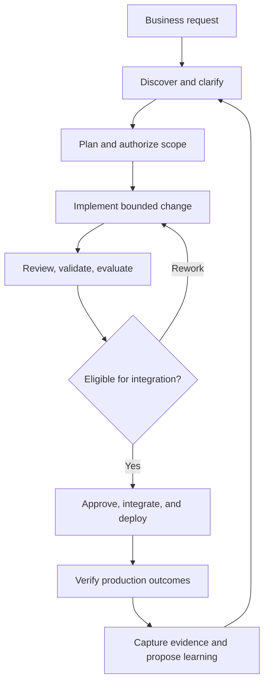
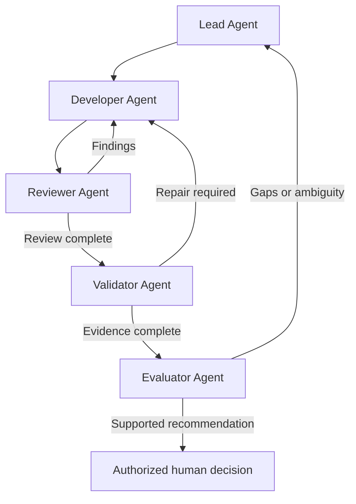
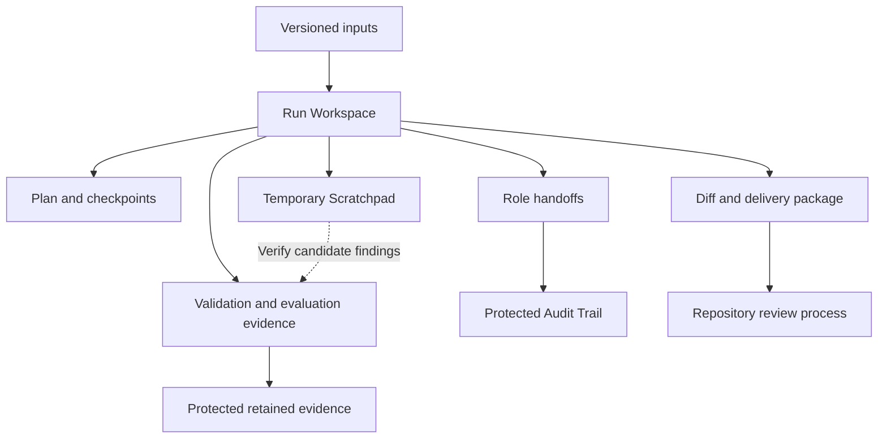
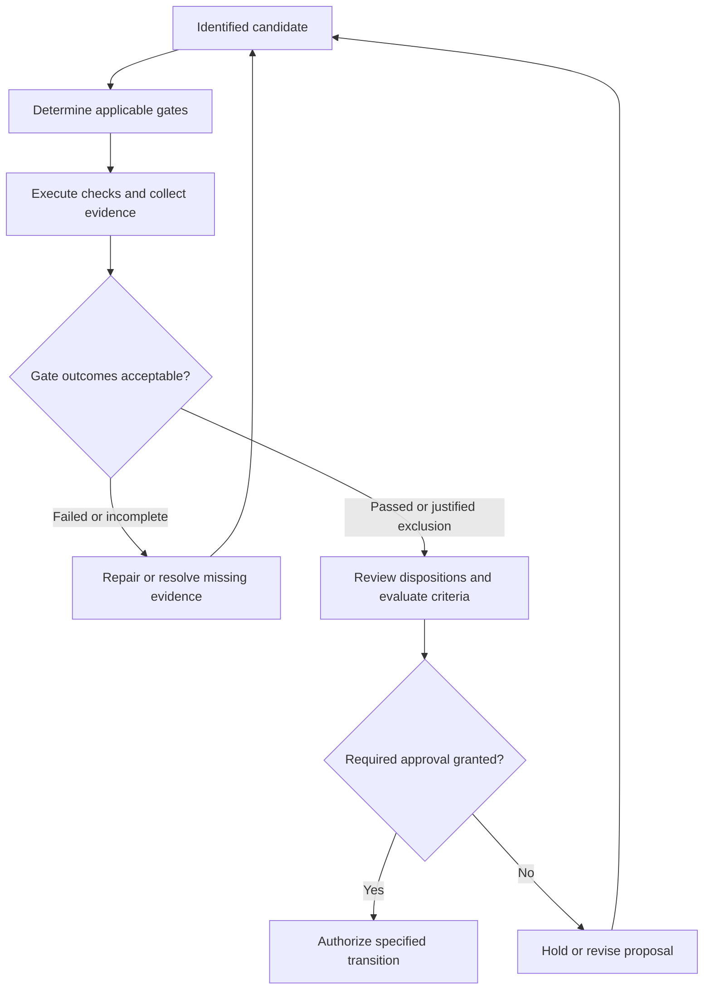
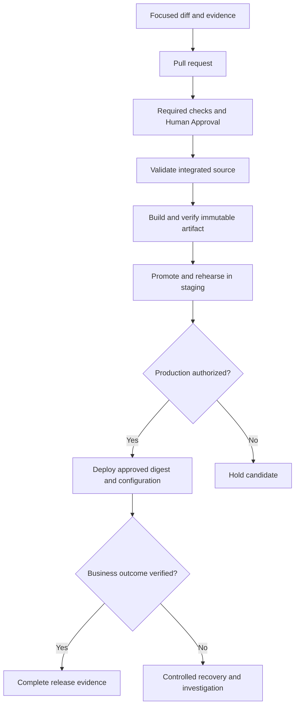
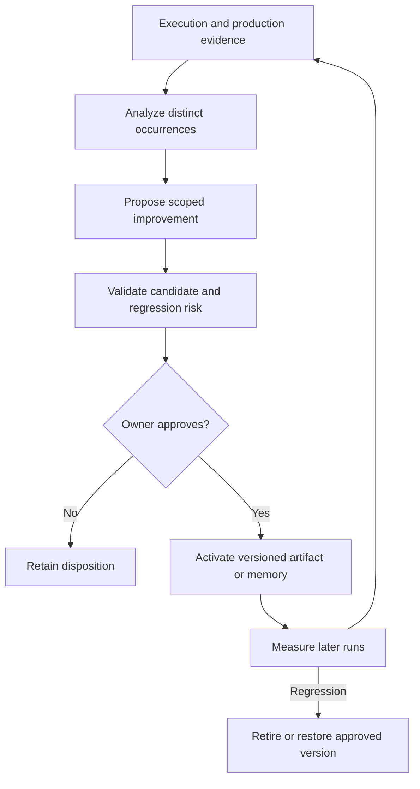

# Chapter 54 - AI-Assisted Development

**Part VII - Alpha Car Detailing**  
**Target file:** `book/54-ai-assisted-development.md`  
**Status:** Detailed outline

**Chapter objective:** Explain how Alpha Car Detailing applies the complete AI Engineering approach to real software development using Repository Intelligence, Instructions, Skills, Prompts, Roles, Harnesses, validation, governance, and Human Approval.

> **Core principle:** AI-assisted development is a governed engineering workflow, not simply code generation.

## 1. Story-driven Opening

### 1.1 A fleet booking request becomes an engineering mission

- Continue Northstar Distribution's scenario: an authorized fleet administrator needs to schedule twenty-four vehicles across two days.
- Introduce a proposed corporate fleet booking feature involving account access, approved booking limits, station capacity, safe retries, and understandable outcomes.
- Contrast a plausible generated implementation with the evidence needed to establish correct business behavior: service ownership, acceptance criteria, compatibility, security, and recovery.
- Identify unresolved decisions before implementation, including limit scope, batch semantics, capacity commitment, and handling partial success.
- Keep twenty-four vehicles as scenario data; do not convert it into an approved booking limit or transaction boundary.

### 1.2 Follow the change from request to verified production outcome

- Introduce the Lead Agent's discovery, a bounded implementation plan, role-specific handoffs, independent checks, and accountable human decisions.
- Follow the feature through a pull request, Chapter 53's delivery controls, production verification, and governed learning.
- Return to the opening request throughout the chapter; show evidence of progress rather than equating generated files with delivered value.
- Label scenario records, approvals, test results, and production outcomes as worked examples unless supported by actual execution evidence.

## 2. Learning Objectives

After completing this chapter, the reader will be able to:

- Translate a business request into scoped acceptance criteria and a governed development plan.
- Assemble current Repository Intelligence and distinguish Instructions, Skills, Prompts, Roles, Steering Notes, and Knowledge Sources.
- Use Planning Mode, a Scratchpad, and a Run Workspace without confusing temporary observations with authoritative knowledge.
- Coordinate Lead, Developer, Reviewer, Validator, and Evaluator responsibilities through explicit handoff contracts.
- Constrain Tool Calling and apply Deterministic Validation Gates, Human Approval, and protected delivery controls.
- Trace a change from request and source revision to release artifact, deployment authorization, and observed business outcome.
- Adapt the workflow for feature development, bug fixing, refactoring, and security remediation.
- Apply the same engineering controls through Claude Code, GitHub Copilot, and OpenAI Codex.
- Measure quality, delivery, reliability, and cost, then use execution evidence to propose reviewed improvements.

## 3. Background

### 3.1 Chapter 54 as the integration of Chapters 1-53

- Chapters 1-4: AI Agent capabilities, limitations, platform differences, and enterprise accountability.
- Chapters 5-11: Repository Intelligence and the distinct purposes of engineering guidance and Knowledge Sources.
- Chapters 12-21: Harness architecture, agent responsibilities, execution state, metrics, and enterprise patterns; include the existing Scratchpad and Run Workspace material.
- Chapters 22-28: Claude-oriented implementation, Tool Calling, Planning Mode, and enterprise workflows.
- Chapters 29-35: governance, security, Human Approval, Audit Trails, policies, compliance, and productivity measurement.
- Chapters 36-45: adaptive Harnesses, Harness Memory, learning from execution, governed artifact evolution, and improvement proposals.
- Chapters 46-53: Alpha Car Detailing's domain, architecture, service ownership, reliable events, security, observability, and CI/CD.
- Integrate these decisions through one engineering change rather than re-teaching every earlier chapter.

### 3.2 Preserve the runnable baseline and architectural decisions

- Begin with repository evidence: .NET 10, direct application services, deferred CQRS and mediator adoption, and SQLite persistence.
- Preserve the create/read baseline: `POST /api/bookings` creates a `Pending` booking; `201 Created` does not prove confirmed capacity or completed downstream work.
- Distinguish implemented tests and validators from proposed architecture, contract, security, deployment, and operational checks.
- Keep additional services, SQL Server, durable messaging, container publication, and Kubernetes environments explicitly proposed until implemented and verified.
- Treat the reference Harness layout as a design unless its orchestration, roles, evidence handling, and integrations have execution evidence.
- Apply existing Clean Architecture boundaries and authoritative ownership of accounts, vehicles, capacity, bookings, notifications, billing, and payments.

### 3.3 What the chapter demonstrates

- Show an end-to-end feature delivery design, a bounded runnable implementation slice, and extension prerequisites for the full production journey.
- Explain where AI assistance adds value and where deterministic tools, policy enforcement, and authorized people supply authority.
- Distinguish engineering workflow completion, business booking completion, and a learning proposal's approval lifecycle.

## 4. Concepts

### 4.1 The end-to-end AI-assisted development lifecycle

- Business request, discovery, requirement clarification, planning, authorized execution, implementation, review, validation, evaluation, approval, integration, deployment, observation, and learning.
- Define entry conditions, outputs, accountable owners, and evidence at each transition.
- Include rework, blocked dependencies, cancellation, exhausted retries, and abandoned changes as legitimate recorded outcomes.
- Distinguish progress toward a feature from eligibility to merge, eligibility to deploy, and verified production behavior.

### 4.2 Repository discovery and Repository Intelligence

- Inspect repository structure, applicable guidance, project dependencies, domain code, API and event contracts, persistence, tests, CI workflows, and operational documentation.
- Record the source revision, relevant paths, evidence locations, owners, and confidence in uncertain findings.
- Compare architectural intent with the implementation; surface conflicts and missing capabilities instead of filling gaps with invented components.
- Refresh affected findings when source, dependencies, contracts, or guidance change.

### 4.3 Instructions, Skills, Prompts, Roles, and Steering Notes

| Artifact | Purpose in the fleet booking run | Boundary |
| --- | --- | --- |
| Instructions | Standing architecture, coding, testing, and security expectations | Apply within declared authority and scope. |
| Skills | Reusable discovery, implementation, review, and validation procedures | A procedure does not grant additional permissions. |
| Prompts | Assign the current task, context, constraints, and expected output | Cannot silently redefine approved policy. |
| Roles | Define responsibility, permitted actions, and handoff obligations | A role label alone does not create independent enforcement. |
| Steering Notes | Communicate current mission, priorities, constraints, and escalation points | Respect ownership, approval, scope, and expiry. |

- Explain applicability and conflict resolution using the established authority model and actual platform instruction loading.
- Pin or record versions used by the run; escalate material contradictions to the responsible owner.

### 4.4 Knowledge Sources and evidence authority

- Use domain definitions, ADRs, contracts, approved policies, current source, test results, and operational evidence for their respective purposes.
- Record provenance, freshness, scope, access rights, and unresolved discrepancies.
- Treat external content, issue descriptions, tool responses, and generated summaries as potentially untrusted inputs.
- Distinguish a declaration of desired behavior from evidence that the implementation satisfies it.

### 4.5 Planning Mode

- Explore the task, identify affected boundaries, resolve consequential ambiguity, and propose verifiable work before implementation.
- Define scope, non-goals, dependencies, acceptance criteria, validation, security implications, rollout, and recovery.
- Apply policy-defined plan approval according to risk and existing authorization; avoid inventing a universal approval for every routine edit.
- Re-plan and renew applicable approval when material scope, risk, or assumptions change.
- Distinguish the handbook's planning discipline from each product's planning interface and permission behavior.

### 4.6 Scratchpad and Run Workspace

- Define the Run Workspace as the run-scoped execution boundary containing inputs, plan, temporary state, handoffs, validation evidence, and outputs.
- Record concise observations, assumptions, open questions, intermediate decisions, investigated files, and checkpoints in the Scratchpad.
- Keep the Scratchpad temporary and non-authoritative; record checkable findings and decision summaries rather than private model reasoning.
- Separate temporary working state, protected Audit Trails, retained execution evidence, Repository Intelligence, and Harness Memory.
- Address interrupted runs, staleness, role-specific working notes, approved sharing, cleanup, retention, and sensitive-data exclusions.

### 4.7 Lead Agent

- Interpret the request, establish discovery scope, resolve dependencies, assemble context, decompose the work, and coordinate handoffs.
- Track progress, evidence freshness, budgets, blockers, and escalation conditions.
- Coordinate recovery and present a concrete review package without granting itself missing business or production authority.

### 4.8 Developer Agent

- Implement the authorized slice, add appropriate tests, update affected documentation, and perform development self-checks.
- Respect service ownership, inward dependencies, existing conventions, and the current direct application-service model.
- Report changed files, commands, actual outcomes, assumptions, risks, and remaining work.
- Distinguish self-check evidence from independently enforced acceptance checks.

### 4.9 Reviewer Agent

- Examine the identified diff for business correctness, architecture, maintainability, security, contracts, and unintended scope.
- Produce actionable findings linked to files, requirements, severity, and proposed resolution criteria.
- Review fixes and finding dispositions; avoid presenting absence of findings as proof of correctness or Human Approval.

### 4.10 Validator Agent

- Execute the applicable, approved validation catalog against identified inputs and retain trustworthy results.
- Report failed execution, unavailable dependencies, missing suites, incomplete evidence, and justified exclusions explicitly.
- Re-run affected checks after changes; prevent the implementation from weakening its own acceptance rules.

### 4.11 Evaluator Agent

- Compare the request and acceptance criteria with implementation, review, and validation evidence.
- Classify unmet criteria, partial completion, unsupported claims, residual risks, and readiness recommendations.
- Keep business evaluation distinct from deterministic validation and authorized human decisions.
- Prevent aggregate scores or favorable narrative from overriding failed gates or missing requirements.

### 4.12 Tool Calling and enforcement

- Classify repository reads, edits, builds, tests, package installation, network access, issue and PR operations, migrations, and deployments by their effects and required authority.
- Declare tool schemas, permitted paths, identities, network destinations, timeouts, budgets, and evidence outputs.
- Distinguish an agent's proposed tool call from authorized execution and the actual observed result.
- Handle unknown outcomes by inspecting external state before retrying operations with side effects; apply idempotency where supported.
- Explain hooks and guardrails as enforcement aids while keeping required remote checks and production permissions independently protected.

### 4.13 Deterministic Validation Gates

- Carry forward Chapter 53's outcomes: **Passed**, **Failed**, **Incomplete**, and **Not applicable**.
- Specify owner, applicability rule, source or artifact identity, tool and policy versions, execution profile, command, timeout, evidence, and blocked transition.
- Cover build, unit, integration, architecture, contract, security, dependency, container, and policy checks where applicable and implemented.
- Compute expected checks from reviewed impact analysis; skipped, cancelled, filtered-out, or missing execution must not imply success.
- Record changing inputs such as vulnerability data and invalidate stale evidence when required by policy.

### 4.14 Human Approval and accountable authority

- Distinguish business clarification, plan authorization, code approval, documented exception approval, governed knowledge changes, and production authorization.
- Bind decisions to the reviewed revision, artifact, configuration, action, scope, and relevant validity conditions.
- Route decisions to accountable owners and apply separation of duties appropriate to risk.
- Keep exceptions explicit, justified, scoped, time-bound, and auditable; an exception does not rewrite a failed test as Passed.
- Treat prior authorization as applicable only while its scope and conditions remain satisfied.

### 4.15 Pull requests and CI/CD integration

- Prepare a focused diff with requirements, review dispositions, actual check results, known limitations, and recovery information.
- Revalidate the merge candidate and final integrated source; distinguish local evidence from required CI results.
- Connect source, build, immutable artifact digest, migrations, configuration, release authorization, and production observations.
- Promote the verified artifact through independently enforced environment controls established in Chapter 53.

### 4.16 Security, governance, and Audit Trails

- Address prompt injection, data exfiltration, unsafe commands, malicious dependencies, excessive permissions, secret exposure, and altered validation rules.
- Isolate runs and identities; constrain external tools and protect privileged CI and deployment credentials.
- Capture run and attempt IDs, source and guidance versions, material tool actions, handoffs, gate evidence, decisions, PRs, artifacts, and outcomes.
- Redact sensitive values, control access, preserve evidence integrity, and apply retention and deletion policies without destroying required audit records.
- Avoid equating a complete log or an AI-generated compliance statement with verified compliance.

### 4.17 Metrics, Harness Memory, and learning

- Measure delivery time, review rework, escaped defects, gate completeness, recovery, cost, and verified acceptance outcomes.
- Separate elapsed time from active engineering time; define denominators and compare similar work without invented productivity claims.
- Retain verified run facts through controlled evidence capture; treat proposed lessons as candidates until reviewed for promotion.
- Retrieve Harness Memory by scope, provenance, relevance, freshness, and repository compatibility.
- Propose Skill, Prompt, Instruction, test, or workflow improvements through accountable review, validation, versioned activation, monitoring, and rollback.

## 5. Architecture Discussion

### 5.1 Problem, context, and recommended architecture

- Frame the problem: turn probabilistic assistance into accountable changes across a distributed business system.
- Separate development assistance from application runtime behavior and production control authority.
- Recommend bounded agent work coordinated by a Harness, with protected evidence, independent gates, and policy-defined Human Approval.
- Compare a developer-led session, a staged Harness, and parallel execution where justified; scale orchestration to the change's risk and complexity.

### 5.2 Reference components and trust boundaries

- Context assembly: Repository Intelligence, approved guidance, Knowledge Sources, and relevant Harness Memory.
- Control: run coordinator, state transitions, policy decisions, tool permissions, budgets, and approval integration.
- Execution: isolated source checkout, role-specific sessions or stages, approved tools, and a Run Workspace.
- Evidence: protected validation reports, review dispositions, evaluation records, Audit Trails, and metrics.
- Delivery: repository protections, CI, artifact storage, environment controls, deployment identity, and operational telemetry.
- Explain why five named roles do not automatically require five processes or provide five independent opinions.

### 5.3 Corporate fleet booking requirements and ownership

- Map account eligibility and authorized fleet access to their authoritative owners; preserve Booking's responsibility for its own state transitions.
- Resolve booking-limit scope, date boundaries, concurrency behavior, capacity reservation, and client retry semantics before coding affected behavior.
- Define whether a multi-vehicle request allows partial success or requires a separately designed coordinated commitment; document the approved choice.
- Specify truthful per-vehicle outcomes, creation versus confirmation, and recovery from ambiguous responses.
- Preserve previously established notification, billing, and payment triggers rather than inventing new business consequences.

### 5.4 Deliver the feature through bounded slices

- Identify prerequisites absent from the runnable baseline and sequence their implementation explicitly.
- Separate account-scoped booking behavior, retry handling, capacity coordination, durable events, and consumer work into reviewable changes.
- Use ports and contracts to preserve service ownership; avoid shared databases and unauthorized deployment units.
- Record which acceptance criteria each slice establishes and which remain dependent on later work.
- Define compatible release ordering and recovery for cross-service changes.

### 5.5 Run state and handoff contracts

- Define supported states and transition rules for discovery, planning, execution, review, validation, evaluation, awaiting approval, delivery, verification, and closure.
- Include blocked, cancelled, failed, and exhausted states with owners and continuation conditions.
- Require each handoff to identify its run, attempt, revision, applicable guidance, changed scope, evidence, unresolved findings, and next responsibility.
- Validate evidence identity and completeness outside the agent's completion narrative.

### 5.6 Workspace isolation, concurrency, and resumability

- Use isolated checkouts or worktrees when concurrent work warrants them; prevent uncontrolled simultaneous writes to the same files.
- Treat integration of parallel changes as a new input requiring applicable validation.
- Checkpoint durable state before handoffs and expensive or consequential operations.
- On resume, verify source, guidance, tool state, permissions, approvals, dependencies, and evidence freshness.
- Avoid repeating committed external actions when a timeout or interruption left the result uncertain.

### 5.7 Validation and approval architecture

- Map each acceptance criterion to its owning layer, executable checks, review concern, evaluation evidence, and decision owner.
- Distinguish deterministic gate results from semantic review, business evaluation, and Human Approval.
- Keep gate catalogs and protected policies outside the candidate's unrestricted control.
- Present failed, incomplete, and stale evidence visibly; route repairs and exception requests without erasing prior attempts.

### 5.8 PR, CI/CD, and production integration

- Connect Harness output to existing repository and pipeline controls rather than building a competing release authority.
- Verify CI workflow discovery at the repository root; do not assume the companion's nested workflow executes in the handbook repository.
- Bind review to the relevant revision and release authorization to immutable artifact and deployment intent.
- Verify migration and contract compatibility, environment configuration, observation criteria, and recovery options.
- Use Chapter 52's business signals as well as infrastructure health to assess the release.

### 5.9 Security, operations, and scalability

- Apply trust boundaries to source retrieval, package restoration, external context, tool execution, evidence storage, and deployment.
- Protect workflow changes and untrusted PR execution from privileged identities and secrets.
- Scale with bounded queues, isolated workers, evidence storage limits, rate limits, and explicit model and tool budgets.
- Distinguish model failures, tool failures, infrastructure outages, missing approvals, and genuine application defects.
- Define escalation, operational ownership, timeout behavior, and safe termination for each class.

### 5.10 Learning architecture and future evolution

- Correlate build, review, validation, evaluation, PR, and production observations into distinct, provenance-linked occurrences.
- Select the correct improvement surface; do not turn one run's workaround into a repository-wide Instruction.
- Validate candidates against representative cases and regression risks before owner approval.
- Activate approved versions, track later outcomes, retire stale guidance, and support rollback.
- Evolve from a simple staged workflow only when observed coordination needs justify greater autonomy or parallelism.

## 6. Professional Diagrams

- Use Figures 54-1 through 54-6 as outline-level Mermaid designs; retain titles, captions, descriptions, and references in the manuscript.
- Prepare editable sources under `diagrams/source/` and publication exports under `diagrams/exported/` when writing the chapter.

### 6.1 Figure 54-1 - End-to-end AI-assisted development lifecycle

- **Caption:** Follow a change from an understood business need to a verified outcome and a reviewed improvement proposal.
- **Description and references:** Support Sections 4.1 and 7; identify authorization and delivery as expanded workflows rather than single unrestricted agent actions.

### 6.2 Figure 54-2 - Agent workflow

- **Caption:** Separate orchestration, implementation, review, validation, evaluation, and accountable decisions.
- **Description and references:** Support Sections 4.7-4.11 and 5.5; show logical responsibilities, not a requirement for separate concurrent agents.

### 6.3 Figure 54-3 - Run Workspace

- **Caption:** Keep temporary execution state separate from retained evidence and authoritative repository changes.
- **Description and references:** Support Sections 4.6 and 5.6; record material actions and decisions throughout the run, with retention independent of workspace cleanup.

### 6.4 Figure 54-4 - Validation and approval flow

- **Caption:** Complete, applicable evidence and authorized decisions control advancement.
- **Description and references:** Support Sections 4.13-4.14 and 5.7; a justified exclusion means Not applicable under a reviewed rule, while formal exceptions retain the original gate result.

### 6.5 Figure 54-5 - PR and CI/CD integration

- **Caption:** Preserve source, artifact, configuration, approval, and outcome identity through delivery.
- **Description and references:** Support Sections 4.15 and 5.8; corrections after review re-enter applicable checks, and recovery respects data and external effects.

### 6.6 Figure 54-6 - Learning feedback loop

- **Caption:** Learning becomes active guidance through validation, ownership, and versioned change.
- **Description and references:** Support Sections 4.17 and 5.10; controlled factual evidence capture does not itself authorize changes to active Instructions, Skills, Prompts, or policies.

## 7. Hands-on Example

### 7.1 Establish the task and reproducible starting point

- Capture Northstar's business request, current source revision, working-tree state, implementation boundaries, and available tooling.
- Select a bounded runnable Booking slice and list prerequisites for the proposed fleet-wide production feature.
- Record assumptions and exclusions; use synthetic corporate accounts, vehicles, and station data.
- **Deliverable:** task brief and baseline evidence.

### 7.2 Discover and assemble the context package

- Identify applicable Instructions, approved Skills, current Steering Note, domain definitions, ADRs, contracts, tests, and relevant Harness Memory.
- Reconcile current code with architecture documents and proposed services.
- Record source locations, artifact versions, owners, uncertainties, and missing evidence.
- **Deliverable:** Repository Intelligence summary and input manifest.

### 7.3 Define acceptance criteria with the business owner

- Cover authorized account access, vehicle ownership, approved booking limits, concurrency, truthful Pending versus confirmed outcomes, and safe retries.
- Resolve batch behavior, partial success, capacity decisions, and downstream consequences before implementing those requirements.
- Include unauthorized access, duplicate requests, limit boundaries, dependency failure, and ambiguous-response recovery.
- **Deliverable:** approved criteria linked to owning components and planned checks.

### 7.4 Create the plan and Run Workspace

- Decompose the feature into compatible slices with non-goals, dependencies, affected files, tests, rollout, and recovery.
- Establish policy-required authorization and escalation points.
- Initialize versioned input references, `plan.md`, `scratchpad.md`, `agent-handoffs/`, `validation/`, and `outputs/` using a documented run-scoped convention.
- Define run IDs, attempts, checkpoints, budgets, retention, and conditions for resuming.
- **Deliverable:** reviewable plan and workspace manifest.

### 7.5 Implement through the Developer responsibility

- Extend the selected behavior through Domain, Application, Infrastructure, and API responsibilities as appropriate.
- Preserve direct application services and existing dependency rules.
- Add required authorization, persistence, retry, and concurrency behavior only within the approved slice; avoid claiming unavailable integrations exist.
- Add meaningful tests and development self-checks; report actual commands and outcomes.
- **Deliverable:** focused diff, test changes, and implementation handoff.

### 7.6 Review the change independently of its completion narrative

- Inspect business semantics, account isolation, architectural boundaries, concurrency, error handling, contract compatibility, observability, and scope.
- Demonstrate a finding such as trusting a client-supplied account identifier without resource authorization.
- Require a fix and regression evidence; record finding disposition and re-review against the current revision.
- **Deliverable:** review report with traceable resolutions.

### 7.7 Execute deterministic validation

- Run implemented build and test suites plus applicable architecture, contract, security, policy, and artifact checks.
- Demonstrate one failing requirement and one Incomplete result, such as an unavailable dependency fixture or interrupted scanner.
- Show that missing proposed suites block the acceptance criteria that depend on them rather than silently satisfying them.
- Retain commands, versions, input identity, execution profile, reports, timestamps, and outcomes for each attempt.
- **Deliverable:** complete gate manifest and retained diagnostics.

### 7.8 Evaluate business completion and obtain required decisions

- Build an acceptance matrix linking each requirement to current evidence and outstanding limitations.
- Distinguish completion of the bounded baseline slice from readiness of the proposed full fleet workflow.
- Present unresolved risks, review dispositions, gate results, rollout, and recovery for accountable decisions.
- **Deliverable:** evaluation report and appropriately scoped approval record.

### 7.9 Create the pull request and pass CI

- Include business behavior, scope, architecture implications, security impact, changed contracts, actual validation, and recovery limits.
- Apply required human review and protected checks; revalidate changed revisions and the merge candidate.
- Preserve the relationship between the Harness run, PR, integrated commit, and CI execution.
- **Deliverable:** reviewable PR package and integration evidence.

### 7.10 Promote the implemented candidate and verify production

- For implemented production extensions, follow Chapter 53's build, scan, immutable packaging, staging, migration, approval, and deployment controls.
- Otherwise provide a clearly labeled rehearsal and record production prerequisites as unmet.
- Verify authorized booking behavior, stated limit behavior, publication and consumer progress where implemented, and the customer-visible result.
- Exercise the stated recovery path; do not assume application rollback reverses committed business effects.
- **Deliverable:** release evidence or rehearsal report with explicit scope.

### 7.11 Close the run and propose a lesson

- Record final outcomes, unresolved work, metrics, retained evidence, and cleanup decisions.
- Use a repeated finding to propose a narrowly scoped Skill or test improvement; distinguish observed evidence from inferred cause.
- Validate and route the candidate for owner approval before future runs use a new active version.
- **Deliverable:** closure record and separately governed improvement proposal.

### 7.12 Adapt the lifecycle to other engineering work

| Work type | Starting evidence | Required demonstration |
| --- | --- | --- |
| Feature development | Approved business behavior and existing architecture | New criteria satisfied without violating established invariants. |
| Bug fixing | Reproduction, incident evidence, expected behavior | Regression test exposes the fault and verifies the bounded repair. |
| Refactoring | Identified structural problem and behavior baseline | Target structure improves while approved observable behavior remains compatible. |
| Security remediation | Verified finding, affected assets, threat, and exposure | Attack path is closed, legitimate access still works, and affected candidates are reassessed. |

- Reuse the same control model while adapting scope, evidence, urgency, approvals, and recovery.
- Include expedited incident handling with accountable decisions and subsequent reconciliation into normal source and evidence history.

## 8. Claude Example

### 8.1 Establish Claude Code's repository context

- Show how applicable `CLAUDE.md` guidance, approved Skills, task context, and the current Steering Note support the fleet booking run.
- Explain project Skill packaging under `.claude/skills/<skill-name>/SKILL.md`, while retaining one governed source of engineering guidance.
- Verify loading behavior, available tools, permissions, and supported execution surface before giving executable instructions.
- Reference official Claude Code guidance on Instructions, Skills, and enforceable checks; date and version-check manuscript examples.

### 8.2 Plan, implement, and hand off a bounded feature slice

- Outline a planning request containing the business goal, repository baseline, allowed scope, constraints, acceptance criteria, and required outputs.
- Follow with authorized implementation, development self-checks, and explicit Reviewer, Validator, and Evaluator handoffs.
- Use separate role stages or isolated sessions where appropriate; do not assume native subagent support establishes independent approval authority.
- Show a material blocker being escalated and a failed check being repaired without weakening its rule.

### 8.3 Integrate tools, evidence, and delivery controls

- Route permitted build, test, repository, and PR operations through the configured environment and record their actual outcomes.
- Use hooks where appropriate for local guardrails; retain independent required CI checks and production authorization.
- Distinguish session convenience features and product memory from governed Harness Memory and protected Audit Trails.
- End the example with a reviewable change package and the precise supported completion claim.

## 9. GitHub Copilot Comparison

### 9.1 Map the workflow to the selected Copilot surface

- Distinguish IDE assistance from repository or cloud execution, including where tools run and how work reaches a pull request.
- Show repository custom instructions and task prompts as inputs to the same governed fleet booking task.
- Verify instruction formats, Skills support, permissions, organization policy, and feature availability for the chosen surface.
- Keep product terminology and execution examples current with official documentation rather than assuming a fixed capability list.

### 9.2 Preserve the engineering responsibilities

- Map Lead, Developer, Reviewer, Validator, and Evaluator responsibilities to team procedure, configured automation, and available product features.
- Treat AI-generated review findings as advisory evidence; retain accountable reviewers and independently enforced checks.
- Explain instruction-loading trust boundaries and protect required policy from candidate-controlled guidance changes.
- Compare context handoff, repository integration, execution isolation, evidence export, and review effort using the same acceptance criteria.

## 10. Codex Comparison

### 10.1 Map repository guidance and execution controls

- Show how applicable `AGENTS.md` guidance supplies repository expectations and how scope affects instruction discovery.
- Keep workflow artifact names and run layouts explicit as project conventions rather than implying Codex requires them.
- Inspect the selected environment's tools, filesystem and network boundaries, approval behavior, and evidence access.
- Preserve the same planning, implementation, review, validation, evaluation, and delivery responsibilities.

### 10.2 Compare outcomes using a common assessment

| Dimension | Comparison question |
| --- | --- |
| Context | Was current, applicable guidance loaded with traceable sources? |
| Planning | Were ambiguity, dependencies, non-goals, and validation made explicit? |
| Execution | Were tools, permissions, side effects, and retries controlled? |
| Evidence | Can results be tied to the actual source or artifact? |
| Integration | Did protected PR and CI/CD controls retain authority? |
| Quality and cost | What verified outcome, rework, elapsed time, and total cost resulted? |

- Avoid unsupported rankings and claims that identical prompts produce equivalent context or enforcement across products.
- Verify commands and feature claims against the selected Codex client and current official documentation when writing the manuscript.

## 11. Best Practices

- Begin with current repository evidence and approved business meaning.
- Keep task scope and completion claims bounded and reviewable.
- Version guidance and record the inputs used by each run.
- Define role outputs and handoff contracts before increasing orchestration complexity.
- Make acceptance criteria executable where possible and visible where human judgment remains necessary.
- Bind evidence and approvals to the inputs they assessed.
- Constrain Tool Calling and preserve independent validation and deployment authority.
- Plan failure recovery, production observation, evidence retention, and learning alongside implementation.

## 12. Anti-patterns

> **Common Mistake**
>
> Treating generated code, a successful local build, or an AI Agent's completion message as proof that the fleet booking feature is ready for production.

- Coding before discovering the repository or resolving consequential business ambiguity.
- Treating a Prompt as policy, a Scratchpad as authoritative knowledge, or retrieved memory as automatically current.
- Inventing booking limits, service capabilities, batch guarantees, or deployed infrastructure.
- Giving all roles unrestricted shared permissions and calling the result independent review.
- Weakening tests, muting findings, or changing acceptance criteria to make a candidate pass.
- Treating skipped or missing checks as Passed, or reusing evidence after relevant inputs change.
- Allowing untrusted source content or tool output to authorize commands or disclose secrets.
- Asking for blanket approval without a concrete candidate, action, and risk scope.
- Opening oversized PRs, merging stale evidence, or deploying a different artifact from the one reviewed.
- Retrying ambiguous external actions blindly or assuming rollback reverses external effects.
- Reporting productivity through generated lines or unsupported time-saving claims.
- Promoting a single workaround directly into active Skills, Instructions, Steering Notes, or policies.

## 13. Architect's Notes

> **Architect's Note**
>
> The architecture must place authority in enforceable boundaries, with evidence that supports each decision.

### 13.1 Responsibilities precede the number of agents

- Distinguish logical role separation, isolated execution, independent evidence, and human accountability.
- Choose orchestration complexity based on risk, coordination needs, and observed benefit.

### 13.2 Business invariants remain the center of the workflow

- Preserve ownership of authorization, limits, capacity, and booking state through every generated change.
- Recognize that an efficient workflow can still deliver the wrong requirement if domain decisions are unsupported.

### 13.3 Evidence and authorization have scope and lifetime

- Explain why source revisions, tool versions, configurations, changing security data, and environment state affect the validity of conclusions.
- Design renewed checks and decisions around material change rather than ceremonial repetition.

### 13.4 Learning is another governed engineering change

- Apply ownership, testing, versioning, approval, observability, and rollback to Harness improvements.
- Keep historical evidence, current repository truth, and active guidance distinguishable.

## 14. Enterprise Tips

> **Enterprise Tip**
>
> Start with one service, one bounded change, and one complete evidence path before expanding autonomous execution.

- Publish a concise role and decision-owner catalog for engineering, security, operations, and business approvals.
- Maintain reusable context, task, review, validation, and evidence templates with named owners.
- Use approved synthetic data and isolated development identities; restrict production access.
- Provide predictable execution environments and clear diagnostics for unavailable tooling or dependencies.
- Establish risk-based review expectations, escalation targets, and time limits for blocked work.
- Integrate evidence with existing PR, CI/CD, observability, and incident processes.
- Measure quality and rework alongside cost and delivery time; review metrics with their limitations.
- Assign owners to stale memory, expired Steering Notes, retained evidence, and cleanup.

## 15. Decision Points

> **Decision Point**
>
> Increase autonomy only when the scope, evidence, enforcement, and recovery controls support the additional authority.

| Decision | Alternatives to assess | Required basis |
| --- | --- | --- |
| Execution model | Developer-led session, staged Harness, or parallel work | Risk, coordination cost, isolation, and evidence quality. |
| Feature scope | Bounded Booking slice or coordinated cross-service change | Business criteria, prerequisites, contracts, and recovery. |
| Approval placement | Existing delegated authority or explicit decision at a transition | Policy, action scope, material risk, and prior authorization. |
| Validation placement | Local checks, protected CI, or both | Feedback speed, trust boundary, and candidate identity. |
| Role isolation | Shared session, separate sessions, or separate workers | Contamination risk, permissions, independence, and cost. |
| Tool access | Restricted local tools or approved external integrations | Data exposure, side effects, identity, and auditability. |
| Learning destination | Run evidence, Harness Memory, Skill, Prompt, or Instruction | Relevance, recurrence, scope, owner, and validation. |
| Release exposure | Immediate availability or controlled feature exposure | Compatibility, observation, operational risk, and reversibility. |

## 16. Exercises

### 16.1 Build a fleet booking context package

- Produce a source-bound discovery summary, authority map, applicable guidance list, and unresolved questions.
- **Acceptance:** distinguish runnable capabilities, proposed extensions, and unsupported assumptions.

### 16.2 Plan the feature and its decisions

- Create acceptance criteria, bounded slices, ownership, tests, rollout, recovery, and approval points.
- **Acceptance:** resolve limit scope, batch semantics, capacity commitment, and retry behavior before affected execution.

### 16.3 Design a resumable Run Workspace

- Specify input references, plan, Scratchpad, handoffs, evidence, outputs, access, and retention.
- **Acceptance:** resume after interruption without trusting stale assumptions or repeating uncertain external actions.

### 16.4 Repair and validate a booking defect

- Use a synthetic account-isolation or retry defect; reproduce it, add a regression test, implement a focused fix, and review it.
- **Acceptance:** the test exposes the original problem and validates the repair while preserving legitimate behavior.

### 16.5 Refactor without changing the business contract

- Move misplaced booking behavior to its approved architectural boundary.
- **Acceptance:** architecture evidence improves and approved API, persistence, and business outcomes remain compatible.

### 16.6 Challenge gates and approval evidence

- Introduce a failed test, missing scan, stale source revision, and changed deployment configuration.
- **Acceptance:** applicable transitions block and require the correct renewed evidence or scoped decision.

### 16.7 Run a security remediation and delivery rehearsal

- Repair a verified synthetic authorization finding and prepare the PR, release evidence, observation plan, and recovery procedure.
- **Acceptance:** the attack path closes, legitimate access remains valid, and deployment claims match implemented prerequisites.

### 16.8 Compare platforms and propose a governed lesson

- Apply an equivalent bounded task through available Claude Code, Copilot, or Codex workflows; record differences in actual context, permissions, evidence, quality, and cost.
- Propose one evidence-linked improvement and define its validation, owner, approval, activation, and rollback.
- **Acceptance:** avoid unsupported platform rankings and distinguish limited observations from established recurring patterns.

## 17. Interview Questions

1. Why is AI-assisted development a governed engineering workflow rather than simply code generation?
2. How do Repository Intelligence, Knowledge Sources, and Harness Memory differ?
3. What belongs in Instructions, Skills, Prompts, Roles, and Steering Notes?
4. What must Planning Mode establish before a consequential feature change begins?
5. How does a Scratchpad differ from a plan, an Audit Trail, and approved knowledge?
6. How do Lead, Developer, Reviewer, Validator, and Evaluator responsibilities differ?
7. Why do separate role names or sessions not automatically establish independent assurance?
8. What makes a validation gate deterministic, and how should missing or inapplicable checks be handled?
9. How should the workflow recover when a tool times out after possibly changing external state?
10. Which changes invalidate earlier validation evidence or Human Approval?
11. How would you preserve truthful booking outcomes when moving beyond the current Pending baseline?
12. How should AI-generated changes enter protected PR and CI/CD workflows?
13. How do you defend against prompt injection and candidate-controlled attempts to weaken validation?
14. How does the lifecycle adapt for bug fixing, refactoring, and security remediation?
15. Which metrics support a credible assessment of quality, productivity, reliability, and cost?
16. How can execution findings improve future runs without silently changing authoritative guidance?
17. Which controls remain necessary when switching between Claude Code, GitHub Copilot, and OpenAI Codex?

## 18. Chapter Summary

- Return to Northstar's request and trace its path through discovery, clarified requirements, planning, implementation, review, validation, evaluation, approval, and delivery.
- Distinguish the bounded runnable slice from the full proposed production workflow and state what each evidence set establishes.
- Reinforce ownership, controlled Tool Calling, temporary run state, independent gates, scoped Human Approval, and traceable outcomes.
- Connect the development run to protected PRs, immutable delivery artifacts, operational verification, and accountable recovery.
- Show how verified execution evidence supports Harness Memory and reviewed improvements to engineering artifacts.
- Reaffirm the core principle: AI-assisted development is a governed engineering workflow, not simply code generation.

## 19. Further Reading

### 19.1 Handbook foundations and control model

- Chapters 5-11: Repository Intelligence, Instructions, Skills, Prompts, Roles, Steering Notes, and Knowledge Sources.
- Chapters 12-18: Harness architecture and Lead, Developer, Reviewer, Validator, and Evaluator responsibilities.
- Existing Scratchpad and Run Workspace material, plus Chapters 20-21 on metrics and enterprise Harness patterns.
- Chapters 26-35: Tool Calling, Planning Mode, workflows, governance, security, Human Approval, Audit Trails, policy, compliance, and productivity.

### 19.2 Learning and the Alpha Car Detailing reference architecture

- Chapters 36-45: adaptive Harnesses, Harness Memory, execution evidence, artifact evolution, Knowledge Graph, and governed improvement.
- Chapters 46-50: domain, solution architecture, Clean Architecture, microservices, and event-driven integration.
- Chapters 51-53: security, observability, and CI/CD controls applied to the delivered change.

### 19.3 Official platform documentation

- [Claude Code best practices](https://code.claude.com/docs/en/best-practices): repository context, checks, and enforceable rules.
- [Claude Code Skills](https://code.claude.com/docs/en/skills): reusable procedures, packaging, scope, and invocation.
- [GitHub Copilot custom instructions](https://docs.github.com/en/copilot/concepts/prompting-and-context/custom-instructions): guidance types and surface-dependent support.
- [GitHub Copilot on GitHub.com](https://docs.github.com/en/copilot/concepts/copilot-surfaces/copilot-on-github): repository planning, execution, and review workflows.
- [Codex custom instructions with AGENTS.md](https://developers.openai.com/codex/guides/agents-md): repository guidance and scope.
- [Codex development workflow example](https://developers.openai.com/cookbook/examples/codex/iterating-development-workflows-with-codex): explicit project conventions, evidence, and governed iteration.
- Verify the selected product surface, supported version, permissions, current commands, and organization restrictions before publishing executable examples.

Chapter 54 outline is complete.
