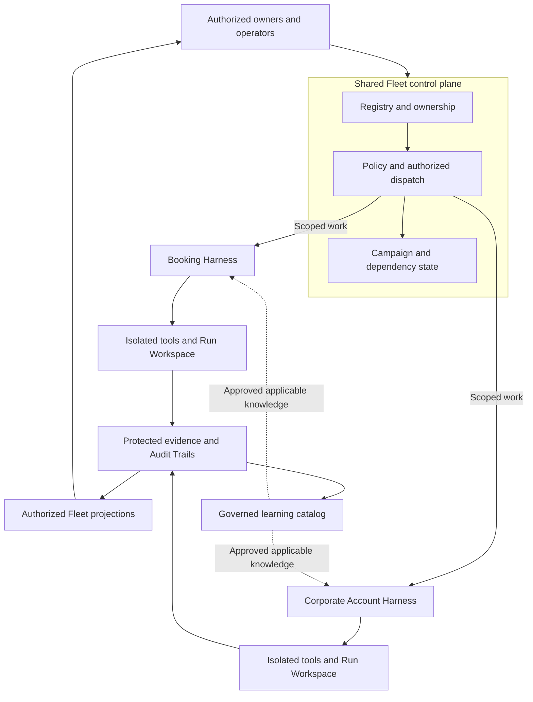
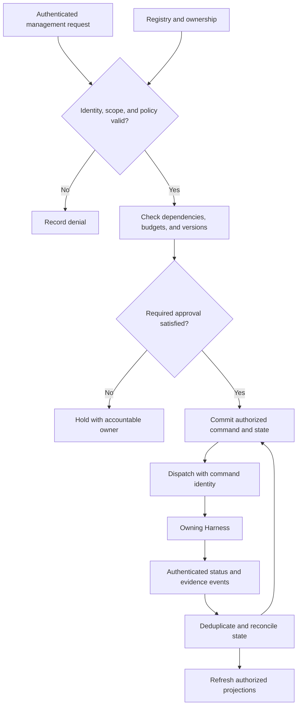
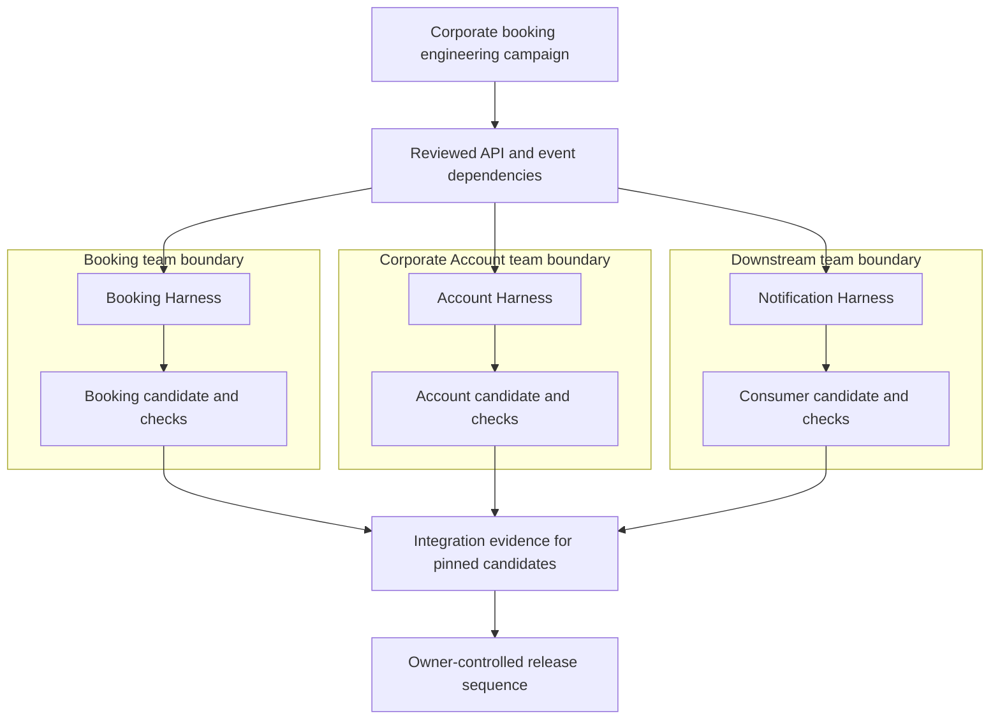
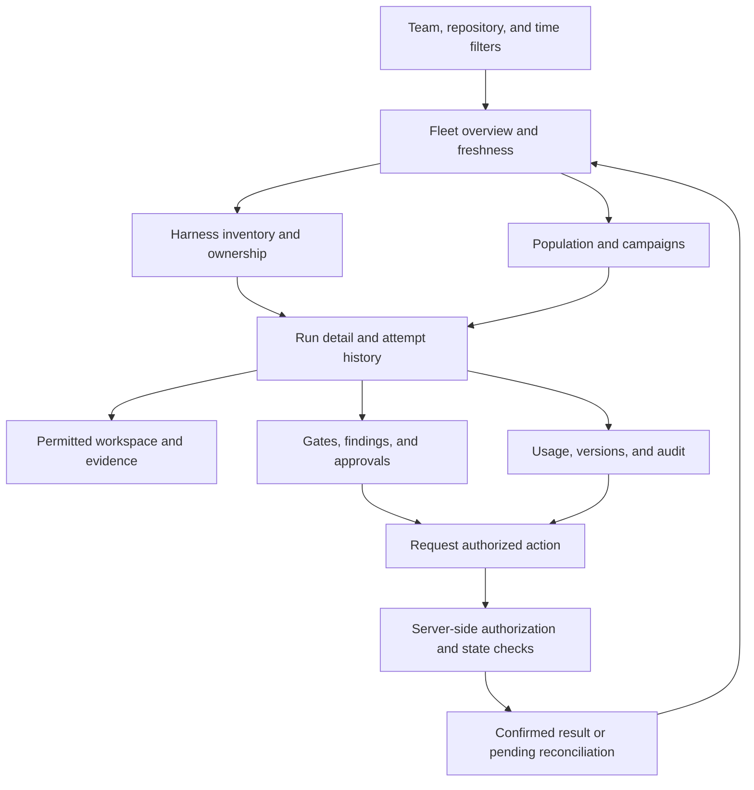
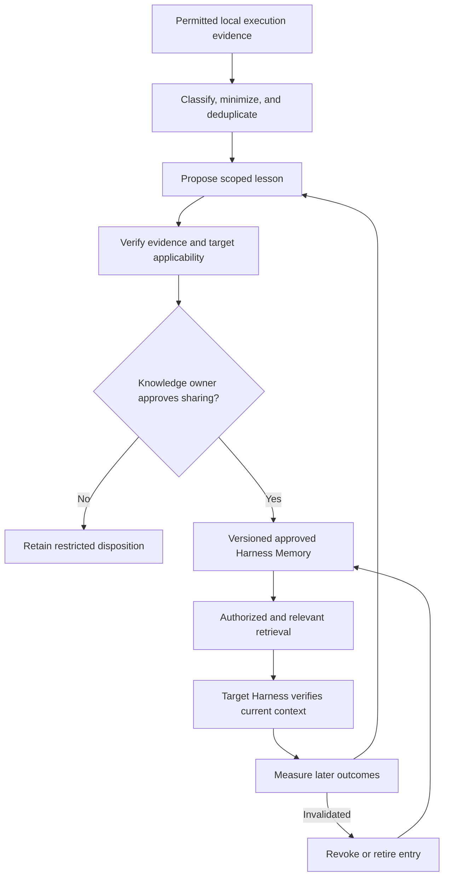
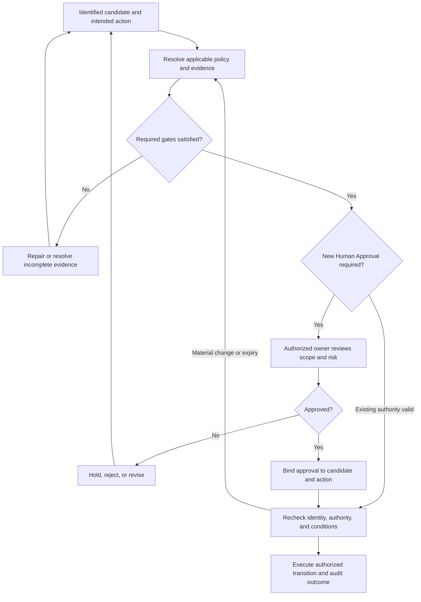

# Chapter 55 — Enterprise Harness Fleet

**Project:** Enterprise AI Engineering Handbook  
**Target manuscript:** `book/55-enterprise-harness-fleet.md`  
**Status:** Detailed outline

**Chapter objective:** Explain how enterprises manage multiple AI Engineering Harnesses across teams, repositories, services, and business domains as a governed Harness Fleet.

> **Core principle:** A Harness manages an engineering workflow. A Harness Fleet manages many Harnesses while preserving team autonomy, security boundaries, governance, observability, and shared learning.

## 1. Story-driven Opening

### 1.1 One successful Harness becomes an enterprise coordination problem

- Continue Alpha Car Detailing's corporate fleet booking scenario from Chapter 54: Northstar Distribution needs truthful outcomes for twenty-four vehicles across two days.
- Extend the engineering scenario to proposed Booking, Corporate Account, Fleet, Station Operations, Billing, Payment, and Notification team Harnesses.
- Introduce simultaneous changes: an account-authorization correction, a compatible event-contract extension, and a shared validation Skill update.
- Surface operational questions: which Harness owns each change, which runs are blocked, whether evidence is current, who can approve advancement, and which teams may reuse a lesson.
- Label the enterprise topology and operational incidents as worked examples; do not imply that all proposed services or Harnesses already operate.

### 1.2 Shared visibility with accountable local execution

- Show a Fleet operator locating a stale Booking run, a contract dependency, and an unapproved Skill version without taking ownership of every team's implementation.
- Establish the chapter's central tension: common enterprise controls must coexist with repository ownership, domain-specific practices, and restricted information.
- Distinguish the engineering Harness Fleet from Alpha Car Detailing's business fleet of vehicles.
- Frame success as coordinated, evidence-backed engineering outcomes rather than the number of agents or runs launched.

## 2. Learning Objectives

After completing this chapter, the reader will be able to:

- Distinguish a Harness Fleet from an individual Harness, a worker pool, and a multi-agent session.
- Design a Fleet architecture with explicit control, execution, evidence, identity, and knowledge boundaries.
- Register Harnesses and map repository, team, service, domain, and operational ownership.
- Combine shared Instructions, Skills, and policies with governed local customization.
- Manage Population, runs, attempts, dependencies, concurrency, and recovery across Harnesses.
- Expose Run Workspaces, gate evidence, approvals, Metrics, costs, and Audit Trails through authorized views.
- Coordinate multi-repository work without bypassing local checks or granting universal credentials.
- Detect failed, stale, orphaned, blocked, and exhausted work without unsafe duplicate execution.
- Promote cross-repository learning through governed Harness Memory and controlled knowledge sharing.
- Roll out Harness versions and management capabilities with compatibility checks, monitoring, and rollback.

## 3. Background

### 3.1 Extend the workflow established in Chapters 1–54

- Build on Repository Intelligence and the distinct purposes of Instructions, Skills, Prompts, Roles, Steering Notes, and Knowledge Sources.
- Carry forward Lead, Developer, Reviewer, Validator, and Evaluator responsibilities; Fleet management coordinates these workflows without replacing their outputs.
- Reuse Chapter 19's Population model, the existing Scratchpad and Run Workspace material, and the established Metrics and enterprise Harness patterns.
- Connect governance, security, Human Approval, Audit Trails, Harness Memory, governed improvement, observability, and CI/CD at enterprise scope.
- Explain how Chapter 54's evidence path for one change becomes an attributable, access-controlled view across many Harnesses.

### 3.2 Why enterprise Fleet management becomes necessary

- Examine repeated engineering workflows across repositories, divergent guidance versions, duplicated investigations, shared model budgets, and cross-team dependencies.
- Describe risks from unmanaged expansion: unknown ownership, inconsistent gates, privileged shared workers, stale runs, and unverifiable completion claims.
- Explain when a simple registry and shared reporting are sufficient, and when coordinated scheduling, policy distribution, or regional control is justified.
- Scale the management system according to demonstrated coordination needs; repository count alone does not mandate a complex platform.

### 3.3 Preserve the implemented baseline

- Retain .NET 10, direct application services, deferred CQRS and mediator adoption, and SQLite persistence in the runnable companion.
- Preserve `POST /api/bookings` creating a `Pending` booking; creation does not prove capacity confirmation or downstream completion.
- Treat the complete service topology, independent repositories, production workers, durable messaging, and Fleet control plane as proposed extensions until implemented and verified.
- Keep the chapter's management lab separate from application-runtime claims; synthetic registrations and run events demonstrate management behavior only.

## 4. Concepts

### 4.1 Harness versus Harness Fleet

| Concern | Individual Harness | Harness Fleet |
| --- | --- | --- |
| Primary scope | A bounded engineering workflow | Many registered Harnesses across ownership boundaries |
| Execution | Coordinates roles, tools, and local work | Routes authorized work and coordinates shared constraints |
| Population | Owns work-item lifecycle and attempts | Provides scoped aggregation and cross-Harness dependencies |
| Validation | Executes applicable checks and retains evidence | Verifies evidence identity and presents Fleet-wide status |
| Governance | Applies controls to its workflow | Distributes common controls and records scoped exceptions |
| Learning | Produces and retrieves applicable knowledge | Governs approved sharing and reuse across repositories |

- Explain why Fleet management is a software control capability rather than another AI Agent.
- Distinguish a Harness definition, deployed Harness instance, worker, agent session, and Fleet membership.
- Keep local execution authority and enterprise oversight explicit rather than inferring them from a dashboard.

### 4.2 Fleet control plane and execution plane

- Define the control plane: identity, registration, ownership, policy, authorized dispatch, shared limits, approvals, and management projections.
- Define the execution plane: repository-scoped Harnesses, isolated workers, tool execution, local Run Workspaces, and checks.
- Separate durable operational state, protected evidence, and derived dashboard projections.
- Explain that loss of management visibility must not silently relax execution or release controls.

### 4.3 Identity, ownership, and registration

- Assign stable Fleet, Harness, repository, team, domain, Population item, run, and attempt identifiers.
- Distinguish business ownership, repository ownership, Harness operations, security authority, and approval authority.
- Register declared capabilities and trust boundaries; discovery of a Harness does not authorize its use.
- Support one Harness serving multiple repositories and multiple authorized Harnesses serving one repository without assuming a one-to-one mapping.

### 4.4 Population, runs, and capacity

- Preserve Population as the durable collection and lifecycle of engineering work items; it does not mean agent headcount.
- Relate a work item to its dependencies, local owning Harness, runs, attempts, assignments, and evidence.
- Track worker availability, role concurrency, model quotas, and execution capacity separately from Population.
- Distinguish queue state, execution state, validation outcome, evaluation outcome, and approval state.
- Preserve local states such as `Blocked`, `Failed`, `Exhausted`, `Stale`, and `Completed`; document any normalized Fleet projection and retain its original state.

### 4.5 Shared Instructions, Skills, and local customization

- Separate enterprise policy requirements, shared Instructions, reusable Skills, and repository-specific guidance.
- Define governed specialization: teams may add domain constraints and local procedures within enterprise boundaries.
- Establish applicability, precedence, ownership, version pinning, conflict detection, and documented exceptions.
- Keep local Prompts and Steering Notes scoped to current work; neither silently changes mandatory controls.
- Distinguish distributing guidance from loading it, enforcing it, and verifying compliance.

### 4.6 Roles, permissions, and human authority

- Separate engineering Roles from authenticated identities and granted permissions.
- Define Fleet operator, platform administrator, repository maintainer, policy owner, security reviewer, knowledge owner, approver, and auditor responsibilities.
- Scope permissions to domain, repository, environment, action, and data classification; administrative visibility does not imply source-edit or deployment authority.
- Preserve separation of duties and current delegated authorization; request new decisions when scope or conditions require them.

### 4.7 Run Workspace visibility and evidence

- Expose run identity, stage, checkpoint, dependency, heartbeat, evidence availability, and permitted artifact links.
- Restrict source, diffs, tool output, Scratchpads, and sensitive evidence to authorized audiences.
- Keep temporary observations and concise decision summaries distinct from retained Audit Trails and approved Harness Memory.
- Show partial visibility and withheld evidence explicitly; missing access must not be interpreted as a passing result.

### 4.8 Validation, evaluation, and approval status

- Carry forward gate outcomes **Passed**, **Failed**, **Incomplete**, and **Not applicable**, with evidence and applicability rules.
- Keep Reviewer findings, deterministic validation, Evaluator recommendations, and Human Approval as separate records.
- Bind evidence and approval to identified source revisions, artifact digests, policy versions, deployment intent, and validity conditions where applicable.
- Distinguish a healthy Harness, a completed run, an accepted engineering change, and a verified business outcome.

### 4.9 Metrics, cost, audit, and learning

- Distinguish operational Metrics from productivity claims, current state from historical events, and logs from protected Audit Trails.
- Separate measured model and tool usage, estimated expenditure, billed amounts, shared platform cost, and recorded human effort.
- Define repository-, team-, domain-, and Fleet-scoped Harness Memory with explicit promotion and retrieval boundaries.
- Distinguish automatically captured execution facts, candidate learnings, approved reusable knowledge, and proposed changes to active Instructions or Skills.

## 5. Architecture Discussion

### 5.1 Design alternatives and recommended operating model

- Compare centralized management and execution, team-owned management, and a federated control plane with distributed execution.
- Assess consistency, team autonomy, latency, data residency, operational complexity, outage impact, and administrative blast radius.
- Recommend a federated reference design for Alpha Car Detailing's proposed multi-team scenario: shared contracts and controls, locally accountable execution.
- Explain when a simpler centralized deployment or multiple isolated Fleet partitions are preferable.
- Include a decision table linking topology to organizational and security constraints rather than presenting federation as universally required.

### 5.2 Control-plane components and authoritative state

- Outline the registry, ownership catalog, policy distribution, dispatch service, dependency coordinator, approval integration, evidence index, Metrics projections, and learning catalog.
- Assign an authoritative owner for each state transition; define where local Population records end and Fleet campaign records begin.
- Use authenticated APIs or events with schema versions, event identity, ordering rules, deduplication, and reconciliation.
- Mark dashboard projections with observation time, source revision, freshness, and synchronization errors.
- Support rebuilding projections from durable records without treating a telemetry store as the work-item system of record.

### 5.3 Harness registration, discovery, and retirement

- Define registration fields: identifier, owner, repositories, domain, endpoint, identity, capabilities, supported contracts, versions, policy profile, isolation class, region, and capacity.
- Require authenticated enrollment, owner acceptance, identity verification, and conformance checks before activation.
- Model registration status separately from operational health: proposed, active, suspended, draining, and retired are illustrative lifecycle values.
- Use health reporting and registration leases to identify unavailable instances; discovery returns only authorized, suitable candidates.
- Address ownership transfer, credential rotation, repository moves, revocation, and retirement with in-flight work reconciliation.

### 5.4 Shared assets and policy distribution

- Publish versioned Instruction and Skill packages with owners, provenance, integrity metadata, compatibility requirements, and rollback targets.
- Resolve the effective organizational, domain, repository, and run-specific guidance for each run and retain that resolution in its input manifest.
- Detect local divergence and conflicting mandatory controls before dispatch or affected tool actions.
- Apply technical enforcement at relevant boundaries: tool access, filesystem and network policy, protected CI, approval services, and deployment permissions.
- Handle approved exceptions explicitly; do not treat successful package download or an agent's compliance statement as enforcement evidence.

### 5.5 Run and Population management across Harnesses

- Accept authorized work, assign an owning Harness, verify dependencies and budgets, and dispatch using idempotent command identities.
- Track a cross-repository campaign with child Population items, runs, attempts, scope, owners, and acceptance criteria.
- Preserve a single authoritative owner per work-item transition; use explicit transfer protocols rather than competing Fleet and local writers.
- Enforce fair queues, per-team quotas, repository write limits, bounded retries, cancellation, pause, drain, and priority rules.
- Reconcile uncertain dispatch outcomes before creating another run; protect externally visible side effects from blind retries.

### 5.6 Multi-repository execution and parallel runs

- Discover repository and contract dependencies, map owners, and decompose a campaign into compatible changes.
- Illustrate a proposed Booking event extension with consumer-contract checks in Notification and Billing; preserve existing business triggers.
- Use isolated checkouts or worktrees, run-scoped credentials, and independent Run Workspaces for concurrent work.
- Coordinate shared-file and contract changes through reservations or ownership rules; avoid uncontrolled concurrent writes.
- Validate each repository candidate and the composed integration scenario against pinned revisions and artifacts.
- Plan compatible release order, partial completion, cancellation, and recovery; multiple pull requests do not form one atomic transaction.

### 5.7 Fleet-level gate and approval coordination

- Resolve applicable local and cross-repository checks from reviewed change impact and policy.
- Retain gate owner, candidate identity, command or tool, version, timestamps, outcome, and evidence reference.
- Route Failed and Incomplete results to repair or investigation; preserve justified Not applicable decisions and recorded exceptions.
- Route required decisions to the responsible repository, business, architecture, security, or release owner.
- Invalidate or reassess affected evidence and approvals when relevant inputs change; an aggregate score cannot override a blocking local result.
- Integrate existing pull-request and CI/CD protections rather than creating an independent Fleet route to merge or deploy.

### 5.8 Failure, stale-run detection, and recovery

- Distinguish agent failure, tool failure, unavailable dependency, policy denial, approval waiting, worker loss, and management connectivity loss.
- Track heartbeats, renewable work leases, progress timestamps, stage deadlines, and controller observations separately.
- Define stale thresholds per execution profile with heartbeat cadence and tolerance; approval waiting is not automatically an execution failure.
- Detect orphaned assignments, abandoned workspaces, stuck queues, and repeated failure signatures.
- Reconcile worker and external state before reassignment; use fencing or equivalent ownership controls to reject writes from an expired owner.
- Bound retry budgets, retain attempt history, quarantine unsuitable workers, and escalate exhausted or ambiguous work.
- Define behavior during control-plane outages, regional partitions, and delayed telemetry using valid cached policy and scoped authorization where permitted.

### 5.9 Security, isolation, and Audit Trails

- Enforce least privilege across domains, teams, repositories, environments, customers, and data classifications.
- Isolate tool execution, credentials, source checkouts, caches, workspaces, model context, and evidence access.
- Address prompt injection, malicious repositories or Skills, supply-chain changes, exfiltration, and compromised control-plane components.
- Authorize artifact access and search results before disclosure; UI filters alone are insufficient.
- Record actor, action, target, run and attempt, source identity, policy decision, evidence references, timestamp, and outcome in protected Audit Trails.
- Reconcile redaction, retention, deletion, legal holds, and workspace cleanup; do not retain credentials or private model reasoning as audit evidence.

### 5.10 Metrics, dashboards, cost, and usage

- Define operational views for Harness availability, queue age, blocked work, active runs, stale runs, exhausted retries, evidence freshness, and approval waiting.
- Measure accepted changes, gate completeness, rework, escaped defects, recovery time, and cost per accepted outcome with stated cohorts and denominators.
- Attribute model usage, tool calls, CI, storage, and infrastructure to run, repository, team, and campaign; include failed attempts.
- Define rate-versioned cost estimates, billing reconciliation, shared-cost allocation, budgets, alerts, and emergency capacity rules.
- Prevent double counting across child runs and Fleet rollups; use stable identities and documented aggregation rules.
- Preserve access controls in exports, notifications, and aggregate queries; disclose freshness and sample-size limits.

### 5.11 Fleet-level Harness Memory and cross-repository learning

- Collect permitted build, review, gate, PR, recovery, and operational evidence with provenance and deduplication.
- Separate recurrence from multiple reports of the same incident; distinguish infrastructure faults from application defects.
- Propose narrowly scoped improvements to tests, Skills, Prompts, Instructions, or operational procedures.
- Validate source relevance, compatibility, confidentiality, ownership, and sufficient evidence before sharing a candidate.
- Promote reusable knowledge only through required Human Approval; validate target applicability before another repository consumes it.
- Enforce retrieval authorization, classification, expiry, revocation, and source-access rules, including embeddings and summaries.
- Record which approved memory versions influenced a run and support retirement when source decisions change.

### 5.12 Harness versioning, rollout, and lifecycle management

- Version the runner, role contracts, Instructions, Skills, model configuration, tools, gate catalog, policy bundle, event schemas, and dashboard API independently where needed.
- Record each run's complete version manifest and define supported compatibility combinations.
- Use conformance checks, representative replay, pilot Harnesses, rollout cohorts, observation windows, and explicit promotion criteria.
- Drain or checkpoint existing runs; avoid silently changing their guidance or execution semantics midway through an attempt.
- Define emergency revocation separately from routine upgrades, with accountable handling of affected active work.
- Support rollback of compatible components and data migrations; record limits where durable side effects prevent simple reversal.

### 5.13 Management UI and operational actions

- Define Fleet overview, Harness inventory, ownership, Population, campaign, run detail, gates, approvals, usage, audit, versions, and learning views.
- Show repository and team filters, current source revision, source of truth, last observation, and restricted-data indicators.
- Present Run Workspace artifacts, role handoffs, review findings, gate reports, and scoped approval records through authorized links.
- Provide pause, cancel, retry, reassign, drain, quarantine, and rollout actions only where authorized and valid for current state.
- Separate requesting an action from its confirmed effect; expose pending, denied, failed, and reconciled outcomes.
- Include accessible status labels, useful empty states, stale-data warnings, and exports that preserve authorization.

### 5.14 Governance and operating ownership

- Define responsibility for platform operations, local Harnesses, business criteria, policy, security, shared knowledge, budgets, and incidents.
- Establish owner review, exception expiry, access recertification, compatibility support, deprecation, and periodic policy assessment.
- Set operational service objectives for dispatch, registration freshness, evidence availability, and stale-run recovery, with locally chosen targets.
- Integrate incident escalation and emergency controls with existing enterprise processes.
- Explain how teams challenge incorrect shared guidance and contribute reviewed improvements without bypassing mandatory controls.

## 6. Professional Diagrams

- Use Figures 55-1 through 55-6 as outline-level Mermaid designs.
- Retain each figure's title, caption, description, and section reference in the manuscript; prepare editable sources and publication exports during chapter writing.

### 6.1 Figure 55-1 — Enterprise Harness Fleet architecture

- **Caption:** Shared coordination connects independently bounded Harnesses through scoped work, protected evidence, and governed knowledge.
- **Description and references:** Support Sections 4.2 and 5.1–5.2; the proposed control plane does not hold universal execution credentials.

### 6.2 Figure 55-2 — Fleet control plane

- **Caption:** Management intent becomes an authorized command, followed by reconciled execution evidence.
- **Description and references:** Support Sections 5.2–5.5; state commitment and dispatch require recoverable coordination, such as a durable outbox or equivalent design.

### 6.3 Figure 55-3 — Multi-team Harness topology

- **Caption:** A campaign coordinates repository-owned candidates and integration evidence without collapsing team boundaries.
- **Description and references:** Support Sections 5.5–5.7; nodes describe proposed engineering ownership, not application runtime calls or already deployed repositories.

### 6.4 Figure 55-4 — Harness management UI

- **Caption:** Operators move from a scoped overview to evidence and accountable actions while seeing observation freshness.
- **Description and references:** Support Section 5.13; pair the navigation diagram with a screen-field table specifying data source, access scope, and permitted actions.

### 6.5 Figure 55-5 — Fleet learning flow

- **Caption:** Cross-repository learning passes through evidence review, sharing authority, controlled retrieval, and later reassessment.
- **Description and references:** Support Section 5.11; approval to share knowledge does not grant permission to change target Instructions or bypass target validation.

### 6.6 Figure 55-6 — Governance and approval flow

- **Caption:** Current evidence, scoped authority, and action-time checks govern advancement.
- **Description and references:** Support Sections 5.7 and 5.14; formal exceptions retain original gate outcomes and cannot rewrite Failed as Passed.

## 7. Hands-on Example

### 7.1 Establish a bounded Fleet management lab

- Use the current Booking baseline plus clearly labeled synthetic Harness registrations and run events for proposed teams.
- Define a corporate booking engineering campaign with repository ownership, dependencies, synthetic data, and explicit non-goals.
- **Deliverable:** lab scope, baseline manifest, and ownership map; no claim of deployed multi-service capability.

### 7.2 Register Harnesses and enforce discovery scope

- Prepare registrations for Booking, Corporate Account, and Notification with owners, capabilities, versions, identities, and policy profiles.
- Demonstrate accepted enrollment, rejected unauthorized enrollment, suspension, and permission-filtered discovery.
- **Deliverable:** registry fixtures and expected authorization outcomes.

### 7.3 Resolve shared guidance and local specialization

- Pin a shared security Instruction package and validation Skill; add Booking-specific guidance preserving direct application services.
- Show a valid local specialization, a mandatory-policy conflict, and an explicit exception request.
- **Deliverable:** effective guidance manifest and conflict decision record.

### 7.4 Create Population and dispatch dependent work

- Create child work items for contract preparation, Booking change, and consumer compatibility checks; identify the authoritative owner of each.
- Show dependency blocking, authorized dispatch, quota limits, and duplicate-command deduplication.
- **Deliverable:** campaign graph, Population records, and run/attempt mapping.

### 7.5 Run work in parallel and expose permitted workspaces

- Demonstrate independent work proceeding concurrently in isolated checkouts or labeled fixtures.
- Prevent conflicting writes, restrict credentials, and expose metadata separately from protected source and artifact access.
- **Deliverable:** isolated run manifests and a visibility matrix for team operator, approver, and auditor.

### 7.6 Aggregate gates and route approvals

- Include Passed, Failed, Incomplete, and justified Not applicable examples tied to identified candidates.
- Show a passing local build with a failing cross-repository contract check; prevent campaign completion.
- Bind the required decision to the repaired revision and demonstrate invalidation after a material change.
- **Deliverable:** gate matrix, evidence index, and scoped approval record.

### 7.7 Detect a stale run and recover safely

- Simulate worker loss, an expired lease, delayed telemetry, approval waiting, and an uncertain external action.
- Reconcile state, reject a late write from the old owner, inspect external effects, and retry only when safe within budget.
- **Deliverable:** incident timeline, retained attempts, recovery decision, and resulting Population state.

### 7.8 Build a Fleet dashboard and cost view

- Specify overview, Harness inventory, campaign, and run-detail screens using synthetic events with known expected totals.
- Demonstrate freshness, evidence gaps, restricted records, costs from failed attempts, and deduplicated rollups.
- **Deliverable:** management UI design, metric definitions, cost ledger, and access-aware query examples.

### 7.9 Propose and govern a shared improvement

- Use repeated confirmed authorization-review findings to propose a reusable Skill improvement.
- Remove confidential details, verify distinct occurrences and repository applicability, then obtain required owner approval before activation.
- **Deliverable:** learning candidate, approved scope, provenance links, retrieval conditions, and target validation plan.

### 7.10 Pilot a Harness upgrade and close the campaign

- Roll a compatible Skill or runner version to one pilot Harness; evaluate results before wider adoption.
- Exercise a failed pilot and rollback, preserving existing run manifests and approval identities.
- Close the campaign only when its scoped acceptance criteria are supported; retain unresolved work and clearly label all simulated results.
- **Deliverable:** rollout record, rollback evidence, campaign acceptance matrix, and retained audit package.

## 8. Claude Example

### 8.1 Map a Claude Code workflow into the Fleet

- Show a repository-owned Claude Code execution adapter consuming approved task context, applicable Instructions, Skills, and a versioned run manifest.
- Keep enterprise dispatch, Population persistence, identity, policy, evidence, and approval services outside assumptions about a single Claude session.
- Verify selected product versions, execution surfaces, supported integration methods, and permissions when writing executable examples.

### 8.2 Execute and report one authorized Booking slice

- Outline a task Prompt identifying the repository, run, allowed scope, acceptance criteria, budgets, evidence outputs, and escalation conditions.
- Carry forward Lead, Developer, Reviewer, Validator, and Evaluator handoffs without equating agent separation with independent approval authority.
- Emit normalized status and evidence references; reconcile interrupted sessions before resuming consequential work.
- Distinguish Claude session context or product memory from approved Fleet-level Harness Memory.

## 9. GitHub Copilot Comparison

- Compare the selected IDE or repository execution surface with the same Fleet task and evidence contract.
- Examine repository context, supported guidance, execution identity, available tools, PR integration, and status collection only where materially different.
- Identify which requirements remain Fleet responsibilities: cross-repository dependency state, protected evidence, budgets, scoped approvals, and knowledge governance.
- Distinguish vendor-provided enterprise controls from the proposed custom management architecture; verify current capabilities before publication.
- Recommend a compact capability-to-responsibility table rather than repeating the Claude example.

## 10. Codex Comparison

- Map applicable repository guidance, execution environment, permitted tools, task lifecycle, and results to the same Fleet adapter contract.
- Explain where local and hosted execution choices affect workspace isolation, credentials, observability, and resumability.
- Preserve independent deterministic gates and existing PR, CI/CD, and production authority.
- Keep product conversation history and task status distinct from Population, protected Audit Trails, and approved Harness Memory.
- Verify current official documentation and selected surface before specifying APIs, commands, permission behavior, or enterprise features.

## 11. Best Practices

- Establish a complete ownership and evidence path for a small group of Harnesses before widening the Fleet.
- Keep common controls explicit and leave domain-specific implementation with accountable teams.
- Use stable identities, versioned contracts, idempotent dispatch, durable state, and reconciled projections.
- Separate Population, execution capacity, run health, acceptance, and release readiness.
- Enforce authorization at APIs, workers, artifact stores, and retrieval boundaries.
- Pin guidance and tools per run; protect gate definitions and record effective policy.
- Make stale data, incomplete checks, missing evidence, and restricted visibility apparent.
- Bound concurrency, retry budgets, costs, and the impact of shared updates.
- Validate composed multi-repository behavior and plan compatible release sequencing.
- Promote knowledge through ownership, evidence, approval, scoped retrieval, and revocation.
- Integrate existing enterprise identity, observability, audit, incident, and delivery systems.

## 12. Anti-patterns

| Anti-pattern | Consequence | Preferred control |
| --- | --- | --- |
| One universal privileged Harness | Compromise crosses team and repository boundaries | Scoped identities and isolated execution |
| Central management owns every local decision | Team bottlenecks and lost domain accountability | Explicit central controls and local ownership |
| Population means agent count | Work lifecycle and retry history disappear | Separate work records from capacity inventory |
| Fleet status comes from agent narratives | Unexecuted checks appear complete | State transitions backed by trustworthy evidence |
| Green Fleet score overrides a failed repository gate | Invalid changes advance | Preserve blocking local and integration results |
| Shared Skills update active runs silently | Results lose reproducibility | Version pinning and controlled rollout |
| Every workspace is visible to every operator | Source, credentials, or customer information leaks | Permission-filtered metadata and artifacts |
| Stale runs are immediately restarted | Duplicate writes and external side effects | Lease ownership, reconciliation, and bounded retry |
| Dashboard owns a competing copy of state | Split ownership and contradictory outcomes | Explicit authority and derived projections |
| All repositories share unrestricted memory | Confidentiality and relevance boundaries fail | Governed promotion and authorized retrieval |
| Approval applies to any later revision | Decisions outlive reviewed evidence | Candidate binding and material-change checks |
| Cost or productivity excludes failed attempts | Comparisons misrepresent delivery effort | Complete attribution and defined cohorts |

> **Common Mistake**
>
> Treating centralized visibility as evidence of centralized authority, reliable execution, or production readiness.

## 13. Architect's Notes

> **Architect's Note**
>
> The Fleet architecture should make ownership and authority clearer as execution expands.

- Explain why the control-plane compromise and outage models deserve explicit design attention.
- Separate workflow coordination from source ownership, business transactions, and release authority.
- Explain consistency needs: assignment and approval require stronger guarantees than an eventually updated dashboard.
- Treat cross-repository integration and shared-guidance changes as independent risk boundaries.
- Preserve logical team ownership even when Harnesses share infrastructure or a monorepository.

## 14. Enterprise Tips

> **Enterprise Tip**
>
> Begin with a trustworthy inventory, clear ownership, and evidence-linked run visibility before adding autonomous Fleet actions.

- Publish a short ownership catalog with operational and escalation contacts.
- Provide standard registration, run, evidence, approval, and learning templates.
- Show heartbeat age, progress age, lease expiry, and projection freshness separately.
- Give operators actionable diagnostics and links to the owning system rather than exposing unrestricted logs.
- Reserve capacity for urgent security and recovery work through explicit policy.
- Rehearse registration revocation, control-plane outage, stale-run recovery, and rollout rollback using synthetic work.
- Review unused Harnesses, stale guidance, orphaned workspaces, and expired knowledge regularly.

## 15. Decision Points

> **Decision Point**
>
> Centralize capabilities when a common control or coordination requirement justifies their operational and security cost.

| Decision | Alternatives | Basis for selection |
| --- | --- | --- |
| Management topology | Centralized, distributed, federated | Ownership, scale, residency, and outage impact |
| Deployment boundary | Shared platform or isolated domain partitions | Trust, classification, operational responsibility |
| Population authority | Local ownership with aggregation or delegated central ownership | Transition consistency and recovery needs |
| Repository mapping | Per-repository, multi-repository, or specialized Harnesses | Permissions, contracts, workflow reuse |
| Guidance distribution | Pinned packages or controlled local copies | Reproducibility, offline use, drift handling |
| Parallel execution | Independent runs or coordinated campaign | Write conflicts, dependencies, integration risk |
| Workspace visibility | Metadata, scoped artifacts, or restricted access | Audience authority and data classification |
| Knowledge sharing | Repository, team, domain, or Fleet scope | Applicability, evidence, confidentiality, approval |
| Upgrade strategy | Pilot, staged cohorts, or emergency revocation | Compatibility, risk, reversibility, urgency |
| Control-plane outage | Bounded local continuation or pause | Valid authorization, available policy, action effects |

## 16. Exercises

1. **Design the Fleet topology.** Map Alpha Car Detailing's proposed teams, repositories, Harnesses, and trust boundaries. **Acceptance:** owners, shared controls, local responsibilities, and unimplemented capabilities are explicit.
2. **Model registration and permissions.** Define enrollment, discovery, suspension, retirement, and an access matrix. **Acceptance:** an unauthorized team cannot register a privileged Harness or discover restricted artifacts.
3. **Resolve shared and local guidance.** Apply enterprise Instructions and a shared Skill to Booking-specific guidance. **Acceptance:** specialization succeeds, mandatory-policy weakening is rejected, and versions are traceable.
4. **Coordinate a multi-repository campaign.** Create child Population items, dependencies, candidate manifests, and composed checks. **Acceptance:** one failed required contract check blocks campaign acceptance while unrelated work can continue.
5. **Challenge stale-run recovery.** Simulate worker loss, delayed telemetry, expired ownership, and an uncertain external effect. **Acceptance:** the old worker cannot commit late results, and retries preserve side-effect safety and history.
6. **Specify the management UI and Metrics.** Produce inventory, campaign, run, approval, and cost views from synthetic records. **Acceptance:** totals reconcile, failed attempts contribute to cost, stale projections are visible, and restricted data remains protected.
7. **Govern a cross-repository lesson.** Promote an evidence-backed authorization lesson from Booking to another eligible repository. **Acceptance:** source and sharing permissions, owner approval, target applicability, provenance, expiry, and revocation are demonstrated.
8. **Rehearse a version rollout.** Pilot a revised Harness package and introduce a compatibility failure. **Acceptance:** rollout stops, rollback is scoped, in-flight manifests remain attributable, and affected decisions are reassessed.
9. **Review the governance model.** Assign decision owners for a policy exception, a shared Instruction change, an incident, and production release. **Acceptance:** Fleet administration alone grants none of these authorities implicitly.

## 17. Interview Questions

Include concise model answers addressing the indicated points when writing the chapter.

1. **What does a Harness Fleet manage that an individual Harness does not?** Address coordinated oversight, ownership boundaries, and enterprise controls.
2. **How does a Harness Fleet differ from a pool of AI Agents?** Separate durable workflow management from execution capacity.
3. **Why might an enterprise choose a federated control plane?** Explain autonomy, consistency, isolation, and operational trade-offs.
4. **What must a Harness registration prove?** Distinguish authenticated ownership and capability verification from self-declared metadata.
5. **How should Population work across multiple Harnesses?** Preserve authoritative transitions, dependencies, attempts, and history.
6. **How can teams customize shared Instructions safely?** Explain applicability, precedence, versioning, and governed exceptions.
7. **Why does a Fleet administrator not automatically have deployment authority?** Separate administrative capability from scoped business and environment permissions.
8. **What should a Fleet dashboard reveal about a Run Workspace?** Address audience authorization, temporary state, evidence, and withheld information.
9. **Can a Fleet show success when a repository gate is Incomplete?** Explain applicability and trustworthy evidence requirements.
10. **How should multi-repository changes be accepted and released?** Cover pinned candidates, integration checks, local ownership, compatibility, and partial failure.
11. **What distinguishes a stale run from an approval wait or delayed telemetry?** Compare heartbeat, lease, progress, stage, and observation freshness.
12. **Why is a retry unsafe after some timeouts?** Address unknown side effects, reconciliation, ownership fencing, and idempotency.
13. **Which Fleet operations need stronger consistency than dashboards?** Discuss assignment, authorization, approval, and dispatch.
14. **How can Fleet costs be compared credibly?** Include failed attempts, shared allocation, billing differences, work cohorts, and accepted outcomes.
15. **When may a lesson cross a repository boundary?** Explain evidence, applicability, classification, owner approval, and retrieval authorization.
16. **Why is Fleet-level Harness Memory not a universal instruction store?** Preserve current source authority, local constraints, and controlled artifact evolution.
17. **How should Harness upgrades affect active runs?** Explain version manifests, compatibility, draining, emergency revocation, and rollback limits.
18. **What happens during a Fleet control-plane outage?** Address bounded local authority, cached policy validity, reconciliation, and protected transitions.
19. **Which controls must survive a change of AI platform?** Identify ownership, isolation, evidence, Population, approvals, audit, and governed learning.

## 18. Chapter Summary

- Return to Northstar's engineering campaign and distinguish its business booking outcomes from the Fleet's coordination and evidence responsibilities.
- Reaffirm the boundary: a Harness manages an engineering workflow; a Harness Fleet manages many Harnesses.
- Summarize registration, ownership, shared guidance, local customization, Population, runs, workspaces, gates, and Human Approval.
- Connect multi-repository execution, bounded parallelism, failure recovery, observability, cost attribution, and protected Audit Trails.
- Explain how approved, scoped Harness Memory supports shared learning without erasing security or domain boundaries.
- Reinforce versioned rollout, accountable governance, team autonomy, and preservation of existing CI/CD authority.
- State clearly which management behaviors the lab demonstrates and which enterprise execution capabilities remain proposed.

## 19. Further Reading

### 19.1 Handbook foundations

- Chapters 5–11: Repository Intelligence and the purposes, authority, and ownership of guidance artifacts.
- Chapters 12–21: Harness architecture, specialized Roles, Population, Metrics, and enterprise patterns; include the existing Scratchpad and Run Workspace material.
- Chapters 26–35: Tool Calling, Planning Mode, enterprise workflows, governance, security, Human Approval, Audit Trails, policies, compliance, and productivity measurement.

### 19.2 Governed learning and Alpha Car Detailing

- Chapters 36–45: adaptive Harnesses, Harness Memory, evidence-based learning, artifact evolution, Knowledge Graph, and governed improvement.
- Chapters 46–54: business domain, architecture, ownership, security, observability, CI/CD, and the complete AI-assisted development workflow.
- Current repository Instructions, approved ADRs, chapter examples, ownership records, and implementation tracker; distinguish planned milestones from verified capabilities.

### 19.3 Primary external references to verify during manuscript preparation

- Official Claude Code, GitHub Copilot, and OpenAI Codex documentation for the selected execution surfaces, repository guidance, permissions, enterprise controls, and integration capabilities.
- Official OpenTelemetry specifications and semantic conventions for correlated management telemetry and provenance.
- Official identity, authorization, workload isolation, source-control protection, and deployment documentation for the chosen Fleet implementation.
- Primary distributed-systems references for leases, fencing, idempotency, durable dispatch, and projection reconciliation.
- Record the reference version and access date; avoid presenting vendor interfaces or proposed integration contracts as universal Fleet standards.

Chapter 55 outline is complete.
